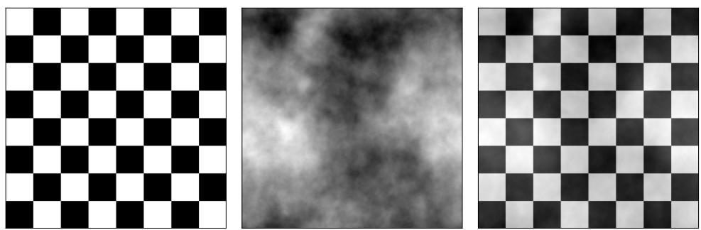
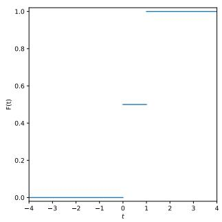
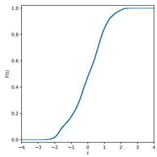
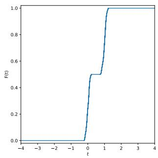
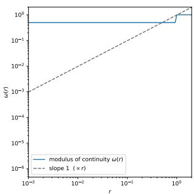
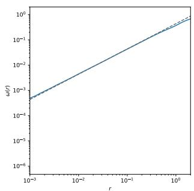
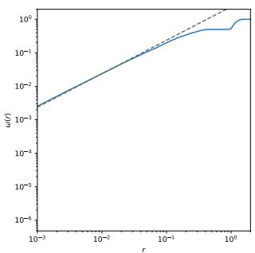
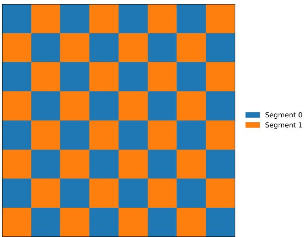
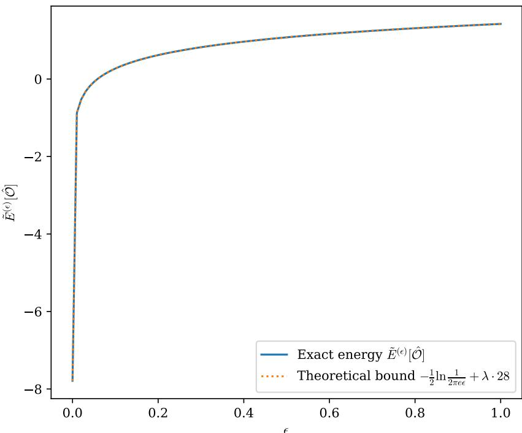
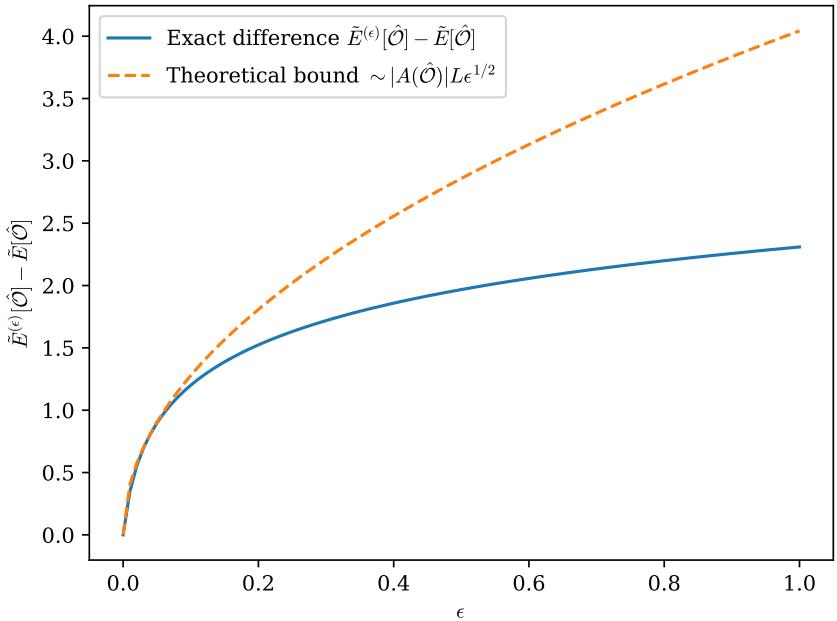

# EXISTENCE OF MINIMIZERS FOR THE GAUSSIAN MUMFORD–SHAH MODEL VIA COVARIANCE FLOORS ON THE VALUE DISTRIBUTION∗

FABIAN CONRAD†

Abstract. The Gaussian Mumford–Shah model segments an image into regions by minimizing a continuous multivariate Gaussian negative log-likelihood term plus a perimeter penalty. It is used for scalar- and vector-valued images, in particular hyperspectral images, but the existence of a minimizer in general is not guaranteed. The energy is unbounded below whenever the covariance of a single region degenerates, regardless of the perimeter of the regions. A quantitative covariance floor on the covariances of all regions, or equivalently uniform H¨older continuity with exponent at most one of all one-dimensional marginals of the histogram, guarantees a lower bound on the energy and the existence of a minimizer. Our approach therefore shows that existence follows from a property of the histogram of the image, and we furthermore argue that scale-independent covariance floors cannot exist. Admitting a quantitative covariance floor is generic: it holds almost surely for all images with suitable noise. As applications of our theory, we show the convergence of regularized models used in practice and of numerical methods.

Key words. Mumford–Shah functional, variational image segmentation, Gaussian models, covariance degeneracy, existence of minimizers

MSC codes. 49J45, 49Q20, 68U10, 94A08, 62H35

1. Introduction. Region competition with multivariate Gaussian statistics [1], which we will refer to as the Gaussian Mumford–Shah model, and versions of it are used in the context of image segmentation [2, 3, 4, 5], providing, for example, competitive results on benchmark hyperspectral datasets. The multivariate case has full covariance matrices, which capture the high correlation between bands in hyperspectral imaging. Let $g \in L ^ { \infty } ( ( 0 , 1 ) ^ { \hat { 2 } } , \mathbb { R } ^ { N } )$ be a bounded measurable image. For a fixed number of segments $k \in \mathbb N$ , we consider a partition $\mathcal { O } = ( O _ { 1 } , \ldots , O _ { k } )$ of $( 0 , 1 ) ^ { 2 }$ with $O _ { l } \subset ( 0 , 1 ) ^ { 2 }$ having finite perimeter in $( 0 , 1 ) ^ { 2 }$ , denoted by $\mathrm { P e r } ( O _ { l } , ( 0 , 1 ) ^ { 2 } )$ , such that

$$
\bigcup _ { l \in \{ 1 , \dots , k \} } O _ { l } = ( 0 , 1 ) ^ { 2 } \quad \land \quad \forall l \neq l ^ { \prime } : O _ { l } \cap O _ { l ^ { \prime } } = \emptyset .
$$

We denote the set of all such partitions by $P _ { k }$ . Let $S _ { + + } ( N )$ denote the set of symmetric positive definite matrices in $\mathbb { R } ^ { N \times N }$ . For any $S \in S _ { + + } ( N )$ , we define the Mahalanobis norm of $z \in \mathbb { R } ^ { N }$ by

$$
| z | _ { S } ^ { 2 } : = z ^ { T } S ^ { - 1 } z .
$$

Then, we define the Gaussian Mumford–Shah model (GMS) by

$$
\begin{array} { r l r } {  { E : P _ { k } \times ( \mathbb { R } ^ { N } ) ^ { k } \times S _ { + + } ( N ) ^ { k } \to \mathbb { R } , } } \\ & { } & { ( \mathscr { O } , \mu , \Sigma ) \mapsto \displaystyle \sum _ { l = 1 } ^ { k } \bigg ( \int _ { O _ { l } } f ( g ( x ) \mid \mu _ { l } , \Sigma _ { l } ) \ \mathrm { d } \mathbf { x } + \lambda \mathrm { P e r } ( O _ { l } , ( 0 , 1 ) ^ { 2 } ) \bigg ) , } \end{array}\tag{1.1}
$$

where

$$
f ( g ( x ) \mid \mu _ { l } , \Sigma _ { l } ) = \frac 1 2 | g ( x ) - \mu _ { l } | _ { \Sigma _ { l } } ^ { 2 } + \frac 1 2 \ln \operatorname * { d e t } \Sigma _ { l } + \frac N 2 \ln 2 \pi
$$

is the indicator function given by the negative log-likelihood of a multivariate Gaussian $\mathcal { N } ( \mu _ { l } , \Sigma _ { l } )$ and $\lambda > 0$ is a fixed length parameter. If we set $\Sigma = ( \Sigma _ { 1 } , \dots , \Sigma _ { k } ) = ( I , \dots , I )$ to be the identity matrix I in every component, we recover the classical piecewise constant Mumford–Shah model [6] up to an additive constant, for which existence and even regularity theory is well-known [7]. However, the existence of a minimizer of the GMS (1.1), and by extension the region competition model [1], has not been addressed so far to our knowledge. When applying the direct method of the calculus of variations, the main obstructions are the unboundedness from below, which prevents the extraction of a minimizing sequence converging to a finite infimum, the fact that $S _ { + + } ( N )$ is not closed and hence might not contain the limit of such a sequence, and the lack of lower semi-continuity. Following the arguments of [8], if $g ( O )$ is contained in some afine hyperplane $H \subset \mathbb { R } ^ { N }$ for some $O \subset ( 0 , 1 ) ^ { 2 }$ with positive measure $| O | > 0$ and finite perimeter, we can find a sequence of statistical variables $( \mu ^ { ( n ) } , \Sigma ^ { ( n ) } ) _ { n \in \mathbb { N } } \subset$ $( \mathbb { R } ^ { N } ) ^ { k } \times { \mathcal { S } } _ { + + } ( N ) ^ { k }$ such that for the fixed partition $( O , ( 0 , 1 ) ^ { 2 } \setminus O , \emptyset , \dots , \emptyset ) \in P _ { k }$ , which in particular has a fixed perimeter contribution, the energy diverges to −∞, i.e.

$$
\operatorname* { l i m } _ { n \to \infty } E [ ( O , ( 0 , 1 ) ^ { 2 } \setminus O , \emptyset , \ldots , \emptyset ) , \mu ^ { ( n ) } , \Sigma ^ { ( n ) } ] = - \infty .
$$

Let us introduce the (continuous) sample mean and sample covariance for any $O \subset ( 0 , 1 ) ^ { 2 }$ with $| O | > 0$ by

$$
\begin{array} { l } { { \displaystyle m _ { O } : = \frac { 1 } { | O | } \int _ { O } g ( x ) \ \mathrm { d } x \quad \mathrm { a n d } } } \\ { { \displaystyle C _ { O } : = \frac { 1 } { | O | } \int _ { O } \left( g ( x ) - m _ { O } \right) \otimes \left( g ( x ) - m _ { O } \right) \mathrm { d } x . } } \end{array}\tag{1.2}
$$

For the case $| O | = 0$ , this definition is vacuous. We introduce the covariance floor condition (CFC) on $g \in L ^ { \infty } ( ( 0 , 1 ) ^ { 2 } , \mathbb { R } ^ { N } )$ , which means there exist $C > 0$ and $p > 0$ such that

$$
y ^ { T } C _ { O } y \geq C | O | ^ { p }\tag{1.3}
$$

for all $y \in S ^ { N - 1 } : = \{ y \in \mathbb { R } ^ { N } \mid | y | = 1 \}$ and $O \subset ( 0 , 1 ) ^ { 2 }$ with $| O | > 0$ . Equivalently, $C _ { O } \succeq C \vert O \vert ^ { p } I ,$ , where $\succeq$ denotes the Loewner order on symmetric matrices, i.e. $A \succeq B$ means that $A - B$ is positive semi-definite for symmetric matrices A, $B \in \mathbb { R } ^ { N \times N }$ . We show that for $g \in L ^ { \infty } ( ( 0 , 1 ) ^ { 2 } , \mathbb { R } ^ { N } )$ , this condition can only hold if $p \geq 2$ . In particular, a uniform (scale-independent) covariance floor $C _ { O } \succeq C I$ for all $O \subset ( 0 , 1 ) ^ { 2 }$ with $| O | > 0$ cannot exist. The CFC (1.3) is a property of the pushforward measure $g _ { \sharp } \mathcal L ^ { 2 }$ Thus, it is intrinsic to the data. We also prove that the CFC is equivalent to a uniform H¨older bound on the cumulative distributions of the pushforward measure $g _ { \sharp } \mathcal L ^ { 2 }$ . In research and literature, this concept is related to the Frostman lemma [9], occupation densities [10] and L´evy concentration functions [11], and we will refer to these at the respective points. Most notably, none of these three concepts requires uniformity in $y \in S ^ { N - 1 }$ , which the CFC does. The discrete sample means and covariance matrices are studied at a fixed scale, whereas the continuum sample covariances need lower bounds at every scale. Non-degeneracy of the sample covariance in the discrete case depends on having at least $N + 1$ afinely independent samples, while in the continuous case, the question is how fast $C _ { O }$ may degenerate as $| O |  0$

Moreover, we show that adding suitable noise to any image yields a covariance floor almost surely. For $\sigma > 0$ and a suitable fractional Gaussian field (restricted from $\mathbb { R } ^ { 2 }$ to $( 0 , 1 ) ^ { 2 } )$ W, the noisy image

$$
g + \sigma W
$$

satisfies the CFC almost surely and any image can be approximated by an image satisfying the CFC arbitrarily well in the $L ^ { \infty } ( ( 0 , 1 ) ^ { 2 } , \mathbb { R } ^ { N } )$ topology. Hence, the CFC is not vacuous and feasible.

We show that imposing the CFC on $g$ implies both the existence of an entropy expression as a lower bound for the GMS and the existence of a uniform lower bound for the Gaussian Mumford–Shah model. As the first application of the CFC (and the existence of lower bounds for the GMS), we show the convergence of minimizers, including convergence rates for the energies, of the perturbed Gaussian Mumford– Shah model (pGMS)

$$
E ^ { ( \epsilon ) } [ \mathcal { O } , \mu , \Sigma ] : = E [ \mathcal { O } , \mu , \Sigma ] + \frac { \epsilon } { 2 } \sum _ { l = 1 } ^ { k } | O _ { l } | \mathrm { t r } \Sigma _ { l } ^ { - 1 }\tag{1.4}
$$

to minimizers of the GMS by using Γ-convergence of reduced, partition-only based versions of $E ^ { ( \epsilon ) }$ and $E ^ { ( 0 ) } : = E { \mathrm { ~ a s ~ } } \epsilon \to 0$ . The pGMS is the variational formulation of regularizing the sample covariance matrices by $C _ { O _ { l } } \gets C _ { O _ { l } } + \epsilon I \succeq \epsilon I \left( l = 1 , \dots , k \right)$ , a common way to enforce positive definiteness in practice. A closely related regularization, clipping the eigenvalues of $C _ { O _ { l } }$ from below, corresponds to the constraint $\Sigma _ { l } \succeq \epsilon I$ and was used in [3] for a model with a non-squared Mahalanobis data term. For that model, [8] showed existence for all $g \in L ^ { \infty } ( ( 0 , 1 ) ^ { 2 } , \mathbb { R } ^ { N } )$ as long as $\epsilon > 0$ and Γ-convergence as $\epsilon  0$ , but not necessarily convergence of minimizers. Without the CFC, the GMS itself can be unbounded from below, and the regularization does not remove this singularity in the limit $\epsilon  0$ . For images satisfying the CFC, this singularity does not occur. Consequently, the GMS (1.1) admits a minimizer for every $g$ satisfying the CFC (1.3). As the second application, we show that after replacing the labels O in the GMS (1.1) with a convex relaxation $u ,$ and alternately updating the labels u and the statistical variables $( \mu , \Sigma )$ , we have convergence of a subsequence. The second application highlights that commonly applied numerical approaches to these models also converge, at least along a subsequence. In both of these applications, a lower bound was the biggest missing ingredient so far.

This paper starts by discussing the theoretical aspects of the CFC. In particular, we show that satisfying the CFC is equivalent to the marginal distributions of $g$ being H¨older continuous uniformly in $y \in S ^ { \hat { N } - 1 }$ and that $p \geq 2$ is necessary. It is then argued that the pushforward measure of $^ { g , }$ the continuous version of the histogram, is the correct invariant for the existence of covariance floors. Using techniques from Fourier analysis, we prove that a noisy image will almost surely satisfy the CFC. This section is independent of the Gaussian Mumford–Shah context. In the following section, we use information theory to show that the GMS admits a lower bound for images satisfying the CFC. With this lower bound at hand, we turn to our applications, which cover the existence of minimizers of the GMS and the convergence of the alternating minimization. The final section contains some numerical experiments illustrating our main theorems.

## 2. Covariance floors for images.

Definition 1 (Covariance floor condition). Let $g \in L ^ { \infty } ( ( 0 , 1 ) ^ { 2 } , \mathbb { R } ^ { N } )$ . We say g satisfies the covariance floor condition (CFC) with exponent $p > 0$ if there exists $C > 0$ such that

$$
C _ { O } \succeq C \vert O \vert ^ { p } I
$$

for all measurable $O \subset ( 0 , 1 ) ^ { 2 }$ with $| O | > 0$

We also introduce the pushforward measure of $g _ { \mathrm { : } }$ , which we denote by ν without reference to $g$ since $g$ is fixed,

$$
\nu ( A ) : = g _ { \sharp } \bigl ( \mathcal { L } ^ { 2 } \big | _ { ( 0 , 1 ) ^ { 2 } } \bigr ) ( A ) = | \{ x \in ( 0 , 1 ) ^ { 2 } \mid g ( x ) \in A \} |
$$

for any Borel set $A \subset \mathbb { R } ^ { N }$ . Similarly, we define for any $y \in S ^ { N - 1 }$ the projected pushforward measure

$$
\nu _ { y } ( B ) : = ( y ^ { T } g ) _ { \sharp } \big ( \mathcal L ^ { 2 } \big | _ { ( 0 , 1 ) ^ { 2 } } \big ) ( B ) = | \{ x \in ( 0 , 1 ) ^ { 2 } \mid y ^ { T } g ( x ) \in B \} |
$$

for any Borel set $B \subset \mathbb { R }$ . By the Cram´er–Wold theorem [12], the marginals $\nu _ { y }$ completely determine ν and vice versa. Closely related is the following definition:

Definition 2 (Regular distribution condition). Let $g \in L ^ { \infty } ( ( 0 , 1 ) ^ { 2 } , \mathbb { R } ^ { N } )$ . We say g satisfies the regular distribution condition (RDC) with exponent $p > 0$ , if for all $y \in S ^ { N - 1 }$ , the cumulative distributions

$$
F _ { y } : \mathbb { R }  [ 0 , 1 ] , \ t \mapsto \nu _ { y } ( ( - \infty , t ] )
$$

are $\frac { 2 } { p } { - } H \ddot { o } l d e r$ continuous with uniform H¨older constant, i.e. there exists $C \ > \ 0$ independent of $y \in S ^ { N - 1 }$ such that

$$
\operatorname* { s u p } _ { y \in S ^ { N - 1 } } \left\| F _ { y } \right\| _ { C ^ { 0 , \frac { 2 } { p } } ( \mathbb { R } ) } \leq C .
$$

We will now state the main theorem of this section, which gives an equivalent characterization of the CFC.

Theorem 1 (Equivalence of conditions). Let $g \in L ^ { \infty } ( ( 0 , 1 ) ^ { 2 } , \mathbb { R } ^ { N } )$ ) and let $p > 0$ Then the following are equivalent:

• g satisfies the CFC with exponent $p .$

• g satisfies the RDC with exponent $p .$

Neither condition can be satisfied by any $g \in L ^ { \infty } ( ( 0 , 1 ) ^ { 2 } , \mathbb { R } ^ { N } ) \ i f p < 2$

Remark 1 (Dependence on the histogram). Theorem 1 shows that whether g admits a covariance floor depends only on its value distribution and not on its spatial arrangement. In the language of imaging sciences, the CFC only depends on the (continuous) histogram of the image $^ { g , }$ which is the pushforward measure $\nu .$ Furthermore, the requirement $p \geq 2$ shows us that on small scales $| O | \ll 1$ , the continuous sample covariance matrix $C _ { O }$ cannot shrink arbitrarily slowly. In particular, demanding a universal lower bound for all scales,

$$
C _ { O } \succeq C I
$$

for all $O \subset ( 0 , 1 ) ^ { 2 }$ with $| O | > 0$ , can never be achieved.

Furthermore, the sample covariance matrix does not even have to shrink at all and hence pinching the covariance matrix becomes impossible:

Let $g \in L ^ { \infty } ( ( 0 , 1 ) ^ { 2 } , \mathbb { R } ^ { N } )$ have two Lebesgue points $x _ { 1 } \neq x _ { 2 }$ such that $g ( x _ { 1 } ) = v _ { 1 } \neq$ $v _ { 2 } = g ( x _ { 2 } )$ . Let us set $O _ { r } = B _ { r } ( x _ { 1 } ) \cup B _ { r } ( x _ { 2 } )$ with $B _ { r } ( x _ { i } ) : = \{ x \in ( 0 , 1 ) ^ { 2 } \mid | x - x _ { i } | \leq r \}$ $( i = 1 , 2 )$ . Let $r > 0$ be so small that $B _ { r } ( x _ { 1 } )$ and $B _ { r } ( x _ { 2 } )$ are disjoint and contained in $( 0 , 1 ) ^ { 2 }$ . Then each ball satisfies $\begin{array} { r } { | B _ { r } ( x _ { 1 } ) | = | B _ { r } ( x _ { 2 } ) | = \frac { | O _ { r } | } { 2 } } \end{array}$ , and since $x _ { 1 } , x _ { 2 }$ are also Lebesgue points of $g \otimes g$ (as $g \in L ^ { \infty } ( ( 0 , 1 ) ^ { 2 } , \mathbb { R } ^ { N } ) )$ , we obtain

$$
m _ { O _ { r } } = { \frac { 1 } { 2 } } { \Bigg ( } { \frac { 1 } { | B _ { r } ( x _ { 1 } ) | } } \int _ { B _ { r } ( x _ { 1 } ) } g ( x ) \ \mathrm { d x } + { \frac { 1 } { | B _ { r } ( x _ { 2 } ) | } } \int _ { B _ { r } ( x _ { 2 } ) } g ( x ) \ \mathrm { d x } { \Bigg ) } \to { \frac { v _ { 1 } + v _ { 2 } } { 2 } }
$$

$$
{ \frac { 1 } { | O _ { r } | } } \int _ { O _ { r } } g ( x ) \otimes g ( x ) { \mathrm { ~ d x } } \to { \frac { v _ { 1 } \otimes v _ { 1 } + v _ { 2 } \otimes v _ { 2 } } { 2 } }
$$

as $r  0$ . Using $\begin{array} { r } { C _ { O _ { r } } = \frac { 1 } { | O _ { r } | } \int _ { O _ { r } } g ( x ) \otimes g ( x ) \ \mathrm { d x } - m _ { O _ { r } } \otimes m _ { O _ { r } } } \end{array}$ , we conclude

$$
\operatorname* { l i m } _ { r  0 } C _ { O _ { r } } = \frac { v _ { 1 } \otimes v _ { 1 } + v _ { 2 } \otimes v _ { 2 } } { 2 } - \frac { ( v _ { 1 } + v _ { 2 } ) \otimes ( v _ { 1 } + v _ { 2 } ) } { 4 } = \frac { ( v _ { 1 } - v _ { 2 } ) \otimes ( v _ { 1 } - v _ { 2 } ) } { 4 } ,
$$

for which $\frac { | v _ { 1 } - v _ { 2 } | ^ { 2 } } { 4 }$ is a non-zero eigenvalue and hence no bound of the form $C _ { O _ { r } } \preceq$ $C | O _ { r } | ^ { p ^ { \prime } } I$ can hold for any $p ^ { \prime } > 0$

We will now prove Theorem 1:

Proof. $( \implies )$ : Let the CFC hold with exponent $p > 0 .$ , constant $C > 0$ and let $y \in S ^ { N - 1 }$ be arbitrary. Let $B \subset \mathbb { R }$ be any Borel set and set $O = ( y ^ { T } g ) ^ { - 1 } ( B )$ with $| O | > 0$ . By definition of the pushforward measure, we have $\nu _ { y } ( B ) = | O |$ . The CFC with constant $C > 0$ and exponent $p > 0$ then implies

$$
C \nu _ { y } ( B ) ^ { p } = C | O | ^ { p } \leq y ^ { T } C _ { O } y = \frac { 1 } { | O | } \int _ { O } ( y ^ { T } g ( x ) - y ^ { T } m _ { O } ) ^ { 2 } ~ \mathrm { d } x \leq \frac { \mathrm { d i a m } ( B ) ^ { 2 } } { 4 } ,
$$

since $y ^ { T } g$ takes values only in $B \subset [ \operatorname* { i n f } B , \operatorname* { s u p } B ]$ on O, and by Popoviciu’s inequality [13] the variance of a real random variable with values in an interval of length ℓ is at most $\ell ^ { 2 } / 4$ , where sup $B - \operatorname* { i n f } B = \dim ( B )$ for $B \subset \mathbb { R }$ . For $| O | = 0$ or infinite diameter $\mathrm { d i a m } ( B ) = \infty$ , the inequality becomes trivial. Re-arranging this inequality and taking the supremum yields

$$
\operatorname* { s u p } _ { y \in S ^ { N - 1 } } \nu _ { y } ( B ) \leq \frac { 1 } { ( 4 C ) ^ { \frac { 1 } { p } } } \mathrm { d i a m } ( B ) ^ { \frac { 2 } { p } } .
$$

Let $t _ { 1 } < t _ { 2 }$ be two distinct real numbers. In particular, the inequality above holds for $B = [ t _ { 1 } , t _ { 2 } ]$ and hence we have for the cumulative distribution

$$
\operatorname* { s u p } _ { y \in S ^ { N - 1 } } | F _ { y } ( t _ { 1 } ) - F _ { y } ( t _ { 2 } ) | \leq \operatorname* { s u p } _ { y \in S ^ { N - 1 } } \nu _ { y } ( ( t _ { 1 } , t _ { 2 } ] ) \leq \frac { 1 } { ( 4 C ) ^ { \frac { 1 } { p } } } | t _ { 1 } - t _ { 2 } | ^ { \frac { 2 } { p } } ,
$$

which directly implies the RDC with exponent p and constant $\frac { 1 } { ( 4 C ) ^ { \frac { 1 } { p } } }$

$( \iff )$ : Conversely, let the RDC hold with exponent $p > 0 .$ , constant $C > 0$ and let $y \in S ^ { N - 1 }$ be arbitrary. Let $O \subset ( 0 , 1 ) ^ { 2 }$ with $| O | > 0$ be arbitrary. For any Borel set $B \subset \mathbb { R }$ , we set $I _ { B } : = [ \operatorname* { i n f } B , \operatorname* { s u p } B ]$ (possibly infinite). Since $F _ { y }$ is continuous by the $\mathrm { R D C } , \nu _ { y }$ has no atoms, $\mathrm { i . e . , ~ } \nu _ { y } ( \{ t \} ) = 0$ for all $t \in \mathbb { R }$ , and hence $\nu _ { y } ( I _ { B } ) = \nu _ { y } ( ( \operatorname* { i n f } B , \operatorname* { s u p } B ] ) = F _ { y } ( \operatorname* { s u p } B ) - F _ { y } ( \operatorname* { i n f } B )$ . Therefore,

$$
\nu _ { y } ( B ) \leq \nu _ { y } ( I _ { B } ) \leq | F _ { y } ( \operatorname* { s u p } B ) - F _ { y } ( \operatorname* { i n f } B ) | \leq C | \operatorname* { s u p } B - \operatorname* { i n f } B | ^ { \frac { 2 } { p } } \leq C \mathrm { d i a m } ( B ) ^ { \frac { 2 } { p } } ,
$$

since $B \subset I _ { B }$ and the RDC holds. Consequently, the restricted pushforward measure

$$
\nu _ { y , O } ( B ) : = | O \cap ( y ^ { T } g ) ^ { - 1 } ( B ) |
$$

satisfies

$$
\nu _ { y , O } ( B ) \leq \nu _ { y } ( B ) \leq C \mathrm { d i a m } ( B ) ^ { \frac { 2 } { p } }\tag{2.1}
$$

for any Borel set $B \subset \mathbb { R }$ and

$$
\nu _ { y , O } ( \mathbb { R } ) = | O | .\tag{2.2}
$$

We will now execute a bathtub principle style argument [14] to show that

$$
\int _ { \mathbb { R } } ( t - \bar { t } ) ^ { 2 } \mathrm { d } \nu _ { y , O } ( t )
$$

for $\begin{array} { r } { \bar { t } = \frac { 1 } { \nu _ { y , O } ( \mathbb { R } ) } \int _ { \mathbb { R } } t \mathrm { d } \nu _ { y , O } ( t ) } \end{array}$ is bounded below by a positive constant independent of $y .$ For $r = ( \frac { | O | } { 2 C } ) ^ { \frac { p } { 2 } } > 0$ and the interval $I = [ \bar { t } - \textstyle \frac { r } { 2 } , \bar { t } + \textstyle \frac { r } { 2 } ]$ , we have by

$$
\nu _ { y , O } ( I ) \leq C r ^ { \frac { 2 } { p } } = \frac { | O | } { 2 } .
$$

The second condition (2.2) then gives us

$$
\nu _ { y , O } ( \mathbb { R } \setminus I ) = | O | - \nu _ { y , O } ( I ) \geq \frac { | O | } { 2 } .
$$

Since we have $\begin{array} { r } { ( t - \bar { t } ) ^ { 2 } \geq \frac { r ^ { 2 } } { 4 } } \end{array}$ for all $t \in \mathbb { R } \backslash I ,$ , we have

$$
\int _ { \mathbb { R } } ( t - \bar { t } ) ^ { 2 } \mathrm { d } \nu _ { y , O } ( t ) \geq \int _ { \mathbb { R } \backslash I } ( t - \bar { t } ) ^ { 2 } \mathrm { d } \nu _ { y , O } ( t ) \geq \frac { r ^ { 2 } } { 4 } \frac { | O | } { 2 } = \frac { 1 } { 2 ^ { p + 3 } C ^ { p } } | O | ^ { p + 1 } .
$$

We conclude the proof by noting that, by definition of the restricted pushforward measure,

$$
\begin{array} { r l } & { \boldsymbol { y } ^ { T } \boldsymbol { C } _ { O } \boldsymbol { y } = \displaystyle \frac { 1 } { | O | } \int _ { O } ( \boldsymbol { y } ^ { T } \boldsymbol { g } ( \boldsymbol { x } ) - \boldsymbol { y } ^ { T } m _ { O } ) ^ { 2 } \mathrm { ~ d } \mathbf { x } } \\ & { \qquad = \displaystyle \frac { 1 } { | O | } \int _ { \mathbb { R } } ( t - \bar { t } ) ^ { 2 } \mathrm { d } \nu _ { \boldsymbol { y } , O } ( t ) \geq \frac { 1 } { 2 ^ { p + 3 } C ^ { p } } | O | ^ { p } , } \end{array}
$$

which by the Courant–Fischer–Weyl principle for eigenvalues [15] implies the CFC with exponent $p$ and constant $\frac { 1 } { 2 ^ { p + 3 } C ^ { p } }$

$\left( p \ge 2 \right)$ : Lastly, we show that $p \geq 2$ is required and we will show that the marginals are closely related to Frostman measures [9] uniformly in $S ^ { N - 1 }$ . Let $B \subset \mathbb { R }$ be any Borel set. For $\delta > 0$ , let $B \subset \textstyle \bigcup _ { i \in I } U _ { i }$ be a countable covering of B by sets with $\operatorname { s u p } _ { i \in I }$ diam $( U _ { i } ) < \delta$ . Assuming the CFC holds with exponent $p > 0$ and constant $C > 0$ , we have by the previous arguments for any $y \in { S } ^ { \tilde { N } - 1 }$

$$
\nu _ { y } ( B ) \leq \sum _ { i \in I } \nu _ { y } ( U _ { i } ) \leq C \sum _ { i \in I } \mathrm { d i a m } ( U _ { i } ) ^ { \frac { 2 } { p } } .
$$

Taking the infimum over all such covers and sending $\delta  0$ yields

$$
\nu _ { y } ( B ) \leq C \mathcal { H } ^ { \frac { 2 } { p } } ( B )
$$

for the ${ \frac { 2 } { p } } .$ -dimensional Hausdorf measure $\mathcal { H } ^ { \frac { 2 } { p } }$ . In particular, we must have

$$
1 = \nu _ { y } ( \mathbb { R } ) \leq C \mathcal { H } ^ { \frac { 2 } { p } } ( \mathbb { R } ) ,
$$

which is a contradiction for $p < 2$ , since $\mathcal { H } ^ { \alpha } ( \mathbb { R } ) = 0$ for $\alpha > 1$

Provided $\nu _ { y }$ comes from a density $h _ { y }$ , i.e.

$$
\nu _ { y } ( B ) = \int _ { ( 0 , 1 ) ^ { 2 } } \mathbf { 1 } _ { B } ( y ^ { T } g ( x ) ) \ \mathrm { d x } = \int _ { B } h _ { y } ( t ) \mathrm { d } t
$$

holds for all Borel sets $B \subset \mathbb { R }$ , we see that if the (marginal) densities $h _ { y }$ satisfy $\begin{array} { r } { \operatorname* { s u p } _ { y \in S ^ { N - 1 } } \left\| h _ { y } \right\| _ { L ^ { \frac { p } { p - 2 } } } \leq C < \infty } \end{array}$ , with the convention $\textstyle { \frac { p } { 0 } } = \infty$ , we immediately get

$$
\nu _ { y } ( ( t _ { 1 } , t _ { 2 } ] ) = \int _ { t _ { 1 } } ^ { t _ { 2 } } h _ { y } ( t ) \mathrm { d } t \leq \operatorname* { s u p } _ { y \in S ^ { N - 1 } } \| h _ { y } \| _ { L ^ { \frac { p } { p - 2 } } } | t _ { 1 } - t _ { 2 } | ^ { \frac { 2 } { p } } \leq C | t _ { 1 } - t _ { 2 } | ^ { \frac { 2 } { p } }\tag{2.3}
$$

by H¨older’s inequality. Taking the supremum over $y \in S ^ { N - 1 }$ yields the RDC with exponent $p \geq 2$ . If $g$ is smooth with $\begin{array} { r } { | \{ \nabla y ^ { T } g = 0 \} | = 0 . } \end{array}$ , an application of the co-area formula [16] reveals that for any $y \in \dot { S } ^ { N - 1 }$ and Borel set $B \subset \mathbb { R }$ we have

$$
\nu _ { y } ( B ) = \int _ { ( 0 , 1 ) ^ { 2 } } \mathbf { 1 } _ { B } ( y ^ { T } g ( x ) ) ~ \mathrm { d } \mathbf { x } = \int _ { B } \underbrace { \left( \int _ { ( y ^ { T } g ) ^ { - 1 } ( t ) } \frac { 1 } { | \nabla ( y ^ { T } g ) ( x ) | } \mathrm { d } \mathcal { H } ^ { 1 } ( x ) \right) } _ { = h _ { y } ( t ) } \mathrm { d } t .
$$

While spatial regularity is not needed for a map $g \in L ^ { \infty } ( ( 0 , 1 ) ^ { 2 } , \mathbb { R } ^ { N } )$ to satisfy the RDC, one can impose regularity conditions on $g$ which imply $\begin{array} { r } { \operatorname* { s u p } _ { y \in S ^ { N - 1 } } \left\| h _ { y } \right\| _ { L ^ { \frac { p } { p - 2 } } } \leq C < \infty } \end{array}$

Example 1 (Afine maps in $\mathbb { R } ^ { 2 } )$ . As an immediate application, we see that afine maps to $\mathbb { R } ^ { 2 }$

$$
g ( x ) = A x + b
$$

with $A \in \mathrm { G L } ( 2 )$ and $b \in \mathbb { R } ^ { 2 }$ satisfy the $C F C .$ In this case, we see that

$$
\vert h _ { y } ( t ) \vert \leq \frac { 1 } { \vert A ^ { T } y \vert } \operatorname* { s u p } _ { s \in \mathbb { R } } \mathcal { H } ^ { 1 } \big ( \{ x \in ( 0 , 1 ) ^ { 2 } \mid y ^ { T } A x + y ^ { T } b = s \} \big ) \leq \frac { \sqrt { 2 } } { \sigma _ { \operatorname* { m i n } } ( A ) } ,
$$

where $\sigma _ { \mathrm { m i n } } ( A )$ is the smallest singular value of A. This implies $\begin{array} { r } { \operatorname* { s u p } _ { y \in S ^ { N - 1 } } \| h _ { y } \| _ { L ^ { \infty } } \leq } \end{array}$ ${ \frac { \sqrt { 2 } } { \sigma _ { \operatorname* { m i n } } ( A ) } }$ and by the same argument as above (2.3), afine maps to $\mathbb { R } ^ { 2 }$ satisfy the RDC with exponent $p = 2$

Our analysis so far motivates the following definition:

Definition 3 (Non-degenerate images). For $p \geq 2$ , we define the space of non-degenerate images with exponent p as

$$
\begin{array} { r } { \boldsymbol { \mathcal { A } } ( p ) : = \left\{ g \in L ^ { \infty } ( ( 0 , 1 ) ^ { 2 } , \mathbb { R } ^ { N } ) \ | \ g \ s a t i s f i e s \ t h e \ C F C \ w i t h \ e x p o n e n t \ p \right\} } \end{array}
$$

We record some properties and invariances of $\scriptstyle A ( p )$ :

Lemma 1 (Structure of $\scriptstyle A ( p ) )$ . Let $g \in { \mathcal { A } } ( p )$ for $p \geq 2$ . Then we have

$A g + b \in { \mathcal { A } } ( p )$ for $A \in \mathrm { G L } ( N ) , b \in \mathbb { R } ^ { N }$

$g \circ \tau \in { \mathcal { A } } ( p )$ for

$$
\tau \in T : = \{ t : ( 0 , 1 ) ^ { 2 } \to ( 0 , 1 ) ^ { 2 } \mid t \ p r e s e r v e s \ L ^ { 2 } \} ,
$$

• and $\mathcal { A } ( p ) \subset \mathcal { A } ( p ^ { \prime } )$ for all $2 \le p \le p ^ { \prime }$

Proof. Let $g \in { \mathcal { A } } ( p )$ be arbitrary.

For any $b \in \mathbb { R } ^ { N }$ , we note that g and $g + b$ have the same covariance matrix and g satisfies the CFC. Let $A \in \operatorname { G L } ( N )$ and $O \subset ( 0 , 1 ) ^ { 2 }$ be arbitrary with $| O | > 0$ . For any $y \in S ^ { N - 1 }$ , the covariance matrix $\tilde { C } _ { O }$ of $A g$ satisfies

$$
\begin{array} { r } { \boldsymbol { y } ^ { T } \tilde { C } _ { O } \boldsymbol { y } = ( A ^ { T } \boldsymbol { y } ) ^ { T } C _ { O } ( A ^ { T } \boldsymbol { y } ) \geq C | O | ^ { p } | A ^ { T } \boldsymbol { y } | ^ { 2 } \geq C | O | ^ { p } \sigma _ { \operatorname* { m i n } } ( A ) ^ { 2 } , } \end{array}
$$

where again $\sigma _ { \mathrm { m i n } } ( A )$ is the smallest singular value of A and $C > 0$ is the constant coming from the CFC. Hence $A g$ satisfies the CFC with the same exponent $p$ and constant $C \sigma _ { \mathrm { m i n } } ( A ) ^ { 2 } > 0$ . Combining these facts, we have $A g + b \in { \mathcal { A } } ( p )$

For the invariance under measure-preserving maps, it sufices to note that for all $\boldsymbol { y } \in S ^ { N - 1 } , \boldsymbol { y } ^ { T } \boldsymbol { g }$ and $( y ^ { T } g ) \circ \tau$ have the same cumulative distribution and therefore both satisfy the RDC with the same constant and exponent $p .$

Since $0 \leq | O | \leq 1$ , we have $| O | ^ { p } \geq | O | ^ { p ^ { \prime } }$ and hence

$$
C _ { O } \succeq C | O | ^ { p } I \succeq C | O | ^ { p ^ { \prime } } I
$$

for all $O \subset ( 0 , 1 ) ^ { 2 }$ with $| O | > 0$ and hence $g \in { \mathcal { A } } ( p ^ { \prime } )$

We would like to note that $\scriptstyle A ( p )$ is not a convex cone, since

$$
0 = \frac 1 2 g + \frac 1 2 ( - g ) \not \in \mathcal A ( p )
$$

for any $p \geq 2$ . It is therefore also not a vector space.

In the imaging sciences, in particular for motif extraction [17], we often have repeated patterns. To check the CFC on the whole image, it is suficient to check it on every tile:

Lemma 2 (Tiling lemma). Let $g \in L ^ { \infty } ( ( 0 , 1 ) ^ { 2 } , \mathbb { R } ^ { N } )$ and

$$
( 0 , 1 ) ^ { 2 } = \bigcup _ { h , w = 1 } ^ { M } \underbrace { ( \frac { ( h - 1 ) } { M } , \frac { h } { M } ) \times ( \frac { ( w - 1 ) } { M } , \frac { w } { M } ) } _ { : = Q _ { h , w } }
$$

be a partition (up to null sets) $o f \ ( 0 , 1 ) ^ { 2 }$ into squares. Let $\tau _ { h , w } : ( ( 0 , 1 ) ^ { 2 } , \mathcal { L } ^ { 2 } ) \to$ $( Q _ { h , w } , M ^ { 2 } \mathcal { L } ^ { 2 } )$ be any measure-preserving map. $I f g | _ { Q _ { h , w } } \circ \tau _ { h , w } \in \mathcal { A } ( p _ { h , w } )$ for all $1 \leq h , w \leq M$ , then $g \in { \mathcal { A } } ( p )$ for $p = \operatorname* { m a x } _ { h , w } p _ { h , w }$

<table><tr><td rowspan=1 colspan=1>QM,1</td><td rowspan=1 colspan=1></td><td rowspan=1 colspan=1></td><td rowspan=1 colspan=1></td><td rowspan=1 colspan=1></td><td rowspan=1 colspan=1></td><td rowspan=1 colspan=1></td><td rowspan=1 colspan=1>QM,M</td></tr><tr><td rowspan=1 colspan=1></td><td rowspan=1 colspan=1></td><td rowspan=1 colspan=1></td><td rowspan=1 colspan=1></td><td rowspan=1 colspan=1></td><td rowspan=1 colspan=1></td><td rowspan=1 colspan=1></td><td rowspan=1 colspan=1></td></tr><tr><td rowspan=1 colspan=1></td><td rowspan=1 colspan=1></td><td rowspan=1 colspan=1></td><td rowspan=1 colspan=1></td><td rowspan=1 colspan=1></td><td rowspan=1 colspan=1></td><td rowspan=1 colspan=1></td><td rowspan=1 colspan=1></td></tr><tr><td rowspan=1 colspan=1></td><td rowspan=1 colspan=1></td><td rowspan=1 colspan=1></td><td rowspan=1 colspan=1></td><td rowspan=1 colspan=1></td><td rowspan=1 colspan=1></td><td rowspan=1 colspan=1></td><td rowspan=1 colspan=1></td></tr><tr><td rowspan=1 colspan=1></td><td rowspan=1 colspan=1></td><td rowspan=1 colspan=1></td><td rowspan=1 colspan=1></td><td rowspan=1 colspan=1></td><td rowspan=1 colspan=1></td><td rowspan=1 colspan=1></td><td rowspan=1 colspan=1></td></tr><tr><td rowspan=1 colspan=1>…</td><td rowspan=1 colspan=1></td><td rowspan=1 colspan=1></td><td rowspan=1 colspan=1></td><td rowspan=1 colspan=1></td><td rowspan=1 colspan=1></td><td rowspan=1 colspan=1></td><td rowspan=1 colspan=1></td></tr><tr><td rowspan=1 colspan=1>Q2,1</td><td rowspan=1 colspan=1>Q2,2</td><td rowspan=1 colspan=1></td><td rowspan=1 colspan=1></td><td rowspan=1 colspan=1></td><td rowspan=1 colspan=1></td><td rowspan=1 colspan=1></td><td rowspan=1 colspan=1></td></tr><tr><td rowspan=1 colspan=1>Q1,1</td><td rowspan=1 colspan=1>Q1,2</td><td rowspan=1 colspan=1></td><td rowspan=1 colspan=1></td><td rowspan=1 colspan=1></td><td rowspan=1 colspan=1></td><td rowspan=1 colspan=1></td><td rowspan=1 colspan=1>Q1,M</td></tr></table>

Fig. 2.1. Illustration of the tiling lemma.

Proof. Set $p = \operatorname* { m a x } _ { h , w } p _ { h , w }$ and let $B \subset \mathbb { R }$ be any Borel set with the associated interval $I _ { B } = [ \operatorname* { i n f } B , \operatorname* { s u p } B ]$ . Let $y \in S ^ { N - 1 }$ be arbitrary. Then, consider the set

$$
O : = \{ x \in ( 0 , 1 ) ^ { 2 } \mid y ^ { T } g ( x ) \in I _ { B } \}
$$

and we have

$$
O = \bigcup _ { h , w = 1 } ^ { M } ( O \cap Q _ { h , w } )
$$

and since $Q _ { h , w } \cap Q _ { h ^ { \prime } , w ^ { \prime } }$ is a null set for $( h , w ) \neq ( h ^ { \prime } , w ^ { \prime } )$ , we have

$$
\begin{array} { r l } & { \displaystyle v _ { y } ( B ) \leq v _ { y } ( I _ { B } ) = | O | = \sum _ { h , w = 1 } ^ { M } | O \cap Q _ { h , w } | } \\ & { \qquad \leq \displaystyle \sum _ { h , w = 1 } ^ { M } | \{ x \in Q _ { h , w } \mid y ^ { T } g ( x ) \in I _ { B } \} | } \\ & { \qquad \displaystyle = \frac { 1 } { M ^ { 2 } } \sum _ { h , w = 1 } ^ { M } | \{ x \in ( 0 , 1 ) ^ { 2 } \mid y ^ { T } ( g | _ { Q _ { h , w } } \circ \tau _ { h , w } ) ( x ) \in I _ { B } \} } \\ & { \qquad \displaystyle \leq \frac { 1 } { M ^ { 2 } } \sum _ { h , w = 1 } ^ { M } C _ { h , w } | I _ { B } | ^ { \frac { 2 } { p _ { h , w } } } \leq \left( 1 + \sum _ { h , w = 1 } ^ { M } C _ { h , w } \right) | I _ { B } | ^ { \frac { 2 } { p } } , } \end{array}
$$

where for $| I _ { B } | \le 1$ we used $| I _ { B } | ^ { \frac { 2 } { p _ { h , w } } } \leq | I _ { B } | ^ { \frac { 2 } { p } }$ , while for $| I _ { B } | > 1$ the bound $| O | \le 1 \le$ $\left| I _ { B } \right| ^ { \frac { 2 } { p } }$ is trivial. Noting that $| I _ { B } | ^ { \frac { 2 } { p } } = \dim ( B ) ^ { \frac { 2 } { p } }$ and using the same techniques as in the $( \Leftarrow )$ direction of the proof of Theorem 1, we see that $g$ satisfies the RDC with exponent $p = \operatorname* { m a x } _ { h , w } p _ { h , w }$ and constant $\begin{array} { r } { \tilde { C } : = \left( 1 + \sum _ { h , w = 1 } ^ { M } C _ { h , w } \right) } \end{array}$ □

Our analysis, and in particular Theorem 1, reveals that the pushforward measure ν of $^ { g , }$ equivalently all its marginals $\nu _ { y }$ , is the only invariant relevant for admitting a CFC. Furthermore, the equivalence

$$
\nu _ { y } ( B ) = \int _ { ( 0 , 1 ) ^ { 2 } } \mathbf { 1 } _ { B } ( y ^ { T } g ( x ) ) \ \mathrm { d x }
$$

reveals that the marginals are occupation measures [10]. However, in contrast to the theory of occupation measures, we do not require $\nu _ { y }$ to come from a density $h _ { y }$ , i.e. to only have an absolutely continuous part with respect to $\mathcal { L } ^ { 1 }$ and no jump or Cantor part. For $N = 1$ and $\begin{array} { r } { p = \frac { 2 \ln { 3 } } { \ln { 2 } } > 2 } \end{array}$ , taking $F$ to be the Cantor function yields an image whose pushforward measure ν consists exclusively of a Cantor part. The Fourier transform, denoted by the hat ˆ, is a widely used technique – not just in the theory of occupation measures – to study the pushforward measure ν as a measure on $\mathbb { R } ^ { N }$ . To generate an abundance of images $g \in { \mathcal { A } } ( p )$ , we can add suitable noise to any image and then use the Fourier transform of the pushforward measure of the noisy image to show that it must actually come from a density. Our noise model will be a fractional Gaussian field, which injects noise at every scale into our image $g .$

Definition 4 (Fractional Gaussian field). Let $0 \textless H \textless 1$ . The fractional Gaussian field ${ \mathfrak { M } } = ( { \mathfrak { M } } _ { 1 } , \dots , { \mathfrak { M } } _ { N } )$ with Hurst index H is $t h e \mathbb { R } ^ { N }$ -valued centered Gaussian field on $\mathbb { R } ^ { 2 }$ whose components are i.i.d. with

$$
\mathfrak { M } _ { i } ( 0 ) = 0 , \qquad \mathbb { E } \bigl [ | \mathfrak { M } _ { i } ( x ) - \mathfrak { M } _ { i } ( x ^ { \prime } ) | ^ { 2 } \bigr ] = | x - x ^ { \prime } | ^ { 2 H }
$$

for all $x , x ^ { \prime } \in \mathbb { R } ^ { 2 }$

The theory surrounding these fields, including existence, can be found in [18]. In particular, we have $W : = \mathfrak { W } | _ { ( 0 , 1 ) ^ { 2 } } \in L ^ { \infty } ( ( 0 , 1 ) ^ { 2 } , \mathbb { R } ^ { N } )$ almost surely.

Theorem 2 (Noisy images are in $\boldsymbol { A } ( 2 ) )$ Let $g \in L ^ { \infty } ( ( 0 , 1 ) ^ { 2 } , \mathbb { R } ^ { N } )$ and W be the fractional Gaussian field (restricted to $( 0 , 1 ) ^ { 2 } )$ with Hurst index H satisfying $N H < 1$ Then, for every $\sigma > 0$ , we have almost surely

$$
g + \sigma W \in { \mathcal { A } } ( 2 ) .
$$

Proof. Let us set $\tilde { g } = g + \sigma W$ and we have $\tilde { g } \in L ^ { \infty } ( ( 0 , 1 ) ^ { 2 } , \mathbb { R } ^ { N } )$ almost surely. We define the Fourier transform of the pushforward measure of $\tilde { g }$ by

$$
\hat { \nu } ( \xi ) = \int _ { ( 0 , 1 ) ^ { 2 } } e ^ { i \xi \cdot \tilde { g } ( x ) } \mathrm { d } x .
$$

Recall that the characteristic function of a Gaussian random vector $Z \sim { \mathcal { N } } ( \mu , \Sigma )$ satisfies

$$
\mathbb { E } [ e ^ { i \boldsymbol { \xi } \cdot \boldsymbol { Z } } ] = e ^ { i \boldsymbol { \xi } \cdot \mu } e ^ { - \frac { 1 } { 2 } \boldsymbol { \xi } ^ { T } \Sigma \boldsymbol { \xi } } ,
$$

that the increments of $\tilde { g }$ satisfy

$$
\begin{array} { r } { \tilde { g } ( x ) - \tilde { g } ( x ^ { \prime } ) \sim \mathcal { N } ( g ( x ) - g ( x ^ { \prime } ) , \sigma ^ { 2 } | x - x ^ { \prime } | ^ { 2 H } I ) , } \end{array}
$$

for $x , x ^ { \prime } \in ( 0 , 1 ) ^ { 2 }$ and that

$$
M _ { s , N } : = \int _ { \mathbb { R } ^ { N } } | u | ^ { s } e ^ { - \frac { 1 } { 2 } | u | ^ { 2 } } \mathrm { d } u < \infty .
$$

Using these three facts and the change of variables $u = \sigma | x - x ^ { \prime } | ^ { H } \xi$ , we have

$$
\begin{array} { r l } { \mathbb { E } \bigg [ \int _ { \mathbb { R } ^ { N } } | \xi | ^ { s } \left| \tilde { \nu } ( \xi ) \right| ^ { 2 } \mathrm { d } \xi \bigg ] = \int _ { \mathbb { R } ^ { N } } | \xi | ^ { s } \int _ { ( 0 , 1 ) ^ { 2 } } \int _ { ( 0 , 1 ) ^ { 2 s } } \mathbb { E } \big [ \nu \epsilon ^ { \epsilon + \tilde { \nu } ( \xi ) - \tilde { \nu } ( \xi ^ { s } ) } \big ] \mathrm { d } x \mathrm { d } \xi ^ { \prime } \mathrm { d } \xi } & { } \\ { = \int _ { \mathbb { R } ^ { N } } | \xi | ^ { s } \int _ { ( 0 , 1 ) ^ { 2 s } } \int _ { ( 0 , 1 ) ^ { 2 s } } \int _ { ( 0 , 1 ) ^ { 2 s } } \epsilon ^ { \tilde { \nu } ( \xi ) - \tilde { \nu } ( \xi ^ { s } ) } \mathrm { d } \xi \mathrm { d } \xi ^ { \prime } \mathrm { d } x \mathrm { d } \xi ^ { \prime } } & { } \\ { \leq \int _ { ( 0 , 1 ) ^ { 2 s } } \int _ { ( 0 , 1 ) ^ { 2 s } } \bigg ( \int _ { \mathbb { R } ^ { N } } | \xi | ^ { s } e ^ { - \mathrm { i } \omega ^ { \prime } | \xi | ^ { s } } - \epsilon ^ { \prime } | ^ { s \eta | \xi | ^ { s } } | ^ { 2 } \tilde { \nu } ( \xi ) \mathrm { d } x \mathrm { d } \xi ^ { \prime } } & { } \\ { = \int _ { ( 0 , 1 ) ^ { 2 s } } \int _ { ( 0 , 1 ) ^ { 2 s } } \big ( \sigma ^ { \prime } | x - x ^ { \prime } | ^ { \tilde { \nu } ( \xi ) } \big ) ^ { - \frac { 1 } { 2 s } } \bigg ( \int _ { \mathbb { R } ^ { N } } | u | ^ { s } e ^ { - \frac { 1 } { 2 s } | u | ^ { s } } \bigg ) \mathrm { d } x \mathrm { d } \xi ^ { \prime } } & { } \\  = \int _ { ( 0 , 1 ) ^ { 2 s } } \int _  ( 0 ,  \end{array}
$$

for some constant $C ( s , \sigma , H ) > 0$ . In the last step, we have used that the singular integral converges for $( s + N ) H < 2$ , which we can achieve by setting

$$
s \in ( N , \frac { 2 } { H } - N ) ,
$$

which is non-empty for $N H < 1$ . Since $| \hat { \nu } ( \xi ) | \leq 1$ , we have that

$$
\int _ { | \xi | \leq 1 } ( 1 + | \xi | ^ { 2 } ) ^ { \frac { s } { 2 } } | \hat { \nu } ( \xi ) | ^ { 2 } \mathrm { d } \xi
$$

is bounded by a constant depending only on s and N, and $( 1 + | \xi | ^ { 2 } ) ^ { \frac { s } { 2 } } \leq 2 ^ { \frac { s } { 2 } } | \xi | ^ { s }$ for $| \xi | \ge 1$ . We therefore have a bound on the full Sobolev $H ^ { \frac { s } { 2 } } { \mathrm { - n o r m } }$ , and Markov’s inequality gives

$$
\mathbb { E } \big [ \| \nu \| _ { H ^ { \frac { s } { 2 } } ( \mathbb { R } ^ { N } ) } ^ { 2 } \big ] < \infty \implies \| \nu \| _ { H ^ { \frac { s } { 2 } } ( \mathbb { R } ^ { N } ) } < \infty
$$

almost surely. In particular, the tempered distribution ν is represented by a function $h \in H ^ { \frac { s } { 2 } } ( \mathbb R ^ { N } )$ , i.e.

$$
\langle \nu , \varphi \rangle = \int _ { \mathbb { R } ^ { N } } h \varphi \mathrm { d } x \qquad \mathrm { f o r ~ a l l ~ } \varphi \in S ( \mathbb { R } ^ { N } ) .
$$

Equivalently, ν is absolutely continuous with respect to the Lebesgue measure with density $h .$ , for which we write $\nu = h \mathrm { d } x$ . Since $s > N$ , i.e. $\textstyle { \frac { s } { 2 } } ~ > ~ { \frac { N } { 2 } }$ , the Sobolev embedding then yields for some constant $C > 0$

$$
\| h \| _ { L ^ { \infty } ( \mathbb { R } ^ { N } ) } \leq C \| h \| _ { H ^ { \frac { s } { 2 } } ( \mathbb { R } ^ { N } ) } < \infty .
$$

Then, we have almost surely that

• $W$ is bounded and

• the pushforward measure of $\tilde { g }$ admits a bounded density h.

Consequently, the marginal densities $h _ { y }$ of $\nu _ { y }$ satisfy, for every $y \in S ^ { N - 1 }$ and almost every $t \in \mathbb { R }$

$$
\begin{array} { r l } & { | h _ { y } ( t ) | = \displaystyle \int _ { \{ y ^ { T } x = t \} } h ( x ) \mathrm { d } \mathcal { H } ^ { N - 1 } ( x ) \le \| h \| _ { L ^ { \infty } ( \mathbb { R } ^ { N } ) } \mathcal { H } ^ { N - 1 } \bigg ( \{ y ^ { T } x = t \} \cap B _ { \tilde { R } } ( 0 ) \bigg ) } \\ & { \qquad \le C \| h \| _ { H ^ { \frac { s } { 2 } } ( \mathbb { R } ^ { N } ) } \mathcal { H } ^ { N - 1 } \bigg ( \{ x \in \mathbb { R } ^ { N - 1 } \mid \lfloor x \vert \le 1 \} \bigg ) \tilde { R } ^ { N - 1 } < \infty , } \end{array}
$$

where $B _ { \tilde { R } } ( 0 ) : = \{ x \in \mathbb { R } ^ { N } \mid | x | \leq \tilde { R } \}$ is chosen such that $\tilde { g } ( ( 0 , 1 ) ^ { 2 } ) \subset B _ { \tilde { R } } ( 0 )$ . Since the bound is independent of $y \in S ^ { N - 1 }$ , we can take the supremum and applying the inequality chain (2.3) gives the RDC with exponent $p = 2$ □

The only properties of the Gaussian field W that the proof uses are boundedness and the increments $\begin{array} { r } { \mathbb { E } \big [ | W _ { i } ( x ) - W _ { i } ( x ^ { \prime } ) | ^ { 2 } \big ] = \eta ( | x - x ^ { \prime } | ) } \end{array}$ , which enters as $e ^ { - \frac { 1 } { 2 } \sigma ^ { 2 } \eta ( | x - x ^ { \prime } | ) | \xi | ^ { 2 } }$ After the change of variables $u = \sigma \eta ( | x - x ^ { \prime } | ) ^ { \frac { 1 } { 2 } } \xi$ , the argument goes through verbatim for any positive $\eta$ (of course provided that the associated Gaussian field exists) such that

$$
\int _ { ( 0 , 1 ) ^ { 2 } } \int _ { ( 0 , 1 ) ^ { 2 } } \eta ( | x - x ^ { \prime } | ) ^ { - \frac { s + N } { 2 } } \mathrm { d } x \mathrm { d } x ^ { \prime } < \infty
$$

for some $s > N$ . For $\eta ( \alpha ) = \alpha ^ { 2 H }$ this is precisely $N H < 1$ , so the restriction on the Hurst index is a consequence of our specific noise model and avoids more complicated integral evaluations, such as for the Mat´ern covariance.

As a corollary of the previous theorem, we get that images satisfying the CFC are dense in $L ^ { \infty } ( ( 0 , 1 ) ^ { 2 } , \mathbb { R } ^ { N } )$ . In particular, the set is non-empty.

Corollary 1 (Density of non-degenerate images). We have

$$
\overline { { \mathcal { A } ( 2 ) } } ^ { L ^ { \infty } } = L ^ { \infty } ( ( 0 , 1 ) ^ { 2 } , \mathbb { R } ^ { N } ) ,
$$

where $\overline { { \mathcal { A } ( 2 ) } } ^ { L ^ { \infty } }$ denotes the closure of $\mathscr { A } ( 2 )$ in $L ^ { \infty } ( ( 0 , 1 ) ^ { 2 } , \mathbb { R } ^ { N } )$

Proof. Take any fractional Gaussian field W with Hurst index H satisfying $N H <$ 1. By the previous Theorem 2, we have

$$
\begin{array} { r } { \mathbb { P } ( g + \frac { 1 } { n } W \in \mathcal { A } ( 2 ) ) = 1 } \end{array}
$$

for every $n \in \mathbb N$ . Hence

$$
\mathbb { P } \bigg ( \bigcap _ { n \in \mathbb { N } } \left\{ g + { \frac { 1 } { n } } W \in { \cal A } ( 2 ) \right\} \bigg ) = 1 .
$$

Fix any such $\omega \in \Omega$ in the underlying probability space Ω. Hence,

$$
\| g - \left( g + \frac { 1 } { n } W ( \omega ) \right) \| _ { L ^ { \infty } ( ( 0 , 1 ) ^ { 2 } , \mathbb { R } ^ { N } ) } \leq \frac { 1 } { n } \| W ( \omega ) \| _ { L ^ { \infty } ( ( 0 , 1 ) ^ { 2 } , \mathbb { R } ^ { N } ) } \to 0
$$

as $n  \infty$ . This gives us $\overline { { \mathcal { A } ( 2 ) } } ^ { L ^ { \infty } } \supset L ^ { \infty } ( ( 0 , 1 ) ^ { 2 } , \mathbb { R } ^ { N } )$ , while the other inclusion is covered by the definition of $\mathscr { A } ( 2 )$ □

The corollary above also shows that $\scriptstyle A ( p )$ is not closed in the $L ^ { \infty }$ topology for any $p \geq 2$ , as we can approximate any constant function arbitrarily well, but it does not contain any open set in the $L ^ { \infty }$ topology.

We would like to close this section by noting that if we take $X \sim U ( ( 0 , 1 ) ^ { 2 } )$ to be a uniformly distributed random variable on $( 0 , 1 ) ^ { 2 }$ , we can adopt a probabilistic viewpoint of the CFC/RDC by studying the random variable $Z = g ( X )$ via a quantitative growth bound on its L´evy concentration function [11] $\begin{array} { r } { Q ( y ^ { T } Z , r ) : = \operatorname* { s u p } _ { t \in \mathbb { R } } \mathbb { P } ( y ^ { T } Z \in [ t , t + r ] ) } \end{array}$ for $r > 0$ , i.e.

$$
\operatorname* { s u p } _ { y \in S ^ { N - 1 } } Q ( y ^ { T } Z , r ) \leq C r ^ { \frac { 2 } { p } }
$$

for some constant $C > 0$ . As in [19], we use this as a condition on g, but we actually show that any image g with suitable noise has a quantitative (depending on the scale) covariance floor and hence satisfies this condition. However, images are not random variables in spectral space and the underlying spatial-spectral structure of $g \in L ^ { \infty } ( ( 0 , 1 ) ^ { 2 } , \mathbb { R } ^ { N } )$ matters when we use the Gaussian Mumford–Shah model to find a segmentation of the image. While the data term is invariant under spatial re-arrangements, the perimeter term is not. None of the three similar concepts – Frostman’s lemma, occupation measures and L´evy concentration – requires uniformity over all directions $\ u _ { y } \in \bar { S ^ { N - 1 } }$ for $N > 1$

3. Lower bounds for the Gaussian Mumford–Shah model. For this section, we consider the set

$$
X : = P _ { k } \times ( \mathbb { R } ^ { N } ) ^ { k } \times { \mathcal { S } } _ { + + } ( N ) ^ { k } .
$$

We equip $P _ { k }$ with the $L ^ { 1 } { \mathrm { - t o p o l o g y } } ,$ i.e. for each $1 \leq l \leq k$ , we identify each $O _ { l } \subset ( 0 , 1 ) ^ { 2 }$ (up to null sets) with its characteristic function $\mathbf { 1 } _ { O _ { l } }$ . We endow $P _ { k }$ with the metric

$$
d _ { P _ { k } } ( \mathcal { O } , \mathcal { O } ^ { \prime } ) : = \sum _ { l = 1 } ^ { k } \lVert \mathbf { 1 } _ { O _ { l } } - \mathbf { 1 } _ { O _ { l } ^ { \prime } } \rVert _ { L ^ { 1 } ( ( 0 , 1 ) ^ { 2 } ) } \quad \mathrm { f o r } \ \mathcal { O } , \mathcal { O } ^ { \prime } \in P _ { k } .
$$

We equip $S _ { + + } ( N )$ with the metric coming from the Frobenius norm $| \cdot | _ { F }$ and $\mathbb { R } ^ { N }$ with the standard Euclidean metric. Furthermore, we note that if $| O _ { l } | = 0 .$ , we can set $( \mu _ { l } , \Sigma _ { l } )$ to any value without changing the energy of the Gaussian Mumford–Shah model E (1.1). We choose $m _ { O _ { l } } = 0$ and ${ \cal C } _ { \cal O _ { l } } = I$ in this case.

In order to find lower bounds for the GMS, we would like to use the fact that the indicator functions $f ( g ( x ) \mid \mu _ { l } , \Sigma _ { l } ) ( 1 \leq l \leq k )$ of the Gaussian Mumford–Shah model are negative log-likelihoods of multivariate Gaussians $\mathcal { N } ( \mu _ { l } , \Sigma _ { l } )$ instead of arguing from a purely optimization/multivariable calculus perspective. As a consequence, we need the following subset of the space ${ \mathcal { P } } ( \mathbb { R } ^ { N } )$ of probability distributions on $\mathbb { R } ^ { N }$ coming from a positive density

$$
\mathcal { P } _ { + + } ( \mathbb { R } ^ { N } ) : = \bigg \{ Q \in \mathcal { P } ( \mathbb { R } ^ { N } ) \bigg | \frac { \mathrm { d } Q } { \mathrm { d } \mathcal { L } ^ { N } } \in C ^ { 0 } ( \mathbb { R } ^ { N } , ( 0 , \infty ) ) \bigg \} ,
$$

i.e. having a strictly positive Radon–Nikodym derivative.

Definition 5 (Information theoretic quantities). For $Q \in \mathcal { P } _ { + + } ( \mathbb { R } ^ { N } )$ with density $\begin{array} { r } { q = \frac { d Q } { d \mathcal { L } ^ { N } } } \end{array}$ and $R \in \mathcal { P } ( \mathbb { R } ^ { N } )$ , we define the entropy by

$$
H ( Q ) : = - \int _ { \mathbb { R } ^ { N } } q ( z ) \ln q ( z ) d z ,
$$

the cross entropy by

$$
H ( R , Q ) : = - \int _ { \mathbb { R } ^ { N } } \ln q ( z ) d R ( z ) ,
$$

and if in addition we have $R \in \mathcal P _ { + + } ( \mathbb { R } ^ { N } )$ with density $\begin{array} { r } { r = \frac { d R } { d \mathcal { L } ^ { N } } } \end{array}$ , the Kullback–Leibler divergence by

$$
\operatorname { K L } ( R \mid Q ) : = H ( R , Q ) - H ( R ) = \int _ { \mathbb { R } ^ { N } } r ( z ) \ln { \frac { r ( z ) } { q ( z ) } } d z .
$$

The following proposition relates lower bounds of the Gaussian Mumford–Shah model cleanly to information theoretic quantities:

Proposition 1 (Information theoretic lower bound). Let $g \in { \mathcal { A } } ( p )$ for $p \geq 2$ Then, for the Gaussian Mumford–Shah model (1.1), we have

$$
\begin{array} { l } { { \displaystyle { \cal E } [ \mathcal { O } , \mu , \Sigma ] \geq \sum _ { l = 1 } ^ { k } \left( | O _ { l } | H ( { \cal N } ( m _ { O _ { l } } , C _ { O _ { l } } ) ) + \lambda \mathrm { P e r } ( O _ { l } , ( 0 , 1 ) ^ { 2 } ) \right) } } \\ { { \displaystyle ~ = \sum _ { l = 1 } ^ { k } \left( \frac { 1 } { 2 } | O _ { l } | \ln \left( ( 2 \pi e ) ^ { \cal N } \operatorname* { d e t } C _ { O _ { l } } \right) + \lambda \mathrm { P e r } ( O _ { l } , ( 0 , 1 ) ^ { 2 } ) \right) } } \end{array}\tag{3.1}
$$

for all $( { \mathcal { O } } , \mu , \Sigma ) \in X$ with equality if $\mu = ( m _ { O _ { 1 } } , \dots , m _ { O _ { k } } )$ and $\Sigma = ( C _ { O _ { 1 } } , \dots , C _ { O _ { k } } )$

Proof. Let $( { \mathcal { O } } , \mu , \Sigma ) \in X$ be arbitrary and consider all $O _ { l } \subset ( 0 , 1 ) ^ { 2 }$ with $| O _ { l } | >$ 0. We note that the normalized pushforward measures $\begin{array} { r } { P _ { l } ~ = ~ \frac { 1 } { | O _ { l } | } g _ { \sharp } \big ( \mathcal { L } ^ { 2 } \big | _ { O _ { l } } \big ) } \end{array}$ are probability measures with finite mean $m _ { O _ { l } }$ and finite positive definite covariance $C _ { O _ { l } } \succ 0$ , where positive definiteness is guaranteed by $g \in { \mathcal { A } } ( p )$ . Let $q ( z \mid \mu _ { l } , \Sigma _ { l } ) =$ $\frac { \mathrm { i } } { \left( 2 \pi \right) ^ { \frac { N } { 2 } } } \frac { 1 } { \left( \mathrm { d e t } \Sigma _ { l } \right) ^ { \frac { 1 } { 2 } } } e ^ { - \frac { 1 } { 2 } | z - \mu _ { l } | _ { \Sigma _ { l } } ^ { 2 } }$ denote the density of a multivariate Gaussian. Since − ln $q ( z \mid \mu _ { l } , \Sigma _ { l } )$ is a quadratic polynomial, the cross entropy $H ( P _ { l } , { \mathcal { N } } ( \mu _ { l } , \Sigma _ { l } ) ) =$ $- \int _ { \mathbb { R } ^ { N } }$ ln $q ( z ~ | ~ \mu _ { l } , \Sigma _ { l } ) \mathrm { d } P _ { l } ( z )$ depends on $P _ { l }$ only through its mean and covariance. Therefore, we have

$$
\begin{array} { r l } & { H ( P _ { l } , \mathcal { N } ( \mu _ { l } , \Sigma _ { l } ) ) = H ( \mathcal { N } ( m _ { O _ { l } } , C _ { O _ { l } } ) , \mathcal { N } ( \mu _ { l } , \Sigma _ { l } ) ) } \\ & { \quad \quad \quad \quad = H ( \mathcal { N } ( m _ { O _ { l } } , C _ { O _ { l } } ) ) + \underbrace { \mathrm { K L } ( \mathcal { N } ( m _ { O _ { l } } , C _ { O _ { l } } ) \mid \mathcal { N } ( \mu _ { l } , \Sigma _ { l } ) ) } _ { \geq 0 } } \\ & { \quad \quad \quad \quad \quad \geq H ( \mathcal { N } ( m _ { O _ { l } } , C _ { O _ { l } } ) ) = \frac { 1 } { 2 } \ln \big ( ( 2 \pi e ) ^ { N } \operatorname* { d e t } C _ { O _ { l } } \big ) . } \end{array}
$$

We note that $\mathrm { K L } ( { \mathcal { N } } ( m _ { O _ { l } } , C _ { O _ { l } } ) \mid { \mathcal { N } } ( \mu _ { l } , \Sigma _ { l } ) )$ vanishes exactly if $\mu _ { l } = m _ { O _ { l } }$ and $\Sigma _ { l } = C _ { O _ { l } }$ Recalling that $f ( z \mid \mu _ { l } , \Sigma _ { l } ) = - \ln q ( z \mid \mu _ { l } , \Sigma _ { l } )$ , we can rewrite the energy E (1.1) using the weighted pushforward measure $P _ { l }$

$$
\begin{array} { r l } { K [ G ^ { ( 1 ) } , \mu , \mathbf { x } ] = } & { \displaystyle \sum _ { i = 1 } ^ { K } \Bigg ( - \int _ { \Omega _ { i } } \ln q ( \mathcal { G } ( t ) ) \ | \alpha _ { i } \mathbf { x } _ { i } ^ { ( 2 ) } \ \mathrm { d } t \leq \lambda \mathrm { P r e } ( \mathcal { O } _ { t } , \{ 0 , 1 \} ^ { 2 } ) \Bigg ) } \\ & { = \displaystyle \sum _ { i = 1 } ^ { K } \Bigg ( - | \mathcal { O } _ { i } | \int _ { \mathbb { R } ^ { N } } \log ( z ) \ | \alpha _ { i } \mathbf { x } _ { i } ^ { ( 3 ) } \mathrm { d } t \allowbreak h \big ( \bar { g } + \lambda ^ { \mathrm { B e r } } ( \mathcal { O } _ { t } , \{ 0 , 1 \} ^ { 2 } ) \bigg ) } \\ & { = \displaystyle \sum _ { i = 1 } ^ { K } \Bigg ( | \mathcal { O } _ { i } | \mathcal { H } ( \mathcal { H } ( \mathcal { H } , \mathcal { N } _ { i } ^ { ( 1 ) } , \mathcal { N } _ { i } ^ { ( 1 ) } , \bar { N } _ { i } ^ { ( 1 ) } ) ) + \lambda ^ { \mathrm { B e r } } ( \mathcal { O } _ { i } , \{ 0 , 1 \} ^ { 2 } ) \Bigg ) } \\ & { > \displaystyle \sum _ { i = 1 } ^ { K } \Bigg ( | \mathcal { O } _ { i } | \mathcal { H } ( \mathcal { H } ( \mathcal { H } ( \mathcal { H } \mathbf { x } _ { i } , \mathcal { N } _ { i } ^ { ( 1 ) } , \bar { N } _ { i } ^ { ( 1 ) } ) ) + \lambda ^ { \mathrm { B e r } } ( \mathcal { O } _ { i } , \{ 0 , 1 \} ^ { 2 } ) \Bigg ) } \\ &  = \displaystyle \sum _ { i = 1 } ^ { K } \Bigg ( | \mathcal { O } _ { i } | \int _ { \mathbb { R } ^ { N } } \int ( z ) \ | \alpha _ { i } \mathbf { x } _ { i } ^ { ( 3 ) } \mathcal { H } ( z ) \ \mathrm { d } t \allowbreak h \big ( \omega _ { i } , C _ { 0 } \big ) \mathrm { d } z  \end{array}
$$

Note that in the lower bound (3.1), we have profiled out the statistical variables $( \mu , \Sigma )$ and we are therefore left with a lower bound only depending on the partition. The inequality in (3.1) shows that the energy of the Gaussian Mumford–Shah model is always bounded from below by a sum of entropies times segment size. In fact, if we choose $\mu _ { l } = m _ { O _ { l } }$ and $\Sigma _ { l } = C _ { O _ { l } }$ for $1 \leq l \leq k$ as a default, the inequality in (3.1) becomes sharp as $\mathrm { K L } ( { \mathcal { N } } ( m _ { O _ { l } } , C _ { O _ { l } } ) \mid { \mathcal { N } } ( m _ { O _ { l } } , C _ { O _ { l } } ) ) = 0$ and minimizing the Gaussian Mumford–Shah model is equivalent to minimizing entropy times segment size per segment plus a regularizer. However, even though these two forms have the same minimizing partition ${ \mathcal { O } } ,$ computing this minimizing partition with $\left( \mu _ { l } , \Sigma _ { l } \right) = \left( m _ { O _ { l } } , C _ { O _ { l } } \right)$ for $1 \leq l \leq k$ tied to the partition blocks us from using convex relaxations [20] to approximate minimizing partitions numerically.

Theorem 3 (Lower bounds). Let $g \in { \mathcal { A } } ( p )$ for $p \geq 2$ . Then, there exists a constant $K _ { 0 } > 0$ such that the energy $E \left( 1 . 1 \right)$ of the Gaussian Mumford–Shah model is bounded below, i.e.

$$
E [ \mathcal { O } , \mu , \Sigma ] \ge - K _ { 0 } + \lambda \sum _ { l = 1 } ^ { k } \operatorname* { P e r } ( O _ { l } , ( 0 , 1 ) ^ { 2 } ) \ge - K _ { 0 }\tag{3.2}
$$

for all $( { \mathcal { O } } , \mu , \Sigma ) \in X$

Proof. Let $g \in { \mathcal { A } } ( p )$ for $p \geq 2$ . Let us introduce the function

$$
\psi : [ 0 , 1 ] \to \mathbb { R } , \quad t \mapsto { \left\{ \begin{array} { l l } { t \ln t } & { { \mathrm { ~ f o r ~ } } 0 < t \leq 1 } \\ { 0 } & { { \mathrm { ~ f o r ~ } } t = 0 } \end{array} \right. } ,\tag{3.3}
$$

which is continuous on [0, 1] and bounded below by $- \frac { 1 } { e }$ . We then use the information theoretic lower bound from the previous Proposition 1 and, since $g \in { \mathcal { A } } ( p )$ , there

exists $C > 0$ such that $C _ { O _ { l } } \succeq C \vert O _ { l } \vert ^ { p } I$ for all $1 \leq l \leq k$ , and we estimate

$$
\begin{array} { r l } { E [ \mathcal { O } , \mu , \Sigma ] \geq \displaystyle \sum _ { l = 1 } ^ { k } \Bigg ( \frac { 1 } { 2 } | \mathcal { O } _ { l } | \ln \left( ( 2 \pi e ) ^ { N } \operatorname* { d e t } C _ { \mathcal { O } _ { l } } \right) + \lambda \mathrm { P e r } ( \mathcal { O } _ { l } , ( 0 , 1 ) ^ { 2 } ) \Bigg ) } & { } \\ { \leq \displaystyle \sum _ { l = 1 } ^ { k } \Bigg ( \frac { 1 } { 2 } | \mathcal { O } _ { l } | \ln \left( ( 2 \pi e ) ^ { N } \operatorname* { d e t } ( \mathcal { C } | O _ { l } | ^ { p } I ) \right) + \lambda \mathrm { P e r } ( \mathcal { O } _ { l } , ( 0 , 1 ) ^ { 2 } ) \Bigg ) } & { } \\ { = \displaystyle \sum _ { l = 1 } ^ { k } \Bigg ( \frac { N \ln \left( 2 \pi e C \mathcal { O } _ { l } \right) } { 2 } | \mathcal { O } _ { l } | + \frac { p N } { 2 } | \mathcal { O } _ { l } | \ln | \mathcal { O } _ { l } | + \lambda \mathrm { P e r } ( \mathcal { O } _ { l } , ( 0 , 1 ) ^ { 2 } ) \Bigg ) } & { } \\ { \geq - \displaystyle \frac { N } { 2 } | \ln ( 2 \pi e C ) | - k \frac { p N } { 2 \mathcal { C } } + \lambda \sum _ { i = 1 } ^ { k } \mathrm { P e r } ( \mathcal { O } _ { i } , ( 0 , 1 ) ^ { 2 } ) } & { } \\ { \geq - K _ { 0 } + \lambda \displaystyle \sum _ { l = 1 } ^ { k } \mathrm { P e r } ( \mathcal { O } _ { l } , ( 0 , 1 ) ^ { 2 } ) \geq - K _ { 0 } } & { } \end{array}
$$

for $\begin{array} { r } { K _ { 0 } = \frac { N } { 2 } | \ln ( 2 \pi e C ) | + k \frac { p N } { 2 e } > 0 } \end{array}$ , since $\begin{array} { r } { \psi ( | O _ { l } | ) = | O _ { l } | \ln | O _ { l } | \geq - \frac { 1 } { e } } \end{array}$ and $\textstyle \sum _ { l = 1 } ^ { k } | O _ { l } | = 1$ by virtue of being a partition. □

The proof consumes the covariance floor $C | O | ^ { p } I$ only through the term $| O _ { l } |$ ln $| O _ { l } |$ . Any non-decreasing $\phi : ( 0 , 1 ]  ( 0 , \infty )$ with $C _ { O } \succeq \phi ( | O | ) I$ for all measurable $\dot { O ^ { \subset } } ( 0 , 1 ) ^ { 2 }$ with $| O | > 0$ and

$$
\operatorname* { i n f } _ { 0 < s \leq 1 } s \ln \phi ( s ) > - \infty
$$

ensures the existence of a lower bound. In Theorem 1, this would translate to a modulus of continuity condition on the cumulative distributions.

We will postpone the existence proof to the next section, namely, Theorem $4 ,$ , to use “unified” technical lemmas and propositions for both $E ^ { ( \epsilon ) }$ and $E _ { i }$ even though we could now apply the direct method of the calculus of variations [21].

4. Applications. We can now use non-trivial but standard analysis to prove powerful theorems, where the biggest missing ingredient was the lower bound given by Theorem 3.

4.1. Existence theory and convergence rates. For any $\mathcal { O } \in P _ { k }$ , let us consider the set of active labels

$$
A ( { \mathcal { O } } ) : = \{ l \in \{ 1 , . . . , k \} \mid | O _ { l } | > 0 \} .
$$

We also use the shorthand notation $S : = ( \mathbb { R } ^ { N } ) ^ { k } \times S _ { + + } ( N ) ^ { k }$ for the domain of the statistical variables. It is now convenient to profile out the statistical variables, as we are mainly interested in the minimizing partitions of the GMS and pGMS.

Lemma 3 (Closed forms for partition dependent energy). Let $g \in { \mathcal { A } } ( p )$ for $p \geq 2$ and $\epsilon \in [ 0 , 1 ]$ . Then, the reduced energies $\mathbf { \tilde { \it E } } ^ { ( \epsilon ) }$ satisfy

$$
\begin{array} { l } { { \displaystyle { \tilde { E } ^ { ( \epsilon ) } } [ \mathcal { O } ] : = \operatorname* { i n f } _ { ( \mu , \Sigma ) \in S } E ^ { ( \epsilon ) } [ ( \mathcal { O } , \mu , \Sigma ) ] } \ ~ } \\ { { \displaystyle ~ = \sum _ { l \in A ( \mathcal { O } ) } \left( \frac { | O _ { l } | } { 2 } \ln \left( ( 2 \pi e ) ^ { N } \operatorname* { d e t } ( C _ { O _ { l } } + \epsilon I ) \right) + \lambda \mathrm { P e r } ( O _ { l } , ( 0 , 1 ) ^ { 2 } ) \right) } , } \end{array}
$$

where $\tilde { E } = \tilde { E } ^ { ( 0 ) }$ , with the infimum being uniquely attained at $( \hat { \mu } ^ { ( \epsilon ) } , \hat { \Sigma } ^ { ( \epsilon ) } ) \in S$ given by

$$
\hat { \mu } _ { l } ^ { ( \epsilon ) } = m _ { O _ { l } } \quad a n d \quad \hat { \Sigma } _ { l } ^ { ( \epsilon ) } = C _ { O _ { l } } + \epsilon I
$$

for $l \in A ( { \mathcal { O } } )$ and by any $( \hat { \mu } _ { l } ^ { ( \epsilon ) } , \hat { \Sigma } _ { l } ^ { ( \epsilon ) } ) \in \mathbb { R } ^ { N } \times S _ { + + } ( N )$ for $l \not \in A ( \mathcal { O } )$ . Furthermore,

$$
\operatorname* { i n f } _ { ( \mathcal { O } , \mu , \Sigma ) \in X } E ^ { ( \epsilon ) } [ ( \mathcal { O } , \mu , \Sigma ) ] = \operatorname* { i n f } _ { \mathcal { O } \in P _ { k } } \tilde { E } ^ { ( \epsilon ) } [ \mathcal { O } ] .
$$

Proof. For $l \in A ( { \mathcal { O } } )$ , completing the square gives

$$
\begin{array} { l } { { \displaystyle \int _ { O _ { l } } f ( g ( x ) \mid \mu _ { l } , \Sigma _ { l } ) \ \mathrm { d } { \bf x } + \frac { \epsilon } { 2 } \vert O _ { l } \vert \mathrm { t r } \Sigma _ { l } ^ { - 1 } } } \\ { { \displaystyle = \frac { 1 } { 2 } \vert O _ { l } \vert \biggl ( \mathrm { t r } ( \Sigma _ { l } ^ { - 1 } ( C _ { O _ { l } } + \epsilon I ) ) + \vert m _ { O _ { l } } - \mu _ { l } \vert _ { \Sigma _ { l } } ^ { 2 } + \ln \mathrm { d e t } \Sigma _ { l } + N \ln ( 2 \pi ) \biggr ) , } } \end{array}
$$

which is minimized precisely at $\mu _ { l } = m _ { O _ { l } }$ and $\Sigma _ { l } = C _ { O _ { l } } + \epsilon I \succ 0$ using the same arguments as for the log-likelihood of a multivariate Gaussian [22]. This holds trivially for $\epsilon > 0$ , and for $\epsilon = 0$ we use $g \in { \mathcal { A } } ( p )$ . For $l \not \in A ( \mathcal { O } )$ , the l-th summand of $E ^ { ( \epsilon ) }$ vanishes for every $( \mu _ { l } , \Sigma _ { l } )$ . We also have $| O _ { l } | = 0 \implies$ $\mathrm { P e r } ( O _ { l } , ( 0 , 1 ) ^ { 2 } ) = 0$ Substituting this into $E ^ { ( \epsilon ) }$ yields the desired identity and the equality of the infima follows, since the infimum over the statistical variables $( \mu , \Sigma ) \in S$ is actually attained, uniquely so in the variables of the active labels. □

We state the main theorem of this section, with $E ^ { ( 0 ) } : = E$ , which is of course closely related to Γ-convergence, denoted by Γ- lim. We refer to [23] for all the necessary definitions, lemmas and background.

Theorem 4 (Convergence of minima). Let $g \in { \mathcal { A } } ( p )$ for $p \geq 2$ . For the energies (1.4) with $E ^ { ( 0 ) } : = { E }$ the following holds:

(i) (Existence of minimizers) For every $\epsilon \in [ 0 , 1 ]$ , there exists a minimizer $\hat { x } ^ { ( \epsilon ) } =$ $( \hat { \mathcal { O } } ^ { ( \epsilon ) } , \hat { \mu } ^ { ( \epsilon ) } , \hat { \Sigma } ^ { ( \epsilon ) } ) \in X , i . e .$

$$
\operatorname* { i n f } _ { x \in X } E ^ { ( \epsilon ) } [ x ] = E ^ { ( \epsilon ) } [ \hat { x } ^ { ( \epsilon ) } ] .\tag{4.1}
$$

(ii) (Convergence rate) For all $\epsilon \in ( 0 , 1 ]$ and all $\mathcal { O } \in P _ { k }$ , we have

$$
\left| \tilde { E } ^ { ( \epsilon ) } [ \mathcal { O } ] - \tilde { E } [ \mathcal { O } ] \right| \leq | A ( \mathcal { O } ) | L \epsilon ^ { \frac { 1 } { p } } \to 0\tag{4.2}
$$

$$
a n d \quad \left| \operatorname* { m i n } _ { \mathcal { O } \in P _ { k } } \tilde { E } ^ { ( \epsilon ) } [ \mathcal { O } ] - \operatorname* { m i n } _ { \mathcal { O } \in P _ { k } } \tilde { E } [ \mathcal { O } ] \right| \leq k L \epsilon ^ { \frac { 1 } { p } } \to 0
$$

as $\epsilon \to 0$ with constant $L > 0$ independent of ϵ and O.

(iii) (Convergence of minimizers) Every family of minimizers $( \hat { x } ^ { ( \epsilon ) } ) _ { \epsilon \in ( 0 , 1 ] }$ has a subsequence $\epsilon _ { j } \to 0$ such that for a minimizer $\hat { x } = ( \hat { \mathcal { O } } , \hat { \mu } , \hat { \Sigma } ) \in X$ of E we have

$$
d _ { P _ { k } } ( \hat { \mathcal { O } } ^ { ( \epsilon _ { j } ) } , \hat { \mathcal { O } } ) \to 0 , \ a n d\tag{4.3}
$$

$$
| \hat { \mu } _ { l } ^ { ( \epsilon _ { j } ) } - \hat { \mu } _ { l } | + | \hat { \Sigma } _ { l } ^ { ( \epsilon _ { j } ) } - \hat { \Sigma } _ { l } | _ { F } \to 0 \ f o r \ a l l \ l \in A ( \hat { \mathcal { O } } ) ,
$$

as $j \to \infty$

One may alternatively extend E to positive semi-definite $\Sigma _ { l }$ on empty segments $( \mathrm { i . e . }$ $| O _ { l } | = 0 )$ . After a further extraction of a subsequence, the minimizers then converge in all components of the extended space, with respect to the same topology. Since the limiting statistical variables of vanishing segments are arbitrary and energetically irrelevant, we prefer the formulation above.

Lower semi-continuity of the energies is also a property tied to g having a covariance floor:

Lemma 4 (Lower semi-continuity). Let $g \in { \mathcal { A } } ( p )$ . Then, for $\epsilon \in [ 0 , 1 ]$ , the energies $\tilde { E } ^ { ( \epsilon ) }$ are lower semi-continuous on $( P _ { k } , d _ { P _ { k } } )$

Proof. Let $d _ { P _ { k } } ( \mathcal { O } ^ { ( j ) } , \mathcal { O } ) \to 0$ and write, for a single label,

$$
D _ { l } ^ { ( \epsilon ) } [ \mathcal { O } ^ { ( j ) } ] : = \frac { | O _ { l } ^ { ( j ) } | } { 2 } \ln \big ( ( 2 \pi e ) ^ { N } \operatorname* { d e t } ( C _ { O _ { l } ^ { ( j ) } } + \epsilon I ) \big ) .
$$

Case 1 $( l \in A ( { \mathcal { O } } ) )$ : In this case, we have $\begin{array} { r } { | O _ { l } ^ { ( j ) } | \ge \frac { | O _ { l } | } { 2 } > 0 } \end{array}$ for j large. Since g and $g \otimes g$ are bounded,

$$
\bigg | \int _ { O _ { l } ^ { ( j ) } } g ( x ) \ : \mathrm { d } \mathbf { x } - \int _ { O _ { l } } g ( x ) \ : \mathrm { d } \mathbf { x } \bigg | \leq \| g \| _ { L ^ { \infty } } \| \mathbf { 1 } _ { O _ { l } ^ { ( j ) } } - \mathbf { 1 } _ { O _ { l } } \| _ { L ^ { 1 } ( ( 0 , 1 ) ^ { 2 } ) } ,
$$

and analogously for $g \otimes g$ and the measures, which gives $m _ { O _ { l } ^ { ( j ) } }  m _ { O _ { l } }$ and $C _ { O _ { \imath } ^ { ( j ) } } $ $C _ { O _ { l } } \succeq C \vert O _ { l } \vert ^ { p } I \succ 0$ . Since det is continuous and the limit is non-singular, we get $D _ { l } ^ { ( \epsilon ) } [ \mathcal { O } ^ { ( j ) } ] \xrightarrow { j  \infty } D _ { l } ^ { ( \epsilon ) } [ \mathcal { O } ]$

Case 2 $( l \notin A ( { \mathcal { O } } ) )$ : We can use the inequality

$$
C | O _ { l } ^ { ( j ) } | ^ { p } I \preceq C _ { O _ { l } ^ { ( j ) } } + \epsilon I \preceq ( 4 \| g \| _ { L ^ { \infty } } ^ { 2 } + 1 ) I ,
$$

the function $\psi \ ( 3 . 3 )$ and the monotonicity of ln det with respect to the Loewner order to deduce that

$$
\frac { N \ln ( 2 \pi e C ) } { 2 } | O _ { l } ^ { ( j ) } | + \frac { N p } { 2 } \psi ( | O _ { l } ^ { ( j ) } | ) \leq D _ { l } ^ { ( \epsilon ) } [ \mathcal { O } ^ { ( j ) } ] \leq \frac { N \ln \left( 2 \pi e ( 4 \| g \| _ { L ^ { \infty } } ^ { 2 } + 1 ) \right) } { 2 } | O _ { l } ^ { ( j ) } | .
$$

We note that both sides tend to 0 as $| O _ { l } ^ { ( j ) } |  | O _ { l } | = 0$ and neither depends on ϵ.   
Hence $D _ { l } ^ { ( \epsilon ) } [ \mathcal { O } ^ { ( j ) } ]  0$ , which is the contribution of the label l in the limit.

The two previous cases combined give that the data term $\sum _ { l } D _ { l } ^ { ( \epsilon ) } [ \cdot ]$ is continuous for all $\epsilon \in [ 0 , 1 ]$ with respect to $( P _ { k } , d _ { P _ { k } } )$ . The perimeter term is lower semi-continuous with respect to the L1-topology $[ 2 4 ]$ and hence it is also lower semi-continuous on $( P _ { k } , d _ { P _ { k } } )$ . As a result, $\tilde { E } ^ { ( \epsilon ) }$ is lower semi-continuous. □

We immediately get

Proposition 2 (Γ-convergence of the pGMS). Let $g \in { \mathcal { A } } ( p )$ . We have

$$
\Gamma _ { \epsilon  0 } \tilde { E } ^ { ( \epsilon ) } = \tilde { E }
$$

on $( P _ { k } , d _ { P _ { k } } )$

Proof. Let $\epsilon _ { j } \to 0$ be any sequence.

Step 1 (lim inf-inequality): Take any sequence $\{ \mathcal { O } ^ { ( j ) } \} \subset P _ { k }$ with $d _ { P _ { k } } ( \mathcal { O } ^ { ( j ) } , \mathcal { O } ) \to 0$ By monotonicity of ln det with respect to the Loewner order, we have $\tilde { E } ^ { ( \epsilon _ { j } ) } \geq \tilde { E }$ pointwise, and hence

$$
\operatorname* { l i m } _ { j \to \infty } \operatorname* { i n f } _ { \mathbf { \boldsymbol { E } } ^ { ( \epsilon _ { j } ) } [ \boldsymbol { \mathcal { O } } ^ { ( j ) } ] } \geq \operatorname* { l i m } _ { j \to \infty } \operatorname* { i n f } _ { \mathbf { \boldsymbol { E } } \left[ \boldsymbol { \mathcal { O } } ^ { ( j ) } \right] \geq \tilde { E } \left[ \boldsymbol { \mathcal { O } } \right] , }
$$

due to the previous Lemma 4, which proves the lim inf-inequality.

Step 2 (recovery sequence): For any $\mathcal { O } \in P _ { k }$ , the constant sequence $\mathcal { O } ^ { ( j ) } : = \mathcal { O }$ serves as a recovery sequence: labels $l \not \in A ( \mathcal { O } )$ contribute zero to both $\tilde { E } ^ { ( \epsilon _ { j } ) } [ O ]$ and $\tilde { E } [ \mathcal { O } ]$ , while for $l \in A ( { \mathcal { O } } )$ we have $C _ { O _ { l } } \succ 0$ and hence the (pointwise) convergence of

$$
\operatorname * { l i m } _ { \epsilon  0 } \ln \operatorname * { d e t } ( C _ { O _ { l } } + \epsilon I ) = \ln \operatorname * { d e t } C _ { O _ { l } } .
$$

Summing over $l = 1 , \ldots , k$ gives $\begin{array} { r } { \operatorname* { l i m } _ { j  \infty } \tilde { E } ^ { ( \epsilon _ { j } ) } [ O ] = \tilde { E } [ O ] } \end{array}$

These two conditions imply Γ-convergence [23], i.e. $\begin{array} { r } { \Gamma \mathrm { - } \operatorname* { l i m } _ { \epsilon  0 } \tilde { E } ^ { ( \epsilon ) } = \tilde { E } . } \end{array}$

We are now ready to prove the main Theorem 4:

Proof. Let $\mathcal { O } ^ { \flat } = ( ( 0 , 1 ) ^ { 2 } , \emptyset , \dots , \emptyset )$ and $\tilde { E } ^ { \flat } : = | \tilde { E } ^ { ( 1 ) } [ \mathcal { O } ^ { \flat } ] |$ and $K _ { 0 } > 0$ the constant from Theorem 3. Then, we set

$$
K : = \Big \{ \mathcal O \in P _ { k } \Big | \sum _ { l = 1 } ^ { k } \mathrm { P e r } ( O _ { l } , ( 0 , 1 ) ^ { 2 } ) \le \frac { \tilde { E } ^ { \flat } + K _ { 0 } + 1 } \lambda \Big \} ,\tag{4.4}
$$

which is compact in $( P _ { k } , d _ { P _ { k } } )$ because of the compact embedding $B V ( ( 0 , 1 ) ^ { 2 } ) \subset C$ $L ^ { 1 } ( ( 0 , 1 ) ^ { 2 } )$ [24]. The partition constraints are also preserved by L1-convergence and the perimeter bound is preserved by the lower semi-continuity of the perimeter under $L ^ { 1 } .$ -convergence. Using $\tilde { E } ^ { ( \epsilon ) } \ge \tilde { E }$ for $\epsilon > 0$ together with Theorem 3, i.e. $\begin{array} { r } { \tilde { E } ^ { ( \epsilon ) } [ \mathcal { O } ] \ge - K _ { 0 } + \bar { \lambda } \sum _ { l = 1 } ^ { k } \mathrm { P e r } ( \breve { O } _ { l } , ( 0 , 1 ) ^ { 2 } ) } \end{array}$ , we obtain

$$
\left\{ \mathcal O \in P _ { k } \Big | \tilde { E } ^ { ( \epsilon ) } [ \mathcal O ] \le \tilde { E } ^ { ( \epsilon ) } [ \mathcal O ^ { \flat } ] + 1 \right\} \subset K
$$

and K does not depend on ϵ. For every $\epsilon \in [ 0 , 1 ]$ , we can therefore choose a minimizing sequence $( \mathcal { O } ^ { \left( \epsilon , n \right) } ) _ { n \in \mathbb { N } } \subset K$ of $\tilde { E } ^ { ( \epsilon ) }$ , which, by compactness, has a subsequence with limit $\hat { \mathcal { O } } ^ { ( \epsilon ) } \in K$ . Using the lower semi-continuity of $\tilde { E } ^ { ( \epsilon ) }$ , i.e. $\tilde { E } ^ { ( \epsilon ) } [ \hat { \mathcal { O } } ^ { ( \epsilon ) } ] \leq$ lim in $\begin{array} { r } { \mathrm { f } _ { n  \infty } \tilde { E } ^ { ( \epsilon ) } [ \mathcal { O } ^ { ( \epsilon , n ) } ] = \operatorname* { i n f } _ { \mathcal { O } \in P _ { k } } \tilde { E } ^ { ( \epsilon ) } [ \mathcal { O } ] } \end{array}$ , and the statistical variables $( \hat { \mu } ^ { ( \epsilon ) } , \hat { \Sigma } ^ { ( \epsilon ) } )$ as in Lemma 3, we infer that

$$
\operatorname* { i n f } _ { x \in X } E ^ { ( \epsilon ) } [ x ] = \operatorname* { i n f } _ { \mathcal { O } \in P _ { k } } \tilde { E } ^ { ( \epsilon ) } [ \mathcal { O } ] = \tilde { E } ^ { ( \epsilon ) } [ \hat { O } ^ { ( \epsilon ) } ] = E ^ { ( \epsilon ) } [ \hat { x } ^ { ( \epsilon ) } ]
$$

for $\hat { x } ^ { ( \epsilon ) } = ( \hat { \mathcal { O } } ^ { ( \epsilon ) } , \hat { \mu } ^ { ( \epsilon ) } , \hat { \Sigma } ^ { ( \epsilon ) } )$ , which is the first statement (4.1).

To prove the convergence rate for any $\mathcal { O } \in P _ { k }$ , which in particular holds for $\hat { \mathcal { O } } ^ { ( \epsilon ) }$ , we note by definition and Lemma 3,

$$
\tilde { E } ^ { ( \epsilon ) } [ \mathcal { O } ] - \tilde { E } [ \mathcal { O } ] = \sum _ { l \in A ( \mathcal { O } ) } \frac { | O _ { l } | } { 2 } \ln \frac { \operatorname* { d e t } ( C _ { O _ { l } } + \epsilon I ) } { \operatorname* { d e t } C _ { O _ { l } } } .
$$

Using the assumption $g \in { \mathcal { A } } ( p )$ , we note that $C _ { O _ { l } }$ is invertible and all eigenvalues

$\kappa _ { l , 1 } , \ldots , \kappa _ { l , N }$ are bounded below by $C | O _ { l } | ^ { p }$ . Hence

$$
\begin{array} { r l r } {  { \tilde { E } ^ { ( \epsilon ) } [ \boldsymbol { \mathcal { O } } ] - \tilde { E } [ \boldsymbol { \mathcal { O } } ] = \sum _ { l \in A ( \mathcal { O } ) } \frac { | O _ { l } | } { 2 } \sum _ { i = 1 } ^ { N } \ln ( 1 + \frac { \epsilon } { \kappa _ { l , i } } ) } } \\ & { } & { \leq \sum _ { l \in A ( \mathcal { O } ) } \underbrace { \frac { N | O _ { l } | } { 2 } \ln ( 1 + \frac { \epsilon } { C | O _ { l } | ^ { p } } ) } _ { : = \varphi _ { \epsilon } ( | O _ { l } | ) } . } \end{array}
$$

Substituting $\begin{array} { r } { u _ { l } = \frac { \epsilon } { C | O _ { l } | ^ { p } } } \end{array}$ , we have $\begin{array} { r } { \varphi _ { \epsilon } ( | O _ { l } | ) = \frac { N } { 2 C ^ { \frac { 1 } { p } } } \epsilon ^ { \frac { 1 } { p } } \frac { \ln ( 1 + u _ { l } ) } { u _ { \eta } ^ { \frac { 1 } { p } } } } \end{array}$ . Since $p > 1$ , we have $\begin{array} { r } { 0 < M _ { p } = \operatorname* { s u p } _ { u > 0 } \frac { \ln ( 1 + u ) } { u ^ { \frac { 1 } { p } } } < \infty } \end{array}$ , and hence for $\begin{array} { r } { L = M _ { p } \frac { N } { 2 C ^ { \frac { 1 } { p } } } > 0 } \end{array}$

$$
\left| \tilde { E } ^ { ( \epsilon ) } [ \mathcal { O } ] - \tilde { E } [ \mathcal { O } ] \right| \le \sum _ { l \in A ( \mathcal { O } ) } \varphi _ { \epsilon } ( | O _ { l } | ) \le | A ( \mathcal { O } ) | L \epsilon ^ { \frac { 1 } { p } } ,
$$

which is precisely (4.2).

Lastly, we see that the compact set K is independent of $\epsilon \in [ 0 , 1 ]$ and satisfies

$$
\operatorname* { m i n } _ { { \mathcal O } \in P _ { k } } \tilde { E } ^ { ( \epsilon ) } [ { \mathcal O } ] = \operatorname* { m i n } _ { { \mathcal O } \in K } \tilde { E } ^ { ( \epsilon ) } [ { \mathcal O } ] ,
$$

which makes the family $\tilde { E } ^ { ( \epsilon ) }$ equi-coercive. Together with $\begin{array} { r } { \Gamma \mathrm { - } \operatorname* { l i m } _ { \epsilon  0 } \tilde { E } ^ { ( \epsilon ) } = \tilde { E } } \end{array}$ from Proposition 2 and Theorem 1.21 from [23], we get the existence of a convergent subsequence $\hat { \mathcal { O } } ^ { ( \epsilon _ { j } ) }$ (not relabeled) with limit $\hat { \mathcal { O } } \in \bar { K } , \mathrm { i . e . } d _ { P _ { k } } ( \hat { \mathcal { O } } ^ { ( \epsilon _ { j } ) } , \hat { \mathcal { O } } )  0$ as $j  \infty ,$ and that $\hat { \mathcal { O } }$ is a minimizer of $\tilde { E }$ . The statistical variables $( \hat { \mu } , \hat { \Sigma } ) \in S$ are again reintroduced via Lemma 3 (with $\epsilon = 0 )$ , which yields a minimizer $\hat { x } = ( \hat { \mathcal { O } } , \hat { \mu } , \hat { \Sigma } ) \in X$ of $E .$ . This is the first part of (4.3). For the second part, note that for any $l \in A ( \hat { \mathcal { O } } )$ , we have $\begin{array} { r } { \vert \hat { O } _ { l } ^ { ( \epsilon _ { j } ) } \vert \ge \frac { \vert \hat { O } _ { l } \vert } { 2 } > 0 } \end{array}$ for j large, and by Lemma 3, the unique statistical variables are given by $\hat { \mu } _ { l } ^ { ( \epsilon _ { j } ) } = m _ { \hat { O } _ { \iota } ^ { ( \epsilon _ { j } ) } }$ and $\hat { \Sigma } _ { l } ^ { ( \epsilon _ { j } ) } = C _ { \hat { O } _ { l } ^ { ( \epsilon _ { j } ) } } + \epsilon _ { j } I$ , which converge by continuity w.r.t. the partitions $\hat { \mathcal { O } } ^ { ( \epsilon _ { j } ) }$ as in Lemma 4. The conclusion then follows from the same arguments as in Case 1 of the proof of Lemma 4. Now that we have proven the existence of minimizers, the second part of (4.2) follows from the first part of (4.2) and $| A ( \cdot ) | \leq k$ □

We would like to close out this section by remarking that for $0 < \epsilon \leq 1$ , the existence of minimizers for $E ^ { ( \epsilon ) }$ only requires $g \in L ^ { \infty } ( ( 0 , 1 ) ^ { \overset { . } { 2 } } , \mathbb { R } ^ { N } )$ . We can apply the direct method and note that

$$
{ \cal E } ^ { ( \epsilon ) } [ ( { \mathcal { O } } , \mu , \Sigma ) ] \geq \tilde { { \cal E } } ^ { ( \epsilon ) } [ { \mathcal { O } } ] \geq - \frac { N } { 2 } \ln \frac { 1 } { 2 \pi e \epsilon } + \lambda \sum _ { l = 1 } ^ { k } \mathrm { P e r } ( O _ { l } , ( 0 , 1 ) ^ { 2 } )\tag{4.5}
$$

holds for all $( { \mathcal { O } } , \mu , \Sigma ) \in X$ and replaces the lower bound from Theorem 3. The CFC becomes obsolete for $\epsilon > 0$ and is replaced by the fact that $C _ { O _ { l } } + \epsilon I \succeq \epsilon I \succ 0$ (see Lemma 3). The rest of the argument is similar to the proof of Theorem 4.

4.2. Convergence of alternating minimization. In order to compute minimizers of E (1.1) and $E ^ { ( \epsilon ) } \left( 1 . 4 \right)$ numerically, we need to use a convex relaxation, in our case Zach’s convexification [25]. As mentioned before, this is also the main reason why we do not substitute the closed form for $( \mu , \Sigma ) \in S$ right away, as it would make the convexification impossible or ill-defined.

For the Zach convexification, we need the unit simplex

$$
\Delta ^ { k } : = \Bigg \{ z \in \mathbb { R } ^ { k } \bigg | z _ { l } \geq 0 \mathrm { ~ f o r ~ a l l ~ } 1 \leq l \leq k , \sum _ { l = 1 } ^ { k } z _ { l } = 1 \Bigg \} .
$$

We denote by $\| f \| _ { \mathrm { T V } ( ( 0 , 1 ) ^ { 2 } ) }$ the total variation (denoted by $V ( f , ( 0 , 1 ) ^ { 2 } )$ in [24]) of a function $f \in L _ { \mathrm { l o c } } ^ { 1 } ( ( 0 , \ddot { 1 } ) ^ { 2 } )$ . We then define the set of soft labels by

$$
U : = \bigg \{ u : ( 0 , 1 ) ^ { 2 } \to \Delta ^ { k } \bigg | u \mathrm { ~ m e a s u r a b l e , } \sum _ { l = 1 } ^ { k } \| u _ { l } \| _ { \mathrm { T V } ( ( 0 , 1 ) ^ { 2 } ) } < \infty \bigg \} .
$$

Again, it is notationally convenient to introduce the set of active labels

$$
A ( u ) : = \{ l \in \{ 1 , . . . , k \} \mid \| u _ { l } \| _ { L ^ { 1 } } > 0 \} .
$$

The corresponding convex relaxations are

$$
E _ { \mathrm { c o n v } } [ u , \mu , \Sigma ] : = \sum _ { l = 1 } ^ { k } \Bigg ( \int _ { ( 0 , 1 ) ^ { 2 } } u _ { l } ( x ) f ( g ( x ) \mid \mu _ { l } , \Sigma _ { l } ) \ \mathrm { d } { \mathbf x } + \lambda \| u _ { l } \| _ { \mathrm { T V } ( ( 0 , 1 ) ^ { 2 } ) } \Bigg )\tag{4.6}
$$

$$
E _ { \mathrm { c o n v } } ^ { ( \epsilon ) } [ u , \mu , \Sigma ] : = E _ { \mathrm { c o n v } } [ u , \mu , \Sigma ] + \frac { \epsilon } { 2 } \sum _ { l = 1 } ^ { k } \| u _ { l } \| _ { L ^ { 1 } } \mathrm { t r } \Sigma _ { l } ^ { - 1 }
$$

with $( u , \mu , \Sigma ) \in { U } \times ( \mathbb { R } ^ { N } ) ^ { k } \times { \mathcal { S } } _ { + + } ( N ) ^ { k }$ . Our update scheme is as follows:

Definition 6 (Alternating minimization). Let $g \in { \mathcal { A } } ( p )$ for $p \geq 2$ and $\epsilon \in [ 0 , 1 ]$ Let $( u ^ { ( 0 ) } , \mu ^ { ( 0 ) } , \Sigma ^ { ( 0 ) } ) \ \in \ U \times ( \bar { \mathbb { R } } ^ { N } ) ^ { k } \times \mathcal { S } _ { + + } ( \dot { N } ) ^ { k }$ . Then we define the alternating minimization scheme by

$$
\begin{array} { r l } & { ( \mu ^ { ( n + 1 ) } , \Sigma ^ { ( n + 1 ) } ) \in \underset { ( \mu , \Sigma ) \in S } { \arg \operatorname* { m i n } } E _ { \mathrm { c o n v } } ^ { ( \epsilon ) } [ u ^ { ( n ) } , \mu , \Sigma ] } \\ & { \quad \quad \quad u ^ { ( n + 1 ) } \in \underset { u \in U } { \arg \operatorname* { m i n } } E _ { \mathrm { c o n v } } ^ { ( \epsilon ) } [ u , \mu ^ { ( n + 1 ) } , \Sigma ^ { ( n + 1 ) } ] . } \end{array}\tag{4.7}
$$

Please note that we suppress the ϵ index on $( u ^ { ( n ) } , \mu ^ { ( n ) } , \Sigma ^ { ( n ) } )$ for better readability.

We also introduce the soft mean and soft covariance as

$$
\begin{array} { l } { m _ { u _ { l } } : = \displaystyle \frac { 1 } { \| u _ { l } \| _ { L ^ { 1 } } } \int _ { ( 0 , 1 ) ^ { 2 } } u _ { l } ( x ) g ( x ) \ \mathrm { d } { \mathrm { x } } } \\ { C _ { u _ { l } } : = \displaystyle \frac { 1 } { \| u _ { l } \| _ { L ^ { 1 } } } \int _ { ( 0 , 1 ) ^ { 2 } } u _ { l } ( x ) \bigg ( ( g ( x ) - m _ { u _ { l } } ) \otimes ( g ( x ) - m _ { u _ { l } } ) \bigg ) \ \mathrm { d } { \mathrm { x } } } \end{array}
$$

for $\| u _ { l } \| _ { L ^ { 1 } } > 0$ . For numerical purposes, the specific choice for inactive labels $l \notin A ( u )$ matters, as we will see in this section’s main theorem.

The CFC transfers to the soft covariance matrix:

Lemma 5 (CFC for soft labels). Let $g \in { \mathcal { A } } ( p )$ with constant $C > 0$ and let $u : ( 0 , 1 ) ^ { 2 }  [ 0 , 1 ]$ be measurable with $\| u \| _ { L ^ { 1 } } > 0$ . Then

$$
C _ { u } \succeq C \| u \| _ { L ^ { 1 } } ^ { p } I .
$$

Proof. Let $y \in S ^ { N - 1 }$ be arbitrary. Set $O _ { t } : = \{ x \in ( 0 , 1 ) ^ { 2 } \mid u ( x ) > t \}$ for $t \in [ 0 , 1 )$ , so that $\textstyle u ( x ) = \int _ { 0 } ^ { 1 } \mathbf { 1 } _ { O _ { t } } ( x )$ dt and $\begin{array} { r } { \| u \| _ { L ^ { 1 } } = \int _ { 0 } ^ { 1 } | O _ { t } | } \end{array}$ dt by Fubini. Since the mean minimizes the quadratic deviation, we have for every t with $| O _ { t } | > 0$

$$
\int _ { O _ { t } } ( y ^ { T } g ( x ) - y ^ { T } m _ { u } ) ^ { 2 } \mathrm { d } \mathbf x \geq \int _ { O _ { t } } ( y ^ { T } g ( x ) - y ^ { T } m _ { O _ { t } } ) ^ { 2 } \mathrm { d } \mathbf x = | O _ { t } | y ^ { T } C _ { O _ { t } } y \geq C | O _ { t } | ^ { p + 1 }
$$

by the CFC applied to the measurable set $O _ { t } \subset ( 0 , 1 ) ^ { 2 }$ . Integrating over t and using Jensen’s inequality for the convex function $a \mapsto a ^ { p + 1 }$ yields

$$
\begin{array} { r l r } {  { \biggl ( \int _ { ( 0 , 1 ) ^ { 2 } } u ( \boldsymbol { x } ) \ \mathrm { d } \boldsymbol { x } \biggr ) y ^ { T } C _ { u } y = \int _ { 0 } ^ { 1 } \int _ { O _ { t } } ( y ^ { T } g ( \boldsymbol { x } ) - y ^ { T } m _ { u } ) ^ { 2 } \ \mathrm { d } \boldsymbol { x } \mathrm { d } t } } \\ & { } & { \geq C \int _ { 0 } ^ { 1 } | O _ { t } | ^ { p + 1 } \mathrm { d } t \geq C \biggl ( \int _ { 0 } ^ { 1 } | O _ { t } | \mathrm { d } t \biggr ) ^ { p + 1 } , } \end{array}
$$

and dividing by $\begin{array} { r } { \| u \| _ { L ^ { 1 } } = \int _ { 0 } ^ { 1 } | O _ { t } | \mathrm { d } t } \end{array}$ yields $y ^ { T } C _ { u } y \geq C \| u \| _ { L ^ { 1 } } ^ { p }$

We record another lemma for the sake of completeness:

Lemma 6 (Closed forms for label dependent energy). Let $g \in { \mathcal { A } } ( p )$ for $p \geq 2$ and $\epsilon \in [ 0 , 1 ]$ . Then, for any $u \in U$ , min $- ( \mu , \Sigma ) \in S \ E _ { \mathrm { c o n v } } ^ { ( \epsilon ) } [ u , \mu , \Sigma ]$ is uniquely attained by

$$
\hat { \mu } _ { l } ^ { ( \epsilon ) } = m _ { u _ { l } } \quad a n d \quad \hat { \Sigma } _ { l } ^ { ( \epsilon ) } = C _ { u _ { l } } + \epsilon I
$$

for $l \in A ( u )$ and any $( \hat { \mu } _ { l } ^ { ( \epsilon ) } , \hat { \Sigma } _ { l } ^ { ( \epsilon ) } ) \in \mathbb { R } ^ { N } \times \mathcal { S } _ { + + } ( N )$ for $l \notin A ( u )$ . The energy at this minimum is given by

$$
E _ { \mathrm { c o n v } } ^ { ( \epsilon ) } [ u , \hat { \mu } ^ { ( \epsilon ) } , \hat { \Sigma } ^ { ( \epsilon ) } ] = \sum _ { l \in A ( u ) } \left( \frac { \| u _ { l } \| _ { L ^ { 1 } } } { 2 } \ln \left( ( 2 \pi e ) ^ { N } \operatorname* { d e t } ( C _ { u _ { l } } + \epsilon I ) \right) + \lambda \| u _ { l } \| _ { \mathrm { T V } ( ( 0 , 1 ) ^ { 2 } ) } \right) .
$$

The proof is essentially the same as that of Lemma 3 and is therefore omitted. With this, we can show that alternately updating the labels yields a convergent (sub)sequence, at which our update scheme (4.7) comes to a halt:

Theorem 5 (Convergence of alternating minimization). Let $g \in { \mathcal { A } } ( p )$ for $p \geq 2$ and $\epsilon \in [ 0 , 1 ]$ and $( u ^ { ( 0 ) } , \bar { \mu ^ { ( 0 ) } } , \Sigma ^ { ( 0 ) } ) \in U \times ( \mathbb { R } ^ { \breve { N } } ) ^ { k } \times S _ { + + } ( N ) ^ { \dot { k } }$ . Let $( u ^ { ( n ) } , \bar { \mu } ^ { ( n ) } , \Sigma ^ { ( n ) } )$ be the sequence generated by Definition 6. This sequence is well-defined and there exist $( u , \mu , \bar { \Sigma } ) \in \bar { U } \times ( \mathbb { R } ^ { N } ) ^ { k } \times \bar { \mathcal { S } } _ { + + } ( N ) ^ { k }$ and a subsequence (not relabeled) such that

$$
u ^ { ( n ) } \to u \mathrm { ~ } i n ~ L ^ { 1 } ( ( 0 , 1 ) ^ { 2 } , \mathbb { R } ^ { k } )
$$

and

$$
\begin{array} { r } { | \mu _ { l } ^ { ( n + 1 ) } - \mu _ { l } | + | \Sigma _ { l } ^ { ( n + 1 ) } - \Sigma _ { l } | _ { F } \to 0 f o r \ a l l \ l \in A ( u ) . } \end{array}
$$

Furthermore, if for $l \notin A ( u )$ , we set $\left( \mu _ { l } , \Sigma _ { l } \right) = \left( \mu _ { l ^ { * } } , \Sigma _ { l ^ { * } } \right)$ for some $l ^ { * } \in A ( u )$ , we have

$$
( \mu , \Sigma ) \in \underset { ( \mu ^ { \prime } , \Sigma ^ { \prime } ) \in S } { \mathrm { a r g } \operatorname* { m i n } } E _ { \mathrm { c o n v } } ^ { ( \epsilon ) } [ u , \mu ^ { \prime } , \Sigma ^ { \prime } ] \quad a n d \quad u \in \underset { v \in U } { \mathrm { a r g } \operatorname* { m i n } } E _ { \mathrm { c o n v } } ^ { ( \epsilon ) } [ v , \mu , \Sigma ] .\tag{4.8}
$$

Proof. Let $g \in { \mathcal { A } } ( p )$ for $p \geq 2$ and $\epsilon \in [ 0 , 1 ]$ . Invoking Lemmas 5 and 6, we get, as in the proof of Theorem 3 and with the same ψ (3.3),

$$
\begin{array} { r l r } {  { E _ { \mathrm { c o n v } } ^ { ( \epsilon ) } [ u , \mu , \Sigma ] \ge \sum _ { l \in A ( u ) } ( \frac { \| u _ { l } \| _ { L ^ { 1 } } } { 2 } \ln ( ( 2 \pi e ) ^ { N } \operatorname* { d e t } ( C _ { u _ { l } } + \epsilon I ) ) + \lambda \| u _ { l } \| _ { \mathrm { T V } ( ( 0 , 1 ) ^ { 2 } ) } ) } } \\ & { } & { \ge \displaystyle \sum _ { l = 1 } ^ { k } ( \frac { N \ln ( 2 \pi e C ) } { 2 } \| u _ { l } \| _ { L ^ { 1 } } + \frac { p N } { 2 } \psi ( \| u _ { l } \| _ { L ^ { 1 } } ) + \lambda \| u _ { l } \| _ { \mathrm { T V } ( ( 0 , 1 ) ^ { 2 } ) } ) } \\ & { } & { \ge - K _ { 0 } + \displaystyle \sum _ { l = 1 } ^ { k } \lambda \| u _ { l } \| _ { \mathrm { T V } ( ( 0 , 1 ) ^ { 2 } ) } } \end{array}
$$

with the same $K _ { 0 } > 0$ as in Theorem 3, in particular independent of $\epsilon > 0$ . By the direct method, using that bounded sets in $B V ( ( 0 , 1 ) ^ { 2 } )$ are pre-compact in $L ^ { 1 } ( ( 0 , 1 ) ^ { 2 } )$ each $u ^ { ( n ) }$ is well-defined, since the arg min is non-empty. The limit lies in U because $\Delta ^ { k }$ is closed and $\| \cdot \| _ { \mathrm { T V } ( ( 0 , 1 ) ^ { 2 } ) }$ is lower semi-continuous with respect to $L ^ { 1 } .$ -convergence [24]. In addition, we have $\begin{array} { r } { f ( g ( \cdot ) \mid \mu _ { l } , \Sigma _ { l } ) + \frac { \epsilon } { 2 } \operatorname { t r } \Sigma _ { l } ^ { - 1 } \in L ^ { \infty } ( ( 0 , 1 ) ^ { 2 } ) } \end{array}$ for fixed $( \mu , \Sigma ) \in S$ which makes the data terms continuous. Moreover, the update steps do not increase the energy, and hence we have

$$
E _ { \mathrm { c o n v } } ^ { ( \epsilon ) } [ u ^ { ( 0 ) } , \mu ^ { ( 0 ) } , \Sigma ^ { ( 0 ) } ] \ge E _ { \mathrm { c o n v } } ^ { ( \epsilon ) } [ u ^ { ( n ) } , \mu ^ { ( n ) } , \Sigma ^ { ( n ) } ] \ge - K _ { 0 } + \sum _ { l = 1 } ^ { k } \lambda \| u _ { l } ^ { ( n ) } \| _ { \mathrm { T V } ( ( 0 , 1 ) ^ { 2 } ) } .
$$

As a direct consequence, invoking again the pre-compactness of bounded sets of $B V ( ( 0 , 1 ) ^ { 2 } )$ in $L ^ { 1 } ( ( 0 , 1 ) ^ { 2 } )$ , we get a subsequence (not relabeled) $u ^ { ( n ) } \to u \in U$ in $L ^ { 1 } ( \ r ( 0 , 1 ) ^ { 2 } , \ r \mathbb { R } ^ { k } )$ . By the same arguments as in Lemma 4, the soft mean and soft covariance converge for $l \in A ( u )$ . Indeed, for $l \in A ( u )$ we have $\| u _ { l } ^ { ( n ) } \| _ { L ^ { 1 } } \ge \frac { \| u _ { l } \| _ { L ^ { 1 } } } { 2 } > 0$ for n large, so that $l \in A ( u ^ { ( n ) } )$ and, by Lemma 6, $( \mu _ { l } ^ { ( n + 1 ) } , \Sigma _ { l } ^ { ( n + 1 ) } ) = ( m _ { u _ { \imath } ^ { ( n ) } } , C _ { u _ { \imath } ^ { ( n ) } } +$ $\epsilon I ) \to ( m _ { u _ { l } } , C _ { u _ { l } } + \epsilon I ) = : ( \mu _ { l } , \Sigma _ { l } )$ as in Case 1 of the proof of Lemma 4. Note that the sequence index is shifted, since these are the statistical variables generated from $u ^ { ( n ) }$ For the last part, we note that minimality of $( \mu , \Sigma ) \in S$ is given by Lemma 6, since for inactive labels $l \notin A ( u )$ , we can in particular choose $( \mu _ { l } , \Sigma _ { l } ) = ( \mu _ { l ^ { * } } , \Sigma _ { l ^ { * } } )$ . This is the first part of (4.8). For the second part, let $v \in U$ be arbitrary and define the re-arrangement

$$
\tilde { v } _ { l } ( x ) = \left\{ \begin{array} { l l } { v _ { l ^ { * } } ( x ) + \sum _ { l ^ { \prime } \notin A ( u ) } v _ { l ^ { \prime } } ( x ) } & { \mathrm { f o r } l = l ^ { * } } \\ { v _ { l } ( x ) } & { \mathrm { f o r } l \in A ( u ) \setminus \{ l ^ { * } \} } \\ { 0 } & { \mathrm { f o r } l \notin A ( u ) . } \end{array} \right.
$$

We have $\tilde { v } \in U$ , since

$$
\| \widetilde { v } _ { l ^ { * } } \| _ { \mathrm { T V } ( ( 0 , 1 ) ^ { 2 } ) } \leq \| v _ { l ^ { * } } \| _ { \mathrm { T V } ( ( 0 , 1 ) ^ { 2 } ) } + \sum _ { l \notin A ( u ) } \| v _ { l } \| _ { \mathrm { T V } ( ( 0 , 1 ) ^ { 2 } ) }
$$

by the triangle inequality. Hence we have $\begin{array} { r } { \sum _ { l = 1 } ^ { k } \| \tilde { v } _ { l } \| _ { \mathrm { T V } ( ( 0 , 1 ) ^ { 2 } ) } \leq \sum _ { l = 1 } ^ { k } \| v _ { l } \| _ { \mathrm { T V } ( ( 0 , 1 ) ^ { 2 } ) } } \end{array}$ and our re-arrangement does not increase the perimeter terms. For the data terms, setting $\begin{array} { r } { \phi ^ { ( \epsilon ) } ( x \mid \bar { \mu _ { l } } , \Sigma _ { l } ) : = f ( g ( x ) \mid \mu _ { l } , \Sigma _ { l } ) + \frac { \epsilon } { 2 } \operatorname { t r } \bar { \Sigma } _ { l } ^ { - 1 } } \end{array}$ , we compute

$$
\sum _ { l = 1 } ^ { k } \int _ { ( 0 , 1 ) ^ { 2 } } \tilde { v } _ { l } ( x ) \phi ^ { ( \epsilon ) } ( x \mid \mu _ { l } , \Sigma _ { l } ) ~ \mathrm { d x }
$$

$$
\begin{array} { l } { { \displaystyle = \int _ { ( 0 , 1 ) ^ { 2 } } \big ( v _ { l ^ { * } } ( x ) + \sum _ { l ^ { \prime } \notin A ( u ) } v _ { l ^ { \prime } } ( x ) \big ) \phi ^ { ( \epsilon ) } ( x \mid \mu _ { l ^ { * } } , \Sigma _ { l ^ { * } } ) ~ \mathrm { d x } } } \\ { { \displaystyle ~ + \sum _ { l \in A ( u ) \setminus \{ l ^ { * } \} } \int _ { ( 0 , 1 ) ^ { 2 } } v _ { l } ( x ) \phi ^ { ( \epsilon ) } ( x \mid \mu _ { l } , \Sigma _ { l } ) ~ \mathrm { d x } } } \\ { { \displaystyle = \sum _ { l = 1 } ^ { k } \int _ { ( 0 , 1 ) ^ { 2 } } v _ { l } ( x ) \phi ^ { ( \epsilon ) } ( x \mid \mu _ { l } , \Sigma _ { l } ) ~ \mathrm { d x } } } \end{array}
$$

and hence this re-arrangement leaves the data terms invariant. It remains to compare the energies of u and v˜. Since the update steps do not increase the energy and the energies are bounded below, they converge to some $E _ { \infty } \in \mathbb { R }$ . By the lower semicontinuity of $\| \cdot \| _ { \mathrm { T V } ( ( 0 , 1 ) ^ { 2 } ) }$ , the convergence of the data terms of the labels $l \in A ( u )$ and the fact that the data terms of the labels $l \notin A ( u )$ are, by Lemma $6 ,$ of the form $\begin{array} { r } { \frac { \| u _ { l } ^ { ( n ) } \| _ { L ^ { 1 } } } { 2 } \ln \left( ( 2 \pi e ) ^ { N } \operatorname* { d e t } ( C _ { u _ { l } ^ { ( n ) } } + \epsilon I ) \right) \to 0 } \end{array}$ by Case 2 of the proof of Lemma $^ { 4 , }$ , we get

$$
E _ { \mathrm { c o n v } } ^ { ( \epsilon ) } [ u , \mu , \Sigma ] \leq \operatorname* { l i m i n f } _ { n  \infty } E _ { \mathrm { c o n v } } ^ { ( \epsilon ) } [ u ^ { ( n ) } , \mu ^ { ( n + 1 ) } , \Sigma ^ { ( n + 1 ) } ] = E _ { \infty } .
$$

For the active labels of ${ \tilde { v } } .$ we have $A ( \tilde { v } ) \subset A ( u )$ and $u ^ { ( n + 1 ) }$ is a minimizer of $E _ { \mathrm { c o n v } } ^ { ( \epsilon ) } [ \cdot , \mu ^ { ( n + 1 ) } , \Sigma ^ { ( n + 1 ) } ]$ , and therefore we have

$$
E _ { \infty } \le E _ { \mathrm { c o n v } } ^ { ( \epsilon ) } [ u ^ { ( n + 1 ) } , \mu ^ { ( n + 1 ) } , \Sigma ^ { ( n + 1 ) } ] \le E _ { \mathrm { c o n v } } ^ { ( \epsilon ) } [ \tilde { v } , \mu ^ { ( n + 1 ) } , \Sigma ^ { ( n + 1 ) } ] \xrightarrow { n \to \infty } E _ { \mathrm { c o n v } } ^ { ( \epsilon ) } [ \tilde { v } , \mu , \Sigma ] .
$$

We therefore conclude that

$$
E _ { \mathrm { c o n v } } ^ { ( \epsilon ) } [ u , \mu , \Sigma ] \leq E _ { \mathrm { c o n v } } ^ { ( \epsilon ) } [ \widetilde { v } , \mu , \Sigma ] \leq E _ { \mathrm { c o n v } } ^ { ( \epsilon ) } [ v , \mu , \Sigma ] ,
$$

which implies the second part of (4.8).

We would like to close out this section by noting that extracting any further properties of the sequence $( u ^ { ( n ) } , \mu ^ { ( n ) } , \Sigma ^ { ( n ) } )$ , such as convergence of the full sequence or convergence to a critical point/minimum, is beyond the scope of this paper and would require extensive analysis [26].

5. Numerical experiments. We would like to present numerical evidence for our main theorems. As our canonical example, we choose the chessboard, which is given in analytical form by

$$
g ( x ) = { \frac { 1 } { 2 } } { \big ( } 1 - \operatorname { s g n } { \big ( } \sin ( 8 \pi x _ { 1 } ) \sin ( 8 \pi x _ { 2 } ) { \big ) } { \big ) } \in L ^ { \infty } ( ( 0 , 1 ) ^ { 2 } ) ,\tag{5.1}
$$

where sgn denotes the signum function with $\operatorname { s g n } ( 0 ) = 0$ . We note that the essential range of $g$ is $\{ 0 , 1 \}$ and that the pushforward measure is given by $\begin{array} { r } { \nu = \frac { 1 } { 2 } \delta _ { 0 } + \frac { 1 } { 2 } \delta _ { 1 } } \end{array}$ . Note that on any (subset of a) level set $O _ { 1 }$ of $g$ with positive measure and finite perimeter, we get $C _ { O _ { 1 } } = 0$ and we can make the energy of the GMS (1.1) arbitrarily low by setting $\Sigma _ { 1 } = C _ { O _ { 1 } } + \epsilon I$ and sending $\epsilon  0$ . In practice, one would of course regularize such an expression by considering $C _ { O _ { 1 } } + \epsilon I$ for a fixed $\epsilon > 0$ , which is exactly what the pGMS (1.4) enforces automatically. By Theorem $2 ,$ we can add (a wavelet-based approximation [18] of $\mathrm { a ) }$ fractional Gaussian field W of Hurst index 0.9 (restricted to $( 0 , 1 ) ^ { 2 } )$ to get the noisy image $g + 0 . 1 \cdot W$

  
Fig. 5.1. Illustration of the image g, the noise W and the noisy image $g + 0 . 1 \cdot W$

Theorem 2 applied with $g \equiv 0$ tells us that the noise W itself satisfies the CFC. By Theorem 1 applied for $p = 2$ , the CFC is equivalent to our image having a Lipschitz continuous cumulative distribution function $F ( t )$ . We see that the cumulative distribution of $g$ has a jump type discontinuity at {0, 1} and hence would violate the RDC and therefore, we have $g \not \in \textstyle \bigcup _ { p \geq 2 } { \mathcal { A } } ( p )$

  
Fig. 5.2. Cumulative distributions of the image g, the noise W and the noisy image $g + 0 . 1 \cdot W$

We also plot the modulus of continuity $\begin{array} { r } { \omega ( r ) = \operatorname* { s u p } _ { t \in \mathbb { R } } \big ( F ( t + r ) - F ( t ) \big ) } \end{array}$ to see that it also matches our theoretical prediction $\omega ( r ) \leq C r$ coming from the RDC.

  
Fig. 5.3. Modulus of continuity of the image g, the noise W and the noisy image $g + 0 . 1 \cdot W$ plotted on logarithmic scales.

$g + 0 . 1 \cdot W$ is represented as a $1 0 2 4 \times 1 0 2 4$ grayscale image and we refer to [4] for further implementation and discretization details, but we sketch it here for completeness. To find (or rather approximate) a minimizer $( \hat { \mathcal { O } } , \hat { \mu } , \hat { \Sigma } )$ of E numerically, we use the convex relaxation (4.6). To solve the relaxed problem, we use the alternating minimization (AM) from Definition 6 with a random initialization and update the labels $u \in U$ with the Primal-Dual Hybrid Gradient (PDHG) algorithm [27] and the statistical variables $( \mu , \Sigma ) \in S$ in closed form given by Lemma 6. In this case, Theorem 5 tells us that a (sub)sequence generated by the alternating minimization converges to a point $( \hat { u } , \hat { \mu } , \hat { \Sigma } ) \in { U } \times ( \mathbb { R } ^ { N } ) ^ { k } \times \mathcal { S } _ { + + } ( N ) ^ { k }$ minimizing the convexified energy coordinatewise.

We use the following parameters for our numerical segmentation:

Table 5.1  
Parameters used for the segmentation.
<table><tr><td>Parameter</td><td>Value</td></tr><tr><td>k</td><td>2</td></tr><tr><td>λ</td><td> $1 0 ^ { - 4 }$ </td></tr><tr><td>AM loops</td><td>4</td></tr><tr><td>PDHG steps</td><td>250</td></tr></table>

From ${ \hat { u } } \in U$ , we recover a partition $\hat { \mathcal { O } } \in P _ { k }$ by setting

$$
\ell ( x ) [ \hat { u } ] : = \operatorname* { m i n } \big ( \underset { l \in \{ 1 , 2 \} } { \arg \operatorname* { m a x } } \hat { u } _ { l } ( x ) \big )
$$

and

$$
\hat { O } _ { l } = \{ x \in ( 0 , 1 ) ^ { 2 } \mid \ell ( x ) [ \hat { u } ] = l \} \quad ( l = 1 , 2 ) .
$$

The resulting partition $\hat { \mathcal { O } } = ( \hat { O } _ { 1 } , \hat { O } _ { 2 } )$ is of course an acceptable segmentation for our example, matching exactly the original chessboard g.

  
Fig. 5.4. Segmentation (ϵ = 0) of the noisy image $g + 0 . 1 \cdot W$

To see that the hypothesis $g \in { \mathcal { A } } ( p )$ cannot be dropped for the existence of a lower bound in Theorem 3, we examine the energy $\tilde { E } ^ { ( \epsilon ) } [ \hat { \mathcal { O } } ]$ as $\epsilon  0$ for the (clean) chessboard $g \in L ^ { \infty } ( ( 0 , 1 ) ^ { 2 } ) \setminus \bigcup _ { p \geq 2 } \mathcal { A } ( p )$ . The pGMS has according to (4.5) an ϵ-dependent lower

bound, which goes to $- \infty$ as $\epsilon  0$ , and it turns out that this lower bound is exact for our test image:

  
Fig. 5.5. pGMS energy of the chessboard image g as $\epsilon  0$

To test the convergence rate of $\left| \tilde { E } ^ { ( \epsilon ) } [ \hat { \mathcal { O } } ] - \tilde { E } [ \hat { \mathcal { O } } ] \right| \leq | A ( \hat { \mathcal { O } } ) | L \epsilon ^ { \frac { 1 } { 2 } }$ from Theorem 4 1 for the noisy chessboard $g + 0 . 1 \cdot W$ , we approximate the constant from the CFC by

$$
C \approx \operatorname* { m i n } _ { l \in A ( \hat { \mathcal { O } } ) } \frac { C _ { \hat { O } _ { l } } } { | \hat { O } _ { l } | ^ { 2 } }
$$

and using $\begin{array} { r } { M _ { 2 } = \operatorname* { s u p } _ { u > 0 } \frac { \ln ( 1 + u ) } { \sqrt { u } } \approx 0 . 8 0 4 5 } \end{array}$ , we get $L \approx 0 . 8 0 4 5 \frac { 1 } { 2 \sqrt { C } }$ . The convergence rate holds uniformly over $\dot { \mathcal { O } } \in P _ { k }$ and can only be attained if the segments shrink with ϵ: equality in $\varphi _ { \epsilon } ( | O _ { l } | ) \leq L \epsilon ^ { \frac { 1 } { p } }$ requires $\frac { \epsilon } { C | O _ { l } | ^ { p } } = u _ { * }$ , where $u _ { * } \approx 3 . 9 2$ maximizes $\textstyle u \mapsto { \frac { \ln ( 1 + u ) } { \sqrt { u } } }$ . For the fixed partition $\hat { \mathcal { O } }$ , the eigenvalues $\kappa _ { l } = C _ { \hat { O } _ { l } } \approx 1 0 ^ { - 2 }$ are bounded away from zero, so the exact diference $\begin{array} { r } { \sum _ { l } \frac { | \hat { O } _ { l } | } { 2 } \ln \left( 1 + \frac { \epsilon } { \kappa _ { l } } \right) } \end{array}$ is of order ϵ compared to our bound of order $\epsilon ^ { \frac { 1 } { 2 } }$ as $\epsilon \to 0$

  
Fig. 5.6. Convergence of the reduced pGMS energy to the reduced GMS energy of the image $g + 0 . 1 \cdot W$ for the chessboard partition.

To perform experiments for RGB/HSI images $( N > 1 )$ , one has to study all projections $y ^ { T } g$ for $y \in S ^ { N - 1 }$ , and they are studied like grayscale images, and one also has to ensure that all numerical experiments, tests and results hold uniformly in $y \in S ^ { N - 1 }$ . The choice of $N = 1$ sidesteps this dificulty. The choice of a synthetic test image was also deliberate for the following reasons. First, the mode of failure is unambiguous: the pushforward measure of $g$ is purely atomic, so $g$ violates the CFC for every $C > 0$ and $p > 0$ , regardless of discretization. A real image may already possess a H¨older continuous cumulative distribution, in which case the experiment of adding noise would demonstrate nothing. Second, we have applied this model to hyperspectral images [4], where $N \approx 1 0$ after dimensionality reduction, but there are often segments with fewer than $N + 1$ pixels. Recall that the discrete sample covariance matrix needs at least $N + 1$ afinely independent pixels to be strictly positive definite. In these cases, the degeneracy of $C _ { O _ { l } }$ is a discretization efect rather than a property of the continuum image; it is the latter that we examine here. Third, the chessboard has no questionable ground truth, with only two natural choices for the number of segments $( k = 2 \mathrm { o r } k = 6 4 )$ , so our experiments involve minimal methodological choices and test our theorems rather than the accuracy of the segmentation pipeline.

6. Conclusion. We have identified the pushforward measure $\nu$ of an image $g \in L ^ { \infty } ( ( 0 , 1 ) ^ { 2 } , \mathbb { R } ^ { N } )$ as the only invariant relevant for the existence of covariance floors. Theorem 1 shows that, for an image, admitting covariance floors is equivalent to having a uniform H¨older norm bound on the marginal cumulative distributions $F _ { y } ,$ and the condition is therefore invariant under measure-preserving re-arrangements of the domain $( 0 , 1 ) ^ { 2 }$ . In particular, spatial regularity of $g$ is irrelevant to the CFC. The condition $p \geq 2$ rules out any scale-independent bound $C _ { O } \succeq C I$ for $C > 0$ . g satisfying the CFC is generic in practice, as the noisy images satisfy $g + \sigma W \in \mathcal { A } ( 2 )$ and these noisy images are actually dense in $L ^ { \infty } ( ( 0 , 1 ) ^ { 2 } , \mathbb { R } ^ { N } )$ . For images $g \in { \mathcal { A } } ( p )$ , the

Gaussian Mumford–Shah model admits a lower bound given by the segment volumes $| O _ { l } |$ and entropies $H ( \mathcal { N } ( m _ { O _ { l } } , C _ { O _ { l } } ) )$ . As it turns out, this lower bound combined with standard analysis yields existence of minimizers for the GMS, convergence of minimizers of the $\mathrm { p G M S }$ with convergence rates for the energies and convergence of a subsequence generated by the alternating minimization. The continuous setting requires diferent methods than the discrete setting, as the discrete setting has a prescribed minimum scale and only finitely many possible segments, but also requires each segment to have a minimum number of pixels. In the continuous setting, the CFC constrains $\nu$ alone and is insensitive to resolution, whereas a discrete segment containing fewer than $N + 1$ afinely independent pixels has singular sample covariance for reasons unrelated to the value distribution ν. We isolate the mechanism in the continuous setting in our numerical experiments; however, in the hyperspectral image segmentation setting with $N \gg 1$ , both the discrete and continuous obstructions are present. It remains open how to deal with all images $g \in L ^ { \infty } ( ( 0 , 1 ) ^ { 2 } , \mathbb { R } ^ { N } )$ , in particular piecewise constant images, without falling back to perturbations (such as the pGMS) or restricting the set of possible Σ.

## References.

[1] Song Chun Zhu and A. Yuille. “Region competition: unifying snakes, region growing, and Bayes/MDL for multiband image segmentation”. In: IEEE Transactions on Pattern Analysis and Machine Intelligence 18.9 (1996), pp. 884–900. doi: 10.1109/34.537343.

[2] M. Rousson and R. Deriche. “A variational framework for active and adaptative segmentation of vector valued images”. In: Workshop on Motion and Video Computing, 2002. Proceedings. 2002, pp. 56–61. doi: 10.1109/MOTION.2002. 1182214.

[3] Jan-Christopher Cohrs, Chandrajit Bajaj, and Benjamin Berkels. “A Distribution-Dependent Mumford–Shah Model for Unsupervised Hyperspectral Image Segmentation”. In: IEEE Transactions on Geoscience and Remote Sensing 60 (2022), pp. 1–21. issn: 1558-0644. doi: 10.1109/TGRS.2022.3227061.

[4] Fabian Conrad and Benjamin Berkels. From Proper Scoring Rules and Edge Biases to Mumford-Shah Models: Robust Unsupervised Hyperspectral Image Segmentation. 2026. arXiv: 2610.27958 [cs.CV]. url: https://arxiv.org/abs/ 2610.27958.

[5] Jan-Christopher Cohrs, Ekaterina Kim, and Benjamin Berkels. “Sea-ice states: unsupervised segmentation from multispectral data based on Mumford–Shah functional”. In: Book of proceedings: 27th IAHR International Symposium on Ice. Gdansk, Poland, 2024, pp. 43–57. doi: 10.5281/zenodo.14541868.

[6] David Mumford and Jayant Shah. “Optimal approximations by piecewise smooth functions and associated variational problems”. In: Communications on Pure and Applied Mathematics 42.5 (1989), pp. 577–685. doi: 10.1002/cpa.3160420503.

[7] Francesco Maggi. Sets of finite perimeter and geometric variational problems : an introduction to geometric measure theory. Cambridge studies in advanced mathematics 135. Cambridge: Cambridge Univ. Pr., 2012. isbn: 9781107021037.

[8] Jan-Christopher Cohrs and Benjamin Berkels. “On the importance of the ε - regularization of the distribution-dependent Mumford–Shah model for hyperspectral image segmentation”. In: Multiscale, Nonlinear and Adaptive Approximation II. Springer Nature Switzerland, 2024, pp. 201–222. isbn: 9783031758027. doi: 10.1007/978-3-031-75802-7 10.

[9] Pertti Mattila. Geometry of Sets and Measures in Euclidean Spaces: Fractals and Rectifiability. Vol. 44. Cambridge Studies in Advanced Mathematics. Cambridge: Cambridge University Press, 1995. isbn: 9780521655958.

[10] Donald Geman and Joseph Horowitz. “Occupation Densities”. In: The Annals of Probability 8.1 (1980), pp. 1–67. issn: 00911798, 2168894X. url: http://www. jstor.org/stable/2243059 (visited on 02/16/2026).

[11] Walter Hengartner and Radu Theodorescu. Concentration Functions. Vol. 27. Probability and Mathematical Statistics. New York: Academic Press, 1973. isbn: 0123410509.

[12] Patrick Billingsley. Probability and measure. 3. ed. A Wiley-Interscience publication. New York [u.a.]: Wiley, 1995. XII, 593. isbn: 0471007102.

[13] Rajendra Bhatia and Chandler Davis. “A Better Bound on the Variance”. In: The American Mathematical Monthly 107.4 (2000), pp. 353–357.

[14] Elliott H. Lieb and Michael Loss. Analysis, Second edition. Vol. 14. Graduate Studies in Mathematics. American Mathematical Society, 2001.

[15] Parvaneh Joharinad and J¨urgen Jost. Mathematical Principles of Topological and Geometric Data Analysis. Vol. 2. Mathematics of Data. Springer Cham, 2023. isbn: 978-3-031-33439-9. doi: 10.1007/978-3-031-33440-5.

[16] Lawrence C. Evans and Ronald F. Gariepy. Measure Theory and Fine Properties of Functions, Revised Edition. Textbooks in Mathematics. Boca Raton, FL: CRC Press, 2015. isbn: 9781482242386.

[17] Amel Shamseldeen Ali Alhassan, Siyuan Zhang, and Benjamin Berkels. “Direct motif extraction from high resolution crystalline STEM images”. In: Ultramicroscopy 254 (2023), p. 113827. issn: 0304-3991. doi: 10.1016/j.ultramic.2023. 113827.

[18] Serge Cohen and Jacques Istas. Fractional Fields and Applications. Math´ematiques et Applications. volume 76. Springer, 2013, p. 270. doi: 10.1007/978-3-642-36739-7.

[19] Jaouad Mourtada. “Exact minimax risk for linear least squares, and the lower tail of sample covariance matrices”. In: The Annals of Statistics 50.4 (Aug. 2022). issn: 0090-5364. doi: 10.1214/22-AOS2181.

[20] Jan Lellmann and Christoph Schn¨orr. “Continuous Multiclass Labeling Approaches and Algorithms”. In: SIAM Journal on Imaging Sciences 4.4 (2011), pp. 1049–1096. doi: 10.1137/100805844.

[21] Filip Rindler. Calculus of Variations. Universitext. Springer Cham, 2018. isbn: 978-3-319-77637-8.

[22] Theodore W. Anderson. An Introduction to Multivariate Statistical Analysis. 3rd. Hoboken, NJ: John Wiley & Sons, 2003. isbn: 978-0-471-36091-9.

[23] Andrea Braides. Gamma-Convergence for Beginners. Oxford University Press, July 2002. isbn: 9780198507840. doi: 10.1093/acprof:oso/9780198507840.002. 0006.

[24] Luigi Ambrosio, Nicola Fusco, and Diego Pallara. Functions of Bounded Variation and Free Discontinuity Problems. Oxford Mathematical Monographs. Oxford University Press, 2000. isbn: 9780198502456.

[25] Christopher Zach, David Gallup, Jan-Michael Frahm, and Marc Niethammer. “Fast Global Labeling for Real-Time Stereo Using Multiple Plane Sweeps”. In: Proceedings of the Vision, Modeling, and Visualization Conference (VMV 2008). Jan. 2008, pp. 243–252.

[26] Hedy Attouch, J´erˆome Bolte, and Benar Svaiter. “Convergence of descent methods for semi-algebraic and tame problems: proximal algorithms,

forward–backward splitting, and regularized Gauss–Seidel methods”. In: Mathematical Programming 137 (2013), pp. 91–129. doi: 10.1007/s10107-011-0484-9.

[27] Antonin Chambolle and Thomas Pock. “A First-Order Primal-Dual Algorithm for Convex Problems with Applications to Imaging”. In: Journal of Mathematical Imaging and Vision 40.1 (May 2011), pp. 120–145. doi: 10.1007/s10851-010- 0251-1.