# A Sparse Topometric Graph for Scalable Cross-Session Indoor Navigation

Eun Sun Lee Minkyun Seo Gwangtak Bae Junho Kim Seunggu Kang Jaesik Park∗ Young Min Kim∗

Seoul National University

{eunsunlee,funboy0804,tak3452,82magnolia,jrkangsg,jaesik.park,youngmin.kim}@snu.ac.kr

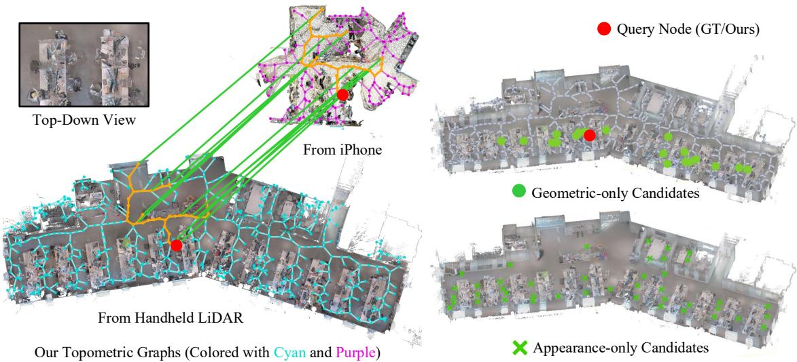

Our Topometric Graphs (Colored with Cyan and Purple) and Found Correspondences and Subgraphs

Figure 1. Real-world office scene with repetitive structure captured weeks apart with heterogeneous sensors. 3D scans with limited overlap are independently collected using a handheld LiDAR scanner and a mobile phone, respectively, and related via the proposed sparse topometric graphs. For a selected query node, geometry-only candidates shown in green and appearance-only candidates from DINOv2 features [19] remain highly ambiguous. Graph-structured matching resolves this ambiguity and identifies the correct correspondence.

## Abstract

A conventional embodied agent in an indoor environment builds a map by accumulating noisy real-world measurements and resultsfrom heavy inference to guide navigation. While the detailed measurements may differ due to scene changes or sensor settings, the unique topological structure of navigable passages or the connectivity between rooms may provide training-free guidance that complements local observations. We propose a sparse topometric graph as an efficient structural representation for robust indoor navigation, alleviating the need for fine-grained matching, which is computationally expensive, memory-intensive, and prone to real-world variations. The map consists ofnodes that encode local 3D geometry and distance-weighted edges that capture traversable connectivity. A learned graph-matching

network finds consistent subgraph structures across sessions by considering both node-level geometric descriptors and neighborhood connectivity. The holistic contextual matching is robust to local ambiguities caused by weak distinctiveness or repetitive structure, and establishes stable correspondences despite local scene changes, different sensor modalities, or limited spatial overlap. We analyze the practicality of the graph through cross-session point-goal navigation, where a goal specified in a prior reference map must be reachedfrom an unknown initial pose in a later session. Experiments show that our method achieves the highest success rates (77.1% on Gibson [34] and 40.0% under 3D-FRONT [9] scene changes), while reducing memory by more than two orders ofmagnitude compared to point-level representations. The proposed approach further supports cross-session alignment and goal-directed navigation with

## 1. Introduction

Embodied agents in daily life need to understand spatial context to interact in unstructured environments. Capturing the spatial map of the deployed environment often requires composing multiple measurements with minimal overlap, as indoor scenes often contain complex concavities, frequent occlusions, and confined navigable spaces due to furniture, rooms, and narrow passages with corners. Reusing the acquired map in a separate session poses additional difficulties. Transferring the high-quality geometry of the entire deployed space may require extensive spatial memory, and reusing the map with a different embodiment may encounter scene changes and different sensor configurations with unknown relative poses.

Prior navigation studies [6, 7, 21, 25] have used different spatial representations for mapping, localization, and planning in 2D top-down maps of large-scale indoor environments. Dense metric maps [6, 7, 12, 21] preserve detailed geometry and support path planning, but their storage and matching costs rapidly increase with environment scale. Keyframe- [4, 5, 23] and appearance-based [2, 14, 15, 25] maps are compact and visually informative, but their reliability can degrade under viewpoint and scene changes. Semantic and hierarchical scene graphs [11, 13, 32, 36] provide higher-level structure through layouts, objects, or language descriptions, but often depend on reliable detections, explicit labels, or predefined semantic categories.

In this paper, we propose a sparse topometric graph that can reliably capture geometric context despite prevalent ambiguities in indoor environments with repetitive structures, moved furniture, and heterogeneous sensor modalities. In the presence of such variations, local features are insufficient to extract reliable geometric context, and a broader spatial arrangement must be considered. Our proposed graph representation summarizes the spatial organization of traversable space. Each node is centered on traversable structure rather than on a sampled point in the cloud, aggregates the observed 3D points within a fixed-radius neighborhood, and stores a compact geometry-only descriptor, while each edge represents free-space connectivity with a distance-based weight. This fixed-radius aggregation makes local geometry reusable at the graph level instead of tying descriptors to raw point samples [20, 28]. Compressing each local point set into a fixed-size node descriptor keeps the map size proportional to the number of graph nodes rather than the raw scene geometry, while preserving enough local and structural information for cross-session map reuse.

We demonstrate the usability of the representation in cross-session point-goal navigation. The agent starts from an unknown initial pose and must reach the goal pose, defined on the reference map built in a previous session. The agent first aligns its current observations relative to the reference map and selects waypoints toward the goal while taking the navigable path topology into account. We train a graph-matching network to predict cross-session correspondences between graph nodes by jointly considering local geometry and connectivity between neighboring nodes. The predicted correspondences are used to estimate the relative transformation between the reference and current sessions, after which the graph-based navigation policy guides the agent toward the transferred goal. This setting lets us study whether a single sparse representation can support both cross-session alignment and downstream navigation.

Fig. 1 illustrates our pipeline with a real-world crosssession example. The example highlights a key challenge. Local geometric descriptors or appearance-based cues can be ambiguous when similar structures repeat across partially overlapping sessions. The proposed representation and graph matching reduce these ambiguities by considering both node-level geometry and neighboring graph connectivity.

The main contributions are summarized as follows:

• We propose a sparse topometric graph for cross-session indoor map reuse. It represents traversable space with compact geometry-only node descriptors and distanceweighted graph connectivity, providing a scalable map representation.

• We introduce a graph-node descriptor that aggregates fixed-radius 3D observations around reusable node centers. This makes local geometry available at the graph level instead of tying descriptors to individual point-cloud samples.

• We introduce a learned graph-matching approach that predicts cross-session node correspondences using both local geometric similarity and graph connectivity, and we use the same graph for cross-session alignment and waypoint selection.

• We evaluate the method on simulated cross-session navigation, large-scale indoor scenes, scene-change settings, and a real-world indoor study, demonstrating efficient and reliable cross-session map use.

## 2. Related Work

## 2.1. Map Representations for Navigation

Metric maps, such as occupancy grids and voxel maps [12, 21], provide fine-grained geometric detail for obstacle avoidance and motion planning. However, their reliance on globally consistent poses makes them vulnerable to accumulated drift and scene changes across sessions, often leading to degraded map quality [27]. Appearance-based methods [15, 31] represent scenes via stored images or learned visual features, enabling viewpoint-aware matching and memory-efficient planning. Visual place recognition (VPR) approaches [14] extend this to cross-session localization by matching compact global descriptors between sessions. They are more robust to spatial drift but remain sensitive to lighting, occlusion, and viewpoint deviation. Object-centric scene graphs [10, 11, 13, 17] offer higherlevel reasoning by representing objects and their relations, supporting semantically meaningful planning. In particular, ObjReact [10] targets cross-session navigation by constructing an object-centric 3D scene graph and reactively planning routes toward recognized goal-relevant objects. However, these approaches rely on consistent object detection and semantic stability across time. To support a fair and diverse evaluation, we adopt representative methods from each of the above categories as baselines for cross-session navigation: a metric-based grid map [6], appearance-based maps [14, 15], and object-centric scene graphs [10, 11].

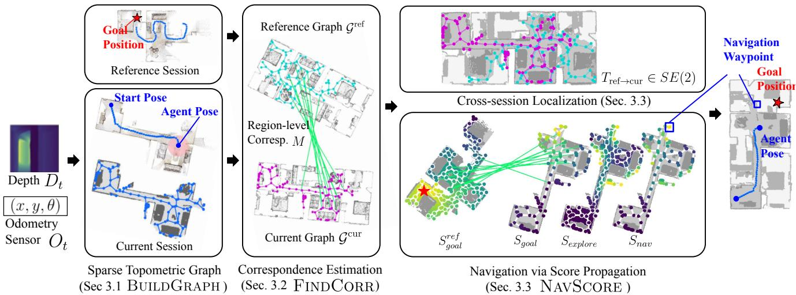  
Figure 2. Overview of the proposed cross-session localization and navigation framework. Given depth $D _ { t }$ and odometry Ot inputs, the agent constructs a topometric graph using medial-axis decomposition and assigns geometric descriptors from local point clouds. Node correspondences M are estimated across reference graph ${ \mathcal { G } } ^ { \mathrm { r e f } }$ and current graph $\mathcal { G } ^ { \mathrm { c u r } }$ via graph matching. The correspondences are reused for both localization and navigation. The navigation policy combines the goal-directed score $S _ { \mathrm { g o a l } }$ with the frontier-based exploration score $S _ { \mathrm { e x p l o r e } }$ to select a node as the next waypoint toward the goal position g of the cross-session navigation task.

Beyond these, point-level geometric descriptors [20, 28] enable fine-grained spatial alignment and have demonstrated strong performance in localization and map registration tasks. Rather than using them densely, we adopt their desirable geometric properties in a compact, node-anchored form, combining their discriminative power with structural abstraction for scalable cross-session navigation.

Our work bridges these extremes by introducing a sparse topometric graph that generates a topological graph over navigable areas, where each graph node is anchored with sparse 3D geometric descriptors. This structure supports both cross-session localization and goal-directed planning in a single pipeline, offering a compact and robust map representation for cross-session navigation.

## 2.2. Graph-based Correspondence

Graph-based representations encode spatial relationships that support structural reasoning for localization and navigation. Factor graphs have long provided the backbone for multi-session SLAM [8], while learned approaches construct topological maps where nodes represent visited locations and edges encode navigability [7, 25]. Recent work studies cross-session localization and graph-based alignment over object- or scene-level abstractions, with nodelevel features drawn from different modalities and semantics [18, 24, 35]. These approaches demonstrate that reasoning about relational structure helps resolve ambiguities that local features alone cannot resolve.

However, object-level graphs rely on stable semantic detection, which degrades under scene changes or sensing heterogeneity. Related work has also explored learned geometric descriptors and registration over point-cloud features [20, 28]. Such methods typically operate at the point or object level rather than over navigable spatial regions.

Our graph provides a sparse topological description of traversable regions that compactly encodes reachability from the agent’s current position. The graph structure also enables holistic cross-session matching of connected regions, which is robust to perturbations in local features and to moderate topological deviations arising from scene changes or measurement discrepancies.

## 3. Method

We introduce a sparse topometric graph representation and a pipeline for cross-session localization and navigation. We consider a cross-session navigation task in which an agent operates in an indoor environment for which a reference map was constructed in a prior session. The reference session is represented as a sparse topometric graph $\mathcal { G } ^ { \mathrm { r e f } }$ . At deployment, the agent is at an unknown pose within the same environment and must navigate to a goal position $\boldsymbol { g } \in \mathbb { R } ^ { 2 }$ specified in the coordinate frame of the reference session. The current session may differ from the reference due to trajectory variation, partial spatial overlap, accumulated odometry drift, and local scene arrangement.

Algorithm 1 Cross-session navigation with a sparse topo  
metric graph   
Require: ${ \mathcal { G } } ^ { \mathrm { r e f } } .$ , goal $^ { g , }$ stream $\{ ( D _ { t } , O _ { t } ) \} _ { t = 1 } ^ { T }$ , matcher $\mathrm { G N N } _ { \theta } .$   
update period $K$   
Ensure: Next-step action $a _ { t }$   
1: function BUILDGRAPH $\{ ( D _ { \tau } , O _ { \tau } ) \} _ { \tau = 1 } ^ { t } )$   
2: Fuse observations into ${ \mathcal { O } } _ { t }$ and $\mathcal { P } _ { t }$   
3: Extract reachable free space from ${ \mathcal { O } } _ { t }$   
4: Sample nodes and connect neighbors   
5: Downsample $\mathcal { P } _ { t }$ and encode radius-based node descriptors   
6: return $\mathcal { G } _ { t } ^ { \mathrm { c u r } } , \mathcal { O } _ { t }$   
7: end function   
8: function $\mathrm { F I N D C O R R } ( \mathcal { G } ^ { \mathrm { r e f } } , \mathcal { G } ^ { \mathrm { c u r } } )$   
9: $P \gets \mathrm { S i n k h o r n } ( \mathrm { G N N } _ { \theta } ( \mathcal { G } ^ { \mathrm { r e f } } , \mathcal { G } ^ { \mathrm { c u r } } ) )$   
10: $\mathcal { M } $ argmax matches after removing unmatched assign   
ments from $P$   
11: return $\mathcal { M } _ { \mathrm { i n } }  \mathrm { R A N S A C } ( \mathcal { M } )$   
12: end function   
13: function $\mathbf { N A V S C O R E } ( \mathcal { M } _ { \mathrm { i n } } , \mathcal { G } ^ { \mathrm { c u r } } , g )$   
14: i $\cdot M _ { \mathrm { i n } } \neq \emptyset$ then   
15: Estimate relative transform and transfer goal scores   
16: Compute frontier score $\bar { S } _ { \mathrm { e x p l o r e } }$   
17: return $\bar { S } _ { \mathrm { g o a l } } + \bar { S } _ { \mathrm { e x p l o r e } }$   
18: else   
19: Compute frontier score $\bar { S } _ { \mathrm { e x p l o r e } }$   
20: return $\bar { S } _ { \mathrm { e x p l o r e } }$   
21: end if   
22: end function   
23: procedure NAVIGATE   
24: Initialize $\mathcal { M } _ { \mathrm { i n } }  \emptyset$ and $v ^ { \ast }  \emptyset$   
25: Initialize running map ${ \mathcal { O } } _ { t }$   
26: for $t = 1$ to T do   
27: Update ${ \mathcal { O } } _ { t }$ with $( D _ { t } , O _ { t } )$   
28: if t mod $K = 0$ then   
29: $\mathcal { G } ^ { \mathrm { c u r } } , \mathcal { O } _ { t } \gets \mathbf { B } \mathrm { U I L D G R A P H } ( \{ ( D _ { \tau } , O _ { \tau } ) \} _ { \tau = 1 } ^ { t } )$   
30: $\mathcal { M } _ { \mathrm { i n } }  \mathrm { F I N D C O R R } ( \mathcal { G } ^ { \mathrm { r e f } } , \mathcal { G } ^ { \mathrm { c u r } } )$   
31: $S _ { \mathrm { n a v } } \gets \mathrm { N A V S C O R E } ( \mathcal { M } _ { \mathrm { i n } } , \mathcal { G } ^ { \mathrm { c u r } } , g )$   
32: v∗ ← arg maxv Snav(v)   
33: end if   
34: $a _ { t } \gets$ PathPlanner $( \mathbf { p } _ { v ^ { * } } , \mathcal { O } _ { t } )$   
35: end for   
36: end procedure

An overview of the proposed approach is shown in $\mathrm { F i g . ~ } 2 ,$ , and $\mathrm { A l g }$ . 1 summarizes the deployment loop. $\mathbf { A t }$ each time step t, the agent receives a depth observation $D _ { t }$ and an odometry measurement $O _ { t } = ( x _ { t } , y _ { t } , \theta _ { t } )$ in its local frame. Using the stream $\{ ( D _ { \tau } , O _ { \tau } ) \} _ { \tau = 1 } ^ { t }$ , the agent incrementally constructs a top-down occupancy map ${ \mathcal { O } } _ { t }$ and a depth-derived accumulated point cloud $\mathcal { P } _ { t }$ . Every $K { = } 2 0$ steps, these geometric observations are converted into a current-session graph $\mathcal { G } _ { t } ^ { \mathrm { c u r } }$ . (BUILDGRAPH, Sec. 3.1). To enable cross-session localization, the agent performs topometric graph matching between $\mathcal { G } _ { t } ^ { \mathrm { c u r } }$ and $\mathcal { G } ^ { \mathrm { r e f } }$ , producing candidate node correspondences $\mathcal { M }$ (FINDCORR, Sec. 3.2). These correspondences are then used for relative pose estimation and navigation toward the reference-session goal, without relying on dense map alignment or continuous pose tracking across sessions (NAVSCORE, Sec. 3.3).

## 3.1. Sparse Topometric Graph

The BUILDGRAPH stage in Alg. 1 (lines 2–6) constructs the shared representation used by the rest of the pipeline. We represent each session as a topometric graph $\mathcal { G } = ( \nu , \mathcal { E } )$ Here, topometric denotes the joint encoding of topological connectivity among navigable anchors and metric and $g e \mathrm { - }$ ometric information. Each node $v _ { i } ~ \in ~ \mathcal { V }$ corresponds to a navigable anchor extracted from traversable free space and is associated during graph construction with a 2D position $\mathbf { p } _ { i } \in \mathbb { R } ^ { 2 }$ and a sparse 3D geometric descriptor $f _ { i } \in \mathbb { R } ^ { 3 2 }$ Edges $\mathcal { E }$ encode traversable connectivity between adjacent nodes, where each edge weight stores the local distance $d _ { i j } = \lVert { \bf p } _ { i } - { \bf p } _ { j } \rVert _ { 2 }$ between neighboring anchors.

The graph is derived from two complementary geometric representations. A top-down occupancy map is used to identify reachable traversable free space and extract graph nodes, while a depth-derived accumulated point cloud is used to compute geometric descriptors within each node. We first extract the portion of free space that is reachable from the agent’s current position so that the graph remains focused on reusable navigable structure rather than on every nominally free cell in the dense map. Navigable anchors are defined by the structure of the reachable free-space occupancy map, with graph nodes placed at uniform intervals of d=5 cells (0.25 m) along each branch. The nodes anchor local traversable areas from which features are extracted.

The key geometric design choice is how node descriptors are defined. Unlike the original per-point formulation, descriptors are anchored at navigable graph nodes rather than at existing points in the cloud. For each node $v _ { i } .$ we collect points $\left\{ q \in \mathcal { P } : \left\| q - \mathbf { p } _ { i } \right\| < r \right\}$ within a fixed radius around its construction anchor and compute a local geometric embedding. We adopt a pre-trained rotation-equivariant pointcloud encoder from BUFFER-X [28] with frozen weights, providing robustness to partial observations and sensor heterogeneity. As a result, the representation remains compact while each node still carries both local 3D context and graph-level connectivity for cross-session correspondence and downstream navigation. Implementation details such as voxel downsampling are deferred to the supplementary material.

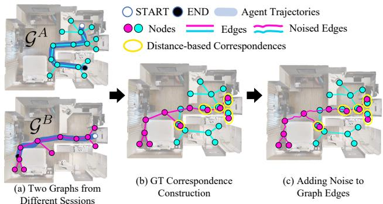  
Figure 3. Training pair construction for graph matching. (a) Topometric graphs are extracted from two sessions with partially overlapping coverage of the same scene. (b) Ground-truth node correspondences are established by pairwise Euclidean distances between node centers across sessions. (c) Gaussian noise is injected into the edge weight to simulate odometry drift and construct training graph pairs.

## 3.2. Correspondence Estimation

The FINDCORR stage in Alg. 1 (lines 9–11) estimates crosssession correspondences. Given topometric graphs constructed from different navigation sessions, our goal is to identify correspondences between nodes representing the same physical locations in the environment. This problem requires reasoning over a noisy topometric graph, in which both the local geometry encoded in nodes and the graph structure are perturbed by measurement noise, odometry drift, and scene variation. We treat the topometric graph as a shared representation, from which node correspondences are inferred as a signal used jointly for localization and navigation. These correspondences are reused for both pose estimation and goal-directed navigation.

Rather than relying on dense frame- or point-level matching, which can be disrupted by unobserved areas or local scene variations, our approach operates on sparse graphs. Each node aggregates local 3D geometry over a traversable anchor using rotation-robust and view-invariant descriptors (Sec. 3.1), yielding a compact representation that naturally tolerates missing coverage under partial overlap and sensing heterogeneity. In addition, the graph structure encodes spatial relationships among nodes, providing global context that helps disambiguate correspondences beyond local geometry.

Matching Objective. Our objective is to predict a soft partial assignment between nodes in the reference and current graphs by jointly reasoning over node-level geometric features and graph connectivity. We employ IPCA-GM [33] with Sinkhorn-normalized assignment to estimate correspondence probabilities while allowing unmatched nodes under partial overlap. Because the prediction is constrained by both local geometry and graph structure, the resulting correspondences are more robust to local ambiguity, repeated structure, and incomplete coverage than geometryonly matching.

Training Pair Construction. As illustrated in Fig. 3, training pairs are constructed from two partial traversals collected in the same scene with different spatial coverage. We build graphs $\mathcal { G } ^ { A }$ and $\mathcal { G } ^ { B }$ from these sessions and define correspondence supervision by spatial proximity between their construction anchors across sessions. During training, we perturb traversable edge distances to improve robustness to odometry drift. Exact objective and implementation details are deferred to the supplementary material.

## 3.3. Localization and Waypoint Selection

The NAVSCORE stage in Alg. 1 (lines 14–21) reuses the predicted correspondences for both localization and waypoint selection. Using the RANSAC-filtered node matches $\mathcal { M } _ { \mathrm { i n } }$ , each matched node pair provides a position correspondence $( \mathbf { p } _ { i } ^ { \mathrm { r e f } } , \mathbf { p } _ { j } ^ { \mathrm { c u r } } )$ . We estimate the relative transformation $T _ { \mathrm { r e f \to c u r } } \in \ S { \breve { E } } ( 2 )$ from these inlier correspondences. During deployment, odometry drift accumulates over time as the agent explores. To reduce its impact on localization, we construct the current-session graph from a spatially local subset of recently observed traversable structure rather than from the full accumulated map.

Our navigation policy directly reuses the topometric graph and cross-session correspondences introduced earlier, without additional representations or task-specific supervision. Given the correspondence, we perform cross-session navigation by selecting nodes in the current graph as waypoints. The policy balances exploitation of available goal information and exploration of unmapped areas using two complementary signals, a goal-directed score $S _ { \mathrm { g o a l } }$ derived from cross-session correspondences and a frontier-based exploration score $S _ { \mathrm { e x p l o r e } }$ that promotes explored area expansion. A goal $\boldsymbol { g } \in \mathbb { R } ^ { 2 }$ specified in the reference-session frame is converted into scores on the reference graph, and those scores are propagated to the current-session graph through the predicted correspondence. The exploration term is computed on the current occupancy map and evaluated at current-session graph nodes for waypoint selection. Since the correspondence matches the holistic spatial context rather than individual nodes, reliable cross-session evidence becomes available only after sufficient exploration. We therefore transition from using the exploration score only to the combined goal-directed and exploration score once cross-session evidence becomes reliable, as illustrated in Fig. 2. The selected waypoint is then executed on the occupancy map using a Fast Marching Method planner [29].

Table 1. Evaluation protocol across datasets.
<table><tr><td>Dataset</td><td></td><td>Max Steps Goal Thr. (m) Avg. Area (m²)</td><td></td></tr><tr><td>3D-FRONT</td><td>500</td><td>1.0</td><td>80.6</td></tr><tr><td>Gibson</td><td>500</td><td>2.0</td><td>83.4</td></tr><tr><td>HM3D</td><td>1000</td><td>2.0</td><td>212.8</td></tr></table>

## 4. Experiments

We evaluate our approach on cross-session point-goal navigation experiments. We assess navigation under odometry noise, varying scene scales, limited inter-session overlap, and scene change.

## 4.1. Experimental Setup

We evaluate on three datasets: Gibson [34] for the main evaluation under noiseless and noisy odometry, HM3D [22] for large-scale evaluation, and 3D-FRONT [9] for scenechange evaluation.

Experiments are conducted in Habitat [26] using the Lo-CoBot action space [16]. The agent takes discrete actions of moving forward by 0.25 m or turning left or right by 10◦. The success threshold is 2.0 m for Gibson and HM3D. For 3D-FRONT, we use a 1.0 m threshold because the primary question is whether the representation remains locally reusable under scene change, rather than long-range planning. Table 1 summarizes the step budgets and scene scales used in each dataset. The graph matching network is trained on Gibson training scenes and is applied without retraining across all datasets. Unless otherwise noted, all methods are executed under the same simulator and action setting. Additional implementation details are deferred to the supplementary material.

In every episode, the goal is specified on the referencesession map, while the agent acts only in the current session. The reference and current sessions are collected at different times and from different start positions. The agent therefore cannot rely on frame-to-frame continuation across sessions and must recover a usable cross-session relation from partial overlap. This shared protocol lets us compare how well each representation supports map reuse rather than singlesession exploration.

## 4.2. Baselines

We compare against representative baselines spanning several reusable map abstractions. ANS [6] represents the environment with a dense occupancy-grid map. RnR-Map [15] uses a top-down visual feature map. AnyLoc [14] provides an appearance-based retrieval baseline using compact global descriptors. ConceptGraph [11] and ObjectReact [10] represent the environment with scene-graph or object-graph abstractions. We also compare against

Table 2. Cross-session point-goal navigation results on Gibson [34] under noiseless and noisy odometry.
<table><tr><td rowspan="2">Method</td><td colspan="2">Noiseless</td><td colspan="2">Noisy (σ = 1.0)</td></tr><tr><td>SR</td><td>SPL</td><td>SR</td><td>SPL</td></tr><tr><td>ANS [6]</td><td>40.00</td><td>33.40</td><td>40.00</td><td>33.13</td></tr><tr><td>RnR [15]</td><td>30.00</td><td>23.67</td><td>41.41</td><td>32.38</td></tr><tr><td>AnyLoc [14]</td><td>40.00</td><td>10.91</td><td>30.00</td><td>5.69</td></tr><tr><td>ObjReact [10]</td><td>54.28</td><td>40.81</td><td>54.28</td><td>40.81</td></tr><tr><td>ConceptGraph [11]</td><td>41.43</td><td>22.93</td><td>32.86</td><td>16.40</td></tr><tr><td>Ours</td><td>77.14</td><td>47.71</td><td>60.00</td><td>23.64</td></tr></table>

BUFFER-X [28] in the compactness analysis as a dense point-level geometric reference.

We prioritize baselines that expose an explicit referencesession representation and can be integrated into a goalconditioned navigation loop in the current session. This lets us compare dense occupancy maps, top-down feature maps, appearance-based retrieval, and semantic graph abstractions under the same cross-session point-goal protocol. Several baselines were not originally proposed for this exact setting, so we adapt them while preserving their original representation and decision logic as much as possible. Full adaptation details are deferred to the supplementary material.

## 4.3. Navigation Performance

Main evaluation on Gibson. Table 2 reports cross-session point-goal navigation under noiseless and noisy odometry. We use Success Rate (SR) and Success weighted by Path Length (SPL) [1]. For ObjectReact, we report the result obtained with its original policy-coupled evaluation setting. That method uses an RGB-frame-based controller [30] rather than the same discrete 0.25 m forward action used by the other methods here, so its SPL is informative but not strictly action-level comparable. Our method achieves the highest SR under both odometry conditions, and it also achieves the best SPL under noiseless odometry. Under noisy odometry, SR remains strong while SPL decreases more noticeably, suggesting that the representation still supports reliable cross-session recovery while path efficiency is more affected by delayed correspondence under drift.

Large-scale evaluation on HM3D. Fig. 4 evaluates navigation as the difficulty of cross-session reuse increases. For each episode, we first sample a reference-session start position and then choose the current-session start position to be a prescribed geodesic distance away. We use this startposition separation as a controlled difficulty proxy. Larger separation generally makes useful overlap harder to recover early in the episode and therefore makes cross-session correspondence more difficult. The figure reports accumulated successful episodes as this difficulty increases. Our method degrades more gradually than the baselines and maintains the strongest performance in the harder regimes.

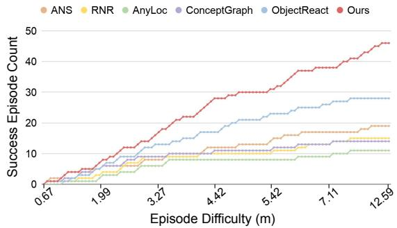  
Figure 4. Navigation performance in large-scale HM3D environments [22]. Cumulative number of successful episodes out of 100 as the geodesic separation between the reference- and currentsession start positions increases.

Table 3. Cross-session point-goal navigation results under scene changes on 3D-FRONT [9].
<table><tr><td colspan="5">ANS RnR R AnyLoc ObjReact ConceptGraph Ours</td></tr><tr><td>SR 13.33 313.33</td><td>20.00</td><td>6.67</td><td>13.33</td><td>40.00</td></tr><tr><td>SPL 8.36 8.83</td><td>6.91</td><td>6.67</td><td>4.92</td><td>20.18</td></tr></table>

Table 4. Memory comparison across methods on Gibson [34].
<table><tr><td>Method</td><td>Scene Representation</td><td>Storage (MB)</td></tr><tr><td>ANS [6]</td><td>Grid Map</td><td>1.76</td></tr><tr><td>RnR-Map [15]</td><td>Feature Map</td><td>2.00</td></tr><tr><td>AnyLoc [14]</td><td>Place Descriptor Map</td><td>13.25</td></tr><tr><td>ObjReact [10]</td><td>Object Graph</td><td>0.80</td></tr><tr><td>ConceptGraph [11] Scene Graph with Language Features</td><td></td><td>5.00</td></tr><tr><td>BUFFER-X [28]</td><td>Point Cloud</td><td>2.81</td></tr><tr><td>Ours</td><td>Sparse Topometric Graph</td><td>0.02</td></tr></table>

Evaluation under scene change. Table 3 reports results on 3D-FRONT with furniture additions, removals, rearrangements, and same-category replacements across sessions. We use a 1.0 m success threshold in this setting because the goal is to test whether the representation remains locally reusable when object layout changes. Our method achieves the highest SR and SPL in this setting. This result suggests that the representation remains useful even when object arrangements differ across sessions. Fig. 5 shows a qualitative example. The same figure also includes an additional qualitative example from 2D-3D-S [3] to illustrate behavior in a distinct large indoor environment with repetitive structure.

## 4.4. Compactness

Compactness. Table 4 compares the stored referencesession representation reused by each method in the current session. Storage is measured on the representation retained after the reference-session traversal under the same episode data budget, rather than on transient intermediate states during construction. For example, BUFFER-X stores the reference session as the voxel-downsampled point cloud used as input to matching. The proposed representation is substantially smaller than dense occupancy grids, dense feature maps, and point-level geometry. This follows from storing geometry only at sparse graph-node anchors and traversable connectivity, rather than across the full scene. Detailed measurement protocol is provided in the supplementary material.

## 4.5. Real-World Data Demonstration

We further evaluate the representation on real-world crosssession data captured several weeks apart with heterogeneous sensors. One session uses a handheld LiDAR scanner and the other uses a mobile phone with built-in LiDAR. The two sessions are collected independently at different times of day. The LiDAR session was recorded in daytime, and the mobile-phone session was recorded at night. They cover only partially overlapping portions of the environment. The scene is an office building with repeated monitors, tables, and cubicles of similar design, which creates strong local ambiguity in both geometry and appearance across nearby locations. We use this example as a focused correspondence study rather than a closed-loop robot experiment. Acquisition and reconstruction details are deferred to the supplementary material.

Fig. 1 illustrates the main conceptual value of the representation. The left side shows how the two sessions are related at the graph level through node correspondences. On the right, we select one query node and compare graph-structured matching against two weaker cues in isolation. The first is geometry-only matching based on nodedescriptor similarity. The second is appearance-only matching based on DINOv2 features [19]. In this repeated office layout, both isolated cues yield multiple plausible candidates, while the graph-structured representation resolves the ambiguity and identifies the correct correspondence. We use this example as supporting evidence for the representation claim of the paper.

## 5. Limitations and Scope

This paper studies cross-session map reuse for single-floor indoor navigation under a 2D top-down point-goal formulation. Multi-floor environments and explicit vertical connectivity are outside the current evaluation scope, and extending the representation to such settings is a natural direction for future work. Within that scope, we focus on cross-session reuse under partial overlap, sensing variation, and moderate scene change. More severe changes to traversable connectivity, such as closed doors, blocked corridors, or large structural reconfiguration, were not systematically evaluated here and remain an important area for fu-

Reference Session Current Session Goal Scene Change  
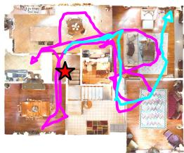

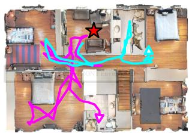  
(a) Cross-session Navigation in a HM3D Environment

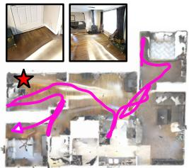

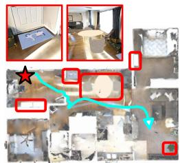

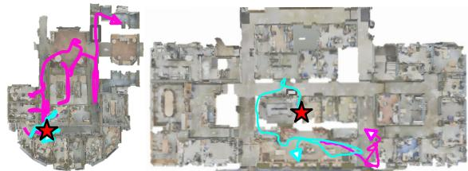  
(b) Cross-session Navigation in a 2D-3D-S Environment

(c) Scene Change in a Gibson Environment  
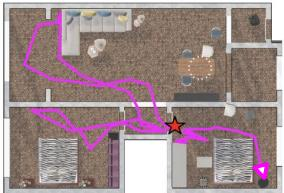

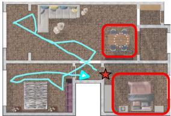  
(d) Scene Change in a 3D-FRONT Environment

Figure 5. Qualitative cross-session navigation results. (a–b) Navigation examples in HM3D and 2D-3D-S environments, respectively. (c–d) Examples under scene changes in Gibson and 3D-FRONT, where modified regions are highlighted by red boxes. Across these settings, the proposed topometric graph supports cross-session localization and goal-directed navigation despite partial overlap and local environmental changes.

ture study. Finally, the real-world evaluation in this paper is a demonstration on independently captured data rather than a full onboard deployment with live control, sensing, and recovery behaviors. This is still useful for validating the representation, but it also sets a clear boundary on what the current experiments prove.

## 6. Conclusion

We present a sparse topometric graph representation that serves as an effective abstraction for cross-session indoor localization and goal-directed navigation. Experiments show reliable performance under odometry noise, limited overlap, large-scale scenes, and environmental changes, underscoring the practicality of the representation for cross-session map reuse.

## References

[1] Peter Anderson, Angel Chang, Devendra Singh Chaplot, Alexey Dosovitskiy, Saurabh Gupta, Vladlen Koltun, Jana Kosecka, Jitendra Malik, Roozbeh Mottaghi, Manolis Savva, et al. On evaluation of embodied navigation agents. arXiv preprint arXiv:1807.06757, 2018. 6

[2] Relja Arandjelovic, Petr Gronat, Akihiko Torii, Tomas Pajdla, and Josef Sivic. Netvlad: Cnn architecture for weakly supervised place recognition. In CVPR, 2016. 2

[3] Iro Armeni, Sasha Sax, Amir R Zamir, and Silvio Savarese. Joint 2d-3d-semantic data for indoor scene understanding. arXiv preprint arXiv:1702.01105, 2017. 7

[4] Cesar Cadena, Luca Carlone, Henry Carrillo, Yasir Latif, Davide Scaramuzza, Jose Neira, Ian Reid, and John J´

Leonard. Past, present, and future of simultaneous localiza tion and mapping: Toward the robust-perception age. IEEE Transactions on robotics, 32(6):1309–1332, 2016. 2

Navigation Result in[5] Carlos Campos, Richard Elvira, Juan J Gomez Rodr´ ´ıguez, Jose MM Montiel, and Juan D Tard´ os. Orb-slam3: An´ accurate open-source library for visual, visual–inertial, and multimap slam. IEEE transactions on robotics, 37(6):1874– 1890, 2021. 2

[6] Devendra Singh Chaplot, Dhiraj Gandhi, Saurabh Gupta, Abhinav Gupta, and Ruslan Salakhutdinov. Learning to explore using active neural slam. arXiv preprint arXiv:2004.05155, 2020. 2, 3, 6, 7

[7] Devendra Singh Chaplot, Ruslan Salakhutdinov, Abhinav Gupta, and Saurabh Gupta. Neural topological slam for visual navigation. In Proceedings ofthe IEEE/CVF Conference on Computer Vision and Pattern Recognition, pages 12875– 12884, 2020. 2, 3

[8] Frank Dellaert, Michael Kaess, and Timothy Barfoot. Factor graphs for SLAM. In SLAM Handbook. From Localization and Mapping to Spatial Intelligence. Cambridge University Press, 2026. 3

[9] Huan Fu, Bowen Cai, Lin Gao, Ling-Xiao Zhang, Jiaming Wang, Cao Li, Qixun Zeng, Chengyue Sun, Rongfei Jia, Binqiang Zhao, et al. 3d-front: 3d furnished rooms with layouts and semantics. In Proceedings of the IEEE/CVF Interna tional Conference on Computer Vision, pages 10933–10942, 2021. 1, 6, 7

[10] Sourav Garg, Dustin Craggs, Vineeth Bhat, Lachlan Mares, Stefan Podgorski, Madhava Krishna, Feras Dayoub, and Ian Reid. Objectreact: Learning object-relative control for visual navigation. arXiv preprint arXiv:2509.09594, 2025. 3, 6, 7

[11] Qiao Gu, Ali Kuwajerwala, Sacha Morin, Krishna Murthy Jatavallabhula, Bipasha Sen, Aditya Agarwal, Corban

Rivera, William Paul, Kirsty Ellis, Rama Chellappa, et al. Conceptgraphs: Open-vocabulary 3d scene graphs for perception and planning. In 2024 IEEE International Conference on Robotics and Automation (ICRA), pages 5021–5028. IEEE, 2024. 2, 3, 6, 7

[12] Armin Hornung, Kai M Wurm, Maren Bennewitz, Cyrill Stachniss, and Wolfram Burgard. Octomap: An efficient probabilistic 3d mapping framework based on octrees. Autonomous robots, 34(3):189–206, 2013. 2

[13] Nathan Hughes, Yun Chang, and Luca Carlone. Hydra: A real-time spatial perception system for 3d scene graph construction and optimization. arXiv preprint arXiv:2201.13360, 2022. 2, 3

[14] Nikhil Keetha, Avneesh Mishra, Jay Karhade, Krishna Murthy Jatavallabhula, Sebastian Scherer, Madhava Krishna, and Sourav Garg. Anyloc: Towards universal visual place recognition. IEEE Robotics and Automation Letters, 9 (2):1286–1293, 2023. 2, 3, 6, 7

[15] Obin Kwon, Jeongho Park, and Songhwai Oh. Renderable neural radiance map for visual navigation. In Proceedings of the IEEE/CVF Conference on Computer Vision and Pattern Recognition, pages 9099–9108, 2023. 2, 3, 6, 7

[16] LoCoBot Project. LoCoBot: An Open Source Low Cost Robot, 2021. http://www.locobot.org/. 6

[17] Dominic Maggio, Yun Chang, Nathan Hughes, Matthew Trang, Dan Griffith, Carlyn Dougherty, Eric Cristofalo, Lukas Schmid, and Luca Carlone. Clio: Real-time taskdriven open-set 3d scene graphs. IEEE Robotics and Automation Letters, 2024. 3

[18] Yang Miao, Francis Engelmann, Olga Vysotska, Federico Tombari, Marc Pollefeys, and Daniel B´ ela Bar´ ath. Scene-´ graphloc: Cross-modal coarse visual localization on 3d scene graphs. In European Conference on Computer Vision, pages 127–150. Springer, 2024. 3

[19] Maxime Oquab, Timothee Darcet, Th´ eo Moutakanni, Huy´ Vo, Marc Szafraniec, Vasil Khalidov, Pierre Fernandez, Daniel Haziza, Francisco Massa, Alaaeldin El-Nouby, et al. Dinov2: Learning robust visual features without supervision. arXiv preprint arXiv:2304.07193, 2023. 1, 7

[20] Zheng Qin, Hao Yu, Changjian Wang, Yulan Guo, Yuxing Peng, and Kai Xu. Geometric transformer for fast and robust point cloud registration. In CVPR, 2022. 2, 3

[21] Santhosh K Ramakrishnan, Ziad Al-Halah, and Kristen Grauman. Occupancy anticipation for efficient exploration and navigation. In Computer Vision–ECCV 2020: 16th European Conference, Glasgow, UK, August 23–28, 2020, Proceedings, Part V 16, pages 400–418. Springer, 2020. 2

[22] Santhosh K Ramakrishnan, Aaron Gokaslan, Erik Wijmans, Oleksandr Maksymets, Alex Clegg, John Turner, Eric Undersander, Wojciech Galuba, Andrew Westbury, Angel X Chang, et al. Habitat-matterport 3d dataset (hm3d): 1000 large-scale 3d environments for embodied ai. arXiv preprint arXiv:2109.08238, 2021. 6, 7

[23] Antoni Rosinol, Marcus Abate, Yun Chang, and Luca Carlone. Kimera: an open-source library for real-time metricsemantic localization and mapping. In 2020 IEEE International Conference on Robotics and Automation (ICRA), pages 1689–1696. IEEE, 2020. 2

[24] Sayan Deb Sarkar, Ondrej Miksik, Marc Pollefeys, Daniel Barath, and Iro Armeni. Sgaligner: 3d scene alignment with scene graphs. In Proceedings ofthe IEEE/CVF International Conference on Computer Vision, pages 21927–21937, 2023. 3

[25] Nikolay Savinov, Alexey Dosovitskiy, and Vladlen Koltun. Semi-parametric topological memory for navigation. arXiv preprint arXiv:1803.00653, 2018. 2, 3

[26] Manolis Savva, Abhishek Kadian, Oleksandr Maksymets, Yili Zhao, Erik Wijmans, Bhavana Jain, Julian Straub, Jia Liu, Vladlen Koltun, Jitendra Malik, Devi Parikh, and Dhruv Batra. Habitat: A Platform for Embodied AI Research. In Proceedings of the IEEE/CVF International Conference on Computer Vision (ICCV), 2019. 6

[27] Lukas Schmid, Marcus Abate, Yun Chang, and Luca Car lone. Khronos: A unified approach for spatio-temporal metric-semantic slam in dynamic environments. arXiv preprint arXiv:2402.13817, 2024. 2

[28] Minkyun Seo, Hyungtae Lim, Kanghee Lee, Luca Carlone, and Jaesik Park. Buffer-x: Towards zero-shot point cloud registration in diverse scenes. In Proceedings of the IEEE/CVF International Conference on Computer Vision (ICCV), pages 3851–3862, 2025. 2, 3, 4, 6, 7

[29] James A Sethian. A fast marching level set method for monotonically advancing fronts. proceedings ofthe National Academy ofSciences, 93(4):1591–1595, 1996. 5

[30] Dhruv Shah, Ajay Sridhar, Arjun Bhorkar, Noriaki Hirose, and Sergey Levine. GNM: A General Navigation Model to Drive Any Robot. In International Conference on Robotics and Automation (ICRA), 2023. 6

[31] Dhruv Shah, Ajay Sridhar, Nitish Dashora, Kyle Stachowicz, Kevin Black, Noriaki Hirose, and Sergey Levine. Vint: A foundation model for visual navigation. arXiv preprint arXiv:2306.14846, 2023. 2

[32] Johanna Wald, Helisa Dhamo, Nassir Navab, and Federico Tombari. Learning 3d semantic scene graphs from 3d indoor reconstructions. In Proceedings of the IEEE/CVF Conference on Computer Vision and Pattern Recognition, pages 3961–3970, 2020. 2

[33] Runzhong Wang, Junchi Yan, and Xiaokang Yang. Combinatorial learning of robust deep graph matching: an embedding based approach. IEEE Transactions on Pattern Analysis and Machine Intelligence, 2020. 5

[34] Fei Xia, Amir R. Zamir, Zhi-Yang He, Alexander Sax, Jitendra Malik, and Silvio Savarese. Gibson Env: real-world perception for embodied agents. In Computer Vision and Pattern Recognition (CVPR), 2018 IEEE Conference on. IEEE, 2018. 1, 6, 7

[35] Yaxu Xie, Alain Pagani, and Didier Stricker. Sg-pgm: Partial graph matching network with semantic geometric fusion for 3d scene graph alignment and its downstream tasks. In Proceedings of the IEEE/CVF Conference on Computer Vision and Pattern Recognition, pages 28401–28411, 2024. 3

[36] Hang Yin, Xiuwei Xu, Zhenyu Wu, Jie Zhou, and Jiwen Lu. Sg-nav: Online 3d scene graph prompting for llm-based zero-shot object navigation. Advances in neural information processing systems, 37:5285–5307, 2024. 2