# Ask About the Right Moment: Training-Free Object Identity Reasoning for Video-Language Models

Di Yang1,† Xiaochang Li1 Muyang Liu1 Yufei Wang2,∗ Yanhai Xiong1,∗

1College of William & Mary 2SparcAI Inc.

dyang06@wm.edu xli59@wm.edu mliu22@wm.edu yxiong05@wm.edu yufei.wang@sparclab.ai

Question Where is the hidden object at the end of the game, from the person’s point of view?

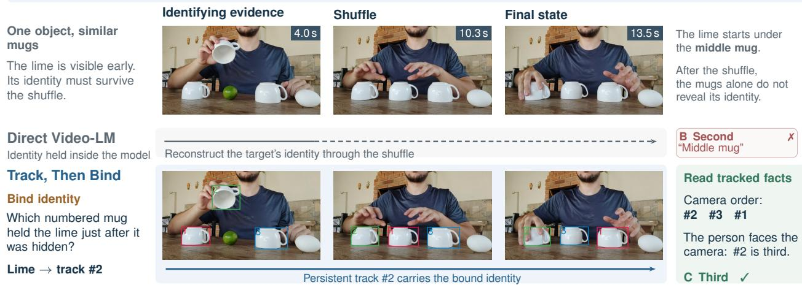  
Figure 1. Bind identity, then follow the track (Perception Test video\_6159, test set, Qwen3-VL-8B). A lime is visible under the middle mug before three identical mugs are shuffled. The direct Video-LM answers that it stayed in the middle. Our agent asks which mug held the lime just after it was hidden, binds the answer to track #2, and reads its final position from that track. Fig. 2 shows the full method.

## Abstract

Many questions about a video concern one physical object. Where does the ball end up after the cups are shuffled? Which card is the queen? How often was the mug covered? Video-language models (Video-LMs) recognise such objects in single frames but do not keep them apart over time. On real shell-game videos, open models from 8B to 235B parameters, their thinking variants, a reinforcement-learned tool agent and three training-free tool agents all stay within ten points ofchance. We separate semantic identity binding from temporal identity maintenance. An object’s identity should befixed at a moment when the evidencefor it is visible, and carried afterwards by a tracker. Track, Then Bind implements this principle without training. A promptable video tracker follows every candidate object and draws it

with a track number. A frozen vision-language model answers a static question about the identifying evidence, which binds the target to a track. The answer is then derived from the tracked state in text, without asking the model to reinterpret the original video during read-out. A single configuration covers all benchmarks. With Qwen3-VL-32B it solves both VET-Bench tasks, where a fine-tuned trajectory model reaches 92% and 90% and the same VLM voting over 16 samples stays at 30–32%. It answers 55.4% of the hardest Perception Test cup games, where the best published model answers 41.5%, and, using track-derived timelines, 48.6% of TOC-Bench questions, against 37.1% for the same model answering directly. Drawing the same tracks on the video and asking the question directlyfalls 12–19 points short of the agent on real cup games.

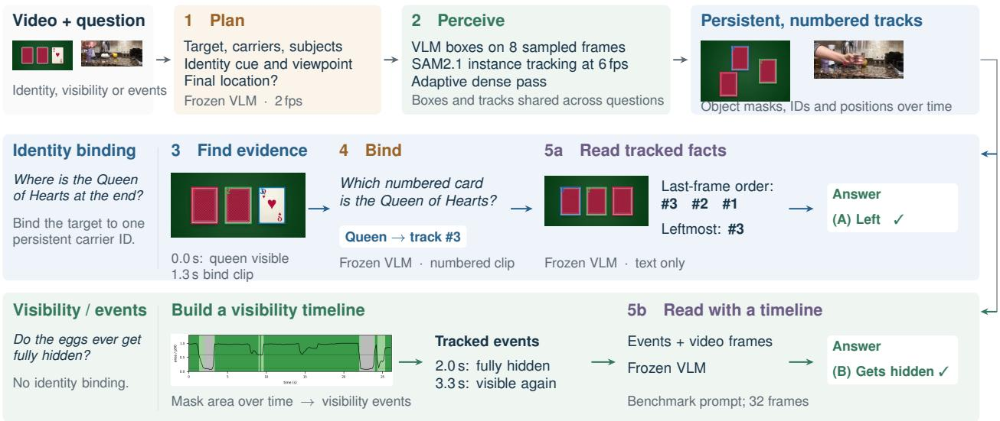  
All models frozen · One configuration across benchmarks · Examples from logged Qwen3-VL-8B test runs

Figure 2. Method. A frozen VLM plans the question (1) and boxes its entities, which SAM2.1 tracks as numbered instances (2). If a target must be told apart from look-alikes or containers, the VLM answers one static question about the evidence moment on the numbered cli (3–4), and the answer is read out from the tracked state in text (5a; VET card monte card\_003). Otherwise the tracks become a timeline that is appended to the benchmark prompt (5b; TOC-Bench 8b0c33d38075). Both examples are logged test runs with Qwen3-VL-8B.

## 1. Introduction

Many questions about a video are questions about one physical object. Which cup hides the ball after the shuffle? Which card is the queen once all three are face down? Is the cap that reappears the one that left? Such questions arise wherever objects are moved, stacked or put away. Examples are assistants that remember where an item was left, robots whose own arm hides the object they manipulate, and laboratory procedures with rows of identical tubes. Answering them requires following one object through occlusion, containment and look-alike copies.

Video-LMs fail at this. On VET-Bench [1], the strongest closed models stay at chance on the shell game, and only a model fine-tuned on synthetic trajectories (SGCoT) escapes it. On real cup-game videos from the Perception Test [2], the same fine-tuned model returns to chance (Table 1). Scale and deliberation do not help: Qwen3-VL at 8B, 32B and 235B answers 27.7–33.8% of the 65 shuffled three-cup videos, and a reinforcement-learned tool agent answers 33.8%. Three training-free tool agents with Qwen3- VL-32B answer 30.8–38.5%. They are SpatialClaw [15] (code around SAM3 [44]), VideoAgent [7] (a tracking-based object memory) and VideoINSTA [8] (captioned event clips). On TOC-Bench [3], the 32B thinking variant performs nearly the same as the direct 32B model (36.9% versus 37.1%).

A central difficulty is that the model must re-derive which object is which from a sparse sample of frames. Identical objects that cross or disappear leave almost no visual trace from which to do so. A promptable video tracker such as

SAM2 [4] has the opposite strengths. It follows each object mask through motion and brief occlusion, but it does not know which object a question refers to. We study two design choices in combining them. When should the system ask the VLM about an object’s identity? A hidden ball can only be recognised before it is hidden, a card only while it is face up. And once the identity is fixed, what should decide the answer: the VLM’s reading of the video, or the tracked state?

We answer them with two design rules and test each in isolation. First, the VLM is asked about an object’s identity only through a static question about the moment at which the identity can be seen. A tracker then carries the identity, and the VLM is not asked again. Second, once the target is bound, the answer is read from the tracked state as text, without showing the video again. Track, Then Bind (Fig. 1) implements both rules without training. Every candidate carries a track number on the clip that the VLM sees, so its answer binds the target to one track. A plan made by the VLM decides which objects to follow and how the target can be recognised. As an extension to visibility and event questions that need no identity binding, the same framework supplies a timeline built from the tracks. One program and one set of thresholds serve all benchmarks.

Our contributions are:

• A diagnosis across model families. On shuffled real cup games, closed and open Video-LMs, thinking variants, a trajectory-fine-tuned model, a reinforcement-learned tool agent and three training-free tool agents all stay within ten points of chance. Voting over 16 samples of Qwen3-VL leaves VET-Bench at 28–32%.

Table 1. Accuracy (%) on the test sets. VET: VET-Bench, 50 videos per task. PT: Perception Test cup games filtered by the VET-Bench authors (107 videos); PT-65: its 65 videos with three cups and at least one swap. TOC: TOC-Bench test split (1,845 questions). Closed models are cited; all other rows were evaluated by us with each benchmark’s prompt, frames and scorer. Best result per column in bold.
<table><tr><td>Method</td><td>Type</td><td>VET cup</td><td>VET card</td><td>PT</td><td>PT-65</td><td>TOC</td></tr><tr><td>Random</td><td></td><td>33.3</td><td>33.3</td><td>33.3</td><td>33.3</td><td>30.3</td></tr><tr><td colspan="7">Closed Video-LMs (cited: VET and PT from [1], TOC from [3])</td></tr><tr><td>Gemini-3-Pro [62]</td><td>direct answer</td><td>40.0</td><td>34.0</td><td>36.5</td><td>30.8</td><td>43.9*</td></tr><tr><td>GLM-4.6V-Flash [64]</td><td>direct answer</td><td>28.0</td><td>34.0</td><td>43.9</td><td>41.5</td><td>1</td></tr><tr><td>Doubao-Seed-2.0-mini [65]</td><td>direct answer</td><td>32.0</td><td>30.0</td><td>46.7</td><td>40.0</td><td></td></tr><tr><td>GPT-5.5 [66]</td><td>direct answer</td><td>一</td><td>一</td><td>一</td><td>一</td><td>47.1*</td></tr><tr><td colspan="7">Open Video-LMs</td></tr><tr><td>Qwen3-VL-8B [17]</td><td>direct answer</td><td>28.0</td><td>28.0</td><td>33.6</td><td>27.7</td><td>25.1</td></tr><tr><td>Qwen3-VL-32B [17]</td><td>direct answer</td><td>32.0</td><td>38.0</td><td>35.5</td><td>33.8</td><td>37.1</td></tr><tr><td>Qwen3-VL-235B-A22B [17]</td><td>direct answer</td><td>22.0</td><td>38.0</td><td>38.3</td><td>27.7</td><td>一</td></tr><tr><td>Molmo2-8B [18]</td><td>direct answer</td><td>30.0</td><td>40.0</td><td>33.6</td><td>30.8</td><td>一</td></tr><tr><td colspan="7">Reasoning-enhanced and tool-using</td></tr><tr><td>Qwen3-VL-8B-Thinking [17]</td><td>thinking</td><td>28.0</td><td>24.0</td><td>37.4</td><td>36.9</td><td>30.0</td></tr><tr><td>Qwen3-VL-32B-Thinking [17]</td><td>thinking</td><td>24.0</td><td>22.0</td><td>33.6</td><td>32.3</td><td>36.9</td></tr><tr><td>Molmo2-SGCoT [1]</td><td>trajectory CoT, fine-tuned</td><td>92.0</td><td>90.0</td><td>32.7</td><td>38.5</td><td></td></tr><tr><td>Open-o3-Video-v2-8B [5]</td><td>RL-trained crop tool</td><td>26.0</td><td>30.0</td><td>38.3</td><td>33.8</td><td>33.9†</td></tr><tr><td>SpatialClaw [15] (Qwen3-VL-32B)</td><td>code agent, SAM3 + depth</td><td>28.0</td><td>36.0</td><td>26.2</td><td>30.8</td><td>35.7</td></tr><tr><td>VideoAgent [7] (Qwen3-VL-32B)</td><td>object-memory agent</td><td>40.0</td><td>28.0</td><td>37.4</td><td>36.9</td><td>33.0</td></tr><tr><td>VideoINSTA [8] (Qwen3-VL-32B)</td><td>clip-reasoning agent</td><td>42.0</td><td>28.0</td><td>42.1</td><td>38.5</td><td>34.5</td></tr><tr><td>Track, Then Bind (Qwen3-VL-8B)</td><td>training-free agent</td><td>100</td><td>100</td><td>51.4</td><td>52.3</td><td>43.0</td></tr><tr><td>Track, Then Bind (Qwen3-VL-32B)</td><td>training-free agent</td><td>100</td><td>100</td><td>52.3</td><td>55.4</td><td>48.6</td></tr></table>

–: not evaluated. ∗Reported on all 2,323 TOC-Bench questions (Gemini: version 3.1-Pro [63]). †The official evaluator cannot express the 89 ordering questions, which count as wrong; on the other 1,756 questions the accuracy is 35.6%. Random: expected accuracy of uniform guessing over each question’s answer space. SpatialClaw, VideoAgen and VideoINSTA run their official code with Qwen3-VL-32B-Instruct as the model (Appendix C). Closed-model VET and PT numbers are recomputed from the predictions released by the VET-Bench authors. Qwen3-VL rows answer in vLLM, except the TOC-Bench thinking rows, which use the TOC-Bench authorsTransformers runner; Molmo2´ rows use the authors’ Transformers code (Appendix C). Qwen3-VL answering directly in Transformers, the engine of our agent, reaches 22.0 / 34.0 / 31.8 / 29.2 / 25.2 at 8B and 24.0 / 28.0 / 27.1 / 27.7 / 36.9 at 32B (same columns).

• Binding through a static question about the identifying moment. With the tracks held fixed, asking which cup the target is under right after it is hidden, instead of where it is at the end, raises development cup-game accuracy by 8.7 points at 8B and 8.2 points at 32B (Appendix E). Drawing the same tracks on the video and asking the question directly stays at 32.7–44.0% at 8B, against 51.4–100% for the agent, and 12.1 points below the agent on real cup games at 32B.

• Answering from the tracked state. Given the same correct facts together with the shuffled video, the VLM follows its own reading of the video. The synthetic cup game drops from 100% to 38.0% at 8B and to 76.0% at 32B, and real cup games drop by 3.7–4.7 points.

• One configuration across benchmarks. The agent is tuned once on development videos of all benchmarks. At 32B it improves the direct answer by 16.8 points on real cup games and by 11.5 points on TOC-Bench. It matches agents tuned separately for each benchmark and issues about half their model calls on TOC-Bench.

## 2. Related Work

Video-LMs and their temporal limits. Video-LMs pair a visual encoder with a language model and are tuned on video instructions [22–24]. Current open families such as Qwen2.5-VL [20], InternVL3 [21], Qwen3-VL [17] and Molmo2 [18] add dynamic frame rates, timestamps and grounding outputs. Benchmarks that isolate time find that much of their accuracy comes from single frames. MVBench [25] and NExT-QA [26] probe temporal and causal actions, EgoSchema [27] and Video-MME [19] long videos, TempCompass [28] finds that many models barely exceed chance once single-frame and language shortcuts are removed, and TOMATO [29] measures a 57-point gap to humans on questions that need the frame order. VELOC-ITI [30] finds weak binding of agents to actions across events, and VSI-Bench [31] limited visual-spatial reasoning. VET-Bench [1] and TOC-Bench [3] target object identity directly, the setting of this paper.

Reasoning-enhanced Video-LMs. Chain-of-thought prompting [32] and its video variants [33] write intermediate steps before the answer, and self-consistency [34] votes over sampled chains. On VSI-Bench neither improves spatial answers [31]. Reinforcement-learned models such as Video-R1 [35] and Open-o3-Video-v2 [5] add textual or grounded reasoning traces. SGCoT [1] fine-tunes Molmo2 to write object trajectories before answering, and RGA3 [6] trains a Video-LLM to refer to and ground objects with spatiotemporal prompts. In all of these, identity is held in learned representations or generated tokens, which our diagnosis shows is not enough for look-alike and hidden objects. We use self-consistency as a call-matched baseline (Table 3).

Object permanence. Infants expect a hidden object to persist [36] and parse scenes into cohesive bodies that move continuously [37]. In vision, CATER [38] and CLEVRER [39] test these abilities on synthetic videos with containment and collisions. Learned models localise contained and carried objects [40], keep tracks through full occlusion [41], learn intuitive physics from object-centric codes [42], and segment objects inside containers [16]. Xie and Alanwar [68] find that video world models keep visible objects but drop hidden ones. We use a frozen tracker and VLM to maintain explicit identity associations across occlusion and containment.

Segmentation and tracking. Promptable segmentation [43] extends to video with a streaming memory in SAM2 [4] and to concept prompts in SAM3 [44]. Memorybased video object segmentation [45, 46], point tracking [47] and tracking-by-detection [48] keep identities through motion and short occlusion, and open-vocabulary detectors [49] supply the initial boxes. None of them knows which object a question refers to. Our agent obtains the boxes from the VLM and the identities from SAM2.1.

Visual prompting with tracks. Marks drawn on an image steer a model to a region: a red circle for CLIP [50], numbered regions in Set-of-Mark [10], and free-form prompts learned by ViP-LLaVA [51]. Coarse Correspondences [11] draws tracker IDs on video frames and lets the model answer the whole question. Elysium [52], VideoRefer [53] and Sa2VA [54] instead train Video-LLMs to track, refer to or segment objects. We draw the same kind of numbered tracks, but the model only answers a static question about one moment, and the answer comes from the tracks. Section 5.3 shows that the overlay alone recovers little of the gain at 8B and part of it at 32B.

Tool-using agents. VisProg [55] and ViperGPT [56] compose vision modules through generated programs, and ReAct [57] interleaves reasoning with tool calls. For video, agents retrieve frames iteratively [58], summarise clip captions [8, 59], plan over a symbolic memory [60], or store object-centric tracking states that an LLM queries [7]. STRAND [9] links per-chunk object states by attribute and position similarity, making identical objects difficult to separate. SpatialClaw [15] writes code that calls SAM3 and

Depth Anything 3 [61]. AgentRVOS [12] reasons over SAM3 tracks to segment a referred, visible object, and Dual-Agent [13] and ACTrack [14] use a VLM to verify or reprompt a tracker. These agents, like ours, keep object state outside the model, and they leave the final judgement of which object is which to the model. Our design differs in when the model is asked about identity and in what decides the answer once identity is fixed.

## 3. Problem Formulation

Setting. A video $V = ( I _ { 1 } , \ldots , I _ { T } )$ shows a set of physical objects O. A question q with answer space $\mathcal { A }$ concerns a target $o ^ { \star } \in \mathcal { O } .$ . It may ask where the target is at the end, which of several objects it is, or when and how often an object is visible. The objects that hide, cover or resemble the target are its carriers ${ \mathcal { C } } = \{ c _ { 1 } , \ldots , c _ { K } \} \subset { \mathcal { O } } .$ A Video-LM f answers directly from a sparse frame sample $V _ { S } =$ $( I _ { t } ) _ { t \in S } \colon$

$$
\hat { a } _ { \mathrm { d i r e c t } } = f ( V _ { S } , q ) , \qquad \hat { a } _ { \mathrm { d i r e c t } } \in { \cal A } .\tag{1}
$$

Our agent uses the same frozen model $f ,$ which we call the VLM when it is asked about single frames, short clips or text.

Evidence moments. An evidence moment t has a local observation window $W _ { t } = V _ { [ t - \delta , t + \delta ] }$ in which the target or its containing carrier can be identified:

$$
\mathcal { E } = \{ t : o ^ { \star } \mathrm { { i s } \ i d e n t i f a b l e \ a m o n g \mathcal { C } \ f r o m \ } W _ { t } \} .\tag{2}
$$

The target is identified either by its look, as the queen while it is face up, or as hidden in a carrier, as the ball at the moment it is covered. In shell and card games, this evidence often disappears before the final frame. A direct answer (Eq. 1) must then carry identity from an evidence moment $t _ { e } \in \mathcal { E }$ to $T$ through a sparse sample of frames in which identical carriers cross. Under occlusion over time, q asks when an object disappears or returns, and these events may fall between the sampled frames.

Principle. A tracker follows each carrier $c _ { k }$ with a mask track $\tau _ { k } = ( m _ { k , 1 } , . . . , m _ { k , T } )$ . We fix identity once, at an evidence moment, and keep it outside the model afterwards. The answer factors into a bind and a read-out:

$$
k ^ { \star } = f \bigl ( W _ { \mathrm { b } } \oplus \bigl \{ \tau _ { k } \bigr \} _ { k = 1 } ^ { K } , \ q _ { \mathrm { b } } \bigr ) ,\tag{3}
$$

$$
\hat { a } = f \big ( q , \mathcal { F } ( k ^ { \star } , \{ \tau _ { k } \} _ { k = 1 } ^ { K } ) \big ) .\tag{4}
$$

In Eq. 3, the bind clip $W _ { \mathrm { b } }$ is $W _ { t _ { e } }$ when a moment is located, or the sampled whole video otherwise. The operator ⊕ draws each track with its number k on this clip, and $q _ { \mathrm { b } }$ asks about the identifying moment in it. The VLM returns the track index $k ^ { \star }$ of the target. In Eq. $4 , { \mathcal { F } }$ states the tracked state in text, for example the left-to-right order of the tracks in the last frame. The VLM answers $q$ from these facts, without the video. Identity thus crosses the interval $( t _ { e } , T ]$ only through the track $\tau _ { k ^ { \star } }$ , and the VLM never has to recognise the target after the evidence is gone. Questions without a target to bind, such as how often an object is hidden, receive a timeline instead:

$$
\hat { a } = f \bigl ( V _ { S } , q \oplus \mathcal { L } ( \{ \tau _ { k } \} ) \bigr ) ,\tag{5}
$$

where $\mathcal { L }$ lists per-object visibility segments and events computed from the mask areas, and ⊕ appends them to the prompt.

## 4. Method

Track, Then Bind organises inference into five steps (Fig. 2; Algorithm 1 in Appendix A). A plan decides which steps run, and all thresholds are the same for every benchmark.

Step 1: Plan. The VLM watches V at 2 fps and fills a fixed schema. It lists the entities in q with their roles: the target, its carriers, and other subjects. It states how the target is recognised, by its look or as hidden in a carrier, and whose left and right the question uses. A separate text-only question asks whether $q$ is about the target’s final location. If the target is recognised by its look and no carrier is named, all objects of the target’s category become its carriers. The plan selects these operations from the question using the same schema across benchmarks.

Step 2: Perceive. The VLM boxes all entities in one call per frame, on 8 frames spaced evenly over the video. Entities found on none of these frames receive a second round of 8 frames in between. SAM2.1 [4] is prompted on the earliest frame that shows the most common number of instances, or on the largest box for a single object. It propagates every instance forward and backward at 6 fps. Carrier tracks that overlap, move more than a quarter of their width per frame, or end early trigger a second pass. This pass tracks the carriers and the target at the native frame rate, up to 300 frames. Tracking all candidates jointly separates identical objects by their trajectories, and the dense pass is spent only where they cross. All questions about one video share its boxes and tracks.

Step 3: Find evidence moments. The bind question of step 4 always names the moment it is about: the target in view, or the target right after it is hidden. Step 3 tries to locate that moment $t _ { e }$ in the tracks, so that the VLM sees a short clip (Eq. 3). For a target recognised by its look, the moments are the frames on which the VLM found it in step 2. A mask track alone cannot tell a face-up card from its back. For a hidden target, the moment is its last view before its own track vanishes inside the frame. Small hidden objects are often lost by the tracker or never vanish cleanly. In that case no moment is located, and the clip covers the whole video. The VLM then finds the moment named by the question itself. Section 5.3 reports how often each case occurs (Table 6) and when a located moment matters (Table 5).

Step 4: Bind. Each carrier track is drawn as a numbered box on a 4 fps clip, with at most 96 frames. The clip spans 3 s around a located moment (δ = 1.5 s), or the whole video. The VLM answers one static question $q _ { \mathrm { b } }$ and returns $k ^ { \star }$ . For a target recognised by its look it names the numbered carrier that is the target. For a hidden target it names the carrier the target is under right after it is hidden. When several moments exist, the last one with a valid number decides. The question concerns a single moment, not the history after it, so the VLM never has to follow the target through the shuffle.

Step 5: Read out. A bound target is answered from facts. The agent states them in plain words, for example “the hidden object was hidden under mug #2 . . . so the hidden object is under the first mug from the camera’s left”. If q uses a person’s point of view, one more VLM call on four frames asks whether that person is opposite the camera. The facts then also give the person’s left-to-right position. These facts are $\mathcal { F }$ in Eq. 4. The VLM answers q from them alone, without the video, making the tracked facts the evidence for read-out. Questions without a bound target use the timeline $\mathcal { L }$ of Eq. 5. Per-subject visibility segments, an ordered list of events and the coarse direction of motion are appended to the benchmark’s prompt. The VLM then answers with the benchmark’s own frames, template and parser. An answer that cannot be parsed falls back to the direct answer.

## 5. Experiments

## 5.1. Experimental Setup

Benchmarks. We evaluate on three benchmarks that ask about object identity. VET-Bench [1] contains 50 synthetic shell-game videos (cup) and 50 card-monte videos (card). The Perception Test [2] cup-game subset (PT) has 107 real test videos. The VET-Bench authors filtered it to remove single-frame shortcuts. Following them, we also report its 65 videos with three cups and at least one swap (PT-65). TOC-Bench [3] asks about object consistency in real videos along ten dimensions, such as event counts, durations and reappearance. Accuracy is scored with each benchmark’s own answer parser.

Development and test data. Design choices and thresholds are selected on development data. These are 195 cupgame videos from the Perception Test validation split, 56 card-monte videos rendered with the VET-Bench generator, and 478 TOC-Bench questions. We split the 2,323 TOC-Bench questions by video into these 478 development questions and 1,845 test questions. The configuration is frozen and then run once on the test sets. Each ablation on the test sets changes one step of the frozen configuration.

Baselines. Open Video-LMs answer directly with each benchmark’s prompt, frames and parser. We run them in vLLM [67]. The footnote of Table 1 also gives Qwen3-VL answering in Hugging Face Transformers, the engine of our agent. The reasoning-enhanced baselines are the Qwen3- VL thinking variants and two trained models. Molmo2- SGCoT [1] is fine-tuned to write object trajectories before it answers. Open-o3-Video-v2 [5] is trained with reinforcement learning to crop and inspect frames. We run the official code of two training-free agents with Qwen3-VL-32B-Instruct, the backbone of our 32B agent. SpatialClaw [15] writes Python code calling SAM3 [44] and Depth Anything 3 [61]. VideoAgent [7] builds an object memory from a detector, a tracker and re-identification, and queries it with an LLM. Section 5.2 adds call-matched and increased-input baselines, and Appendix C lists all settings.

Implementation details. The VLM is Qwen3-VL-8Bor 32B-Instruct [17] with greedy decoding, and the tracker is SAM2.1-hiera-large [4]. A timeline marks an object as fully visible when its mask covers at least 0.6 of its 90th-percentile area, and as partly hidden down to 0.12 of it. Segments shorter than 0.5 s are merged. A disappearance counts as leaving the frame if the last box lies within 2% of the border. All prompts are listed in Appendix H. Paired comparisons report item-level bootstrap 95% confidence intervals (CI) and exact McNemar tests.

## 5.2. Main Results

Comparison with existing methods. Table 1 compares Track, Then Bind with direct answers, reasoning-enhanced models and tool agents. On VET-Bench, the only prior method above chance is SGCoT, which is fine-tuned on synthetic trajectories and reaches 92.0% and 90.0%. Our agent solves both tasks with both backbones and without training. On the 107 real cup games, SGCoT falls back to 32.7%. The agent reaches 51.4% at 8B and 52.3% at 32B. That is 17.8 (CI [3.7, 30.8]) and 16.8 points (CI [3.7, 29.9]) above the same models answering directly. The shuffled three-cup subset separates the methods most clearly. Every baseline stays within ten points of chance on it, and the 32B agent reaches 55.4%. On TOC-Bench the agent reaches 43.0% at 8B and 48.6% at 32B, 17.9 (CI [15.4, 20.4]) and 11.5 points (CI [9.0, 14.0]) above the direct answers. The 32B agent is also 11.7 points above the 32B thinking variant and 14.7 points above Open-o3-Video-v2. GPT-5.5 reaches 47.1% on the full question set.

Comparison with tool-using agents. Three training-free agents run with our 32B backbone. SpatialClaw [15] writes code that calls SAM3 and judges the answer from the images. VideoAgent [7] queries an object memory built by a detector, a tracker and re-identification. VideoINSTA [8] reasons over captions and object lists of event clips. All three stay within ten points of chance on the cup games and below the direct answer on TOC-Bench. Our 32B agent is 10.3–72.0 points higher on every set (Appendix D). Only the 10.3-point gap to VideoINSTA on real cup games is not significant. The tools alone do not carry identity. SpatialClaw propagates masks through only a quarter of the VET-Bench videos, VideoAgent’s detector misses playing cards, and VideoINSTA keeps no object track.

Table 2. TOC-Bench test accuracy by dimension (%). D: Qwen3- VL answering directly (vLLM); T: Track, Then Bind with the same model.
<table><tr><td></td><td colspan="3">8B</td><td colspan="2">32B</td></tr><tr><td>Dimension</td><td>n</td><td>D</td><td>T</td><td>D</td><td>T</td></tr><tr><td>event existence</td><td>170</td><td>34.7</td><td>67.1</td><td>42.9</td><td>66.5</td></tr><tr><td>reappear vs. disappear</td><td>106</td><td>41.5</td><td>71.7</td><td>41.5</td><td>75.5</td></tr><tr><td>relative spatial change</td><td>131</td><td>24.4</td><td>51.9</td><td>31.3</td><td>52.7</td></tr><tr><td>event count</td><td>241</td><td>13.3</td><td>29.0</td><td>20.3</td><td>32.0</td></tr><tr><td>event ordering</td><td>89</td><td>12.4</td><td>27.0</td><td>13.5</td><td>32.6</td></tr><tr><td>duration category</td><td>245</td><td>18.0</td><td>34.7</td><td>31.0</td><td>36.7</td></tr><tr><td>temporal location</td><td>473</td><td>20.1</td><td>38.7</td><td>41.4</td><td>51.4</td></tr><tr><td>cross-object order</td><td>155</td><td>40.6</td><td>49.7</td><td>49.7</td><td>58.1</td></tr><tr><td>conditional state</td><td>219</td><td>33.3</td><td>40.2</td><td>49.8</td><td>44.7</td></tr><tr><td>reappear identity</td><td>16</td><td>62.5</td><td>56.2</td><td>50.0</td><td>50.0</td></tr></table>

Table 3. Call-matched and increased-input baselines (test sets, %). Self-consistency [34]: k answers sampled at the model’s recommended temperature and a majority vote, with k the agent’s mean number of VLM calls on that benchmark (at most 16). More input tokens: one answer from 16 fps and larger frames. SpatialClaw: as in Table 1. Calls: VLM calls per question on cup/card/PT/TOC. Tokens: VLM input tokens per PT question.
<table><tr><td>VLM Baseline</td><td></td><td>cup card</td><td>PT TOC</td><td></td><td>Calls Tokens</td></tr><tr><td rowspan="4">8B</td><td>direct answer</td><td>28.0 28.0</td><td>33.6 25.1</td><td>1</td><td>12k</td></tr><tr><td>self-consistency, as many calls</td><td>28.0 30.0</td><td>46.7 25.9</td><td>16/12/13/11</td><td>157k</td></tr><tr><td>direct answer, more input tokens</td><td>24.0 30.0</td><td>27.1 24.7</td><td></td><td>34k</td></tr><tr><td>Track, Then Bind</td><td>100 100</td><td>51.4</td><td>43.019/12/13/11</td><td>25k</td></tr><tr><td rowspan="5">32B</td><td>direct answer</td><td>32.038.035.5</td><td>37.1</td><td>1</td><td>12k</td></tr><tr><td>self-consistency, as many calls</td><td>32.0 30.0</td><td>37.4 37.3</td><td>16/12/15/11</td><td>181k</td></tr><tr><td>direct answer, more input tokens</td><td>30.0 24.0</td><td>31.8 36.7</td><td>1</td><td>34k</td></tr><tr><td>SpatialClaw code agent</td><td>28.036.0</td><td>26.2 35.7</td><td>14/9/18/10</td><td>508k</td></tr><tr><td>Track, Then Bind</td><td></td><td>10010052.3 48.6 19/12/15/11</td><td></td><td>27k</td></tr></table>

TOC-Bench by dimension. The agent improves the direct answer in nine of ten dimensions at 8B and in eight at 32B (Table 2). The largest gains, 21–34 points, are in event existence, reappearance versus disappearance, and relative spatial change. A visibility timeline answers these questions almost directly. Conditional-state questions ask about one object at an event of another. On them the 32B agent drops from 49.8% to 44.7%.

Comparison with larger inference budgets. The agent issues 11–19 VLM calls and 7–27k input tokens per question (Appendix A breaks down the cost), while a direct answer issues one call. Table 3 increases the direct answer’s call or input budget. Self-consistency samples as many answers as the agent makes calls and takes the majority vote. The second baseline increases input tokens in a single answer, with 16 fps and larger frames. On VET-Bench the voted answers stay at 28–32%. After the shuffle no frame shows where the target is, so more samples of the same frames add no evidence. On the real cup games, the 8B vote over 13 samples reaches

Table 4. General video questions (accuracy, %, Qwen3-VL-8B). Top: 2,000 Perception Test validation questions, stratified by area and type of reasoning. Bottom: Video-MME, short and medium videos. The direct answer is run in the same engine and the same pass as the agent.
<table><tr><td>Area</td><td>n</td><td>Direct</td><td>Track, Then Bind</td><td>∆</td></tr><tr><td>physics</td><td>689</td><td>60.1</td><td>64.0</td><td>+3.9</td></tr><tr><td>semantics</td><td>634</td><td>86.4</td><td>86.9</td><td>+0.5</td></tr><tr><td>abstraction</td><td>593</td><td>63.4</td><td>64.2</td><td>+0.8</td></tr><tr><td>memory</td><td>84</td><td>58.3</td><td>66.7</td><td>+8.3</td></tr><tr><td>all</td><td>2,000</td><td>69.3</td><td>71.5</td><td>+2.1</td></tr><tr><td>Video-MME short</td><td>900</td><td>78.7</td><td>78.1</td><td>-0.6</td></tr><tr><td>Video-MME medium</td><td>900</td><td>65.1</td><td>63.7</td><td>-1.4</td></tr><tr><td>Video-MME all</td><td>1,800</td><td>71.9</td><td>70.9</td><td>-1.0</td></tr></table>

46.7%, against 33.6% for a single answer. The agent is 4.7 points higher (CI [−9.3, 18.7]) and reads one sixth of the input tokens (25k against 157k). At 32B the vote reaches 37.4%, and the agent is 15.0 points higher (CI [2.8, 27.1]). On TOC-Bench the vote changes the direct answer by less than one point at both sizes. A single answer with more input tokens reads 34k tokens per cup game, and its accuracy falls below that of the plain direct answer. SpatialClaw spends the largest budget, about 19 times the agent’s input tokens per real cup game.

General video questions. Table 4 tests the agent on questions that are not about object identity. We sample 2,000 questions from the Perception Test validation split, stratified by area and type of reasoning, and exclude the development videos. The agent answers 71.5% of them and the direct answer 69.3% (+2.1, CI [0.5, 3.7], p=0.011). The gain is largest on physics and memory questions, and semantic questions are unchanged. On 1,800 short and medium Video-MME [19] questions, the agent answers 70.9% and the direct answer 71.9% (−1.0, CI [−2.1, 0.1], p=0.09). These questions rarely concern a single object. The plan binds none of them, and the appended timeline adds little information.

## 5.3. Ablation Study

The principle has three parts. A static question binds the target to a track, it is asked about the evidence moment, and the answer is read from the tracks. Table 5 removes each part on the test sets, with the plan, the boxes and the tracks fixed.

Binding. Without the bind question, the numbered tracks are drawn on the whole video and the benchmark question is asked directly, as in Coarse Correspondences [11]. The 8B model then answers 44.0%, 40.0% and 32.7% of the cup, card and real cup games, close to its direct answer. The 32B model reads the numbers better. It solves card monte and reaches 78.0% on the cup game. On the real cup games it stays at 40.2%, 12.1 points below the agent (CI [0.0, 24.3]).

Evidence moment. Asking the bind question on the numbered clip of the whole video keeps both VET-Bench tasks at 100% at 8B. On the real cup games it gives 53.3%, 1.9 points above the agent (CI [−1.9, 5.6]). At 32B, card monte stays at 100% and the real cup games reach 54.2%, but the cup game drops to 72.0%. A located moment shortens the bind clip from about 47 to 12 frames on the cup game, and the 32B model needs the short clip there.

Table 5. Ablation of the three steps (test sets, accuracy %). Each variant keeps the agent’s plan, boxes and tracks and changes one step. Tracks drawn, question asked directly: the numbered clip of the whole video with the benchmark question, as in visual prompting with tracker IDs. Bind question on the whole video: no located moment. Facts read out with the video: the same facts are appended to the benchmark prompt, which is answered with the video.
<table><tr><td>VLM</td><td>Variant</td><td>cup</td><td>card</td><td>PT</td></tr><tr><td>8B</td><td>tracks drawn, question asked directly bind question on the whole video facts read out with the video</td><td>44.0 100 38.0</td><td>40.0 100 72.0 46.7</td><td>32.7 53.3</td></tr><tr><td>32B</td><td>Track, Then Bind tracks drawn, question asked directly bind question on the whole video</td><td>100 78.0 72.0</td><td>100 100 100</td><td>51.4 40.2</td></tr></table>

Table 6. Bind clips selected by step 3 (test sets). Located: the VLM sees a 3 s clip around the evidence moment. Whole video: no moment is found, and the bind question is asked on the numbered clip of the whole video. No binding: the plan finds no target to tell apart, or fewer than two carrier tracks, and the question is answered with a timeline. Each cell gives the share of questions and, in parentheses, the accuracy on them. Frames: mean frames per bind call.
<table><tr><td>Test set</td><td>Bind clip</td><td>8B</td><td>32B</td><td>Frames</td></tr><tr><td>VET cup</td><td>located (hidden)</td><td>100% (100)</td><td>100% (100)</td><td>12</td></tr><tr><td>VET card</td><td>located (in view)</td><td>100% (100)</td><td>100% (100)</td><td>6</td></tr><tr><td>PT</td><td>located (hidden)</td><td>20.6% (40.9)</td><td>11.2% (33.3)</td><td>12</td></tr><tr><td>PT</td><td>whole video</td><td>74.8% (55.0)</td><td>81.3% (57.5)</td><td>60</td></tr><tr><td>PT</td><td>no binding</td><td>4.7% (40.0)</td><td>7.5% (25.0)</td><td>一</td></tr><tr><td>TOC</td><td>no binding</td><td>100% (43.0)</td><td>99.9% (48.7)</td><td>一</td></tr></table>

Text-only read-out. Appending the same facts to the benchmark prompt and answering with the video lowers accuracy on all three sets. At 8B the cup game drops from 100% to 38.0% and card monte to 72.0%. At 32B they drop to 76.0% and 96.0%. Reintroducing the shuffled video can reduce accuracy even when the tracked facts are unchanged.

Bind clips. Table 6 shows which bind clip step 3 selects. On VET-Bench every question is bound on a located clip: 12 frames around the hiding of the ball, or 6 frames while the queen is face up. In real cup games the hidden object is small. Its own track yields a moment in only 21% (8B) and 11% (32B) of the videos. The other videos are bound on the whole numbered clip, about 60 frames over 15 s. They are answered more often than the located ones (55.0% against 40.9% at 8B). On real videos the gain therefore comes from the static question and the tracks, and a short window adds little. TOC-Bench questions concern visibility and events, so the plan almost never requests binding there. The gain on TOC-Bench comes from the timeline read-out.

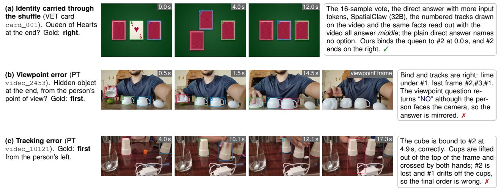  
Figure 3. Qualitative results (test videos, Qwen3-VL-8B unless noted). (a) A success that no method without binding reproduces. (b, c) The two most common failures on real cup games: a wrong viewpoint fact with correct tracks, and a tracker that loses identical cups crossed by hand. Numbered boxes are the agent’s tracks as the VLM sees them.

Table 7. One configuration versus per-benchmark configurations (test sets): accuracy (%) and VLM calls per question.
<table><tr><td></td><td></td><td colspan="4">Accuracy</td><td colspan="2">Calls</td></tr><tr><td>VLM</td><td>Configuration</td><td>cup</td><td>card</td><td>PT</td><td>TOC</td><td>PT</td><td>TOC</td></tr><tr><td>8B</td><td>per benchmark</td><td>100</td><td>100</td><td>44.9</td><td>43.4</td><td>20</td><td>20.2</td></tr><tr><td>8B</td><td>single</td><td>100</td><td>100</td><td>51.4</td><td>43.0</td><td>13.4</td><td>10.8</td></tr><tr><td>32B</td><td>per benchmark</td><td>100</td><td>100</td><td>50.5</td><td>48.0</td><td>20</td><td>22.7</td></tr><tr><td>32B</td><td>single</td><td>100</td><td>100</td><td>52.3</td><td>48.6</td><td>14.7</td><td>11.1</td></tr></table>

One configuration for all benchmarks. Table 7 compares the agent with three variants of itself, each tuned on one benchmark. They fix the bind question, the grounding frames, the tracking rate and the read-out per benchmark. For example, the card variant grounds 4 frames from the first 30% of each video and always tracks at 30 fps. On all four test sets the single configuration lies within the CI of the tuned variants. The single configuration issues 10.8 instead of 20.2 VLM calls per TOC-Bench question at 8B, and 13.4 instead of 20 per cup game.

## 5.4. Qualitative Analysis

Success case. In the card-monte video of Fig. 3(a), the queen is face up for one second. Every method that leaves the final judgement to the VLM answers that the queen stayed in the middle. SpatialClaw (32B) loses the queen’s mask once the card turns over and then guesses the middle (Fig. 4). Our agent asks which card is the queen only while it is face up. The tracks then carry the queen to the right.

Failure cases. For each wrong answer on the real cup games, we check whether the gold option agrees with the bound track under either viewpoint. At 8B, 31 of the 52 errors agree with neither, so the binding or the tracking is wrong. In Fig. 3(c), cups are lifted out of the frame and crossed by both hands, and the tracker loses them. Another 14 errors are explained by the viewpoint alone. In Fig. 3(b) the bind and tracks are right, but the viewpoint fact mirrors the answer. The remaining errors are 5 questions that are never bound and 2 others. At 32B binding is more reliable. Of its 51 errors, 14 come from binding or tracking, 20 from the viewpoint, 12 from questions that are never bound, 3 from a read-out that ignores the facts, and 2 others.

## 6. Limitations

The agent inherits the errors of its tracker. Identical cups that are lifted and crossed by hand still swap tracks, and very small hidden objects are rarely tracked. Most real cup games are therefore bound on the whole clip (Table 6). The agent issues about 11 VLM calls on every question, including general questions that need no tracking. A test that skips tracking for such questions is left to future work.

## 7. Conclusion

Video-LMs lose object identity when the identifying evidence disappears or the objects look alike. Track, Then Bind asks the VLM about identity once, about the moment the evidence is visible, keeps that identity with tracks, and answers from the tracked state in text. Without training, it solves both VET-Bench tasks and adds 17–18 points over direct answers on real cup games and, through track-derived timelines, 12–18 points on TOC-Bench.

## References

[1] T. Liu and W. S. Lee. Can Vision-Language Models Solve the Shell Game? arXiv:2603.08436, 2026. 2, 3, 4, 5, 6, 12

[2] V. Patr˘ aucean et al. Perception Test: A Diagnostic Bench-˘ mark for Multimodal Video Models. NeurIPS Datasets and Benchmarks, 2023. 2, 5, 12

[3] J. Chen et al. TOC-Bench: A Temporal Object Consistency Benchmark for Video Large Language Models. arXiv:2605.09904, 2026. 2, 3, 5, 12

[4] N. Ravi et al. SAM 2: Segment Anything in Images and Videos. ICLR, 2025. 2, 4, 5, 6

[5] J. Meng et al. Open-o3-Video-v2: Seek, Ground, and Reason with Verifiable Spatio-Temporal Evidence. arXiv:2610.17656, 2026. 3, 4, 6

[6] H. Wang et al. Object-centric Video Question Answering with Visual Grounding and Referring. ICCV, 2025. 4

[7] Y. Fan et al. VideoAgent: A Memory-augmented Multimodal Agent for Video Understanding. ECCV, 2024. 2, 3, 4, 6

[8] R. Liao et al. VideoINSTA: Zero-shot Long Video Understanding via Informative Spatial-Temporal Reasoning with LLMs. Findings of EMNLP, 2024. 2, 3, 4, 6

[9] T. Nguyen et al. STRAND: Benchmarking and Improving Object-Centric Spatio-Temporal Monitoring in Video Large Language Models. arXiv:2609.29607, 2026. 4

[10] J. Yang et al. Set-of-Mark Prompting Unleashes Extraordinary Visual Grounding in GPT-4V. arXiv:2310.11441, 2023. 4

[11] B. Liu et al. Coarse Correspondences Boost Spatial-Temporal Reasoning in Multimodal Language Model. CVPR, 2025. 4, 7

[12] W. Jin et al. AgentRVOS: Reasoning over Object Tracks for Zero-Shot Referring Video Object Segmentation. arXiv:2603.23489, 2026. 4

[13] V. Bundele et al. When Trackers Fail: VLM-Guided Verification and Recovery for Robust Video Object Segmentation. NeurIPS, 2026 (arXiv:2610.15929). 4

[14] W. Cai et al. Models as Tools: An Agentic Coordination Framework for Unified Multimodal Visual Tracking. arXiv:2608.00847, 2026. 4

[15] S. Cho et al. SpatialClaw: Rethinking Action Interface for Agentic Spatial Reasoning. arXiv:2606.13673, 2026. 2, 3, 4, 6

[16] B. Van Hoorick et al. Tracking through Containers and Occluders in the Wild. CVPR, 2023. 4

[17] S. Bai et al. Qwen3-VL Technical Report. arXiv:2511.21631, 2025. 3, 6

[18] C. Clark et al. Molmo2: Open Weights and Data for Vision-Language Models with Video Understanding and Grounding. arXiv:2601.10611, 2026. 3

[19] C. Fu et al. Video-MME: The First-Ever Comprehensive Evaluation Benchmark of Multi-modal LLMs in Video Analysis. CVPR, 2025. 3, 7, 12

[20] S. Bai et al. Qwen2.5-VL Technical Report. arXiv:2502.13923, 2025. 3

[21] J. Zhu et al. InternVL3: Exploring Advanced Training and Test-Time Recipes for Open-Source Multimodal Models. arXiv:2504.10479, 2025. 3

[22] B. Li et al. LLaVA-OneVision: Easy Visual Task Transfer.

arXiv:2408.03326, 2024. 3

[23] B. Lin et al. Video-LLaVA: Learning United Visual Representation by Alignment Before Projection. EMNLP, 2024.

[24] M. Maaz, H. Rasheed, S. Khan, and F. S. Khan. Video-ChatGPT: Towards Detailed Video Understanding via Large Vision and Language Models. ACL, 2024. 3

[25] K. Li et al. MVBench: A Comprehensive Multi-modal Video Understanding Benchmark. CVPR, 2024. 3

[26] J. Xiao, X. Shang, A. Yao, and T.-S. Chua. NExT-QA: Next Phase of Question-Answering to Explaining Temporal Actions. CVPR, 2021. 3

[27] K. Mangalam, R. Akshulakov, and J. Malik. EgoSchema: A Diagnostic Benchmark for Very Long-form Video Language Understanding. NeurIPS Datasets and Benchmarks, 2023. 3

[28] Y. Liu et al. TempCompass: Do Video LLMs Really Understand Videos? Findings of ACL, 2024. 3

[29] Z. Shangguan et al. TOMATO: Assessing Visual Temporal Reasoning Capabilities in Multimodal Foundation Models. ICLR, 2025. 3

[30] D. Saravanan et al. VELOCITI: Benchmarking Video-Language Compositional Reasoning with Strict Entailment. CVPR, 2025. 3

[31] J. Yang et al. Thinking in Space: How Multimodal Large Language Models See, Remember, and Recall Spaces. CVPR, 2025. 3, 4

[32] J. Wei et al. Chain-of-Thought Prompting Elicits Reasoning in Large Language Models. NeurIPS, 2022. 3

[33] H. Fei et al. Video-of-Thought: Step-by-Step Video Reasoning from Perception to Cognition. ICML, 2024. 3

[34] X. Wang et al. Self-Consistency Improves Chain of Thought Reasoning in Language Models. ICLR, 2023. 4, 6

[35] K. Feng et al. Video-R1: Reinforcing Video Reasoning in MLLMs. NeurIPS, 2025. 4

[36] R. Baillargeon, E. S. Spelke, and S. Wasserman. Object Permanence in Five-Month-Old Infants. Cognition, 20:191–208, 1985. 4

[37] E. S. Spelke. Principles of Object Perception. Cognitive Science, 14:29–56, 1990. 4

[38] R. Girdhar and D. Ramanan. CATER: A Diagnostic Dataset for Compositional Actions and TEmporal Reasoning. ICLR, 2020. 4

[39] K. Yi et al. CLEVRER: CoLlision Events for Video REpresentation and Reasoning. ICLR, 2020. 4

[40] A. Shamsian, O. Kleinfeld, A. Globerson, and G. Chechik. Learning Object Permanence from Video. ECCV, 2020. 4

[41] P. Tokmakov, J. Li, W. Burgard, and A. Gaidon. Learning to Track with Object Permanence. ICCV, 2021. 4

[42] L. S. Piloto, A. Weinstein, P. Battaglia, and M. Botvinick. Intuitive Physics Learning in a Deep-Learning Model Inspired by Developmental Psychology. Nature Human Behaviour, 2022. 4

[43] A. Kirillov et al. Segment Anything. ICCV, 2023. 4

[44] N. Carion et al. SAM 3: Segment Anything with Concepts. ICLR, 2026. 2, 4, 6

[45] H. K. Cheng and A. G. Schwing. XMem: Long-Term Video Object Segmentation with an Atkinson-Shiffrin Memory Model. ECCV, 2022. 4

[46] H. K. Cheng, S. W. Oh, B. Price, J.-Y. Lee, and A. Schwing.

Putting the Object Back into Video Object Segmentation. CVPR, 2024. 4

[47] N. Karaev et al. CoTracker: It is Better to Track Together. ECCV, 2024. 4

[48] Y. Zhang et al. ByteTrack: Multi-Object Tracking by Associating Every Detection Box. ECCV, 2022. 4

[49] S. Liu et al. Grounding DINO: Marrying DINO with Grounded Pre-Training for Open-Set Object Detection. ECCV, 2024. 4

[50] A. Shtedritski, C. Rupprecht, and A. Vedaldi. What Does CLIP Know About a Red Circle? Visual Prompt Engineering for VLMs. ICCV, 2023. 4

[51] M. Cai et al. ViP-LLaVA: Making Large Multimodal Models Understand Arbitrary Visual Prompts. CVPR, 2024. 4

[52] H. Wang et al. Elysium: Exploring Object-level Perception in Videos through Semantic Integration Using MLLMs. ECCV, 2024. 4

[53] Y. Yuan et al. VideoRefer Suite: Advancing Spatial-Temporal Object Understanding with Video LLM. CVPR, 2025. 4

[54] H. Yuan et al. Sa2VA: Marrying SAM2 with LLaVA for Dense Grounded Understanding of Images and Videos. arXiv:2501.04001, 2025. 4

[55] T. Gupta and A. Kembhavi. Visual Programming: Compositional Visual Reasoning Without Training. CVPR, 2023. 4

[56] D. Surís, S. Menon, and C. Vondrick. ViperGPT: Visual Inference via Python Execution for Reasoning. ICCV, 2023. 4

[57] S. Yao et al. ReAct: Synergizing Reasoning and Acting in Language Models. ICLR, 2023. 4

[58] X. Wang, Y. Zhang, O. Zohar, and S. Yeung-Levy. VideoAgent: Long-form Video Understanding with Large Language Model as Agent. ECCV, 2024. 4

[59] C. Zhang et al. A Simple LLM Framework for Long-Range Video Question-Answering. EMNLP, 2024. 4

[60] Z. Yang et al. DoraemonGPT: Toward Understanding Dynamic Scenes with Large Language Models (Exemplified as a Video Agent). ICML, 2024. 4

[61] H. Lin et al. Depth Anything 3: Recovering the Visual Space from Any Views. ICLR, 2026. 4, 6

[62] Google DeepMind. Gemini 3 Pro Model Card. https: //storage.googleapis.com/deepmind-media/ Model-Cards/Gemini-3-Pro-Model-Card.pdf, 2025. 3

[63] Google DeepMind. Gemini 3.1 Pro Model Card. https: / / deepmind . google / models / model - cards / gemini-3-1-pro/, 2026. 3

[64] W. Hong et al. GLM-4.5V and GLM-4.1V-Thinking: Towards Versatile Multimodal Reasoning with Scalable Reinforcement Learning. arXiv:2507.01006, 2025. (Covers the GLM-4.6V series.) 3

[65] ByteDance Seed. Seed2.0 Model Card: Towards Intelligence Frontier for Real-World Complexity. 2026. 3

[66] OpenAI. GPT-5.5 System Card. https : / / deploymentsafety . openai . com / gpt - 5 - 5, 2026. 3

[67] W. Kwon et al. Efficient Memory Management for Large Language Model Serving with PagedAttention. SOSP, 2023.

5, 13

[68] P. Xie and A. Alanwar. Tracking Is Not Permanence: What Video World Models Keep of a Hidden Object. arXiv:2610.07355, 2026. 4

## A. Algorithm and Implementation Details

Algorithm 1 gives the control flow of Track, Then Bind. The same program and the values of Table 8 run on every benchmark.   
The plan decides which branch a question takes; no branch is selected by the benchmark name.

Algorithm 1 Track, Then Bind. f: the frozen VLM; T: the SAM2.1 video tracker. Read-outs use the benchmark’s own   
prompt template and answer parser.   
1: Input: video V, question q. Output: answer aˆ.   
2: P ← f(V at 2 fps, PLAN(q)); P.final ← f(FINALLOCATION(q)) ▷ step 1: entities, roles, cue, viewpoin   
3: if P.cue = visible, P.final, and no carrier is named then add the target’s category as the carriers   
4: if P has no entities then return $\mathrm { P A R S E } ( f ( V _ { S } , q ) )$ ▷ direct answer   
5: for each entity e do ▷ step 2   
6: boxes ← f(GROUND) on 8 uniform frames, then on 8 frames in between if e was found on none   
7: τ ← T(V at 6 fps) from the earliest frame with the modal box count (one box: the largest)   
8: if carrier tracks overlap, jump, or are not all tracked after 90% of the video then   
9: re-track carriers and target at min(native fps, 300/duration) ▷ dense pass   
10: aˆ ← ∅   
11: if P.final, P.cue ∈ {visible, contained}, a target track and ≥ 2 carrier tracks exist then   
12: M ← evidence moments ▷ step 3   
13: visible: frames on which the target’s box was found, merged within 3 s   
14: contained: the last frame before the target’s own track vanishes inside the frame   
15: for each window $W \in { \mathcal { M } } ,$ or the whole video if M = ∅ do ▷ step 4   
16: $k  f ( W \oplus \{ \tau _ { c } \}$ at 4 fps, ≤ 96 frames, $q _ { \mathrm { b } } ( P . c u e ) )$ ; keep the last valid k as k⋆   
17: if k⋆ exists then ▷ step 5a   
18: F ← bind fact and the left-to-right track order in the last frame where all carriers are tracked   
19: if P.viewpoint = person then $\mathcal { F }  \mathcal { F } \cup$ viewpoint fact from f(4 frames, OPPOSITE)   
20: aˆ ← PARSE(f(q, F)) ▷ text only   
21: if k⋆ does not exist then aˆ ← PARSE $\therefore ( f ( V _ { S } , q \oplus \mathcal { L } ( \{ \tau _ { e } \} ) ) )$ ▷ step 5b: timeline   
22: if aˆ = ∅ then aˆ ← PARSE(f(VS, q)) ▷ unparsable read-out   
23: return aˆ

Table 8. Settings of the single configuration (all benchmarks). p90: the 90th percentile of a track’s mask area over the video.
<table><tr><td>Step</td><td>Setting</td><td>Value</td></tr><tr><td>1 Plan</td><td>video rate for the plan call</td><td>2 fps at most 3</td></tr><tr><td></td><td>entities per plan</td><td></td></tr><tr><td>2 Perceive</td><td>grounding frames</td><td>8 uniform, plus 8 in between for entities found on none 960 px on the long side</td></tr><tr><td></td><td>tracking resolution first tracking pass</td><td>6 fps, at most 900 frames</td></tr><tr><td></td><td></td><td></td></tr><tr><td></td><td>dense pass triggers</td><td>instance IoU &gt; 0.05; centre shift &gt; 0.25 box widths per sampled frame; carriers not all tracked after 90% of the video</td></tr><tr><td></td><td>dense pass rate</td><td>min(native, 300 frames/duration), used if above 1.5× the first pass</td></tr><tr><td>3 Evidence, timeline</td><td>fully visible / partly hidden</td><td>mask area ≥ 0.6 p90 / ≥ 0.12 p90</td></tr><tr><td></td><td>shortest segment</td><td>0.5 s (shorter segments are merged into a neighbour)</td></tr><tr><td></td><td>left the frame</td><td>last box within 2% of the image border</td></tr><tr><td></td><td>coarse motion</td><td>box-centre shift between the first and last third of the visible frames; &quot;stays&quot; below 0.1 of the frame</td></tr><tr><td>4 Bind</td><td>clip</td><td>4 fps, 3 s around a moment (δ = 1.5 s) or the whole video, at most 96 frames</td></tr><tr><td></td><td>several moments</td><td>the last one with a valid number decides</td></tr><tr><td>5 Read out</td><td>viewpoint question</td><td>4 uniform frames</td></tr><tr><td></td><td>benchmark frames (timeline read-out)</td><td>PT and VET video at 8 fps; TOC-Bench 32 uniform frames</td></tr><tr><td></td><td>unparsable answer</td><td>falls back to the direct answer</td></tr><tr><td>All</td><td>decoding</td><td>greedy</td></tr></table>

Table 9 breaks down the cost of Table 3. Grounding dominates the number of calls. On the VET cup game the ball is found on none of the first 8 frames, so a second round of 7 calls follows. Each call sees one frame, and the input stays at 7–27k

Table 9. Cost per question on the test sets (means). VLM calls by input: video, the plan call and a read-out on the benchmark’s own frames; frame, grounding and the viewpoint question; clip, the bind call; text, the final-location question and the text-only read-out. Times are wall-clock seconds on A800 GPUs, one GPU per process at 8B and two at 32B, with other jobs sharing the node. The tracker time includes the dense pass.
<table><tr><td></td><td></td><td colspan="5">VLM calls</td><td colspan="2">VLM tokens</td><td colspan="3">Time (s)</td></tr><tr><td>VLM</td><td>Set</td><td>video</td><td>frame</td><td>clip</td><td>text</td><td>all</td><td>in (k)</td><td>out</td><td>VLM</td><td>tracker</td><td>total</td></tr><tr><td>8B</td><td>cup</td><td>1.0</td><td>15.0</td><td>1.0</td><td>2.0</td><td>19.0</td><td>10.8</td><td>1058</td><td>40</td><td>69</td><td>110</td></tr><tr><td></td><td>card</td><td>1.0</td><td>8.0</td><td>1.0</td><td>2.0</td><td>12.0</td><td>7.3</td><td>987</td><td>37</td><td>64</td><td>103</td></tr><tr><td></td><td>PT</td><td>1.1</td><td>9.3</td><td>1.0</td><td>1.9</td><td>13.4</td><td>24.7</td><td>1289</td><td>50</td><td>71</td><td>126</td></tr><tr><td></td><td>TOC</td><td>2.1</td><td>7.8</td><td>0.0</td><td>1.0</td><td>10.8</td><td>15.3</td><td>443</td><td>18</td><td>14</td><td>35</td></tr><tr><td>32B</td><td>cup</td><td>1.0</td><td>15.0</td><td>1.0</td><td>2.0</td><td>19.0</td><td>10.8</td><td>984</td><td>91</td><td>62</td><td>154</td></tr><tr><td></td><td>card</td><td>1.0</td><td>8.0</td><td>1.0</td><td>2.0</td><td>12.0</td><td>7.3</td><td>216</td><td>22</td><td>64</td><td>87</td></tr><tr><td></td><td>PT</td><td>1.2</td><td>10.7</td><td>0.9</td><td>1.9</td><td>14.7</td><td>27.0</td><td>929</td><td>98</td><td>56</td><td>159</td></tr><tr><td></td><td>TOC</td><td>2.0</td><td>8.1</td><td>0.0</td><td>1.0</td><td>11.1</td><td>15.3</td><td>373</td><td>39</td><td>12</td><td>54</td></tr></table>

tokens per question. Tracking takes 60–70 s per cup or card video because the dense pass runs on 88–100% of these videos.   
On TOC-Bench it runs on 1% of the questions, and tracking takes 12–14 s.

## B. Benchmarks, Splits and Evaluation

Table 10. Evaluation data. Duration: mean video length in seconds. Dev: used to select the design and the thresholds. Test: run once with the frozen configuration.
<table><tr><td>Benchmark</td><td>Split</td><td>Use</td><td>Videos</td><td>Questions</td><td>Duration</td><td>Source</td></tr><tr><td>VET-Bench cup</td><td>test</td><td>test</td><td>50</td><td>50</td><td>12.4</td><td>VET-Bench [1] (synthetic)</td></tr><tr><td>VET-Bench card</td><td>dev</td><td>dev</td><td>56</td><td>56</td><td>12.1</td><td>rendered with the VET-Bench generator</td></tr><tr><td>VET-Bench card</td><td>test</td><td>test</td><td>50</td><td>50</td><td>12.1</td><td>VET-Bench [1] (synthetic)</td></tr><tr><td>Perception Test cup games</td><td>validation</td><td>dev</td><td>195</td><td>195</td><td>23.7</td><td>Perception Test [2]</td></tr><tr><td>Perception Test cup games</td><td>PT</td><td>test</td><td>107</td><td>107</td><td>15.6</td><td>filtered by the VET-Bench authors</td></tr><tr><td>three cups, ≥ 1 swap</td><td>PT-65</td><td>test</td><td>65</td><td>65</td><td>一</td><td>subset of PT</td></tr><tr><td>TOC-Bench</td><td>dev</td><td>dev</td><td>389</td><td>478</td><td>28.6</td><td>TOC-Bench [3], 20% of videos</td></tr><tr><td>TOC-Bench</td><td>test</td><td>test</td><td>1,561</td><td>1,845</td><td>28.9</td><td>TOC-Bench [3], the other 80%</td></tr><tr><td>Perception Test, all areas</td><td>validation</td><td>test</td><td>1,602</td><td>2,000</td><td>23.3</td><td>stratified sample, Table 4</td></tr><tr><td>Video-MME short + medium</td><td></td><td>test</td><td>600</td><td>1,800</td><td>298.7</td><td>Video-MME [19], Table 4</td></tr></table>

Development sets. The cup-game development set is the Perception Test validation question “Where is the hidden object at the end ofthe gamefrom the person’s point ofview?” on 195 of its 198 videos; three videos were unavailable. The card-monte development set consists of 56 videos rendered with the VET-Bench generator. We changed only the encoder, from H.264 to VP9 and back to H.264 at CRF 18, because headless Chromium has no H.264 encoder. Each video carries the test-set question about the Queen of Hearts, with the answer taken from the generator’s metadata. VET-Bench has no cup-game development set, so the cup game is tuned only through the real cup games and the card videos.

TOC-Bench split. We use the released answer subset of TOC-Bench, 2,323 questions over 1,951 videos. Its videos are assigned at random (seed 20261017) to development (20%) and test (80%), so that the questions of one video stay in one split. The test split has 1,068 four-way multiple-choice questions, 447 two-statement questions, 241 numerical questions and 89 ordering questions. TOC-Bench scores each format with its own parser, and an unparsable answer counts as wrong.

Disjointness. No video appears in two of the following sets: the cup-game development and test sets, the 2,000 general Perception Test questions, and the TOC-Bench development and test splits. The rendered card videos are new renders and share no file with the VET-Bench test videos.

Scoring and statistics. Perception Test and VET-Bench answers are parsed with the VET-Bench scorer, which reads the boxed letter. Every comparison in the paper is paired over the same questions. The confidence interval is the 2.5th and 97.5th percentile of 10,000 bootstrap resamples of the questions (seed 0). The p-value is the exact two-sided McNemar test on the questions that exactly one of the two methods answers correctly.

## C. Baselines

SpatialClaw. We run the official code with its prompts, tools and model configuration. The SAM3 and Depth Anything 3 tools are checked out at the commits the code pins. An adapter passes each benchmark prompt verbatim as the question and scores the returned answer with the benchmark’s parser. Some sessions met a tool server that was temporarily unavailable. We reran every such question once, 12 on the cup games and 28 on TOC-Bench, and score the rerun. Table 12 summarises the runs.

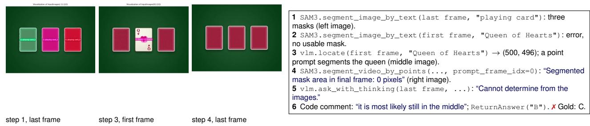  
Figure 4. SpatialClaw on VET card monte card\_001 (Qwen3-VL-32B, logged test run). The images are the session’s own show() outputs. The queen’s mask is empty once the card turns over, and the model answers from the last frame. Track, Then Bind answers the same video correctly (Fig. 3a).

Table 11. Baseline settings. All baselines receive the benchmark’s prompt and are scored with its parser. Self-consistency and the larger input appear in Table 3.
<table><tr><td>Baseline</td><td>Engine</td><td>Input</td><td>Decoding</td></tr><tr><td>Qwen3-VL, direct</td><td>vLLM 0.15.1 [67]</td><td>PT and VET: video at 8 fps, default resizing of qwen-vl-utils; TOC: 32</td><td>greedy; 2,048 new tokens (TOC: the benchmark&#x27;s budget per format)</td></tr><tr><td>Qwen3-VL, direct</td><td>Transformers 4.57.6</td><td>uniform frames same</td><td>greedy</td></tr><tr><td>Self-consistency</td><td>vLLM</td><td>same</td><td>k samples at temperature 0.7, top-p 0.8, top-k 20 (Qwen3-VL&#x27;s recommended settings), majority vote; k equals the agent&#x27;s mean VLM calls, at most 16</td></tr><tr><td>More input tokens</td><td>vLLM</td><td>PT and VET: 16 fps, at most 288,000 pixels per frame, no resizing; TOC: 96</td><td>greedy</td></tr><tr><td>Qwen3-VL-Thinking</td><td>vLLM (VET, PT); TOC-Bench</td><td>frames as the direct answer</td><td>greedy; 16,384 new tokens</td></tr><tr><td>Qwen3-VL-235B-A22B</td><td>runner (TOC) vLLM, 8 GPUs</td><td>video at 8 fps</td><td>greedy; 2,048 new tokens</td></tr><tr><td>Molmo2-8B, Molmo2-SGCoT</td><td>Transformers, the authors&#x27; code</td><td>at most 8 fps</td><td>greedy; 2,048 new tokens; SGCoT is the authors&#x27; LoRA with their prompt</td></tr><tr><td>Open-o3-Video-v2-8B</td><td>the official multi-turn evaluator</td><td>1 fps, 96 frames, crop tool, at most 5</td><td>the evaluator&#x27;s settings; it cannot express ordering questions,</td></tr><tr><td>SpatialClaw</td><td>the official code, Qwen3-VL-32B-Instruct (bf16)</td><td>turns all frames at the native rate to the code, 32 key frames to the model</td><td>which count as wrong SpatialClaw&#x27;s configuration for this model: temperature 0.7, top-p 0.8, top-k 20; at most 30 steps</td></tr><tr><td>VideoAgent</td><td>in vLLM the official code; Qwen3-VL-32B-Instruct in vLLM as the agent LLM, Video-LLaVA-7B (4-bit) as the</td><td>2 s segments; tracking at 15 fps</td><td>temperature 0; the official ReAct prompts</td></tr><tr><td>VideoINSTA</td><td>VQA tool the official code; Qwen3-VL-32B-Instruct in vLLM as the LLM, CogAgent for captions and objects</td><td>1 fps; 4 event clips (CLIP ViT-L/14); UniVTG grounding</td><td>temperature 0; the official NExT-QA configuration</td></tr></table>

Table 12. SpatialClaw with Qwen3-VL-32B on the test sets. Calls and input tokens are means per question. Mask propagation: share of questions whose code propagated a SAM3 mask through the video at least once without an error.
<table><tr><td>Set</td><td>n</td><td>Acc. (%)</td><td>VLM calls</td><td>Input tokens</td><td>Mask propagation (%)</td><td>Rerun after tool failure</td></tr><tr><td>cup</td><td>50</td><td>28.0</td><td>14.5</td><td>419k</td><td>26</td><td>0</td></tr><tr><td>card</td><td>50</td><td>36.0</td><td>9.0</td><td>229k</td><td>26</td><td>0</td></tr><tr><td>PT</td><td>107</td><td>26.2</td><td>17.7</td><td>508k</td><td>77</td><td>12</td></tr><tr><td>TOC</td><td>1845</td><td>35.7</td><td>10.2</td><td>300k</td><td>62</td><td>28</td></tr></table>

SpatialClaw propagates masks through the video in about a quarter of the VET-Bench questions, and the other sessions work on single frames. On the real cup games it propagates masks in 77% of the questions and still stays below chance. Fig. 4 shows one session.

VideoAgent. We run the official code (commit 42e1b70) with its prompts, tools and memory construction. The memory holds LaViLa captions of 2 s segments, ViCLIP segment features, RT-DETR-L tracks from ByteTrack at 15 fps, and CLIP and DINOv2 features for re-identification. Video-LLaVA-7B answers its visual questions. Four parts need a closed API or the network, and we replace them. Qwen3-VL-32B-Instruct at temperature 0 takes the place of GPT-4 as the agent LLM. The OpenAI text embedding is replaced by all-mpnet-base-v2, a sentence model that the official encoder already offers. LangChain’s prompt download is replaced by the same template held locally, and an unused caption-metric import by a stub The official multiple-choice prompt fixes five choices, so it states the actual number of choices. LangChain returns format errors in the ReAct output to the agent instead of stopping (handle\_parsing\_errors). TOC-Bench ordering questions go to the official free-form runner. A question takes 9.8 LLM calls and 9.0k LLM input tokens on average. Eleven of the 2,052 questions end with a malformed tool input and count as wrong.

VideoINSTA. We run the official code (publication branch) with the authors’ NExT-QA configuration. It samples one frame per second and splits the video into four event clips by clustering CLIP ViT-L/14 features. CogAgent describes the actions and objects of each clip, and UniVTG locates the spans that match the question. The LLM summarises each clip, rates how well it answers the question, and merges the ratings into an answer. Three changes are needed. Qwen3-VL-32B-Instruct at temperature 0 takes the place of GPT-3.5 as the LLM. The authors release CogAgent captions and object lists only for thei own benchmarks, so we compute them with their extraction configuration. The prompts state the actual number of choices instead of five, and ordering questions use the authors’ free-form prompts. A question takes 14.8 LLM calls and 11.2k LLM input tokens on average, measured from the server logs. One answer names a choice that the question does not have and counts as wrong.

## D. Additional Results

All paired comparisons. Table 13 lists the difference between our agent and every baseline that uses the same VLM, on the same questions. The agent is ahead in every row. Two intervals include zero, both on the real cup games: the 8B self-consistency vote and VideoINSTA.

TOC-Bench by dimension at 32B. Table 14 adds the thinking variant, SpatialClaw, VideoAgent and VideoINSTA to the 32B columns of Table 2. The thinking variant moves no dimension by more than 10.1 points, and its overall accuracy is within 0.2 points of the direct answer. SpatialClaw gains 14.2 points on reappearance questions and loses 12.4 points on event counts. VideoINSTA and VideoAgent are the two best methods on event counts (39.4% and 35.3% against 32.0% for ours). VideoAgent is below the direct answer in seven of the ten dimensions, and VideoINSTA in six.

Perception Test cup games by subset. Table 15 splits the 107 real cup games by the number of cups and swaps given in the VET-Bench metadata. By the number of cups, the gain over the direct answer comes from the three-cup games. By the number of swaps, it is largest with one to three swaps. With four or more swaps the 8B agent gains 2.8 points and the 32B agent 11.4 points. The four four-cup games are answered once at 8B and never at 32B.

## E. Design Choices on Development Data

Table 16 lists the comparisons made while the design was chosen. Their p-values are exploratory. The moment of the question matters most. With the same tracks and overlays, asking where the target is at the end of the video gives 40.0% at 8B. Asking which cup it is under right after it is hidden gives 48.7% (+8.7, CI [0.5, 16.9], p=0.046). At 32B the two questions give 44.1% and 52.3% (+8.2, CI [1.5, 14.9], p=0.026). The overlay alone adds 6.7 and 4.1 points over the direct answer, and the momen of the question adds the rest. The bind answer itself comes from the VLM. The target’s own track hands its identity to a cup in only 56 of 195 videos, and that hand-off is right in 48% of them.

Tracking rate and grounding decide whether the tracks are usable. On card monte, tracking at 10 fps instead of 30 fps lowers accuracy from 56 to 21 of 56 videos, close to the direct answer (16). Identity breaks where identical cards cross quickly. The dense pass of step 2 reproduces the 30 fps result without a fixed rate. Grounding on 16 frames instead of 8 lowers TOC-Bench accuracy by 2.5 points and card-monte accuracy by 3 videos, and it nearly doubles the VLM calls.

Two choices concern the read-out. Asking whether the person is opposite the camera, on four frames, gives 57.9% on the development cup games. Asking whether the person faces the camera, on the last frame, gives 48.2%. This wording was selected among six on the same videos, and on the test videos the single configuration is 6.5 (8B) and 1.9 points (32B) above the tuned variants. On TOC-Bench, visibility segments alone reach 37.4% of the development questions. Adding the event lis and the direction of motion raises this to 42.1% (+4.6, CI [1.5, 7.7]).

Table 13. Ours minus each baseline with the same VLM (test sets, percentage points). CI: paired bootstrap 95% interval; p: exact McNemar test.
<table><tr><td>VLM</td><td>Baseline</td><td>Set</td><td>Baseline (%)</td><td>Ours — baseline [95% CI]</td><td>p</td></tr><tr><td>8B</td><td>Direct answer (vLLM)</td><td>cup</td><td>28.0</td><td>+72.0 [60.0, 84.0]</td><td>&lt;0.001</td></tr><tr><td></td><td></td><td>card</td><td>28.0</td><td>+72.0 [60.0, 84.0]</td><td>&lt;0.001</td></tr><tr><td></td><td></td><td>PT</td><td>33.6</td><td>+17.8 [3.7, 30.8]</td><td>0.02</td></tr><tr><td></td><td></td><td>TOC</td><td>25.1</td><td>+17.9 [15.4, 20.4]</td><td>&lt;0.001</td></tr><tr><td></td><td>Direct answer (Transformers)</td><td>cup</td><td>22.0</td><td>+78.0 [66.0, 88.0]</td><td>&lt;0.001</td></tr><tr><td></td><td></td><td>card</td><td>34.0</td><td>+66.0 [52.0, 78.0]</td><td>&lt;0.001</td></tr><tr><td></td><td></td><td>PT</td><td>31.8</td><td>+19.6 [5.6, 32.7]</td><td>0.009</td></tr><tr><td></td><td>Self-consistency, as many calls</td><td>TOC</td><td>25.2</td><td>+17.8 [15.3, 20.3]</td><td>&lt;0.001</td></tr><tr><td></td><td></td><td>cup</td><td>28.0</td><td>+72.0 [60.0, 84.0]</td><td>&lt;0.001</td></tr><tr><td></td><td></td><td>card</td><td>30.0</td><td>+70.0 [56.0, 82.0]</td><td>&lt;0.001</td></tr><tr><td></td><td></td><td>PT</td><td>46.7</td><td>+4.7 [-9.3, 18.7]</td><td>0.59</td></tr><tr><td></td><td>Direct answer, more input tokens</td><td>TOC</td><td>25.9</td><td>+17.2 [14.7, 19.6]</td><td>&lt;0.001</td></tr><tr><td></td><td></td><td>cup</td><td>24.0</td><td>+76.0 [64.0, 88.0]</td><td>&lt;0.001</td></tr><tr><td></td><td></td><td>card</td><td>30.0</td><td>+70.0 [56.0, 82.0]</td><td>&lt;0.001</td></tr><tr><td></td><td></td><td>PT</td><td>27.1</td><td>+24.3 [11.2, 36.4]</td><td>&lt;0.001</td></tr><tr><td></td><td>Thinking variant</td><td>TOC</td><td>24.7 28.0</td><td>+18.4 [15.9, 20.8]</td><td>&lt;0.001</td></tr><tr><td></td><td></td><td>cup card</td><td>24.0</td><td>+72.0 [60.0, 84.0] +76.0 [64.0, 88.0]</td><td>&lt;0.001</td></tr><tr><td></td><td></td><td>PT</td><td>37.4</td><td>+14.0 [1.9, 26.2]</td><td>&lt;0.001</td></tr><tr><td></td><td></td><td>TOC</td><td>30.0</td><td>+13.0 [10.3, 15.7]</td><td>0.04 &lt;0.001</td></tr><tr><td>32B</td><td>Open-o3-Video-v2-8B</td><td>TOC</td><td>33.9</td><td>+9.2 [6.4, 11.8]</td><td>&lt;0.001</td></tr><tr><td></td><td>Direct answer (vLLM)</td><td>cup</td><td>32.0</td><td>+68.0 [56.0, 80.0]</td><td>&lt;0.001</td></tr><tr><td></td><td></td><td>card</td><td>38.0</td><td>+62.0 [48.0, 76.0]</td><td>&lt;0.001</td></tr><tr><td></td><td></td><td>PT</td><td>35.5</td><td>+16.8 [3.7, 29.9]</td><td>0.02</td></tr><tr><td></td><td></td><td>TOC</td><td>37.1</td><td>+11.5 [9.0, 14.0]</td><td>&lt;0.001</td></tr><tr><td></td><td>Direct answer (Transformers)</td><td></td><td>24.0</td><td>+76.0 [64.0, 86.0]</td><td>&lt;0.001</td></tr><tr><td></td><td></td><td>cup</td><td>28.0</td><td>+72.0 [58.0, 84.0]</td><td>&lt;0.001</td></tr><tr><td></td><td></td><td>card</td><td>27.1</td><td>+25.2 [13.1, 36.4]</td><td></td></tr><tr><td></td><td></td><td>PT</td><td>36.9</td><td></td><td>&lt;0.001</td></tr><tr><td></td><td>Self-consistency, as many calls</td><td>TOC</td><td>32.0</td><td>+11.7 [9.2, 14.2]</td><td>&lt;0.001</td></tr><tr><td></td><td></td><td>cup</td><td>30.0</td><td>+68.0 [54.0, 80.0] +70.0 [56.0, 82.0]</td><td>&lt;0.001</td></tr><tr><td></td><td></td><td>card</td><td>37.4</td><td>+15.0 [2.8, 27.1]</td><td>&lt;0.001 0.03</td></tr><tr><td></td><td></td><td>PT TOC</td><td>37.3</td><td>+11.3 [8.8, 13.8]</td><td>&lt;0.001</td></tr><tr><td></td><td>Direct answer, more input tokens</td><td></td><td>30.0</td><td>+70.0 [56.0, 82.0]</td><td>&lt;0.001</td></tr><tr><td></td><td></td><td>cup</td><td>24.0</td><td>+76.0 [64.0, 88.0]</td><td></td></tr><tr><td></td><td></td><td>card</td><td>31.8</td><td>+20.6 [7.5, 33.6]</td><td>&lt;0.001 0.005</td></tr><tr><td></td><td></td><td>PT</td><td>36.7</td><td>+11.9 [9.4, 14.5]</td><td>&lt;0.001</td></tr><tr><td></td><td>Thinking variant</td><td>TOC</td><td>24.0</td><td>+76.0 [64.0, 88.0]</td><td>&lt;0.001</td></tr><tr><td></td><td></td><td>cup</td><td>22.0</td><td>+78.0 [66.0, 88.0]</td><td>&lt;0.001</td></tr><tr><td></td><td></td><td>card PT</td><td>33.6</td><td>+18.7 [6.5, 30.8]</td><td>0.006</td></tr><tr><td>SpatialClaw</td><td></td><td>TOC</td><td>36.9</td><td>+11.7 [9.2, 14.3]</td><td>&lt;0.001</td></tr><tr><td></td><td></td><td></td><td>28.0</td><td>+72.0 [60.0, 84.0]</td><td>&lt;0.001</td></tr><tr><td></td><td></td><td>cup</td><td>36.0</td><td>+64.0 [50.0, 76.0]</td><td>&lt;0.001</td></tr><tr><td></td><td></td><td>card</td><td>26.2</td><td>+26.2 [14.0, 38.3]</td><td>&lt;0.001</td></tr><tr><td></td><td></td><td>PT TOC</td><td>35.7</td><td>+12.9 [10.1, 15.7]</td><td>&lt;0.001</td></tr><tr><td>VideoAgent</td><td></td><td></td><td>40.0</td><td></td><td></td></tr><tr><td></td><td></td><td>cup</td><td></td><td>+60.0 [46.0, 74.0]</td><td>&lt;0.001</td></tr><tr><td></td><td></td><td>card</td><td>28.0</td><td>+72.0 [60.0, 84.0]</td><td>&lt;0.001</td></tr><tr><td></td><td></td><td>PT</td><td>37.4</td><td>+15.0 [1.9, 28.0]</td><td>0.03</td></tr><tr><td></td><td>VideoINSTA</td><td>TOC</td><td>33.0</td><td>+15.7 [12.8, 18.6]</td><td>&lt;0.001</td></tr><tr><td></td><td></td><td>cup card</td><td>42.0</td><td>+58.0 [44.0, 72.0]</td><td>&lt;0.001</td></tr><tr><td></td><td></td><td>PT</td><td>28.0 42.1</td><td>+72.0 [60.0, 84.0] +10.3 [-1.9, 23.4]</td><td>&lt;0.001</td></tr><tr><td></td><td></td><td></td><td></td><td></td><td>0.15</td></tr><tr><td></td><td></td><td>TOC</td><td>34.5</td><td>+14.1 [11.3, 17.0]</td><td>&lt;0.001</td></tr></table>

## F. Additional Qualitative Examples

Figures 5 and 6 show six more test items from the logged Qwen3-VL-8B run. The images are the agent’s own tracks on the frames it read. Rows (c)–(f) were re-run with full logging, and every re-run reproduces the logged plan, evidence and answer. The direct answers are those of Table 1.

Rows (a) and (b) are the two branches of a located moment. In (a) the bind clip is synthetic and short. In (b) the hidden object is a crumpled paper in a real video, and the viewpoint fact mirrors the camera order. Row (c) is one of the five real cup games that are never bound (Sec. 5.4). The VLM grounds the pen holder as the only cup, so the agent never sees two carrier tracks.

Rows (d) and (e) are typical TOC-Bench gains. The timeline states when the object disappears and whether it vanished at the border or inside the frame, which the direct answer misses on its 32 sampled frames. Row (f) is a conditional-state question about two objects. The plan names only one of them, so the timeline cannot place the other object’s event. This failure fits the

Table 14. TOC-Bench test accuracy by dimension, Qwen3-VL-32B (%). Direct: answering directly in vLLM. Ours: Track, Then Bind. Best per row in bold.
<table><tr><td>Dimension</td><td>n</td><td>Direct</td><td>Thinking</td><td>SpatialClaw</td><td>VideoAgent</td><td>VideoINSTA</td><td>Ours</td></tr><tr><td>event existence</td><td>170</td><td>42.9</td><td>42.9</td><td>45.9</td><td>38.2</td><td>40.6</td><td>66.5</td></tr><tr><td>reappear vs. disappear</td><td>106</td><td>41.5</td><td>43.4</td><td>55.7</td><td>34.0</td><td>33.0</td><td>75.5</td></tr><tr><td>relative spatial change</td><td>131</td><td>31.3</td><td>33.6</td><td>29.8</td><td>26.7</td><td>29.0</td><td>52.7</td></tr><tr><td>event count</td><td>241</td><td>20.3</td><td>19.9</td><td>7.9</td><td>35.3</td><td>39.4</td><td>32.0</td></tr><tr><td>event ordering</td><td>89</td><td>13.5</td><td>23.6</td><td>16.9</td><td>13.5</td><td>14.6</td><td>32.6</td></tr><tr><td>duration category</td><td>245</td><td>31.0</td><td>24.9</td><td>29.0</td><td>26.1</td><td>31.4</td><td>36.7</td></tr><tr><td>temporal location</td><td>473</td><td>41.4</td><td>40.2</td><td>40.2</td><td>31.3</td><td>31.1</td><td>51.4</td></tr><tr><td>cross-object order</td><td>155</td><td>49.7</td><td>55.5</td><td>47.7</td><td>47.1</td><td>47.7</td><td>58.1</td></tr><tr><td>conditional state</td><td>219</td><td>49.8</td><td>47.0</td><td>48.4</td><td>37.0</td><td>36.1</td><td>44.7</td></tr><tr><td>reappear identity</td><td>16</td><td>50.0</td><td>56.2</td><td>50.0</td><td>56.2</td><td>56.2</td><td>50.0</td></tr><tr><td>all</td><td>1,845</td><td>37.1</td><td>36.9</td><td>35.7</td><td>33.0</td><td>34.5</td><td>48.6</td></tr></table>

Table 15. Perception Test cup games by subset (accuracy, %). D: direct answer in vLLM.
<table><tr><td>Subset</td><td>n</td><td>D8B</td><td>Ours 8B</td><td>D 32B</td><td>SpatialClaw</td><td>Ours 32B</td></tr><tr><td>2 cups</td><td>13</td><td>53.8</td><td>53.8</td><td>46.2</td><td>23.1</td><td>53.8</td></tr><tr><td>3 cups</td><td>90</td><td>30.0</td><td>52.2</td><td>33.3</td><td>27.8</td><td>54.4</td></tr><tr><td>4 cups</td><td>4</td><td>50.0</td><td>25.0</td><td>50.0</td><td>0.0</td><td>0.0</td></tr><tr><td>no swap</td><td>27</td><td>40.7</td><td>55.6</td><td>37.0</td><td>18.5</td><td>51.9</td></tr><tr><td>1–3 swaps</td><td>45</td><td>22.2</td><td>53.3</td><td>28.9</td><td>28.9</td><td>51.1</td></tr><tr><td>≥4 swaps</td><td>35</td><td>42.9</td><td>45.7</td><td>42.9</td><td>28.6</td><td>54.3</td></tr><tr><td>PT-65</td><td>65</td><td>27.7</td><td>52.3</td><td>33.8</td><td>30.8</td><td>55.4</td></tr></table>

Table 16. Design choices on development data (accuracy, %). Rows 1–3 hold the tracks and the numbered overlays fixed and change only the question to the VLM.
<table><tr><td>Variant</td><td>Set</td><td>8B</td><td>32B</td></tr><tr><td>Direct answer</td><td>PT</td><td>33.3</td><td>40.0</td></tr><tr><td>Tracks, asked “where at the end?&quot;</td><td>PT</td><td>40.0</td><td>44.1</td></tr><tr><td>Tracks, asked “under which, right after hidden?&quot;</td><td>PT</td><td>48.7</td><td>52.3</td></tr><tr><td>Card tracking at 10 fps / 30 fps</td><td>card</td><td>37.5 / 100</td><td></td></tr><tr><td>Viewpoint: &quot;faces the camera&quot; / &quot;opposite the camera&quot;</td><td>PT</td><td>48.2 / 57.9</td><td></td></tr><tr><td>Tracks, benchmark question, no binding</td><td>PT / card</td><td>40.0 / 62.5</td><td></td></tr><tr><td>Timeline: visibility only / + events and motion</td><td>TOC</td><td>37.4 / 42.1</td><td></td></tr><tr><td>Grounding frames: 16 / 8</td><td>TOC</td><td>40.2 / 42.7</td><td></td></tr></table>

conditional-state results in Table 2.  
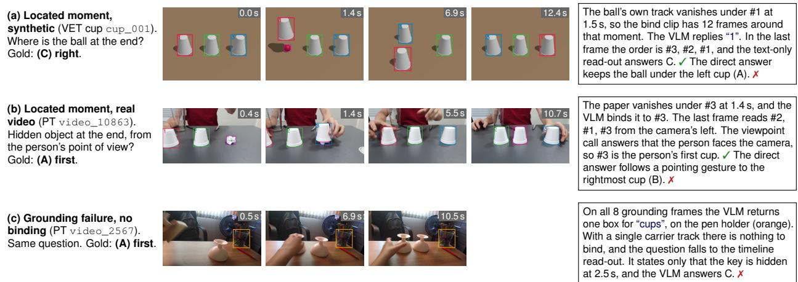  
Figure 5. Identity questions (test videos, Qwen3-VL-8B). Numbered boxes are the agent’s carrier tracks; magenta is the target’s own track. (a, b) Located evidence moments. (c) A grounding failure that leaves one carrier track, so the question is not bound.

(d) Reappear vs. disappear (13a41b8c6b50). Before the red fire extinguisher comes back into view, was it fully blocked or did it leave the frame? Gold: (A) blocked.

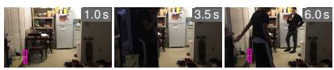

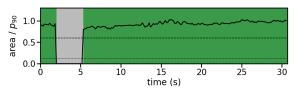

Timeline: “2.0–5.3 s not visible (vanished inside the frame, so it was blocked or hidden) . . . 5.3 s comes back into view”. A person walks past the camera. Ours: A. ✓ Direct: B. ✗

(e) Event existence (de4a73805c89). Do the coins ever get fully hidden? Gold: (A) yes.

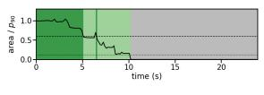  
Timeline: “5.1–10.2 s partly hidden; 10.2–23.9 s not visible . . . 10.2 s gets fully hidden and disappears for good”. The coins go into the piggy bank. Ours: A. ✓ Direct: B. ✗  
(f) Conditional state, failure (7b08562c551d). When the metal pot disappears for good, what is the state of the yellow skirt? Gold: (A) fully visible.

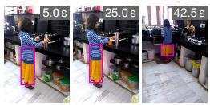  
Figure 6. TOC-Bench timeline questions (test videos, Qwen3-VL-8B). Magenta: the subject’s track box. Bars: mask area over its 90th-percentile area, coloured by the visibility state (dark green: fully visible; light green: partly hidden; grey: not visible); dashed and dotted lines mark the thresholds 0.6 and 0.12.

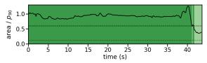  
The plan lists only the skirt, so the timeline has no time for the pot’s disappearance. Its one event is “41.7 s gets partly hidden”, and the VLM answers B. ✗ The direct answer is A. ✓

## G. Worked Examples

Figures 7–9 follow three test items through the agent, next to the direct answer of the same VLM (Qwen3-VL-8B). Each pane lists what the VLM sees, the prompt it receives, its reply and the number of calls. Each run reproduces the logged test outpu of the single configuration. The prompts are listed verbatim in Table 17.

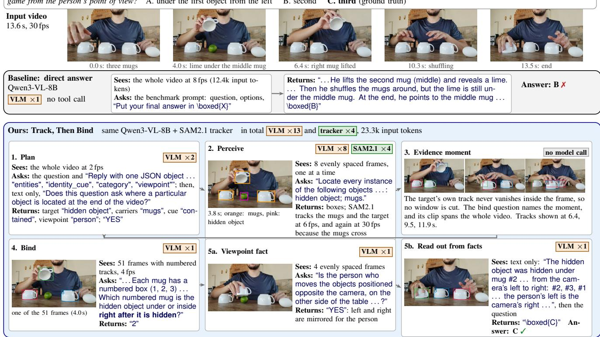  
Figure 7. Hidden target (Perception Test cup game video\_6159, test set). Grey: Qwen3-VL-8B answering directly from the video, one VLM call. Blue: Track, Then Bind with the same VLM and the SAM2.1 tracker. Badges give the calls of each step: orange for the VLM, green for the tracker sessions, grey for plain code. Prompts are quoted from the run and shortened with “. . . ”. This item takes the most common branch on real cup games: the target’s own track gives no moment, and the bind question is asked over the whole numbered clip.

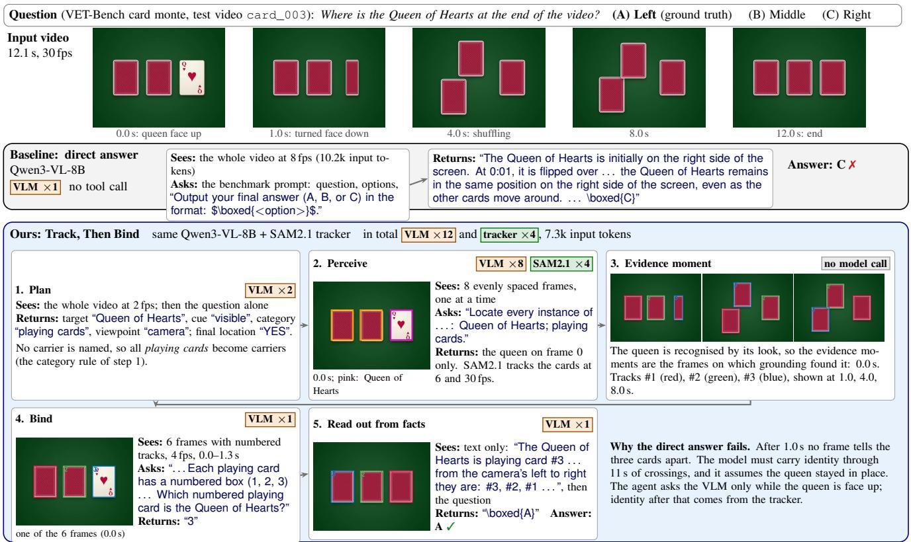  
Figure 8. Target recognised by its look (VET-Bench card monte card\_003, test set). The VLM is asked once, on a 1.3 s clip while the queen is face up; the 30 fps tracks carry the identity through the shuffle. Track #1 (red) is hard to see against the red card backs; this is the overlay the VLM receives.

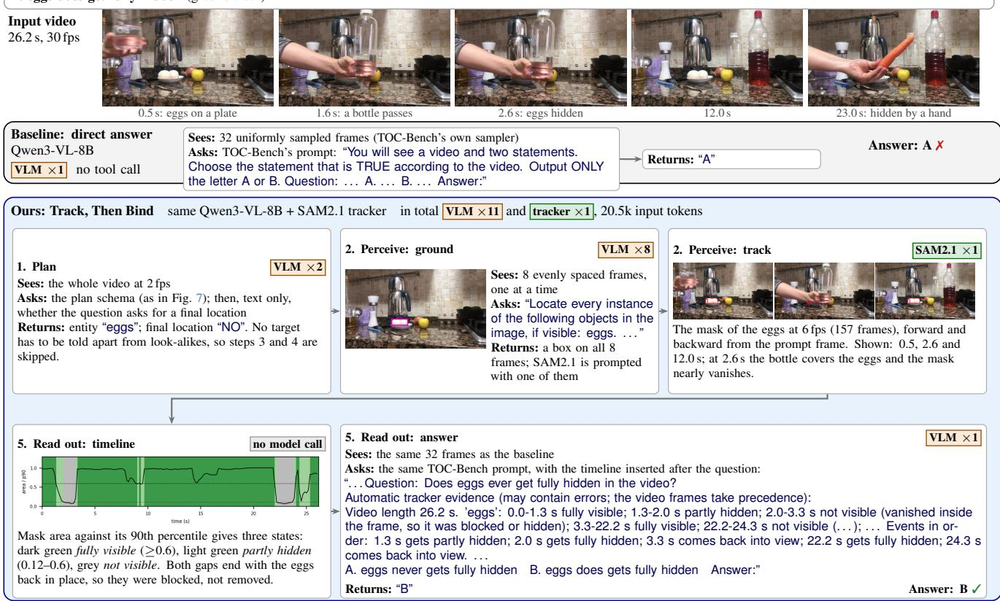  
Figure 9. Timeline question (TOC-Bench 8b0c33d38075, test set). The plan finds no target to tell apart, so the agent skips binding and answers with a timeline. Both runs see the same 32 frames and the same template; the only difference is the evidence text inserted after the question. It is built from the tracked mask of the eggs, without a model call.

## H. Prompts

Table 17. Unified agent’s prompts, verbatim (one set for all benchmarks). Slots in {braces} are filled from the plan, the tracks or the benchmark item.
<table><tr><td>Step</td><td>Input</td><td>Prompt</td></tr><tr><td>Plan (1)</td><td>whole video, 2 fps</td><td>You plan how to answer a question about a video. Question: {question} Reply with one JSON object and nothing else: {&quot;entities&quot;: [{&quot;name&quot;: ... , &quot;role&quot;: &quot;target&quot; | &quot;carrier&quot; | &quot;subject&quot;}], &quot;identity_cue&quot;: &quot;visible&quot; &quot;contained&quot; | &quot;none&quot;, &quot;category&quot;: ... , &quot;asks_final_location&quot;: true | false, &quot;viewpoint&quot;: &quot;camera&quot; | &quot;person&quot;} followed by one rule per field (target; carriers that move, hide or cover the target or look the same as it; subjects; recognised by its look vs. hidden in a carrier; final location; whose left and right)</td></tr><tr><td>Final location (1)</td><td>text only</td><td>Question about a video: {question} Does this question ask where a particular object is located at the end of the video (for example, which container it is in, or whether it is on the left, in the middle or on the right)? Reply YES or NO.</td></tr><tr><td>Ground (8, +8 if missing)</td><td>one frame</td><td>Locate every instance of the following objects in the image, if visible: {entity 1}; {entity 2}; ... Output a JSON list of {&quot;bbox_2d&quot;: [x1, y1, x2, y2], &quot;label&quot;: &quot;&lt;one of the names above&gt;&quot;}; output [] if none is visible.</td></tr><tr><td>Bind, by its look (1 per moment)</td><td>numbered tracks, 4 fps</td><td>These frames are from a video. Each {carrier} has a numbered box (1, 2, 3) drawn on it; a number always stays with the same physical object. Which numbered {carrier} is the {target}? Reply with a single number, or NONE if the {target} cannot be seen.</td></tr><tr><td>Bind, hidden (1 per moment)</td><td>numbered tracks, 4 fps</td><td>... Which numbered {carrier} is the {target} under or inside right after it is hidden? Reply with a single number, or NONE if you cannot tell.</td></tr><tr><td>Viewpoint (1, if asked)</td><td>4 uniform frames</td><td>Is the person who moves the objects positioned opposite the camera, on the other side of the table (so the camera looks at them from the front)? Reply YES or NO. Facts established by tracking every object through the whole video (identity was fixed when the target could</td></tr><tr><td>Read out, bound (1)</td><td>text only</td><td>be seen, and kept by the tracker afterwards): - The {target} was hidden under {carrier} #{k}. The tracker followed every {carrier} through the rest of the video. In the last frame where all {n} are tracked ({t} s), from the camera&#x27;s left to right they are: #.. .. So the {target} is under the {ordinal} {carrier} from the camera&#x27;s left. [- viewpoint fact - person-view position] Answer the question using these facts. then the benchmark prompt,</td></tr><tr><td>Read out, not bound (1)</td><td>the benchmark&#x27;s frames</td><td>then The facts above are reliabie. Reply with only the final answer in \boxed{X}. the benchmark&#x27;s prompt with Automatic tracker evidence (may contain errors; the video frames take precedence): {video length; one timeline line per subject} after the question</td></tr></table>

Table 18. Prompts of the per-benchmark configurations, verbatim. Slots in {braces} are filled by the agent from earlier steps or from the benchmark item. These configurations are the comparison of Table 7.
<table><tr><td>Step</td><td>Input</td><td>Prompt</td></tr><tr><td colspan="3">Direct baselines (one call; the benchmark&#x27;s own prompt) Perception Test video, 8 fps</td></tr><tr><td></td><td></td><td>{question}\n\nA. {option}\nB. {option}\nC. {option}\n\nPlease select the correct answer from the options above. Put your final answer in \boxed{X} where X is the letter of your choice. Where is the {target} at the end of the video?\n(A) Left\n(B) Middle\n(C) Right\nOutput your final answer (A,</td></tr><tr><td>VET-Bench card monte TOC-Bench</td><td>video, 8 fps 32 uniform frames</td><td>B, or C) in the format: $\boxed{&lt;option&gt;}$ System: You are a video understanding model. Follow output format exactly.</td></tr><tr><td>(two-statement format; other formats use their own templates)</td><td></td><td>User: You will see a video and two statements. Choose the statement that is TRUE according to the video. Output ONLY the letter A or B.\n\nQuestion: {question}\nA. {statement A}\nB. {statement B}\nAnswer:</td></tr><tr><td>SpatialClaw (its question field)</td><td>its own frames</td><td>the benchmark prompt above, verbatim; for TOC-Bench the system and user messages joined by a blank line</td></tr><tr><td colspan="3">Containment hand-off (Perception Test cup games; 20 calls per item)</td></tr><tr><td>Parse (1)</td><td>video, 2 fps</td><td>In this video a person plays a shell game: a small object is hidden under one of several similar containers, then the containers are moved around. Reply with two short noun phrases separated by &#x27;l&#x27;: first, the containers (plural, no number); second, the small object that gets hidden and disappears from view under a</td></tr><tr><td>Ground carriers (8)</td><td>one frame</td><td>container. Ignore other objects that stay visible. No other text. Locate every {containers} in the image. Output a JSON list of {&quot;bbox_2d&quot;: [x1, y1, x2, y2], &quot;label&quot;: &quot;{containers}&quot;}.</td></tr><tr><td>Ground target (8)</td><td>one frame</td><td>Locate the {target} in the image, if it is visible. Output a JSON list of {&quot;bbox 2d&quot;: [x1, y1, x2, y2], &quot;label&quot;: &quot;{target}&quot;}; output [] if it is not visible.</td></tr><tr><td>Viewpoint (1)</td><td>last frame</td><td>Is the person playing this game sitting or standing across the table, facing the camera? Reply YES if the person faces the camera, or NO if the camera shows the scene from the person&#x27;s own viewpoint (for</td></tr><tr><td>Bind (1)</td><td>numbered-track frames, 2 fps</td><td>example, held by or mounted on the person). In this video a person hides {target} under one of several {containers} and then moves them around. Each container has a numbered box (1, 2, 3) drawn on it in every frame; a number always stays with the same</td></tr><tr><td></td><td></td><td>physical container. Which numbered container is {target} under right after it is hidden? Reply with a single number. identical, ending ... under at the END of the video? Reply with a single number.</td></tr><tr><td colspan="3">Bind, ablation (1) same Visible identity (VET-Bench card monte; 5 calls per item)</td></tr><tr><td>Ground (4) Bind (1)</td><td>one frame numbered-track frames</td><td>Locate every playing card in the image. Output a JSON list of {&quot;bbox_2d&quot;: [x1, y1, x2, y2], &quot;label&quot;: &quot;card&quot;}. These frames show the start of a card game. Each card has a numbered box (1, 2, 3) drawn on it; a</td></tr><tr><td></td><td>4 fps, first 30%</td><td>number always stays with the same physical card. Which numbered card shows the {target} face up? Reply with a single number.</td></tr><tr><td colspan="3">Subject timeline (TOC-Bench; 1 + 16 per subject + 1 calls per item) Parse subjects (1)</td></tr><tr><td></td><td>text only</td><td>List the physical objects or people that this video question is about, as short noun phrases exactly as written, one per line, at most 3. No other text.\n\n{question}\n{statements or events} Locate the {subject} in the image, if it is visible. Output a JSON list of {&quot;bbox_2d&quot;: [x1, y1, x2, y2], &quot;label&quot;:</td></tr><tr><td>Ground (16 per subject)</td><td>one frame</td><td>&quot;{subject}&quot;}; output [] if not visible. the TOC-Bench template above, with {question} replaced by {question}\n\nAutomatic tracker evidence (may</td></tr><tr><td>Answer (1)</td><td>32 uniform frames</td><td>contain errors; the video frames take precedence):\n{evidence lines}</td></tr></table>