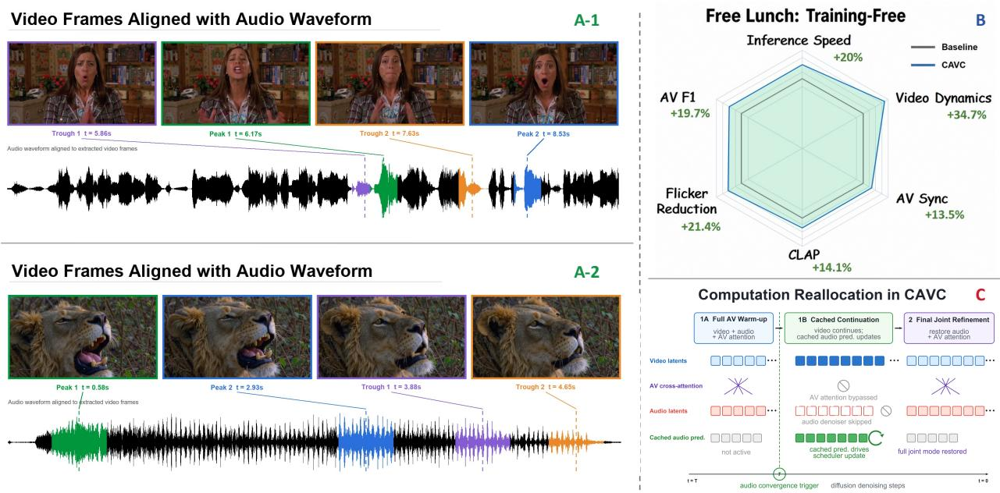
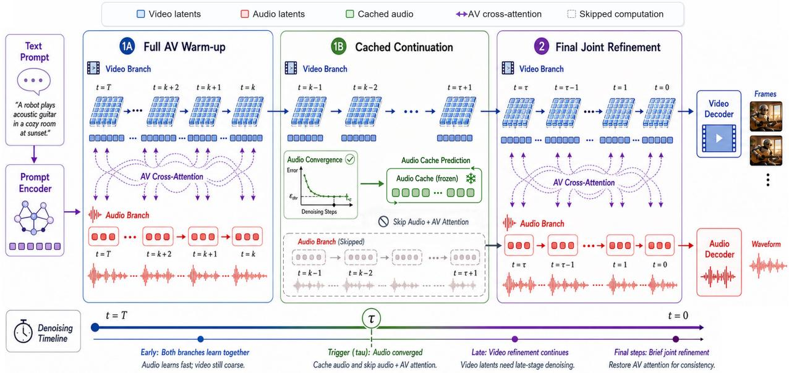
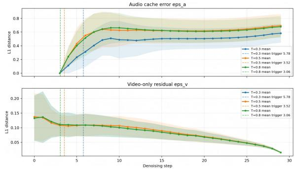
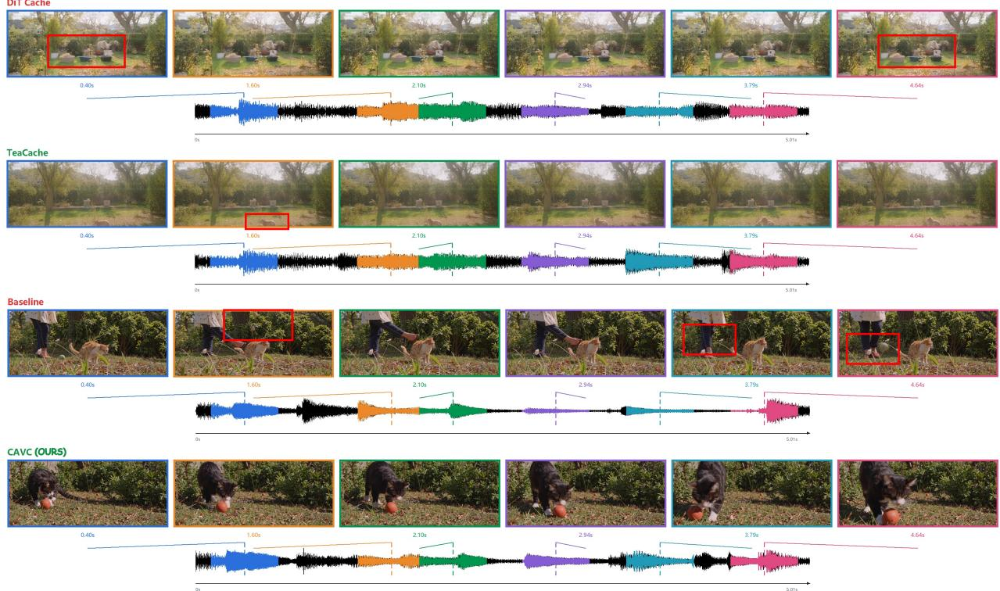
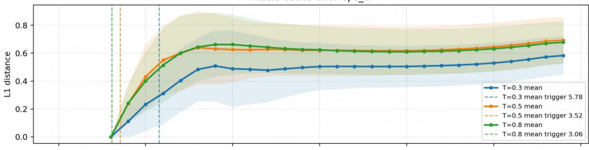
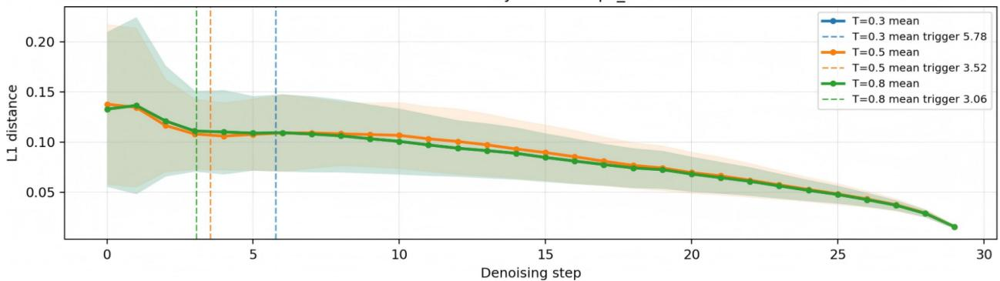

PREPRINT

October 2026

# CAVC: Convergence-Adaptive Audio-Visual Cache for Modality-Asymmetric Diffusion Generation

Lifan Jiang1,2, Yibo Zhao1,2, Senlin cheng2 Bolei Xu2, XIAOBO LI2, Can Ye2 Dehai Zhao1, Deng Cai1, Boxi Wu1,†

1State Key Lab of CAD&CG, Zhejiang University 2Ant Group

lifanjiang@zju.edu.cn †Corresponding author: Boxi Wu.

## ABSTRACT

Diffusion-based audio-visual generation methods typically perform joint denoising of audio and video latents through out the entire sampling trajectory, repeatedly executing modality-specific denoising branches and cross-modal attention at every timestep. However, we observe that such uniform joint computation is not always necessary. The key is a modality-asymmetric recoverability: audio-side drift introduced by mid-stage caching can be substantially reduced by only a few terminal joint denoising steps, whereas video-side degradation caused by caching leads to persistent loss of motion and temporal details. This asymmetry suggests that inference acceleration should selectively cache recoverable audio-side computation while preserving full video refinement. Motivated by this observation, we propose Convergence-Adaptive Audio-Visual Cache (CAVC), a training-free modality-asymmetric caching framework. CAVC adopts a sandwich-structured computation allocation: after detecting that audio denoiser outputs enter a cache-tolerant regime, it caches and reuses the audio denoiser output to bypass audio denoising and cross-modal attention in the middle stage, while the video branch continues independent spatio-temporal refinement; a few joint steps are then restored at the end to reduce accumulated cross-modal drift and improve synchronization. Experiment across multiple public benchmarks demonstrate that CAVC achieves 1.10–1.35× wall-clock acceleration, improves several visual dynamics and temporal statistics, and maintains competitive audio fidelity and audio-visual alignment.

Keywords: Audio-visual generation; Diffusion models; Adaptive caching; Inference acceleration

## 1 Introduction

Text-to-audio-visual generation aims to synthesize semantically consistent video and temporally synchronized audio from text, becoming a pivotal task in multimodal generative modeling Singer et al. (2022); Ho et al. (2022); Blattmann et al. (2023); Huang et al. (2023); Zhang et al. (2024); He et al. (2025). While unimodal diffusion models excel independently Guo et al. (2023); Chen et al. (2023); Liu et al. (2024b), their temporal and semantic alignment requires joint denoising via audio-video cross-modal attention Ruan et al. (2023); Tang et al. (2023, 2024); Xing et al. (2024a); Luo et al. (2023b). Despite its effectiveness, this paradigm introduces prohibitive inference costs by repeatedly executing modality-specific branches and dense cross-attention at every sampling step, creating a major bottleneck for largescale deployment.

A straightforward remedy is to adopt existing diffusion acceleration techniques, including advanced ODE/SDE solvers Song, Meng, and Ermon (2020); Lu et al. (2022);

Zhao et al. (2023), knowledge distillation for few-step generation Salimans and Ho (2022); Luo et al. (2023a); Meng et al. (2023); Yin et al. (2024), and training-free feature caching across adjacent timesteps Ma, Fang, and Wang (2024); Bolya and Hoffman (2023); Wimbauer et al. (2024). However, directly applying these strategies to audio-visual generation is not always satisfactory. Reducing the entire sampling trajectory compresses refinement of both modalities, often harming video details and temporal dynamics. Meanwhile, modality-agnostic caching Ma, Fang, and Wang (2024) treats audio and video computation uniformly, ignoring their potentially different roles throughout denoising. These limitations raise a fundamental question: isfull audio-video joint computation necessary at every denoising step?

We answer this question through the lens of a modalityasymmetric recoverability in joint audio-visual denoising. Importantly, we do not assume that audio predictions numerically converge faster than video predictions. Instead, CAVC exploits a recoverability asymmetry: audio-side drift induced by mid-stage caching can be substantially reduced by a few terminal joint steps, whereas video-side degradation leads to persistent loss of motion and temporal details that brief terminal recoupling cannot recover. This asymmetry is supported by our branch-freezing ablations, where caching or freezing the video branch yields high raw speedups but severely degrades video dynamics, while audio-only caching preserves video refinement and benefits from joint tuning.

  
Figure 1. A: CAVC generates high-fidelity video frames synchronized with complex audio waveforms. B: On General-80, training-free CAVC achieves a favorable quality-efficiency trade-off across generation quality, cross-modal alignment, and measured wall-clock inference speed. C: CAVC exploits modality-asymmetric recoverability: mid-stage audio-side drift induced by caching can be substantially reduced by a short terminal joint refinement, whereas video-side degradation is difficult to recover. CAVC preserves full video refinement while bypassing recoverable audio-side computation in the middle stage.

Motivated by this observation, we propose Convergence-Adaptive Audio-Visual Cache (CAVC), a training-free modality-asymmetric caching framework with a sandwichstructured computation allocation. Once the audio denoiser output enters a cache-tolerant regime, CAVC caches and reuses the audio-side network output to bypass the audio denoising branch in subsequent middle steps; the audio latent is still updated by the original scheduler using the cached output, so its sampling trajectory continues without repeated audio forward passes. Simultaneously, CAVC bypasses audio-video cross-modal attention, allowing the video branch to proceed with independent spatio-temporal refinement conditioned on its visual state and textual guidance. Finally, CAVC restores full joint denoising for a few terminal steps. Empirically, this short recoupling reduces cross-modal drift and improves audio-visual alignment before decoding.

We also provide a conditional perturbation analysis of cached-audio and video-only residuals. Under local smoothness assumptions, the bounds expose how these residuals and cache duration affect deviation from the full sampler; recoverability is evaluated empirically. On AVGen-Bench, VABench T2AV, and General-80, CAVC achieves 1.10– 1.35× speedups while improving visual dynamics and maintaining competitive audio fidelity and audio-visual alignment. Our main contributions are summarized as follows:

• Modality-asymmetric recoverability. We identify that audio-side drift introduced by mid-stage caching can be substantially reduced by a few terminal joint denoising steps, whereas video-side degradation is difficult to recover, motivating asymmetric computation allocation.

• Sandwich-structured asymmetric caching. We propose CAVC, a training-free framework that bypasses recoverable audio-side computation and cross-modal attention in the middle stage while preserving full video refinement, then restores minimal joint denoising at the end for synchronization refinement.

• Favorable quality-efficiency trade-off. Across three benchmarks, CAVC achieves 1.10–1.35× acceleration, improves several motion and temporal metrics, and maintains competitive audio fidelity and audiovisual alignment, supported by ablations and perturbation analysis.

## 2 Related Work

## 2.1 Audio-Visual Diffusion Generation

Multimodal generative modeling has advanced from independent unimodal video Singer et al. (2022); Guo et al. (2023) and audio synthesis Liu et al. (2023, 2024b) to audio-visual joint generation. Representative frameworks such as MM-Diffusion Ruan et al. (2023) and CoDi Tang et al. (2023) achieve this by passing audio and video latents through dual denoising branches fused via dense crossmodal attention. Recent advancements Xing et al. (2024b);

  
Figure 2. Overview of the CAVC framework. The denoising trajectory $( t = T  0 )$ is dynamically partitioned based on modality convergence. (1A) Full AV Warm-up: During early high-noise stages, audio/video branches and AV cross-attention fully execute to establish semantic binding. (Trigger τ): An online monitor tracks audio prediction changes; once stabilized, the audio cache activates. (1B) Cached Continuation: Cached audio predictions are reused. Bypassing the expensive audio branch and AV attention frees the video branch for independent spatio-temporal refinement without being over-constrained by static audio. (2) Final Joint Refinement: Full joint computation is terminally restored for a few steps to reduce accumulated cross-modal drift and refine audio-visual synchronization before decoding.

Wang et al. (2026); Sun et al. (2025) employ latent aligners to enhance fine-grained synchronization. However, this tightly coupled paradigm mandates repeated execution of modality-specific branches and expensive cross-modal interactions Zhao et al. (2024) at every denoising step, causing prohibitive computational overhead. Our work addresses this bottleneck by dynamically reallocating computation during inference, bypassing the need for architectural redesigns.

## 2.2 Acceleration of Diffusion Models

Accelerating diffusion inference predominantly reduces sampling steps via advanced solvers Song, Meng, and Ermon (2020); Lu et al. (2022); Zhao et al. (2023); Esser et al. (2024) or distillation Luo et al. (2023a); Yin et al. (2024); Meng et al. (2023); Sauer et al. (2024). Complementary training-free approaches reduce per-step costs via token merging Bolya et al. (2023); Wang et al. (2024) or structured pruning Fang, Ma, and Wang (2023). Applying these trajectory-shortening techniques to audio-visual generation uniformly truncates critical spatio-temporal refinement, inevitably degrading visual dynamics. In contrast, CAVC preserves necessary sampling steps for the video modality, selectively approximating recoverable audio-side computation while maintaining the video refinement trajectory.

## 2.3 Modality-Agnostic Feature Caching

Orthogonal to step reduction, training-free mechanisms exploit temporal redundancy across adjacent timesteps to avoid redundant evaluations. Methods like DeepCache Ma, Fang, and Wang (2024) cache high-level features, while recent extensions explore evolutionary scheduling Aggarwal, Shrivastava, and Gwilliam (2025), adaptive video caching Lyu et al. (2025); Team (2024), and temporal redundancy minimization Lou et al. (2024). Despite their success, existing caching strategies remain inherently modality-agnostic, treating audio and video uniformly with synchronous caching operations. This uniform treatment overlooks the inherent recoverability asymmetry between modalities. CAVC differentiates itself by redistributing computation according to this asymmetry, applying convergence-adaptive caching exclusively to the recoverable audio branch.

## 3 Method

We propose CAVC, a training-free acceleration framework for asymmetric dual-stream audio-visual diffusion transformers, selectively approximating recoverable audio-side computation while preserving full video refinement.

## 3.1 Asymmetric Problem Formulation

We consider a standard text-conditioned audio-visual diffusion model. Given text condition c, let $\nu _ { t }$ and $a _ { t }$ denote the video and audio latents at denoising step $t \in \{ T , T -$ $1 , \ldots , 1 \}$ with noise level $\sigma _ { t }$ . Larger t corresponds to higher noise, and denoising proceeds from $t = T$ to the final state at t = 0. For empirical trigger locations, we use the zero-based forward execution index $k = T - t ,$ , which increases as t decreases. The full joint denoising model simultaneously predicts denoised outputs for both modalities:

$$
\begin{array} { r } { \hat { y } _ { \nu } ^ { t } = f _ { \nu } ( \nu _ { t } , a _ { t } , c , \sigma _ { t } ) , \qquad \hat { y } _ { a } ^ { t } = f _ { a } ( \nu _ { t } , a _ { t } , c , \sigma _ { t } ) , } \end{array}\tag{1}
$$

where $f _ { \nu }$ and $f _ { a }$ denote the video and audio branches, mutually coupled through audio-to-video (A2V) and video-toaudio (V2A) cross-modal attention. The scheduler subse-

quently updates both latents:

$$
\nu _ { t - 1 } = S _ { t } ^ { \nu } \big ( \nu _ { t } , \hat { y } _ { \nu } ^ { t } \big ) , \qquad a _ { t - 1 } = S _ { t } ^ { a } \big ( a _ { t } , \hat { y } _ { a } ^ { t } \big ) .\tag{2}
$$

Executing both branches at every step supports semantic binding but introduces severe computational redundancy. Our core observation is a recoverability asymmetry between modalities. When we refer to audio stabilization, we do not imply that audio predictions numerically converge faster than video predictions. Rather, we refer to the onset of a cache-tolerant regime—detectable via an online criterion—where reusing audio denoiser outputs introduces drift that remains empirically reducible by terminal joint refinement. By recoverability, we mean the empirical property that such audio-side drift can be substantially reduced by a few terminal joint denoising steps. Video dynamics do not share this property: interrupting video refinement causes persistent motion and temporal degradation that brief terminal recoupling cannot restore. This asymmetry provides the motivation for CAVC: inference acceleration must maintain full video-branch activity, approximate only recoverable audio-side computation, and briefly restore joint denoising at the end.

## 3.2 Convergence-Adaptive Audio-Visual Cache

Driven by the recoverability asymmetry, CAVC adopts a sandwich-structured computation allocation with three phases: a full joint warm-up to establish cross-modal binding, an asymmetric cached continuation phase that bypasses recoverable audio-side computation while video continues full refinement, and a brief final joint refinement to reduce cross-modal drift.

Stage 1 (Phase A): Full Audio-Visual Warm-up. For $T \geq t \geq \tau ,$ CAVC follows the full sampler above, establishing scene layout, audio categories, and cross-modal binding. Premature decoupling can introduce drift that terminal refinement does not reliably remove.

Stage 1 (Trigger): Online Audio Convergence Detection. Because audio cacheability varies with prompt complexity, fixed triggers are suboptimal. CAVC thus employs adaptive online monitoring; for $t < T$ , it computes the mean absolute change from the previously executed, higher-noise prediction at t + 1:

$$
\Delta _ { a } ^ { t } = \mathrm { m e a n } \big ( \big | \hat { y } _ { a } ^ { t } - \hat { y } _ { a } ^ { t + 1 } \big | \big ) .\tag{3}
$$

Caching triggers at timestep τ when $\Delta _ { a } ^ { t } < \theta$ persists for W execution steps. This threshold is an empirical proxy for a cache-tolerant regime (Figure 3, Table 3d), after which CAVC stores $\hat { y } _ { a } ^ { * } = \hat { y } _ { a } ^ { \tau }$

Stage 1 (Phase B): Video-Only Continuation with Cached Audio. Let $t _ { \mathrm { r e f } }$ denote the first timestep of terminal joint refinement, with $t _ { \mathrm { r e f } } = 3$ in our default setting. During the cached interval $\mathcal { S } = \{ \tau - 1 , \tau - 2 , \ldots , t _ { \mathrm { r e f } } + 1 \}$ CAVC simultaneously bypasses the audio denoiser and AV cross-modal attention. The audio latent continues its trajectory using the cached audio denoiser output:

$$
\hat { y } _ { a } ^ { t } : = \hat { y } _ { a } ^ { * } , \qquad \tilde { a } _ { t - 1 } = S _ { t } ^ { a } ( \tilde { a } _ { t } , \hat { y } _ { a } ^ { * } ) .\tag{4}
$$

Critically, CAVC caches the denoiser output rather than freezing the latent state directly, enabling the scheduler to continue smooth variance integration along the original

  
Figure 3. Empirical approximation residuals over the forward execution index k. Top: The instantaneous audio cache residual grows after cache triggering (dashed lines) but stays within a stable empirical range; a tighter threshold T (θ in text; e.g., 0.3) delays the trigger and lowers the observed residual ceiling. Bottom: The video-only residual stabilizes and decays, suggesting that the dominant cross-modal dependencies are established during Phase A warm-up.

noise schedule $\sigma _ { t }$ . The validity of this cross-noise-level output reuse is discussed in Supplement E. Simultaneously, the video branch proceeds independently:

$$
\begin{array} { r } { \tilde { y } _ { \nu } ^ { t } = g _ { \nu } \big ( \tilde { \nu } _ { t } , c , \sigma _ { t } \big ) , \qquad \tilde { \nu } _ { t - 1 } = S _ { t } ^ { \nu } \big ( \tilde { \nu } _ { t } , \tilde { y } _ { \nu } ^ { t } \big ) , } \end{array}\tag{5}
$$

where $g _ { \nu }$ denotes the video denoiser with AV cross-attention modules bypassed via residual skip connections while fully preserving the video self-/temporal attention and text conditioning. This eliminates the computationally expensive $O ( N _ { \nu } N _ { a } )$ cross-attention and prevents cached audio features from over-constraining video dynamics.

Stage 2 (Phase C): Final Joint Refinement. CAVC restores full joint denoising for $t = t _ { \mathrm { r e f } } , \ldots , 1$ , producing the final states at $t = 0 \colon$

$$
\begin{array} { r } { \tilde { y } _ { \nu } ^ { t } = f _ { \nu } ( \tilde { \nu } _ { t } , \tilde { a } _ { t } , c , \sigma _ { t } ) , \qquad \tilde { y } _ { a } ^ { t } = f _ { a } ( \tilde { \nu } _ { t } , \tilde { a } _ { t } , c , \sigma _ { t } ) , } \end{array}\tag{6}
$$

$$
\tilde { \nu } _ { t - 1 } = S _ { t } ^ { \nu } ( \tilde { \nu } _ { t } , \tilde { y } _ { \nu } ^ { t } ) , \qquad \tilde { a } _ { t - 1 } = S _ { t } ^ { a } ( \tilde { a } _ { t } , \tilde { y } _ { a } ^ { t } ) .\tag{7}
$$

This lightweight recoupling empirically reduces crossmodal discrepancies from Phase B and improves audio-visual synchronization before decoding. Table 4 evaluates this asymmetric recoverability.

## 3.3 Theoretical Analysis

We formalize the deviation between CAVC and the full sampler, characterizing how the approximation errors introduced during Phase B accumulate under standard smoothness assumptions. This analysis should be understood as a perturbation characterization rather than a claim of perfect recovery.

Error Sources. Post-triggering, CAVC introduces two approximation errors, empirically quantified in Figure 3. The audio cache error $\varepsilon _ { a }$ captures the discrepancy of freezing the audio prediction:

$$
\begin{array} { r } { \| f _ { a } \big ( \nu _ { t } , a _ { t } , c , \sigma _ { t } \big ) - \hat { y } _ { a } ^ { * } \| \leq \varepsilon _ { a } , } \end{array}\tag{8}
$$

and the video-only residual $\varepsilon _ { \nu }$ captures the impact of discarding AV cross-attention:

$$
\begin{array} { r } { \| f _ { \nu } ( \nu _ { t } , a _ { t } , c , \sigma _ { t } ) - g _ { \nu } ( \nu _ { t } , c , \sigma _ { t } ) \| \leq \varepsilon _ { \nu } . } \end{array}\tag{9}
$$

  
Figure 4. Qualitative comparison of audio-visual joint generation. Given the text prompt $\mathbf { \ddot { a } }$ cat playing with a ball in the yard”, the generic Cache-DiT and TeaCache baselines exhibit visible artifacts and weaker prompt following. For this 121-frame 1K example, thei cache-state estimation and update operations also introduce net overhead (see Table 1). In contrast, CAVC achieves a 1.15× inference speedup while preserving stronger visual quality, spatio-temporal consistency, and dynamics.

The adaptive threshold is an empirical proxy for entering a cache-tolerant audio regime, while Phase A warm-up reduces the dominant cross-modal dependency before AV attention is bypassed.

Latent Deviation Bound. Assuming the scheduler satisfies local Lipschitz conditions with constants $\alpha _ { t }$ (w.r.t. the latent) and $\beta _ { t }$ (w.r.t. the prediction), the cumulative latent deviations $e _ { a } ^ { t } = \lVert a _ { t } - \tilde { a } _ { t } \rVert$ and $e _ { \nu } ^ { t } = \| \nu _ { t } - \tilde { \nu } _ { t } \|$ within the cached interval $\mathcal { S } = \{ \tau - 1 , \tau - 2 , \ldots , t _ { \mathrm { r e f } } + 1 \}$ satisfy:

$$
e _ { a } ^ { t - 1 } \leq \alpha _ { t } e _ { a } ^ { t } + \beta _ { t } \varepsilon _ { a } ,\tag{10}
$$

$$
\begin{array} { r } { e _ { \nu } ^ { t - 1 } \leq ( \alpha _ { t } + \beta _ { t } L _ { g } ) e _ { \nu } ^ { t } + \beta _ { t } \varepsilon _ { \nu } , } \end{array}\tag{11}
$$

where $L _ { g }$ is the local Lipschitz constant of $g _ { \nu }$ . Because Phase A includes the full update at trigger step τ, the two trajectories agree at the start of Phase B, i.e., $e _ { a } ^ { \tau - 1 } = e _ { \nu } ^ { \tau - 1 } =$ 0. Unrolling over $\mathcal { I }$ yields:

$$
e _ { a } ^ { t _ { \mathrm { r e f } } } \leq \sum _ { t = t _ { \mathrm { r e f } } + 1 } ^ { \tau - 1 } \left( \prod _ { j = t _ { \mathrm { r e f } } + 1 } ^ { t - 1 } \alpha _ { j } \right) \beta _ { t } \varepsilon _ { a } ,\tag{12}
$$

$$
e _ { \nu } ^ { t _ { \mathrm { r e f } } } \leq \sum _ { t = t _ { \mathrm { r e f } } + 1 } ^ { \tau - 1 } \left( \prod _ { j = t _ { \mathrm { r e f } } + 1 } ^ { t - 1 } ( \alpha _ { j } + \beta _ { j } L _ { g } ) \right) \beta _ { t } \varepsilon _ { \nu } .\tag{13}
$$

These bounds characterize how terminal deviation depends on $\varepsilon _ { a } , \varepsilon _ { \nu } .$ , and caching duration $| { \mathcal { I } } |$ under the stated smoothness assumptions.

Output Quality Bound. Let $E _ { t } = e _ { a } ^ { t } + e _ { \nu } ^ { t }$ . Assume that each terminal joint update in Phase C is locally Lipschitz in this product-state norm with constant κt, and define $K _ { C } =$ $\textstyle \prod _ { t \in { \mathcal { I } } } \kappa _ { t }$ for $\mathcal { J } = \{ t _ { \mathrm { r e f } } , t _ { \mathrm { r e f } } - 1 , \ldots , 1 \}$ . Let decoders $D _ { \nu } , D _ { a }$ and a smooth scalar output functional $Q$ be locally Lipschitz with constants $L _ { D } ^ { \nu } , L _ { D } ^ { a }$ , and $L _ { Q }$ . The final output discrepancy satisfies:

$$
\begin{array} { r l } & { | Q ( y ) - Q ( \tilde { y } ) | \leq L _ { \mathcal { Q } } \bigl ( L _ { D } ^ { \nu } e _ { \nu } ^ { 0 } + L _ { D } ^ { a } e _ { a } ^ { 0 } \bigr ) } \\ & { \qquad \leq L _ { \mathcal { Q } } \operatorname* { m a x } \{ L _ { D } ^ { \nu } , L _ { D } ^ { a } \} K _ { C } \bigl ( e _ { \nu } ^ { t _ { \mathrm { r e f } } } + e _ { a } ^ { t _ { \mathrm { r e f } } } \bigr ) . } \end{array}\tag{14}
$$

This conditional bound characterizes error propagation through Phase C; it does not require the terminal updates to be contractive. Their empirical recovery behavior is evaluated in Table 4. The complete derivation, including nested state bounding and multi-step accumulation, is detailed in Supplement F.

## 3.4 Complexity Analysis

Let $N _ { 1 }$ and $N _ { 2 }$ denote the numbers of Stage-1 steps and terminal Phase-C steps, respectively, with $N _ { 2 } = 3$ in the native LTX-2.3 pipeline. Let $k _ { \tau } = T - \tau$ be the zero-based trigger index and $n _ { \tau } = k _ { \tau } + 1$ the number of full joint Stage-1 evaluations executed through the trigger step. Thus, unlike the diffusion timestep $\tau , n _ { \tau }$ is a step count. Let $C _ { \nu } ^ { ( s ) } , C _ { a } ^ { ( s ) }$ and $C _ { a \nu } ^ { ( s ) }$ denote the per-step costs of the video branch, audio branch, and cross-attention in stage $s \in \{ 1 , 2 \} ; C _ { d }$ is the perstep detection cost, and $C _ { \mathrm { f i x } }$ collects shared stage-transition, decoding, and I/O costs. The full sampler costs:

$$
\begin{array} { r l r } { \mathrm { { } } } & { { \mathcal { C } } _ { \mathrm { { f u l l } } } = N _ { 1 } \left( C _ { \nu } ^ { ( 1 ) } + C _ { a } ^ { ( 1 ) } + C _ { a \nu } ^ { ( 1 ) } \right) } & { } \\ { \mathrm { { } } } & { { + N _ { 2 } \left( C _ { \nu } ^ { ( 2 ) } + C _ { a } ^ { ( 2 ) } + C _ { a \nu } ^ { ( 2 ) } \right) + C _ { \mathrm { { f i x } } } . } } \end{array}\tag{15}
$$

During Stage 1, CAVC executes the audio branch and crossattention only before caching, while leaving the native ter-

Table 1. Evaluation of Visual Quality and Low-Level Statistics across three benchmarks. Low-level statistics are no-reference diagnostic metrics; definitions are provided in the supplement. ↑ indicates higher is better, and ↓ indicates lower is better. Bold indicates the best performance. CAVC provides a favorable quality-efficiency trade-off while achieving inference speedups.
<table><tr><td rowspan="2">Benchmark</td><td rowspan="2">Method</td><td rowspan="2">Speedup ↑</td><td colspan="4">Visual Quality Huang et al. (2025)</td><td rowspan="2"></td><td colspan="3">Low-Level Statistics</td></tr><tr><td>Subj.Con↑</td><td>Bg.Con↑</td><td>Mot.Smth↑</td><td>Dyn.Deg↑</td><td>Aes.Qual↑ Natural↑</td><td>Temporal↑</td><td>Flicker↓</td></tr><tr><td rowspan="4">AVGen-Bench</td><td>TeaCache Liu et al. (2024a)</td><td>0.45×</td><td>0.864</td><td>0.920</td><td>0.989</td><td>0.272</td><td>0.452</td><td>0.473</td><td>0.619</td><td>0.522</td></tr><tr><td>Cache-DiT DefTruth (2025)</td><td>0.24×</td><td>0.869</td><td>0.920</td><td>0.989</td><td>0.298</td><td>0.462</td><td>0.463</td><td>0.612</td><td>0.517</td></tr><tr><td>Full AV HaCohen et al. (2026)</td><td>1.00×</td><td>0.7895</td><td>0.8622</td><td>0.9200</td><td>0.655</td><td>0.524</td><td>0.5272</td><td>0.6534</td><td>0.3346</td></tr><tr><td>CAVC (Ours)</td><td>1.10× (+10.0%)</td><td>0.874(+10.7%)</td><td>0.925 (+7.3%)</td><td>0.991 (+7.7%)</td><td>0.6701 (+2.3%)</td><td>0.522</td><td>0.5540(+5.1%)</td><td>0.6600</td><td>0.2800 (-16.3%)</td></tr><tr><td rowspan="4">VABench T2AV</td><td>TeaCache Liu et al. (2024a)</td><td>0.64×</td><td>0.936</td><td>0.956</td><td>0.993</td><td>0.099</td><td>0.482</td><td>0.409</td><td>0.668</td><td>0.180</td></tr><tr><td>Cache-DiT DefTruth (2025)</td><td>0.35×</td><td>0.942</td><td>0.959</td><td>0.994</td><td>0.094</td><td>0.500</td><td>0.402</td><td>0.655</td><td>0.170</td></tr><tr><td>Full AV HaCohen et al. (2026)</td><td>1.00×</td><td>0.9280</td><td>0.9530</td><td>0.994</td><td>0.4320</td><td>0.5540</td><td>0.4193</td><td>0.6621</td><td>0.1608</td></tr><tr><td>CAVC (Ours)</td><td>1.35×(+34.7%)</td><td>0.932</td><td>0.954</td><td>0.994</td><td>0.4470 (+3.5%)</td><td>0.559</td><td>0.509 (+21.4%)</td><td>0.718 (+8.4%)</td><td>0.176</td></tr><tr><td rowspan="4">General-80</td><td>TeaCache Liu et al. (2024a)</td><td>0.39×</td><td>0.932</td><td>0.957</td><td>0.990</td><td>0.275</td><td>0.519</td><td>0.477</td><td>0.667</td><td>0.467</td></tr><tr><td>Cache-DiT DefTruth (2025)</td><td>0.20×</td><td>0.938</td><td>0.961</td><td>0.991</td><td>0.237</td><td>0.544</td><td>0.520</td><td>0.649</td><td>0.493</td></tr><tr><td>Full AV HaCohen et al. (2026)</td><td>1.00×</td><td>0.9460</td><td>0.9540</td><td>0.9920</td><td>0.3800</td><td>0.5560</td><td>0.6349</td><td>0.7136</td><td>0.3346</td></tr><tr><td>CAVC (Ours)</td><td>1.20×(+20.0%)</td><td>0.949</td><td>0.961</td><td>0.993</td><td>0.512(+34.7%)</td><td>0.561</td><td>0.490</td><td>0.718</td><td>0.263 (-21.4%)</td></tr></table>

Table 2. Evaluation of Automated Audio & MLLM-Based Quality and Audio-Visual Alignment & Physics across three benchmarks. AV-F1 is an onset-based diagnostic metric. ↑ indicates higher is better; bold indicates best performance.
<table><tr><td rowspan="2">Benchmark</td><td rowspan="2">Method</td><td rowspan="2">Speedup ↑</td><td colspan="4">Automated Audio &amp; MLLM Quality</td><td rowspan="2"></td><td colspan="3">Audio-Visual &amp; Physics</td></tr><tr><td>DNSMOS↑</td><td>CLAP↑</td><td>Aud.Real↑</td><td>Expr.↑ Vis.Real↑</td><td>AV-F1↑</td><td>AV Sync↑</td><td>Lo-Phy↑</td></tr><tr><td rowspan="4">AVGen-Bench</td><td>TeaCache Liu et al. (2024a)</td><td>0.45×</td><td>1.607</td><td>0.366</td><td>4.055</td><td>4.264</td><td>4.609</td><td>0.601</td><td>0.429</td><td>3.936</td></tr><tr><td>Cache-DiT DefTruth (2025)</td><td>0.24×</td><td>1.676</td><td>0.418</td><td>4.068</td><td>4.319</td><td>4.566</td><td>0.614</td><td>0.249</td><td>3.911</td></tr><tr><td>Full AV HaCohen et al. (2026)</td><td>1.00×</td><td>1.706</td><td>0.435</td><td>3.925</td><td>4.070</td><td>4.475</td><td>0.5381</td><td>0.561</td><td>3.847</td></tr><tr><td>CAVC (Ours)</td><td>1.10× (+10.0%)</td><td>1.688(-1.1%)</td><td>0.438</td><td>4.077 (+3.9%)</td><td>4.294 (+5.5%)</td><td>4.723 (+5.5%)</td><td>0.5650(+5.0%)</td><td>0.525(-6.4%)</td><td>3.872</td></tr><tr><td rowspan="5">VABench T2AV</td><td>TeaCache Liu et al. (2024a)</td><td>0.64×</td><td>1.324</td><td>0.294</td><td>3.912</td><td>4.392</td><td>4.468</td><td>0.659</td><td>0.549</td><td>4.503</td></tr><tr><td>Cache-DiT DefTruth (2025)</td><td>0.35×</td><td>1.399</td><td>0.366</td><td>3.918</td><td>4.386</td><td>4.497</td><td>0.652</td><td>0.470</td><td>4.455</td></tr><tr><td>Full AV HaCohen et al. (2026)</td><td>1.00×</td><td>1.383</td><td>0.359</td><td>3.678</td><td>4.072</td><td>4.309</td><td>0.5150</td><td>0.608</td><td>4.255</td></tr><tr><td>CAVC (Ours)</td><td>1.35×(+34.7%)</td><td>1.498 (+8.3%)</td><td>0.359</td><td>3.965(+7.8%)</td><td>4.333 (+6.4%)</td><td>4.491 (+4.2%)</td><td>0.552 (+7.2%)</td><td>0.594(-2.3%)</td><td>4.231</td></tr><tr><td>TeaCache Liu et al. (2024a)</td><td>0.39×</td><td>1.197</td><td>0.313</td><td>4.188</td><td>4.575</td><td>4.812</td><td>0.688</td><td>0.563</td><td>4.350</td></tr><tr><td rowspan="3">General-80</td><td>Cache-DiT DefTruth (2025)</td><td>0.20×</td><td>1.270</td><td>0.379</td><td>4.225</td><td>4.562</td><td>4.812</td><td>0.682</td><td>0.493</td><td>4.263</td></tr><tr><td>Full AV HaCohen et al. (2026)</td><td>1.00×</td><td>1.306</td><td>0.284</td><td>4.000</td><td>4.160</td><td>4.620</td><td>0.5381</td><td>0.496</td><td>4.180</td></tr><tr><td>CAVC (Ours)</td><td>1.20× (+20.0%)</td><td>1.283(-1.8%)</td><td>0.324 (+14.1%)</td><td>4.125 (+3.1%)</td><td>4.450 (+7.0%)</td><td>4.650</td><td>0.644 (+19.7%)</td><td>0.563(+13.5%)</td><td>4.300(+2.9%)</td></tr></table>

minal Phase C unchanged:

$$
\begin{array} { r } { \mathcal { C } _ { \mathrm { C A V C } } = N _ { 1 } C _ { \nu } ^ { ( 1 ) } + n _ { \tau } \Big ( C _ { a } ^ { ( 1 ) } + C _ { a \nu } ^ { ( 1 ) } \Big ) + n _ { \tau } C _ { d } } \\ { + N _ { 2 } \Big ( C _ { \nu } ^ { ( 2 ) } + C _ { a } ^ { ( 2 ) } + C _ { a \nu } ^ { ( 2 ) } \Big ) + C _ { \mathrm { f i x } } . } \end{array}\tag{16}
$$

Since $C _ { d } \ll C _ { a } ^ { ( 1 ) } + C _ { a \nu } ^ { ( 1 ) }$ , the saving is $\Delta \mathcal { C } = ( N _ { 1 } - n _ { \tau } ) ( C _ { a } ^ { ( 1 ) } +$ $C _ { a \nu } ^ { ( 1 ) } ) - n _ { \tau } C _ { d }$ , yielding speedup:

$$
\begin{array} { c } { { N _ { 1 } ( C _ { \nu } ^ { ( 1 ) } + C _ { a } ^ { ( 1 ) } + C _ { a \nu } ^ { ( 1 ) } ) } } \\ { { r = \displaystyle { \frac { + N _ { 2 } ( C _ { \nu } ^ { ( 2 ) } + C _ { a } ^ { ( 2 ) } + C _ { a \nu } ^ { ( 2 ) } ) + C _ { \mathrm { f i x } } } { N _ { 1 } C _ { \nu } ^ { ( 1 ) } + n _ { \tau } ( C _ { a } ^ { ( 1 ) } + C _ { a \nu } ^ { ( 1 ) } ) + n _ { \tau } C _ { d } } } . } } \\ { { + N _ { 2 } ( C _ { \nu } ^ { ( 2 ) } + C _ { a } ^ { ( 2 ) } + C _ { a \nu } ^ { ( 2 ) } ) + C _ { \mathrm { f i x } } } } \end{array}\tag{17}
$$

The shared Phase-C and fixed costs remain in both the numerator and denominator, explaining why the measured wall-clock gain is smaller than the Stage-1 branch-level saving. CAVC empirically achieves 1.10–1.35× wall-clock acceleration while leaving terminal refinement unchanged.

## 4 Experiments

## 4.1 Experimental Setup

Benchmarks. We evaluate on AVGen-Bench Zhou et al. (2026), VABench T2AV Hua et al. (2025), and General-80. Together, they span general scenes and audio-visual synchronization challenges.

Implementation Details & Baselines. CAVC is implemented on LTX-2.3-22B-dev HaCohen et al. (2026) with the official distilled LoRA. We compare against Full AV,

Cache-DiT, and TeaCache under matched generation specifications on one NVIDIA H20. Complete settings and evaluation protocols are provided in the supplement.

## 4.2 Main Results: Quality-Efficiency Trade-off

Tables 1 and 2 detail benchmark comparisons. Metric formulations and evaluator configurations are provided in Supplement C to ensure full reproducibility.

Inference Acceleration. By bypassing mid-trajectory audio computation and AV attention, CAVC achieves 1.10–1.35× wall-clock speedups, completely training-free. Speedups vary by prompt: stable audio patterns trigger caching early, while complex multi-event audio delays it, allowing CAVC to gracefully approach the full sampler.

Unlocking Visual Dynamics. Removing mid-stage AV over-constraints allows the video branch to evolve without being anchored by static audio features, improving several motion and temporal statistics. Dynamic Degree increases by +34.7% (General-80), and Flicker drops by -16.3% (AVGen-Bench). Stable or improved onset-based AV-F1 suggests that Phase C re-couples the modalities after caching.

Preserving Audio Fidelity and Alignment. Audio caching incurs limited acoustic deviations (DNSMOS drops −1.1% on AVGen-Bench), while onset-based AV-F1 improves (+5.0%–+19.7%) across datasets. Fine-grained AV Sync shows minor residual drops on some benchmarks, indicating that terminal refinement substantially reduces, but does not always eliminate, the accumulated cross-modal drift.

Table 3. Comprehensive ablation studies. (a) Branch caching/freezing strategy. (b) Alternative caching strategies. (c) Phase processing components and terminal refinement. (d) Hyperparameter analysis on threshold (θ) and window size (W). The configuration θ = $0 . 3 0 , W = 3$ is selected as the default setting, balancing acceleration and recoverability. Audio@ denotes the average forward execution index $k _ { \tau }$ at which audio caching is triggered, not the decreasing diffusion timestep τ. ↑ indicates higher is better, and ↓ indicates lower is better.  
(a) Branch Freezing Strategy
<table><tr><td rowspan="2">Method (Freeze)</td><td rowspan="2">Speed↑</td><td colspan="2">Video Quality</td><td colspan="2">Audio &amp; Align</td></tr><tr><td>Bg.↑</td><td>Dyn.↑</td><td>AV-F1↑</td><td>CLAP↑</td></tr><tr><td>Video Only</td><td>2.84×</td><td>0.950</td><td>0.460</td><td>0.593</td><td>0.362</td></tr><tr><td>Audio &amp; Video</td><td>3.01×</td><td>0.949</td><td>0.440</td><td>0.640</td><td>0.316</td></tr><tr><td>Audio Only (Ours)</td><td>1.19×</td><td>0.960(+1.2%)</td><td> $\mathbf { 0 . 7 0 0 } _ { ( + 5 9 . 1 \% ) }$ </td><td>0.634</td><td>0.312</td></tr></table>

(b) Alternative Caching Strategies
<table><tr><td rowspan="2">Method</td><td rowspan="2">Speed↑</td><td colspan="3">Video Quality</td><td colspan="2">Audio &amp; Align</td></tr><tr><td>Bg.↑</td><td>Dyn.↑</td><td>Aes.↑</td><td>AV-F1↑</td><td>CLAP↑</td></tr><tr><td>Baseline</td><td>1.00×</td><td>0.958</td><td>0.440</td><td>0.562</td><td>0.617</td><td>0.287</td></tr><tr><td>Cache Only</td><td>1.00×</td><td>0.960</td><td>0.440</td><td>0.566</td><td>0.641</td><td>0.291</td></tr><tr><td>Fixed 20%</td><td>1.09×</td><td>0.960</td><td>0.500</td><td>0.563</td><td>0.643</td><td>0.304</td></tr><tr><td>Fixed 80%</td><td>1.01×</td><td>0.959</td><td>0.460</td><td>0.560</td><td>0.618</td><td>0.290</td></tr><tr><td>Dynamic (Ours)</td><td>1.19× (+19%)</td><td>0.963</td><td>0.560 (+27%)</td><td>0.572 (+1.8%)</td><td>0.674(+9.2%)</td><td>0.301</td></tr></table>

## 4.3 Ablation Studies

Table 3 isolates design components; Table 4 validates our modality-asymmetric recoverability premise.

Validation of Asymmetric Recoverability (Table 4). Terminal recoupling directly restores the audio semantic capability lost during cached continuation: across the evaluated refinements, 81.5–91.3% of the CLAP gap to Full AV is closed. In contrast, Dynamics recovery after videoside caching ranges from −16.7% to 0.0%, showing that terminal recoupling does not repair the lost motion capability. This branch-dependent recovery behavior supports allocating the approximation to the audio side while strictly preserving video refinement.

Table 4. Empirical validation of modality-asymmetric capability recovery. Percentages denote gap closure from the corresponding 0-step cached condition toward Full AV, measured by CLAP for audio capability and Dynamics for video capability. Terminal recoupling repairs most audio capability lost to caching, whereas video dynamics remain unrecovered.
<table><tr><td>Cached Branch</td><td>Phase C</td><td>Dyn.↑</td><td>Aes.Qual↑</td><td>AV Sync↑</td><td>CLAP↑</td></tr><tr><td>None (Full AV)</td><td>3 steps</td><td>0.600</td><td>0.602</td><td>0.511</td><td>0.271</td></tr><tr><td>Audio (CAVC)</td><td>0 steps</td><td>0.560</td><td>0.563</td><td>0.495</td><td>-0.005 (0.0% Rec)</td></tr><tr><td>Audio (CAVC)</td><td>1 step</td><td>0.640</td><td>0.603</td><td>0.679</td><td>0.220 (81.5% Rec.)</td></tr><tr><td>Audio (CAVC)</td><td>3 steps</td><td>0.620</td><td>0.596</td><td>0.502</td><td>0.235 (87.0% Rec.)</td></tr><tr><td>Audio (CAVC)</td><td>5 steps</td><td>0.620</td><td>0.596</td><td>0.566</td><td>0.247 (91.3% Rec.)</td></tr><tr><td>Video</td><td>0 steps</td><td>0.360 (0.0% Rec.)</td><td>0.286</td><td>0.290</td><td>0.300</td></tr><tr><td>Video</td><td>1 step</td><td>0.320(-16.7% Rec.)</td><td>0.588</td><td>0.590</td><td>0.237</td></tr><tr><td>Video</td><td>3 steps</td><td>0.360(0.0% Rec.)</td><td>0.575</td><td>0.456</td><td>0.289</td></tr><tr><td>Video</td><td>5 steps</td><td> $0 . 3 6 0 \mathrm { \ } _ { ( 0 . 0 \% ) } \mathrm { R e c . } )$ </td><td>0.570</td><td>0.464</td><td>0.294</td></tr></table>

Why Asymmetric Caching? (Table 3a). Freezing the video branch or both branches yields ∼3× speedups but severely degrades video dynamics (Dyn. drops to 0.460/0.440), as interrupting continuous spatio-temporal self-attention disrupts complex motion synthesis. Audioonly caching preserves this video refinement, driving dynamics to 0.700 (+59.1%). This result supports allocating the approximation to the audio side while preserving video computation.

Effect of Phase C Refinement (Table 3c). While

(c) Stage Processing Ablation
<table><tr><td rowspan="2">Method</td><td colspan="3">Video Quality (VBench)</td><td>Align</td></tr><tr><td>Subj.↑</td><td>Smooth↑</td><td>Dyn.↑</td><td>Mot.↑</td></tr><tr><td>Stage 1 (Base)</td><td>0.936</td><td>0.989</td><td>0.540</td><td>1.140</td></tr><tr><td>Stage 1 (Ours)</td><td>0.938</td><td>0.989</td><td>0.580(+7.4%)</td><td>1.199</td></tr><tr><td>Full Stages (Ours)</td><td>0.953(+1.8%)</td><td>0.993</td><td>0.620(+14.8%)</td><td>1.283(+12.5%)</td></tr></table>

(d) Hyperparameter Analysis (θ & W). The default setting θ = 0.30,W = 3 provides a balanced trade-off between trigger timing and inference acceleration.
<table><tr><td>Threshold (θ)</td><td>Window (W)</td><td>Time(s)↓</td><td>Speedup↑</td><td>Audio@</td></tr><tr><td colspan="2">Baseline</td><td>217.2±0.7</td><td>1.00×</td><td>=</td></tr><tr><td>0.15</td><td>3</td><td>192.8±4.5</td><td>1.13×</td><td>14.9</td></tr><tr><td>0.30</td><td>1</td><td>181.4±1.0</td><td>1.20×</td><td>1.5</td></tr><tr><td>0.30</td><td>2</td><td>182.4±1.2</td><td>1.19×</td><td>2.9</td></tr><tr><td>0.30</td><td>3</td><td>184.8±2.9</td><td>1.18×</td><td>5.5</td></tr><tr><td>0.50</td><td>1</td><td>180.6±0.6</td><td>1.20×</td><td>1.1</td></tr><tr><td>0.50</td><td>2</td><td> $1 8 1 . 4 \pm 1 . 2$ </td><td>1.20×</td><td>2.3</td></tr><tr><td>0.50</td><td>3</td><td>182.9±0.9</td><td>1.19×</td><td>3.3</td></tr><tr><td>0.80</td><td>1</td><td>180.4±0.7</td><td>1.20×</td><td>1.0</td></tr><tr><td>0.80</td><td>2</td><td>181.2±0.6</td><td>1.20×</td><td>2.0</td></tr><tr><td>0.80</td><td>3</td><td>182.5±0.9</td><td>1.19×</td><td>3.0</td></tr></table>

Phase B independently improves video dynamics (Dyn. 0.540→0.580), the full sandwich structure further improves motion alignment (1.199→1.283, +6.7%) after terminal joint denoising. This supports Phase C as an effective refinement mechanism for reducing the drift introduced during Phase B.

Dynamic vs. Fixed Triggering. As shown in Table 3b, fixed schedules fail to balance quality and efficiency: Fixed 80% yields negligible speedup (1.01×), while Fixed 20% decouples before foundational structures form. In contrast, our adaptive trigger provides a stronger operating point for both speed (1.19×) and onset-based AV-F1 (0.674).

Hyperparameter Robustness (Table 3d). The threshold θ and window size W determine the audio-cache trigger. A stricter threshold (θ = 0.15) delays caching (Audio@ $k _ { \tau } = 1 4 . 9 )$ and limits speedup to 1.13×, whereas looser thresholds trigger earlier with only marginal additional acceleration. We choose θ = 0.30,W = 3 as the default, which activates caching at a moderate forward execution index (Audio@ $k _ { \tau } = 5 . 5 )$ and achieves a stable 1.18× speedup.

## 5 Conclusion

We present Convergence-Adaptive Audio-Visual Cache (CAVC), a training-free inference acceleration framework for asymmetric dual-stream audio-visual diffusion transformers. CAVC is grounded in modality-asymmetric recoverability: audio-side drift introduced by mid-stage caching can be substantially reduced by a few terminal joint denoising steps, whereas video-side degradation from interrupted refinement is difficult to recover. Guided by this insight, CAVC preserves the full video branch, caches recoverable audio-side computation, bypasses AV attention in the middle stage, and restores brief joint denoising at the end. Experiments show that CAVC achieves 1.10–1.35× wall-clock acceleration, improves several visual dynamics and temporal statistics, and maintains competitive audio fidelity and AV alignment.

Limitations. By preserving the video backbone to ensure visual fidelity, CAVC’s maximum speedup is inherently bounded by video-side computation. For continuously shifting acoustic events, the adaptive trigger delays caching, causing efficiency to approach the baseline sampler. Minor AV synchronization offsets in rapid multi-event scenes can often be reduced by increasing Phase C steps at marginal cost.

## References

Aggarwal, A.; Shrivastava, A.; and Gwilliam, M. 2025. Evolutionary Caching to Accelerate Your Off-the-Shelf Diffusion Model. arXiv preprint arXiv:2506.15682.

Blattmann, A.; Rombach, R.; Ling, H.; Dockhorn, T.; Kim, S. W.; Fidler, S.; and Kreis, K. 2023. Align Your Latents: High-Resolution Video Synthesis with Latent Diffusion Models. In Proceedings of the IEEE/CVF Conference on Computer Vision and Pattern Recognition.

Bolya, D.; Fu, C.-Y.; Dai, X.; Zhang, P.; Feichtenhofer, C.; and Hoffman, J. 2023. Token Merging: Your ViT But Faster. arXiv:2210.09461.

Bolya, D.; and Hoffman, J. 2023. Token merging for fast stable diffusion. In Proceedings of the IEEE/CVF conference on computer vision and pattern recognition, 4599–4603.

Chen, H.; Xia, M.; He, Y.; Zhang, Y.; Cun, X.; Yang, S.; Xing, J.; Liu, Y.; Chen, Q.; Wang, X.; et al. 2023. Videocrafter1: Open diffusion models for high-quality video generation. arXiv preprint arXiv:2310.19512.

DefTruth, e., vipshop.com. 2025. Cache-DiT: A PyTorch-native Inference Engine with Cache, Parallelism, Quantization and CPU Offload for DiTs. Open-source software available at https://github.com/vipshop/cache-dit.git.

Elizalde, B.; Deshmukh, S.; Al Ismail, M.; and Wang, H. 2023. CLAP: Learning Audio Concepts from Natural Language Supervision. In IEEE International Conference on Acoustics, Speech and Signal Processing.

Esser, P.; Kulal, S.; Blattmann, A.; Entekhabi, R.; Saini, J.; Baumann, Y. L.; et al. 2024. Scaling rectified flow models for image generation. In International Conference on Machine Learning (ICML).

Fang, G.; Ma, X.; and Wang, X. 2023. Structural Pruning for Diffusion Models. arXiv:2305.10924.

Guo, Y.; Yang, C.; Rao, A.; Liang, Z.; Wang, Y.; Qiao, Y.; Agrawala, M.; Lin, D.; and Dai, B. 2023. Animatediff: Animate your personalized text-to-image diffusion models without specific tuning. arXiv preprint arXiv:2307.04725.

HaCohen, Y.; Brazowski, B.; Chiprut, N.; Bitterman, Y.; Kvochko, A.; Berkowitz, A.; Shalem, D.; Lifschitz, D.; Moshe, D.; Porat, E.; Richardson, E.; Shiran, G.; Chachy, I.; Chetboun, J.; Finkelson, M.; Kupchick, M.; Zabari, N.; Guetta, N.; Kotler, N.; Bibi, O.; Gordon, O.; Panet, P.; Benita, R.; Armon, S.; Kulikov, V.; Inger, Y.; Shiftan, Y.; Melumian, Z.; and Farbman, Z. 2026. LTX-2: Efficient Joint Audio-Visual Foundation Model. arXiv:2601.03233.

He, X.; Zhang, H.; Chen, H.; Zheng, C.; Chen, L.; Tang, S.; Huang, J.; Liu, X.; Wan, P.; and Wu, Z. 2025. JUST-DUB-IT: Video Dubbing via Joint Audio-Visual Diffusion. arXiv preprint arXiv:2501.00103.

Ho, J.; Salimans, T.; Gritsenko, A.; Chan, W.; Norouzi, M.; and Fleet, D. J. 2022. Video diffusion models. Advances in neural information processing systems, 35: 8633–8646.

Hua, D.; Wang, X.; Zeng, B.; Huang, X.; Liang, H.; Niu, J.; Chen, X.; Xu, Q.; and Zhang, W. 2025. VABench: A Comprehensive Benchmark for Audio-Video Generation. arXiv preprint arXiv:2512.09299.

Huang, R.; Huang, J.; Yang, D.; Ren, Y.; Liu, L.; Li, M.; Ye, Z.; Liu, J.; Yin, X.; and Zhao, Z. 2023. Make-an-audio: Text-toaudio generation with prompt-enhanced diffusion models. In International Conference on Machine Learning, 13916–13932. PMLR.

Huang, Z.; He, Y.; Yu, J.; Zhang, F.; Si, C.; Jiang, Y.; Zhang, Y.; Wu, T.; Jin, Q.; Chanpaisit, N.; et al. 2024. VBench: Comprehensive Benchmark Suite for Video Generative Models. arXiv preprint arXiv:2311.17982.

Huang, Z.; Zhang, F.; Xu, X.; He, Y.; Yu, J.; Dong, Z.; Ma, Q.; Chanpaisit, N.; Si, C.; Jiang, Y.; Wang, Y.; Chen, X.; Chen, Y.-C.; Wang, L.; Lin, D.; Qiao, Y.; and Liu, Z. 2025. VBench++: Comprehensive and Versatile Benchmark Suite for Video Generative Models. IEEE Transactions on Pattern Analysis and Machine Intelligence.

Liu, F.; Zhang, S.; Wang, X.; Wei, Y.; Qiu, H.; Zhao, Y.; Zhang, Y.; Ye, Q.; and Wan, F. 2024a. Timestep Embedding Tells: It’s Time to Cache for Video Diffusion Model. arXiv preprint arXiv:2411.19108.

Liu, H.; Chen, Z.; Yuan, Y.; Mei, X.; Liu, X.; Mandic, D.; Wang, W.; and Plumbley, M. D. 2023. Audioldm: Text-toaudio generation with latent diffusion models. arXiv preprint arXiv:2301.12503.

Liu, H.; Yuan, Y.; Liu, X.; Mei, X.; Kong, Q.; Tian, Q.; Wang, Y.; Wang, W.; Wang, Y.; and Plumbley, M. D. 2024b. Audioldm 2: Learning holistic audio generation with self-supervised pretraining. IEEE/ACM Transactions on Audio, Speech, and Language Processing, 32: 2871–2883.

Lou, J.; Luo, W.; Liu, Y.; Li, B.; Ding, X.; Hu, W.; Cao, J.; Li, Y.; and Ma, C. 2024. Token Caching for Diffusion Transformer Acceleration. arXiv preprint arXiv:2412.01639.

Lu, C.; Zhou, Y.; Bao, F.; Chen, J.; Li, C.; and Zhu, J. 2022. Dpm-solver: A fast ode solver for diffusion probabilistic model sampling in around 10 steps. Advances in neural information processing systems, 35: 5775–5787.

Luo, S.; Tan, Y.; Huang, L.; Li, J.; and Zhao, H. 2023a. Latent consistency models: Synthesizing high-resolution images with few-step inference. arXiv preprint arXiv:2310.04378.

Luo, S.; Yan, C.; Hu, C.; and Zhao, H. 2023b. Diff-Foley: Synchronized Video-to-Audio Synthesis with Latent Diffusion Models. arXiv:2306.17203.

Lyu, Z.; Si, C.; Song, J.; Yang, Z.; Qiao, Y.; Liu, Z.; and Wong, K.- Y. K. 2025. Fastercache: Training-free video diffusion model acceleration with high quality. In International Conference on Learning Representations, volume 2025, 33132–33156.

Ma, X.; Fang, G.; and Wang, X. 2024. Deepcache: Accelerating diffusion models for free. In Proceedings of the IEEE/CVF conference on computer vision and pattern recognition, 15762– 15772.

Meng, C.; Rombach, R.; Gao, R.; Kingma, D.; Ermon, S.; Ho, J.; and Salimans, T. 2023. On distillation of guided diffusion models. In Proceedings of the IEEE/CVF conference on computer vision and pattern recognition, 14297–14306.

Ruan, L.; Ma, Y.; Yang, H.; He, H.; Liu, B.; Fu, J.; Yuan, N. J.; Jin, Q.; and Guo, B. 2023. Mm-diffusion: Learning multimodal diffusion models for joint audio and video generation. In Proceedings ofthe IEEE/CVF conference on computer vision and pattern recognition, 10219–10228.

Salimans, T.; and Ho, J. 2022. Progressive Distillation for Fast Sampling of Diffusion Models. In International Conference on Learning Representations.

Sauer, A.; Lorenz, D.; Blattmann, A.; and Rombach, R. 2024. Adversarial diffusion distillation. In Proceedings of the IEEE/CVF Conference on Computer Vision and Pattern Recognition (CVPR).

Singer, U.; Polyak, A.; Hayes, T.; Yin, X.; An, J.; Zhang, S.; Hu, Q.; Yang, H.; Ashual, O.; Gafni, O.; et al. 2022. Make-a-video: Text-to-video generation without text-video data. arXiv preprint arXiv:2209.14792.

Song, J.; Meng, C.; and Ermon, S. 2020. Denoising diffusion implicit models. arXiv preprint arXiv:2010.02502.

Sun, Z.; et al. 2025. PAV-DiT: A Cross-Modal Alignment Projected Latent Diffusion Transformer for Synchronized Audio-Video Generation. OpenReview.

Tang, Z.; Yang, Z.; Khademi, M.; Liu, Y.; Zhu, C.; and Bansal, M. 2024. Codi-2: In-context interleaved and interactive any-to-any generation. In Proceedings of the IEEE/CVF Conference on Computer Vision and Pattern Recognition, 27425–27434.

Tang, Z.; Yang, Z.; Zhu, C.; Zeng, M.; and Bansal, M. 2023. Any-to-any generation via composable diffusion. Advances in Neural Information Processing Systems, 36: 16083–16099.

Team, C. 2024. Chameleon: Mixed-modal early-fusion foundation models. arXiv preprint arXiv:2405.09818.

Wang, J.; Qiang, C.; Guo, Y.; Wang, Y.; Zeng, X.; Zhang, C.; and Wan, P. 2026. Klear: Unified Multi-Task Audio-Video Joint Generation. arXiv preprint arXiv:2601.04151.

Wang, X.; et al. 2024. VidToMe: Video Token Merging for Zero-Shot Video Editing. In Proceedings of the IEEE/CVF Conference on Computer Vision and Pattern Recognition (CVPR).

Wimbauer, F.; Wu, B.; Schoenfeld, E.; Dai, X.; Hou, J.; He, Z.; Sanakoyeu, A.; Zhang, P.; Tsai, S.; Kohler, J.; et al. 2024. Cache me if you can: Accelerating diffusion models through block caching. In Proceedings ofthe IEEE/CVF Conference on Computer Vision and Pattern Recognition, 6211–6220.

Xing, Y.; He, Y.; Tian, Z.; Wang, X.; and Chen, Q. 2024a. Seeing and Hearing: Open-domain Visual-Audio Generation with Diffusion Latent Aligners. In CVPR.

Xing, Y.; He, Y.; Tian, Z.; Wang, X.; and Chen, Q. 2024b. Seeing and Hearing: Open-domain Visual-Audio Generation with Diffusion Latent Aligners. arXiv:2402.17723.

Yin, T.; Gharbi, M.; Zhang, R.; Shechtman, E.; Durand, F.; Freeman, W. T.; and Park, T. 2024. One-step diffusion with distribution matching distillation. In Proceedings ofthe IEEE/CVF conference on computer vision and pattern recognition, 6613– 6623.

Zhang, Y.; Gu, Y.; Zeng, Y.; Xing, Z.; Wang, Y.; Wu, Z.; Liu, B.; and Chen, K. 2024. FoleyCrafter: Bring Silent Videos to Life with Lifelike and Synchronized Sounds. arXiv preprint arXiv:2407.01494.

Zhao, W.; Bai, L.; Rao, Y.; Zhou, J.; and Lu, J. 2023. Unipc: A unified predictor-corrector framework for fast sampling of diffusion models. Advances in Neural Information Processing Systems, 36: 49842–49869.

Zhao, W.; Han, Y.; Tang, J.; Wang, K.; Song, Y.; Huang, G.; Wang, F.; and You, Y. 2024. Dynamic Diffusion Transformer. arXiv preprint arXiv:2403.06977.

Zhou, Z.; Lai, Z.; Wang, R.; Yang, Y.; Xing, Z.; Yang, Y.; Dai, Q.; Qiu, L.; and Luo, C. 2026. AVGen-Bench: A Task-Driven Benchmark for Multi-Granular Evaluation of Text-to-Audio-Video Generation. arXiv:2604.08540.

## A Detailed Experimental Protocol

## A.1 Generation Configuration

Table 5 records the generation settings used for the reported experiments. Each sample is generated independently on one NVIDIA H20 GPU with 96 GB memory. CPU offload is enabled for all four methods in the reported runs.

Table 5. Generation configuration shared by Full AV, CAVC, Cache-DiT, and TeaCache.  
Item Setting   
Base model LTX-2.3-22B-dev   
Distilled LoRA ltx-2.3-22b-distilled-lora-384-1.1, strength 0.8   
Spatial upscaler ltx-2.3-spatial-upscaler-x2-1.1   
Denoising steps / generation seed 30 / 100   
AVGen-Bench and VABench 1280×704, 241 frames, 24 FPS   
General-80 1536×1024, 121 frames, 24 FPS   
Video CFG / Audio CFG 3.0 / 7.0   
Video STG / Audio STG 1.0 / 1.0   
Video/Audio modality scale 3.0 / 3.0   
Video/Audio guidance rescale 0.7 / 0.7   
STG block 28   
Numerical precision BF16   
Hardware One NVIDIA H20 (96 GB) per generated sample   
Batch size / generation concurrency 1 / 1   
CPU offload Enabled for all reported methods

## A.2 Acceleration-Method Configuration

The behavior-affecting cache parameters are listed in Table 6. Cache-DiT uses its official LTX2 implementation. TeaCache uses a public implementation adapted to the LTX-2.3 dual-stream pipeline. The exact frozen repository snapshots and the TeaCache adaptation patch are recorded in the manifest distributed with the anonymous code artifact; no floating repository branch is used for the reported runs.

Table 6. Method-specific cache configuration. A value of −1 means that no explicit maximum is imposed.
<table><tr><td>Method</td><td>Parameter</td><td>Value</td></tr><tr><td>CAVC</td><td>convergence threshold θ / window W</td><td>0.30/3</td></tr><tr><td>Cache-DiT</td><td>warm-up steps</td><td>8</td></tr><tr><td>Cache-DiT</td><td>front/back compute blocks</td><td>8/0</td></tr><tr><td>Cache-DiT</td><td>residual-difference threshold</td><td>0.08</td></tr><tr><td>Cache-DiT</td><td>max cached / continuous cached steps</td><td>-1/-1</td></tr><tr><td>Cache-DiT</td><td>TaylorSeer / transformer compilation</td><td>disabled / disabled</td></tr><tr><td>TeaCache</td><td>rel_11_thresh</td><td>0.20</td></tr><tr><td>TeaCache</td><td>active interval</td><td>0.15–1.00 of the denoising trajectory</td></tr><tr><td>TeaCache</td><td>polynomial coefficients</td><td>[21.4700694, -12.8016453, 2.31279151, 0.792487521, 0.00969274326]</td></tr></table>

For TeaCache, the relative first-block change is

$$
d _ { k } = \frac { \operatorname* { m e a n } ( | x ^ { ( k ) } - x ^ { ( k - 1 ) } | ) } { \operatorname* { m a x } ( \operatorname* { m e a n } ( | x ^ { ( k - 1 ) } | ) , 1 0 ^ { - 8 } ) } .\tag{18}
$$

The polynomial mapping of d is accumulated. A residual is reused while the accumulated value remains below 0.20; otherwise, a full transformer evaluation is performed and the accumulator is reset.

## B General-80 Prompt Set

General-80 contains a General-40 split and an AV-hard-40 split. General-40 covers natural scenes, cities, people, animals, sports, cooking, industry, transportation, stage performances, and dynamic physical events. AV-hard-40 is balanced across the eight categories in Table 7, with five prompts per category.

Prompts were selected to provide broad visual coverage, observable sound sources or event times, balanced AV-hard categories, and a mixture of single-event and multievent scenes. The list is deterministic and does not depend on online sampling. The complete prompts and split identifiers are provided in the anonymous code artifact at scripts/ablation\_prompts.py; general40, avhard40, and ablation80 reproduce the three corresponding selections.

Table 7. Composition of General-80.
<table><tr><td>Split or AV-hard category</td><td>Prompts</td></tr><tr><td>General</td><td>40</td></tr><tr><td>Speech and lip synchronization</td><td>5</td></tr><tr><td>Music and pitch</td><td>5</td></tr><tr><td>Environmental sound</td><td>5</td></tr><tr><td>Physical-event synchronization</td><td>5</td></tr><tr><td>Animal vocalization</td><td>5</td></tr><tr><td>Mechanical sound and motion</td><td>5</td></tr><tr><td>Crowd ambience</td><td>5</td></tr><tr><td>Multiple audio-visual events</td><td>5</td></tr><tr><td>Total</td><td>80</td></tr></table>

## C Evaluation Metrics and Evaluators

## C.1 VBench Visual Metrics

We use the VBench implementation Huang et al. (2024). Table 8 lists the six reported visual dimensions and their evaluators.

Table 8. VBench visual metrics.
<table><tr><td>Metric</td><td>Model</td><td>Definition</td></tr><tr><td>Subject consistency</td><td>DINO ViT-B/16</td><td>Mean non-negative feature similarity to the first and preceding frames</td></tr><tr><td>Background consistency</td><td>CLIP ViT-B/32</td><td>Analogous temporal similarity using CLIP image features</td></tr><tr><td>Motion smoothness</td><td>AMT-S</td><td>Agreement between interpolated and observed intermediate frames</td></tr><tr><td>Dynamic degree</td><td>RAFT</td><td>Fraction of videos exceeding the resolution-adjusted optical-flow criterion</td></tr><tr><td>Aesthetic quality</td><td>CLIP ViT-L/14 + LAION predictor</td><td>Mean predicted aesthetic score over sampled frames</td></tr><tr><td>Imaging quality</td><td>MUSIQ-SPAQ</td><td>No-reference per-frame quality, scaled by VBench to [0, 1]</td></tr></table>

All six values are reported with a higher-is-better convention. Dynamic degree measures the presence of motion and should not, by itself, be interpreted as overall perceptual quality.

## C.2 Audio Quality and MLLM Evaluators

DNSMOS. We use the DNSMOS P.835 local implementation with sig\_bak\_ovr.onnx and model\_v8.onnx. Audio is converted to mono 16 kHz, and the reported value is the calibrated overall MOS estimate (higher is better).

CLAP. We use LAION clap-htsatunfused Elizalde et al. (2023). Audio is converted to mono 48 kHz and compared with the audio prompt. The score is

$$
S _ { \mathrm { C L A P } } = \cos ( e _ { \mathrm { t e x t } } , e _ { \mathrm { a u d i o } } ) .\tag{19}
$$

Qwen2.5-Omni evaluators. The Audio Reality, Visual Reality, and Expressiveness dimensions follow the VABench evaluator protocol Hua et al. (2025) with Qwen2.5-Omni-7B. Decoding is deterministic (do\_sample=False). Videos are sampled at 1 FPS with 4–8 frames and at most 150,528 input pixels. Each evaluator returns one integer score from 1 to 5 and a timestamped reason in a fixed JSON object. Audio Reality evaluates scale–pitch, material–timbre, and action-energy consistency; Visual Reality evaluates object permanence, biomechanics, rendering, temporal coherence, and material interaction; Expressiveness evaluates emotional alignment and narrative function. The exact system prompts and output schema used for evaluation are included in the anonymous code artifact at VABench/vabench/third\_ audio\_reality.py, VABench/vabench/third\_ visual\_reality.py, and VABench/vabench/ third\_expressiveness.py.

## C.3 Audio-Visual Alignment and Physics

AV Sync. SyncFormer produces an absolute temporal offset $\left| \hat { o } _ { \mathrm { S y n c F o r m e r } } \right|$ in seconds. The raw offset is lower-is-better. For the unified tables, we map it to

$$
S _ { \mathrm { A V S y n c } } = \operatorname* { m a x } \left( 0 , 1 - { \frac { \left| { \hat { o } } _ { \mathrm { S y n c F o r m e r } } \right| } { 0 . 5 } } \right) .\tag{20}
$$

The transformed score lies in [0, 1] and is higher-is-better; zero offset maps to 1, and offsets of 0.5 seconds or more map to 0.

VideoPhy2 / Lo-Phy. We use the VideoPhy2 evaluator distributed with AVGen-Bench Zhou et al. (2026). It uniformly samples 32 frames, uses deterministic decoding, and returns a 1–5 assessment of local physical plausibility. The table reports the arithmetic mean (higher is better).

AV-F1. AV-F1 is a no-reference onset-alignment diagnostic. Visual onsets are local peaks in frame difference above the 75th percentile; audio onsets are local peaks in STFT spectral flux above the 75th percentile. Events are matched bidirectionally within ±3 video frames. With the resulting precision $P$ and recall R,

$$
S _ { \mathrm { A V - F 1 } } = { \frac { 2 P R } { P + R } } ,\tag{21}
$$

with a score of zero when $P + R = 0 .$ . Higher values indicate greater agreement between detected audio and visual event times; this handcrafted diagnostic is not a learned semantic evaluator.

## C.4 Pure-Pixel No-Reference Diagnostics

The pure-pixel diagnostics resize the long side to at most 480 pixels and evaluate at most 128 frames. Except for the audio onset extraction used by AV-F1, they require no pretrained weights. Table 9 summarizes their definitions.

Table 9. Pure-pixel no-reference diagnostics.
<table><tr><td>Metric</td><td>Definition</td><td>Direction</td></tr><tr><td>Sharpness</td><td>Variance of the grayscale Laplacian</td><td>Higher</td></tr><tr><td>Colorfulness</td><td>Hasler-Suesstrunk opponent-color statistic</td><td>Higher</td></tr><tr><td>Naturalness</td><td>Luminance/gradient kurtosis proximity to reference values</td><td>Higher</td></tr><tr><td>Temporal consistency</td><td>1/(1 + std(d)/(mean(d) + ε)) for frame differences d</td><td>Higher</td></tr><tr><td>Flicker</td><td>Mean second difference of frame-average brightness changes</td><td>Lower</td></tr><tr><td>Motion smoothness</td><td>Consecutive Farneback-flow directional agreement, mapped to [0, 1]</td><td>Higher</td></tr><tr><td>Artifact ratio</td><td>Fraction of 8 ×8 patches with local-variance z-score above 3</td><td>Lower</td></tr><tr><td>AV-F1</td><td>Bidirectional onset matching within ±3 frames</td><td>Higher</td></tr></table>

## D Audio Cache Trigger Curves

CAVC monitors the audio denoiser-output change $\Delta _ { a } ^ { t }$ and activates caching after it remains below threshold θ for W consecutive execution steps. Diffusion time t decreases from T to 0, whereas the forward execution index k used in the plots and trigger statistics increases. This is an online cacheability criterion, not a claim that audio numerically converges faster than video.

Table 10. Observed trigger statistics for the default configuration $\theta = 0 . 3 0 , W = 3$ . Trigger locations are reported using the forward execution index $k _ { \tau }$
<table><tr><td>Benchmark</td><td>Median kτ</td><td>Mean kτ</td><td>Cached ratio</td><td>CAVC time (s)</td><td>Speedup</td></tr><tr><td>AVGen-Bench</td><td>4</td><td>5.29</td><td>82.4%</td><td>329.69</td><td>1.10×</td></tr><tr><td>VABench T2AV</td><td>4</td><td>4.91</td><td>83.6%</td><td>392.73</td><td>1.35×</td></tr></table>

## E Validity of Cross-Noise-Level Prediction Reuse

In Phase B, the cached audio denoiser output $\hat { y } _ { a } ^ { * } = \hat { y } _ { a } ^ { \tau }$ is reused at lower noise levels $t < \tau ,$ while the scheduler continues to update the audio latent:

$$
\tilde { a } _ { t - 1 } = S _ { t } ^ { a } ( \tilde { a } _ { t } , \hat { y } _ { a } ^ { * } ) .\tag{22}
$$

Thus, CAVC does not freeze the audio latent or the noise schedule. Let the full prediction residual during the cached interval satisfy $\| \hat { y } _ { a } ^ { t } - \hat { y } _ { a } ^ { * } \| \leq \varepsilon _ { a } .$ , and assume that $S _ { t } ^ { a }$ is locally Lipschitz in its latent and prediction arguments with constants $\alpha _ { t }$ and $\beta _ { t }$ . The latent deviation then obeys

$$
e _ { a } ^ { t - 1 } \leq \alpha _ { t } e _ { a } ^ { t } + \beta _ { t } \varepsilon _ { a } ,\tag{23}
$$

and, because the full trigger-step update gives $e _ { a } ^ { \tau - 1 } = 0$

$$
e _ { a } ^ { t _ { \mathrm { r e f } } } \leq \sum _ { t = t _ { \mathrm { r e f } } + 1 } ^ { \tau - 1 } \left( \prod _ { j = t _ { \mathrm { r e f } } + 1 } ^ { t - 1 } \alpha _ { j } \right) \beta _ { t } \varepsilon _ { a } .\tag{24}
$$

This conditional bound characterizes how prediction reuse affects the scheduler trajectory. It does not assert that the cached direction is exact; its practical suitability is evaluated by the residual curves and terminal-refinement ablations.

## F Detailed Theoretical Derivation of the Output Deviation Bound

This section derives a conditional deviation bound for CAVC. The result depends on bounded prediction residuals and local Lipschitz assumptions for the scheduler, the video-only network, terminal joint updates, decoders, and the scalar evaluation function. It characterizes how approximation errors can propagate; it is not an unconditional perceptual-quality guarantee.

## F.1 Problem Formulation and Assumptions

We formalize the exact joint denoising process and the approximated CAVC process to define the error metrics.

Definition of Variables. Let $\nu _ { t }$ and $a _ { t }$ denote the exact video and audio latents at denoising step $t \in \{ T , T - 1 , \ldots , 1 \}$ generated by the standard full joint workflow using the exact models $f _ { \nu } ( t ) = f _ { \nu } ( \nu _ { t } , a _ { t } , c , \sigma _ { t } )$ and $f _ { a } ( t ) = f _ { a } ( \nu _ { t } , a _ { t } , c , \sigma _ { t } )$ Denoising maps the state at t to that at t − 1 and terminates at t = 0. Conversely, let $\tilde { \nu } _ { t }$ and ${ \tilde { a } } _ { t }$ denote the approximated latents produced by the CAVC framework. We quantify the cumulative deviation at step t using the $L _ { 2 }$ norms:

$$
e _ { a } ^ { t } = \lVert a _ { t } - \tilde { a } _ { t } \rVert , \qquad e _ { \nu } ^ { t } = \lVert \nu _ { t } - \tilde { \nu } _ { t } \rVert\tag{25}
$$

Audio cache error eps\_a  
  
Video-only residual eps\_v

  
Figure 5. Empirical trigger curves over the forward execution index k for threshold values 0.30, 0.50, and 0.80. Solid lines show the mean instantaneous audio cache residual (top) and video-only residual (bottom), shaded regions show dispersion, and vertical dashed lines mark the corresponding mean trigger indices $k _ { \tau }$ . The reported CAVC configuration uses $\theta = 0 . 3 0$ and $W = 3$

Bounded-Residual Assumptions. Let $\mathcal { S } = \{ \tau - 1 , \tau -$ $2 , \ldots , t _ { \mathrm { r e f } } + 1 \}$ denote the cached interval and let $\hat { y } _ { a } ^ { * }$ be the full audio prediction cached at trigger step τ. We assume that finite constants $\varepsilon _ { a }$ and $\varepsilon _ { \nu }$ exist over $\mathcal { I }$ such that

$$
\| f _ { a } ( t ) - \hat { y } _ { a } ^ { * } \| \leq \varepsilon _ { a }\tag{26}
$$

Let $g _ { \nu } ( t ) = g _ { \nu } ( \nu _ { t } , c , \pmb { \sigma } _ { t } )$ denote the isolated video network where audio cross-attention modules are explicitly bypassed. The bounded video-only residual incurred by removing audio conditioning is defined as:

$$
\begin{array} { r } { \| f _ { \nu } ( \nu _ { t } , a _ { t } , c , \sigma _ { t } ) - g _ { \nu } ( \nu _ { t } , c , \sigma _ { t } ) \| \leq \varepsilon _ { \nu } } \end{array}\tag{27}
$$

Lipschitz Constraints. We assume the updating scheduler $S _ { t } ( x , p )$ satisfies local Lipschitz continuity with respect to both the latent state $x$ (with constant $\alpha _ { t } )$ and the network prediction $p$ (with constant $\beta _ { t } )$ :

$$
\| S _ { t } ( x , p ) - S _ { t } ( x ^ { \prime } , p ) \| \leq \alpha _ { t } \| x - x ^ { \prime } \|\tag{28}
$$

$$
\| S _ { t } ( x , p ) - S _ { t } ( x , p ^ { \prime } ) \| \leq \beta _ { t } \| p - p ^ { \prime } \|\tag{29}
$$

These inequalities are assumptions over the evaluated trajectory, not consequences of the trigger threshold alone. Figure 5 empirically measures the corresponding residual behavior.

## F.2 Single-Step Deviation Recurrence

We derive the propagation of errors from step t to $t - 1$ for both modalities independently.

Audio Branch Single-Step Deviation. Expanding the definition of the audio error at $t - 1$

$$
e _ { a } ^ { t - 1 } = \lVert S _ { t } ^ { a } ( a _ { t } , f _ { a } ( t ) ) - S _ { t } ^ { a } ( \tilde { a } _ { t } , \hat { y } _ { a } ^ { * } ) \rVert\tag{30}
$$

To decouple the error caused by the drifted state ${ \tilde { a } } _ { t }$ from the error caused by the cached prediction $\hat { y } _ { a } ^ { * } .$ , we introduce an

intermediate virtual state $S _ { t } ^ { a } ( \tilde { a } _ { t } , f _ { a } ( t ) )$ and apply the triangle inequality:

$$
\begin{array} { r } { e _ { a } ^ { t - 1 } \leq \Vert S _ { t } ^ { a } ( a _ { t } , f _ { a } ( t ) ) - S _ { t } ^ { a } ( \tilde { a } _ { t } , f _ { a } ( t ) ) \Vert } \\ { + \Vert S _ { t } ^ { a } ( \tilde { a } _ { t } , f _ { a } ( t ) ) - S _ { t } ^ { a } ( \tilde { a } _ { t } , \hat { y } _ { a } ^ { * } ) \Vert } \end{array}\tag{31}
$$

Applying the Lipschitz constraints (Eq. 28 and 29):

$$
e _ { a } ^ { t - 1 } \leq \alpha _ { t } \| a _ { t } - \tilde { a } _ { t } \| + \beta _ { t } \| f _ { a } ( t ) - \hat { y } _ { a } ^ { * } \|\tag{32}
$$

Substituting the bounds, we obtain the audio recurrence:

$$
e _ { a } ^ { t - 1 } \leq \alpha _ { t } e _ { a } ^ { t } + \beta _ { t } \varepsilon _ { a }\tag{33}
$$

Video Branch Single-Step Deviation (Nested Bounding). The derivation for the video branch is more intricate because the network structure itself changes from $f _ { \nu }$ to $g _ { \nu }$ . The deviation is:

$$
e _ { \nu } ^ { t - 1 } = \lVert S _ { t } ^ { \nu } ( \nu _ { t } , f _ { \nu } ( t ) ) - S _ { t } ^ { \nu } ( \tilde { \nu } _ { t } , g _ { \nu } ( \tilde { \nu } _ { t } ) ) \rVert\tag{34}
$$

Inserting the intermediate state $S _ { t } ^ { \nu } ( \tilde { \nu } _ { t } , f _ { \nu } ( t ) )$ and applying the triangle inequality yields:

$$
e _ { \nu } ^ { t - 1 } \leq \alpha _ { t } e _ { \nu } ^ { t } + \beta _ { t } \| f _ { \nu } ( t ) - g _ { \nu } ( \tilde { \nu } _ { t } ) \|\tag{35}
$$

The critical challenge is evaluating the prediction discrepancy $\lVert f _ { \nu } ( t ) - g _ { \nu } ( \tilde { \nu } _ { t } ) \rVert$ , which encapsulates two distinct sources of error: the architectural change (removing audio) and the cascading effect of inputting a drifted state $\tilde { \nu } _ { t }$ into the altered network $g _ { \nu }$

We disentangle these by inserting another intermediate term, $g _ { \nu } ( \nu _ { t } )$ , applying the triangle inequality a second time:

$$
\| f _ { \nu } ( t ) - g _ { \nu } ( \tilde { \nu } _ { t } ) \| \le \| f _ { \nu } ( t ) - g _ { \nu } ( \nu _ { t } ) \| + \| g _ { \nu } ( \nu _ { t } ) - g _ { \nu } ( \tilde { \nu } _ { t } ) \|\tag{36}
$$

The first term is exactly the structurally induced video-only residual, bounded by $\varepsilon _ { \nu } .$ . For the second term, assuming the isolated video network $g _ { \nu }$ is locally Lipschitz continuous with constant $L _ { g } \mathrm { . }$

$$
\| g _ { \nu } ( \nu _ { t } ) - g _ { \nu } ( \tilde { \nu } _ { t } ) \| \leq L _ { g } \| \nu _ { t } - \tilde { \nu } _ { t } \| = L _ { g } e _ { \nu } ^ { t }\tag{37}
$$

Consolidating these gives the total prediction discrepancy:

$$
\lVert f _ { \nu } ( t ) - g _ { \nu } ( \tilde { \nu } _ { t } ) \rVert \leq \varepsilon _ { \nu } + L _ { g } e _ { \nu } ^ { t }\tag{38}
$$

Substituting this back into the scheduler recurrence, we derive the final single-step bound for the video branch:

$$
e _ { \nu } ^ { t - 1 } \leq ( \alpha _ { t } + \beta _ { t } L _ { g } ) e _ { \nu } ^ { t } + \beta _ { t } \varepsilon _ { \nu }\tag{39}
$$

This formulation explicitly demonstrates that the video error amplification factor is increased to $( \alpha _ { t } + \beta _ { t } L _ { g } )$ , reflecting the compounding penalty of evaluating a drifted state through the approximated network.

## F.3 Multi-Step Accumulation

We unroll the recurrences over ${ \mathcal { I } } .$ . Because Phase A includes the full update at trigger step τ, the exact and approximate states agree at the beginning of Phase B, so $e _ { a } ^ { \tau - 1 } = e _ { \nu } ^ { \tau - 1 } = 0$ . The audio deviation at the end of Phase B is

$$
e _ { a } ^ { t _ { \mathrm { r e f } } } \leq \sum _ { t = t _ { \mathrm { r e f } } + 1 } ^ { \tau - 1 } \left( \prod _ { j = t _ { \mathrm { r e f } } + 1 } ^ { t - 1 } \alpha _ { j } \right) \beta _ { t } \varepsilon _ { a } .\tag{40}
$$

Here, an empty product is defined as one. Let $h _ { t }$ denote the discrete integration step size and additionally assume $\alpha _ { t } \leq 1 + L h _ { t }$ and $\beta _ { t } \leq B h _ { t }$ , with $\begin{array} { r } { H = \sum _ { t = t _ { \mathrm { r e f } } + 1 } ^ { \tau - 1 } \dot { h _ { t } } } \end{array}$ . Using $1 + x \leq \exp ( x )$ gives

$$
e _ { a } ^ { t _ { \mathrm { r e f } } } \leq B \varepsilon _ { a } H \exp ( L H ) ,\tag{41}
$$

We apply the identical logic to the video recurrence (Eq. 39). The effective state amplification factor is bounded by:

$$
\alpha _ { t } + \beta _ { t } L _ { g } \leq 1 + ( L + B L _ { g } ) h _ { t }\tag{42}
$$

and therefore

$$
e _ { \nu } ^ { t _ { \mathrm { r e f } } } \leq B \varepsilon _ { \nu } H \exp ( ( L + B L _ { g } ) H ) .\tag{43}
$$

## F.4 Terminal Joint Propagation

Phase C applies the same full joint update to the exact and approximate states. Define the product-state deviation $E _ { t } = e _ { a } ^ { t } + e _ { \nu } ^ { t }$ and assume that each terminal joint update is locally Lipschitz in this norm with constant $\kappa _ { t }$ . For the terminal interval $\mathcal { J } = \{ t _ { \mathrm { r e f } } , t _ { \mathrm { r e f } } - 1 , \ldots , 1 \}$ ,

$$
E _ { 0 } \le K _ { C } E _ { t _ { \mathrm { r e f } } } , \qquad K _ { C } = \prod _ { t \in \mathcal { J } } \kappa _ { t } .\tag{44}
$$

The bound allows either contraction or amplification; the empirical recoverability experiment in Table 4 measures the behavior of the actual terminal updates.

## F.5 Output Deviation Bound

Let the video and audio decoders, $D _ { \nu }$ and $D _ { a } .$ , and a scalar evaluation function $Q$ be locally Lipschitz on the compared trajectories with constants $L _ { D } ^ { \nu } , L _ { D } ^ { a }$ , and $L _ { Q }$ , respectively.

The final scalar-output discrepancy between the full sampler and CAVC is

$$
\begin{array} { r l } & { | \boldsymbol { \mathcal { Q } } ( \mathrm { f u l l } ) - \boldsymbol { \mathcal { Q } } ( \mathrm { C A V C } ) | = } \\ & { ~ | \boldsymbol { \mathcal { Q } } ( D _ { \nu } ( \nu _ { 0 } ) , D _ { a } ( a _ { 0 } ) ) - \boldsymbol { \mathcal { Q } } ( D _ { \nu } ( \tilde { \nu } _ { 0 } ) , D _ { a } ( \tilde { a } _ { 0 } ) ) | } \end{array}\tag{45}
$$

Applying the triangle inequality and the stated local assumptions yields

$$
\begin{array} { r } { | Q ( \mathrm { { f u l l } } ) - Q ( \mathrm { { C A V C } } ) | \leq L _ { \mathcal { Q } } \Big ( L _ { D } ^ { \nu } e _ { \nu } ^ { 0 } + L _ { D } ^ { a } e _ { a } ^ { 0 } \Big ) } \end{array}\tag{46}
$$

Combining Equations 41–44 with Equation 46 makes the dependence on $\varepsilon _ { a } , \varepsilon _ { \nu } .$ , cached duration H, and the assumed local constants explicit. This is an output-deviation characterization under the listed assumptions. It neither guarantees an improvement in any perceptual metric nor rules out mode collapse or other failure modes.