# CODI: Improving Self-Supervised Vision Transformers with Cross Distillation

Siran Dai1,2 Qianqian Xu3,4∗ Peisong Wen5 Yang Liu5 Xiaochun Cao6 Qingming Huang5,3∗

1 Institute of Information Engineering, Chinese Academy of Sciences 2 School of Cyber Security, University of Chinese Academy of Sciences 3 State Key Laboratory of AI Safety, Institute of Computing Technology, CAS 4 Beijing Academy of Artificial Intelligence

5 School of Computer Science and Tech., University of Chinese Academy of Sciences 6 School of Cyber Science and Technology, Shenzhen Campus, Sun Yat-sen University daisiran@iie.ac.cn xuqianqian@ict.ac.cn wenpeisong@ucas.ac.cn liuyang232@mails.ucas.ac.cn caoxiaochun@mail.sysu.edu.cn qmhuang@ucas.ac.cn

## Abstract

Self-supervised Vision Transformers learn strong image-level representations, but their patch-level representations can be unreliable for dense prediction. We study this mismatch and find that the class token concentrates global semantics on a small number of representative patches, while dense prediction errors often occur on low-attention regions. We provide a local gradient analysis showing that, along the [CLS] attention readout, image-level self-distillation gradients are weighted by [CLS]-to-patch attention mass. To provide masked patches with global semantics without changing the architecture, we propose Cross Distillation (CODI), which mixes a small amount of the teacher class-token distribution into each teacher patchtoken target. CODI gives every masked patch an attention-independent semantic correction while preserving the standard self-distillation architecture. Experiments on dense and image-level benchmarks show that CODI improves both dense and image-level performance under aligned pretraining settings. Code is available at https://github.com/EldercatSAM/CODI.

## 1 Introduction

A general-purpose self-supervised Vision Transformer (ViT) should support both image-level recognition and dense prediction. These two goals rely on different representations: image-level recognition mainly uses the class token, whereas dense prediction depends directly on patch tokens. Therefore, ideal approaches should not only learn global semantics in the class token but also pass these semantics to patch tokens. Recent teacher-student self-distillation methods [3, 48, 27] have achieved great success by training a student with teacher-provided targets under both image-level discriminative and masked patch-level reconstruction losses. Despite this success, recent works [10, 33] observe that this semantic delivery is imperfect: during DINOv2-style pretraining, dense transfer performance can degrade in the later stage, indicating that patch-level representations do not always improve together with global semantic tokens.

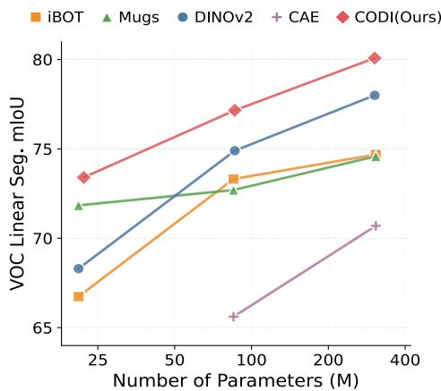  
Figure 1: Comparison of CODI with baselines on Pascal VOC segmentation.

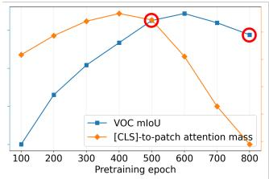

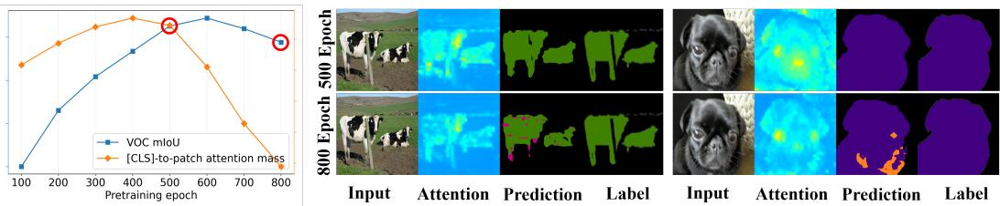  
Figure 2: Left: During DINOv2 pretraining, downstream dense performance and [CLS]-to-patch attention mass follow similar trends. Right: The [CLS] token often focuses on representative patches, while prediction errors are more likely to occur on non-representative patches.

Since image-level self-distillation is optimized through the [CLS] token, we ask: why does a stronger [CLS] representation not automatically lead to stronger patch-level representations? To diagnose this mismatch, we examine how the class-token readout couples to patch tokens during DINOv2-style pretraining. As shown in Fig. 2, the [CLS]-to-patch attention mass decreases in the later stage of training and follows a trend similar to dense transfer performance. The attention pattern is also highly selective: the [CLS] token repeatedly focuses on a small number of visually discriminative regions, such as the eyes or mouths of animals. We call these high-[CLS]-attention regions representative patches, meaning that they serve as representative evidence for the image-level readout.

This selectivity is natural for image-level recognition, where a few discriminative patches can be sufficient for a confident prediction. Dense prediction, however, evaluates patch tokens at every spatial location. A patch that is not selected by the global readout can still be important for segmentation or depth estimation. Therefore, the relevant issue is not whether the model attends to an entire object, but whether semantic information is reliably available beyond the sparse evidence used by the [CLS] token. Consistent with this view, we observe that downstream errors are concentrated on low-attention, non-representative patches.

Why does self-distillation produce such an uneven allocation? We identify an attention-gated semantic path that helps explain this behavior. Along the [CLS] readout in ViT, image-level self-distillation sends semantic gradients to patch tokens in proportion to their [CLS]-to-patch attention mass. Through this path, high-attention representative patches receive stronger semantic updates, while low-attention patches receive weaker updates. This bias is well aligned with image-level recognition, but can leave many patch tokens less reliable for dense prediction.

This analysis suggests that the teacher already contains useful global semantic information, but the standard training objective delivers this information to patch tokens unevenly through the [CLS] attention path. Based on this insight, we propose Cross Distillation (CODI), a target-side modification to masked patch distillation. For each masked patch, CODI mixes a small amount of the teacher class-token distribution into the teacher patch-token target. The student still learns from a primarily local patch target, but each masked patch also receives a weak global semantic correction that is not explicitly gated by its [CLS] attention mass. In this way, CODI improves the semantic reliability of low-attention patches while preserving the spatial specificity of patch supervision.

Empirically, we show that across seven evaluation settings spanning semantic segmentation, depth estimation, video object segmentation, and image classification, CODI outperforms its DINOv2 [27] counterpart when the pretraining setting is aligned. As shown in Fig. 1, CODI’s performance scales with model size. These results reveal the potential of CODI as a more efficient training paradigm.

## 2 Related Work

## 2.1 Self-supervised Vision Transformers

Self-supervised Vision Transformers [12, 37, 3] mainly follow two paradigms: 1) Contrastive methods use view discrimination or cross-view consistency [5, 8, 3]. 2) Prediction-based methods predict masked content in pixel [18, 43, 6] or latent space [1, 48, 27]. Among these methods, iBOT [48] uses an online tokenizer to provide self-distillation targets for both class tokens and masked patch tokens, while DINOv2 [27] scales this framework using stronger training strategies and larger-scale data.

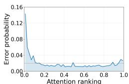  
(a) Bird

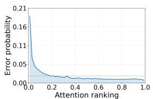  
(b) Bus

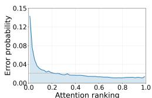  
(c) Dog

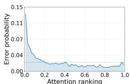  
(d) Train  
Figure 3: The model tends to make prediction errors on patches with low attention scores.

## 2.2 Self-supervised Dense Representation Learning

Despite progress in image-level SSL [4, 17, 15, 2, 46], dense prediction requires spatially meaningful local semantics [34, 44, 45, 36, 39, 30, 31, 26, 40]. Approaches include local feature alignment [38, 22], object-part grouping [50, 41], and masked prediction [18, 24, 21].

Longer self-supervised training can also degrade dense representations. DINOv3 [33] restores dense structure through Gram anchoring, while DSE [10] provides structural measures for model selection and regularization. CODI instead modifies patch targets during pretraining to address the representative-patch issue without an additional fine-tuning stage. Section 5.3 compares CODI with Gram anchoring under aligned settings.

## 3 The Representative Patch Phenomenon

## 3.1 Empirical Observation

To understand the root cause of the self-supervised dense degradation (SDD) phenomenon, we first empirically study the failure modes of existing baselines. Specifically, we train DINOv2 [27] on ImageNet-1K [19] from scratch for 800 epochs, and evaluate the final checkpoint on Pascal VOC [13]. We adopt the linear semantic segmentation setting, where the pretrained model is frozen and a linear head is trained to make pixel-level predictions based on patch representations.

Fig. 2 visualizes the [CLS]-to-patch attention maps and the predicted pixel labels. We observe two patterns: 1) Models tend to assign high attention to several key patterns, such as the eyes and mouth of a cat, rather than to the whole object. We refer to these key patterns as Representative Patches; in quantitative analyses, we define them as the top-r% image patches ranked by the final-layer [CLS]- to-patch attention mass averaged over heads, excluding register tokens. Similar discriminative regions frequently receive high attention across different instances. 2) Prediction errors usually occur on non-representative patches, such as the wheels of a bus. To determine whether this phenomenon arises from an observation error or a systematic bias, we bin image patches by normalized [CLS]-to-patch attention mass and compute the segmentation error rate within each bin. As shown in Fig. 3, we observe a monotonic trend between the error rate and the received global attention score. Since dense prediction tasks, such as semantic segmentation, require every patch, not only the representative patches, to be semantically meaningful, this observation motivates us to further study the cause of this phenomenon and address it.

## 3.2 Theoretical Justification

The observation above raises a natural question: if DINO/iBOT already includes image-level selfdistillation, why do some object patches still become unreliable for dense prediction? Our explanation is that the strong global target is optimized through the [CLS] token. For a patch to benefit from this target through the [CLS] branch, it must first be selected by [CLS] attention. Therefore, the same softmax mechanism that helps the model identify representative evidence can also make the global target weak for low-attention patches.

Local [CLS] attention model. This subsection analyzes a one-step local [CLS] readout under the image-level class-token loss only. The masked patch loss is not part of this local formulation; it may provide additional patch-token gradients, while our claim concerns the semantic gradient transmitted through the [CLS] attention path. Let P denote image patch tokens and let T denote all tokens competing in the final [CLS] attention row, including register tokens when used. For token $i \in T$ , let $k _ { i }$ and $v _ { i }$ be its key and value. The local [CLS] readout is

$$
s _ { i } = { \frac { a _ { \mathrm { c l s } } ^ { \top } k _ { i } } { \sqrt { d } } } , \qquad \pi _ { i } = { \frac { \exp ( s _ { i } ) } { \sum _ { j \in T } \exp ( s _ { j } ) } } , \qquad z = \sum _ { j \in T } \pi _ { j } v _ { j } .\tag{1}
$$

For patch-level analysis we consider $i \in P$ . We define the total [CLS]-to-patch mass as

$$
\Pi _ { P } = \sum _ { i \in P } \pi _ { i } ,
$$

and rank patches within an image by the normalized patch attention $\bar { \pi } _ { i } = \pi _ { i } / \Pi _ { P }$ . This abstraction treats upstream representations and other network paths as fixed, and studies the exact gradient allocation along this softmax-gated attention path.

We treat the teacher class-token target $q _ { \mathrm { c l s } } ^ { t }$ as fixed in this local calculation, and define

$$
\begin{array} { r l r } { \mathscr { L } _ { \mathrm { c l s } } = \mathrm { C E } \left( q _ { \mathrm { c l s } } ^ { t } , \mathrm { s o f t m a x } ( \phi _ { s } ( z ) / \tau _ { s } ) \right) , } & { { } \ } & { g : = \nabla _ { z } \mathscr { L } _ { \mathrm { c l s } } . } \end{array}\tag{2}
$$

The construction of $q _ { \mathrm { c l s } } ^ { t }$ is given in Sec. 4.1.

Theorem 1 ([CLS] attention gates semantic gradients along the value and score paths). For any patch token $i \in P$ , the local readout in $E q . ( 1 )$ sends a value-path gradient and a score update ofthe form

$$
\nabla _ { v _ { i } } \mathcal { L } _ { \mathrm { c l s } } = \pi _ { i } g , \qquad - \frac { \partial \mathcal { L } _ { \mathrm { c l s } } } { \partial s _ { i } } = \pi _ { i } u _ { i } , \qquad u _ { i } : = - \langle g , v _ { i } - z \rangle ,\tag{3}
$$

where $g$ denotes the global semantic gradient back-propagatedfrom the teacher [CLS] target.

Remark 2. The scalar $u _ { i }$ measures the local semantic utility of patch i: $i f u _ { i } > 0 ,$ , increasing $s _ { i }$ decreases the loss locally. The value-path gradient norm is exactly $\| \nabla _ { v _ { i } } \mathcal { \bar { L } } _ { \mathrm { c l s } } \| = \pi _ { i } \| g \|$ , and the score update also contains the multiplicative factor $\pi _ { i } .$ . Thus, through this [CLS] readout path, low-attention patches are weakly coupled to the image-level semantic target.

Theorem 1 identifies one mechanism by which representative patches can dominate the image-level semantic pathway. Classification benefits from sparse, discriminative evidence; dense prediction instead requires semantic features on many non-representative object regions. Consequently, longer self-distillation training can strengthen the [CLS] representation while leaving low-attention patches with weaker semantic guidance through this path, which matches our observation that segmentation errors concentrate on non-representative patches. Formal statements showing attention-mass amplification and sparse sufficiency of image-level readouts are provided in $\mathsf { A p - }$ pendix ${ \mathrm { A } } . 3$ and Appendix A.4. To validate whether our

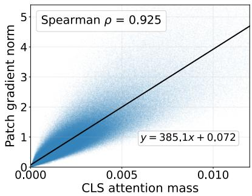  
Figure 4: [CLS] attention mass vs. DINO gradient norm.

fluenced by the projection head, multi-head attention, and registers, we conduct an experiment to measure the correlation between [CLS]-to-patch attention mass and the gradient norm received from the DINO loss. As shown in Fig. 4, these two quantities show a strong Spearman correlation of 0.925.

## 4 Methodology

In this section, we introduce Cross Distillation (CODI) as a target-side modification motivated by the analysis above. Specifically, within a typical self-distillation framework, we mix a small proportion of teacher class-token semantics into the patch targets. The analysis shows that CODI adds a target-level semantic correction that is not explicitly weighted by [CLS] attention mass. An overview of CODI is presented in Fig. 5.

## 4.1 Self-Distillation Framework

We build on a typical self-distillation framework [3, 48, 27]. A student network $f _ { s }$ is trained to match the target distributions produced by a momentum teacher network $f _ { t } ,$ which is updated as an exponential moving average of the student. Both networks use a ViT backbone [12]. Given an augmented view x, the teacher produces a class-token embedding $z _ { t } ^ { \mathrm { c l s } } ( x )$ and patch-token embeddings $\{ z _ { t , i } ^ { \mathbf { \check { p } } } ( x ) \} _ { i = 1 } ^ { N } ,$ where $N$ is the number of patches. After a shared projection head, branch-specific centering, and sharpening, we obtain the teacher class-level and patch-level target distributions:

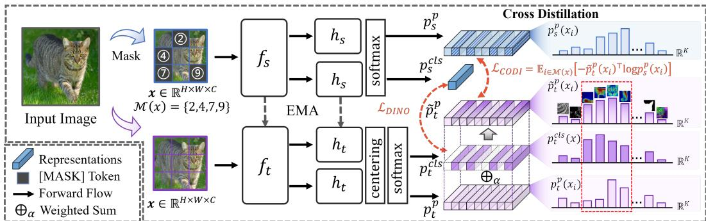  
Figure 5: Overview of CODI. In the self-distillation framework, CODI constructs the masked-patch target by mixing the teacher patch-token distribution with a small teacher class-token component.

$$
p _ { t } ^ { \mathrm { c l s } } ( x ) = \mathrm { s o f t m a x } \left( \frac { h _ { t } ( z _ { t } ^ { \mathrm { c l s } } ( x ) ) - c ^ { \mathrm { c l s } } } { \tau _ { t } } \right) , \quad p _ { t } ^ { \mathrm { p } } ( x _ { i } ) = \mathrm { s o f t m a x } \left( \frac { h _ { t } ( z _ { t , i } ^ { \mathrm { p } } ( x ) ) - c ^ { \mathrm { p } } } { \tau _ { t } } \right) ,\tag{4}
$$

where $h _ { t }$ is the shared teacher projection head that maps both class and patch tokens to K-dimensional prototype logits, $c ^ { \mathrm { c l s } }$ and $c ^ { \mathrm { p } }$ are separate running centers for the class and patch teacher targets, and $\tau _ { t }$ is the teacher temperature. Student predictions are obtained by applying softmax to student logits divided by the student temperature $\tau _ { s } ;$ they follow the same shared-head design with the student head $h _ { s } ,$ but do not use teacher centering. The class-token distribution captures the global semantic assignment of the view, while the patch-token distribution provides local supervision for each patch. Our goal is to couple these two levels of supervision when constructing masked patch targets.

## 4.2 Cross Distillation via Target Mixing

In masked patch self-distillation, each masked student patch is usually supervised by the corresponding teacher patch target alone. This target is locally informative, but it may emphasize low-level appearance details and does not explicitly encourage all patch representations to preserve discriminative semantics. We therefore introduce Cross Distillation (CODI), a target-side mixing strategy that transfers global class-token semantics into masked patch supervision.

For each teacher-student patch-distillation pair, and for each masked patch position $i \in \mathcal { M } ( x )$ we construct a mixed teacher target by combining the teacher patch distribution with the teacher class-token distribution from the same teacher view that provides the patch target:

$$
\widetilde { p } _ { t } ^ { \mathrm { p } } ( x _ { i } ) = ( 1 - \alpha ) p _ { t } ^ { \mathrm { p } } ( x _ { i } ) + \alpha p _ { t } ^ { \mathrm { c l s } } ( x ) ,\tag{5}
$$

where $\alpha \in [ 0 , 1 )$ controls the strength of global semantic guidance. When $\alpha = 0$ , CODI reduces to the standard iBOT loss. Since class and patch tokens are projected by the same head, both targets are distributions over the same K prototype coordinates, although they are centered with different running centers before the softmax. The centers shift the logits before softmax but do not change the prototype coordinate system; therefore both distributions remain defined over the same prototype indices, and their convex combination remains a valid teacher target. The CODI loss is defined as:

$$
\mathcal { L } _ { \mathrm { C O D I } } = - \frac { 1 } { | \mathcal { M } ( { \boldsymbol { x } } ) | } \sum _ { i \in \mathcal { M } ( \boldsymbol { x } ) } \tilde { p } _ { t } ^ { \mathrm { p } } ( x _ { i } ) ^ { \top } \log p _ { s } ^ { \mathrm { p } } ( x _ { i } ) ,\tag{6}
$$

where $p _ { s } ^ { \mathrm { p } } ( x _ { i } )$ is the student prediction for the masked patch. For image-level supervision, we keep the standard DINO objective, which aligns student and teacher class tokens across augmented views:

$$
\mathcal { L } _ { \mathrm { D I N O } } = - \sum _ { ( u , v ) \in \mathcal { V } } p _ { t } ^ { \mathrm { c l s } } ( v ) ^ { \top } \log p _ { s } ^ { \mathrm { c l s } } ( u ) ,\tag{7}
$$

where V denotes the set of teacher-student view pairs. The final objective is

$$
\begin{array} { r } { \mathcal { L } = \mathcal { L } _ { \mathrm { D I N O } } + \lambda _ { 1 } \cdot \mathcal { L } _ { \mathrm { C O D I } } + \lambda _ { 2 } \cdot \mathcal { L } _ { \mathrm { k o l e o } } . } \end{array}\tag{8}
$$

Here, $\mathcal { L } _ { \mathrm { k o l e o } }$ denotes the KoLeo loss adopted from DINOv2 [27]. Intuitively, CODI modifies the label used in masked image modeling. Instead of asking each masked patch to reconstruct a purely patch-level teacher target, we encourage the masked patch prediction to contain global semantic information from the teacher class token. This weak global guidance helps the model avoid overfitting to local texture or appearance details during reconstruction, while preserving more discriminative image-level semantics.

## 4.3 Theoretical Analysis

The result in Sec. 3.2 shows that the standard [CLS] path gates the global semantic signal to patch i by the attention factor $\pi _ { i }$ . We now show that CODI adds a direct target-level semantic path whose strength is controlled by α and does not depend on $\pi _ { i } .$ . For a masked patch $i ,$ write

$$
\begin{array} { r } { q _ { i } ^ { t } : = p _ { t } ^ { \mathrm { p } } ( x _ { i } ) , \qquad q _ { \mathrm { c l s } } ^ { t } : = p _ { t } ^ { \mathrm { c l s } } ( x ) , \qquad \xi _ { i } : = h _ { s } ( z _ { s , i } ^ { \mathrm { p } } ) / \tau _ { s } , \qquad p _ { i } ^ { s } = \mathrm { s o f t m a x } ( \xi _ { i } ) , } \end{array}\tag{9}
$$

where $q _ { i } ^ { t }$ and $q _ { \mathrm { c l s } } ^ { t }$ are the teacher targets produced by the same projection head with their respective centers, and $\xi _ { i }$ is the temperature-scaled student patch logit. The original iBOT patch loss and the CODI patch loss are

$$
\begin{array} { r l r l r } & { \mathcal { L } _ { \mathrm { p a t c h } } ^ { 0 } ( i ) = - ( q _ { i } ^ { t } ) ^ { \top } \log p _ { i } ^ { s } , } & & { \mathcal { L } _ { \mathrm { p a t c h } } ^ { \alpha } ( i ) = - ( \widetilde { q } _ { i } ^ { t } ) ^ { \top } \log p _ { i } ^ { s } , } & & { \widetilde { q } _ { i } ^ { t } = ( 1 - \alpha ) q _ { i } ^ { t } + \alpha q _ { \mathrm { c l s } } ^ { t } . } \end{array}\tag{10}
$$

Theorem 3 (Target mixing gives attention-independent guidance). Under negative logit-gradient flow for $\xi _ { i }$

$$
\dot { \xi } _ { i } ^ { 0 } = q _ { i } ^ { t } - p _ { i } ^ { s } , \qquad \dot { \xi } _ { i } ^ { \alpha } = q _ { i } ^ { t } - p _ { i } ^ { s } + \alpha ( q _ { \mathrm { c l s } } ^ { t } - q _ { i } ^ { t } ) .\tag{11}
$$

Thus, each masked patch prediction receives an additional target-level logit-gradient term α $\varrho _ { \mathrm { c l s } } ^ { t } - q _ { i } ^ { t } )$ which is not multiplied by its [CLS] attention mass $\pi _ { i } .$

Remark 4. The mixed target moves the local patch target toward the global teacher distribution along a line segment in the prototype simplex. Unlike the [CLS] attention gradient, this correction is not explicitly gated by $\pi _ { i }$

## 5 Experiments

We first describe the pretraining settings in Sec. 5.1. Then, we evaluate CODI across seven protocols in Sec. 5.2 and compare with Gram anchoring in Sec. 5.3. Finally, in Sec. 5.4, we discuss the effect of cross distillation. Additional results on unsupervised segmentation, object detection, and smaller models are provided in Appendix D.

## 5.1 Pretraining Setting

Following the standard setup [3, 48], we pretrain our model on ImageNet-1K [29] using the AdamW optimizer [23] with a batch size of 1024. We use a ViT with a patch size of 14 as the encoder backbone and employ register tokens [11]. We pretrain CODI with ViT-S/14 for 800 epochs, ViT-B/14 for 400 epochs, and ViT-L/14 for 200 epochs. The initial learning rate is set to $\dot { 2 } \times 1 0 ^ { - 3 } \times$ pbatch\_size/1024 and decays with a cosine annealing scheduler. The [CLS]-to-patch distribution mixing ratio α is set to 0.1. Detailed parameter settings are provided in Appendix C.1.

## 5.2 Overall Performance

In this subsection, we evaluate CODI across seven protocols. We compare with representative SSL methods from different paradigms, including 1) Contrastive Methods: MoCo v2 [7] and MoCo v3 [8], 2) Masked Modeling Methods: MAE [18] and CAE [6], 3) Clustering-based Methods: SwAV [2], DINO [3], iBOT [48], Mugs [49], and DINOv2 [27], and 4) Dense SSL Method: Leopart [50].

Table 1: Quantitative results of linear semantic segmentation and classification. Gray rows denote oracles trained with substantially larger data/model; † denotes our reproduced result. The best and second-best results are highlighted with bold and underlined, respectively.
<table><tr><td rowspan="3">Methods</td><td rowspan="3">Arch.</td><td rowspan="3">Dataset</td><td rowspan="3">Epochs</td><td colspan="6">Semantic Segmentation</td><td colspan="4">ImageNet-1K Classification</td></tr><tr><td colspan="2">COCO</td><td colspan="2">ADE20K</td><td colspan="2">VOC</td><td colspan="2">k-NN</td><td colspan="2">Linear</td></tr><tr><td>mIoU</td><td>Acc.</td><td>mIoU</td><td>Acc.</td><td>mIoU</td><td>Acc.</td><td>Top-1</td><td>Top-5</td><td>Top-1</td><td>Top-5</td></tr><tr><td colspan="10">Distilled from Larger Models</td><td></td><td></td><td></td><td></td></tr><tr><td>DINOv2 [27]</td><td>ViT-S/14</td><td>LVD-142M</td><td></td><td>57.4</td><td>77.7</td><td>43.5</td><td>78.9</td><td>79.4</td><td>95.3</td><td>79.0</td><td>91.5</td><td>80.4</td><td>95.1</td></tr><tr><td>DINOv2 [27]</td><td>ViT-B/14 ViT-L/14</td><td>LVD-142M LVD-142M</td><td></td><td>59.1 58.2</td><td>78.4 77.5</td><td>46.3 46.5</td><td>79.8 79.1</td><td>81.3 80.4</td><td>95.7 95.4</td><td>82.0 83.8</td><td>92.3</td><td>83.9 85.9</td><td>96.6 97.4</td></tr><tr><td colspan="10">DINOv2 [27]</td><td colspan="3">94.3</td></tr><tr><td>Small Models</td><td>RN-50</td><td>IN1K</td><td>800</td><td>37.6</td><td>64.0</td><td>20.0</td><td>61.2</td><td>53.3</td><td>88.4</td><td>61.8</td><td></td><td></td><td>72.8</td></tr><tr><td colspan="10">MoCo v2 [7]</td><td colspan="3">82.8 43.1</td></tr><tr><td>SwAV [2]</td><td>RN-50</td><td>IN1K</td><td>800</td><td>42.2</td><td>68.0</td><td>23.3</td><td>65.8</td><td>55.4</td><td>89.0</td><td>65.7</td><td>84.9</td><td>64.2</td><td>85.8 87.2</td></tr><tr><td>DINO [3]</td><td>RN-50</td><td>IN1K</td><td>800</td><td>40.7</td><td>66.6</td><td>22.4</td><td>64.5</td><td>53.1</td><td>88.4</td><td>67.5</td><td>86.0</td><td>65.9 54.8</td><td>78.8</td></tr><tr><td>MoCo v3 [8]</td><td>ViT-S/16 ViT-S/16</td><td>IN1K</td><td>300</td><td>43.4</td><td>70.6</td><td>24.4</td><td>70.5</td><td>61.7</td><td>91.4</td><td>32.2</td><td>50.5</td><td></td><td>92.7</td></tr><tr><td>DINO [3] iBOT [48]</td><td>ViT-S/16</td><td>IN1K</td><td>800</td><td>39.5</td><td>67.1</td><td>23.1</td><td>67.4</td><td>50.0</td><td>88.4</td><td>74.4</td><td>90.0 89.1</td><td>76.0 77.0</td><td>93.0</td></tr><tr><td></td><td>ViT-S/16</td><td>IN1K</td><td>800</td><td>47.7</td><td>72.7</td><td>28.5</td><td>72.3</td><td>66.7</td><td>92.4</td><td>75.1</td><td>89.0</td><td>77.7</td><td>93.5</td></tr><tr><td>Mugs [49]</td><td>ViT-S/16</td><td>IN1K</td><td>800</td><td>48.7</td><td>72.6</td><td>30.9</td><td>72.8</td><td>71.8</td><td>93.3</td><td>75.5</td><td></td><td></td><td>85.3</td></tr><tr><td>Leopart [50] DINOv2† [27]</td><td>ViT-S/14</td><td>IN1K+COCO</td><td>800+50</td><td>48.8</td><td>73.2</td><td>29.7</td><td>72.1</td><td>68.2</td><td>92.6</td><td>52.0</td><td>74.9</td><td>64.6</td><td>93.7</td></tr><tr><td>CODI (ours)</td><td>ViT-S/14</td><td>IN1K</td><td>800</td><td>48.1</td><td>72.7</td><td>29.6</td><td>72.6</td><td>68.3</td><td>92.7</td><td>76.9</td><td>91.4</td><td>77.9</td><td></td></tr><tr><td></td><td></td><td>IN1K</td><td>800</td><td>50.3</td><td>74.0</td><td>30.8</td><td>73.4</td><td>73.1</td><td>93.6</td><td>77.1</td><td>91.7</td><td>78.3</td><td>94.1</td></tr><tr><td colspan="10">Base Models</td><td colspan="3"></td><td colspan="3"></td></tr><tr><td>CAE [6]</td><td>ViT-B/16</td><td>IN1K</td><td>800</td><td>45.5</td><td>71.0</td><td>27.0</td><td>71.9</td><td>64.9</td><td>92.2</td><td>37.7</td><td>60.9</td><td>21.0</td><td>42.0</td></tr><tr><td>CAE [6]</td><td>ViT-B/16</td><td>IN1K</td><td>1600</td><td>46.2</td><td>71.6</td><td>27.5</td><td>72.2</td><td>65.6</td><td>92.3</td><td>33.7</td><td>53.0</td><td>20.9</td><td>41.8</td></tr><tr><td>MAE [18]</td><td>ViT-B/16</td><td>IN1K</td><td>800</td><td>37.9</td><td>65.5</td><td>20.6</td><td>66.2</td><td>52.3</td><td>88.8</td><td>18.4</td><td>32.7</td><td>39.2</td><td>62.3</td></tr><tr><td>MoCo v3 [8]</td><td>ViT-B/16</td><td>IN1K</td><td>300</td><td>48.2</td><td>73.0</td><td>29.6</td><td>72.9</td><td>69.6</td><td>92.9</td><td>71.3</td><td>88.4</td><td>60.8</td><td>83.8</td></tr><tr><td>DINO [3]</td><td>ViT-B/16</td><td>IN1K</td><td>800</td><td>45.7</td><td>71.5</td><td>28.8</td><td>72.0</td><td>63.6</td><td>91.6</td><td>76.1</td><td>89.8</td><td>77.8</td><td>93.7</td></tr><tr><td>DINO [3]</td><td>ViT-B/8</td><td>IN1K</td><td>800</td><td>47.0</td><td>72.3</td><td>30.5</td><td>72.7</td><td>65.3</td><td>92.3</td><td>77.3</td><td>90.5</td><td>79.7</td><td>94.8</td></tr><tr><td>iBOT [48]</td><td>ViT-B/16</td><td>IN1K</td><td>400</td><td>52.2</td><td>75.3</td><td>34.3</td><td>75.2</td><td>73.3</td><td>93.9</td><td>77.0</td><td>90.3</td><td>79.2</td><td>94.5</td></tr><tr><td>Mugs [49]</td><td>ViT-B/16</td><td>IN1K</td><td>400</td><td>51.4</td><td>74.1</td><td>34.6</td><td>74.5</td><td>72.7</td><td>93.5</td><td>78.0</td><td>91.3</td><td>80.1</td><td>94.5</td></tr><tr><td>DINOv2† [27]</td><td>ViT-B/14</td><td>IN1K</td><td>400</td><td>53.0</td><td>75.6</td><td>35.5</td><td>75.8</td><td>74.9</td><td>93.9</td><td>78.9</td><td>90.7</td><td>81.0</td><td>95.3</td></tr><tr><td>CODI (ours)</td><td>ViT-B/14</td><td>IN1K</td><td>400</td><td>55.1</td><td>76.6</td><td>36.3</td><td>76.2</td><td>77.2</td><td>94.6</td><td>79.2</td><td>90.8</td><td>81.2</td><td>95.5</td></tr><tr><td colspan="10"></td><td colspan="3"></td><td colspan="3"></td></tr><tr><td>Large Models</td><td></td><td></td><td></td><td></td><td></td><td></td><td></td><td></td><td></td><td></td><td>81.9</td><td>48.2</td><td>70.9</td></tr><tr><td>CAE [6] iBOT [48]</td><td>ViT-L/16 ViT-L/16</td><td>IN1K IN1K</td><td>1600 250</td><td>48.8 53.5</td><td>73.1 76.2</td><td>31.9 36.0</td><td>74.6 76.0</td><td>70.7 74.7</td><td>93.2 94.4</td><td>64.0 78.0</td></table>

## 5.2.1 Evaluation on Dense Prediction Tasks

Semantic Segmentation. To evaluate whether CODI learns well-structured representations, we use the standard off-the-shelf linear probing setting. The pretrained models are frozen, and a linear head is trained on top of the feature extractor to predict the label of each pixel. We sweep the learning rate of the linear head over a predefined set. Detailed settings are provided in Appendix C.2. We evaluate model performance on the widely used COCO [20], Pascal VOC [13], and ADE20K [47] datasets. The results are shown in Tab. 1. Among ImageNet-1K-pretrained baselines with comparable model scale, CODI achieves strong segmentation performance. Compared with reproduced DINOv2 under the aligned setting, CODI improves the average mIoU by +2.7, +1.7, and +1.9 for ViT-S/14, ViT-B/14, and ViT-L/14, respectively. Specifically, CODI achieves 80.1 mIoU with the ViT-Large model on Pascal VOC, approaching the original large-data DINOv2 [27] reference while using only ImageNet-1K pretraining in our setting.

Depth Estimation. Similar to the semantic segmentation setting, we freeze the encoder and train a linear head to predict depth. Following DINOv3 [33], we project depth values into discrete bins and sweep the learning rate for the projection head. We evaluate the models on the NYU-Depth v2 [32], KITTI [14], and SUNRGBD datasets. Specifically, SUNRGBD is evaluated under a zero-shot transfer setting, where models are trained on NYU-Depth v2 and tested only on SUNRGBD. The results are shown in Tab. 2. Although CODI does not obtain the best performance on all tasks, it still achieves the highest overall ranking, showing its effectiveness across settings. For ViT-S/14, CODI improves NYU δ by +1.4 over reproduced DINOv2, and CODI matches or improves reproduced DINOv2 in 24 out of 27 metric comparisons across all settings.

Semi-supervised Video Object Segmentation. We also evaluate CODI on the DAVIS 2017 dataset [28]. Following the standard evaluation protocol, the pixel label of the first frame is given, and labels in the following frames are propagated using representation similarity. In this setting, we also sweep several key hyperparameters and report the best results. Detailed settings are introduced in

Table 2: Depth estimation performance on NYU-Depth V2, KITTI, and SUNRGBD zero-shot transfer. Rank is computed within each model size.
<table><tr><td rowspan="2">Methods</td><td rowspan="2">Arch.</td><td rowspan="2">Epochs</td><td colspan="3">NYU-Depth V2</td><td colspan="3">KITTI</td><td colspan="3">NYU→SUNRGBD</td><td rowspan="2">Rank</td></tr><tr><td>δ1↑</td><td>Rel ↓</td><td>RMSE↓</td><td>δ1 ↑</td><td>Rel↓</td><td>RMSE↓</td><td>δ1 ↑</td><td>Rel↓</td><td>RMSE↓</td></tr><tr><td colspan="10">Distilled from Larger Models</td><td></td><td></td><td></td></tr><tr><td>DINOv2 [27]</td><td>ViT-S/14</td><td></td><td>84.8</td><td>0.134</td><td>0.437</td><td>91.0</td><td>0.096</td><td>3.119</td><td>77.4</td><td>0.269</td><td>0.473</td><td></td></tr><tr><td>DINOv2[27]</td><td>ViT-B/14</td><td></td><td>87.8</td><td>0.120</td><td>0.408</td><td>92.0</td><td>0.092</td><td>2.931</td><td>80.7</td><td>0.255</td><td>0.443</td><td></td></tr><tr><td>DINOv2 [27]</td><td>ViT-L/14</td><td></td><td>89.5</td><td>0.111</td><td>0.390</td><td>92.3</td><td>0.090</td><td>2.891</td><td>81.4</td><td>0.248</td><td>0.439</td><td></td></tr><tr><td colspan="10">Small Models</td><td rowspan="3"></td></tr><tr><td></td><td>RN-50</td><td>800</td><td>62.9</td><td>0.230</td><td>0.719</td><td></td><td></td><td>4.319</td><td>55.5</td><td>0.366</td><td>0.749</td></tr><tr><td>MoCo v2 [7] SwAV [2]</td><td>RN-50</td><td>800</td><td>61.9</td><td>0.225</td><td>0.721</td><td>82.4 84.3</td><td>0.130 0.123</td><td>3.985</td><td>55.0</td><td>0.367</td><td>7.0 0.753</td></tr><tr><td>DINO [3]</td><td>RN-50</td><td>800</td><td>61.6</td><td>0.228</td><td>0.726</td><td>83.7</td><td>0.127</td><td>4.068</td><td>54.7</td><td>0.370</td><td>0.755</td><td>6.2 7.7</td></tr><tr><td>MoCo v3 [8]</td><td>ViT-S/16</td><td>300</td><td>69.8</td><td>0.192</td><td>0.615</td><td>77.2</td><td>0.170</td><td>5.007</td><td>50.6</td><td>0.411</td><td>0.815</td><td>7.7</td></tr><tr><td>DINO [3]</td><td>ViT-S/16</td><td>800</td><td>67.7</td><td>0.202</td><td>0.651</td><td>83.9</td><td>0.132</td><td>4.061</td><td>59.6</td><td>0.343</td><td>0.678</td><td>5.8</td></tr><tr><td>iBOT [48]</td><td>ViT-S/16</td><td>800</td><td>72.1</td><td>0.183</td><td>0.584</td><td>85.3</td><td>0.125</td><td>3.907</td><td>63.5</td><td>0.330</td><td>0.634</td><td>3.3</td></tr><tr><td>Mugs [49]</td><td>ViT-S/16</td><td>800</td><td>72.3</td><td>0.179</td><td>0.586</td><td>84.1</td><td>0.132</td><td>3.963</td><td>64.4</td><td>0.306</td><td>0.613</td><td>3.4</td></tr><tr><td>DINOv2† [27]</td><td>ViT-S/14</td><td>800</td><td>72.7</td><td>0.184</td><td>0.583</td><td>86.6</td><td>0.112</td><td>3.757</td><td>63.2</td><td>0.332</td><td>0.631</td><td>2.6</td></tr><tr><td>CODI (ours)</td><td>ViT-S/14</td><td>800</td><td>74.1</td><td>0.176</td><td>0.570</td><td>86.5</td><td>0.109</td><td>3.834</td><td>64.5</td><td>0.323</td><td>0.610</td><td>1.3</td></tr><tr><td colspan="10">Base Models</td><td colspan="3"></td></tr><tr><td>MAE [18]</td><td>ViT-B/16</td><td>800</td><td>65.3</td><td>0.224</td><td>0.673</td><td>84.3</td><td>0.123</td><td>4.087</td><td>59.1</td><td>0.350</td><td>0.688</td><td>8.0</td></tr><tr><td>MoCo v3 [8]</td><td>ViT-B/16</td><td>300</td><td>72.5</td><td>0.181</td><td>0.585</td><td>85.3</td><td>0.122</td><td>3.954</td><td>65.9</td><td>0.308</td><td>0.606</td><td>5.9</td></tr><tr><td>DINO [3]</td><td>ViT-B/16</td><td>800</td><td>71.7</td><td>0.182</td><td>0.593</td><td>86.5</td><td>0.117</td><td>3.771</td><td>62.8</td><td>0.336</td><td>0.644</td><td>6.7</td></tr><tr><td>DINO [3]</td><td>ViT-B/8</td><td>800</td><td>72.8</td><td>0.178</td><td>0.579</td><td>86.9</td><td>0.115</td><td>3.697</td><td>65.1</td><td>0.314</td><td>0.613</td><td>5.3</td></tr><tr><td>iBOT [48]</td><td>ViT-B/16</td><td>400</td><td>77.7</td><td>0.160</td><td>0.523</td><td>88.3</td><td>0.110</td><td>3.514</td><td>69.1</td><td>0.299</td><td>0.565</td><td>2.1</td></tr><tr><td>Mugs [49]</td><td>ViT-B/16</td><td>400</td><td>74.9</td><td>0.164</td><td>0.550</td><td>87.7</td><td>0.111</td><td>3.620</td><td>66.6</td><td>0.294</td><td>0.585</td><td>3.6</td></tr><tr><td>DINOv2† [27]</td><td>ViT-B/14</td><td>400</td><td>78.1</td><td>0.160</td><td>0.519</td><td>88.0</td><td>0.112</td><td>3.502</td><td>68.0</td><td>0.310</td><td>0.570</td><td>2.8</td></tr><tr><td>CODI (ours)</td><td>ViT-B/14</td><td>400</td><td>78.3</td><td>0.160</td><td>0.516</td><td>88.3</td><td>0.109</td><td>3.487</td><td>67.8</td><td>0.306</td><td>0.568</td><td>1.7</td></tr><tr><td colspan="10">Large Models</td><td colspan="3"></td></tr><tr><td></td><td></td><td></td><td></td><td></td><td></td><td></td><td></td><td></td><td></td><td></td><td></td><td></td></tr><tr><td>iBOT [48]</td><td>ViT-L/16 ViT-L/16</td><td>250 250</td><td>80.4 76.7</td><td>0.147</td><td>0.492</td><td>90.5</td><td>0.096</td><td>3.253</td><td>70.1</td><td>0.303</td><td>0.551</td><td>2.7</td></tr><tr><td>Mugs [49] I-JEPA [1]</td><td>ViT-H/14</td><td>300</td><td>76.5</td><td>0.158 0.170</td><td>0.524 0.534</td><td>88.4 86.3</td><td>0.106 0.119</td><td>3.485 3.725</td><td>68.0 68.4</td><td>0.299 0.303</td><td>0.574 0.568</td><td>4.1 4.7</td></tr><tr><td>DINOv2† [27]</td><td>ViT-L/14</td><td>200</td><td></td><td></td><td></td><td></td><td></td><td></td><td></td><td></td><td></td><td></td></tr><tr><td>CODI (ours)</td><td>ViT-L/14</td><td>200</td><td>81.4 82.0</td><td>0.147 0.145</td><td>0.481 0.472</td><td>90.4 90.6</td><td>0.097 0.096</td><td>3.266 3.244</td><td>71.5 71.7</td><td>0.299 0.297</td><td>0.529 0.528</td><td>2.4 1.1</td></tr></table>

Table 3: DAVIS semi-supervised VOS results.  
Table 4: ImageNet-1K full Figure 6: ImageNet-1K k-NN fine-tuning Top-1 accuracy. classification under occlusion.
<table><tr><td>Methods</td><td>Arch.</td><td></td><td></td><td>J&amp;F Jmean Fmean</td></tr><tr><td>DINOv3</td><td>ViT-7B/16</td><td>71.1</td><td>一</td><td>1</td></tr><tr><td>DINO</td><td>ViT-B/16</td><td>63.2</td><td>61.5</td><td>64.9</td></tr><tr><td>iBOT</td><td>ViT-B/16</td><td>64.3</td><td>63.2</td><td>65.5</td></tr><tr><td>CAE</td><td>ViT-L/16</td><td>65.1</td><td>62.8</td><td>67.5</td></tr><tr><td>iBOT</td><td>ViT-L/16</td><td>63.8</td><td>62.1</td><td>65.5</td></tr><tr><td>Mugs</td><td>ViT-L/16</td><td>62.1</td><td>60.3</td><td>63.0</td></tr><tr><td>DINOv2</td><td>ViT-L/14</td><td>64.2</td><td>62.2</td><td>66.3</td></tr><tr><td>CODI (ours)</td><td>)ViT-B/14</td><td>65.7</td><td>63.6</td><td>67.9</td></tr><tr><td>CODI (ours)</td><td>ViT-L/14</td><td>66.0</td><td>63.3</td><td>68.7</td></tr></table>

<table><tr><td>Method</td><td>Arch.</td><td>Epochs Acc.</td><td></td></tr><tr><td>MoCo v3</td><td>ViT-S/16</td><td>300</td><td>81.4</td></tr><tr><td>DINO</td><td>ViT-S/16</td><td>800</td><td>82.0</td></tr><tr><td>iBOT</td><td>ViT-S/16</td><td>800</td><td>82.3</td></tr><tr><td>CODI (ours) ViT-S/14</td><td></td><td>800</td><td>82.7</td></tr><tr><td>MoCo v3 DINO</td><td>ViT-B/16 ViT-B/16</td><td>300 400</td><td>83.2 83.6</td></tr><tr><td>iBOT</td><td>ViT-B/16</td><td>400</td><td>84.0</td></tr><tr><td>CODI (ours) ViT-B/14</td><td></td><td>400</td><td>84.3</td></tr></table>

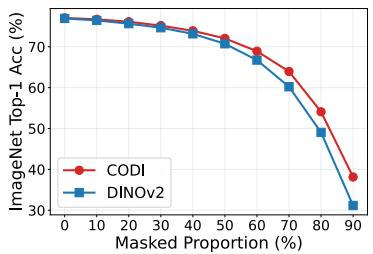

Appendix C.2. As shown in Tab. 3, CODI achieves 66.0 on J&F with the ViT-L/14 model, surpassing all comparable (non-DINOv3) baselines. Notably, CODI outperforms the original DINOv2, which is distilled from a larger model, by a clear margin of +1.8 on J&F. These results suggest that CODI features are more effective for affinity-based mask propagation.

## 5.2.2 Evaluation on Image-level Tasks

Image Classification with Frozen Backbone. To provide a comprehensive analysis of the effect of CODI, we evaluate the models on image classification tasks. Following the standard protocol [3, 27], we use two classifiers, a parameter-free k-NN classifier and a linear classifier, and report Top-1 and Top-5 accuracy. We also sweep the hyperparameters of these heads and report the best results. Details are provided in Appendix C.2. As shown in Tab. 1, we observe a consistent improvement in Top-1 classification performance. Notably, the Top-1 performance gain scales with model size: with ViT-Large, CODI achieves improvements of +0.8 and +1.0 in the k-NN and linear classification settings, respectively, compared with DINOv2.

Full Fine-Tuning on ImageNet-1K. Following the evaluation protocol of iBOT [48], we further fine-tune the model on ImageNet-1K for 100 epochs. As shown in Tab. 4, although the performance gain is reduced after fine-tuning, CODI still improves Top-1 accuracy by +0.4, showing that it provides a better initialization.

Table 5: Comparison of ViT-S/14 pretraining and fine-tuning settings on ImageNet-1K. Gram anchoring is applied to a DINOv2 checkpoint.
<table><tr><td>Method</td><td>Pretraining iterations</td><td>Fine-tuning iterations</td><td>ImageNet k-NN (%)</td><td>VOC mIoU (%)</td></tr><tr><td>DINOv2</td><td>1M</td><td>一</td><td>76.9</td><td>68.3</td></tr><tr><td>DINOv2 (best checkpoint)</td><td>625K</td><td></td><td>75.9</td><td>69.4</td></tr><tr><td>DINOv2 + Gram anchoring</td><td>1M</td><td>100K</td><td>76.7</td><td>70.2</td></tr><tr><td> $\operatorname { D I N O v } 2 + \operatorname { C O D I }$  fine-tuning</td><td>1M</td><td>100K</td><td>76.8</td><td>71.4</td></tr><tr><td>CODI</td><td>1M</td><td></td><td>77.1</td><td>73.1</td></tr></table>

Table 6: Ablation of the CODI mixing ratio α and target distribution.
<table><tr><td>Target</td><td>α COCO</td><td>VOC</td><td>ADE k-NN</td></tr><tr><td>None</td><td>0.0 48.1</td><td>68.3</td><td>29.6 76.9</td></tr><tr><td>Averaged patch</td><td>0.1 48.9</td><td>69.8</td><td>29.9 76.6</td></tr><tr><td>[CLS]</td><td>0.1 50.3</td><td>73.1</td><td>30.8 77.1</td></tr><tr><td>[CLS]</td><td>0.2 49.2</td><td>71.5</td><td>29.7 77.2</td></tr><tr><td>[CLS]</td><td>0.5 42.7</td><td>60.5</td><td>25.6 76.1</td></tr><tr><td>Uniform</td><td>0.1 45.8</td><td>62.5</td><td>27.3 75.8</td></tr></table>

Table 7: Semantic alignment and regularization after 100 epochs on ImageNet-1K.
<table><tr><td>Method k-NN VOC</td></tr><tr><td>DINOv2 71.1 61.4</td></tr><tr><td>Random-image [CLS] 70.6 62.1</td></tr><tr><td>Entropy-matched patch 70.8 62.9</td></tr><tr><td>CODI (same-image [CLS]) 71.3 65.2</td></tr></table>

Classification with Patch Occlusion. To study how patch-level target mixing improves image-level performance, we conduct an additional experiment on classification under occlusion. For each input image, we randomly mask a proportion of patches and use the k-NN classifier. The results are shown in Fig. 6. Compared with DINOv2, CODI achieves better performance at every masking ratio from 0% to 90%, and the performance gap increases as the masked ratio grows. This suggests that CODI reduces reliance on a small set of highly discriminative patches. As a result, CODI is more robust when representative patches are missing.

## 5.3 Comparison with Gram Anchoring

We compare CODI with DINOv3’s Gram anchoring [33] under an aligned ViT-S/14 setting. The Gram-anchoring results are obtained by fine-tuning a DINOv2 checkpoint for 100K iterations. For a fair comparison, we tune the resolution in $\{ 2 2 4 ^ { - } \times 2 2 4 , 4 4 8 \times 4 4 8 ^ { - } \}$ , whether to distill from the previous best or final checkpoint, and whether to update the Gram-anchor teacher, and report the best result. We also fine-tune DINOv2 with the CODI loss for the same number of iterations. As shown in Tab. 5, although Gram anchoring recovers degraded dense performance through distillation, CODI fine-tuning outperforms it by +1.2 mIoU under the aligned setting. Training CODI from scratch further improves performance, surpassing the Gram-anchoring baseline by +2.9 mIoU with fewer training iterations. Fine-tuning does not improve classification performance, and training CODI from scratch still yields the best results. Comparisons with the distilled DINOv3 and SigLIP2 checkpoints are provided in Appendix D.4.

## 5.4 The Effect of Cross Distillation

How does cross distillation affect downstream performance? We study the target distribution and mixing strength α, with additional dataset sweeps in Appendix D.6. As shown in Tab. 6, introducing global semantics into the patch target improves dense performance, with the [CLS] token outperforming the averaged patch target. Mixing a uniform distribution instead reduces both classification and segmentation performance. The results also show that $\alpha = 0 . 1$ is an appropriate mixing strength: when $\alpha = 0 ,$ , CODI reduces to DINOv2; when α is large, performance degrades.

On $\mathrm { C O C O } , \alpha = 0 . 0 5$ and 0.075 achieve the best k-NN accuracy, whereas $\alpha = 0 . 1$ gives the best VOC mIoU. Increasing α to 0.2 reduces both metrics below DINOv2. On ImageNet-22K, excluding

ImageNet-1K and using a 100K-iteration schedule, $\alpha = 0 . 1$ achieves the best results on both metrics. These findings support α = 0.1 as a strong starting point, though not a universal optimum for every downstream metric or evidence of a uniformly wide operating range. The final choice depends on whether image-level or dense performance is prioritized.

Global semantic guidance or regularization? To disentangle global semantic guidance from regularization, we conduct two controlled ablations after 100 epochs of ImageNet-1K pretraining. For random-image [CLS], we keep $\alpha = 0 . 1$ , but replace the teacher [CLS] distribution with that of another randomly selected image from the same mini-batch. This preserves a valid teacher [CLS] distribution while breaking image-level semantic alignment. For the entropy-matched patch target, we first compute the entropy of the standard CODI target after mixing its patch distribution with the same-image [CLS] distribution at $\alpha = 0 . 1$ . We then omit [CLS] mixing and adjust only the patch-target temperature so that the resulting patch distribution matches this entropy. This preserves CODI’s target-entropy change while keeping the target entirely local and excluding global [CLS] information.

As shown in Tab. 7, the entropy-matched patch control improves VOC mIoU by +1.5 over DINOv2 while reducing k-NN by 0.3, showing that matching CODI’s target entropy alone provides a regular ization benefit. Random-image [CLS] yields a smaller improvement in dense prediction performance and also reduces k-NN. In contrast, same-image [CLS] (CODI) improves both metrics and yields the largest mIoU gain. Thus, regularization contributes, but semantically aligned [CLS]-to-patch guidance is the dominant source of improvement.

Does the performance gain arise from non-representative patches? To examine whether the performance improvement comes from improving non-representative patches, we visualize the performance gain on patches with different attention rankings. We rank patches by the final-layer [CLS]-to-patch attention mass averaged over heads, excluding register tokens. Low-ranked patches have relatively low [CLS]-to-patch attention mass and thus correspond to non-representative patches. As shown in Fig. 7, the performance gain of CODI mainly comes from these non-representative patches, which is consistent with our design goal.

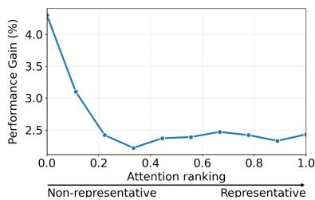  
Figure 7: Performance gain by [CLS] attention rank.

How does CODI influence the representation structure? Since CODI mixes a small amount of the [CLS] distribution into the patch targets, a natural question arises: although this operation acts like a centering operation in the representation space, why does it improve representation separability instead of confusing representations across classes? To answer this question, we conduct an experiment. Using the pixel labels from Pascal VOC, we first aggregate patch-level labels by majority voting. Then, we compute the inter-class and intra-class distances between patch representations based on the labels. As shown in Tab. 8, although both the intra-class and inter-class distances shrink as expected, the gap between them, which measures class separability, increases. These results also show a trade-off between inter-class and intra-class distances, suggesting that we need to choose α carefully to prevent collapse.

Table 8: Representation distance analysis.
<table><tr><td>Methods</td><td>Intra-d ↓</td><td>Inter-d ↑</td><td>Gap ↑</td></tr><tr><td>DINOv2</td><td>0.6821</td><td>0.9168</td><td>0.2347</td></tr><tr><td>CODI</td><td>0.5864</td><td>0.8430</td><td>0.2566</td></tr></table>

## 6 Conclusion

This paper studies the phenomenon that the [CLS] token in ViTs tends to gather information from a set of representative patches rather than the whole object. We provide a local gradient analysis showing that, through the final [CLS] attention readout, image-level semantic gradients are weighted by [CLS]- to-patch attention mass. As a result, non-representative patches, i.e., patches with low attention scores, receive weaker image-level semantic gradients through this path, which can contribute to less discriminative patch features. To address this issue, we propose a simple yet effective cross-distillation (CODI) design. By mixing a small amount of teacher class-token information into masked patch targets, CODI ensures that every masked patch supervised by the patch loss receives a target-level global semantic correction. We empirically evaluate CODI on multiple benchmarks and evaluation settings. The results demonstrate its effectiveness and scalability.

## Acknowledgments and Disclosure of Funding

This work was supported in part by National Natural Science Foundation of China: 62525212, U23B2051, 62236008, 62441232, 62521007, 62411540034, 62132006, and U21B2038, in part by Youth Innovation Promotion Association CAS, in part by the Strategic Priority Research Program of the Chinese Academy of Sciences, Grant No. XDB0680201, in part by the China National Postdoctoral Program for Innovative Talents under Grant BX20250377, in part by the China Postdoctoral Science Foundation under Grant 2026M791710, and in part by the project ZR2025ZD01 supported by Shandong Provincial Natural Science Foundation.

The authors declare no other competing interests.

## References

[1] Mahmoud Assran, Quentin Duval, Ishan Misra, Piotr Bojanowski, Pascal Vincent, Michael Rabbat, Yann LeCun, and Nicolas Ballas. Self-supervised learning from images with a jointembedding predictive architecture. In Proceedings ofthe IEEE/CVF Conference on Computer Vision and Pattern Recognition, pages 15619–15629, 2023.

[2] Mathilde Caron, Ishan Misra, Julien Mairal, Priya Goyal, Piotr Bojanowski, and Armand Joulin. Unsupervised learning of visual features by contrasting cluster assignments. Advances in neural information processing systems, 33:9912–9924, 2020.

[3] Mathilde Caron, Hugo Touvron, Ishan Misra, Hervé Jégou, Julien Mairal, Piotr Bojanowski, and Armand Joulin. Emerging properties in self-supervised vision transformers. In Proceedings ofthe IEEE/CVF international conference on computer vision, pages 9650–9660, 2021.

[4] Ting Chen, Simon Kornblith, Mohammad Norouzi, and Geoffrey Hinton. A simple framework for contrastive learning of visual representations. In International Conference on Machine Learning, pages 1597–1607. PMLR, 2020.

[5] Ting Chen, Simon Kornblith, Kevin Swersky, Mohammad Norouzi, and Geoffrey E Hinton. Big self-supervised models are strong semi-supervised learners. Advances in neural information processing systems, 33:22243–22255, 2020.

[6] Xiaokang Chen, Mingyu Ding, Xiaodi Wang, Ying Xin, Shentong Mo, Yunhao Wang, Shumin Han, Ping Luo, Gang Zeng, and Jingdong Wang. Context autoencoder for self-supervised representation learning. International Journal of Computer Vision, 132(1):208–223, 2024.

[7] Xinlei Chen, Haoqi Fan, Ross Girshick, and Kaiming He. Improved baselines with momentum contrastive learning. arXiv preprint arXiv:2003.04297, 2020.

[8] Xinlei Chen, Saining Xie, and Kaiming He. An empirical study of training self-supervised vision transformers. In Proceedings of the IEEE/CVF international conference on computer vision, pages 9640–9649, 2021.

[9] Jang Hyun Cho, Utkarsh Mall, Kavita Bala, and Bharath Hariharan. PiCIE: Unsupervised semantic segmentation using invariance and equivariance in clustering. In Proceedings ofthe IEEE/CVF Conference on Computer Vision and Pattern Recognition, pages 16794–16804, 2021.

[10] Siran Dai, Qianqian Xu, Peisong Wen, Yang Liu, and Qingming Huang. Exploring structural degradation in dense representations for self-supervised learning. arXiv preprint arXiv:2510.17299, 2025.

[11] Timothée Darcet, Maxime Oquab, Julien Mairal, and Piotr Bojanowski. Vision transformers need registers. arXiv preprint arXiv:2309.16588, 2023.

[12] Alexey Dosovitskiy, Lucas Beyer, Alexander Kolesnikov, Dirk Weissenborn, Xiaohua Zhai, Thomas Unterthiner, Mostafa Dehghani, Matthias Minderer, Georg Heigold, Sylvain Gelly, et al. An image is worth 16x16 words: Transformers for image recognition at scale. In International Conference on Learning Representations, 2021.

[13] Mark Everingham, Luc Van Gool, Christopher KI Williams, John Winn, and Andrew Zisserman. The pascal visual object classes (voc) challenge. International Journal of Computer Vision, 88: 303–338, 2010.

[14] Andreas Geiger, Philip Lenz, and Raquel Urtasun. Are we ready for autonomous driving? the kitti vision benchmark suite. In 2012 IEEE Conference on Computer Vision and Pattern Recognition, pages 3354–3361, 2012. doi: 10.1109/CVPR.2012.6248074.

[15] Jean-Bastien Grill, Florian Strub, Florent Altché, Corentin Tallec, Pierre Richemond, Elena Buchatskaya, Carl Doersch, Bernardo Avila Pires, Zhaohan Guo, Mohammad Gheshlaghi Azar, et al. Bootstrap your own latent-a new approach to self-supervised learning. Advances in neural information processing systems, 33:21271–21284, 2020.

[16] Mark Hamilton, Zhoutong Zhang, Bharath Hariharan, Noah Snavely, and William T Freeman. Unsupervised semantic segmentation by distilling feature correspondences. arXiv preprint arXiv:2203.08414, 2022.

[17] Kaiming He, Haoqi Fan, Yuxin Wu, Saining Xie, and Ross Girshick. Momentum contrast for unsupervised visual representation learning. In IEEE/CVF Conference on Computer Vision and Pattern Recognition, pages 9729–9738, 2020.

[18] Kaiming He, Xinlei Chen, Saining Xie, Yanghao Li, Piotr Dollár, and Ross Girshick. Masked autoencoders are scalable vision learners. In Proceedings of the IEEE/CVF conference on computer vision and pattern recognition, pages 16000–16009, 2022.

[19] Alex Krizhevsky, Ilya Sutskever, and Geoffrey E Hinton. Imagenet classification with deep convolutional neural networks. Advances in neural information processing systems, 25, 2012.

[20] Tsung-Yi Lin, Michael Maire, Serge Belongie, James Hays, Pietro Perona, Deva Ramanan, Piotr Dollár, and C Lawrence Zitnick. Microsoft coco: Common objects in context. In European Conference on Computer Vision, pages 740–755, 2014.

[21] Yang Liu, Qianqian Xu, Peisong Wen, Siran Dai, and Qingming Huang. When the future becomes the past: Taming temporal correspondence for self-supervised video representation learning, 2025. URL https://arxiv.org/abs/2503.15096.

[22] Yang Liu, Qianqian Xu, Peisong Wen, Siran Dai, Xilin Zhao, and Qingming Huang. From static to dynamic: Exploring self-supervised image-to-video representation transfer learning, 2026. URL https://arxiv.org/abs/2603.26597.

[23] Ilya Loshchilov and Frank Hutter. Decoupled weight decay regularization. In International Conference on Learning Representations, 2019.

[24] Lorenzo Mur-Labadia, Matthew Muckley, Amir Bar, Mido Assran, Koustuv Sinha, Mike Rabbat, Yann LeCun, Nicolas Ballas, and Adrien Bardes. V-jepa 2.1: Unlocking dense features in video self-supervised learning. arXiv preprint arXiv:2603.14482, 2026.

[25] Muhammad Muzammal Naseer, Kanchana Ranasinghe, Salman H Khan, Munawar Hayat, Fahad Shahbaz Khan, and Ming-Hsuan Yang. Intriguing properties of vision transformers. Advances in Neural Information Processing Systems, 34:23296–23308, 2021.

[26] Dantong Niu, Xudong Wang, Xinyang Han, Long Lian, Roei Herzig, and Trevor Darrell. Unsupervised universal image segmentation. In Proceedings ofthe IEEE/CVF Conference on Computer Vision and Pattern Recognition, pages 22744–22754, 2024.

[27] Maxime Oquab, Timothée Darcet, Théo Moutakanni, Huy Vo, Marc Szafraniec, Vasil Khalidov, Pierre Fernandez, Daniel Haziza, Francisco Massa, Alaaeldin El-Nouby, et al. Dinov2: Learning robust visual features without supervision. arXiv preprint arXiv:2304.07193, 2023.

[28] Jordi Pont-Tuset, Federico Perazzi, Sergi Caelles, Pablo Arbeláez, Alex Sorkine-Hornung, and Luc Van Gool. The 2017 davis challenge on video object segmentation. arXiv preprint arXiv:1704.00675, 2017.

[29] Olga Russakovsky, Jia Deng, Hao Su, Jonathan Krause, Sanjeev Satheesh, Sean Ma, Zhiheng Huang, Andrej Karpathy, Aditya Khosla, Michael Bernstein, et al. Imagenet large scale visual recognition challenge. International Journal ofComputer Vision, 115(3):211–252, 2015.

[30] Mohammadreza Salehi, Efstratios Gavves, Cees GM Snoek, and Yuki M Asano. Time does tell: Self-supervised time-tuning of dense image representations. In Proceedings of the IEEE/CVF International Conference on Computer Vision, pages 16536–16547, 2023.

[31] Hyun Seok Seong, WonJun Moon, SuBeen Lee, and Jae-Pil Heo. Leveraging hidden positives for unsupervised semantic segmentation. In IEEE/CVF Conference on Computer Vision and Pattern Recognition, pages 19540–19549, 2023.

[32] Nathan Silberman, Derek Hoiem, Pushmeet Kohli, and Rob Fergus. Indoor segmentation and support inference from rgbd images. In European conference on computer vision, pages 746–760. Springer, 2012.

[33] Oriane Siméoni, Huy V Vo, Maximilian Seitzer, Federico Baldassarre, Maxime Oquab, Cijo Jose, Vasil Khalidov, Marc Szafraniec, Seungeun Yi, Michaël Ramamonjisoa, et al. Dinov3. arXiv preprint arXiv:2508.10104, 2025.

[34] Qing Su, Anton Netchaev, Hai Li, and Shihao Ji. Flsl: Feature-level self-supervised learning. Advances in Neural Information Processing Systems, 36:6568–6581, 2023.

[35] Michael Tschannen, Alexey Gritsenko, Xiao Wang, Muhammad Ferjad Naeem, Ibrahim Alabdulmohsin, Nikhil Parthasarathy, Talfan Evans, Lucas Beyer, Ye Xia, Basil Mustafa, Olivier Hénaff, Jeremiah Harmsen, Andreas Steiner, and Xiaohua Zhai. SigLIP 2: Multilingual visionlanguage encoders with improved semantic understanding, localization, and dense features. arXiv preprint arXiv:2502.14786, 2025.

[36] Feng Wang, Huiyu Wang, Chen Wei, Alan Yuille, and Wei Shen. Cp 2: Copy-paste contrastive pretraining for semantic segmentation. In European Conference on Computer Vision, pages 499–515. Springer, 2022.

[37] Wenhai Wang, Enze Xie, Xiang Li, Deng-Ping Fan, Kaitao Song, Ding Liang, Tong Lu, Ping Luo, and Ling Shao. Pyramid vision transformer: A versatile backbone for dense prediction without convolutions. In International Conference on Computer Vision, pages 568–578, 2021.

[38] Xinlong Wang, Rufeng Zhang, Chunhua Shen, Tao Kong, and Lei Li. Dense contrastive learning for self-supervised visual pre-training. In Proceedings ofthe IEEE/CVF conference on computer vision and pattern recognition, pages 3024–3033, 2021.

[39] Xudong Wang, Rohit Girdhar, Stella X Yu, and Ishan Misra. Cut and learn for unsupervised object detection and instance segmentation. In Proceedings of the IEEE/CVF conference on computer vision and pattern recognition, pages 3124–3134, 2023.

[40] Peisong Wen, Qianqian Xu, Siran Dai, Runmin Cong, and Qingming Huang. Semantic concentration for self-supervised dense representations learning, 2025. URL https: //arxiv.org/abs/2509.09429.

[41] Peisong Wen, Qianqian Xu, Minye Lei, Siran Dai, Yang Liu, and Qingming Huang. Slotjepa: Object-structured prediction interfaces for latent world models, 2026. URL https: //arxiv.org/abs/2610.28074.

[42] Zhenda Xie, Yutong Lin, Zhuliang Yao, Zheng Zhang, Qi Dai, Yue Cao, and Han Hu. Selfsupervised learning with swin transformers. arXiv preprint arXiv:2105.04553, 2021.

[43] Zhenda Xie, Zheng Zhang, Yue Cao, Yutong Lin, Jianmin Bao, Zhuliang Yao, Qi Dai, and Han Hu. Simmim: A simple framework for masked image modeling. In Proceedings of the IEEE/CVF conference on computer vision and pattern recognition, pages 9653–9663, 2022.

[44] Jun Xu, Yuan Huang, Ming-Ming Cheng, Li Liu, Fan Zhu, Zhou Xu, and Ling Shao. Noisy-asclean: Learning self-supervised denoising from corrupted image. IEEE Transactions on Image Processing, 29:9316–9329, 2020.

[45] Sukmin Yun, Hankook Lee, Jaehyung Kim, and Jinwoo Shin. Patch-level representation learning for self-supervised vision transformers. In IEEE/CVF Conference on Computer Vision and Pattern Recognition, pages 8354–8363, 2022.

[46] Jure Zbontar, Li Jing, Ishan Misra, Yann LeCun, and Stéphane Deny. Barlow twins: Selfsupervised learning via redundancy reduction. In International conference on machine learning, pages 12310–12320. PMLR, 2021.

[47] Bolei Zhou, Hang Zhao, Xavier Puig, Sanja Fidler, Adela Barriuso, and Antonio Torralba. Scene parsing through ade20k dataset. In IEEE/CVF Conference on Computer Vision and Pattern Recognition, pages 633–641, 2017.

[48] Jinghao Zhou, Chen Wei, Huiyu Wang, Wei Shen, Cihang Xie, Alan Yuille, and Tao Kong. ibot: Image bert pre-training with online tokenizer. arXiv preprint arXiv:2111.07832, 2021.

[49] Pan Zhou, Yichen Zhou, Chenyang Si, Weihao Yu, Teck Khim Ng, and Shuicheng Yan. Mugs: A multi-granular self-supervised learning framework. arXiv preprint arXiv:2203.14415, 2022.

[50] Adrian Ziegler and Yuki M Asano. Self-supervised learning of object parts for semantic segmentation. In Proceedings ofthe IEEE/CVF Conference on Computer Vision and Pattern Recognition, pages 14502–14511, 2022.

A Detailed Theory and Proofs 16   
A.1 Why a Local [CLS] Readout Is Sufficient for the Argument . 16   
A.2 Exact Gradients of the [CLS] Attention Readout 16   
A.3 Attention Amplification of Representative Patches . 17   
A.4 Sparse Sufficiency of an Image-Level Readout . 18   
A.5 CODI Target Mixing 19   
A.6 Register Tokens as Softmax Competitors . 20   
B Pseudo Code 21   
C Detailed Settings 21   
C.1 Pretraining Settings 21   
C.2 Evaluation Settings 22   
Additional Experiments 23   
D.1 Unsupervised Semantic Segmentation 23   
D.2 Object Detection and Instance Segmentation 24   
D.3 Results on Smaller Models 24   
D.4 Comparison with DINOv3 and SigLIP2 24   
D.5 Additional Experiments on Model Robustness 25   
D.6 Sensitivity to the Mixing Ratio Across Pretraining Datasets . 25   
E Qualitative Results 26   
F Limitations 26

## A Detailed Theory and Proofs

This appendix provides the formal statements and proofs underlying Sec. 3.2 and Sec. 4.3. We deliberately keep the model local. The goal is not to describe every computational path in a multilayer ViT, but to analyze one explicit path: the final [CLS] attention readout through which the image-level DINO loss aggregates patch information and sends gradients back to patch tokens.

## A.1 Why a Local [CLS] Readout Is Sufficient for the Argument

A full ViT contains multiple self-attention blocks, residual connections, MLPs, normalization layers, and projection heads. Our main claim, however, concerns the following specific question: along the final [CLS] attention row, how is the gradient from the image-level teacher target distributed across patch tokens? This question can be answered exactly with a one-step local readout.

Let P denote image patch tokens in the final block, and let T denote all tokens competing in the final [CLS] attention row, including register tokens when used. Let $\boldsymbol { a } _ { \mathrm { c l s } }$ be the [CLS] query, and let $k _ { i }$ and $v _ { i }$ be the key and value of token $i \in T$ . The attention score, attention mass, and readout are

$$
s _ { i } = { \frac { a _ { \mathrm { c l s } } ^ { \top } k _ { i } } { \sqrt { d } } } , \qquad \pi _ { i } = { \frac { \exp ( s _ { i } ) } { \sum _ { j \in T } \exp ( s _ { j } ) } } , \qquad z = \sum _ { j \in T } \pi _ { j } v _ { j } .\tag{12}
$$

The output projection can be absorbed into $v _ { i } ,$ since it is a shared linear map applied after the weighted sum. During the local calculation, upstream representations, teacher targets, and all other paths are held fixed. Under this convention, for $i \in P$ , the derivatives with respect to $v _ { i }$ and $s _ { i }$ measure how the image-level loss allocates its gradient through this attention readout.

This abstraction does not imply that patch tokens receive no gradients from other network components. It only isolates a mechanism that is directly relevant to the representative-patch observation: when the [CLS] loss depends on a softmax-weighted readout, the gradient flowing through that readout is multiplied by the attention mass.

## A.2 Exact Gradients of the [CLS] Attention Readout

Treat the teacher class-token target $q _ { \mathrm { c l s } } ^ { t }$ as fixed, and define

$$
\begin{array} { r l r } { \mathscr { L } _ { \mathrm { c l s } } = \mathrm { C E } \left( q _ { \mathrm { c l s } } ^ { t } , \mathrm { s o f t m a x } ( \phi _ { s } ( z ) / \tau _ { s } ) \right) , } & { { } \ } & { g : = \nabla _ { z } \mathscr { L } _ { \mathrm { c l s } } . } \end{array}\tag{13}
$$

For the following proof, the exact form of the head $\phi _ { s }$ is not important. We only need the gradient of the scalar loss with respect to the local readout.

Proof of Theorem 1. We prove the value-path identity first. In Eq. (12), the readout is

$$
z = \sum _ { j \in T } \pi _ { j } v _ { j } .\tag{14}
$$

When differentiating with respect to a value vector $v _ { i } .$ , the attention weights $\pi _ { j }$ are fixed because they depend on the scores $s _ { j } ,$ not on the values $v _ { j }$ . Hence

$$
\frac { \partial z } { \partial v _ { i } } = \pi _ { i } I ,\tag{15}
$$

where I is the identity matrix. By the chain rule,

$$
\nabla _ { v _ { i } } \mathcal { L } _ { \mathrm { c l s } } = \left( \frac { \partial z } { \partial v _ { i } } \right) ^ { \top } \nabla _ { z } \mathcal { L } _ { \mathrm { c l s } } = \pi _ { i } g .\tag{16}
$$

This proves the first identity.

We next differentiate with respect to the score $s _ { i }$ . The derivative of the softmax is

$$
\frac { \partial \pi _ { j } } { \partial s _ { i } } = \pi _ { j } ( { \bf 1 } _ { i = j } - \pi _ { i } ) .\tag{17}
$$

Therefore,

$$
\frac { \partial z } { \partial s _ { i } } = \sum _ { j \in T } \frac { \partial \pi _ { j } } { \partial s _ { i } } v _ { j }\tag{18}
$$

$$
= \pi _ { i } ( 1 - \pi _ { i } ) v _ { i } + \sum _ { j \neq i } ( - \pi _ { j } \pi _ { i } ) v _ { j }\tag{19}
$$

$$
= \pi _ { i } v _ { i } - \pi _ { i } \sum _ { j \in T } \pi _ { j } v _ { j }\tag{20}
$$

$$
= \pi _ { i } ( v _ { i } - z ) .\tag{21}
$$

Applying the chain rule again gives

$$
\frac { \partial \mathcal { L } _ { \mathrm { c l s } } } { \partial s _ { i } } = \left. \nabla _ { z } \mathcal { L } _ { \mathrm { c l s } } , \frac { \partial z } { \partial s _ { i } } \right.\tag{22}
$$

$$
= \pi _ { i } \langle g , v _ { i } - z \rangle .\tag{23}
$$

Defining $u _ { i } = - \langle g , v _ { i } - z \rangle$ , we obtain

$$
- { \frac { \partial { \mathcal { L } } _ { \mathrm { c l s } } } { \partial s _ { i } } } = \pi _ { i } u _ { i } .\tag{24}
$$

The same calculation also yields the corresponding ratio identities. For any two patches $i , r \in P$ with $g \neq 0 ,$ , since

$$
\lVert \nabla _ { v _ { i } } \mathcal { L } _ { \mathrm { c l s } } \rVert = \pi _ { i } \lVert g \rVert ,\tag{25}
$$

we have

$$
\frac { \| \nabla _ { v _ { i } } \mathcal { L } _ { \mathrm { c l s } } \| } { \| \nabla _ { v _ { r } } \mathcal { L } _ { \mathrm { c l s } } \| } = \frac { \pi _ { i } } { \pi _ { r } } .\tag{26}
$$

Similarly, when $u _ { i } , u _ { r } > 0$ , the negative score gradients are positive and

$$
\frac { - \partial \mathcal { L } _ { \mathrm { c l s } } / \partial s _ { i } } { - \partial \mathcal { L } _ { \mathrm { c l s } } / \partial s _ { r } } = \frac { \pi _ { i } u _ { i } } { \pi _ { r } u _ { r } } .\tag{27}
$$

## A.3 Attention Amplification of Representative Patches

The previous proof gives an instantaneous gradient statement. The next result explains how a set of useful representative patches can gain more attention under local score-gradient flow.

Theorem 5 (Local attention amplification). Consider the score dynamics

$$
\dot { s } _ { i } = - \frac { \partial \mathcal { L } _ { \mathrm { c l s } } } { \partial s _ { i } } = \pi _ { i } u _ { i } .\tag{28}
$$

Let $\mathcal { R } \subseteq \mathcal { P }$ be a set of representative patches, and define its total attention mass

$$
\Pi _ { \mathcal { R } } = \sum _ { i \in \mathcal { R } } \pi _ { i } .\tag{29}
$$

If

$$
u _ { i } \geq \gamma > 0 f o r i \in \mathcal { R } , \qquad u _ { j } \leq 0 f o r j \notin \mathcal { R } ,\tag{30}
$$

then

$$
\dot { \Pi } _ { \mathcal { R } } \geq ( 1 - \Pi _ { \mathcal { R } } ) \gamma \sum _ { i \in \mathcal { R } } \pi _ { i } ^ { 2 } \geq 0 .\tag{31}
$$

Proof. We first compute how softmax probabilities change when scores change over time. Since

$$
\pi _ { i } = \frac { \exp ( s _ { i } ) } { \sum _ { j } \exp ( s _ { j } ) } ,\tag{32}
$$

the time derivative is

$$
\dot { \pi } _ { i } = \sum _ { j } \frac { \partial \pi _ { i } } { \partial s _ { j } } \dot { s } _ { j }\tag{33}
$$

$$
= \sum _ { j } \pi _ { i } ( \mathbf { 1 } _ { i = j } - \pi _ { j } ) \dot { s } _ { j }\tag{34}
$$

$$
= \pi _ { i } { \dot { s } } _ { i } - \pi _ { i } \sum _ { j } \pi _ { j } { \dot { s } } _ { j }\tag{35}
$$

$$
= \pi _ { i } \left( \dot { s } _ { i } - \bar { s } \right) ,\tag{36}
$$

where

$$
\bar { s } : = \sum _ { j } \pi _ { j } \dot { s } _ { j }\tag{37}
$$

is the attention-weighted average score velocity.

Now sum over the representative set $\textstyle { \mathcal { R } } :$

$$
\dot { \Pi } _ { \mathcal { R } } = \sum _ { i \in \mathcal { R } } \dot { \pi } _ { i }\tag{38}
$$

$$
= \sum _ { i \in \mathcal { R } } \pi _ { i } \dot { s } _ { i } - \left( \sum _ { i \in \mathcal { R } } \pi _ { i } \right) \left( \sum _ { j } \pi _ { j } \dot { s } _ { j } \right)\tag{39}
$$

$$
= \sum _ { i \in \mathcal { R } } \pi _ { i } \dot { s } _ { i } - \Pi _ { \mathcal { R } } \sum _ { j } \pi _ { j } \dot { s } _ { j } .\tag{40}
$$

Using $\dot { s } _ { i } = \pi _ { i } u _ { i }$ , we obtain

$$
\dot { \Pi } _ { \mathcal { R } } = \sum _ { i \in \mathcal { R } } \pi _ { i } ^ { 2 } u _ { i } - \Pi _ { \mathcal { R } } \left( \sum _ { i \in \mathcal { R } } \pi _ { i } ^ { 2 } u _ { i } + \sum _ { j \notin \mathcal { R } } \pi _ { j } ^ { 2 } u _ { j } \right)\tag{41}
$$

$$
= ( 1 - \Pi _ { \mathcal { R } } ) \sum _ { i \in \mathcal { R } } \pi _ { i } ^ { 2 } u _ { i } - \Pi _ { \mathcal { R } } \sum _ { j \notin \mathcal { R } } \pi _ { j } ^ { 2 } u _ { j } .\tag{42}
$$

By assumption, $u _ { i } \geq \gamma$ for $i \in \mathcal { R }$ , so

$$
\sum _ { i \in \mathcal { R } } \pi _ { i } ^ { 2 } u _ { i } \geq \gamma \sum _ { i \in \mathcal { R } } \pi _ { i } ^ { 2 } .\tag{43}
$$

Also $u _ { j } \leq 0$ outside $\mathcal { R } _ { : }$ , so

$$
- \Pi _ { \mathcal { R } } \sum _ { j \notin \mathcal { R } } \pi _ { j } ^ { 2 } u _ { j } \ge 0 .\tag{44}
$$

Combining these two inequalities gives

$$
\dot { \Pi } _ { \mathcal { R } } \geq ( 1 - \Pi _ { \mathcal { R } } ) \gamma \sum _ { i \in \mathcal { R } } \pi _ { i } ^ { 2 } \geq 0 .\tag{45}
$$

Thus, under this local sign condition, the total attention mass on representative patches increases.

## A.4 Sparse Sufficiency of an Image-Level Readout

The attention-amplification result shows how representative patches can be reinforced. The next lemma explains why such a sparse explanation can still be sufficient for an image-level loss. Since the loss observes the pooled readout $z ,$ it does not directly constrain every patch value to be used.

Lemma 6 (Sparse sufficiency). Assume $\ell ( z )$ is L-Lipschitz on the convex hull conv $\{ v _ { i } : i \in \mathcal { P } \}$ , and assume $\left\| v _ { i } \right\| \le B$ for all i. Suppose there exists a subset $\mathcal { R } \subseteq \mathcal { P }$ and a distribution π¯ supported on R such that

$$
\ell \biggl ( \sum _ { i \in \mathcal { R } } \bar { \pi } _ { i } v _ { i } \biggr ) \leq \operatorname* { m i n } _ { \pi \in \Delta _ { \mathcal { P } } } \ell \biggl ( \sum _ { i \in \mathcal { P } } \pi _ { i } v _ { i } \biggr ) + \varepsilon .\tag{46}
$$

Then, for any $\eta > 0$ , there exists a softmax attention distribution $\pi ^ { \eta }$ satisfying

$$
\sum _ { i \notin \mathcal { R } } \pi _ { i } ^ { \eta } \le \eta\tag{47}
$$

and

$$
\ell \left( \sum _ { i \in \mathcal { P } } \pi _ { i } ^ { \eta } v _ { i } \right) \leq \operatorname* { m i n } _ { \pi \in \Delta _ { \mathcal { P } } } \ell \left( \sum _ { i \in \mathcal { P } } \pi _ { i } v _ { i } \right) + \varepsilon + 2 L B \eta .\tag{48}
$$

Proof. Let

$$
z _ { \mathcal { R } } = \sum _ { i \in \mathcal { R } } \bar { \pi } _ { i } v _ { i } .\tag{49}
$$

By assumption, $z _ { \mathcal { R } }$ is already within ε of the best image-level readout obtainable from all patches.

Choose a distribution $\pi ^ { \eta }$ whose mass outside $\mathcal { R }$ is at most $\eta ,$ and whose restriction to R is proportional to π¯. Such a distribution can be approximated by softmax scores because assigning very negative scores to patches outside R makes their total softmax mass arbitrarily small.

Define

$$
z ^ { \eta } = \sum _ { i \in \mathcal { P } } \pi _ { i } ^ { \eta } v _ { i } .\tag{50}
$$

The only difference between $z ^ { \eta }$ and $z _ { \mathcal { R } }$ is that at most η probability mass has been moved from vectors in $\mathcal { R }$ to vectors outside $\mathcal { R }$ , and then the remaining mass on $\mathcal { R }$ has been renormalized. Since every vector has norm at most $B ,$ , the perturbation is bounded by

$$
\begin{array} { r } { \left\| z ^ { \eta } - z _ { \mathcal { R } } \right\| \leq 2 B \eta . } \end{array}\tag{51}
$$

Because ℓ is L-Lipschitz,

$$
\ell ( z ^ { \eta } ) \leq \ell ( z _ { \mathcal { R } } ) + L \| z ^ { \eta } - z _ { \mathcal { R } } \| \leq \ell ( z _ { \mathcal { R } } ) + 2 L B \eta .\tag{52}
$$

Using the assumed ε-optimality of $z _ { \mathcal { R } }$ , we get

$$
\ell ( z ^ { \eta } ) \leq \operatorname* { m i n } _ { \pi \in \Delta _ { \mathcal { P } } } \ell \left( \sum _ { i } \pi _ { i } v _ { i } \right) + \varepsilon + 2 L B \eta .\tag{53}
$$

This proves the lemma.

## A.5 CODI Target Mixing

We now prove the logit-level statement used in Sec. 4.3. The result is independent of the attention readout because it concerns the masked patch prediction head directly.

ProofofTheorem 3. Use the notation of Theorem 3, and write $\begin{array} { r } { \mathcal { L } _ { i } ^ { 0 } = \mathcal { L } _ { \mathrm { p a t c h } } ^ { 0 } ( i ) , \mathcal { L } _ { i } ^ { \alpha } = \mathcal { L } _ { \mathrm { p a t c h } } ^ { \alpha } ( i ) } \end{array}$ and $\widetilde { q } _ { i } ^ { t } = ( 1 - \alpha ) q _ { i } ^ { t } + \alpha q _ { \mathrm { c l s } } ^ { t }$ . For any target distribution $y ,$ define the softmax cross-entropy

$$
\ell ( \xi ; y ) = - y ^ { \top } \log \operatorname { s o f t m a x } ( \xi ) .\tag{54}
$$

The standard derivative is

$$
\nabla _ { \xi } \ell ( \xi ; y ) = \mathrm { s o f t m a x } ( \xi ) - y .\tag{55}
$$

Applying this identity to the original patch target $q _ { i } ^ { t }$ , we obtain

$$
- \nabla _ { \xi _ { i } } \mathcal { L } _ { i } ^ { 0 } = q _ { i } ^ { t } - p _ { i } ^ { s } .\tag{56}
$$

Applying it to the mixed target $\widetilde { q } _ { i } ^ { t }$ , we get

$$
- \nabla _ { \xi _ { i } } \mathcal { L } _ { i } ^ { \alpha } = \widetilde { q } _ { i } ^ { t } - p _ { i } ^ { s }\tag{57}
$$

$$
= ( 1 - \alpha ) q _ { i } ^ { t } + \alpha q _ { \mathrm { c l s } } ^ { t } - p _ { i } ^ { s }\tag{58}
$$

$$
= q _ { i } ^ { t } - p _ { i } ^ { s } + \alpha ( q _ { \mathrm { c l s } } ^ { t } - q _ { i } ^ { t } ) .\tag{59}
$$

Thus, compared with the original patch target, CODI adds the term

$$
\alpha ( q _ { \mathrm { c l s } } ^ { t } - q _ { i } ^ { t } )\tag{60}
$$

directly at the patch logits. This term is defined by the two teacher target distributions and does not involve the [CLS] attention mass $\pi _ { i }$ □

## A.6 Register Tokens as Softmax Competitors

The main text includes register tokens as softmax competitors through T. Equivalently, if G is the set of register indices, the local readout becomes

$$
z = \sum _ { i \in \mathcal { P } } \pi _ { i } v _ { i } + \sum _ { r \in \mathcal { G } } \pi _ { r } v _ { r } , \quad \quad \sum _ { i \in \mathcal { P } } \pi _ { i } + \sum _ { r \in \mathcal { G } } \pi _ { r } = 1 .\tag{61}
$$

The same gradient identities apply to every token in the enlarged softmax. Let

$$
\Pi _ { \mathcal { G } } = \sum _ { r \in \mathcal { G } } \pi _ { r }\tag{62}
$$

be the total attention mass assigned to registers. Then the value-path gradients satisfy

$$
\sum _ { i \in \mathcal { P } } \| \nabla _ { v _ { i } } \mathcal { L } _ { \mathrm { c l s } } \| = ( 1 - \Pi _ { \mathcal { G } } ) \| g \| , \qquad \sum _ { r \in \mathcal { G } } \| \nabla _ { v _ { r } } \mathcal { L } _ { \mathrm { c l s } } \| = \Pi _ { \mathcal { G } } \| g \| .\tag{63}
$$

Registers can therefore be useful for storing global or internal computation, but in this local readout they also participate in the same softmax competition as patch tokens. In contrast, the CODI correction in Appendix A.5 is applied to masked patch logits, so it is not reduced when the [CLS] readout assigns attention to registers.

## B Pseudo Code

Algorithm 1 Self-Distillation with CODI Target Mixing   
Require: Dataset $\mathcal { D } ;$ student $F _ { \theta } = \left( f _ { \theta } , h _ { \theta } \right)$ ; EMA teacher $F _ { \xi } = ( f _ { \xi } , h _ { \xi } )$   
Require: Student views $u ;$ teacher views G; masked patch sampler $\mathcal { M } ;$ mixing ratio α   
1: for each training iteration t do   
2: Sample images $x \sim \mathcal { D }$ and generate augmented views   
3: Sample masked patch positions $\mathcal { M } ( u )$ for masked student views $u \in \mathcal { U }$   
4: Get teacher temperature $\tau _ { t }$ and EMA momentum mt   
Teacher targets, no gradient   
5: for each teacher view $v \in \mathcal G$ do   
6: $( z _ { v } ^ { T , \mathrm { c l s } } , \{ z _ { v , i } ^ { T , \mathrm { p } } \} _ { i = 1 } ^ { N } )  \bar { f } _ { \xi } ( v )$   
7: $q _ { v } ^ { \mathrm { c l s } } \gets \mathrm { s o f t m a x } ( ( h _ { \xi } ( z _ { v } ^ { T , \mathrm { c l s } } ) - c _ { \mathrm { c l s } } ) / \tau _ { t } )$   
8: for each patch position i do   
9: $q _ { v , i } ^ { \mathrm { p } } \gets \mathrm { s o f t m a x } ( ( h _ { \xi } ( z _ { v , i } ^ { T , \mathrm { p } } ) - c _ { \mathrm { p a t c h } } ) / \tau _ { t } )$   
10: end for   
11: end for   
12: for each paired masked student view u and teacher view v do   
13: for each masked patch $i \in \mathcal { M } ( u )$ do   
14: $\widetilde { q } _ { v , i } ^ { \mathrm { p } } \gets ( 1 - \alpha ) q _ { v , i } ^ { \mathrm { p } } + \alpha q _ { v } ^ { \mathrm { c l s } }$   
15: end for   
16: end for   
17: Update centers $c _ { \mathrm { c l s } }$ and cpatch from unmixed teacher logits   
Student forward and losses   
18: for each student view u $, \in { \mathcal { U } }$ do   
19: $( z _ { u } ^ { S , \mathrm { c l s } } , \{ z _ { u , i } ^ { S , \mathrm { p } } \} _ { i = 1 } ^ { N } )  f _ { \theta } ( u , \mathcal { M } ( u ) )$   
20: $s _ { u } ^ { \mathrm { c l s } } \gets h _ { \theta } ( z _ { u } ^ { S , \mathrm { c l s } } )$   
21: $s _ { u , i } ^ { \mathrm { p } } \gets h _ { \theta } ( z _ { u , i } ^ { S , \mathrm { p } } )$ for $i \in \mathcal { M } ( u )$   
22: end for   
23: $\begin{array} { r } { \mathcal { L } _ { \mathrm { D I N O } }  \sum _ { ( u , v ) \in \mathcal { V } _ { \mathrm { c l s } } } \mathrm { C E } \big ( q _ { v } ^ { \mathrm { c l s } } , s _ { u } ^ { \mathrm { c l s } } \big ) } \end{array}$   
24: $\begin{array} { r } { \mathcal { L } _ { \mathrm { C O D I } }  \sum _ { ( u , v ) \in \mathcal { V } _ { \mathrm { p a t c h } } } \frac { 1 } { \vert \mathcal { M } ( u ) \vert } \sum _ { i \in \mathcal { M } ( u ) } \mathrm { C E } ( \widetilde { q } _ { v , i } ^ { \mathrm { p } } , s _ { u , i } ^ { \mathrm { p } } ) } \end{array}$   
25: $\mathcal { L } \gets \mathcal { L } _ { \mathrm { D I N O } } + \lambda \mathcal { L } _ { 0 }$ CODI   
26: Update student parameters θ using $\nabla _ { \boldsymbol { \theta } } \mathcal { L }$   
27: $\xi  m _ { t } \xi + ( 1 - m _ { t } ) \theta$   
28: end for   
$\mathcal { V } _ { \mathrm { c l s } }$ and $\nu _ { \mathrm { p a t c h } }$ denote the usual cross-view class-token and masked-patch distillation pairs.   
$\textstyle \mathrm { C E } ( q , s ) { \dot { = } } - \sum _ { k }$ qk log softmax $( s / \tau _ { s } ) _ { k }$

## C Detailed Settings

## C.1 Pretraining Settings

Pretraining protocol. Unless otherwise specified, we pretrain on ImageNet-1K with a DINOv2/iBOT-style teacher-student framework. The default run uses ViT-S/14 backbones with 4 register tokens and a shared DINO/iBOT projection head. For the backbone, LayerScale is set to $1 \times \mathrm { { 1 0 ^ { - 5 } } }$ , and uniform stochastic depth is set to 0.1. For the projection head, we use 65,536 prototypes, hidden dimension 2048, bottleneck dimension 256, and 3 MLP layers. Each image is augmented into two 224×224 global crops sampled from scale [0.32, 1.0] and eight $9 8 \times 9 8$ local crops sampled from scale [0.05, 0.32], together with the standard DINOv2/iBOT augmentations: bicubic random resized crop, horizontal flip, color jitter, grayscale conversion, Gaussian blur, solarization, and ImageNet normalization. We train for 800 epochs on 8 GPUs with batch size 128 per GPU, giving a global batch size of 1024 and 1250 iterations per epoch. For compute resources, the ViT-S/14 experiments are run on 8 NVIDIA RTX 4090 GPUs, and the 800-epoch pretraining run takes about 7 days. The ViT-B/14 and ViT-L/14 experiments are run on 8 NVIDIA A100 GPUs.

For optimization, we use AdamW with $( \beta _ { 1 } , \beta _ { 2 } ) = ( 0 . 9 , 0 . 9 9 9 )$ and cosine learning-rate decay from the sqrt-scaled base learning rate $2 \times \mathrm { 1 0 ^ { - 3 } }$ to $1 \times 1 0 ^ { - 6 }$ after 10 warmup epochs. Weight decay follows a cosine schedule from 0.04 to 0.4. We clip gradients at 3.0, freeze the last layer for one epoch, set the patch-embedding learning-rate multiplier to 0.2, and use layer-wise learning-rate decay

0.9. The teacher is updated with EMA, whose momentum is cosine-scheduled from 0.992 to 1.0. The teacher temperature is warmed from 0.04 to 0.07 over 30 epochs, while the student temperature is 0.1 and the centering momentum is 0.9.

For the training losses, DINO and iBOT are both weighted by 1.0, KoLeo regularization uses a weight of 0.1, and prototype coding regularization is disabled, while iBOT masks 50% of global-view samples with mask ratios in [0.1, 0.5]. CODI keeps the protocol unchanged except for the patch target: for each masked teacher patch, we mix the teacher class-token distribution into the original patch-token target with a class-to-patch ratio of 0.1.

## C.2 Evaluation Settings

ImageNet k-NN. We evaluate image-level frozen representations with weighted k-NN classification on ImageNet-1K. The training split is used as the retrieval bank, and each validation image is classified by a temperature-weighted vote over its nearest training features. To make the comparison deterministic, both bank and query images are resized on the shorter side to 256, center-cropped to $2 2 4 \times 2 2 4$ , converted to tensors, and normalized with ImageNet statistics. We use the last-block CLS feature, apply $\ell _ { 2 }$ normalization, and evaluate with global batch size 512. The standard setting keeps the first nearest neighbor, uses no patch masking, sweeps $k \in \{ 1 0 , 2 0 , 1 0 0 , 2 0 0 \}$ at temperature $\tau = 0 . 0 7$ , and reports the best top-1/top-5 accuracy over the sweep.

ImageNet linear. We train linear classifiers on top of frozen ImageNet-1K backbones, optimizing only the classification heads. The probe uses the last-block CLS feature without average pooling. Training images are randomly resized and cropped to $2 2 4 \times 2 2 4$ , horizontally flipped with probability 0.5, and normalized with ImageNet statistics; validation images are resized to 256 and center-cropped to 224 × 224. We train the heads for all candidate learning rates jointly for 10 epochs, or 12,500 updates, with SGD, momentum 0.9, zero weight decay, cosine learning-rate decay, and global batch size 1024. The base learning-rate candidates are $\{ \bar { 1 ^ { * } } \times 1 0 ^ { - 4 } , 2 \times 1 0 ^ { - 4 } , 5 \times 1 0 ^ { - 4 } , 1 \stackrel { - } { \times } 1 0 ^ { - 3 } , 2 \times$ $1 0 ^ { - 3 } , 5 \times 1 0 ^ { - 3 } , 1 \times 1 0 ^ { - 2 } , 2 \times 1 0 ^ { - 2 } \}$ , scaled in implementation by global batch size divided by 256. We select the head with the best final validation top-1 accuracy and report its top-1/top-5 accuracy.

ImageNet full fine-tuning. For full fine-tuning, we update the entire backbone together with a randomly initialized linear classification head. We use an iBOT-style 100-epoch recipe with 20 warmup epochs, repeated augmentation, global training batch size 512, and global evaluation batch size 1024. Training images are randomly resized and cropped to $2 2 4 \times 2 2 4$ , horizontally flipped with probability 0.5, processed by RandAugment with 2 operations and magnitude 9, normalized with ImageNet statistics, and randomly erased with probability 0.25; evaluation uses resizing to 256 followed by center cropping to $2 2 4 \times 2 2 4$ . Optimization uses AdamW with learning rate $5 \times 1 0 ^ { - 4 }$ minimum learning rate $\mathrm { T } \times \mathrm { \bar { 1 } 0 ^ { - 6 } }$ , weight decay 0.05, betas (0.9, 0.999), epsilon $1 \times \bar { 1 0 } ^ { - 8 }$ , layer-wise learning-rate decay 0.65, and drop-path rate 0.1. Mixup and CutMix use $\alpha = 0 . 8$ and $\alpha = 1 . 0$ respectively, with mixup/CutMix probability 1.0, switch probability 0.5, and label smoothing 0.1. These hyperparameters are not tuned; we report the top-1/top-5 accuracy of the best validation top-1 checkpoint.

Linear semantic segmentation. We evaluate dense transfer with a frozen-backbone linear segmentation probe on COCO, ADE20K, and Pascal VOC. For ViT backbones, the probe reads normalized final-block patch tokens and predicts per-pixel labels with a $1 \times 1$ convolution trained by cross-entropy loss. Training images are randomly resized and cropped to $3 3 6 \times 3 3 6$ with scale range [0.8, 1.0], horizontally flipped with probability 0.5, and normalized with ImageNet statistics; validation images are resized to 448 × 448 and normalized. Each probe is trained for 2000 steps with global batch size 256 using Adam with betas (0.9, 0.999) and zero weight decay. We choose the learning rate independently for each dataset by validation mIoU from $\{ 1 \stackrel { \cdot } { \times } 1 0 ^ { - 4 } , 3 \times 1 0 ^ { - 4 } , 8 \times 1 0 ^ { - { \bar { 4 } } } , 1 \times 1 0 ^ { - { \bar { 3 } } } , 2 \times 1 \dot { 0 } ^ { - 3 } , 3 \times 1 0 ^ { - 3 } , 1 \times \dot { 1 0 } ^ { - 2 } \}$ , then report mIoU and pixel accuracy.

Linear depth estimation. We evaluate geometric transfer with a frozen-backbone linear depth probe. Dense patch features are passed to a depth head with optional batch normalization followed by a $1 \times 1$ convolution that predicts 256 depth bins, which are converted to metric depth by linear binning and linear normalization over bins. The head is trained with SigLoss for 38,400 steps using global batch size 16, AdamW, weight decay $1 \times 1 0 ^ { - 4 }$ , betas (0.9, 0.99), gradient clipping at 35, and a warmup-one-cycle schedule with 12,800 warmup iterations and final division factor 1000. We select the head learning rate by validation RMSE from $\left\{ 1 \times 1 0 ^ { - 4 } , 2 \times 1 0 ^ { - 4 } , 3 \times 1 0 ^ { - 4 } , 5 \times 1 0 ^ { - 4 } , 1 \times 1 0 ^ { - 3 } \right\}$ Dataset-specific settings follow the standard crops and masks: NYUv2 uses random crop $4 1 6 \times 5 4 { \dot { 4 } }$ max depth 10m, and the NYU Eigen evaluation mask; KITTI uses random crop $3 5 2 \times 7 0 4$ , max depth 80m, and the KITTI Garg evaluation mask; SUNRGBD transfer trains on NYUv2 and evaluates on SUNRGBD with max depth 10m. We report RMSE, absolute relative error, and $\delta _ { 1 }$

Video object segmentation. We evaluate video object segmentation by propagating masks over frozen dense features. The first-frame annotation provides the only supervision, and later masks are inferred from affinities to the first frame and a queue of previous predicted frames. Features are $\ell _ { 2 } \cdot$ -normalized before affinity computation; affinities are temperature-scaled, optionally restricted by a spatial neighborhood, sparsified by top-k source patches, and then used to propagate one-hot masks. We select hyperparameters on a 15-video DAVIS train holdout sampled with seed 0, using J&F-Mean as the selection metric, and keep the selected setting unchanged for final evaluation. The holdout candidates are listed in Tab. 9 following DINOv3 [33]. Unless otherwise stated, all runs use a frame short-side resolution of 480, nearest frame alignment, and matrix multiplication chunk size 2048.

Table 9: VOS hyperparameter candidates used in the DAVIS holdout search.
<table><tr><td>Top-k</td><td>Last frames</td><td>Neighborhood</td><td>Mask shape</td><td>Temperature</td></tr><tr><td>5</td><td>7</td><td>12</td><td>square</td><td>0.2</td></tr><tr><td>5</td><td>7</td><td>12</td><td>circle</td><td>0.2</td></tr><tr><td>5</td><td>7</td><td>5</td><td>square</td><td>0.2</td></tr><tr><td>5</td><td>7</td><td>24</td><td>square</td><td>0.2</td></tr><tr><td>5</td><td>7</td><td>∞</td><td>none</td><td>0.2</td></tr><tr><td>5</td><td>7</td><td>12</td><td>square</td><td>0.01</td></tr><tr><td>5</td><td>7</td><td>12</td><td>square</td><td>0.1</td></tr><tr><td>5</td><td>7</td><td>12</td><td>square</td><td>0.7</td></tr><tr><td>5</td><td>4</td><td>12</td><td>square</td><td>0.2</td></tr><tr><td>5</td><td>10</td><td>12</td><td>square</td><td>0.2</td></tr><tr><td>5</td><td>15</td><td>12</td><td>square</td><td>0.2</td></tr><tr><td>3</td><td>7</td><td>12</td><td>square</td><td>0.2</td></tr><tr><td>10</td><td>7</td><td>12</td><td>square</td><td>0.2</td></tr><tr><td>15</td><td>7</td><td>12</td><td>square</td><td>0.2</td></tr><tr><td>10</td><td>15</td><td>12</td><td>circle</td><td>0.1</td></tr><tr><td>10</td><td>15</td><td>24</td><td>circle</td><td>0.1</td></tr><tr><td>10</td><td>15</td><td>36</td><td>circle</td><td>0.1</td></tr><tr><td>10</td><td>15</td><td>∞</td><td>none</td><td>0.1</td></tr></table>

## D Additional Experiments

## D.1 Unsupervised Semantic Segmentation

We evaluate CODI and the baseline representations under the STEGO framework [16] on COCO-Stuff 27. As shown in Tab. 10, CODI outperforms DINOv2 by +1.6 and +1.2 mIoU in the unsupervised and linear-probing settings, respectively. Despite using a larger patch size, CODI also outperforms STEGO with DINO ViT-S/8 by +1.1 mIoU in unsupervised segmentation, demonstrating that it learns a stronger dense representation structure.

Table 10: COCO-Stuff-27 validation mIoU under the STEGO protocol.
<table><tr><td>Method</td><td>Unsupervised mIoU (%) Linear-probe mIoU (%)</td></tr><tr><td>PiCIE+H [9]</td><td>14.4 14.8</td></tr><tr><td>STEGO (DINO ViT-S/8)</td><td>24.5 38.3</td></tr><tr><td>DINOv2</td><td>24.0 39.4</td></tr><tr><td>CODI</td><td>25.6 40.6</td></tr></table>

## D.2 Object Detection and Instance Segmentation

We evaluate our models on COCO object detection and instance segmentation following the DINO and iBOT evaluation protocols [3, 48]. As shown in Tab. 11, CODI achieves the best performance across all reported metrics, indicating that its pretrained representation provides a stronger initialization for object detection and instance segmentation.

Table 11: Object detection and instance segmentation performance on COCO.
<table><tr><td>Method</td><td>Architecture</td><td> $\mathrm { A P } ^ { b }$ </td><td> $\mathrm { A P } _ { 5 0 } ^ { b }$ </td><td> $\mathrm { A P } _ { 7 5 } ^ { b }$ </td><td> $\mathrm { A P } ^ { m }$ </td><td> $\mathrm { A P } _ { 5 0 } ^ { m }$ </td><td> $\mathrm { A P } _ { 7 5 } ^ { m }$ </td></tr><tr><td>Supervised</td><td>Swin Transformer</td><td>48.1</td><td>67.1</td><td>52.5</td><td>41.7</td><td>64.4</td><td>45.0</td></tr><tr><td>MoBY [42]</td><td>Swin Transformer</td><td>48.1</td><td>67.1</td><td>52.1</td><td>41.5</td><td>64.0</td><td>44.7</td></tr><tr><td>Supervised</td><td>ViT-S/16</td><td>46.2</td><td>65.9</td><td>49.6</td><td>40.1</td><td>62.9</td><td>42.8</td></tr><tr><td>DIÑO</td><td>ViT-S/16</td><td>48.4</td><td>67.6</td><td>52.4</td><td>42.0</td><td>64.8</td><td>45.1</td></tr><tr><td>iBOT</td><td>ViT-S/16</td><td>49.4</td><td>68.7</td><td>53.3</td><td>42.6</td><td>65.6</td><td>45.8</td></tr><tr><td>DINOv2</td><td>ViT-S/14</td><td>49.9</td><td>69.0</td><td>53.8</td><td>43.0</td><td>66.0</td><td>46.4</td></tr><tr><td>CODI (ours)</td><td>ViT-S/14</td><td>50.4</td><td>69.4</td><td>54.5</td><td>43.6</td><td>66.7</td><td>47.2</td></tr></table>

## D.3 Results on Smaller Models

To validate CODI on smaller models, we pretrain a ViT-T/14 model, where T denotes Tiny, on ImageNet-1K for 200 epochs. As shown in Tab. 12, CODI outperforms DINOv2 by +0.3 in ImageNet classification and +3.2 mIoU in VOC segmentation, demonstrating that CODI generalizes to smaller models.

Table 12: ViT-T/14 results after 200 epochs of ImageNet-1K pretraining.
<table><tr><td>Method</td><td>ImageNet k-NN (%)</td><td>VOC mIoU (%)</td></tr><tr><td>DINOv2</td><td>63.2</td><td>51.6</td></tr><tr><td>CODI</td><td>63.5</td><td>54.8</td></tr></table>

## D.4 Comparison with DINOv3 and SigLIP2

For the aligned Gram-anchoring comparison in Sec. 5.3, we tune the resolution in {224 × 224, 448 × 448}, whether to distill from the previous best or final checkpoint, and whether to update the Gramanchor teacher, and report the best result. These results are obtained by fine-tuning a DINOv2 checkpoint for 100K iterations with DINOv3’s Gram anchoring.

We evaluate the distilled DINOv3 [33] and SigLIP2 [35] checkpoints under the same frozen-feature classification and semantic segmentation protocols and compare them with CODI ViT-Large in Tab. 13. These results are provided for reference, with the architecture and pretraining dataset reported for each model. CODI outperforms SigLIP2 by +6.1 mIoU while using substantially les data and no distillation from a larger model, highlighting the potential of our design.

Table 13: Reference comparison with distilled DINOv3 and SigLIP2 checkpoints. Pretraining data and architectures differ across models.
<table><tr><td>Method</td><td>Architecture</td><td>Dataset</td><td>Epochs</td><td>ImageNet k-NN (%)</td><td>VOC mIoU (%)</td></tr><tr><td>DINOv3 (distilled)</td><td>ViT-L/16</td><td>LVD-1689M</td><td></td><td>85.3</td><td>85.1</td></tr><tr><td>SigLIP2 (distilled)</td><td>ViT-L/16</td><td>WebLI-10B</td><td></td><td>84.1</td><td>74.0</td></tr><tr><td>CÓDI</td><td>ViT-L/14</td><td>IN1K</td><td>200</td><td>81.2</td><td>80.1</td></tr></table>

We also pretrain DINOv3 from scratch on ImageNet-1K using RoPE, a patch size of 16, and DINOv3’s improved schedule and LayerNorm design. After 100 epochs, DINOv3 ViT-S/16 obtains

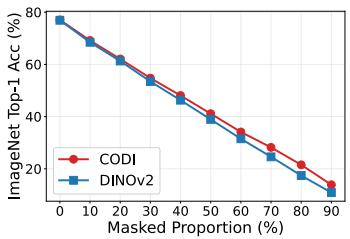  
(a) Attention occlusion

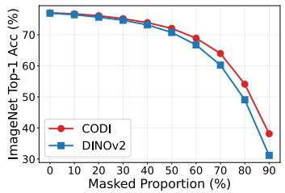  
(b) Random occlusion

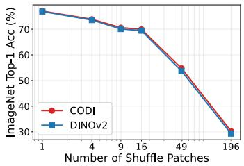  
(c) Patch shuffling  
Figure 8: Robustness analysis on ImageNet k-NN classification under patch-level perturbations.

70.9 ImageNet k-NN accuracy and 61.3 VOC mIoU, compared with 71.1 and 61.4 for DINOv2 ViT-S/14. We hypothesize that these DINOv3 design choices, developed for large-scale pretraining, require further hyperparameter tuning for small models trained from scratch on datasets at the scale of ImageNet-1K, and leave this adaptation to future work.

## D.5 Additional Experiments on Model Robustness

We further evaluate the robustness of CODI under patch-level perturbations. Specifically, we measure ImageNet k-NN classification accuracy under three complementary stress tests that remove representative evidence, remove random visual evidence, or disrupt spatial structure.

Robustness on Attention-based Patch Occlusion. In this setting, we first compute the [CLS]-topatch attention score for each patch. We then mask the patches with the highest attention scores and use the k-NN classifier to evaluate the resulting representations. This protocol tests whether the model can preserve recognition performance when the most representative patches are not visible.

Robustness on Random Patch Occlusion. Instead of masking high-attention patches, we also evaluate the model when randomly selected patches are masked. This protocol measures robustness to input-agnostic information loss.

Robustness on Random Patch Shuffling. Following [25], we shuffle the image using different grid sizes. A grid size of 1 keeps the image unchanged, while a grid size of 196 shuffles every individual patch. This protocol measures how well the model preserves classification performance when spatial structure is disrupted.

As shown in Fig. 8, CODI consistently improves robustness across all three stress tests. Under attention-based occlusion, CODI retains a clear advantage when high-attention patches are removed, indicating that its classification representation relies less on a small set of representative patches. Under random occlusion, the advantage becomes larger at high masking ratios, showing that CODI better exploits distributed patch evidence when the image is severely incomplete. Under patch shuffling, CODI remains slightly but consistently stronger as spatial order is increasingly disrupted. These results suggest that CODI learns more distributed and perturbation-tolerant image representations, rather than improving only the clean-input setting.

## D.6 Sensitivity to the Mixing Ratio Across Pretraining Datasets

We conduct additional ablations on α when pretraining on COCO and ImageNet-22K. For COCO, we pretrain for 800 epochs. For ImageNet-22K, we exclude the ImageNet-1K subset to avoid overlap with the downstream classification benchmark and use a 100K-iteration schedule. We evaluate ImageNet-1K k-NN classification and VOC semantic segmentation for both pretraining datasets.

As shown in Tab. 14, on $\mathrm { C O C O } , \alpha = 0 . 0 7 5$ matches the k-NN performance obtained with $\alpha = 0 . 0 5$ while its segmentation performance lies between those obtained with $\alpha = 0 . 0 5$ and $\alpha = 0 . 1$ , rather than improving both metrics. This indicates a stable range of [0.05, 0.1], with the final choice depending on whether image-level or dense performance is prioritized. Increasing α to 0.2 reduces both metrics below the DINOv2 baseline. On ImageNet-22K, $\alpha = 0 . 1$ achieves the best results on both metrics. These findings support $\alpha = 0 . 1$ as a strong starting point, though not a universal optimum for every downstream metric; CODI does not have a uniformly wide operating range.

Table 14: Sensitivity to α across pretraining datasets. ImageNet-22K excludes the ImageNet-1K subset. All downstream results are percentages.
<table><tr><td>Method</td><td>α ImageNet k-NN</td><td>VOC mIoU</td></tr><tr><td colspan="3">COCO pretraining: 800 epochs</td></tr><tr><td>DINOv2</td><td></td><td>41.1 49.2</td></tr><tr><td>CODI</td><td>0.05</td><td>41.8 50.8</td></tr><tr><td>CODI</td><td>0.075</td><td>41.8 50.9</td></tr><tr><td>CODI</td><td>0.1</td><td>41.6 51.3</td></tr><tr><td>CODI</td><td>0.2</td><td>40.9 48.4</td></tr><tr><td colspan="3">ImageNet-22K pretraining: 100K iterations</td></tr><tr><td>DINOv2</td><td>63.2</td><td>66.1</td></tr><tr><td>CODI</td><td>0.05 63.5</td><td>67.9</td></tr><tr><td>CODI</td><td>0.1 63.8</td><td>68.2</td></tr><tr><td>CODI</td><td>0.2 63.4</td><td>67.2</td></tr></table>

## E Qualitative Results

We provide additional qualitative results to complement the quantitative dense-prediction evaluations. We group the visualizations by task: semantic segmentation visualizes the quality of learned patch semantics, depth estimation examines whether the learned dense features preserve spatial structure, and sparse correspondence examines local feature alignment across images.

Semantic Segmentation Visualizations. Fig. 9 provides additional frozen-backbone linear segmentation results. The baseline predictions often contain fragmented object regions or background activations. CODI produces more coherent object masks in these examples, indicating that cross distillation improves the semantic quality of patch representations.

Depth Estimation Visualizations. Fig. 10 shows additional depth predictions from frozen dense representations. Although depth estimation is less directly tied to discriminative semantics than segmentation, the visualizations show that CODI preserves coherent indoor layouts and object boundaries. This suggests that the additional class-token guidance does not sacrifice local geometric structure when improving dense semantic transfer.

Sparse Correspondence Visualizations. We further include sparse correspondence results in Fig. 11 to examine whether local features remain aligned across different images of related concepts. The matched points often connect semantically consistent object parts despite changes in instance, viewpoint, scale, and background, indicating that CODI learns patch representations that support transferable local matching.

## F Limitations

CODI is motivated by ImageNet-style pretraining views where a dominant object often exists. In highly multi-object scenes, the [CLS] target can mix semantics from multiple objects, so overly strong class-token mixing may confuse patch targets. This is consistent with our ablation showing that large mixing ratios can reduce patch discriminability. Additional experiments on COCO and ImageNet-22K support α = 0.1 as a strong starting point, but not a universal optimum or evidence of a uniformly wide operating range (Appendix D.6). ImageNet-22K pretraining uses only 100K iterations; full-scale training on substantially larger corpora and adaptive or multi-object-aware mixing remain future work.

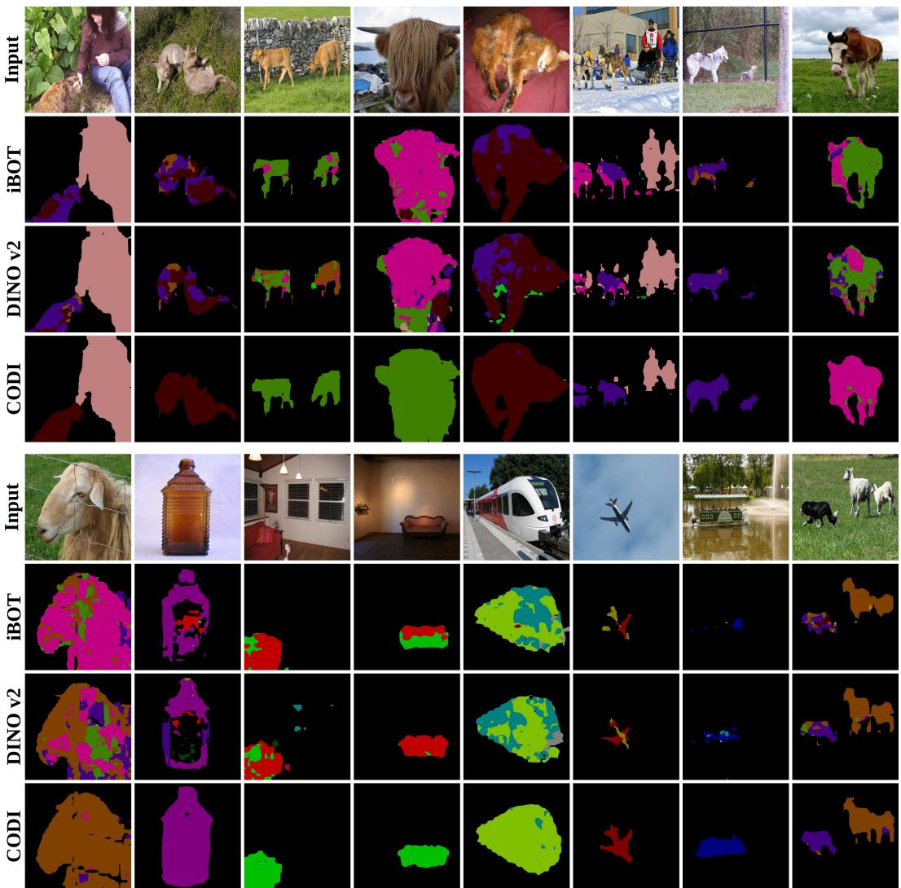  
Figure 9: Additional semantic segmentation visualizations from frozen-backbone linear probes. For each block, rows from top to bottom show the input image, iBOT, DINOv2, and CODI, while columns show different examples. Colored regions denote predicted semantic labels. CODI produces more complete and less fragmented object regions in these cases.

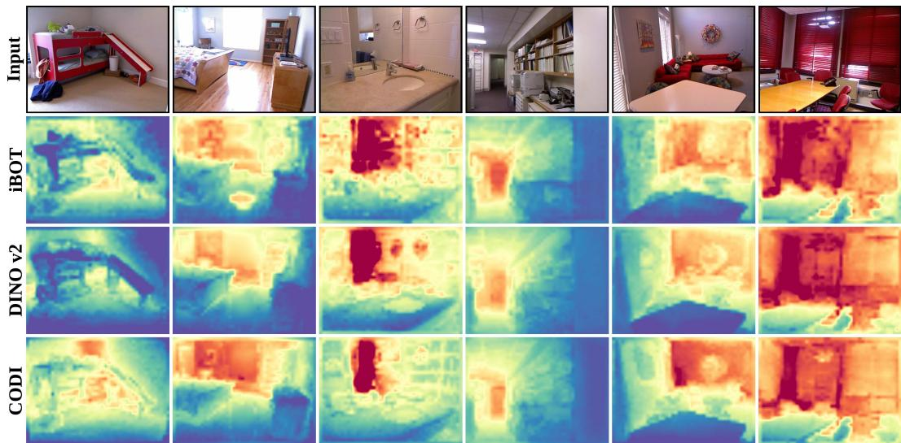  
Figure 10: Additional depth estimation visualizations from frozen-backbone linear depth probes. Rows from top to bottom show the input image, iBOT, DINOv2, and CODI, while columns show different indoor examples. Colors visualize relative predicted depth. CODI maintains coherent scene layouts and depth discontinuities while improving dense representation quality.

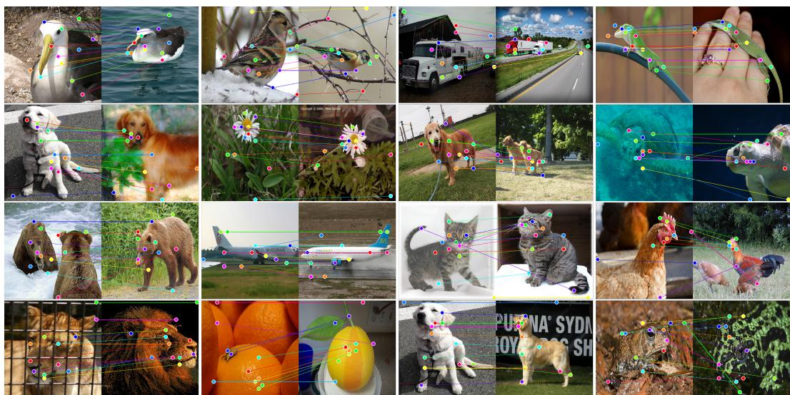  
Figure 11: Additional sparse-correspondence visualizations. Colored points and lines indicate matched local features between image pairs. CODI produces many semantically aligned matches across different instances, viewpoints, scales, and backgrounds, suggesting that its dense features generalize beyond the specific image context.

## NeurIPS Paper Checklist

## 1. Claims

Question: Do the main claims made in the abstract and introduction accurately reflect the paper’s contributions and scope?

Answer: [Yes]

Justification: The abstract and Introduction state the representative-patch failure mode, the CODI target-mixing method, and the empirical scope of dense and image-level evaluations. The claims are supported by the theory in Sec. 3 and Sec. 4 and by the experiments in Sec. 5.2.

Guidelines:

• The answer [N/A] means that the abstract and introduction do not include the claims made in the paper.

• The abstract and/or introduction should clearly state the claims made, including the contributions made in the paper and important assumptions and limitations. A [No] or [N/A] answer to this question will not be perceived well by the reviewers.

• The claims made should match theoretical and experimental results, and reflect how much the results can be expected to generalize to other settings.

• It is fine to include aspirational goals as motivation as long as it is clear that these goals are not attained by the paper.

## 2. Limitations

Question: Does the paper discuss the limitations of the work performed by the authors? Answer: [Yes]

Justification: The paper includes a dedicated Limitations section in Appendix F. It discusses the possible confusion caused by strong class-token mixing on multi-object images, sensitivity to the mixing ratio, and the limited scope of large-scale pretraining experiments.

Guidelines:

• The answer [N/A] means that the paper has no limitation while the answer [No] means that the paper has limitations, but those are not discussed in the paper.

• The authors are encouraged to create a separate “Limitations” section in their paper.

• The paper should point out any strong assumptions and how robust the results are to violations of these assumptions (e.g., independence assumptions, noiseless settings, model well-specification, asymptotic approximations only holding locally). The authors should reflect on how these assumptions might be violated in practice and what the implications would be.

• The authors should reflect on the scope of the claims made, e.g., if the approach was only tested on a few datasets or with a few runs. In general, empirical results often depend on implicit assumptions, which should be articulated.

• The authors should reflect on the factors that influence the performance of the approach. For example, a facial recognition algorithm may perform poorly when image resolution is low or images are taken in low lighting. Or a speech-to-text system might not be used reliably to provide closed captions for online lectures because it fails to handle technical jargon.

• The authors should discuss the computational efficiency of the proposed algorithms and how they scale with dataset size.

• If applicable, the authors should discuss possible limitations of their approach to address problems of privacy and fairness.

• While the authors might fear that complete honesty about limitations might be used by reviewers as grounds for rejection, a worse outcome might be that reviewers discover limitations that aren’t acknowledged in the paper. The authors should use their best judgment and recognize that individual actions in favor of transparency play an important role in developing norms that preserve the integrity of the community. Reviewers will be specifically instructed to not penalize honesty concerning limitations.

## 3. Theory assumptions and proofs

Question: For each theoretical result, does the paper provide the full set of assumptions and a complete (and correct) proof?

Answer: [Yes]

Justification: The theoretical results and assumptions are stated in Sec. 3.2 and Sec. 4.3. Full formal statements and proofs are provided in Appendix A.

Guidelines:

• The answer [N/A] means that the paper does not include theoretical results.

• All the theorems, formulas, and proofs in the paper should be numbered and crossreferenced.

• All assumptions should be clearly stated or referenced in the statement of any theorems.

• The proofs can either appear in the main paper or the supplemental material, but if they appear in the supplemental material, the authors are encouraged to provide a short proof sketch to provide intuition.

• Inversely, any informal proof provided in the core of the paper should be complemented by formal proofs provided in appendix or supplemental material.

• Theorems and Lemmas that the proof relies upon should be properly referenced.

## 4. Experimental result reproducibility

Question: Does the paper fully disclose all the information needed to reproduce the main experimental results of the paper to the extent that it affects the main claims and/or conclusions of the paper (regardless of whether the code and data are provided or not)?

Answer: [Yes]

Justification: The method is specified in Sec. 4 and Algorithm 1, while pretraining and evaluation settings are described in Sec. 5.1 and Appendix C.2. These details include datasets, model variants, optimization settings, augmentation, probe protocols, and hyperparameter sweeps needed to reproduce the reported claims.

## Guidelines:

• The answer [N/A] means that the paper does not include experiments.

• If the paper includes experiments, a [No] answer to this question will not be perceived well by the reviewers: Making the paper reproducible is important, regardless of whether the code and data are provided or not.

• If the contribution is a dataset and/or model, the authors should describe the steps taken to make their results reproducible or verifiable.

• Depending on the contribution, reproducibility can be accomplished in various ways. For example, if the contribution is a novel architecture, describing the architecture fully might suffice, or if the contribution is a specific model and empirical evaluation, it may be necessary to either make it possible for others to replicate the model with the same dataset, or provide access to the model. In general, releasing code and data is often one good way to accomplish this, but reproducibility can also be provided via detailed instructions for how to replicate the results, access to a hosted model (e.g., in the case of a large language model), releasing of a model checkpoint, or other means that are appropriate to the research performed.

• While NeurIPS does not require releasing code, the conference does require all submissions to provide some reasonable avenue for reproducibility, which may depend on the nature of the contribution. For example

(a) If the contribution is primarily a new algorithm, the paper should make it clear how to reproduce that algorithm.

(b) If the contribution is primarily a new model architecture, the paper should describe the architecture clearly and fully.

(c) If the contribution is a new model (e.g., a large language model), then there should either be a way to access this model for reproducing the results or a way to reproduce the model (e.g., with an open-source dataset or instructions for how to construct the dataset).

(d) We recognize that reproducibility may be tricky in some cases, in which case authors are welcome to describe the particular way they provide for reproducibility. In the case of closed-source models, it may be that access to the model is limited in some way (e.g., to registered users), but it should be possible for other researchers to have some path to reproducing or verifying the results.

## 5. Open access to data and code

Question: Does the paper provide open access to the data and code, with sufficient instructions to faithfully reproduce the main experimental results, as described in supplemental material?

Answer: [Yes]

Justification: The code and instructions for reproducing the main experiments are available at https://github.com/EldercatSAM/CODI. The experiments use public datasets, with pretraining and evaluation settings detailed in Appendix C.1 and Appendix C.2.

Guidelines:

• The answer [N/A] means that paper does not include experiments requiring code.

• Please see the NeurIPS code and data submission guidelines (https://neurips.cc/ public/guides/CodeSubmissionPolicy) for more details.

• While we encourage the release of code and data, we understand that this might not be possible, so [No] is an acceptable answer. Papers cannot be rejected simply for not including code, unless this is central to the contribution (e.g., for a new open-source benchmark).

• The instructions should contain the exact command and environment needed to run to reproduce the results. See the NeurIPS code and data submission guidelines (https: //neurips.cc/public/guides/CodeSubmissionPolicy) for more details.

• The authors should provide instructions on data access and preparation, including how to access the raw data, preprocessed data, intermediate data, and generated data, etc.

• The authors should provide scripts to reproduce all experimental results for the new proposed method and baselines. If only a subset of experiments are reproducible, they should state which ones are omitted from the script and why.

• At submission time, to preserve anonymity, the authors should release anonymized versions (if applicable).

• Providing as much information as possible in supplemental material (appended to the paper) is recommended, but including URLs to data and code is permitted.

## 6. Experimental setting/details

Question: Does the paper specify all the training and test details (e.g., data splits, hyperparameters, how they were chosen, type of optimizer) necessary to understand the results?

Answer: [Yes]

Justification: Sec. 5.1 specifies the main pretraining setup, including dataset, optimizer, batch size, model scales, epoch counts, learning-rate schedule, and CODI mixing ratio. Appendix C.1 and Appendix C.2 provide detailed pretraining and downstream evaluation protocols.

Guidelines:

• The answer [N/A] means that the paper does not include experiments.

• The experimental setting should be presented in the core of the paper to a level of detail that is necessary to appreciate the results and make sense of them.

• The full details can be provided either with the code, in appendix, or as supplemental material.

## 7. Experiment statistical significance

Question: Does the paper report error bars suitably and correctly defined or other appropriate information about the statistical significance of the experiments?

Answer: [No]

Justification: The paper reports single-run benchmark results and hyperparameter sweeps, but it does not report error bars, confidence intervals, or statistical significance tests. This is mainly due to the high computational cost of repeated large-scale self-supervised pretraining and downstream evaluation.

## Guidelines:

• The answer [N/A] means that the paper does not include experiments.

• The authors should answer [Yes] if the results are accompanied by error bars, confidence intervals, or statistical significance tests, at least for the experiments that support the main claims of the paper.

• The factors of variability that the error bars are capturing should be clearly stated (for example, train/test split, initialization, random drawing of some parameter, or overall run with given experimental conditions).

• The method for calculating the error bars should be explained (closed form formula, call to a library function, bootstrap, etc.)

• The assumptions made should be given (e.g., Normally distributed errors).

• It should be clear whether the error bar is the standard deviation or the standard error of the mean.

• It is OK to report 1-sigma error bars, but one should state it. The authors should preferably report a 2-sigma error bar than state that they have a 96% CI, if the hypothesis of Normality of errors is not verified.

• For asymmetric distributions, the authors should be careful not to show in tables or figures symmetric error bars that would yield results that are out of range (e.g., negative error rates).

• If error bars are reported in tables or plots, the authors should explain in the text how they were calculated and reference the corresponding figures or tables in the text.

## 8. Experiments compute resources

Question: For each experiment, does the paper provide sufficient information on the computer resources (type of compute workers, memory, time of execution) needed to reproduce the experiments?

Answer: [No]

Justification: Appendix C.1 reports GPU types and counts and the approximate wall-clock time for the ViT-S/14 800-epoch pretraining run. Memory requirements and execution times for all pretraining and downstream evaluation runs are not fully reported.

Guidelines:

• The answer [N/A] means that the paper does not include experiments.

• The paper should indicate the type of compute workers CPU or GPU, internal cluster, or cloud provider, including relevant memory and storage.

• The paper should provide the amount of compute required for each of the individual experimental runs as well as estimate the total compute.

• The paper should disclose whether the full research project required more compute than the experiments reported in the paper (e.g., preliminary or failed experiments that didn’t make it into the paper).

## 9. Code of ethics

Question: Does the research conducted in the paper conform, in every respect, with the NeurIPS Code of Ethics https://neurips.cc/public/EthicsGuidelines?

Answer: [Yes]

Justification: The work uses established public vision datasets and standard self-supervised pretraining/evaluation protocols, and it does not involve human subjects, private data collection, or deployment on users. The study is intended as foundational representation-learning research.

Guidelines:

• The answer [N/A] means that the authors have not reviewed the NeurIPS Code of Ethics.

• If the authors answer [No], they should explain the special circumstances that require a deviation from the Code of Ethics.

• The authors should make sure to preserve anonymity (e.g., if there is a special consideration due to laws or regulations in their jurisdiction).

## 10. Broader impacts

Question: Does the paper discuss both potential positive societal impacts and negative societal impacts of the work performed?

Answer: [No]

Justification: The paper is foundational representation-learning work and does not include a separate broader-impact discussion.

Guidelines:

• The answer [N/A] means that there is no societal impact of the work performed.

• If the authors answer [N/A] or [No], they should explain why their work has no societal impact or why the paper does not address societal impact.

• Examples of negative societal impacts include potential malicious or unintended uses (e.g., disinformation, generating fake profiles, surveillance), fairness considerations (e.g., deployment of technologies that could make decisions that unfairly impact specific groups), privacy considerations, and security considerations.

• The conference expects that many papers will be foundational research and not tied to particular applications, let alone deployments. However, if there is a direct path to any negative applications, the authors should point it out. For example, it is legitimate to point out that an improvement in the quality of generative models could be used to generate Deepfakes for disinformation. On the other hand, it is not needed to point out that a generic algorithm for optimizing neural networks could enable people to train models that generate Deepfakes faster.

• The authors should consider possible harms that could arise when the technology is being used as intended and functioning correctly, harms that could arise when the technology is being used as intended but gives incorrect results, and harms following from (intentional or unintentional) misuse of the technology.

• If there are negative societal impacts, the authors could also discuss possible mitigation strategies (e.g., gated release of models, providing defenses in addition to attacks, mechanisms for monitoring misuse, mechanisms to monitor how a system learns from feedback over time, improving the efficiency and accessibility of ML).

## 11. Safeguards

Question: Does the paper describe safeguards that have been put in place for responsible release of data or models that have a high risk for misuse (e.g., pre-trained language models, image generators, or scraped datasets)?

Answer: [N/A]

Justification: The paper does not release high-risk assets such as language models, image generators, or scraped datasets. The proposed method is a training objective for selfsupervised vision backbones evaluated on standard benchmarks.

Guidelines:

• The answer [N/A] means that the paper poses no such risks.

• Released models that have a high risk for misuse or dual-use should be released with necessary safeguards to allow for controlled use of the model, for example by requiring that users adhere to usage guidelines or restrictions to access the model or implementing safety filters.

• Datasets that have been scraped from the Internet could pose safety risks. The authors should describe how they avoided releasing unsafe images.

• We recognize that providing effective safeguards is challenging, and many papers do not require this, but we encourage authors to take this into account and make a best faith effort.

## 12. Licenses for existing assets

Question: Are the creators or original owners of assets (e.g., code, data, models), used in the paper, properly credited and are the license and terms of use explicitly mentioned and properly respected?

## Answer: [No]

Justification: The datasets, baselines, and model components are credited in Sec. 5.2 and Appendix D. However, the paper does not explicitly enumerate the licenses and terms of use for all existing assets.

## Guidelines:

• The answer [N/A] means that the paper does not use existing assets.

• The authors should cite the original paper that produced the code package or dataset.

• The authors should state which version of the asset is used and, if possible, include a URL.

• The name of the license (e.g., CC-BY 4.0) should be included for each asset.

• For scraped data from a particular source (e.g., website), the copyright and terms of service of that source should be provided.

• If assets are released, the license, copyright information, and terms of use in the package should be provided. For popular datasets, paperswithcode.com/datasets has curated licenses for some datasets. Their licensing guide can help determine the license of a dataset.

• For existing datasets that are re-packaged, both the original license and the license of the derived asset (if it has changed) should be provided.

• If this information is not available online, the authors are encouraged to reach out to the asset’s creators.

## 13. New assets

Question: Are new assets introduced in the paper well documented and is the documentation provided alongside the assets?

Answer: [Yes]

Justification: The CODI implementation and accompanying usage and reproduction documentation are provided in the project repository linked in the abstract.

Guidelines:

• The answer [N/A] means that the paper does not release new assets.

• Researchers should communicate the details of the dataset/code/model as part of their submissions via structured templates. This includes details about training, license, limitations, etc.

• The paper should discuss whether and how consent was obtained from people whose asset is used.

• At submission time, remember to anonymize your assets (if applicable). You can either create an anonymized URL or include an anonymized zip file.

## 14. Crowdsourcing and research with human subjects

Question: For crowdsourcing experiments and research with human subjects, does the paper include the full text of instructions given to participants and screenshots, if applicable, as well as details about compensation (if any)?

Answer: [N/A]

Justification: The paper does not involve crowdsourcing, user studies, or other research with human subjects. All experiments are conducted on existing vision benchmarks.

Guidelines:

• The answer [N/A] means that the paper does not involve crowdsourcing nor research with human subjects.

• Including this information in the supplemental material is fine, but if the main contribution of the paper involves human subjects, then as much detail as possible should be included in the main paper.

• According to the NeurIPS Code of Ethics, workers involved in data collection, curation, or other labor should be paid at least the minimum wage in the country of the data collector.

## 15. Institutional review board (IRB) approvals or equivalent for research with human subjects

Question: Does the paper describe potential risks incurred by study participants, whether such risks were disclosed to the subjects, and whether Institutional Review Board (IRB) approvals (or an equivalent approval/review based on the requirements of your country or institution) were obtained?

Answer: [N/A]

Justification: The paper does not involve crowdsourcing, user studies, or other research with human subjects. Therefore, IRB approval or an equivalent human-subjects review is not applicable.

Guidelines:

• The answer [N/A] means that the paper does not involve crowdsourcing nor research with human subjects.

• Depending on the country in which research is conducted, IRB approval (or equivalent) may be required for any human subjects research. If you obtained IRB approval, you should clearly state this in the paper.

• We recognize that the procedures for this may vary significantly between institutions and locations, and we expect authors to adhere to the NeurIPS Code of Ethics and the guidelines for their institution.

• For initial submissions, do not include any information that would break anonymity (if applicable), such as the institution conducting the review.

## 16. Declaration of LLM usage

Question: Does the paper describe the usage of LLMs if it is an important, original, or non-standard component of the core methods in this research? Note that if the LLM is used only for writing, editing, or formatting purposes and does not impact the core methodology, scientific rigor, or originality of the research, declaration is not required.

Answer: [N/A]

Justification: LLMs were used only for writing, editing, and formatting, and are not part of the core research methodology.

Guidelines:

• The answer [N/A] means that the core method development in this research does not involve LLMs as any important, original, or non-standard components.

• Please refer to our LLM policy in the NeurIPS handbook for what should or should not be described.