# CellTrack-Bench: Microscopic Cell Tracking Benchmark for Vision–Language Models

Ilan Theodoro Jordão Bragantini Loïc A. Royer

Biohub

San Francisco, CA

{ilan.silva, jordao.bragantini, loic.royer}@biohub.org

## Abstract

Large language models have shown outstanding performance on text-first tasks such as coding, math, and writing. Recent efforts are shifting models’ training to include scientific problems that often live in highly specialized domains beyond text, such as protein structure and biological images. However, in these scenarios, their general-purpose accuracy compared with specialized algorithms remains in question. One such domain is cell tracking, which requires spatiotemporal awareness of cell dynamics. To evaluate this, we created a new benchmark, CellTrack-Bench, which assesses Vision-Language Models’ (VLMs) cell-trackingrelated performance against specialized trackers. The full benchmark draws from 15 standard cell-tracking datasets across four imaging modalities and comprises 1,537 problems corresponding to 9,041 cell-linking decisions. We selected a hard subset requiring greater reasoning effort by identifyingfailures shared across distinct algorithmic trackers. With this proposed dataset, we: (i) evaluated different environment harnesses for VLMs; (ii) benchmarked 9 frontier closed-source models and 13 open-weight mod els; and (iii) provided a detailed analysis of their failure modes. Code, the stored model outputs, and a pipeline that regenerates the benchmark from the source datasets are available at https://github.com/royerlab/ celltrack-bench.

## 1. Introduction

Cells exhibit complex behaviors, including proliferation, differentiation, and migration, throughout their life, resulting in complex biological patterns such as embryonic development [24, 30], tissue mechanics [20], and immune response [25]. To quantify this dynamic cellular behavior at the single-cell level, it is necessary to identify individual cells and to track them over time [31].

Cell tracking shares many similarities with Multi-Object Tracking (MOT) [12] in the traditional natural imaging domain, as both involve identifying and tracking objects. They’re commonly solved through the paradigm of tracking-by-detection, where an algorithm segments or detects the objects and then links them over time. However, cell tracking benefits from specialized solutions [7, 28, 45] because objects are almost identical, can be divided, and quickly undergo morphological changes, unlike objects in natural images (e.g., cars, pedestrians).

Here, we take a different approach. Rather than dividing the problem from the algorithmic point of view, we view the operations in two different regimes: (i) a highly mechanical scenario where it’s easy to design an algorithm to automatically link the objects, for example, with optimal matching [13, 21]; and (ii) a highly cognitive scenario where one must reason about what is happening within the image, considering cell state, if undergoing division, if near the boundary of the field of view, and many other experimental conditions, see Figure 1 for a practical example.

This motivates the development of a system where existing cell tracking algorithms perform the mechanical aspect of tracking, while VLMs perform the highly cognitive correction of mistakes made by these approaches. This is analogous to a scenario where an annotator is fixing the tracking mistakes. To validate this novel paradigm for cell tracking, we built CellTrack-Bench from 15 cell-tracking datasets across four imaging modalities. Thirteen datasets contribute 1,537 problems, amounting to 9,041 linking instances.

For CellTrack-Bench, we define three tasks that progressively change the role of the VLM from directly constructing associations, to correcting an existing tracking solution, to identifying errors for review: (i) cell linking; (ii) track repair; and (iii) track inspection.

In cell linking, the model directly predicts the correspondence between cells in two consecutive frames. In track "These cells seem to be nuclear labeled, they are brighter than the neighborhood this might indicate histone condensation. indicating that the cells are undergoing mitosis. the neighboring cells are also undergoing mitosis, so we need to check the polarity of the condensation. Both daughter cells appear around the parent's previous position and together preserve its overall size and center."

a) Simple cell-tracking instance  
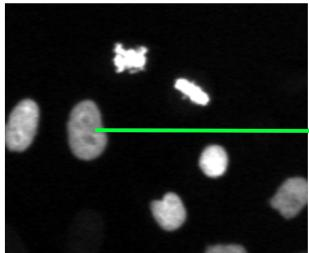  
Specialist reasoning

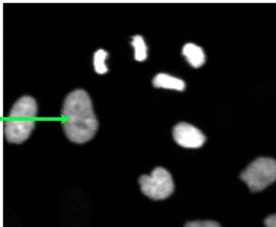

"The cell retains the same shape, size, and position, indicating a straightforward continuation."  
b) Complex cell-tracking instance  
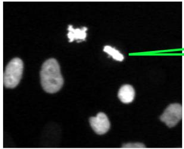

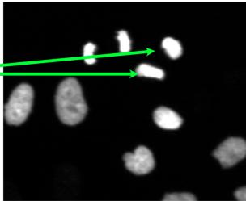  
Specialist reasoning

Figure 1. Cognitive aspect of cell tracking. Cell tracking is dominated by a majority of trivial associations that can be retrieved using simple proxies such as a proximity-based one. In (a), we show a human specialist cognitive process on one of those links. However, in some cases of cell-state changes, such as a division in (b), it requires a more global comprehension and understanding of biological processes.

repair, it is given a graph from an algorithmic tracker and has to determine the set of link corrections that will fix the graph. In track inspection, it detects the tracker decisions that need review, corresponding to a human-in-theloop triage scenario. Taken together, these tasks highlight different aspects of tracking that the model can collectively cover the operations needed to correct tracking errors across a dataset.

We apply these three tasks to difficult cell tracking cases that are local rather than to complete time-lapse sequences. In a normal cell-tracking problem, an algorithm handles a complete time-lapse series of microscopy images; in our approach, each problem is concentrated on the more difficult cell links (see Figure 2). This is necessary since, in most datasets having sufficient temporal resolution, cells do not move much until a cell-state change takes place, at which point their visual appearance may change and they can exhibit erratic movement and displacement. Although such events are rare and more prone to error, the overall tracking performance can mask them. We identify the difficult cases algorithmically by looking at failures that are common to multiple trackers.

After having chosen the difficult cases and defined the tasks, assessing the VLMs also required controlling the way in which these problems are presented to the model. For this reason, we conducted a study looking at various environment strategies, recently known as harnesses, such as the method of presenting cells, the way in which coordinate information is given, the use of multi-turn settings, and visual hints like segmentation outlines. For our study we carried out a validation-only investigation into environmental changes with respect to the VLM and kept the bestperforming configuration for the test evaluation. We also introduce proximity-debiased metrics which separately assess associations that are not already accounted for by a nearest-neighbor rule, together with division-specific and graph-level measures. Our protocol also takes into account the composition of the dataset and the output-token budget.

In summary, our contributions are:

• A benchmark comprising 1,537 hard-mined adjacentframe problems, with 9,041 linking associations spanning 15 datasets and four imaging modalities, structured as a series of tasks concerning cell linking, track repair, and track inspection.

• A controlled evaluation protocol for VLM-based cell tracking, including validation-only harness selection, proximity-debiased, and division-specific metrics, a Cell Tracking Challenge (CTC) comparable graph score, dataset-stratified evaluation, and inference budget.

• A study evaluating 9 frontier closed-source and 13 openweight VLMs by means of a fixed interface, together with geometric and specialized tracking references, looking at proximity shortcuts, interface sensitivity, and token budget effects, and task relationships.

This work is organized as follows. The Section 2 positions our work within the literature. In Section 3, we explain how the benchmark is created and how we define the evaluation protocol. Finally, in Section 4 we conduct a discussion over the results of closed-source and open-weight models, followed by our final considerations in Section 5.

## 2. Related Works

Cell-tracking methods and benchmarks. With recent advancements in instance segmentation models [18, 40, 41], cell-tracking methods have almost exclusively relied on the tracking-by-detection paradigm, focusing on association (edge) prediction, as TrackMate [21, 43] and btrack [44] on the algorithmic side. On the deep learning front, Trackastra [14] predicts pairwise cell detection associations using a transformer over temporal windows, while HOCT [8] models the higher-order cell-to-cell interactions among the competing candidate links. The most widely regarded benchmark is the Cell Tracking Challenge (CTC), which standardized performance evaluation using lineage-aware graph-edit metrics [28, 45] and includes a hidden test evaluated by the organizers. Our proposed benchmark uses a similar methodology, assuming cell segmentation is given, and evaluating performance based on local associations between consecutive frames.

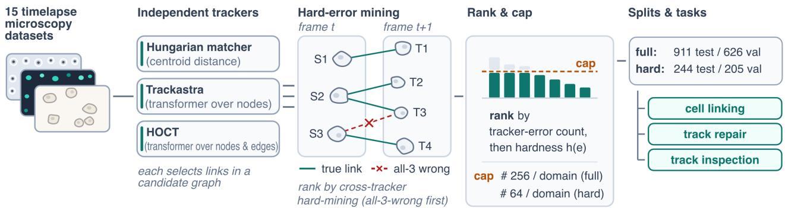  
Figure 2. CellTrack-Bench construction. Three trackers with distinct inductive biases run across four imaging modalities; errors are ranked by a cross-tracker hard-mining score, all-three-wrong first (illustrated: the division S2 → {T2, T3} that every tracker resolves as S3 → T3), then by hardness h(e), backfilled in rank order to a per-dataset cap, split sequence-disjointly, and instantiated as linking, repair, and inspection tasks (scales and counts: Section 3.2).

Because even very effective trackers still produce a few mistakes, human-in-the-loop review is often necessary. Pop et al. [37] framed the verification as a multi-armed bandit problem. OrganoidTracker flags suspicious links for review [23]. Meanwhile, its successor, OrganoidTracker 2, computes probabilities for each link [6]. These interactive approaches motivate our track repair and track inspection tasks, in which a VLM serves as an external assistant that either corrects or prioritizes links for revision. Because the difficulty of tracking individual cells is heavily skewed towards easy cells, existing metrics fail to assess the quality of hard instances; therefore, CellTrack-Bench extends evaluation from tracker-specific metrics to a more specific assessment of the model’s ability to link, repair, and inspect hard instances across multiple trackers and imaging modalities.

Biomedical VLM benchmarks. The µ-Bench [27] attempts to measure perception and cognition with respect to light, fluorescence, and electron microscopy. MicroVQA [9] focuses on expert scientific reasoning using single- and multi-image questions and answers. OmniMed-VQA [19] evaluates medical image understanding on a large scale. Both MedFrameQA [47] and general video benchmarks like MVBench [26] also look into temporal reasoning. These benchmarks primarily consist of classification, localization, or question-answering tasks. In contrast, CellTrack-Bench evaluates cell-identity correspondence, including continuations, divisions, appearances, and disappearances, as well as explicit changes to lineage graphs.

Shortcut-resistant and controlled evaluation. Benchmark performance might overestimate a model’s visual understanding if the model makes use of linguistic or visual shortcuts [10, 15]. In cell tracking, the main shortcut is spatial proximity: a nearest-neighbor rule accounts for much of the association distribution. CellTrack-Bench therefore uses sequence-disjoint validation/test splits, implements a ranked tracker-error mining, per-dataset sampling caps, and uses debiased metrics with respect to proximity or division events. VLM performance can also depend on how the problem is presented and the models’ harness [48]. Therefore, the evaluation protocol includes the renderer, the coordinate exploration interface, the prompt, and the inference budget. We selected these components based on validation data and kept them fixed during testing. The result is a controlled diagnostic benchmark for VLM-assisted cell linking and track inspection, not a new tracker or training method.

## 3. CellTrack-Bench

In this section, we explain how we constructed CellTrack-Bench. First, in Section 3.1 we describe the standard protocol used in the Cell Tracking Challenge (CTC) [28, 45], and in Section 3.2 we document the data we gathered. Then, in Section 3.3, we explain how we use state-of-the-art and classical tracking algorithms to identify hard instances that may indicate data requiring stronger cognitive abilities, followed by how we transformed these instances into real tasks for the VLMs in Section 3.4. In Section 3.5, we then propose the metrics and evaluation protocol used throughout this work. Finally, we empirically explore prompting and harnessing design choices to enable models to find solutions more effectively in Section 3.6.

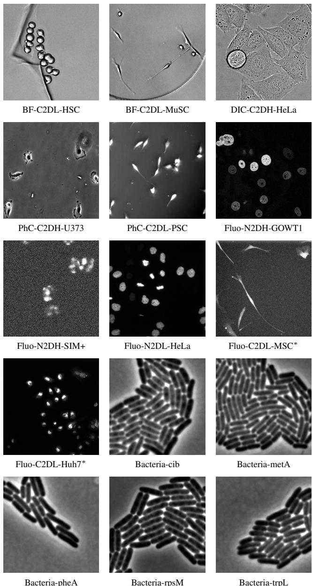  
Figure 3. Example frames from all 15 source datasets, spanning four imaging modalities: bright-field (BF), differential interference contrast (DIC), phase contrast (PhC), and fluorescence (Fluo).

## 3.1. Preliminaries

The tracking problem is formulated as constructing a binary forest (i.e., each node can have at most two children) from a candidate graph, $G _ { C } = ( V _ { C } , E _ { C } )$ , which contains a superset of valid tracking solutions; throughout the text, we will refer to the predicted graph as a solution graph $G _ { p r e d } = ( V _ { p r e d } , E _ { p r e d } )$ and the ground-truth graph computed from the annotations as $G _ { g t } = ( V _ { g t } , E _ { g t } )$

The nodes V<sub>·</sub> from all graphs come from each frame t of the segmentation sequence (video), such that segments from a single frame are $V ^ { t } \subset V _ { C }$

CellTrack-Bench retains the images, segmentations, and lineage annotations from existing tracking datasets but changes the unit of evaluation from a complete sequence to local transitions, $e _ { i j } \in E _ { g t } \cup E _ { p r e d }$ between frames t and t + 1 where $i \in V ^ { t }$ and $j \in V ^ { t + 1 }$ , allowing errors to be isolated and diagnosed at the frame level. Each instance contains a compact group of source cells that includes the specific error, and the linking, repair, and inspection tasks share the same local transition (construction detail in Section 3.4).

## 3.2. Source Data

CellTrack-Bench draws from 10 CTC and five bacterial datasets (35 sequences), encompassing fluorescence, phasecontrast, differential-interference-contrast, and bright-field microscopy. Object size, density, morphology, and motion vary widely. See Figure 3.

We partition sequences before ranking or selecting links to avoid temporal leakage, so visually adjacent transitions from the same lineage cannot appear in both partitions. In CTC datasets, we assign sequence 01 to validation and 02 to test. Similarly, we split the multi-sequence bacterial datasets into identifier-ordered halves (per-dataset assignments in Appendix A). Every benchmark decision is evaluated using the validation dataset, and the test dataset was only used for the final leaderboard score.

## 3.3. Specialized Trackers as Difficulty Probes

We argue that trackers’ errors are not independent and likely identify mistakes in challenging links. We thus use three different trackers with different inductive biases and use their shared errors as a hard-mining signal to find such difficult links and mitigate uncorrelated wrong links, which might be just a tracker’s shortcoming.

All three trackers jointly fail at 0.28% of the 1.5M candidate links (4,222 links exactly), so the dependence argument is supported empirically, as we would expect only 0.0022% shared errors under independence (33.2; stratifying by sequence already accounts for some sequences being uniformly harder; see Appendix A.3). Moreover, given one tracker error, another tracker is 11.3–49.6 times more likely to commit the same error. The trackers are:

• Hungarian Matching on Distance. It is a one-to-one assignment baseline based uniquely on centroid distance. As such, it doesn’t model appearance and divisions. Although simple, this baseline scores fairly high on the CTC’s LNK metric of 0.888. This reinforces that cell position is already a strong tracking feature.

• Trackastra. This tracking method feeds cell-segment features as tokens in a transformer network and directly learns the association matrix. Its LNK score is 0.963.

This difference relative to the linear-assignment baseline directly shows its ability to predict over a broader range of difficulty.

• HOCT. As a natural extension to Trackastra, this is a higher-order method that segments the cells and the edges as tokens, it scores 0.946 on LNK.

Each model is trained and evaluated with k-folds, by splitting the 15 tracking datasets into three groups of five datasets each. To get the errors for one fold, we train on the other two and evaluate on the held-out fold. All trackers are trained using the provided segmentation masks, so we focus on association rather than detection quality. $\mathsf { A p - }$ pendix A provides the tracker roles and held-out protocol. In the next subsection, we detail how we select the errors.

## 3.4. Tracking Errors to Benchmark Tasks

We defined an extended set of candidate edges, $E _ { C } ^ { t }$ , for each transition, with $E _ { C } ^ { t } \subseteq ( V _ { C } ^ { t } \cup \{ a ^ { t } \} ) \times ( V _ { C } ^ { t + 1 } \cup \{ d ^ { t + 1 } \} )$ , where $a ^ { t }$ and $d ^ { t + 1 }$ are artificial nodes that represent appearing and disappearing nodes. Ground-truth links are $E _ { g t } ^ { t } \subseteq E _ { C } ^ { t }$ and tracker m produces $E _ { p r e d , m } ^ { t } \subseteq E _ { C } ^ { t }$ . An error is a missing ground-truth link, a spurious predicted link, or a link with incorrect continuation or division semantics. For a link $e ,$ let $z _ { m } ( e ) \in \{ 0 , 1 \}$ indicate that tracker m is mistaken at $e ;$ the hard-mining count is $\begin{array} { r } { q ( e ) = \sum _ { m } z _ { m } ( e ) \in \{ 0 , 1 , 2 , 3 \} } \end{array}$ The two learned trackers also produce link scores $s _ { m } ( e )$ given binary target $y ( e )$ , hardness is the mean prediction error $\begin{array} { r } { h ( e ) = \frac 1 2 \left( | s _ { \mathrm { H O C T } } ( e ) - y ( e ) | + | s _ { \mathrm { t r a c k a s t r a } } ( e ) - y ( e ) | \right) } \end{array}$ The Hungarian tracker contributes to $q ( e )$ but not to $h ( e )$ because its distance cost is not a calibrated link probability.

For every dataset from Section 3.2, we cap top-K scorers in the hard-mining metric using function q as the main classifier and h as the tie-breaker. For the harder selection, we select with $K \ : = \ : 6 4$ While for the extended benchmark, we select $K = 2 5 6$ . Knowing the locations of the link errors, we construct the candidate graph by randomly selecting a compact neighborhood of 5 cells in the source frame $t ,$ provided the source error cell is within that neighborhood. Then the target cells are selected based on the original candidate cell for each of the 5 source cells. This candidate graph will be used in the following format:

• Cell Linking. The VLM is informed of all cells in the candidate graph and will be instructed to reconstruct the correct linkage. Only the links in the hard instances pool are evaluated in this scenario.

• Track Repair. The VLM is given one of the solved track graph solutions that originated the hard instances. Given its edge set $E _ { p r e d , m } ^ { t }$ , it predicts links to add, $A ^ { t }$ , and remove, $R ^ { t }$ , which yield the repaired graph $E _ { \mathrm { r e p } , m } ^ { t } ~ =$ $( E _ { p r e d , m } ^ { t } \setminus R ^ { t } ) \cup A ^ { i }$ ; the objective is whether it can improve the current solution.

• Track Inspection. The model does not modify the graph, but returns the set $F ^ { t }$ of asserted or rejected tracker decisions that require review. This can be used as a triage system for selecting instances for human or VLM annotation.

## 3.5. Metrics and Evaluation Protocol

Let D be the set of dataset indices and $\mathcal { T } _ { d }$ the benchmark items from dataset $d ,$ with $\mathcal { T } = \cup _ { d \in \mathcal { D } } \mathcal { T } _ { d }$ . For task $\tau \in$ {link, repair, inspect} and item $i ,$ let $Y _ { i , \tau }$ and $\widehat { Y } _ { i , \tau }$ be the sets of ground-truth and predicted tuples, respectively. These are task edge tuples for linking, task edges after applying the predicted edits for repair, and complete reviewdecision tuples for inspection. Such that

$$
\mathrm { F } 1 ( \widehat { Y } , Y ) = \frac { 2 | \widehat { Y } \cap Y | } { | \widehat { Y } | + | Y | }
$$

Overall F1. The primary metric for task τ is the datasetmacro average of per-item F1:

$$
\mathrm { O v e r a l l F 1 } _ { \tau } = \frac { 1 } { | \mathcal { D } | } \sum _ { d \in \mathcal { D } } \frac { 1 } { | \mathcal { T } _ { d } | } \sum _ { i \in \mathcal { T } _ { d } } \mathrm { F } 1 ( \widehat { Y } _ { i , \tau } , Y _ { i , \tau } ) .
$$

For repair, edit-operation F1 is reported separately.

NN-Residual F1. As we’ve seen in Section 3.3, a simple nearest-neighbor policy skews the link evaluation into easy instances. Hence, a weak tracker naturally learns to link the behaviors of the nearest neighbors but fails at harder instances, which might require more cognitive effort. Nearest-neighbor (NN) matching is therefore a necessary solving policy for a tracker, but not sufficient. The NN-Residual F1 metric is an attempt to remove the NN bias from the evaluation by sampling the F1 score only on links that are not explained by such heuristic. Let $\mathcal { U } _ { i }$ be the task candidate-edge tuples for item $i , N _ { i }$ the endpoint pairs returned by nearest-centroid matching, and $\pi ( e )$ the endpoint pair of task edge e. For $R _ { i } = \{ e \in \mathcal { U } _ { i } : \pi ( e ) \not \in N _ { i } \}$ , and $\mathcal { R } : = \{ i \in \mathcal { I } : R _ { i } \neq \emptyset \}$ where the neighborhoods have at least one edge not explained by the nearest-neighbor rule, it follows

$$
\begin{array} { r l r } & { } & { \widehat { Y } _ { i } ^ { \mathrm { N N } } = \widehat { Y } _ { i , \mathrm { l i n k } } \cap R _ { i } , } \\ & { } & { Y _ { i } ^ { \mathrm { N N } } = Y _ { i , \mathrm { l i n k } } \cap R _ { i } , } \\ & { } & { \mathrm { N N - R e s i d u a l F 1 } = \displaystyle \frac { 1 } { | \mathcal { R } | } \sum _ { i \in \mathcal { R } } \mathrm { F } 1 ( \widehat { Y } _ { i } ^ { \mathrm { N N } } , Y _ { i } ^ { \mathrm { N N } } ) . } \end{array}
$$

Division F1. Similar to the previous item, divisions are infrequent and challenging in the distribution of links (see Appendix A). This infrequency can create a low-recall problem for this class. To diagnose this, we create this metric by sampling the F1 score on division links. For $B _ { i } =$

$$
\{ e \in \mathcal { U } _ { i } : \operatorname { s e m } ( e ) = \mathrm { d i v i s i o n } \} , \mathrm { a n d } \mathcal { B } = \{ i \in \mathcal { T } : B _ { i } \neq \emptyset \} ,
$$

$$
\begin{array} { r c l } { { } } & { { } } & { { \displaystyle \widehat { Y } _ { i } ^ { \mathrm { d i v } } = \widehat { Y } _ { i , \mathrm { l i n k } } \cap B _ { i } , } } \\ { { } } & { { } } & { { \displaystyle Y _ { i } ^ { \mathrm { d i v } } = Y _ { i , \mathrm { l i n k } } \cap B _ { i } , } } \\ { { } } & { { } } & { { \displaystyle \mathrm { D i v i s i o n } \mathrm { F } 1 = \displaystyle \frac { 1 } { | B | } \sum _ { i \in B } \mathrm { F } 1 ( \widehat { Y } _ { i } ^ { \mathrm { d i v } } , Y _ { i } ^ { \mathrm { d i v } } ) . } } \end{array}
$$

Subgraph-LNK. The previous F1 metrics do not use the graph-edit metric from the CTC benchmark [29], which measures the number of operations (e.g., add or remove elements) to convert a predicted graph into the ground-truth through a weighted sum. We adapt the LNK metric to the disjoint union of the local neighborhoods following the original CTC definition. Let $\widehat { E } _ { i , \cdot }$ <sub>τ</sub> be the edge set induced by task τ for item i, and let $N _ { \mathrm { m i s s } } ^ { i , \tau } , N _ { \mathrm { s p u r } } ^ { i , \tau }$ , and $N _ { \mathrm { s e m } } ^ { i , \tau }$ count its missing edges, spurious edges, and matching endpoint pairs with incorrect edges semantics relative to $E _ { g t , i }$ . Define

$$
\begin{array} { r l r } & { } & { C _ { i , \tau } = 1 . 5 N _ { \mathrm { m i s s } } ^ { i , \tau } + N _ { \mathrm { s p u r } } ^ { i , \tau } + N _ { \mathrm { s e m } } ^ { i , \tau } , } \\ & { } & { C _ { 0 } = 1 . 5 \displaystyle \sum _ { i \in \mathcal { X } } \vert E _ { g t , i } \vert , } \\ & { } & { \displaystyle \mathrm { L N K } _ { \mathrm { s u b } , \tau } = 1 - \frac { \displaystyle \operatorname* { m i n } \{ \sum _ { i \in \mathcal { T } } C _ { i , \tau } , C _ { 0 } \} } { C _ { 0 } } . } \end{array}
$$

Thus, a perfect graph scores 1 and an empty prediction scores 0. Each task induces a graph for scoring. For linking, this is the predicted graph. For repair, it is the proposed graph after applying the predicted edits. For inspection, it is the proposed graph after an oracle replaces every flagged source’s outgoing edges with its ground-truth outgoing edges. Because Subgraph-LNK applies CTC graphedit costs to local neighborhoods with fixed segmentation, it is comparable, but not identical, to full-sequence CTC LNK (Appendix A.6.1).

## 3.6. Prompting and Harness Design

As described above, a benchmark instance specifies the task, the candidate graph, and the ground-truth graph, and their respective scene from the original image data, but not the way in which this information is presented to a VLM. As in previous work [48], we call this harness the environment the models are subject to; it includes the image rendering, the prompt template, the localization cues, the available tools, the generation budget, the answer schema, and the parser. The way these elements are chosen can have a significant effect on performance by making cell localization and visual comparison easier or more difficult.

We look at eight conditions, as summarized in Table 1. Those were chosen considering different ways that the model could operate. In each case, we use the same frames, candidate graph, task instruction, answer schema, and scorer; the only difference is the evidence interface.

The conditions vary by whether the cells are identified using normalized bounding boxes (text-based) or visual outlines (image-based), whether close-up crops are provided in advance or requested by the model, and whether the global two-frame overview is available. They involve two main types of interface: an evidence-supplied single-turn interface, which offers annotated frames and pre-rendered cell crops, and an evidence-requested multi-turn interface, in which the model chooses the areas to examine using a crop\_and\_zoom tool. Condition c7 omits the global overview and is considered merely as an information-loss ablation. Appendix A.5 illustrates the two interface families and all eight evidence presentations in Figures 4 and 5, respectively.

The harness selection uses only the validation partition that is disjoint in sequence. We assess all eight conditions on the 205 validation neighborhoods and all three tasks using gpt-5.5 with a low level of reasoning effort, which yields 4,920 turn-based conversations considering all problems, tasks, and conditions. Each request is given a total budget of 8,192 tokens for both reasoning and tool use, 2,048 of which are set aside for the final structured answer. The selection statistic, reported in Appendix Table 5, is the average of the three dataset-macro Overall F1 scores; not to be confused with the diagnostic NN-residual linking F1 shown in Table 1. By this selection statistic, condition c1 has the highest validation mean, 0.609, compared with 0.547 for the next-best condition, c8. The difference is 0.061, and the 95% hierarchical-bootstrap confidence interval is [0.005,0.120]. We therefore chose c1, where the model is given an unannotated overview of the two frames and the normalized bounding boxes for each candidate cell, and it can obtain closer views by using crop\_and\_zoom. A post-hoc check carried out with claude-opus-4.8 confirms the advantage of tool-bearing coordinate interfaces over the evidence-supplied interface, even though it does not independently identify c1 as being better than c8.

We freeze the renderer, prompt, tool implementation, parser, token budget, and decoding configuration after selection. Each model included on the leaderboard is evaluated using the same c1 harness without making any further interface choices, and the test results take no part in the selection process. Detailed versions of the prompt and tool schema are given in Appendices A.4 and A.4.1.

## 4. Results and Discussion

Leaderboard and shortcut resistance. The primary, shortcut-resistance, and graph-level results are summarized in Table 2. The nearest-centroid baseline achieves $\mathrm { L N K } _ { \mathrm { s u b } }$ of 0.493, showing that cell linking can already be solved relatively well by proximity alone. The only models to overcome this baseline are GPT-5.6 (sol), with 0.767 (∆NN +0.274), followed by GPT-5.6 (terra), Claude Fable 5,

Table 1. Validation-time evidence harnesses. Seg. denotes segmentation outlines with displayed cell identifiers. Zoomed crops are either provided directly or obtained through the indicated tool. The two rightmost columns give NN-residual F1 (mean ± standard error over the 178 items with residual links) on the hard validation split (single completion, frozen budget); claude-opus-4.8 was run post hoc on c1/c4/c8 only.
<table><tr><td></td><td colspan="4">Frame t</td><td colspan="4">Frame t + 1</td><td colspan="4"></td><td colspan="2">NN-res. F1</td></tr><tr><td>Condition</td><td>Raw</td><td>BBox</td><td>Seg.</td><td>Zoomed crops</td><td>Raw</td><td>BBox</td><td>Seg.</td><td>Zoomed crops</td><td>Multiturn</td><td>Tool</td><td>Purpose</td><td>gpt-5.5</td><td>opus-4.8</td></tr><tr><td>cl</td><td></td><td>V</td><td></td><td></td><td>√</td><td>V</td><td></td><td></td><td></td><td>crop_and_zoom(...)</td><td>Coordinate baseline</td><td>0.497±.033</td><td></td><td>0.216±.028</td></tr><tr><td>c2</td><td></td><td></td><td></td><td></td><td></td><td></td><td></td><td></td><td></td><td>crop_and_zoom(...)</td><td></td><td>Visual localization</td><td>0.329±.027</td><td></td></tr><tr><td>c3</td><td></td><td></td><td></td><td></td><td></td><td></td><td></td><td></td><td></td><td></td><td>cell_region(cell_id:</td><td>Cell-addressed inspection</td><td>0.347±.030</td><td></td></tr><tr><td>c4</td><td></td><td></td><td></td><td>Outlined</td><td></td><td></td><td></td><td>Outlined</td><td></td><td></td><td>int)</td><td>Fixed visual inspection</td><td>0.351±.029</td><td>0.150±.022</td></tr><tr><td>c5</td><td></td><td></td><td></td><td>Plain</td><td>V</td><td></td><td></td><td>Plain</td><td></td><td></td><td></td><td>Crop-outline ablation</td><td>0.331±.028</td><td></td></tr><tr><td>c6</td><td></td><td>√</td><td></td><td></td><td></td><td></td><td></td><td></td><td></td><td>crop_and_zoom(...)</td><td></td><td>Target-coordinate ablation</td><td>0.342±.028</td><td></td></tr><tr><td>c7</td><td></td><td></td><td></td><td>Outlined</td><td></td><td></td><td></td><td>Outlined</td><td></td><td></td><td></td><td>Global-position ablation</td><td>0.151±.021</td><td></td></tr><tr><td>c8</td><td></td><td>√</td><td>V</td><td></td><td>√</td><td></td><td></td><td></td><td></td><td>crop_and_zoom(...)</td><td></td><td>Combined evidence</td><td>0.479±.033</td><td>0.248±.027</td></tr></table>

Table 2. Unified frozen-c1 hard-test results. Primary task scores are shaded blue, proximity-resistance metrics green, and graph-level repair and inspection utility peach. $\mathrm { L N K _ { s u b } }$ is the graph-edit score, ∆NN is its margin over the nearest-centroid graph, and ∆/1k is inspection gain per 1,000 flagged edges. Reference graphs and trackers are evaluated only where their outputs define the metric.
<table><tr><td rowspan="2">System</td><td rowspan="2">Access</td><td colspan="3">Primary task scores</td><td colspan="4">Shortcut resistance</td><td colspan="3">Graph utility</td></tr><tr><td>Link F1 Repair F1 Inspect F1</td><td></td><td></td><td>Mean NN-res</td><td>Div</td><td> $\mathrm { L N K } _ { \mathrm { s u b } }$ </td><td></td><td></td><td>∆NN Repair ∆LNK Inspect ∆LNK</td><td>∆/1k</td></tr><tr><td>GPT-5.6 (sol) [36]</td><td>API</td><td>0.811</td><td>0.815</td><td>0.631</td><td>0.752</td><td>0.723 0.787</td><td></td><td>0.767 +0.274</td><td></td><td>+0.412 +0.518</td><td>0.555</td></tr><tr><td>GPT-5.6 (terra) [36]</td><td>API</td><td>0.792</td><td>0.788</td><td>0.590</td><td>0.724</td><td>0.634 0.707</td><td>0.692</td><td>+0.199</td><td>+0.337</td><td>+0.518</td><td>0.529</td></tr><tr><td>Claude Fable 5 [2]</td><td>API</td><td>0.790</td><td>0.786</td><td>0.698</td><td>0.758</td><td>0.521 0.573</td><td>0.664</td><td>+0.171</td><td></td><td>+0.348 +0.513</td><td>0.517</td></tr><tr><td>GPT-5.5 [35]</td><td>API</td><td>0.717</td><td>0.741</td><td>0.588</td><td>0.682</td><td>0.577 0.622</td><td>0.638</td><td>+0.145</td><td></td><td>+0.280 +0.500</td><td>0.511</td></tr><tr><td>Claude Opus 5 [4]</td><td>API</td><td>0.758</td><td>0.739</td><td>0.532</td><td>0.676</td><td>0.406 0.411</td><td>0.623</td><td>+0.130</td><td>+0.263 +0.201</td><td>+0.459</td><td>0.542</td></tr><tr><td>Claude Opus 4.8 [3]</td><td>API</td><td>0.653</td><td>0.729</td><td>0.499</td><td>0.627</td><td>0.186 0.181</td><td></td><td>0.502 +0.009</td><td></td><td>+0.437</td><td>0.504</td></tr><tr><td>Nearest-centroid graph</td><td></td><td></td><td></td><td></td><td></td><td></td><td></td><td>0.493</td><td></td><td></td><td></td></tr><tr><td>Hungarian matcher</td><td></td><td>0.681</td><td></td><td></td><td></td><td></td><td></td><td>0.492</td><td></td><td></td><td></td></tr><tr><td>Trackastra [14]</td><td></td><td>0.698</td><td></td><td></td><td></td><td></td><td></td><td>0.484</td><td></td><td></td><td></td></tr><tr><td>Gemma 4 31B [16]</td><td>Weights</td><td>0.641</td><td>0.606</td><td>0.267</td><td>0.505</td><td>0.149 0.103</td><td></td><td>0.484</td><td>-0.009</td><td>+0.030</td><td>+0.314 0.520</td></tr><tr><td>GPT-5.6 (luna) [36]</td><td>API</td><td>0.655</td><td>0.697</td><td>0.359</td><td>0.570</td><td>0.517 0.534</td><td></td><td>0.481 -0.012</td><td></td><td>+0.180</td><td>+0.463 0.504</td></tr><tr><td>Claude Haiku 4.5 [1]</td><td>API</td><td>0.613</td><td>0.629</td><td>0.266</td><td>0.503</td><td>0.169 0.137</td><td></td><td>0.450 -0.042</td><td></td><td>+0.097</td><td>+0.307 0.565</td></tr><tr><td>Qwen3.5-397B-A17B [38]</td><td>Weights</td><td>0.419</td><td>0.656</td><td>0.377</td><td>0.484</td><td>0.241 0.274</td><td></td><td>0.444</td><td>-0.049</td><td>+0.166</td><td>+0.342 0.545</td></tr><tr><td>Qwen3.5-122B-A10B [38]</td><td>Weights</td><td>0.503</td><td>0.598</td><td>0.227 0.443</td><td></td><td>0.118 0.104</td><td></td><td>0.437</td><td>-0.055</td><td>+0.055</td><td>+0.322 0.521</td></tr><tr><td>HOCT [8]</td><td></td><td>0.622</td><td></td><td></td><td></td><td></td><td></td><td>0.385</td><td></td><td></td><td></td></tr><tr><td>GLM-4.6V [17]</td><td>Weights</td><td>0.454</td><td>0.519</td><td>0.183</td><td>0.385</td><td></td><td></td><td>-0.155</td><td></td><td>+0.318</td><td>0.444</td></tr><tr><td>Inkling-Small [42]</td><td>Weights</td><td>0.538</td><td>0.443</td><td>0.195</td><td>0.392</td><td>0.091 0.053 0.181 0.143</td><td></td><td>0.338 0.314 -0.179</td><td></td><td>-0.094 -0.332</td><td>+0.521 0.378</td></tr><tr><td>MiniMax M3 [33]</td><td>Weights</td><td>0.161</td><td>0.656</td><td>0.183</td><td>0.333</td><td>0.237 0.290</td><td></td><td>0.300</td><td>-0.192</td><td>+0.139</td><td>+0.209 0.562</td></tr><tr><td>Claude Sonnet 5 [5]</td><td>API</td><td>0.515</td><td>0.631</td><td>0.079</td><td>0.409</td><td>0.157 0.117</td><td></td><td>0.281 -0.211</td><td></td><td>+0.010</td><td>+0.174 0.472</td></tr><tr><td>Qwen3.6-27B [39]</td><td>Weights</td><td>0.229</td><td>0.631</td><td>0.119</td><td>0.326</td><td>0.093 0.094</td><td></td><td>0.197 -0.295</td><td></td><td>+0.055</td><td>+0.105 0.468</td></tr><tr><td>Qwen3.5-35B-A3B [38]</td><td>Weights</td><td>0.096</td><td>0.622</td><td>0.076</td><td>0.264</td><td>0.098 0.121</td><td></td><td>0.147 -0.345</td><td></td><td>+0.008</td><td>+0.094 0.498</td></tr><tr><td>Kimi K3 [22]</td><td>Weights</td><td>0.087</td><td>0.659</td><td>0.083</td><td>0.276</td><td>0.117 0.135</td><td></td><td>0.144 -0.348</td><td></td><td>+0.111</td><td>+0.128 0.556</td></tr><tr><td>InternVL3.5-38B [46]</td><td>Weights</td><td>0.156</td><td>0.556</td><td>0.026</td><td>0.246</td><td>0.031 0.025</td><td></td><td>0.091 -0.402</td><td></td><td>-0.085</td><td>+0.129 0.419</td></tr><tr><td>Mistral Medium 3.5 128B [34]</td><td>Weights</td><td>0.262</td><td>0.465</td><td>0.084</td><td>0.270</td><td>0.116 0.097</td><td></td><td>0.085 -0.408</td><td></td><td>-0.244</td><td>+0.216 0.216</td></tr><tr><td>Molmo2-8B [11]</td><td>Weights</td><td>0.077</td><td>0.521</td><td>0.015 0.204</td><td></td><td>0.018 0.004</td><td></td><td>0.000 -0.493</td><td></td><td>-0.099</td><td>+0.367 0.511</td></tr><tr><td>Llama 4 Scout [32]</td><td>Weights</td><td>0.387</td><td>0.342</td><td>0.098</td><td>0.275</td><td>0.091 0.044</td><td></td><td>0.000 -0.493</td><td></td><td>-0.385</td><td>+0.519 0.170</td></tr></table>

GPT-5.5, and Claude Opus 5; and Claude Opus 4.8, which is nearly equal to the NN baseline (+0.009). All openweight models stay below it.

The aggregate linking F1 can shadow real deficiencies, justifying the proposed metrics. For example, Gemma 4 31B is the most powerful open-weight model with a Link F1 of 0.641, almost matching the specialized trackers, but its $\mathrm { L N K } _ { \mathrm { s u b } }$ is 0.484, and its NN-residual and division F1 scores are only 0.149 and 0.103, respectively. This suggests that this model and other open-weight models perform well because they rely on proximity for matching. In contrast, the best-performing model on these metrics, GPT-

5.6 (sol), scores an NN-residual F1 of 0.723 and a division F1 of 0.787. It is important to note that low tracker scores do not indicate anything about their full-sequence performance, since the benchmark problems were deliberately chosen to be ones where these trackers fail.

Can VLMs repair tracker output? Appendix Table 8 decomposes repair behavior by edit type and perneighborhood graph. Repair F1 measures how much of the proposed graph is correct after editing, but not whether the model improves the graph. For that, we rely on ∆LNK. GPT-5.6 (sol) is the most useful, raising LNK by +0.412 and improving 80% of the cases while worsening only 7% and 13% kept unchanged. On the other hand, Qwen3.5- 35B-A3B achieves a repair F1 of 0.622, but its LNK is increased only by +0.008, mostly because it doesn’t change the proposed graph. Even more, Molmo2-8B and Llama 4 Scout have repair F1 scores of 0.521 and 0.342, respectively, while changing LNK by -0.099 and -0.385. Six of the 13 open-weight models actually hurt performance and give a negative ∆LNK. For that reason, repair must be interpreted by graph improvement, edit precision, and recall.

Can VLMs prioritize human review? Appendix Table 9 evaluates inspection under fixed review budgets. Inspection is only useful if it identifies errors early enough to reduce human effort. We therefore cap flags at a fixed review budget and simulate the correction of the selected sources. Under the most restrictive budget, the frontier models achieve a recovery of ∆LNK between +0.235 and +0.249, which is 83–88% of the gold oracle’s +0.284 and almost twice that of a random reviewer (+0.125). However, the model can produce indiscriminate flags. For example, Llama 4 Scout produces 3,061 flags and recovers +0.519, but it achieves only +0.117 when the tighter budget is applied, which is below random selection. Therefore, inspection must be analyzed according to the review budget, and not only by the improvement when examining all the flags.

Difficulty factors and task relationships. Proximity resistance is the hardest challenge. The nearest-centroid rule solves just 22 out of 244 problems exactly. All models do well on these 22, but their performance drops on the other 222. For these NN-resistant cases, $\mathrm { L N K } _ { \mathrm { s u b } }$ is 0.766 for GPT-5.6 (sol) and 0.536 for Gemma 4 31B. Weaker models also struggle more with divisions.

The mining-hardness score shows another side of difficulty (Appendix Table 10). Performance usually drops as we move to harder groups, but not for every model. The hard-mining procedure shapes how the benchmark is chosen: all three trackers agree on 235 out of 244 test neighborhoods. This means the benchmark focuses on consistently tough cases. Because of this, there is little variation, so proximity resistance and division metrics help sort the cases more clearly.

The three tasks are related but have different roles. Linking and repair scores are closely tied across models (Spearman $\rho ~ = ~ 0 . 8 5 )$ , so models that rebuild associations well also fix them well. Inspection is less connected, with a Spearman of $\rho ~ = ~ 0 . 5 1$ with linking and $\rho ~ = ~ 0 . 2 9$ with repair. This shows that finding links to review is a separate skill. Each task, therefore, highlights a unique way a VLM can support the tracking process.

Interface and inference efficiency. The harness selection study benefited from coordinate-based interfaces with model-requested crops in a multi-turn fashion over fixed supplied crops in a single-turn fashion. For GPT-5.5, c1 performs the best; meanwhile, Claude Opus 4.8 favors the more information-rich c8 configuration. This modeldependent order suggests that both harnesses provide access to the visual evidence effectively; meanwhile, different models use the additional segmentation delineation cues differently. We selected c1 and froze it for the final testing, ensuring that every model is evaluated equally. A validation-test comparison under the frozen protocol is reported in Appendix Table 7.

Moreover, through a fixed inference budget, we measured how effectively a model can complete the task within a reasonable amount of time. This provides interesting insights into some open-weight models. For example, Qwen3.5-35B-A3B responses are truncated in 87% of problems, even with the final low-context warning. In contrast, larger variants are truncated by ≈40%. This reflects inference efficiency, a key concern in a tool-using setting.

## 5. Conclusion

We introduced CellTrack-Bench, a benchmark for assessing vision-language models (VLMs) for cell tracking by breaking long tracking sequences into compact, digestible tasks for current models. Given the skewed distribution of mistakes, we selected difficult associations from common mistakes made by specialized trackers and formulated three complementary tasks: cell linking, track repair, and track inspection. Our formulation lets us evaluate whether VLMs can directly restore cell associations, fix existing tracking solutions, or prioritize likely mistakes for review during human data curation.

Our results suggest that advanced VLMs possess abilities that go beyond mere geometric tricks. The most advanced VLMs, the closed-source frontier models, can operate without nearest-neighbor shortcuts, improve poorly performing tracker solutions, and prioritize tracker errors even under limited inspection budgets. However, these abilities are not universal: weaker models still rely on the proximity shortcut and, in some cases, can even worsen tracking performance during repair. Taken together, these facts suggest that, for now, VLMs are better used as reasoning modules in the cell-tracking pipeline rather than as substitutes for specialized trackers. We expect our CellTrack-Bench to serve as an evaluation setting for developing VLMs capable of cognitive reasoning about complex biological events, where specialized trackers often make mistakes.

## LLM Disclosure

We used large language model assistants, including Claude and GPT-series models, to help draft and revise prose, develop and debug the evaluation and analysis code, and create figure-generation scripts. The authors designed the study, chose the experimental and statistical procedures, ran the experiments, and reviewed and verified all model-

assisted text, code, analyses, figures, and reported results.   
The authors take full responsibility for the paper’s content.

## Licensing Disclosure

The CTC and bacterial datasets remain subject to their own licenses, which do not allow us to redistribute them or annotations derived from them, so we do not distribute the benchmark items. Instead, we release the code, the stored model outputs, and the saved tracker outputs together with a construction pipeline that regenerates the benchmark from the original datasets and verifies it, file by file, against the version evaluated here.

## References

[1] Anthropic. Introducing claude haiku 4.5. https://www. anthropic.com/news/claude-haiku-4-5, 2025. Accessed: 2026-08-28. 7

[2] Anthropic. Claude fable 5 and claude mythos 5. https: //www.anthropic.com/news/claude-fable-5-mythos-5, 2026. Accessed: 2026-08-28. 7

[3] Anthropic. Introducing claude opus 4.8. https://www. anthropic.com/news/claude-opus-4-8, 2026. Accessed: 2026-08-28. 7

[4] Anthropic. Introducing claude opus 5. https://www. anthropic.com/news/claude-opus-5, 2026. Accessed: 2026-08-28. 7

[5] Anthropic. Introducing claude sonnet 5. https://www. anthropic.com/news/claude-sonnet-5, 2026. Accessed: 2026-08-28. 7

[6] Max A Betjes, Rutger NU Kok, Sander J Tans, and Jeroen S van Zon. Cell tracking with accurate error prediction. Nature Methods, 22(11):2400–2410, 2025. 3

[7] Jordão Bragantini, Ilan Theodoro, Xiang Zhao, Teun APM Huijben, Eduardo Hirata-Miyasaki, Shruthi VijayKumar, Akilandeswari Balasubramanian, Tiger Lao, Richa Agrawal, Sheng Xiao, et al. Ultrack: pushing the limits of cell tracking across biological scales. Nature Methods, 22(11):2423– 2436, 2025. 1

[8] Jordão Bragantini, Ilan Theodoro, and Loïc A Royer. Higher-order cell tracking transformer. arXiv preprint arXiv:2607.11754, 2026. 2, 7

[9] James Burgess, Jeffrey J Nirschl, Laura Bravo-Sánchez, Alejandro Lozano, Sanket Rajan Gupte, Jesus G Galaz-Montoya, Yuhui Zhang, Yuchang Su, Disha Bhowmik, Zachary Coman, et al. Microvqa: A multimodal reasoning benchmark for microscopy-based scientific research. In 2025 IEEE/CVF Conference on Computer Vision and Pattern Recognition (CVPR), pages 19553–19564. IEEE, 2025. 3

[10] Lin Chen, Jinsong Li, Xiaoyi Dong, Pan Zhang, Yuhang Zang, Zehui Chen, Haodong Duan, Jiaqi Wang, Yu Qiao, Dahua Lin, et al. Are we on the right way for evaluating large vision-language models? Advances in Neural Information Processing Systems, 37:27056–27087, 2024. 3

[11] Christopher Clark, Jieyu Zhang, Zixian Ma, Jae Sung Park, Mohammadreza Salehi, Rohun Tripathi, Sangho Lee, Zhongzheng Ren, Chris Dongjoo Kim, Yinuo Yang, Vincent Shao, Yue Yang, Weikai Huang, Ziqi Gao, Taira Anderson, Jianrui Zhang, Jitesh Jain, George Stoica, Winson Han, Ali Farhadi, and Ranjay Krishna. Molmo2: Open weights and data for vision-language models with video understanding and grounding. arXiv preprint arXiv:2601.10611, 2026. 7

[12] Patrick Dendorfer, Hamid Rezatofighi, Anton Milan, Javen Shi, Daniel Cremers, Ian Reid, Stefan Roth, Konrad Schindler, and Laura Leal-Taixé. Mot20: A benchmark for multi object tracking in crowded scenes. arXiv preprint arXiv:2003.09003, 2020. 1

[13] Yohsuke T Fukai and Kyogo Kawaguchi. Laptrack: linear assignment particle tracking with tunable metrics. Bioinfor matics, 39(1):btac799, 2023. 1

[14] Benjamin Gallusser and Martin Weigert. Trackastra: Transformer-based cell tracking for live-cell microscopy. In European conference on computer vision, pages 467–484. Springer, 2024. 2, 7

[15] Robert Geirhos, Jörn-Henrik Jacobsen, Claudio Michaelis, Richard Zemel, Wieland Brendel, Matthias Bethge, and Felix A Wichmann. Shortcut learning in deep neural networks. Nature Machine Intelligence, 2(11):665–673, 2020. 3

[16] Gemma Team et al. Gemma 4 technical report. arXiv preprint arXiv:2607.02770, 2026. 7

[17] GLM-V Team. GLM-4.5V and GLM-4.1V-Thinking: Towards versatile multimodal reasoning with scalable reinforcement learning. arXiv preprint arXiv:2507.01006, 2025. 7

[18] Thibaut Goldsborough, Ben Philps, Alan O’Callaghan, Fiona Inglis, Leo Leplat, Andrew Filby, Hakan Bilen, and Peter Bankhead. Instanseg: an embedding-based in stance segmentation algorithm optimized for accurate, efficient and portable cell segmentation. arXiv preprint arXiv:2408.15954, 2024. 2

[19] Yutao Hu, Tianbin Li, Quanfeng Lu, Wenqi Shao, Junjun He, Yu Qiao, and Ping Luo. Omnimedvqa: A new large-scale comprehensive evaluation benchmark for medical lvlm. In 2024 IEEE/CVF Conference on Computer Vision and Pattern Recognition (CVPR), pages 22170–22183. IEEE, 2024. 3

[20] Sacha Ichbiah, Fabrice Delbary, Alex McDougall, Rémi Dumollard, and Hervé Turlier. Embryo mechanics cartography: inference of 3d force atlases from fluorescence microscopy. Nature methods, 20(12):1989–1999, 2023. 1

[21] Khuloud Jaqaman, Dinah Loerke, Marcel Mettlen, Hirotaka Kuwata, Sergio Grinstein, Sandra L Schmid, and Gaudenz Danuser. Robust single-particle tracking in live-cell timelapse sequences. Nature methods, 5(8):695–702, 2008. 1, 2

[22] Kimi Team. Kimi k3: Open frontier intelligence. arXiv preprint arXiv:2607.24653, 2026. 7

[23] Rutger NU Kok, Laetitia Hebert, Guizela Huelsz-Prince, Yvonne J Goos, Xuan Zheng, Katarzyna Bozek, Greg J Stephens, Sander J Tans, and Jeroen S Van Zon. Organoidtracker: Efficient cell tracking using machine learning and

manual error correction. PLoS One, 15(10):e0240802, 2020. 3

[24] Merlin Lange, Alejandro Granados, Shruthi VijayKumar, Jordão Bragantini, Sarah Ancheta, Yang-Joon Kim, Sreejith Santhosh, Michael Borja, Hirofumi Kobayashi, Erin McGeever, et al. A multimodal zebrafish developmental atlas reveals the state-transition dynamics of late-vertebrate pluripotent axial progenitors. Cell, 187(23):6742–6759, 2024. 1

[25] Marie Laviron, Christophe Combadière, and Alexandre Boissonnas. Tracking monocytes and macrophages in tumors with live imaging. Frontiers in immunology, 10:1201, 2019. 1

[26] Kunchang Li, Yali Wang, Yinan He, Yizhuo Li, Yi Wang, Yi Liu, Zun Wang, Jilan Xu, Guo Chen, Ping Luo, et al. Mvbench: A comprehensive multi-modal video understanding benchmark. In Proceedings ofthe IEEE/CVF conference on computer vision and pattern recognition, pages 22195– 22206, 2024. 3

[27] Alejandro Lozano, Jeffrey Nirschl, James Burgess, Sanket R Gupte, Yuhui Zhang, Alyssa Unell, and Serena Yeung-Levy. Micro-bench: A microscopy benchmark for vision-language understanding. Advances in Neural Information Processing Systems, 37:30670–30685, 2024. 3

[28] Martin Maška, Vladimír Ulman, Pablo Delgado-Rodriguez, Estibaliz Gómez-de Mariscal, Tereza Necasová, Fidel Aˇ Guerrero Peña, Tsang Ing Ren, Elliot M Meyerowitz, Tim Scherr, Katharina Löffler, et al. The cell tracking challenge: 10 years of objective benchmarking. Nature methods, 20(7): 1010–1020, 2023. 1, 3

[29] Pavel Matula, Martin Maška, Dmitry V Sorokin, Petr Matula, Carlos Ortiz-de Solórzano, and Michal Kozubek. Cell tracking accuracy measurement based on comparison of acyclic oriented graphs. PloS one, 10(12):e0144959, 2015. 6, 14

[30] Katie McDole, Léo Guignard, Fernando Amat, Andrew Berger, Grégoire Malandain, Loïc A Royer, Srinivas C Turaga, Kristin Branson, and Philipp J Keller. In toto imaging and reconstruction of post-implantation mouse development at the single-cell level. Cell, 175(3):859–876, 2018. 1

[31] Erik Meijering, Oleh Dzyubachyk, Ihor Smal, and Wiggert A van Cappellen. Tracking in cell and developmental biology. In Seminars in cell & developmental biology, pages 894– 902. Elsevier, 2009. 1

[32] Meta AI. The llama 4 herd: The beginning of a new era of natively multimodal AI innovation. https : //ai.meta.com/blog/llama-4-multimodalintelligence/, 2025. Accessed: 2026-08-28. 7

[33] MiniMax. MiniMax M3: Frontier coding, 1m context, native multimodality—all in one model. https://www. minimax.io/blog/minimax-m3, 2026. Accessed: 2026-08-28. 7

[34] Mistral AI. Mistral medium 3.5. https://docs. mistral.ai/models/mistral- medium- 3- 5- 26-04, 2026. Accessed: 2026-08-28. 7

[35] OpenAI. Introducing GPT-5.5. https://openai.com/

index/introducing-gpt-5-5/, 2026. Accessed: 2026-08-28. 7

[36] OpenAI. GPT-5.6: Frontier intelligence that scales with your ambition. https://openai.com/index/gpt-5- 6/, 2026. Accessed: 2026-08-28. 7

[37] Draga Doncila Pop, Pierre Le Bodic, and Juan Nunez-Iglesias. Needles in the haystack-rapid error detection for cell tracking solutions. In 2025 IEEE 22nd International Symposium on Biomedical Imaging (ISBI), pages 1–4. IEEE, 2025. 3

[38] Qwen Team. Qwen3.5: Towards native multimodal agents. https://qwen.ai/blog?id=qwen3.5, 2026. Accessed: 2026-08-28. 7

[39] Qwen Team. Qwen3.6-27B: Flagship-level coding in a 27b dense model. https://qwen.ai/blog?id=qwen3. 6-27b, 2026. Accessed: 2026-08-28. 7

[40] Uwe Schmidt, Martin Weigert, Coleman Broaddus, and Gene Myers. Cell detection with star-convex polygons. In International conference on medical image computing and computer-assisted intervention, pages 265–273. Springer, 2018. 2

[41] Carsen Stringer, Tim Wang, Michalis Michaelos, and Marius Pachitariu. Cellpose: a generalist algorithm for cellular segmentation. Nature methods, 18(1):100–106, 2021. 2

[42] Thinking Machines Lab. Inkling-small model card. https://thinkingmachines.ai/model-card/ inkling-small/, 2026. Accessed: 2026-08-28. 7

[43] Jean-Yves Tinevez, Nick Perry, Johannes Schindelin, Genevieve M Hoopes, Gregory D Reynolds, Emmanuel La plantine, Sebastian Y Bednarek, Spencer L Shorte, and Kevin W Eliceiri. Trackmate: An open and extensible plat form for single-particle tracking. Methods, 115:80–90, 2017. 2

[44] Kristina Ulicna, Giulia Vallardi, Guillaume Charras, and Alan R Lowe. Automated deep lineage tree analysis using a bayesian single cell tracking approach. Frontiers in Computer Science, 3:734559, 2021. 2

[45] Vladimír Ulman, Martin Maška, Klas EG Magnusson, Olaf Ronneberger, Carsten Haubold, Nathalie Harder, Pavel Matula, Petr Matula, David Svoboda, Miroslav Radojevic, et al. An objective comparison of cell-tracking algorithms. Nature methods, 14(12):1141–1152, 2017. 1, 3

[46] Weiyun Wang, Zhangwei Gao, Lixin Gu, Hengjun Pu, Long Cui, Xingguang Wei, Zhaoyang Liu, Linglin Jing, Shenglong Ye, Jie Shao, et al. InternVL3.5: Advancing open-source multimodal models in versatility, reasoning, and efficiency. arXiv preprint arXiv:2508.18265, 2025. 7

[47] Suhao Yu, Haojin Wang, Juncheng Wu, Luyang Luo, Jingshen Wang, Cihang Xie, Pranav Rajpurkar, Carl Yang, Yang Yang, Kang Wang, et al. Medframeqa: A multi-image medical vqa benchmark for clinical reasoning. arXiv preprint arXiv:2505.16964, 2025. 3

[48] Guanning Zeng, Jiani Wang, Wenjie Ma, Shaofeng Yin, Chenyang Wang, Shichen Liu, Angjoo Kanazawa, Wode Ni, Xiuyu Li, Andrea Zanette, and Haiwen Feng. [schema]: Frontier Models with the Right Harness Achieve ∼99% on ARC-AGI-3 Public. Impossible Research. https:// schema-harness.github.io/, 2026. 3, 6

## A. Benchmark Construction and Protocol Detail

## A.1. Source Data and Sequence Splits

CellTrack-Bench draws from 10 Cell Tracking Challenge (CTC) datasets and five bacterial datasets, comprising 35 image sequences across fluorescence, phasecontrast, differential-interference-contrast, and bright-field microscopy. Figure 3 shows one example from every source dataset. Thirteen datasets yield materialized benchmark items; the remaining two contain no anchors after hardmining selection and completeness filtering.

Sequences are partitioned before links are ranked or selected. For CTC datasets, sequence 01 is assigned to validation and sequence 02 to test. Bacterial sequences are ordered by identifier and divided into lower and upper halves; a two-sequence collection therefore assigns its lower identifier to validation and its higher identifier to test. The multi-sequence assignments are 01-02/03-05 for metA, 01/02,07 for rpsM, and 03-04/05-06 for trpL, where the two sides of each slash denote validation and test. The available pheA data contains only sequence 05 and is therefore test-only.

Table 3. Materialized benchmark size. Every neighborhood contains exactly five source cells; targets are the next-frame candidates for those sources. A source with two daughters contributes two division edges.
<table><tr><td>Scale</td><td>Split</td><td>Items</td><td>Src.</td><td> $\mathrm { T g t . }$ </td><td>Edges</td><td>Div.</td><td>Cont.</td></tr><tr><td>hard</td><td>validation</td><td>205</td><td>1,025</td><td>2,516</td><td>1,188</td><td>358</td><td>830</td></tr><tr><td>hard</td><td>test</td><td>244</td><td>1,220</td><td>3,200</td><td>1,426</td><td>424</td><td>1,002</td></tr><tr><td>full</td><td>validation</td><td>626</td><td>3,130</td><td>8,286</td><td>3,779</td><td>1,350</td><td>2,429</td></tr><tr><td>full</td><td>test</td><td>911</td><td>4,555</td><td>12,003</td><td>5,262</td><td>1,443</td><td>3,819</td></tr></table>

The full benchmark contains 1,537 neighborhoods and 9,041 annotated linking decisions. The hard partitions are the subsets used for harness selection and the frozen leaderboard.

## A.2. Difficulty-Probe Roles and Held-Out Predictions

We divide the 15 source datasets into three folds. For each fold, the learned trackers are trained on the other two folds and evaluated on the held-out datasets. Consequently, every prediction used by the mining procedure is out-of-domain with respect to tracker training. All three probes receive the provided segmentation masks, so their errors isolate association rather than detection quality. The distance matcher contributes to the hard-mining count $q ( e )$ but not to the learned-score hardness $h ( e )$ because its assignment cost is not a calibrated link probability.

## A.3. Expected Shared Errors under Independence

The 0.0022% expectation in Section 3.3 is computed by stratifying the candidate links by sequence. For each sequence $s ,$ if $N _ { s }$ is its number of candidate links and $p _ { i , s }$ is tracker i’s marginal error rate, independence predicts $\textstyle N _ { s } \prod _ { i = 1 } ^ { 3 } p _ { i , s }$ shared errors. Summing this quantity across sequences gives 33.2 expected shared errors, or 0.0022% of the roughly 1.5M links. In contrast, multiplying the trackers’ global marginal error rates of 1.23%, 2.93%, and 1.33% gives only $1 . 5 { \times } 1 0 ^ { 6 } ( 0 . 0 1 2 3 ) ( 0 . 0 2 9 3 ) ( 0 . 0 1 3 3 ) \approx 7 . 2$ expected links. Thus, the per-sequence estimate already allows errors to concentrate in uniformly harder sequences, yet the 4,222 observed shared errors remain approximately 127× the stratified independence expectation.

## A.4. The Frozen c1 Evaluation Prompt

The complete cell-linking prompt below is for one validation item under the frozen c1 interface. The accompanying image is an unannotated two-panel overview, and coordinates are normalized independently within each panel. Track repair and inspection share the header, candidate list, and evidence block but use task-specific instructions and answer schemas.

```csv
Output budget: you have 8192 output tokens in total for this
item, counting your reasoning and every tool-calling turn,
not just the final answer. Spend them so that the JSON
answer still fits. You will be told when 20%
Two consecutive microscopy frames from a cell-tracking
sequence are shown: frame t (left) and frame t+1 (right).
Frame t contains 5 labelled source cells; frame t+1 contains
their candidate target cells.
Candidate targets allowed for each source:
- S1: T1, T2, T3, T4, T5, T6
- S2: T1, T2, T3, T4, T5, T6
- S3: T1, T2, T3, T4, T5, T6
- S4: T1, T2, T3, T4, T5, T6
- S5: T1, T2, T3, T4, T5, T6
```

A continuation joins a source to the same track in the next   
frame. A division edge joins an annotated parent to each   
visible daughter track; adjacent-frame annotations can   
contain one or more visible daughters, although two is the   
usual case.

Return the complete ground-truth linking for all 5 sources. A   
source may disappear (zero targets), continue (one target),   
or branch to one or more visible daughter targets. Use   
semantic=division for every daughter edge in a branch. The   
number of visible daughters is defined by the lineage   
annotation; do not assume it is exactly two. Do not omit   
links simply because they are not the most obvious error in   
the image.

The image is unannotated. Each cell’s location is given below   
as a normalized bounding box [x0, y0, x1, y1], where 0.0-1.0   
is relative to that cell’s own panel (the left panel for S   
ids, the right panel for T ids):   
S1: [0.436, 0.582, 0.491, 0.661]   
S2: [0.398, 0.206, 0.435, 0.243]   
S3: [0.449, 0.756, 0.487, 0.794]   
S4: [0.398, 0.483, 0.435, 0.521]   
S5: [0.522, 0.715, 0.559, 0.751]   
T1: [0.398, 0.210, 0.435, 0.247]   
T2: [0.398, 0.483, 0.435, 0.521]   
T3: [0.458, 0.586, 0.495, 0.624]

Think it through, then output only the JSON object, with no   
text after it.

Table 4. The three specialized trackers expose complementary association failure modes. Their predictions are used to identify difficult links, not as estimates of performance on the unfiltered source datasets.
<table><tr><td>Probe</td><td>Reasoning unit</td><td>Information used</td><td>Role in construction</td></tr><tr><td>Distance Hungarian</td><td>Detection centroid</td><td>Pairwise displacement</td><td>Geometric one-to-one baseline; no divisions</td></tr><tr><td>Trackastra</td><td>Segmented cell</td><td>Learned appearance, motion, and node context</td><td>Node-level learned correspondence</td></tr><tr><td>HOCT</td><td>Cell and candidate link</td><td>Node context and link-to-link interactions</td><td>High-order correspondence and division reasoning</td></tr></table>

T4: [0.436, 0.646, 0.474, 0.684]   
T5: [0.500, 0.697, 0.538, 0.734]   
T6: [0.453, 0.745, 0.491, 0.781]   
You may call crop\_and\_zoom(panel, bbox, zoom) to inspect any   
region more closely, as many times as you need. zoom is   
1.0-4.0.

```jsonl
{"links": [{"source": "S1", "target": "T2", "semantic":
"continuation"}], "unlinked_sources": ["S4"], I
confidence":
0.0, "reason": "short visual justification"}
```

## A.4.1. Tool Interface

Condition c1 exposes one function through each model’s native tool-calling interface. The harness executes valid calls with a deterministic renderer and returns the crop as a new image turn.

```jsonl
[
{
"type": "function",
"name": "crop_and_zoom",
"description": "Return a magnified crop of a region
of one panel.",
"parameters": {
"type": "object",
"properties": {
"panel": {
"type": "string",
"enum": ["t", "t1"],
"description": "'t' = left/frame t, 't1' =
right/frame t+1"
},
"bbox": {
"type": "array",
"items": {"type": "number"},
"minItems": 4,
"maxItems": 4,
"description": "[x0, y0, x1, y1] normalized 0
.0-1.0 within that panel"
},
"zoom": {
"type": "number",
"description": "magnification, 1.0-4.0"
}
},
"required": ["panel", "bbox", "zoom"],
"additionalProperties": false
}
}
]
```

## A.5. Harness Selection and Execution

Table 5 reports the primary-score statistic used to select c1; Table 1 additionally reports NN-residual linking F1. The complete validation sweep contains 4,920 responses: 205 neighborhoods, three tasks, and eight evidence conditions.

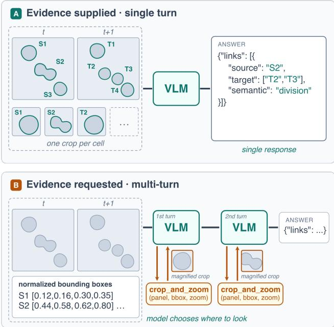  
Figure 4. Two evidence-interface families. In the evidencesupplied single-turn interface (top), annotated frames and per-cell crops are included in the prompt before one response. In the evidence-requested multi-turn interface (bottom), the model receives an unannotated overview and normalized bounding boxes, then chooses regions to inspect through crop\_and\_zoom before returning its answer.

Table 5. Validation-only harness selection with gpt-5.5 at low reasoning effort. Entries are dataset-macro primary scores; Mean is their unweighted average across the three tasks. Condition c7 is a diagnostic information-loss ablation.
<table><tr><td>Condition</td><td>Linking</td><td>Repair</td><td>Inspection</td><td>Mean</td></tr><tr><td>cl</td><td>0.662</td><td>0.690</td><td>0.474</td><td>0.609</td></tr><tr><td>c2</td><td>0.423</td><td>0.535</td><td>0.261</td><td>0.406</td></tr><tr><td>c3</td><td>0.524</td><td>0.639</td><td>0.367</td><td>0.510</td></tr><tr><td>c4</td><td>0.444</td><td>0.546</td><td>0.348</td><td>0.446</td></tr><tr><td>c5</td><td>0.447</td><td>0.544</td><td>0.296</td><td>0.429</td></tr><tr><td>c6</td><td>0.375</td><td>0.479</td><td>0.283</td><td>0.379</td></tr><tr><td>c7†</td><td>0.199</td><td>0.330</td><td>0.189</td><td>0.239</td></tr><tr><td>c8</td><td>0.592</td><td>0.641</td><td>0.409</td><td>0.547</td></tr></table>

Models are invoked through their native multimodal interface and, when tools are available, their native tool-call representation. The harness maps tool calls to the same deterministic server-side crop operation and normalizes only the final answer to the common task representation used for scoring. We draw one completion for every instance, task, and condition. Parallel dispatch can change execution order but not prompts, predictions, or scores.

<table><tr><td></td><td>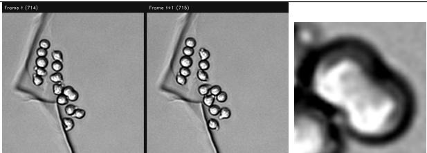</td><td></td><td></td><td>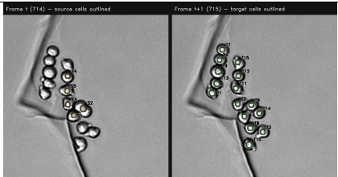</td><td></td></tr><tr><td colspan="3">(a) c1 — coordinate baseline. Unannotated overview is the only image; every cell is described by a normalised text bounding box; region tool crop_and_zoom (panel, bbox, zoom) . Right: example tool re- sponse (S2 neighbourhood, zoom 4).</td><td colspan="3">(b) c2 — visual localization. Sources (amber) and targets (green) out- lined and labelled in the image; no text coordinates anywhere; same re- gion tool as c1.</td></tr><tr><td></td><td></td><td></td><td></td><td>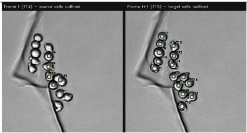</td><td></td></tr><tr><td></td><td>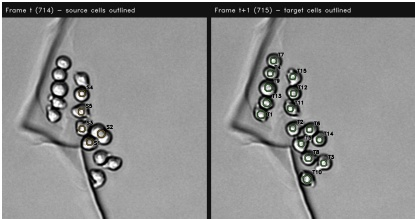</td><td>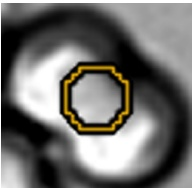</td><td></td><td>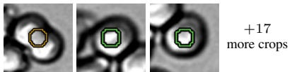</td><td></td></tr><tr><td colspan="4">(c) c3 — cell-addressed inspection. Same annotated overview and text as c2, but the closer view is the cell tool zoom (cell_id, zoom) . Right: example tool response to zoom ( &quot;S2 &quot;, 3.0).</td><td colspan="2">(d) c4 — fixed visual inspection. Annotated overview plus one outlined close-up per cell, all supplied up front as separate images in id order (S2, T6, T14 shown of 20); no text coordinates, no tool.</td></tr><tr><td></td><td>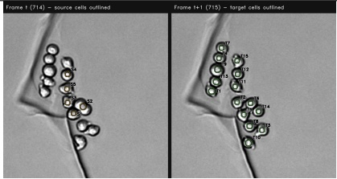</td><td></td><td></td><td>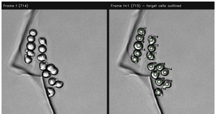</td><td></td></tr><tr><td colspan="4">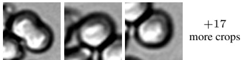 (e) c5 — crop-outline ablation. As c4, but the 20 supplied close-ups carry no outline; the prompt states the subject is the cell at the centre of</td><td>(f) c6 — target-coordinate ablation. Frame t unannotated with source locations given only as text bounding boxes; frame t+1 targets outlined</td><td></td></tr><tr><td colspan="4">each crop. No text coordinates, no tool.</td><td>and labelled with no coordinates; same region tool as c1.</td><td></td></tr><tr><td colspan="4">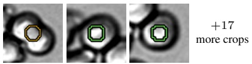</td><td colspan="2">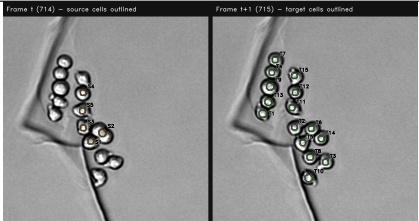</td></tr><tr><td colspan="4"></td><td colspan="3"></td></tr><tr><td colspan="4">(g) c7 — global-position ablation. No overview at all: the 20 outlined close-ups (identical renders to c4&#x27;s), sent in id order, are the only images; no text coordinates, no tool. Diagnostic only, not a deployable interface.</td><td colspan="4">(h) c8 — combined evidence. Text bounding boxes for every cell (as in c1) and the same cells outlined and labelled in the image (as in c2), so each cell is identified twice; same region tool as c1.</td></tr></table>

Figure 5. All eight evidence-harness conditions (definitions in Table 1), instantiated on one fixed division-bearing test item (BF-C2DL-HSC, sequence 02, frames 714–715: five source cells and fifteen candidate targets; parent S2 divides into daughters T6 and T14). Every panel is the exact image the harness serves for the cell-linking task. The task text, candidate lists, and answer schema remain fixed, so the conditions differ only in the evidence shown.

Table 6. Edit operations used by Subgraph-LNK.
<table><tr><td>Operation</td><td>Charged when</td><td>Cost</td></tr><tr><td>Addition</td><td>A ground-truth endpoint pair is missing</td><td>1.5</td></tr><tr><td>Deletion</td><td>A predicted endpoint pair is spurious</td><td>1.0</td></tr><tr><td></td><td>Semantic change Endpoints match but the edge label is wrong</td><td>1.0</td></tr></table>

Before a complete sweep, a fixed ten-instance smoke set spanning datasets checks prompt completeness, image rendering, native tool execution, final answer parsing, and scorer coverage for every task and condition. A complete sweep is invalidated by missing calls, terminal-answer truncation, output-budget exhaustion, tool-loop failure, or provenance mismatch. API request failures are retried at most five times under a fixed policy and never according to answer quality.

Each request receives 8,192 output tokens shared by reasoning and tool turns, with 2,048 tokens reserved for the final structured answer. If an inspection turn reaches its cap, tools are withdrawn and the reserved answer turn is invoked. Individual malformed answers remain model outcomes and receive the score implied by their parsed or empty prediction; JSON and schema failures are reported per condition. The selection sweep produced no schema failures, terminal truncations, budget exhaustions, safety-cap hits, or tool failures.

## A.6. Metric Detail

The primary score for linking is F1 over (source, target, semantic) edge tuples. Repair uses the same score after applying the predicted operations to the HOCT proposal, and inspection uses F1 over review decisions. NN-residual F1 removes links explained by nearest-centroid matching. Division F1 applies the semantic edge score to division links, exposing performance on the infrequent branch class without replacing the primary score.

## A.6.1. Subgraph-LNK

Subgraph-LNK adapts the AOGM/CTC linking score [29] to the benchmark’s local neighborhoods. For item i, the ground-truth and predicted edge sets contain tuples (source, target, semantic), where the semantic label is continuation or division. The edit cost is

$$
C _ { A } ^ { ( i ) } = 1 . 5 N _ { \mathrm { m i s s } } ^ { ( i ) } + 1 . 0 N _ { \mathrm { s p u r } } ^ { ( i ) } + 1 . 0 N _ { \mathrm { s e m } } ^ { ( i ) } ,
$$

where the terms count missing endpoint pairs, spurious endpoint pairs, and matching endpoint pairs with the wrong semantic label. A semantic error is charged once rather than as one deletion and one addition.

At benchmark level, neighborhoods are treated as the

disjoint union of one graph:

$$
\begin{array} { c c } { \displaystyle { \mathrm { L N K } _ { \mathrm { s u b } } = 1 - \frac { \operatorname* { m i n } ( C _ { A } , C _ { 0 } ) } { C _ { 0 } } , } } \\ { \displaystyle C _ { A } = \sum _ { i } C _ { A } ^ { ( i ) } , } & { \displaystyle C _ { 0 } = 1 . 5 \sum _ { i } \vert E _ { \mathrm { g t } } ^ { ( i ) } \vert . } \end{array}
$$

The cap ensures that a prediction requiring more edits than construction from an empty graph receives zero rather than a negative score. Perfect and empty predictions therefore score one and zero, respectively. On the hard test split, $C _ { 0 } = 2 , 1 3 9 . 0$ for 1,426 ground-truth edges.

For linking, the predicted graph is scored directly and ∆NN denotes its margin over the nearest-centroid graph. For repair, predicted add, delete, and semantic-change operations are applied to the HOCT proposal before scoring; ∆LNK is measured against the unedited proposal. For inspection, every flagged source receives a simulated oracle correction: all proposal out-edges from that source are replaced by its ground-truth out-edges. We report both the resulting ∆LNK and the gain per 1,000 flagged edges. Missing or unparseable linking answers are treated as empty predictions; missing repair or inspection answers leave the proposal unchanged.

This local score preserves the graph-edit interpretation of CTC LNK while holding segmentation fixed. It is therefore comparable in spirit, but not numerically identical, to full-sequence LNK. We do not report the CTC composite ${ \mathrm { O P } } _ { \mathrm { C L B } } { \mathrm { : } }$ because segmentation is supplied, its detection component would be degenerate.

## B. Additional Quantitative Results

Table 7. Validation–test robustness for GPT-5.6 (terra). Validation contains 205 neighborhoods and test contains 244. NN, HOCT, and Terra report $\mathrm { L N K _ { s u b } ; }$ Mean is the unweighted mean of the three task-primary scores. Repair ∆LNK is measured relative to the split specific HOCT proposal. Inspection @10 and Gold @10 use the tightest review budget. Validation results are descriptive because that spli was used to select the harness and contains one system and completion.
<table><tr><td>Split</td><td>NN LNK</td><td>HOCT LNK</td><td>Terra LNK</td><td>∆NN</td><td>Mean</td><td>Repair F1</td><td>Repair ∆LNK</td><td>Inspection @10</td><td>Gold @10</td></tr><tr><td>Validation</td><td>0.409</td><td>0.527</td><td>0.616</td><td>+0.207</td><td>0.730</td><td>0.791</td><td>+0.154</td><td>+0.210</td><td>+0.268</td></tr><tr><td>Test</td><td>0.493</td><td>0.385</td><td>0.692</td><td>+0.199</td><td>0.724</td><td>0.788</td><td>+0.337</td><td>+0.244</td><td>+0.284</td></tr></table>

Table 8. Track-repair decomposition, sorted by graph-level benefit. ∆LNK is measured relative to the HOCT proposal; the oracle ceiling is +0.615. Add and Delete report micro-averaged precision/recall against the gold edit set. Better and Worse denote the percentage of neighborhoods whose per-item LNK increases or decreases; the remainder are unchanged.
<table><tr><td>System</td><td>Repair F1</td><td>∆LNK</td><td>Add P/R</td><td>Delete P/R</td><td>Better</td><td>Worse</td></tr><tr><td>GPT-5.6 (sol)</td><td>0.815</td><td>+0.412</td><td>0.85/0.77</td><td>0.90/0.77</td><td>80%</td><td>7%</td></tr><tr><td>Claude Fable 5</td><td>0.786</td><td>+0.348</td><td>0.77/0.72</td><td>0.82/0.77</td><td>72%</td><td>13%</td></tr><tr><td>GPT-5.6 (terra)</td><td>0.788</td><td>+0.337</td><td>0.76/0.71</td><td>0.91/0.67</td><td>72%</td><td>12%</td></tr><tr><td>GPT-5.5</td><td>0.741</td><td>+0.280</td><td>0.69/0.68</td><td>0.78/0.73</td><td>61%</td><td>15%</td></tr><tr><td>Claude Opus 5</td><td>0.739</td><td>+0.263</td><td>0.76/0.58</td><td>0.78/0.71</td><td>57%</td><td>12%</td></tr><tr><td>Claude Opus 4.8</td><td>0.729</td><td>+0.201</td><td>0.62/0.58</td><td>0.77/0.68</td><td>55%</td><td>17%</td></tr><tr><td>GPT-5.6 (luna)</td><td>0.697</td><td>+0.180</td><td>0.59/0.56</td><td>0.75/0.53</td><td>48%</td><td>28%</td></tr><tr><td>Qwen3.5-397B-A17B</td><td>0.656</td><td>+0.166</td><td>0.72/0.37</td><td>0.85/0.44</td><td>35%</td><td>14%</td></tr><tr><td>MiniMax M3</td><td>0.656</td><td>+0.139</td><td>0.88/0.26</td><td>0.95/0.25</td><td>24%</td><td>3%</td></tr><tr><td>Kimi K3</td><td>0.659</td><td>+0.111</td><td>0.91/0.20</td><td>0.93/0.19</td><td>17%</td><td>2%</td></tr><tr><td>Claude Haiku 4.5</td><td>0.629</td><td>+0.097</td><td>0.54/0.45</td><td>0.75/0.53</td><td>37%</td><td>23%</td></tr><tr><td>Qwen3.5-122B-A10B</td><td>0.598</td><td>+0.055</td><td>0.58/0.16</td><td>0.72/0.19</td><td>16%</td><td>13%</td></tr><tr><td>Gemma 4 31B</td><td>0.606</td><td>+0.030</td><td>0.37/0.46</td><td>0.50/0.59</td><td>36%</td><td>29%</td></tr><tr><td>Claude Sonnet 5</td><td>0.631</td><td>+0.010</td><td>0.39/0.09</td><td>0.48/0.09</td><td>6%</td><td>15%</td></tr><tr><td>Qwen3.5-35B-A3B</td><td>0.622</td><td>+0.008</td><td>0.47/0.03</td><td>0.52/0.04</td><td>2%</td><td>7%</td></tr><tr><td>InternVL3.5-38B</td><td>0.556</td><td>-0.085</td><td>0.13/0.04</td><td>0.35/0.07</td><td>3%</td><td>25%</td></tr><tr><td>GLM-4.6V</td><td>0.519</td><td>-0.094</td><td>0.19/0.10</td><td>0.25/0.16</td><td>11%</td><td>57%</td></tr><tr><td>Molmo2-8B</td><td>0.521</td><td>-0.099</td><td>0.05/0.03</td><td>0.06/0.04</td><td>5%</td><td>64%</td></tr><tr><td>Mistral Medium 3.5 128B</td><td>0.465</td><td>-0.244</td><td>0.12/0.12</td><td>0.24/0.19</td><td>6%</td><td>33%</td></tr><tr><td>Inkling-Small</td><td>0.443</td><td>-0.332</td><td>0.20/0.37</td><td>0.34/0.53</td><td>14%</td><td>45%</td></tr><tr><td>Llama 4 Scout</td><td>0.342</td><td>-0.385</td><td>0.09/0.24</td><td>0.27/0.36</td><td>2%</td><td>74%</td></tr></table>

Table 9. Inspection under fixed review budgets. Each entry reports the ∆LNK recovered after oracle correction of the model’s selected sources. Nominal budgets of 10/25/50% realize 19/38/58% of proposal edges because each neighborhood contains only 4–6 edges. Stored answers do not contain confidence scores, so flags are retained in emission order. Slash-separated values represent the two systems named in the row; ranges are used where only the paired summary was retained.
<table><tr><td>System</td><td>Inspection F1</td><td>Flags</td><td>@10%</td><td>@25%</td><td>@50%</td><td>All flags</td></tr><tr><td>Gold-flag oracle</td><td></td><td>1061</td><td>+0.284</td><td>+0.441</td><td>+0.542</td><td>+0.615</td></tr><tr><td>GPT-5.6 (sol)</td><td>0.631</td><td>932</td><td>+0.249</td><td>+0.265</td><td>+0.387</td><td>+0.518</td></tr><tr><td>Claude Fable 5</td><td>0.698</td><td>993</td><td>+0.249</td><td>+0.287</td><td>+0.396</td><td>+0.513</td></tr><tr><td>GPT-5.6 (terra)</td><td>0.590</td><td>978</td><td>+0.244</td><td>+0.288</td><td>+0.413</td><td>+0.518</td></tr><tr><td>GPT-5.5</td><td>0.588</td><td>979</td><td>+0.235</td><td>+0.264</td><td>+0.378</td><td>+0.500</td></tr><tr><td>Claude Opus 5</td><td>0.532</td><td>847</td><td>+0.223</td><td>+0.250</td><td>+0.356</td><td>+0.459</td></tr><tr><td>Claude Opus 4.8</td><td>0.499</td><td>866</td><td>+0.205</td><td>+0.227</td><td>+0.326</td><td>+0.437</td></tr><tr><td>GPT-5.6 (luna)</td><td>0.359</td><td>919</td><td>+0.194</td><td>+0.235</td><td>+0.350</td><td>+0.463</td></tr><tr><td>Claude Haiku 4.5</td><td>0.266</td><td>543</td><td>+0.169</td><td>+0.226</td><td>+0.278</td><td>+0.307</td></tr><tr><td>Qwen3.5 397B / 122B</td><td>0.377/0.227</td><td>628/617</td><td>+0.153</td><td>+0.18-+0.20</td><td>+0.27</td><td>+0.342/+0.322</td></tr><tr><td>Gemma 4 31B</td><td>0.267</td><td>604</td><td>+0.145</td><td>+0.178</td><td>+0.254</td><td>+0.314</td></tr><tr><td>Inkling-Small</td><td>0.195</td><td>1376</td><td>+0.141</td><td>+0.229</td><td>+0.333</td><td>+0.521</td></tr><tr><td>GLM-4.6V</td><td>0.183</td><td>716</td><td>+0.138</td><td>+0.208</td><td>+0.270</td><td>+0.318</td></tr><tr><td>Molmo2-8B</td><td>0.015</td><td>718</td><td>+0.120</td><td>+0.241</td><td>+0.365</td><td>+0.367</td></tr><tr><td>Llama 4 Scout</td><td>0.098</td><td>3061</td><td>+0.117</td><td>+0.194</td><td>+0.243</td><td>+0.519</td></tr><tr><td>MiniMax M3</td><td>0.183</td><td>371</td><td>+0.089</td><td>+0.124</td><td>+0.169</td><td>+0.209</td></tr><tr><td>Claude Sonnet 5</td><td>0.079</td><td>369</td><td>+0.068</td><td>+0.106</td><td>+0.162</td><td>+0.174</td></tr><tr><td>Mistral Medium 3.5 128B</td><td>0.084</td><td>999</td><td>+0.059</td><td>+0.090</td><td>+0.129</td><td>+0.216</td></tr><tr><td>Kimi K3</td><td>0.083</td><td>230</td><td>+0.052</td><td>+0.074</td><td>+0.107</td><td>+0.128</td></tr><tr><td>Qwen3.5 35B / InternVL3.5</td><td>0.076/0.026</td><td>189/308</td><td>+0.04-+0.05</td><td>+0.05-+0.09</td><td>+0.07-+0.12</td><td>+0.094/+0.129</td></tr><tr><td>Random reviewer</td><td></td><td></td><td>+0.125</td><td>+0.245</td><td>+0.371</td><td></td></tr></table>

Table 10. Per-neighborhood linking $\mathrm { L N K _ { s u b } }$ by difficulty stratum, macro-averaged over datasets represented within each stratum. NN solved denotes neighborhoods exactly reconstructed by nearest-centroid. EA, EC, and ED denote missing, semantic, and spurious ancho errors.
<table><tr><td>Stratum</td><td>n</td><td>NN baseline</td><td>GPT-5.6 (sol)</td><td>Gemma 4</td></tr><tr><td>NN-solved</td><td>22</td><td>1.000</td><td>0.992</td><td>0.976</td></tr><tr><td>NN-resistant</td><td>222</td><td>0.494</td><td>0.766</td><td>0.536</td></tr><tr><td>Hardness Q1 (easiest)</td><td>48</td><td>0.706</td><td>0.944</td><td>0.629</td></tr><tr><td>Hardness Q2</td><td>49</td><td>0.707</td><td>0.901</td><td>0.718</td></tr><tr><td>Hardness Q3</td><td>49</td><td>0.432</td><td>0.689</td><td>0.411</td></tr><tr><td>Hardness Q4</td><td>49</td><td>0.510</td><td>0.662</td><td>0.533</td></tr><tr><td>Hardness Q5 (hardest)</td><td>49</td><td>0.459</td><td>0.623</td><td>0.473</td></tr><tr><td>Proxy EA (missing)</td><td>206</td><td>0.500</td><td>0.766</td><td>0.524</td></tr><tr><td>Proxy EC (semantic)</td><td>31</td><td>0.472</td><td>0.735</td><td>0.550</td></tr><tr><td>Proxy ED (spurious)</td><td>7</td><td>0.748</td><td>0.906</td><td>0.664</td></tr><tr><td>Division-bearing</td><td>181</td><td>0.498</td><td>0.824</td><td>0.528</td></tr><tr><td>No division</td><td>63</td><td>0.720</td><td>0.787</td><td>0.742</td></tr></table>