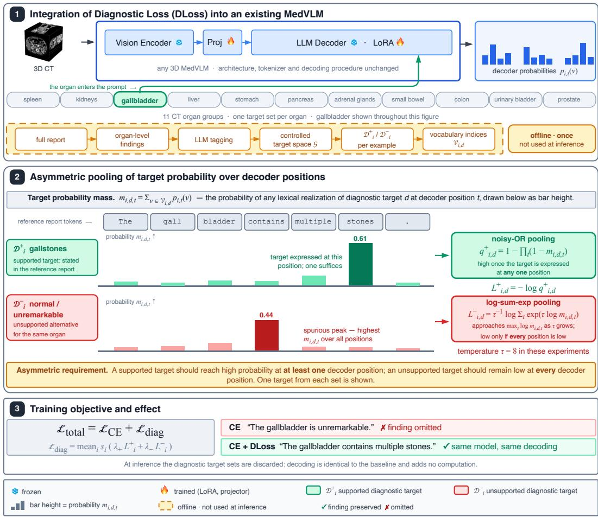
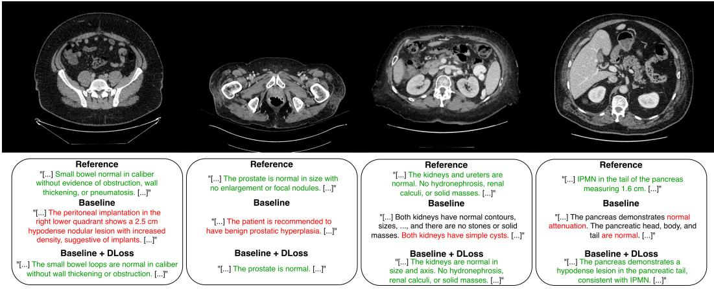
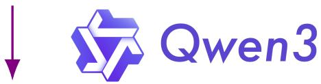
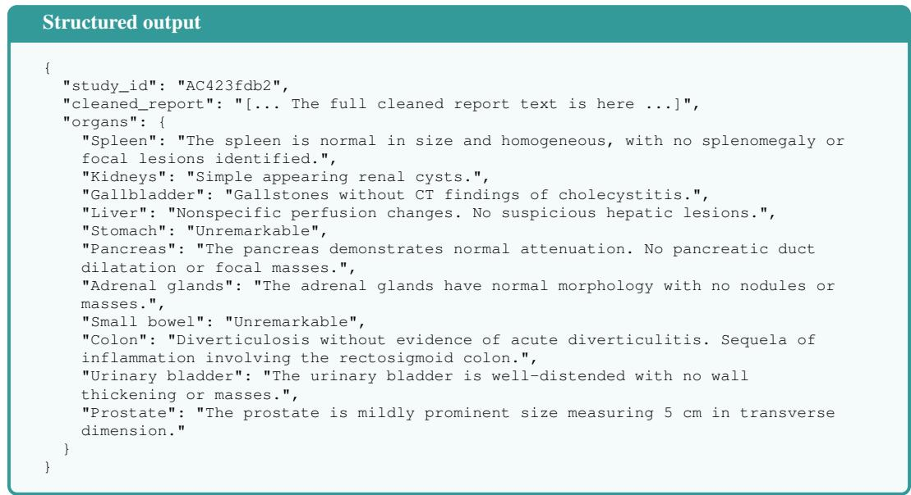
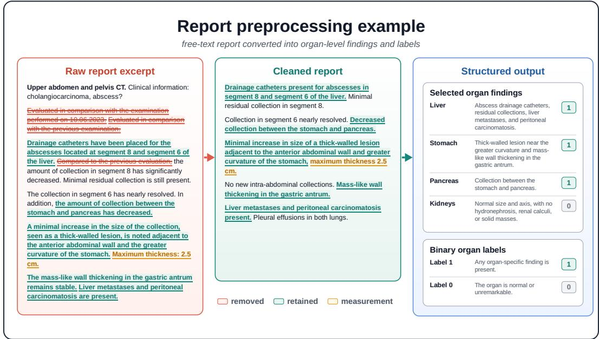
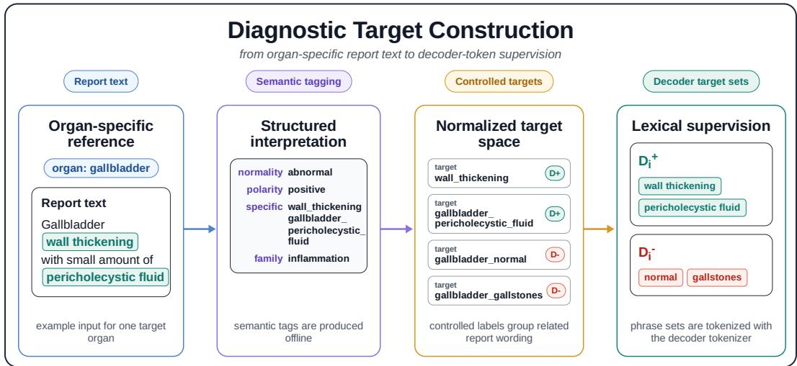
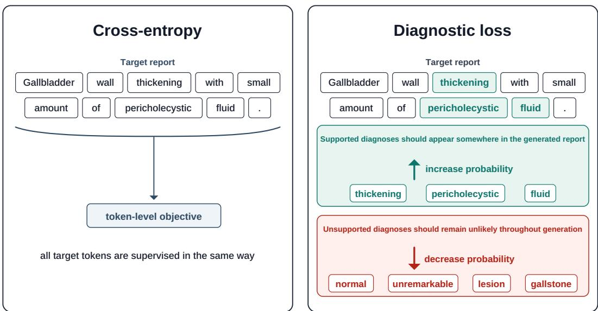

# DIAGNOSTIC LOSS: ASYMMETRIC SUPERVISION FOR RADIOLOGY REPORT GENERATION

Ignacy Kolton1 Wenxuan Li2 Zongwei Zhou2 Jarosław B. Cwikła´ 3

Arkadiusz Sitek4,5 Pedro R. A. S. Bassi2,∗ Szymon Płotka1,∗

1Jagiellonian University 2Johns Hopkins University

3GAMMED 4Massachusetts General Hospital 5Harvard Medical School

ignacy.kolton@doctoral.uj.edu.pl

\*Joint co-supervision

## ABSTRACT

Automated radiology report generation requires models to do more than produce fluent clinical narratives: they must explicitly state supported diagnoses while avoiding unsupported ones. However, existing medical vision-language models (MedVLMs) are typically trained with token-level maximum likelihood objectives, which enforce general text agreement between AI-made and human-made radiology reports but do not prioritize diagnostically critical terms. As a result, models can generate reports that appear human-made but miss key and obvious diagnoses, and introduce wrong diagnoses. We identify this as an objective misalignment between conventional language modeling and the asymmetric diagnostic requirements of radiology reporting. To encode these requirements, we introduce Diagnostic Loss (DLoss), a differentiable, architecture-agnostic objective that operates directly on decoder token probabilities. DLoss separately aggregates probability mass over vocabularies associated with diagnoses supported by the reference report and with unsupported alternatives. Using asymmetric pooling across token positions in the report, it encourages supported diagnoses to receive sufficient probability in at least one position while suppressing spurious probability spikes for unsupported diagnoses across all positions during training. The loss can be applied to existing 3D MedVLMs without modifying their vision backbones, language decoders, or inference procedures, and introduces no additional inference-time computation. We train and evaluate DLoss on 50,000 abdominal CT scans across several 3D MedVLM architectures on both indistribution and out-of-distribution report-generation benchmarks. Across these settings, DLoss improves diagnostic faithfulness while maintaining competitive performance on conventional language-generation metrics, showing the value of asymmetric sequence-level supervision for radiology report generation. The code for DLoss is available at https://github.com/gmum/DLoss.

## 1 INTRODUCTION

Radiology reporting represents one of the most critical language-generation challenges in medicine (Boecking et al., 2022). Furthermore, reporting is essential across multiple medical imaging modalities, from single-frame 2D X-rays (Tiu et al., 2022; Liu et al., 2024b; MH Nguyen et al., 2026; Yang et al., 2026) to 3D computed tomography (CT) volumes spanning hundreds of axial slices (Płotka et al., 2026; Zhou et al., 2026a; Rokuss et al., 2026). The radiologist must collapse this dense visual evidence into concise text that states, in clinically explicit terms, which diagnoses are present or absent in the image (Jain et al., 2021) (here, a diagnosis may refer to a disease or a radiological finding). The diagnostic value of a report lies precisely in this commitment: downstream clinical decisions, such as surveillance, biopsy, surgery, and oncologic treatment, are triggered by whether specific diagnostic terms appear and whether incorrect ones are omitted (Liu et al., 2024a). Automating elements of this process is highly appealing as imaging volumes continue to outpace radiologist capacity, but such automation is viable only if the generated report preserves the diagnostic value of the original report rather than merely mimicking its style and looking like a human-written report (Zhou et al., 2024; Wang et al., 2026; Bassi et al., 2025).

  
Figure 1: Overview of DLoss and its workflow. DLoss supervises how probability is distributed over diagnostic targets alongside standard token prediction. (1) Integration. DLoss operates directly on decoder probabilities without modifying the architecture or decoding procedure (only the LoRA parameters and the projector are trained). Reports are decomposed into organ-level findings and mapped offline, via LLM tagging, to supported $( \mathcal { D } _ { i } ^ { + } )$ and unsupported $( \mathcal { D } _ { i } ^ { - } )$ diagnostic targets in a controlled target space ${ \mathcal { G } } .$ (2) Asymmetric pooling. Target probability masses $m _ { i , d , t }$ across valid decoder positions are aggregated using distinct operators: noisy-OR for supported targets fi(saturates when present at any position) and temperature-controlled log-sum-exp for unsupported targets (ensures probability stays low everywhere). (3) Objective. The supported and unsupported target losses are added to cross-entropy with independent coefficients $\lambda _ { + }$ and $\lambda _ { - } .$ , respectively, and scaled by sample weight $s _ { i } .$ . The diagnostic target sets are discarded at inference, so DLoss adds no inference-time computation.

Recently, vision-language models (VLMs) trained on medical image-report pairs (Shui et al., 2025; Cao et al., 2025; Claessens et al., 2026; Zhao et al., 2026; Hamamci et al., 2026a;b; Blankemeier et al., 2026) have brought this goal significantly closer. By coupling visual encoders with large language models, modern medical VLMs (MedVLMs) produce fluent, well-structured reports and have been increasingly applied for report generation (Shui et al., 2025; Cao et al., 2025; Kalisch et al., 2025; Hamamci et al., 2026a; Blankemeier et al., 2026; Yan et al., 2026). However, a recurring failure mode persists across architectures: generated reports can look very similar to human-written reports while omitting diagnoses that are present in the image, under-calling their severity, or intro ducing diagnoses that the image does not support (Delbrouck et al., 2022; Yu et al., 2023; Ostmeier et al., 2024; Cheng & Subramanian, 2026; Bassi et al., 2025). Radiologist audits of generated chest radiographs score these as clinically significant errors, false diagnoses and omitted diagnoses, precisely when they would alter clinical workflow (Yu et al., 2023; Ostmeier et al., 2024). In radiology and clinical oncology, missing or weakening an actionable diagnosis is more consequential than a stylistic error, because subsequent staging and treatment depend on whether the disease is named and on whether unsupported differentials are introduced (Bruno et al., 2015; Bruno, 2017).

This mismatch between generating reports that look human-written and achieving diagnostic correctness is not explained by modeling capacity alone; it also reflects a misalignment in the training objective (Miura et al., 2021; Delbrouck et al., 2022; Cheng & Subramanian, 2026). Standard maximum-likelihood training optimizes token-level cross-entropy against a ground-truth report (Jing et al., 2018; Delbrouck et al., 2022). This objective treats diagnostic and non-diagnostic tokens through the same token-level loss: frequent narrative tokens dominate the gradient, rare diagnostic terms are under-weighted, and there is no explicit sequence-level supervision encouraging supported diagnostic terms to receive sufficient probability at some token position in the report while suppressing probability peaks for unsupported terms across all positions (Welleck et al., 2020; Wu et al., 2023; Liu et al., 2026). There is, therefore, little training-time pressure to satisfy the radiologist’s two-sided diagnostic obligation—supported diagnoses must be named, and unsupported diagnoses must not be introduced (Hartung et al., 2020; Yu et al., 2023; Ostmeier et al., 2024). Consequently, even strong MedVLMs can produce diagnostically incomplete or misleading reports despite strong scores on conventional language metrics (Papineni et al., 2002; Lin, 2004; Miura et al., 2021; Delbrouck et al., 2022; Yu et al., 2023).

To address this misalignment in the training objective, we introduce Diagnostic Loss (DLoss), an auxiliary objective for radiology report generation that directly targets this two-sided diagnostic requirement: enforcing correct diagnoses and penalizing incorrect ones. DLoss is fully differentiable, operates directly on the decoder’s token distribution, and is architecture-agnostic. It can be integrated on top of 3D autoregressive MedVLMs that expose decoder logits without altering the underlying backbone, tokenizer, or report-level supervision. Concretely, it utilizes asymmetric pool ing of token probabilities over per-sample diagnostic vocabularies: probability mass on supported diagnostic targets is aggregated across token positions in the report to reward expressing the correct diagnosis somewhere, while probability mass on unsupported diagnostic targets is pooled with a tempered soft maximum to penalize any spurious spikes across these positions during training. This formulation encodes the asymmetric requirements of supported and unsupported diagnostic targets. Our main contributions are as follows:

1. Asymmetric diagnostic supervision. We introduce DLoss, which encodes different sequence-level constraints for supported and unsupported diagnostic concepts through asymmetric pooling of decoder token probabilities across token positions in the report. Supported concepts are encouraged to receive sufficient probability at least once, while unsupported concepts are penalized for probability spikes across these positions during training.

2. Tokenizer-agnostic concept supervision. We represent diagnostic targets at the concept level and map their associated words and phrases (e.g., gallstones and cholelithiasis) to the token vocabulary of each decoder using its existing tokenizer. This provides tokenlevel diagnostic supervision while allowing the same objective to operate across different tokenizers and MedVLM architectures without introducing a task-specific prediction head or modifying the inference procedure.

3. Cross-model and out-of-distribution evaluation. We train and evaluate DLoss on 50,000 abdominal CT scans across several 3D MedVLMs, decoder and tokenizer architectures, and both in- and out-of-distribution report-generation benchmarks. In-distribution experiments are conducted on abdominal CT scans (Merlin), while out-of-distribution performance is evaluated on a private, in-house abdominal CT dataset.

Across six 3D MedVLMs (Merlin, fVLM, BTB3D, HLIP, RadFM, and SPECTRE), adding DLoss yields mean gains of 4.05 GREEN points and 3.82 RadGraph-F1 points on the Merlin test set, and 4.28 and 2.96 points, respectively, on the external test set (see Table 1). Mean improvements across BLEU, ROUGE-L, METEOR, and CIDEr also show consistent positive gains across both sets.

## 2 RELATED WORK

MedVLMs for Radiology Report Generation. Radiology report generation has evolved from specialized image-to-text architectures toward more general medical vision–language models. Early 2D approaches used CNN–RNN or hierarchical recurrent architectures with attention (Wang et al., 2018a; Jing et al., 2018), followed by Transformer-based generators such as R2Gen (Chen et al., 2020). More recent approaches leverage pretrained vision–language representations, such as BiomedCLIP (Zhang et al., 2025), and generative VLMs or large language models, including LLM-CXR (Lee et al., 2024), CMCRL (Chen et al., 2025), MLRG (Liu et al., 2025b), and AOR (Li et al., 2026a). For volumetric CT, recent work includes fVLM (Shui et al., 2025), RadFM (Wu et al., 2025), HLIP (Zhao et al., 2026), BTB3D (Hamamci et al., 2026a), SPECTRE (Claessens et al., 2026), and Merlin (Blankemeier et al., 2026). DLoss is complementary to these architectural and representation-learning advances, modifying supervision over the decoder distribution rather than the underlying vision or language architecture.

Clinical Supervision and Training Objectives. Clinical fidelity is not fully captured by lexical similarity, motivating measures such as RadGraph-based scores (Jain et al., 2021; Delbrouck et al., 2022) and GREEN (Ostmeier et al., 2024). RadGraph-F1 and GREEN measure clinical relevance by extracting structured entity-relation knowledge graphs and leveraging domain-tuned models to explicitly penalize diagnostic errors like false positives, false negatives, or anatomical misallocations that traditional lexical metrics ignore. Clinical information has also been incorporated into training through reinforcement learning, differentiable disease supervision, and semantic rewards (Liu et al., 2019; Lovelace & Mortazavi, 2020; Delbrouck et al., 2022), token-level reweighting or unlikelihood (Wu et al., 2023; Welleck et al., 2020), disease- or anatomy-aware generation (Jin et al., 2024; Cheng & Subramanian, 2026), and preference or reinforcement learning (Liu et al., 2025a; Zhou et al., 2026b).

Among approaches that modify the training objective, SAT-RRG uses an LLM to locate semantic errors and adjust training at the affected token positions (Liu et al., 2026). Unlikelihood training lowers the probability of selected negative candidates, including in sequence-level variants (Welleck et al., 2020). DLoss instead defines supported and unsupported diagnostic targets from each reference report and pools the decoder probabilities for each target across positions. Its two pooling operations encourage probability for a supported target without specifying where it must occur, while limiting probability spikes for unsupported targets throughout the training sequence. The pooling operations draw on multiple-instance learning (Maron & Lozano-Pérez, 1997; Wang et al., 2018b; Pinheiro & Collobert, 2015).

## 3 METHODOLOGY

## 3.1 PRELIMINARIES

DLoss augments standard autoregressive report generation with diagnostic supervision applied directly to the language decoder. The method does not modify the visual encoder, language decoder, tokenizer, or inference procedure. Instead, it operates on the decoder probabilities already computed during report generation training.

Autoregressive Report Generation. Consider a minibatch of B radiology report generation examples. Each example i is represented as $( x _ { i } , y _ { i } )$ , where $x _ { i }$ denotes the conditioning input, including the image-derived representation and textual prompt, and $y _ { i } \ = \ ( y _ { i , 1 } , \dots , y _ { i , T _ { i } } )$ denotes the reference report tokenized over a vocabulary of size $\dot { V } .$ . At output position t, the language decoder conditions on $x _ { i }$ and the reference prefix $y _ { i , < t }$ to produce a logit vector $\ell _ { i , t } \in \mathbb { R } ^ { V }$ . We denote the probability assigned to vocabulary item v by:

$$
p _ { i , t } ( v ) = \mathrm { s o f t m a x } ( \ell _ { i , t } ) _ { v } .\tag{1}
$$

Let $\mathcal { P } _ { i }$ denote the set of valid report-token positions for example $i ,$ excluding prompt, padding, and image positions. The baseline training objective is the token-level cross-entropy loss over the minibatch:

$$
\mathcal { L } _ { \mathrm { C E } } = - \frac { 1 } { \sum _ { i = 1 } ^ { B } | \mathcal { P } _ { i } | } \sum _ { i = 1 } ^ { B } \sum _ { t \in \mathcal { P } _ { i } } \log p _ { i , t } ( y _ { i , t } ) .\tag{2}
$$

Cross-entropy provides local supervision for each reference token, but does not explicitly distinguish diagnostically relevant concepts from the remaining report text. DLoss complements this objective with supervision over diagnostic targets that should receive probability during decoding and diagnostic targets that should remain unlikely.

Anatomy-level supervision for 3D CT. For the 3D CT setting, we define diagnostic supervision at the anatomical level, following prior anatomy-aware CT vision–language approaches (Shui et al., 2025; Cao et al., 2025). Each study–report pair is decomposed into anatomy-level image–text pairs:

$$
( \mathbf { X } _ { n } ^ { I } , \mathbf { X } _ { n } ^ { T } ) \longmapsto \left\{ ( \mathbf { X } _ { n , c } ^ { I } , \mathbf { X } _ { n , c } ^ { T } ) \right\} _ { c \in \mathcal { C } _ { n } } ,\tag{3}
$$

where $\mathbf { X } _ { n , c } ^ { I }$ and ${ \bf X } _ { n , c } ^ { T }$ denote the image region and corresponding findings for anatomical organs c. Anatomical structures are segmented using TotalSegmentator (Wasserthal et al., 2023), while reports are parsed into organ-level findings using Qwen3-30B-A3B. This decomposition also sets the scope of the loss: supported and unsupported targets are assigned within each organ-level pair and evaluated only over its report-token positions. Applying all organ targets to one full-report sequence could give opposing signals for the same word (e.g., in a report describing a liver cyst and normal kidneys, cyst would be encouraged for the liver and penalized for the kidneys).

Diagnostic target construction. Let $\mathcal { G }$ denote a controlled set of diagnostic targets. For each training example i, we construct two subsets: $\mathcal { D } _ { i } ^ { + } \subseteq \mathcal { G }$ contains diagnostic targets supported by the reference report, whereas $\mathcal { D } _ { i } ^ { - } \subseteq \mathcal { G }$ contains unsupported diagnostic targets. In the 3D setting, these sets are constructed within the anatomical unit defined above. Reference-report expressions are mapped to concepts in $\mathcal { G } \colon$ supported concepts populate $\mathcal { D } _ { i } ^ { + }$ and unsupported alternatives populate $\mathcal { D } _ { i } ^ { - }$ . Explicitly negated concepts are excluded from both sets to avoid conflicting lexical supervision.

A diagnostic target represents a clinical concept rather than a single surface form. Each target $\bar { d } ~ \mathbf { \bar { \Sigma } } \in \ \mathcal { D } _ { i } ^ { + } \cup \mathbf { \bar { \Sigma } } \mathcal { D } _ { i } ^ { - }$ is therefore associated with a tokenizer-specific set of vocabulary indices $\mathcal { \bar { V } } _ { i , d } \subseteq \{ 1 , \dotsc , V \}$ corresponding to lexical realizations of that concept. For example, lexical expressions such as cholelithiasis, gallstones, and stone can contribute to the same diagnostic target. We construct these lexical sets offline, starting from each normalized target name and adding recurrent words and short phrases from organ-specific training reports assigned to that target through LLM-based semantic tagging and synonym consolidation. We filter non-diagnostic expressions; the resulting sets are grounded in the training corpus and do not cover every possible paraphrase. These lexical realizations are tokenized separately for the tokenizer used by each MedVLM, yielding the corresponding sets $\gamma _ { i , d } .$ Appendix C shows this target construction with an organ-specific example.

Importantly, DLoss only requires the decoder logits and the resulting sets $\mathcal { D } _ { i } ^ { + } , \mathcal { D } _ { i } ^ { - }$ , and $\mathcal { V } _ { i , d }$ . Consequently, the objective is independent of the architecture used to obtain the visual representation and applies to any MedVLM that exposes decoder logits. Since lexical realizations are represented through tokenizer vocabulary indices, the formulation provides token-level diagnostic supervision rather than exact phrase-level matching.

## 3.2 DIAGNOSTIC LOSS

Radiology reporting imposes asymmetric requirements on supported and unsupported diagnostic targets. During training, a supported diagnostic target should receive sufficient probability at at least one valid decoder position, whereas an unsupported diagnostic target should remain unlikely across all valid decoder positions. DLoss encodes these two requirements using different pooling operators across decoder positions.

Diagnostic target probability mass. For diagnostic target d, we first aggregate the probability mass assigned to its tokenizer-specific vocabulary indices at output position t:

$$
m _ { i , d , t } = \sum _ { v \in \mathscr { V } _ { i , d } } p _ { i , t } ( v ) .\tag{4}
$$

The quantity $m _ { i , d , t }$ therefore represents the total probability assigned to lexical evidence associated with diagnostic target d at a particular decoder position.

Supported-Target Pooling. For a supported target $d \in \mathcal { D } _ { i } ^ { + }$ , evidence at any valid decoder position can support the diagnosis. We aggregate the target probabilities across positions using noisy-OR pooling:

$$
q _ { i , d } ^ { + } = 1 - \prod _ { t \in \mathcal { P } _ { i } } \left( 1 - m _ { i , d , t } \right) .\tag{5}
$$

The corresponding supported-target loss is:

The pooled probability increases when diagnostic evidence receives probability at one or more valid decoder positions. Minimizing $L _ { i , d } ^ { + }$ therefore encourages the decoder to assign sufficient probability to a lexical realization of the supported target without prescribing a particular output position.

Unsupported-Target Pooling. For an unsupported target $d \in \mathcal { D } _ { i } ^ { - }$ , a high probability at even a single position can introduce diagnostically inconsistent content. We therefore aggregate target probabilities using a temperature-controlled log-sum-exp over their logarithms:

$$
L _ { i , d } ^ { - } = \tau ^ { - 1 } \log \left( \sum _ { t \in \mathcal { P } _ { i } } \exp \left( \tau \log m _ { i , d , t } \right) \right) ,\tag{7}
$$

$$
L _ { i , d } ^ { + } = - \log q _ { i , d } ^ { + } .
$$

where $\tau \ > \ 0$ controls the sharpness of the aggregation. As τ increases, the pooling increasingly concentrates on the output position with the largest unsupported target probability. Minimizing $L _ { i , d } ^ { - }$ therefore suppresses spurious probability peaks for unsupported diagnostic targets across valid decoder positions. For numerical stability, arguments to logarithms are clamped away from zero in the implementation; this stabilization is omitted from the equations for readability.

Overall Training Objective. Let $w _ { i , d } ^ { + }$ $w _ { i , d } ^ { - }$ denote non-negative target-level weights, set to one in all reported experiments, and define ments, and define $\begin{array} { r } { W _ { i } ^ { + } = \sum _ { d \in { \mathcal { D } } _ { i } ^ { + } } w _ { i , d } ^ { + } } \end{array}$ and and diagnostic components for example i are co

(6)

Algorithm 1 DLoss computation during decoder   
training.   
Require: Decoder logits $\ell _ { i , \cdot }$ ,t and valid positions $\overline { { \mathcal { P } _ { i } } }$   
Require: Diagnostic target sets $\mathcal { D } _ { i } ^ { + }$ and $\mathcal { D } _ { i } ^ { - }$   
Require: Vocabulary-index sets $\mathcal { V } _ { i , d }$   
Require: Target weights $w _ { i , d } ^ { + } , w _ { i , d } ^ { - }$ and sample weights si   
Require: Hyperparameters $\lambda _ { + } , \lambda _ { - }$ , and τ   
Require: Cross-entropy loss $\mathcal { L } _ { \mathrm { C E } }$   
Ensure: Total training loss $\mathcal { L } _ { \mathrm { t o t a l } }$   
1: ${ \mathcal { T } } _ { \mathrm { d i a g } } \gets \{ i : { \mathcal { D } } _ { i } ^ { + } \cup { \mathcal { D } } _ { i } ^ { - } \neq \emptyset \}$   
2: for $i = 1 , \ldots , \dot { B }$ do   
3: for $t \in \mathcal { P } _ { i }$ do   
4: $p _ { i , t } ( v ) \gets$ softmax $\mathbf { \Omega } _ { : ( \ell _ { i , t } ) _ { v } }$   
5: end for   
6: for $d \in { \mathcal { D } } _ { i } ^ { + } \cup { \mathcal { D } } _ { i } ^ { - }$ do   
7: for $t \in \mathcal { P } _ { i }$ do   
8: $\begin{array} { r } { m _ { i , d , t } \gets \sum _ { v \in \mathcal { V } _ { i , d } } p _ { i , t } ( v ) } \end{array}$   
9: end for   
10: end for   
11: for $l \in \mathcal { D } _ { i } ^ { + }$ do   
12: $\begin{array} { r } { q _ { i , d } ^ { + } \longleftarrow 1 - \prod _ { t \in \mathcal P _ { i } } ( 1 - m _ { i , d , t } ) } \end{array}$   
13: $L _ { i , d } ^ { + } \gets - \log q _ { i , d } ^ { + }$   
14: end for   
15: for d $\in \mathcal { D } _ { i } ^ { - }$ do   
16: $\begin{array} { r } { L _ { i , d } ^ { - }  \tau ^ { - 1 } \log ( \sum _ { t \in \mathcal { P } _ { i } } \exp ( \tau \log m _ { i , d , t } ) ) } \end{array}$   
17: end for   
18: Compute $W _ { i } ^ { + }$ and ${ W _ { i } } ^ { - }$ from $w _ { i , d } ^ { + }$ and $w _ { i , d } ^ { - }$   
19: Compute $L _ { i } ^ { + }$ and $L _ { i } ^ { - }$ as weighted means   
20: $\ell _ { \underline { { i } } } ^ { \mathrm { d i a g } } \gets s _ { i } \gets \bar { ( \lambda _ { + } L _ { i } ^ { + } + \lambda _ { - } L _ { i } ^ { - } ) }$   
21: end for   
22: if $\left| \mathcal { T } _ { \mathrm { d i a g } } \right| > 0$ then   
23: $\begin{array} { r } { \mathcal { L } _ { \mathrm { d i a g } }  \frac { 1 } { \vert \mathcal { T } _ { \mathrm { d i a g } } \vert } \sum _ { i \in \mathcal { T } _ { \mathrm { d i a g } } } \ell _ { i } ^ { \mathrm { d i a g } } } \end{array}$   
24: else   
25: $\mathcal { L } _ { \mathrm { d i a g } }  0$   
26: end if   
27: $\mathcal { L } _ { \mathrm { t o t a l } }  \mathcal { L } _ { \mathrm { C E } } + \mathcal { L } _ { \mathrm { d i a g } }$   
28: return Ltotal

$\begin{array} { r } { W _ { i } ^ { - } = \sum _ { d \in \mathcal { D } _ { i } ^ { - } } w _ { i , d } ^ { - } . } \end{array}$ . The supported and unsupported mputed as weighted means:

$$
L _ { i } ^ { \pm } = \left\{ \begin{array} { l l } { \frac { \sum _ { d \in \mathcal { D } _ { i } ^ { \pm } } w _ { i , d } ^ { \pm } L _ { i , d } ^ { \pm } } { W _ { i } ^ { \pm } } , } & { W _ { i } ^ { \pm } > 0 , } \\ { 0 , } & { W _ { i } ^ { \pm } } \end{array} \right.\tag{8}
$$

The sample-level diagnostic loss is then:

$$
\ell _ { i } ^ { \mathrm { d i a g } } = s _ { i } \left( \lambda _ { + } L _ { i } ^ { + } + \lambda _ { - } L _ { i } ^ { - } \right) ,\tag{9}
$$

where $s _ { i } ~ \geq ~ 0$ denotes the sample weight, and the non-negative coefficients $\lambda _ { + }$ and λ− independently control the contributions of supported and unsupported diagnostic targets. Let ${ \mathcal { T } } _ { \mathrm { d i a g } } = { \bar { \{ } }  i \in$ $\{ 1 , \dots , B \} : \mathcal { D } _ { i } ^ { + } \cup \mathcal { D } _ { i } ^ { - } \neq \emptyset \}$ denote the set of training examples containing at least one active diagnostic target. The batch-level DLoss is defined as:

$$
\mathcal { L } _ { \mathrm { d i a g } } = \left\{ \begin{array} { l l } { \displaystyle \frac { 1 } { | \mathcal { T } _ { \mathrm { d i a g } } | } \sum _ { i \in \mathcal { T } _ { \mathrm { d i a g } } } \ell _ { i } ^ { \mathrm { d i a g } } , } & { | \mathcal { T } _ { \mathrm { d i a g } } | > 0 , } \\ { 0 , } & { | \mathcal { T } _ { \mathrm { d i a g } } | = 0 . } \end{array} \right.\tag{10}
$$

Finally, DLoss is optimized jointly with the standard language-modeling objective: $\mathcal { L } _ { \mathrm { t o t a l } } = \mathcal { L } _ { \mathrm { C E } } +$ $\mathcal { L } _ { \mathrm { d i a g } } ,$ , where $\mathcal { L } _ { \mathrm { d i a g } }$ contains the weighted supported- and unsupported-target components defined above. Algorithm 1 summarizes the computation of the training objective. DLoss is used only during training. At inference, the diagnostic target sets are discarded and each MedVLM follows the same decoding procedure as its corresponding baseline. The proposed objective therefore introduces no additional inference-time computation and requires no modification of the underlying vision or language architecture.

## 4 EXPERIMENTS

## 4.1 EXPRIMENTAL SETUP

Datasets. For training and evaluation, we employ three distinct 3D abdominal CT datasets paired with their corresponding radiology reports. Specifically, models are trained on CancerVerse (Li et al., 2026b) (24,168 scans from 13,863 patients) and the training split of the publicly available Merlin (Blankemeier et al., 2026; Bassi et al., 2026) dataset (20,369 scans). Together, Merlin and CancerVerse represent the largest public abdominal CT datasets, containing over 20 million image slices. Evaluation is conducted on Merlin’s official test set (5,125 scans) for in-distribution assessment, alongside an external, in-house dataset (2,706 scans from 1,948 patients) for out-ofdistribution evaluation. Comprehensive details for all datasets are provided in Appendix A.

Implementation details. Pooled training CT volumes are provided as a converted 1.5-mm isotropic view. Each backbone then applies model-specific intensity normalization, geometric preprocessing, and feature extraction based on its original implementation. Scans from Merlin’s official test split are supplied at native spacing and processed by the corresponding backbone-specific pipeline. Within each backbone, the CE and DLoss runs use identical CT-derived inputs. Training uses up to four NVIDIA GH200 GPUs, each equipped with 96 GB of VRAM. The implementation details for all experiments can be found in Appendix E.1.

Evaluation metrics. We use GREEN (Ostmeier et al., 2024), BLEU (Papineni et al., 2002), ROUGE-L (Lin, 2004), METEOR (Lavie & Denkowski, 2009), CIDEr (Vedantam et al., 2015), and RadGraph-F1 (Jain et al., 2021) to evaluate the performance of report generation. While metrics like BLEU, ROUGE-L, METEOR, and CIDEr measure surface-level n-gram overlap, RadGraph-F1 and GREEN evaluate diagnostic accuracy. RadGraph-F1 extracts anatomical entities, findings, and their relationships into knowledge graphs to verify factual consistency. GREEN uses a domain-adapted language model to explicitly identify and weight clinically critical errors, such as false positives, false negatives, or anatomical mislocations, aligning its score directly with radiologist judgment rather than phrasing. A detailed description can be found in Appendix E.2.

Enhancing state-of-the-art baselines. To demonstrate the broad utility and fair contribution of our proposed DLoss, we integrate it across a diverse set of leading MedVLMs, including Merlin (Blankemeier et al., 2026), SPECTRE (Claessens et al., 2026), RadFM (Wu et al., 2025), fVLM (Shui et al., 2025), BTB3D (Hamamci et al., 2026a), and HLIP (Zhao et al., 2026). Crucially, we evaluate each model fine-tuned with vs. without DLoss under identical experimental conditions, directly isolating the performance gains attributable to our diagnostic objective from standard supervised fine-tuning.

Table 1: Quantitative evaluation of 3D radiology report generation on internal and external benchmarks. We report language generation and clinical accuracy metrics on the Merlin (M) test set and an external (E) in-house dataset. F1-RG denotes the complete RadGraph score. Rows labeled + DLoss reflect signed changes relative to the baseline model after training with DLoss. Gains are shown in green and drops in red. ∆¯ represents the mean change over the corresponding baseline.
<table><tr><td rowspan="2">Method</td><td colspan="2">BLEU↑</td><td colspan="2">ROUGE-L ↑</td><td colspan="2">METEOR ↑</td><td colspan="2">CIDEr ↑</td><td colspan="2">GREEN ↑</td><td colspan="2">F1-RG↑</td></tr><tr><td>M</td><td>E</td><td>M</td><td>E</td><td>M</td><td>E</td><td>M</td><td>E</td><td>M</td><td>E</td><td>M</td><td>E</td></tr><tr><td>Merlin</td><td>20.65</td><td>16.63</td><td>44.21</td><td>34.30</td><td>18.45</td><td>15.21</td><td>13.98</td><td>10.89</td><td>53.82</td><td>45.01</td><td>35.01</td><td>26.36</td></tr><tr><td>+ DLoss</td><td>+0.01</td><td>+0.09</td><td>+0.05</td><td>+0.26</td><td>+0.01</td><td>+0.07</td><td>+0.18</td><td>+0.50</td><td>+0.83</td><td>+1.24</td><td>-0.01</td><td>+0.35</td></tr><tr><td>fVLM</td><td>39.58</td><td>18.61</td><td>50.02</td><td>34.06</td><td>26.32</td><td>15.75</td><td>36.25</td><td>18.15</td><td>53.91</td><td>46.78</td><td>46.53</td><td>29.32</td></tr><tr><td>+ DLoss</td><td>+7.04</td><td>+2.59</td><td>+6.70</td><td>+2.39</td><td>+4.04</td><td>+1.26</td><td>+6.56</td><td>+1.34</td><td>+8.99</td><td>+3.06</td><td>+6.56</td><td>+1.65</td></tr><tr><td>BTB3D</td><td>15.96</td><td>16.38</td><td>32.21</td><td>33.75</td><td>17.07</td><td>16.14</td><td>17.39</td><td>19.50</td><td>53.38</td><td>55.76</td><td>25.82</td><td>27.95</td></tr><tr><td>+ DLoss</td><td>+8.62</td><td>+6.74</td><td>+7.47</td><td>+4.39</td><td>+3.99</td><td>+2.42</td><td>+10.52</td><td>+4.32</td><td>+2.05</td><td>+2.06</td><td>+9.18</td><td>+4.95</td></tr><tr><td>HLIP</td><td>40.18</td><td>21.54</td><td>52.16</td><td>40.70</td><td>26.82</td><td>18.07</td><td>37.33</td><td>21.73</td><td>56.15</td><td>49.54</td><td>48.02</td><td>34.22</td></tr><tr><td>+ DLoss</td><td>+2.44</td><td>+2.98</td><td>+2.02</td><td>+3.47</td><td>+1.51</td><td>+1.61</td><td>+1.74</td><td>+2.40</td><td>+4.09</td><td>+4.43</td><td>+2.18</td><td>+3.38</td></tr><tr><td>RadFM</td><td>49.93</td><td>27.80</td><td>60.55</td><td>45.09</td><td>32.84</td><td>21.06</td><td>48.04</td><td>27.41</td><td>64.80</td><td>62.71</td><td>57.91</td><td>39.74</td></tr><tr><td>+ DLoss</td><td>+0.06</td><td>+0.21</td><td>+0.22</td><td>+0.48</td><td>+0.06</td><td>+0.18</td><td>+0.11</td><td>+0.25</td><td>+0.50</td><td>+0.86</td><td>+0.23</td><td>+0.41</td></tr><tr><td>SPECTRE</td><td>31.88</td><td>14.20</td><td>42.54</td><td>28.14</td><td>22.89</td><td>12.64</td><td>32.30</td><td>13.58</td><td>45.35</td><td>41.34</td><td>41.95</td><td>26.53</td></tr><tr><td>+ DLoss</td><td>+5.11</td><td>+10.86</td><td>+5.41</td><td>+10.95</td><td>+2.79</td><td>+6.59</td><td>+3.01</td><td>+10.12</td><td>+7.84</td><td>+14.03</td><td>+4.79</td><td>+7.03</td></tr><tr><td>∆</td><td>+3.88</td><td>+3.91</td><td>+3.65</td><td>+3.66</td><td>+2.07</td><td>+2.02</td><td>+3.69</td><td>+3.16</td><td>+4.05</td><td>+4.28</td><td>+3.82</td><td>+2.96</td></tr></table>

## 4.2 EXPERIMENTAL RESULTS

Quantitative results. Table 1 shows that adding DLoss improves report generation across six 3D MedVLMs on both the Merlin and external test sets. Averaged over backbones, GREEN and F1-RG increase by 4.05 and 3.82 points on Merlin, and by 4.28 and 2.96 points externally. Mean gains are also positive for BLEU, ROUGE-L, METEOR, and CIDEr on both sets. Overall, 71 of the 72 model–metric–test comparisons improve, including every comparison on the external set. The sole exception is a 0.01-point decrease in F1-RG for the Merlin backbone. A complementary nine-seed analysis of training variability and bootstrap uncertainty is provided in Appendix F.

Computational efficiency. Table 2 compares CE training with CE + DLoss across four 3D Med-VLMs. The largest measured mean increase in step time is 4.4% (BTB3D); peak allocated and reserved memory increase by at most 1.6% and 2.9%, respectively. Since DLoss is used only during training, it adds no inference-time computation.

Qualitative results. Figure 2 compares organ-level report excerpts across four CT studies. The baseline model generates false positive findings that are absent in the ground truth references. Conversely, it can also produce false negatives by missing key clinical status updates. Incorporating DLoss addresses both issues by effectively mitigating false positives and false negatives, enabling accurate detection, classification, and reporting of diagnostic findings aligned with the reference standard. These examples show how DLoss enhances overall diagnostic faithfulness by eliminating unsupported findings while consistently retaining true positive and true negative findings.

Table 2: Measured training-step cost of CE and CE plus DLoss. Profiling used matched batches of eight in BF16 on a single NVIDIA GH200 GPU. Step times average 12 fresh-process runs per condition across six counterbalanced blocks; time ∆ is the mean paired relative change across blocks. Peak allocated and reserved memory average three separate runs per condition, with ∆ reporting relative changes between condition means. Allocated memory measures live tensors, while reserved memory includes allocator-held capacity. The optimized DLoss implementations used for profiling were validated against the training objective to ensure identical loss values and gradients.
<table><tr><td rowspan="2">Method</td><td colspan="3">Step time (ms)</td><td colspan="3">Peak allocated (GiB)</td><td colspan="3">Peak reserved (GiB)</td></tr><tr><td>CE</td><td>+ DLoss</td><td>∆(%)</td><td>CE</td><td>+ DLoss</td><td>∆(%)</td><td>CE</td><td>+ DLoss</td><td>∆(%)</td></tr><tr><td>fVLM</td><td>384.54</td><td>391.39</td><td>+1.82</td><td>3.913</td><td>3.976</td><td>+1.62</td><td>4.422</td><td>4.441</td><td>+0.44</td></tr><tr><td>BTB3D</td><td>434.88</td><td>453.96</td><td>+4.41</td><td>56.770</td><td>56.775</td><td>+0.01</td><td>58.375</td><td>60.055</td><td>+2.88</td></tr><tr><td>HLIP</td><td>414.97</td><td>413.24</td><td>-0.36</td><td>3.420</td><td>3.420</td><td>0.00</td><td>3.793</td><td>3.852</td><td>+1.54</td></tr><tr><td>RadFM</td><td>687.49</td><td>690.17</td><td>+0.43</td><td>27.204</td><td>27.411</td><td>+0.76</td><td>27.842</td><td>28.018</td><td>+0.63</td></tr></table>

  
Figure 2: Qualitative comparison of organ-level CT report generation. Each column shows a representative CT slice and excerpts from the reference, baseline, and baseline + DLoss findings for one anatomical organ. Green text indicates content consistent with the reference; red text marks baseline statements not supported by the reference.

## 4.3 ABLATION STUDIES

Table 3 evaluates component and pooling variants of DLoss on fVLM. These ablations use random seed 13, running on the full Merlin test set against their matching CE baseline. At (λ+, λ−) = (0.001, 0.00025), the full DLoss objective improves BLEU-4, GREEN, and F1-RG over the matched CE baseline. Using only the supported (S-only) or unsupported (U-only) target loss degrades performance across all metrics, supporting the complementary contributions of both components in this setting. Replacing supported-target noisy-OR with maximum (S-max) or mean (S-mean), or unsupported-target log-sum-exp with mean (U-mean), also lowers all three scores. U-mean produces the largest declines. Further details are in Appendix G.

Table 3: Component and pooling ablations of DLoss on fVLM. S/U denote supported/unsupported targets. “Only” retains CE and the indicated DLoss component; “max” and “mean” replace that target’s pooling operator. The CE row gives absolute scores; other rows give relative percentage changes from CE.
<table><tr><td>Config</td><td>BLEU-4 (%) GREEN (%) F1-RG (%)</td></tr><tr><td>#1 CE</td><td>49.55 65.96</td></tr><tr><td>#2 S-only -1.88</td><td>55.55 -1.11 -0.74</td></tr><tr><td>#3 U-only -2.75</td><td>-2.62 -1.87</td></tr><tr><td>#4 S-max -16.11</td><td>-14.76 -11.10</td></tr><tr><td>#5 S-mean -2.27</td><td>-1.28 -1.91</td></tr><tr><td>#6 U-mean -22.85</td><td>-25.17 -16.37</td></tr><tr><td>#7 DLoss</td><td>+0.73 +0.47 +1.54</td></tr></table>

## 5 CONCLUSIONS

In this work, we present DLoss, a plug-and-play 3D model-agnostic loss function based on the asymmetric pooling of token probabilities across decoder positions for radiology report generation. Extensive experiments across both in-distribution and out-of-distribution benchmarks show that integrating DLoss consistently enhances diagnostic faithfulness while maintaining competitive language-generation performance. Overall, this lightweight objective improves the performance of six state-of-the-art report generation methods across six evaluation metrics.

Limitations. The controlled diagnostic target space is derived from training reports, so the auxiliary loss directly supervises only the concepts and expressions represented there. Our experiments span six backbones and two test sets but remain within abdominal CT, and the reported scores rely on automatic metrics. Testing DLoss on 2D X-ray reports and comparing its outputs with radiologist judgments would clarify how broadly the observed gains translate.

## ACKNOWLEDGMENTS

This research was funded in part by National Science Center, Poland 2025/57/B/ST6/03100. We gratefully acknowledge Polish high-performance computing infrastructure PLGrid (HPC Center: ACK Cyfronet AGH) for providing computer facilities and support within computational grant no. PLG/2025/018792.

## AI USE STATEMENT

In this work, we used generative AI tools to assist with refining manuscript wording and drafting code. The authors designed the study, conducted the experiments, and determined the interpretation of the results. References were selected by the authors, and their bibliographic entries were copied manually from source records. The authors reviewed AI-assisted material before incorporating it and take full responsibility for the methods, results, and content of this paper.

## ETHICS STATEMENT

In this work, we used a private dataset for external evaluation. This study was approved by our Institutional Review Board (IRB). Approval of the Bioethics Committee at the Faculty of Medicine, Collegium Medicum of the University of Warmia and Mazury in Olsztyn, No. 9/2023, dated March 30, 2023

## REPRODUCIBILITY STATEMENT

The diagnostic objective and training algorithm are specified in Section 3.2. The appendix documents dataset composition and splits (Appendix A), report preprocessing and target construction (Appendices B and C), model and training details (Appendix E.1), evaluation metrics (Appendix E.2), and the paired-seed analysis (Appendix F). The code for DLoss is available at https://github.com/gmum/DLoss. The in-house test cohort is not publicly available.

## REFERENCES

Pedro RAS Bassi, Mehmet Can Yavuz, Ibrahim Ethem Hamamci, Sezgin Er, Xiaoxi Chen, Wenxuan Li, Bjoern Menze, Sergio Decherchi, Andrea Cavalli, Kang Wang, et al. Radgpt: Constructing 3d image-text tumor datasets. In Proceedings of the IEEE/CVF international conference on computer vision, pp. 23720–23730, 2025.

Pedro RAS Bassi, Wenxuan Li, Szymon Płotka, Ruby Honjol, Jakub Prz ˛ado, Xinze Zhou, Kang Wang, Yang Yang, Malte Jensen, Akshay S Chaudhari, et al. Merlin plus: A large-scale, multicancer, image-mask-report dataset. In International Conference on Medical Image Computing and Computer-Assisted Intervention, pp. 194–204. Springer, 2026.

Louis Blankemeier, Ashwin Kumar, Joseph Paul Cohen, Jiaming Liu, Longchao Liu, Dave Van Veen, Syed Jamal Safdar Gardezi, Hongkun Yu, Magdalini Paschali, Zhihong Chen, et al. Merlin: a computed tomography vision–language foundation model and dataset. Nature, 652 (8112):1318–1328, 2026.

Benedikt Boecking, Naoto Usuyama, Shruthi Bannur, Daniel C Castro, Anton Schwaighofer, Stephanie Hyland, Maria Wetscherek, Tristan Naumann, Aditya Nori, Javier Alvarez-Valle, et al. Making the most of text semantics to improve biomedical vision–language processing. In European conference on computer vision, pp. 1–21. Springer, 2022.

Michael A. Bruno. Communicating uncertainty in the radiology report. American Journal of Roentgenology, 209(5):1006–1008, 2017.

Michael A. Bruno, Eric A. Walker, and Hani H. Abujudeh. Understanding and confronting our mistakes: The epidemiology of error in radiology and strategies for error reduction. RadioGraphics, 35(6):1668–1676, 2015.

Weiwei Cao, Jianpeng Zhang, Zhongyi Shui, Sinuo Wang, Zeli Chen, Xi Li, Le Lu, Xianghua Ye, Qi Zhang, Tingbo Liang, et al. Boosting vision semantic density with anatomy normality modeling for medical vision-language pre-training. In Proceedings of the IEEE/CVF International Conference on Computer Vision, pp. 23041–23050, 2025.

Weixing Chen, Yang Liu, Ce Wang, Jiarui Zhu, Guanbin Li, Cheng-Lin Liu, and Liang Lin. Crossmodal causal representation learning for radiology report generation. IEEE Transactions on Image Processing, 2025.

Xinlei Chen, Hao Fang, Tsung-Yi Lin, Ramakrishna Vedantam, Saurabh Gupta, Piotr Dollár, and C Lawrence Zitnick. Microsoft coco captions: Data collection and evaluation server. arXiv preprint arXiv:1504.00325, 2015.

Zhihong Chen, Yan Song, Tsung-Hui Chang, and Xiang Wan. Generating radiology reports via memory-driven transformer. In Proceedings of the 2020 conference on empirical methods in natural language processing (EMNLP), pp. 1439–1449, 2020.

Sheng Cheng and Devika Subramanian. Rethinking radiology report generation: From narrative flow to topic-guided findings. In The Fourteenth International Conference on Learning Representations, 2026.

Cris Claessens, Christiaan Viviers, Giacomo D’Amicantonio, Egor Bondarev, and Fons van der Sommen. Scaling self-supervised and cross-modal pretraining for volumetric ct transformers. In Proceedings of the IEEE/CVF Conference on Computer Vision and Pattern Recognition, pp. 13636–13647, 2026.

Jean-Benoit Delbrouck, Pierre Chambon, Christian Bluethgen, Emily Tsai, Omar Almusa, and Curtis Langlotz. Improving the factual correctness of radiology report generation with semantic rewards. In Findings ofthe Associationfor Computational Linguistics: EMNLP 2022, pp. 4348– 4360, 2022.

Ibrahim Ethem Hamamci, Sezgin Er, Suprosanna Shit, Hadrien Reynaud, Dong Yang, Pengfei Guo, Marc Edgar, Daguang Xu, Bernhard Kainz, and Bjoern Menze. Better tokens for better 3d: Advancing vision-language modeling in 3d medical imaging. Advances in Neural Information Processing Systems, 38:135074–135102, 2026a.

Ibrahim Ethem Hamamci, Sezgin Er, Chenyu Wang, Furkan Almas, Ayse Gulnihan Simsek, Sevval Nil Esirgun, Irem Dogan, Omer Faruk Durugol, Benjamin Hou, Suprosanna Shit, et al. Generalist foundation models from a multimodal dataset for 3d computed tomography. Nature Biomedical Engineering, pp. 1–19, 2026b.

Michael P Hartung, Ian C Bickle, Frank Gaillard, and Jeffrey P Kanne. How to create a great radiology report. Radiographics, 40(6):1658–1670, 2020.

Saahil Jain, Ashwin Agrawal, Adriel Saporta, Steven Truong, Du Nguyen Duong, Tan Bui, Pierre Chambon, Yuhao Zhang, Matthew P Lungren, Andrew Y Ng, et al. Radgraph: Extracting clinical entities and relations from radiology reports. In Thirty-fifth Conference on Neural Information Processing Systems Datasets and Benchmarks Track, 2021.

Haibo Jin, Haoxuan Che, Yi Lin, and Hao Chen. Promptmrg: Diagnosis-driven prompts for medical report generation. In Proceedings of the AAAI conference on artificial intelligence, volume 38, pp. 2607–2615, 2024.

Baoyu Jing, Pengtao Xie, and Eric Xing. On the automatic generation of medical imaging reports. In Proceedings of the 56th annual meeting of the association for computational linguistics (volume 1: long papers), pp. 2577–2586, 2018.

Hamza Kalisch, Fabian Hörst, Jens Kleesiek, Ken Herrmann, and Constantin Seibold. Ct-graph: Hierarchical graph attention network for anatomy-guided ct report generation. In Proceedings of the IEEE/CVF International Conference on Computer Vision, pp. 6834–6843, 2025.

Alon Lavie and Michael J Denkowski. The meteor metric for automatic evaluation of machine translation. Machine translation, 23(2):105–115, 2009.

Suhyeon Lee, Won Jun Kim, Jinho Chang, and Jong Chul Ye. Llm-cxr: Instruction-finetuned llm for cxr image understanding and generation. In International Conference on Learning Representations, volume 2024, pp. 29745–29765, 2024.

Qingqiu Li, Zihang Cui, Seongsu Bae, Jilan Xu, Runtian Yuan, Yuejie Zhang, Rui Feng, Quanli Shen, Xiaobo Zhang, Shang Gao, et al. Aor: Anatomical ontology-guided reasoning for medical large multimodal model in chest x-ray interpretation. Advances in Neural Information Processing Systems, 38:19331–19371, 2026a.

Wenxuan Li, Pedro RAS Bassi, Xinze Zhou, Jakob Wasserthal, Ibrahim E Hamamci, Sezgin Er, Bjoern Menze, Gulhan E Akan, Szymon Płotka, Jakub Prz ˛ado, et al. Cancerverse: A fully open longitudinal and multimodal dataset for multicancer screening. In International Conference on Medical Image Computing and Computer-Assisted Intervention, pp. 77–87. Springer, 2026b.

Chin-Yew Lin. Rouge: A package for automatic evaluation of summaries. In Text summarization branches out, pp. 74–81, 2004.

Chang Liu, Yuanhe Tian, Weidong Chen, Yan Song, and Yongdong Zhang. Bootstrapping large language models for radiology report generation. In Proceedings of the AAAI conference on artificial intelligence, volume 38, pp. 18635–18643, 2024a.

Che Liu, Cheng Ouyang, Sibo Cheng, Anand Shah, Wenjia Bai, and Rossella Arcucci. G2d: From global to dense radiography representation learning via vision-language pre-training. Advances in Neural Information Processing Systems, 37:14751–14773, 2024b.

Guanxiong Liu, Tzu-Ming Harry Hsu, Matthew McDermott, Willie Boag, Wei-Hung Weng, Peter Szolovits, and Marzyeh Ghassemi. Clinically accurate chest x-ray report generation. In Machine learningfor healthcare conference, pp. 249–269. PMLR, 2019.

Hong Liu, Dong Wei, Zhe Xu, Xian Wu, Yefeng Zheng, and Liansheng Wang. Rrg-dpo: Direct preference optimization for clinically accurate radiology report generation. In International Conference on Medical Image Computing and Computer-Assisted Intervention, pp. 552–562. Springer, 2025a.

Kang Liu, Zhuoqi Ma, Xiaolu Kang, Yunan Li, Kun Xie, Zhicheng Jiao, and Qiguang Miao. Enhanced contrastive learning with multi-view longitudinal data for chest x-ray report generation. In Proceedings of the Computer Vision and Pattern Recognition Conference, pp. 10348–10359, 2025b.

Yunyi Liu, Yingshu Li, Tong Chen, Lingqiao Liu, Lei Wang, and Luping Zhou. Sat-rrg: Llm-guided self-adaptive training for radiology report generation with token-level push-pull optimization. In Proceedings of the IEEE/CVF Conference on Computer Vision and Pattern Recognition, pp. 35363–35372, 2026.

Justin Lovelace and Bobak Mortazavi. Learning to generate clinically coherent chest x-ray reports. In Findings ofthe associationfor computational linguistics: EMNLP 2020, pp. 1235–1243, 2020.

Oded Maron and Tomás Lozano-Pérez. A framework for multiple-instance learning. Advances in neural information processing systems, 10, 1997.

Duy MH Nguyen, Nghiem Diep, Trung Nguyen, Hoang-Bao Le, Tai Nguyen, Anh-Tien Nguyen, TrungTin Nguyen, Nhat Ho, Pengtao Xie, Roger Wattenhofer, et al. Exgra-med: Extended context graph alignment for medical vision-language models. Advances in Neural Information Processing Systems, 38:109568–109611, 2026.

Yasuhide Miura, Yuhao Zhang, Emily Tsai, Curtis Langlotz, and Dan Jurafsky. Improving factual completeness and consistency of image-to-text radiology report generation. In Proceedings of the 2021 Conference of the North American Chapter of the Association for Computational Linguistics: Human Language Technologies, pp. 5288–5304, 2021.

Sophie Ostmeier, Justin Xu, Zhihong Chen, Maya Varma, Louis Blankemeier, Christian Bluethgen, Arne Edward Michalson Md, Michael Moseley, Curtis Langlotz, Akshay S Chaudhari, et al. Green: Generative radiology report evaluation and error notation. In Findings of the association for computational linguistics: EMNLP 2024, pp. 374–390, 2024.

Kishore Papineni, Salim Roukos, Todd Ward, and Wei-Jing Zhu. Bleu: a method for automatic evaluation of machine translation. In Proceedings of the 40th annual meeting of the Association for Computational Linguistics, pp. 311–318, 2002.

Pedro O Pinheiro and Ronan Collobert. From image-level to pixel-level labeling with convolutional networks. In Proceedings of the IEEE conference on computer vision and pattern recognition, pp. 1713–1721, 2015.

Szymon Płotka, Gizem Mert, Maciej Chrabaszcz, Ewa Szczurek, and Arkadiusz Sitek. Mamba goes home: Hierarchical soft mixture-of-experts for 3d medical image segmentation. Advances in Neural Information Processing Systems, 38:97871–97909, 2026.

Maximilian Rokuss, Moritz Langenberg, Yannick Kirchhoff, Fabian Isensee, Benjamin Hamm, Constantin Ulrich, Sebastian Regnery, Lukas Bauer, Efthimios Katsigiannopulos, Tobias Norajitra, et al. Voxtell: Free-text promptable universal 3d medical image segmentation. In Proceedings of the IEEE/CVF Conference on Computer Vision and Pattern Recognition, pp. 37538–37557, 2026.

Zhongyi Shui, Jianpeng Zhang, Weiwei Cao, Sinuo Wang, Ruizhe Guo, Le Lu, Lin Yang, Xianghua Ye, Tingbo Liang, Qi Zhang, et al. Large-scale and fine-grained vision-language pre-training for enhanced ct image understanding. In International Conference on Learning Representations, volume 2025, pp. 24094–24107, 2025.

Ekin Tiu, Ellie Talius, Pujan Patel, Curtis P Langlotz, Andrew Y Ng, and Pranav Rajpurkar. Expertlevel detection of pathologies from unannotated chest x-ray images via self-supervised learning. Nature biomedical engineering, 6(12):1399–1406, 2022.

Ramakrishna Vedantam, C Lawrence Zitnick, and Devi Parikh. Cider: Consensus-based image description evaluation. In Proceedings of the IEEE conference on computer vision and pattern recognition, pp. 4566–4575, 2015.

Xiaosong Wang, Yifan Peng, Le Lu, Zhiyong Lu, and Ronald M Summers. Tienet: Text-image embedding network for common thorax disease classification and reporting in chest x-rays. In 2018 IEEE/CVF Conference on Computer Vision and Pattern Recognition, pp. 9049–9058. IEEE, 2018a.

Yun Wang, Juncheng Li, and Florian Metze. Comparing the max and noisy-or pooling functions in multiple instance learning for weakly supervised sequence learning tasks. arXiv preprint arXiv:1804.01146, 2018b.

Ziao Wang, Sixing Yan, Kejing Yin, Xiaofeng Zhang, and William K Cheung. Curv: coherent uncertainty-aware reasoning in vision-language models for x-ray report generation. Advances in Neural Information Processing Systems, 38:93686–93713, 2026.

Jakob Wasserthal, Hanns-Christian Breit, Manfred T Meyer, Maurice Pradella, Daniel Hinck, Alexander W Sauter, Tobias Heye, Daniel T Boll, Joshy Cyriac, Shan Yang, et al. Totalsegmentator: robust segmentation of 104 anatomic structures in ct images. Radiology: Artificial Intelligence, 5(5):e230024, 2023.

Sean Welleck, Ilia Kulikov, Stephen Roller, Emily Dinan, Kyunghyun Cho, and Jason Weston. Neural text generation with unlikelihood training. In International Conference on Learning Representations, 2020.

Chaoyi Wu, Xiaoman Zhang, Ya Zhang, Hui Hui, Yanfeng Wang, and Weidi Xie. Towards generalist foundation model for radiology by leveraging web-scale 2d&3d medical data. Nature Communications, 16(1):7866, 2025.

Yuexin Wu, I-Chan Huang, and Xiaolei Huang. Token imbalance adaptation for radiology report generation. In Conference on Health, Inference, and Learning, pp. 72–85. PMLR, 2023.

Justin Xu, Xi Zhang, Javid Abderezaei, Julie Bauml, Roger Boodoo, Fatemeh Haghighi, Ali Ganjizadeh, Eric Brattain, Dave Van Veen, Zaiqiao Meng, et al. Radeval: A framework for radiology text evaluation. In Proceedings of the 2025 Conference on Empirical Methods in Natural Language Processing: System Demonstrations, pp. 546–557, 2025.

Sixing Yan, Ziao Wang, Kejing Yin, William Kwok-wai Cheung, Ka Chun Cheung, and Simon See. Learning self-critiquing mechanisms for region-guided chest x-ray report generation. In International Conference on Learning Representations, volume 2026, pp. 78368–78393, 2026.

Zefan Yang, Ge Wang, James Hendler, Mannudeep K Kalra, and Pingkun Yan. X-win: Building chest radiograph world model via predictive sensing. In Proceedings of the IEEE/CVF Conference on Computer Vision and Pattern Recognition, pp. 6920–6930, 2026.

Feiyang Yu, Mark Endo, Rayan Krishnan, Ian Pan, Andy Tsai, Eduardo Pontes Reis, Eduardo Kaiser Ururahy Nunes Fonseca, Henrique Min Ho Lee, Zahra Shakeri Hossein Abad, Andrew Y Ng, et al. Evaluating progress in automatic chest x-ray radiology report generation. Patterns, 4(9), 2023.

Sheng Zhang, Yanbo Xu, Naoto Usuyama, Hanwen Xu, Jaspreet Bagga, Robert Tinn, Sam Preston, Rajesh Rao, Mu Wei, Naveen Valluri, et al. A multimodal biomedical foundation model trained from fifteen million image–text pairs. Nejm Ai, 2(1):AIoa2400640, 2025.

Chenhui Zhao, Yiwei Lyu, Asadur Zaman Chowdury, Edward S Harake, Akhil Kondepudi, Akshay T Rao, Xinhai Hou, Honglak Lee, and Todd C Hollon. Towards scalable language-image pre-training for 3d medical imaging. Transactions on Machine Learning Research, 2026. ISSN 2835-8856.

Jiaheng Zhou, Wei Fang, Luyuan Xie, Yanfeng Zhou, Lianyan Xu, Minfeng Xu, Ge Yang, and Yuxing Tang. Dual-res tandem mamba-3d: Bilateral breast lesion detection and classification on non-contrast chest ct. Advances in Neural Information Processing Systems, 38:25494–25527, 2026a.

Qin Zhou, Guoyan Liang, Qianyi Yang, Jingyuan Chen, Sai Wu, Chang Yao, and Zhe Wang. Enhancing reinforcement learning for radiology report generation with evidence-aware rewards and self-correcting preference learning. In Proceedings ofthe 64th Annual Meeting ofthe Association for Computational Linguistics (Volume 1: Long Papers), pp. 37044–37056, 2026b.

Yang Zhou, Tan L Faith, Yanyu Xu, Sicong Leng, Xinxing Xu, Yong Liu, and Rick S Goh. Benchx: A unified benchmark framework for medical vision-language pretraining on chest x-rays. Advances in Neural Information Processing Systems, 37:6625–6647, 2024.

## Appendix

## Table of Contents

A Data 16   
A.1 Training set 16   
A.2 Test set . 16   
B Report preprocessing 16   
B.1 Report preprocessing example . . 18   
C Diagnostic supervision construction 19   
D Diagnostic loss illustrations 20   
E Experimental setup 21   
E.1 Implementation details 21   
E.2 Evaluation metrics . 21   
F Robustness across training seeds 25   
F.1 Variation across individual runs 26   
G Ablation study details 26

## A DATA

We evaluate Diagnostic Loss on abdominal CT data. Table 4 summarizes the datasets used for training and testing. Section A.1 describes the training data, and Section A.2 describes the test data.

Table 4: Overview of the 3D datasets used for training or testing. We provide the number of scans, exams, patients, and training and test splits for each dataset.
<table><tr><td>Dataset</td><td>Scans</td><td>Exams</td><td>Patients</td><td>Train</td><td>Test</td></tr><tr><td>Merlin</td><td>25,494</td><td>25,494</td><td>18,317</td><td>20,369</td><td>5,125</td></tr><tr><td>CancerVerse</td><td>24,168</td><td>22,867</td><td>13,863</td><td>24,168</td><td></td></tr><tr><td>In-house</td><td>2,706</td><td>2,706</td><td>1,948</td><td></td><td>2,706</td></tr><tr><td>Total</td><td>52,368</td><td>50,767</td><td>34,128</td><td>44,537</td><td>7,831</td></tr></table>

## A.1 TRAINING SET

For the 3D experiments reported here, we train models with and without Diagnostic Loss using Merlin (Blankemeier et al., 2026) and CancerVerse (Li et al., 2026b).

## A.1.1 MERLIN

The training set consists of 20,369 contrast-enhanced CT scans. Following Blankemeier et al. (2026), we split the dataset for training (15,309 CTs), and validation (5,060 CTs) sets. Each CT exam is paired with the corresponding radiology report. The dataset includes abdominal and pelvis CT exams conducted between 2012 and 2018 at the Stanford Hospital Emergency Departments.

## A.1.2 CANCERVERSE

The training set consists of 24,168 multi-phase CT scans from 13,863 patients1. We use all cases as a training set. Each CT exam is paired with the corresponding radiology report. The dataset includes abdominal and pelvis CT scans acquired at the University Hospital Basel, Switzerland and Medipol University Hospital, Türkiye.

## A.2 TEST SET

## A.2.1 MERLIN

We use an official test set (Blankemeier et al., 2026), which consists of 5,125 contrast-enhanced CT scans.

## A.2.2 IN-HOUSE

The dataset consists of 2,706 multi-center, contrast-enhanced CT scans from 1,948 patients. Each CT examination is paired with the corresponding radiology report. All scans were acquired across 300 sites within a nationwide cohort. Approval of the Bioethics Committee at the Faculty of Medicine, Collegium Medicum of the University of Warmia and Mazury in Olsztyn, No. 9/2023, dated March 30, 2023

## B REPORT PREPROCESSING

Figure 3 shows a free-text CT report and an abbreviated structured output from Qwen3.

## Free-text CT report

FINDINGS: Lower thorax: Mild atelectatic change bilaterally. Liver and biliary tree: Nonspecific perfusion changes. No suspicious hepatic lesions. Gallbladder: Gallstones without CT findings of cholecystitis. Spleen: Normal. Pancreas: Normal. Adrenal glands: Normal. Kidneys and ureters: Simple appearing renal cysts. Gastrointestinal tract: Diverticulosis without evidence of acute diverticulitis. Sequela of prior inflammation involving the rectosigmoid colon. Peritoneal cavity: No free fluid. Bladder: Normal. Prostate and seminal vesicles: Prostate is mildly prominent size measuring 5 cm in transverse dimension. Vasculature: Patent. No aneurysm. Lymph nodes: Normal. Abdominal wall: Normal. Musculoskeletal: Degenerative change of the spine.

  
Figure 3: Example of report-to-structured-text conversion. Qwen3 maps a free-text CT report to a cleaned report and findings for each of the 11 organ groups. The cleaned report is omitted for display.

## B.1 REPORT PREPROCESSING EXAMPLE

Figure 4 shows how one report is cleaned and separated into organ-specific texts and labels.

  
Figure 4: Example of radiology report preprocessing for a single CT study. The red panel shows the raw report excerpt, the green panel shows the cleaned current-study report text, and the blue panel shows selected organ-specific outputs and binary organ labels. Text highlights indicate removed phrasing, retained findings, and retained measurements. Only selected organs are shown for readability; the full preprocessing output contains all 11 organ groups.

## C DIAGNOSTIC SUPERVISION CONSTRUCTION

Figure 5 illustrates how supported and unsupported diagnostic targets are constructed from an organspecific reference text.  
  
Figure 5: Schematic overview of diagnostic target construction for the diagnostic loss. An organ-specific reference text is assigned structured semantic tags, mapped into a controlled diagnostic target space, and converted into supported and unsupported lexical target sets for the decoder loss. Supported targets are findings stated in the reference text; unsupported targets are alternatives for the same organ that are discouraged during training. The gallbladder example displays representative targets and lexical forms for one organ.

## D DIAGNOSTIC LOSS ILLUSTRATIONS

Figure 6 contrasts the two training objectives.  
  
Figure 6: Conceptual comparison between token-level cross-entropy and the proposed diagnostic loss. Cross-entropy supervises each next-token prediction in the reference radiology report. Diagnostic loss increases probability assigned to supported targets at one or more decoder positions and suppresses probability assigned to unsupported targets across positions. For readability, tokens are shown as whole words, although model tokenizers may split words into smaller units.

## E EXPERIMENTAL SETUP

## E.1 IMPLEMENTATION DETAILS

We implement our method using PyTorch and train on up to four NVIDIA GH200 GPUs. During report-generation training, visual features are fixed. We train low-rank adaptation (LoRA) parameters in each language decoder together with its visual-to-text projector or adapter, using the same visual initialization for the cross-entropy and Diagnostic Loss runs of each backbone. Merlin and RadFM use released visual weights, SPECTRE uses a pretrained visual checkpoint, and fVLM, BTB3D, and HLIP use locally trained visual checkpoints.

Merlin uses the RadLLaMA-7B decoder; BTB3D uses Llama-3.1-8B-Instruct; fVLM, HLIP, and SPECTRE use Qwen2.5-0.5B; and RadFM uses MedLLaMA-13B. Each report generator predicts one organ finding at a time from an organ prompt. For each backbone, the cross-entropy and Diagnostic Loss runs use the same decoder, tokenizer, visual initialization, and pooled Merlin– CancerVerse report-generation training data.

The full decoder weights remain frozen. Merlin uses LoRA rank 512, alpha 16, and dropout 0.1 on the decoder attention query and value projections. BTB3D uses rank 128, alpha 256, and dropout 0.05; fVLM, HLIP, RadFM, and SPECTRE use rank 16, alpha 32, and dropout 0.05. These latter five models apply LoRA to the decoder query, key, value, and output projections and to the gate, up, and down projections of its feed-forward layers. For each backbone, the cross-entropy and Diagnostic Loss runs use the same LoRA configuration and trainable projector or adapter.

Diagnostic Loss settings. The backbone-specific loss coefficients in the main experiments were selected through a small grid search and are listed in Table 5. All runs use $\tau = 8$

Table 5: Diagnostic Loss coefficients in the main experiments. The columns correspond to the supported- and unsupported-target coefficients in Eq. 9.
<table><tr><td>Backbone</td><td> $\lambda _ { + }$ </td><td> $\lambda _ { - }$ </td></tr><tr><td>Merlin-RadLLaMA</td><td>0.001</td><td>0.0005</td></tr><tr><td>fVLM-Qwen</td><td>0.001</td><td>0.00025</td></tr><tr><td>BTB3D</td><td>0.001</td><td>0.00025</td></tr><tr><td>HLIP-Qwen</td><td>0.001</td><td>0.00025</td></tr><tr><td>RadFM-v3</td><td>0.01</td><td>0.01</td></tr><tr><td>SPECTRE-Qwen</td><td>0.01</td><td>0.005</td></tr></table>

## E.2 EVALUATION METRICS

## E.2.1 LEXICAL METRICS

The lexical metrics used in the experiments compare generated and reference texts through shared tokens, ordered word sequences, or weighted phrase overlap. Most of them operate on n-grams, meaning contiguous groups of n tokens: unigrams contain one token, bigrams contain two adjacent tokens, and longer n-grams capture longer local phrases. They are computed using the Microsoft Common Objects in Context (MS COCO) caption-evaluation setup (Chen et al., 2015). The equations below state the standard nondegenerate definitions. In the implementation, zero modified precisions and empty generated texts are handled by the small constants and brevity penalty used in the COCO caption-evaluation scorer, rather than by passing zero directly to the logarithm. For METEOR, examples with no matched unigrams receive zero score, so the chunk penalty is only relevant when at least one unigram is matched. For CIDEr, cosine-similarity terms with a zero-norm TF-IDF vector are treated as zero.

BLEU-4 (Papineni et al., 2002) measures how many generated n-grams also appear in the reference. Plain precision would allow a model to repeat a correct word many times and receive excessive credit, so BLEU uses clipped counts: each generated n-gram can be counted only up to its frequency in the reference. For a generated text $c _ { i }$ and a reference text $r _ { i }$ , the modified precision for order n is:

$$
p _ { n } = \frac { \sum _ { g \in G _ { n } ( c _ { i } ) } \operatorname* { m i n } \left( \mathrm { c o u n t } _ { c _ { i } } ( g ) , \mathrm { c o u n t } _ { r _ { i } } ( g ) \right) } { \sum _ { g \in G _ { n } ( c _ { i } ) } \mathrm { c o u n t } _ { c _ { i } } ( g ) } .\tag{11}
$$

BLEU-4 combines the modified precisions for $n = 1 , \ldots , 4$ using a geometric mean and applies a brevity penalty:

$$
\mathrm { B L E U } _ { 4 } = \mathrm { B P } \exp \left( \frac { 1 } { 4 } \sum _ { n = 1 } ^ { 4 } \log p _ { n } \right) ,\tag{12}
$$

$$
\begin{array} { r } { \mathrm { B P } = \left\{ \begin{array} { l l } { 1 , } & { | c _ { i } | > | r _ { i } | , } \\ { \exp \left( 1 - \frac { | r _ { i } | } { | c _ { i } | } \right) , } & { | c _ { i } | \leq | r _ { i } | . } \end{array} \right. } \end{array}\tag{13}
$$

Here $\left| { c _ { i } } \right|$ and $| r _ { i } |$ denote text lengths after metric tokenization. The brevity penalty reduces the score when the generated text is shorter than the reference, because high precision alone can otherwise be obtained by generating only a small subset of the radiology report. BLEU is therefore sensitive to how much of the generated wording is supported by the reference, but it is less direct about missing reference content.

ROUGE-L (Lin, 2004) measures overlap through the longest common subsequence (LCS) between the generated and reference texts. A subsequence preserves word order but does not require the matched words to be adjacent. If $L _ { i }$ is the LCS length, ROUGE-L defines an LCS-based precision and recall:

$$
P _ { L } = { \frac { L _ { i } } { | c _ { i } | } } , \qquad R _ { L } = { \frac { L _ { i } } { | r _ { i } | } } .\tag{14}
$$

These quantities are combined with an F-measure:

$$
\mathrm { R O U G E - L } = \frac { ( 1 + \beta ^ { 2 } ) P _ { L } R _ { L } } { R _ { L } + \beta ^ { 2 } P _ { L } } .\tag{15}
$$

The parameter $\beta$ controls the precision–recall trade-off. This makes ROUGE-L more sensitive to reference coverage than BLEU, because it rewards generated texts that preserve longer ordered sequences from the reference.

METEOR (Lavie & Denkowski, 2009) starts from unigram alignment rather than higher-order ngram matching. The generated and reference texts are aligned using exact matches, stems, and synonyms, so two wording variants can receive credit even when their surface forms are not identical. If $m _ { i }$ tokens are matched, the METEOR precision, recall, and weighted harmonic mean are:

$$
P _ { M } = { \frac { m _ { i } } { \left| c _ { i } \right| } } , \qquad R _ { M } = { \frac { m _ { i } } { \left| r _ { i } \right| } } , \qquad F _ { \mathrm { m e a n } } = { \frac { 1 0 P _ { M } R _ { M } } { R _ { M } + 9 P _ { M } } } .\tag{16}
$$

This weighted harmonic mean gives more weight to recall than to precision. METEOR then checks whether the matched words form long contiguous runs or are split across the sentence. Let $q _ { i }$ be the number of matched chunks and let $m _ { i }$ be the number of matched unigrams. The penalty has the form:

$$
\mathrm { P e n a l t y } = \gamma \left( { \frac { q _ { i } } { m _ { i } } } \right) ^ { \theta } ,\tag{17}
$$

where $\gamma$ and $\theta$ are fixed metric parameters from the METEOR implementation. The final score is:

$$
\mathrm { M E T E O R } = ( 1 - \mathrm { P e n a l t y } ) F _ { \mathrm { m e a n } } .\tag{18}
$$

This gives the metric a different behavior from pure overlap counts, because some wording variants can receive credit when they are aligned by the matching modules.

CIDEr (Vedantam et al., 2015) also compares n-gram overlap, but it weights n-grams by how informative they are in the evaluation collection. Common phrases receive less weight, while rarer phrases receive more weight. For an n-gram g, the term frequency in text x is:

$$
\operatorname { t f } _ { n , g } ( x ) = { \frac { \operatorname { c o u n t } _ { x } ( g ) } { \sum _ { g ^ { \prime } \in G _ { n } ( x ) } \operatorname { c o u n t } _ { x } ( g ^ { \prime } ) } } .\tag{19}
$$

Let $\operatorname { d f } _ { n , g }$ be the number of reference texts in the evaluation set that contain $g .$ The inverse document frequency is:

$$
\mathrm { i d f } _ { n , g } = \log \left( { \frac { N } { \mathrm { d f } _ { n , g } } } \right) ,\tag{20}
$$

with standard smoothing in the implementation to avoid undefined values. The term-frequency– inverse-document-frequency (TF-IDF) vector for order n has components:

$$
v _ { n , g } ( x ) = \mathrm { t f } _ { n , g } ( x ) \mathrm { i d f } _ { n , g } .\tag{21}
$$

Let ${ \pmb v } _ { n } ( c _ { i } )$ and ${ \pmb v } _ { n } ( { \boldsymbol r } _ { i } )$ be the resulting vectors for the generated and reference texts. The score for one n-gram order is their cosine similarity:

$$
\mathrm { C I D E r } _ { n } ( c _ { i } , r _ { i } ) = \frac { \pmb { v } _ { n } ( c _ { i } ) \cdot \pmb { v } _ { n } ( r _ { i } ) } { \| \pmb { v } _ { n } ( c _ { i } ) \| \| \pmb { v } _ { n } ( r _ { i } ) \| } .\tag{22}
$$

The final CIDEr score averages the first four n-gram orders:

$$
\mathrm { C I D E r } ( c _ { i } , r _ { i } ) = \frac { 1 0 } { 4 } \sum _ { n = 1 } ^ { 4 } \mathrm { C I D E r } _ { n } ( c _ { i } , r _ { i } ) .\tag{23}
$$

The factor 10 is the conventional CIDEr scaling used by the metric definition. Compared with unweighted overlap, CIDEr gives more influence to phrases that are informative in the evaluation collection.

## E.2.2 CLINICAL-CONTENT METRICS

Clinical-content metrics make the distinction between lexical and clinical evaluation operational by comparing radiology report meaning instead of only surface wording. This matters for diagnostic loss because the loss is designed to affect diagnostic expressions derived from the reference report in the decoder distribution. The experiments compute RadGraph and GREEN, or Generative Radiology Report Evaluation and Error Notation (Ostmeier et al., 2024), with the RadEval framework (Xu et al., 2025). These metrics compare generated and reference reports automatically; they are not a radiologist review tailored to individual CT organs and do not establish clinical safety on their own.

RadGraph (Jain et al., 2021) evaluates radiology reports by applying an automatic clinical information-extraction model to both the generated and reference texts. The RadGraph paper defines an annotation schema for radiology reports and trains a benchmark extractor to predict this schema from free text. The extractor first identifies text spans that correspond to anatomy and observations, then assigns observation status, such as definitely present, uncertain, or definitely absent, and predicts relations between entity pairs. The benchmark model reported by RadGraph uses a transformer-based entity and relation extraction architecture with biomedical language-model initialization. A generated radiology report therefore receives credit only when the extracted clinical structure agrees with the reference: what observation is mentioned, where it is located, and whether it is asserted or negated. RadEval returns simple, partial, and complete RadGraph variants; the experiments report the complete entity-and-relation score as $\mathrm { F 1 } _ { \mathrm { R G } }$ . If $T ( c _ { i } )$ and $T ( r _ { i } )$ denote the entity-and-relation tuples extracted from the generated and reference texts, RadGraph precision and recall are:

$$
P _ { \mathrm { R G } } = { \frac { | T ( c _ { i } ) \cap T ( r _ { i } ) | } { | T ( c _ { i } ) | } } , \qquad R _ { \mathrm { R G } } = { \frac { | T ( c _ { i } ) \cap T ( r _ { i } ) | } { | T ( r _ { i } ) | } } ,\tag{24}
$$

where the intersection counts extracted tuples that match between the generated and reference radiology reports. The complete RadGraph F1 score is:

$$
\mathrm { F 1 } _ { \mathrm { R G } } = \frac { 2 P _ { \mathrm { R G } } R _ { \mathrm { R G } } } { P _ { \mathrm { R G } } + R _ { \mathrm { R G } } } .\tag{25}
$$

If either report is empty or either extracted graph has no entities, the corresponding RadGraph score contribution is treated as zero by the RadEval implementation. The reported value is the mean F1RG over all evaluated organ-specific examples.

GREEN uses a generative language model as the evaluator. The evaluator receives a reference radiology report and a candidate radiology report, then produces a structured error analysis rather than only a single similarity value. The original GREEN method uses GPT-4 analyzes of synthetic radiology report pairs to train radiology-domain language models that identify and classify report errors. These errors include false findings, missing findings, wrong anatomical location, wrong severity, and unsupported comparison statements. GREEN also distinguishes clinically significant errors from less important discrepancies, which makes the score closer to an error-based clinical review than to lexical overlap. In the experiments, RadEval computes GREEN with the released local GREEN-RadLLaMA2-7b evaluator rather than with an API-based GPT-4 judge.

The scalar GREEN score is the aggregation of the structured evaluator output used in the evaluation implementation. Let $M _ { i }$ be the number of matched findings in example i, and let $E _ { i , k } ^ { \mathrm { s i g } }$ be the number of clinically significant errors in error category k. The per-example score is:

$$
s _ { i } ^ { \mathrm { G R E E N } } = \left\{ \begin{array} { l l } { \displaystyle M _ { i } } & { \mathrm { ~ } M _ { i } } \\ { \displaystyle M _ { i } + \sum _ { k } E _ { i , k } ^ { \mathrm { s i g } } } & { \displaystyle M _ { i } > 0 , } \\ { 0 , } & { M _ { i } = 0 . } \end{array} \right.\tag{26}
$$

This expression summarizes the structured GREEN error output as a scalar score: matched findings increase the numerator, while clinically significant errors increase the denominator. Higher values, therefore, indicate that the generated radiology report preserves more reference findings while introducing fewer clinically significant errors. The reported GREEN value is the mean over the evaluated examples:

$$
\mathrm { G R E E N } = \frac { 1 } { N } \sum _ { i = 1 } ^ { N } s _ { i } ^ { \mathrm { G R E E N } } .\tag{27}
$$

## F ROBUSTNESS ACROSS TRAINING SEEDS

Table 1 shows gains from Diagnostic Loss across several backbones, with one training run per setting. Repeating every backbone across many seeds would require substantial additional training. We therefore complement the cross-backbone comparison with nine matched BTB3D runs on Merlin. This experiment tests whether the BTB3D gains persist across training seeds and resampled test studies.

We compared BTB3D trained with cross-entropy (CE) and with CE plus Diagnostic Loss (DLoss) using nine matched random seeds: 7, 13, 42, 101, 103, 107, 2026, 2718, and 31415. Each model was evaluated on the full Merlin test set of 5,125 studies and 56,375 organ-specific report rows. CE and DLoss runs with the same seed use the same test rows. All rows, including empty generations, remain in the metric denominators.

Statistical analysis. For each metric, we subtract the CE score from the DLoss score within each matched seed pair, then average the nine differences. A positive mean effect favors DLoss. Table 6 reports this effect and two bootstrap 95% confidence intervals, each based on 5,000 resamples. The seed bootstrap samples the nine CE–DLoss seed pairs with replacement and recomputes the mean effect. The seed–study bootstrap also samples test studies with replacement. It retains all 11 organ rows from each sampled study and uses the same sampled studies for CE and DLoss in every selected seed pair. Each interval spans the 2.5th to 97.5th percentiles of its resampled effects. Pairing preserves the comparison within a training seed; sampling by study respects the clustering of organ rows. For corpus BLEU, we recompute the score from n-gram counts in each resample. Other metrics use saved row scores, with the original test-corpus inverse document frequencies held fixed for CIDEr. The tables report effects on the native scales of the saved metric outputs.

Table 6: Paired BTB3D results on the full Merlin test set. Each effect is the mean DLoss-minus-CE difference over nine matched seeds. Intervals are 95% confidence intervals; positive values favor DLoss. Point estimates use all 56,375 organ rows per run.
<table><tr><td>Metric</td><td>Mean effect</td><td>Seed bootstrap</td><td>Seed-study bootstrap</td></tr><tr><td>BLEU-1</td><td>+0.0616</td><td>[+0.0046, +0.1242]</td><td> $\left[ + 0 . 0 0 5 0 , + 0 . 1 2 3 8 \right]$ </td></tr><tr><td>BLEU-2</td><td>+0.0698</td><td>[+0.0099, +0.1387]</td><td>[+0.0096, +0.1385]</td></tr><tr><td>BLEU-3</td><td>+0.0738</td><td>[+0.0114,+0.1460]</td><td>[+0.0116, +0.1450]</td></tr><tr><td>BLEU-4</td><td>+0.0752</td><td>[+0.0124, +0.1483]</td><td>[+0.0127, +0.1475</td></tr><tr><td>METEOR</td><td>+0.0795</td><td>[+0.0169, +0.1480</td><td>[+0.0164, +0.1483]</td></tr><tr><td>ROUGE-L</td><td>+0.0689</td><td>[+0.0138, +0.1275]</td><td>[+0.0137, +0.1277]</td></tr><tr><td>CIDEr</td><td>+0.7834</td><td>[+0.1528, +1.4527]</td><td>[+0.1539, +1.4560]</td></tr><tr><td>GREEN</td><td>+0.0455</td><td>[+0.0197, +0.0728]</td><td>[+0.0197, +0.0732]</td></tr><tr><td>RadGraph Complete</td><td>+0.0795</td><td>[+0.0203, +0.1447]</td><td>[+0.0203, +0.1451]</td></tr></table>

GREEN and RadGraph Complete have positive mean differences, and both reported bootstrap intervals lie above zero. The seven lexical metrics have positive mean differences and positive bootstrap intervals as well. Table 7 shows variation across runs: GREEN and RadGraph Complete improve in eight of nine seed pairs, while BLEU-4 improves in seven of nine. The positive mean effects do not imply improvement for every trained model.

## F.1 VARIATION ACROSS INDIVIDUAL RUNS

Table 7 shows the within-seed differences for BLEU-4 and the two clinical-content metrics. It makes the spread across runs visible alongside the average effects and intervals above.

Table 7: Within-seed effects for representative metrics. Each entry is the DLoss-minus-CE difference on the full Merlin test set, in the native metric scale. These are paired training runs, not independent test-row samples.
<table><tr><td>Seed</td><td>BLEU-4</td><td>GREEN</td><td>RadGraph Complete</td></tr><tr><td>7</td><td>+0.0617</td><td>+0.0726</td><td>+0.0371</td></tr><tr><td>13</td><td>+0.2790</td><td>+0.0913</td><td>+0.2497</td></tr><tr><td>42</td><td>+0.0267</td><td>+0.0433</td><td>+0.0689</td></tr><tr><td>101</td><td>+0.0861</td><td>+0.0205</td><td>+0.0918</td></tr><tr><td>103</td><td>+0.0045</td><td>+0.0141</td><td>+0.0165</td></tr><tr><td>107</td><td>+0.2391</td><td>+0.1216</td><td>+0.2406</td></tr><tr><td>2026</td><td>-0.0449</td><td>+0.0307</td><td>-0.0611</td></tr><tr><td>2718</td><td>-0.0225</td><td>-0.0215</td><td>+0.0184</td></tr><tr><td>31415</td><td>+0.0472</td><td>+0.0372</td><td>+0.0538</td></tr></table>

The bootstrap intervals are unadjusted for multiple metrics. With nine seed pairs, they describe uncertainty for this BTB3D protocol on Merlin; they do not establish seed robustness for the other backbones or the external test cohort.

## G ABLATION STUDY DETAILS

Table 3 compares matched fVLM runs with seed 13 on the full Merlin test set of 5,125 studies and 56,375 organ findings. All percentage changes use the cross-entropy (CE) run from this ablation as their baseline. Checkpoints are selected by validation CE. S-only adds the supported-target loss to CE; U-only adds the unsupported-target loss to CE. The pooling variants add both diagnostic components to CE and change one pooling operator. The ablations used two NVIDIA A100 GPUs (40 GB each), whereas the main experiments used NVIDIA GH200 GPUs.

The S-max and S-mean variants replace supported-target noisy-OR in Eq. 5 with

$$
q _ { i , d } ^ { \mathrm { S - m a x } } = \operatorname* { m a x } _ { t \in \mathcal { P } _ { i } } m _ { i , d , t } , \qquad q _ { i , d } ^ { \mathrm { S - m e a n } } = \frac { 1 } { | \mathcal { P } _ { i } | } \sum _ { t \in \mathcal { P } _ { i } } m _ { i , d , t } .\tag{28}
$$

Both use $- \log q _ { i , d }$ as in Eq. 6. U-mean instead replaces Eq. 7 with

$$
L _ { i , d } ^ { - , \mathrm { U - m e a n } } = \log \left( \frac { 1 } { | \mathcal { P } _ { i } | } \sum _ { t \in \mathcal { P } _ { i } } m _ { i , d , t } \right) .\tag{29}
$$

Thus, the logarithm is applied after averaging the unsupported-target probability masses. This variant does not use τ ; supported-target pooling remains noisy-OR. As in the main equations, probability clamping is omitted for readability.

Full DLoss improves all three reported metrics over the matched CE run, whereas either component alone lowers them. For supported targets, maximum pooling discards evidence outside the strongest position, while a mean can dilute evidence localized to a few positions; both alternatives score below noisy-OR here. U-mean has the largest declines, consistent with the need to penalize high unsupported-target probability even when it occurs at a single position. This run also generates 1,423 empty findings (2.52%), compared with 48 (0.09%) for CE; all are included in the metric denominators. Together, these fVLM ablations support the two-component objective and its asymmetric pooling rules.