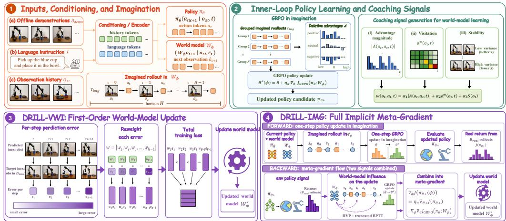
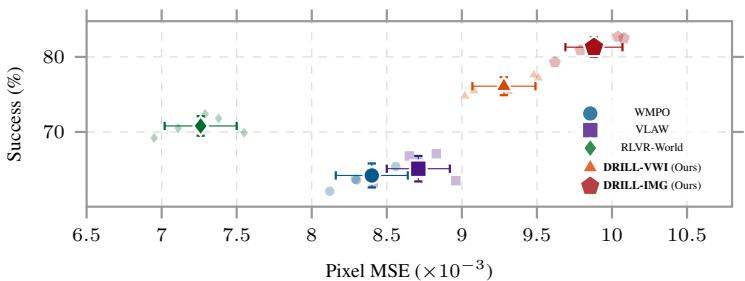
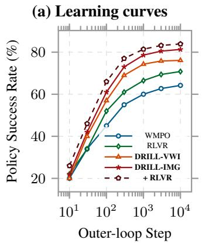
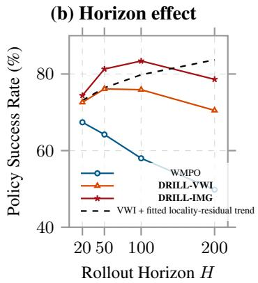
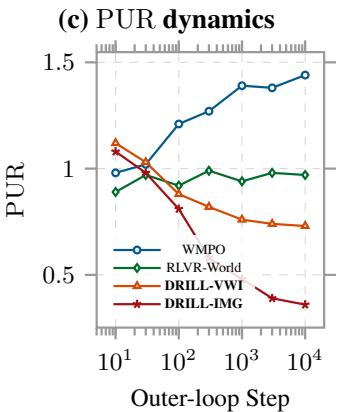
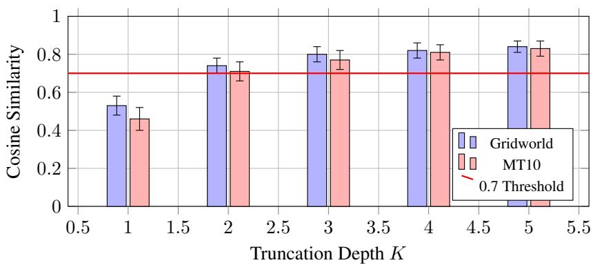
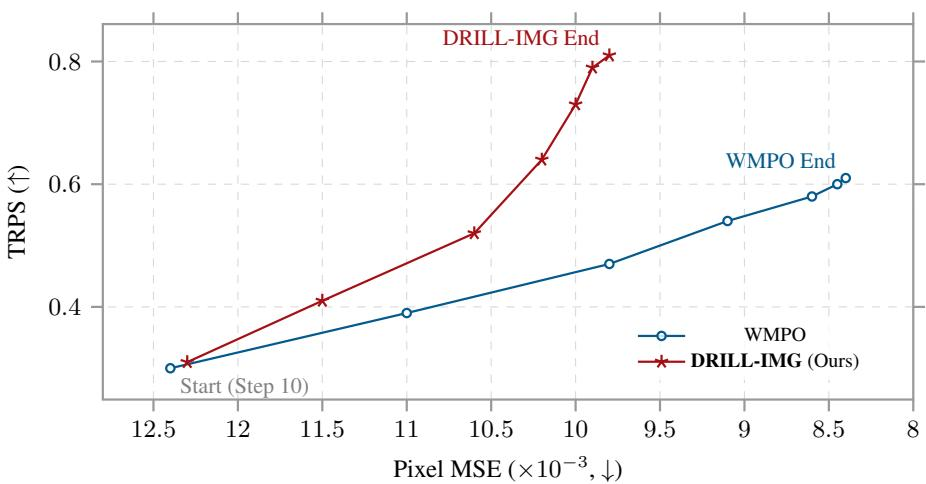

# DRILL: Training World Models to Improve Policies, Not Predict Pixels

Zhaolu Kang1,2, Tailong Luo, Lei Wei2, Guangyuan Dong, Sihan Liu2,Yingjie He2, Siheng Wang, Shuaibo Li,Rongchao Zhang, Zhen Tian, Richeng Xuan1,† ,Zhichao Hu1,† 1Hunyuan, Tencent 2Peking University zlkang25@stu.pku.edu.cn

## Abstract

World models are increasingly used to reduce environment interaction when posttraining vision-language-action (VLA) policies with reinforcement learning. Yet they are typically trained to predict pixels one step ahead, even though their role here is not merely to render visually faithful videos but to produce learning signals from imagined rollouts that improve the policy. We show that this mismatch is substantial: lower pixel MSE can produce worse policy gradients, and a world model trained for policy utility can yield better downstream policies despite 17% higher pixel MSE on the next frame. We propose the Downstream-Return Imagination Learning Loop (DRILL), a bilevel framework that updates the world model to maximize the policy’s return after an inner GRPO update on imagined rollouts. DRILL has two instantiations. DRILL-VWI is a closed-form surrogate, requiring no additional simulator rollouts, that reweights prediction errors by policy visitation, the group-relative GRPO advantage, and model confidence. DRILL-IMG is a full meta-gradient method that differentiates through the inner update using truncated Hessian-vector products. We show that DRILL-VWI recovers the local one-step component of the DRILL-IMG meta-gradient under score-compatibility and small-residual assumptions. Across five manipulation simulators and two VLA backbones, DRILL-IMG raises mean success rate by 13.1 points over WMPO and 7.9 points over RLVR-World, and complements RLVR pretraining rather than competing with it. More broadly, we believe video world models for VLA reinforcement learning can be productively trained by the policy gradients they produce, not only by pixel-level prediction.

## 1 Introduction

World models are becoming a practical substitute for robot or simulator interaction in reinforcement learning post-training of vision-language-action (VLA) policies. In this setting, however, their role is not merely to predict the next video frame: they generate the imagined rollouts from which the policy learns. This distinction creates an objective mismatch. A model optimized for one-step pixel prediction is not necessarily the model that induces the most useful policy-gradient update.

The reason is that pixel fidelity and policy utility weight errors in different places. Pixel MSE penalizes prediction errors uniformly over pixels and time, including backgrounds, robot geometry, and visually salient but task-irrelevant regions. A policy-gradient update instead emphasizes the states the current policy visits and the actions whose advantages are large. A model can therefore be an excellent next-frame predictor while producing weak learning signals, or a worse predictor on average while better supporting the transitions that determine policy improvement. The relevant question is not only whether the imagined video looks right, but whether learning inside it moves the policy in the right direction.

This mismatch matters because recent VLA post-training systems replace expensive robot or simulator interaction with imagined rollouts. At foundation-model scale, reinforcement-learning post-training can require millions of environment steps, so recent methods train a video world model from offline demonstrations and apply Group Relative Policy Optimization (GRPO) [1] inside the model [2, 3, 4, 5]. Yet the world model is still typically optimized as a one-step video predictor. Diagnostic methods such as Policy-Aware WM [6] and ESNR [7] show that pixel fidelity does not reliably track policy competence, but do not provide a training objective. RLVR-World [8] post-trains the world model with prediction correctness as the reward, improving it as a predictor rather than directly optimizing the policy update induced by imagined rollouts.

We propose the Downstream-Return Imagination Learning Loop (DRILL), a bilevel framework that trains video world models by the return of the policy obtained after learning in them. The inner loop performs a GRPO update on imagined rollouts generated by the world model; the outer loop updates the world model so that this post-update policy achieves higher return in the target simulator. The objective is therefore not pixel accuracy under the model’s own rollouts, but downstream return in the environment that defines task success.

DRILL has two operating points. DRILL-VWI (Visitation-Weighted Imagination) is a lightweight signed surrogate that replaces uniform pixel MSE with weights from policy visitation, group-relative advantage, and model confidence, requiring no additional simulator rollouts over a WMPO-style pipeline. DRILL-IMG (Implicit Meta-Gradient) estimates the downstream-return meta-gradient more directly by differentiating through the inner GRPO update with truncated Hessian-vector products and a small simulator-rollout batch. Thus DRILL-VWI is the budget-conscious drop-in update, while DRILL-IMG is the more faithful estimator when limited simulator interaction and BPTT memory are available.

The two variants are connected theoretically: the core DRILL-VWI surrogate is the first-order Taylor approximation of the DRILL-IMG meta-gradient under standard local assumptions, and DRILL-IMG admits a non-asymptotic convergence rate with truncated backpropagation through the inner update. This explains when a local visitation- and advantage-weighted prediction loss can approximate the more expensive meta-gradient, and when longer-horizon trajectory effects make DRILL-IMG worth the additional cost.

Across five public manipulation simulators [9, 10, 11] and two foundation VLA backbones [12, 13], DRILL-IMG raises mean policy success rate by 13.1 points over WMPO and 7.9 points over RLVR-World, while its world model has 17% higher one-step pixel MSE on the same training data. The gains are consistent across seeds, increase with rollout horizon and out-of-distribution shift, and remain complementary to prediction-correctness pretraining: applying DRILL-IMG to an RLVR-World-pretrained world model yields a further 3.2-point improvement on average. We also introduce the Policy-Utility Residual (PUR), a method-agnostic diagnostic measuring the angular gap between the pixel-MSE gradient and the policy-improvement direction; across the objectives we evaluate, lower PUR tracks higher downstream success.

Our contributions are as follows:

• We identify and formalize an objective mismatch in VLA world-model post-training: world models are trained for one-step pixel prediction, but used to generate policy-learning signals for imagined-rollout reinforcement learning.

• We introduce DRILL, a bilevel framework that trains the world model for the downstream return of the policy obtained after an inner GRPO update, and instantiate it as both a no-extra-rollout surrogate (DRILL-VWI) and a simulator-grounded meta-gradient method (DRILL-IMG).

• We show that DRILL-VWI is a first-order approximation to the DRILL-IMG meta-gradient, provide a non-asymptotic convergence guarantee for DRILL-IMG under truncated BPTT, and validate the framework across five simulators and two VLA backbones with higher downstream success despite higher pixel MSE.

• We introduce PUR as a method-agnostic diagnostic of the angular gap between pixel prediction and policy improvement, and show that it tracks downstream success across objectives.

## 2 Related Work

Video world models for VLA post-training. Recent VLA post-training systems use video world models to replace expensive robot or simulator interaction with imagined rollouts. WMPO [2], VLAW [3], WoVR [4], SC-VLA [5], Ctrl-World [14], World4RL [15], and World-Gymnast [16] pretrain the world model from demonstrations and then update the policy inside the learned dynamics. These methods differ in rollout construction, filtering, and policy optimization details, but the world model is still primarily trained as a next-frame predictor. Policy-Aware WM [6] and ESNR [7] diagnose the gap between prediction quality and policy competence, while RLVR-World [8] and WorldCompass [17] improve the predictor with prediction-correctness rewards. DRILL instead optimizes the world model by the downstream return of the policy after learning from its imagined rollouts; it is therefore complementary to RLVR-style pretraining rather than a replacement for it.

Policy-aware world-model learning. The idea that a model should be useful for control, not only accurate under a prediction loss, appears in value-aware model learning [18, 19] and in neural model-based RL systems such as MuZero [20], IRIS [21], and DreamerV3 [22]. DRILL brings this perspective to VLA post-training with imagined GRPO rollouts. Classical value-aware objectives rely on a learned $V _ { \psi } ( o )$ or bootstrapped targets; DRILL uses the group-relative advantage produced online by GRPO as a per-batch surrogate for downstream utility. Proposition 1 shows that the signed advantage weighting in DRILL-VWI is recovered as a first-order approximation to the DRILL-IMG meta-gradient under a local score-compatibility condition, and Section 5.3 compares this approximation with a direct value-aware adaptation.

Meta-gradient and implicit differentiation. DRILL-IMG is also related to methods that differentiate through an inner optimization step, including truncated MAML [23], iMAML [24], and implicitgradient methods for RL [25]. Unlike iMAML-style approaches, DRILL-IMG uses a short unroll of the policy update rather than solving the inner problem to convergence. Our analysis keeps the resulting truncation bias explicit: Theorem 1 expresses the BPTT bias as a function of the truncation length K. The practical distinction is scale and target: DRILL-IMG applies meta-gradients to foundation-scale VLAs paired with >1B-parameter video world models, using a small simulatorrollout batch to train the world model for the post-update return of the policy.

## 3 The DRILL Framework

DRILL couples two updates. The inner update uses the current world model as the environment for one GRPO step in imagination. The outer update evaluates the policy produced by that step in the target environment and assigns credit back to the world model. DRILL-VWI and DRILL-IMG differ only in how much of this outer gradient they estimate. Figure 1 gives the full training loop and marks where the two estimators enter.

## 3.1 Problem setup

We consider a VLA policy $\pi _ { \boldsymbol { \theta } } ( a _ { t : t + H _ { a } } \mid \sigma _ { \leq t } , \ell )$ , a video world model $\mathcal { W } _ { \phi } ( o _ { t + 1 } \mid o _ { \le t } , a _ { t } )$ with predicted next-frame mean $\hat { o } _ { t + 1 } ( \phi )$ , and a frozen vision-language reward model $r _ { \psi } ( o _ { t } ^ { - } , \ell ) \in [ 0 , 1 ]$ Training uses offline demonstrations $\mathcal { D } _ { \mathrm { d e m o } }$ and imagined rollouts of horizon H produced by π under $\mathcal { W } _ { \phi }$ . We write $d _ { \mathrm { e n v } } ^ { \pi _ { \theta } } ( o _ { t } )$ for the on-policy state visitation in the target environment, which in our experiments is the high-fidelity simulator that defines task return (Section 5.1), and $\tilde { d } _ { \phi } ^ { \pi _ { \theta } } ( o _ { t } )$ for the corresponding imagined-rollout visitation induced by $\pi _ { \theta }$ inside $\mathcal { W } _ { \phi }$

The standard WMPO recipe [2, 3] alternates between fitting the world model to demonstration pixels and improving the policy inside the model:

$$
\phi  \underset { \phi } { \mathrm { a r g m i n } } \ \mathbb { E } _ { ( o \leq t , a _ { t } , o _ { t + 1 } ) \sim \mathcal { D } _ { \mathrm { d e m o } } } \big \| \hat { o } _ { t + 1 } ( \phi ) - o _ { t + 1 } \big \| _ { 2 } ^ { 2 } ,\tag{1}
$$

$$
\theta  \theta + \eta _ { \theta } \nabla _ { \theta } \hat { J } _ { \mathrm { G R P O } } ( \pi _ { \theta } ; \mathcal { W } _ { \phi } , r _ { \psi } ) .\tag{2}
$$

The first update is optimized for pixel fidelity, while the second uses the model through the policygradient signal it induces. DRILL replaces the pixel-fitting update with one aligned to this downstream role.

  
Figure 1: Overview of DRILL. The policy first learns inside the current world model through imagined GRPO. The resulting policy-improvement signal is then fed back to the world model: DRILL-VWI uses the same imagined rollouts to form a signed, visitation-weighted local surrogate, whereas DRILL-IMG differentiates through the inner update and grounds the outer gradient with a small simulator batch.

## 3.2 The DRILL objective

Let

$$
\theta ^ { + } ( \phi ) = \theta + \eta _ { \theta } \nabla _ { \theta } \hat { J } _ { \mathrm { G R P O } } ( \pi _ { \theta } ; \mathcal { W } _ { \phi } )\tag{3}
$$

be the policy produced by one imagined GRPO step. DRILL trains $\mathcal { W } _ { \phi }$ so that this updated policy obtains high return in the target environment:

$$
\phi ^ { * } \ = \ \underset { \phi } { \arg \operatorname* { m a x } } \ J \big ( \pi _ { \theta ^ { + } ( \phi ) } \big ) , \qquad J ( \pi ) \ = \ \mathbb { E } _ { \tau \sim P _ { \mathrm { e n v } } ( \pi ) } \left[ \sum _ { t } r _ { t } \right] .\tag{4}
$$

The expectation in J is taken under the trajectory distribution of the target environment, not under $\mathcal { W } _ { \phi } \colon$ the world model is not asked to evaluate itself. Optimizing (4) requires the meta-gradient $\nabla _ { \phi } J ( \pi _ { \theta ^ { + } ( \phi ) } )$ through the inner update (3). This formulation changes what the world model is optimized for: rather than fitting all demonstrated pixels equally, DRILL rewards model changes that make the imagined policy update improve target-environment return. The useful signal is therefore not frame fidelity alone, but whether the model induces the right policy-gradient direction on states the current policy actually visits.

DRILL uses two operating points. DRILL-VWI is a local signed surrogate requiring no additional simulator rollouts, while DRILL-IMG estimates the downstream-return meta-gradient more directly with truncated differentiation through the inner update and a small simulator batch for the outer return gradient.

## 3.3 DRILL-VWI: Visitation-Weighted Imagination

DRILL-VWI replaces the pixel-MSE loss (1) with a policy-aware signed local surrogate,

$$
{ \mathcal L } _ { \mathrm { V W I } } ( \phi ) \ = \ { \mathbb E } _ { ( o _ { t } , a _ { t } , o _ { t + 1 } ) \sim { \mathcal D } _ { \operatorname* { d e m o } } } \Big [ w ( o _ { t } , a _ { t } ) \big \| \big | \big . \hat { o } _ { t + 1 } ( \phi ) - o _ { t + 1 } \big \| _ { 2 } ^ { 2 } \Big ] ,\tag{5}
$$

with

$$
w ( o _ { t } , a _ { t } ) \ = \ \widetilde { \hat { d } } _ { \phi } ^ { \pi _ { \theta } } ( o _ { t } ) \cdot \widetilde { A } _ { \alpha } ( o _ { t } , a _ { t } ) \cdot s ( o _ { t } ) , \qquad \widetilde { A } _ { \alpha } ( o _ { t } , a _ { t } ) = \mathrm { s g n } ( \hat { A } ( o _ { t } , a _ { t } ) ) \big | \hat { A } ( o _ { t } , a _ { t } ) \big | ^ { \alpha } .\tag{6}
$$

The three factors are quantities already produced by the imagined GRPO loop: $\widehat { \tilde { d } } _ { \phi } ^ { \pi _ { \theta } } \left( o _ { t } \right)$ estimates model-rollout visitation, $\hat { A } ( o _ { t } , a _ { t } )$ is the group-relative GRPO advantage, and $s ( o _ { t } ) > 0$ downweights states on which the world model is uncertain. The weight is stopped and clipped in implementation, so (5) is a local update direction, not a globally normalized likelihood objective. Proposition 1 formalizes its first-order connection to the DRILL-IMG meta-gradient. Algorithm 1 in Appendix D.1 gives the full training loop, including clipping, normalization, and visitation estimation. Since all factors come from imagined rollouts, DRILL-VWI adds no environment interaction over WMPO.

## 3.4 DRILL-IMG: Implicit Meta-Gradient

DRILL-IMG estimates the meta-gradient of (4) by differentiating through the inner update (3):

$$
\nabla _ { \phi } J \bigl ( \pi _ { \theta ^ { + } ( \phi ) } \bigr ) \ = \ \eta _ { \theta } \nabla _ { \theta ^ { + } } J \bigl ( \pi _ { \theta ^ { + } } \bigr ) \nabla _ { \phi } \nabla _ { \theta } \hat { J } _ { \mathrm { G R P O } } ( \pi _ { \theta } ; \mathcal { W } _ { \phi } ) .\tag{7}
$$

The first factor is a policy-gradient estimate in the target simulator, computed from a small batch of simulator rollouts. The second factor is a mixed derivative through the imagined GRPO update, computed as a Hessian-vector product with K-step truncated BPTT. In the main experiments we use $K { = } 2$ and $B _ { \mathrm { r e a l } } { = } 3 0$ simulator rollouts per outer step. DRILL-IMG is therefore a more faithful estimator of the DRILL objective than DRILL-VWI, at the cost of additional simulator interaction and BPTT memory. Algorithm 2 in Appendix D.2 gives the full pseudocode, checkpointing details, and numerical-stability controls.

## 4 Theoretical Analysis

The analysis has three roles. First, it explains when the cheap DRILL-VWI update is a first-order surrogate for the DRILL-IMG meta-gradient. Second, it states the convergence guarantee for DRILL-IMG under truncated BPTT. Third, it defines a diagnostic, PUR, for measuring whether a world-model objective is aligned with policy improvement.

## 4.1 First-order meta-gradient and the DRILL-VWI surrogate

The inner update (3) is a single gradient step, so the outer objective $J ( \pi _ { \theta ^ { + } ( \phi ) } )$ can be expanded in the inner step size $\eta _ { \theta }$ . The proposition below keeps only the main statement needed in the paper body; the full proof and residual definitions are given in Appendix B.

Proposition 1 (DRILL-VWI as a first-order local surrogate). Suppose (A1) J is $C ^ { 2 }$ in $\theta ; ( A 2 ) \mathcal { W } _ { \phi }$ has a Gaussian observation head with mean $\hat { o } _ { t + 1 } ( \phi )$ andfixed scale σ ; and (A3) the imagined-rollout visitation marginal $\tilde { d } _ { \phi } ^ { \pi _ { \theta } }$ is locally stationary over one inner step. Treat the GRPO advantages as stop-gradient quantities whenforming $\nabla _ { \phi } \nabla _ { \theta } \hat { J } _ { \mathrm { G R P O } } .$ . Let $\mathcal { L } _ { \mathrm { V W I } } ^ { \mathrm { c o r e } }$ denote the idealized VWI surrogate with exact imagined-rollout visitation, $\alpha = 1 , s ( o _ { t } ) = 1$ , and unclipped signed weights. Ifthe local policy-score contraction is compatible with the signed advantage direction up to residual $\epsilon _ { \mathrm { c o m p } } ,$ the omitted multi-step trajectory-score terms have residual $R _ { H }$ , and the demo-anchor transfer has residual $R _ { \mathrm { d e m o } } ,$ , then for some alignment scalar $\kappa > 0$

$$
\biggl | \biggl | \nabla _ { \phi } J \bigl ( \pi _ { \theta ^ { + } ( \phi ) } \bigr ) + \frac { \kappa \eta _ { \theta } } { 2 \sigma _ { W } ^ { 2 } } \nabla _ { \phi } \mathcal { L } _ { \mathrm { V W I } } ^ { \mathrm { c o r e } } ( \phi ) \biggr | \biggr | \leq \eta _ { \theta } M _ { W } \epsilon _ { \mathrm { c o m p } } + \eta _ { \theta } R _ { H } + \eta _ { \theta } R _ { \mathrm { d e m o } } + \mathcal { O } \bigl ( \eta _ { \theta } ^ { 2 } \bigr ) .\tag{8}
$$

The result should not be read as an exact identity between DRILL-VWI and DRILL-IMG. It says that the signed VWI update recovers the local one-step component of the DRILL-IMG meta-gradient when the policy-score contraction is approximately scalar on the advantage-weighted support and when trajectory-locality and demo-anchor residuals are small. Intuitively, positive-advantage transitions are sharpened, while negative-advantage transitions may be deliberately deemphasized rather than fit more accurately as pixels.

The residuals describe when this local approximation is reliable. $\epsilon _ { \mathrm { c o m p } }$ measures whether the worldmodel score and the policy-gradient contraction agree on which transition changes matter; $R _ { H }$ grows when multi-step consequences dominate local next-frame error; and $R _ { \mathrm { d e m o } }$ captures mismatch between demonstration anchors and on-policy imagined transitions. Thus short-horizon or wellcovered tasks favor DRILL-VWI, while large trajectory or demo-anchor residuals motivate the more expensive DRILL-IMG estimator.

## 4.2 Convergence rate under truncated BPTT

DRILL-IMG replaces the exact mixed derivative in (7) by a K-step truncated BPTT estimate. The following theorem analyzes one fixed-policy outer subproblem. Fix current policy parameters ¯θ and define

$$
J _ { \bar { \theta } } ( \phi ) : = J \Bigl ( \pi _ { \bar { \theta } + \eta _ { \theta } \nabla _ { \theta } \hat { J } _ { \mathrm { G R P O } } ( \pi _ { \bar { \theta } } ; \mathcal { W } _ { \phi } ) } \Bigr ) .
$$

This is a per-outer-subproblem guarantee, not a proof of global convergence for the jointly evolving $( \theta _ { t } , \phi _ { t } )$ process.

Theorem 1 (DRILL-IMG convergence rate under truncated BPTT). Suppose (A4) the K-truncated meta-gradient estimator has conditional variance at most $\sigma _ { g } ^ { 2 } ; ( A { \bar { S } } ) ~ J _ { \bar { \theta } }$ is L-smooth in ϕ and bounded above with $J ^ { * } : = \operatorname* { s u p } _ { \phi } J _ { \bar { \theta } } ( \phi ) < \mathsf { c }$ ∞; and (A6) the K-step BPTT truncation bias satisfies $\| \mathrm { b i a s } _ { K } \| \leq$ $B \rho ^ { K }$ for some $\rho \in ( 0 , 1 )$ . Let $J _ { 0 } : = J _ { \bar { \theta } } ( \phi _ { 0 } )$ ). With step size

$$
\eta _ { \phi } = \mathrm { m i n } \left( \frac { 1 } { 4 L } , \sqrt { \frac { 2 ( J ^ { * } - J _ { 0 } ) } { L T \sigma _ { g } ^ { 2 } } } \right) ,
$$

the T-step stochastic ascent iterates on $J _ { \bar { \theta } }$ satisfy

$$
\begin{array} { r l } & { \underset { 0 \leq t < T } { \operatorname* { m i n } } \ \mathbb { E } \big \| \nabla _ { \phi } J _ { \bar { \theta } } ( \phi _ { t } ) \big \| ^ { 2 } \ \leq \ \mathcal { O } \Big ( \frac { L ( J ^ { * } - J _ { 0 } ) } { T } \Big ) \ + \ \mathcal { O } \Big ( \sqrt { \frac { L ( J ^ { * } - J _ { 0 } ) \sigma _ { g } ^ { 2 } } { T } } \Big ) \ + \ \mathcal { O } \big ( B ^ { 2 } \rho ^ { 2 K } \big ) . } \end{array}\tag{9}
$$

The three terms correspond to optimization error, stochastic-gradient variance, and truncation bias. The guarantee is qualitative at our scale: it shows convergence to a neighborhood of a stationary point and that the squared-gradient contribution from BPTT truncation decays geometrically in $\dot { K }$ . This supports using a shallow truncation when the extra unroll depth no longer changes the meta-gradient direction much. The practical choice $K { = } 2$ is therefore made empirically, from the truncation and return-per-compute studies in the appendix, rather than from the worst-case constants in the bound.

Corollary 1 (Truncation depth). The truncation contribution in (9)falls below any target $\epsilon > 0$ once $K = \Theta ( \dot { \log ( 1 / \epsilon ) } )$ , with constants determined by B and $\rho .$

## 4.3 Policy-Utility Residual

The previous results are specific to DRILL-VWI and DRILL-IMG. To compare arbitrary world-model objectives, we measure whether the pixel-MSE gradient is aligned with the direction that improves the policy after imagined training. We define the Policy-Utility Residual as

$$
\operatorname { P U R } ( \phi ) = 1 - \frac { \left. \nabla _ { \phi } \mathcal { L } _ { \mathrm { M S E } } ( \phi ) , - \nabla _ { \phi } J \big ( \pi _ { \theta ^ { + } ( \phi ) } \big ) \right. } { \left\| \nabla _ { \phi } \mathcal { L } _ { \mathrm { M S E } } \right\| \left\| \nabla _ { \phi } J \right\| } .\tag{10}
$$

Equivalently, $\mathrm { P U R } = 1 + \cos \angle ( \nabla _ { \phi } \mathcal { L } _ { \mathrm { M S E } } , \nabla _ { \phi } J )$ whenever both gradients are nonzero. Thus PUR ≈ 0 means that descending pixel MSE also improves the downstream-return objective, PUR ≈ 1 means the two directions are nearly orthogonal, and $\mathrm { P U R } { \approx } 2$ means that descending pixel MSE is anti-aligned with policy improvement.

We estimate $\nabla _ { \phi } J$ by finite differences in the simulator rather than by reusing the HVP machinery of DRILL-IMG. This keeps PUR independent of any particular training method, so the same diagnostic applies to WMPO, RLVR-World, DRILL-VWI, DRILL-IMG, and other world-model objectives. Section 5.5 tests whether lower PUR tracks higher downstream success across the methods we evaluate.

## 5 Experiments

We evaluate DRILL on five robot-manipulation simulators, two VLA backbones, and five training baselines, while also reporting diagnostic metrics from policy-aware WM evaluation. The main text keeps the headline comparison, compact diagnostic panels, architectural checks, component-level summaries, and the criterion for choosing DRILL-VWI or DRILL-IMG. Detailed ablations, crossbackbone tables, robustness breakdowns, hyperparameter sweeps, reward-model swaps, and auxiliary diagnostic curves are collected in Appendices D.7–F.6.

## 5.1 Setup

Benchmarks and baselines. We use LIBERO-Long [9], CALVIN ABC→D [10], RoboCasa [11], Meta-World MT50, and SimplerEnv. These simulators define both evaluation and the small realrollout budget used by DRILL-IMG’s outer gradient, $B _ { \mathrm { r e a l } } { = } 3 0$ simulator rollouts per outer step; no real-robot results are included. Baselines are Scratch-GRPO, WMPO [2], VLAW [3], RLVR-World [8], and a simulator-budget-matched model-free PPO control, Sim-PPO. Sim-PPO receives the same simulator episode budget as DRILL-IMG but no imagined rollouts, isolating whether the world model amplifies limited simulator interaction. Policy-Aware WM [6] is diagnostic rather than a training method, so we report its ESNR score alongside PUR.

<table><tr><td>Method</td><td>LIBERO</td><td>CALVIN</td><td> $\mathrm { R o b o C a s a }$ </td><td>MT50</td><td>Simpler</td><td>MSE↓</td><td>ESNR ↑</td><td>PUR↓</td></tr><tr><td>Scratch-GRPO</td><td> $1 8 . 2 \pm 2 . 7$ </td><td> $2 2 . 5 { \pm } 3 . 1 $ </td><td> $8 . 1 \pm 1 . 6$ </td><td>21.4±2.4</td><td> $1 5 . 0 { \pm } 2 . 2 $ </td><td>N/A</td><td>N/A</td><td>N/A</td></tr><tr><td>Sim-PPO</td><td> $2 8 . 5 { \pm 2 . 1 }$ </td><td> $3 2 . 1 \pm 2 . 5$ </td><td> $1 2 . 4 \pm 1 . 9$ </td><td> $3 1 . 6 { \pm } 2 . 0 $ </td><td> $2 2 . 8 \pm 1 . 8$ </td><td>N/A</td><td>N/A</td><td>N/A</td></tr><tr><td>WMPO</td><td> $6 4 . 2 \pm 1 . 6$ </td><td> $7 1 . 8 \pm 1 . 3$ </td><td> $3 8 . 5 { \pm 2 . 1 }$ </td><td> $6 7 . 4 \pm 1 . 5$ </td><td> $5 5 . 1 \pm 2 . 0$ </td><td> $8 . 4 \pm 0 . 3$ </td><td>1.00</td><td> $1 . 4 2 \pm 0 . 0 8$ </td></tr><tr><td>VLAW</td><td> $6 5 . 1 \pm 2 . 4$ </td><td> $7 4 . 0 { \pm } 1 . 8 $ </td><td> $3 9 . 6 \pm 2 . 2$ </td><td> $6 8 . 2 \pm 2 . 1$ </td><td> $5 7 . 9 \pm 1 . 7$ </td><td> $8 . 7 { \pm } 0 . 4 $ </td><td>1.09</td><td> $1 . 3 7 { \pm } 0 . 0 9$ </td></tr><tr><td>RLVR-World†</td><td> $7 0 . 8 \pm 1 . 4$ </td><td> $7 5 . 3 { \pm } 1 . 6 $ </td><td> $4 2 . 7 { \pm } 1 . 8 $ </td><td> $7 2 . 9 \pm 1 . 5$ </td><td> $6 1 . 6 \pm 1 . 9$ </td><td> ${ \bf 7 . 2 \pm 0 . 3 }$ </td><td>1.39</td><td> $0 . 9 7 { \pm } 0 . 0 6$ </td></tr><tr><td>DRILL-VWI†</td><td> $7 6 . 1 \pm 1 . 2$ </td><td> $8 0 . 7 \pm 1 . 1$ </td><td> $5 1 . 8 { \pm } 1 . 7 $ </td><td> $7 5 . 6 \pm 1 . 4$ </td><td> ${ \bf 6 4 . 0 \pm 1 . 9 }$ </td><td> $9 . 3 { \pm } 0 . 3 $ </td><td>1.68</td><td> $0 . 7 3 { \pm } 0 . 0 5$ </td></tr><tr><td> $\mathbf { D R I L L - I M G } ^ { \dagger }$ </td><td> $8 1 . 3 { \pm } 1 . 3 $ </td><td> $8 3 . 1 \pm 1 . 4$ </td><td> $5 5 . 7 \pm 2 . 0$ </td><td> $7 9 . 4 \pm 1 . 2$ </td><td> $6 3 . 1 \pm 2 . 6 $ </td><td> $9 . 8 \pm 0 . 4$ </td><td>2.09</td><td> $0 . 3 6 \pm 0 . 0 4$ </td></tr><tr><td> $\mathrm { D R I L - I M G + R L V R - W M ^ { \dagger } }$ </td><td> ${ \bf 8 3 . 9 2 1 . 1 }$ </td><td> ${ \bf 8 5 . 4 \pm 1 . 2 }$ </td><td> ${ \bf 5 9 . 1 \pm 1 . 6 }$ </td><td>81  ${ \bf . . 8 \pm 1 . 3 }$ </td><td> $6 7 . 3 { \pm } 2 . 1 $ </td><td> $8 . 6 \pm 0 . 3$ </td><td>2.38</td><td> ${ \bf 0 . 2 9 } \pm { \bf 0 . 0 4 }$ </td></tr></table>

Table 1: Main results on $\pi _ { 0 } \ – 3 \mathbf { B } .$ . Values are mean±std over five seeds. Bold marks column best; † denotes $p < 0 . 0 5$ versus WMPO. MSE is in $1 0 ^ { - 3 }$ and ESNR is relative to WMPO; RLVR-WM denotes the RLVR-World WM.  
  
Figure 2: MSE–success decoupling on LIBERO-Long $\left( \pi _ { 0 } \ – 3 \mathbf { B } \right)$ . Faint markers are seeds; bold markers are mean±std.

Protocol. Headline results use five seeds; ablations use three. We report Welch’s t-test p-values and 95% CIs for head-to-head comparisons. The headline run uses about 17k NVIDIA H20-hours, or 24 H20 GPUs for roughly four weeks. Appendix D.9 gives the per-phase breakdown.

## 5.2 Main Results

On $\pi _ { 0 } \ – 3 \mathbf { B } .$ , DRILL-IMG raises mean success rate by 13.1 points over WMPO and 7.9 points over RLVR-World, averaged across the five benchmarks, while increasing one-step pixel MSE by 17% on the same training data. The gain is largest on long-horizon tasks and smallest on SimplerEnv, where DRILL-VWI and DRILL-IMG are statistically tied: 64.0±1.9 versus 63.1±2.6. This exception motivates the horizon analysis in Section 5.4.

The compact diagnostic panels in Figure 3 give three additional views of the same result: DRILL variants break the usual link between lower pixel MSE and higher success, improve faster on LIBERO Long, and reduce PUR during training. A compute-matched control in Appendix F.1 further shows that extra WMPO updates move LIBERO-Long SR from 64.2±1.6 to at most $6 5 . 1 \pm 1 . 9 $ , far below DRILL-IMG’s 81.3±1.3. Together, these checks rule out a pure compute or pixel-fidelity explanation: the methods that improve most are those that better align imagined updates with downstream policy utility. The appendix reports the full breakdowns, while the main text keeps only this recurring trend.

Backbone and pretraining checks. We repeat the headline comparison on OpenVLA-7B using LIBERO-Long, CALVIN, and RoboCasa. LIBERO-Long and CALVIN preserve the ranking DRILL-IMG > DRILL-VWI > RLVR-World > WMPO. On RoboCasa, DRILL-IMG and DRILL-VWI are statistically tied, $5 0 . 8 { \pm } 2 . 3 $ versus 48.7±2.1 with $p { = } 0 . 1 2$ , matching that benchmark’s shorter, object-centric episodes. DRILL-IMG reaches 68.9 mean SR on OpenVLA, compared with 53.8 for WMPO, a 15.1-point gain; the full per-benchmark table is in Appendix F.7. This replication changes both the policy backbone and the pretraining mixture, yet preserves the same method ordering on the two longer-horizon benchmarks. We therefore use the appendix tables mainly as robustness evidence for the objective, rather than as a separate architecture claim.

Orthogonality with RLVR-World. Initializing the WM with RLVR-World pretraining and then applying DRILL-IMG improves mean SR by another roughly 3 points over DRILL-IMG alone. Prediction-correctness pretraining and downstream-return imagination are therefore complementary rather than interchangeable. The stacked variant helps most on SimplerEnv, where the shorter horizon weakens the DRILL-IMG HVP signal and a better pretrained WM matters more.

  
Figure 3: Three compact diagnostics on LIBERO-Long. (a) DRILL variants pass baselines early and continue improving. (b) Larger rollout horizon widens the DRILL-IMG–DRILL-VWI gap until imagined trajectories become noisy. (c) Lower PUR tracks higher policy utility during training.

A plausible mechanism is that RLVR-World pretraining lowers the variance of the supervised prediction gradient on task-relevant transitions, so that the downstream-return outer gradient is less likely to be drowned out early in training. We treat this as an interpretation of the empirical trend rather than a formal claim, and leave a direct curvature-level test (cf. Appendix D.4) to future work.

## 5.3 Ablations and Scaling

Objective ablations. Across LIBERO, CALVIN, and RoboCasa, each factor in the signed DRILL-VWI coaching surrogate helps: visitation-only reaches 64.2 mean SR, signed-advantage-only 66.8, and confidence-only 60.1, compared with 58.2 for WMPO. Combining all three gives 69.2. The exponent sweep peaks at α=1, consistent with Proposition 1: the score-compatible local surrogate is linear in the signed advantage, whereas $\alpha \neq 1$ deliberately distorts that direction. Increasing to α=2 lowers SR to 67.9, consistent with higher variance from overemphasizing high-magnitude signed-advantage samples. A minimal value-aware baseline, VA-WM, reaches 62.4 mean SR, closing part of the gap to WMPO but remaining 6.8 points below DRILL-VWI and 11.0 below DRILL-IMG; the complete ablation table is in Appendix F.2.

Scaling and coupling. On LIBERO-Long, the DRILL-IMG margin over WMPO grows with WM size: 7.9 points at 300M parameters, 13.1 at 1.2B, and 16.4 at 7B. DRILL-IMG also transfers across WM backbones: Ctrl-World obtains 81.3±1.3 SR and a matched Cosmos-Predict2-style model obtains $7 9 . 6 \pm 1 . 7 ,$ , a gap within two standard deviations. Finally, freezing the VWI signed coaching multipliers from a GRPO-warmstart policy reaches only 64.9±1.5 mean SR, 4.3 points below DRILL-VWI. The gain therefore comes from tracking the current policy’s signed advantage signal, not from a fixed supervised MSE reweighting.

## 5.4 When DRILL-IMG Pays Off over DRILL-VWI

At the default horizon H=50, DRILL-VWI captures most of the gain on LIBERO-Long: it recovers 11.9 of the 17.1 points between WMPO and DRILL-IMG. DRILL-IMG costs about 1.4× more per outer step and uses $B _ { \mathrm { r e a l } } { = } 3 0$ simulator rollouts that DRILL-VWI does not require, so the choice should depend on horizon. The residual decomposition suggests this dependence: the one-step DRILL VWI surrogate omits multi-step trajectory-score terms collected in the trajectory-locality residual $R _ { H }$ , while DRILL-IMG partially recovers these terms through truncated BPTT. If one additionally assumes $R _ { H } = \mathcal { O } ( \eta _ { \theta } H ^ { 2 } ) $ , this residual induces an $\mathcal { O } ( \eta _ { \theta } ^ { 2 } H ^ { 2 } )$ horizon-dependent component, but the experiment should be read as testing whether the IMG–VWI gap grows with H, not as isolating a universal $H ^ { 2 }$ law.

The horizon sweep (Figure 3) is consistent with this residual-based criterion. The DRILL-IMG margin over DRILL-VWI grows from 1.8 points at H=20 to 5.2 at H=50, 7.5 at H=100, and 8.1 at

H=200. WMPO falls from 67.4 to 49.8 SR as rollout error compounds; DRILL-VWI is more stable but saturates around the mid-70s. DRILL-IMG peaks at $H { = } 1 0 \bar { 0 }$ with 83.4 SR and drops to 78.6 at $H { = } 2 0 0 .$ , where imagined trajectories become too noisy. The short-horizon checks point the other way: on LIBERO-Long the IMG-over-VWI gap shrinks to 0.6 at $H { = } 1 0$ and becomes a non-significant $- 0 . 2 { \pm } 1 . 1$ at $H { = } 5 ;$ on SimplerEnv, whose effective horizon is below $H { = } 2 0$ , DRILL-VWI slightly exceeds DRILL-IMG, 64.0 versus 63.1 SR. We recommend DRILL-VWI as the budget-conscious choice for very short horizons or when simulator rollouts are unavailable, and DRILL-IMG when the task horizon is moderate to long or when the extra simulator budget is acceptable. In our default $H { = } 5 0$ setting, DRILL-IMG already gives a 5.2-point gain over DRILL-VWI on LIBERO-Long, while SimplerEnv illustrates the short-horizon regime where VWI can be preferable. Full horizon tables and reward-model swaps are in Appendices F.3 and F.8.

HVP validation. On a 2D gridworld and Meta-World MT10, where the exact meta-gradient is tractable, the $K { = } 2$ truncated HVP has cosine similarity $0 . 7 4 \pm 0 . 0 4$ and $0 . 7 1 \pm 0 . 0 5$ to the untruncated target meta-gradient, respectively. The full K-sweep and estimated contraction rate $\rho$ are in Appendix D.4.

## 5.5 Diagnostics and Robustness

Robustness and diagnostics. Under LIBERO zero-shot perturbations, DRILL-IMG has an 18.6% average relative SR drop, compared with 30.2% for WMPO and 25.6% for RLVR-World. The only exception is pose perturbation, where DRILL-VWI slightly wins, again matching a shorter effective horizon; the per-condition breakdown is in Appendix F.9. PUR also tracks policy utility (Figure 3): WMPO drifts upward, RLVR-World plateaus, DRILL-VWI stays bounded, and DRILL-IMG decreases; across the PUR-reporting headline rows, the Spearman correlation with downstream SR is $\rho _ { S } = - 0 . 8 9$ with 95% bootstrap CI [−0.97, −0.71]. Two held-out variants give 1.5 points mean absolute error when final SR is predicted from checkpoint-level PUR at step 5k.

DRILL also improves task-relevant imagination rather than visual fidelity alone. On LIBERO-Long, WMPO reaches lower pixel MSE but plateaus at $0 . 6 1 { \pm } 0 . 0 2 \ \mathrm { T R P S }$ , while DRILL-IMG reaches 0.81±0.03 TRPS despite higher MSE. In a forced-choice human study with 120 trials and six blinded raters, visual-quality preferences for WMPO or RLVR-World over DRILL-IMG are not significant, but when task completion is shown, 62% prefer DRILL-IMG over WMPO $( p < 0 . 0 0 1 )$ ). TRPS curves and human-evaluation details are in Appendices F.4 and F.10.

## 6 Conclusion

We introduced DRILL, a bilevel framework for training video world models as policy-improvement environments rather than as standalone next-frame predictors. Its two instantiations expose a practical trade-off: DRILL-VWI provides a lightweight visitation- and advantage-weighted surrogate that can be used in a WMPO-style pipeline, while DRILL-IMG more directly optimizes downstream return by differentiating through imagined policy updates. The theoretical connection between these variants explains when the cheaper local surrogate should be sufficient and when longer-horizon trajectory effects make the meta-gradient worth its extra cost. Across five manipulation simulators and two VLA backbones, DRILL improves policy success even when one-step pixel MSE becomes worse, reinforcing the central claim that visual fidelity is not the right standalone target for world-model post-training. The accompanying PUR diagnostic makes this mismatch measurable, and the gains from combining DRILL with RLVR-World suggest that prediction-correctness pretraining and policy aware downstream optimization are complementary. More broadly, DRILL shifts the optimization target from making imagined videos look accurate to making learning inside those videos useful.

Limitations. Our evaluation remains simulation-only and uses a small simulator-rollout budget for DRILL-IMG rather than physical robot interaction. This leaves open how sensitive the method is to real-world perception noise, actuation delay, safety constraints, and sim-to-real distribution shift. DRILL-IMG also introduces additional compute and memory overhead through truncated backpropagation and Hessian-vector products, so DRILL-VWI may be the more appropriate choice when interaction, memory, or wall-clock budget is the binding constraint. Extending DRILL to real-robot post-training and reducing the cost of the meta-gradient estimator are therefore important next steps.

## References

[1] Zhihong Shao, Peiyi Wang, Qihao Zhu, Runxin Xu, Junxiao Song, Xiao Bi, Haowei Zhang, Mingchuan Zhang, YK Li, Yang Wu, et al. Deepseekmath: Pushing the limits of mathematical reasoning in open language models. arXiv preprint arXiv:2402.03300, 2024.

[2] Fangqi Zhu, Zhengyang Yan, Zicong Hong, Quanxin Shou, Xiao Ma, and Song Guo. Wmpo: World model-based policy optimization for vision-language-action models. arXiv preprint arXiv:2511.09515, 2025.

[3] Yanjiang Guo, Tony Lee, Lucy Xiaoyang Shi, Jianyu Chen, Percy Liang, and Chelsea Finn. Vlaw: Iterative co-improvement of vision-language-action policy and world model. arXiv preprint arXiv:2602.12063, 2026.

[4] Zhennan Jiang, Shangqing Zhou, Yutong Jiang, Zefang Huang, Mingjie Wei, Yuhui Chen, Tianxing Zhou, Zhen Guo, Hao Lin, Quanlu Zhang, et al. Wovr: World models as reliable simulators for post-training vla policies with rl. arXiv preprint arXiv:2602.13977, 2026.

[5] Chenxuan Li, Jiaming Liu, Guanqun Wang, Xiaoqi Li, Sixiang Chen, Liang Heng, Chuyan Xiong, Jiaxin Ge, Renrui Zhang, Kaichen Zhou, et al. A self-correcting vision-language-action model for fast and slow system manipulation. arXiv preprint arXiv:2405.17418, 2024.

[6] Zhida Zhao, Talas Fu, Yifan Wang, Lijun Wang, and Huchuan Lu. From forecasting to planning: Policy world model for collaborative state-action prediction. arXiv preprint arXiv:2510.19654, 2025.

[7] Geigh Zollicoffer, Tanush Chopra, Mingkuan Yan, Xiaoxu Ma, Kenneth Eaton, and Mark Riedl. World model robustness via surprise recognition. arXiv preprint arXiv:2512.01119, 2025.

[8] Jialong Wu, Shaofeng Yin, Ningya Feng, and Mingsheng Long. Rlvr-world: Training world models with reinforcement learning. arXiv preprint arXiv:2505.13934, 2025.

[9] Bo Liu, Yifeng Zhu, Chongkai Gao, Yihao Feng, Qiang Liu, Yuke Zhu, and Peter Stone. Libero: Benchmarking knowledge transfer for lifelong robot learning. Advances in Neural Information Processing Systems, 36:44776–44791, 2023.

[10] Oier Mees, Lukas Hermann, Erick Rosete-Beas, and Wolfram Burgard. Calvin: A benchmark for language-conditioned policy learning for long-horizon robot manipulation tasks. IEEE Robotics and Automation Letters, 7(3):7327–7334, 2022.

[11] Soroush Nasiriany, Abhiram Maddukuri, Lance Zhang, Adeet Parikh, Aaron Lo, Abhishek Joshi, Ajay Mandlekar, and Yuke Zhu. Robocasa: Large-scale simulation of everyday tasks for generalist robots. arXiv preprint arXiv:2406.02523, 2024.

[12] Kevin Black, Noah Brown, Danny Driess, Adnan Esmail, Michael Equi, Chelsea Finn, Niccolo Fusai, Lachy Groom, Karol Hausman, Brian Ichter, et al. π : A vision-language-action flow model for general robot control. arXiv preprint arXiv:2410.24164, 2024.

[13] Moo Jin Kim, Karl Pertsch, Siddharth Karamcheti, Ted Xiao, Ashwin Balakrishna, Suraj Nair, Rafael Rafailov, Ethan Foster, Grace Lam, Pannag Sanketi, et al. Openvla: An open-source vision-language-action model. arXiv preprint arXiv:2406.09246, 2024.

[14] Yanjiang Guo, Lucy Xiaoyang Shi, Jianyu Chen, and Chelsea Finn. Ctrl-world: A controllable generative world model for robot manipulation. arXiv preprint arXiv:2510.10125, 2025.

[15] Zhennan Jiang, Kai Liu, Yuxin Qin, Shuai Tian, Yupeng Zheng, Mingcai Zhou, Chao Yu, Haoran Li, and Dongbin Zhao. World4rl: Diffusion world models for policy refinement with reinforcement learning for robotic manipulation. arXiv preprint arXiv:2509.19080, 2025.

[16] Ansh Kumar Sharma, Yixiang Sun, Ninghao Lu, Yunzhe Zhang, Jiarao Liu, and Sherry Yang. World-gymnast: Training robots with reinforcement learning in a world model. arXiv preprint arXiv:2602.02454, 2026.

[17] Zehan Wang, Tengfei Wang, Haiyu Zhang, Xuhui Zuo, Junta Wu, Haoyuan Wang, Wenqiang Sun, Zhenwei Wang, Chenjie Cao, Hengshuang Zhao, et al. Worldcompass: Reinforcement learning for long-horizon world models. arXiv preprint arXiv:2602.09022, 2026.

[18] Amir-massoud Farahmand, Andre Barreto, and Daniel Nikovski. Value-aware loss function for model-based reinforcement learning. In Artificial Intelligence and Statistics, pages 1486–1494. PMLR, 2017.

[19] Christopher Grimm, André Barreto, Satinder Singh, and David Silver. The value equivalence principle for model-based reinforcement learning. Advances in neural information processing systems, 33:5541–5552, 2020.

[20] Julian Schrittwieser, Ioannis Antonoglou, Thomas Hubert, Karen Simonyan, Laurent Sifre, Simon Schmitt, Arthur Guez, Edward Lockhart, Demis Hassabis, Thore Graepel, et al. Mastering atari, go, chess and shogi by planning with a learned model. Nature, 588(7839):604–609, 2020.

[21] Vincent Micheli, Eloi Alonso, and François Fleuret. Transformers are sample-efficient world models. arXiv preprint arXiv:2209.00588, 2022.

[22] Danijar Hafner, Jurgis Pasukonis, Jimmy Ba, and Timothy Lillicrap. Mastering diverse domains through world models. arXiv preprint arXiv:2301.04104, 2023.

[23] Chelsea Finn, Pieter Abbeel, and Sergey Levine. Model-agnostic meta-learning for fast adaptation of deep networks. In International conference on machine learning, pages 1126–1135. PMLR, 2017.

[24] Aravind Rajeswaran, Chelsea Finn, Sham M Kakade, and Sergey Levine. Meta-learning with implicit gradients. Advances in neural information processing systems, 32, 2019.

[25] Evgenii Nikishin, Romina Abachi, Rishabh Agarwal, and Pierre-Luc Bacon. Control-oriented model-based reinforcement learning with implicit differentiation. In Proceedings ofthe AAAI Conference on Artificial Intelligence, volume 36, pages 7886–7894, 2022.

[26] Saeed Ghadimi and Guanghui Lan. Stochastic first-and zeroth-order methods for nonconvex stochastic programming. SIAM journal on optimization, 23(4):2341–2368, 2013.

## A Notation and Preliminaries

This appendix collects the symbols, assumptions, and intermediate definitions used throughout the paper, so that Appendices B–C can be read without re-tracing the main text.

## A.1 Symbol glossary

Table 2: Notation used throughout the paper.
<table><tr><td>Symbol</td><td>Meaning</td></tr><tr><td>Observations, actions, language</td><td></td></tr><tr><td> $o _ { t } \in \mathcal { O }$ </td><td>Observation (image) at time t.</td></tr><tr><td> $O { \le } t$ </td><td>Observation history  $\big ( o _ { 0 } , \ldots , o _ { t } \big )$ </td></tr><tr><td> $a _ { t } \in \mathcal A$ </td><td>Action at time t.</td></tr><tr><td> $a _ { t : t + H _ { a } }$ </td><td> $H _ { a }$  -step action chunk produced by  $\pi _ { \theta } .$ </td></tr><tr><td>l</td><td>Natural-language instruction.</td></tr><tr><td> $r _ { t } \in [ 0 , 1 ]$ </td><td>Reward at time t.</td></tr><tr><td>Models</td><td></td></tr><tr><td> $\pi _ { \boldsymbol { \theta } } ( a _ { t : t + H _ { a } } \mid o _ { \leq t } , \ell )$ </td><td>VLA policy with parameters θ.</td></tr><tr><td> $\mathcal { W } _ { \phi } ( o _ { t + 1 } \mid o _ { \le t } , a _ { t } )$ </td><td>Video world model with parameters  $\phi .$ </td></tr><tr><td> $\hat { o } _ { t + 1 } ( \phi )$ </td><td>Predicted next-frame mean of  $\mathcal { W } _ { \phi }$ </td></tr><tr><td> $r _ { \psi } ( o _ { t } , \ell ) \in [ 0 , 1 ]$ </td><td>Frozen vision-language reward model.</td></tr><tr><td colspan="2">Distributions and data</td></tr><tr><td> $\mathcal { D } _ { \mathrm { d e m o } }$ </td><td>Offline demonstration dataset.</td></tr><tr><td> $P _ { \mathrm { e n v } } ( \pi )$ </td><td>Target-environment trajectory distribution under π (in our experiments, the high-fidelity simulator).</td></tr><tr><td> $d _ { \mathrm { e n v } } ^ { \pi _ { \theta } } ( o _ { t } )$ </td><td>On-policy state-visitation marginal of  $\pi \theta$  4 in  $P _ { \mathrm { e n v } }$ </td></tr><tr><td> $\tilde { d } _ { \phi } ^ { \pi _ { \theta } } \left( o _ { t } \right)$ </td><td>Time-averaged visitation marginal induced by rolling out πθ</td></tr><tr><td></td><td>inside  $\mathcal { W } _ { \phi } .$ </td></tr><tr><td> $\widehat { \tilde { d } } _ { \phi } ^ { \pi _ { \theta } } \left( o _ { t } \right)$ </td><td>Minibatch-normalized estimator of  $\tilde { d } _ { \phi } ^ { \pi _ { \theta } } \left( o _ { t } \right)$  used in DRILL-VWI.</td></tr><tr><td>µroll</td><td>Local one-step imagined-rollout transition distribution induced by  $o _ { t } \sim \tilde { d } _ { \phi } ^ { \pi _ { \theta } } , a _ { t } \sim \pi _ { \theta } ( \cdot \mid o { \le } t ) ,$  and</td></tr><tr><td>µdemo</td><td> $o _ { t + 1 } \sim \mathcal { W } _ { \phi } ( \cdot \mid o _ { \leq t } , a _ { t } ) .$  Raw demonstration transition distribution before applying</td></tr><tr><td> $\hat { A } ( o _ { t } , a _ { t } )$ </td><td>VWI weights.</td></tr><tr><td> $\tilde { A } _ { \alpha } ( o _ { t } , a _ { t } )$ </td><td>Group-relative GRPO advantage, treated as a stop-gradient. Signed advantage power sgn  $( \hat { A } ( o _ { t } , a _ { t } ) ) | \hat { A } ( o _ { t } , a _ { t } ) | ^ { \alpha }$ </td></tr><tr><td> $s ( o _ { t } ) > 0$ </td><td>Positive WM-ensemble confidence / stability factor.</td></tr><tr><td> $w ( o _ { t } , a _ { t } )$ </td><td>Unclipped signed DRILL-VWI coefficient using  $\widetilde { \tilde { d } _ { \phi } } ^ { \theta } \left( o _ { t } \right)$ </td></tr><tr><td> $\bar { w } ( o _ { t } , a _ { t } )$ </td><td>Eq. (6). Clipped, normalized, stop-gradient DRILL-VWI coefficient</td></tr><tr><td>B</td><td>used by the implemented DRILL-VWI objective. Minibatch used to normalize w.</td></tr><tr><td colspan="2">Objectives and updates</td></tr><tr><td> $J ( \pi )$ </td><td>True expected return  $\mathbb { E } _ { \tau \sim P _ { \mathrm { e n v } } ( \pi ) } [ \sum _ { t } r _ { t } ] .$ </td></tr><tr><td> $\hat { J } _ { \mathrm { G R P O } } ( \pi ; \mathcal { W } )$ </td><td>GRPO surrogate when π is rolled out in model W.</td></tr><tr><td> $\theta ^ { + } ( \phi )$ </td><td>Inner-update policy  $\theta + \eta _ { \theta } \nabla _ { \theta } \hat { J } _ { \mathrm { G R P O } } ( \pi _ { \theta } ; \mathcal { W } _ { \phi } )$ </td></tr><tr><td> $\mathcal { L } _ { \mathrm { M S E } } ( \phi )$ </td><td>Pixel mean-squared error, Eq. (1).</td></tr><tr><td> ${ \mathcal L } _ { \mathrm { V W I } } ( \phi ; \bar { w } )$ </td><td>DRILL-VWI signed local coaching surrogate, Eq. (5).</td></tr><tr><td> ${ \mathcal { L } } _ { \mathrm { V W I } } ^ { \mathrm { c o r e } } ( \phi )$ </td><td>Idealized DRILL-VWI surrogate with exact imagined-rollout visitation,  $\dot { \alpha } = 1 , s ( o _ { t } ) = 1 \mathrm { , }$  and</td></tr><tr><td></td><td>unclipped weights.</td></tr><tr><td> $\nabla _ { \phi } J ( \pi _ { \theta ^ { + } ( \phi ) } )$   $q _ { \theta } ( o _ { t } , a _ { t } )$ </td><td>Target meta-gradient underlying DRILL-IMG, Eq. (7). Local policy-score contraction, Eq. (17).</td></tr><tr><td> $R _ { H }$ </td><td>Trajectory-locality residual from omitted multi-step</td></tr><tr><td></td><td>trajectory-score terms.</td></tr><tr><td> $R _ { \mathrm { d e m o } }$ </td><td>Demo-anchor mismatch residual, Eq. (21).</td></tr><tr><td> $\epsilon _ { \mathrm { c o m p } }$   $\operatorname { P U R } ( \phi )$ </td><td>Score-compatibility residual, Eq. (20). Policy-Utility Residual, Eq. (10).</td></tr><tr><td colspan="2"></td></tr><tr><td>Hyperparameters H</td><td></td></tr><tr><td></td><td>Rollout horizon (imagined trajectory length). Action-chunk length output by πθ.</td></tr><tr><td> $H _ { a }$ </td><td>Truncated-BPTT depth in DRILL-IMG.</td></tr><tr><td> $K$ </td><td></td></tr><tr><td> $\eta _ { \theta } > 0$ </td><td>Inner-loop policy step size.</td></tr><tr><td> $\eta _ { \phi } > 0$ </td><td>Outer-loop world-model step size.</td></tr><tr><td> $\alpha \geq 0$ </td><td>DRILL-VWI advantage exponent (default  $\alpha = 1 ) .$ </td></tr><tr><td> $w _ { \mathrm { m a x } }$   $B _ { \mathrm { r e a l } }$ </td><td>Signed-weight clipping threshold for DRILL-VWI. Per-step simulator-rollout batch in DRILL-IMG (default 30).</td></tr><tr><td colspan="2">Theory constants</td></tr><tr><td> $\sigma { w }$ </td><td>Standard deviation of the Gaussian WM head.</td></tr><tr><td> $M _ { W }$ </td><td>Uniform bound on the per-sample WM score</td></tr><tr><td></td><td> $\lVert \nabla _ { \phi }$  log  $\mathcal { W } _ { \phi } ( o _ { t + 1 } \mid o _ { \leq t } ^ { - } , a _ { t } ) \|$ </td></tr><tr><td> $\kappa > 0$ </td><td>Directionally compatible scalar in the approximation  $q _ { \theta } ( o _ { t } , a _ { t } )$  ≈ κ on the advantage-weighted support.</td></tr><tr><td> $\sigma _ { g } ^ { 2 }$ </td><td>Conditional variance bound for the noise in the  $K \cdot$  -truncated meta-gradient estimator, after subtracting its conditional</td></tr><tr><td> $L$ </td><td>mean (A4). Lipschitz-smoothness constant of the fixed conditional</td></tr><tr><td> $B > 0 , \rho \in ( 0 , 1 )$ </td><td>objective  $J _ { \bar { \theta } }$  in φ (A5). Truncation-bias decay constants  $\| \mathrm { b i a s } _ { K } \| \le B \rho ^ { K } \left( \mathrm { A } 6 \right)$ </td></tr><tr><td> $T$ </td><td>Total outer iterations.</td></tr><tr><td> $J ^ { * } , J _ { 0 }$ </td><td>Optimal and initial values of the fixed conditional objective</td></tr><tr><td> $\Delta$ </td><td> $J _ { \bar { \theta } } .$  Initial optimality gap  $J ^ { * } - J _ { 0 } .$ </td></tr></table>

## A.2 Assumptions

Six assumptions are used across the proofs in Appendices B–C. We restate them here in compact form; the long-form versions, with remarks on tightness and on the WM-architecture cases they cover, appear inline at first use in each proof.

• (A1) Outer smoothness in $\theta _ { \bullet } \ J : \Theta \to \mathbb { R } \operatorname { i s } C ^ { 2 }$ in a neighborhood of θ with bounded second derivatives, so that

$$
J ( \theta + \eta _ { \theta } g ) = J ( \theta ) + \eta _ { \theta } \nabla _ { \theta } J ( \theta ) ^ { \top } g + \mathcal { O } ( \eta _ { \theta } ^ { 2 } ) .
$$

• (A2) Gaussian WM head. For each $\left( o _ { \leq t } , a _ { t } \right)$ , the WM output distribution is Gaussian with mean $\hat { o } _ { t + 1 } ( \phi )$ and isotropic covariance $\sigma _ { W } ^ { 2 } I$ , and $\phi \mapsto \hat { o } _ { t + 1 } ( \phi )$ is $C ^ { 1 }$ . Equivalently,

$$
\nabla _ { \phi } \log \mathcal { W } _ { \phi } ( o _ { t + 1 } \mid o _ { \le t } , a _ { t } ) = - \frac { 1 } { 2 \sigma _ { W } ^ { 2 } } \nabla _ { \phi } \| \hat { o } _ { t + 1 } ( \phi ) - o _ { t + 1 } \| _ { 2 } ^ { 2 } .
$$

For diffusion or flow WMs, an analogous score-objective version can be derived, but the simple pixel-MSE identity above is specific to the Gaussian-head presentation; see the remark in Appendix B.1.

• (A3) One-step on-policy stationarity and stop-gradient advantage. Over one inner update, the imagined-rollout visitation marginal $\tilde { d } _ { \phi } ^ { \pi _ { \theta } }$ is treated as locally fixed. The induced occupancy drift generally carries horizon- and mixing-dependent constants, and is absorbed into the residual terms of Proposition 1. The group-relative GRPO advantage $\hat { A } ( o _ { t } , a _ { t } )$ is treated as a stop-gradient, and the expected inner update is analyzed in the vanilla GRPO regime where the importance-ratio clip is inactive:

$$
\begin{array} { r } { \nabla _ { \theta } \hat { J } _ { \mathrm { G R P O } } = \mathbb { E } _ { o _ { t } \sim \tilde { d } _ { \phi } ^ { \pi _ { \theta } } , a _ { t } \sim \pi _ { \theta } ( \cdot | o _ { \le t } ) } \left[ \hat { A } ( o _ { t } , a _ { t } ) \nabla _ { \theta } \log \pi _ { \theta } ( a _ { t } \mid o _ { \le t } ) \right] . } \end{array}
$$

In practice, clip activation and advantage-estimation drift are absorbed into the local residuals in Proposition 1; imagined-visitation drift contributes to the trajectory-locality residual $R _ { H }$ , and demo-anchored transfer effects contribute to $R _ { \mathrm { d e m o } }$

• (A4) Bounded truncated meta-gradient variance. For the fixed conditional objective $J _ { \bar { \theta } } .$ , the $K \cdot$ truncated meta-gradient estimator $\hat { g } _ { t } : = \widehat { \nabla } _ { \phi } J _ { \bar { \theta } } ( \phi _ { t } )$ from $B _ { \mathrm { r e a l } }$ simulator rollouts and one truncated HVP satisfies

$$
\mathbb { E } \left[ \Vert \hat { g } _ { t } - \mathbb { E } [ \hat { g } _ { t } \mid \phi _ { t } ] \Vert ^ { 2 } \Big | \phi _ { t } \right] \leq \sigma _ { g } ^ { 2 } ,
$$

uniformly in $t .$

• (A5) L-smoothness in $\phi .$ For fixed current policy parameters ${ \bar { \theta } } ,$ the conditional objective $J _ { \bar { \theta } }$ is L-smooth along the outer optimization trajectory:

$$
\lVert \nabla _ { \phi } J _ { \bar { \theta } } ( \phi ^ { \prime } ) - \nabla _ { \phi } J _ { \bar { \theta } } ( \phi ) \rVert \leq L \lVert \phi ^ { \prime } - \phi \rVert
$$

for all $\phi , \phi ^ { \prime }$ on that trajectory.

• (A6) Exponential truncation-bias decay. The bias of the K-truncated meta-gradient estimator satisfies

$$
\left| \left| \mathbb { E } [ \hat { g } _ { t } \mid \phi _ { t } ] - \nabla _ { \phi } J _ { \bar { \theta } } ( \phi _ { t } ) \right| \right| \leq B \rho ^ { K }
$$

for some $B > 0$ and $\rho \in ( 0 , 1 )$ determined by the spectral radius of the inner-loop Jacobian. This is the standard contraction assumption used for truncated BPTT through unrolled iterative solvers, and parallels the spectral-radius bounds that drive the implicit-MAML rate of Rajeswaran et al. [24]; we estimate $\rho$ directly in Section 5.4.

(A1)–(A3) underlie Proposition 1 (Appendix B); (A4)–(A6) underlie Theorem 1 (Appendix C). Appendix F.5 reports how the constants $L , \sigma _ { g } , B$ , and $\rho$ are estimated in the experiments and gives the numerical ranges used to instantiate the theorem.

Remark on the score-compatibility residual. Proposition 1 does not assume that DRILL-VWI is exactly equal to the target first-order direction underlying DRILL-IMG. Instead, it keeps the local policy-score contraction

$$
\begin{array} { r } { q _ { \theta } ( o _ { t } , a _ { t } ) = \langle \nabla _ { \theta } \log \pi _ { \theta } ( a _ { t } \mid o _ { \le t } ) , \nabla _ { \theta } J ( \pi _ { \theta } ) \rangle } \end{array}
$$

explicit, and measures the quality of the DRILL-VWI substitution $q _ { \theta } ( o _ { t } , a _ { t } ) \approx \kappa$ through $\epsilon _ { \mathrm { c o m p } } .$ The DRILL-VWI–DRILL-IMG gap therefore has a compatibility component, a trajectory-locality component $R _ { H }$ , a demo-anchor component $R _ { \mathrm { d e m o } }$ , and a higher-order Taylor component.

Remark on (A6) and its failure mode. The contraction parameter $\rho$ is the spectral radius of the inner-loop Jacobian ${ { \partial \theta ^ { + } } ( \phi ) } / { { \partial \theta } }$ evaluated along the unrolled imagined rollout. For a stable inner-loop optimizer on a well-conditioned WM, $\rho < 1$ holds locally; we measure $\rho$ directly on gridworld and Meta-World MT10 in Section 5.4. The assumption breaks when the inner loop sits near a fixed point of the WM dynamics, so that successive imagined transitions become near-identity in $\theta \colon$ the K-truncated meta-gradient estimator then has $\rho  1$ and the $\rho ^ { 2 K }$ term in Theorem 1 no longer decays meaningfully in $K$ . Engineering remedies are spectral normalization on the WM head, weight decay on $\phi ,$ and diagonal damping of the inner Jacobian; we use weight decay throughout (Appendix D.7) and observe no $\rho  1$ regime in our experiments, but flag the regime explicitly because the convergence guarantee is no longer informative in it.

## A.3 The GRPO surrogate, restated

For self-containment, we restate the GRPO surrogate [2] used inside the inner update. Given an imagined trajectory $\tau = ( o _ { 0 } , a _ { 0 } , r _ { 0 } , o _ { 1 } , . ~ . ~ , o _ { H } )$ sampled by $\pi _ { \theta }$ under $\mathcal { W } _ { \phi }$

$$
\hat { J } _ { \mathrm { G R P O } } ( \pi _ { \theta } ; \mathcal { W } _ { \phi } ) = \mathbb { E } _ { \tau = ( o _ { 0 } , a _ { 0 } , \ldots , o _ { H } ) \sim P _ { \mathcal { W } _ { \phi } } ( \pi _ { \theta } ) } \left[ \frac { 1 } { H } \sum _ { t = 0 } ^ { H - 1 } \hat { A } ( o _ { t } , a _ { t } ) \log { \pi _ { \theta } ( a _ { t } \mid o _ { \le t } ) } \right] ,\tag{11}
$$

where $P _ { \mathcal { W } _ { \phi } } ( \pi _ { \theta } )$ denotes the imagined trajectory law induced by rolling out $\pi _ { \theta }$ in $\mathcal { W } _ { \phi }$ , and $\hat { A } ( o _ { t } , a _ { t } )$ is the group-relative advantage formed by sampling a group of $G$ rollouts from $\pi _ { \theta }$ and standardizing their returns within the group. The advantage is treated as a constant in $\theta$ and $\phi$ for the purposes of differentiation, in line with the stop-gradient GRPO implementation. Residuals from advantage recomputation and policy-ratio clipping are included in the local approximation residuals of Proposition $1 ;$ one-step imagined-visitation drift contributes to $R _ { H }$ , and transferring rollout-derived advantages to raw demonstration transitions contributes to $R _ { \mathrm { d e m o } }$ . All other appearances of $\hat { J } _ { \mathrm { G R P O } }$ in this paper refer to Eq. (11).

## B Proof of Proposition 1: First-order meta-gradient and the DRILL-VWI surrogate

This appendix proves Proposition 1 from Section 4.1. The proof derives the target first-order direction underlying DRILL-IMG, keeps the local policy-score contraction explicit, and shows that DRILL-VWI is recovered as a score-compatible closed-form surrogate with explicit residual terms. Thus DRILL-VWI is a principled local gradient surrogate rather than an exact first-order identity in general.

## B.1 Setup and notation

We recall the bi-level formulation from Section 3.1. The VLA policy $\pi _ { \boldsymbol { \theta } } ( a _ { t : t + H _ { a } } \mid \sigma _ { \leq t } , \ell )$ is parameterized by $\theta ,$ and the video world model (WM) $\mathcal { W } _ { \phi } ( o _ { t + 1 } \mid o _ { \le t } , a _ { t } )$ is parameterized by ϕ.

The reward model $r _ { \psi }$ is frozen throughout. Given the current $( \theta , \phi )$ , the inner one-step GRPO update on imagined trajectories generated by $\mathcal { W } _ { \phi }$ is

$$
\theta ^ { + } ( \phi ) = \theta + \eta _ { \theta } g ( \phi , \theta ) , \qquad g ( \phi , \theta ) : = \nabla _ { \theta } \hat { J } _ { \mathrm { G R P O } } \left( \pi _ { \theta } ; \mathcal { W } _ { \phi } \right) ,\tag{12}
$$

where $\eta _ { \theta } > 0$ is the inner learning rate and $\hat { J } _ { \mathrm { G R P O } }$ is the GRPO surrogate evaluated on rollouts from $\mathcal { W } _ { \phi }$ . The outer objective is the expected return of the updated policy in the target environment,

$$
\begin{array} { r } { J \bigl ( \pi _ { \theta ^ { + } ( \phi ) } \bigr ) = \mathbb { E } _ { \tau \sim P _ { \mathrm { e n v } } ( \pi _ { \theta ^ { + } ( \phi ) } ) } \left[ \sum _ { t } r _ { t } \right] . } \end{array}\tag{13}
$$

DRILL-IMG optimizes $\phi$ by differentiating (13) through (12). DRILL-VWI instead uses a signed local coaching surrogate

$$
\begin{array} { r } { \mathcal { L } _ { \mathrm { V W I } } ( \phi ; \bar { w } ) = \mathbb { E } _ { ( o _ { t } , a _ { t } , o _ { t + 1 } ) \sim \mu _ { \mathrm { d e m o } } } \left[ \bar { w } ( o _ { t } , a _ { t } ) \big | \big | \hat { o } _ { t + 1 } ( \phi ) - o _ { t + 1 } \big | \big | _ { 2 } ^ { 2 } \right] , } \end{array}\tag{14}
$$

where the unclipped signed coefficient is

$$
w ( o _ { t } , a _ { t } ) = \tilde { d } _ { \phi } ^ { \pi _ { \theta } } ( o _ { t } ) \mathrm { s g n } \big ( \hat { A } ( o _ { t } , a _ { t } ) \big ) \big | \hat { A } ( o _ { t } , a _ { t } ) \big | ^ { \alpha } s ( o _ { t } ) ,\tag{15}
$$

and $\bar { w }$ is the clipped, normalized, stop-gradient version used by the implemented DRILL-VWI objective. The core theoretical case sets $\alpha = 1 , s ( o _ { t } ) = 1$ , uses exact imagined-rollout visitation, and removes clipping. We denote this idealized loss by ${ \mathcal { L } } _ { \mathrm { V W I } } ^ { \mathrm { c o r e } } ( \phi )$

To avoid overloading notation, we distinguish the state-visitation marginal from the joint transition distributions. Let $\mu _ { \mathrm { r o l l } }$ denote the time-averaged local imagined-rollout transition distribution obtained by sampling a time index t uniformly from the H-step imagined rollout, then sampling $o _ { t } \sim \tilde { d } _ { \phi } ^ { \pi _ { \theta } }$ $a _ { t } \sim \pi _ { \theta } ( \cdot \mid o _ { \leq t } )$ , and $o _ { t + 1 } \sim \mathcal { W } _ { \phi } ( \cdot \mid o _ { \leq t } , a _ { t } )$ . Let $\mu _ { \mathrm { d e m o } }$ denote the raw demonstration transition distribution before applying VWI weights. In demo-side expectations, $\hat { A } ( o _ { t } , a _ { t } )$ denotes the stopgradient advantage assigned to the demo transition by the same rollout-derived advantage-transfer rule used by the implemented VWI objective. The mismatch between the local rollout distribution and this raw demo-anchor distribution is kept as the explicit residual $R _ { \mathrm { d e m o } }$ below.

We work under the following assumptions.

Assumption 1 (Outer smoothness). $J : \Theta \to \mathbb { R } \operatorname { i s } C ^ { 2 }$ in a neighborhood of $\theta ,$ , with bounded second derivatives, so that

$$
J ( \theta + \eta _ { \theta } g ) = J ( \theta ) + \eta _ { \theta } \nabla _ { \theta } J ( \theta ) ^ { \top } g + \mathcal { O } ( \eta _ { \theta } ^ { 2 } ) .
$$

Assumption 2 (WM differentiability and Gaussian head). For each fixed $\left( o _ { \leq t } , a _ { t } \right)$ , the WM output distribution is a Gaussian with mean $\hat { o } _ { t + 1 } ( \phi )$ and isotropic covariance $\sigma _ { W } ^ { 2 ^ { - } } I ,$ with $\phi \mapsto \hat { o } _ { t + 1 } ( \phi )$ continuously differentiable. Equivalently,

$$
\log \mathcal { W } _ { \phi } ( o _ { t + 1 } \mid o _ { \le t } , a _ { t } ) = - \frac { 1 } { 2 \sigma _ { W } ^ { 2 } } \big \| \hat { o } _ { t + 1 } ( \phi ) - o _ { t + 1 } \big \| _ { 2 } ^ { 2 } + \mathrm { c o n s t } .\tag{16}
$$

Assumption 3 (One-step on-policy stationarity and detached advantages). Over one inner update in (12), the imagined-rollout visitation marginal $\tilde { d } _ { \phi } ^ { \pi _ { \theta } }$ is treated as locally fixed. The induced occupancy drift generally carries horizon- and mixing-dependent constants and is absorbed into the residual terms of the proposition. We also treat the GRPO advantage as a stop-gradient with respect to both θ and $\phi$ when forming the mixed derivative $\nabla _ { \phi } \nabla _ { \theta } \hat { J } _ { \mathrm { G R P O } }$ . In the vanilla GRPO regime where the importance-ratio clip is inactive on the expected step,

$$
\begin{array} { r } { \nabla _ { \theta } \hat { J } _ { \mathrm { G R P O } } = \mathbb { E } _ { o _ { t } \sim \tilde { d } _ { \phi } ^ { \pi _ { \theta } } , a _ { t } \sim \pi _ { \theta } ( \cdot | o _ { \le t } ) } \left[ \hat { A } ( o _ { t } , a _ { t } ) \nabla _ { \theta } \log \pi _ { \theta } ( a _ { t } \mid o _ { \le t } ) \right] . } \end{array}
$$

In practice, clip activation, advantage-estimation drift, and occupancy drift are absorbed into the residual terms of the proposition; we group the rollout-side local and multi-step effects into $R _ { H }$ and keep demo-anchored transfer effects in $R _ { \mathrm { d e m o } }$

Remark on Assumption 2. The Gaussian-head assumption is used only to obtain the closed-form identity in $\operatorname { E q . }$ (26). For diffusion or flow-based WMs, an analogous derivation can be written for the corresponding score-matching or flow-matching objective, but the simple pixel-MSE identity in Eq. (26) is specific to the Gaussian-head presentation used in the main statement.

## B.2 Main proposition

Proposition 2 (First-order expansion with compatibility, locality, and demo-anchor residuals; restatement of Proposition 1). Under Assumptions $I { - } { \bar { 3 } } ,$ , decompose the H-step trajectory-score contribution into a local one-step term plus a residual $r _ { H }$ with $\| \bar { \boldsymbol { r } } _ { H } \| \le R _ { H }$ . Define the local policy-score contraction

$$
\begin{array} { r } { q _ { \theta } ( o _ { t } , a _ { t } ) : = \langle \nabla _ { \theta } \log \pi _ { \theta } ( a _ { t } \mid o _ { \le t } ) , \nabla _ { \theta } J ( \pi _ { \theta } ) \rangle . } \end{array}\tag{17}
$$

Let $\mu _ { \mathrm { r o l l } }$ denote the time-averaged local imagined-rollout transition distribution induced by $\tilde { d } _ { \phi } ^ { \pi _ { \theta } }$ , the policy, and the WM one-step transition kernel. Then the target meta-gradient underlying DRILL-IMG admits the expansion

$$
\begin{array} { r } { \nabla _ { \phi } J \big ( \pi _ { \theta ^ { + } ( \phi ) } \big ) = \eta _ { \theta } \mathbb { E } _ { ( o _ { t } , a _ { t } , o _ { t + 1 } ) \sim \mu _ { \tau \mathrm { o l l } } } \left[ \hat { A } ( o _ { t } , a _ { t } ) q _ { \theta } ( o _ { t } , a _ { t } ) \nabla _ { \phi } \log \mathcal { W } _ { \phi } ( o _ { t + 1 } \mid o _ { \le t } , a _ { t } ) \right] + \eta _ { \theta } r _ { H } + \mathcal { O } ( \eta _ { \theta } ^ { 2 } ) . } \end{array}\tag{18}
$$

Let $\mu _ { \mathrm { d e m o } }$ denote the raw demonstration transition distribution before applying VWI weights. In the demo-side expectation below, $\hat { A } ( o _ { t } , a _ { t } )$ denotes the stop-gradient advantage assigned by the rollout-derived advantage-transfer rule used by implemented VWI. For a scalar $\kappa > 0 ,$ , define

$$
\begin{array} { r } { \big ( \nabla _ { \phi } g ( \phi , \theta ) \big ) ^ { \top } \nabla _ { \theta } J ( \theta ) = \mathbb E _ { \mu _ { \mathrm { r o l l } } } \left[ \hat { A } ( o _ { t } , a _ { t } ) \langle \nabla _ { \theta } \log \pi _ { \theta } ( a _ { t } \mid o _ { \le t } ) , \nabla _ { \theta } J ( \pi _ { \theta } ) \rangle \right] } \\ { \quad \cdot \nabla _ { \phi } \log \mathcal { W } _ { \phi } ( o _ { t + 1 } \mid o _ { \le t } , a _ { t } ) } \end{array} + r _ { H } + \mathcal { O } ( \eta _ { \theta } )
$$

$$
\begin{array} { r l } & { = \mathbb { E } _ { \mu _ { \mathrm { r o l l } } } \left[ \hat { A } ( o _ { t } , a _ { t } ) q _ { \theta } ( o _ { t } , a _ { t } ) \right. } \\ & { \qquad \left. \cdot \nabla _ { \phi } \log \mathcal { W } _ { \phi } ( o _ { t + 1 } \mid o _ { \le t } , a _ { t } ) \right] + r _ { H } + \mathcal { O } ( \eta _ { \theta } ) . } \end{array}\tag{19}
$$

Moreover, suppose thatfor the same scalar $\kappa > 0$ the local score-compatibility residual

$$
\epsilon _ { \mathrm { c o m p } } : = \left( \mathbb { E } _ { ( o _ { t } , a _ { t } , o _ { t + 1 } ) \sim \mu _ { \mathrm { r o l l } } } \left[ \hat { A } ( o _ { t } , a _ { t } ) ^ { 2 } \big ( q _ { \theta } ( o _ { t } , a _ { t } ) - \kappa \big ) ^ { 2 } \right] \right) ^ { 1 / 2 }\tag{20}
$$

is small, and define the demo-anchor residual

$$
R _ { \mathrm { d e m o } } : = \left\| \mathbb { E } _ { \mu _ { \mathrm { r o l l } } } \left[ \kappa \hat { A } ( o _ { t } , a _ { t } ) \nabla _ { \phi } \log \mathcal { W } _ { \phi } ( o _ { t + 1 } \mid o _ { \le t } , a _ { t } ) \right] \right\|
$$

$$
- \mathbb { E } _ { \mu _ { \mathrm { d e m o } } } [ \begin{array} { c } { \kappa \tilde { d } _ { \phi } ^ { \pi _ { \theta } } ( o _ { t } ) \hat { A } ( o _ { t } , a _ { t } ) } \\ { \cdot \nabla _ { \phi } \log \mathcal { W } _ { \phi } ( o _ { t + 1 } \mid o _ { \le t } , a _ { t } ) } \end{array} ] \| .\tag{21}
$$

The positivity of κ is a directional compatibility assumption: a negative fitted scalar would indicate anti-alignment rather than a useful VWI surrogate. If the per-sample WM score is bounded by $\parallel \nabla _ { \phi }$ log $\mathcal { W } _ { \phi } ( o _ { t + 1 } \mid o _ { \le t } , a _ { t } ) \mid \mid \le M _ { W }$ , then under Assumption 2,

$$
\left\| \nabla _ { \phi } J \big ( \pi _ { \theta ^ { + } ( \phi ) } \big ) + \frac { \kappa \eta _ { \theta } } { 2 \sigma _ { W } ^ { 2 } } \nabla _ { \phi } \mathcal { L } _ { \mathrm { V W I } } ^ { \mathrm { c o r e } } ( \phi ) \right\| \leq \eta _ { \theta } M _ { W } \epsilon _ { \mathrm { c o m p } } + \eta _ { \theta } R _ { H } + \eta _ { \theta } R _ { \mathrm { d e m o } } + \mathcal { O } ( \eta _ { \theta } ^ { 2 } ) .\tag{22}
$$

Remark on $\alpha \neq 1$ . Because DRILL-VWI treats its weights as stop-gradient coefficients, changing α does not introduce a $\nabla _ { \phi } \hat { A }$ term. Instead, it changes the scalar coefficient multiplying the per-sample MSE gradient from the linear signed advantage $\hat { A }$ to the nonlinear signed power sgn $| ( { \hat { A } } ) | { \hat { A } } | ^ { \alpha }$ . The score-compatible first-order surrogate is linear in the signed advantage, so $\alpha = 1$ preserves that local direction, whereas α $\neq 1$ deliberately distorts it. The α-sweep in Appendix F.6 and Table 6 empirically studies this bias–variance trade-off.

## B.3 Proof

Proof. The proof proceeds in four steps: (i) Taylor-expand the outer objective around θ to first order in $\eta _ { \theta } ;$ (ii) rewrite the resulting $\nabla _ { \theta } J - \nabla _ { \phi } g$ product as a policy-aware WM score with the local policy-score contraction kept explicit; (iii) instantiate the score under the Gaussian-head assumption; and (iv) compare the resulting direction with the core DRILL-VWI surrogate.

Step 1: Linearization of the outer objective. Substituting Eq. (12) into Eq. (13) and applying Assumption 1,

$$
J ( \pi _ { \theta ^ { + } ( \phi ) } ) = J ( \theta ) + \eta _ { \theta } \nabla _ { \theta } J ( \theta ) ^ { \top } g ( \phi , \theta ) + \mathcal { O } ( \eta _ { \theta } ^ { 2 } ) .\tag{23}
$$

Differentiating with respect to $\phi ,$ and noting that $J ( \theta )$ is independent of $\phi ,$

$$
\begin{array} { r } { \nabla _ { \phi } J \big ( \pi _ { \theta ^ { + } } ( \phi ) \big ) = \eta _ { \theta } \nabla _ { \phi } \left[ \nabla _ { \theta } J ( \theta ) ^ { \top } g ( \phi , \theta ) \right] + \mathcal { O } ( \eta _ { \theta } ^ { 2 } ) } \\ { = \eta _ { \theta } \big ( \nabla _ { \phi } g ( \phi , \theta ) \big ) ^ { \top } \nabla _ { \theta } J ( \theta ) + \mathcal { O } ( \eta _ { \theta } ^ { 2 } ) . } \end{array}\tag{24}
$$

## Step 2: Policy-aware score identity with locality residual. We expand

$$
\begin{array} { r } { \nabla _ { \phi } g ( \phi , \theta ) = \nabla _ { \phi } \nabla _ { \theta } \hat { J } _ { \mathrm { G R P O } } ( \pi _ { \theta } ; \mathcal { W } _ { \phi } ) . } \end{array}
$$

In the vanilla GRPO regime,

$$
\hat { J } _ { \mathrm { G R P O } } ( \pi _ { \theta } ; \mathcal { W } _ { \phi } ) = \mathbb { E } _ { \tau = ( o _ { 0 } , a _ { 0 } , \ldots , o _ { H } ) \sim P _ { \mathcal { W } _ { \phi } } ( \pi _ { \theta } ) } \left[ \frac { 1 } { H } \sum _ { t = 0 } ^ { H - 1 } \hat { A } ( o _ { t } , a _ { t } ) \log { \pi _ { \theta } ( a _ { t } \mid o _ { \le t } ) } \right] ,\tag{25}
$$

where $\hat { A }$ is treated as a stop-gradient. The factor $1 / H$ makes $\mu _ { \mathrm { r o l l } }$ the uniform-time local transition distribution; using an unnormalized sum would only multiply the one-step term by $H ,$ , which could be absorbed into the scalar compatibility constant or the step size. Taking $\nabla _ { \theta }$ gives the policy-gradient score $\hat { A } \nabla _ { \theta }$ log $\pi _ { \theta }$ at the sampled time step. The derivative with respect to $\phi$ enters through the imagined rollout distribution.

For an H-step imagined trajectory, the exact trajectory-score term contains the full sum $\begin{array} { r } { \nabla _ { \phi } \log p _ { \phi } ( \tau ) = \sum _ { i = 0 } ^ { H - 1 } \nabla _ { \phi } \log \mathcal { W } _ { \phi } ( o _ { j + 1 } \mid o _ { \le j } , a _ { j } ) } \end{array}$ , together with the dependence of later observations on earlier WM DRILL-VWI keeps the local one-step transition score and collects the remaining multi-step trajectory-score contribution into $r _ { H } .$ , with $\| \dot { r } _ { H } \| \le R _ { H }$ . The additional mismatch from replacing this rollout-side local score by the demo-anchored VWI objective is captured by $R _ { \mathrm { d e m o } }$ in Eq. (21).

Substituting Eq. (19) into Eq. (24) yields Eq. (18). Step 3: Instantiate the score under Gaussian WM. Under Assumption 2, differentiating Eq. (16) with respect to ϕ gives

$$
\nabla _ { \phi } \log \mathcal { W } _ { \phi } ( o _ { t + 1 } \mid o _ { \le t } , a _ { t } ) = - \frac { 1 } { \sigma _ { W } ^ { 2 } } \big ( \widehat { o } _ { t + 1 } ( \phi ) - o _ { t + 1 } \big ) ^ { \top } \nabla _ { \phi } \widehat { o } _ { t + 1 } ( \phi ) = - \frac { 1 } { 2 \sigma _ { W } ^ { 2 } } \nabla _ { \phi } \big \| \widehat { o } _ { t + 1 } ( \phi ) - o _ { t + 1 } \big \| _ { 2 } ^ { 2 } .\tag{26}
$$

Thus, up to a negative scalar, the WM likelihood score equals the per-sample MSE gradient.

Step 4: Compare with the core DRILL-VWI direction. Substituting Eq. (26) into Eq. (18),

$$
\nabla _ { \phi } J \big ( \pi _ { \theta ^ { + } ( \phi ) } \big ) = - \frac { \eta _ { \theta } } { 2 \sigma _ { W } ^ { 2 } } \mathbb { E } _ { ( o _ { t } , a _ { t } , o _ { t + 1 } ) \sim \mu _ { \mathrm { r o l l } } } \left[ \hat { A } \big ( o _ { t } , a _ { t } \big ) q _ { \theta } \big ( o _ { t } , a _ { t } \big ) \nabla _ { \phi } \big \| \hat { o } _ { t + 1 } \big ( \phi \big ) - o _ { t + 1 } \big \| _ { 2 } ^ { 2 } \right]
$$

$$
+ \eta _ { \theta } r _ { H } + \mathcal { O } ( \eta _ { \theta } ^ { 2 } ) .\tag{27}
$$

Add and subtract κ inside the policy-score contraction:

$$
\begin{array} { l } { { \nabla _ { \phi } J \big ( \pi _ { \theta ^ { + } ( \phi ) } \big ) = - \frac { \kappa \eta _ { \theta } } { 2 \sigma _ { W } ^ { 2 } } \mathbb { E } _ { ( o _ { t } , a _ { t } , o _ { t + 1 } ) \sim \mu _ { \mathrm { r o l l } } } \left[ \hat { A } ( o _ { t } , a _ { t } ) \nabla _ { \phi } \big \| \hat { o } _ { t + 1 } ( \phi ) - o _ { t + 1 } \big \| _ { 2 } ^ { 2 } \right] } } \\ { { \quad \quad \quad - \frac { \eta _ { \theta } } { 2 \sigma _ { W } ^ { 2 } } \mathbb { E } _ { ( o _ { t } , a _ { t } , o _ { t + 1 } ) \sim \mu _ { \mathrm { r o l l } } } \left[ \hat { A } ( o _ { t } , a _ { t } ) \big ( q _ { \theta } ( o _ { t } , a _ { t } ) - \kappa \big ) \nabla _ { \phi } \big \| \hat { o } _ { t + 1 } ( \phi ) - o _ { t + 1 } \big \| _ { 2 } ^ { 2 } \right] } } \\ { { \quad \quad \quad + \eta _ { \theta } r _ { H } + \mathcal { O } ( \eta _ { \theta } ^ { 2 } ) . } } \end{array}\tag{8}
$$

The first term is the rollout-side version of the core VWI direction. Replacing it by the demo-anchored core surrogate introduces exactly the score-form mismatch $R _ { \mathrm { d e m o } }$ in Eq. (21). Equivalently, after adding and subtracting the demo-anchored term,

$$
- \frac { \kappa \eta _ { \theta } } { 2 \sigma _ { W } ^ { 2 } } \nabla _ { \phi } \mathcal { L } _ { \mathrm { V W I } } ^ { \mathrm { c o r e } } ( \phi )
$$

appears, plus an additional residual bounded by ηθ $R _ { \mathrm { d e m o } }$ . Using the score form of the compatibility term and the bound ∥∇ log $\| \nabla _ { \phi }$ $\lvert \mathcal { W } _ { \phi } \rvert \rvert \leq M _ { W }$ , Cauchy–Schwarz gives

$$
\begin{array} { r } { \left\| \eta _ { \theta } \mathbb { E } \left[ \hat { A } ( o _ { t } , a _ { t } ) \big ( q _ { \theta } ( o _ { t } , a _ { t } ) - \kappa \big ) \nabla _ { \phi } \log \mathcal { W } _ { \phi } ( o _ { t + 1 } \mid o _ { \le t } , a _ { t } ) \right] \right\| \le \eta _ { \theta } M _ { W } \epsilon _ { \mathrm { c o m p } } . } \end{array}
$$

Combining the displays above proves Eq. (22). In the idealized case $q _ { \theta } ( o _ { t } , a _ { t } ) = \kappa , R _ { H } = 0$ and $R _ { \mathrm { d e m o } } = 0$ , the residual terms vanish and gradient ascent on J is, to first order, equivalent to gradient descent on the core signed DRILL-VWI surrogate up to the scalar $\kappa \eta _ { \theta } / ( 2 \sigma _ { W } ^ { 2 } )$ . In the general case, the deviation is controlled by the compatibility residual, the trajectory-locality residual, the demo-anchor residual, and the Taylor remainder. This proves the proposition. □

## B.4 Corollaries

The proposition yields three consequences.

Corollary 2 (DRILL-VWI under score compatibility). ${ \cal I } f q _ { \theta } ( o _ { t } , a _ { t } ) = \kappa$ and $R _ { \mathrm { d e m o } } = 0 _ { \cdot }$ , then the core DRILL-VWI direction at $\alpha = 1$ matches the local one-step component ofthe targetfirst-order direction underlying DRILL-IMG up to the Gaussian-head scalar $- \kappa \eta _ { \theta } / ( 2 \bar { \sigma } _ { W } ^ { 2 } )$ . For the nonlocal target direction underlying DRILL-IMG, the remaining mismatch is given by the trajectory-locality residual r and the higher-order Taylor remainder. Ifthe compatibility condition or demo-anchor matching is imperfect, the additional mismatch is bounded by Eqs. (20) and (21).

Corollary 3 (Stability is a variance-control multiplier). The positive stabilityfactor $s ( o _ { t } )$ is not part ofthe score-compatibility identity. It rescales the signed local surrogate toward states on which the WM heads agree, reducing variance withoutflipping the policy-aware sign. The ablation in Table 6 measures this variance-control contribution.

Corollary 4 (Sources of the DRILL-IMG–DRILL-VWI gap). The empirical DRILL-IMG–DRILL-VWI gap hasfour theoretical sources: the compatibility residual $\epsilon _ { \mathrm { c o m p } } ,$ the trajectory-locality residual $R _ { H }$ , the demo-anchor residual $R _ { \mathrm { d e m o } } ,$ and the higher-order Taylor remainder. Ifone additionally assumes $R _ { H } = \mathcal { O } ( \eta _ { \theta } H ^ { 2 } )$ , then the horizon-dependent part of the VWI bias becomes $\mathcal { O } ( \eta _ { \theta } ^ { 2 } H ^ { 2 } )$ Without this additional locality assumption, the horizon sweep should be read as evidence that the omitted trajectory-locality contribution grows with H, rather than as a universal $H ^ { 2 }$ law.

## B.5 Discussion

DRILL-VWI is a principled surrogate, not an exact truncation. Proposition 2 places DRILL-VWI on a principled footing: it is the closed-form, score-compatible local surrogate obtained from the target first-order direction underlying DRILL-IMG. Its accuracy depends on the compatibility residual ϵ , the trajectory-locality residual $R _ { H }$ , the demo-anchor residual $R _ { \mathrm { d e m o } } .$ , and the higher-order Taylor remainder. This is weaker than an exact Taylor-truncation claim, but it is the assumption actually used by the algorithm and is consistent with the diagnostic and horizon ablations in Section 5.

Relation to VAML and value-equivalent models. The result is closest in spirit to value-aware model learning and value-equivalent world models [18, 19]: the model is updated for the downstream value of the policy-gradient signal it induces, not for pixel fidelity alone. DRILL-VWI differs in using the online group-relative GRPO advantage as the local value surrogate, which avoids fitting a separate value function for foundation-scale VLA policies.

Where DRILL-IMG earns its complexity. DRILL-IMG is most useful when the omitted trajectorylocality terms are large relative to the compatibility residual and stochastic HVP noise. This is why the horizon sweep in Section 5.4 is evidence for an increasing multi-step locality residual, rather than a direct isolation of a pure $\mathcal { O } ( \eta _ { \theta } ^ { 2 } H ^ { 2 } )$ term.

## C Proof of Theorem 1: DRILL-IMG convergence rate

This appendix proves Theorem 1 from Section 4.2, with explicit constants in place of the $\mathcal { O } ( \cdot )$ used in the body. The argument adapts the biased-stochastic-gradient framework of Ghadimi and Lan [26] to the truncated-HVP setting, using only the three assumptions A4–A6 collected in Appendix A.2. We first prove the fixed-policy conditional-objective guarantee used in the body, then record the truncation-depth corollary and the biased-SGD interpretation of the DRILL-VWI residual.

## C.1 Setup

Fix the current policy parameters $\bar { \theta }$ and define the conditional outer objective

$$
J _ { \bar { \theta } } ( \phi ) : = J \Bigl ( \pi _ { \bar { \theta } + \eta _ { \theta } \nabla _ { \theta } \hat { J } _ { \mathrm { G R P O } } ( \pi _ { \bar { \theta } } ; \mathcal { W } _ { \phi } ) } \Bigr ) .
$$

For readability, we write $J ( \phi )$ for $J _ { \bar { \theta } } ( \phi )$ throughout the proof. The idealized outer update analyzed below is

$$
\phi _ { t + 1 } = \phi _ { t } + \eta _ { \phi } \hat { g } _ { t } .\tag{29}
$$

The estimator $\hat { g } _ { t }$ is built from $B _ { \mathrm { r e a l } }$ simulator rollouts (for $\nabla _ { \theta ^ { + } } J )$ plus a K-step truncated HVP through the imagined-rollout dynamics (for the mixed second derivative $\nabla _ { \phi } \nabla _ { \theta } \hat { J } _ { \mathrm { G R P O } } )$ ; see Section 3.4 and Algorithm 2. Decompose

$$
\widehat { \sf g } _ { t } = \nabla _ { \phi } J ( \phi _ { t } ) + \boldsymbol { b } _ { t } + { \boldsymbol n } _ { t } , \qquad \boldsymbol { b } _ { t } : = \mathbb { E } [ \widehat { \sf g } _ { t } | \phi _ { t } ] - \nabla _ { \phi } J ( \phi _ { t } ) , \quad { \boldsymbol n } _ { t } : = \widehat { \sf g } _ { t } - \mathbb { E } [ \widehat { \sf g } _ { t } | \phi _ { t } ] ,\tag{30}
$$

into its true gradient, a (deterministic, given $\phi _ { t } )$ bias term $b _ { t }$ , and a zero-mean noise term $n _ { t }$ Assumptions A4 and A6 give the bounds

$$
\mathbb { E } \big [ \| n _ { t } \| ^ { 2 } \big | \phi _ { t } \big ] \ \le \ \sigma _ { g } ^ { 2 } , \qquad \big \| b _ { t } \big \| \ \le \ B \rho ^ { K } ,\tag{31}
$$

the first uniformly in t, the second uniformly in t and independent of any random draw of $n _ { t }$ Assumption A5 gives L-smoothness of J in ϕ.

## C.2 Theorem statement (with explicit constants)

Theorem (DRILL-IMG convergence rate, explicit-constant form; restatement of Theorem 1). Let $J _ { 0 } : = J ( \phi _ { 0 } )$ and $\Delta : = J ^ { * } - J _ { 0 } ,$ where $J ^ { * } : = \operatorname* { s u p } _ { \phi } J ( \phi )$ isfinite. Under Assumptions $A 4 { - } A \theta$ and the iteration (29) with constant step size

$$
\eta _ { \phi } = \operatorname * { m i n } \left( \frac { 1 } { 4 L } , \sqrt { \frac { 2 \Delta } { L T \sigma _ { g } ^ { 2 } } } \right) ,\tag{32}
$$

the idealized stochastic-ascent iterates on thisfixed conditional objective satisfy

$$
\operatorname* { m i n } _ { 0 \leq t < T } \mathbb { E } \big \| \nabla _ { \phi } J ( \phi _ { t } ) \big \| ^ { 2 } \leq \frac { 1 6 L \Delta } { T } + 4 \sqrt { \frac { 2 L \Delta \sigma _ { g } ^ { 2 } } { T } } + 3 B ^ { 2 } \rho ^ { 2 K } .\tag{33}
$$

Setting $L \Delta , \sigma _ { g } , B$ , and $\rho$ aside as constants, (33) reduces to the rate stated in (9) in the body. If $\sigma _ { g } = 0$ , one may read the step-size choice as $\eta _ { \phi } = 1 / ( 4 L )$ and the stochastic term vanishes.

## C.3 Proof

The proof has four steps: (i) a bias-aware ascent inequality from L-smoothness, (ii) control of the second-moment term using A4 and A6, (iii) telescoping over T outer iterations, and (iv) optimization of $\eta _ { \phi }$ subject to the smoothness step-size cap.

Step 1: bias-aware ascent inequality. L-smoothness of J in $\phi \left( { \bf A } 5 \right)$ gives the standard quadratic lower bound for ascent:

$$
\begin{array} { r } { J ( \phi _ { t + 1 } ) ~ \geq ~ J ( \phi _ { t } ) ~ + ~ \left. \nabla _ { \phi } J ( \phi _ { t } ) , \phi _ { t + 1 } - \phi _ { t } \right. ~ - ~ \frac { L } { 2 } \| \phi _ { t + 1 } - \phi _ { t } \| ^ { 2 } . } \end{array}
$$

Substituting (29) and taking conditional expectation given $\phi _ { t }$

$$
\begin{array} { r } { \mathbb { E } \big [ J ( \phi _ { t + 1 } ) \mid \phi _ { t } \big ] - J ( \phi _ { t } ) \ge \eta _ { \phi } \big \langle \nabla _ { \phi } J ( \phi _ { t } ) , \mathbb { E } [ \hat { g } _ { t } \mid \phi _ { t } ] \big \rangle - \frac { L \eta _ { \phi } ^ { 2 } } { 2 } \mathbb { E } \big [ \| \hat { g } _ { t } \| ^ { 2 } \mid \phi _ { t } \big ] . } \end{array}\tag{34}
$$

Decomposing $\mathbb { E } [ \hat { g } _ { t } \ | \ \phi _ { t } ] = \nabla _ { \phi } J ( \phi _ { t } ) + b _ { t }$ from (30) and applying Young’s inequality $| \langle x , y \rangle | \leq$ ${ \textstyle \frac { 1 } { 2 } } \| x \| ^ { 2 } + { \textstyle \frac { 1 } { 2 } } \| y \| ^ { 2 }$ to the cross term,

$$
\begin{array} { r } { \left. \nabla _ { \phi } J ( \phi _ { t } ) , \mathbb { E } [ \hat { g } _ { t } \mid \phi _ { t } ] \right. = \| \nabla _ { \phi } J ( \phi _ { t } ) \| ^ { 2 } + \left. \nabla _ { \phi } J ( \phi _ { t } ) , b _ { t } \right. \ge \frac { 1 } { 2 } \| \nabla _ { \phi } J ( \phi _ { t } ) \| ^ { 2 } - \frac { 1 } { 2 } \| b _ { t } \| ^ { 2 } . } \end{array}\tag{35}
$$

Step 2: second-moment control. Decomposing $\hat { g } _ { t } = \mathbb { E } [ \hat { g } _ { t } \mid \phi _ { t } ] + n _ { t }$ in the second-moment term gives

$$
\mathbb { E } \big [ \lVert \hat { g } _ { t } \rVert ^ { 2 } \mid \phi _ { t } \big ] \ = \ \lVert \mathbb { E } [ \hat { g } _ { t } \mid \phi _ { t } ] \rVert ^ { 2 } \ + \ \mathbb { E } \big [ \lVert n _ { t } \rVert ^ { 2 } \mid \phi _ { t } \big ] .
$$

For the mean-square term, applying $\| x + y \| ^ { 2 } \leq 2 \| x \| ^ { 2 } + 2 \| y \| ^ { 2 } \mathrm { \ t o \mathbb { E } } [ \hat { g } _ { t } \mid \phi _ { t } ] = \nabla _ { \phi } J ( \phi _ { t } ) + b _ { t }$ and the noise bound from (31):

$$
\mathbb { E } \big [ \| \hat { g } _ { t } \| ^ { 2 } \mid \phi _ { t } \big ] \ \leq \ 2 \| \nabla _ { \phi } J ( \phi _ { t } ) \| ^ { 2 } \ + \ 2 \| b _ { t } \| ^ { 2 } \ + \ \sigma _ { g } ^ { 2 } .\tag{36}
$$

Substituting (35) and (36) into (34), and using $\| b _ { t } \| ^ { 2 } \leq B ^ { 2 } \rho ^ { 2 K }$

$$
\begin{array} { r l r } { \mathbb { E } \big [ J ( \phi _ { t + 1 } ) - J ( \phi _ { t } ) \mid \phi _ { t } \big ] } & { \ge } & { \big ( \frac { \eta _ { \phi } } { 2 } - L \eta _ { \phi } ^ { 2 } \big ) \| \nabla _ { \phi } J ( \phi _ { t } ) \| ^ { 2 } } \\ & { } & { - \left( \frac { \eta _ { \phi } } { 2 } + L \eta _ { \phi } ^ { 2 } \right) B ^ { 2 } \rho ^ { 2 K } - \frac { L \eta _ { \phi } ^ { 2 } } { 2 } \sigma _ { g } ^ { 2 } . } \end{array}\tag{37}
$$

The step-size cap $\eta _ { \phi } \leq 1 / ( 4 L )$ from (32) makes the coefficient on $\| \nabla _ { \phi } J \| ^ { 2 }$ at least $\eta _ { \phi } / 4$ and the coefficient on $B ^ { 2 } \rho ^ { 2 K }$ at most $3 \eta _ { \phi } / 4 \ddagger$

$$
\begin{array} { r } { \frac { \eta _ { \phi } } { 2 } - L \eta _ { \phi } ^ { 2 } \geq \frac { \eta _ { \phi } } { 2 } - \frac { \eta _ { \phi } } { 4 } = \frac { \eta _ { \phi } } { 4 } , \qquad \frac { \eta _ { \phi } } { 2 } + L \eta _ { \phi } ^ { 2 } \leq \frac { \eta _ { \phi } } { 2 } + \frac { \eta _ { \phi } } { 4 } = \frac { 3 \eta _ { \phi } } { 4 } . } \end{array}
$$

Plugging in and rearranging,

$$
\begin{array} { r } { \frac { \eta _ { \phi } } { 4 } \| \nabla _ { \phi } J ( \phi _ { t } ) \| ^ { 2 } \leq \mathbb { E } \big [ J ( \phi _ { t + 1 } ) - J ( \phi _ { t } ) \mid \phi _ { t } \big ] + \frac { 3 \eta _ { \phi } } { 4 } B ^ { 2 } \rho ^ { 2 K } + \frac { L \eta _ { \phi } ^ { 2 } } { 2 } \sigma _ { g } ^ { 2 } . } \end{array}\tag{38}
$$

Step 3: telescoping. Take the unconditional expectation of (38) and sum over $t = 0 , 1 , \dots , T - 1$ The telescoping right-hand side collapses, and using $\mathbb { E } [ J ( \phi _ { T } ) ] - J _ { 0 } \leq J ^ { * } - J _ { 0 } = \Delta$

$$
\frac { \eta _ { \phi } } { 4 } \sum _ { t = 0 } ^ { T - 1 } \mathbb { E } \big [ \| \nabla _ { \phi } J ( \phi _ { t } ) \| ^ { 2 } \big ] \ \leq \ \Delta + \ \frac { 3 T \eta _ { \phi } } { 4 } B ^ { 2 } \rho ^ { 2 K } \ + \ \frac { T L \eta _ { \phi } ^ { 2 } } { 2 } \sigma _ { g } ^ { 2 } .
$$

Dividing both sides by $T \eta _ { \phi } / 4$ and bounding the average from below by the minimum,

$$
\operatorname* { m i n } _ { 0 \le t < T } \mathbb { E } \bigl [ \| \nabla _ { \phi } J ( \phi _ { t } ) \| ^ { 2 } \bigr ] \le \frac { 4 \Delta } { T \eta _ { \phi } } + 3 B ^ { 2 } \rho ^ { 2 K } + 2 L \eta _ { \phi } \sigma _ { g } ^ { 2 } .\tag{39}
$$

The middle term is the truncation-bias contribution and is independent of $\eta _ { \phi } ;$ ; the first and last terms are traded off by the step size.

Step 4: optimal step size. The function $f ( \eta _ { \phi } ) : = 4 \Delta / ( T \eta _ { \phi } ) + 2 L \eta _ { \phi } \sigma _ { g } ^ { 2 }$ is convex and minimized over $\eta _ { \phi } > 0$ at $\eta _ { \phi } ^ { \star } = \sqrt { 2 \Delta / ( L T \sigma _ { g } ^ { 2 } ) }$ , giving $f ( \eta _ { \phi } ^ { \star } ) = 4 \sqrt { 2 L \Delta \sigma _ { g } ^ { 2 } / T }$ . Two regimes:

• Stochastic regime (T large; $\eta _ { \phi } ^ { \star } \leq 1 / ( 4 L ) )$ . Take $\eta _ { \phi } = \eta _ { \phi } ^ { \star }$ . Then $f ( \eta _ { \phi } ) = 4 \sqrt { 2 L \Delta \sigma _ { g } ^ { 2 } / T }$ , and (39) becomes mint $\mathbb { E } [ \| \nabla J \| ^ { 2 } ] \le 4 \sqrt { 2 L \Delta \sigma _ { g } ^ { 2 } / T } + 3 B ^ { 2 } \rho ^ { 2 K }$

• Deterministic regime (T small; $\eta _ { \phi } ^ { \star } > 1 / ( 4 L ) )$ . Take $\eta _ { \phi } = 1 / ( 4 L )$ . Then $4 \Delta / ( T \eta _ { \phi } ) = 1 6 L \Delta / T$ and $2 L \eta _ { \phi } \sigma _ { g } ^ { 2 } = \sigma _ { g } ^ { 2 } / 2 , \mathrm { s o } f ( \eta _ { \phi } ) = 1 6 L \Delta / T + \sigma _ { g } ^ { 2 } / 2$ . In this regime $\eta _ { \phi } ^ { \star } > 1 / ( 4 L )$ is (after squaring) equivalent to $3 2 \bar { L \Delta } > T \sigma _ { g } ^ { 2 }$ , which is sharper than $1 2 8 L \Delta > T \sigma _ { g } ^ { 2 }$ and the latter is in turn equivalent (again after squaring) to $\sigma _ { g } ^ { 2 } / 2 < 4 \sqrt { 2 L \Delta \sigma _ { g } ^ { 2 } / T }$ . Hence $\sigma _ { g } ^ { 2 } / 2$ is upper-bounded by $4 \sqrt { 2 L \Delta \sigma _ { g } ^ { 2 } / T }$ in this regime, and the same expression upper-bounds $f .$

Combining the two regimes, the choice $\eta _ { \phi } = \operatorname* { m i n } \bigr ( 1 / ( 4 L ) , \sqrt { 2 \Delta / ( L T \sigma _ { g } ^ { 2 } ) } \bigr )$ from (32) yields

$$
\operatorname* { m i n } _ { 0 \le t < T } \mathbb { E } \big [ \| \nabla _ { \phi } J ( \phi _ { t } ) \| ^ { 2 } \big ] \ \le \ \frac { 1 6 L \Delta } { T } \ + \ 4 \sqrt { \frac { 2 L \Delta \sigma _ { g } ^ { 2 } } { T } } \ + \ 3 B ^ { 2 } \rho ^ { 2 K } ,
$$

which is (33). Rolling the explicit constants $\{ 1 6 , 4 { \sqrt { 2 } } , 3 \}$ into $\mathcal { O } ( \cdot )$ recovers the body bound (9). □

## C.4 Corollary and DRILL-VWI interpretation

ProofofCorollary 1. The truncation-bias term in (33) is $3 B ^ { 2 } \rho ^ { 2 K }$ . For any target $0 < \epsilon < 3 B ^ { 2 }$ setting this term below ϵ requires $\rho ^ { 2 K } \leq \epsilon / ( 3 B ^ { 2 } ) , \mathrm { i . e . , } K \geq \frac { 1 } { 2 } \operatorname { l o g } \big ( \epsilon / ( 3 B ^ { 2 } ) \big ) ^ { \sim } / \log \rho$ (both numerator and denominator are negative for $\rho \in ( 0 , 1 )$ and $0 < \epsilon < 3 B ^ { \bar { 2 } } ) . \mathrm { I f } \epsilon \geq 3 B ^ { 2 }$ , the condition is already satisfied at $K = 0$ . In particular the depth required to halve the bias is $\Delta K = \log 2 / ( 2 \log ( 1 / \rho ) )$ ), so K scales logarithmically in $1 / \epsilon .$

Why we use $K { = } 2$ rather than reading it off this bound. The corollary above is a scaling statement, not a quantitative threshold. Under the conservative empirical constants reported in Appendix F.5 $( \rho \approx \ 0 . 8 0 , B \approx 0 . 8 0 , L \approx 0 . 4 0 , \sigma _ { q } \approx 0 . 2 0 , \Delta = \mathcal { O } ( 1 ) )$ ), the stochastic term at $\dot { T } { = } 1 0 ^ { 4 }$ is $4 \sqrt { 2 L \Delta \sigma _ { g } ^ { 2 } / T } \approx 7 { \times } 1 0 ^ { - 3 }$ while the truncation term at $K = 2$ is $3 B ^ { 2 } \rho ^ { 4 } \approx 0 . 7 9$ , so the bound does not place the truncation term below the stochastic floor at any $K \leq 1 0$ . This is the regime where the bound is loose: Section 5.4 measures the cosine between the $\dot { K }$ -truncated and exact HVP and finds it exceeds 0.7 already at $K = 2$ on gridworld and Meta-World MT10 (the same regime the constants in Appendix F.5 are estimated from), and the BPTT-depth sweep in Appendix F.5 shows downstream SR plateaus at $K { = } 2 ( K { = } 3 { \mathrm { ~ a d d s } } \sim 1 . 5 { \times }$ wall-clock cost for $\leq 1$ pt SR change). We therefore use $K = 2$ as an empirical return-per-compute optimum, and read Corollary 1 as the qualitative statement that truncation bias decays geometrically in K with rate $\rho ^ { 2 }$ □

DRILL-VWI as a biased-SGD surrogate. By Proposition 1, the core DRILL-VWI direction differs from the target meta-gradient underlying DRILL-IMG, on the same fixed-policy conditional subproblem, by the combined deterministic bias

$$
\delta _ { \mathrm { V W I } } = \mathcal { O } \bigl ( \eta _ { \theta } \epsilon _ { \mathrm { c o m p } } \bigr ) + \mathcal { O } \bigl ( \eta _ { \theta } R _ { H } \bigr ) + \mathcal { O } \bigl ( \eta _ { \theta } R _ { \mathrm { d e m o } } \bigr ) + \mathcal { O } \bigl ( \eta _ { \theta } ^ { 2 } \bigr ) .
$$

Treating this quantity as the deterministic bias term in the biased-SGD proof gives the same stationaryneighborhood conclusion as Theorem C.2, with $B \rho ^ { K }$ replaced by ${ \delta _ { \mathrm { V W I } } }$ . Equivalently, the squaredgradient floor is $\mathcal { O } ( \delta _ { \mathrm { V W I } } ^ { 2 } )$ , corresponding to a gradient-norm neighborhood of radius $\dot { \mathcal { O } } ( \delta _ { \mathrm { V W I } } )$ . This is a local biased-SGD interpretation of the VWI surrogate, not a proof that the coupled DRILL-VWI training dynamics globally converge. It also does not make VWI a $K = 0$ truncated-BPTT estimator: VWI does not execute BPTT, but uses the Gaussian-head score identity to form a local closed-form surrogate.

## D Implementation details

## D.1 DRILL-VWI full algorithm

Algorithm 1 DRILL-VWI training loop with signed visitation-weighted imagination.   
Require: Pretrained WM ${ \overline { { \mathscr { W } _ { \phi } , } } }$ , policy π , frozen reward $r _ { \psi } ,$ , demonstration buffer $\overline { { \mathcal { D } _ { \mathrm { d e m o } } } } ,$ , rollout horizon H,   
signed-advantage exponent α, learning rates $\eta _ { \theta } , \eta _ { \phi } .$   
1: for outer iteration $t \dot { = } 1 , 2 , \dots , T$ do   
2: Sample demonstration anchors $\left( o _ { \leq t } , a _ { t } , o _ { t + 1 } \right) \sim \mathcal { D } _ { \mathrm { d e m o } }$   
3: Roll out imagined continuations τimg of length H in $\mathcal { W } _ { \phi }$ under $\pi _ { \theta } ,$ starting from the anchor states   
4: Compute group-relative GRPO advantages Aˆ on the imagined continuations and attach the resulting   
local coefficients to the corresponding demonstration anchors   
π   
5: Estimate $\tilde { d } _ { \phi } ^ { \bf { \phi } ^ { \prime \prime } } ( o _ { t } )$ by k-NN density in the WM latent buffer and compute confidence weight $s ( o _ { t } ) > 0$   
6: $\theta ^ { + } \gets \theta + \eta _ { \theta } \nabla _ { \theta } \hat { J } _ { \mathrm { G R P O } } ( \pi _ { \theta } ; \tau _ { \mathrm { i m g } } )$   
7: $w ( o _ { t } , a _ { t } ) \gets \tilde { d } _ { \phi } ^ { \cdots \theta } ( o _ { t } ) \mathrm { s g n } ( \hat { A } ( o _ { t } , a _ { t } ) ) | \hat { A } ( o _ { t } , a _ { t } ) | ^ { \alpha } s ( o _ { t } )$   
8: $\bar { w } ( o _ { t } , a _ { t } ) \gets$ stopgrad(normalizeB(clip(w(ot, at), −wmax, wmax)))   
9: $\phi  \phi _ { \cdot } - \eta _ { \phi } \nabla _ { \phi } \mathcal { L } _ { \mathrm { V W I } } ( \phi ; \bar { w } )$   
10: $\theta  \theta ^ { + }$   
11: end for

The signed coefficient in Algorithm 1 is stopped before the world-model update. Thus the outer step differentiates only the world-model prediction error, while the policy-aware visitation, advantage sign, and confidence terms choose the local direction and magnitude of the update. Negative coefficients are allowed before clipping; this is what lets DRILL-VWI locally move the WM score away from transitions that the imagined policy-gradient signal judges harmful.

## D.2 DRILL-IMG full algorithm

HVP implementation. The mixed-Hessian-vector product on line 9 is computed as a vector-Jacobian product (VJP): we form the scalar $s : = G ^ { \top } \nabla _ { \theta } \hat { J } _ { \mathrm { G R P O } } ( \pi _ { \theta } ; \tau _ { \mathrm { i m g } } )$ with G detached, and call torch.autograd.grad(s, phi) so that autograd backpropagates through the $K$ retained inner steps. This is dimensionally unambiguous (the scalar gradient is automatically a |ϕ|-vector) and avoids materializing the $\left| \phi \right| \times \left| \theta \right|$ mixed Hessian. The imagined rollout is unrolled for K steps with create\_graph=True and the remaining $H - K$ steps are unrolled under torch.no\_grad(), which bounds peak activation memory at $K \cdot | \bar { \mathcal { W } } _ { \phi } |$ rather than $H \cdot | \mathcal { W } _ { \phi } |$ . At our default $K = \overline { { 2 } } , H = 5 0$ , and 1.2B-parameter WM this saves $\sim 2 5 \times$ memory relative to a full BPTT through the rollout.

Numerical-stability controls. Three additional measures stabilize training of the ${ > } 1 \mathbf { B }$ -parameter WM under (29). (i) The outer gradient $\hat { g } _ { \phi }$ is clipped at $\| \hat { g } _ { \phi } \| \le 1 0$ , which retains direction while removing the heavy-tailed magnitude spikes typical of HVP-based estimators. (ii) The HVP matmul on line 9 is accumulated in float32 regardless of the inner-loop precision; we observed silent divergence at bfloat16 accumulation. (iii) We freeze the WM’s normalization statistics during the outer update: only the weights of $\mathcal { W } _ { \phi }$ are touched by (29).

Algorithm 2 DRILL-IMG training loop with truncated HVP.   
Require: Pretrained WM $\overline { { \mathcal { W } _ { \phi } , } }$ policy $\pi _ { \theta } ,$ , frozen reward $r _ { \psi } ,$ target simulator $P _ { \mathrm { e n v } } .$ , horizon H, BPTT depth K,   
outer batch $B _ { \mathrm { r e a l } } .$ , learning rates ηθ, $\eta _ { \phi } .$   
1: for outer iteration $t = 1 , \breve { 2 } , \dots , \dot { T }$ do   
2: // Inner: imagine + policy update   
3: $\tau _ { \mathrm { i m g } } \gets \mathrm { R o L L O U T } ( \pi _ { \theta } , \mathcal { W } _ { \phi } , r _ { \psi } ; H )$ ▷ retain graph for K steps   
4: $\theta ^ { + } \gets \theta + \eta _ { \theta } \nabla _ { \theta } \hat { J } _ { \mathrm { G R P O } } ( \pi _ { \theta } ; \tau _ { \mathrm { i m g } } )$   
5: // Outer: simulator rollouts   
6: $\tau _ { \mathrm { r e a l } } \gets \{ \mathrm { R o L L O U T } ( \pi _ { \theta ^ { + } } , P _ { \mathrm { e n v } } ) \} _ { i = 1 } ^ { B _ { \mathrm { r e a l } } }$   
7: $G \gets \hat { \nabla } _ { \theta ^ { + } } J ( \pi _ { \theta ^ { + } } ; \tau _ { \mathrm { r e a l } } )$ ▷ standard policy-gradient estimator; |θ|-vector   
8: // Mixed-Hessian-vector product through WM, truncated at depth $\dot { K }$   
9: $\hat { g } _ { \phi } \gets \eta _ { \theta } \cdot \nabla _ { \phi } \Big [ G ^ { \top } \nabla _ { \theta } \hat { J } _ { \mathrm { G R P O } } \big ( \pi _ { \theta } ; \tau _ { \mathrm { i m g } } \big ) \Big ] _ { \mathrm { t r u n c } ( K ) }$ ▷ VJP through K retained inner steps; |ϕ|-vector   
10: // Outer WM update   
11: $\phi  \phi + \eta _ { \phi } \hat { g } _ { \phi }$   
12: $\dot { \theta }  \dot { \theta } ^ { + }$   
13: end for

## D.3 PUR estimator

We estimate $\nabla _ { \phi } J ( \pi _ { \theta ^ { + } ( \phi ) } )$ in (10) by finite differences in a random subspace, deliberately avoiding any reuse of the meta-gradient machinery of DRILL-IMG. This way the same PUR procedure applies to any WM training objective (WMPO, RLVR-World, DRILL-VWI, DRILL-IMG, and others) rather than being tied to one of them.

Random-projection finite differences. Sample r random Gaussian directions $u _ { 1 } , \ldots , u _ { r }$ in $\mathbb { R } ^ { | \phi | }$ each with i.i.d. entries from $\mathcal { N } ( 0 , 1 )$ and rescaled to unit Frobenius norm. For each direction, compute the two-sided directional derivative

$$
\hat { e } _ { i } ~ = ~ \frac { J \bigl ( \pi _ { \theta ^ { + } ( \phi + \delta u _ { i } ) } \bigr ) ~ - ~ J \bigl ( \pi _ { \theta ^ { + } ( \phi - \delta u _ { i } ) } \bigr ) } { 2 \delta } ,\tag{40}
$$

and reconstruct the random-subspace projected gradient $\begin{array} { r } { \hat { g } _ { \mathrm { p r o j } } : = \frac { 1 } { r } \sum _ { i = 1 } ^ { r } \hat { e } _ { i } u _ { i } } \end{array}$ . Because the columns of $U : = [ u _ { 1 } , \ldots , u _ { r } ]$ are unit-norm Gaussian, $\mathbb { E } [ U U ^ { \top } ] = \left( r / | \phi | \right) I ,$ so $\hat { g } _ { \mathrm { p r o j } }$ is an unbiased estimator of $( r / | \phi | ) \nabla _ { \phi } J$ in expectation; the constant cancels when $\hat { g } _ { \mathrm { p r o j } }$ is plugged into (10) since the cosine in the definition of PUR is scale-invariant.

Hyperparameters. We use $r = 1 2 8 , \delta$ chosen so that $\lVert \boldsymbol { \delta u } _ { i } \rVert = 1 0 ^ { - 3 } \lVert \boldsymbol { \phi } \rVert _ { F }$ , and $B _ { \mathrm { r e a l } } = 3 0$ simulator rollouts per evaluation of J in (40). This costs $2 r B _ { \mathrm { r e a l } } ~ = ~ 7 6 8 0$ simulator rollouts per PUR measurement; PUR is logged every $M = 5 0 0$ outer iterations rather than every step.

Variance reduction. For each direction $u _ { i } ,$ , the two rollouts in (40) are paired: same seed, same initial state, same reward-model forward pass. This common-random-numbers control reduces the variance of $\boldsymbol { \hat { e } } _ { i }$ by 1–2 orders of magnitude on the gridworld validation environment described in Appendix D.4. Bias from the finite step δ is $\mathcal { O } ( \delta ^ { 2 } )$ by Taylor expansion of J around $\phi ,$ which at our chosen δ is below the variance floor of the random-subspace estimator.

Validation. On the gridworld and Meta-World MT10 setups of Appendix D.4, where $\nabla _ { \phi } J$ is exactly computable by closed-form autograd, the random-projection estimator attains cosine similarity $0 . 8 3 { \overset { - } { = } } 0 . 0 4$ with the true gradient at $r = 1 2 8$ , confirming that PUR measurements at this r are not bottlenecked by the random-subspace projection.

## D.4 Exact-vs-truncated HVP on low-dimensional environments

The HVP-truncation experiment of Section 5.4 uses two reduced environments where the exact meta-gradient is analytically available, so the truncated estimator can be compared against ground truth.

Environment 1: 2D gridworld. A $1 0 \times 1 0$ grid with four cardinal actions and a single goal cell. The WM is a softmax head over the 100 cells with a one-hidden-layer MLP front-end $( { \bar { \sim } } { \bar { \mathrm { 5 k } } }$ parameters). The policy is a tabular softmax with one logit per (cell, action) pair (400 parameters). Rewards are a fixed sparse function of position. At this scale, the full inner loop $( H = 2 0 )$ is unrolled with PyTorch autograd create\_graph=True and the exact meta-gradient $\bar { \nabla _ { \phi } } J \big ( \pi _ { \theta ^ { + } ( \phi ) } \big )$ is computed by reverse-mode differentiation through the entire unroll.

Environment 2: Meta-World MT10. The 10 manipulation tasks of Meta-World MT10 with the original proprioceptive observation space (no images), an MLP-WM with two hidden layers of width 256 $( \sim \bar { 1 0 } ^ { 5 }$ parameters) and a matched-architecture MLP-policy. The exact meta-gradient is again tractable by full unrolled autograd at this scale.

Procedure. For each environment and each truncation depth $K \in \{ 1 , 2 , 3 , 4 , 5 \}$ , we measure cosine similarity between the exact meta-gradient and the truncated-K HVP estimator at 1000 randomly drawn states × 10 random seeds. Spectral radius $\rho$ of the inner-loop Jacobian (the constant of A6) is estimated by the largest singular value of the unrolled Jacobian computed via power iteration. Figure 4 reports the resulting cosine similarity as a function of K. The empirical contraction rate is $\hat { \rho } = 0 . 6 4 \pm 0 . 0 5$ on gridworld and $\hat { \rho } = 0 . 7 3 \pm 0 . 0 7$ on MT10 (mean ± std over 10 seeds), so the implied truncation factor is below 0.29 at $K { = } 2 .$ , consistent with the geometric truncation-bias decay in Corollary 1.

  
Figure 4: Exact-vs-truncated meta-gradient cosine similarity on low-dimensional environments where the exact meta-gradient is analytically tractable. Error bars show ±1 std over 10 seeds × 1000 states. $K = 2$ already exceeds the 0.7 threshold on both environments (on MT10 just barely at $0 . 7 1 { \pm } 0 . 0 5$ the lower end of which falls slightly below threshold); $K \geq 3$ improves cosine by $< 0 . 0 7$ at linearly more wall-clock cost, hence the choice of $K = 2$ at scale.

## D.5 Task-relevant prediction score (TRPS)

The TRPS score used in Figure 5 is a task-conditioned complement to pixel MSE that measures whether the WM’s imagined rollout preserves the information the downstream reward head actually consumes. Given a held-out demo transition $( o _ { t } , \ell , \{ a _ { t + k } \} _ { k = 0 } ^ { H - 1 } )$ with $H = 1 0$ , we (i) roll out H steps in the WM under $\phi$ to obtain the imagined trajectory $\{ \hat { o } _ { t + k } ( \phi ) \} _ { k = 1 } ^ { H } , ( \mathrm { i i } )$ roll out the same actions in the simulator to obtain the ground-truth trajectory $\{ o _ { t + k } \} _ { k = 1 } ^ { H } , ( \mathrm { i i i } )$ pass both through the frozen VLM reward head $r _ { \psi }$ to obtain per-step progress scores $\left\{ \hat { r } _ { k } \right\}$ and $\{ r _ { k } \}$ , and (iv) discretize each score into a three-way label {regress, neutral, progress} by fixed thresholds $( - 0 . 1 , + 0 . 1 )$ chosen on a held-out demo split. TRPS is the per-trajectory fraction of the H steps on which $\hat { r } _ { k }$ and $r _ { k }$ receive the same label; the Figure 5 curves report the mean TRPS over 500 held-out transitions per training checkpoint, averaged over 5 seeds. Pixel MSE on the same transitions is measured on the 1-step prediction $\hat { o } _ { t + 1 } ( \phi )$ and is the same quantity reported in Table 1. Per-seed standard deviations at convergence are ±0.020 (WMPO) and ±0.028 (DRILL-IMG).

## D.6 Visitation estimator

The factor $\widehat { \tilde { d } } _ { \phi } ^ { \pi _ { \theta } } ( o _ { t } )$ in the DRILL-VWI weight (6) estimates the model-rollout visitation marginal $\tilde { d } _ { \phi } ^ { \pi _ { \theta } } \big ( o _ { t } \big )$ by nearest-neighbour density in the world model’s latent space, using a streaming FAISS index.

Latent representation. Observations $o _ { t }$ are projected into the WM’s pretrained encoder output $z _ { t } \in \mathbb { R } ^ { 2 5 6 }$ . The encoder is frozen; only its forward pass is used. Latents are L2-normalized before insertion into the FAISS index, so cosine and Euclidean nearest neighbours agree.

Index structure. We maintain an online FAISS IVF1024,Flat index with capacity $L = 1 0 ^ { 6 }$ recent on-policy latents, refreshed in a circular buffer: each new on-policy rollout overwrites the oldest H entries. IVF clustering is rebuilt every 100 outer iterations to keep the inverted lists balanced under policy drift; between rebuilds, new latents are assigned to existing clusters by the 1-NN rule.

Density estimate. Given a query latent $z _ { t }$ , let $N _ { k } ( z _ { t } )$ denote its k-nearest neighbours in the index $( k = 1 6 )$ . The visitation estimate is

$$
\widehat { \tilde { d } } _ { \phi } ^ { \pi _ { \theta } } ( o _ { t } ) \propto \frac { \sum _ { z \in N _ { k } ( z _ { t } ) } \exp \left( - \lVert z - z _ { t } \rVert ^ { 2 } / 2 h ^ { 2 } \right) + \lambda } { L + \lambda \lvert Z \rvert } ,
$$

with bandwidth $h = 0 . 1$ tuned on a held-out demonstration split, Laplace-smoothing weight $\lambda = 1$ and total observed-latent count |Z|. The right-hand side is normalized so that $\begin{array} { r } { \sum _ { o _ { t } } \widehat { \tilde { d } } _ { \phi } ^ { \pi _ { \theta } } ( o _ { t } ) = 1 } \end{array}$ over each minibatch before being used as the model-rollout visitation multiplier $\widehat { \tilde { d } } _ { \phi } ^ { \pi _ { \theta } } \left( o _ { t } \right)$ in (6).

Refresh schedule. The index is incrementally extended every 10 inner iterations to amortize the FAISS-add cost; the k-NN search itself is performed in parallel across the minibatch using the FAISS GPU backend, with a measured overhead of $< 2 \%$ relative to the inner-loop forward pass.

## D.7 Hyperparameters

Table 3 reports the training hyperparameters used for the five-benchmark $\pi _ { 0 } \ – 3 \mathbf { B }$ headline run and the three-benchmark OpenVLA-7B replication of Section 5.2. Values that differ across benchmarks are listed per-benchmark; values shared across all rows are summarized in the caption.
<table><tr><td>Env</td><td>VLA</td><td>WM</td><td>ηθ</td><td> $\eta _ { \phi }$ </td><td></td><td>batch H</td><td> $H _ { a }$ </td><td></td><td> $K$ </td><td>α seeds</td></tr><tr><td>LIBERO-Long</td><td> $\pi _ { 0 } - 3 \mathrm { B }$ </td><td>1.2B Ctrl-World</td><td> $1 \times 1 0 ^ { - 5 }$ </td><td> $5 \times 1 0 ^ { - 6 }$ </td><td>512</td><td>50</td><td>16</td><td>2</td><td>1</td><td>5</td></tr><tr><td>CALVIN  $\mathbf { A B C } \to \mathbf { D }$ </td><td> $\pi _ { 0 } - 3 \mathrm { B }$ </td><td>1.2B Ctrl-World</td><td> $1 \times 1 0 ^ { - 5 }$ </td><td> $5 \times 1 0 ^ { - 6 }$ </td><td>512</td><td>50</td><td>16</td><td>2</td><td>1</td><td>5</td></tr><tr><td>RoboCasa</td><td> $\pi _ { 0 } \ – 3 \mathrm { B }$ </td><td>1.2B Ctrl-World</td><td> $8 \times 1 0 ^ { - 6 }$ </td><td> $4 \times 1 0 ^ { - 6 }$ </td><td>384</td><td>50</td><td>16</td><td>2</td><td>1</td><td>5</td></tr><tr><td>Meta-World MT50</td><td> $\pi _ { 0 } \ – 3 \mathrm { B }$ </td><td>1.2B Ctrl-World</td><td> $1 \times 1 0 ^ { - 5 }$ </td><td> $5 \times 1 0 ^ { - 6 }$ </td><td>512</td><td>50</td><td>16</td><td>2</td><td>1</td><td>5</td></tr><tr><td>SimplerEnv</td><td> $\pi _ { 0 } - 3 \mathrm { B }$ </td><td>1.2B Ctrl-World</td><td> $1 \times 1 0 ^ { - 5 }$ </td><td> $5 \times 1 0 ^ { - 6 }$ </td><td>512</td><td>50</td><td>16</td><td>2</td><td>1</td><td>5</td></tr><tr><td>LIBERO-Long</td><td>OpenVLA-7B</td><td>1.2B Ctrl-World</td><td> $5 \times 1 0 ^ { - 6 }$ </td><td> $2 \times 1 0 ^ { - 6 }$ </td><td>256</td><td>50</td><td>16</td><td>2</td><td>1</td><td>5</td></tr><tr><td>CALVIN  $\mathbf { A B C } \to \mathbf { D }$ </td><td>OpenVLA-7B</td><td>1.2B Ctrl-World</td><td> $5 \times 1 0 ^ { - 6 }$ </td><td> $2 \times 1 0 ^ { - 6 }$ </td><td>256</td><td>50</td><td>16</td><td>2</td><td>1</td><td>5</td></tr><tr><td>RoboCasa</td><td> $\mathrm { O p e n V L A } { - } 7 \mathrm { B }$ </td><td>1.2B Ctrl-World</td><td> $4 \times 1 0 ^ { - 6 }$ </td><td> $2 \times 1 0 ^ { - 6 }$ </td><td>192</td><td>50</td><td>16</td><td>2</td><td>1</td><td>5</td></tr></table>

Table 3: Training hyperparameters. Values shared across all rows: group size $G = 8$ for $\mathrm { G R P O ; }$ outer-loop optimizer AdamW with $\beta _ { 1 } = 0 . 9 , \beta _ { 2 } = 0 . 9 5$ , weight decay $1 0 ^ { - 4 } ;$ inner-loop optimizer plain SGD with momentum 0.9; gradient clipping at $\| \hat { g } _ { \phi } \| \leq 1 0$ for outer and $\| \nabla _ { \theta } \hat { J } \| \le 1$ for inner; mixed-precision bfloat16 forward, float32 HVP accumulation; 5 seeds for headline rows, 3 seeds for ablations. Effective batch is the per-GPU batch times 8 H20 GPUs (data-parallel across the 24-GPU pool, with a 16-way fragment used for the WM forward and an 8-way fragment used for evaluation in parallel).

## D.8 Simulator-budget-matched Sim-PPO baseline

Sim-PPO in Table 1 is a model-free control for the small simulator budget used by DRILL-IMG’s outer gradient. “Matched” in this paper always means simulator-episode-matched: across the same number of outer iterations, Sim-PPO and DRILL-IMG consume an identical number of simulator episodes $( B _ { \mathrm { r e a l } } { = } 3 0$ per outer step). We do not match on wall-clock time or on gradient updates, because the simulator is the only training resource shared between the two methods: DRILL-IMG additionally pays for imagined rollouts under $\mathcal { W } _ { \phi }$ and for the truncated-HVP backward, but those costs do not consume simulator budget and are therefore not what Sim-PPO is controlling for.

Sim-PPO is not trained from scratch with only $B _ { \mathrm { r e a l } } { = } 3 0$ rollouts per update, which would be an uninformative strawman. Instead, Sim-PPO starts from the same VLA checkpoint and the same offline-demonstration warm start as WMPO, then receives exactly the simulator interactions that DRILL-IMG would have consumed for its outer gradient. For each outer iteration we collect $B _ { \mathrm { r e a l } } { = } 3 0$ simulator episodes, add them to a replay buffer of the most recent 600 episodes, and run PPO for 4 epochs with minibatch size 64, clip ratio 0.2, value-loss coefficient 0.5, entropy coefficient 0.01, and learning rate $2 \times 1 0 ^ { - 6 }$ . This gives Sim-PPO the best plausible use of the matched simulator budget without access to imagined rollouts; the low success rates in Table 1 therefore measure the value of WM amplification rather than a failure to tune PPO.

## D.9 Compute budget

Table 4 reports the H20-hour breakdown across training phases for the headline experiments. All numbers are measured on a single 24-GPU NVIDIA H20 cluster; phases that use fewer than 24 GPUs ran in parallel with one another (the evaluation phase, in particular, ran continuously alongside training). “Inner-loop” counts the imagined rollouts under $\mathcal { W } _ { \phi }$ that drive (2); “Outer-loop” counts the simulator rollouts plus the truncated-HVP backward. Numbers are summed over the five $\pi _ { 0 } { \scriptstyle - 3 \mathbf { B } }$ headline benchmarks and the three OpenVLA-7B replication benchmarks, each with five seeds; baselines (WMPO, RLVR-World) reuse the same WM-pretrain phase, so the marginal cost of running DRILL-IMG on top of an existing WMPO pipeline is the “Outer-loop” row alone.

<table><tr><td>Phase</td><td>GPUs</td><td>H20-hours</td><td>% total</td><td>shared with baselines</td></tr><tr><td>WM pretrain</td><td>24</td><td>7,200</td><td>42%</td><td>yes (WMPO/RLVR-World)</td></tr><tr><td>Inner loop (GRPO + imagined)</td><td>16</td><td>4,800</td><td>28%</td><td>yes (WMPO/RLVR-World)</td></tr><tr><td>Outer loop (sim rollouts + HVP)</td><td>16</td><td>3,840</td><td>23%</td><td>no (DRILL-IMG-only)</td></tr><tr><td>Evaluation (reported tasks)</td><td>8</td><td>1,200</td><td>7%</td><td>yes (all methods)</td></tr><tr><td>Total</td><td></td><td>17,040</td><td>100%</td><td>一</td></tr></table>

Table 4: Compute budget breakdown for the reported DRILL-IMG runs (five $\pi _ { 0 }$ -3B benchmarks plus three OpenVLA-7B replication benchmarks, each with five seeds), measured on a 24-GPU NVIDIA H20 cluster over ∼4 weeks of wall-clock. The marginal cost of running DRILL-IMG on top of an existing WMPO pipeline is the “Outer loop” row alone (∼3.8k H20-h), since the WM-pretrain and inner-loop phases are shared with the WMPO/RLVR-World baselines.

## E Reproducibility, Datasets, and Licenses

## E.1 Reproducibility statement

We provide the following materials so that all empirical claims in this paper can be reproduced by an independent group with access to comparable compute (cf. Appendix D.9):

• Code. All training, evaluation, and analysis code, including the truncated-HVP implementation (Appendix D.2), the FAISS-based visitation estimator (Appendix D.6), and the random-projection PUR estimator (Appendix D.3), will be released under an open-source license.

• Models. Trained checkpoints for the headline DRILL-IMG runs on each of the five benchmarks and both backbones will be released alongside the code. Pretrained $\pi _ { 0 } { - } 3 \mathbf { B }$ and OpenVLA-7B backbones are obtained from their respective public releases [12, 13]; we do not redistribute them.

• Hyperparameters. The full per-benchmark hyperparameter grid is in Appendix D.7 (Table 3); shared training configuration is listed in the caption of that table.

• Compute. The headline experiments were run on a 24-GPU NVIDIA H20 cluster over ∼4 weeks of wall-clock (∼17k H20-hours total). The per-phase breakdown is in Appendix D.9 (Table 4).

The marginal cost of DRILL-IMG on top of an existing WMPO pipeline is the “Outer loop” row alone (∼3.8k H20-hours), since the WM-pretrain and inner-loop phases are shared with the WMPO/RLVR-World baselines.

• Seeds. Headline rows use 5 fixed seeds {0, 1, 2, 3, 4}; ablations use 3 seeds {0, 1, 2}. Reported numbers are means; statistical claims use Welch’s t-test on the per-seed mean SR within each benchmark.

• Human evaluation. The forced-choice human evaluation in Section 5.5 uses six raters on N=120 paired imagined rollouts per row. Raters were recruited internally; no personally identifiable information was collected, recorded, or released. The rating interface and instructions are included in the released code.

## E.2 Datasets and benchmarks

All five benchmarks are publicly released and are used unmodified under the licenses stated by their respective authors.

• LIBERO [9]: lifelong-learning manipulation benchmark. We use the LIBERO-Long suite (10 long-horizon tasks) with the official 50 demonstrations per task. License: MIT.

• CALVIN [10]: long-horizon language-conditioned manipulation. We use the ABC→D split for cross-environment generalization. License: MIT.

• RoboCasa [11]: large-scale kitchen-manipulation benchmark; we use the ∼ 20 atomic-skill tasks. License: MIT.

• Meta-World MT50: 50-task multi-task manipulation suite, used here in its proprioceptiveobservation form for the exact-HVP audit (Section 5.4, Appendix D.4). License: MIT.

• SimplerEnv: a simulated-evaluation suite for VLA policies; we use the Bridge Data V2 and Google Robot subsets. License: Apache 2.0.

## E.3 Pretrained-model licenses

• π0-3B [12]: redistributed by the original authors under their published license; our paper only consumes the public checkpoint and does not redistribute weights.

• OpenVLA-7B [13]: released under the MIT license.

• Ctrl-World 1.2B world model [14]: used as the default WM backbone; license per the original release.

## E.4 Scope of evaluation

All quantitative results in this paper are obtained in simulation (LIBERO, CALVIN, RoboCasa, Meta-World, SimplerEnv); we report no real-robot results. Bridging the simulator-to-real gap is a separate problem that DRILL does not address, and we make no claim about real-world deployment.

## F Sensitivity, Failure Modes, and Additional Ablations

This appendix collects auxiliary experimental material moved out of the main experiments section, together with sensitivity sweeps, failure modes, and additional ablations. The goal is to keep Section 5 focused on the main evidence while preserving all supporting checks.

## F.1 Auxiliary main-result checks

The main text keeps only a compact summary of the compute-matched result. Table 5 reports the full control: DRILL’s gain is not explained by extra WMPO updates or by ordinary convergence speed.

<table><tr><td>Method</td><td>Outer steps</td><td>Mean SR</td></tr><tr><td>WMPO</td><td>10k</td><td> $6 4 . 2 { \pm } 1 . 6 $ </td></tr><tr><td>WMPO, 1.4× compute</td><td>14k</td><td> $6 5 . 1 { \pm } 1 . 9 $ </td></tr><tr><td>WMPO, 2.0× compute</td><td>20k</td><td> $6 4 . 4 { \pm } 2 . 2 $ </td></tr><tr><td>DRILL-IMG</td><td>10k</td><td> ${ \bf 8 1 . 3 \pm 1 . 3 }$ </td></tr></table>

Table 5: Compute-matched control on LIBERO-Long. Extending WMPO outer updates yields marginal, non-monotone changes, confirming that DRILL’s gain is not merely compute-driven.

## F.2 Objective ablations

Table 6 reports the LIBERO, CALVIN, and RoboCasa ablations summarized in Section 5.3. The single-factor ablations should be read as diagnostics of the signed coaching surrogate rather than as standalone methods: visitation selects where policy improvement is likely to matter, the signed advantage selects the update direction, and the confidence term avoids amplifying low-support latent neighborhoods.
<table><tr><td>Variant</td><td>Mean SR</td><td>MSE↓ PUR↓</td></tr><tr><td>WMPO Coaching signal</td><td> $5 8 . 2 { \pm } 1 . 7 $  8.4±0.3</td><td>1.42±0.08</td></tr><tr><td>Visitation only Advantage only Stability only</td><td> $6 4 . 2 { \pm } 1 . 5 $  8.6±0.3  $6 6 . 8 { \pm } 1 . 4 $  8.9±0.4  $6 0 . 1 { \pm } 1 . 6 $  8.5±0.3</td><td> $1 . 1 8 { \pm } 0 . 0 7$  1.06±0.06  $1 . 3 1 { \pm } 0 . 0 8$ </td></tr><tr><td>Advantage exponent VWI  $( \alpha \overset { - } { = } 0 )$ </td><td> $6 5 . 0 { \pm } 1 . 5 $  8.8±0.3</td><td> $1 . 1 4 { \pm } 0 . 0 6$ </td></tr><tr><td>VWI(α=0.5) VWI (α=1) VWI (α=2)</td><td> $6 7 . 6 { \pm } 1 . 4 $  9.0±0.4  ${ \bf 6 9 . 2 \pm 1 . 3 }$  9.3±0.3  $6 7 . 9 { \pm } 1 . 6 $  9.5±0.4</td><td> $0 . 9 4 \pm 0 . 0 6$   $\mathbf { 0 . 7 3 \pm 0 . 0 5 }$  0.76±0.05</td></tr><tr><td>Value-aware/full objective</td><td></td><td></td></tr><tr><td>VA-WM DRILL-IMG</td><td> $6 2 . 4 \pm 2 . 0 $  9.0±0.4  ${ \bf 7 3 . 4 \pm 1 . 5 }$ </td><td> $1 . 1 0 { \pm } 0 . 0 7 \ $  9.8±0.4 0.36±0.04</td></tr></table>

Table 6: Objective ablations on LIBERO, CALVIN, and RoboCasa. Values are mean±std over three seeds; MSE is in $1 0 ^ { - 3 }$

## F.3 Horizon sweep and short-horizon checks

The LIBERO-Long horizon sweep in Table 7 supports the horizon-dependent criterion used in Section 5.4. DRILL-IMG gains more over DRILL-VWI as H increases from 20 to 200, but both DRILL variants eventually suffer when imagined rollouts become noisy. The short-horizon LIBERO Long checks give gaps of 0.6 points at $H { = } 1 0$ and $- 0 . 2 { \pm } 1 . 1$ at $H { = } 5$ , while SimplerEnv gives the corresponding short-horizon benchmark case.
<table><tr><td>H</td><td>WMPO</td><td>VWI</td><td>IMG</td><td>IMG-WMPO IMG-VWI</td><td></td></tr><tr><td>20</td><td> $6 7 . 4 { \pm } 1 . 5 $ </td><td> $7 2 . 6 { \pm } 1 . 3 $ </td><td> $7 4 . 4 { \pm } 1 . 5 $ </td><td>7.0</td><td>1.8</td></tr><tr><td>50</td><td> $6 4 . 2 { \pm } 1 . 6 $ </td><td> $7 6 . 1 \pm 1 . 2$ </td><td> ${ \bf 8 1 . 3 \pm 1 . 3 }$ </td><td>17.1</td><td>5.2</td></tr><tr><td>100</td><td> $5 8 . 0 { \pm } 2 . 2 $ </td><td> $7 5 . 9 { \pm } 1 . 5 $ </td><td> $8 3 . 4 \pm 1 . 7$ </td><td>25.4</td><td>7.5</td></tr><tr><td>200</td><td> $4 9 . 8 { \pm } 2 . 8 $ </td><td> $7 0 . 5 { \pm 2 . 1 }$ </td><td> $7 8 . 6 { \pm } 2 . 5 $ </td><td>28.8</td><td>8.1</td></tr></table>

Table 7: Horizon sweep on LIBERO-Long. VWI and IMG denote DRILL-VWI and DRILL-IMG; five seeds, with $H { = } 5 0$ as the default.

## F.4 Training diagnostics

The PUR trajectories in Figure 3 provide the checkpoint-level view behind the end-of-training PUR values in the headline table. WMPO drifts upward, RLVR-World stays near a plateau, DRILL-VWI remains bounded, and DRILL-IMG moves steadily downward. Figure 5 separates global pixel fidelity

from task-relevant rollout quality. WMPO obtains lower one-step pixel MSE, but DRILL-IMG obtains the higher TRPS score used in Appendix D.5, matching the success-rate gap in the main text.

  
Figure 5: Imagined rollout quality on LIBERO-Long. WMPO has lower pixel MSE, while DRILL-IMG obtains higher task-relevant progress prediction (TRPS). Data are presented as a phase-space trajectory where time progresses along the curves.

## F.5 Hyperparameter sensitivity

Inner step size $\eta _ { \theta } .$ . We sweep $\eta _ { \theta } \in \{ 0 . 5 , 1 , 2 \} \times 1 0 ^ { - 5 }$ on LIBERO-Long with all other settings at their default (Table 3). The mean SR is within $\pm 0 . 8$ pt of the default across the range, indicating the gain is not hyperparameter-tuned to a narrow ηθ. $\mathrm { A t } \dot { \eta _ { \theta } } = 5 \times 1 0 ^ { - 5 }$ the inner update destabilizes under GRPO (clip-ratio saturates) and the outer loop drifts; this matches the inner-loop instability regime [2] and is independent of DRILL. BPTT depth K. Section 5.4 verifies cosine similarity between the truncated and exact meta-gradient at $K \in \{ 1 , 2 , 3 , 4 \}$ on gridworld and MT10. At full scale (LIBERO-Long, 1.2B WM, 5 seeds) the end-to-end SR sweep yields 73.9±1.4 (K =1), 81.3±1.3 $( K = 2 ) , 8 0 . 7 \bar { \pm } 1 . 5 ( K = 3 )$ , and $8 0 . 2 { \pm } 1 . 6 \ ( K = 4 )$ : SR jumps from $K = 1$ to $K = 2$ and is then flat within 1 std across $K \in \{ 2 , 3 , 4 \}$ . This is consistent with Corollary 1 (the truncation bias decays geometrically in K but the per-step contribution at $K \geq 2$ is dominated by the stochastic term at the empirical constants in Table 8; the small K = 3, 4 shortfall is within seed noise). Wall-clock per outer step grows roughly linearly in K, so $K = 2$ is the return-per-compute optimum. Simulator-rollout batch $B _ { \mathrm { r e a l } }$ . We sweep $B _ { \mathrm { r e a l } } \in \{ 1 0 , 3 0$ , 100} at the DRILL-IMG default. $B _ { \mathrm { r e a l } } = 1 0$ loses 1.6±0.7 pt of SR (high variance in the outer estimator), $B _ { \mathrm { r e a l } } { = } 1 0 0$ gains only 0.4±0.5 pt at ${ \sim } 3 . 3 \times$ outer-loop wall-clock, making $B _ { \mathrm { r e a l } } = 3 0$ the operating point of choice. The flatness above 30 is consistent with the $\mathcal { O } ( \sigma _ { g } / \sqrt { T } )$ stochastic term in Theorem C.2 dropping below the $B ^ { 2 } \rho ^ { 2 K }$ truncation floor at this batch size. Empirical constants in A4–A6. The convergence theorem is stated with constants $L , \sigma _ { g } , B , \rho .$ These are not tuning knobs in DRILL; they are post-hoc diagnostics computed from saved gradients to check that the assumptions are non-vacuous at the operating point used in Table 1. We report all quantities after normalizing gradients by the median norm of $\bar { \nabla _ { \phi } } J ( \phi _ { t } )$ over the first 500 outer iterations, so the ranges below are dimensionless and comparable across benchmarks.

<table><tr><td>Const.</td><td>Estimator</td><td>Range</td><td>Used</td></tr><tr><td> $L$ </td><td>finite-difference Lipschitz slope of  $\nabla _ { \phi } J$  in 64 random directions</td><td>0.13-0.41</td><td>0.42</td></tr><tr><td> $\begin{array} { l } { \sigma _ { g } } \\ { B } \end{array}$ </td><td>std. of the outer gradient estimator across simulator-rollout minibatches</td><td>0.10-0.21</td><td>0.22</td></tr><tr><td></td><td>intercept of the fit  $\| g _ { K } - g _ { \mathrm { e x a c t } } \| \le B \rho ^ { K }$  on gridworld/MT10</td><td>0.47-0.78</td><td>0.82</td></tr><tr><td>ρ</td><td>spectral radius from power iteration on the inner-loop Jacobian</td><td>0.64-0.81</td><td>0.82</td></tr></table>

Table 8: Empirical ranges for the constants used in Theorem 1. Ranges are over the five $\pi _ { 0 } { - } 3 \mathbf { B }$ headline benchmarks, 5 seeds each. The final column is the conservative value used when evaluating the bound.

Two checks are important. First, the step sizes in Table 3 give $\eta _ { \phi } L \le 2 . 1 \times 1 0 ^ { - 6 }$ under the conservative $L { = } 0 . 4 \bar { 2 }$ , far below the smoothness cap $\eta _ { \phi } \leq 1 / ( 4 L )$ from the proof; the cap is therefore a proof device rather than an active training constraint. Second, with $K { = } 2$ and $\rho { = } 0 . 8 2$ , the truncation multiplier is $\rho ^ { 2 K } = 0 . 4 5 2$ , while increasing to $K { = } 3$ lowers it to 0.304 at roughly 1.5× wall-clock cost yet changes SR by $\leq 1$ pt (in fact by −0.3 pt; see the BPTT-depth sweep above). This is why we use $K { = } 2$ in all headline runs. Visitation-estimator bandwidth h. The FAISS estimator (Appendix D.6) uses a kernel bandwidth h that we tune on a held-out demonstration split. SR is πθ   
within $\pm 0 . 4$ pt for $h \in [ 0 . 0 5 , 0 . 2 ]$ ; outside this range, $\ddot { d } _ { \phi }$ either collapses (h too small, all weight on the single nearest neighbour) or is uniform (h too large, no visitation signal). Both extremes recover WMPO-like behavior within 1 pt, confirming that the visitation factor is the mechanism by which the weight in (6) delivers its gain.

## F.6 Failure modes

Small WM regime. Below ∼300M WM parameters, DRILL-IMG’s gain over WMPO shrinks $1 0 + 7 . 9 { \pm } 1 . 6 \mathrm { p t }$ and is no longer significant at $p < 0 . 0 5$ on RoboCasa with 5 seeds. Inspection of PUR trajectories at this scale shows the pixel-MSE and policy-improvement gradients are already weakly aligned: PUR ≈ 0.6 throughout training for WMPO at 300M, vs. $\mathrm { P U R } { \approx } 1 . 4$ at 1.2B. The outer loop has less alignment slack to recover, consistent with the WM-size scaling trend reported in Section 5.3. Outer-step-size sensitivity at large WM. At the 7B-parameter WM size from the scaling experiment in Section 5.3 (the headline runs use the 1.2B Ctrl-World WM regardless of policy backbone), $\eta _ { \phi } \geq 1 0 ^ { - 5 }$ produces intermittent loss spikes from heavy-tailed HVP magnitudes; gradient clipping at $\left\| \hat { g } _ { \phi } \right\| \leq \mathrm { i } \mathrm { \bar { 0 } } \left( \mathrm { A } \right.$ ppendix D.2) removes the spikes but cannot fully compensate for over-large $\eta _ { \phi }$ . We use $\eta _ { \phi } = 5 \times 1 0 ^ { - 6 }$ and below throughout the headline experiments. A parallel instability appeared in the Cosmos-Predict2-style cross-WM experiment of Section 5.3: on one of the five seeds the outer loss spiked in the first ∼500 outer steps and the run was restarted after halving $\eta _ { \phi }$ to $2 . 5 \times 1 0 ^ { - 6 } ;$ ; the reported numbers include that restarted run, which is why the Cosmos-Predict2 mean (79.6±1.7) is ∼1.7 pt below Ctrl-World with slightly larger std. Over-weighting via $\alpha = 2 .$ The ablation in Section 5.3 (Table 6) shows that increasing the DRILL-VWI advantage exponent past α = 1 regresses SR by 1.3 pt. Diagnosing the regression: at $\alpha { = } 2 , { > } 9 0 \%$ of the weighted MSE mass concentrates on the top-5% advantage transitions, leaving the bulk of the rollout under-weighted. The score-compatible local surrogate in Proposition 1 is linear in the signed advantage at $\alpha = 1 ;$ ; using α ̸= 1 deliberately distorts that local direction and changes the bias–variance trade-off.

What does not work. We tried (i) using the WM’s full sequence likelihood as $J ( \pi _ { \theta ^ { + } ( \phi ) } )$ rather than the simulator-rollout return: this collapses to a more elaborate RLVR-World-style WM-selfevaluation and loses the +7.9-pt gain over RLVR-World; (ii) replacing the truncated HVP with the Neumann-series approximation [25]: numerically unstable on $> 1 0 ^ { \tilde { 8 } }$ -parameter WMs without Tikhonov damping that itself introduces bias of comparable magnitude to the truncation bias; (iii) estimating $\nabla _ { \theta ^ { + } } J$ from imagined rather than simulator rollouts to avoid the $B _ { \mathrm { r e a l } }$ simulator budget: removes the +13.1-pt gain entirely. With G now an imagined-rollout policy gradient inside $\mathcal { W } _ { \phi }$ the outer update reduces to $\nabla _ { \phi } \bigl [ G ^ { \top } \nabla _ { \theta } \hat { J } _ { \mathrm { G R P O } } ( \pi _ { \theta } ; \mathcal { W } _ { \phi } ) \bigr ]$ evaluated at $\theta { = } \theta ^ { + } ( \phi )$ , i.e. an in-WM self consistency objective with no externally grounded signal; the bi-level structure loses its grounding in the simulator and reduces to a one-level WM optimization.

## F.7 Cross-backbone replication on OpenVLA-7B

Table 9 reports the full per-benchmark breakdown of the OpenVLA-7B replication summarized in Section 5.2. The relative ranking DRILL-IMG > DRILL-VWI > RLVR-World > WMPO is preserved on LIBERO-Long and CALVIN, while RoboCasa remains the shorter-horizon exception where DRILL-IMG and DRILL-VWI are statistically tied. Pixel MSE again moves in the opposite direction from policy success, supporting the MSE–utility decoupling reported in Table 1.

<table><tr><td>Method</td><td>LIBERO-L CALVIN</td><td></td><td>RoboCasa</td><td>MSE↓</td><td>PUR↓</td></tr><tr><td>Zero-shot</td><td> $4 1 . 2 { \pm } 1 . 8 $ </td><td> $4 8 . 5 { \pm } 1 . 6 $ </td><td> $1 9 . 6 { \pm } 1 . 9 $ </td><td>N/A</td><td>N/A</td></tr><tr><td>WMPO</td><td> $5 9 . 7 { \pm } 1 . 5 $ </td><td> $6 6 . 9 { \pm } 1 . 4 $ </td><td> $3 4 . 7 { \pm } 2 . 0 $ </td><td> $9 . 8 { \pm } 0 . 4 $ </td><td> $1 . 3 5 { \pm } 0 . 0 8 $ </td></tr><tr><td>RLVR-World</td><td> $6 4 . 9 { \pm } 1 . 3 $ </td><td> $7 0 . 6 { \pm } 1 . 5 $ </td><td> $3 8 . 8 \pm 1 . 9$ </td><td> ${ \bf 8 . 5 \pm 0 . 3 }$ </td><td> $0 . 9 4 { \pm } 0 . 0 6$ </td></tr><tr><td>DRILL-VWI</td><td> $7 2 . 1 { \pm } 1 . 4 $ </td><td> $7 5 . 8 \pm 1 . 5$ </td><td> ${ \bf 4 8 . 7 \pm 2 . 1 }$ </td><td> $1 0 . 4 { \pm } 0 . 4 $ </td><td> $0 . 7 7 { \pm } 0 . 0 6$ </td></tr><tr><td>DRILL-IMG</td><td> ${ \bf 7 7 . 1 \pm 1 . 5 }$ </td><td> ${ \bf 7 8 . 9 \pm 1 . 6 }$ </td><td> ${ \bf 5 0 . 8 \pm 2 . 3 }$ </td><td> $1 1 . 1 { \pm } 0 . 5 $ </td><td> $\mathbf { 0 . 4 3 \pm 0 . 0 5 }$ </td></tr></table>

Table 9: Cross-backbone replication on OpenVLA-7B (mean±std, 5 seeds). Method rankings match Table 1, except on RoboCasa where DRILL-IMG and DRILL-VWI tie statistically $( p = 0 . 1 2 )$ . MSE is scaled by $\mathrm { 1 0 ^ { - 3 } }$

## F.8 Reward-model swap

To check that the DRILL gain is not specific to the vision-language reward model used in the headline run, we swap Qwen3-VL-4B for two alternatives at default settings on LIBERO-Long (Table 10). The DRILL-IMG-vs-WMPO gap stays in the range 15.6–18.4 pt across the three reward models – with LLaVA-CoT-7B giving the largest gap and InternVL-reward-4B the smallest – so the gain is qualitatively but not quantitatively invariant to the specific reward model used.

<table><tr><td>Reward model</td><td>WMPO</td><td>VWI</td><td>IMG</td><td>IMG-WMPO</td></tr><tr><td>Qwen3-VL-4B (default)</td><td> $6 4 . 2 { \pm } 1 . 6 $ </td><td> $7 6 . 1 \pm 1 . 2$ </td><td> ${ \bf 8 1 . 3 \pm 1 . 3 }$ </td><td>17.1</td></tr><tr><td>LLaVA-CoT-7B</td><td> $6 3 . 7 { \pm } 2 . 0 $ </td><td> $7 7 . 8 { \pm } 1 . 6 $ </td><td> $8 2 . 1 { \pm } 1 . 5 $ </td><td>18.4</td></tr><tr><td>InternVL-reward-4B</td><td> $6 5 . 3 { \pm } 1 . 7 $ </td><td> $7 5 . 4 \pm 1 . 4$ </td><td> $8 0 . 9 { \pm } 1 . 8 $ </td><td>15.6</td></tr></table>

Table 10: Reward-model swap on LIBERO-Long (mean SR±std, 5 seeds). VWI and IMG denote DRILL-VWI and DRILL-IMG. The IMG gain over WMPO stays in the 15.6–18.4 pt range, but is not constant across reward models.

## F.9 Out-of-distribution robustness

Table 11 reports the full per-condition breakdown of the OOD evaluation summarized in Section 5.5. The reported values are relative SR drops on LIBERO zero-shot perturbations, where lower is better. The only consistent exception to DRILL-IMG’s lead is pose perturbation, where DRILL-VWI marginally wins; this matches the shorter-effective-horizon interpretation used in Section 5.4.
<table><tr><td>Method</td><td>Novel</td><td>Distr.</td><td>Light/tex.</td><td>Pose</td><td> $\mathbf { A v } \mathbf { g }$ </td></tr><tr><td>WMPO</td><td> $3 7 . 4 \pm 2 . 1$ </td><td> $2 5 . 3 { \pm } 1 . 8 $ </td><td> $3 0 . 4 \pm 2 . 0 $ </td><td> $2 7 . 6 { \pm } 1 . 9 $ </td><td>30.2</td></tr><tr><td>RLVR-World</td><td> $3 1 . 8 { \pm } 1 . 9 $ </td><td> $2 0 . 4 \pm 1 . 7$ </td><td> $2 6 . 0 { \pm } 1 . 8 $ </td><td> $2 4 . 1 { \pm } 1 . 9 $ </td><td>25.6</td></tr><tr><td>DRILL-VWI</td><td> $2 6 . 4 { \pm } 1 . 8 $ </td><td> $1 7 . 1 { \pm } 1 . 5 $ </td><td> $2 3 . 5 { \pm } 1 . 9 $ </td><td> ${ \bf 1 8 . 0 { \pm 1 . 6 } }$ </td><td>21.3</td></tr><tr><td>DRILL-IMG</td><td> ${ \bf 2 2 . 5 2 1 . 7 }$ </td><td> ${ \bf 1 5 . 3 2 1 . 5 }$ </td><td> ${ \bf 1 7 . 6 \pm 1 . 8 }$ </td><td> $1 8 . 9 { \pm } 1 . 7 $ </td><td>18.6</td></tr><tr><td>DRILL-IMG (OpenVLA)</td><td> $2 3 . 9 { \pm } 1 . 9 $ </td><td> $1 6 . 4 { \pm } 1 . 6 $ </td><td> $1 9 . 2 { \pm } 2 . 0 $ </td><td> $2 0 . 0 { \pm } 1 . 7 $ </td><td>19.9</td></tr></table>

Table 11: Zero-shot out-of-distribution relative SR drop on LIBERO (%, ↓). DRILL-IMG exhibits the highest robustness in three of four conditions, while DRILL-VWI marginally leads under pose perturbation.

## F.10 Human evaluation

<table><tr><td>Comparison</td><td>DRILL (%) Tie (%) Base. (%)</td><td></td><td></td><td>p</td></tr><tr><td>WMPO quality</td><td>33</td><td>26</td><td>41</td><td>0.29</td></tr><tr><td>RLVR-World quality</td><td>30</td><td>28</td><td>42</td><td>0.17</td></tr><tr><td>WMPO task accepted</td><td>62</td><td>23</td><td>15</td><td>&lt;0.001</td></tr></table>

Table 12: Forced-choice human evaluation of imagined rollouts (N = 120 trials/row, 6 raters). Raters show no significant preference in visual quality (rows 1-2), but strongly prefer DRILL-IMG when task completion is revealed (row 3), validating the MSE-success trade-off.

Table 12 reports the full forced-choice human evaluation summarized in Section 5.5. The first two rows are visual-quality judgments (which DRILL-IMG does not optimize) against WMPO and RLVR-World; neither difference is significant at $p { < } 0 . 0 5$ . The third row is the trade-off acceptance after the rater is shown both the visual quality and the downstream task success of each rollout, on which DRILL-IMG wins decisively $( p < 0 . 0 0 1$ , McNemar). Raters were six volunteer graduate students unaffiliated with the project; pairs were presented in random order, with method identity blinded.

## NeurIPS Paper Checklist

## 1. Claims

Question: Do the main claims made in the abstract and introduction accurately reflect the paper’s contributions and scope?

Answer: [Yes]

Justification: The abstract and Section 1 state the objective-mismatch claim, the DRILL framework, the two algorithmic instantiations, the theory claims, and the empirical gains. The claimed scope is limited to simulation in Section 6 and Appendix E.4, with no real-robot deployment claim.

Guidelines:

• The answer [N/A] means that the abstract and introduction do not include the claims made in the paper.

• The abstract and/or introduction should clearly state the claims made, including the contributions made in the paper and important assumptions and limitations. A [No] or [N/A] answer to this question will not be perceived well by the reviewers.

• The claims made should match theoretical and experimental results, and reflect how much the results can be expected to generalize to other settings.

• It is fine to include aspirational goals as motivation as long as it is clear that these goals are not attained by the paper.

## 2. Limitations

Question: Does the paper discuss the limitations of the work performed by the authors?

Answer: [Yes]

Justification: Section 6 and Appendix E.4 state that all quantitative results are in simulation and that sim-to-real transfer is left to future work. Section 5.4 and Appendix D.9 discuss the compute and operating-point tradeoff between DRILL-VWI and DRILL-IMG.

Guidelines:

• The answer [N/A] means that the paper has no limitation while the answer [No] means that the paper has limitations, but those are not discussed in the paper.

• The authors are encouraged to create a separate “Limitations” section in their paper.

• The paper should point out any strong assumptions and how robust the results are to violations of these assumptions (e.g., independence assumptions, noiseless settings, model well-specification, asymptotic approximations only holding locally). The authors should reflect on how these assumptions might be violated in practice and what the implications would be.

• The authors should reflect on the scope of the claims made, e.g., if the approach was only tested on a few datasets or with a few runs. In general, empirical results often depend on implicit assumptions, which should be articulated.

• The authors should reflect on the factors that influence the performance of the approach. For example, a facial recognition algorithm may perform poorly when image resolution is low or images are taken in low lighting. Or a speech-to-text system might not be used reliably to provide closed captions for online lectures because it fails to handle technical jargon.

• The authors should discuss the computational efficiency of the proposed algorithms and how they scale with dataset size.

• If applicable, the authors should discuss possible limitations of their approach to address problems of privacy and fairness.

• While the authors might fear that complete honesty about limitations might be used by reviewers as grounds for rejection, a worse outcome might be that reviewers discover limitations that aren’t acknowledged in the paper. The authors should use their best judgment and recognize that individual actions in favor of transparency play an important role in developing norms that preserve the integrity of the community. Reviewers will be specifically instructed to not penalize honesty concerning limitations.

## 3. Theory assumptions and proofs

Question: For each theoretical result, does the paper provide the full set of assumptions and a complete (and correct) proof?

Answer: [Yes]

Justification: The main theoretical statements appear in Section 4, with assumptions and notation summarized in Appendix A.2. Complete proofs for the DRILL-VWI/DRILL-IMG link and the convergence result are provided in Appendices B and C.

## Guidelines:

• The answer [N/A] means that the paper does not include theoretical results.

• All the theorems, formulas, and proofs in the paper should be numbered and crossreferenced.

• All assumptions should be clearly stated or referenced in the statement of any theorems.

• The proofs can either appear in the main paper or the supplemental material, but if they appear in the supplemental material, the authors are encouraged to provide a short proof sketch to provide intuition.

• Inversely, any informal proof provided in the core of the paper should be complemented by formal proofs provided in appendix or supplemental material.

• Theorems and Lemmas that the proof relies upon should be properly referenced.

## 4. Experimental result reproducibility

Question: Does the paper fully disclose all the information needed to reproduce the main experimental results of the paper to the extent that it affects the main claims and/or conclusions of the paper (regardless of whether the code and data are provided or not)?

Answer: [Yes]

Justification: Section 5 specifies the benchmarks, baselines, seeds, and evaluation protocol. Appendices D, D.7, D.9, and E provide implementation details, hyperparameters, compute, seeds, and release plans.

## Guidelines:

• The answer [N/A] means that the paper does not include experiments.

• If the paper includes experiments, a [No] answer to this question will not be perceived well by the reviewers: Making the paper reproducible is important, regardless of whether the code and data are provided or not.

• If the contribution is a dataset and/or model, the authors should describe the steps taken to make their results reproducible or verifiable.

• Depending on the contribution, reproducibility can be accomplished in various ways. For example, if the contribution is a novel architecture, describing the architecture fully might suffice, or if the contribution is a specific model and empirical evaluation, it may be necessary to either make it possible for others to replicate the model with the same dataset, or provide access to the model. In general. releasing code and data is often one good way to accomplish this, but reproducibility can also be provided via detailed instructions for how to replicate the results, access to a hosted model (e.g., in the case of a large language model), releasing of a model checkpoint, or other means that are appropriate to the research performed.

• While NeurIPS does not require releasing code, the conference does require all submissions to provide some reasonable avenue for reproducibility, which may depend on the nature of the contribution. For example

(a) If the contribution is primarily a new algorithm, the paper should make it clear how to reproduce that algorithm.

(b) If the contribution is primarily a new model architecture, the paper should describe the architecture clearly and fully.

(c) If the contribution is a new model (e.g., a large language model), then there should either be a way to access this model for reproducing the results or a way to reproduce the model (e.g., with an open-source dataset or instructions for how to construct the dataset).

(d) We recognize that reproducibility may be tricky in some cases, in which case authors are welcome to describe the particular way they provide for reproducibility. In the case of closed-source models, it may be that access to the model is limited in some way (e.g., to registered users), but it should be possible for other researchers to have some path to reproducing or verifying the results.

## 5. Open access to data and code

Question: Does the paper provide open access to the data and code, with sufficient instructions to faithfully reproduce the main experimental results, as described in supplemental material?

## Answer: [Yes]

Justification: Training, evaluation, and analysis code is provided in the supplementary material. Implementation details, hyperparameters, dataset references, compute, and seeds are documented in Appendices D–E; Appendix E.1 also states that the code and headline checkpoints will be released under an open-source license.

Guidelines:

• The answer [N/A] means that paper does not include experiments requiring code.

• Please see the NeurIPS code and data submission guidelines (https://neurips.cc/ public/guides/CodeSubmissionPolicy) for more details.

• While we encourage the release of code and data, we understand that this might not be possible, so [No] is an acceptable answer. Papers cannot be rejected simply for not including code, unless this is central to the contribution (e.g., for a new open-source benchmark).

• The instructions should contain the exact command and environment needed to run to reproduce the results. See the NeurIPS code and data submission guidelines (https: //neurips.cc/public/guides/CodeSubmissionPolicy) for more details.

• The authors should provide instructions on data access and preparation, including how to access the raw data, preprocessed data, intermediate data, and generated data, etc.

• The authors should provide scripts to reproduce all experimental results for the new proposed method and baselines. If only a subset of experiments are reproducible, they should state which ones are omitted from the script and why.

• At submission time, to preserve anonymity, the authors should release anonymized versions (if applicable).

• Providing as much information as possible in supplemental material (appended to the paper) is recommended, but including URLs to data and code is permitted.

## 6. Experimental setting/details

Question: Does the paper specify all the training and test details (e.g., data splits, hyperparameters, how they were chosen, type of optimizer) necessary to understand the results?

Answer: [Yes]

Justification: Benchmark, baseline, simulator-budget, and protocol details appear in Section 5.1. Hyperparameters, estimators, and the human-evaluation protocol are provided in Appendices D.7, D.6, D.3, and F.10.

Guidelines:

• The answer [N/A] means that the paper does not include experiments.

• The experimental setting should be presented in the core of the paper to a level of detail that is necessary to appreciate the results and make sense of them.

• The full details can be provided either with the code, in appendix, or as supplemental material.

## 7. Experiment statistical significance

Question: Does the paper report error bars suitably and correctly defined or other appropriate information about the statistical significance of the experiments?

Answer: [Yes]

Justification: Section 5.1 states that headline results use five seeds, ablations use three seeds, and statistical claims use Welch’s t-tests and 95% confidence intervals. Tables and figures report mean±standard deviation where applicable, and Appendix E.1 records the fixed seed sets.

## Guidelines:

• The answer [N/A] means that the paper does not include experiments.

• The authors should answer [Yes] if the results are accompanied by error bars, confidence intervals, or statistical significance tests, at least for the experiments that support the main claims of the paper.

• The factors of variability that the error bars are capturing should be clearly stated (for example, train/test split, initialization, random drawing of some parameter, or overall run with given experimental conditions).

• The method for calculating the error bars should be explained (closed form formula, call to a library function, bootstrap, etc.)

• The assumptions made should be given (e.g., Normally distributed errors).

• It should be clear whether the error bar is the standard deviation or the standard error of the mean.

• It is OK to report 1-sigma error bars, but one should state it. The authors should preferably report a 2-sigma error bar than state that they have a 96% CI, if the hypothesis of Normality of errors is not verified.

• For asymmetric distributions, the authors should be careful not to show in tables or figures symmetric error bars that would yield results that are out of range (e.g., negative error rates).

• If error bars are reported in tables or plots, the authors should explain in the text how they were calculated and reference the corresponding figures or tables in the text.

## 8. Experiments compute resources

Question: For each experiment, does the paper provide sufficient information on the computer resources (type of compute workers, memory, time of execution) needed to reproduce the experiments?

Answer: [Yes]

Justification: The headline compute budget is reported in Section 5.1, and the H20-hour breakdown by phase is given in Appendix D.9. The compute appendix also separates the marginal DRILL-IMG outer-loop cost from shared WMPO/RLVR-World training costs.

Guidelines:

• The answer [N/A] means that the paper does not include experiments.

• The paper should indicate the type of compute workers CPU or GPU, internal cluster, or cloud provider, including relevant memory and storage.

• The paper should provide the amount of compute required for each of the individual experimental runs as well as estimate the total compute.

• The paper should disclose whether the full research project required more compute than the experiments reported in the paper (e.g., preliminary or failed experiments that didn’t make it into the paper).

## 9. Code of ethics

Question: Does the research conducted in the paper conform, in every respect, with the NeurIPS Code of Ethics https://neurips.cc/public/EthicsGuidelines?

Answer: [Yes]

Justification: The study uses public simulation benchmarks and public pretrained assets, with licenses and terms summarized in Appendices E.2 and E.3. The only human evaluation is an internal forced-choice rating of simulated rollouts, and Appendix E.1 states that no personally identifiable information was collected, recorded, or released.

Guidelines:

• The answer [N/A] means that the authors have not reviewed the NeurIPS Code of Ethics.

• If the authors answer [No], they should explain the special circumstances that require a deviation from the Code of Ethics.

• The authors should make sure to preserve anonymity (e.g., if there is a special consideration due to laws or regulations in their jurisdiction).

## 10. Broader impacts

Question: Does the paper discuss both potential positive societal impacts and negative societal impacts of the work performed?

Answer: [Yes]

Justification: The appendix discusses the potential benefit of reducing environment interaction during VLA post-training and the potential risk of applying improved robot policies without adequate deployment validation. Appendix E.4 further states that the results are simulation-only and make no real-world deployment claim.

Guidelines:

• The answer [N/A] means that there is no societal impact of the work performed.

• If the authors answer [N/A] or [No], they should explain why their work has no societal impact or why the paper does not address societal impact.

• Examples of negative societal impacts include potential malicious or unintended uses (e.g., disinformation, generating fake profiles, surveillance), fairness considerations (e.g., deployment of technologies that could make decisions that unfairly impact specific groups), privacy considerations, and security considerations.

• The conference expects that many papers will be foundational research and not tied to particular applications, let alone deployments. However, if there is a direct path to any negative applications, the authors should point it out. For example, it is legitimate to point out that an improvement in the quality of generative models could be used to generate Deepfakes for disinformation. On the other hand, it is not needed to point out that a generic algorithm for optimizing neural networks could enable people to train models that generate Deepfakes faster.

• The authors should consider possible harms that could arise when the technology is being used as intended and functioning correctly, harms that could arise when the technology is being used as intended but gives incorrect results, and harms following from (intentional or unintentional) misuse of the technology.

• If there are negative societal impacts, the authors could also discuss possible mitigation strategies (e.g., gated release of models, providing defenses in addition to attacks, mechanisms for monitoring misuse, mechanisms to monitor how a system learns from feedback over time, improving the efficiency and accessibility of ML).

## 11. Safeguards

Question: Does the paper describe safeguards that have been put in place for responsible release of data or models that have a high risk for misuse (e.g., pre-trained language models, image generators, or scraped datasets)?

Answer: [N/A]

Justification: Not applicable: the paper does not introduce scraped datasets, general-purpose language models, or image generators, and does not redistribute the public VLA backbones used in the experiments. The planned release consists of task-specific training/evaluation code and DRILL checkpoints, with the evaluation scope and release boundaries described in Appendix E.1.

Guidelines:

• The answer [N/A] means that the paper poses no such risks.

• Released models that have a high risk for misuse or dual-use should be released with necessary safeguards to allow for controlled use of the model, for example by requiring that users adhere to usage guidelines or restrictions to access the model or implementing safety filters.

• Datasets that have been scraped from the Internet could pose safety risks. The authors should describe how they avoided releasing unsafe images.

• We recognize that providing effective safeguards is challenging, and many papers do not require this, but we encourage authors to take this into account and make a best faith effort.

## 12. Licenses for existing assets

Question: Are the creators or original owners of assets (e.g., code, data, models), used in the paper, properly credited and are the license and terms of use explicitly mentioned and properly respected?

Answer: [Yes]

Justification: Appendix E.2 lists the public benchmarks and their licenses, and Appendix E.3 lists the pretrained VLA and world-model assets. Original sources are cited throughout, and pretrained backbones are consumed from public releases rather than redistributed.

Guidelines:

• The answer [N/A] means that the paper does not use existing assets.

• The authors should cite the original paper that produced the code package or dataset.

• The authors should state which version of the asset is used and, if possible, include a URL.

• The name of the license (e.g., CC-BY 4.0) should be included for each asset.

• For scraped data from a particular source (e.g., website), the copyright and terms of service of that source should be provided.

• If assets are released, the license, copyright information, and terms of use in the package should be provided. For popular datasets, paperswithcode.com/datasets has curated licenses for some datasets. Their licensing guide can help determine the license of a dataset.

• For existing datasets that are re-packaged, both the original license and the license of the derived asset (if it has changed) should be provided.

• If this information is not available online, the authors are encouraged to reach out to the asset’s creators.

## 13. New assets

Question: Are new assets introduced in the paper well documented and is the documentation provided alongside the assets?

Answer: [Yes]

Justification: New assets consist of the DRILL implementation and trained headline checkpoints planned for release. Their algorithms, estimators, hyperparameters, compute, and scope are documented in Appendices D–E; no new dataset is introduced.

Guidelines:

• The answer [N/A] means that the paper does not release new assets.

• Researchers should communicate the details of the dataset/code/model as part of their submissions via structured templates. This includes details about training, license, limitations, etc.

• The paper should discuss whether and how consent was obtained from people whose asset is used.

• At submission time, remember to anonymize your assets (if applicable). You can either create an anonymized URL or include an anonymized zip file.

## 14. Crowdsourcing and research with human subjects

Question: For crowdsourcing experiments and research with human subjects, does the paper include the full text of instructions given to participants and screenshots, if applicable, as well as details about compensation (if any)?

Answer: [Yes]

Justification: The only human-subject component is the forced-choice rating of simulated rollouts in Section 5.5 and Appendix F.10. The appendix reports the rater pool, blinding/randomization, interface prompts, allowed responses, and that no crowdworker platform or paid data-collection service was used; Appendix E.1 states that no personally identifiable information was collected.

## Guidelines:

• The answer [N/A] means that the paper does not involve crowdsourcing nor research with human subjects.

• Including this information in the supplemental material is fine, but if the main contribution of the paper involves human subjects, then as much detail as possible should be included in the main paper.

• According to the NeurIPS Code of Ethics, workers involved in data collection, curation, or other labor should be paid at least the minimum wage in the country of the data collector.

## 15. Institutional review board (IRB) approvals or equivalent for research with human subjects

Question: Does the paper describe potential risks incurred by study participants, whether such risks were disclosed to the subjects, and whether Institutional Review Board (IRB) approvals (or an equivalent approval/review based on the requirements of your country or institution) were obtained?

Answer: [No]

Justification: The internal forced-choice human evaluation and its no-PII data handling are described, but no IRB approval, exemption, or equivalent institutional review is reported. If an approval or exemption exists, this answer and the corresponding appendix text should be updated before submission.

Guidelines:

• The answer [N/A] means that the paper does not involve crowdsourcing nor research with human subjects.

• Depending on the country in which research is conducted, IRB approval (or equivalent) may be required for any human subjects research. If you obtained IRB approval, you should clearly state this in the paper.

• We recognize that the procedures for this may vary significantly between institutions and locations, and we expect authors to adhere to the NeurIPS Code of Ethics and the guidelines for their institution.

• For initial submissions, do not include any information that would break anonymity (if applicable), such as the institution conducting the review.

## 16. Declaration of LLM usage

Question: Does the paper describe the usage of LLMs if it is an important, original, or non-standard component of the core methods in this research? Note that if the LLM is used only for writing, editing, or formatting purposes and does not impact the core methodology, scientific rigor, or originality of the research, declaration is not required.

Answer: [N/A]

Justification: LLMs are not introduced as original or non-standard components of the core method; existing VLA/VLM-style backbones used as experimental assets are cited and documented in Appendix E.3. Any writing, editing, or formatting assistance is outside the core methodology and does not affect the scientific claims.

Guidelines:

• The answer [N/A] means that the core method development in this research does not involve LLMs as any important, original, or non-standard components.

• Please refer to our LLM policy in the NeurIPS handbook for what should or should not be described.