(b) Accuracy and speed

# DeXplicit: Making Physical State Explicit in Dexterous Manipulation World Models

Adam Lee1,2\* Mutian Xu1,† Yukang Cao1 Shulin Tian1 Ziwei Liu1,‡ 1S-Lab, Nanyang Technological University 2University of California, Berkeley †Project Lead ‡Corresponding Author

## ABSTRACT

Before acting on an object, a robot needs to anticipate how its hand motion will change the physical world and what the resulting scene will look like. Existing approaches typically entangle actionconditioned dynamics, camera motion, and visual synthesis within a video generation model, or represent dynamics as point trajectories without explicit object structure. We introduce DEXPLICIT, a dexterous manipulation world model that instead predicts how the world evolves explicitly in metric 3D before rendering its visual consequences. Given an initial scene and a future hand trajectory, a lightweight 3D dynamics network predicts object-centric motion and deformation, providing struc tured and geometrically grounded future world states. These predictions then serve as a strong scaffold for video generation: appearance is transported through the predicted 3D motion and projected into future views, allowing the renderer to focus on completing uncertain and newly visible content rather than implicitly learning world dynamics from pixels. This explicit-3D-first decomposition also enables efficient causal generation, requiring only two denoising steps per block while conditioning on generated history. Across HOT3D, OakInk2, and PhysTwin, DEXPLICIT reduces moved-point error by 27–40% relative to PointWorld and improves object fidelity IoU by 47% on HOT3D under a shared renderer. Our design with two-step causal generation achieves a 57× speedup from our 14B bi-directional configuration in video synthesis. Project page: https://dexplicit.github.io.

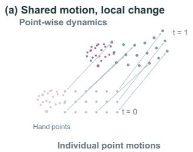

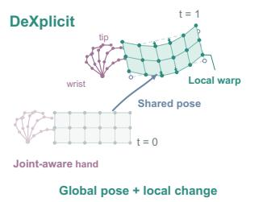

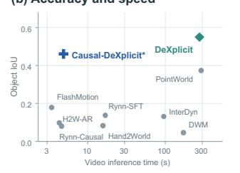

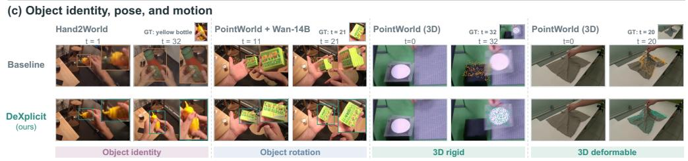  
Figure 1: Explicit physical state for dexterous interaction. Structured interaction dynamics connect metric prediction to video synthesis, preserving transport, articulation, and deformation. The latency plot compares native video systems, with the asterisk denoting the Fast Adapter starting model. Protocols are detailed in Section A.

## 1 Introduction

World models for dexterous manipulation increasingly use action-conditioned video generation (Ha and Schmidhuber, 2018; Hafner et al., 2023; Hansen et al., 2024; Yang et al., 2024; Zhou et al., 2024; Zhu et al., 2024; NVIDIA, 2025) to predict the visual consequences of an agent’s actions. However, visual plausibility does not ensure that an object responds correctly to the action or preserves its identity throughout the interaction. This gap is especially important in dexterous manipulation, where small errors in object pose or local geometry can break hand-object contact relationships.

A key difficulty in using action-conditioned video generation for this task is that pixels entangle the object’s physical evolution only with its visual appearance (Du et al., 2023; Wu et al., 2023; Guo et al., 2026; Kim et al., 2025; Goswami et al., 2025; Wang et al., 2026). A model may synthesize a convincing grasp while placing the object at an incorrect 3D pose, or allow its geometry and surface features to drift through occlusion. These failures reflect the burden of leaving physical state implicit: the generator must learn how hand actions change the object while simultaneously determining how those changes appear under varying viewpoints and occlusion (Sudhakar et al., 2024; Akkerman et al., 2025; Wang et al., 2026; Kim et al., 2025; Goswami et al., 2025).

Metric 3D prediction (Huang et al., 2026, 2025; Zhang et al., 2025; Duisterhof et al., 2026; Soraki et al., 2026) provides this missing interface by representing the object’s physical evolution as an explicit intermediate state for visual synthesis. PointWorld expresses actions and scene evolution as point trajectories in a shared coordinate system (Huang et al., 2026), making motion measurable before rendering. However, this generic point trajectory does not explicitly encode the distinct structures of the hand and the manipulated object (Goswami et al., 2025; Yuan et al., 2026; Wang et al., 2026; Xie et al., 2026; Kim et al., 2025). In physical hand–object interactions, hand joints are linked by a kinematic hierarchy, whereas object points share coherent motion with local changes caused by articulation or deformation. Leaving these relationships implicit (Sanchez-Gonzalez et al., 2020; Pfaff et al., 2021; Huang et al., 2025) can allow object geometry to distort or drift relative to the interacting hand, compromising both physical prediction and subsequent visual synthesis.

To address these limitations, we introduce DEXPLICIT (Figure 1), a dexterous manipulation world model that explicitly predicts how the 3D world evolves before generating visual consequences. Our key idea is to separate physical state predictionfrom visual synthesis, rather than requiring a single heavy video model to implicitly learn action-conditioned 3D dynamics, camera motion, and appearance generation altogether. 1) Explicit 3D state prediction. Given an initial scene and a future hand trajectory, we predict the resulting geometric changes directly in metric 3D space using a lightweight dynamics network. By reasoning over object-centric motion and deformation, the model explicitly captures how hand actions transform the world state, providing geometrically grounded and directly interpretable future states. 2) 3D-guided video readout. Once the future 3D states are predicted, video generation becomes a substantially easier rendering problem rather than implicit world-dynamics prediction. We propagate appearance through the predicted 3D motion and use it as a strong visual and geometric scaffold for generation. This explicitly accounts for object motion and naturally incorporates viewpoint changes through 3D projection, allowing the video model to focus primarily on completing uncertain or newly visible content. Building on this decomposition, we employ a lightweight causal renderer that efficiently synthesizes temporally coherent consequences.

We evaluate DEXPLICIT on HOT3D, OakInk2, and PhysTwin (Banerjee et al., 2025; Zhan et al., 2024; Jiang et al., 2025a), covering rigid, articulated, and deformable interactions. Compared with PointWorld, DEXPLICIT reduces long-horizon moved-point error by 39.9%, 28.0%, and 27.1% on the three datasets, respectively. These improvements also translate into more accurate object response in generated videos: under the same renderer, replacing PointWorld predictions with ours increases object IoU from 0.373 to 0.549 on HOT3D. Our causal renderer also enables fast visual synthesis, generating 32 future frames in 4.90s on a single NVIDIA A800 GPU. Together, these results establish structured physical-state prediction as a key driver of interaction fidelity in dexterous world models, linking accurate action-induced object motion to faithful visual outcomes.

## 2 Related Work

World models for interaction. Learned latent dynamics support imagination and control (Ha and Schmidhuber, 2018; Hafner et al., 2023; Hansen et al., 2024), while UniPi and GR-1 connect video prediction to robot policies (Du et al., 2023; Wu et al., 2023). UniSim and RoboDreamer broaden visual simulation through interactive and compositional prediction (Yang et al., 2024; Zhou et al., 2024). IRASim and Ctrl-World emphasize action-conditioned robot interaction (Zhu et al., 2024; Guo et al., 2026), supported by scalable video priors such as Cosmos (NVIDIA, 2025). Together, these models connect visual prediction to embodied control.

Dexterous and egocentric world models. CosHand, InterDyn, and Mask2IV use silhouettes or masks to specify interaction (Sudhakar et al., 2024; Akkerman et al., 2025; Li et al., 2026). DWM combines articulated hand control with scene reconstruction (Kim et al., 2025). Hand2World and Generated Reality model egocentric interaction from hand and camera inputs (Wang et al., 2026; Xie et al., 2026), while HandsOnWorld disentangles these controls and RynnWorld enables digital teleoperation (Chen et al., 2026; Zhao et al., 2026). EgoSim maintains an updatable 3D scene state (Hao et al., 2026). DexWM and DexAC-WM emphasize hand-consistent latent prediction and structured action conditioning (Goswami et al., 2025; Yuan et al., 2026). We focus on measurable object dynamics, coupling metric forecasts of transport and deformation to visual synthesis.

Explicit physical dynamics. Particle and mesh simulators learn spatial interactions through graph networks (Sanchez Gonzalez et al., 2020; Pfaff et al., 2021). ParticleFormer and particle-grid neural dynamics extend learned simulation to perceived objects and materials (Huang et al., 2025; Zhang et al., 2025). PointWorld unifies scene and action trajectories in point space (Huang et al., 2026), and PointZero learns transferable dynamics through track completion (Duisterhof et al., 2026). ObjectForesight predicts object poses from human video, while RigidFormer imposes coherent rigid motion (Soraki et al., 2026; Dou et al., 2026). Our shared object pose captures transport, and an embedded graph (Sumner et al., 2007) expresses residual deformation, preserving coherence without restricting all objects to rigid motion.

Controllable video generation. ControlNet and VACE introduce spatial conditioning (Zhang et al., 2023; Jiang et al., 2025b), while MotionCtrl, CameraCtrl, and GEN3C address motion and viewpoint control (Wang et al., 2023; He et al., 2024; Ren et al., 2025). ManiVideo and PAM incorporate hand–object geometry and appearance, and ContactFlow transfers contact-based controls across embodiments (Pang et al., 2024; Gao et al., 2026; Azirar et al., 2026). DVG-WM separates interaction prediction from visual refinement (Shan et al., 2026). Closest to our appearance-transport interface, WanMove transports initial features and E3C maintains 3D visual memory (Chu et al., 2025; Gu et al., 2026). We couple initial appearance to persistent object points, using depth, visibility, and forecast confidence to determine valid support.

## 3 Problem Formulation

We study action-conditioned dexterous manipulation: given an initial scene and proposed hand trajectory, the model predicts the resulting metric 3D state and corresponding future observations while preserving the object’s response, identity, and appearance.

Inputs. The inputs are the initial image $I ^ { 0 } ,$ , metric scene points $X ^ { 0 } = \{ x _ { i } ^ { 0 } \} _ { i = 1 } ^ { N }$ , anatomically indexed hand trajectory $H ^ { \bar { 0 } : T }$ , and calibrated cameras Π. Each object point $x _ { i }$ has an object label $o _ { i }$ and canonical coordinate $c _ { i }$ in the object’s reference shape.

Physical prediction and visual synthesis. We decompose the world model as a dynamics predictor $F _ { \theta } ,$ , a deterministic projection operator $\mathcal { R } .$ , and a conditional video renderer $G _ { \psi } \mathrm { : }$

$$
\begin{array} { r l } & { ( \widehat { X } ^ { 1 : T } , Q ^ { 1 : T } ) = F _ { \theta } ( X ^ { 0 } , H ^ { 0 : T } ) , } \\ & { ( C ^ { 0 : L } , M ^ { 0 : L } ) = \mathcal { R } ( I ^ { 0 } , \widehat { X } , Q , H , \Pi ) , } \\ & { ~ \widehat { I } ^ { 1 : L } = G _ { \psi } ( I ^ { 0 } , C , M , \epsilon ) , } \end{array}\tag{1}
$$

where $\widehat { X } ^ { 1 : T }$ contains predicted metric point positions and $Q ^ { 1 : T } = \{ q _ { i } ^ { t } \}$ their confidences, with $q _ { i } ^ { t } \in [ 0 , 1 ]$ . The projection operator $\mathcal { R }$ constructs visual controls C and soft mask M from geometry, confidence, appearance, hand poses, and cameras to condition $G _ { \psi }$

## 4 DEXPLICIT

## 4.1 Structured Interaction Dynamics

Representing hand actions and object motion as generic point trajectories leaves joint relationships and object-level coherence implicit. We therefore structure the dynamics predictor $F _ { \theta }$ in Sec. 3 around joint-aware action encoding and object-centric motion prediction by encoding the hand’s anatomical structure and predicting object motion through shared global transport and local deformation (Figure 2).

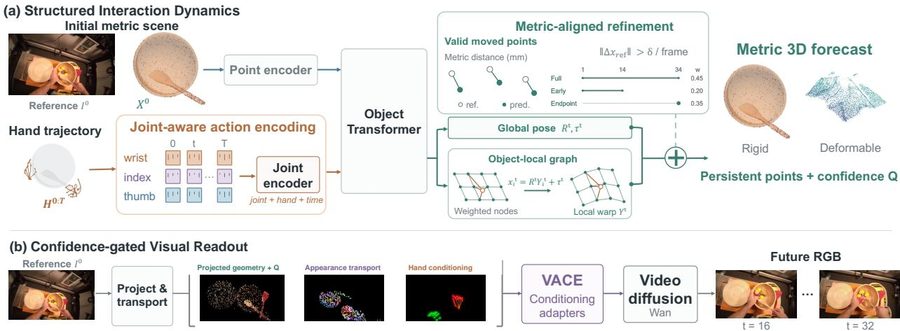  
Figure 2: Overview of DeXplicit. Joint-aware action encoding drives object-centric metric dynamics with shared object transport and local deformation. Metric-aligned refinement corrects object pose, and projected geometry, hand conditioning, and appearance transport condition the confidence-gated visual readout.

Joint-aware action encoding. For joint $j$ of hand $h \in \{ L , R \}$ at time t, let $p _ { t , h , j } \in \mathbb { R } ^ { 3 }$ denote its position, with joint 0 representing the wrist and $\pi ( j )$ its kinematic parent. We construct:

$$
\begin{array} { r l } & { a _ { t , h , j } = \phi _ { \mathrm { j o i n t } } ( [ p _ { t , h , j } , ~ p _ { t , h , j } - p _ { t , h , 0 } , ~ \Delta p _ { t , h , j } , ~ b _ { t , h , j } , ~ \lVert b _ { t , h , j } \rVert _ { 2 } , ~ v _ { t , h , j } ] ) + e _ { j } + e _ { h } + e _ { t } , } \\ & { \qquad A = E _ { \mathrm { h a n d } } \left( \{ a _ { t , h , j } \} , ~ \{ m _ { t , h } \} , ~ \Delta H ^ { 0 : T } \right) . } \end{array}\tag{2}
$$

Here, $p _ { t , h , j } - p _ { t , h , 0 }$ denotes the wrist-relative position, $\Delta p _ { t , h , j }$ is the displacement from the preceding time step, and $b _ { t , h , j } = p _ { t , h , j } - p _ { t , h , \pi ( j ) }$ describes the bone connecting the joint to its parent. The validity flag $v _ { t , h , j }$ identifies available observations. A learned projection $\phi _ { \mathrm { j o i n t } }$ embeds these geometric features, while $e _ { j } , e _ { h }$ , and $e _ { t }$ encode joint identity, hand side, and time. The hand-level features $m _ { t , h }$ contain MANO pose, wrist transform, and shape when available. Finally, $\Delta H ^ { 0 : T } = \{ \Delta H _ { t } \} _ { t = 0 } ^ { T }$ denotes the sequence of action-state differences, where $\Delta H _ { t } = H _ { t } - H _ { t - 1 }$ and $\Delta H _ { 0 } = 0$

Object-centric metric dynamics. To predict its effect on the scene, we encode the initial points with a Point Transformer and let their features attend to A. To encourage coherent motion within each object, we aggregate these features by object using mean and max pooling and combine them with canonical coordinate information to form object tokens Z. An object-time Transformer combines Z with the encoded hand action to produce an object-time feature $U _ { o } ^ { t }$ for each object o and future time t. A pose output network maps $U _ { o } ^ { t }$ to a shared global rotation $R _ { o } ^ { \dot { t } }$ and translation $\boldsymbol { \tau } _ { o } ^ { t } .$

To also represent articulation and deformation, we place K control nodes $g _ { o , k }$ on each object’s canonical geometry. For each node, we combine the object-time feature ${ \bar { U } } _ { o } ^ { t }$ with features pooled from nearby points, the node’s canonical position, and its spatial relationships to the hand joints. A deformation network maps these features to a local rotation $r _ { o , k } ^ { t }$ and translation $d _ { o , k } ^ { t }$ . These local transforms deform the canonical points before the global object pose is applied:

$$
\begin{array} { l } { { \displaystyle Y _ { i } ^ { t } = \sum _ { k = 1 } ^ { K } w _ { i k } \left[ r _ { o _ { i } , k } ^ { t } ( c _ { i } - g _ { o _ { i } , k } ) + g _ { o _ { i } , k } + d _ { o _ { i } , k } ^ { t } \right] , } } \\ { { \displaystyle \widehat { x } _ { i } ^ { t } = R _ { o _ { i } } ^ { t } Y _ { i } ^ { t } + \tau _ { o _ { i } } ^ { t } . } } \end{array}\tag{3}
$$

The fixed normalized weights $w _ { i k }$ determine how strongly nearby nodes influence point i.

Bounded pose correction. The initial object pose can remain inaccurate even when its points move coherently. We therefore add a lightweight adapter that predicts a small adjustment to each pose. The adapter outputs a twist $( v , \omega )$ in the object’s local frame, with componentwise bounds of 5 cm and $1 5 ^ { \circ }$ . The SE(3) exponential map converts it into a rigid correction:

$$
R _ { \Delta } = \exp ( { [ \omega ] _ { \times } } ) , \qquad t _ { \Delta } = J ( \omega ) v ,\tag{4}
$$

where $[ \omega ] _ { \times }$ is the skew-symmetric matrix corresponding to ω, and $J ( \omega )$ is the left Jacobian of SO(3). We compose the correction with the initial pose:

$$
R : = R R _ { \Delta } , \qquad \tau : = \tau + R t _ { \Delta } .\tag{5}
$$

(c) Fine finger motion

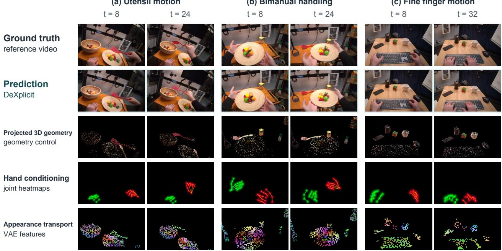  
Figure 3: Conditioning interface for video generation. Projected 3D geometry, hand conditioning, and appearance transport provide complementary controls. Examples show the conditions and generated results at matched times and crops. The appearance-transport row visualizes transported initial-image VAE features; colors use a fixed PCA basis, black indicates unavailable appearance, and skeletons visualize joint heatmaps.

The adapter’s output layer is zero-initialized, so adding it initially leaves the prediction unchanged.

Pointwise uncertainty is estimated from the predicted trajectories and converted into confidence $Q ^ { 1 : T }$ for visual synthesis. The following section describes the geometric supervision and pose refinement used to improve the position predictions.

## 4.2 Metric-aligned Refinement

We therefore introduce metric-aligned refinement to directly reduce object-point position errors and use hand-derived motion references to guide bounded pose corrections.

Metric-aligned supervision. To emphasize action-induced object motion, we introduce a moved-point objective that measures geometric errors on moving regions:

$$
E _ { \mathcal { T } } ^ { \mathrm { m o v } } = \frac { \sum _ { w , i , t \in \mathcal { T } } m _ { w , i } ^ { t } v _ { w , i } ^ { t } \Vert \widehat { x } _ { w , i } ^ { t } - x _ { w , i } ^ { t } \Vert _ { 2 } } { \sum _ { w , i , t \in \mathcal { T } } m _ { w , i } ^ { t } v _ { w , i } ^ { t } } .\tag{6}
$$

Here, w indexes sequence windows, T specifies the future states included in the loss, and $v _ { w , i } ^ { t }$ marks valid targets. The motion mask $m _ { w , i } ^ { t }$ selects points whose reference displacement from the preceding state exceeds 5 mm. We also define $E _ { 3 4 } ^ { \mathrm { e v e r } }$ as the endpoint error over points that move at any time in the sequence.

Using smoothed training versions $\widetilde { E }$ of these errors, we combine full-horizon, early-horizon, and endpoint supervision:

$$
\mathcal { L } _ { \mathrm { m e t r i c } } = 0 . 4 5 \widetilde { E } _ { 1 : 3 4 } ^ { \mathrm { m o v } } + 0 . 2 0 \widetilde { E } _ { 1 : 1 4 } ^ { \mathrm { m o v } } + 0 . 3 5 \widetilde { E } _ { 3 4 } ^ { \mathrm { e v e r } } .\tag{7}
$$

Hand-derived motion references. We guide bounded pose correction with candidate object poses derived from rigid motion of the left hand, right hand, or both hands, together with static and current-prediction hypotheses; the model learns from their differences to refine the object pose.

## 4.3 Confidence-gated Visual Readout

To provide the renderer with the corresponding appearance, we attach features from the initial image to object points and project the confidence values into a soft edit mask, guiding the renderer to retain reliable content and synthesize uncertain or uncovered regions (Figure 3).

Appearance transport. Following appearance-transport approaches (Chu et al., 2025; Gu et al., 2026), we encode the initial image $I ^ { 0 ^ { \dag } }$ with a frozen VAE to obtain a feature map $f ^ { 0 }$ . For $x _ { i } ^ { 0 }$ , we sample an appearance descriptor at its projected location $u _ { i } ^ { 0 } = \Pi ^ { 0 } ( x _ { i } ^ { 0 } )$

$$
f _ { i } = \mathrm { b i l i n e a r } ( f ^ { 0 } , u _ { i } ^ { 0 } ) .\tag{8}
$$

We therefore assign each object point a source-appearance indicator $a _ { i } ^ { 0 } \in \{ 0 , 1 \}$ . It equals 1 if the point projects inside the initial image, is not occluded and is closest to the camera among points projecting to the same feature-map cell; otherwise, it equals to 0.

At each time step t, we project the predicted positions $\widehat { x } _ { i } ^ { t }$ into the target view while retaining their initial descriptor $f _ { i }$ and source-appearance indicator ${ \bf { \bar { \rho } } } _ { a _ { i } ^ { 0 } }$ . Let $n ^ { * } ( t , u )$ denote the nearest projected point with positive depth at target location u. Its source-appearance indicator determines whether an initial-image feature is available there:

$$
B ^ { t } ( u ) = \left\{ \begin{array} { l l } { a _ { n ^ { * } ( t , u ) } ^ { 0 } , } & { n ^ { * } ( t , u ) \mathrm { e x i s t s } , } \\ { 0 , } & { \mathrm { o t h e r w i s e } , } \end{array} \right. F ^ { t } ( u ) = \left\{ \begin{array} { l l } { f _ { n ^ { * } ( t , u ) } , } & { B ^ { t } ( u ) = 1 , } \\ { 0 , } & { B ^ { t } ( u ) = 0 . } \end{array} \right.\tag{9}
$$

Here, $B ^ { t }$ records appearance coverage and $F ^ { t }$ contains the transported appearance features. A causal encoder then maps $F ^ { t }$ and $B ^ { t }$ into video conditions.

Confidence-gated synthesis. Alongside appearance transport, we splat the predicted point confidence through the same camera projection to obtain $q _ { \mathrm { p r o j } } ^ { t } ( u )$ , assigning zero confidence where no point projects. This defines the soft edit mask

$$
\begin{array} { r } { M ^ { t } ( u ) = 1 - q _ { \mathrm { p r o j } } ^ { t } ( u ) . } \end{array}\tag{10}
$$

Low mask values encourage retention of reliable projected content; high values permit synthesis in geometrically uncertain regions. Together with projected scene and hand geometry, these signals guide the renderer to preserve reliable appearance and complete uncertain or unseen regions.

Training and causal adaptation. We train the conditioning branches and VACE adapters (Jiang et al., 2025b) using flow matching (Lipman et al., 2023; Liu et al., 2023), keeping the pretrained video backbone and VAE frozen. For efficient generation, we transfer conditioning parameters learned with a separate 1.3B model to a pretrained causal backbone, align them through endpoint reconstruction and video adversarial supervision, and apply on-policy distillation for robustness to generated history. Training and adaptation details are provided in Appendix D.

## 5 Experiments

Figure 4 shows the corresponding interaction forecasts: shared transport preserves coherent motion, while local deformation captures articulation and cloth shape change.

## 5.1 Experimental Setup

Datasets and baselines. We evaluate one dynamics model across HOT3D, OakInk2, and PhysTwin (Banerjee et al., 2025; Zhan et al., 2024; Jiang et al., 2025a), spanning rigid, articulated, and deformable interactions. We retrain PointWorld on the same forecasting task using the same initial metric scene points and 3D hand-joint trajectories through its native point-action interface. On HOT3D, video systems use their native controls. DEXPLICIT predicts future object geometry, as with PointWorld (Full protocols in Section A). All temporal windows derived from the same source unit remain in the same partition, preventing shared source interactions between our task-specific training and evaluation data. Within each comparison panel, all methods are evaluated on the same fixed set of source windows and reference targets.

Evaluation metrics. For 3D forecasting, we report moved-point and all-point errors at early and long horizons. Video metrics include PSNR, SSIM (Wang et al., 2004), LPIPS (Zhang et al., 2018), hand PCK20, object overlap and position error, and CLIP foreground similarity (Radford et al., 2021). The initial frame is excluded; cohorts, missing-prediction handling, support, and metric definitions are detailed in Section A.

(a) HOT3D | Bowl transport  
(b) HOT3D | Object transfer  
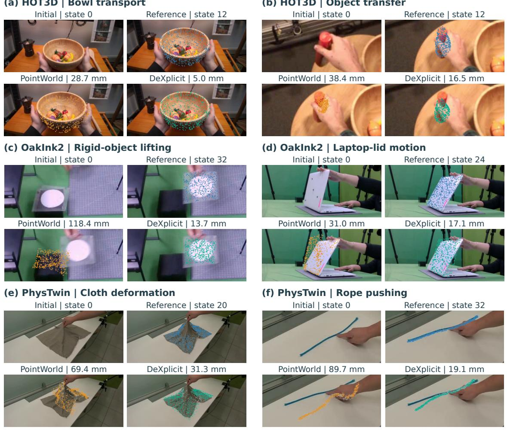  
Figure 4: Qualitative 3D dynamics. Six examples span rigid transport, articulation, and deformation. PointWorld and DEXPLICIT forecasts are overlaid on the same reference image; EPE is measured on reference-supported object points in millimeters.

## 5.2 Quantitative and Qualitative Results

3D dynamics prediction. As shown in Table 1, DEXPLICIT reduces moved-point error on all three datasets by 42–48% at the early horizon and 27–40% at the long horizon, demonstrating consistently more accurate prediction of interaction-induced geometric changes. All-point error also improves on HOT3D and PhysTwin, but is higher on OakInk2 despite the lower moved-point error.

Conditional video generation. DEXPLICIT achieves the strongest perceptual quality and object overlap in the shared video panel. Baselines with higher PCK20 but much lower object overlap show that hand agreement alone does not capture interaction fidelity.

Figure 5 shows object orientation and identity during rotation and placement; Causal-DEXPLICIT retains these properties under generated-history conditioning.

Generation efficiency. Causal-DEXPLICIT generates four frames in 0.54 seconds and all 32 in 4.90 seconds, with substantially higher object overlap than similarly fast autoregressive baselines (Table 2) operating at comparable latency, demonstrating a favorable trade-off between generation efficiency and object-level consistency. These results further validate our explicit-3D-first design: by resolving object dynamics in lightweight 3D prediction before visual synthesis, the renderer can produce geometrically consistent future observations without relying on expensive iterative video generation.

Table 1: Metric 3D forecasting. Both methods receive the same initial metric scene points and 3D hand-joint trajectories through their respective conditioning interfaces. Moved-point and all-point L2 (mm) with identical scene and action inputs. Errors are weighted by the corresponding valid point-time counts.
<table><tr><td></td><td colspan="2">HOT3D</td><td colspan="2">OakInk2</td><td colspan="2">PhysTwin</td></tr><tr><td>Model</td><td>Moved</td><td>All</td><td>Moved</td><td>All</td><td>Moved</td><td>All</td></tr><tr><td colspan="7">(a) Long horizon: states 1–32</td></tr><tr><td>PointWorld</td><td>90.47</td><td>18.17</td><td>83.21</td><td>11.71</td><td>60.41</td><td>35.52</td></tr><tr><td>DEXPLICIT</td><td>54.34</td><td>14.01</td><td>59.95</td><td>16.88</td><td>44.04</td><td>25.37</td></tr><tr><td colspan="7">(b) Early horizon: states 1–14</td></tr><tr><td>PointWorld</td><td>70.00</td><td>12.16</td><td>35.80</td><td>6.70</td><td>41.71</td><td>23.80</td></tr><tr><td>DEXPLICIT</td><td>39.21</td><td>8.65</td><td>20.61</td><td>8.01</td><td>21.81</td><td>13.60</td></tr></table>

Table 2: Video generation. Perceptual quality, hand alignment, object fidelity, and latency across output grids and horizons. PA is aligned hand-shape error; PCK20 uses a 20-pixel threshold. IoU and $\mathrm { { \mathrm { { O P E } _ { + } } } }$ penalize missing predictions; CLIP is reported with foreground coverage (Cov.). Full metric, support, and timing protocols: Sections A and C.3
<table><tr><td rowspan="2">Method</td><td colspan="3">Perceptual</td><td colspan="2">Hand</td><td colspan="4">Object</td><td>Inference</td></tr><tr><td>PSNR ↑</td><td>SSIM ↑</td><td>LPIPS ↓</td><td>PCK20 (%)↑</td><td>PA (mm)↓</td><td> $\mathrm { I o U _ { + } }$  ↑</td><td> $\mathrm { { { O P E } _ { + } } }$  ↓</td><td>CLIP ↑</td><td> $\mathbf { \boldsymbol { C 0 v . } }$  (%)↑</td><td>Speed (s)↓</td></tr><tr><td colspan="9">(a) Video comparison: future frames 1–32, 480 × 832</td><td></td></tr><tr><td>DeXplicit</td><td>19.13</td><td>0.652</td><td>0.274</td><td>40.3</td><td>13.88</td><td>0.549</td><td>0.352</td><td>0.880</td><td>78.2</td><td>277.44</td></tr><tr><td>Causal-DeXplicit</td><td>17.41</td><td>0.583</td><td>0.348</td><td>44.7</td><td>12.73</td><td>0.490</td><td>0.365</td><td>0.863</td><td>84.2</td><td>4.90</td></tr><tr><td>PointWorld (adapted)</td><td>18.01</td><td>0.616</td><td>0.315</td><td>27.3</td><td>15.35</td><td>0.373</td><td>0.488</td><td>0.847</td><td>69.6</td><td>291.18</td></tr><tr><td>Hand2World</td><td>14.32</td><td>0.505</td><td>0.497</td><td>54.9</td><td>12.04</td><td>0.082</td><td>0.864</td><td>0.835</td><td>22.1</td><td>15.76</td></tr><tr><td>Hand2World-AR</td><td>13.47</td><td>0.487</td><td>0.604</td><td>57.0</td><td>11.97</td><td>0.080</td><td>0.861</td><td>0.836</td><td>22.2</td><td>4.62</td></tr><tr><td>InterDyn</td><td>14.28</td><td>0.482</td><td>0.539</td><td>58.9</td><td>12.23</td><td>0.131</td><td>0.552</td><td>0.809</td><td>72.7</td><td>96.02</td></tr><tr><td>DWM (adapted)</td><td>12.52</td><td>0.450</td><td>0.637</td><td>7.7</td><td>16.68</td><td>0.046</td><td>0.737</td><td>0.794</td><td>51.7</td><td>172.48</td></tr><tr><td>RynnWorld-SFT</td><td>14.72</td><td>0.497</td><td>0.528</td><td>19.1</td><td>15.43</td><td>0.137</td><td>0.577</td><td>0.817</td><td>69.0</td><td>16.93</td></tr><tr><td>RynnWorld-Causal</td><td>14.70</td><td>0.506</td><td>0.566</td><td>25.8</td><td>14.93</td><td>0.097</td><td>0.655</td><td>0.807</td><td>61.8</td><td>4.33</td></tr><tr><td>FlashMotion</td><td>14.62</td><td>0.476</td><td>0.528</td><td>17.9</td><td>14.44</td><td>0.178</td><td>0.443</td><td>0.832</td><td>77.2</td><td>3.44</td></tr><tr><td colspan="9">(b) Native Mask2IV comparison: future frames 1–15, 320 × 512</td><td></td><td></td></tr><tr><td>DeXplicit</td><td>20.88</td><td>0.700</td><td>0.189</td><td>43.9</td><td>12.66</td><td>0.580</td><td>0.329</td><td>0.884</td><td>77.7</td><td>277.44</td></tr><tr><td>Mask2IV</td><td>14.39</td><td>0.463</td><td>0.479</td><td>16.9</td><td>14.53</td><td>0.166</td><td>0.545</td><td>0.810</td><td>67.4</td><td>26.05</td></tr><tr><td colspan="9">(c) Native future-image comparison: endpoint 32, 256 × 256</td><td></td><td></td></tr><tr><td>DeXplicit</td><td>16.66</td><td>0.533</td><td>0.248</td><td> $4 8 . 0$ </td><td>14.19</td><td>0.525</td><td>0.354</td><td>0.853</td><td>80.0</td><td>277.44</td></tr><tr><td>CosHand</td><td>12.49</td><td>0.328</td><td>0.500</td><td>63.5</td><td>13.25</td><td>0.050</td><td>0.751</td><td>0.737</td><td>57.5</td><td>2.30</td></tr></table>

Table 3: Dynamics ablation. L2 error (mm), states 1–34.
<table><tr><td>Configuration</td><td>Moved↓ All↓</td></tr><tr><td>Direct points</td><td>63.34613.579</td></tr><tr><td>+ action differences</td><td>59.83613.098</td></tr><tr><td>+ joint-aware encoding</td><td>56.17611.758</td></tr><tr><td>+ structured transport</td><td>51.082 9.502</td></tr><tr><td>+ metric-aligned supervision</td><td>50.182 9.358</td></tr><tr><td>+ canonical local graph</td><td>49.254 9.226</td></tr></table>

Table 4: Video conditioning ablation.
<table><tr><td>Configuration</td><td colspan="3">PSNR↑ SSIM↑ LPIPS↓</td></tr><tr><td>5B geometry study Hand conditioning</td><td>14.08</td><td>.465</td><td>.543</td></tr><tr><td>+ scene tracks</td><td>16.13</td><td>.535</td><td>.409</td></tr><tr><td>1.3B conditioning stages</td><td></td><td></td><td></td></tr><tr><td>Geometry</td><td>17.28</td><td>.555</td><td>.344</td></tr><tr><td>+ hand conditioning</td><td>18.53</td><td>.595</td><td>.294</td></tr><tr><td>+ appearance transport</td><td>18.81</td><td>.597</td><td>.289</td></tr></table>

## 5.3 Ablation Studies

Tables 3 and 4 show that structured transport gives the largest dynamics gain, while scene tracks, hand conditioning, and appearance transport progressively improve video metrics.

Reference

DeXplicit

Causal-DeXplicit

PointWorld

Hand2World

FlashMotion

(a) In-hand box rotation  
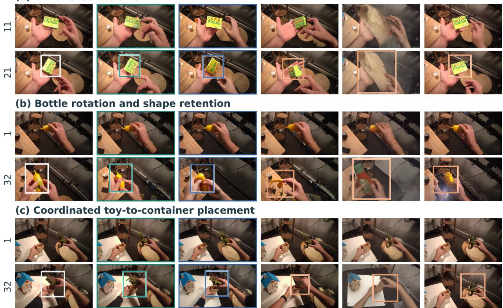  
Figure 5: Qualitative video generation. Bounding boxes highlight the manipulated object at the later frame. DEX-PLICIT preserves object identity, shape, and appearance. Evaluation scope is in Section A.

## 6 Conclusion

We presented DEXPLICIT, a dexterous manipulation world model built around a simple principle: predict how the world changes explicitly in 3D before synthesizing how those changes look. By separating structured metric dynamics from visual synthesis, our approach provides geometrically grounded future states while reducing the burden on the video generator to implicitly learn action-conditioned world dynamics. The predicted 3D states further provide a strong scaffold for efficient causal rendering, enabling coherent future observations with substantially reduced generation cost.

## Reproducibility Statement

We provide detailed evaluation sets, protocols, prediction horizons, baseline interfaces, metric definitions, and missingprediction handling in Appendix A. Dynamics architecture and optimization details are provided in Appendix C.1, video-generation architecture and inference settings in Appendix C, and causal adaptation objectives and training procedures in Appendix D. Additional controlled ablations are reported in Appendix E. Together, these sections specify the data, model architecture, training, evaluation, and inference procedures used to obtain the reported results.

## ETHICS STATEMENT

The experiments concern visual prediction for manipulation. Plausible generated futures can mis- represent physical outcomes. The reported evaluations do not establish suitability for safety critical robotic control.

## AI Assistance

AI tools assisted with software implementation, experiment and evaluation. All AI-assisted code were reviewed by the authors, who take responsibility for the final content and reported results.

## References

Rick Akkerman, Haiwen Feng, Michael J. Black, Dimitrios Tzionas, and Victoria Fernández Abrevaya. InterDyn: Controllable Interactive Dynamics with Video Diffusion Models. In Proceedings of the IEEE/CVF Conference on Computer Vision and Pattern Recognition, pages 12467–12479, 2025. URL https://openaccess.thecvf.com/content/CVPR2025/papers/Akkerman\_InterDyn\_Controllable\_Interactive\_ Dynamics\_with\_Video\_Diffusion\_Models\_CVPR\_2025\_paper.pdf.

Sami Azirar, Enrico Pallotta, Jan Nogga, Jürgen Gall, Sven Behnke, and Hermann Blum. ContactFlow: A video action conditioning that transfers across embodiments. arXiv:2607.26579, 2026. URL https://arxiv.org/abs/2607.26579v1. Version 1, July 29, 2026.

Prithviraj Banerjee, Sindi Shkodrani, Pierre Moulon, Shreyas Hampali, Shangchen Han, Fan Zhang, Linguang Zhang, Jade Fountain, Edward Miller, Selen Basol, Richard Newcombe, Robert Wang, Jakob Engel, and Tomas Hodan. HOT3D: Hand and Object Tracking in 3D from Egocentric Multi-View Videos. CVPR, 2025.

Yushuo Chen, Xiaoyu Shi, Xiaoshi Wu, Xintao Wang, Pengfei Wan, and Yebin Liu. HandsOnWorld: Unconstrained Egocentric Video Generation with Camera-Disentangled Hand Control. arXiv:2607.02075, 2026. URL https: //arxiv.org/abs/2607.02075v3. Version 3, August 14, 2026.

Ruihang Chu, Yefei He, Zhekai Chen, Shiwei Zhang, Xiaogang Xu, Bin Xia, Dingdong Wang, Hongwei Yi, Xihui Liu, Hengshuang Zhao, Yu Liu, Yingya Zhang, and Yujiu Yang. Wan-Move: Motion-controllable Video Generation via Latent Trajectory Guidance, 2025. URL https://arxiv.org/abs/2512.08765.

Zhiyang Dou, Minghao Guo, Haixu Wu, Doug Roble, Tuur Stuyck, and Wojciech Matusik. RigidFormer: Learning Rigid Dynamics using Transformers. arXiv:2605.09196, 2026.

Yilun Du et al. Learning Universal Policies via Text-Guided Video Generation. NeurIPS, 2023.

Bardienus P. Duisterhof, Kaifeng Zhang, Adam Hung, Bowen Wen, Stan Birchfield, Yunzhu Li, Deva Ramanan, and Jeffrey Ichnowski. PointZero: 3D Point Track Completion for Learning Transferable 3D Dynamics, 2026. URL https://arxiv.org/abs/2609.19142.

Mingju Gao, Kaisen Yang, Huan-ang Gao, Bohan Li, Ao Ding, Wenyi Li, Yangcheng Yu, Jinkun Liu, Shaocong Xu, Yike Niu, Haohan Chi, Hao Chen, Hao Tang, Yu Zhang, Li Yi, and Hao Zhao. PAM: A Pose-Appearance-Motion Engine for Sim-to-Real HOI Video Generation. In Proceedings ofthe IEEE/CVF Conference on Computer Vision and Pattern Recognition, 2026. URL https://arxiv.org/abs/2603.22193.

Raktim Gautam Goswami, Amir Bar, David Fan, Tsung-Yen Yang, Gaoyue Zhou, Prashanth Krishnamurthy, Michael Rabbat, Farshad Khorrami, and Yann LeCun. World Models for Learning Dexterous Hand-Object Interactions from Human Videos. arXiv:2512.13644, 2025.

Qiao Gu, Lingni Ma, Adam W. Harley, Richard Newcombe, Florian Shkurti, and Julian Straub. E3C: Video Generation with 3D Environmental Memory and Ego-Exo Human Pose Control, 2026. URL https://arxiv.org/abs/2605.26316.

Yanjiang Guo, Lucy Xiaoyang Shi, Jianyu Chen, and Chelsea Finn. Ctrl-World: A Controllable Generative World Model for Robot Manipulation. ICLR, 2026.

David Ha and Jurgen Schmidhuber. World Models. arXiv:1803.10122, 2018.

Danijar Hafner, Jurgis Pasukonis, Jimmy Ba, and Timothy Lillicrap. Mastering Diverse Domains through World Models. arXiv:2301.04104, 2023.

Nicklas Hansen et al. TD-MPC2: Scalable, Robust World Models for Continuous Control. ICLR, 2024.

Jinkun Hao, Mingda Jia, Ruiyan Wang, Hongrui Zhu, Jiafei Cao, Xihui Liu, Ran Yi, Lizhuang Ma, Jiangmiao Pang, and Xudong Xu. EgoSim: Egocentric World Simulator for Embodied Interaction Generation, 2026. URL https://arxiv.org/abs/2604.01001v2. ECCV 2026.

Hao He, Yinghao Xu, Yuwei Guo, Gordon Wetzstein, Bo Dai, Hongsheng Li, and Ceyuan Yang. CameraCtrl: Enabling Camera Control for Text-to-Video Generation. arXiv:2404.02101, 2024.

Edward J. Hu, Yelong Shen, Phillip Wallis, Zeyuan Allen-Zhu, Yuanzhi Li, Shean Wang, Lu Wang, and Weizhu Chen. LoRA: Low-Rank Adaptation of Large Language Models. In International Conference on Learning Representations, 2022. URL https://openreview.net/forum?id=nZeVKeeFYf9.

Suning Huang, Qianzhong Chen, Xiaohan Zhang, Jiankai Sun, and Mac Schwager. ParticleFormer: A 3D Point Cloud World Model for Multi-Object, Multi-Material Robotic Manipulation. In Proceedings of The 9th Conference on Robot Learning, volume 305 of Proceedings ofMachine Learning Research, pages 4941–4957. PMLR, 2025. URL https://proceedings.mlr.press/v305/huang25c.html.

Wenlong Huang, Yu-Wei Chao, Arsalan Mousavian, Ming-Yu Liu, Dieter Fox, Kaichun Mo, and Fei-Fei Li. PointWorld: Scaling 3D World Models for In-The-Wild Robotic Manipulation. arXiv:2601.03782, 2026.

Hanxiao Jiang, Hao-Yu Hsu, Kaifeng Zhang, Hsin-Ni Yu, Shenlong Wang, and Yunzhu Li. Phys-Twin: Physics-Informed Reconstruction and Simulation of Deformable Objects from Videos. In Proceedings of the IEEE/CVF International Conference on Computer Vision, 2025a. URL https: //www.openaccess.thecvf.com/content/ICCV2025/papers/Jiang\_PhysTwin\_Physics-Informed\_Reconstruction\_ and\_Simulation\_of\_Deformable\_Objects\_from\_Videos\_ICCV\_2025\_paper.pdf.

Zeyinzi Jiang, Zhen Han, Chaojie Mao, Jingfeng Zhang, Yulin Pan, and Yu Liu. VACE: All-in-One Video Creation and Editing. ICCV, 2025b.

Wolfgang Kabsch. A Solution for the Best Rotation to Relate Two Sets of Vectors. Acta Crystallographica Section A, 1976.

Byungjun Kim, Taeksoo Kim, Junyoung Lee, and Hanbyul Joo. Dexterous World Models. arXiv:2512.17907, 2025.

Gen Li, Bo Zhao, Jianfei Yang, and Laura Sevilla-Lara. Mask2IV: Interaction-Centric Video Generation via Mask Trajectories. Proceedings ofthe AAAI Conference on Artificial Intelligence, 40(8):6091–6099, 2026. doi: 10.1609/ aaai.v40i8.37533. URL https://ojs.aaai.org/index.php/AAAI/article/view/37533.

Yaron Lipman, Ricky T. Q. Chen, Heli Ben-Hamu, Maximilian Nickel, and Matt Le. Flow Matching for Generative Modeling. ICLR, 2023.

Hongyu Liu, Chun Wang, Feng Gao, Xuanhua He, Yue Ma, Ziyu Wan, Yong Zhang, Xiaoming Wei, and Qifeng Chen. OPSD-V: On-Policy Self-Distillation for Post-Training Few-Step Autoregressive Video Generators. arXiv preprint arXiv:2607.08766, 2026.

Xingchao Liu, Chengyue Gong, and Qiang Liu. Flow Straight and Fast: Learning to Generate and Transfer Data with Rectified Flow. ICLR, 2023.

NVIDIA. Cosmos World Foundation Model Platform for Physical AI. arXiv:2501.03575, 2025.

Youxin Pang, Ruizhi Shao, Jiajun Zhang, Hanzhang Tu, Yun Liu, Boyao Zhou, Hongwen Zhang, and Yebin Liu. ManiVideo: Generating Hand-Object Manipulation Video with Dexterous and Generalizable Grasping. arXiv:2412.16212, 2024. URL https://arxiv.org/abs/2412.16212v1. Version 1, December 18, 2024.

Tobias Pfaff et al. Learning Mesh-Based Simulation with Graph Networks. ICLR, 2021.

Alec Radford, Jong Wook Kim, Chris Hallacy, Aditya Ramesh, Gabriel Goh, Sandhini Agarwal, Girish Sastry, Amanda Askell, Pamela Mishkin, Jack Clark, Gretchen Krueger, and Ilya Sutskever. Learning Transferable Visual Models From Natural Language Supervision, 2021. URL https://arxiv.org/abs/2103.00020.

Xuanchi Ren, Tianchang Shen, Jiahui Huang, Huan Ling, Yifan Lu, Merlin Nimier-David, Thomas Müller, Alexander Keller, Sanja Fidler, and Jun Gao. GEN3C: 3D-Informed World-Consistent Video Generation with Precise Camera Control. CVPR, 2025.

Alvaro Sanchez-Gonzalez et al. Learning to Simulate Complex Physics with Graph Networks. ICML, 2020.

Ziyu Shan, Zhenyu Wu, Xiaofeng Wang, Zheng Zhu, and Ziwei Wang. DVG-WM: Disentangled Video Generation Enables Efficient Embodied World Model for Robotic Manipulation. arXiv preprint arXiv:2606.32028, 2026. URL https://arxiv.org/abs/2606.32028v2. Version 2, July 2, 2026.

Rustin Soraki, Homanga Bharadhwaj, Ali Farhadi, and Roozbeh Mottaghi. ObjectForesight: Predicting Future 3D Object Trajectories from Human Videos. arXiv:2601.05237, 2026.

Sruthi Sudhakar, Ruoshi Liu, Basile Van Hoorick, Carl Vondrick, and Richard Zemel. Controlling the World by Sleight of Hand. In European Conference on Computer Vision, 2024. URL https://coshand.cs.columbia.edu/.

Robert W. Sumner, Johannes Schmid, and Mark Pauly. Embedded Deformation for Shape Manipulation. ACM Transactions on Graphics, 26(3):80, 2007. doi: 10.1145/1276377.1276478. URL https://people.inf.ethz.ch/\~sumnerb research/embdef/Sumner2007EDF.pdf.

Yuxi Wang, Wenqi Ouyang, Tianyi Wei, Yi Dong, Zhiqi Shen, and Xingang Pan. Hand2World: Autoregressive Egocentric Interaction Generation via Free-Space Hand Gestures, 2026. URL https://arxiv.org/abs/2602.09600.

Zhou Wang, Alan C. Bovik, Hamid R. Sheikh, and Eero P. Simoncelli. Image Quality Assessment: From Error Visibility to Structural Similarity. IEEE Transactions on Image Processing, 2004.

Zhouxia Wang et al. MotionCtrl: A Unified and Flexible Motion Controller for Video Generation. arXiv:2312.03641, 2023.

Hongtao Wu, Ya Jing, Chilam Cheang, Guangzeng Chen, Jiafeng Xu, Xinghang Li, Minghuan Liu, Hang Li, and Tao Kong. Unleashing Large-Scale Video Generative Pre-training for Visual Robot Manipulation. arXiv:2312.13139, 2023.

Xiaoyang Wu, Li Jiang, Peng-Shuai Wang, Zhijian Liu, Xihui Liu, Yu Qiao, Wanli Ouyang, Tong He, and Hengshuang Zhao. Point Transformer V3: Simpler, Faster, Stronger. CVPR, 2024.

Linxi Xie, Lisong C. Sun, Ashley Neall, Tong Wu, Shengqu Cai, and Gordon Wetzstein. Generated Reality: Humancentric World Simulation using Interactive Video Generation with Hand and Camera Control. arXiv:2602.18422, 2026. URL https://arxiv.org/abs/2602.18422v2. Version 2, August 23, 2026.

Sherry Yang, Yilun Du, Kamyar Ghasemipour, Jonathan Tompson, Leslie Kaelbling, Dale Schuurmans, and Pieter Abbeel. Learning Interactive Real-World Simulators. ICLR, 2024.

Zizhao Yuan, Zhengtu Liang, Taowen Wang, Qiwei Liang, Yichi Wang, Yunheng Wang, Yuetong Fang, Lusong Li, Zecui Zeng, and Renjing Xu. Not All Actions Are Equal: Rethinking Conditioning for Dexterous World Model. arXiv:2606.27325, 2026.

Xinyu Zhan, Lixin Yang, Yifei Zhao, Kangrui Mao, Hanlin Xu, Zenan Lin, Kailin Li, and Cewu Lu. OAKINK2: A Dataset of Bimanual Hands-Object Manipulation in Complex Task Completion. In Proceedings of the IEEE/CVF Conference on Computer Vision and Pattern Recognition, 2024. URL https://openaccess.thecvf.com/content/CVPR2024/papers/Zhan\_OAKINK2\_A\_Dataset\_of\_Bimanual\_ Hands-Object\_Manipulation\_in\_Complex\_Task\_CVPR\_2024\_paper.pdf.

Kaifeng Zhang, Baoyu Li, Kris Hauser, and Yunzhu Li. Particle-Grid Neural Dynamics for Learning Deformable Object Models from RGB-D Videos. In Proceedings ofRobotics: Science and Systems, 2025. doi: 10.15607/RSS. 2025.XXI.036.

Lvmin Zhang et al. Adding Conditional Control to Text-to-Image Diffusion Models. ICCV, 2023.

Richard Zhang, Phillip Isola, Alexei A. Efros, Eli Shechtman, and Oliver Wang. The Unreasonable Effectiveness of Deep Features as a Perceptual Metric. CVPR, 2018.

Haoyu Zhao, Xingyue Zhao, Hangyu Li, Biao Gong, Kehan Li, Siteng Huang, Xin Li, Deli Zhao, and Zhongyu Li. RynnWorld-Teleop: An Action-Conditioned World Model for Digital Teleoperation, 2026. URL https://arxiv.org/ abs/2607.06558.

Siyuan Zhou, Yilun Du, Jiaben Chen, Yandong Li, Dit-Yan Yeung, and Chuang Gan. RoboDreamer: Learning Compositional World Models for Robot Imagination. arXiv:2404.12377, 2024.

Yi Zhou, Connelly Barnes, Jingwan Lu, Jimei Yang, and Hao Li. On the Continuity of Rotation Representations in Neural Networks. CVPR, 2019.

Fangqi Zhu, Hongtao Wu, Song Guo, Yuxiao Liu, Chilam Cheang, and Tao Kong. IRASim: A Fine-Grained World Model for Robot Manipulation. arXiv:2406.14540, 2024.

Table 5: Retrained PointWorld baseline. The architecture and point-action conditioning follow PointWorld, with robot trajectory points replaced by 3D hand trajectories.
<table><tr><td>Setting</td><td>PointWorld baseline</td></tr><tr><td>Backbone</td><td>PointTransformerV3</td></tr><tr><td>Scene input</td><td>Same initial metric points as DEXPLICIT</td></tr><tr><td>Action input</td><td> $H \in \mathbb { R } ^ { T \times N _ { H } \times 3 }$  hand trajectories</td></tr><tr><td>Action fusion</td><td>Native PointWorld point-action conditioning</td></tr><tr><td>Structured joint encoder</td><td>None</td></tr><tr><td>Object transport and local graph</td><td>None</td></tr><tr><td>Training data</td><td>Same training split as DEXPLICIT</td></tr><tr><td>Prediction horizon</td><td>Same as DEXPLICIT</td></tr><tr><td>Selection metric</td><td>moved-point L2 on validation set</td></tr></table>

## A Evaluation Details

For HOT3D, split membership is assigned by source clip rather than independently by window. The video split construction preserves the canonical evaluation clip list while allocating development subsets from the remaining clips.

For OakInk2, split assignment is determined from the source sequence identifier before temporal windows are exported, and manifest construction rejects sequences shared across partitions. For PhysTwin, split assignment precedes both temporal window extraction and camera-view expansion, so different views of the same interaction cannot enter different partitions.

Video comparisons use a shared evaluation population with explicit window and source identifiers. Input and referencefile hashes are recorded, and the evaluation pipeline checks generated outputs against the declared population. Missing generated files trigger an error rather than silently reducing a method’s evaluation set.

Evaluation sets. The dynamics datasets contain 2,720 training and 302 evaluation windows for HOT3D, 9,010 training and 1,127 evaluation windows for OakInk2, and 91 training and 76 evaluation windows for PhysTwin. DEXPLICIT and retrained PointWorld receive identical initial geometry, hand actions, and cameras in the 3D forecasting comparison.

Conditional video inputs and qualitative scope. The video comparison uses method-specific controls. Methods retain their native conditioning interfaces, model capacities, and inference procedures. The 14B DEXPLICIT results use predicted future object geometry and learned video adapters. PointWorld supplies predicted point trajectories and uses the same renderer. These video outputs evaluate the respective conditional systems. The causal model uses predicted geometry and hand conditioning and generates its own video history. The main RGB examples are selected illustrations. Additional appendix examples use the same 14B renderer. Geometry forecasting results remain separate from these conditional-rendering studies.

Retrained PointWorld baseline. We retrain PointWorld (Huang et al., 2026) on the same hand-object prediction setting. Its original action representation propagates robot-gripper surface points through a supplied joint trajectory using forward kinematics. We retain this point-action interface and substitute the supplied hand trajectories $\boldsymbol { H } \in \mathbb { R } ^ { T \times N _ { H } \times \overleftarrow { 3 } }$ The baseline therefore receives the same metric action information through its original conditioning pathway. Initial scene coordinates and scene features, including color, normals, visibility, and precomputed DINO features and handpoint trajectory are supplied across the prediction horizon. Training follows the public PointWorld implementation with the same training and evaluation samples. Table 5 summarizes the configuration.

Causal evaluation. The causal model generates eight four-frame blocks from the initial observation, using two denoising steps and guidance scale 1. Each completed latent block enters the cache for subsequent prediction. Future reference images are excluded from the generation history. All 32 generated frames are scored at 480 × 832. Metrics requiring successful estimates are distinguished from those that explicitly penalize missing predictions.

## A.1 Causal Post-Training Evaluation

The post-training comparison begins from the same condition-aligned Fast Adapter. Both continuations use low-rank backbone adaptation, the same training data and update budget, and a cleaner-history EMA teacher evaluated at student-visited states. The video critic is the controlled difference. It operates on generated-history sequences with adversarial weight 0.02.

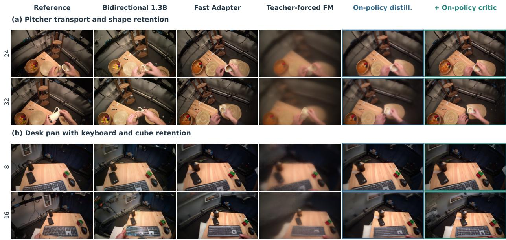  
Figure 6: Ablation of causal post-training. On-policy distillation with the video critic preserves object shape and placement in two held-out examples. The bidirectional model provides a non-causal reference.

Causal post-training. Table 6 compares on-policy continuations with the same starting model and training budget. Distillation alone does not improve interaction fidelity. Adding the critic improves all five measures, indicating that sequence-level supervision complements the teacher’s velocity targets. In Figure 6, this combination preserves object shape and placement more effectively than ordinary flow-matching continuation.

Table 6: Causal post-training. Matched on-policy continuations from Fast Adapter, evaluated on the held-out causal cohort. PCK20 and coverage are percentages. All variants retain the same two-step sampler.
<table><tr><td>Method</td><td>LPIPS↓</td><td>PCK20↑</td><td>IoU+ ↑</td><td>OPE+ ↓</td><td>Cov.↑</td></tr><tr><td>Fast Adapter</td><td>0.370</td><td>41.88</td><td>0.460</td><td>0.392</td><td>80.7</td></tr><tr><td>On-policy distillation</td><td>0.377</td><td>40.72</td><td>0.459</td><td>0.411</td><td>79.1</td></tr><tr><td>On-policy distillation + critic</td><td>0.348</td><td>44.72</td><td>0.490</td><td>0.365</td><td>84.2</td></tr></table>

Table 7 reports the remaining image and interaction metrics for the same evaluated variants.

Prediction horizons. Metric dynamics use context state 0 and 34 future states. Early and full moved-point errors cover states 1–14 and 1–34. The main cross-dataset geometry table uses states 1–14 and 1–32. Endpoint error uses ever-moved points at state 34. Persistent point identities and reference validity determine correspondence. Distances aggregate by valid moved point-time counts, as in the main-paper definition. Video evaluation uses frames 1–32 at 480 × 832, excluding the supplied initial frame, and averages equally over windows.

Baseline inference. PointWorld supplies forecast geometry to a video diffusion renderer. Hand2World uses hands and cameras. RynnWorld uses depth-aware skeletons, InterDyn uses amodal hand masks, and FlashMotion uses hand and object boxes. DWM denotes the retrained skeleton-control adaptation with static-scene conditioning. Mask2IV uses an initial image and mask with generic text, while CosHand uses initial and query hand silhouettes. DexWM supplies latent features and a native hand probe.

Video and hand metrics. RGB quality uses PSNR, Gaussian-window SSIM (Wang et al., 2004), and AlexNet LPIPS (Zhang et al., 2018). PCK at 10 and 20 pixels scores reference-valid, in-image joints, with missing predictions counted as incorrect. Annotation targets and independently extracted reference hands are evaluated separately. Wristrelative MPJPE removes wrist translation. PA-MPJPE additionally aligns rotation and scale. Reconstruction errors are computed on successful fits.

Table 7: Complete causal post-training metrics. Evaluated variants under the same two-step inference protocol. PA is aligned hand error in millimeters. PCK20 and coverage are percentages.
<table><tr><td>Method</td><td>PSNR↑</td><td>SSIM↑</td><td>LPIPS↓</td><td>PCK20↑</td><td>PA↓</td><td> $\mathrm { I o U \mathrm { _ + \ } } \uparrow$ </td><td> $\mathrm { O P E } _ { + } \downarrow$ </td><td>CLIP↑</td><td> $\mathbf { C o v . \uparrow }$ </td></tr><tr><td>Fast Adapter</td><td>17.19</td><td>.582</td><td>.370</td><td>41.88</td><td>13.41</td><td>.460</td><td>.392</td><td>.854</td><td>80.7</td></tr><tr><td>On-policy distillation</td><td>17.30</td><td>.595</td><td>.377</td><td>40.72</td><td>13.17</td><td>.459</td><td>.411</td><td>.856</td><td>79.1</td></tr><tr><td>+ video critic</td><td>17.41</td><td>.583</td><td>.348</td><td>44.72</td><td>12.73</td><td>.490</td><td>.365</td><td>.863</td><td>84.2</td></tr></table>

Object metrics. $\mathrm { I o U _ { + } }$ measures overlap on reference-positive object masks, assigning zero to missing predictions. $\mathrm { O P E _ { + } }$ measures mask-centroid distance normalized by image diagonal, assigning one to missing predictions. Masked object CLIP (Radford et al., 2021) uses paired foreground and is reported with pair coverage. OOE measures the image-plane angle between mask principal axes.

Native output grids. Mask2IV is evaluated at its native $1 6 \times 3 2 0 \times 5 1 2$ output, scoring frames 1–15. CosHand predicts the endpoint image at $2 5 6 \times 2 5 6$ , with the same centered crop applied to predictions, references, and projected annotations. It uses the released $S = 5 0$ DDIM schedule, guidance 1.5, and $\eta = 1$ . Each native panel uses its own spatial grid and horizon.

## B Additional Quantitative Results

Table 8: DexWM native hand probe. Percent correct using the native $2 2 4 \times 3 9 2$ grid and 12 temporal slots. PCK10 at the final slot is 2.43%.
<table><tr><td>Target support</td><td>PCK2.5</td><td>PCK5</td><td>PCK10</td><td>PCK20</td></tr><tr><td>Native fixed slots (18,432)</td><td>0.72</td><td>2.05</td><td>7.06</td><td>20.42</td></tr><tr><td>Valid annotated slots (10,836)</td><td>1.22</td><td>3.48</td><td>11.94</td><td>33.71</td></tr></table>

## C Implementation Details

## C.1 Dynamics Architecture and Optimization

This section specifies $F _ { \theta }$ in Sec. 4.1, including the architecture and optimization of the shared model used for crossdataset evaluation.

Scene and action tensors. Each example contains one observed scene and a supplied 35-state action sequence, in which state 0 is context and states 1–34 are predicted jointly. The scene has at most 12,000 persistent points. Smaller clouds are padded and masked, while larger clouds are subsampled with consistent indices across time. Coordinates are expressed in meters without additional normalization. Only initial-state scene features enter the predictor. Precomputed pointwise DINO features and the initial geometric and appearance attributes are projected to width 256. Future object coordinates are supervision targets. The two hands retain 21 anatomical joints each. The joint encoder has four Transformer layers, width 256, four heads, feed-forward width 1,024, and dropout 0.1. The separate MANO-relative action encoder has two layers with the same width, head count, and dropout, using 15 pose coefficients and 10 shape coefficients per hand. Joint and action tokens are appended to the supplied hand-point tokens. Unavailable annotations are masked or zero-filled. Both absolute action states and backward differences are represented. For HOT3D, object membership follows the sampled object-mesh groups, and canonical coordinates are the corresponding object-local points. Legacy samples recover these coordinates using the inverse object pose at the context frame. MANO parameters are taken from the supplied hand annotations. These structured annotations are part of the declared input setting. PhysTwin provides sparse tracked hand-surface controls without reliable MANO joint identities. We retain these controls through the point-action interface.

Point Transformer and object-time network. The Point Transformer V3 (Wu et al., 2024) uses the base encoder– decoder configuration in Table 9. Scene and action tokens have width 256. Spatial serialization uses a 0.015 m grid and the Z, transposed-Z, Hilbert, and transposed-Hilbert orders, with order shuffling enabled. Every attention patch has 256 points, and stage transitions have stride 2. The MLP expansion ratio is 4, attention uses biased query, key, and value projections, pre-normalization, zero attention and projection dropout, and maximum stochastic-depth rate 0.3. Relative positional attention is disabled. A two-layer, four-head temporal action Transformer at width 256 follows the point backbone. Masked mean and max object pooling and canonical-coordinate embeddings supply an eight-layer object-time Transformer with width 256, eight heads, feed-forward width 1,024, GELU, pre-normalization, and dropout 0.1. The pose head uses hidden width 128 and outputs three translation and six rotation coordinates. The latter are orthonormalized into a proper rotation (Zhou et al., 2019). Dense displacement and log-variance heads also use hidden width 128 and predict all 34 future states.

Object-time fusion and rigid special case. Let Z denote the pooled object tokens and A the encoded hand action. The object-time Transformer produces

$$
U = { \mathcal { T } } _ { \mathrm { o b j } } ( Z , A ) , \qquad U = \{ U _ { o } ^ { t } \mid o \in { \mathcal { O } } , t = 1 , \ldots , T \} .\tag{11}
$$

A pose head maps each $U _ { o } ^ { t }$ to $( R _ { o } ^ { t } , \tau _ { o } ^ { t } )$ . If local graph transforms are disabled, all points assigned to object $o _ { i }$ share the rigid forecast

$$
\widehat { x } _ { i } ^ { t } = R _ { o _ { i } } ^ { t } c _ { i } + \tau _ { o _ { i } } ^ { t } .\tag{12}
$$

The main paper gives the more general global-plus-local deformation model.

Table 9: Point Transformer V3 configuration for dynamics. Entries follow the stage order in the encoder and decoder configuration. Decoder stages execute from coarse to fine.

<table><tr><td>Setting</td><td>Encoder</td><td>Decoder</td></tr><tr><td>Blocks per stage</td><td>(4, 4, 4, 8, 8, 12, 4)</td><td>(2, 2, 2, 2, 2, 2)</td></tr><tr><td>Channels</td><td>(256, 256, 256, 384, 384, 512, 768)</td><td>(256, 256, 256, 384, 384, 512)</td></tr><tr><td>Attention heads</td><td>(4, 4, 4, 8, 8, 16, 24)</td><td>(4, 4, 4, 8, 8, 16)</td></tr><tr><td>Patch size</td><td>256 at every stage</td><td>256 at every stage</td></tr></table>

Canonical graph and spatial basis. We use $K = 8$ nodes per object, selected by deterministic farthest-point sampling of valid canonical points, starting from the point farthest from their centroid. Objects with fewer points use the available nodes and mask the remainder. Each point is connected to its four nearest nodes and each node to four neighboring nodes. Skinning weights are proportional to $\exp ( - \| c _ { i } - g _ { k } \| ^ { 2 } / ( 2 r _ { o } ^ { 2 } ) )$ and normalized over the selected nodes, where $r _ { o }$ is 1.5 times the median nearest-node spacing, lower-bounded by 0.005 m. The spatial deformation rank is four: we use the four lowest-frequency nonconstant eigenvectors of the symmetric, unnormalized graph Laplacian. Edge affinities are Gaussian, with scale given by the median graph-edge length. Eigenvector signs are fixed by their largest-magnitude entries.

Temporal parameterization and deformation head. For the 34 future states, the six temporal controls define an open-uniform clamped cubic B-spline basis $B \in \mathbb { R } ^ { 3 4 \times 6 }$ on $u _ { t } = ( t - 1 ) / 3 3 , t = 1 , \dots , 3 4$ , with knot vector

$$
( 0 , 0 , 0 , 0 , { \textstyle \frac { 1 } { 3 } } , { \textstyle \frac { 2 } { 3 } } , 1 , 1 , 1 , 1 , 1 ) .
$$

The network first predicts a six-dimensional twist for each spatial mode and future time. It projects these predictions into the temporal basis by $C = B ^ { \dagger } Z$ and reconstructs $\widetilde { Z } = B C$ . The coefficient tensor has shape $6 \times 4 \times 6$ per object. Multiplication by the spatial basis yields node twists, whose node-mass-weighted mean is removed. The mode MLP has two hidden layers of width 256 with GELU and a zero-initialized six-channel output. Its inputs combine the object-time feature, pooled node feature, four node descriptors, a 17-dimensional action descriptor, and 18 node–hand relation features. Hand relations use a 0.04 m distance scale. A sigmoid deformability gate with hidden width 128 starts at 0.05. Gated componentwise tanh bounds restrict local translations to 0.03 m and rotation vectors to $1 2 ^ { \circ }$ before the exponential map.

Pose composition and numerical precision. Dense predictions provide votes for a differentiable proper-Kabsch global pose, and graph deformation supplies the local residual. Assigned object points are rendered through the resulting global pose and canonical graph, while unassigned points retain the dense path. The gauge projection transfers the best-fitting rigid component of the warp into the global pose without changing predicted positions. The carrier branch scores five candidates (current pose, left hand, right hand, both hands, and initial pose), masks unavailable candidates, and uses width-128 score and strength heads with zero-initialized strength. Pose corrections use the 0.05 m and $1 5 ^ { \circ }$ bounds specified below in Eq. 5. Training uses BF16 autocast with FP32 parameters and optimizer states. Rigid fitting, graph composition, and gauge operations run in FP32 with autocast disabled.

Training data. A single dynamics model is trained jointly across HOT3D, OakInk2, and PhysTwin using the training sets specified in Section A. Training balances the larger datasets by uniformly resampling 1,000 HOT3D and 1,000 OakInk2 windows alongside all 91 PhysTwin windows. Sampling does not filter by motion magnitude.

Optimization. AdamW uses $( \beta _ { 1 } , \beta _ { 2 } ) = ( 0 . 9 , 0 . 9 9 9 ) , \epsilon = 1 0 ^ { - 8 }$ , weight decay 0.01, and gradient-norm clipping at 5. The graph, gate, and carrier heads use learning rate $6 \times 1 0 ^ { - 5 }$ . The pose head, bounded pose adapter, and final two object-time Transformer layers use $6 \times 1 0 ^ { - 6 }$ . Other parameters remain fixed during refinement. Active groups use linear warm-up followed by a constant phase and cosine decay to 10% of their peak rates.

The objective retains point-flow uncertainty supervision and pose translation and rotation weights 20 and 2. The metric-aligned component weights are (0.45, 0.20, 0.35), with smoothing $\epsilon = 0 . 0 0 1$ m and a calibrated multiplier of 12.630234. Graph ARAP, temporal, magnitude, and gate weights are 0.25, 0.05, 0.01, and 0.10. Edge-strain matching has weight 0.5. Spline-coefficient, carrier temporal-variation, and carrier-strength penalties have weights $1 0 ^ { - 4 } , 1 0 ^ { - 5 }$ and $1 0 ^ { - 4 }$ . The additional velocity, acceleration, horizon-position, object-displacement, and local-isometry losses are disabled in this stage.

## C.2 Geometric Objectives and Pose Refinement

Pointwise uncertainty. For valid point-time pairs V, the predictor learns log variance $s _ { i } ^ { t }$ through

$$
\mathcal { L } _ { \mathrm { p o i n t } } = \frac { 1 } { | \mathcal { V } | } \sum _ { ( i , t ) \in \mathcal { V } } \left[ e ^ { - s _ { i } ^ { t } } \| \widehat { x } _ { i } ^ { t } - x _ { i } ^ { t } \| _ { 2 } ^ { 2 } + s _ { i } ^ { t } \right] .\tag{13}
$$

The log variance is converted to bounded confidence for projection. The direct metric term combines full-horizon moved-point error, early moved-point error, and endpoint error on ever-moved points with weights 0.45, 0.20, and 0.35. Training uses the smooth distance $\sqrt { \| e \| _ { 2 } ^ { 2 } + \epsilon ^ { 2 } } - \epsilon$ , with $\epsilon = 0 . 0 0 1$ m. Evaluation reports unsmoothed Euclidean distances.

Bounded object-frame corrections. A zero-initialized adapter predicts a local twist $( v , \omega )$ bounded componentwise by 0.05 m and $1 5 ^ { \circ }$ . Let $R _ { \Delta } = \exp ( [ \omega ] _ { \times } )$ and $t _ { \Delta } = J ( \omega ) v$ , where J is the left Jacobian of $\mathrm { { S O } ( 3 ) }$ . The corrected pose is

$$
R ^ { \prime } = R R _ { \Delta } , \qquad \tau ^ { \prime } = \tau + R t _ { \Delta } .\tag{14}
$$

Table 10: Autoregressive generation latency. Time to the first decoded block and the complete 32-frame output.
<table><tr><td>Method</td><td>First block (s)</td><td>Full output (s)</td></tr><tr><td>Causal-DeXplicit</td><td>0.54</td><td>4.90</td></tr><tr><td>Hand2World-AR</td><td>0.31</td><td>4.62</td></tr><tr><td>RynnWorld-Causal</td><td>0.62</td><td>4.33</td></tr></table>

The first block contains 4 frames for Causal-DeXplicit and Hand2World-AR, and 12 for RynnWorld-Causal. Median single-request latency on A800 GPUs. Full-output time includes the early block decode. See Section C.3 for timing details.

Both right-hand sides use the original pose. Hand-carried candidates come from rigid fits between initial and current hand joints. Candidate differences are expressed in the predicted object frame, bounded, and combined with learned normalized weights and a signed strength. Absent hands are masked. The current-pose candidate and zero strength allow the model to leave the object unchanged.

Gauge fixing. Global pose and local graph motion can encode the same rigid component. A weighted proper Kabsch transform (Kabsch, 1976) A fitted from canonical points to their warped positions is absorbed into the global pose G. Replacing (G, Y ) by (GA, A−1Y ) preserves predicted world positions and leaves the graph responsible for residual deformation. This gives the pose refinement a consistent rigid reference.

## C.3 Video Generation

Backbone and optimization. The bidirectional model uses the Wan2.2-VACE-14B backbone with rank-32 LoRA (Hu et al., 2022) on VACE attention and feed-forward projections. The frozen backbone and VAE use BF16, while trainable adapters, encoders, and optimizer states use FP32. Training uses native full-range flow matching (Lipman et al., 2023; Liu et al., 2023), AdamW at 10−4, and effective batch 21. Sampling uses 30 Euler steps, guidance 5, and shift 5 for 33 × 480 × 832 video.

Hand conditioning. The hand branch combines 42 Gaussian joint heatmaps at 60 × 104 with a 642-dimensional perframe vector. Each joint contributes current-camera and first-camera XYZ, wrist-relative XYZ, backward displacement, and three validity flags. A 12-value relative camera transform completes the vector. Four-frame packing yields nine temporal slots, repeating frame 0 for the initial group. The spatial encoder maps 168 channels through widths 128 and 1,536 with a 2 × 2 patch stride. The action MLP maps 2,568 inputs through width 256 to 1,536 and broadcasts spatially. Both output heads are zero-initialized.

Appearance transport. Persistent object points carry 16-channel VAE descriptors from the separately encoded initial image. Calibrated projection, closest-depth selection, and MANO occluders determine support, and a coverage channel marks valid features. Three temporal encoder stages of widths 256, 128, and 128 reduce 33 frames to nine slots, and a zero-initialized output supplies 96 VACE channels. The reference slot receives zero additional hand-conditioning or appearance-transport residual. The appearance-transport stream in Figure 3 uses one PCA basis and color range per sequence, with unsupported cells shown in black.

Inference settings. Table 10 reports latency on A800 GPUs with resident model weights and native inference settings. After one full warm-up, we take the median of three synchronized, single-request measurements on a fixed evaluation window. Timing ends when decoded RGB is available on the host and excludes model loading, media storage, and metric computation. For causal models, the first completed block is decoded and transferred immediately. Full-output latency includes this early decode and the final complete-video decode. Other interfaces return the complete decoded output together. The 14B measurements include transfers between the high-noise and low-noise experts and VAE decoding.

Models retain their native input preparation. RynnWorld reuses input latents, while the other baselines use their original encoding procedures. Mask2IV generates 15 future frames and CosHand generates one future image. Their times are reported without extrapolation, whereas DeXplicit’s native-grid comparisons use its complete 32-frame output. A separate batch-12 throughput measurement for Causal-DeXplicit, without early decoding, takes 47.36 seconds in total, or 3.95 seconds per video. This throughput measurement is distinct from single-request latency.

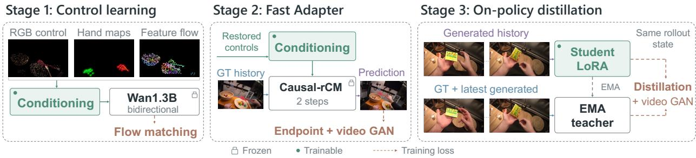  
Figure 7: Sequential learning of interaction controls and causal rollout. The conditioning interface is learned with a bidirectional renderer, aligned to a frozen few-step causal model, and then refined through on-policy adaptation.

## D Causal Adaptation Details

The causal transfer and post-training stages are summarized in Figure 7.

Condition alignment objective. For slot $s ,$ we sample a deployed noise level and predict the clean endpoint from noisy target latents:

$$
\widehat { z } _ { 0 , s } = z _ { \sigma , s } - \sigma v _ { \theta _ { 0 } , \phi } ( z _ { \sigma , s } , \sigma ; \mathrm { s g } ( z _ { 0 , < s } ) , I ^ { 0 } , C _ { \leq s } ) , \qquad \mathscr { L } _ { x _ { 0 } } = \frac { 1 } { S } \sum _ { s = 1 } ^ { S } \Vert \widehat { z } _ { 0 , s } - z _ { 0 , s } \Vert _ { 2 } ^ { 2 } .\tag{15}
$$

The causal backbone $\theta _ { 0 }$ remains frozen while the transferred conditioning parameters $\phi$ are trained. The generator objective combines endpoint reconstruction with the conditional video critic:

$$
\mathcal { L } _ { \mathrm { F A } } = \lambda ( n _ { D } ) \mathcal { L } _ { x _ { 0 } } + 0 . 0 1 \mathbb { E } [ \mathrm { s o f t p l u s } ( - D _ { \xi } ( \tilde { z } _ { \rho } ^ { \mathrm { f a k e } } , \rho ; I ^ { 0 } , C _ { \mathrm { g e o } } ) ) ] ,\tag{16}
$$

where $\lambda ( n _ { D } ) = 0 . 1 + 0 . 5 \operatorname* { m i n } ( n _ { D } / 2 0 0 0 , 1 )$ increases the reconstruction weight with discriminator updates. Historical training slots are detached. This condition-transfer objective is distinct from the generated-history distillation used in Stage II.

Conditional video discriminator. The conditional video discriminator follows the Wan1.3B architecture. A frozen 30-block video backbone provides features from blocks 13, 21, and 29. Three learned register tokens and three attention heads aggregate these features together with text context, the initial image latent, and rendered trajectory latents. A classifier maps the concatenated register features to one clip logit. The heads use width 1,536, feed-forward width 8,960, and 12 attention heads. They operate on ordered video tokens, rather than scoring frames independently. Only registers, attention heads, and the classifier are trained.

Let $\widehat { z } _ { 0 }$ concatenate the supplied initial latent and the eight predicted endpoints, and let $\eta \sim \mathcal { N } ( 0 , I )$ . For each discriminator comparison, the real and fake clips use the same noise and noise level:

$$
\widetilde { z } _ { \rho } ^ { \mathrm { r e a l } } = ( 1 - \rho ) z _ { 0 } + \rho \eta , \qquad \widetilde { z } _ { \rho } ^ { \mathrm { f a k e } } = ( 1 - \rho ) \widehat { z } _ { 0 } + \rho \eta .\tag{17}
$$

We sample u uniformly from $\{ 0 , 1 / 1 0 0 0 , \ldots , 9 9 9 / 1 0 0 0 \}$ and set $\rho = \mathrm { c l i p } ( 5 u / ( 1 + 4 u ) , 0 . 0 2 , 0 . 9 8 )$ . Writing $d _ { r } =$ $D _ { \xi } ( \tilde { z } _ { \rho } ^ { \mathrm { r e a \bar { l } } } , \rho ; I ^ { 0 } , C _ { \mathrm { g e o } } )$ and $d _ { f } = D _ { \xi } ( \widetilde { z } _ { \rho } ^ { \mathrm { f a k e } } , \rho ; I ^ { 0 } , C _ { \mathrm { g e o } } )$ , the discriminator objective is

$$
\mathcal { L } _ { D } = 0 . 0 1 \mathbb { E } \big [ \mathrm { s o f t p l u s } ( - d _ { r } ) + \mathrm { s o f t p l u s } ( d _ { f } ) \big ] .\tag{18}
$$

Generator updates use the non-saturating term in Eq. 16. Discriminator parameters remain fixed during generator updates, while gradients pass through its frozen backbone to the generated latents. Both optimizers use AdamW with $\beta _ { 1 } = 0 , \beta _ { 2 } = 0 . 9 9 9$ , weight decay 0.01, and global gradient-norm clipping at 10.

On-policy distillation. Following OPSD-V (Liu et al., 2026), the student performs the two-step rollout using its own generated history. The EMA teacher is evaluated at the same student-visited noisy latent and denoising time but reads a cleaner autoregressive cache. If $\boldsymbol { v } _ { s , k } ^ { S }$ and $\boldsymbol { v } _ { s , k } ^ { T }$ denote the student and teacher velocities, respectively, the post-training loss matches them at both deployed denoising steps. The teacher keeps the student’s most recent generated block in the teacher history while replacing older cache context with clean target latents. The target therefore shares the student’s current noisy state while receiving cleaner temporal context. The backbone is adapted through rank-128 LoRA. The inference schedule $1 6 0 0 / 1 6 0 1  \mathrm { \bar { 5 } / 6 }  0 .$ , cache update rule, and two denoising calls per block are unchanged.

Bounded-memory causal gradients. Retaining eight slot graphs together with the video critic and feature encoder is memory intensive. We first compute the complete teacher-forced endpoint clip without retaining a generator graph, then obtain the adversarial derivative $g _ { s } = \partial \mathcal { L } _ { \mathrm { a d v } } / \partial \widehat { z } _ { 0 }$ from a detached latent leaf. Each causal slot is replayed with the same noise and detached clean history, and we accumulate

$$
\nabla _ { \psi } \mathcal { L } _ { G } = \lambda ( \boldsymbol { n } _ { D } ) \nabla _ { \psi } \mathcal { L } _ { x _ { 0 } } + \sum _ { s = 1 } ^ { S } \left( \frac { \partial \widehat { z } _ { 0 , s } } { \partial \psi } \right) ^ { \top } \boldsymbol { g } _ { s } .\tag{19}
$$

The reconstruction contribution is averaged over slots. The already reduced adversarial derivative is accumulated without further normalization. This computes the gradient of the detached-history condition-alignment objective.

The appearance encoder is similarly evaluated once per minibatch to create a detached, gradient-bearing feature leaf. Slot-wise replay accumulates the derivative with respect to that leaf, after which the small feature encoder is recomputed once per sample to propagate the accumulated gradient into its parameters. Recomputed features are checked for exact agreement with the cached forward. This retains gradients to the complete appearance-transport branch without storing its graph across all causal queries. Cached and replayed computations use the same precision. The BF16 autocast weight cache is disabled during replay to prevent reuse of detached parameter casts. Distributed workers complete their local causal replays before sample-weighted gradient synchronization, clipping, and the optimizer step.

Autoregressive inference. During evaluation, the causal generator reads its previous generated slots. Only a zero-noise commit changes the backbone and VACE caches. Noisy prediction calls do not append keys or values. Conditioning arrays contain the initial image, geometry controls, and supplied action trajectories, with no future RGB appearance features. The geometry source follows the protocol of each experiment. The causal hand-conditioning and appearance transport branches use only the current and preceding chunks of those controls. Thus, the model uses the supplied controls while predicting each video block from generated visual history.

Table 11: Effect of appearance transport. The hand-conditioned model and its appearance-enhanced continuation are evaluated on 48 held-out windows with predicted geometry and the same 1.3B backbone.
<table><tr><td>Configuration</td><td>PSNR ↑</td><td>SSIM↑</td></tr><tr><td>Geometry + hand conditioning</td><td>18.3607</td><td>0.6188 0.3003</td></tr><tr><td>+ appearance transport</td><td>18.5658</td><td>0.6329 0.2835</td></tr></table>

## E Additional Ablation Studies

This section extends the dynamics and video ablations in Section 5.3. Comparisons retain the horizon, training budget, and evaluation set of each study.

## E.1 Action Encoding and Structured Object Motion

In the shorter-horizon HOT3D encoder study, moved-point L2 decreases from 44.6 mm without the action encoder to 42.4 mm with a joint Transformer and to 36.4 mm with additional MANO-relative action tokens. These results support preserving articulated hand structure in the action representation. The subsequent 35-state study compares the action-conditioned point baseline with structured object-centric SE(3) transport, an object-time Transformer, and auxiliary losses. Endpoint error on ever-moved points decreases from 122.76 to 87.45 mm, a 28.8% reduction for the structured configuration. The cumulative effect of the subsequent refinement components is evaluated in Table 3.

## E.2 Geometry, Hand Conditioning, and Appearance Transport

The geometry ablation uses Wan2.2-TI2V-5B with equal training budgets and 150 evaluation windows from 75 clips. The baseline conditions on hand pointmaps, and the comparison adds projected scene tracks. This study isolates the contribution of object geometry to hand-conditioned synthesis. The 1.3B study uses a separate VACE backbone with rendered geometry controls.

The hand and appearance rows in Table 4 represent successive conditioning stages. To evaluate appearance transport against the preceding hand-conditioned model, Table 11 compares both on the same 48 held-out windows. The recordings do not overlap training. Appearance transport improves both pixel reconstruction and perceptual similarity, consistent with preserving correspondence to the initial observation. This comparison is separate from the main 14B and causal video evaluations.

## F Additional Qualitative Results

Figures 8 and 9 show six further HOT3D windows from distinct source recordings, with no sample repeated from either main qualitative figure. Examples were selected using perceptual quality, annotated object motion, and the complete generated sequences. All six have more than 30 mm maximum annotated object translation. The same 14B model is used throughout. These conditional-rendering illustrations use predicted future object geometry. They are selected qualitative examples, while quantitative tables retain the full evaluation cohorts.

Reference

(S1) Spoon transfer

DeXplicit

002408-part00

PointWorld

Hand2World

FlashMotion

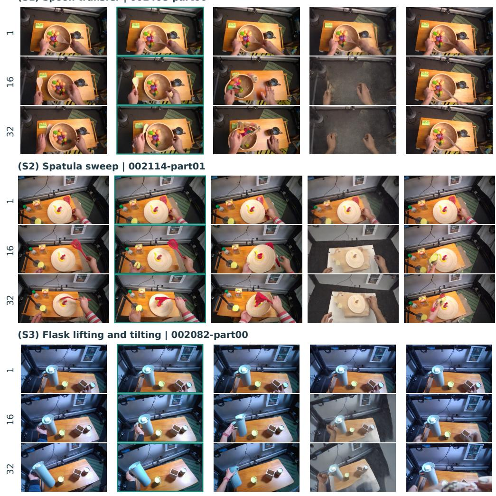  
Figure 8: Dynamic interaction examples S1–S3. Spoon transfer, spatula sweep, and flask lifting and tilting. Rows within each sample show future frames 1, 16, and 32. All methods use identical times and crops within each case. DEXPLICIT retains the manipulated object’s appearance while following its changing placement and orientation. Baselines retain their native conditioning interfaces and generated outputs.

Reference

DeXplicit

PointWorld

Hand2World

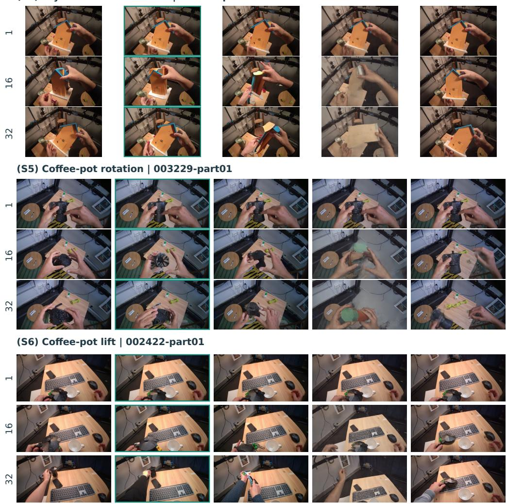  
Figure 9: Dynamic interaction examples S4–S6. Toy-house reorientation, coffee-pot rotation, and a coffee-pot lift in another recording. Future frames 1, 16, and 32 use the same crop for every method in each sample. The examples illustrate object identity and spatial response across rotation, changing visibility, and translation.

## G Limitations

Structured inputs. DeXplicit assumes an initial metric 3D scene and a future hand trajectory. Errors in these inputs may propagate into both physical-state prediction and video synthesis, and obtaining them reliably may require dedicated perception systems.

Unobserved appearance. Appearance transport can only propagate features visible in the initial observation. Newly revealed or heavily occluded regions must therefore be synthesized by the renderer. Although the confidence-gated visual readout explicitly handles unsupported regions, large disocclusions can still reduce visual fidelity.