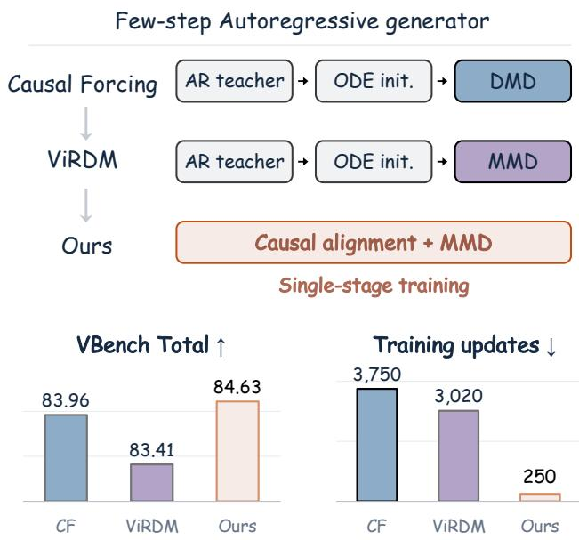
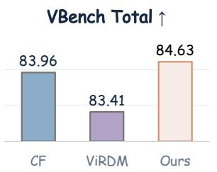
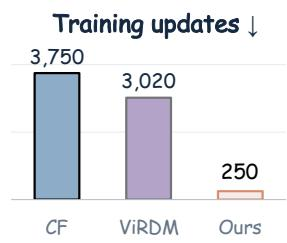
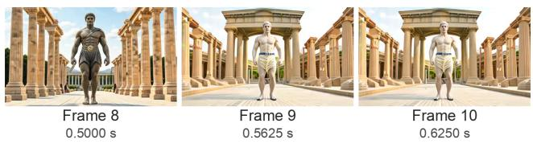
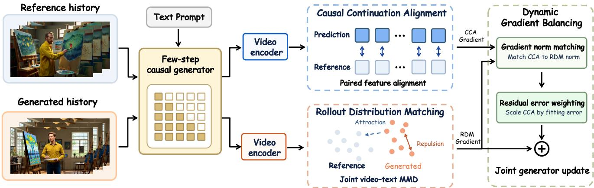
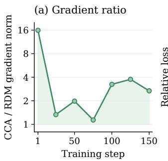
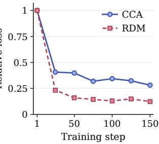
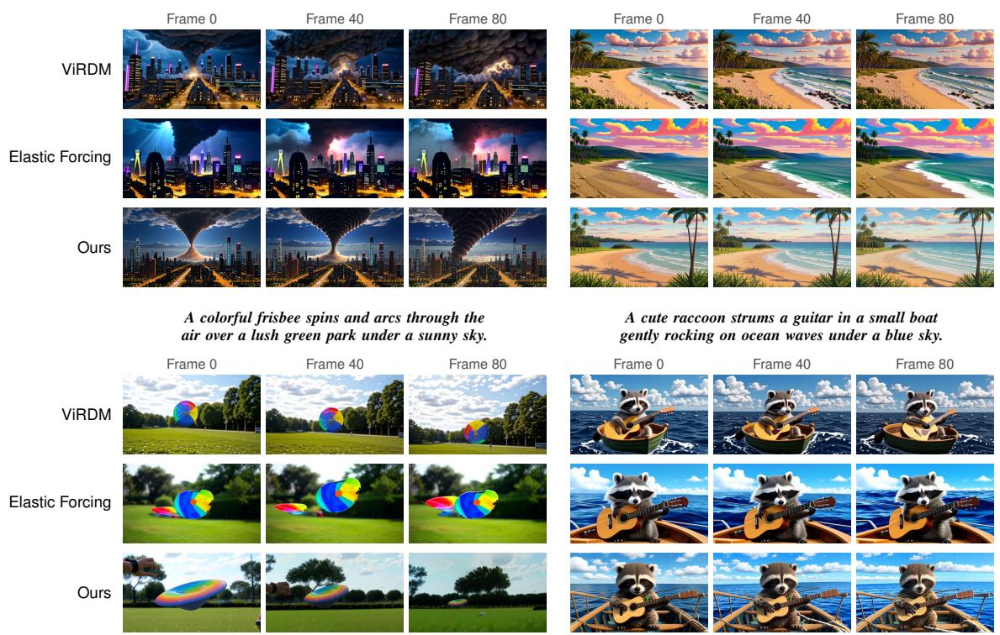
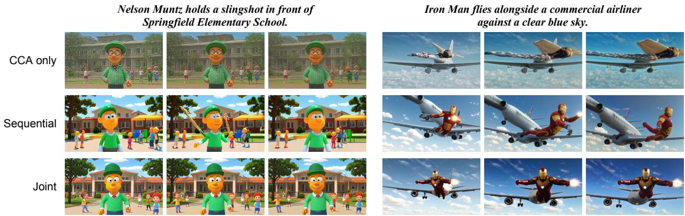

# Direct Forcing: A Single-Stage Training Recipe for Few-Step Autoregressive Text-to-Video Generation

Haojun Xu1,2 Jie Huang2,‡ Xin Lu2 Mingchen Zhong2 Zihao Fan2 Linjiang Huang1,† Si Liu1 1Beihang University 2JD Future Academy †Corresponding author. ‡Project leader.

## Abstract

Few-step autoregressive video generation enables lowlatency streaming, yet prevailing training pipelines separate causal adaptation from distribution matching. Recent representation-based text-to-video methods retain this separation by startingfrom ODE-initialized checkpoints, even when the target distribution is defined directly by reference videos. We introduce Direct Forcing, a single-stageframework that uses reference videos both as paired examples of how a history continues and as a target populationfor selfgenerated rollouts. Causal Continuation Alignment learns paired spatiotemporal correspondence under reference histories, while Rollout Distribution Matching uses maximum mean discrepancy to align the representation distributions ofself-generated and reference videos. Together, these complementary signals allow a pretrained video model to learn causal continuation and the target video distribution in a single training stage. Dynamic Gradient Balancing adapts the relative gradient contributions ofcontinuation alignment and distribution matching during training. Starting from bidirectional Wan2.1-1.3B, Direct Forcing learns afour-step autoregressive generator in 250 updates without a separate initialization stage or online diffusion-score supervision, achieving 84.63 VBench Total and 86.01 Quality. Ablation studies further demonstrate the benefits of dynamic gradient balancing and reveal distinct representation preferences: deeper features benefit continuation alignment, whereas intermediatefeatures yield better performancefor rollout distribution matching.

## 1. Introduction

Autoregressive (AR) video diffusion generates temporal chunks sequentially, conditioning each chunk on previously produced content. This streaming factorization is attractive for interactive applications—world modeling, game simulation, embodied control, and content creation—where users or agents must steer generation as it unfolds [16, 34, 37].

  
Figure 1. Single-stage training for few-step AR generation. Direct Forcing jointly learns causal alignment and distribution matching, achieving 84.63 VBench Total in 250 updates. Baseline counts include inherited initialization (Table 1).

The obstacle is latency: evaluating a diffusion network many times for each chunk can exceed the playback budget, even when the model generates causally. Practical real-time interaction therefore calls for a few-step causal generator. The challenge is to obtain one from a strong pretrained bidirectional video model.

To improve efficiency, recent works distill pretrained multi-step models into few-step generators [16, 37, 41]. Distribution matching distillation (DMD) [35, 36] trains a student to match the teacher’s output distribution by comparing diffusion scores from a pretrained teacher and a learned fakescore model on student-generated samples. For AR video generation, Self Forcing [16] and Causal Forcing [41] use bidirectional and causal ODE initialization, respectively, to narrow the initial student–teacher distribution gap and enable more effective on-policy distillation with DMD.

A statue of Zeus walks through ancient Greek ruins toward the Omphalos in Delphi.  
  
Figure 2. Temporal discontinuity under MMD-only training. Consecutive frames 8–10 show an abrupt change at the first chunk boundary.

More recently, ViRDM [24] and Elastic Forcing [38] replace DMD with representation distribution matching based on maximum mean discrepancy (MMD), directly supervising few-step generators with reference videos through frozen encoders, without an online diffusion teacher or a learned fake-score model. Yet their standard text-to-video recipes still start from ODE-initialized checkpoints. Since MMD defines its supervision directly from generated and reference samples, prior alignment with a diffusion teacher is not a prerequisite of the objective. We therefore ask whether causal adaptation and rollout distribution matching can instead be learned jointly from reference videos, without a separate initialization stage.

Reference videos provide the supervision needed for such joint learning: each video supplies paired examples of how a history continues, while the reference population defines the target distribution for self-generated rollouts. Population matching alone, however, does not explicitly supervise the correspondence between a given history and its continuation. The temporal discontinuities under direct MMD-only training in Figure 2 therefore motivate combining explicit continuation supervision with rollout distribution matching from the start.

Direct Forcing implements this joint training through two complementary components. Causal Continuation Alignment (CCA) aligns predicted and reference spatiotemporal features under reference histories. Since these histories do not contain accumulated prediction errors, Rollout Distribution Matching (RDM) additionally supervises complete videos generated under the model’s own histories, matching their joint video–text representation distribution to the reference population through MMD. Both components update the same generator from the start, so causal continuation is learned together with the rollout distribution.

Dense paired supervision and rollout distribution matching can produce gradients with substantially different magnitudes. Dynamic Gradient Balancing separates scale calibration from the allocation of supervision during training. Gradient norm matching establishes a common gradient scale, while residual error weighting adjusts the relative contribution of continuation alignment according to its current fitting residual. This gives greater emphasis to distribution matching on self-generated rollouts.

Table 1 contrasts this joint training route with the separate initialization and distribution-matching stages of existing recipes, accounting for their inherited updates. Direct Forcing achieves 84.63 VBench Total and 86.01 Quality. Our representation ablations further show that deeper features favor causal continuation alignment, whereas intermediate features favor rollout distribution matching.

Our contributions are:

• A single-stage framework for causal video generation. Direct Forcing jointly trains causal continuation alignment and rollout distribution matching, adapting a pretrained bidirectional model into a four-step causal generator in 250 updates without a separate initialization stage.

• Dynamic gradient balancing for joint optimization. We introduce Dynamic Gradient Balancing to coordinate continuation alignment and rollout distribution matching. Ablations support both gradient-scale calibration and fittingdependent supervision weighting.

• Distinct representation requirements for the two objectives. We select representation spaces independently for paired alignment and distribution matching. Ablations with VideoMAE v2 and V-JEPA 2.1 show that deeper features favor paired continuation alignment, whereas intermediate features improve generation quality and Dynamic Degree in rollout distribution matching.

## 2. Related Work

## 2.1. Few-Step Autoregressive Video Generation

VideoGPT [32] and VideoPoet [20] generate discrete visual tokens, while NOVA [7] uses continuous autoregressive generation. Streaming extensions improve cache reuse, noise scheduling, and history conditioning [2, 3, 11, 27, 28, 39].

CausVid [37] combines ODE initialization with DMD for few-step causal generation. Self Forcing [16] and Causal Forcing [41] use bidirectional and causal ODE initialization, respectively, followed by DMD on student rollouts. Matrix-Game 3.5 [26] uses teacher-forced perceptual flow matching for few-step causal initialization, then improves self-generated rollouts with DMD. Direct Forcing instead optimizes causal continuation and rollout distribution matching in a single training stage.

## 2.2. Representation Distribution Matching

Early sample-based generators optimize MMD between generated and reference populations [9, 22], using differences between kernel mean embeddings [13]. Recent methods compare learned representations through attraction– repulsion fields [8], feature moments [12, 23, 33], or

Table 1. Training paths from bidirectional Wan2.1-1.3B to four-step AR generation. Update counts include inherited initialization, but exclude backbone pretraining and offline data/feature preparation.
<table><tr><td>Method</td><td>Training path</td><td>AR teacher</td><td>ODE init.</td><td>Distributional</td><td>Total</td></tr><tr><td>Self Forcing [16, 41]</td><td>Bidirectional ODE → DMD</td><td></td><td>3,000</td><td>750</td><td>3,750</td></tr><tr><td>Causal Forcing [41]</td><td>Causal ODE → DMD</td><td>2,000</td><td>1,000</td><td>750</td><td>3,750</td></tr><tr><td>ViRDM [24]</td><td>Causal ODE → MMD</td><td>2,000</td><td>1,000</td><td>20</td><td>3,020</td></tr><tr><td>Elastic Forcing [38]</td><td>Bidirectional ODE → MMD</td><td></td><td>3,000</td><td>150</td><td>3,150</td></tr><tr><td>Direct Forcing (ours)</td><td>Causal Alignment + MMD</td><td>一</td><td>一</td><td>250</td><td>250</td></tr></table>

Sinkhorn-divergence gradient flows [15]. RDM [10] applies MMD under frozen pretrained encoders, allowing reference summaries to be computed offline. ViRDM [24] and Elastic Forcing [38] extend this approach to causal rollouts with memory-efficient differentiation and reference estimation. Their standard T2V recipes inherit ODE-initialized checkpoints.

## 3. Method

Direct Forcing jointly adapts a pretrained bidirectional model for few-step autoregressive generation in a single stage (Figure 3). Causal Continuation Alignment (CCA; Sec. 3.2) supervises predictions under reference histories through paired spatiotemporal feature alignment. Rollout Distribution Matching (RDM; Sec. 3.3) uses MMD to match feature distributions of self-generated rollouts and reference videos. Dynamic Gradient Balancing (Sec. 3.4) controls both objectives’ relative gradient contributions to the shared generator.

## 3.1. Problem Setup

Let $\textit { D } = \{ ( x _ { i } , c _ { i } ) \} _ { i = 1 } ^ { N }$ be a dataset of reference video– prompt pairs. Each video is represented in latent space as $\boldsymbol { x } = ( x ^ { 1 } , \ldots , x ^ { J } )$ , where $x ^ { j }$ is the $j \cdot$ -th temporal chunk. The autoregressive distribution factorizes as

$$
p _ { \theta } ( \hat { x } \mid c ) = \prod _ { j = 1 } ^ { J } p _ { \theta } ( \hat { x } ^ { j } \mid \hat { x } ^ { < j } , c ) .\tag{1}
$$

Only generator parameters $\theta$ are optimized; all representation encoders remain frozen. Throughout, sg(·) denotes stop-gradient.

## 3.2. Causal Continuation Alignment

We predict each chunk from its noisy input and clean reference history, then align the resulting video with its paired reference in a spatiotemporal feature space. Given a noisy chunk $x _ { \sigma }$ , history condition $h ,$ and prompt $c ,$ we define the clean-endpoint predictor as

$$
F _ { \theta } ( x _ { \sigma } , \sigma ; h , c ) = x _ { \sigma } - \sigma u _ { \theta } ( x _ { \sigma } , \sigma ; h , c ) ,
$$

where $u _ { \theta }$ is the network’s predicted velocity.

For each chunk $j ,$ we independently sample $\sigma ^ { j }$ uniformly from the four denoising levels $\{ \sigma _ { 1 } , \ldots , \sigma _ { 4 } \}$ and use the same level for all frames within that chunk:

$$
x _ { \sigma ^ { j } } ^ { j } = ( 1 - \sigma ^ { j } ) x ^ { j } + \sigma ^ { j } \epsilon ^ { j } , \qquad \epsilon ^ { j } \sim \mathcal { N } ( 0 , I ) .\tag{2}
$$

Let $\pmb { \sigma } = ( \sigma ^ { 1 } , \dots , \sigma ^ { J } )$ and $\boldsymbol { x } _ { \sigma } = ( x _ { \sigma ^ { 1 } } ^ { 1 } , \dots , x _ { \sigma ^ { J } } ^ { J } )$ . To predict all chunks in one forward pass, we concatenate the clean reference stream x and the noisy stream $x _ { \sigma }$ . We apply $F _ { \theta }$ under attention mask M and retain only the noisy-stream predictions. The predicted video $\tilde { x } = ( \tilde { x } ^ { 1 } , \dots , \tilde { x } ^ { J } )$ is thus

$$
\tilde { x } = F _ { \theta } ( x _ { \sigma } , \sigma ; x , c ) .\tag{3}
$$

With rows indexing query chunks and columns indexing key chunks, both ordered as [clean; noisy], we use the block mask below. Here, $A , B \in \{ 0 , 1 \} ^ { J \times J } .$ $I _ { J }$ is the $J \times J$ identity matrix, and $\mathbf { 1 } [ \cdot ]$ denotes the indicator function:

$$
\begin{array} { r } { \mathcal { M } = \left[ \begin{array} { c c } { A } & { 0 } \\ { B } & { I _ { J } } \end{array} \right] , \qquad A _ { j k } = \mathbf { 1 } [ k \leq j ] , } \\ { B _ { j k } = \mathbf { 1 } [ k < j ] . } \end{array}\tag{4}
$$

Each clean chunk attends to itself and preceding clean chunks. Each noisy chunk attends only to preceding clean chunks and its own noisy tokens.

We align x˜ with x using a frozen spatiotemporal video encoder. Let $P$ be the number of aligned token positions, and let $\bar { \Phi } ( x , c ) _ { p }$ denote the unit-normalized feature at position $p \in \{ 1 , \ldots , P \}$ . The predicted and reference features are $f _ { p } = \bar { \Phi } ( \tilde { x } , c ) _ { p }$ and $f _ { p } ^ { * } = \mathrm { s g } ( \bar { \Phi } ( x , c ) _ { p } )$ , respectively. The CCA loss averages their cosine distance:

$$
\mathcal { L } _ { \mathrm { C C A } } = \mathbb { E } \left[ \frac { 1 } { P } \sum _ { p = 1 } ^ { P } \left( 1 - \langle f _ { p } , f _ { p } ^ { * } \rangle \right) \right] .\tag{5}
$$

This objective provides paired continuation supervision under reference histories. Because these histories do not contain accumulated prediction errors, we complement CCA with distribution matching on self-generated rollouts.

## 3.3. Rollout Distribution Matching

Learning from the generated population. We match the training distribution ${ \mathcal { P } } _ { \theta }$ of generated video–prompt pairs to the fixed reference distribution $\mathcal { Q } _ { \mathcal { D } } . ~ \mathcal { P } _ { \theta }$ is induced by prompt sampling, noise, and a shared random denoising exit. Each chunk is generated from noise using the key–value (KV) cache $H ^ { j - 1 }$ of earlier generated chunks. For $K = 4$ denoising evaluations, the exit is shared across the rollout:

  
Figure 3. Direct Forcing overview. A shared few-step causal generator learns from reference histories with Causal Continuation Alignment (CCA) and self-generated histories with Rollout Distribution Matching (RDM). Frozen encoders provide paired cosine alignment and video–text MMD. Dynamic Gradient Balancing first matches gradient norms, then weights the CCA gradient by fitting error before combining both gradients for one shared update.

$$
\begin{array} { r l } & { S \sim \mathrm { U n i f } \{ 1 , \dots , K \} , } \\ & { \hat { x } ^ { j } = F _ { \theta } \left( \mathrm { s g } ( x _ { S } ^ { j } ) , \sigma _ { S } ; \mathrm { s g } ( H ^ { j - 1 } ) , c \right) . } \end{array}\tag{6}
$$

Here $x _ { S } ^ { j }$ is obtained by denoising and re-noising before exit $S ;$ sg detaches both this trajectory and the cached history [16, 24]. The predictions form a complete video $\hat { x } = ( \hat { x } ^ { 1 } , \dots , \hat { x } ^ { J } )$ for distribution matching. At inference, every chunk uses all four denoising evaluations.

A joint video–text representation. For a frozen spatiotemporal encoder e, let $\Phi _ { e } ( x , c ) \in \mathbb { R } ^ { P _ { e } \times d _ { e } }$ denote its full token sequence. We select fixed, ordered positions $\mathcal { T } _ { e }$ of size $K _ { e }$ and define

$$
z _ { e } ( x , c ) = \frac { 1 } { \sqrt { K _ { e } } } \mathrm { v e c } ( \Phi _ { e } ( x , c ) _ { { \mathcal { T } } _ { e } } ) .\tag{7}
$$

Squared Euclidean distance between these representations averages squared feature differences at corresponding token positions; each complete video remains one distributional sample. To associate it with the prompt, we use a unitnormalized embedding $q ( c )$ from SigLIP2 [29]. For $a =$ $( x , c )$ and $a ^ { \prime } = ( x ^ { \prime } , c ^ { \prime } )$ , visual and text bandwidths $s _ { e }$ and $s _ { c }$ define a scaled joint representation and its Gaussian kernel:

$$
\begin{array} { c } { { h _ { e } ( a ) = [ z _ { e } ( a ) ; ( s _ { e } / s _ { c } ) q ( c ) ] , } } \\ { { k _ { e } ( a , a ^ { \prime } ) = \displaystyle \exp \left[ - \frac { \| h _ { e } ( a ) - h _ { e } ( a ^ { \prime } ) \| _ { 2 } ^ { 2 } } { 2 s _ { e } ^ { 2 } } \right] . } } \end{array}\tag{8}
$$

The kernel factors into visual and text similarities with bandwidths $s _ { e }$ and $s _ { c }$ . Prompt similarity therefore weights video comparisons to match the joint video–prompt distribution.

Both bandwidths use the median heuristic on their respective reference features [10, 24] and remain fixed during training; Appendix A.4 gives the estimation details.

Population alignment through MMD. We measure the discrepancy between generated and reference populations using maximum mean discrepancy [10, 13]:

$$
\begin{array} { r l } & { \mathcal { D } _ { e } ( \theta ) = \mathrm { M M D } _ { k _ { e } } ^ { 2 } ( \mathcal { P } _ { \theta } , \mathcal { Q } _ { \mathcal { D } } ) } \\ & { \quad \quad = \mathbb { E } _ { a , a ^ { \prime } \sim \mathcal { P } _ { \theta } } k _ { e } ( a , a ^ { \prime } ) - 2 \mathbb { E } _ { a \sim \mathcal { P } _ { \theta } , b \sim \mathcal { Q } _ { \mathcal { D } } } k _ { e } ( a , b ) } \\ & { \quad \quad \quad + \mathbb { E } _ { b , b ^ { \prime } \sim \mathcal { Q } _ { \mathcal { D } } } k _ { e } ( b , b ^ { \prime } ) . } \end{array}\tag{9}
$$

All paired draws within an expectation are independent. Generated–reference interactions attract the population toward the reference kernel mean, while generated–generated interactions discourage concentration in representation space. The target is sample-defined: no diffusion-score teacher or learned fake-score model is required.

For optimization, we normalize each encoder’s empirical discrepancy by its stop-gradient value, then average these normalized objectives equally to obtain LRDM; Appendix B.1 specifies the estimator and normalization. We select the representation spaces for continuation alignment and rollout distribution matching independently.

## 3.4. Dynamic Gradient Balancing

The two objectives may produce gradients with different magnitudes, making fixed loss weights sensitive to their raw scales. We therefore separate gradient norm calibration [5] from error-dependent weighting: gradient norm matching establishes a common scale, while residual error weighting adjusts the relative contribution of continuation alignment.

Table 2. Text-to-video generation on VBench. Models are grouped by generation scheme. Scores are percentages. The highlighted row is our 250-update model. ViRDM denotes its reported variant without optical-flow regularization. Our main model also excludes this auxiliary objective; Appendix C.4 presents our optical-flow regularization ablation.
<table><tr><td>Model</td><td></td><td></td><td># Params Resolution Throughput ↑ Latency (s) ↓ Total ↑ Quality ↑ Semantic ↑</td><td></td><td></td><td></td><td></td></tr><tr><td colspan="6">Bidirectional Video Diffusion Models</td><td></td><td></td></tr><tr><td>LTX-Video-1.9B [14]</td><td>1.9B</td><td> $7 6 8 \times 5 1 2$ </td><td>8.98</td><td>13.5</td><td>79.91</td><td>82.20</td><td>70.75</td></tr><tr><td>Wan2.1-1.3B [30]</td><td>1.3B</td><td> $8 3 2 \times 4 8 0$ </td><td>0.78</td><td>103</td><td>82.78</td><td>83.44</td><td>80.13</td></tr><tr><td>Wan2.1-14B [30]</td><td>14B</td><td>832× 480</td><td>0.167</td><td>484</td><td>83.35</td><td>83.97</td><td>80.88</td></tr><tr><td colspan="8">Autoregressive Video Diffusion Models</td></tr><tr><td>NOVA [7]</td><td>0.6B</td><td>768×480</td><td>0.88</td><td>4.1</td><td>80.09</td><td>80.33</td><td>79.13</td></tr><tr><td>Pyramid Flow [19]</td><td>2.0B</td><td> $6 4 0 \times 3 8 4$ </td><td>6.7</td><td>2.5</td><td>81.75</td><td>84.72</td><td>69.87</td></tr><tr><td>SkyReels-V2-1.3B [3]</td><td>1.3B</td><td>960 × 540</td><td>0.49</td><td>112</td><td>82.60</td><td>84.60</td><td>74.60</td></tr><tr><td>MAGI-1-4.5B [28]</td><td>4.5B</td><td> $8 3 2 \times 4 8 0$ </td><td>0.19</td><td>282</td><td>79.09</td><td>82.04</td><td>67.29</td></tr><tr><td colspan="8">Four-Step Causal Video Models</td></tr><tr><td>CausVid [37]</td><td>1.3B</td><td>832×480</td><td>20.63</td><td>0.25</td><td>81.15</td><td>83.99</td><td>69.79</td></tr><tr><td>Self Forcing [16]</td><td>1.3B</td><td>832× 480</td><td>20.63</td><td>0.25</td><td>83.76</td><td>84.53</td><td>80.68</td></tr><tr><td>Causal Forcing [41]</td><td>1.3B</td><td>832× 480</td><td>20.63</td><td>0.25</td><td>83.96</td><td>84.94</td><td>80.04</td></tr><tr><td>LongLive [34]</td><td>1.3B</td><td>832× 480</td><td>20.63</td><td>0.25</td><td>83.62</td><td>84.36</td><td>80.69</td></tr><tr><td>ViRDM* [24]</td><td>1.3B</td><td>832× 480</td><td>20.63</td><td>0.25</td><td>83.41</td><td>84.11</td><td>80.61</td></tr><tr><td>Elastic Forcing [38]</td><td>1.3B</td><td> $8 3 2 \times 4 8 0$ </td><td>20.63</td><td>0.25</td><td>84.25</td><td>85.06</td><td>80.99</td></tr><tr><td>Causal-rCM [40]</td><td>1.3B</td><td>832×480</td><td>20.63</td><td>0.25</td><td>84.37</td><td>85.02</td><td>81.73</td></tr><tr><td>Direct Forcing (ours)</td><td>1.3B</td><td> $8 3 2 \times 4 8 0$ </td><td>20.63</td><td>0.25</td><td>84.63</td><td>86.01</td><td>79.08</td></tr></table>

Let $g _ { t } ^ { \mathrm { C C A } } = \nabla _ { \theta } \mathcal { L } _ { \mathrm { C C A } , t }$ and $g _ { t } ^ { \mathrm { R D M } } = \nabla _ { \theta } \mathcal { L } _ { \mathrm { R D M } , t }$ . Gradient norm matching (GNM) first rescales the continuation alignment gradient to the RDM gradient norm:

$$
\bar { g } _ { t } ^ { \mathrm { C C A } } = \Vert g _ { t } ^ { \mathrm { R D M } } \Vert _ { 2 } \frac { g _ { t } ^ { \mathrm { C C A } } } { \Vert g _ { t } ^ { \mathrm { C C A } } \Vert _ { 2 } } .\tag{10}
$$

This preserves the continuation gradient direction while matching its scale to distribution matching.

Residual error weighting (REW) then uses the current fitting error to set the CCA-to-RDM gradient norm ratio before clipping. As reference continuations become better fitted, we relax the relative constraint of paired supervision so rollout distribution learning plays a larger role, while retaining a lower bound on the continuation contribution. Let $\ell _ { t }$ denote the current-batch CCA loss and $\ell _ { 1 }$ its value at the first update. We set

$$
\begin{array} { r l } & { r _ { t } = r _ { \operatorname* { m i n } } + \left( 1 - r _ { \operatorname* { m i n } } \right) \operatorname* { m i n } \biggl ( \frac { \ell _ { t } } { \ell _ { 1 } } , 1 \biggr ) , } \\ & { g _ { t } = g _ { t } ^ { \mathrm { R D M } } + r _ { t } \bar { g } _ { t } ^ { \mathrm { C C A } } . } \end{array}\tag{11}
$$

where $r _ { \operatorname* { m i n } } = 0 . 1$ . The weight $r _ { t }$ follows batch-to-batch error fluctuations and can increase or decrease during training.

## 4. Experiments

## 4.1. Experimental Setup

Model and training. We initialize Direct Forcing from pretrained bidirectional Wan2.1-T2V-1.3B [30] and generate 81-frame (21-latent-frame) videos at 832 × 480 resolution in autoregressive chunks of three latent frames. Unless otherwise specified, training and inference use four denoising steps with timestep shift 5. We perform 250 joint updates on eight NVIDIA B200 GPUs using 6,505 reference video– prompt pairs released by Causal Forcing [41]. Each update uses 128 generated videos for RDM and 32 reference pairs for CCA. Our main configuration uses VideoMAE v2 [31] L24 for CCA and VideoMAE v2 L16 plus DiT L9 for RDM, with frozen SigLIP2 [29] prompt embeddings for the MMD kernel. The generator retains its native text encoder. DiT features come from frozen Wan2.1-T2V-14B [30]. Reference features and prompt embeddings are precomputed offline. Appendices A–B detail the implementation; Appendix D examines DiT feature choices.

Evaluation. We evaluate Direct Forcing on the 944 expanded VBench [17] prompts released by Causal Forcing [41], generating five videos per prompt (4,720 videos in total) at 16 frames/s. Final videos are decoded with the original Wan VAE. Baseline Total, Quality, and Semantic scores follow published reports (sources in Appendix E.4).

(b) Fitting progress  
  
Figure 4. Gradient scales and fitting progress. (a) CCA-to-RDM gradient norm ratio under fixed weights. (b) GNM-only fitting progress, relative to each first-step value; the RDM curve uses the MMD discrepancy before loss self-normalization.

Table 3. CCA and RDM training. Subj., Smooth., Aes., and Dyn. denote the VBench quality dimensions Subject Consistency, Motion Smoothness, Aesthetic Quality, and Dynamic Degree, respectively. Sem. denotes the aggregate Semantic score. Sequential training uses 150 CCA then 150 RDM-only updates; other rows use 150 updates.
<table><tr><td>Configuration</td><td>Subj.↑ Smooth.↑ Aes.↑ Dyn.↑ Sem.↑</td><td></td><td></td><td></td><td></td></tr><tr><td>CCA only</td><td>97.08</td><td>99.50</td><td>59.13</td><td>13.89</td><td>72.21</td></tr><tr><td>RDM only</td><td>84.17</td><td>96.82</td><td>63.95</td><td>11.11</td><td>71.93</td></tr><tr><td>CCA init → RDM-only</td><td>94.08</td><td>98.56</td><td>64.35</td><td>74.44</td><td>77.88</td></tr><tr><td>CCA + RDM jointly</td><td>95.69</td><td>98.77</td><td>65.07</td><td>54.72</td><td>77.99</td></tr></table>

Table 4. Ablation of Dynamic Gradient Balancing. Both continuation alignment and distribution matching remain active in all variants.
<table><tr><td>Configuration</td><td>Total ↑</td><td></td><td>Quality ↑ Semantic ↑ Dynamic ↑</td><td></td></tr><tr><td>Fixed weights</td><td>80.43</td><td>81.29</td><td>77.00</td><td>31.11</td></tr><tr><td>GNM</td><td>81.23</td><td>82.04</td><td>78.01</td><td>37.22</td></tr><tr><td>GNM + REW</td><td>82.40</td><td>83.51</td><td>77.99</td><td>54.72</td></tr></table>

Throughput (frames/s) and latency for the four-step causal models are measured on a single NVIDIA B200 GPU; other timing values follow published reports. Latency denotes time to the first frame. Bold marks the best score for each metric unless otherwise stated.

## 4.2. Main Results

Direct Forcing achieves 84.63 Total and 86.01 Quality with four denoising evaluations per chunk (Table 2), giving the highest Total and Quality among the listed four-step causal models. Compared with Elastic Forcing, Direct Forcing improves Total by 0.38 and Quality by 0.95, while Semantic is 1.91 points lower. Direct Forcing also achieves a Dynamic Degree of 75.56, compared with 63.33 for Elastic Forcing and 48.61 reported for ViRDM (Appendix E.1).

Table 5. RDM batch size with VideoMAE v2 L16 for both components. CCA batch size is 32; all runs use 150 updates.
<table><tr><td>Batch size</td><td>32</td><td>64</td><td>128</td><td>256</td><td>512</td><td>1024</td></tr><tr><td>Total ↑</td><td>81.27</td><td>82.40</td><td>82.36</td><td>82.96</td><td>82.89</td><td>82.81</td></tr><tr><td>Quality ↑</td><td>82.10</td><td>83.51</td><td>83.46</td><td>83.95</td><td>84.06</td><td>83.89</td></tr><tr><td>Semantic ↑</td><td>77.95</td><td>77.99</td><td>77.99</td><td>78.97</td><td>78.21</td><td>78.47</td></tr><tr><td>Dynamic ↑</td><td>33.33</td><td>54.72</td><td>47.22</td><td>47.78</td><td>54.17</td><td>51.67</td></tr></table>

Table 6. Prompt encoder in the MMD kernel. Both components use VideoMAE v2 L16.
<table><tr><td>Prompt encoder</td><td>Total ↑ Quality ↑ Semantic ↑ Dynamic ↑</td><td></td><td></td><td></td></tr><tr><td>None</td><td>81.60</td><td>82.55</td><td>77.81</td><td>39.72</td></tr><tr><td>Qwen3-VL-Embedding</td><td>81.97</td><td>83.07</td><td>77.53</td><td>45.56</td></tr><tr><td>SigLIP2</td><td>82.40</td><td>83.51</td><td>77.99</td><td>54.72</td></tr></table>

Direct Forcing reaches this performance through 250 joint updates directly from the bidirectional backbone, without a separate initialization stage. ViRDM inherits Causal Forcing’s causal ODE initialization, while Elastic Forcing inherits Self Forcing’s bidirectional ODE initialization. The chunk-boundary ratio compares frame differences at boundaries and within chunks, normalized by the corresponding reference-video ratio. Our ratio is closer to one than ViRDM’s (1.040 vs. 1.393; Appendix E.3), supporting temporal continuity without a separate initialization stage.

## 4.3. Ablation Studies

Unless otherwise specified, ablations use 150 updates with SigLIP2 prompt embeddings and RDM and CCA batch sizes of 64 and 32, respectively. The component ablation (including joint training) and the gradient-balancing, batch-size, and prompt-representation ablations use VideoMAE v2 L16 for each active component. For the representation studies, we first vary each component’s representation while fixing the other to VideoMAE v2 L16, then evaluate combinations of the selected representations.

Joint training of CCA and RDM. Table 3 shows that CCA-only achieves the highest Subject Consistency and Motion Smoothness but yields low Dynamic and degraded self-rollouts, whereas RDM-only improves Aesthetic at the expense of consistency. Joint training achieves the highest Aesthetic and Semantic scores while retaining high consistency. Sequential training yields higher Dynamic (74.44 vs. 54.72) but lower scores on all other reported metrics, despite twice as many updates. Its transient distortions and artifacts (Appendix C.7) further support maintaining continuation alignment throughout rollout distribution matching.

Table 7. Representation for causal continuation alignment, with rollout distribution matching fixed to VideoMAE v2 L16. Latent FM denotes velocity regression in latent space.
<table><tr><td>Representation</td><td>Total ↑ Quality ↑ Semantic ↑ Dynamic ↑</td><td></td><td></td></tr><tr><td>Latent FM</td><td>81.76</td><td>82.77</td><td>77.75 51.39</td></tr><tr><td>V-JEPA 2.1 L16</td><td>81.77</td><td>83.12</td><td>76.35 40.56</td></tr><tr><td>V-JEPA 2.1 L24</td><td>82.05</td><td>83.30</td><td>77.08 58.06</td></tr><tr><td>DiT L9</td><td>82.56</td><td>83.53</td><td>78.68 58.89</td></tr><tr><td>VideoMAE v2 L16</td><td>82.40</td><td>83.51</td><td>77.99 54.72</td></tr><tr><td>VideoMAE v2 L24</td><td>82.80</td><td>84.00</td><td>78.01 58.06</td></tr></table>

Table 8. Representation for rollout distribution matching, with continuation alignment fixed to VideoMAE v2 L16.
<table><tr><td>Representation</td><td>Total ↑ Quality ↑ Semantic ↑ Dynamic ↑</td><td></td><td></td><td></td></tr><tr><td>VideoMAE v2 L16</td><td>82.40</td><td>83.51</td><td>77.99</td><td>54.72</td></tr><tr><td>VideoMAE v2 L24</td><td>80.75</td><td>81.42</td><td>78.07</td><td>28.33</td></tr><tr><td>V-JEPA 2.1 L16</td><td>80.51</td><td>81.67</td><td>75.86</td><td>15.56</td></tr><tr><td>V-JEPA 2.1 L24</td><td>79.88</td><td>80.82</td><td>76.10</td><td>8.06</td></tr><tr><td>DiT L9</td><td>82.45</td><td>83.53</td><td>78.13</td><td>52.22</td></tr></table>

Dynamic gradient balancing. With fixed weights, CCA gradients dominate RDM throughout training, with an initial norm ratio of 15.9 (Figure 4(a)). GNM corrects this imbalance, improving Total from 80.43 to 81.23 and Dynamic from 31.11 to 37.22 (Table 4). Under GNM alone, the CCA loss falls to 28% of its initial value by update 150 (Figure 4(b)), motivating residual-based adjustment of the continuation contribution. Adding REW further raises Total to 82.40 and Dynamic to 54.72, with nearly unchanged Semantic, supporting its benefit beyond norm calibration.

RDM batch size. Table 5 varies the global RDM batch size under the common ablation configuration. Larger batches generally improve Total, though not monotonically, with a peak of 82.96 at batch size 256. Appendix E.2 reports batch-size selection for the main model.

Prompt representation. Table 6 varies the prompt representation used in the MMD kernel. Compared with visualonly matching, SigLIP2 raises Total from 81.60 to 82.40 and Dynamic from 39.72 to 54.72. It also outperforms Qwen3-VL-Embedding-2B [21] on all four metrics. These results support incorporating prompt similarity into population matching and motivate SigLIP2 as the default prompt representation in our experiments.

Representation for causal continuation alignment. Table 7 compares representations for continuation alignment, with rollout distribution matching fixed to VideoMAE v2

Table 9. Representation combinations after 150 updates. $V _ { k } { : }$ Video-MAE v2 Lk; $D _ { 9 } \colon$ DiT L9. Gray marks the selected combination.
<table><tr><td>Continuation</td><td>Distribution</td><td>Total ↑ Qual. ↑ Sem. ↑ Dyn. ↑</td><td></td><td></td><td></td></tr><tr><td> $V _ { 2 4 }$ </td><td> $V _ { 1 6 }$ </td><td>82.80</td><td>84.00</td><td>78.01</td><td>58.06</td></tr><tr><td> $V _ { 2 4 }$ </td><td> $D _ { 9 }$ </td><td>83.49</td><td>84.96</td><td>77.58</td><td>68.61</td></tr><tr><td> $V _ { 2 4 }$ </td><td> $V _ { 1 6 } + D _ { 9 }$ </td><td>84.11</td><td>85.47</td><td>78.67</td><td>74.72</td></tr><tr><td> $V _ { 2 4 } + D _ { 9 }$ </td><td> $V _ { 1 6 } + D _ { 9 }$ </td><td>83.68</td><td>84.99</td><td>78.43</td><td>71.94</td></tr><tr><td> $V _ { 2 4 } + D _ { 9 }$ </td><td> $V _ { 1 6 } + D _ { 9 } + V _ { 2 4 }$ </td><td>83.46</td><td>84.71</td><td>78.45</td><td>75.00</td></tr></table>

L16. For both VideoMAE v2 and V-JEPA 2.1, L24 yields higher scores than L16 on all four metrics. VideoMAE v2 L24 achieves the highest Total and Quality, exceeding latent FM by 1.04 and 1.23 points, respectively, while DiT L9 gives the highest Semantic and Dynamic. We therefore select VideoMAE v2 L24 for continuation alignment.

Representation for rollout distribution matching. Table 8 compares representations for rollout distribution matching, with continuation alignment fixed to VideoMAE v2 L16. For both VideoMAE v2 and V-JEPA 2.1, L16 yields higher Total, Quality, and Dynamic than L24, while L24 gives slightly higher Semantic. For VideoMAE v2, Dynamic drops from 54.72 at L16 to 28.33 at L24. DiT L9 achieves the highest Total and Semantic, whereas VideoMAE v2 L16 gives the highest Dynamic. The opposite layer preferences across the two components within these encoders support selecting representations separately for continuation alignment and distribution matching.

Combining representation spaces. Table 9 evaluates combinations of the top two representations by Total for each component identified above. With CCA fixed to $V _ { 2 4 } ,$ combining $V _ { 1 6 }$ and $D _ { 9 }$ for RDM improves all four metrics over either representation alone, raising Total to 84.11 from 82.80 and 83.49, respectively. With this RDM configuration fixed, adding $D _ { 9 }$ to CCA instead reduces Total to 83.68. We therefore adopt $V _ { 2 4 }$ for CCA and $V _ { 1 6 } + D _ { 9 }$ for RDM, which achieves the highest Total, Quality, and Semantic among the tested combinations. All feature encoders are used only during training and add no inference overhead.

## 4.4. Qualitative Comparisons

Figure 5 compares ViRDM, Elastic Forcing, and Direct Forcing under the same prompts. The tornado and frisbee examples highlight structural preservation: Direct Forcing retains a distinct funnel and a disc-shaped object across the displayed frames, while the baseline frisbee results exhibit umbrella-like or folded forms. The coastal and raccoon examples highlight texture and local detail, with Direct Forcing preserving cloud and wave structure, fur texture, and guitar details.

An epic tornado attacking above a glowing city at night, the tornado is made of smoke  
A beautiful coastal beach in spring, waves lapping on sand by Vincent van Gogh  
  
Figure 5. Qualitative comparison on four text-to-video prompts. For each case, rows show ViRDM, Elastic Forcing, and Direct Forcing from top to bottom; columns show frames 0, 40, and 80. These lengthy prompts are abbreviated above the panels for readability.

Table 10. Long-video generation on MovieGen-128 at 50 seconds. Self-Forcing++ scores follow its reported results [6]. All scores are percentages; higher is better.
<table><tr><td>Metric</td><td>Self-Forcing++</td><td>Direct Forcing</td></tr><tr><td>Subject consistency</td><td>97.00</td><td>97.07</td></tr><tr><td>Background consistency</td><td>95.55</td><td>96.11</td></tr><tr><td>Motion smoothness</td><td>98.39</td><td>98.61</td></tr><tr><td>Dynamic degree</td><td>55.36</td><td>53.13</td></tr><tr><td>Aesthetic quality</td><td>53.76</td><td>56.14</td></tr><tr><td>Imaging quality</td><td>67.87</td><td>67.15</td></tr></table>

## 4.5. Long-Video Generation

We adapt the 150-update short-video checkpoint with 100 further updates using only the original 6,505 short reference videos. Following window-based long-rollout training [6], RDM supervises approximately five-second windows sampled from self-generated rollouts of up to approximately 60 seconds. We match their globally pooled VideoMAE v2 L16 and DiT L9 features to the short-reference distribution, while retaining token-level CCA with VideoMAE v2 L24 throughout adaptation. Thus, adaptation learns from long generated histories without long references or an online diffusion teacher.

Direct Forcing outperforms Self-Forcing++ [6] on four of six VBench-Long [18] metrics, with lower Dynamic Degree and Imaging Quality (Table 10; details in Appendix F).

## 5. Conclusion

We presented Direct Forcing, a single-stage framework that directly adapts a pretrained bidirectional video model into a four-step autoregressive generator in 250 joint updates, without a separate initialization stage. Causal Continuation Alignment learns paired continuations under reference histories, while Rollout Distribution Matching aligns selfgenerated rollouts with the reference population. Dynamic Gradient Balancing controls their relative gradient contributions as continuation fitting progresses. Our ablations support both gradient-balancing components and objectivespecific representation choices, including the benefit of combining features for rollout distribution matching. The resulting model achieves 84.63 VBench Total and 86.01 Quality. Short references also support 50-second generation.

Limitations. Our evaluation covers a 1.3B generator at 832×480 resolution and durations up to 50 seconds. Testing larger models, higher resolutions, and longer generation horizons remains an important direction for future work.

## References

[1] Ollin Boer Bohan. TAEHV: Tiny autoencoder for hunyuan video. https://github.com/madebyollin/ taehv, 2025.

[2] Boyuan Chen, Diego Mart´ı Monso, Yilun Du, Max Sim-´ chowitz, Russ Tedrake, and Vincent Sitzmann. Diffusion forcing: Next-token prediction meets full-sequence diffusion. In NeurIPS, pages 24081–24125, 2024.

[3] Guibin Chen, Dixuan Lin, Jiangping Yang, Chunze Lin, Junchen Zhu, Mingyuan Fan, Hao Zhang, Sheng Chen, Zheng Chen, Chengcheng Ma, et al. SkyReels-V2: Infinite-length film generative model. arXiv preprint arXiv:2504.13074, 2025.

[4] Junsong Chen, Yuyang Zhao, Jincheng Yu, Ruihang Chu, Junyu Chen, Shuai Yang, Xianbang Wang, Yicheng Pan, Zhou Daquan, Huan Ling, et al. SANA-Video: Efficient video generation with block linear diffusion transformer. In International Conference on Learning Representations, pages 38973–38997, 2026.

[5] Zhao Chen, Vijay Badrinarayanan, Chen-Yu Lee, and Andrew Rabinovich. GradNorm: Gradient normalization for adaptive loss balancing in deep multitask networks. In ICML, pages 794–803, 2018.

[6] Jiaxing Cui, Jie Wu, Ming Li, Tao Yang, Xiaojie Li, Rui Wang, Andrew Bai, Yuanhao Ban, and Cho-Jui Hsieh. Self-Forcing++: Towards minute-scale high-quality video generation. In International Conference on Learning Representations, pages 85802–85822, 2026.

[7] Haoge Deng, Ting Pan, Haiwen Diao, Zhengxiong Luo, Yufeng Cui, Huchuan Lu, Shiguang Shan, Yonggang Qi, and Xinlong Wang. Autoregressive video generation without vector quantization. In ICLR, pages 44730–44745, 2025.

[8] Mingyang Deng, He Li, Tianhong Li, Yilun Du, and Kaiming He. Generative modeling via drifting. arXiv preprint arXiv:2602.04770, 2026.

[9] Gintare Karolina Dziugaite, Daniel M Roy, and Zoubin Ghahramani. Training generative neural networks via maximum mean discrepancy optimization. In UAI, 2015.

[10] Lan Feng, Wuyang Li, Eloi Zablocki, Matthieu Cord, and´ Alexandre Alahi. Representation distribution matching for one-step visual generation. arXiv preprint arXiv:2607.02375, 2026.

[11] Kaifeng Gao, Jiaxin Shi, Hanwang Zhang, Chunping Wang, Jun Xiao, and Long Chen. Ca2-VDM: Efficient autoregressive video diffusion model with causal generation and cache sharing. arXiv preprint arXiv:2411.16375, 2024.

[12] Mingju Gao, Jingkai Zhou, Kun Gai, Changqian Yu, and Hao Tang. AdvFD: Boosting visual generation via adversarial Frechet distance loss.´ arXiv preprint arXiv:2608.11205, 2026.

[13] Arthur Gretton, Karsten M. Borgwardt, Malte J. Rasch, Bernhard Scholkopf, and Alexander Smola. A kernel two-sample¨ test. Journal of Machine Learning Research, 13:723–773, 2012.

[14] Yoav HaCohen, Nisan Chiprut, Benny Brazowski, Daniel Shalem, Dudu Moshe, Eitan Richardson, Eran Levin, Guy Shiran, Nir Zabari, Ori Gordon, et al. LTX-Video: Real-

time video latent diffusion. arXiv preprint arXiv:2501.00103, 2024.

[15] Jiaqi Han, Puheng Li, Qiushan Guo, Renyuan Xu, Stefano Ermon, and Emmanuel J Candes. One-step genera- \` tive modeling via Wasserstein gradient flows. arXiv preprint arXiv:2605.11755, 2026.

[16] Xun Huang, Zhengqi Li, Guande He, Mingyuan Zhou, and Eli Shechtman. Self forcing: Bridging the train-test gap in autoregressive video diffusion. In NeurIPS, 2025.

[17] Ziqi Huang, Yinan He, Jiashuo Yu, Fan Zhang, Chenyang Si, Yuming Jiang, Yuanhan Zhang, Tianxing Wu, Qingyang Jin, Nattapol Chanpaisit, Yaohui Wang, Xinyuan Chen, Limin Wang, Dahua Lin, Yu Qiao, and Ziwei Liu. VBench: Comprehensive benchmark suite for video generative models. In CVPR, 2024.

[18] Ziqi Huang, Fan Zhang, Xiaojie Xu, Yinan He, Jiashuo Yu, Ziyue Dong, Qianli Ma, Nattapol Chanpaisit, Chenyang Si, Yuming Jiang, Yaohui Wang, Xinyuan Chen, Ying-Cong Chen, Limin Wang, Dahua Lin, Yu Qiao, and Ziwei Liu. VBench++: Comprehensive and versatile benchmark suite for video generative models. IEEE Transactions on Pattern Analysis and Machine Intelligence, 2025.

[19] Yang Jin, Zhicheng Sun, Ningyuan Li, Kun Xu, Hao Jiang, Nan Zhuang, Quzhe Huang, Yang Song, Yadong Mu, and Zhouchen Lin. Pyramidal flow matching for efficient video generative modeling. In ICLR, pages 23378–23402, 2025.

[20] Dan Kondratyuk, Lijun Yu, Xiuye Gu, Jose Lezama, Jonathan´ Huang, Grant Schindler, Rachel Hornung, Vighnesh Birodkar, Jimmy Yan, Ming-Chang Chiu, Krishna Somandepalli, Hassan Akbari, Yair Alon, Yong Cheng, Joshua V. Dillon, Agrim Gupta, Meera Hahn, Anja Hauth, David Hendon, Alonso Martinez, David Minnen, Mikhail Sirotenko, Kihyuk Sohn, Xuan Yang, Hartwig Adam, Ming-Hsuan Yang, Irfan Essa, Huisheng Wang, David A Ross, Bryan Seybold, and Lu Jiang. VideoPoet: A large language model for zero-shot video generation. In ICML, pages 25105–25124, 2024.

[21] Mingxin Li, Yanzhao Zhang, Dingkun Long, Keqin Chen, Sibo Song, Shuai Bai, Zhibo Yang, Pengjun Xie, An Yang, Dayiheng Liu, Jingren Zhou, and Junyang Lin. Qwen3-VL-Embedding and Qwen3-VL-Reranker: A unified framework for state-of-the-art multimodal retrieval and ranking. arXiv preprint arXiv:2601.04720, 2026.

[22] Yujia Li, Kevin Swersky, and Rich Zemel. Generative moment matching networks. In ICML, pages 1718–1727, 2015.

[23] Wenze Liu, Xintao Wang, Pengfei Wan, and Xiangyu Yue. Amortized moment matching for visual generation. arXiv preprint arXiv:2607.26860, 2026.

[24] Zichong Meng, Chongjian Ge, Chun-Hao P. Huang, Yang Zhou, and Huaizu Jiang. ViRDM: Taming representation distribution matching for few-step causal video generation. arXiv preprint arXiv:2609.28923, 2026.

[25] Lorenzo Mur-Labadia, Matthew Muckley, Amir Bar, Mido Assran, Koustuv Sinha, Mike Rabbat, Yann LeCun, Nicolas Ballas, and Adrien Bardes. V-JEPA 2.1: Unlocking dense features in video self-supervised learning. arXiv preprint arXiv:2603.14482, 2026.

[26] Runjia Qian, Zile Wang, Jihai Zhang, Kai Zou, Wei Yu, Jiaxing Li, Zexiang Liu, Yaokun Li, Fei Kang, Kaichen Huang,

et al. Matrix-Game 3.5: Enhancing real-time streaming interactive world models with patch memory. arXiv preprint arXiv:2608.29910, 2026.

[27] Kiwhan Song, Boyuan Chen, Max Simchowitz, Yilun Du, Russ Tedrake, and Vincent Sitzmann. History-guided video diffusion. arXiv preprint arXiv:2502.06764, 2025.

[28] Hansi Teng, Hongyu Jia, Lei Sun, Lingzhi Li, Maolin Li, Mingqiu Tang, Shuai Han, Tianning Zhang, WQ Zhang, Weifeng Luo, et al. MAGI-1: Autoregressive video generation at scale. arXiv preprint arXiv:2505.13211, 2025.

[29] Michael Tschannen, Alexey Gritsenko, Xiao Wang, Muhammad Ferjad Naeem, Ibrahim Alabdulmohsin, Nikhil Parthasarathy, Talfan Evans, Lucas Beyer, Ye Xia, Basil Mustafa, Olivier Henaff, Jeremiah Harmsen, Andreas Steiner,´ and Xiaohua Zhai. SigLIP 2: Multilingual vision-language encoders with improved semantic understanding, localization, and dense features. arXiv preprint arXiv:2502.14786, 2025.

[30] Wan Team, Ang Wang, Baole Ai, Bin Wen, Chaojie Mao, Chen-Wei Xie, et al. Wan: Open and advanced large-scale video generative models. arXiv preprint arXiv:2503.20314, 2025.

[31] Limin Wang, Bingkun Huang, Zhiyu Zhao, Zhan Tong, Yinan He, Yi Wang, Yali Wang, and Yu Qiao. VideoMAE V2: Scaling video masked autoencoders with dual masking. In CVPR, pages 14549–14560, 2023.

[32] Wilson Yan, Yunzhi Zhang, Pieter Abbeel, and Aravind Srinivas. VideoGPT: Video generation using VQ-VAE and transformers. arXiv preprint arXiv:2104.10157, 2021.

[33] Jiawei Yang, Zhengyang Geng, Xuan Ju, Yonglong Tian, and Yue Wang. Representation Frechet loss for visual generation.´ arXiv preprint arXiv:2604.28190, 2026.

[34] Shuai Yang, Wei Huang, Ruihang Chu, Yicheng Xiao, Yuyang Zhao, Xianbang Wang, Muyang Li, Enze Xie, Yingcong Chen, Yao Lu, Song Han, and Yukang Chen. LongLive: Real-time interactive long video generation. In ICLR, 2026.

[35] Tianwei Yin, Michael Gharbi, Taesung Park, Richard Zhang,¨ Eli Shechtman, Fredo Durand, and William T. Freeman. Improved distribution matching distillation for fast image synthesis. In NeurIPS, 2024.

[36] Tianwei Yin, Michael Gharbi, Richard Zhang, Eli Shecht-¨ man, Fredo Durand, William T. Freeman, and Taesung Park. One-step diffusion with distribution matching distillation. In CVPR, 2024.

[37] Tianwei Yin, Qiang Zhang, Richard Zhang, William T. Freeman, Fredo Durand, Eli Shechtman, and Xun Huang. From slow bidirectional to fast autoregressive video diffusion models. In CVPR, pages 22963–22974, 2025.

[38] Chi Zhang, Yueyi Liu, Haoyang Shi, Ruichuan An, Haoyu Li, Yuhang Wu, Sen Cui, and Miao Liu. From scores to samples: Elastic forcing for autoregressive video generation. arXiv preprint arXiv:2609.35491, 2026.

[39] Lvmin Zhang, Shengqu Cai, Muyang Li, Gordon Wetzstein, and Maneesh Agrawala. Frame context packing and drift prevention in next-frame-prediction video diffusion models. In NeurIPS, pages 30546–30566, 2025.

[40] Kaiwen Zheng, Guande He, Min Zhao, Jintao Zhang, Huayu Chen, Jianfei Chen, Chen-Hsuan Lin, Ming-Yu Liu, Jun Zhu,

and Qianli Ma. Causal-rCM: A unified teacher-forcing and self-forcing open recipe for autoregressive diffusion distillation in streaming video generation and interactive world models. arXiv preprint arXiv:2606.25473, 2026.

[41] Hongzhou Zhu, Min Zhao, Guande He, Hang Su, Chongxuan Li, and Jun Zhu. Causal forcing: Autoregressive diffusion distillation done right for high-quality real-time interactive video generation. arXiv preprint arXiv:2602.02214, 2026.

## A. Implementation Details

## A.1. Generator and Optimization

The generator is initialized from pretrained bidirectional Wan2.1-T2V-1.3B. An 81-frame video is represented by 21 latent frames, partitioned into seven chunks of three latent frames. Attention is bidirectional within each chunk and causal across chunks. The four normalized noise levels are {1, 0.9375, 0.8333, 0.625}, obtained from the base four-step schedule with timestep shift five. Self-forcing rollouts use the shared exit and gradient truncation in Eq. (6).

We train on eight NVIDIA B200 GPUs for 250 Adam updates with $( \beta _ { 1 } , \beta _ { 2 } ) = ( 0 . 9 , 0 . 9 5 )$ and zero weight decay. The learning rate follows cosine decay from $2 . 5 { \times } 1 0 ^ { - 6 }$ to 5× $1 0 ^ { - 7 }$ over updates 0–125 and remains at the floor thereafter. The combined generator gradient is clipped to norm 10. Each update uses 128 generated videos for RDM and 32 reference pairs for CCA. All generated samples participate in both MMD estimation and differentiation.

TAEW2.1 [1, 24] provides the frozen differentiable decoder for RGB feature losses. Final videos are decoded with the original Wan VAE. Reference features and prompt embeddings are computed offline, and paired CCA targets can be cached.

## A.2. Teacher-Forcing and Self-Forcing Samplers

CCA uses reference-history predictions with the cleanendpoint map defined in Sec. 3.2. Independently sampled chunk noise levels and a teacher-forcing mask permit a single masked pass: each target attends to its noisy chunk and preceding clean chunks, excluding its clean target and future clean chunks.

RDM uses self-forcing rollouts generated causally from noise. Each denoising evaluation predicts a clean endpoint; if sampling continues, this prediction is re-noised at the next noise level [16, 24]:

$$
\begin{array} { r } { \hat { x } _ { 0 , s } ^ { j } = F _ { \theta } \left( \mathrm { s g } ( x _ { s } ^ { j } ) , \sigma _ { s } ; \mathrm { s g } ( H ^ { j - 1 } ) , c \right) , } \end{array}\tag{12}
$$

$$
x _ { s + 1 } ^ { j } = ( 1 - \sigma _ { s + 1 } ) \mathrm { s g } ( \hat { x } _ { 0 , s } ^ { j } ) + \sigma _ { s + 1 } \epsilon _ { s + 1 } ^ { j } .\tag{13}
$$

Re-noising applies for $s < S$ . Each chunk returns $\hat { x } ^ { j } = \hat { x } _ { 0 , S } ^ { j }$ and extends the prefix cache for the next chunk. Only the selected evaluations are differentiated. The training distribution ${ \mathcal { P } } _ { \theta }$ includes prompt sampling, noise, and the shared random exit; evaluation uses all four steps.

## A.3. Feature Definitions

Layer labels count transformer blocks from one: Lk denotes the kth block.

VideoMAE v2. The VideoMAE v2 encoder has 24 transformer blocks. We discard RGB frame 0 and divide the remaining 80 frames into five chronological clips of 16 frames.

Each clip produces 1,568 tokens. CCA averages token-wise cosine distance over all 7,840 tokens. RDM selects 256 ordered positions per clip, yielding 1,280 tokens per video. L16 and L24 refer to the raw post-residual outputs of blocks 16 and 24, respectively. The main visual configuration uses L24 for CCA and L16 for RDM.

V-JEPA 2.1. The ablations use the 24-block V-JEPA 2.1 encoder [25]. Its input repeats the last frame of the 81-frame video to obtain 82 frames. The representation ablations compare features from blocks 16 and 24.

Latent DiT features. The second RDM encoder extracts DiT L9 features from frozen Wan2.1-T2V-14B, using the output of the ninth transformer block (zero-based index 8). It operates on clean normalized video latents and the native Wan text condition. The encoder timestep embedding is fixed to $\tau = 3 0 0$ for both generated and reference inputs. This τ is an encoder condition, distinct from the generator’s denoising levels. RDM selects 256 positions from the full 32,760-token grid, with 5,120 channels per token. The DiT continuation-alignment ablation uses the full token grid for paired alignment.

For a token sequence of length P, fixed indices are selected as round(linspace(0, $P - 1 , K ) _ { , }$ , independently within clips when the encoder uses clip segmentation. The selected token matrix is flattened and divided by $\sqrt { K }$ as in Eq. (7). Encoder preprocessing and token layouts remain consistent between generated and reference samples within each branch.

## A.4. Prompt Representations

Our default uses frozen SigLIP2 [29] prompt embeddings with dimension 1,152 and unit-length normalization. Table 6 replaces these with 2,048-dimensional Qwen3-VL-Embedding-2B [21] embeddings. Both encode prompts only; VideoMAE and the latent DiT supply visual features. The generator’s native text-conditioning encoder is unchanged.

For a fixed random subset of reference indices S containing up to 2,000 prompts (seed 0), we estimate the text bandwidth as

$$
s _ { c } = \left[ \operatorname* { m e d i a n } _ { i < j , ~ i , j \in S } \| q ( c _ { i } ) - q ( c _ { j } ) \| _ { 2 } ^ { 2 } \right] ^ { 1 / 2 } .\tag{14}
$$

The median includes all distinct, unordered pairs. The visual bandwidth $s _ { e }$ uses the same rule over reference visualfeature pairs. In implementation, both bandwidths are floored at $1 0 ^ { - 5 }$ to avoid division by zero. The text scaling $\beta _ { e } = s _ { e } / s _ { c }$ in Eq. (8) is the same median-bandwidth ratio used by ViRDM [24]. Changing the prompt encoder requires recomputing $s _ { c } ,$ the joint landmarks, and the reference kernel-mean coefficients. All bandwidths and reference summaries remain fixed throughout training.

## B. Reference Estimation and Gradient Computation

## B.1. Empirical Objective and Normalization

For a batch of B generated videos, we evaluate all generated– generated kernel interactions, including the diagonal, and approximate reference attraction using a frozen Nystrom¨ summary [10, 24, 38]. Writing $\hat { a } _ { i }$ for generated pairs, $\tilde { m } _ { e }$ for the reference kernel-mean approximation, and $C _ { e }$ for the fixed reference–reference mean gives

$$
\widehat { \mathcal { D } } _ { e } = \frac { 1 } { B ^ { 2 } } \sum _ { i , i ^ { \prime } } k _ { e } ( \hat { a } _ { i } , \hat { a } _ { i ^ { \prime } } ) - \frac { 2 } { B } \sum _ { i } \tilde { m } _ { e } ( \hat { a } _ { i } ) + C _ { e } .\tag{15}
$$

For the RDM objective, we normalize each encoder’s empirical discrepancy before averaging over the encoder set $\varepsilon \colon$

$$
\mathcal { L } _ { \mathrm { R D M } } = \frac { 1 } { | \mathcal { E } | } \sum _ { e \in \mathcal { E } } \frac { \widehat { \mathcal { D } } _ { e } } { \mathrm { s g } ( \widehat { \mathcal { D } } _ { e } ) + \varepsilon _ { m } } .\tag{16}
$$

We use $\varepsilon _ { m } = 1 0 ^ { - 4 }$

## B.2. Frozen Reference Kernel Mean

For joint features $h _ { e }$ in Eq. (8), let $h _ { n } ^ { e , * } = h _ { e } ( x _ { n } , c _ { n } )$ be the reference values. Fit $M = 4 0 9 6$ k-means landmarks $U _ { e }$ in this space. With landmark kernel matrix $K _ { U _ { e } U _ { e } }$ , precompute

$$
\begin{array} { l } { { \displaystyle b _ { e } = \frac { 1 } { N } \sum _ { n = 1 } ^ { N } k _ { e } ( U _ { e } , h _ { n } ^ { e , * } ) , } } \\ { { \displaystyle \alpha _ { e } = ( K _ { U _ { e } U _ { e } } + \delta I ) ^ { - 1 } b _ { e } , } } \\ { { \displaystyle \tilde { m } _ { e } ( h ) = k _ { e } ( h , { \it U } _ { e } ) \alpha _ { e } , } } \end{array}\tag{17}
$$

where $\delta = 1 0 ^ { - 6 }$ regularizes the solve and $\alpha _ { e }$ contains unconstrained linear coefficients.

Equation (15) retains exact generated–generated interactions, including the diagonal, with normalization $B ^ { 2 }$ . We also retain the stored reference–reference statistic $C _ { e } \mathrm { : }$ although its derivative is zero, it contributes to the detached denominator in Eq. (16).

We track $\ddot { \mathcal { D } } _ { e }$ before normalization to assess fitting progress, since the self-normalized value is close to one when $\hat { \mathcal { D } } _ { e } \gg \varepsilon _ { m }$

## B.3. Staged Gradient Computation

We use the staged VJP strategy of ViRDM [24] to differentiate the frozen feature path in stages and reduce peak graph memory. For an RGB branch with decoder D and encoder Φ, the chain rule is evaluated as

$$
\begin{array} { r } { g _ { h } = \nabla _ { h } \mathcal { L } , \quad g _ { v } = J _ { \Phi } ^ { \top } g _ { h } , } \\ { g _ { x } = J _ { D } ^ { \top } g _ { v } , \quad g _ { \theta } = J _ { G _ { \theta } } ^ { \top } g _ { x } . } \end{array}\tag{18}
$$

For latent DiT features, the encoder VJP maps directly to video latents. RDM first evaluates cross-video interactions over the complete generated feature population. Feature gradients then propagate through frozen modules and are summed at the latent output before replaying selected-exit generator evaluations. The CCA loss is a sample mean, so its pairwise gradients can be accumulated separately.

## B.4. Joint Update

A training iteration proceeds as follows:

1. Sample prompts and noise, select a stochastic denoising exit, and generate the current causal rollout population with detached histories.

2. Extract each RDM representation, evaluate full-batch kernel interactions against the frozen reference summary, and compute feature gradients. Propagate staged VJPs through the encoders, decoder where needed, and replayed generator evaluations to obtain $g _ { t } ^ { \mathrm { R D M } }$

3. Sample reference pairs and chunk noise levels. Predict their clean endpoints using the teacher-forcing mask, compute paired token alignment, and obtain $\ell _ { t }$ and $g _ { t } ^ { \operatorname { C C A } }$

4. Compute $r _ { t }$ and $\lambda _ { t }$ from the current losses and parametergradient norms. Combine the gradients, clip their norm, and perform one optimizer update.

Computing MMD feature gradients over the complete population preserves cross-sample kernel terms during independent sample replay.

## B.5. Gradient Balancing in Practice

The main-text formulation separates gradient norm matching (GNM) from residual error weighting (REW). In implementation, both are applied through a scalar coefficient on the raw CCA gradient:

$$
\begin{array} { r l } & { { \boldsymbol { r } _ { t } } = { \boldsymbol { r } _ { \mathrm { m i n } } } + \left( { 1 - { \boldsymbol { r } _ { \mathrm { m i n } } } } \right) \mathrm { c l i p } \left( \frac { \ell _ { t } } { \mathrm { m a x } \left( \ell _ { 1 } , \varepsilon _ { g } \right) } , 0 , 1 \right) , } \\ & { { \boldsymbol { \lambda } _ { t } } = \mathrm { s g } \left[ { \boldsymbol { r } _ { t } } \frac { \left\| { g } _ { t } ^ { \mathrm { R D M } } \right\| _ { 2 } } { \mathrm { m a x } \left( \left\| { g } _ { t } ^ { \mathrm { C C A } } \right\| _ { 2 } , \varepsilon _ { g } \right) } \right] , } \\ & { { \boldsymbol { g } _ { t } } = { g } _ { t } ^ { \mathrm { R D M } } + { \boldsymbol { \lambda } _ { t } } { g } _ { t } ^ { \mathrm { C C A } } , } \end{array}\tag{19}
$$

where $r _ { \mathrm { m i n } } = 0 . 1$ and $\varepsilon _ { g } = 1 0 ^ { - 1 2 }$ prevents division by zero. Norms cover all trainable generator parameters; $\ell _ { t }$ is the current-batch CCA loss. Controller statistics are treated as constants for the generator update.

For nonzero branch gradients above the numerical floor, $\lambda _ { t } g _ { t } ^ { \mathrm { C C A } } = r _ { t } \bar { g } _ { t } ^ { \mathrm { C C A } }$ , so the norm ratio is $r _ { t }$ . This relation applies before clipping and Adam preconditioning. The coefficient $\lambda _ { t }$ depends jointly on $r _ { t }$ and the ratio of raw gradient norms.

## C. Additional Ablations

Unless otherwise specified, training ablations use 150 updates with RDM and CCA batch sizes of 64 and 32, respectively.

Table 11. Shared representations for continuation alignment and rollout distribution matching. VideoMAE v2 L24 yields the highest Total and Quality, while DiT L9 gives the highest Dynamic.
<table><tr><td>Shared space</td><td>Total↑ Qual.↑ Sem.↑ Dyn.↑</td><td></td><td></td><td></td></tr><tr><td>VideoMAE v2 L16</td><td>82.40</td><td>83.51</td><td>77.99</td><td>54.72</td></tr><tr><td>VideoMAE v2 L24</td><td>82.69</td><td>84.06</td><td>77.24</td><td>55.83</td></tr><tr><td>V-JEPA 2.1 L16</td><td>79.69</td><td>81.06</td><td>74.21</td><td>25.28</td></tr><tr><td>V-JEPA 2.1 L24</td><td>80.51</td><td>81.79</td><td>75.39</td><td>25.56</td></tr><tr><td>DiT L9</td><td>82.32</td><td>83.76</td><td>76.55</td><td>66.94</td></tr></table>

Table 12. Training decoders with both components using Video-MAE v2 L16. Evaluation uses the original Wan VAE.
<table><tr><td>Training decoder</td><td>Total↑ Qual.↑ Sem.↑ Dyn.↑</td><td></td><td></td><td></td></tr><tr><td>TAEW2.1</td><td>82.40</td><td>83.51</td><td>77.99</td><td>54.72</td></tr><tr><td>Wan VAE (truncated)</td><td>81.70</td><td>82.62</td><td>78.03</td><td>51.11</td></tr></table>

## C.1. Shared Representation Across Components

Table 11 sets continuation alignment and rollout distribution matching to the same representation configuration. Video-MAE v2 L24 gives the highest Total and Quality, whereas DiT L9 yields the highest Dynamic Degree. The ranking differs from the separate representation studies, further motivating independent choices for the two components.

## C.2. Training Decoder Configuration

Table 12 compares our TAEW2.1 training configuration, following ViRDM [24], with the original Wan VAE under temporal-cache gradient truncation. TAEW retains the full temporal decoder VJP, while staged VJPs manage differentiation through the frozen feature path. Replacing this configuration with the truncated Wan VAE reduces Total from 82.40 to 81.70 and Dynamic from 54.72 to 51.11. This comparison changes both the decoder and its temporal gradient path, so the scores characterize the complete training configuration. Evaluation uses the original Wan VAE in both cases.

## C.3. Reducing the Denoising Budget

We evaluate one- and two-step variants using our main representation configuration: VideoMAE v2 L24 for causal continuation alignment and VideoMAE v2 L16 plus DiT L9 for rollout distribution matching. All three variants use the 150-update protocol and are evaluated on the same 944 expanded prompts, with five videos per prompt. The first chunk uses a four-step schedule during both training and inference; one or two steps refer to subsequent chunks. Their normalized noise levels are {1} and {1, 0.8333}, respectively, after timestep shift 5. Thus, reducing the later-chunk budget preserves four-step refinement when establishing the initial history.

Table 13. Denoising-step ablation of Direct Forcing. All variants use 150 updates. Step counts refer to subsequent chunks; the first chunk retains four steps during training and inference.
<table><tr><td>Steps</td><td>Total ↑</td><td></td><td>Quality ↑ Semantic ↑ Dynamic ↑</td><td></td></tr><tr><td>4</td><td>84.11</td><td>85.47</td><td>78.67</td><td>74.72</td></tr><tr><td>2</td><td>83.68</td><td>84.84</td><td>79.02</td><td>73.89</td></tr><tr><td>1</td><td>79.65</td><td>81.02</td><td>74.17</td><td>44.44</td></tr></table>

Table 13 shows that the two-step variant remains close to the four-step model, achieving 83.68 Total and 73.89 Dynamic, compared with 84.11 and 74.72. One-step generation is substantially harder: Total falls to 79.65, Semantic to 74.17, and Dynamic to 44.44. With fewer opportunities for iterative refinement, direct adaptation from a bidirectional checkpoint must learn a more compressed generation process within the same training budget. The results indicate that this burden is manageable at two steps but remains substantial at one step in the tested configuration.

## C.4. Optical-Flow Regularization

We add ViRDM’s optical-flow magnitude regularizer [24] to the common ablation configuration, using VideoMAE v2 L16 for both components and four denoising steps per chunk. We keep the 150-update training protocol and the 4,720-video evaluation. The generated video is decoded with TAEW2.1 and subsampled to 8 frames/s, yielding 40 adjacent frame pairs. A frozen DenseFlowModel estimates optical flow with 20 iterations. For each pair, we average the largest 5% of pixel-wise flow magnitudes, then apply a hinge to the tenth-largest pair score:

$$
\begin{array} { r l } & { s _ { t } ( v ) = \mathrm { M e a n T o p } _ { 5 \% } \big ( \{ \| F _ { t } ( p ) \| _ { 2 } \} _ { p } \big ) , } \\ & { \mathcal { L } _ { \mathrm { f i o w } } = \mathbb { E } _ { v } \big [ 1 1 . 2 5 - S _ { 1 0 } ( v ) \big ] _ { + } , } \end{array}\tag{20}
$$

where $F _ { t } ( p )$ is the flow at pixel $p , S _ { 1 0 }$ is the tenth-largest value among the 40 pair scores, and the threshold is measured in pixels. We add $w \mathcal { L } _ { \mathrm { { f l o w } } }$ to the RDM objective for $w \in \{ 1 0 ^ { - 4 } , 5 \times 1 0 ^ { - 4 } \}$ . Gradient norm matching then uses the combined rollout gradient $\nabla _ { \theta } ( \mathcal { L } _ { \mathrm { R D M } } + w \mathcal { L } _ { \mathrm { f l o w } } )$ as its reference when scaling the continuation gradient.

Table 14. Optical-flow regularization with both components using VideoMAE v2 L16. Increasing the weight improves Total and Dynamic.
<table><tr><td>Flow weight w</td><td>Total ↑ Qual.↑ Sem.↑ Dyn.↑</td><td></td><td></td><td></td></tr><tr><td>0</td><td>82.40</td><td>83.51</td><td>77.99</td><td>54.72</td></tr><tr><td> $1 0 ^ { - 4 }$ </td><td>82.93</td><td>84.12</td><td>78.19</td><td>77.50</td></tr><tr><td> $5 \times 1 0 ^ { - 4 }$ </td><td>83.46</td><td>84.87</td><td>77.84</td><td>90.56</td></tr></table>

In our tested configuration, optical-flow regularization improves Total and Dynamic Degree (Table 14) but reduces

Table 15. Full VBench dimension scores for optical-flow regularization. Columns give flow weight w. Scores are multiplied by 100; higher is better for every metric.
<table><tr><td>Metric</td><td>0 10-4</td><td>5 × 10−4 4</td></tr><tr><td>Subject Consistency</td><td>95.69 95.51</td><td>95.47</td></tr><tr><td>Background Consistency</td><td>95.62 94.92</td><td>94.87</td></tr><tr><td>Temporal Flickering</td><td>99.15 97.72</td><td>97.73</td></tr><tr><td>Motion Smoothness</td><td>98.77 98.44</td><td>98.32</td></tr><tr><td>Dynamic Degree</td><td>54.72 77.50</td><td>90.56</td></tr><tr><td>Aesthetic Quality</td><td>65.07 64.85</td><td>64.72</td></tr><tr><td>Imaging Quality</td><td>66.99 65.92</td><td>64.91</td></tr><tr><td>Object Class</td><td>96.14 95.95</td><td>95.25</td></tr><tr><td>Multiple Objects</td><td>81.62 79.73</td><td>79.16</td></tr><tr><td>Human Action</td><td>94.00 94.60</td><td>94.40</td></tr><tr><td>Color</td><td>79.11 81.02</td><td>80.83</td></tr><tr><td>Spatial Relationship</td><td>75.63 76.82</td><td>76.44</td></tr><tr><td>Scene</td><td>52.99 54.03</td><td>53.44</td></tr><tr><td>Temporal Style</td><td>23.76 23.72</td><td>23.75</td></tr><tr><td>Appearance Style</td><td>21.19 21.01</td><td>20.89</td></tr><tr><td>Overall Consistency</td><td>26.04 25.91</td><td>25.89</td></tr></table>

Temporal Flickering, Motion Smoothness, Aesthetic Quality, and Imaging Quality scores (Table 15). Visual inspection also reveals implausible shaking. These observations suggest that rewarding displacement magnitude can increase measured motion without ensuring plausible temporal dynamics. We therefore omit this auxiliary objective from our main configuration.

## C.5. Token Representations versus Global Pooling

Table 16 compares two representations for rollout distribution matching, using VideoMAE v2 L16 for both training components and retaining full-token cosine supervision for continuation alignment. Global pooling averages all 7,840 video tokens into a single 1,024-dimensional vector. The token representation retains 256 fixed, ordered tokens from each of five clips, then flattens the resulting 1,280 tokens and divides by 1280. Reference summaries and kernel bandwidths are recomputed for each representation. Both variants use 150 joint updates and the same 4,720-video evaluation protocol.

Retaining tokens improves Total, Quality, and Semantic by 1.65, 1.67, and 1.60 points, respectively, with similar Dynamic Degree (54.72 vs. 55.56). These gains support preserving token-level information for distribution matching, primarily benefiting overall quality and semantic alignment.

## C.6. V-JEPA Continuation Features

Table 17 compares V-JEPA 2.1 L16 and L24 for continuation alignment while fixing rollout distribution matching to VideoMAE v2 L24. L24 improves all four metrics over L16, raising Total from 81.14 to 81.62 and Dynamic from 28.61

Table 16. Pooling ablation for rollout distribution matching, with VideoMAE v2 L16 for both training components.
<table><tr><td>Representation</td><td>Total ↑</td><td></td><td>Quality ↑ Semantic ↑ Dynamic ↑</td><td></td></tr><tr><td>Global pooling</td><td>80.75</td><td>81.84</td><td>76.39</td><td>55.56</td></tr><tr><td>Tokens</td><td>82.40</td><td>83.51</td><td>77.99</td><td>54.72</td></tr></table>

to 35.56. This agrees with the preference for final-layer continuation features observed when distribution matching uses VideoMAE v2 L16 (Table 7).

Table 17. V-JEPA 2.1 features for continuation alignment, with rollout distribution matching fixed to VideoMAE v2 L24.
<table><tr><td>CCA representation</td><td>Total ↑ Qual. ↑ Sem.↑</td><td></td><td></td><td>Dyn.↑</td></tr><tr><td>V-JEPA 2.1 L16</td><td>81.14</td><td>82.01</td><td>77.65</td><td>28.61</td></tr><tr><td>V-JEPA 2.1 L24</td><td>81.62</td><td>82.47</td><td>78.24</td><td>35.56</td></tr></table>

## C.7. Qualitative Effects of CCA and RDM

Figure 6 compares three configurations from Table 3. CCAonly samples retain content across frames but show blurred detail and distorted structure. Sequential training improves appearance, yet exhibits transient artifacts in the school example and body deformation in the flying-character example. Joint training preserves cleaner structures across the displayed frames.

## C.8. CCA Batch Size Sensitivity

Table 18 varies the CCA batch size while using VideoMAE v2 L16 for both components. Among batch sizes 16, 32, and 64, 32 achieves the highest Total, Quality, and Dynamic Degree, whereas 16 gives the highest Semantic score. We therefore retain 32 as the best overall setting among the tested configurations.

Table 18. Sensitivity to the CCA batch size, using VideoMAE v2 L16 for both CCA and RDM. The default batch size is 32.
<table><tr><td>CCA batch size</td><td>Total ↑</td><td></td><td>Quality ↑ Semantic ↑ Dynamic ↑</td><td></td></tr><tr><td>16</td><td>81.84</td><td>82.64</td><td>78.61</td><td>38.06</td></tr><tr><td>32</td><td>82.40</td><td>83.51</td><td>77.99</td><td>54.72</td></tr><tr><td>64</td><td>82.03</td><td>83.21</td><td>77.32</td><td>51.67</td></tr></table>

## D. DiT Feature Studies

## D.1. Clean versus Noised DiT Features

We examine how input noising affects frozen DiT L9 features from Wan2.1-T2V-14B, keeping the encoder time condition fixed at τ = 300. We compare clean latents x with noised latents 0.7x + 0.3ϵ, measuring the mean token-wise cosine distance between original and perturbed videos over all 32,760 tokens. Cross-video splicing uses 32 disjoint video pairs, replacing the final 41 frames of one video with those of another. Temporal freezing uses 64 videos, uniformly retaining 50% of frames and repeating them to restore 81 frames. Original and perturbed inputs share the prompt and, when noised, the same noise realization. We average the noised results over three noise seeds.

  
Figure 6. Qualitative effects of the training schedule. Rows show CCA-only, sequential CCA initialization followed by RDM-only, and joint training. CCA-only and joint training use 150 updates; sequential training uses 150+150. All rows use frames 0/16/32 for the schoo case and 0/40/80 for the airliner case. Prompts are abbreviated.

Table 19 shows that forward noising reduces the feature response by 27.3% for cross-video splicing and by 22.7% for temporal freezing. Clean inputs produce stronger responses in both diagnostics, indicating greater sensitivity to the tested content and temporal changes. These results support our use of clean inputs for DiT feature extraction.

Table 19. Response of clean and noised DiT L9 features at $\tau =$ 300. Distances are multiplied by 100; Reduction gives the relative decrease after noising.
<table><tr><td>Perturbation</td><td></td><td></td><td>Clean Noised Reduction</td></tr><tr><td>Cross-video splicing</td><td>24.75</td><td>17.99</td><td>27.29%</td></tr><tr><td>Temporal freezing: 50% retained</td><td>4.31</td><td>3.33</td><td>22.68%</td></tr></table>

## D.2. DiT Layer and Timestep Selection

Table 20 compares DiT layers and encoder time conditions τ, using clean latents and the 150-update protocol in Sec. 4.3, with the other component fixed to VideoMAE v2 L16. At $\tau = 3 0 0 ,$ , L25 achieves the highest Total, Quality, and Semantic for CCA, while L9 retains higher Dynamic. For RDM, L9 outperforms L25 and L40 on all four metrics. The strongest results come from intermediate features for CCA and shallow features for RDM, supporting the use of shallow-to-intermediate DiT representations over the deepest layer.

With L9 fixed, $\tau = 3 0 0$ achieves the highest Total and Quality in both components. The overall results favor encoder time conditions associated with low to moderate noise levels for both tasks. At this layer, CCA attains its highest Semantic at $\tau = 0$ and Dynamic at $\tau = 9 0 0 ;$ for RDM, $\tau = 0$ gives slightly higher Dynamic than $\tau = 3 0 0$ . We retain L9 with $\tau = 3 0 0$ in our main configuration for its strong performance and lower feature-extraction memory requirements than deeper DiT layers.

Table 20. DiT layer and encoder time condition τ for CCA and RDM. All DiT inputs are clean latents; the other component uses VideoMAE v2 L16. Gray marks L9 at τ = 300; best scores are bold within each component.
<table><tr><td>Layer</td><td>T</td><td></td><td>Total ↑ Quality↑ Semantic ↑ Dynamic ↑</td><td></td><td></td></tr><tr><td>CCA: RDM uses VideoMAE v2 L16</td><td></td><td></td><td></td><td></td><td></td></tr><tr><td>L9</td><td>0</td><td>81.88</td><td>82.54</td><td>79.25</td><td>44.72</td></tr><tr><td>L9</td><td>300</td><td>82.56</td><td>83.53</td><td>78.68</td><td>58.89</td></tr><tr><td>L9</td><td>600</td><td>82.10</td><td>82.88</td><td>78.99</td><td>48.33</td></tr><tr><td>L9</td><td>900</td><td>82.02</td><td>83.02</td><td>78.05</td><td>65.28</td></tr><tr><td>L25</td><td>300</td><td>82.90</td><td>83.78</td><td>79.36</td><td>56.39</td></tr><tr><td>L40</td><td>300</td><td>82.15</td><td>82.93</td><td>79.04</td><td>46.39</td></tr><tr><td colspan="6">RDM: CCA uses VideoMAE v2 L16</td></tr><tr><td>L9</td><td>0</td><td>81.98</td><td>83.20</td><td>77.10</td><td>52.78</td></tr><tr><td>L9</td><td>300</td><td>82.45</td><td>83.53</td><td>78.13</td><td>52.22</td></tr><tr><td>L9</td><td>600</td><td>81.65</td><td>82.71</td><td>77.41</td><td>41.67</td></tr><tr><td>L9</td><td>900</td><td>78.92</td><td>79.72</td><td>75.68</td><td>25.28</td></tr><tr><td>L25</td><td>300</td><td>79.21</td><td>80.38</td><td>74.55</td><td>15.56</td></tr><tr><td>L40</td><td>300</td><td>80.48</td><td>82.63</td><td>71.90</td><td>43.89</td></tr></table>

## E. Additional Main-Model Results

## E.1. Dynamic Degree in the Main Comparison

Table 21 reports Dynamic Degree for the main comparison. We evaluate Direct Forcing and Elastic Forcing’s released three-encoder checkpoint on the 944 expanded VBench prompts released by Causal Forcing, generating five videos per prompt. ViRDM uses the reported score of its variant without optical-flow regularization.

Table 21. Dynamic Degree in the main comparison.
<table><tr><td></td><td>ViRDM</td><td>Elastic Forcing</td><td>Direct Forcing</td></tr><tr><td>Dynamic ↑</td><td>48.61</td><td>63.33</td><td>75.56</td></tr></table>

## E.2. RDM Batch Size in the Main Model

For each RDM batch size, we train for 250 updates and report all metrics from the checkpoint with the highest VBench Total within this budget. Batch size 128 achieves the highest scores on all four metrics (Table 22), and we adopt it for our main configuration.

Table 22. RDM batch size with VideoMAE v2 L24 for CCA and VideoMAE v2 L16 plus DiT L9 for RDM. Each row reports the highest-Total checkpoint within the first 250 updates; CCA batch size is 32. Gray marks the main setting.
<table><tr><td>Batch size Update</td><td></td><td></td><td></td><td></td><td>Total ↑ Quality ↑ Semantic ↑ Dynamic ↑</td></tr><tr><td>64</td><td>150</td><td>84.11</td><td>85.47</td><td>78.67</td><td>74.72</td></tr><tr><td>128</td><td>250</td><td>84.63</td><td>86.01</td><td>79.08</td><td>75.56</td></tr><tr><td>256</td><td>175</td><td>83.87</td><td>85.24</td><td>78.36</td><td>71.94</td></tr><tr><td>512</td><td>75</td><td>83.63</td><td>85.00</td><td>78.15</td><td>65.28</td></tr></table>

## E.3. Temporal Continuity

We compare our single-stage model with the released ViRDM [24] model, which uses causal ODE initialization. Both exclude optical-flow regularization. Boundary diagnostics use 64 fixed paired samples and the generation settings in Sec. 4.1.

Table 23. Temporal continuity of the ODE-initialized ViRDM pipeline and our single-stage pipeline, both without optical-flow regularization. Brackets denote 95% prompt-bootstrap confidence intervals. Boundary ratios closer to one are better.
<table><tr><td>Method</td><td>Chunk boundary ratio (≈ 1)</td><td>Motion Smoothness ↑</td></tr><tr><td>ViRDM [24]</td><td>1.393 [1.332, 1.461]</td><td>98.12</td></tr><tr><td>Direct Forcing</td><td>1.040 [0.973, 1.129]</td><td>98.52</td></tr></table>

Chunk boundary ratio. On float RGB before video compression, we compute the mean absolute difference between consecutive frames over all pixels and color channels. Boundary transitions enter frames $\begin{array} { r l } { B } & { { } = } \end{array}$ {9, 21, 33, 45, 57, 69} (zero-based); the remaining transitions form I. For model $m ,$ let $\bar { d } _ { B } ^ { ( m ) }$ and $\bar { d } _ { \mathcal { T } } ^ { ( m ) }$ denote these differences averaged within each set and equally across samples. Applying the same partition to reference videos, we

define

$$
J ^ { ( m ) } = \frac { \bar { d } _ { B } ^ { ( m ) } / \bar { d } _ { \mathcal { T } } ^ { ( m ) } } { \bar { d } _ { B } ^ { ( \mathrm { G T } ) } / \bar { d } _ { \mathcal { T } } ^ { ( \mathrm { G T } ) } } ,\tag{21}
$$

where GT denotes reference videos. Values closer to one indicate a boundary-to-interior variation pattern closer to the references.

Results. Direct Forcing achieves a boundary ratio closer to one than ViRDM (1.040 vs. 1.393; Table 23). VBench Motion Smoothness [17], evaluated under the expandedprompt protocol in Sec. 4.1, is also higher (98.52 vs. 98.12). These results support smooth chunk transitions without a separate causal initialization stage.

## E.4. Sources of Baseline Scores and Timings

For the Total, Quality, and Semantic scores in Table 2, we use the values reported by Causal-rCM [40] for Wan2.1-1.3B, Wan2.1-14B, Self Forcing, Causal Forcing, LongLive, and Causal-rCM. We use the values reported by ViRDM [24] for LTX-Video-1.9B, NOVA, Pyramid Flow, SkyReels-V2-1.3B, MAGI-1-4.5B, CausVid, and ViRDM itself. Elastic Forcing scores follow its own report [38]. Model citations in Table 2 identify the original methods.

Inference timing. For throughput and latency in Table 2, we use the values reported by ViRDM [24] for LTX-Video-1.9B, Wan2.1-1.3B, and all models in the “Autoregressive Video Diffusion Models” group. For Wan2.1-14B, throughput follows Causal-rCM [40], while latency follows SANA-Video [4]. The four-step causal models use the single-B200 measurements described in Sec. 4.1.

## F. Long-Video Extension

## F.1. Training with Short Reference Videos

Starting from the 150-update short-video checkpoint (Table 9), we perform 100 additional updates using the same 6,505 short reference videos.

Windows on long generated histories. We uniformly sample 21-latent-frame windows at chunk-aligned positions within a 240-latent-frame rollout, corresponding to approximately five-second windows over a 60-second horizon. Prefix generation is detached; window sampling and differentiation follow Eq. (6). Training and inference use a bounded context of three sink latent frames, six recent history frames, and the current three-frame chunk, with FIFO eviction and top-aligned RoPE.

Pooled distribution matching. Long generated histories lack paired reference continuations.

We match the distribution of their sampled windows to the short-reference distribution using globally pooled Video-MAE v2 L16 and DiT L9 features. For each encoder e, we average its full token grid:

$$
\begin{array} { r l r } {  { z _ { e } ^ { \mathrm { p o o l } } ( w , c ) = \frac { 1 } { P _ { e } } \sum _ { p = 1 } ^ { P _ { e } } \Phi _ { e } ( w , c ) _ { p } , } } \\ & { } & { \mathcal { D } _ { e } ^ { \mathrm { l o n g } } ( \theta ) = \mathrm { M M D } _ { k _ { e } } ^ { 2 } \big ( \mathcal { P } _ { \theta } ^ { \mathrm { w i n } } , \mathcal { Q } _ { \mathcal { D } } \big ) , } \end{array}\tag{22}
$$

where $\mathcal { P } _ { \theta } ^ { \mathrm { w i n } }$ includes random window positions and $\mathcal { Q } _ { \mathcal { D } }$ is the short-reference distribution. Pooling follows temporal encoding and removes fixed token coordinates from the readout. We use the SigLIP2 joint kernel in Eq. (8), recompute bandwidths and reference summaries from pooled features, and retain the discrepancy normalization in Eq. (16).

CCA continues full-token VideoMAE v2 L24 alignment on paired short references, with the same GNM/REW update rule. Adaptation uses RDM/CCA batch sizes of 64/32 and a constant learning rate of $5 \times 1 0 ^ { - 7 }$ ; Adam state and the initial REW residual are reset at the start. Remaining implementation details follow Appendices A–B.

## F.2. Evaluation Protocol

We generate one 50-second video per prompt with a fixed seed, using the first 128 expanded MovieGenVideoBench prompts released by Self Forcing [16]. VBench-Long [18] runs in custom-input mode with scene-cut splitting disabled and its official consistency aggregation. Table 10 compares six metrics with the reported Self-Forcing++ [6] results on MovieGen-128 at the same duration.

## G. Training on Closed-Source Model Outputs

Direct Forcing learns from reference videos without requiring access to the reference generator’s weights or online diffusion-score evaluations. This enables training on outputs from closed-source video generators and allows the reference corpus to be curated before training.

We construct a corpus of 1,171 Seedance 2.5-generated videos with substantial motion and English descriptions, manually excluding videos with implausible motion. For each 5–20-second source clip, we sample frames across its full duration to construct a five-second reference sequence. Both CCA and RDM are trained on this corpus for 150 updates, using VideoMAE v2 L16 for both components and RDM/CCA batch sizes of 64/32. RDM uses a reference bank containing the complete curated corpus. We compare this model with the corresponding L16/L16 model trained on the original 6,505 reference videos, evaluating both with the full VBench suite.

Table 24 shows that Dynamic Degree increases by 7.78 points, while Motion Smoothness improves slightly by 0.13. Subject and Background Consistency decrease by 1.88 and

Table 24. Full VBench scores of Direct Forcing trained on the indicated reference data. Scores are percentages.
<table><tr><td>Metric</td><td>Original data</td><td>Seedance 2.5</td></tr><tr><td>Dynamic Degree ↑</td><td>54.72</td><td>62.50</td></tr><tr><td>Motion Smoothness ↑</td><td>98.77</td><td>98.90</td></tr><tr><td>Subject Consistency ↑</td><td>95.69</td><td>93.81</td></tr><tr><td>Background Consistency ↑</td><td>95.62</td><td>93.80</td></tr></table>

1.82 points, respectively. These results demonstrate that Direct Forcing can learn from curated closed-source video outputs, providing a path to benefit from more capable generators and larger curated reference corpora.