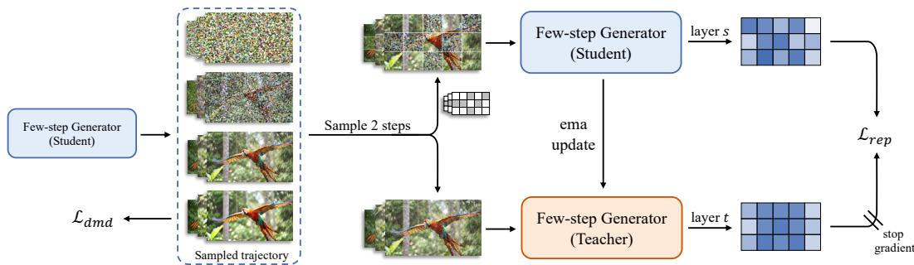
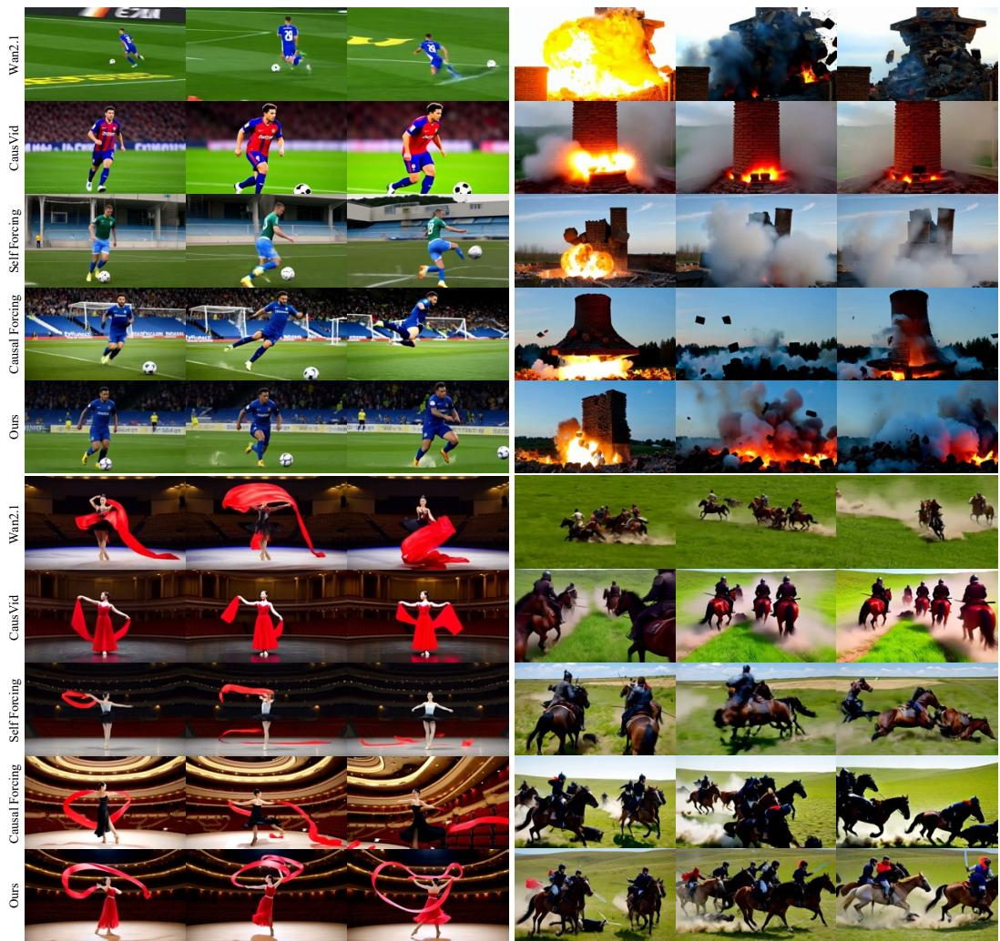
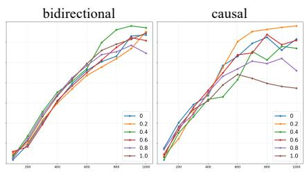
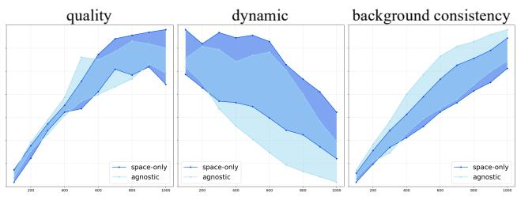
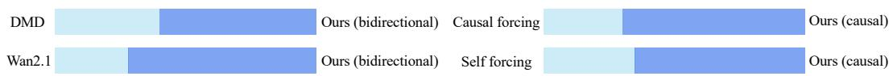
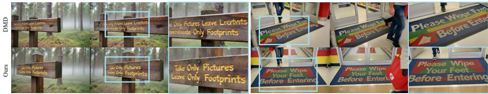
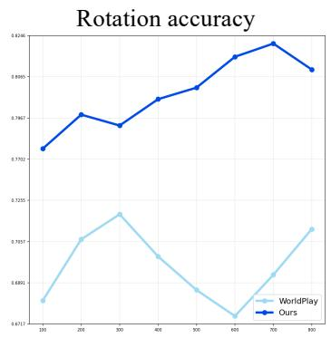
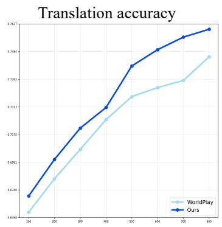
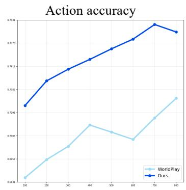
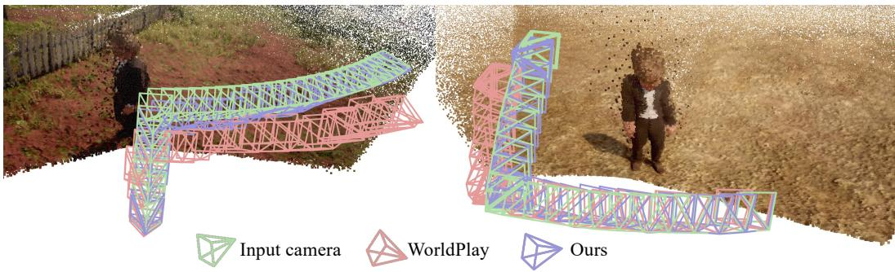

# Beyond Distribution Matching: Self-Supervised Representation Forcing for Few-Step Video Generation

Junyi Chen1,∗ Haiyu Zhang2 Zhoujie Fu3 Tengfei Wang2,† Chunchao Guo2

1Shanghai Jiao Tong University 2Hunyuan, Tencent 3Nanyang Technological University

## Abstract

Few-step distillation is essential for deploying modern video diffusion models. Among existing approaches, Distribution Matching Distillation (DMD) has emerged as a highly promising paradigm by achieving strong output-space fidelity without adversarial training, while remaining flexible across various student architectures. We observe, however, that DMD fundamentally relies on an output-space objective, lacking explicit regularization on the model’s internal representations. As the distillation step count aggressively shrinks, this output-only supervision becomes insufficient, causing the distilled student to degrade in both fine-grained spatial structures and coherent temporal dynamics. To address this limitation, we introduce Self Flow Forcing (SF2), which incorporates a predictive representation loss into the DMD framework without altering its output objective. By providing the student and an Exponential Moving Average (EMA) teacher with heterogeneous noise levels, we establish an information asymmetry. This formulation forces the student to predict the teacher’s internal representations from a more corrupted input, effectively integrating self-supervised representation alignment into distribution matching. Extensive experiments demonstrate that SF2 effectively mitigates temporal flickering and consistently improves both spatial fidelity and motion quality. Furthermore, the proposed mechanism is architecture-agnostic—seamlessly supporting both bidirectional and causal models—and requires no external feature extractors, introducing minimal computational overhead.

Project page: https://sotamak1r.github.io/SF2-web/

Code: https://github.com/SOTAMak1r/SF2/

## 1 Introduction

Video diffusion models [4, 5, 10, 15, 34] have recently delivered impressive advances in synthesizing high-fidelity, dynamic visual content. Yet, their iterative generation process typically requires tens to hundreds of denoising steps, posing a significant obstacle to real-world deployment. To bridge this gap, various few-step distillation paradigms have been explored, including Consistency Models [28, 36], Trajectory Straightening [26, 27], and Adversarial Distillation [33]. Among these, Distribution Matching Distillation (DMD) [48, 49] has emerged as a highly promising approach by achieving strong output-space fidelity, while seamlessly supporting various student architectures.

However, when DMD is applied to the video domain, a characteristic degradation emerges at very low step counts. Specifically, the few-step distilled student suffers along two critical axes of video quality: fine-grained spatial structures (e.g., text rendering, complex geometry, and small object details) become blurred or inconsistent, and motion exhibits pronounced temporal flickering and physically unnatural dynamics. We observe this dual degradation in both our bidirectional and causal baselines, suggesting that it stems from the underlying distillation formulation itself rather than specific architectural choices.

We attribute this degradation to DMD’s exclusive reliance on output-space supervision. DMD trains the student by matching its marginal samples to the teacher’s at the output level, but it lacks explicit regularization to enforce the alignment of internal representations. In standard multi-step diffusion, this output-level proxy is sufficient, as the student can gradually refine its predictions and absorb fine-grained structures through iterative denoising. As the step budget aggressively shrinks, however, this proxy becomes inadequate. The student lacks the iterative capacity to recover rich, structured internal features, leading to the observed deterioration in both spatial fidelity and temporal coherence.

A complementary perspective from self-supervised representation learning offers a natural solution to this structural degradation. Classic predictive frameworks, from masked autoencoding [12, 39] to V-JEPA [1], have established that representation-level prediction enforces robust spatiotemporal understanding. Recent methods [6, 19, 51] have successfully adapted this principle for generative models, proving that internal feature regularization directly translates to higher generation fidelity. DMD, by contrast, is entirely devoid of such explicit representation-level guidance, optimizing only the marginal output distribution.

Motivated by this observation, we introduce $\mathrm { S F } ^ { 2 } .$ , a novel paradigm that injects a predictive representation objective directly into the DMD framework without altering its output loss. The core mechanism is to establish an information asymmetry between the student and an Exponential Moving Average (EMA) teacher. By feeding the two networks with heterogeneous noise levels, we present the student with a more corrupted view of the underlying sequence and force it to predict the teacher’s robust internal representations. This formulation explicitly integrates self-supervised representation alignment into distribution matching. Importantly, our mechanism requires no external feature extractors—the teacher is a self-bootstrapped EMA of the student—and adds only one extra forward pass per iteration, remaining agnostic to the specific architectural form of the generator.

We validate $\mathrm { S F } ^ { 2 }$ across two representative video distillation settings: a bidirectional text-to-video student and a causal autoregressive student, building upon the standard ODE-initialization protocols [53]. In both scenarios, $\mathsf { \bar { S } F } ^ { 2 }$ effectively mitigates temporal flickering and consistently improves both spatial fidelity and motion quality with minimal computational overhead.

In summary, our main contributions are:

• We identify a critical limitation of applying standard DMD to video generation: its exclusive reliance on output-space supervision lacks explicit regularization for the student’s internal representations. In the few-step regime, this results in the widely observed spatial artifacts and temporal flickering.

• We propose $\mathrm { S F } ^ { 2 }$ , which incorporates a predictive representation objective into the DMD framework. By utilizing heterogeneous noise levels and an EMA teacher to create an information asymmetry, we force the student to predict the teacher’s internal representations from a more corrupted view, effectively integrating representation-level alignment with distribution matching.

• Extensive experiments on bidirectional and causal video distillation settings demonstrate that $\mathrm { S F } ^ { 2 }$ consistently enhances spatial fidelity and temporal coherence, all while requiring no external feature extractors and introducing minimal computational overhead.

## 2 Related Work

Self Flow Forcing sits at the intersection of two rapidly evolving domains: the acceleration of video diffusion models through step distillation, and the enhancement of generative paradigms via self-supervised representation learning. We briefly review both areas and position our contribution.

## 2.1 Efficient Video Distillation

Step distillation aims to compress the iterative sampling process of diffusion models into a few steps. In the image domain, paradigms such as Progressive Distillation [32], Consistency Models [28, 36], Adversarial Diffusion Distillation [33], flow-based trajectory straightening [26, 27], and Distribution Matching Distillation (DMD) [48, 49] have established the feasibility of few-step generation. These acceleration frameworks have subsequently been extended to the video domain.

This includes bidirectional text-to-video adaptations such as VideoLCM [44], T2V-Turbo [24], and PCM [42]. In parallel, causal autoregressive generation frameworks have been accelerated through CausVid [50], Self-Forcing [16], and Causal-Forcing [53]. However, a persistent commonality across these methods is their exclusive reliance on marginal output distribution supervision, leaving the student’s internal representations completely unconstrained. We identify this output-only supervision as the fundamental structural cause of the spatial degradation and temporal flickering widely observed in few-step distilled video models. Self Flow Forcing addresses this limitation by introducing a representation-level objective that operates orthogonally to the existing output objective.

## 2.2 Self-Supervised Representation Learning in Generative Models

A growing body of work demonstrates that integrating representation-level priors into generative training yields cleaner internal features and superior generation quality. This integration typically follows two distinct routes. The first route injects semantic priors directly into the latent space: methods such as VA-VAE [47], SemanticGen [2] and RAE [52] align or replace the standard VAE latents with rich semantic features from frozen external perception encoders [3, 29, 40]. The second route operates within the generative backbone itself: REPA [23, 51] aligns the intermediate layers of a diffusion transformer with these frozen external encoders during training. To remove the dependency on external extractors, SRA [19] provides representation guidance via self-distillation, while Self-Flow [6] integrates a predictive objective by feeding heterogeneous noise levels across tokens, creating an information asymmetry the network must inherently resolve.

This predictive, asymmetric paradigm is particularly crucial for the video domain. As established by architectures like V-JEPA [1] and VideoMAE [39], learning to predict the representations of masked (perturbed) observations serves as a powerful inductive bias for capturing complex spatiotemporal dynamics. However, while the aforementioned representation strategies successfully enhance the training of base multi-step generative models —which operate with large step budgets and extensive data —their potential within the highly compressed regime of few-step model distillation remains entirely unexplored. Self Flow Forcing bridges this gap. By porting the predictive representationforcing principle into video distillation via asymmetric noise, we force the student to capture robust spatiotemporal dynamics, effectively repairing the degradation of DMD without relying on external encoders.

## 3 Preliminaries

Modern video generators are dominated by diffusion and flow-matching models [25, 31], which produce high-quality samples at the cost of tens to hundreds of sequential evaluation steps. Distribution Matching Distillation (DMD) addresses this inference bottleneck by compressing such multi-step generators into few-step students via score matching in the output space. While this serves as the universal foundation for our distillation framework, evaluating few-step causal autoregressive models introduces an additional train–test mismatch, which is effectively resolved by Self-Forcing [16]. SF2 builds upon these foundational concepts, which we briefly review below.

Diffusion models. Given clean data $x _ { 0 } \sim p _ { \mathrm { d a t a } }$ , a generative forward process interpolates between the data distribution and a tractable noise distribution [14, 35]:

$$
x _ { t } = \alpha _ { t } x _ { 0 } + \sigma _ { t } \epsilon , \qquad \epsilon \sim { \mathcal { N } } ( 0 , { \bf I } ) , \qquad t \in [ 0 , T ] ,\tag{1}
$$

where the schedule $\left( \alpha _ { t } , \sigma _ { t } \right)$ transports $x _ { 0 }$ at $t { = } 0$ to nearly pure noise at t=T. Flow matching [25], the de facto choice for modern video generators, fits the same template under a linear schedule. A neural network is trained to invert this process by predicting an interconvertible target—such as the noise ϵ, the clean data $x _ { 0 } .$ , or the velocity v—all of which fundamentally parameterize the score $\nabla _ { x _ { t } } \log { p _ { t } ( x _ { t } ) } \left[ 2 1 , 3 5 \right]$ . At inference time, however, generation requires integrating this vector field over tens to hundreds of timesteps, creating a severe sampling bottleneck.

Distribution Matching Distillation. DMD [48, 49] addresses this bottleneck by training a few-step student generator $G _ { \theta }$ . It maps a noisy latent $x _ { t }$ at timestep t directly to a clean prediction $\hat { x } _ { 0 } =$ $G _ { \theta } ( x _ { t } , t )$ , such that the student’s output distribution $p _ { \theta }$ matches the target distribution $p _ { \mathrm { r e a l } }$ implied by the frozen multi-step teacher. To bypass intractable high-dimensional distribution matching, DMD

  
Figure 1: Overview of $\mathbf { S } \mathbf { F } ^ { 2 }$ . From the student’s denoising trajectory, the cleanest prediction drives the standard DMD loss $\mathcal { L } _ { \mathrm { D M D } }$ , while two intermediate states $( x _ { t } , x _ { s } )$ with $t > s$ feed the $\mathrm { S F } ^ { 2 }$ branch: a spatial mask mixes them into an asymmetric, highly corrupted input for the student, while the EMA teacher sees only the cleaner $x _ { s }$ . Hidden states from asymmetric layers are aligned via learnable projectors with a stop-gradient cosine loss $\mathcal { L } _ { \mathrm { r e p } }$ . The teacher is updated by EMA and requires no external pre-trained features.

minimizes the reverse KL divergence:

$$
{ \mathcal { L } } _ { \mathrm { D M D } } = \mathbb { E } _ { t } [ D _ { \mathrm { K L } } ( p _ { \theta } \| p _ { \mathrm { r e a l } } ) ]\tag{2}
$$

through score matching at intermediate noise levels. Two score networks are maintained alongside the student: a frozen real-score critic $s _ { \mathrm { r e a l } } ( x _ { t } , t )$ inherited from the teacher, and a learnable fake-score critic $s _ { \psi } ( x _ { t } , t )$ tracking the student’s current output distribution and is updated via the standard denoising loss. The resulting DMD gradient applied to the student is:

$$
\nabla _ { \theta } \mathcal { L } _ { \mathrm { D M D } } ~ = ~ \mathbb { E } _ { x _ { t } , t } \Big [ \omega ( t ) \big ( s _ { \psi } ( x _ { t } , t ) - s _ { \mathrm { r e a l } } ( x _ { t } , t ) \big ) \nabla _ { \theta } G _ { \theta } ( x _ { t } , t ) \Big ] ,\tag{3}
$$

where $\omega ( t )$ is a timestep weighting. Intuitively, this gradient pushes the student’s outputs away from regions where its own samples are more likely than the teacher’s. Critically for our motivation, this learning signal is derived entirely from the marginal output space $\hat { x } _ { 0 } .$ , leaving the student’s intermediate representation layers unregularized.

Self-Forcing for causal video distillation. While standard DMD is sufficient for bidirectional video distillation, causal autoregressive video generators face an additional context-conditioning challenge. Standard teacher forcing conditions every generated chunk on clean ground-truth history, causing severe error accumulation during autoregressive inference. Diffusion forcing [7] relaxes this by assigning independent noise levels per chunk, yet the conditioning history still relies on real data rather than the model’s own predictions. Self-Forcing [16] closes this train–test gap by rolling the student out chunk-by-chunk on its own previously generated context. By propagating information via a key-value (KV) cache, training and inference share the exact same conditioning distribution. We adopt this protocol as the foundation for our causal autoregressive experiments.

## 4 Self Flow Forcing (SF2)

In this section, we present $\mathrm { S F } ^ { 2 }$ , a framework for few-step video distillation. As identified in Sec. 3, a fundamental limitation of DMD is its exclusive reliance on output-level supervision, leaving the internal representations entirely unconstrained. Under aggressive few-step compression, this unconstrained freedom becomes harmful: the student tends to converge to shortcut representations that merely minimize the marginal distribution loss, fundamentally lacking temporal and structural coherence. $\mathrm { S F } ^ { 2 }$ closes this gap by aligning the student’s intermediate features with those of an exponential-moving-average (EMA) teacher using deliberately asymmetric inputs, while preserving the original DMD output objective. Concretely, we maintain three modules during training: the student $G _ { \theta }$ , an EMA teacher $G _ { \theta ^ { \prime } }$ with identical architecture but no gradients, and the standard DMD critics $s _ { \psi }$ and $S _ { \mathrm { r e a l } }$ . The full training objective is formulated as:

$$
\mathcal { L } _ { \mathrm { t o t a l } } = \mathcal { L } _ { \mathrm { D M D } } + \lambda _ { \mathrm { r e p } } \mathcal { L } _ { \mathrm { r e p } } ,\tag{4}
$$

where $\mathcal { L } _ { \mathrm { r e p } }$ reuses the rollout that DMD already performs. Thus, the additional computational cost is dominated by a single teacher forward pass and remains independent of the number of denoising steps.

Following the pipeline illustrated in Fig. 1, we structure the remainder of this section around three core components. We first detail the construction of asymmetric inputs from a shared trajectory (Sec. 4.1). We then specify the representation loss $\mathcal { L } _ { \mathrm { r e p } } \left( \mathrm { S e c . } 4 . 2 \right)$ . Finally, we detail the EMA teacher update mechanism and projector warmup that stabilize this self-bootstrapped alignment (Sec. 4.3).

## 4.1 Asymmetric Inputs from a Shared Trajectory

In standard generative training, uniform noise is typically applied across all spatial-temporal tokens. The resulting denoising objective can often be minimized by exploiting low-level, local correlations, providing little incentive for the model to capture deep semantic structures. To break this local dependency, we draw inspiration from Self-Flow [6] and introduce information asymmetry. The core idea is to apply heterogeneous noise levels across different tokens, forcing the student to proactively infer heavily corrupted regions using the global context provided by cleaner tokens.

However, introducing this asymmetry naively—such as completely masking out a subset of tokens or assigning independent, randomized noise levels to every token—severely disrupts the underlying generative dynamics and creates a significant train–inference mismatch. To safely establish this asymmetry without compromising the generative pipeline, we adopt a dual-timestep formulation. Starting from a shared denoising trajectory, the student receives a token-level mixture of a noisier state and a cleaner state, whereas the teacher observes exclusively the cleaner state. Consequently, the student must predict the teacher’s representations from a strictly more corrupted vantage point, circumventing trivial self-reconstruction while seamlessly integrating representation learning into distribution matching.

Two trajectory states. The DMD generator loss already unrolls the student over K denoising steps $t _ { K } > \cdots > t _ { 1 }$

$$
\hat { x } _ { 0 } ^ { ( k ) } = G _ { \theta } ( x _ { t _ { k } } , t _ { k } ) , \qquad x _ { t _ { k - 1 } } = \alpha _ { t _ { k - 1 } } \hat { x } _ { 0 } ^ { ( k ) } + \sigma _ { t _ { k - 1 } } \epsilon ^ { ( k ) } ,\tag{5}
$$

producing a denoising trajectory $\{ ( x _ { t _ { k } } , t _ { k } ) \} _ { k = 1 } ^ { K }$ of progressively cleaner latents. From this trajectory, we sample two distinct steps $( t , s )$ with $t > s ,$ , giving a noisier latent $x _ { t }$ and a cleaner latent $x _ { s } .$ Because DMD is an inherently data-free distillation paradigm that relies on self-generated samples, representation alignment requires us to first synthesize valid latent states. By repurposing the trajectory already unrolled for the standard DMD objective, we efficiently obtain these intermediate states without incurring the heavy computational cost of an independent generative rollout.

Per-token spatial masking. Let the latent video feature have F frames, each tokenized into an $H _ { p } \times W _ { p }$ patch grid. We sample a binary mask $M \in \{ 0 , 1 \} ^ { B \times F \times H _ { p } \times W _ { p } }$ where each entry drawn as Bern $( \rho ) , \rho \sim \mathcal { U } ( 0 , \rho _ { \mathrm { m a x } } )$ . The student input is formulated as a per-token mixture of the two trajectory states, whereas the teacher observes exclusively the cleaner state:

$$
\tilde { x } ^ { \mathrm { s u } } = M \odot x _ { s } + ( 1 - M ) \odot x _ { t } , \qquad \tilde { x } ^ { \mathrm { t e a } } = x _ { s } .\tag{6}
$$

To properly reflect this mixture, the timestep conditioning for the student is applied heterogeneously per token—using s where $M = 1$ and t where M = 0—whereas the teacher is uniformly conditioned on s. Consequently, the student receives a random mosaic of cleaner and noisier tokens. To successfully match the teacher’s robust representations, the student is forced to aggregate global context from cleaner spatial-temporal neighbors to infer the missing semantics of the heavily corrupted regions, directly driving the formation of strong internal representations.

## 4.2 Representation Loss

Given the asymmetric inputs formulated in Sec. 4.1, we extract hidden states from two index sets of transformer blocks [11, 30] $\boldsymbol { S } = \{ \boldsymbol { s } _ { 1 } , \ldots , \boldsymbol { s } _ { L } \}$ (student) and $\mathcal { T } = \{ t _ { 1 } , \ldots , t _ { L } \}$ (teacher), each yielding tensors of shape [B, N, D]. We deliberately select teacher layers that are deeper than their corresponding student layers. As observed in recent self-supervised generative frameworks [6, 19], robust semantic representations naturally emerge in deeper network layers. Drawing targets from deeper teacher layers thus provides a stronger semantic distillation signal, while applying the loss to shallower student layers prevents the representation objective from interfering with the model’s final generative outputs.

To bridge the representation spaces, a per-layer projector $\pi _ { \ell } ( \cdot )$ maps the student features into the teacher’s domain:

$$
\tilde { h } _ { s _ { \ell } } ^ { \mathrm { s t u } } = \pi _ { \ell } \big ( h _ { s _ { \ell } } ^ { \mathrm { s t u } } \big ) ,\tag{7}
$$

which is implemented as a multi-layer perceptron (MLP) with input/output widths equal to the backbone hidden size $D$ and an internal hidden width of $4 D$ . We minimize the negative cosine similarity between projected student features and detached teacher features, averaged over tokens and layer pairs:

$$
\mathcal { L } _ { \mathrm { r e p } } = \frac { 1 } { L } \sum _ { \ell = 1 } ^ { L } \mathbb { E } _ { n } \Big [ 1 - \cos \big ( \tilde { h } _ { s _ { \ell } , n } ^ { \mathrm { s t u } } , \mathrm { s g } [ h _ { t _ { \ell } , n } ^ { \mathrm { t e a } } ] \big ) \Big ] ,\tag{8}
$$

where $\mathrm { s g } [ \cdot ]$ denotes the stop-gradient operator. We opt for cosine similarity over $\ell _ { 2 }$ distance because the EMA teacher and the student inherently operate at slightly different feature magnitude scales, making directional alignment more robust and appropriate.

## 4.3 EMA Teacher and Projector Warmup

EMA teacher. The teacher model $G _ { \theta ^ { \prime } }$ is initialized as a copy of the student and updated by the standard EMA rule

$$
\theta ^ { \prime }  \mu \theta ^ { \prime } + ( 1 - \mu ) \theta ,\tag{9}
$$

with the momentum $\mu$ set close to $1 \left( { \mathrm { e . g . , 0 . 9 9 } } \right)$ . Consequently, the teacher tracks a slowly moving, temporally smoothed version of the student. Furthermore, deriving the teacher directly from the student’s own parameter history ensures that the target representations remain strictly compatible with the model’s native capacity, avoiding the distribution mismatch often encountered when distilling from disparate external models. Crucially, this alignment is entirely self-bootstrapped, eliminating the need for any external pre-trained vision encoders.

Projector warmup. Since distillation initializes both the student and the EMA teacher from a pretrained backbone, whereas the projectors $\{ \pi _ { \ell } \}$ are initialized from scratch, the projectors inevitably output near-random vectors during the earliest training steps. Enabling the full objective at step 0 would undesirably backpropagate projector noise into the pretrained backbone and corrupt the delicate features we intend to align. To circumvent this, we implement a $T _ { \mathrm { p r o j } }$ -step projector warmup phase. During this phase, $\mathcal { L } _ { \mathrm { D M D } }$ is temporarily disabled, and the student’s hidden states $h _ { s _ { \ell } } ^ { \mathrm { s t u } }$ are detached before entering the projectors $\pi _ { \ell } .$ . Thus, only the projectors receive gradients. The teacher is kept strictly identical to the student, ensuring both backbones remain stationary while the projectors reliably calibrate against fixed targets. After the warmup concludes at step $\dot { T } _ { \mathrm { p r o j } }$ , the full objective (Eq. 4) is activated, and the EMA update (Eq. 9) begins. At this boundary, we also synchronize the projector learning rate with that of the backbone, ensuring all representation-related parameters optimize at a unified pace once the student is unfrozen.

## 5 Experiments

To evaluate the effectiveness of $\mathrm { S F } ^ { 2 }$ , we structure our experiments to answer three core questions: (1) How do the asymmetric masking strategies influence representation learning across different generation paradigms? (Sec. 5.2); (2) Does the representation alignment translate into perceptually coherent motions and detailed spatial structures? (Sec. 5.3); and (3) Does $\mathrm { S F } ^ { 2 }$ quantitatively outperform recent state-of-the-art multi-step and distilled video generators? (Sec. 5.4).

## 5.1 Experimental Setup

Implementation details. We instantiate $\mathrm { S F } ^ { 2 }$ across both bidirectional and causal paradigms to demonstrate its versatility. For the bidirectional setting, we employ two structurally distinct backbones: Wan2.1-T2V-1.3B [41] as our primary model, and HunyuanVideo-1.5 [45] to evaluate generalizability. Notably, HunyuanVideo-1.5 utilizes an MMDiT [11] architecture with strong text-rendering capabilities, serving as a stringent visual probe for spatial fidelity preservation during few-step distillation. For the causal autoregressive setting, we initialize the student from Causal-Forcing [53] ODE-regression checkpoint, enabling us to evaluate the chunk-by-chunk representation forcing under a genuine key-value (KV) cache rollout.

Table 1: Per-cycle training-time breakdown (% of one cycle). One cycle = 1 generator update + 5 critic updates. The $\mathrm { S F } ^ { 2 }$ branch is only ∼6% of the cycle.
<table><tr><td rowspan="2"></td><td colspan="4">Generator update (×1)</td><td colspan="3">Critic update (×5)</td><td rowspan="2">Total</td></tr><tr><td>Component Rollout</td><td>DMD</td><td>Ours</td><td>Backward</td><td>Rollout</td><td>MSE</td><td>Backward</td></tr><tr><td>% of cycle</td><td>4.4</td><td>20.1</td><td>6.2</td><td>6.4</td><td>25.0</td><td>8.7</td><td>29.2</td><td>100.0</td></tr></table>

All configurations follow the established recipe [16, 48], wherein the two score critics are drawn from the student’s model family. Specifically, for the Wan2.1-based students (both bidirectional and causal), we use the frozen Wan2.1-14B [41] as the real-score model and initialize the learnable fake-score model from Wan2.1-1.3B. For the HunyuanVideo-1.5 bidirectional student, the real-score model is the frozen HunyuanVideo-1.5 [45] and the fake-score model is initialized from the same HunyuanVideo-1.5 checkpoint. We use K=4 denoising steps for both bidirectional and causal students. To ensure structural consistency across different backbones, the $\mathrm { S F } ^ { 2 }$ branch extracts features based on fixed depth ratios rather than absolute layer indices: the student and teacher features are read at depths $\ell _ { \theta } { \bar { = } } 0 . 3 N _ { b }$ and $\ell _ { \theta ^ { \prime } } { = } 0 . 7 N _ { b } .$ , respectively, where $N _ { b }$ is the total number of transformer blocks. These features are aligned via an MLP projector (hidden dimension 4D) with a representation loss weight $\lambda _ { \mathrm { { r e p } } } { = } 0 . 5$ . The EMA teacher uses momentum $\mu { = } 0 . 9 9$ with a 100-step projector-only warmup, during which the projector’s learning rate is amplified 50×. Optimization is performed using AdamW at $1 \mathrm { r } _ { G } { = } 2 { \times } 1 0 ^ { - 6 }$ and $\scriptstyle \mathbf { l r } _ { C } = 4 \times 1 0 ^ { - 7 }$ at a 5:1 critic-to-generator update ratio.

Training cost. To quantify the overhead of $\mathrm { S F } ^ { 2 }$ on top of vanilla DMD, we profile one training cycle (1 generator update + 5 critic updates, per the 5:1 ratio). Table 1 reports the wall-clock breakdown by phase and component. The $\mathrm { S F } ^ { 2 }$ branch — EMA teacher forward, projector pass, and cosine alignment accounts for ∼6% of the cycle, while the remaining ∼94% is consumed by the DMD generator and critic update that the baseline already pays. $\mathrm { S F } ^ { 2 }$ is therefore essentially free: the cost of the additional supervisory signal is dwarfed by the score-distillation loop that surrounds it.

To quantify the computational overhead introduced by $\mathrm { S F } ^ { 2 }$ , we profile a complete training cycle (one generator update and five critic updates) built on top of vanilla DMD.

Evaluation metrics. Our primary evaluation protocol is VBench [17]: we run the official prompt suite and report the Total Score, Quality Score, and Semantic scores. To complement these distributional metrics with a per-sample measure of human visual preference, we additionally report the VisionReward [46] score — a learned reward model trained to predict human preferences over generated videos, which is computed on a curated 100-prompt set with rich motion and complex actions provided by [53]. We further report Throughput (samples/s) and Latency (s/sample) on a single H100 GPU. For ablations we use VBench Quality as the headline single-number proxy.

## 5.2 Ablation Experiments

We study the two design choices introduced by the asymmetric input construction (Sec. 4.1): the masking ratio $\rho _ { \mathrm { m a x } }$ and the mask sampling pattern. All curves below report VBench-style scores — evaluated using the VBench [17] metric heads on a held-out validation set of 400 motion-rich prompts generated by GPT-5 — as a function of training step, which exposes both the final performance and the convergence behavior of each variant.

Masking ratio. Fig. 3(a) sweeps the the masking ratio $\rho _ { \operatorname* { m a x } } \in \{ 0 , 0 . 2 , 0 . 4 , 0 . 6 , 0 . 8 , 1 . 0 \}$ on both settings (left: bidirectional Wan2.1-1.3B; right: causal Wan2.1-1.3B initialized from Causal-Forcing). The two paradigms differ in where this optimum sits: the bidirectional student model peaks at $\rho _ { \mathrm { m a x } } { = } 0 . 4$ , while the causal student model peaks at $\rho _ { \mathrm { m a x } } { = } 0 . 2$ . The shift towards a smaller optimum in the causal setting reflects its narrower per-step token budget: each forward pass only sees the history chunks, so at the same $\rho _ { \mathrm { m a x } }$ fewer clean tokens remain to anchor the alignment, and the rep target quickly becomes too noisy. The bidirectional student, which denoises the full window at once, has a much larger pool of clean tokens and tolerates a more aggressive mask.

  
Figure 2: Qualitative comparison on causal few-step T2V generation. Top row: multi-step bidirectional Wan2.1 teacher. Rows 2–5: few-step distilled causal students (CausVid, Self-Forcing, Causal-Forcing, $\mathrm { S F } ^ { 2 } )$ . The four panels expose four facets of representation-level coherence that the rep loss is designed to compress into the student: articulated-motion plausibility (top-left), event irreversibility (top-right), object persistence (bottom-left), and scene-structural stability (bottomright). $\mathrm { S F } ^ { 2 }$ satisfies all four, whereas baselines fail in distinct ways on each.

  
(a) Masking ratio

  
(b) Mask sampling  
Figure 3: Hyperparameter selection for asymmetric inputs. (a) Masking ratio $\rho _ { \mathrm { m a x } } .$ . The two paradigms peak at different optima $- \rho _ { \mathrm { m a x } } { = } 0 . 4$ for bidirectional and $\rho _ { \mathrm { m a x } } { = } 0 . 2$ for causal — which we adopt as defaults in the following experiments. (b) Mask sampling pattern. Space-only sampling (a single $H _ { p } \times W _ { p }$ mask broadcast across all frames) versus agnostic sampling (independent per-token masking) on VBench’s Quality Score, Dynamic Degree, and Background Consistency.

Table 2: Quantitative comparison with existing methods on VBench [17] and VisionReward [46]. Models are grouped by sampling regime — bidirectional multi-step, distilled bidirectional, autoregressive multi-step, and distilled autoregressive — and bold marks the best score within each comparable group. Throughput is in FPS and latency in second, both measured on a single H100. All distilled models (in both distilled groups) share the same Wan2.1-T2V-1.3B backbone.
<table><tr><td>Model</td><td>Params</td><td>Throughput ↑</td><td>Latency ↓</td><td>Resolution</td><td>Total ↑</td><td>Quality ↑</td><td>Semantic ↑</td><td>Vision. ↑</td></tr><tr><td colspan="9">Bidirectional Video Diffusion Models</td></tr><tr><td>LTX-Video [13]</td><td>1.9B</td><td>8.98</td><td>13.5</td><td>768×512</td><td>79.83</td><td>81.88</td><td>71.62</td><td>-6.218</td></tr><tr><td>Wan2.1 [41]</td><td>1.3B</td><td>0.78</td><td>103</td><td>848×480</td><td>83.37</td><td>84.30</td><td>79.65</td><td>5.275</td></tr><tr><td colspan="9">Distilled Bidirectional Video Models</td></tr><tr><td>CausVid [50]</td><td>1.3B</td><td>16.2</td><td>4.22</td><td>848×480</td><td>83.19</td><td>84.08</td><td>79.63</td><td>5.310</td></tr><tr><td>Ours</td><td>1.3B</td><td>16.2</td><td>4.22</td><td>848×480</td><td>84.15</td><td>84.92</td><td>81.07</td><td>7.060</td></tr><tr><td colspan="9">Autoregressive Video Diffusion Models</td></tr><tr><td>Pyramid Flow [20]</td><td>2B</td><td>6.70</td><td>2.5</td><td>640×384</td><td>80.75</td><td>83.41</td><td>70.11</td><td>4.055</td></tr><tr><td>SkyReels-V2 [8]</td><td>1.3B</td><td>0.49</td><td>112</td><td>960×540</td><td>81.97</td><td>83.96</td><td>74.01</td><td>3.584</td></tr><tr><td>MAGI-1 [38]</td><td>4.5B</td><td>0.19</td><td>282</td><td>848×480</td><td>78.88</td><td>81.67</td><td>67.72</td><td>0.773</td></tr><tr><td colspan="9">Distilled Autoregressive Video Models</td></tr><tr><td>CausVid [50]</td><td>1.3B</td><td>17.0</td><td>0.69</td><td>848×480</td><td>81.33</td><td>83.98</td><td>70.72</td><td>5.741</td></tr><tr><td>Self-Forcing [16]</td><td>1.3B</td><td>17.0</td><td>0.69</td><td>848×480</td><td>83.74</td><td>84.48</td><td>80.77</td><td>5.820</td></tr><tr><td>Causal-Forcing [53]</td><td>1.3B</td><td>17.0</td><td>0.69</td><td>848×480</td><td>84.04</td><td>84.59</td><td>81.84</td><td>6.326</td></tr><tr><td>Ours</td><td>1.3B</td><td>17.0</td><td>0.69</td><td>848×480</td><td>84.15</td><td>84.67</td><td>82.06</td><td>7.523</td></tr></table>

Mask sampling pattern. Fig. 3(b) compares the two mask sampling patterns [12]: (i) space-only, where a single $\bar { H _ { p } } \times W _ { p }$ binary mask is sampled and broadcast across all frames in the window; and (ii) agnostic, where each spatio-temporal token is masked independently. To decouple the comparison from any specific choice of $\rho _ { \mathrm { m a x } } ,$ , we run each scheme on the causal student at four masking ratios $\rho _ { \operatorname* { m a x } } \in \{ 0 . 2 , 0 . 4 , 0 . 6 , 0 . 8 \}$ , and plot the [min, max] envelope across the four runs as a function of training step. A higher band therefore reflects an improvement that is consistent across the entire ratio range, not the artifact of a single lucky setting.

The two patterns reach comparable Quality (with space-only attaining a higher ceiling at convergence), but split on the two temporal-coherence metrics: space-only yields a higher Dynamic Degree, while agnostic produces a higher Background Consistency. We attribute this trade-off to a temporal-copy shortcut: under agnostic sampling, each masked token is likely left clean at the same spatial location in an adjacent frame, so the student can minimize the rep loss by copying along the time axis — biasing it toward over-similar adjacent frames, which inflates background consistency and suppresses motion. Space-only sampling closes the shortcut: with the same mask broadcast across all frames, every spatial location is either clean or masked throughout the entire window, forcing reconstruction from spatial neighbors instead of from another time step. We adopt space-only as the default.

## 5.3 Qualitative Results

Causal autoregressive. Fig. 2 compares autoregressive rollouts on identical prompts and seeds for the multi-step Wan2.1 teacher and four few-step distilled causal students: CausVid [50], Self-Forcing [16], Causal-Forcing [53], and $\mathrm { S F } ^ { 2 }$ . The improvement of $\mathrm { S F } ^ { 2 }$ over the baselines is the global, physically-grounded structure that the rep loss compresses into the student’s hidden states, which surfaces as four distinct facets of representation-level coherence across the figure. (Top-left) Articulated-motion plausibility: the soccer player’s pose stays anatomically valid frame to frame, while baselines produce snapping or rerouted limbs. (Top-right) Event irreversibility: the destroyed wall stays destroyed, whereas baselines reconstitute or even regrow it across consecutive frames. (Bottom-left) Object persistence: the red ribbon remains a single continuous object throughout the dance, instead of vanishing, splitting, or warping. (Bottom-right) Scene-structural stability: horse and rider counts, identities, and overall layout stay coherent. Each baseline failure is a different symptom of the same missing internal abstraction, and $\mathrm { S F } ^ { 2 }$ addresses all four through a single representation-level objective.

Bidirectional T2V. Fig. 5 compares two few-step HunyuanVideo-1.5 students — the plain DMD baseline and $\mathrm { S F } ^ { 2 } - \mathrm { o n }$ n prompts containing in-scene text. We use HunyuanVideo-1.5 here precisely because its multi-step teacher already renders non-trivial text; any degradation under distillation therefore directly probes how much fine spatial structure the student retains. The DMD student loses this ability: glyphs become blurred, distorted, or scrambled into wrong characters, indicating that output-only supervision is too coarse to preserve the highly structured spatial features that text requires. Adding the rep loss restores it: $\mathrm { S F } ^ { \frac { \mathbf { \lambda } } { 2 } }$ produces sharp, legible text across all four prompts. Since text rendering is a stringent visual probe of spatial representation quality, this is direct evidence that $\mathrm { S F } ^ { 2 }$ strengthens the student’s internal spatial features.

  
Figure 4: Pairwise quantitative comparison. All compared methods share the same Wan2.1-T2V-$1 . { \overset { \sim } { 3 } } \mathbf { B }$ backbone. Each bar shows the per-prompt preference of VisionReward [46]; the dark-blue segment is the fraction of prompts on which $\mathrm { S F } ^ { 2 ^ { - } }$ is preferred. $\mathrm { S F } ^ { 2 }$ wins the majority of prompts against all four baselines, on both bidirectional (DMD, multi-step Wan2.1 base model) and causal (Causal-Forcing, Self-Forcing) sides.

  
Figure 5: Qualitative comparison on bidirectional few-step T2V generation. Both compared methods are distilled from the same HunyuanVideo-1.5 backbone. Each pair shows the DMD student (top) and $\mathrm { S F } ^ { 2 }$ (bottom) on the same prompt and noise; a zoomed crop on the right of each panel highlights the rendered text. Across all four prompts, $\mathrm { S F } ^ { \acute { 2 } }$ produces sharp, legible glyphs where DMD collapses into blurred or scrambled characters, indicating that the rep loss strengthens the student’s spatial representation.

## 5.4 Quantitative Comparison

Table 2 reports the main comparison. At matched throughput and latency, $\mathrm { S F } ^ { 2 }$ attains the best score on every reported metric within both the Distilled Autoregressive and Distilled Bidirectional groups. We attribute these consistent gains to the rep loss directly stabilizing the student’s intermediate features, which simultaneously raises per-frame fidelity and semantic / motion coherence without compromising any individual axis.

Direct pairwise comparison. The aggregate VisionReward scores in Table 2 are averaged over the prompt set; to confirm that the advantage of $\mathrm { S F } ^ { 2 }$ is consistent at the prompt level rather than driven by a handful of outliers, we run a test on the curated 100-prompt motion-rich set. For each prompt we generate two videos and let VisionReward [46] pick the preferred one. Four pairings are evaluated, spanning both paradigms. As shown in Fig. 4, $\bar { \mathrm { S F } } ^ { 2 }$ is preferred on the majority of prompts against every baseline, including the Wan2.1 base model.

Probing representation quality. We curate 120 prompts depicting static scenes under smooth camera trajectories, reconstruct each generated video into a 3D Gaussian Splatting [22] representation via WorldMirror-2 [18], re-render along the original trajectory, and report PSNR / SSIM / LPIPS against the generated frames, alongside VBench’s Temporal Flickering and Subject Consistency as direct measures of frame-level coherence. On top of HunyuanVideo-1.5, SF2 improves over vanilla DMD on every reconstruction and coherence metric at matched Dynamic Degree (Table 3). Since no 3D supervision is used at any stage of training, this gain is attributable solely to the featurelevel alignment of Sec. 4, providing direct evidence that the rep loss shapes the student’s internal representation rather than only its output distribution.

To rigorously quantify the robustness of the learned internal representations, we test how faithfully a generated video can be reconstructed as a unified 3D scene. Specifically, if the model has learned a strong internal representation, its generated videos will maintain strict temporal consistency, which naturally leads to highly accurate 3D reconstructions with minimal rendering error. We curate 120 prompts featuring static scenes navigated by smooth camera trajectories. Each generated video is lifted into a 3D Gaussian Splatting [22] space via WorldMirror-2 [18] and re-rendered along its original camera path. We report the reconstruction fidelity (PSNR, SSIM, and LPIPS) against the original generated frames, alongside VBench’s Temporal Flickering and Subject Consistency metrics to directly assess frame-level continuity. As reported in Table 3, $\bar { \mathrm { S F } ^ { 2 } }$ (applied to the HunyuanVideo-1.5 backbone) strictly surpasses the vanilla DMD baseline across every reconstruction and coherence metric, while maintaining an equivalent Dynamic Degree. Crucially, since no 3D supervision is injected at any stage of training, these geometric and temporal improvements are solely attributable to the feature-level alignment formulated in Sec. 4. This serves as compelling quantitative evidence that the $\mathrm { S F } ^ { 2 }$ mechanism fundamentally enhances the student’s intrinsic spatial-temporal awareness, moving beyond mere output-level distribution matching.

Figure 6: Quantitative evaluation on interactive video generation. We evaluate the adherence of the generated video to the input camera and action conditions. Compared to the WorldPlay baseline, $\mathrm { S F } ^ { 2 }$ achieves notably higher translation, rotation, and action accuracy across training steps, demonstrating that a stronger internal representation leads to more precise state transitions in interactive environments.  
  
Figure 7: Qualitative camera trajectory alignment. Reconstructed 3D point clouds and camera trajectories from the generated videos. The trajectory produced by $\mathrm { S F } ^ { 2 } \mathrm { ( b l u e ) }$ tightly tracks the input condition $( { \mathrm { g r e e n } } )$ , whereas the WorldPlay baseline $( \mathrm { r e d } )$ exhibits severe drift. This visualizes how the stronger internal representation of $\mathrm { S F } ^ { 2 }$ enforces strict adherence to complex control signals.

Application: Interactive long video generation. To further demonstrate the versatility of $\mathrm { S F } ^ { 2 }$ , we extend our evaluation to an interactive video generation [9] setting using WorldPlay [37]. WorldPlay is a causal autoregressive model that synthesizes interactive environments, conditioned on camera and action inputs. The original WorldPlay relies on an output-space distillation method akin to Self-Forcing [16]. We upgrade this distillation pipeline with $\mathrm { S F } ^ { 2 }$ and evaluate the model’s ability to follow complex control signals. For evaluation, we condition the models on a sequence of input camera trajectories, compute the actual synthesized camera poses from the generated long videos using WorldMirror-2 [18], and measure their alignment with the ground-truth input conditions. As illustrated in Fig. $6 , \mathsf { S F } ^ { 2 }$ achieves significantly higher translation accuracy, rotation accuracy, and overall action accuracy across training steps compared to the WorldPlay baseline. Furthermore, Fig. 7 visualizes the the camera trajectories. The trajectory generated by $\mathrm { S F } ^ { 2 }$ visibly conforms much closer to the input ground-truth camera path, whereas the baseline trajectory drifts. This affirms a core insight: interactive autoregressive generation is fundamentally a state-transition learning problem. By enforcing a more compact and structurally coherent internal representation, $\mathrm { S F } ^ { 2 }$ equips the model to learn more precise state transitions, directly resulting in generated environments that strictly obey external conditional controls.

Table 3: Probing representation quality via re-rendering and frame-level coherence. We report PSNR / SSIM / LPIPS against the generated frames, plus VBench Temporal Flickering and Background Consistency. $\mathrm { S F } ^ { 2 }$ improves over vanilla DMD on every reconstruction and coherence metric at matched Dynamic Degree, despite using no 3D supervision during training.
<table><tr><td>Model</td><td>Params</td><td>Throughput</td><td>PSNR↑</td><td>SSIM↑</td><td>LPIPS↓</td><td>Dynamic ↑</td><td>Flickering ↑</td><td>Consistency ↑</td></tr><tr><td>DMD (Ours w/o  $\scriptstyle { \mathcal { L } } _ { \mathrm { r e p } } )$ </td><td>8.3B</td><td>2.21</td><td>20.64</td><td>0.6982</td><td>0.2144</td><td>90.00</td><td>96.39</td><td>94.11</td></tr><tr><td>Ours</td><td>8.3B</td><td>2.21</td><td>21.24</td><td>0.7110</td><td>0.2096</td><td>90.00</td><td>96.86</td><td>94.65</td></tr></table>

## 6 Conclusion

We presented $\mathrm { S F } ^ { 2 }$ , which closes a structural blind spot of DMD by adding a predictive representation objective on top of its output loss. Through asymmetric inputs and a self-bootstrapped EMA teacher, the student is forced to align its internal features with the teacher’s under information loss, supplying the representation-level signal DMD lacks. The mechanism is paradigm-agnostic and adds negligible cost, and consistently improves both spatial fidelity and temporal coherence across bidirectional and causal video generators on architecturally distinct backbones. We view $\mathrm { S F } ^ { 2 }$ as evidence that, in the few-step regime, what the student learns to represent matters as much as what it learns to output.

## References

[1] M. Assran, A. Bardes, D. Fan, Q. Garrido, R. Howes, M. Komeili, M. Muckley, A. Rizvi, C. Roberts, K. Sinha, A. Zholus, S. Arnaud, A. Gejji, A. Martin, F. Robert Hogan, D. Dugas, P. Bojanowski, V. Khalidov, P. Labatut, F. Massa, M. Szafraniec, K. Krishnakumar, Y. Li, X. Ma, S. Chandar, F. Meier, Y. LeCun, M. Rabbat, and N. Ballas. V-jepa 2: Self-supervised video models enable understanding, prediction and planning. arXiv preprint arXiv:2506.09985, 2025.

[2] J. Bai, X. Wu, X. Wang, X. Fu, Y. Zhang, Q. Wang, X. Shi, M. Xia, Z. Liu, H. Hu, et al. Semanticgen: Video generation in semantic space. arXiv preprint arXiv:2512.20619, 2025.

[3] S. Bai, K. Chen, X. Liu, J. Wang, W. Ge, S. Song, K. Dang, P. Wang, S. Wang, J. Tang, H. Zhong, Y. Zhu, M. Yang, Z. Li, J. Wan, P. Wang, W. Ding, Z. Fu, Y. Xu, J. Ye, X. Zhang, T. Xie, Z. Cheng, H. Zhang, Z. Yang, H. Xu, and J. Lin. Qwen2.5-vl technical report. arXiv preprint arXiv:2502.13923, 2025.

[4] A. Blattmann, T. Dockhorn, S. Kulal, D. Mendelevitch, M. Kilian, D. Lorenz, Y. Levi, Z. English, V. Voleti, A. Letts, et al. Stable video diffusion: Scaling latent video diffusion models to large datasets. arXiv preprint arXiv:2311.15127, 2023.

[5] T. Brooks, B. Peebles, C. Holmes, W. DePue, Y. Guo, L. Jing, D. Schnurr, J. Taylor, T. Luhman, E. Luhman, et al. Video generation models as world simulators. OpenAI Blog, 1(8):1, 2024.

[6] H. Chefer, P. Esser, D. Lorenz, D. Podell, V. Raja, V. Tong, A. Torralba, and R. Rombach. Self-supervised flow matching for scalable multi-modal synthesis. arXiv preprint arXiv:2603.06507, 2026.

[7] B. Chen, D. Martí Monsó, Y. Du, M. Simchowitz, R. Tedrake, and V. Sitzmann. Diffusion forcing: Next-token prediction meets full-sequence diffusion. Advances in Neural Information Processing Systems, 37:24081–24125, 2025.

[8] G. Chen, D. Lin, J. Yang, C. Lin, J. Zhu, M. Fan, H. Zhang, S. Chen, Z. Chen, C. Ma, et al. Skyreels-v2: Infinite-length film generative model. arXiv preprint arXiv:2504.13074, 2025.

[9] J. Chen, H. Zhu, X. He, Y. Wang, J. Zhou, W. Chang, Y. Zhou, Z. Li, Z. Fu, J. Pang, et al. Deepverse: 4d autoregressive video generation as a world model. arXiv preprint arXiv:2506.01103, 2025.

[10] J. Chen, T. He, Z. Fu, P. Wan, K. Gai, and W. Ye. Vino: A unified visual generator with interleaved omnimodal context. arXiv preprint arXiv:2601.02358, 2026.

[11] P. Esser, S. Kulal, A. Blattmann, R. Entezari, J. Müller, H. Saini, Y. Levi, D. Lorenz, A. Sauer, F. Boesel, et al. Scaling rectified flow transformers for high-resolution image synthesis. In Forty-first international conference on machine learning, 2024.

[12] C. Feichtenhofer, H. Fan, Y. Li, and K. He. Masked autoencoders as spatiotemporal learners. arXiv:2205.09113, 2022.

[13] Y. HaCohen, N. Chiprut, B. Brazowski, D. Shalem, D. Moshe, E. Richardson, E. Levin, G. Shiran, N. Zabari, O. Gordon, P. Panet, S. Weissbuch, V. Kulikov, Y. Bitterman, Z. Melumian, and O. Bibi. Ltx-video: Realtime video latent diffusion. arXiv preprint arXiv:2501.00103, 2024.

[14] J. Ho, A. Jain, and P. Abbeel. Denoising diffusion probabilistic models. In NeurIPS, 2020.

[15] J. Ho, T. Salimans, A. Gritsenko, W. Chan, M. Norouzi, and D. J. Fleet. Video diffusion models. arXiv:2204.03458, 2022.

[16] X. Huang, Z. Li, G. He, M. Zhou, and E. Shechtman. Self forcing: Bridging the train-test gap in autoregressive video diffusion. arXiv preprint arXiv:2506.08009, 2025.

[17] Z. Huang, Y. He, J. Yu, F. Zhang, C. Si, Y. Jiang, Y. Zhang, T. Wu, Q. Jin, N. Chanpaisit, Y. Wang, X. Chen, L. Wang, D. Lin, Y. Qiao, and Z. Liu. VBench: Comprehensive benchmark suite for video generative models. In Proceedings ofthe IEEE/CVF Conference on Computer Vision and Pattern Recognition, 2024.

[18] T. HY-World. Hy-world 2.0: A multi-modal world model for reconstructing, generating, and simulating 3d worlds. arXiv preprint, 2026.

[19] D. Jiang, M. Wang, L. Li, L. Zhang, H. Wang, W. Wei, G. Dai, Y. Zhang, and J. Wang. No other representation component is needed: Diffusion transformers can provide representation guidance by themselves. arXiv preprint arXiv:2505.02831, 2025.

[20] Y. Jin, Z. Sun, N. Li, K. Xu, K. Xu, H. Jiang, N. Zhuang, Q. Huang, Y. Song, Y. Mu, and Z. Lin. Pyramidal flow matching for efficient video generative modeling. 2024.

[21] T. Karras, M. Aittala, T. Aila, and S. Laine. Elucidating the design space of diffusion-based generative models. In Proc. NeurIPS, 2022.

[22] B. Kerbl, G. Kopanas, T. Leimkühler, and G. Drettakis. 3d gaussian splatting for real-time radiance field rendering. ACM Transactions on Graphics, 42(4), July 2023. URL https://repo-sam.inria.fr/fu ngraph/3d-gaussian-splatting/.

[23] X. Leng, J. Singh, Y. Hou, Z. Xing, S. Xie, and L. Zheng. Repa-e: Unlocking vae for end-to-end tuning with latent diffusion transformers. arXiv preprint arXiv:2504.10483, 2025.

[24] J. Li, W. Feng, T.-J. Fu, X. Wang, S. Basu, W. Chen, and W. Y. Wang. T2v-turbo: Breaking the quality bottleneck of video consistency model with mixed reward feedback. Advances in neural information processing systems, 37:75692–75726, 2024.

[25] Y. Lipman, R. T. Chen, H. Ben-Hamu, M. Nickel, and M. Le. Flow matching for generative modeling. arXiv preprint arXiv:2210.02747, 2022.

[26] X. Liu, C. Gong, and Q. Liu. Flow straight and fast: Learning to generate and transfer data with rectified flow. arXiv preprint arXiv:2209.03003, 2022.

[27] X. Liu, X. Zhang, J. Ma, J. Peng, et al. Instaflow: One step is enough for high-quality diffusion-based text-to-image generation. In The Twelfth International Conference on Learning Representations, 2023.

[28] S. Luo, Y. Tan, L. Huang, J. Li, and H. Zhao. Latent consistency models: Synthesizing high-resolution images with few-step inference. arXiv preprint arXiv:2310.04378, 2023.

[29] M. Oquab, T. Darcet, T. Moutakanni, H. Vo, M. Szafraniec, V. Khalidov, P. Fernandez, D. Haziza, F. Massa, A. El-Nouby, et al. Dinov2: Learning robust visual features without supervision. arXiv preprint arXiv:2304.07193, 2023.

[30] W. Peebles and S. Xie. Scalable diffusion models with transformers. arXiv preprint arXiv:2212.09748, 2022.

[31] R. Rombach, A. Blattmann, D. Lorenz, P. Esser, and B. Ommer. High-resolution image synthesis with latent diffusion models. In Proceedings of the IEEE/CVF conference on computer vision and pattern recognition, pages 10684–10695, 2022.

[32] T. Salimans and J. Ho. Progressive distillation for fast sampling of diffusion models. arXiv preprint arXiv:2202.00512, 2022.

[33] A. Sauer, D. Lorenz, A. Blattmann, and R. Rombach. Adversarial diffusion distillation. In European Conference on Computer Vision, pages 87–103. Springer, 2024.

[34] U. Singer, A. Polyak, T. Hayes, X. Yin, J. An, S. Zhang, Q. Hu, H. Yang, O. Ashual, O. Gafni, et al. Make-a-video: Text-to-video generation without text-video data. arXiv preprint arXiv:2209.14792, 2022.

[35] Y. Song, J. Sohl-Dickstein, D. P. Kingma, A. Kumar, S. Ermon, and B. Poole. Score-based generative mod eling through stochastic differential equations. In International Conference on Learning Representations, 2021. URL https://openreview.net/forum?id=PxTIG12RRHS.

[36] Y. Song, P. Dhariwal, M. Chen, and I. Sutskever. Consistency models. arXiv preprint arXiv:2303.01469, 2023.

[37] W. Sun, H. Zhang, H. Wang, J. Wu, Z. Wang, Z. Wang, Y. Wang, J. Zhang, T. Wang, and C. Guo. Worldplay: Towards long-term geometric consistency for real-time interactive world model. arXiv preprint, 2025.

[38] H. Teng, H. Jia, L. Sun, L. Li, M. Li, M. Tang, S. Han, T. Zhang, W. Zhang, W. Luo, et al. Magi-1: Autoregressive video generation at scale. arXiv preprint arXiv:2505.13211, 2025.

[39] Z. Tong, Y. Song, J. Wang, and L. Wang. VideoMAE: Masked autoencoders are data-efficient learners for self-supervised video pre-training. In Advances in Neural Information Processing Systems, 2022.

[40] M. Tschannen, A. Gritsenko, X. Wang, M. F. Naeem, I. Alabdulmohsin, N. Parthasarathy, T. Evans, L. Beyer, Y. Xia, B. Mustafa, et al. Siglip 2: Multilingual vision-language encoders with improved semantic understanding, localization, and dense features. arXiv preprint arXiv:2502.14786, 2025.

[41] A. Wang, B. Ai, B. Wen, C. Mao, C.-W. Xie, D. Chen, F. Yu, H. Zhao, J. Yang, J. Zeng, J. Wang, J. Zhang, J. Zhou, J. Wang, J. Chen, K. Zhu, K. Zhao, K. Yan, L. Huang, M. Feng, N. Zhang, P. Li, P. Wu, R. Chu, R. Feng, S. Zhang, S. Sun, T. Fang, T. Wang, T. Gui, T. Weng, T. Shen, W. Lin, W. Wang, W. Wang, W. Zhou, W. Wang, W. Shen, W. Yu, X. Shi, X. Huang, X. Xu, Y. Kou, Y. Lv, Y. Li, Y. Liu, Y. Wang, Y. Zhang, Y. Huang, Y. Li, Y. Wu, Y. Liu, Y. Pan, Y. Zheng, Y. Hong, Y. Shi, Y. Feng, Z. Jiang, Z. Han, Z.-F. Wu, and Z. Liu. Wan: Open and advanced large-scale video generative models. arXiv preprint arXiv:2503.20314, 2025.

[42] F.-Y. Wang, Z. Huang, A. W. Bergman, D. Shen, P. Gao, M. Lingelbach, K. Sun, W. Bian, G. Song, Y. Liu, et al. Phased consistency model. arXiv preprint arXiv:2405.18407, 2024.

[43] W. Wang and Y. Yang. Vidprom: A million-scale real prompt-gallery dataset for text-to-video diffusion models. 2024. URL https://openreview.net/forum?id=pYNl76onJL.

[44] X. Wang, S. Zhang, H. Zhang, Y. Liu, Y. Zhang, C. Gao, and N. Sang. Videolcm: Video latent consistency model. arXiv preprint arXiv:2312.09109, 2023.

[45] B. Wu, C. Zou, C. Li, D. Huang, F. Yang, H. Tan, J. Peng, J. Wu, J. Xiong, J. Jiang, et al. Hunyuanvideo 1.5 technical report. arXiv preprint arXiv:2511.18870, 2025.

[46] J. Xu, Y. Huang, J. Cheng, Y. Yang, J. Xu, Y. Wang, W. Duan, S. Yang, Q. Jin, S. Li, et al. Visionreward: Fine-grained multi-dimensional human preference learning for image and video generation. In Proceedings of the AAAI Conference on Artificial Intelligence, volume 40, pages 11269–11277, 2026.

[47] J. Yao, B. Yang, and X. Wang. Reconstruction vs. generation: Taming optimization dilemma in latent diffusion models. In Proceedings of the IEEE/CVF Conference on Computer Vision and Pattern Recognition, 2025.

[48] T. Yin, M. Gharbi, T. Park, R. Zhang, E. Shechtman, F. Durand, and W. T. Freeman. Improved distribution matching distillation for fast image synthesis. In NeurIPS, 2024.

[49] T. Yin, M. Gharbi, R. Zhang, E. Shechtman, F. Durand, W. T. Freeman, and T. Park. One-step diffusion with distribution matching distillation. In CVPR, 2024.

[50] T. Yin, Q. Zhang, R. Zhang, W. T. Freeman, F. Durand, E. Shechtman, and X. Huang. From slow bidirectional to fast autoregressive video diffusion models. In CVPR, 2025.

[51] S. Yu, S. Kwak, H. Jang, J. Jeong, J. Huang, J. Shin, and S. Xie. Representation alignment for generation: Training diffusion transformers is easier than you think. In International Conference on Learning Representations, 2025.

[52] B. Zheng, N. Ma, S. Tong, and S. Xie. Diffusion transformers with representation autoencoders. arXiv preprint arXiv:2510.11690, 2025.

[53] H. Zhu, M. Zhao, G. He, H. Su, C. Li, and J. Zhu. Causal forcing: Autoregressive diffusion distillation done right for high-quality real-time interactive video generation. arXiv preprint arXiv:2602.02214, 2026.

Algorithm 1 Training of Self Flow Forcing.   
Require: Denoising timesteps $\{ t _ { 1 } , \ldots , t _ { K } \}$ with $t _ { 1 } > \cdots > t _ { K }$   
Require: Student generator ${ \bf \bar { \it G } } _ { \theta } ,$ , EMA teacher Gθ′ $( \theta ^ { \prime }  \theta )$   
Require: Fake-score critic $s _ { \theta } ,$ frozen real-score $s _ { t a r g e t }$   
Require: Per-layer projectors $\{ \pi _ { \ell } \} _ { \ell = 1 } ^ { L }$ , layer indices $s , \tau$   
Require: Loss weight $\lambda _ { \mathrm { { r e p } } } ,$ mask ratio $\rho _ { \mathrm { m a x } } ,$ EMA momentum $\mu$   
Require: Warmup steps $\dot { T } _ { \mathrm { p r o j } } , T _ { \mathrm { e m a } }$   
1: $\bar { k }  0$   
2: loop   
3: $\mathbf { \hat { \chi } } _ { I I \left( \mathbf { 1 } \right) }$ DMD rollout with trajectory recording   
4: Sample noise $z \sim \mathcal { N } ( 0 , \mathbf { I } )$ and condition c   
5: Roll out $G _ { \theta }$ along $\{ t _ { 1 } , \ldots , t _ { K } \}$ and record $\mathcal { R } { = } \{ ( x _ { t _ { i } } , t _ { i } ) \} _ { i { = } 1 } ^ { K }$ , final prediction $\scriptstyle { \hat { x } } _ { 0 }$   
6: // (2) Heterogeneous noise mixing   
7: Sample two distinct steps $( t , s )$ from R with $t > s$   
8: Sample masking ratio $\rho \sim \mathcal { U } ( 0 , \rho _ { \mathrm { m a x } } )$   
9: Sample per-token mask $M \in \{ 0 , 1 \} ^ { \tilde { B } \times F \times H _ { p } \times W _ { p } } , M _ { i j k l } \sim$ Bern $. ( \rho )$   
10: $\tilde { x } ^ { \mathrm { s t u } } \dot {  } \hat { M } { \odot x _ { s } } + ( 1 - M ) { \odot x _ { t } } , \tilde { x } ^ { \mathrm { t e a } } {  x _ { s } }$   
11: $/ / ( 3 )$ Asymmetric forward and feature extraction   
12: $\{ h _ { s _ { \ell } } ^ { \mathrm { s t u } } \}  G _ { \theta } ( \tilde { x } ^ { \mathrm { s t u } } , t , c ; S )$ ▷ with grad; chunk-AR if causal   
13: $\{ h _ { t \rho } ^ { \mathrm { t e a } } \} \gets G _ { \theta ^ { \prime } } ( \tilde { x } ^ { \mathrm { t e a } } , s , c ; \mathcal { T } )$ ▷ no grad   
14: // (4) Loss computation   
15: if $k < T _ { \mathrm { p r o j } }$ then ▷ Projector-only warmup: only $\{ \pi _ { \ell } \}$ receives gradient   
16: $\mathcal { L } _ { \mathrm { D M D } } \dot {  } 0 ;$ detach $h _ { s _ { \ell } } ^ { \mathrm { s t u } }$ before $\pi _ { \ell }$ for all ℓ   
17: else   
18: Compute LDMD from $\scriptstyle { \hat { x } } _ { 0 }$ via score matching with $s _ { \theta } .$ , starget   
19: end if   
20: $\mathcal { L } _ { \mathrm { r e p } }  \frac { 1 } { I } { \sum } _ { \ell = 1 } ^ { L } \mathbb { E } _ { n } \big [ 1 - \cos \ ( \pi _ { \ell } ( h _ { s _ { \ell } , n } ^ { \mathrm { s t u } } ) , \mathrm { s g } [ h _ { t _ { \ell } , n } ^ { \mathrm { t e a } } ] \big ) \big ]$   
21: $\mathcal { L } _ { \mathrm { t o t a l } }  \ Z _ { \mathrm { D M D } } + \lambda _ { \mathrm { r e p } } \mathcal { L } _ { \mathrm { r e p } }$   
22: // (5) Parameter updates   
23: Update θ and $\{ \pi _ { \ell } \}$ by backpropagating $\mathcal { L } _ { \mathrm { t o t a l } }$   
24: Update fake-score critic $s _ { \theta }$ on $G _ { \theta } \mathbf { \dot { s } }$ rollout (denoising loss)   
25: if $\dot { k } < T _ { \mathrm { e m a } }$ then   
26: $\theta ^ { \prime }  \theta$ ▷ Direct copy: avoids fp32 EMA drift   
27: else   
28: $\theta ^ { \prime }  \mu \theta ^ { \prime } + ( 1 - \mu ) \theta$ ▷ Standard EMA   
29: end if   
30: $k \gets k + 1$   
31: end loop

## Appendix

## A Training Algorithm

For completeness, we provide the full pseudo-code of one training iteration of Self Flow Forcing in Algorithm 1. The procedure mirrors the description in Sec. 4: each iteration reuses the standard DMD rollout to record a denoising trajectory, samples two trajectory states to construct the asymmetric student/teacher inputs, computes the joint loss $\mathcal { L } _ { \mathrm { t o t a l } } = \mathrm { \bar { \mathcal { L } } _ { D M D } } ^ { \mathrm { \bar { + } } } + \lambda _ { \mathrm { r e p } } \mathcal { L } _ { \mathrm { r e p } } ,$ and updates the student, fake-score critic, projectors, and EMA teacher. The two warmup hyperparameters $T _ { \mathrm { p r o j } }$ and $T _ { \mathrm { e m a } }$ control the projector-only and teacher direct-copy phases described in Sec. 4.3.

## B Application to Bidirectional and Causal Generators

$\mathrm { S F } ^ { 2 }$ is agnostic to the architectural form of the generator: the only assumption it makes about the backbone is that hidden states can be extracted at a configurable set of transformer blocks. Below we describe how the asymmetric inputs of Sec. 4.1 are realized on each of the two paradigms studied in Sec. 5.

Bidirectional T2V. The entire latent window is denoised in a single forward pass. Following Sec. 4.1, we sample two trajectory states $( x _ { t } , x _ { s } )$ with $t \_ s$ from the DMD rollout $\mathcal { R } = \{ ( x _ { t _ { k } } , t _ { k } ) \} _ { k = 1 } ^ { K }$ and form

$$
\tilde { x } ^ { \mathrm { s u } } = M \odot x _ { s } + ( 1 - M ) \odot x _ { t } , \qquad \tilde { x } ^ { \mathrm { t e a } } = x _ { s } .\tag{10}
$$

The mixed input $\tilde { x } ^ { \mathrm { s t u } }$ is sent through the student $G _ { \theta }$ at uniform timestep $t ,$ the cleaner input $\tilde { x } ^ { \mathrm { t e a } }$ through the EMA teacher $G _ { \theta ^ { \prime } }$ at $s .$ The hidden states at the layer index sets $s$ (student) and $\tau$ (teacher) are read off in one shot and fed into the per-layer projectors $\{ \pi _ { \ell } \}$ for the cosine alignment of Eq. (8). The added cost over standard DMD is exactly one extra teacher forward pass per iteration, independent of the number of denoising steps $K$

Causal autoregressive generation. A causal student synthesizes the video chunk-by-chunk on its own previously generated context with a key–value (KV) cache. Naively running the rep loss over the full window would (i) break the autoregressive structure that DMD is already trained against and (ii) mix gradients across chunks that the student never sees jointly at inference. We instead replay the AR rollout at the representation level, mirroring the underlying Self-Forcing [16] pipeline:

1. Per-pathway KV caches. We maintain two independent KV caches, one for the student rollout and one for the teacher. Both are populated chunk-by-chunk and never share state, so the student gradient never touches teacher activations.

2. Chunk-local asymmetric forward. For each chunk $b ,$ we feed the chunk-local mixed input $\tilde { x } _ { b } ^ { \mathrm { s t u } }$ to the student (with grad) at chunk timestep t, and the chunk-local cleaner input $\tilde { x } _ { b } ^ { \mathrm { t e a } } = x _ { s } \tilde { | } _ { b }$ to the teacher (no grad) at s. RoPE indices are kept chunk-aware so the positional encoding matches the AR rollout exactly.

3. Chunk-wise feature extraction. The hidden states at $s$ and $\tau$ are collected per chunk and concatenated along the token axis only at the loss-computation step. The projector $\pi _ { \ell }$ and cosine objective of Eq. (8) are then applied identically to the bidirectional case.

## C Hyperparameters and Implementation Details

Table 4 reports the full set of hyperparameters for each of the three settings on which $\mathrm { S F } ^ { 2 }$ is instantiated: the Wan2.1-T2V-1.3B bidirectional student, the HunyuanVideo-1.5 bidirectional student, and the Wan2.1-1.3B causal student initialized from a Causal-Forcing [53] ODE-regression checkpoint.

Layer pair selection by depth ratio. We pick the layer pair $( S , \mathcal { T } )$ by fixed depth ratios rather than absolute indices [6], so the recipe transfers across backbones of different depth $N _ { b } .$ . Concretely, we read the student feature at $\ell _ { \theta } \approx 0 . 3 0 N _ { b }$ and the teacher feature at $\ell _ { \theta ^ { \prime } } \approx 0 . 7 0 N _ { b } ,$ , which corresponds to ({9}, {21}) on Wan2.1’s 30-layer stack and ({18}, {42}) on HunyuanVideo-1.5’s 54-layer stack. The depth ratios are tuned once on Wan2.1 and applied to HunyuanVideo-1.5 without further search.

Projector design. Each per-layer projector $\pi _ { \ell }$ has input/output widths equal to the backbone hidden size D (no dimensional change between student and teacher) and an internal width of 4D. We adopt the 3-layer MLP as default [51].

Implementation details. We highlight a few implementation details that mattered for stability and that are easy to overlook:

• Stop-gradient on the teacher path. The teacher hidden states are detached before being fed into the cosine loss; without this, gradient leaking through $G _ { \theta ^ { \prime } }$ destabilizes the EMA update.

• Projector lr reset at $T _ { \mathbf { p r o j } } .$ . During warmup the projector lr is scaled by 50× to let it catch up from random initialization. At the end of warmup we reset its lr multiplier to 1.0 so all rep-related parameters are updated at a unified pace once the student is unfrozen. Failing to reset led the projector lr to dominate the joint phase and slowly diverge.

## D Evaluation Protocol Details

VBench [17]. We follow the official VBench T2V evaluation protocol. Each model generates 5 videos per prompt over the full VBench prompt suite (946 prompts), and we report the official Total /

Table 4: Full hyperparameters for the three $\mathbf { S } \mathbf { F } ^ { 2 }$ instantiations. The $\mathrm { S F } ^ { 2 }$ branch is identical in spirit across settings; the only paradigm-dependent quantities are the masking ratio $\rho _ { \mathrm { m a x } }$ and the chunk size $F _ { b }$ (causal only). All bidirectional models use $K { = } 4$ denoising steps; the causal student also uses $K { = } 4$ unless otherwise noted.
<table><tr><td></td><td>Wan2.1-1.3B (Bid.)</td><td>HunyuanVideo-1.5 (Bid.)</td><td>Wan2.1-1.3B (Causal)</td></tr><tr><td>Backbones</td><td></td><td></td><td></td></tr><tr><td>Student backbone</td><td>Wan2.1-T2V-1.3B</td><td>HunyuanVideo-1.5</td><td>Wan2.1-T2V-1.3B</td></tr><tr><td>Real-score critic (frozen)</td><td>Wan2.1-T2V-14B</td><td>HunyuanVideo-1.5</td><td>Wan2.1-T2V-14B</td></tr><tr><td>Fake-score critic (init.)</td><td>Wan2.1-T2V-1.3B</td><td>HunyuanVideo-1.5</td><td>Wan2.1-T2V-1.3B</td></tr><tr><td>Student init. ckpt</td><td>Wan2.1-T2V-1.3B</td><td>HunyuanVideo-1.5</td><td>Causal-Forcing ODE-regression</td></tr><tr><td>Backbone depth  $N _ { b }$ </td><td>30</td><td>54</td><td>30</td></tr><tr><td>Diffusion / sampling</td><td></td><td></td><td></td></tr><tr><td>Denoising steps K</td><td>4</td><td>4</td><td>4</td></tr><tr><td>Timestep schedule</td><td>flow-matching</td><td>flow-matching</td><td>flow-matching</td></tr><tr><td>Timestep shift</td><td>7</td><td>7</td><td>7</td></tr><tr><td>Guidance scale (training)</td><td>3.0</td><td>3.0</td><td>3.0</td></tr><tr><td>Resolution</td><td>848×480</td><td>848×480</td><td>848×480</td></tr><tr><td>Frames per video</td><td>81 (21 latent)</td><td>81 (21 latent)</td><td>81 (21 latent)</td></tr><tr><td>Chunk size Fb (latent)</td><td></td><td></td><td>4</td></tr><tr><td>Self Flow Forcing</td><td></td><td></td><td></td></tr><tr><td>Layer pair (S, T)</td><td>({9}, {21})</td><td>({18}, {42})</td><td>({9}, {21})</td></tr><tr><td>Depth ratio  $( \dot { \ell } _ { \theta } , \dot { \ell } _ { \theta ^ { \prime } } ) / N _ { b }$ </td><td>(0.30,0.70)</td><td>(0.33,0.78)</td><td>(0.30, 0.70)</td></tr><tr><td>Projector πe</td><td>3 layers MLP, hidden 4D</td><td>3 layers MLP, hidden 4D</td><td>3 layers MLP, hidden 4D</td></tr><tr><td>Loss type</td><td>cosine (1— cos)</td><td>cosine (1— cos)</td><td>cosine (1− cos)</td></tr><tr><td>Rep weight  $\lambda _ { \mathrm { { r e p } } }$ </td><td>0.5</td><td>0.5</td><td>0.5</td></tr><tr><td>Mask ratio ρmax</td><td>0.4</td><td>0.4</td><td>0.2</td></tr><tr><td>Mask sampling pattern</td><td>space-only</td><td>space-only</td><td>space-only</td></tr><tr><td>EMA teacher and warmup</td><td></td><td></td><td></td></tr><tr><td>EMA momentum µ</td><td>0.99</td><td>0.99</td><td>0.99</td></tr><tr><td>Projector-only warmup  $\underline { { T } } _ { \mathrm { p r o j } }$ </td><td>100</td><td>100</td><td>100</td></tr><tr><td>EMA direct-copy steps  $T _ { \mathrm { e m a } }$ </td><td>100</td><td>100</td><td>100</td></tr><tr><td>Projector lr multiplier (during warmup)</td><td>50×</td><td>50×</td><td>50×</td></tr><tr><td>Optimization</td><td></td><td></td><td></td></tr><tr><td>Optimizer</td><td>AdamW</td><td>AdamW</td><td>AdamW</td></tr><tr><td>(β1, β2)</td><td>(0.0, 0.999)</td><td>(0.0, 0.999)</td><td>(0.0,0.999)</td></tr><tr><td>Weight decay</td><td>0.01</td><td>0.01</td><td>0.01</td></tr><tr><td>Generator lr</td><td>2×10−6</td><td>2×10−6</td><td>2×10−6</td></tr><tr><td>Critic lr</td><td>4×10−7</td><td>4×10−7</td><td>4×10−7</td></tr><tr><td>Critic / generator updates</td><td>5:1</td><td>5:1</td><td>5:1</td></tr><tr><td>Mixed precision</td><td>bf16</td><td>bf16</td><td>bf16</td></tr><tr><td>Grad checkpointing</td><td>yes</td><td>yes</td><td>yes</td></tr><tr><td>Max grad norm</td><td>10</td><td>10</td><td>10</td></tr><tr><td>Per-device batch size</td><td>1</td><td>1</td><td>1</td></tr><tr><td>Global batch size</td><td>8</td><td>8</td><td>8</td></tr><tr><td>Distributed training</td><td></td><td></td><td></td></tr><tr><td>Sharding strategy</td><td>FSDP (hybrid)</td><td>FSDP (hybrid)</td><td>FSDP (hybrid)</td></tr><tr><td>Wrap policy</td><td>size</td><td>size</td><td>size</td></tr><tr><td>GPUs(global batch size)</td><td>32</td><td>32</td><td>32</td></tr><tr><td>Training steps</td><td>750</td><td>750</td><td>750</td></tr><tr><td></td><td></td><td></td><td></td></tr></table>

Quality / Semantic scores together with the Dynamic Degree, Temporal Flickering, and Background Consistency dimensions wherever these are quoted in the main paper. Throughout we use the official VBench metric heads with no modification.

VisionReward [46]. For the aggregate VisionReward score reported in Table $^ { 2 , }$ we use the curated 100-prompt motion-rich set provided by Causal-Forcing [53], generate one video per prompt at the model’s standard resolution, and compute the average VisionReward score across all 100 prompts. We report the score directly without any post-processing. For Fig. $^ { 4 , }$ , we take the same 100-prompt set and, for each prompt, generate two videos — one with $\mathrm { S F } ^ { 2 }$ and one with each baseline (DMD, multi-step Wan2.1, Causal-Forcing, Self-Forcing). We then ask VisionReward to score both videos and record the per-prompt preference (the higher-scoring video wins). Each bar in Fig. 4 reports the fraction of prompts on which $\mathrm { S F } ^ { 2 }$ is preferred over the corresponding baseline; the prompt set, seed, and generation hyperparameters are fixed across all four pairings.

Validation set for ablations. The 400-prompt motion-rich validation set used in the ablation curves of Sec. 5.2 is generated by GPT-5 with explicit instructions to elicit prompts containing complex motion (articulated subjects, fast camera or subject movement, multi-object interaction, irreversible events). We use this set rather than the full VBench suite to (i) stress motion — the failure mode $\mathrm { S F } ^ { 2 }$ is designed to address — and (ii) speed up the per-checkpoint evaluation, which we run every 100 training steps to expose convergence behavior. The 400 prompts are held out from any training corpus.

3D re-rendering probe (Table 3). For the representation-quality probe of Table 3, we curate 120 prompts depicting predominantly static scenes under smooth camera trajectories. For each prompt, the trained student generates a video, which is then reconstructed into a 3D Gaussian Splatting representation via WorldMirror-2 [18]; the resulting 3DGS scene is re-rendered along the original camera trajectory. PSNR / SSIM / LPIPS are computed between the re-rendered and the original generated frames, and Temporal Flickering / Background Consistency are computed via VBench on the original generated frames. No 3D supervision is used at any stage of training, so any improvement in PSNR/SSIM/LPIPS is attributable to the representation-level objective rather than to direct 3D regularization. We additionally pin the Dynamic Degree of the two compared methods (the DMD baseline and SF2) so that any reduction in the residual cannot be “bought” by suppressing motion.

## E Datasets

Training corpus. For all bidirectional and causal T2V training we use VidProM dataset [43].

Evaluation prompt sets. Three prompt sets are used in the experiments:

• VBench [17]: the full 946-prompt T2V suite, used for Table 2 and any VBench-derived metric.

• 100-prompt motion-rich set (from Causal-Forcing [53]): used for the aggregate VisionReward score in Table 2 and the pairwise comparison in Fig. 4.

• 400-prompt motion-rich validation set: a held-out set generated by GPT-5 and used for all ablation curves.

• 120-prompt static-scene set: a held-out set generated by GPT-5 and used for the 3D re-rendering probe in Table 3.

None of these prompt sets are used during training.

## F Limitations

Inherited capabilities and biases. SF2 is a distillation-time objective: it does not add new capabilities to the student beyond what its multi-step teacher can express. Concretely, prompt adherence on long compositional prompts and on rare visual concepts is upper-bounded by the teacher’s behavior, and any biases of the underlying training corpus (cultural skew, demographic representation, domain coverage) are inherited unchanged. The rep loss can sharpen the student’s internal features but cannot manufacture concepts the teacher does not represent.

Backbone coverage. We instantiate $\mathrm { S F } ^ { 2 }$ on two structurally distinct backbones (Wan2.1 and HunyuanVideo-1.5) and on both bidirectional and causal paradigms, but other architectural families — e.g. purely-attention-free state-space backbones or hybrid architectures — are out of scope of this paper and may require revisiting the layer-pair selection rule.