# Complexity-guided Regularization for Generalizable Human Gaussian Splatting

Gun Ryu1 Gi-Mun Um2 Won-Sik Cheong2 Wonjun Kim1∗

1Konkuk University

2Electronics and Telecommunications Research Institute {fbrjs15, wonjkim}@konkuk.ac.kr {gmum, wscheong}@etri.re.kr

## Abstract

Recent studies on generalizable human Gaussian splatting have achieved the notable progress in synthesizing novel views of unseen human subjects from multi-view images. Despite this progress, existing methods still struggle to represent finegrained details of human subjects, which inherently involve high geometric and textural complexity. This is because previous methods do not impose a constraint on how densely Gaussians are placed, which often leads to blurry rendering results in complex regions. To address this problem, we propose a complexity-guided regularization scheme. The key idea is to leverage a complexity prior computed via the local entropy in geometric and textural characteristics of a clothed human. This effectively prevents Gaussians from being coarsely placed in complex regions, which facilitates the faithful reconstruction of intricate structures. Furthermore, we sample local patches predominantly from complex regions according to this complexity prior, which allows the model to be sufficiently supervised by local details. Experimental results on benchmark datasets demonstrate that our method delivers state-of-the-art performance while maintaining the real-time inference speed in generalizable human Gaussian splatting. The code and model are publicly available at link1.

## 1 Introduction

Realistic 3D human reconstruction has gained the significant interest due to its wide range of applications in virtual reality, telepresence, gaming, content creation, etc. In recent literature, 3D Gaussian Splatting (3DGS) [1], which explicitly represents a scene as a set of 3D Gaussian primitives while enabling real-time rendering, has been widely adopted for this task. Most recently, various studies [2–8] have begun to integrate human body templates, e.g., SMPL [9], to improve the rendering performance. However, since previous methods rely on the per-subject optimization scheme, they cannot be directly applied to unseen individuals without repeating the entire training procedure, which severely restricts their practicality in real-world scenarios.

To overcome the aforementioned limitation, recent studies have explored generalizable approaches, which regress Gaussian attributes for unseen human subjects in a single forward pass. Due to the absence of the iterative refinement process, the majority of generalizable methods rely on an explicit structural prior to mitigate the difficulty of directly predicting Gaussian attributes. For example, some methods [10–12] have exploited geometric constraints between view pairs as a structural prior to determine the spatial layout of Gaussians. A skinned human model has also been employed [13–15] to enable the feed-forward model to place Gaussians directly on the body surface. Even though considerable efforts have been devoted to determining where to place Gaussians via feed-forward approaches, how densely they should be placed across different regions of the human subject has not been sufficiently explored.

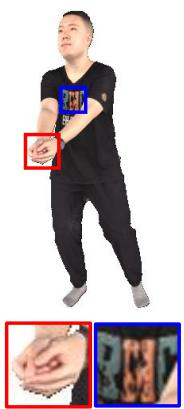  
(a)

9,590 Gaussians  
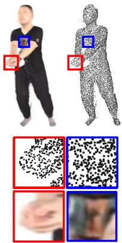  
(b)  
10,234 Gaussians

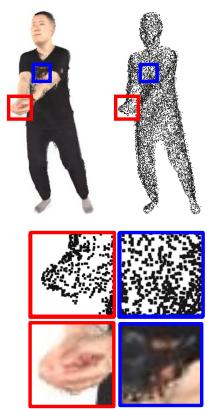  
(c)  
9,905 Gaussians

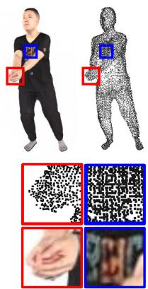  
(d)  
Figure 1: Distributions of Gaussian centers and the corresponding rendering results. (a) Novel view image. (b) GPS-Gaussian [10]. (c) RoGSplat [15]. (d) Proposed method.

In this paper, we introduce a novel approach for effectively handling generalizable human Gaussian splatting. Due to the inherent smoothness of Gaussian primitives, Gaussians need to be densely placed to faithfully reconstruct high-frequency details. However, previous feed-forward methods localize Gaussians based on the pixel grid [10–12] or vertices of the skinned mesh [13–15], whose density is highly related to the image resolution or the skinned mesh template rather than the visual properties of the target subject itself. While this may not be significant in simple regions (e.g., plain areas), it often leads to an insufficient number of Gaussians in complex regions (e.g., fingers or textured clothes), which produces blurry rendering results as shown in Figs. 1(b) and (c). To deal with this problem, we propose a complexity-guided regularization scheme. The key idea is to allocate Gaussians in proportion to the local complexity of the clothed human mesh. Specifically, we define the complexity prior as the entropy of the local geometric and textural information around each vertex of the human mesh. Guided by this prior, we regularize the local density of Gaussians to be positively correlated with the complexity. This helps the model faithfully reconstruct high-frequency details with sufficient Gaussians, as shown in Fig. 1(d). Moreover, we find that supervising the model with the entire image is suboptimal for reconstructing fine-grained details. This is because supervisory signals from complex regions, which often occupy only a small portion of the human-centric image, e.g., fingers, facial features, etc., are easily dominated by those from surrounding simple regions. Accordingly, during the training phase, we use the complexity prior as sampling weights to select local patches, where regions of higher complexity are more frequently sampled. This training strategy enables the model to receive sufficient supervision on fine details. The main contribution of the proposed method can be summarized as follows:

• We define a complexity prior as a per-vertex scalar value, which is computed via the local entropy in geometric and textural characteristics of the clothed human mesh. Leveraging this prior, we propose a novel regularization scheme to guide the model to adjust the local Gaussian density according to the complexity. This encourages the model to allocate Gaussians densely in complex regions, which enables faithful reconstruction of fine-grained details.

• To effectively provide sufficient supervisory signals on intricate details, we introduce a patch-based training strategy, which samples local patches with probability proportional to the complexity prior.

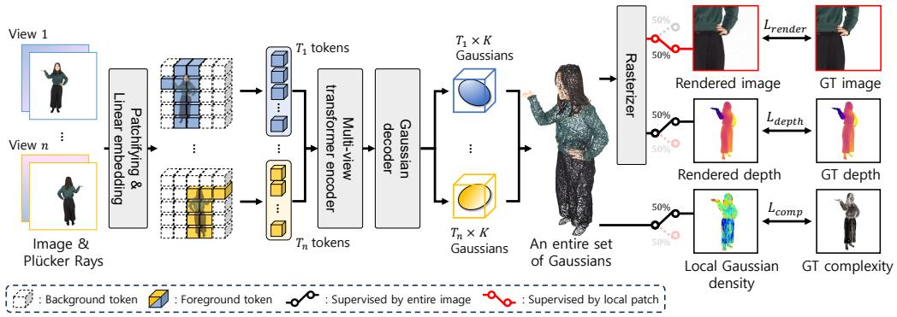  
Figure 2: Overall architecture of the proposed method. The complexity prior of the clothed human guides the model to allocate Gaussians densely in complex regions. Note that Gaussians are randomly supervised by either the entire image or complexity-aware local patches with the equal probability at each iteration.

## 2 Related work

Per-subject optimization-based 3DGS for human rendering. Motivated by the great success of 3D Gaussian splatting [1] in novel view synthesis, several studies have begun to apply 3DGS to human rendering based on the point-based representation. For example, Gaussian points are initialized on faces of the human mesh and optimized to represent the detailed appearance while preserving the geometric structure of the target subject [5, 7]. On the other hand, other methods [2–4, 6, 8, 16] optimize Gaussian attributes to reconstruct the human in a canonical pose, which are rendered in arbitrary poses via forward skinning. Although these approaches have demonstrated the impressive performance, they typically require the per-subject optimization, which restricts their generalizability to unseen human subjects.

Generalizable 3DGS for human rendering. To overcome this limitation, recent studies have explored generalizable human Gaussian splatting, which regress Gaussian attributes for unseen subjects in a single forward pass. As a pioneer, Zheng et al. [10] estimated per-pixel Gaussian attributes based on the depth map, which is predicted through stereo matching between adjacent views. In a similar vein, Hu et al. [11] improved the regression process by employing the 1Dwindow attention along epipolar lines between view pairs. More recently, Kim et al. [12] leveraged a foundation model [17] to inject the implicit 3D geometric knowledge, while recalibrating multi-view features via semantic consistency-based cross-view attention, which helps the model robustly estimate Gaussian attributes in visually complex regions. Instead of estimating per-pixel Gaussian attributes, skinned human models have been adopted as a structural prior to directly place Gaussians on the body surface. In this direction, Wen et al. [14] attached Gaussians to the skinned mesh surface and iteratively refined Gaussian attributes through a feedback mechanism. Similarly, Xiao et al. [15] densified SMPL vertices to align with the actual human geometry and predicted Gaussian attributes on such densified points. Kwon et al. [13] regressed Gaussian attributes in the 2D UV space of the SMPL template and introduced a multi-scaffold representation to effectively mitigate the geometric discrepancy between the skinned body and clothed human. While previous efforts have focused on accurately estimating the position of Gaussians, we shift our focus to how densely Gaussians should be placed and propose an effective regularization scheme, which significantly improves the rendering performance of generalizable human Gaussian splatting.

## 3 Method

## 3.1 Architecture details

The overall architecture of the proposed method is shown in Fig. 2. Given N multi-view RGB images $\{ \mathbf { I } _ { n } \} _ { n = 1 } ^ { N } \in \mathbb { R } ^ { 3 \times H \times W }$ of a clothed human subject with the corresponding Plücker ray [18] maps $\bigl \{ \mathbf { P } _ { n } \bigr \} _ { n = 1 } ^ { \overline { { N } } ^ { \bullet } } \in \mathbb { R } ^ { 6 \times H \times W }$ and human masks $\{ \mathbf { M } _ { n } ^ { \mathbf { \bar { \alpha } } } \} _ { n = 1 } ^ { N } \in \{ 0 , 1 \} ^ { H \times W }$ , our goal is to regress a set of Gaussian attributes in a single feed-forward pass. Following previous feed-forward approaches [19,

20], each input image is concatenated with the corresponding Plücker ray map along the channel dimension, which yields a per-view feature map $\mathbf { \tilde { I } } _ { n } = [ \mathbf { I } _ { n } ; \mathbf { P } _ { n } ] \in \mathbb { R } ^ { 9 \times H \times \mathbf { \bar { W } } }$ . The resulting feature map $\tilde { \mathbf { I } } _ { n }$ is partitioned into non-overlapping $p \times p$ patches, which are subsequently flattened and projected into tokens. Since the target subject only occupies a small area of the human-centric image, we discard tokens whose patch lies entirely outside the human mask ${ { \bf { M } } _ { n } }$ , which yields $T _ { n }$ foreground tokens for the $n { \cdot } \mathrm { t h }$ view. This significantly reduces the number of tokens fed into transformer layers, which leads to the real-time inference. Following Long-LRM++ [21], a Gaussian decoder regresses attributes of $K$ Gaussians from each token. Specifically, the decoder predicts depth d $\in \mathbb { R } , 3 \mathrm { D }$ spatial offset $\Delta \mathbf { x } \in \mathbb { R } ^ { 3 }$ , scale $\mathbf { s } \in \mathbb { R } ^ { 3 }$ , rotation quaternion $ { \mathbf { q } } \in \mathbb { R } ^ { 4 }$ , opacity $o \in \mathbb R$ , and color ${ \boldsymbol \rho } \in \mathbb { R } ^ { 3 }$ . The 3D position of each Gaussian is computed by unprojecting the predicted depth d along the ray as $\mathbf { r } _ { o } + d \mathbf { r } _ { d } .$ , which is further shifted by the spatial offset $\Delta \mathbf { x }$ . Note that $\mathbf { r } _ { o } \in \mathbb { R } ^ { 3 }$ and $\mathbf { r } _ { d } \in \mathbb { R } ^ { 3 }$ denote directional vectors of the origin and the center ray of the patch, respectively. Consequently, the model produces $K \times T$ Gaussians, where $\begin{array} { r } { T = \sum _ { n = 1 } ^ { N } T _ { n } } \end{array}$ is the total number of foreground tokens across all views, which are rasterized to synthesize the target view image.

## 3.2 Complexity prior of the human subject

A clothed human is inherently a complex subject whose surface contains structural and visual information at a wide range of spatial scales. Moreover, such complexity varies significantly across different regions of the surface. Properly accounting for this variation is essential to faithfully reconstruct the human subject. To this end, we quantitatively define the local complexity of a clothed human, which can serve as an explicit guidance signal for the reconstruction process. Specifically, we represent the clothed human as a textured mesh $\mathbf { \bar { \mathcal { M } } } = ( \mathbf { V } , \mathbf { F } , T )$ ), whose components are defined as follows: $\mathbf { V } = \{ \mathbf { v } _ { i } \} _ { i = 1 } ^ { | \mathbf { V } | }$ is the set of vertices, where $\mathbf { v } _ { i } \in \mathbb { R } ^ { 3 }$ represents a point in the 3D space. $\mathbf { F } = \{ \mathbf { f } _ { k } \} _ { k = 1 } ^ { | \mathbf { F } | }$ is the set of triangular faces, where $\mathbf { f } _ { k } = \left( \mathbf { v } _ { k _ { 1 } } , \mathbf { v } _ { k _ { 2 } } , \mathbf { v } _ { k _ { 3 } } \right)$ denotes a triplet of vertices which constitute a face. $T \in \mathbb { R } ^ { \mathbf { \overline { { H } } \times W \times 3 } }$ is a UV map for the human mesh, which stores RGB color values. Each pixel in $T$ corresponds to a point on the mesh surface via UV coordinates. On this mesh, we define the complexity prior as a scalar value $c _ { i } \in [ 0 , 1 ]$ for vertex $\mathbf { v } _ { i }$

Geometric complexity. We denote the set of faces including the vertex $\mathbf { v } _ { i }$ as $\mathcal { F } _ { i }$ . For each vertex $\mathbf { v } _ { i } ,$ we compute an area-weighted unit normal $\mathbf { n } _ { i } .$ , which represents the dominant normal direction of the local surface as follows:

$$
\mathbf { n } _ { i } = \frac { \mathbf { m } _ { i } } { \lVert \mathbf { m } _ { i } \rVert } , \quad \mathrm { w h e r e } \quad \mathbf { m } _ { i } = \sum _ { \mathbf { f } _ { k } \in \mathcal { F } _ { i } } A _ { \mathbf { f } _ { k } } \mathbf { n } _ { \mathbf { f } _ { k } } ,\tag{1}
$$

where $\mathbf { n } _ { \mathbf { f } _ { k } } \in \mathbb { R } ^ { 3 }$ and $A _ { \mathbf { f } _ { k } } \in \mathbb { R } _ { > 0 }$ denote the unit normal and the area of face $\mathbf { f } _ { k } ,$ respectively. We further find a local neighborhood $\mathcal { N } _ { i } = \{ \mathbf { v } _ { j } : j \neq i , \ \| \mathbf { v } _ { j } - \mathbf { v } _ { i } \| \leq r \}$ of $\mathbf { v } _ { i }$ within a radius r to measure how the unit normal varies around it. For neighbor $\mathbf { v } _ { j } \in \mathcal { N } _ { i }$ , the angular deviation of its area-weighted unit normal $\mathbf { n } _ { j }$ from ${ \bf n } _ { i }$ is defined as $s _ { j } ^ { \mathrm { g e o } } = ( 1 - \bar { \mathbf { n } } _ { i } \cdot \mathbf { n } _ { j } ) / 2 \in [ 0 , 1 ]$ . Subsequently, we construct a histogram $\mathbf { p } _ { i } ^ { \mathrm { g e o } } \stackrel { \textstyle \textrm { \tiny f e o } } { = } ( p _ { 1 } ^ { \mathrm { g e o } } , \ldots , p _ { B } ^ { \mathrm { g e o } } )$ ) of the deviations $\{ s _ { j } ^ { \mathrm { g e o } } \} _ { j \in \mathcal { N } _ { i } }$ over $B$ equal-width bins on $[ 0 , 1 ]$ , where $p _ { b } ^ { \mathrm { g e o } }$ denotes the proportion of deviations falling into bin $b .$ The geometric complexity at $\mathbf { v } _ { i }$ is finally computed by the normalized Shannon entropy [22] of this histogram, as follows:

$$
H _ { i } ^ { \mathrm { g e o } } = - \frac { 1 } { \log _ { 2 } B } \sum _ { b = 1 } ^ { B } p _ { b } ^ { \mathrm { g e o } } \log _ { 2 } p _ { b } ^ { \mathrm { g e o } } .\tag{2}
$$

Textural complexity. Similarly, we compute the textural complexity around each vertex. The RGB color $\mathbf { t } _ { i }$ of the vertex $\mathbf { v } _ { i }$ is retrieved from the location $( u _ { i } , v _ { i } )$ of the corresponding UV map $T .$ For $\mathbf { v } _ { j } \ \in \ \mathcal N _ { i }$ , the chromatic deviation of its color $\mathbf { t } _ { j }$ from the color $\mathbf { t } _ { i }$ is defined as $s _ { j } ^ { \mathrm { t e x } } = \| \mathbf { t } _ { j } - \mathbf { t } _ { i } \| / \sqrt { 3 } \in [ 0 , 1 ]$ . Subsequently, we construct a histogram $\mathbf { p } _ { i } ^ { \mathrm { t e x } } = ( p _ { 1 } ^ { \mathrm { t e x } } , \dots , p _ { B } ^ { \mathrm { t e x } } )$ of the deviations $\{ s _ { j } ^ { \mathrm { t e x } } \} _ { j \in \mathcal { N } _ { i } }$ over $B$ equal-width bins on [0, 1], where $p _ { b } ^ { \mathrm { t e x } }$ denotes the proportion of deviations falling into bin b. The textural complexity at $\mathbf { v } _ { i }$ is also computed by the normalized Shannon entropy [22] of this histogram, as follows:

$$
H _ { i } ^ { \mathrm { t e x } } = - \frac { 1 } { \log _ { 2 } B } \sum _ { b = 1 } ^ { B } p _ { b } ^ { \mathrm { t e x } } \log _ { 2 } p _ { b } ^ { \mathrm { t e x } } .\tag{3}
$$

(c)  
(d)  
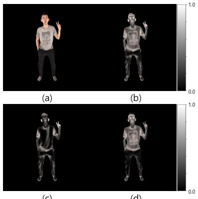

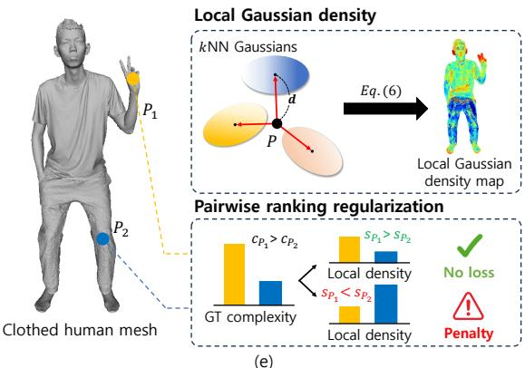  
Figure 3: Complexity prior and complexity-guided regularization scheme. (a) RGB image. (b) Per-vertex complexity prior c. (c) Geometric complexity $\bar { H } ^ { \mathrm { g e o } }$ . (d) Textural complexity $\bar { H } ^ { \mathrm { t e x } }$ (e) Overview of the complexity-guided regularization process, where the local Gaussian density is computed from the average distance of k-nearest neighbor Gaussians and regularized to be positively correlated with the complexity prior via a pairwise ranking regularization scheme.

Multi-scale aggregation. To account for complexity at multiple spatial scales, we repeat above computations at S different scales with radii $\bar { \{ \underline { { r } } _ { s } \} } _ { s = 1 } ^ { S }$ , where $r _ { s }$ is set to a different fraction of the bounding box diagonal of M. Entropies $\dot { H } _ { i , s } ^ { \mathrm { g e d } }$ and $H _ { i , s } ^ { \mathrm { t e x } }$ at scale s are averaged to obtain the multi-scale complexities, as follows: $\begin{array} { r } { \bar { H } _ { i } ^ { \mathrm { g e o } } = \frac { 1 } { S } \sum _ { s = 1 } ^ { S } H _ { i , s } ^ { \mathrm { g e o } } } \end{array}$ and $\begin{array} { r } { \bar { H } _ { i } ^ { \mathrm { t e x } } = \frac { 1 } { S } \sum _ { s = 1 } ^ { S } H _ { i , s } ^ { \mathrm { t e x } } } \end{array}$ , respectively. Consequently, the per-vertex complexity prior $c _ { i }$ is finally defined as the maximum between the geometric and textural complexities as follows:

$$
c _ { i } = \operatorname* { m a x } \mathopen { } \mathclose \bgroup \left( \bar { H } _ { i } ^ { \mathrm { g e o } } , \ \bar { H } _ { i } ^ { \mathrm { t e x } } \aftergroup \egroup \right) .\tag{4}
$$

This maximum operation ensures a high complexity value whenever at least one of these cues shows a high degree of local variations. As shown in Figs. 3(b), (c), and (d), the complexity prior effectively captures the local variation in both geometric and textural characteristics of the clothed human, where higher values are attributed to structurally or visually intricate regions $( \mathrm { e . g . }$ , fingers or textured clothes). The resulting complexity prior $\left\{ c _ { i } \right\}$ serves as the guidance signal for regularization and patch-based supervision, which are explained in the following subsections.

## 3.3 Complexity-guided regularization

Due to the inherent smoothness of Gaussian primitives, the local density of Gaussians should be properly taken into account for faithfully reconstructing fine-grained details. However, previous methods allocate Gaussians without regard to the local complexity of the human subject, which leaves fine-grained regions under-represented. To address this problem, we introduce a regularization scheme, which couples the local Gaussian density with the complexity prior $\left\{ c _ { i } \right\}$ and explicitly guides the model to allocate Gaussians densely in complex regions. An overview of this scheme is shown in $\mathrm { F i g . 3 ( e ) }$ . Since the complexity prior is defined at mesh vertices, we first sample a set of points on the surface of the human mesh. Specifically, we randomly sample M points on the mesh surface with the probability proportional to the area of the corresponding face $\mathbf { f } _ { m }$ . The complexity value $c _ { m } \in [ 0 , 1 ]$ at sampled point $ { \mathbf { p } } _ { m } \in \mathbb { R } ^ { 3 }$ of face $\mathbf { f } _ { m }$ is obtained by interpolating the complexity values at three vertices $\{ \mathbf { v } _ { j } \} _ { j \in \mathbf { f } _ { m } }$ as follows:

$$
c _ { m } = \sum _ { j \in { \bf f } _ { m } } \alpha _ { j } c _ { j } ,\tag{5}
$$

where $\{ \alpha _ { j } \} _ { j \in { \bf f } _ { m } }$ are the barycentric weights of $\mathbf { p } _ { m }$ , which satisfies $\begin{array} { r } { \mathbf { p } _ { m } = \sum _ { j \in \mathbf { f } _ { m } } \alpha _ { j } \mathbf { v } _ { j } } \end{array}$ and $\textstyle \sum _ { j \in { \mathbf { f } } _ { m } } \alpha _ { j } \ = \ 1$ . Following CDC-GS [23], we measure the local Gaussian density at sampled point $\mathbf { p } _ { m }$ based on the distances to the k-nearest Gaussian centers. Note that Gaussians whose opacity is below 0.1 are excluded from the nearest-neighbor search. Specifically, the local density score $s _ { m }$

is defined as follows:

$$
s _ { m } = - \log \left( \frac { 1 } { k } \sum _ { j = 1 } ^ { k } d _ { m , j } + \epsilon \right) ,\tag{6}
$$

where $d _ { m , j }$ denotes the Euclidean distance from $\mathbf { p } _ { m }$ to its j-th nearest Gaussian center and ϵ is a small positive constant for numerical stability. To encourage $s _ { m }$ to be positively correlated with $c _ { m } .$ , we adopt a pairwise monotonic ranking regularization scheme. Given a pair of points on the mesh surface $\left( \mathbf { p } _ { a } , \mathbf { p } _ { b } \right)$ with $c _ { a } > c _ { b }$ , the regularization penalizes the case in which the point with higher complexity has a lower density score, i.e., $s _ { a } < s _ { b }$ . The complexity-guided regularization is formulated as follows:

$$
{ \mathcal { L } } _ { \mathrm { c o m p } } = { \frac { 1 } { | { \mathcal { P } } | } } \sum _ { ( a , b ) \in { \mathcal { P } } } \left( c _ { a } - c _ { b } \right) \cdot { \mathrm { s o f t p l u s } } { \left( - ( s _ { a } - s _ { b } ) \right) } ,\tag{7}
$$

where $\mathcal { P }$ denotes the set of sampled pairs $( a , b )$ and softplus $( x ) = \ln ( 1 + e ^ { x } )$ . Each pair is weighted by the complexity gap $c _ { a } - c _ { b }$ to impose a strong penalty on pairs with a significant complexity difference. This regularization scheme encourages the model to place Gaussians densely in complex regions, which enables the faithful reconstruction of fine-grained details.

## 3.4 Complexity-aware patch-based supervision

Complex regions often occupy only a small portion of the human-centric image, which makes their supervisory signals easily dominated by those from surrounding simple regions during training. To address this issue, we introduce a patch-based supervision strategy which leverages the complexity prior to concentrate the supervisory signal on intricate regions. For target view $q ,$ we first render a 2D complexity map $\mathbf { C } _ { q } ^ { 2 \mathrm { D } ^ { \bullet } } \in [ 0 , 1 ] ^ { \check { H } \times \check { W } }$ by rasterizing the per-vertex complexity values $\left\{ c _ { i } \right\}$ onto the image plane. From this map, we sample $N _ { p }$ patch centers per view with the per-pixel sampling probability given by $\mathbf { C } _ { q } ^ { 2 \mathrm { D } }$ . Based on sampled centers, $p _ { s } \times p _ { s }$ local patches are constructed for the supervision. During the training phase, the model is supervised on either the entire image or these local patches with the equal probability at each iteration, as shown in Fig. 2. We further adopt a progressive schedule for the size of the patch $p _ { s } .$ , which gradually decreases from $p _ { \mathrm { m a x } } \tan { p _ { \mathrm { m i n } } }$ during training. This provides a coarse-to-fine supervisory signal, where larger patches in the early stages capture broader structural context and smaller patches in later stages focus on fine-grained details.

## 3.5 Loss function

The proposed method is trained based on three terms, i.e., the rendering loss $\mathcal { L } _ { \mathrm { r e n d e r } } .$ , the depth regularization ${ \mathcal { L } } _ { \mathrm { d e p t h } }$ , and the proposed complexity-guided regularization $\mathcal { L } _ { \mathrm { { c o m p } } }$ . Following [20], the rendering loss $\mathcal { L } _ { \mathrm { r e n d e r } }$ consists of a photometric loss $\mathcal { L } _ { 1 }$ , a perceptual loss $\dot { \mathcal { L } } _ { \mathrm { l p i p s } }$ , and an alpha regularization $\mathcal { L } _ { \alpha } ,$ which aligns the rendered alpha map with the ground-truth human mask. The depth regularization ${ \mathcal { L } } _ { \mathrm { d e p t h } }$ enforces the consistency between rendered and ground-truth depth maps [10]. The overall training objective is formulated as follows:

$$
\mathcal { L } _ { \mathrm { t o t a l } } = \lambda _ { 1 } \mathcal { L } _ { 1 } + \lambda _ { \mathrm { l p i p s } } \mathcal { L } _ { \mathrm { l p i p s } } + \lambda _ { \alpha } \mathcal { L } _ { \alpha } + \lambda _ { \mathrm { d e p t h } } \mathcal { L } _ { \mathrm { d e p t h } } + \lambda _ { \mathrm { c o m p } } \mathcal { L } _ { \mathrm { c o m p } } ,\tag{8}
$$

where $\lambda _ { 1 } , \lambda _ { \mathrm { l p i p s } } , \lambda _ { \alpha } , \lambda _ { \mathrm { d e p t h } }$ , and $\lambda _ { \mathrm { c o m p } }$ are balancing factors for each loss term, which are set to 2.0, 0.5, 0.25, 0.25, and 0.1, respectively. Note that the same training objective is applied when patch-based supervision, which is explained in the previous subsection, is activated.

## 4 Experiments

## 4.1 Implementation details

The proposed method is implemented on the PyTorch [27] framework. All the experiments were performed on a single PC with an Intel Xeon w5-3433@2.0 GHz CPU and an NVIDIA GeForce RTX 4090 GPU. By following [19], all the parameters of the proposed network are updated by the AdamW optimizer, where the momentum factors are set to 0.9 and 0.95, respectively. The learning rate is set to $2 \times 1 0 ^ { - 4 }$ . Each input feature map is tokenized with a non-overlapping patch size of $^ { 8 , }$ and the Gaussian decoder predicts 64 Gaussians per token. For computing the complexity prior, the number of histogram bins B is set to 20. The complexity prior is computed at three different radii $\{ r _ { s } \} _ { s = 1 } ^ { 3 }$ . Each radius is defined as $r _ { s } = \alpha _ { s } \cdot d _ { \mathrm { b b o x } }$ , where $d _ { \mathrm { b b o x } }$ denotes the diagonal length of the bounding box for the clothed human mesh and $\alpha _ { 1 } , \alpha _ { 2 }$ , and $\alpha _ { 3 }$ are set to 0.02, 0.01, and 0.005, respectively. For the complexity-guided regularization, the number of nearest neighbors k is set to 7. At each iteration, 2048 points are sampled on the mesh surface and 4096 pairs are sampled for pairwise ranking regularization. For patch-based supervision, the number of patch centers per target image $N _ { p }$ is set to 2. The patch size is linearly decreased from 512 to 64 over 600,000 iterations.

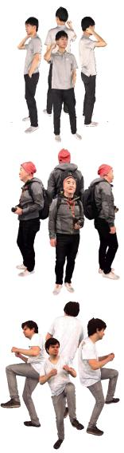  
(a)

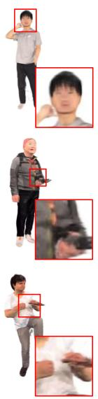  
(b)

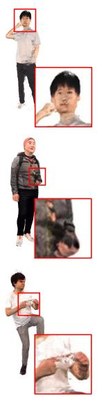  
(c)

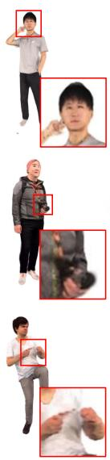  
(d)

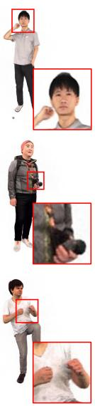  
(e)

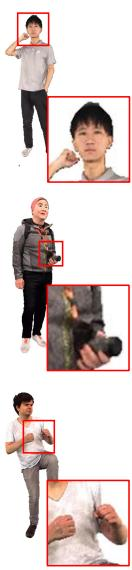  
(f)  
Figure 4: Qualitative comparison of in-domain novel view synthesis on THuman2.0 [24], 2K2K [25], and X-Humans [26] datasets (from top to bottom). (a) Input images. (b) Results by GPS-Gaussian [10]. (c) Results by RoGSplat [15]. (d) Results by GHGS-MVSC [12]. (e) Results by the proposed method. (f) Ground truth.

Table 1: Quantitative comparison of in-domain novel view synthesis on THuman2.0 [24], 2K2K [25], and X-Humans [26] datasets. The best result is shown in bold.
<table><tr><td rowspan="2">Methods</td><td colspan="3">THuman2.0</td><td colspan="3">2K2K</td><td colspan="3">X-Humans</td><td rowspan="2">FPS↑</td></tr><tr><td>PSNR↑</td><td>SSIM↑</td><td>LPIPS↓</td><td>PSNR↑</td><td>SSIM↑</td><td>LPIPS↓</td><td>PSNR↑</td><td>SSIM↑</td><td>LPIPS↓</td></tr><tr><td>GPS-Gaussian [10]</td><td>26.54</td><td>0.9539</td><td>0.0610</td><td>26.46</td><td>0.9483</td><td>0.0611</td><td>26.29</td><td>0.9458</td><td>0.0687</td><td>56.31</td></tr><tr><td>RoGSplat [15]</td><td>28.83</td><td>0.9615</td><td>0.0429</td><td>30.67</td><td>0.9697</td><td>0.0310</td><td>30.31</td><td>0.9656</td><td>0.0371</td><td>5.42</td></tr><tr><td>GHGS-MVSC [12]</td><td>30.93</td><td>0.9710</td><td>0.0334</td><td>30.45</td><td>0.9678</td><td>0.0326</td><td>30.60</td><td>0.9668</td><td>0.0391</td><td>2.79</td></tr><tr><td>Ours</td><td>32.42</td><td>0.9766</td><td>0.0201</td><td>31.68</td><td>0.9717</td><td>0.0229</td><td>31.96</td><td>0.9703</td><td>0.0230</td><td>33.96</td></tr></table>

## 4.2 Datasets and evaluation metrics

Datasets. For the performance evaluation of the proposed method, three human-centric multi-view datasets, i.e., THuman2.0 [24], 2K2K [25], and X-Humans [26], are adopted. All three datasets provide high-quality textured 3D human scans, which are rendered into multi-view images at the resolution of 512×512 pixels under known camera parameters. For THuman2.0, we follow train and test splits adopted in prior works [12, 13, 15]. For 2K2K, we follow the split adopted in HART [28]. For X-Humans, the official split is used. The proposed method is trained on each dataset independently for in-domain evaluations. We further evaluate the cross-domain generalization ability of our method by training on THuman2.0 and directly testing on 2K2K and X-Humans datasets without any fine-tuning. We additionally provide experimental results on real-world datasets (i.e., DNA-Rendering [29] and ZJU-MoCap [30]) in the appendix.

Evaluation metrics. Following previous works [12, 13, 15], the reconstruction performance is evaluated by using three metrics, i.e., Peak Signal-to-Noise Ratio (PSNR), Structural Similarity Index (SSIM) [31], and Learned Perceptual Image Patch Similarity (LPIPS) [32]. PSNR and SSIM measure pixel-wise similarity and structural fidelity between the rendered image and the ground truth, while LPIPS reflects the perceptual similarity in the feature domain. We additionally report frames per second (FPS) to evaluate the inference speed. Since FPS values of our method vary depending on the number of foreground tokens per input image, we report the average value measured on the THuman2.0 dataset [24].

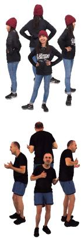  
(a)

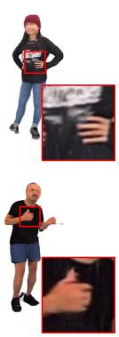  
(b)

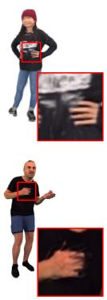  
(c)

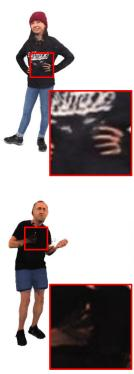  
(d)

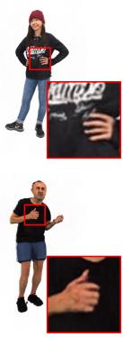  
(e)

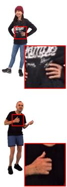  
(f)  
Figure 5: Qualitative comparison of cross-domain novel view synthesis on 2K2K [25] and X-Humans [26] datasets (from top to bottom). (a) Input images. (b) Results by GPS-Gaussian [10]. (c) Results by GHG [13]. (d) Results by RoGSplat [15]. (e) Results by the proposed method. (f) Ground truth.

Table 2: Quantitative comparison of cross-domain novel view synthesis on 2K2K [25] and X-Humans [26] datasets. The best result is shown in bold.
<table><tr><td rowspan="2">Methods</td><td colspan="3">THuman2.0 → 2K2K</td><td colspan="3">THuman2.0 → X-Humans</td></tr><tr><td>PSNR↑</td><td>SSIM↑</td><td>LPIPS↓</td><td>PSNR↑</td><td>SSIM↑</td><td>LPIPS↓</td></tr><tr><td>GPS-Gaussian [10]</td><td>24.47</td><td>0.9361</td><td>0.0721</td><td>24.34</td><td>0.9330</td><td>0.0795</td></tr><tr><td>GHG [13]</td><td>26.74</td><td>0.9548</td><td>0.0518</td><td>26.06</td><td>0.9494</td><td>0.0580</td></tr><tr><td>RoGSplat [15]</td><td>26.96</td><td>0.9490</td><td>0.0489</td><td>26.57</td><td>0.9496</td><td>0.0507</td></tr><tr><td>GHGS-MVSC [12]</td><td>28.59</td><td>0.9527</td><td>0.0480</td><td>25.17</td><td>0.9375</td><td>0.0674</td></tr><tr><td>Ours</td><td>29.52</td><td>0.9580</td><td>0.0412</td><td>27.53</td><td>0.9499</td><td>0.0474</td></tr></table>

## 4.3 Performance evaluation

Quantitative evaluation. To demonstrate the effectiveness of the proposed method, we compare our method with previous generalizable human Gaussian splatting methods, i.e., GPS-Gaussian [10], GHG [13], RoGSplat [15], and GHGS-MVSC [12]. Note that GPS-Gaussian is evaluated under a 6-view setting following [15], while other methods use 4-view inputs. The result of in-domain generalization comparisons is shown in Table 1. As can be seen, the proposed method consistently achieves the best performance across all three datasets and all three metrics. Specifically, the proposed method achieves 32.42 dB PSNR on THuman2.0, 31.68 dB on 2K2K, and 31.96 dB on X-Humans, which outperforms the second-best method by 1.49 dB, 1.01 dB, and 1.36 dB, respectively. Similar improvements are observed in SSIM and LPIPS metrics, which indicates that the proposed method better represents both pixel-wise and perceptual fidelity. Notably, the proposed method achieves these improvements while running at 33.96 FPS, which is substantially faster than RoGSplat (5.42 FPS) and GHGS-MVSC (2.79 FPS). The cross-domain generalization comparison is also presented in Table 2. Our approach improves PSNR values by a notable margin, which demonstrates the robust generalization capability compared to previous methods (+0.93 dB over GHGS-MVSC on 2K2K and +0.96 dB over RoGSplat on X-Humans).

Qualitative evaluation. The qualitative comparisons on in-domain and cross-domain evaluations are presented in Figs. 4 and 5, respectively. Compared to existing methods, the proposed method reconstructs the target-view human image accurately in fine-grained regions, such as fingers, facial details, and textured clothes (see Fig. 4(e) and Fig. 5(e)). In contrast, previous methods often fail to faithfully recover such intricate details due to the insufficient Gaussian density, which leads to the noticeable degradation in these regions (see Figs. 4(b)(c)(d) and Figs. 5(b)(c)(d)). These visual comparisons confirm the effectiveness of the proposed method in faithfully reconstructing fine-scale human details.

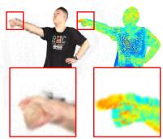  
(a)

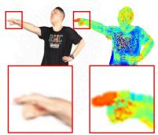  
(b)

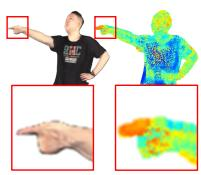  
(c)

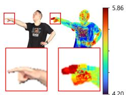  
(d)

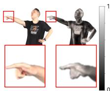  
(e)  
Figure 6: Ablation studies on the THuman2.0 dataset. We visualize the rendering result and the local Gaussian density. (a) Results by the baseline. (b) Results without patch supervision. (c) Results without ${ \mathcal { L } } _ { \mathrm { { c o m p } } } .$ (d) Results by the proposed method. (e) Ground truth.

## 4.4 Ablation study

Effectiveness of the proposed components. In Table 3, we conduct ablation studies on the THuman2.0 dataset to validate the effectiveness of the proposed components. The complexity-guided regularization scheme improves PSNR by 0.47 dB and noticeably reduces the LPIPS value, which confirms that the explicit guidance of the Gaussian density by the local complexity is effective for reconstructing fine-grained details. The complexity-aware patch-based supervision strategy substantially improves all metrics by concentrating the supervisory signal on intricate regions. Consequently, the synergy among the proposed components encourages the local Gaussian density to be positively correlated with the complexity prior, which yields superior performance in generalizable human Gaussian splatting, as shown in Fig. 6.

Table 3: Ablation studies on the THuman2.0 dataset.
<table><tr><td> $\mathcal { L } _ { \mathrm { { c o m p } } }$  Patch sup. PSNR↑</td><td>SSIM↑ LPIPS↓</td></tr><tr><td>x x</td><td>30.32 0.9664</td></tr><tr><td>0.0316</td><td>x 30.79 0.9695</td></tr><tr><td>√ x √</td><td>0.0269 32.06 0.9752 0.0209</td></tr><tr><td>√ √</td><td>32.42 0.9766 0.0201</td></tr></table>

Performance variations according to different k values. We investigate the influence of the number of nearest neighbors k for computing the local density of Gaussians as defined in Eq. 6. As shown in Table 4, the performance improves as k increases from 3 to 7, where $k = 7$ achieves the best PSNR and LPIPS values. When k is further increased to 9, the performance remains comparable across all metrics. This suggests that an excessively small k makes the density score sensitive to the noise. Based on the trade-off between the performance and the computational cost, we set k = 7 in our experiments.

Table 4: Performance analysis according to different k values on the THuman2.0 dataset.
<table><tr><td># Neighbors (k)</td><td>PSNR↑</td><td>SSIM↑</td><td>LPIPS↓</td></tr><tr><td>k = 3</td><td>30.55</td><td>0.9684</td><td>0.0299</td></tr><tr><td>k = 5</td><td>30.68</td><td>0.9690</td><td>0.0275</td></tr><tr><td>k = 7</td><td>30.79</td><td>0.9695</td><td>0.0269</td></tr><tr><td>k = 9</td><td>30.75</td><td>0.9696</td><td>0.0271</td></tr></table>

Effectiveness of complexity-aware patch sampling. For our patch-based supervision, patch centers are sampled with probabilities proportional to the local complexity. To validate this strategy, we compare the complexity-aware sampling with two alternative strategies, as shown in Table 5. For the image-gradient-based sampling, the gradient magnitude map computed by the Sobel operator with $3 \times 3$ kernels is used as the sampling probability instead of the 2D complexity map. The complexity-aware sampling consistently outperforms both alternatives across all metrics. Specifically, the image-gradientbased sampling improves PSNR by only 0.18 dB over random sampling, whereas the complexityaware sampling achieves an improvement of 0.43 dB. This confirms that incorporating the local complexity of the human subject into the training scheme effectively guides the model to learn fine-grained details.

Table 5: Comparison of patch sampling strategies on the THuman2.0 dataset.
<table><tr><td>Strategy</td><td>PSNR↑ SSIM↑ LPIPS↓</td></tr><tr><td>Random sampling</td><td>31.63 0.97310.0227</td></tr><tr><td>Gradient-based sampling</td><td>31.81 0.97440.0216</td></tr><tr><td>Complexity-aware sampling</td><td>32.060.97520.0209</td></tr></table>

Effectiveness of complexity components. To examine the contribution of the geometric and textural complexities in Eq. 4, we conduct an ablation study of complexity components. As shown in Table 6, combining geometric and textural complexity yields better reconstruction quality than using either component alone. Furthermore, the maximum operation achieves the best

Table 6: Ablation study of complexity components on the THuman2.0 dataset.
<table><tr><td>Complexity component PSNR↑ SSIM↑ LPIPS↓</td></tr><tr><td>Geometric complexity  $( \overbrace { H } ^ { \mathrm { g e o } } )$  31.65 0.9727 0.0232</td></tr><tr><td>Textural complexity  $( \bar { H } ^ { \mathrm { t e x } } )$  32.240.97520.0214</td></tr><tr><td>Average operation (mean  $( \bar { H } ^ { \mathrm { g e o } } , \bar { H } ^ { \mathrm { t e x } } ) )$  32.31 0.97600.0205</td></tr><tr><td>Maximum operation (max(geo, Htex)) 32.42 0.9766 0.0201</td></tr></table>

performance across all metrics, outperforming the average operation by 0.11 dB in PSNR. This result indicates that the maximum operation effectively preserves a strong complexity cue when either geometric or textural variation is prominent.

Correlation between complexity and density proposed regularization scheme changes the distribution of Gaussians, we measure the Spearman rank correlation between the local complexity and the local density of estimated Gaussians on the THuman2.0 dataset. As shown in Table 7, the correlation coefficient increases from 0.1086 to 0.4262 with the complexity-guided regularization scheme. This result confirms that the distribution of Gaussians is closely aligned with the complexity prior.

Table 7: Spearman rank correlation between local complexity and density of Gaussians on the THuman2.0 dataset.
<table><tr><td>Complexity-guided reg.</td><td>Correlation coefficient↑</td></tr><tr><td>x</td><td>0.1086</td></tr><tr><td>√</td><td>0.4262</td></tr></table>

Performance comparison under different regularization settings. Since the complexity prior is computed from the textured clothed human mesh, the proposed method relies on an additional

3D prior which is not used by previous methods. For a fair comparison, we evaluate a variant of the proposed method which computes the complexity prior directly from input images by applying Eqs. 2 and 3 to normal maps predicted by an off-the-shelf monocular normal estimator [33] and RGB pixels, respectively. As shown in Table 8, the proposed method consistently outperforms previous methods under

Table 8: Quantitative comparison under different regularization settings on the THuman2.0 dataset.
<table><tr><td>Methods</td><td>Depth reg.</td><td>Textured mesh</td><td>PSNR↑</td><td>SSIM↑</td><td>LPIPS↓</td></tr><tr><td>GPS-Gaussian [10]</td><td>√</td><td>x</td><td>26.54</td><td>0.9539</td><td>0.0610</td></tr><tr><td>RoGSplat [15]</td><td>√</td><td>x</td><td>28.83</td><td>0.9615</td><td>0.0429</td></tr><tr><td>GHGS-MVSC [12]</td><td>x</td><td>x</td><td>30.93</td><td>0.9710</td><td>0.0334</td></tr><tr><td rowspan="3">Ours</td><td>x</td><td>x</td><td>31.83</td><td>0.9737</td><td>0.0231</td></tr><tr><td>√</td><td>x</td><td>32.04</td><td>0.9744</td><td>0.0224</td></tr><tr><td>√</td><td>√</td><td>32.42</td><td>0.9766</td><td>0.0201</td></tr></table>

both regularization settings. Without the depth regularization scheme, the proposed method achieves 31.83 dB in PSNR, which surpasses GHGS-MVSC [12] by 0.90 dB. When the depth regularization scheme is additionally employed, the proposed method reaches 32.04 dB in PSNR, which outperforms RoGSplat [15] by 3.21 dB. These results are slightly lower than those obtained with a textured mesh, which may be attributed to inaccuracies in the image-derived complexity maps. This is because complexity maps derived from a monocular normal estimator may be inconsistent across views. Nevertheless, the competitive performance of this variant suggests that the proposed method can be extended to settings where textured meshes are unavailable.

## 5 Conclusion

In this paper, we introduce a novel method for generalizable human Gaussian splatting. The key idea of the proposed method is to allocate Gaussians in proportion to the local complexity of a clothed human, which is quantified through the entropy of geometric and textural variations. This approach allocates Gaussians densely in fine-grained regions, which effectively contributes to the faithful reconstruction of intricate human details. Additionally, the proposed complexity-aware patch-based supervision concentrates the supervisory signal on complex regions, which provides the model with sufficient supervision on fine-scale details. As a result, the proposed method consistently produces high-fidelity rendering results. Experimental results demonstrate the effectiveness of our approach in generalizable human Gaussian splatting on both in-domain and cross-domain settings.

## Acknowledgments and Disclosure of Funding

This work was supported by the Institute of Information & Communications Technology Planning & Evaluation (IITP) grant funded by the Korea government through the Ministry of Science and ICT (MSIT) (No. 2018-0-00207, RS-2018-II180207, Immersive Media Research Laboratory).

## References

[1] Bernhard Kerbl, Georgios Kopanas, Thomas Leimkühler, and George Drettakis. 3D Gaussian splatting for real-time radiance field rendering. ACM Trans. Graph., 42(4):139–1, 2023.

[2] Muhammed Kocabas, Jen-Hao Rick Chang, James Gabriel, Oncel Tuzel, and Anurag Ranjan. HUGS: Human Gaussian splats. In Proc. IEEE Conf. Comput. Vis. Pattern Recog., pages 505–515, 2024.

[3] Jiahui Lei, Yufu Wang, Georgios Pavlakos, Lingjie Liu, and Kostas Daniilidis. GART: Gaussian articulated template models. In Proc. IEEE Conf. Comput. Vis. Pattern Recog., pages 19876–19887, 2024.

[4] Zhiyin Qian, Shaofei Wang, Marko Mihajlovic, Andreas Geiger, and Siyu Tang. 3DGS-Avatar: Animatable avatars via deformable 3D Gaussian splatting. In Proc. IEEE Conf. Comput. Vis. Pattern Recog., pages 5020–5030, June 2024.

[5] Jing Wen, Xiaoming Zhao, Zhongzheng Ren, Alexander G Schwing, and Shenlong Wang. GoMAvatar: Efficient animatable human modeling from monocular video using Gaussians-on-mesh. In Proc. IEEE Conf. Comput. Vis. Pattern Recog., pages 2059–2069, 2024.

[6] Yang Liu, Xiang Huang, Minghan Qin, Qinwei Lin, and Haoqian Wang. Animatable 3D Gaussian: Fast and high-quality reconstruction of multiple human avatars. In Proc. ACM Int. Conf. Multimedia, pages 1120–1129, 2024.

[7] Zhijing Shao, Zhaolong Wang, Zhuang Li, Duotun Wang, Xiangru Lin, Yu Zhang, Mingming Fan, and Zeyu Wang. Splattingavatar: Realistic real-time human avatars with mesh-embedded Gaussian splatting. In Proc. IEEE Conf. Comput. Vis. Pattern Recog., pages 1606–1616, 2024.

[8] Shoukang Hu, Tao Hu, and Ziwei Liu. Gauhuman: Articulated Gaussian splatting from monocular human videos. In Proc. IEEE Conf. Comput. Vis. Pattern Recog., pages 20418–20431, 2024.

[9] Matthew Loper, Naureen Mahmood, Javier Romero, Gerard Pons-Moll, and Michael J Black. SMPL: A skinned multi-person linear model. ACM Trans. Graph., 34(6):248:1–248:16, 2015.

[10] Shunyuan Zheng, Boyao Zhou, Ruizhi Shao, Boning Liu, Shengping Zhang, Liqiang Nie, and Yebin Liu. GPS-Gaussian: Generalizable pixel-wise 3D Gaussian splatting for real-time human novel view synthesis. In Proc. IEEE Conf. Comput. Vis. Pattern Recog., pages 19680–19690, 2024.

[11] Yingdong Hu, Zhening Liu, Jiawei Shao, Zehong Lin, and Jun Zhang. EVA-Gaussian: 3D Gaussian-based real-time human novel view synthesis under diverse camera settings. arXiv preprint arXiv:2410.01425, 2024.

[12] Jingi Kim and Wonjun Kim. Generalizable human Gaussian splatting via multi-view semantic consistency. arXiv preprint arXiv:2604.25466, 2026.

[13] Youngjoong Kwon, Baole Fang, Yixing Lu, Haoye Dong, Cheng Zhang, Francisco Vicente Carrasco, Albert Mosella-Montoro, Jianjin Xu, Shingo Takagi, Daeil Kim, Aayush Prakash, and Fernando De la Torre. Generalizable human Gaussians for sparse view synthesis. In Proc. Eur. Conf. Comput. Vis., pages 451–468, 2024.

[14] Jing Wen, Alex Schwing, and Shenlong Wang. LIFe-GoM: Generalizable human rendering with learned iterative feedback over multi-resolution Gaussians-on-mesh. In Proc. Int. Conf. Learn. Represent., 2025.

[15] Junjin Xiao, Qing Zhang, Yonewei Nie, Lei Zhu, and Wei-Shi Zheng. RoGSplat: Learning robust generalizable human Gaussian splatting from sparse multi-view images. In Proc. IEEE Conf. Comput. Vis. Pattern Recog., pages 5980–5990, 2025.

[16] Liangxiao Hu, Hongwen Zhang, Yuxiang Zhang, Boyao Zhou, Boning Liu, Shengping Zhang, and Liqiang Nie. GaussianAvatar: Towards realistic human avatar modeling from a single video via animatable 3D Gaussians. In Proc. IEEE Conf. Comput. Vis. Pattern Recog., pages 634–644, 2024.

[17] Jianyuan Wang, Minghao Chen, Nikita Karaev, Andrea Vedaldi, Christian Rupprecht, and David Novotny. VGGT: Visual geometry grounded transformer. In Proc. IEEE Conf. Comput. Vis. Pattern Recog., pages 5294–5306, 2025.

[18] Julius Plücker. On a new geometry of space. Philos. Trans. R. Soc. Lond., 155:725–791, 1865.

[19] Kai Zhang, Sai Bi, Hao Tan, Yuanbo Xiangli, Nanxuan Zhao, Kalyan Sunkavalli, and Zexiang Xu. GS-LRM: Large reconstruction model for 3D Gaussian splatting. In Proc. Eur. Conf. Comput. Vis., pages 1–19, 2024.

[20] Yinghao Xu, Zifan Shi, Wang Yifan, Hansheng Chen, Ceyuan Yang, Sida Peng, Yujun Shen, and Gordon Wetzstein. GRM: Large Gaussian reconstruction model for efficient 3D reconstruction and generation. In Proc. Eur. Conf. Comput. Vis., pages 1–20, 2024.

[21] Chen Ziwen, Hao Tan, Peng Wang, Zexiang Xu, and Li Fuxin. Long-LRM++: Preserving fine details in feed-forward wide-coverage reconstruction. arXiv preprint arXiv:2512.10267, 2025.

[22] Claude E. Shannon. A mathematical theory of communication. Bell Sys. Tech. Jour., pages 379–423, 1948.

[23] Zhemeng Dong, Junjun Jiang, Youyu Chen, Jiaxin Zhang, Kui Jiang, and Xianming Liu. Reframing Gaussian splatting densification with complexity-density consistency of primitives. Adv. Neural Inform. Process. Syst., 37:2278–2291, 2025.

[24] Tao Yu, Zerong Zheng, Kaiwen Guo, Pengpeng Liu, Qionghai Dai, and Yebin Liu. Function4D: Real-time human volumetric capture from very sparse consumer RGBD sensors. In Proc. IEEE Conf. Comput. Vis. Pattern Recog., pages 5746–5756, 2021.

[25] Sang-Hun Han, Min-Gyu Park, Ju Hong Yoon, Ju-Mi Kang, Young-Jae Park, and Hae-Gon Jeon. Highfidelity 3D human digitization from single 2K resolution images. In Proc. IEEE Conf. Comput. Vis. Pattern Recog., pages 1911–1927, 2023.

[26] Kaiyue Shen, Chen Guo, Manuel Kaufmann, Juan Jose Zarate, Julien Valentin, Jie Song, and Otmar Hilliges. X-avatar: Expressive human avatars. In Proc. IEEE Conf. Comput. Vis. Pattern Recog., pages 16911–16921, 2023.

[27] Adam Paszke, Sam Gross, Soumith Chintala, Gregory Chanan, Edward Yang, Zachary DeVito, Zeming Lin, Alban Desmaison, Luca Antiga, and Adam Lerer. Automatic differentiation in pytorch. In Adv. Neural Inform. Process. Syst., pages 1586–1595, 2017.

[28] Xiyi Chen, Shaofei Wang, Marko Mihajlovic, Taewon Kang, Sergey Prokudin, and Ming Lin. HART: Human aligned reconstruction transformer. arXiv preprint arXiv:2509.26621, 2025.

[29] Wei Cheng, Ruixiang Chen, Siming Fan, Wanqi Yin, Keyu Chen, Zhongang Cai, Jingbo Wang, Yang Gao, Zhengming Yu, Zhengyu Lin, et al. Dna-rendering: A diverse neural actor repository for high-fidelit human-centric rendering. In Proc. Int. Conf. Comput. Vis., pages 19982–19993, 2023.

[30] Sida Peng, Yuanqing Zhang, Yinghao Xu, Qianqian Wang, Qing Shuai, Hujun Bao, and Xiaowei Zhou. Neural Body: Implicit neural representations with structured latent codes for novel view synthesis of dynamic humans. In Proc. IEEE Conf. Comput. Vis. Pattern Recog., pages 9054–9063, 2021.

[31] Zhou Wang, Alan C Bovik, Hamid R Sheikh, and Eero P Simoncelli. Image quality assessment: from error visibility to structural similarity. IEEE Trans. Image Process., 13(4):600–612, 2004.

[32] Richard Zhang, Phillip Isola, Alexei A Efros, Eli Shechtman, and Oliver Wang. The unreasonable effectiveness of deep features as a perceptual metric. In Proc. IEEE Conf. Comput. Vis. Pattern Recog., pages 586–595, 2018.

[33] Rawal Khirodkar, Timur Bagautdinov, Julieta Martinez, Su Zhaoen, Austin James, Peter Selednik, Stuart Anderson, and Shunsuke Saito. Sapiens: Foundation for human vision models. In Proc. Eur. Conf. Comput. Vis., 2024.

[34] Karl Pearson. Note on regression and inheritance in the case of two parents. R. Soc. Lond., 58(347–352): 240–242, 1895.

[35] Jing Wen, Alexander G. Schwing, and Shenlong Wang. Nopo-avatar: Generalizable and animatable avatar from sparse inputs without human poses. In Adv. Neural Inform. Process. Syst., 2025.

[36] Xueting Li, Shalini De Mello, Sifei Liu, Koki Nagano, Umar Iqbal, and Jan Kautz. Generalizable one-shot 3d neural head avatar. In Adv. Neural Inform. Process. Syst., 2023.

[37] Jiankang Deng, Jia Guo, Evangelos Ververas, Irene Kotsia, and Stefanos Zafeiriou. Retinaface: Single-shot multi-level face localisation in the wild. In Proc. IEEE Conf. Comput. Vis. Pattern Recog., 2020.

[38] Jiankang Deng, Jia Guo, Niannan Xue, and Stefanos Zafeiriou. Arcface: Additive angular margin loss for deep face recognition. In Proc. IEEE Conf. Comput. Vis. Pattern Recog., 2019.

[39] Aliaksandr Siarohin, Stéphane Lathuilière, Sergey Tulyakov, Elisa Ricci, and Nicu Sebe. First order motion model for image animation. In Adv. Neural Inform. Process. Syst., 2019.

[40] Yiyu Zhuang, Jiaxi Lv, Hao Wen, Qing Shuai, Ailing Zeng, Hao Zhu, Shifeng Chen, Yujiu Yang, Xun Cao, and Wei Liu. IDOL: Instant photorealistic 3D human creation from a single image. In Proc. IEEE Conf. Comput. Vis. Pattern Recog., pages 26308–26319, 2025.

[41] Lingteng Qiu, Xiaodong Gu, Peihao Li, Qi Zuo, Weichao Shen, Junfei Zhang, Kejie Qiu, Weihao Yuan, Guanying Chen, Zilong Dong, and Liefeng Bo. LHM: Large animatable human reconstruction model for single image to 3D in seconds. In Proc. Int. Conf. Comput. Vis., pages 14184–14194, 2025.

## Appendix — Complexity-guided Regularization for Generalizable Human Gaussian Splatting

The appendix is structured as follows:

• We describe further implementation details in Sec. A.

• We present additional ablation studies of the proposed method in Sec. B.

• We provide additional comparisons with previous methods in Sec. C.

• We discuss limitations and future directions in Sec. D.

• We provide the ethics statement in Sec. E.

• We also submit a supplementary video which includes additional qualitative comparisons.

## A Implementation details

## A.1 Network architecture

The tokenizer is implemented as a single linear layer, which embeds each non-overlapping $8 \times 8$ patch to a 1024-dimensional token. The transformer encoder consists of 24 self-attention layers, where the hidden dimension and the number of heads are set to 1024 and 64, respectively. The Gaussian decoder consists of a LayerNorm layer followed by a single linear layer. The linear layer produces an output feature $\in \mathbb { R } ^ { K \times 1 5 }$ for each token (where $K = { \bar { 6 } } 4 )$ , which corresponds to attributes of K Gaussians, i.e., depth, 3D spatial offset, scale, rotation quaternion, opacity, and color. The output dimension and the activation function of each attribute are summarized in Table 9.

Table 9: The output dimension and the activation function of each Gaussian attribute.
<table><tr><td>Attribute</td><td>Per-token Dim.</td><td>Per-Gaussian Dim.</td><td>Activation</td></tr><tr><td>Depth</td><td>64</td><td>1</td><td>Sigmoid</td></tr><tr><td>3D spatial offset</td><td>192</td><td>3</td><td></td></tr><tr><td>Scale</td><td>192</td><td>3</td><td>Exp</td></tr><tr><td>Rotation</td><td>256</td><td>4</td><td>Norm.</td></tr><tr><td>Opacity</td><td>64</td><td>1</td><td>Sigmoid</td></tr><tr><td>Color</td><td>192</td><td>3</td><td></td></tr><tr><td>Total</td><td>960</td><td>15</td><td></td></tr></table>

## A.2 Training details

The proposed model is trained for 800,000 iterations with a batch size of 2. Training takes approximately 3.5 days on a single NVIDIA RTX 4090 GPU. We use the AdamW optimizer, where the weight decay coefficient is set to 0.05 for all parameters except biases and normalization parameters. The learning rate is linearly warmed up over the first 2,000 iterations, and decayed to 0 via the cosine schedule function afterwards. We apply gradient clipping throughout training, where the maximum norm is set to 0.5. The complexity prior $\left\{ c _ { i } \right\}$ is precomputed before training to avoid the redundant computation. The small constant ϵ in Eq. 6 is set to $1 \times 1 0 ^ { - 6 }$ for the numerical stability.

## B Additional ablation studies

## B.1 Effectiveness of the proposed components without depth regularization scheme

While the effectiveness of the proposed components is checked with the depth regularization term ${ \mathcal { L } } _ { \mathrm { d e p t h } }$ in the manuscript, we further verify their effectiveness when ${ \mathcal { L } } _ { \mathrm { d e p t h } }$ is not applied. As shown in Table 10, the complexity-guided regularization scheme $\mathcal { L } _ { \mathrm { { c o m p } } }$ improves PSNR by 0.61 dB, while the patch-based supervision strategy improves PSNR by 1.16 dB. Consequently, the synergy between the two components yields a total improvement of 2.21 dB in PSNR over the baseline. This confirms that the effectiveness of the proposed components is preserved regardless of the presence of ${ \mathcal { L } } _ { \mathrm { d e p t h } }$

Table 10: Ablation studies on the THuman2.0 dataset without the depth regularization scheme $\mathcal { L } _ { \bf d e p t h }$
<table><tr><td> $\mathcal { L } _ { \mathrm { { c o m p } } }$ </td><td>Patch sup.</td><td>PSNR↑</td><td>SSIM↑</td><td>LPIPS↓</td></tr><tr><td>x</td><td>x</td><td>29.80</td><td>0.9632</td><td>0.0357</td></tr><tr><td>√</td><td>x</td><td>30.41</td><td>0.9665</td><td>0.0327</td></tr><tr><td>x</td><td>√</td><td>30.96</td><td>0.9702</td><td>0.0279</td></tr><tr><td>√</td><td>√</td><td>32.01</td><td>0.9750</td><td>0.0212</td></tr></table>

## B.2 Effectiveness of the pairwise monotonic ranking formulation

The complexity-guided regularization scheme $\mathcal { L } _ { \mathrm { { c o m p } } }$ in the manuscript adopts a pairwise monotonic ranking formulation in Eq. (7). We analyze the effectiveness of our formulation by comparing it with a Pearson correlation-based formulation [34]. This formulation maximizes the linear correlation between complexity values and local Gaussian density scores across the M sampled surface points as follows:

$$
\mathcal { L } _ { \mathrm { p e a r s o n } } = 1 - \frac { \sum _ { m = 1 } ^ { M } ( c _ { m } - \bar { c } ) ( s _ { m } - \bar { s } ) } { \sqrt { \sum _ { m = 1 } ^ { M } ( c _ { m } - \bar { c } ) ^ { 2 } } \cdot \sqrt { \sum _ { m = 1 } ^ { M } ( s _ { m } - \bar { s } ) ^ { 2 } } } ,\tag{9}
$$

where $c _ { m }$ and $s _ { m }$ denote the complexity value and the local Gaussian density score at the m-th sampled surface point, respectively. c¯ and s¯ denote the average of complexity values and local Gaussian density scores across M samples, respectively. As shown in Table 11, the Pearson correlation-based formulation yields a 0.0015 drop in SSIM value and a 0.0009 increase in LPIPS value compared to the baseline which is trained without the complexity-guided regularization scheme. This suggests that the Pearson correlation-based formulation introduces an unnecessary linearity assumption. In particular, while Gaussians should be placed densely in complex regions, the density score is not required to be linearly proportional to the complexity value. In contrast, our pairwise monotonic ranking formulation improves PSNR by 0.47 dB and the SSIM value by 0.0031 compared to the baseline. These results confirm the effectiveness of our pairwise monotonic ranking formulation for complexity-guided regularization, as it only encourages density scores to preserve the order induced by complexity values.

Table 11: Comparison of loss formulations for the complexity-guided regularization scheme on the THuman2.0 dataset.
<table><tr><td>Loss formulation</td><td>PSNR↑</td><td>SSIM↑</td><td>LPIPS↓</td></tr><tr><td>Baseline (w/o complexity-guided regularization scheme)</td><td>30.32</td><td>0.9664</td><td>0.0316</td></tr><tr><td>Pearson correlation formulation  $\mathcal { L } _ { \mathrm { p e a r s o n } }$ </td><td>30.31</td><td>0.9649</td><td>0.0325</td></tr><tr><td>Pairwise ranking formulation Eq. (7)</td><td>30.79</td><td>0.9695</td><td>0.0269</td></tr></table>

## B.3 Robustness to perturbations at training and inference phases

We examine the robustness of the proposed method to perturbations at training and inference time on the 2K2K dataset. For the training-time perturbation, we reduce the number of mesh vertices to 50% and add Gaussian noise with $\sigma = 0 . 0 2$ to the UV texture and geometry of the human mesh, which

degrades the regularization signal during the training phase. For the inference-time perturbation, we apply jitter noise with σ = 4 pixels to the input foreground masks. As shown in Table 12, the inference-time and training-time perturbations reduce PSNR by 0.27 dB and 0.22 dB, respectively. When both perturbations are applied simultaneously, the performance drop remains limited to 0.40 dB in PSNR, which indicates that the proposed method is robust to moderate errors at both training and test time.

Table 12: Robustness to degraded training-time regularization and inference-time mask perturbation on the 2K2K dataset.
<table><tr><td>Perturbed regularization</td><td>Input masks</td><td>PSNR↑</td><td>∆PSNR</td></tr><tr><td>x</td><td>Clean</td><td>31.68</td><td></td></tr><tr><td>x</td><td>Jitter</td><td>31.41</td><td>-0.27</td></tr><tr><td>√</td><td>Clean</td><td>31.46</td><td>-0.22</td></tr><tr><td>√</td><td>Jitter</td><td>31.28</td><td>-0.40</td></tr></table>

## C Additional comparisons

## C.1 Analysis of the computational efficiency

We compare the number of parameters and the GPU memory usage of the proposed method with previous generalizable human Gaussian splatting methods. As shown in Table 13, GHGS-MVSC [12], which incorporates a foundation model [17] as its backbone, contains the largest number of parameters (987.2 M) and requires the highest GPU memory (10.47 GB). Although RoGSplat [15] contains only 12.3 M parameters, it requires 4.21 GB of GPU memory due to the volumetric feature representation, which stores feature vectors across 3D voxel grids. In contrast, the proposed method contains 303.5 M parameters and requires only 2.06 GB of GPU memory, which achieves lower memory usage than that of RoGSplat [15]. This is mainly because the proposed method discards tokens whose corresponding patches lie entirely outside the human mask, which substantially reduces the memory usage. Furthermore, since the number of foreground tokens varies according to input images, the inference speed of the proposed method also varies during the inference. As shown in Table 14, the proposed method runs at over 26 FPS even in the worst case with 3,056 foreground tokens, and reaches up to 45.65 FPS in the best case with 1,437 foreground tokens. This demonstrates that the proposed method consistently maintains the real-time inference speed under various conditions.

Table 13: Comparison of model size and memory on the Table 14: FPS variations on the THu-THuman2.0 dataset. man2.0 dataset.
<table><tr><td>Methods</td><td># of parameters (M)</td><td>GPU Memory (GB)</td></tr><tr><td>GPS-Gaussian [10]</td><td>5.1</td><td>0.46</td></tr><tr><td>RoGSplat [15]</td><td>12.3</td><td>4.21</td></tr><tr><td>GHGS-MVSC [12]</td><td>987.2</td><td>10.47</td></tr><tr><td>Ours</td><td>303.5</td><td>2.06</td></tr></table>

<table><tr><td></td><td>Worst</td><td>Mean</td><td>Best</td></tr><tr><td># of tokens</td><td>3,056</td><td>2,258</td><td>1,437</td></tr><tr><td>FPS↑</td><td>26.35</td><td>33.96</td><td>45.65</td></tr></table>

## C.2 Comparison with different numbers of input views

We further compare the proposed method with previous generalizable human Gaussian splatting methods under different numbers of input views. Specifically, we evaluate the proposed method on the THuman2.0 dataset [24] under three different input view settings, i.e., 3-view, 4-view, and 5-view. Note that GPS-Gaussian [10] is evaluated under the 6-view setting following [15], while EVA-Gaussian [11] is evaluated only at the 4-view and 5-view settings following [12]. As shown in Table 15, the proposed method consistently achieves the best performance across all three settings and all three metrics. Specifically, the performance gap between the proposed method and the second-best method (i.e., GHGS-MVSC [12]) reaches 2.43 dB, 1.49 dB, and 2.24 dB in PSNR at the 3-view, 4-view, and 5-view settings, respectively. This demonstrates that the proposed method consistently achieves the superior rendering quality regardless of the number of input views. The qualitative comparison is presented in Fig. 7, which shows that the proposed method reconstructs fine-grained human details more faithfully than previous methods for all input view settings.

Table 15: Quantitative comparison of in-domain novel view synthesis on THuman2.0 [24] with different numbers of input views. The best result is shown in bold.
<table><tr><td rowspan="2">Methods</td><td colspan="3">3-view</td><td colspan="3">4-view</td><td colspan="3">5-view</td></tr><tr><td>PSNR↑</td><td>SSIM↑</td><td>LPIPS↓</td><td>PSNR↑</td><td>SSIM↑</td><td>LPIPS↓</td><td>PSNR↑</td><td>SSIM↑</td><td>LPIPS↓</td></tr><tr><td>GPS-Gaussian [10]</td><td>=</td><td>=</td><td>=</td><td>=</td><td></td><td></td><td>26.54</td><td>0.9539</td><td>0.0610</td></tr><tr><td>EVA-Gaussian [11]</td><td></td><td></td><td></td><td>26.31</td><td>0.9555</td><td>0.0391</td><td>27.54</td><td>0.9614</td><td>0.0297</td></tr><tr><td>GHG [13]</td><td>24.84</td><td>0.9232</td><td>0.0719</td><td>25.84</td><td>0.9462</td><td>0.0633</td><td>26.53</td><td>0.9571</td><td>0.0398</td></tr><tr><td>RoGSplat [15]</td><td>26.32</td><td>0.9478</td><td>0.0530</td><td>28.83</td><td>0.9615</td><td>0.0429</td><td>30.98</td><td>0.9711</td><td>0.0341</td></tr><tr><td>GHGS-MVSC [12]</td><td>27.81</td><td>0.9521</td><td>0.0517</td><td>30.93</td><td>0.9710</td><td>0.0334</td><td>31.54</td><td>0.9729</td><td>0.0269</td></tr><tr><td>Ours</td><td>30.24</td><td>0.9673</td><td>0.0276</td><td>32.42</td><td>0.9766</td><td>0.0201</td><td>33.78</td><td>0.9818</td><td>0.0165</td></tr></table>

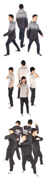  
(a)

  
(b)

  
(c)

  
(d)

  
(e)

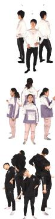  
(g)

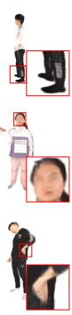  
(h)

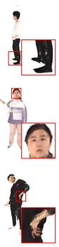  
(i)

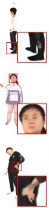  
(j)

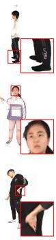  
(k)

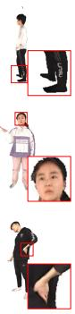  
(l)

Figure 7: Qualitative comparison of in-domain novel view synthesis on THuman2.0 [24] with different numbers of input views (3-view, 4-view, and 5-view settings from top to bottom). (a, g) Input images. (b, h) Results by GPS-Gaussian [10]. (c, i) Results by RoGSplat [15]. (d, j) Results by GHGS-MVSC [12]. (e, k) Results by the proposed method. (f, l) Ground truth.

## C.3 Comparison on the THuman2.1 dataset

We further evaluate the proposed method on the THuman2.1 [24] dataset under both in-domain and cross-domain settings. For the in-domain setting, we follow training and test splits adopted in HART [28]. For the cross-domain setting, the proposed method and previous methods are trained on the THuman2.0 dataset [24] and directly evaluated on the THuman2.1 dataset without any fine-tuning. As shown in Table 16, the proposed method consistently achieves the best performance across all three metrics under both settings. Specifically, the proposed method outperforms the second-best method (i.e., GHGS-MVSC [12]) by 4.38 dB in the in-domain setting and by 1.26 dB in the crossdomain setting. This demonstrates that the proposed method consistently produces high-quality rendering results on the THuman2.1 dataset under both in-domain and cross-domain settings. The qualitative comparisons under in-domain and cross-domain settings are also presented in Figs. 8 and 9, respectively.

Table 16: Quantitative comparison of novel view synthesis on the THuman2.1 [24] dataset under in-domain and cross-domain settings. The best result is shown in bold.
<table><tr><td rowspan="2">Methods</td><td colspan="3">In-domain</td><td colspan="3">THuman2.0 → THuman2.1</td></tr><tr><td>PSNR↑</td><td>SSIM↑</td><td>LPIPS↓</td><td>PSNR↑</td><td>SSIM↑</td><td>LPIPS↓</td></tr><tr><td>GPS-Gaussian [10]</td><td>25.42</td><td>0.9430</td><td>0.0705</td><td>23.44</td><td>0.9315</td><td>0.0793</td></tr><tr><td>GHG [13]</td><td>27.83</td><td>0.9628</td><td>0.0498</td><td>25.07</td><td>0.9418</td><td>0.0651</td></tr><tr><td>RoGSplat [15]</td><td>30.57</td><td>0.9717</td><td>0.0300</td><td>26.64</td><td>0.9524</td><td>0.0523</td></tr><tr><td>GHGS-MVSC [12]</td><td>31.11</td><td>0.9735</td><td>0.0297</td><td>28.39</td><td>0.9621</td><td>0.0384</td></tr><tr><td>Ours</td><td>35.49</td><td>0.9851</td><td>0.0132</td><td>29.65</td><td>0.9623</td><td>0.0267</td></tr></table>

## C.4 Comparison on real-world datasets

Beyond synthetic datasets, we additionally report the performance of the proposed method on realworld datasets, i.e., DNA-Rendering [29] and ZJU-MoCap [30]. For the DNA-Rendering dataset, we follow training and test splits adopted in HART [28], while we use the official split for the ZJU-MoCap dataset. The proposed method and previous methods are trained on the THuman2.0 dataset [24] and directly evaluated on the real-world datasets without any fine-tuning. As shown in Table 17, the proposed method consistently achieves the best performance across all three metrics on both real-world datasets. Specifically, the proposed method outperforms the second-best method (i.e., RoGSplat [15]) by 0.79 dB in PSNR on DNA-Rendering [29] and by 1.33 dB in PSNR on ZJU-MoCap [30], while consistently improving the SSIM value and reducing the LPIPS value. This result demonstrates the strong generalization capability of the proposed method to real-world human subjects. The qualitative comparison is presented in Fig. 10. On the DNA-Rendering dataset [29] (see top row in Fig. 10), previous methods produce noticeably blurry facial features or visible artifacts

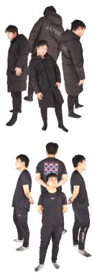  
(a)

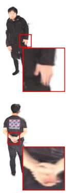  
(b)

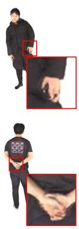  
(c)

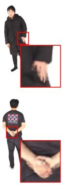  
(d)

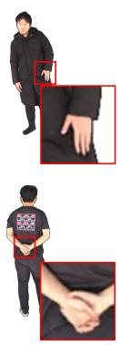  
(e)

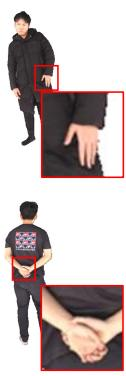  
(f)

Figure 8: Qualitative comparison of in-domain novel view synthesis on the THuman2.1 [24] dataset. (a) Input images. (b) Results by GPS-Gaussian [10]. (c) Results by RoGSplat [15]. (d) Results by GHGS-MVSC [12]. (e) Results by the proposed method. (f) Ground truth.

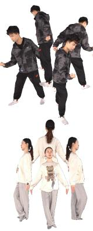  
(a)

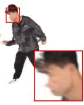

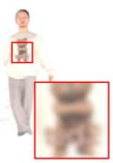

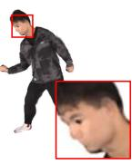

(b)  
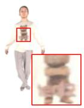  
(c)

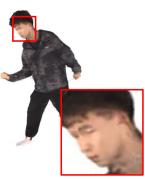

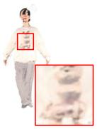  
(d)

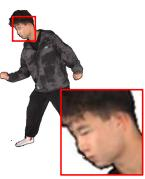

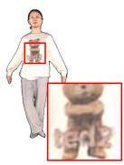  
(e)

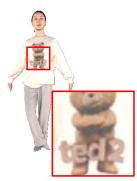  
(f)

Figure 9: Qualitative comparison of cross-domain novel view synthesis on the THuman2.1 [24] dataset. (a) Input images. (b) Results by GPS-Gaussian [10]. (c) Results by GHG [13]. (d) Results by RoGSplat [15]. (e) Results by the proposed method. (f) Ground truth.

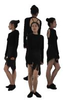

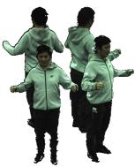  
(a)

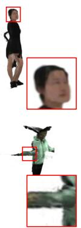  
(b)

  
(c)

  
(d)

  
(e)

  
(f)

Figure 10: Qualitative comparison of cross-domain novel view synthesis on DNA-Rendering [29] and ZJU-MoCap [30] datasets (from top to bottom). (a) Input images. (b) Results by GPS-Gaussian [10]. (c) Results by GHG [13]. (d) Results by RoGSplat [15]. (e) Results by the proposed method. (f) Ground truth.

around the face, whereas the proposed method clearly reconstructs the facial details. Similarly, on the ZJU-MoCap dataset [30] (see bottom row in Fig. 10), previous methods fail to faithfully recover the hand region, where fingers are geometrically distorted, while the proposed method preserves the structure of the fingers more accurately. These visual comparisons confirm that the proposed method effectively reconstructs fine-grained human details even on real-world data.

Table 17: Quantitative comparison of cross-domain novel view synthesis on real-world datasets, i.e., DNA-Rendering [29] and ZJU-MoCap [30]. The best result is shown in bold.
<table><tr><td rowspan="2">Methods</td><td colspan="3">THuman2.0 → DNA-Rendering</td><td colspan="3">THuman2.0 → ZJU-MoCap</td></tr><tr><td>PSNR↑</td><td>SSIM↑</td><td>LPIPS↓</td><td>PSNR↑</td><td>SSIM↑</td><td>LPIPS↓</td></tr><tr><td>GPS-Gaussian [10]</td><td>23.22</td><td>0.8821</td><td>0.1296</td><td>26.26</td><td>0.9296</td><td>0.0829</td></tr><tr><td>GHG [13]</td><td>23.31</td><td>0.8852</td><td>0.0937</td><td>26.72</td><td>0.9357</td><td>0.0712</td></tr><tr><td>RoGSplat [15]</td><td>25.68</td><td>0.9180</td><td>0.0803</td><td>27.66</td><td>0.9508</td><td>0.0547</td></tr><tr><td>GHGS-MVSC [12]</td><td>17.76</td><td>0.8274</td><td>0.1397</td><td>23.10</td><td>0.8924</td><td>0.1056</td></tr><tr><td>Ours</td><td>26.47</td><td>0.9186</td><td>0.0788</td><td>28.99</td><td>0.9525</td><td>0.0536</td></tr></table>

## C.5 Identity preservation on the face region

A common concern in the human reconstruction task, as also raised in NoPo-Avatar [35], is the identity preservation, since the reconstructed subjects may suffer from identity shifts which hinder real-world applications. To address this concern, we further evaluate the proposed method on the face region, which serves as the primary cue for the identity perception. Specifically, we adopt the face quality evaluation protocol of NoPo-Avatar [35] and GOHA [36] on THuman2.0 [24] and X-Humans [26] datasets under the in-domain setting.

For each ground truth image, we first detect the face region using the pre-trained RetinaFace [37]. The detected bounding box is shared across all methods for the fair comparison. On each face region, we measure PSNR, SSIM, and LPIPS to evaluate the pixel-wise similarity, the structural fidelity, and the perceptual similarity between the rendered face and the ground truth, respectively. In addition, we adopt cosine similarity of identity embedding (CSIM) [38] and average keypoint distance (AKD) [39] as face-specific metrics. CSIM computes the cosine similarity between the rendered face and the ground truth in the feature space of ArcFace [38], which is pre-trained to produce discriminative identity embeddings for face recognition. AKD measures the geometric accuracy of facial structures by computing the average pixel distance between facial landmarks (e.g., eyes, nose, and mouth) detected from the rendered face and the ground truth.

As shown in Table 18, the proposed method consistently achieves the best performance across all five metrics on both datasets. Specifically, the proposed method outperforms the second-best method (i.e., GHGS-MVSC [12]) by 1.50 dB and 2.30 dB in PSNR on the THuman2.0 and X-Humans datasets, respectively. The proposed method also achieves the best performance in CSIM and AKD metrics on both datasets, which indicates that face regions of the rendered result faithfully preserve both the identity and the geometric structure. The qualitative comparison is presented in Fig. 11, where the proposed method faithfully reconstructs facial features with the clear geometric structure.

Table 18: Quantitative comparison on the face region of THuman2.0 [24] and X-Humans [26] datasets under in-domain settings. The best result is shown in bold.
<table><tr><td rowspan="2">Methods</td><td colspan="5">THuman2.0</td><td colspan="5">X-Humans</td></tr><tr><td>PSNR↑</td><td>SSIM↑</td><td>LPIPS↓</td><td>CSIM↑</td><td>AKD↓</td><td>PSNR↑</td><td>SSIM↑</td><td>LPIPS↓</td><td>CSIM↑</td><td>AKD↓</td></tr><tr><td>GPS-Gaussian [10]</td><td>20.20</td><td>0.798</td><td>0.240</td><td>0.426</td><td>3.19</td><td>19.52</td><td>0.712</td><td>0.327</td><td>0.388</td><td>3.69</td></tr><tr><td>RoGSplat [15]</td><td>18.18</td><td>0.748</td><td>0.259</td><td>0.473</td><td>2.76</td><td>19.84</td><td>0.703</td><td>0.228</td><td>0.484</td><td>2.99</td></tr><tr><td>GHGS-MVSC [12]</td><td>23.23</td><td>0.856</td><td>0.184</td><td>0.549</td><td>2.25</td><td>23.18</td><td>0.785</td><td>0.219</td><td>0.513</td><td>2.72</td></tr><tr><td>Ours</td><td>24.73</td><td>0.888</td><td>0.111</td><td>0.699</td><td>1.26</td><td>25.48</td><td>0.831</td><td>0.137</td><td>0.620</td><td>2.04</td></tr></table>

  
(a)

  
(b)

  
(c)

  
(d)

  
(e)  
Figure 11: Qualitative comparison on the face region of THuman2.0 [24] and X-Humans [26] datasets (from top to bottom). (a) Results by GPS-Gaussian [10]. (b) Results by RoGSplat [15]. (c) Results by GHGS-MVSC [12]. (d) Results by the proposed method. (e) Ground truth.

## C.6 Comparison with LIFe-GoM

We additionally compare the proposed method with LIFe-GoM [14], which also addresses generalizable human rendering from sparse-view inputs, on the THuman2.0 dataset [24]. To provide a fair comparison, we follow the evaluation protocol of LIFe-GoM. Both the source image and target rendering resolutions are set to 1024 × 1024, and a 500 × 1000 region centered on the human subject is cropped from both the rendered and ground-truth images for evaluation. We report PSNR, LPIPS∗ (i.e., LPIPS×1000), and FID, where FID evaluates the distributional similarity between the rendered and ground truth image sets. As shown in Table 19, the proposed method substantially outperforms LIFe-GoM under its evaluation protocol. Specifically, the proposed method improves PSNR by 4.12 dB and reduces LPIPS∗ by 59.31, while achieving 7.7 FPS compared with 1.0 FPS of LIFe-GoM. These results demonstrate that the proposed method provides both superior rendering quality and faster inference speed.

Table 19: Quantitative comparison with LIFe-GoM [14] on the THuman2.0 dataset. The best result is shown in bold.
<table><tr><td>Methods</td><td>PSNR↑</td><td>LPIPS*↓</td><td>FID↓</td><td>FPS↑</td></tr><tr><td>LIFe-GoM [14]</td><td>25.10</td><td>108.75</td><td>45.17</td><td>1.0</td></tr><tr><td>Ours</td><td>29.22</td><td>49.44</td><td>7.91</td><td>7.7</td></tr></table>

## C.7 Comparison with single-image human reconstruction methods

Recent large reconstruction models, i.e., IDOL [40] and LHM [41], reconstruct animatable human avatars from a single image, whereas the proposed method focuses on generalizable human Gaussian splatting from multiple calibrated views. We compare the proposed method with IDOL on the THuman2.1 dataset [24] and with LHM on the 2K2K dataset [25], where each comparison follows the experimental setting of the corresponding method. As shown in Table 20, the proposed method achieves better performance across all metrics, since it takes four input views while IDOL and LHM take a single image. Note that the results of the proposed method in Table 20 differ from those in Tables 1 and 16 due to the difference in evaluation protocols.

Table 20: Quantitative comparison with single-image human reconstruction methods. The best result is shown in bold.
<table><tr><td>Datasets</td><td>Methods</td><td># of input views</td><td>PSNR↑</td><td>SSIM↑</td><td>LPIPS↓</td></tr><tr><td>THuman2.1</td><td>IDOL [40]</td><td>1</td><td>22.12</td><td>0.9257</td><td>0.112</td></tr><tr><td></td><td>Ours</td><td>4</td><td>33.51</td><td>0.9802</td><td>0.017</td></tr><tr><td>2K2K</td><td>LHM [41]</td><td>1</td><td>20.73</td><td>0.9084</td><td>0.122</td></tr><tr><td></td><td>Ours</td><td>4</td><td>31.72</td><td>0.9722</td><td>0.022</td></tr></table>

## D Limitations and future directions

Static reconstruction. The proposed method focuses on novel view synthesis from a static set of multi-view images, which does not explicitly handle dynamic scenarios. Consequently, applying the proposed method to video sequences would require per-frame reconstruction, which is computationally expensive and may produce temporally inconsistent results across frames. A promising direction to address this limitation is to incorporate a parametric human body model, e.g., SMPL [9], into the proposed framework, where the predicted Gaussians can be deformed according to a temporal sequence of target poses via linear blend skinning. Extending the proposed method along this direction remains as the future work.

Dependency on the clothed human mesh. Since the complexity prior is computed from the clothed human mesh, our method requires an accurate clothed human mesh during the training phase. In practice, obtaining accurate clothed human meshes remains challenging, as it typically relies on laborintensive 3D scanning. A promising direction to address this limitation is to investigate complexity priors directly computed from multi-view input images. This would reduce the dependency on the clothed human mesh during training and broaden the range of training datasets.

## E Ethics statement

We use publicly available human datasets, including THuman [24], 2K2K [25], X-Humans [26], DNA-Rendering [29], and ZJU-MoCap [30], all of which provide properly released data for research purposes. Our research focuses on generalizable human Gaussian splatting from sparse multi-view images, a technology that can benefit applications in graphics, telepresence, virtual reality, and gaming. However, as this technique enables the reconstruction of a realistic human appearance from visual observations, it may raise concerns related to privacy, identity misuse, or unauthorized replication of personal likeness. We emphasize that the proposed method is intended solely for research use and should not be applied to scenarios involving unauthorized digital reproduction of individuals. Responsible deployment and adherence to ethical guidelines are strongly encouraged.

## NeurIPS Paper Checklist

## 1. Claims

Question: Do the main claims made in the abstract and introduction accurately reflect the paper’s contributions and scope?

Answer: [Yes]

Justification: The claims in the abstract and the introduction match the main contributions. Guidelines:

• The answer [N/A] means that the abstract and introduction do not include the claims made in the paper.

• The abstract and/or introduction should clearly state the claims made, including the contributions made in the paper and important assumptions and limitations. A [No] or [N/A] answer to this question will not be perceived well by the reviewers.

• The claims made should match theoretical and experimental results, and reflect how much the results can be expected to generalize to other settings.

• It is fine to include aspirational goals as motivation as long as it is clear that these goals are not attained by the paper.

## 2. Limitations

Question: Does the paper discuss the limitations of the work performed by the authors? Answer: [Yes]

Justification: We discuss the limitations and possible solutions in the supplementary material due to page limits.

Guidelines:

• The answer [N/A] means that the paper has no limitation while the answer [No] means that the paper has limitations, but those are not discussed in the paper.

• The authors are encouraged to create a separate “Limitations” section in their paper.

• The paper should point out any strong assumptions and how robust the results are to violations of these assumptions (e.g., independence assumptions, noiseless settings, model well-specification, asymptotic approximations only holding locally). The authors should reflect on how these assumptions might be violated in practice and what the implications would be.

• The authors should reflect on the scope of the claims made, e.g., if the approach was only tested on a few datasets or with a few runs. In general, empirical results often depend on implicit assumptions, which should be articulated.

• The authors should reflect on the factors that influence the performance of the approach. For example, a facial recognition algorithm may perform poorly when image resolution is low or images are taken in low lighting. Or a speech-to-text system might not be used reliably to provide closed captions for online lectures because it fails to handle technical jargon.

• The authors should discuss the computational efficiency of the proposed algorithms and how they scale with dataset size.

• If applicable, the authors should discuss possible limitations of their approach to address problems of privacy and fairness.

• While the authors might fear that complete honesty about limitations might be used by reviewers as grounds for rejection, a worse outcome might be that reviewers discover limitations that aren’t acknowledged in the paper. The authors should use their best judgment and recognize that individual actions in favor of transparency play an important role in developing norms that preserve the integrity of the community. Reviewers will be specifically instructed to not penalize honesty concerning limitations.

## 3. Theory assumptions and proofs

Question: For each theoretical result, does the paper provide the full set of assumptions and a complete (and correct) proof?

Answer: [N/A]

Justification: The paper does not include theoretical results.

## Guidelines:

• The answer [N/A] means that the paper does not include theoretical results.

• All the theorems, formulas, and proofs in the paper should be numbered and crossreferenced.

• All assumptions should be clearly stated or referenced in the statement of any theorems.

• The proofs can either appear in the main paper or the supplemental material, but if they appear in the supplemental material, the authors are encouraged to provide a short proof sketch to provide intuition.

• Inversely, any informal proof provided in the core of the paper should be complemented by formal proofs provided in appendix or supplemental material.

• Theorems and Lemmas that the proof relies upon should be properly referenced.

## 4. Experimental result reproducibility

Question: Does the paper fully disclose all the information needed to reproduce the main experimental results of the paper to the extent that it affects the main claims and/or conclusions of the paper (regardless of whether the code and data are provided or not)?

Answer: [Yes]

Justification: We provide essential implementation details in the manuscript and the supplementary material.

Guidelines:

• The answer [N/A] means that the paper does not include experiments.

• If the paper includes experiments, a [No] answer to this question will not be perceived well by the reviewers: Making the paper reproducible is important, regardless of whether the code and data are provided or not.

• If the contribution is a dataset and/or model, the authors should describe the steps taken to make their results reproducible or verifiable.

• Depending on the contribution, reproducibility can be accomplished in various ways. For example, if the contribution is a novel architecture, describing the architecture fully might suffice, or if the contribution is a specific model and empirical evaluation, it may be necessary to either make it possible for others to replicate the model with the same dataset, or provide access to the model. In general. releasing code and data is often one good way to accomplish this, but reproducibility can also be provided via detailed instructions for how to replicate the results, access to a hosted model (e.g., in the case of a large language model), releasing of a model checkpoint, or other means that are appropriate to the research performed.

• While NeurIPS does not require releasing code, the conference does require all submissions to provide some reasonable avenue for reproducibility, which may depend on the nature of the contribution. For example

(a) If the contribution is primarily a new algorithm, the paper should make it clear how to reproduce that algorithm.

(b) If the contribution is primarily a new model architecture, the paper should describe the architecture clearly and fully.

(c) If the contribution is a new model (e.g., a large language model), then there should either be a way to access this model for reproducing the results or a way to reproduce the model (e.g., with an open-source dataset or instructions for how to construct the dataset).

(d) We recognize that reproducibility may be tricky in some cases, in which case authors are welcome to describe the particular way they provide for reproducibility. In the case of closed-source models, it may be that access to the model is limited in some way (e.g., to registered users), but it should be possible for other researchers to have some path to reproducing or verifying the results.

## 5. Open access to data and code

Question: Does the paper provide open access to the data and code, with sufficient instructions to faithfully reproduce the main experimental results, as described in supplemental material?

## Answer: [Yes]

Justification: The code and pretrained model are publicly available at the link provided in the abstract.

## Guidelines:

• The answer [N/A] means that paper does not include experiments requiring code.

• Please see the NeurIPS code and data submission guidelines (https://neurips.cc/ public/guides/CodeSubmissionPolicy) for more details.

• While we encourage the release of code and data, we understand that this might not be possible, so [No] is an acceptable answer. Papers cannot be rejected simply for not including code, unless this is central to the contribution (e.g., for a new open-source benchmark).

• The instructions should contain the exact command and environment needed to run to reproduce the results. See the NeurIPS code and data submission guidelines (https: //neurips.cc/public/guides/CodeSubmissionPolicy) for more details.

• The authors should provide instructions on data access and preparation, including how to access the raw data, preprocessed data, intermediate data, and generated data, etc.

• The authors should provide scripts to reproduce all experimental results for the new proposed method and baselines. If only a subset of experiments are reproducible, they should state which ones are omitted from the script and why.

• At submission time, to preserve anonymity, the authors should release anonymized versions (if applicable).

• Providing as much information as possible in supplemental material (appended to the paper) is recommended, but including URLs to data and code is permitted.

## 6. Experimental setting/details

Question: Does the paper specify all the training and test details (e.g., data splits, hyperparameters, how they were chosen, type of optimizer) necessary to understand the results?

Answer: [Yes]

Justification: We describe the detailed experimental settings in the manuscript and the supplementary material.

Guidelines:

• The answer [N/A] means that the paper does not include experiments.

• The experimental setting should be presented in the core of the paper to a level of detail that is necessary to appreciate the results and make sense of them.

• The full details can be provided either with the code, in appendix, or as supplemental material.

## 7. Experiment statistical significance

Question: Does the paper report error bars suitably and correctly defined or other appropriate information about the statistical significance of the experiments?

Answer: [No]

Justification: The results are obtained from standard randomly seeded runs without cherryp icking, offering a fair and representative evaluation despite not including error bars.

Guidelines:

• The answer [N/A] means that the paper does not include experiments.

• The authors should answer [Yes] if the results are accompanied by error bars, confidence intervals, or statistical significance tests, at least for the experiments that support the main claims of the paper.

• The factors of variability that the error bars are capturing should be clearly stated (for example, train/test split, initialization, random drawing of some parameter, or overall run with given experimental conditions).

• The method for calculating the error bars should be explained (closed form formula, call to a library function, bootstrap, etc.)

• The assumptions made should be given (e.g., Normally distributed errors).

• It should be clear whether the error bar is the standard deviation or the standard error of the mean.

• It is OK to report 1-sigma error bars, but one should state it. The authors should preferably report a 2-sigma error bar than state that they have a 96% CI, if the hypothesis of Normality of errors is not verified.

• For asymmetric distributions, the authors should be careful not to show in tables or figures symmetric error bars that would yield results that are out of range (e.g., negative error rates).

• If error bars are reported in tables or plots, the authors should explain in the text how they were calculated and reference the corresponding figures or tables in the text.

## 8. Experiments compute resources

Question: For each experiment, does the paper provide sufficient information on the computer resources (type of compute workers, memory, time of execution) needed to reproduce the experiments?

Answer: [Yes]

Justification: The paper specifies the type of GPU used, memory, and time of execution needed to reproduce the experiments in the manuscript and the supplementary material.

Guidelines:

• The answer [N/A] means that the paper does not include experiments.

• The paper should indicate the type of compute workers CPU or GPU, internal cluster, or cloud provider, including relevant memory and storage.

• The paper should provide the amount of compute required for each of the individual experimental runs as well as estimate the total compute.

• The paper should disclose whether the full research project required more compute than the experiments reported in the paper (e.g., preliminary or failed experiments that didn’t make it into the paper).

## 9. Code of ethics

Question: Does the research conducted in the paper conform, in every respect, with the NeurIPS Code of Ethics https://neurips.cc/public/EthicsGuidelines?

Answer: [Yes]

Justification: The research adheres to the NeurIPS Code of Ethics, with no use of sensitive data or methods posing foreseeable ethical risks.

Guidelines:

• The answer [N/A] means that the authors have not reviewed the NeurIPS Code of Ethics.

• If the authors answer [No], they should explain the special circumstances that require a deviation from the Code of Ethics.

• The authors should make sure to preserve anonymity (e.g., if there is a special consideration due to laws or regulations in their jurisdiction).

## 10. Broader impacts

Question: Does the paper discuss both potential positive societal impacts and negative societal impacts of the work performed?

Answer: [Yes]

Justification: The paper discusses broader impacts in the manuscript.

Guidelines:

• The answer [N/A] means that there is no societal impact of the work performed.

• If the authors answer [N/A] or [No], they should explain why their work has no societal impact or why the paper does not address societal impact.

• Examples of negative societal impacts include potential malicious or unintended uses (e.g., disinformation, generating fake profiles, surveillance), fairness considerations (e.g., deployment of technologies that could make decisions that unfairly impact specific groups), privacy considerations, and security considerations.

• The conference expects that many papers will be foundational research and not tied to particular applications, let alone deployments. However, if there is a direct path to any negative applications, the authors should point it out. For example, it is legitimate to point out that an improvement in the quality of generative models could be used to generate Deepfakes for disinformation. On the other hand, it is not needed to point out that a generic algorithm for optimizing neural networks could enable people to train models that generate Deepfakes faster.

• The authors should consider possible harms that could arise when the technology is being used as intended and functioning correctly, harms that could arise when the technology is being used as intended but gives incorrect results, and harms following from (intentional or unintentional) misuse of the technology.

• If there are negative societal impacts, the authors could also discuss possible mitigation strategies (e.g., gated release of models, providing defenses in addition to attacks, mechanisms for monitoring misuse, mechanisms to monitor how a system learns from feedback over time, improving the efficiency and accessibility of ML).

## 11. Safeguards

Question: Does the paper describe safeguards that have been put in place for responsible release of data or models that have a high risk for misuse (e.g., pre-trained language models, image generators, or scraped datasets)?

Answer: [N/A]

Justification: The work does not involve releasing models or data with high risk of misuse, so specific safeguards are not applicable.

Guidelines:

• The answer [N/A] means that the paper poses no such risks.

• Released models that have a high risk for misuse or dual-use should be released with necessary safeguards to allow for controlled use of the model, for example by requiring that users adhere to usage guidelines or restrictions to access the model or implementing safety filters.

• Datasets that have been scraped from the Internet could pose safety risks. The authors should describe how they avoided releasing unsafe images.

• We recognize that providing effective safeguards is challenging, and many papers do not require this, but we encourage authors to take this into account and make a best faith effort.

## 12. Licenses for existing assets

Question: Are the creators or original owners of assets (e.g., code, data, models), used in the paper, properly credited and are the license and terms of use explicitly mentioned and properly respected?

Answer: [Yes]

Justification: All external datasets and code-bases used in the paper are properly cited.

Guidelines:

• The answer [N/A] means that the paper does not use existing assets.

• The authors should cite the original paper that produced the code package or dataset.

• The authors should state which version of the asset is used and, if possible, include a URL.

• The name of the license (e.g., CC-BY 4.0) should be included for each asset.

• For scraped data from a particular source (e.g., website), the copyright and terms of service of that source should be provided.

• If assets are released, the license, copyright information, and terms of use in the package should be provided. For popular datasets, paperswithcode.com/datasets has curated licenses for some datasets. Their licensing guide can help determine the license of a dataset.

• For existing datasets that are re-packaged, both the original license and the license of the derived asset (if it has changed) should be provided.

• If this information is not available online, the authors are encouraged to reach out to the asset’s creators.

## 13. New assets

Question: Are new assets introduced in the paper well documented and is the documentation provided alongside the assets?

Answer: [N/A]

Justification: The paper does not introduce new assets such as datasets that require separate documentation.

Guidelines:

• The answer [N/A] means that the paper does not release new assets.

• Researchers should communicate the details of the dataset/code/model as part of their submissions via structured templates. This includes details about training, license, limitations, etc.

• The paper should discuss whether and how consent was obtained from people whose asset is used.

• At submission time, remember to anonymize your assets (if applicable). You can either create an anonymized URL or include an anonymized zip file.

## 14. Crowdsourcing and research with human subjects

Question: For crowdsourcing experiments and research with human subjects, does the paper include the full text of instructions given to participants and screenshots, if applicable, as well as details about compensation (if any)?

Answer: [N/A]

Justification: We mainly utilize publicly available datasets for our experiments.

Guidelines:

• The answer [N/A] means that the paper does not involve crowdsourcing nor research with human subjects.

• Including this information in the supplemental material is fine, but if the main contribution of the paper involves human subjects, then as much detail as possible should be included in the main paper.

• According to the NeurIPS Code of Ethics, workers involved in data collection, curation, or other labor should be paid at least the minimum wage in the country of the data collector.

## 15. Institutional review board (IRB) approvals or equivalent for research with human subjects

Question: Does the paper describe potential risks incurred by study participants, whether such risks were disclosed to the subjects, and whether Institutional Review Board (IRB) approvals (or an equivalent approval/review based on the requirements of your country or institution) were obtained?

Answer: [N/A]

Justification: The paper does not involve crowdsourcing nor research with human subjects. Guidelines:

• The answer [N/A] means that the paper does not involve crowdsourcing nor research with human subjects.

• Depending on the country in which research is conducted, IRB approval (or equivalent) may be required for any human subjects research. If you obtained IRB approval, you should clearly state this in the paper.

• We recognize that the procedures for this may vary significantly between institutions and locations, and we expect authors to adhere to the NeurIPS Code of Ethics and the guidelines for their institution.

• For initial submissions, do not include any information that would break anonymity (if applicable), such as the institution conducting the review.

## 16. Declaration of LLM usage

Question: Does the paper describe the usage of LLMs if it is an important, original, or non-standard component of the core methods in this research? Note that if the LLM is used only for writing, editing, or formatting purposes and does not impact the core methodology, scientific rigor, or originality of the research, declaration is not required.

Answer: [N/A]

Justification: The core method development in this research does not involve LLMs as any important, original, or non-standard components.

Guidelines:

• The answer [N/A] means that the core method development in this research does not involve LLMs as any important, original, or non-standard components.

• Please refer to our LLM policy in the NeurIPS handbook for what should or should not be described.