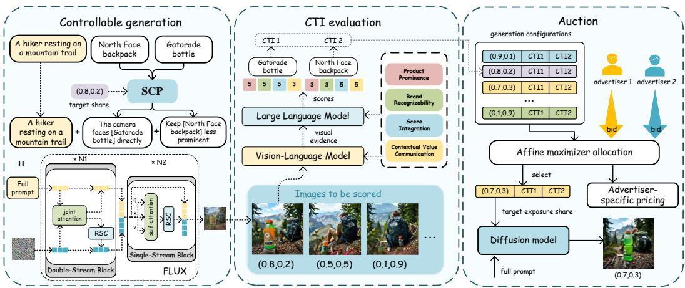
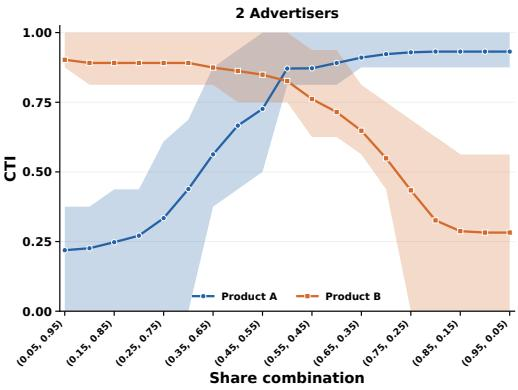
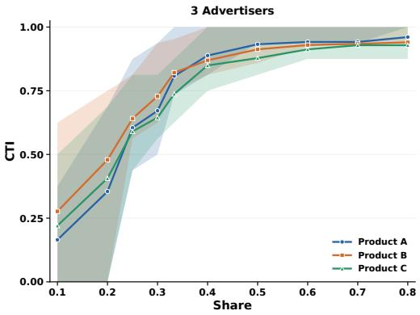
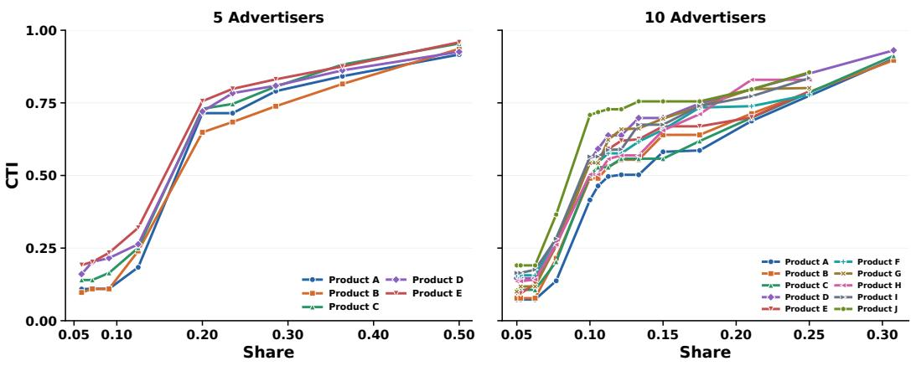
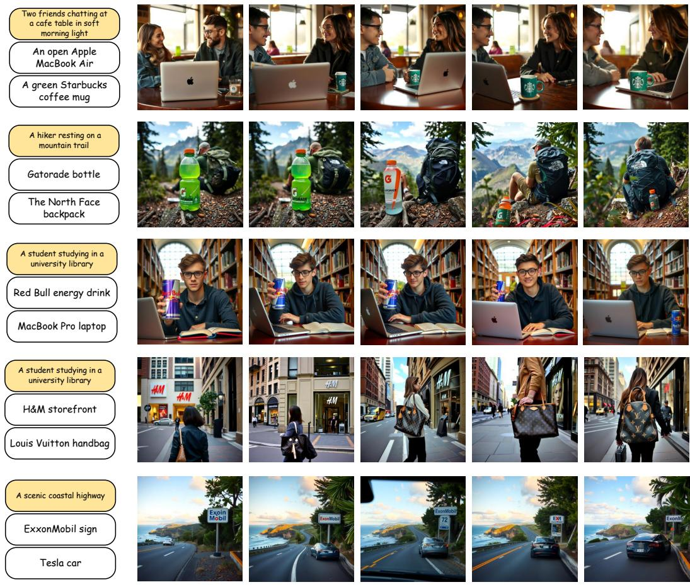

# DIFFAUCTION: AN AUCTION-DRIVEN FRAMEWORK FOR GENERATIVE IMAGE ADVERTISING

Yijie Su<sup>1,†</sup>, Ruiyang Si<sup>†</sup>, Tonghan Wang<sup>2,3,⋄</sup>

<sup>1</sup>Tongji University <sup>2</sup>Tsinghua University <sup>3</sup>Shanghai Qi Zhi Institute

<sup>⋄</sup>Correspondence to: thw@mail.tsinghua.edu.cn

## ABSTRACT

Diffusion models create an opportunity for advertising in generated visual content, with multiple advertisers competing for exposure within a shared image. Yet existing approaches are computationally costly when generating images under varying target-share configurations, and it remains unclear how the resulting outcomes should be evaluated and priced. To address these gaps, we propose DiffAuction, an auction framework connecting controllable generation, click-intent evaluation, and auction design. First, our training-free Residual Share Calibration (RSC) decomposes joint-attention updates into product-specific residuals and rescales them according to target shares. Because a fixed prompt tends to produce similar viewpoints that favor the same products regardless of their target shares, we further introduce Share-Conditioned Prompting (SCP) to adapt the viewpoint to each desired allocation. Second, we develop an evaluator that uses a VLM to extract visual evidence and an LLM to assess Click-Through Intent (CTI), a proxy for click propensity, along four dimensions: Product Prominence, Brand Recognizability, Scene Integration, and Contextual Value Communication. We validate its assessments against judgments from 10 trained annotators on 1,000 images. Third, we formulate this advertising setting as an auction over jointly feasible generation configurations. Each configuration has a public expected CTI vector, while advertisers hold configuration-specific private values per unit of CTI that map click intent into commercial value. We adopt a learnable affine maximizer auction (AMA), which jointly selects a shared generation configuration and determines advertiser-specific payments to maximize expected platform revenue. The resulting allocation and payment rules guarantee dominant-strategy incentive compatibility (DSIC) and individual rationality (IR). Experiments show that our generation method strengthens the monotonic relationship between target shares and CTI relative to baselines, while the learned AMA achieves higher platform revenue in the resulting auction setting.

## 1 INTRODUCTION

Online advertising monetizes user attention by allocating exposure through auctions (Edelman et al., 2007; Varian, 2007). Whereas conventional auctions assign predefined ad slots, a growing body of work on LLM-native ad has begun to auction influence over generated content based on advertisers’ bids and preferences (Duetting et al., 2024; Hajiaghayi et al., 2024; Soumalias et al., 2025; Zhao et al., 2025; Yun et al., 2026; Zhang et al., 2026a;b; Liu et al., 2026; Turner-Smith et al., 2026). These advances demonstrate the potential of treating generated content itself as advertising inventory.

Diffusion models extend this opportunity to visual advertising, raising the possibility of advertisers competing for exposure within a shared generated image. Compared with LLM-based ad auctions, this direction remains underexplored. Designing such auctions requires addressing three interdependent challenges. First, the generation process should realize the advertiser exposure shares selected by the auction, yet diffusion models offer limited control over these shares through prompting alone. Second, the effectiveness of each advertiser’s exposure must be measurable. Click-through intent (CTI) provides a suitable criterion. Whereas conventional auctions can draw on historical clickthrough rates for pre-defined slots, each generated image is a new outcome whose product-level CTI must be estimated from its content. Third, the mechanism should combine the publicly known expected CTI with advertisers’ private values per CTI unit, select a jointly feasible exposure-share configuration, and determine bidder-specific payments that incentivize truthful reporting.

To address the first challenge, Sun et al. (2025) introduce bid-weighted score composition, combining multiple diffusion predictions, each conditioned on a distinct subset of product prompts. This requires multiple conditional model evaluations per timestep, increasing computational cost as the number of products grows. To accelerate generation, we condition the model jointly on all product prompts and incorporate the exposure-share specification within a single forward pass per timestep. We implement this using Residual Share Calibration (RSC), a training-free method that decomposes joint attention’s residual output into product-specific updates induced by the corresponding product tokens. These updates capture how each product shifts the latent image features during generation. RSC calibrates their magnitudes according to the target exposure shares. A fixed prompt can favor similar viewpoints even as target shares change, leaving certain products consistently obscured or overly prominent. We therefore introduce Share-Conditioned Prompting (SCP) that adjusts the viewing perspective according to target shares to better support the desired exposure allocation.

To address the second challenge, we introduce a product-level CTI proxy based on four interpretable dimensions: product prominence, brand recognizability, scene integration, and contextual value communication, with an analysis supporting their coverage of the principal aspects of CTI evaluation. We use a VLM to extract visual evidence for each product, and an LLM to score the evidence along each dimension using a fixed rubric. The aggregate score provides a content-based estimate of product-level click intent, which we use to evaluate the effectiveness of the realized exposure. We assess this evaluator on a dataset of 1,000 images annotated by ten annotators and find that its scores correlate strongly with human ratings.

To address the third challenge, we formulate exposure trading in generative image advertising as an auction over generation configurations subject to joint feasibility constraints. For a given scene and set of competing advertisers, the platform offers candidate generation configurations, each specifying an exposure share and an expected CTI for each advertiser. Moreover, different ad presentations may affect both click intent and the conversion potential of the resulting attention (Schwartz et al., 2017; Li et al., 2025). Advertisers may thus value each unit of CTI differently across configurations based on their private conversion data and campaign objectives. We therefore allow each advertiser to hold multiple private valuations, one for each configuration. Building on this formulation, we adopt a learnable affine maximizer auction (AMA) (Curry et al., 2023) to optimize expected platform revenue while ensuring truthful reporting. Using a joint scoring function with learnable advertiser weights and configuration-specific offsets, the mechanism selects the highest-scoring configuration and constructs advertiser-specific price menus that depend only on the other advertisers’ reports. We show that this allocation and payment rule make the selected configuration utility-maximizing for each advertiser within its own menu, and that this mechanism guarantees dominant-strategy incentive compatibility (DSIC) and individual rationality (IR).

Our experiments show that combining RSC with SCP reduces generation time while strengthening the monotonic relationship between target exposure shares and product-level CTI. Our CTI evaluation also exhibits relatively high agreement with human annotations. Finally, experiments with simulated private valuations demonstrate that the learned AMA achieves higher platform revenue than the baselines in this auction setting.

In summary, our contributions are threefold:

• We propose a training-free method combining RSC and SCP to control product exposure in generated images according to target shares.

• We develop a VLM–LLM evaluator that assesses product-level CTI along four interpretable dimensions and construct a dataset of 1,000 images annotated by 10 annotators to evaluate its agreement with human judgments.

• We formulate generative image advertising as an auction over jointly feasible generation configurations with multiple configuration-specific private values per CTI unit. We instantiate this formulation with a learnable affine maximizer auction (AMA) that optimizes expected platform revenue while guaranteeing DSIC and IR.

## 2 RELATED WORK

Auction-based generative advertising. Generative advertising treats model-generated content as advertising inventory, allowing advertisers to bid for influence beyond predefined ad slots. Existing LLM-native mechanisms realize this idea at different levels: token-level auctions allow bids to influence individual tokens (Duetting et al., 2024); RAG-based segment auctions allocate ads to discourse segments according to bids and relevance (Hajiaghayi et al., 2024); MOSAIC aggregates advertisers’ preferences over generated responses without fine-tuning the LLM (Soumalias et al., 2025); and LLM-Auction jointly models auction allocation and response generation (Zhao et al., 2025). Neuron Auctions shift the auction object from surface text to internal FFN representations and treat continuous intervention budgets as auctionable commodities (Yun et al., 2026). These studies motivate our formulation of product exposure in a generated image as an auctionable resource.

However, auction-driven generative image advertising remains relatively underexplored. Sun et al. (2025) provide an initial study. Their target-share-conditioned generation requires multiple conditional model evaluations per denoising timestep, causing computational cost to grow with the number of products. Moreover, they use CLIP similarity as a proxy for product value, but this simple proxy lacks interpretability and direct validation. They also do not consider the more complex setting in which advertisers hold multiple configuration-specific private valuations, or integrate image generation and auction design into a unified framework for optimizing platform revenue. Therefore, systematic work is still needed to fill these research gaps.

Training-free controllable image generation. A broad line of research controls pretrained diffusion models at inference time without additional model training. Existing approaches intervene at different stages of the generation process. Attention-based methods manipulate token–image in teractions to preserve, amplify, or suppress specific concepts; for example, Prompt-to-Prompt edits cross-attention maps and supports token-level attention reweighting (Hertz et al., 2022), while Rich Text introduces explicit token and region-aware guidance (Ge et al., 2023). Guidance-based approaches modify denoising directions to strengthen or suppress semantic concepts, as exemplified by SEGA (Brack et al., 2023). More recent methods directly edit internal representations of diffusion Transformers; FluxSpace, for instance, identifies editable directions in FLUX feature spaces (Dalva et al., 2025). These methods demonstrate the effectiveness of inference-time intervention for semantic and compositional control. However, our setting differs from conventional concept editing: multiple advertised products coexist in the same jointly generated scene, and the objective is not merely to include or emphasize a concept, but to regulate their relative exposure according to a prescribed share vector. Sun et al. (2025) address this problem by combining generation directions obtained from multiple conditional model evaluations, resulting in increased computational cost as the number of products grows. In contrast, the combination of Share-Conditioned Prompting (SCP) and Residual Share Calibration (RSC) supports target-share-conditioned generation with only a single model forward pass per denoising timestep.

## 3 METHOD

As illustrated in Figure 1, target shares, serving as control inputs to the generative model, determine the intended exposure allocation; CTI estimates the product-level click intent associated with the resulting exposure, and the auction combines the expected CTI of each candidate configuration with advertisers’ reported values per CTI unit for allocation and pricing. We describe each component in the following sections.

## 3.1 RESIDUAL SHARE CALIBRATION AND SHARE-CONDITIONED PROMPTING

Given a scene prompt and N product prompts, we use a target-share vector $\mathbf { s } = ( s _ { 1 } , \ldots , s _ { N } ) \in$ $\Delta ^ { N - 1 }$ to condition the relative exposure of the products. We propose Residual Share Calibration $( { \mathrm { R S C } } ) .$ , a training-free method that decomposes the image-feature update from joint attention into product-specific residuals and rescales them so that their shares of the summed product-wise Frobenius norms match the target vector.

  
Figure 1: Overview of DiffAuction. DiffAuction connects generation, CTI evaluation, and auction. Given target shares, RSC and SCP control the exposure of products during generation. The resulting images are evaluated offline by a VLM–LLM pipeline that estimates product-level CTI. During the auction, a learnable affine maximizer combines the expected CTI of each configuration with advertisers’ reported values per CTI unit to select a shared configuration and determine advertiserspecific payments. The selected exposure shares are used to generate the advertisement image.

Product-wise residual decomposition. Consider one joint-attention block and omit its denoisingstep and block indices for clarity. Let $\mathbf { A } \in \mathbb { R } ^ { H \times I \times T }$ denote the image-to-text attention tensor and $\mathbf { V } \in \mathbb { R } ^ { H \times T \times d _ { h } }$ the corresponding text-value tensor. Here, H is the number of attention heads, I is the number of image tokens, T is the number of text tokens, and $d _ { h }$ is the feature dimension of each head. For product i, let T $\subseteq \{ 1 , \ldots , T \}$ be its text-token index set; these sets are mutually disjoint across products. Once A has been computed, value aggregation and the output projection are linear with respect to these token sets. The residual matrix of product i is therefore

$$
\mathbf { { R } } _ { i } = \left( \operatorname { C o n c a t } _ { h = 1 } ^ { H } \left[ \sum _ { j \in \mathbb { T } _ { i } } \mathbf { A } _ { h , : , j } \mathbf { V } _ { h , j , : } ^ { \top } \right] \right) \mathbf { { W } } _ { O } , \qquad Y = U + \sum _ { i = 1 } ^ { N } { { R } _ { i } } .\tag{1}
$$

Here, $\mathbf { { \mathit { R } } } _ { i }$ is the additive image-feature update induced by product i’s text tokens. The matrix $W _ { O }$ denotes the output projection without its bias, while U collects the unchanged terms, including the image-to-image contribution, non-product text residuals, and output bias. All product residuals are thus obtained from the same attention computation and share a consistent scene context.

Target-share reweighting. Directly multiplying each residual $\scriptstyle { R _ { i } }$ by its target share $s _ { i }$ generally fails to achieve the desired proportions, since the residuals may differ in magnitude. We therefore define each product’s current share of the total residual magnitude as

$$
p _ { i } = \frac { \Vert \pmb { R } _ { i } \Vert _ { F } } { \sum _ { j = 1 } ^ { N } \Vert \pmb { R } _ { j } \Vert _ { F } } .\tag{2}
$$

We then compensate for this imbalance before combining the updates:

$$
\widetilde { R } _ { i } = \frac { s _ { i } } { p _ { i } } R _ { i } , \qquad \widetilde { Y } = U + \sum _ { i = 1 } ^ { N } \widetilde { R } _ { i } .\tag{3}
$$

Provided every product with a positive target share has a nonzero residual, this rescaling makes each product’s share of the summed residual norms equal to $s _ { i }$ , while preserving the total residual magnitude and leaving U unchanged.

Share-Conditioned Prompting (SCP). Although RSC can modulate relative product exposure, the viewpoint and layout induced by a fixed prompt may remain largely unchanged as shares vary. This limits the effectiveness of share adjustments, leaving some products insufficiently visible even

at high shares and others overly prominent even at low shares. We therefore augment each product description with prominence instructions based on its target share relative to equal allocation:

$$
r _ { i } = \frac { s _ { i } } { 1 / N } = N s _ { i } .\tag{4}
$$

Here, N is the number of products, and $r _ { i }$ measures how much exposure product i is intended to receive relative to an equal share. We map $r _ { i }$ to one of five ordered prominence levels, each associated with a shared descriptive template. Templates for higher prominence levels encourage more favorable views and greater product visibility, whereas those for lower prominence levels instruct the model to make the product less visually prominent. Because SCP maps target shares to five ordered levels, it provides discrete prompt conditioning, while RSC separately uses the realvalued target shares to calibrate residual-norm contributions. Appendix B.3 provides the detailed prompt templates. Our ablation study further demonstrates the complementary effects of SCP and RSC in improving share–CTI monotonicity.

## 3.2 EVALUATING PRODUCT-LEVEL CLICK-THROUGH INTENT

Different levels of product exposure are expected to elicit varying degrees of user click intent, motivating the need for a click intent estimator. While conventional ad placements can draw on historical click-through rates, newly generated images require a content-based estimate of this intent. We therefore introduce a click-through intent (CTI) proxy based on the following dimensions.

Evaluation dimensions. We focus on image-observable factors that may influence CTI while abstracting away subjective product preferences. We define four complementary dimensions: product prominence, which captures visual salience; brand recognizability, which reflects the visibility of brand cues; scene integration, which measures how naturally the product fits into the scene; and contextual value communication, which assesses whether the scene conveys the product’s use, relevance, or value. Appendix F provides further details, including an analysis of the completeness of these dimensions for CTI evaluation.

Image-grounded CTI evaluation. Given an image I, its scene description, and the advertised products, a vision–language model (VLM) extracts a structured caption documenting each product’s observable evidence across the four dimensions. Using the caption and the same scene and product information, a separate language model (LLM) assigns scores $z _ { i d } \in \{ 1 , . . . , 5 \}$ to product i on dimension d under a fixed rubric; higher scores are better. The prompt used by the VLM and LLM are provided in Appendix G. The equally weighted mean is linearly rescaled to [0, 1]:

$$
\mathrm { C T I } _ { i } ( I ) = \frac { 1 } { 1 6 } \sum _ { d = 1 } ^ { 4 } ( z _ { i d } - 1 ) \in [ 0 , 1 ] .\tag{5}
$$

## 3.3 LEARNABLE AFFINE-MAXIMIZER AUCTION MECHANISM

We formulate exposure trading as an auction over generation configurations subject to joint feasibility constraints. We adopt a learnable affine maximizer auction (AMA) (Curry et al., 2023) to optimize expected platform revenue, the payments from advertisers. The mechanism selects a single common configuration using learnable advertiser weights and configuration offsets and determines advertiser-specific payments according to the affine-maximizer payment rule.

Configurations and private valuations. The public configuration set is indexed by $\kappa \_ =$ $\{ 0 , 1 , \ldots , K \}$ . Each configuration $k \geq 1$ specifies a target share vector $\mathbf { s } _ { k } \in \Delta ^ { n - 1 }$ and an expected CTI vector estimated from a historical scene set $\chi ;$

$$
q _ { i k } = { \frac { 1 } { | { \mathcal { X } } | } } \sum _ { x \in { \mathcal { X } } } { \mathrm { C T I } } _ { i } ( I _ { k } ( x ) ) , \qquad \mathbf { q } _ { k } = ( q _ { 1 k } , \dots , q _ { n k } ) \in [ 0 , 1 ] ^ { n } .\tag{6}
$$

Here $I _ { k } ( x )$ is a historical image generated under configuration k and scene $x .$ . These share and CTI vectors are fixed before bidding. Configuration 0 corresponds to no allocation, with ${ \bf s } _ { 0 } = { \bf q } _ { 0 } = { \bf 0 }$

The expected CTI $q _ { i k }$ captures the anticipated click intent for advertiser i under configuration k, but need not fully characterize the commercial value of that exposure. Prior research shows that click and conversion performance need not align across ad presentations (Schwartz et al., 2017; Li et al., 2025). We therefore allow advertiser i’s private value per CTI unit to vary across configurations, reflecting its private assessments of conversion potential and campaign objectives. Specifically, we represent advertiser i’s private values per CTI unit by a vector $\bar { \mathbf { v } } _ { i } \overset {  } { = } ( v _ { i 1 } , \dotsc , v _ { i K } \overset {  } { ) } \in \mathbb { R } _ { + } ^ { K }$ , with $v _ { i 0 } = 0$ The resulting expected value of configuration k to advertiser i is $V _ { i } ( k ) = q _ { i k } v _ { i k }$ . We assume that the platform has access to the joint distribution F of advertisers’ private valuations.

Selecting a common configuration. To define a learnable configuration-selection rule, we introduce trainable parameters ${ \boldsymbol { \phi } } = ( \mathbf { w } , \beta )$ , where $w _ { i } > 0$ is an advertiser weight and $\beta _ { k }$ is a configuration offset, with $\beta _ { 0 } = 0$ . Advertiser i reports its value per CTI unit for each configuration, denoted by $b _ { i k }$ , so that $q _ { i k } b _ { i k }$ is its reported total value. We score and select configurations by

$$
S _ { \phi } ( k ; { \mathbf b } ) = \beta _ { k } + \sum _ { i = 1 } ^ { n } w _ { i } q _ { i k } b _ { i k } , \qquad k _ { \phi } ( { \mathbf b } ) \in \arg \operatorname* { m a x } _ { k \in { \mathcal K } } S _ { \phi } ( k ; { \mathbf b } ) .\tag{7}
$$

The platform learns advertiser weights and configuration offsets offline and fixes them before bidding. During the auction, it selects the highest-scoring configuration, breaking ties by choosing the first maximizer in a fixed order. If configuration 0 is selected, no allocation is made and all realized payments are zero, as shown in Appendix E.4.

Advertiser-specific prices and truthful incentives. To determine advertiser i’s payment, the platform removes its own reported contribution from each configuration’s joint score, retaining only the offset and the other advertisers’ weighted reported values. Denote this remaining score by $C _ { i k }$ and its maximum across configurations by $H _ { i }$

$$
C _ { i k } ( \mathbf { b } _ { - i } ) = \beta _ { k } + \sum _ { j \neq i } w _ { j } q _ { j k } b _ { j k } , \qquad H _ { i } ( \mathbf { b } _ { - i } ) = \operatorname* { m a x } _ { \ell \in \mathcal { K } } C _ { i \ell } ( \mathbf { b } _ { - i } ) .\tag{8}
$$

The platform assigns advertiser i a price for each configuration and charges only the price of the selected configuration:

$$
P _ { i k } ( { \bf b } _ { - i } ) = \frac { H _ { i } ( { \bf b } _ { - i } ) - C _ { i k } ( { \bf b } _ { - i } ) } { w _ { i } } , \qquad p _ { i } ( { \bf b } ) = P _ { i , k _ { \phi } ( { \bf b } ) } ( { \bf b } _ { - i } ) .\tag{9}
$$

Because these prices depend only on the other advertisers’ reports, advertiser i cannot change its own prices by changing its report. Substituting the prices into its reported utility gives

$$
\begin{array} { c } { { q _ { i k } b _ { i k } - P _ { i k } ( { \bf b } _ { - i } ) = \displaystyle \frac { S _ { \phi } ( k ; { \bf b } ) - H _ { i } ( { \bf b } _ { - i } ) } { w _ { i } } , } } \\ { { \displaystyle \arg \operatorname* { m a x } _ { k \in \mathcal K } \{ q _ { i k } b _ { i k } - P _ { i k } ( { \bf b } _ { - i } ) \} = \arg \displaystyle \operatorname* { m a x } _ { k \in \mathcal K } S _ { \phi } ( k ; { \bf b } ) . } } \end{array}\tag{10}
$$

Consequently, the highest-scoring configuration maximizes each advertiser’s reported utility, and the tie-breaking rule ensures a consistent selection. Since each advertiser’s induced menu is independent of its own report, truthful reporting maximizes its true utility, establishing DSIC (Hammond, 1979; Wang et al., 2024; 2025). Furthermore, every menu contains at least one zero-priced entry with nonnegative value, guaranteeing nonnegative utility under truthful reporting and hence IR.

Revenue-oriented learning. We learn weights and offsets to maximize expected revenue under truthful reporting:

$$
\operatorname* { m a x } _ { \phi } R ( \phi ) , \qquad R ( \phi ) = \mathbb { E } _ { \mathbf { v } \sim F } \left[ \sum _ { i = 1 } ^ { n } p _ { i } ( \mathbf { v } ) \right] ,\tag{11}
$$

where F is the joint distribution of private value vectors. To obtain gradients through discrete selection, we introduce

$$
\pi _ { \phi } ^ { \tau } ( k | \mathbf { v } ) = \frac { \exp ( S _ { \phi } ( k ; \mathbf { v } ) / \tau ) } { \sum _ { \ell \in \mathcal { K } } \exp ( S _ { \phi } ( \ell ; \mathbf { v } ) / \tau ) }\tag{12}
$$

and use the minibatch revenue surrogate

$$
\mathcal { L } _ { \mathrm { r e v } } ( \phi ) = - \frac { 1 } { B } \sum _ { m = 1 } ^ { B } \sum _ { k = 1 } ^ { K } \pi _ { \phi } ^ { \tau } ( k \mid \mathbf { v } ^ { ( m ) } ) \sum _ { i = 1 } ^ { n } P _ { i k } ( \mathbf { v } _ { - i } ^ { ( m ) } ) .\tag{13}
$$

## 4 EXPERIMENTS

## 4.1 MONOTONICITY BETWEEN TARGET EXPOSURE SHARES AND CTI

Effectiveness of our method. Effective exposure control should translate higher target shares into more effective exposure in generated images, as measured by CTI. A stronger monotonic relationship therefore indicates that the generation method more consistently realizes the intended allocation. Therefore, we evaluate this relationship on 1,000 two-product scenes covering 400 distinct products, generating each scene under 19 share configurations for a total of 19,000 images. For our method, we use FLUX.1-schnell to generate images at $1 0 2 4 \times 1 0 2 4$ resolution with 10 denoising steps, applying RSC during the first 8 steps. We compare against Sun et al. (2025), which weights separately computed generation directions by bids, and prompt-only FLUX, which specifies exposure shares directly in the prompt. Our method performs best across all five metrics (Table 1), whose definitions are provided in Appendix B.2.

Table 1: Monotonicity between target exposure shares and CTI.
<table><tr><td>Method</td><td></td><td>Pearson ↑ Spearman ↑ Pairwise ↑ Kendall&#x27;s</td><td></td><td> $\tau _ { b }$ </td><td>↑ Isotonic  $R ^ { 2 }$  ↑</td></tr><tr><td>FLUX (Prompt-only)</td><td>0.2181</td><td>0.2344</td><td>0.5727</td><td>0.1837</td><td>0.2802</td></tr><tr><td>Sun et al. (2025)</td><td>0.6675</td><td>0.6630</td><td>0.7343</td><td>0.5332</td><td>0.7708</td></tr><tr><td>Ours</td><td>0.7222</td><td>0.7370</td><td>0.7603</td><td>0.6027</td><td>0.8126</td></tr></table>

We further visualize the average CTI under different target-share configurations for both the twoand three-advertiser settings in Figure 2. The results are aggregated over 1,000 scenarios. The curves show a clear increasing trend as each product’s target share increases. These results show that varying the target shares produces consistent changes in the effectiveness of the resulting product exposure, as measured by CTI, thereby yielding a controllable set of generation configurations for the subsequent auction.

  
(a) Two advertisers.

  
(b) Three advertisers.  
Figure 2: Monotonicity between target share and CTI achieved by our method.

Ablation study of our method. We evaluate the complementarity of RSC and SCP across 200 scenes, each with 19 share configurations ranging from (0.95, 0.05) to (0.05, 0.95), as shown in Table 2. The results show that RSC and SCP are complementary, with their combination achieving the best performance across all metrics. Moreover, RSC + SCP outperforms the baseline equipped with the same SCP conditioning, indicating that the improvement cannot be attributed to share conditioned prompting alone.

Efficiency Comparison. We compare the efficiency of our method with the baseline (Sun et al., 2025) under generation settings involving different numbers of products. We evaluate both methods

Table 2: Ablation study of the monotonic relationship between target exposure shares and productlevel CTI across different method configurations, evaluated on 200 scenes.
<table><tr><td>Method</td><td></td><td>Pearson ↑ Spearman ↑ Pairwise ↑</td><td></td><td>Kendall&#x27;s  $\tau _ { b } \uparrow$ </td><td>Isotonic  $R ^ { 2 } \uparrow$ </td></tr><tr><td>SCP only</td><td>0.3039</td><td>0.3172</td><td>0.5989</td><td>0.2430</td><td>0.4897</td></tr><tr><td>RSC only</td><td>0.3730</td><td>0.3774</td><td>0.6236</td><td>0.2990</td><td>0.4964</td></tr><tr><td> $\mathrm { B a s e l i n e } + \mathrm { S C P }$ </td><td>0.7651</td><td>0.7837</td><td>0.7797</td><td>0.6430</td><td>0.8880</td></tr><tr><td> ${ \mathrm { R S C } } + { \mathrm { S C P } }$ </td><td>0.8120</td><td>0.8346</td><td>0.8024</td><td>0.6981</td><td>0.9265</td></tr></table>

using the same set of 200 prompts and measure their inference time per denoising timestep. All inference times are measured on one NVIDIA A800 GPU and reported as mean ± standard deviation over ten runs. As reported in Table 3, our method is consistently faster across all product counts, with its efficiency advantage becoming increasingly pronounced as the number of products grows.

Table 3: Per-timestep inference-time comparison.
<table><tr><td># Products</td><td>Ours (s) ↓</td><td>Sun et al. (2025) (s) ↓ Speedup ↑</td><td></td><td>Time reduction ↑</td></tr><tr><td>2</td><td> $0 . 6 6 5 4 \pm 0 . 0 0 0 2$ </td><td> $1 . 2 7 3 4 \pm 0 . 0 0 0 6$ </td><td>1.91×</td><td>47.74%</td></tr><tr><td>4</td><td> $0 . 7 3 1 7 \pm 0 . 0 0 0 2$ </td><td> $1 . 6 9 9 2 \pm 0 . 0 0 0 4$ </td><td>2.32×</td><td>56.94%</td></tr><tr><td>6</td><td> $0 . 7 9 8 5 \pm 0 . 0 0 1 8$ </td><td> $2 . 5 4 8 5 \pm 0 . 0 0 0 1$ </td><td>3.19×</td><td>68.67%</td></tr><tr><td>8</td><td> $0 . 8 6 2 3 \pm 0 . 0 0 0 3$ </td><td> $3 . 3 9 8 0 \pm 0 . 0 0 1 7$ </td><td>3.94×</td><td>74.62%</td></tr><tr><td>10</td><td> $0 . 9 2 8 9 \pm 0 . 0 0 2 6$ </td><td> $4 . 2 5 7 1 \pm 0 . 0 0 1 2$ </td><td>4.58×</td><td>78.18%</td></tr></table>

## 4.2 VALIDATION OF THE CTI EVALUATOR

The CTI evaluator provides the product-level estimates used to construct the public expected-CTI table. The auction combines this table with advertisers’ private values for allocation and pricing. We evaluate its agreement with human judgments and assess the reliability of the human annotations.

Human annotation protocol. We recruited 10 trained annotators to evaluate 1,000 generated images using the same four-dimensional rubric as our CTI evaluator, with each annotator rating 100 images. Product order was randomized, and target exposure shares were hidden. Annotators scored each product based on the generated image, product descriptions, and scene context. Using these hu man annotations as a reference, we compare two evaluation pipelines: VLM, which directly scores images with InternVL3-14B (Zhu et al., 2025), and VLM–LLM, which uses InternVL3-14B to extract visual evidence and Qwen2.5-7B-Instruct (Yang et al., 2024) to score it. Human and predicted CTI use the same aggregation and normalization. As shown in Table 4, VLM–LLM achieves higher agreement with human judgments across all three metrics, supporting its use as our CTI evaluator.

Table 4: Agreement between predicted CTI and human judgments on 1,000 images from 200 scenes. Results are averaged over the two products. Higher values are better.
<table><tr><td>Evaluator</td><td></td><td>Pearson ↑ Spearman ↑</td><td> $\overline { { \mathrm { I C C } ( 2 , 1 ) \uparrow } }$ </td></tr><tr><td>VLM only</td><td>0.662</td><td>0.574</td><td>0.610</td></tr><tr><td> $\mathsf { V L M } + \mathrm { L L M } \left( \mathrm { o u r s } \right)$ </td><td>0.669</td><td>0.603</td><td>0.653</td></tr></table>

Inter-annotator agreement. Table 5 reports agreement among five annotators on 20 scenes to examine the reliability of human ratings. Ordinal Krippendorff’s α measures chance-corrected agreement while accounting for rating order. Exact agreement is the percentage of evaluated items for which all five annotators assign exactly the same score on a given metric. MAE measures the average absolute difference between annotator pairs. All metrics achieve ordinal $\alpha > 0 . 8$ , indicating high inter-annotator agreement. Although exact agreement on CTI is only 42.0% under the strict requirement that all five annotators assign identical scores, its low MAE of 0.0450 indicates that disagreements are small on average. These results support the reliability of human ratings.

Table 5: Inter-annotator agreement among 20 scenes. Each image was independently rated by five annotators. We calculated agreement among the annotators’ ratings using all 100 images from the 20 scenes. PP, BR, SI, and CVC denote four dimensions.
<table><tr><td>Measure</td><td>PP</td><td>BR</td><td>SI</td><td>CVC</td><td>CTI</td></tr><tr><td>Ordinal α ↑</td><td>0.8181</td><td>0.9654</td><td>0.8342</td><td>0.8419</td><td>0.9179</td></tr><tr><td>Exact (%) ↑</td><td>78.0</td><td>82.0</td><td>66.0</td><td>68.0</td><td>42.0</td></tr><tr><td>MAE↓</td><td>0.1600</td><td>0.1400</td><td>0.2933</td><td>0.2733</td><td>0.0450</td></tr></table>

## 4.3 EVALUATING THE ECONOMIC PERFORMANCE OF THE AUCTION MECHANISM

We evaluate whether learning advertiser weights and configuration offsets improves platform revenue under different structures of private preferences. We conduct separate experiments with two and three advertisers, each using a fixed set of 19 paid configurations and a no-allocation option. Expected CTI is averaged across historical scenes and fixed across valuation profiles, with total configuration value given by $q _ { i k } v _ { i k }$

Valuation distributions and baselines. We consider two synthetic valuation distributions. In the correlated setting, we independently sample two endpoint coefficients from Uniform[0, 1] for each advertiser and interpolate its values per CTI unit linearly over exposure shares. This models preferences that vary smoothly across nearby exposure configurations. In the independent setting, we sample every $v _ { i k }$ independently from Uniform[0, 1], allowing configuration-specific preferences without the interpolation constraint. We train AMA separately for each setting and select among three training seeds using validation revenue. Revenue is the mean sum of actual payments under truthful reporting and hard configuration selection. We compare against VCG (Vickrey, 1961; Clarke, 1971; Groves, 1973) and a Myerson-based baseline (Myerson, 1981). VCG maximizes total reported value and uses pivot payments. The Myerson-based baseline uses unit advertiser weights and fixed offsets $\beta _ { k } = { \textstyle - { \frac { 1 } { 2 } } } \sum _ { i } { \dot { q } } _ { i k }$ with AMA payments, retaining the uniform single-parameter Myerson scoring rule without claiming optimality in the present multidimensional setting.

Table 6: Mean platform revenue under truthful reporting.
<table><tr><td>Advertisers</td><td>Distribution</td><td>VCG</td><td>Myerson-based</td><td>AMA</td></tr><tr><td>2</td><td>Correlated</td><td>0.1592</td><td>0.4036</td><td>0.4242</td></tr><tr><td>2</td><td>Independent</td><td>0.3699</td><td>0.5648</td><td>0.8535</td></tr><tr><td>3</td><td>Correlated</td><td>0.2019</td><td>0.5238</td><td>0.5462</td></tr><tr><td>3</td><td>Independent</td><td>0.3498</td><td>0.6031</td><td>0.9086</td></tr></table>

Results. Table 6 shows that learned AMA achieves the highest revenue in all four settings. Under correlated valuations, it improves over the Myerson-based baseline by 5.10% and 4.27% for two and three advertisers, respectively; under independent valuations, the gains reach 51.12% and 50.66%. It also consistently outperforms VCG in platform revenue. These results demonstrate the benefit of adapting auction parameters to configuration-dependent private valuations, with larger gains over the fixed baselines in the independent setting.

## 5 CONCLUSION

We presented DiffAuction, a unified framework integrating controllable image generation, CTI evaluation, and truthful auction design. RSC and SCP enable continuous exposure control with one model forward pass per denoising step, while the CTI evaluator provides interpretable product-level click-intent estimates. A learnable affine maximizer combines expected CTI with advertisers’ private values to select feasible configurations and determine payments while ensuring DSIC and IR. Experiments demonstrate improved share–CTI monotonicity, generation efficiency, human agreement, and auction revenue.

## REFERENCES

Manuel Brack, Felix Friedrich, Dominik Hintersdorf, Lukas Struppek, Patrick Schramowski, and Kristian Kersting. Sega: Instructing text-to-image models using semantic guidance. Advances in Neural Information Processing Systems, 36:25365–25389, 2023.

Peter Pin-Shan Chen. The entity-relationship model—toward a unified view of data. ACM Transactions on Database Systems, 1(1):9–36, 1976.

Edward H. Clarke. Multipart pricing of public goods. Public Choice, 11:17–33, 1971. doi: 10.1007/ BF01726210.

David Collier, Jody LaPorte, and Jason Seawright. Putting typologies to work: Concept formation, measurement, and analytic rigor. Political research quarterly, 65(1):217–232, 2012.

Michael Curry, Tuomas Sandholm, and John Dickerson. Differentiable economics for randomized affine maximizer auctions. In Proceedings of the Thirty-Second International Joint Conference on Artificial Intelligence, pp. 2633–2641, 2023. doi: 10.24963/ijcai.2023/293.

Yusuf Dalva, Kavana Venkatesh, and Pinar Yanardag. Fluxspace: Disentangled semantic editing in rectified flow models. In 2025 IEEE/CVF Conference on Computer Vision and Pattern Recognition (CVPR), pp. 13083–13092. IEEE, 2025.

Paul Duetting, Vahab Mirrokni, Renato Paes Leme, Haifeng Xu, and Song Zuo. Mechanism design for large language models. In Proceedings of the ACM Web Conference 2024, pp. 144–155, 2024.

Benjamin Edelman, Michael Ostrovsky, and Michael Schwarz. Internet advertising and the generalized second-price auction: Selling billions of dollars worth of keywords. American economic review, 97(1):242–259, 2007.

Songwei Ge, Taesung Park, Jun-Yan Zhu, and Jia-Bin Huang. Expressive text-to-image generation with rich text. In 2023 IEEE/CVF International Conference on Computer Vision (ICCV), pp. 7511–7522. IEEE, 2023.

Theodore Groves. Incentives in teams. Econometrica, 41(4):617–631, 1973. doi: 10.2307/1914085.

MohammadTaghi Hajiaghayi, Sebastien Lahaie, Keivan Rezaei, and Suho Shin. Ad auctions for´ llms via retrieval augmented generation. Advances in Neural Information Processing Systems, 37:18445–18480, 2024.

Peter J Hammond. Straightforward individual incentive compatibility in large economies. The Review ofEconomic Studies, 46(2):263–282, 1979.

Amir Hertz, Ron Mokady, Jay Tenenbaum, Kfir Aberman, Yael Pritch, and Daniel Cohen-Or. Prompt-to-prompt image editing with cross attention control. arXiv preprint arXiv:2208.01626, 2022.

Justin Johnson, Ranjay Krishna, Michael Stark, Li-Jia Li, David A. Shamma, Michael S. Bernstein, and Li Fei-Fei. Image retrieval using scene graphs. In Proceedings of the IEEE Conference on Computer Vision and Pattern Recognition, pp. 3668–3678, 2015.

Ranjay Krishna, Yuke Zhu, Oliver Groth, Justin Johnson, Kenji Hata, Joshua Kravitz, Stephanie Chen, Yannis Kalantidis, Li-Jia Li, David A. Shamma, Michael S. Bernstein, and Li Fei-Fei. Vi sual genome: Connecting language and vision using crowdsourced dense image annotations. International Journal of Computer Vision, 123(1):32–73, 2017. doi: 10.1007/s11263-016-0981-7.

Yuan Li, Xiaoyu Deng, and Banggang Wu. The impact of mobile advertising cue types on consumer response behaviors: Evidence from a field experiment. Journal of Theoretical and Applied Electronic Commerce Research, 20(3):244, 2025. doi: 10.3390/jtaer20030244. URL https://doi.org/10.3390/jtaer20030244.

Jiayuan Liu, Barry Wang, Jiarui Gan, Tonghan Wang, Leon Xie, Mingyu Guo, and Vincent Conitzer. Incentive-aware multi-fidelity optimization for generative advertising in large language models. In Proceedings of the Third Conference on Language Modeling, 2026.

Deborah J MacInnis and Bernard J Jaworski. Information processing from advertisements: Toward an integrative framework. Journal ofmarketing, 53(4):1–23, 1989.

Deborah J. MacInnis, Christine Moorman, and Bernard J. Jaworski. Enhancing and measuring consumers’ motivation, opportunity, and ability to process brand information from ads. Journal ofMarketing, 55(4):32–53, 1991.

Edward F. McQuarrie and David Glen Mick. Visual rhetoric in advertising: Text-interpretive, experimental, and reader-response analyses. Journal ofConsumer Research, 26(1):37–54, 1999.

Roger B Myerson. Optimal auction design. Mathematics of operations research, 6(1):58–73, 1981.

Thomas J. Reynolds, Charles E. Gengler, and Daniel J. Howard. A means-end analysis of brand persuasion through advertising. International Journal ofResearch in Marketing, 12(3):257–266, 1995.

Cristel Antonia Russell. Investigating the effectiveness of product placements in television shows: The role of modality and plot connection congruence on brand memory and attitude. Journal of Consumer Research, 29(3):306–318, 2002.

Eric M. Schwartz, Eric T. Bradlow, and Peter S. Fader. Customer acquisition via display advertising using multi-armed bandit experiments. Marketing Science, 36(4):500–522, 2017. doi: 10.1287/ mksc.2016.1023. URL https://doi.org/10.1287/mksc.2016.1023.

Linda M. Scott. Images in advertising: The need for a theory of visual rhetoric. Journal ofConsumer Research, 21(2):252–273, 1994.

Ermis Soumalias, Michael Curry, and Sven Seuken. Truthful aggregation of llms with an application to online advertising. In D. Belgrave, C. Zhang, H. Lin, R. Pascanu, P. Koniusz, M. Ghassemi, and N. Chen (eds.), Advances in Neural Information Processing Systems, volume 38, Main Conference, pp. 145262–145308. Curran Associates, Inc., 2025. doi: 10.52202/ 085713-4862. URL https://proceedings.neurips.cc/paper\_files/paper/ 2025/file/d60b6b7f0ba6bf07d975b3bbdacea702-Paper-Conference.pdf.

Lillian Sun, Henry Huang, Fucheng Warren Zhu, Giannis Daras, and Constantinos Costis Daskalakis. Bidding for influence: Auction-driven diffusion image generation. In ICML 2025 Workshop on Collaborative and Federated Agentic Workflows, 2025. URL https: //openreview.net/forum?id=v5tF1THvt9.

John L. Turner-Smith, Zimeng Huang, Yuhan Fu, Yihang Zhang, and Tonghan Wang. Evaluating and pricing advertisements in ai-generated responses, 2026.

Hal R Varian. Position auctions. international Journal ofindustrial Organization, 25(6):1163–1178, 2007.

William Vickrey. Counterspeculation, auctions, and competitive sealed tenders. The Journal of Finance, 16(1):8–37, 1961. doi: 10.1111/j.1540-6261.1961.tb02789.x.

Tonghan Wang, Yanchen Jiang, and David C Parkes. Gemnet: Menu-based, strategy-proof multibidder auctions through deep learning. In Proceedings of the 25th ACM Conference on Economics and Computation, 2024.

Tonghan Wang, Yanchen Jiang, and David C. Parkes. Bundleflow: Deep menus for combinatorial auctions by diffusion-based optimization. In Advances in Neural Information Processing Systems (NeurIPS), 2025.

An Yang, Baosong Yang, Beichen Zhang, Binyuan Hui, Bo Zheng, Bowen Yu, Chengyuan Li, Dayiheng Liu, Fei Huang, Haoran Wei, et al. Qwen2.5 technical report. arXiv preprint arXiv:2412.15115, 2024. URL https://arxiv.org/abs/2412.15115.

Peiran Yun, Wenxin Xu, Jiayuan Liu, Yihang Zhang, Liang Zeng, Lingkai Kong, and Tonghan Wang. Llm advertisement based on neuron auctions. arXiv preprint arXiv:2605.08326, 2026.

Yihang Zhang, Zimeng Huang, Ren Zhai, Yipeng Kang, and Tonghan Wang. Naiad: Initiate datadriven research for llm advertising. arXiv preprint arXiv:2605.09918, 2026a.

Zhaowei Zhang, Yuhan Fu, Yihang Zhang, Xiaohan Liu, Ceyao Zhang, Xiaoyuan Zhang, Yipeng Kang, Tonghan Wang, and Yaodong Yang. Pila: Plug-and-play insertion for llm-native advertising. arXiv preprint arXiv:2607.25590, 2026b.

Chujie Zhao, Qun Hu, Shiping Song, Dagui Chen, Han Zhu, Jian Xu, and Bo Zheng. Llm-auction: Generative auction towards llm-native advertising. arXiv preprint arXiv:2512.10551, 2025.

Jinguo Zhu, Weiyun Wang, Zhe Chen, Zhaoyang Liu, Shenglong Ye, Lixin Gu, Hao Tian, Yuchen Duan, Weijie Su, Jie Shao, et al. Internvl3: Exploring advanced training and test-time recipes for open-source multimodal models. arXiv preprint arXiv:2504.10479, 2025. URL https: //arxiv.org/abs/2504.10479.

## A FURTHER EXPERIMENTS ON THE MONOTONICITY BETWEEN TARGET EXPOSURE SHARE AND CTI

We further evaluate monotonicity in the three-advertiser setting and compare our method with the baseline, as shown in Table 7. The results show that our method continues to outperform the baseline while maintaining strong monotonicity.

Table 7: Monotonicity between target exposure shares and CTI in the three-advertiser setting.
<table><tr><td>Method</td><td></td><td>Pearson ↑ Spearman ↑ Pairwise ↑</td><td></td><td> $\mathrm { K e n d a l l ` s } \tau _ { b }$ </td><td>↑ Isotonic  $R ^ { 2 } \uparrow$ </td></tr><tr><td>Sun et al. (2025)</td><td>0.5861</td><td>0.6579</td><td>0.7530</td><td>0.5449</td><td>0.6143</td></tr><tr><td>Ours</td><td>0.6839</td><td>0.7932</td><td>0.8171</td><td>0.6685</td><td>0.6922</td></tr></table>

We further increase the number of advertisers to five and ten to examine whether the monotonic relationship can still be maintained. We use 100 scene prompts and generate 2,000 images for evaluation. The results are reported in Table 8 and Figure 3. The results show that even when a larger number of products compete for exposure simultaneously, our method still preserves a clear monotonic relationship between target shares and the resulting CTI, demonstrating its scalability to settings with more advertisers.

Table 8: Monotonicity under increasing numbers of advertised products.
<table><tr><td>Setting</td><td></td><td>Pearson ↑ Spearman ↑</td><td>Pairwise ↑</td><td>Kendall&#x27;s  $\tau _ { b }$ </td><td>↑ Isotonic  $R ^ { 2 } \uparrow$ </td></tr><tr><td>5 products</td><td>0.7084</td><td>0.7324</td><td>0.7773</td><td>0.6037</td><td>0.6992</td></tr><tr><td>10 products</td><td>0.5928</td><td>0.6004</td><td>0.7162</td><td>0.4981</td><td>0.5689</td></tr></table>

  
Figure 3: Monotonicity between target exposure share and CTI under extreme numbers of competing products.

In addition, we investigate whether our method preserves monotonicity when the competing products belong to the same category, such as a Luckin coffee cup and a Starbucks coffee cup. We construct 50 scenarios involving competition between products from the same category and generate 1,000 images in total, with two advertisers competing in each image. We then evaluate the monotonicity between CTI and exposure share. The results are shown in Table 9.

Table 9: Share–CTI monotonicity for competing products.
<table><tr><td>Method</td><td>Pearson ↑</td><td>Spearman ↑</td><td>Pairwise ↑</td><td>Kendall&#x27;s  $\tau _ { b }$  ↑</td><td>Isotonic  $R ^ { 2 } \uparrow$ </td></tr><tr><td>Sun et al. (2025)</td><td>0.4794</td><td>0.4858</td><td>0.6597</td><td>0.4007</td><td>0.6687</td></tr><tr><td>Ours</td><td>0.5600</td><td>0.5961</td><td>0.7073</td><td>0.4964</td><td>0.6755</td></tr></table>

## B ADDITIONAL DETAILS ON SHARE CONTROL

## B.1 FURTHER EXPERIMENTS ON RSC

Number of controlled denoising steps. We vary the number of denoising steps during which RSC is applied to study the trade-off between control effectiveness and computational cost. For each setting, we report the monotonicity between the target exposure share and CTI. As shown in Table 10, increasing the control duration from two to eight steps consistently improves all five metrics, indicating that sustained residual calibration strengthens share–CTI monotonicity over the evaluated configurations. The best performance is obtained with eight controlled steps. Extending RSC to all ten denoising steps leads to a slight degradation, suggesting that intervention during the final refinement stage may over-constrain local appearance and disrupt the previously established prominence ordering. Therefore, controlling the first eight steps provides the best balance between monotonicity and computational overhead.

Table 10: Effect of the number of controlled denoising steps on share–CTI monotonicity and inference time. Runtime is averaged over three runs on an NVIDIA A800 GPU.
<table><tr><td></td><td></td><td>Control Steps Pearson ↑ Spearman ↑ Pairwise ↑</td><td></td><td>Kendall&#x27;s  $\tau _ { b }$ </td><td>↑ Isotonic  $R ^ { 2 } \uparrow$ </td><td>Runtime (s) ↓</td></tr><tr><td>2</td><td>0.7581</td><td>0.7839</td><td>0.7788</td><td>0.6413</td><td>0.8604</td><td> $\mathbf { 5 . 4 4 8 \pm 0 . 0 0 3 }$ </td></tr><tr><td>4</td><td>0.7875</td><td>0.7925</td><td>0.7823</td><td>0.6522</td><td>0.8972</td><td> $6 . 4 2 2 \pm 0 . 0 0 2$ </td></tr><tr><td>6</td><td>0.7892</td><td>0.8074</td><td>0.7920</td><td>0.6717</td><td>0.8979</td><td> $7 . 4 0 1 \pm 0 . 0 0 2$ </td></tr><tr><td>8</td><td>0.8120</td><td>0.8346</td><td>0.8024</td><td>0.6981</td><td>0.9265</td><td> $8 . 3 7 8 \pm 0 . 0 0 6$ </td></tr><tr><td>10</td><td>0.8083</td><td>0.8249</td><td>0.7987</td><td>0.6893</td><td>0.9184</td><td> $9 . 3 4 4 \pm 0 . 0 0 1$ </td></tr></table>

Intervention location. We further investigate where RSC should be applied within FLUX. Specifically, we compare three variants: RSC applied only to the double-stream blocks, only to the single stream blocks, and to both types of blocks. This analysis examines how the intervention stage affect the resulting share–CTI monotonicity. All variants are evaluated on the same 200 scenes. As shown in Table 11, applying RSC to both the double-stream and single-stream blocks achieves the best performance across all metrics. This is because the double-stream blocks establish early interactions between product tokens and image features, whereas the subsequent single-stream blocks further integrate and refine these multimodal representations. Applying RSC throughout both stages therefore preserves the intended product-wise residual allocation during early alignment and reinforces it during later feature refinement, leading to more consistent share control.

Table 11: Effect of applying residual control to different FLUX transformer streams.
<table><tr><td>Controlled Blocks</td><td>Pearson ↑</td><td>Spearman ↑</td><td>Pairwise ↑</td><td>Kendall&#x27;s  $\tau _ { b } \uparrow$ </td><td>Isotonic  $R ^ { 2 } \uparrow$ </td></tr><tr><td>Double-stream only</td><td>0.6878</td><td>0.7021</td><td>0.7444</td><td>0.5649</td><td>0.7861</td></tr><tr><td>Single-stream only</td><td>0.6478</td><td>0.6605</td><td>0.7297</td><td>0.5291</td><td>0.7588</td></tr><tr><td>Double- and single-stream</td><td>0.8120</td><td>0.8346</td><td>0.8024</td><td>0.6981</td><td>0.9265</td></tr></table>

Ablation of residual reweighting. We examine whether normalizing product-specific residual magnitudes improves share control compared with directly scaling residuals by their target shares. Direct scaling uses ${ \widetilde { R } } _ { i } ~ = ~ s _ { i } R _ { i }$ , whereas RSC applies ${ \widetilde { R } } _ { i } ~ = ~ ( s _ { i } / p _ { i } ) R _ { i }$ , where $\begin{array} { r l } { p _ { i } } & { { } = } \end{array}$ $\| R _ { i } \| _ { F } / \sum _ { j } \| R _ { j } \| _ { F }$ . The latter redistributes residual magnitudes according to the target shares while preserving the sum of their Frobenius norms. Table 12 compares the two strategies in terms of share–CTI monotonicity. The results show that RSC achieves better performance. This is primarily because direct scaling does not ensure that each product’s share of the summed residual norms matches its target share. It also reduces the sum of the product-specific residual norms, which may weaken product visibility. RSC compensates for differences in residual magnitudes while preserving the sum of their Frobenius norms.

Table 12: Comparison of direct residual scaling and RSC.
<table><tr><td>Method</td><td></td><td>Pearson ↑ Spearman ↑ Pairwise ↑ Kendall&#x27;s</td><td></td><td> $\tau _ { b }$ </td><td>↑ Isotonic  $R ^ { 2 } \uparrow$ </td></tr><tr><td>Direct scaling</td><td>0.7792</td><td>0.7705</td><td>0.7687</td><td>0.6232</td><td>0.8393</td></tr><tr><td>RSC</td><td>0.8120</td><td>0.8346</td><td>0.8024</td><td>0.6981</td><td>0.9265</td></tr></table>

## B.2 DEFINITIONS OF CORRELATION AND MONOTONICITY METRICS

In this section, we introduce five metrics for evaluating the monotonicity between exposure share and CTI. We describe their meanings and calculation methods below.

Pearson correlation. Pearson correlation measures the strength of the linear relationship between target share and CTI:

$$
r = { \frac { \sum _ { k } ( s _ { k } - { \bar { s } } ) ( y _ { k } - { \bar { y } } ) } { \sqrt { \sum _ { k } ( s _ { k } - { \bar { s } } ) ^ { 2 } \sum _ { k } ( y _ { k } - { \bar { y } } ) ^ { 2 } } } } ,\tag{14}
$$

where $\bar { s }$ and $\bar { y }$ are the means within the current scene–product curve. A larger value indicates a stronger positive linear association.

Spearman correlation. Spearman correlation measures rank consistency, allowing the share–CTI relationship to be nonlinear:

$$
\rho = \operatorname { C o r r } \big ( \operatorname { r a n k } ( \mathbf { s } ) , \operatorname { r a n k } ( \mathbf { y } ) \big ) .\tag{15}
$$

Tied CTI values receive their average rank. A larger value indicates that configurations with higher target shares generally receive higher CTI.

Pairwise monotonicity. This metric measures how frequently a higher target share corresponds to higher CTI. With $M = { \binom { K } { 2 } }$ , we compute

$$
P = \frac { 1 } { M } \sum _ { k < \ell } \left[ \mathbb { I } ( y _ { \ell } > y _ { k } ) + \frac { 1 } { 2 } \mathbb { I } ( y _ { \ell } = y _ { k } ) \right] .\tag{16}
$$

An increase receives one point, a tie receives half a point, and a decrease receives zero. Thus, $P = 1$ indicates strict increase across all pairs, whereas a constant CTI curve receives $P = 0 . 5$

Kendall’s $\tau _ { b } .$ . Kendall’s $\tau _ { b }$ measures the monotonic association between target share and CTI while accounting for ties. For each pair of configurations with $s _ { \ell } > s _ { k }$ , we define the pair as concordant if $y _ { \ell } ~ > ~ y _ { k }$ , discordant if $y _ { \ell } ~ < ~ y _ { k }$ , and tied if $y _ { \ell } ~ = ~ y _ { k }$ . Let $C , D$ , and $T$ denote the numbers of concordant, discordant, and CTI-tied pairs, respectively. Since the target shares contain no ties, Kendall’s $\tau _ { b }$ reduces to

$$
\tau _ { b } = \frac { C - D } { \sqrt { ( C + D ) ( C + D + T ) } } .\tag{17}
$$

A larger $\tau _ { b }$ indicates a stronger monotonically increasing relationship.

Isotonic $R ^ { 2 }$ . Isotonic $R ^ { 2 }$ measures how closely the CTI curve can be approximated by a nondecreasing sequence:

$$
\widehat { \mathbf { y } } = \arg \operatorname* { m i n } _ { z _ { 1 } \leq \cdots \leq z _ { K } } \sum _ { k = 1 } ^ { K } ( y _ { k } - z _ { k } ) ^ { 2 } , \qquad R _ { \mathrm { i s o } } ^ { 2 } = 1 - \frac { \sum _ { k } ( y _ { k } - \widehat { y } _ { k } ) ^ { 2 } } { \sum _ { k } ( y _ { k } - \bar { y } ) ^ { 2 } } .\tag{18}
$$

We obtain the fit using the pool-adjacent-violators algorithm. This metric accounts for the magnitude of departures from a nondecreasing curve relative to the curve’s total variation. A nonconstant, nondecreasing curve achieves one, including curves with plateaus; therefore, a high value does not by itself imply fine-grained share responsiveness.

## B.3 SHARE-CONDITIONED PROMPTS

We augment product descriptions with share-conditioned prominence instructions to address limited exposure control under a fixed viewpoint and layout. For each product i, we compute its target share relative to equal allocation:

$$
r _ { i } = \frac { s _ { i } } { 1 / N } = N s _ { i } ,\tag{19}
$$

where N is the number of products and $\textstyle \sum _ { i } s _ { i } = 1$ . Thus, $r _ { i } = 1$ corresponds to equal allocation, providing a common reference across different numbers of products.

We map each positive relative share to one of five prominence levels:

$$
L ( r _ { i } ) = \left\{ \begin{array} { l l } { 1 , } & { 0 < r _ { i } < 1 - \alpha , } \\ { 2 , } & { 1 - \alpha \le r _ { i } < 1 - \delta , } \\ { 3 , } & { 1 - \delta \le r _ { i } < 1 + \delta , } \\ { 4 , } & { 1 + \delta \le r _ { i } \le 1 + \alpha , } \\ { 5 , } & { r _ { i } > 1 + \alpha , } \end{array} \right.\tag{20}
$$

where $0 < \delta < \alpha < 1$ . We use $\alpha = 0 . 5$ and $\delta = 0 . 2 $ , yielding boundaries of 0.5, 0.8, 1.2, and 1.5. Each level uses the following template, with [product] replaced by the corresponding product description:

• Level 1: Keep [product] visible but substantially less prominent, with a smaller visual footprint and a more peripheral or background position.

• Level 2: Keep [product] less prominent but visible.

• Level 3: Keep [product] visible.

• Level 4: Frame [product] somewhat more prominently than other products.

• Level 5: The camera should face [product] directly and present it as the primary focal product.

These share-conditioned instructions encourage more favorable views of higher-share products while limiting excessive exposure of lower-share products. They complement residual control by enabling viewpoint and layout changes that residual reweighting alone may not achieve under a fixed prompt.

Analysis of threshold values. We further investigate how α and δ affect the resulting monotonicity. Intuitively, α controls the boundary between mild and strong prominence preferences, while δ determines the neutral region around equal allocation. We select three parameter configurations and evaluate their effects on the monotonicity metrics using the same 50 scenes.

Table 13: Hyperparameter search for threshold values.
<table><tr><td>Advertisers</td><td>α</td><td>δ</td><td></td><td>Pearson ↑ Spearman ↑</td><td>Pairwise ↑</td><td>Kendall&#x27;s  $\tau _ { b }$ </td><td>↑ Isotonic  $R ^ { 2 } \uparrow$ </td></tr><tr><td>2</td><td>0.40</td><td>0.15</td><td>0.7716</td><td>0.7750</td><td>0.7802</td><td>0.6431</td><td>0.8788</td></tr><tr><td>2</td><td>0.50</td><td>0.20</td><td>0.7747</td><td>0.7829</td><td>0.7826</td><td>0.6462</td><td>0.8840</td></tr><tr><td>2</td><td>0.60</td><td>0.25</td><td>0.7626</td><td>0.7706</td><td>0.7758</td><td>0.6333</td><td>0.8886</td></tr><tr><td>3</td><td>0.40</td><td>0.15</td><td>0.6899</td><td>0.7590</td><td>0.7956</td><td>0.6370</td><td>0.6922</td></tr><tr><td>3</td><td>0.50</td><td>0.20</td><td>0.7042</td><td>0.7817</td><td>0.8071</td><td>0.6579</td><td>0.7048</td></tr><tr><td>3</td><td>0.60</td><td>0.25</td><td>0.6783</td><td>0.7560</td><td>0.7920</td><td>0.6340</td><td>0.6760</td></tr></table>

  
(0.9,0.1)  
(0.7,0.3)  
(0.5,0.5)  
(0.3,0.7)  
(0.1,0.9)  
Figure 4: Visualization of exposure-share control.

## B.4 VISUALIZATION OF EXPOSURE-SHARE CONTROL

To illustrate the effectiveness of our method, we render five scenes, each under five evenly spaced exposure-share configurations, as shown in Figure 4. As the target share of a product increases, its exposure in the generated image also increases accordingly.

## C FURTHER EXPERIMENTS ON CTI EVALUATION

Section 4.2 compares human and model scores under the same four-dimensional rubric. To further examine the relationship between CTI and human click intent, we recruited five additional annotators who had not participated in the earlier rubric-based evaluation. Without access to the four-dimensional rubric, they rated their willingness to click on the products depicted in the images.

The evaluation set comprises 570 images from 30 scenes, with 19 generated images per scene. The images were presented in shuffled order, and each annotator independently rated the complete set. For each evaluated item, we averaged the five annotators’ ratings and compared the resulting mean click-intent score with model-predicted CTI.

Our results show that model-predicted CTI achieves Pearson and Spearman correlations of 0.8526 and 0.8339, respectively, with the mean human click-intent ratings, indicating strong linear and rank associations. The ICC(2,1) between model-predicted CTI and the mean human ratings is 0.7694. These results provide further support for CTI as a proxy for average self-reported click intent within the evaluated sample.

## D ADDITIONAL DETAILS ON THE AUCTION MECHANISM

We train a separate AMA for each advertiser count and valuation distribution, initializing advertiser weights to $w _ { i } = 1$ and paid-configuration offsets to $\begin{array} { r } { \beta _ { k } = - \frac { 1 } { 2 } \sum _ { i } q _ { i k } } \end{array}$ as in the Myerson-based baseline, and subsequently learning both. We parameterize weights as $w _ { i } = \exp ( a _ { i } )$ and constrain $a _ { i }$ to [−1, 1] and paid-configuration offsets to [−2, 1] after each update, while fixing the no-allocation offset at zero. We use Adam with a learning rate of 0.003, a batch size of 512, and gradient norm clipping at 10 for 5,000 updates. The softmax temperature decreases exponentially from 0.04 to 0.0005. The no-allocation outcome is included when computing selection probabilities but contributes zero revenue.

During training, we periodically evaluate the model on a fixed validation set of 16,384 valuation profiles. For each profile, we select the highest-scoring configuration and compute platform revenue using the AMA payment rule, retaining the model with the highest mean validation revenue. We evaluate the selected model on 131,072 independent test profiles, shared by all mechanisms within each setting. All reported revenues are computed from payments for the selected configurations, rather than the softmax approximation used during training.

## E PROOFS OF DSIC AND IR

We establish dominant-strategy incentive compatibility (DSIC) and individual rationality (IR) for the affine maximizer auction defined in equation 7–equation 9. The guarantees apply to any number of advertisers and any finite configuration set.

Setting and assumptions. Fix the public configuration set $\mathcal { K } ~ = ~ \{ 0 , 1 , \ldots , K \}$ , the public expected-CTI table $q _ { i k } \in [ 0 , 1 ]$ , and the mechanism parameters ${ \boldsymbol { \phi } } = ( \mathbf { w } , \beta )$ , where $w _ { i } > 0 , \beta _ { 0 } = 0$ and $q _ { i 0 } = 0$ for every advertiser. The configuration set, CTI table, and mechanism parameters are fixed independently of the current reports. All score ties are resolved using the same predetermined order over configurations.

Advertiser i has a multidimensional private type $\mathbf { v } _ { i } = ( v _ { i 1 } , \dots , v _ { i K } ) \in \mathbb { R } _ { + } ^ { K }$ , where $v _ { i k }$ denotes its true value per CTI unit under configuration k. Its total expected value for that configuration is modeled as $V _ { i } ( k ) = q _ { i k } v _ { i k }$ . The advertiser submits a report $\mathbf { b } _ { i } = ( b _ { i 1 } , \ldots , b _ { i K } ) \in \bar { \mathbb { R } } _ { + } ^ { K }$ . For convenience, set $v _ { i 0 } = b _ { i 0 } = 0$ . Utilities are quasi-linear: selecting configuration k and charging payment $p _ { i }$ gives utility $q _ { i k } v _ { i k } - p _ { i }$

The components of $\mathbf { v } _ { i }$ need not be equal, independent, or monotone across configurations. The proof also applies when admissible type and report vectors belong to a restricted subset of $\mathbb { R } _ { + } ^ { K }$ , provided truthful reporting is admissible. No distributional assumption on private types is required.

## E.1 REPORT-INDEPENDENT MENUS AND COMMON OPTIMALITY

Lemma 1 (Common menu optimality). For every report profile b and advertiser $i ,$ the price menu $\{ P _ { i k } ( \mathbf { b } _ { - i } ) \} _ { k \in \mathcal { K } }$ is independent of $\mathbf { b } _ { i }$ , and

$$
\arg \operatorname* { m a x } _ { k \in \mathcal { K } } \big \{ q _ { i k } b _ { i k } - P _ { i k } ( \mathbf { b } _ { - i } ) \big \} = \arg \operatorname* { m a x } _ { k \in \mathcal { K } } S _ { \phi } ( k ; \mathbf { b } ) .\tag{21}
$$

Consequently, applying the shared tie-breaking rule to each advertiser’s reported utility-maximizing entries selects the same configuration.

Proof. Fix advertiser i and the other reports $\mathbf { b } _ { - i }$ . Recall that

$$
C _ { i k } ( { \bf b } _ { - i } ) = \beta _ { k } + \sum _ { j \neq i } w _ { j } q _ { j k } b _ { j k } , \qquad H _ { i } ( { \bf b } _ { - i } ) = \operatorname* { m a x } _ { \ell \in { \cal K } } C _ { i \ell } ( { \bf b } _ { - i } ) .
$$

Both quantities are independent of $\mathbf { b } _ { i }$ . Since $w _ { i }$ is fixed before bidding, the price

$$
P _ { i k } ( \mathbf { b } _ { - i } ) = \frac { H _ { i } ( \mathbf { b } _ { - i } ) - C _ { i k } ( \mathbf { b } _ { - i } ) } { w _ { i } }
$$

is also independent of advertiser i’s own report.

For every configuration k,

$$
q _ { i k } b _ { i k } - P _ { i k } ( \mathbf { b } _ { - i } ) = \frac { w _ { i } q _ { i k } b _ { i k } + C _ { i k } ( \mathbf { b } _ { - i } ) - H _ { i } ( \mathbf { b } _ { - i } ) } { w _ { i } } = \frac { S _ { \phi } ( k ; \mathbf { b } ) - H _ { i } ( \mathbf { b } _ { - i } ) } { w _ { i } } .\tag{22}
$$

The term $H _ { i } ( \mathbf { b } _ { - i } )$ is constant across configurations, and $w _ { i } > 0$ . Subtracting this constant and dividing by $w _ { i }$ therefore preserve the ordering of configurations, including ties. This proves equation 21. The common tie-breaking rule selects the same element from these identical maximizer sets.

## E.2 DOMINANT-STRATEGY INCENTIVE COMPATIBILITY

Proposition 1 (DSIC). Under the allocation and payment rules in Equations equation 7 and equation 9, truthful reporting is a weakly dominant strategy. For every advertiser i, true type $\mathbf { v } _ { i } ,$ alternative report $\mathbf { r } _ { i } ,$ and profile of other reports b $^ { - i 9 }$ define

$$
k ^ { \mathrm { T } } = k _ { \phi } ( { \mathbf { v } } _ { i } , { \mathbf { b } } _ { - i } ) , \qquad k ^ { \mathrm { R } } = k _ { \phi } ( { \mathbf { r } } _ { i } , { \mathbf { b } } _ { - i } ) .
$$

Then

$$
\begin{array} { r l } & { q _ { i , k ^ { \mathrm { T } } } v _ { i , k ^ { \mathrm { T } } } - p _ { i } ( \mathbf { v } _ { i } , \mathbf { b } _ { - i } ) } \\ & { ~ \geq q _ { i , k ^ { \mathrm { R } } } v _ { i , k ^ { \mathrm { R } } } - p _ { i } ( \mathbf { r } _ { i } , \mathbf { b } _ { - i } ) . } \end{array}\tag{23}
$$

Proof. Fix $i , \mathbf { v } _ { i } .$ , and $\mathbf { b } _ { - i }$ . By Lemma 1, reporting $\mathbf { b } _ { i } = \mathbf { v } _ { i }$ selects a configuration that maximize advertiser i’s true utility over its entire menu:

$$
k ^ { \mathrm { T } } \in \arg \operatorname* { m a x } _ { k \in \mathcal { K } } \left\{ q _ { i k } v _ { i k } - P _ { i k } \big ( \mathbf { b } _ { - i } \big ) \right\} .
$$

A deviation to $\mathbf { r } _ { i }$ may change the selected configuration to $k ^ { \mathrm { R } }$ , but does not change any menu price. Since $k ^ { \mathrm { R } } \in { \mathcal { K } }$ , optimality of $k ^ { \mathrm { T } }$ implies

$$
q _ { i , k ^ { \mathrm { T } } } v _ { i , k ^ { \mathrm { T } } } - P _ { i , k ^ { \mathrm { T } } } ( { \bf b } _ { - i } ) \geq q _ { i , k ^ { \mathrm { R } } } v _ { i , k ^ { \mathrm { R } } } - P _ { i , k ^ { \mathrm { R } } } ( { \bf b } _ { - i } ) .
$$

The mechanism charges the price of the selected entry, so this is precisely equation 23.

The deviation $\mathbf { r } _ { i }$ may change arbitrarily many coordinates simultaneously. The argument does not assume that the other advertisers report truthfully. Multiple maximizing configurations do not affect DSIC: they yield the same true utility, so changing between them cannot produce a strict gain.

## E.3 INDIVIDUAL RATIONALITY

Proposition 2 (IR). For every advertiser i, nonnegative true type $\mathbf { v } _ { i } .$ , and profile of other reports $\mathbf { b } _ { - i }$ , truthful participation yields nonnegative utility:

$$
q _ { i , k ^ { \mathrm { T } } } v _ { i , k ^ { \mathrm { T } } } - p _ { i } ( \mathbf { v } _ { i } , \mathbf { b } _ { - i } ) \geq 0 , \qquad k ^ { \mathrm { T } } = k _ { \phi } ( \mathbf { v } _ { i } , \mathbf { b } _ { - i } ) .\tag{24}
$$

Proof. Fix $i , \mathbf { v } _ { i } ,$ , and $\mathbf { b } _ { - i } .$ Since $q _ { i k } \ge 0 , v _ { i k } \ge 0 .$ , and $w _ { i } > 0 .$ , for every configuration k we have

$$
S _ { \phi } ( k ; \mathbf { v } _ { i } , \mathbf { b } _ { - i } ) = C _ { i k } ( \mathbf { b } _ { - i } ) + w _ { i } q _ { i k } v _ { i k } \geq C _ { i k } ( \mathbf { b } _ { - i } ) .
$$

Taking maxima gives

$$
\operatorname* { m a x } _ { k \in { \cal K } } S _ { \phi } ( k ; { \mathbf { v } _ { i } } , { \mathbf { b } _ { - i } } ) \ge \operatorname* { m a x } _ { k \in { \cal K } } C _ { i k } ( { \mathbf { b } _ { - i } } ) = H _ { i } ( { \mathbf { b } _ { - i } } ) .\tag{25}
$$

Using the selected configuration’s optimality and equation 22, truthful utility is

$$
\begin{array} { r l } & { q _ { i , k } \mathrm { r } v _ { i , k ^ { \mathrm { T } } } - p _ { i } ( \mathbf { v } _ { i } , \mathbf { b } _ { - i } ) = \frac { S _ { \phi } ( k ^ { \mathrm { T } } ; \mathbf { v } _ { i } , \mathbf { b } _ { - i } ) - H _ { i } ( \mathbf { b } _ { - i } ) } { w _ { i } } } \\ & { \phantom { a a a a a a a a a a a a a a a a a a a a a a a a a a a a a a a a a a a a a a a a a a a a a a a a a } = \frac { \operatorname* { m a x } _ { k \in K } S _ { \phi } ( k ; \mathbf { v } _ { i } , \mathbf { b } _ { - i } ) - H _ { i } ( \mathbf { b } _ { - i } ) } { w _ { i } } \geq 0 . } \end{array}
$$

This proves equation 24.

Equivalently, any $\ell _ { i } \in \arg \operatorname* { m a x } _ { \ell \in \mathcal { K } } C _ { i \ell } ( \mathbf { b } _ { - i } )$ has menu price $P _ { i \ell _ { i } } ( { \bf b } _ { - i } ) = 0$ and nonnegative true value. Truthful reporting maximizes utility over all entries and therefore performs at least as well as this entry. The zero-priced entry may differ across advertisers; it need not be configuration 0.

## E.4 NONNEGATIVE PAYMENTS AND NO TRANSACTION

Proposition 3. All menu prices and realized payments are nonnegative. If configuration 0 is selected, every advertiser’s realized payment is zero.

Proof. By definition, $H _ { i } ( \mathbf { b } _ { - i } ) \geq C _ { i k } ( \mathbf { b } _ { - i } )$ for every k. Together with $w _ { i } > 0$ , this implies

$$
P _ { i k } ( \mathbf { b } _ { - i } ) = \frac { H _ { i } ( \mathbf { b } _ { - i } ) - C _ { i k } ( \mathbf { b } _ { - i } ) } { w _ { i } } \geq 0 .
$$

Hence the selected-entry payment $p _ { i } ( { \bf { b } } )$ is nonnegative.

Now suppose $k _ { \phi } ( { \bf b } ) = 0$ . Because $\beta _ { 0 } ~ = ~ 0$ and $q _ { i 0 } ~ = ~ 0$ for every i, we have $S _ { \phi } ( 0 ; { \bf b } ) = 0 $ Optimality of configuration 0 therefore gives $S _ { \phi } ( k ; { \mathbf { b } } ) \le 0$ for all k. For every advertiser i and configuration k, nonnegative reports and CTI imply

$$
C _ { i k } ( \mathbf { b } _ { - i } ) = S _ { \phi } ( k ; \mathbf { b } ) - w _ { i } q _ { i k } b _ { i k } \le 0 .
$$

Since ${ \cal C } _ { i 0 } ( { \bf b } _ { - i } ) = 0 .$ , we obtain $H _ { i } ( { \bf b } _ { - i } ) = 0$ . Thus

$$
p _ { i } ( \mathbf { b } ) = P _ { i 0 } ( \mathbf { b } _ { - i } ) = \frac { H _ { i } ( \mathbf { b } _ { - i } ) - C _ { i 0 } ( \mathbf { b } _ { - i } ) } { w _ { i } } = 0 .
$$

For a general profile of other reports, however, the no-allocation entry has menu price $P _ { i 0 } ( { \bf b } _ { - i } ) =$ $H _ { i } ( { \bf { b } } _ { - i } ^ { - } ) / w _ { i }$ , which need not be zero when that entry is not selected. The IR proof does not require configuration 0 to have zero price in every menu.

Learning and deployment. The guarantees hold for every fixed parameter setting with strictly positive advertiser weights. They do not require revenue training to reach an optimum, independence of private types, or monotonicity of CTI in the target exposure shares. The soft selection used during training is an optimization surrogate. The guarantees concern the deployed hard-max allocation and the associated payments in equation 9.

Valuation-model scope. The guarantees are conditional on the valuation model $V _ { i } ( k ) = q _ { i k } v _ { i k }$ and apply pointwise in private types and other advertisers’ reports. If $V _ { i } ( k )$ equals advertiser i’s true expected value of the image generated under configuration k, the results imply DSIC and IR in expectation over image generation. A fixed historical CTI estimate alone does not establish this equality. The results do not guarantee nonnegative realized utility for every generated image or identify the CTI proxy with an observed click-through rate.

## F THEORETICAL BASIS OF PLACEMENT-SPECIFIC EVALUATION DIMENSIONS

This section provides the theoretical basis for our four evaluation dimensions. We first define the scope of factors considered in our framework, then identify two complementary evaluation perspectives within this scope and further divide each perspective into two categories, forming a $2 \times 2$ conceptual space. The four evaluation metrics are then positioned as the corresponding operationalizations of the four conceptual cells.

Research scope. We focus on evaluation factors tailored to AIGC-based product placement rather than directly adopting criteria from conventional advertising evaluation. Specifically, we consider factors that are relevant to embedded product advertising and can be reliably assessed from generated images. Highly subjective or abstract judgments, such as overall aesthetics or generic attractiveness, are excluded because they are difficult to define consistently and to evaluate robustly with automated models.

Two-dimensional conceptual space. We adopt the logic of conceptual typology, which organizes a complex construct through multiple dimensions and their combinations into a structured property space (Collier et al., 2012). Following this methodology, we characterize placement-specific in fluencing factors from two complementary perspectives: Stimulus and Processing. This choice is grounded in classical advertising information-processing theory, which distinguishes the advertising stimuli or executional cues presented to consumers from the subsequent processing through which these stimuli influence consumer responses (MacInnis & Jaworski, 1989; MacInnis et al., 1991).

Formally, we define

$$
\mathcal { D } = \mathcal { S } \times \mathcal { P } ,\tag{26}
$$

where S and P denote the Stimulus and Processing dimensions, respectively.

Stimulus: Product vs. Product–Scene Relation. In our framework, Stimulus refers to the visual advertising content from which a placement-specific influence originates. We divide this dimension into the inserted product itself and the relation between the product and its surrounding scene. This distinction is supported by established structural and advertising theories: the Entity– Relationship model treats entities and their relationships as different primitives (Chen, 1976), scenegraph representations similarly separate objects, object attributes, and inter-object relationships in visual scenes (Johnson et al., 2015; Krishna et al., 2017), and product-placement research further shows that how a brand is presented and how it is connected to host content can have different effects on brand memory and attitude (Russell, 2002). Together, these findings support treating product properties and product–scene relational properties as two distinct sources of placement-specific visual influence.

Accordingly, we define

$$
\mathcal { S } = \{ \mathrm { P r o d u c t } , \mathrm { P r o d u c t } { \mathrm { - S c e n e ~ R e l a t i o n } } \} .\tag{27}
$$

Other visual elements are outside our research scope unless they interact with the inserted product;   
such effects are subsumed under the Product–Scene Relation category.

Processing: Explicit vs. Implicit. In our framework, Processing describes how visual advertising content is interpreted by consumers. We distinguish between Explicit processing, which relies primarily on directly observable visual configurations such as product size, position, and color, and Implicit processing, which requires further interpretation to derive higher-level commercial mean ings such as brand identity, product functionality, and perceived value.

Accordingly, we define

$$
\mathcal { P } = \left\{ \mathrm { E x p l i c i t } , \mathrm { I m p l i c i t } \right\} .\tag{28}
$$

This distinction is supported by advertising and consumer-processing theories: Scott (1994) characterizes advertising images as symbolic systems capable of conveying meanings beyond their literal appearance; visual-rhetoric research further shows that consumers construct higher-level meanings from visual configurations (McQuarrie & Mick, 1999); and means–end theory describes a progression from concrete product attributes to increasingly abstract consequences and values (Reynolds et al., 1995).

Four conceptual cells. Crossing the two dimensions yields four conceptual cells, each corresponding to a distinct source and mode of placement-specific influence. We instantiate these cells with four evaluation dimensions, as summarized in Table 14.

Table 14: The $2 \times 2$ conceptual organization of placement-specific visual evaluation.
<table><tr><td rowspan="2">Stimulus</td><td colspan="2">Processing</td></tr><tr><td>Explicit</td><td>Implicit</td></tr><tr><td>Product</td><td>Product Prominence</td><td>Brand Recognizability</td></tr><tr><td>Product-Scene Relation</td><td>Scene Integration</td><td>Contextual Value Communication</td></tr></table>

Product Prominence corresponds to the Product×Explicit cell because it measures the directly observable visual presence of the inserted product, reflected by factors such as its size, position, and color.

Brand Recognizability represents the Product×Implicit cell. Although brand cues are physically present on the product, their commercial meaning emerges only when visual features such as logos, text, colors, or distinctive product designs are interpreted as a particular brand identity.

Scene Integration corresponds to the Product–Scene Relation×Explicit cell because it evaluates directly observable compatibility between the product and its surrounding scene, including perspective, scale, illumination, contact, and occlusion.

Contextual Value Communication represents the Product–Scene Relation×Implicit cell. It captures whether the relationship between the product and its context conveys higher-level commercial meanings, such as product usage, functional benefits, lifestyle associations, or perceived value.

Scope of the completeness claim. We do not claim that the four metrics constitute all determinants of click-through intent, nor that they exhaust every possible property within their corresponding cells. Rather, our completeness claim concerns the placement-specific conceptual space defined above. Within this space, many plausible alternative metrics substantially overlap with the four selected constructs, while others fall outside our scope because they are either not particularly salient to AIGC product placement or cannot be evaluated reliably from generated images by automated models. The four metrics therefore provide compact and operationalizable coverage of the major conceptual aspects relevant to our setting.

Case-based analysis of alternative evaluation criteria. To assess the conceptual completeness of the four metrics within the scope of this study, we examine whether any candidate criterion satisfies both of the following conditions: (i) it falls within our scope of evaluating product placement in generated images; and (ii) its primary evaluation content or focus differs substantially from those of the four existing metrics, warranting its inclusion as a separate dimension. To this end, we analyze representative candidate criteria proposed by advertising experts, together with common behavioral and ad-delivery metrics. For candidates within the research scope, we examine whether they introduce distinct evaluation content or substantially overlap conceptually with the existing metrics. Table 15 summarizes the results. For brevity, PP, BR, SI, and CVC denote Product Prominence, Brand Recognizability, Scene Integration, and Contextual Value Communication, respectively.

The analysis indicates that, among the candidates examined, those within the research scope substantially overlap conceptually with the four existing metrics. The remaining candidates fall outside this scope. For example, some cannot be reliably assessed from image content alone, whereas others are conventional advertising metrics suited to evaluating carefully designed advertisements but not product placements in AI-generated images, where the primary objective is image generation rather than advertisement design. These findings support the adequacy of the four proposed dimensions in capturing the principal aspects of product-placement evaluation within the scope of this study.

Table 15: Selected alternative evaluation criteria and their relationships with the proposed metrics.
<table><tr><td>Candidate criterion</td><td>Case-based analysis</td><td>Relation to framework</td></tr><tr><td>Attention Retention</td><td>Sustained attention is a temporal behavioral response that cannot be measured directly from the image alone.</td><td>Out of scope</td></tr><tr><td>Product Recognizability</td><td>Identifying a product category or specific item is related to identifying its brand.</td><td>BR</td></tr><tr><td>Viewpoint Favorability</td><td>Viewpoint affects product visibility, the visibility of brand cues, and the plausibility of the product's presentation in the scene.</td><td>PP + BR + SI</td></tr><tr><td>Brand-Scene Congruence</td><td>Visual compatibility is addressed by SI, while the relevance of the depicted context to product use or commercial meaning is addressed by CVC.</td><td>SI + CVC</td></tr><tr><td>Brand-Plot Connection</td><td>In static images, the observable counterpart of plot connection is the product's meaningful participation in the depicted situation, which is addressed by CVC.</td><td>CVC</td></tr><tr><td>Placement Intrusiveness</td><td>Perceived intrusiveness is subjective but often arises from unnatural product placement.</td><td>SI</td></tr><tr><td>Ad-Product Relevance</td><td>Whether the surrounding content supports the product's use, benefits, or positioning falls within the contextual meaning evaluated by CVC.</td><td>CVC</td></tr><tr><td>Informativeness</td><td>Informativeness is not necessarily associated with a higher click-through rate.</td><td>Out of scope</td></tr><tr><td>Processing Fluency</td><td>Processing fluency is a broad concept influenced by multiple factors and is difficult to assess directly from an image alone. Product prominence, recognizable brand cues, and clear communication of contextual product value may facilitate processing.</td><td>PP + BR + CVC</td></tr><tr><td>Attitude toward the Brand</td><td>Brand attitude reflects consumer evaluations that may predate the image and vary with experience and preference. Such consumer-specific information is outside our evaluation scope.</td><td>Out of scope</td></tr><tr><td>Brand Recall Memorability</td><td>Retention and retrieval of brand information require post-exposure assessment.</td><td>Out of scope</td></tr><tr><td>Overall Aesthetics</td><td>Overall aesthetics concerns the composition, style, and artistic quality of the entire image. However, in image advertising, we focus more on advertising effectiveness than on aesthetic appeal.</td><td>Out of scope</td></tr><tr><td>Creativity / Novelty</td><td>Creativity and novelty concern the originality of a placement relative to prior examples and expectations. Although they may be related to CTI, our setting involves naturally integrating products into scenes rather than creating carefully designed image advertisements. Creativity is therefore generally not a</td><td>Out of scope</td></tr><tr><td>Persuasiveness</td><td>central consideration in our setting. Persuasiveness concerns changes in consumer beliefs, attitudes, or intentions. It depends on message interpretation and consumer characteristics beyond the placement properties assessed here.</td><td>Out of scope</td></tr><tr><td>Purchase Intention</td><td>Purchase intention depends on product need, price, trust, and purchasing constraints in addition to visual presentation. These factors extend beyond our content-based evaluation.</td><td>Out of scope</td></tr><tr><td>User-Product Relevance</td><td>Relevance to a particular user depends on that user's interests, needs, and preferences. It requires audience information beyond the depicted product-scene relationship.</td><td>Out of scope</td></tr></table>

## G PROMPTS FOR CTI EVALUATION

In this section, we provide the prompts used for CTI prediction, including the prompt for the VLM to extract visual evidence from images and the prompt for the LLM to score the extracted visual evidence.

## G.1 VISUAL EVIDENCE EXTRACTION PROMPT

You are a visual analysis expert. Examine the input image and extract   
visual evidence for each target product for subsequent model scoring   
Scene/context:   
{base\_prompt}   
Target products:   
product\_A: {agent1\_prompt}   
product\_B: {agent2\_prompt}   
General Requirements:   
- If a target product is absent, state "not visible." If it cannot be   
reliably matched to an object in the image, state "not clearly   
visible" or "uncertain." Do not infer its brand, location, or   
relationship to the scene.   
- Distinguish between product visibility and confirmation of the target   
brand. Describe all logos, text, and patterns that are actually   
visible. If text is illegible, explicitly state so rather than   
reconstructing or completing it.   
- If an object that may correspond to a target product displays   
branding inconsistent with the specified target brand, explicitly   
describe the visible branding and the mismatch. Do not attribute   
branding found on other objects to the target product.   
- Describe visible facts first, followed only by limited   
interpretations supported by those facts. Do not replace concrete   
evidence with vague conclusions such as "highly congruent," "highly   
recognizable," or "naturally integrated."   
Extract evidence for each product along the following four dimensions:   
1. Product Prominence   
Describe the product’s position, depth within the scene, visible area,   
occlusion or cropping, brightness, clarity, and other relevant   
visual properties.   
Compare the two target products in terms of visible area, proportion of   
the image occupied, and overall visual prominence. If a comparison   
cannot be made, explain why. Do not equate visibility with   
prominence, infer prominence from size alone, or fabricate precise   
proportions.   
2. Brand Recognizability   
Record any visible logos, text, patterns, or distinctive design   
features. Explain whether these cues support identification of the   
target brand or only recognition of the general product category. Do   
not confirm a brand solely from the target product name, generic   
colors, or ordinary packaging.

3. Scene Integration   
Describe the product’s contact with and support from its surroundings,   
as well as its scale, perspective, lighting, shadows, boundaries,   
and occlusion relationships.   
Identify any visible floating, interpenetration, ghosting, pasted-on   
appearance, or structural abnormalities. If these properties cannot   
be assessed, state that they are uncertain. Do not use suitability   
for the usage context as a substitute for physical and visual   
evidence.   
4. Contextual Value Communication   
Describe whether the scene represents a typical usage context for the   
product, whether it demonstrates the product’s use, functional   
benefits, or lifestyle associations, and whether the visible context   
supports the product’s promotional communication.   
Output Requirements:   
- Output valid JSON only.   
- If a target product is not visible or cannot be reliably identified,   
state this explicitly in each relevant field without fabricating   
information.   
- Do not provide scores, ratings, or conclusions about overall   
advertising effectiveness. Report only visually grounded evidence.   
Output Format:   
{   
"product\_A": {   
"product\_prominence\_evidence": "",   
"brand\_recognizability\_evidence": "",   
"scene\_integration\_evidence": "",   
"contextual\_value\_communication\_evidence": ""   
},   
"product\_B": {   
"product\_prominence\_evidence": "",   
"brand\_recognizability\_evidence": "",   
"scene\_integration\_evidence": "",   
"contextual\_value\_communication\_evidence": ""   
}   
}

## G.2 CTI SCORING PROMPT

CTI scoring prompt   
You are a professional advertising effectiveness evaluator.   
Below is objective visual evidence extracted by a VLM from a single   
advertisement image. Based only on the provided evidence, assign   
each product an integer score from 1 to 5 on each of the following   
four dimensions, where 5 indicates the best performance and 1   
indicates the worst.   
1. Product Prominence   
2. Brand Recognizability   
3. Scene Integration

4. Contextual Value Communication   
Important:   
- This is a single-image evaluation task. Do not refer to or compare   
with other images.   
- Base your ratings only on the provided VLM visual evidence. Do not   
introduce information beyond the evidence.   
- Evaluate each dimension independently.   
- If the target product itself is not visible, do not assign a high   
score merely because the scene contains products from the same   
category, similar products, logos of other brands, or textual   
mentions of the product.   
- Do not output explanations, Markdown, code blocks, or your reasoning   
process.   
Scene/context:   
{Current scene description}   
Products to evaluate:   
product\_A: {Product A description}   
product\_B: {Product B description}   
VLM visual evidence:   
{   
"product\_A": {   
"product\_prominence\_evidence": "{VLM-extracted prominence evidence   
for Product A}",   
"brand\_recognizability\_evidence": "{VLM-extracted brand   
recognizability evidence for Product A}",   
"scene\_integration\_evidence": "{VLM-extracted scene integration   
evidence for Product A}",   
"contextual\_value\_communication\_evidence": "{VLM-extracted   
contextual value communication evidence for Product A}"   
},   
"product\_B": {   
"product\_prominence\_evidence": "{VLM-extracted prominence evidence   
for Product B}",   
"brand\_recognizability\_evidence": "{VLM-extracted brand   
recognizability evidence for Product B}",   
"scene\_integration\_evidence": "{VLM-extracted scene integration   
evidence for Product B}",   
"contextual\_value\_communication\_evidence": "{VLM-extracted   
contextual value communication evidence for Product B}"   
}   
}   
Scoring criteria:   
1. Product Prominence   
5. Highly prominent   
- The product occupies a large portion of the image and is positioned   
near the visual center or another highly salient location.   
- The product exhibits strong contrast with the background in color,   
brightness, texture, or spatial arrangement.   
- The product strongly attracts visual attention and serves as a   
primary focus of the image.   
4. Relatively prominent   
- The product has a clear visual presence, occupying a relatively large   
portion of the image or appearing in a prominent position.   
- The product is unobstructed or only slightly occluded.   
- The product is easy to notice but is not necessarily the dominant   
focal point of the image.

## 3. Moderately prominent

\- The product is clearly visible, with a moderate size and ordinary placement.

\- The product has a noticeable visual presence but no clear visual advantage over other elements in the image.

## 2. Low prominence

\- The product is relatively small, positioned away from the visual center, or noticeably occluded.

\- Other visual elements may distract attention from the product, making it unlikely to be noticed immediately.

## 1. Very low prominence

\- The product is difficult for viewers to notice.

## 2. Brand Recognizability

## 5. Highly recognizable

\- The logo, brand name, packaging, or other distinctive brand cues are clear and prominent.

\- Brand information is unobstructed and contains no obvious generation errors.

\- Viewers can quickly and accurately identify the brand.

## 4. Relatively recognizable

\- Clear logos, brand names, packaging, or other brand cues are visible.

\- Viewers can identify the specific brand relatively easily, although the brand cues are less prominent than at score 5.

## 3. Moderately recognizable

\- Recognizable brand cues are present but may be small, positioned away from the visual center, or partially occluded.

\- Viewers can still identify the specific brand from the available visual information.

## 2. Low recognizability

\- Brand cues are blurred, heavily occluded, too small, or affected by noticeable generation errors.

\- The product category may be recognizable, but the specific brand is difficult to identify reliably.

## 1. Unrecognizable

\- Reliable logos, brand names, packaging, or other distinctive brand cues are absent.

\- Viewers cannot determine the specific brand based solely on the visual information.

## 3. Scene Integration

## 5. Highly integrated

\- The product is highly consistent with the scene in terms of spatial placement, scale, perspective, lighting, shadows, and boundaries.

\- Spatial relationships between the product and surrounding objects are natural and physically plausible.

\- There are no obvious generation artifacts, and the overall appearance resembles a real photograph.

## 4. Well integrated

\- The product is naturally integrated into the scene overall.

\- Spatial relationships, scale, perspective, and lighting are generally plausible, with only minor imperfections.

3. Moderately integrated   
- The product is reasonably integrated into the scene but exhibits some   
visible generation artifacts.   
- Minor inconsistencies may appear in lighting, boundaries, scale,   
perspective, or local details.   
2. Poorly integrated   
- The product is noticeably inconsistent with its surrounding   
environment.   
- There may be obvious compositing artifacts, perspective errors,   
abnormal scale, inconsistent lighting, unnatural boundaries, or   
implausible spatial relationships.   
1. Not integrated   
- The product clearly fails to integrate naturally into the scene.   
- Severe artifacts are present, such as floating objects, ghosting,   
structural abnormalities, major scale or perspective errors, or an   
obvious pasted-on appearance.   
4. Contextual Value Communication   
5. Highly effective   
- The scene clearly demonstrates or reinforces the product’s use, usage   
scenario, relevance, or core value.   
- The product forms clear and meaningful relationships with surrounding   
people, objects, or environmental elements.   
- Viewers can quickly understand from the scene why the product is   
useful or appealing.   
4. Relatively effective   
- The scene is strongly related to the product’s use or value.   
- The scene helps viewers understand the product’s usage context or   
value, although the communication is weaker than at score 5.   
3. Moderately effective   
- The scene does not conflict with the product and provides some   
context regarding its use or value.   
- However, the scene provides only limited reinforcement of the product   
’s use, relevance, or value.   
2. Low effectiveness   
- The scene has only a weak relationship with the product’s use or   
value.   
- Although the product appears in the scene, the surrounding context   
provides little help in understanding its use, relevance, or value.   
1. No effective communication   
- The scene fails to communicate the product’s use, relevance, or value   
, or clearly conflicts with the intended use conveyed by the product   
- Viewers cannot obtain meaningful information about the product’s   
value from the scene.   
Return only valid JSON. Replace each <score> with an integer from 1 to   
5. Do not output any additional content:   
{   
"product\_A": {   
"product\_prominence": <score>,   
"brand\_recognizability": <score>,   
"scene\_integration": <score>,   
"contextual\_value\_communication": <score>   
},   
"product\_B": {   
"product\_prominence": <score>,

```rust
"brand_recognizability": <score>,
"scene_integration": <score>,
"contextual_value_communication": <score>
}
}
```