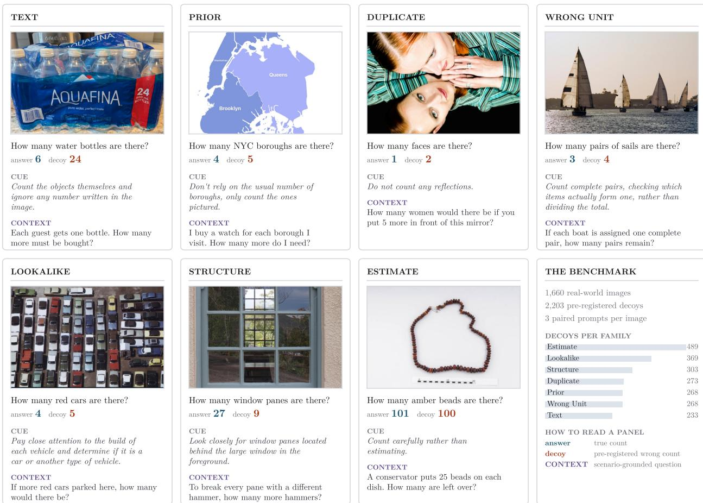
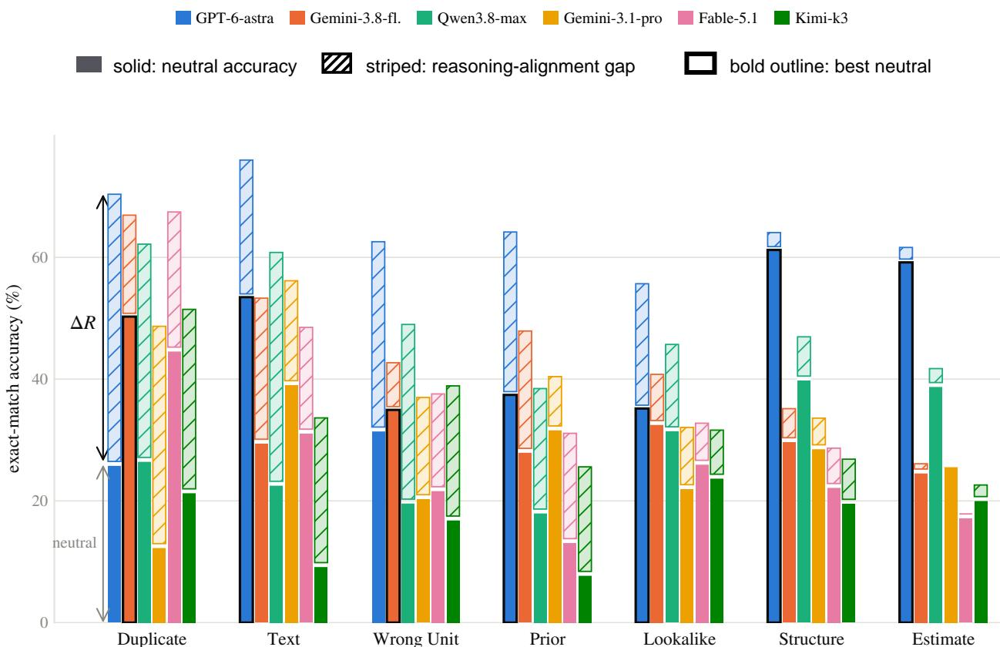
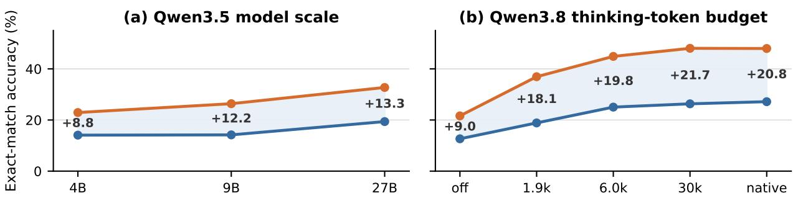
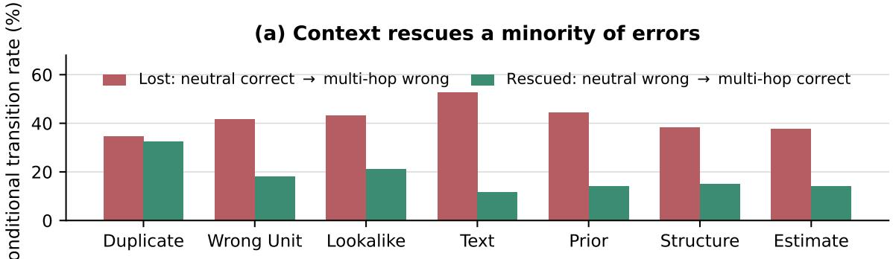
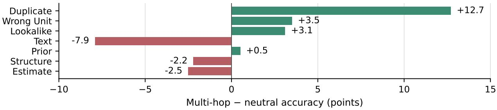
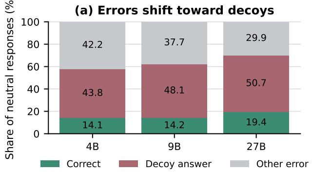
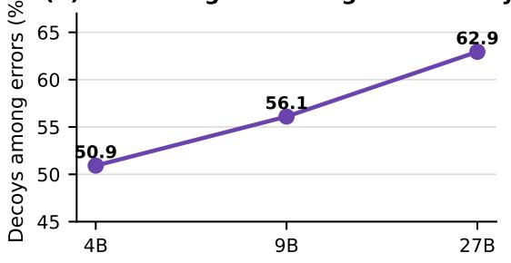
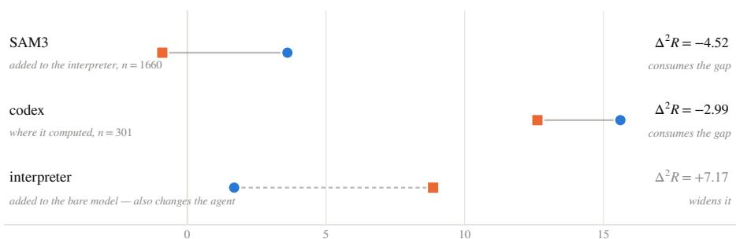
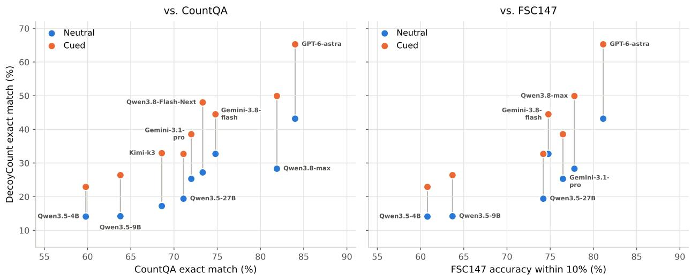

# DecoyCount: Evaluating Visual-Reasoning Misalignment in Counting

Qiuyi (Richard) Zhang1, Zhen Xu1, Jing Gu1, Seojin Bang1, Arnav M. Das1, Yaning Hu1, Gautam Kumar1, Jared Lichtarge1, Le Xue1, Bettina Catoto2, Akul Datta2, Daniel Luo2, Farha Khan2, Marcella Valentine1, Yinfei Yang1, Andrew M. Dai1 1Elorian AI 2Mercor

## Abstract

Visual counting benchmarks report whether vision-language models produce the correct number, but not whether errors arise from perception or reasoning. We introduce DecoyCount, a benchmark built from 1,660 real-world images with designed decoys across seven mechanisms, along with paired prompts: a neutral question, a matched alignment cue, and a novel multi-hop, multi-image question that situates the same counting problem in a realistic scenario. Using this design, we find that counting failures are induced partly by visual misalignment: models can execute the intended counting process when cue-guided but fail to select it unaided, and we term this diference in accuracy the reasoning-alignment gap. Despite being highly capable on general reasoning, frontier models remain below 50 % accuracy on our benchmark, while alignment gaps range from 11.8–22.1 percentage points; strikingly, we observe that more capable models, greater thinking budgets, and agentic processes often induce larger gaps. Because humans may bring context that models lack, we test whether textual underspecification contributes to misalignment using a scenario-based multi-hop condition without explicit hinting, but this added context does not improve aggregate performance. Our analysis concludes that stronger general reasoning does not by itself generalize to aligned visual reasoning, leaving misalignment with human visual expectations as a substantial component of the remaining deficit.

## 1 Introduction

Visual counting appears elementary, but a correct answer requires a model to locate the target, decide what constitutes one instance and the requested unit, distinguish physical objects from reflections, depictions, or printed numerals, and enumerate the resulting set. Each step can fail for a diferent reason, yet a single final number collapses them into one score. Standard counting accuracy therefore cannot distinguish a model that fails to perceive an object from one that sees the scene but selects an unintended interpretation or reasoning shortcut.

Most reasoning benchmarks emphasize explicit chains of logical or mathematical inference: if A implies B, can a model carry that implication through multiple steps? Reasoning is broader, however; it also includes causal and analogical inference, forming and revising hypotheses, creative problem solving, planning, and selecting the strategy appropriate to a situation. Existing benchmarks rarely separate these facets, especially when reasoning is grounded in images. It is therefore dificult to tell whether a failure actually reflects limited reasoning capability.

Our Approach. We introduce DecoyCount, a diagnostic benchmark with real-world counting items and pre-registered decoys from seven mechanisms (Figure 1). A decoy records the plausible wrong count suggested by one mechanism, revealing which alternative interpretation a model follows. For example, when six bottles sit in packaging printed with “24,” the printed number is the decoy; in a mirrored scene, the reflection can suggest a doubled count. Each item pairs a neutral question with a matched alignment cue that specifies the intended process without revealing the answer, such as “Ignore numbers written in the image” or “Do not count mirrored objects.” In addition to a decoy taxonomy, we source these images via a scene-based taxonomy to ensure diversity and remove images that are excessively ambiguous.

From these paired prompts, we introduce and quantify the reasoning-alignment gap (∆R), defined as cued accuracy minus neutral accuracy. A positive gap measures the average accuracy gained when the intended counting process is specified while the image and target answer remain fixed. Calling this an alignment gap may seem surprising because counting appears to have a uniquely determined visual answer. However, two observations motivate the term: minimal cues shift accuracy by 11.8–22.1 percentage points, and changing only “are there” to “are visible” shifts Gemini-3.8-flash accuracy by 6.69 points. The intended process therefore depends partly on human interpretation. The reasoning-alignment gap isolates one component of visual-reasoning misalignment rather than all perceptual or reasoning limitations.

Because real-world images may invite multiple interpretations, we define alignment relative to the interpretation implied by the most common real-world scenarios in which the objects appear or are used. For example, “How many apples are there?” may leave a reflected apple ambiguous, whereas a pie-making scenario establishes that only the physical apple is usable. To test whether such underspecification causes the gap, we add a paired multi-hop version of each question that grounds the same count in a realistic scenario without naming the counting rule, with a second image when required to match the complexity of real-world counting queries. To our knowledge, this is the first counting benchmark to pair the same underlying count with scenario-based, multi-hop, multi-image questions. Interestingly, adding this grounding scenario does not improve aggregate performance and rescues only 11.6 % to 32.6 % of neutral failures per family; underspecification therefore contributes to some errors but does not explain the full gap.

Across six frontier models, neutral accuracy reaches to only 43.2%, while adding alignment cues produce reasoning gaps of 11.8–22.1 percentage points and remove 43.3 % to 66.7 % of exact decoy hits. We test several alternative explanations for this efect. If stronger capability aligned the default reasoning process, scale and thinking should shrink the gap; instead, Qwen3.5 4B→27B raises neutral accuracy by 5.30 points while widening the gap by 4.52, and native Qwen3.8 thinking raises accuracy from 12.65 % to 27.17 % while the gap grows from 8.96 to 20.80 points. If the cue merely elicited more efort, generic or mismatched cues should reproduce the gain; they reproduce at most 18 %. If benchmark construction caused the efect, editing should change the gap and standard model rankings should break; instead, editing primarily changes dificulty and the rankings persist. The mechanism split further supports the diagnosis: Estimate is predominantly consistent with a perceptual or enumeration bottleneck, while five families exhibit large reasoning-alignment gaps. Finally, if tools supply missing visual evidence, targeted instrumentation should help; general CI agentic harnesses widen the gap by 2.48–7.17 points, whereas SAM3 narrows it by 4.52. Together, these results identify visual-reasoning misalignment as a substantial but incomplete source of error: strong general reasoning does not ensure that a model selects the intended visual reasoning process. Residual errors may still reflect perception or other reasoning limitations.

  
Figure 1: DecoyCount exposes interpretable counting failures across seven mechanisms. One item per family: the neutral question with its ground-truth count (blue) and pre-registered decoy (red), the alignment cue (italic) naming the intended counting process without revealing the answer, and an abridged contextual question (purple) that implies the rule through a scenario instead. Most contextual items also supply a second image, not shown here. The final panel summarizes the 2,203 decoys over 1,660 images.

Our Contributions. Here are our main contributions, summarized:

1. A paired, scenario-grounded benchmark with interpretable decoys. DecoyCount pairs 1,660 real-world items with neutral questions, mechanism-specific decoys, and answer-free alignment cues. Each decoy records a plausible wrong count induced by one of seven mechanisms; its matched cue identifies the intended reasoning process without revealing the answer. Paired multi-hop questions ground that intended count in common real-world scenarios, including 842 multi-image items.

2. We identify and quantify a wide reasoning-alignment gap. We define the reasoningalignment gap as cued accuracy minus neutral accuracy on the same image and target answer, measuring the accuracy gained when the intended counting process is specified. Across frontier models, neutral accuracy is 17.2 % to 43.2 %, and five of six models return the decoy more often than the truth. Matched cues add 11.8–22.1 percentage points, repair 2.6–6.7× more answers than they break, and remove 43.3 % to 66.7 % of decoy hits. The large reasoning-alignment gap highlights a novel and significant component of reasoning failures.

3. Additional context does not close the gap. Although the multi-hop scenarios ground the intended count without naming the counting rule, they do not improve aggregate performance and rescue only 11.6 % to 32.6 % of failures per family. Missing or minimized context therefore explains some individual failures, but not the full misalignment.

4. Greater capability does not ensure alignment. Across controlled scale and thinking eforts sweeps, we find that accuracy improves while the gap widens by 4.52 and 11.84 points, respectively. Therefore, more capable models are better at general reasoning but this gain does not translate into correct visual alignment. We find that general CI (Code Interpreter) agentic harnesses also follow a similar trend, improving accuracy but widening the gap by 2.48–7.17 points.

## 2 Background and Related Work

Table 1 compares counting, adversarial, counterfactual, and multi-hop benchmarks across five diagnostic design axes. Existing benchmarks typically specialize in only a subset of them.

Counting benchmarks. The largest counting sets ask for totals over crowds, cells or repeated retail items with dense supervision inherited from detection (Zhang et al., 2016; Ranjan et al., 2021); VLMCountBench (Guo et al., 2025) pushes the same axis to synthetic geometry, where models count one shape type reliably and fail once several are mixed. Language-posed variants do the same in QA form: TallyQA (Acharya et al., 2019) at roughly 287 000 questions, CountBench (Paiss et al., 2023) on image–text count agreement, PixMo-Count (Deitke et al., 2025) with pointing supervision, and CountQA (Tamarapalli et al., 2025) on cluttered real photographs, where the best of fifteen MLLMs reaches 42.9 % when the benchmark was released. HoloCount (Deng et al., 2026) is the most diagnostically structured: 2480 questions over 20 subsets in a three-level taxonomy whose robustness tier includes counter-prior items, visual distractors, null targets and dense fields. These benchmarks primarily report aggregate or subset accuracy rather than item-specific failure mechanisms.

Adversarial and hard benchmarks. Benchmarks must remain challenging as models improve, and many create diagnostic failures either by selecting examples that fool a model or by making controlled edits that change the correct label. HellaSwag uses adversarial filtering, in which discriminators iteratively select dificult machine-generated wrong endings (Zellers et al., 2019); contrast sets make small, meaning-changing edits to expose local decision boundaries (Gardner et al., 2020). In visual counting, VLMBias (Vo et al., 2026) edits familiar subjects across seven domains so the visible count conflicts with the canonical count, yielding 17.05 % average accuracy and a 75.7 % prior-consistent bias rate. CounterCount (Alzahrani et al., 2026) pairs 168 factual-condition images with 168 counterfactual edits, localizes the relevant evidence, and finds that models may attend to it yet underuse it. Both counting benchmarks isolate canonical-count priors.

Multi-hop reasoning. Complex, realistic reasoning often requires multiple steps, commonly organized in two structures: a bridge question feeds one hop’s output into the next (Yang et al., 2018), whereas a comparison question combines independent lookups; MuSiQue reduces shortcuts that bypass the intended chain (Trivedi et al., 2022). Multimodal work inherits this distinction: WebQA chains retrieval across text and images, ReasonVQA combines grounding with knowledge, MultihopSpatial builds 4500 spatial queries, and MMIU spans 52 multi-image tasks (Chang et al., 2022; Tran et al., 2025; Lee et al., 2026; Meng et al., 2025); none targets counting. Existing counting composition is chiefly comparative: HoloCount’s “how many more X than Y?” subtracts two independent counts.

<table><tr><td>Benchmark</td><td>Image Decoy</td><td>Taxonomy</td><td>Cue</td><td>Multi-hop</td><td>Multi-image</td></tr><tr><td>TallyQA (2019)</td><td></td><td>simple / complex only</td><td></td><td></td><td></td></tr><tr><td>CountBench (2023)</td><td></td><td></td><td></td><td></td><td></td></tr><tr><td>PixMo-Count (2025)</td><td></td><td></td><td></td><td></td><td></td></tr><tr><td>CountQA (2025)</td><td></td><td></td><td></td><td></td><td></td></tr><tr><td>VLMCountBench (2025)</td><td></td><td>by composition level</td><td>generic</td><td></td><td></td></tr><tr><td>HoloCount (2026)</td><td></td><td>20 skill subsets, 3 tiers</td><td></td><td>comparison only</td><td></td></tr><tr><td>VLMBias (2026)</td><td>√(prior only)</td><td>by domain</td><td>generic</td><td></td><td></td></tr><tr><td>CounterCount (2026)</td><td>✓ (prior only)</td><td>10 semantic categories</td><td></td><td></td><td></td></tr><tr><td>HotpotQA / MuSiQue</td><td></td><td>bridge vs. comparison</td><td></td><td>√</td><td></td></tr><tr><td>WebQA / MMIU / MultihopSpatial</td><td></td><td></td><td></td><td>✓(not counting)</td><td></td></tr><tr><td>DECOYCoUNT (ours)</td><td>√2203</td><td>7 mechanisms</td><td>√ per item</td><td>√paired</td><td>√ 842 items</td></tr></table>

Table 1: DecoyCount combines adversarial multimodal decoys, alignment cues, and realistic multi-hop, multi-image counting. Prior benchmarks cover individual elements; DecoyCount pairs 2,203 pre-registered decoys across seven mechanisms with per-item alignment cues and bridge questions, including 842 multi-image items. “Prior only” denotes a canonical-count decoy.

## 3 The DecoyCount Benchmark

DecoyCount is a paired benchmark built around registered decoys from seven counting-error mechanisms. Each neutral question has a corresponding alignment cue that targets its decoy mechanism and a scenario-grounded multi-hop question whose answer depends on the same visual count. Because all three conditions depend on the same underlying count, their diferences separate the efects of targeted guidance and contextual grounding, exposing underlying model reasoning misalignment.

## 3.1 Tasks and Decoys

Each item contains an image, a counting question, the true count, and one or more pre-registered decoys: wrong counts invited by the scene. The neutral and cued conditions use the same image and question; their diference defines the reasoning-alignment gap while holding the underlying visual dificulty. The paired DecoyCount multi-hop condition places the same source image, and for realism sometimes an additional second image, inside a real-world multi-hop bridge question. Although naturally more complex, it serves as a contextual grounding control rather than simply a harder reasoning tier, testing whether missing real-world context contributes to ambiguity in the neutral question without supplying a matched alignment cue. For each contextual item, the final answer is not shared with the neutral question due to its multihop nature but applying the bridge question to the decoy yields an incorrect answer.

Seven families describe how a scene suggests a wrong count: Lookalike, Estimate, Prior, Structure, Duplicate, Text, and Wrong Unit. The taxonomy was fixed before collection and balanced for per-family analysis. A second, independent axis records the kind of scene: seven mutually exclusive domains covering everyday, public and outdoor, document and artwork, chart and scientific, retail, observation, and industrial imagery. Sampling holds each domain below 21 % of the release and places every family in all seven, so a per-family score is not a proxy for one recurring setting. Per-family and per-domain composition is in Table 6.

Decoy and alignment-cue design. The families intervene at diferent stages of counting. Lookalike, Duplicate, and Wrong Unit alter which instances belong in the counted set; Text and Prior provide competing answers; Structure and Estimate challenge enumeration itself. Annotators pre-register the target concept, true count, integer decoys, and their visible mechanisms. Each decoy must be supported by the image and difer from the truth; only items eliciting at least one such hit from a gating model are retained. Pre-registration makes the hit evidence of a specified shortcut rather than an arbitrary error, and all qualifying labels are kept when mechanisms overlap.

A matched alignment cue minimally states the relevant counting rule without changing the image, target category, or answer space, and never reveals the correct count. Depending on the family, it may direct the model to count physical instances, ignore printed numerals, use the requested unit, verify a repeated structure, or enumerate rather than estimate. Because the cue targets the registered mechanism rather than adding visual evidence, the reasoning-alignment gap is informative about process selection. Generic and mismatched controls in Section 5.1 show that the gap does not follow from any added instruction or reasoning efort. Together, pre-registered decoys and matched cues connect the taxonomy in Figure 1 and table 5 to the reasoning-alignment gap.

## 3.2 Collection and Validation

Images combine commissioned photography with public-domain and openly licensed material; some are edited or generated when the intended mechanism cannot be found naturally. Provenance and licence fields are recorded at authoring. Each item records its target, true count, up to five decoys and their visible mechanisms, three paired prompts, and an optional second image. Candidates then pass a three-model gate using Claude Opus 5, GPT-5.6 Sol, and Gemini 3.6 Flash. The dificulty gate requires all three to miss the neutral answer; the decoy-quality gate requires at least one to return a registered decoy exactly.

Independent reviewers then verify that the target is countable, visually grounded, and unambiguous. Neutral and contextual tasks are counted blindly, disagreements are adjudicated, and ambiguous, severely occluded, or specialist-knowledge items are removed. This process retains 1,660 of 2,100 candidates, correcting 121 counts and replacing 79 images. Full sourcing, schema, gating, and exclusion details are in Section A.2.

## 4 Cross-Model Results

We use a paired evaluation protocol to compare frontier systems, then isolate the efects of model scale and reasoning efort before testing alternative explanations for the benchmark gap. Models receive the benchmark text verbatim, with no system prompt, exemplars, or output-format instruction. Hosted models use provider defaults, and open-weight models use their reference decoding settings. Intervals are 95 %, paired tests use exact McNemar, and the measured noise floor is 1.98 percentage points (Section B and table 18); media processing, parsing, decoding, and per-run settings are detailed in Section A. Results in this section average three independent repeats unless explicitly stated otherwise.

Answers are extracted position-first — the last line containing an integer, a bolded value breaking ties — because models state intermediate quantities under labels such as “total,” which a label-first parser mis-scores; a response containing no integer counts as wrong on accuracy and is excluded from MAE. Each per-family metric is calculated on the subset of images carrying the decoy of that family $( n = 2 2 2 \ – 2 9 1 )$ . An item with decoys from two families appears once in each family denominator.

We use three complementary metrics:

1. Exact-match accuracy (A): whether the extracted integer equals the true count; it measures success, not failure type.

2. Exact decoy-hit: whether a wrong answer equals a pre-registered decoy, a conservative marker of a registered shortcut rather than an arbitrary miscount. No decoy equals its item’s true count, so exact-match and decoy-hit are disjoint by construction.

3. Reasoning-alignment gap: $\Delta R = A _ { \mathrm { c u e d } } - A _ { \mathrm { n e u t r a l } }$ , the paired exact-match gain from a matched alignment cue. This gap quantifies one component of visual-reasoning misalignment, not all reasoning or perceptual error.

## 4.1 Frontier Model Comparison

We first ask whether the same alignment failure appears across model families, rather than being an artifact of one architecture, provider, or decoding stack.

  
Figure 2: High capability does not imply a small reasoning-alignment gap. Solid bars show neutral accuracy and striped extensions show the gain from the matched alignment cue; bold outlines mark the best neutral score in each family. GPT-6-astra leads every family but retains large reasoning-alignment gaps in five of seven. The smaller Structure and Estimate gaps instead identify failures that guidance does not readily repair (Section 5.1); exact values and decoy-hit rates are in Tables 11 and 12

Table 2 summarizes six models on identical items, averaging three repeats. Neutral accuracy remains below 50 %; five models return a decoy more often than the truth, and every $\Delta R$ exceeds the 1.98-percentage-point noise floor. Accuracy, decoy-hit and gap do not induce the same model ranking. These cross-system comparisons vary architecture, data and training jointly and are descriptive; the controlled size ladder in Section 4.2 isolates scale. Figure 2 shows that family order also difers from aggregate capability.

<table><tr><td></td><td colspan="3">Accuracy</td><td colspan="2">Decoy-hit</td><td></td></tr><tr><td>Model</td><td>Neutral</td><td>Cued</td><td>multi-hop</td><td>Neutral</td><td>Cued</td><td>∆R</td></tr><tr><td>GPT-6-astra</td><td>43.17</td><td>65.26</td><td>43.10</td><td>40.00</td><td>16.71</td><td>+22.09</td></tr><tr><td>Gemini-3.8-flash</td><td>32.71</td><td>44.48</td><td>32.75</td><td>36.83</td><td>21.00</td><td>+11.77</td></tr><tr><td>Qwen3.8-max</td><td>28.31</td><td>49.90</td><td>32.94</td><td>50.04</td><td>25.30</td><td>+21.59</td></tr><tr><td>Gemini-3.1-pro-preview</td><td>25.30</td><td>38.55</td><td>27.49</td><td>39.62</td><td>23.13</td><td>+13.25</td></tr><tr><td>Claude-Fable-5.1</td><td>25.22</td><td>38.01</td><td>27.49</td><td>44.34</td><td>27.03</td><td>+12.79</td></tr><tr><td>Kimi-k3</td><td>17.23</td><td>32.93</td><td>21.01</td><td>55.00</td><td>36.31</td><td>+15.70</td></tr></table>

Table 2: The strongest neutral model also has the largest gap. GPT-6-astra leads neutral accuracy at 43.17 % but gains another 22.09 percentage points when cued; Qwen3.8-max shows a similarly large 21.59-point gap. Thus greater capability can improve what a model executes under guidance without aligning what it selects unaided. The multi-hop condition uses the valid paired subset and is not directly comparable with neutral or cued accuracy (Section A); bold marks column maxima.

## 4.2 Scale and Reasoning Efort

Cross-model comparisons confound architecture and training, so we use controlled sweeps to test whether greater capacity or inference-time reasoning closes the alignment gap.

Scaling widens the gap. Greater scale improves accuracy without improving visual decoy robustness. Across Qwen3.5 4B, 9B, and 27B, with image processing and decoding fixed, neutral accuracy rises from 14.08% to 19.38%, while cued accuracy rises from 22.91% to 32.73%. The reasoning-alignment gap widens from 8.84 to 13.35 percentage points. The 4.52-point increase has a paired 95% CI of [2.77, 6.29], consistent with a path-selection failure: the cue identifies a reasoning path the model can execute but does not reliably choose unaided. Scale improves guided performance faster than autonomous selection. The 9B-to-27B change is unresolved (CI [−0.56, 2.87]), so we report the absolute gap and make no monotonic claim beyond the observed endpoints. Duplicate and Text retain the largest gaps, and Structure and Estimate the smallest. This configuration-controlled result supports the main analysis in Section 5.1: capability can improve while the model remains misaligned about which visual reasoning process to apply.

Scale concentrates errors on decoys. Neutral decoy-hit rises 43.76%→50.74% from 4B to 27B, while other errors fall 42.17%→29.88% (Figure 5). Despite fewer mistakes overall, a larger share of the remaining errors matches decoys: 50.92%→62.94% (+12.02 points, paired 95% CI [10.30, 13.74]). Thus both absolute decoy-hit and its share of errors increase. Together with the widening reasoning-alignment gap, this shows that gains from scale do not automatically align the model’s default counting path with the intended task.

Image preprocessing and decoding are held fixed across sizes; full settings are in Section A.4.

A larger thinking budget widens the gap. With self-hosted Qwen3.8 FlashNext fixed, the shared efort setting resolves to Qwen’s native control: thinking of; caps of 1,920, 6,048, or 30,000 tokens; or native unbounded thinking (Table 8). From of to native, neutral accuracy more than doubles (12.65 → 27.17 %) while the gap grows from +8.96 to +20.80, peaking at +21.71 under the 30k-token cap (Figure 3). This is a Qwen thinking-budget sweep, not a hosted-API efort parameter. Full settings and run provenance are in Section A.5.

Temperature does not explain the gap. From 0.3 to 1.0, neutral accuracy moves by at most 0.88 points. At T = 1.5 it collapses mainly because completions stop terminating (Table 9).

  
Shaded distance = reasoning-alignment gap  
Figure 3: Scale and inference efort improve accuracy without closing the reasoning-alignment gap. The model-size sweep (left) and thinking-token sweep (right) compare neutral and cued exact-match accuracy under controlled Qwen configurations. From 4B to 27B, cued accuracy grows faster than neutral accuracy and $\Delta R$ widens by 4.52 points; enabling native thinking increases it by 11.84 points before it plateaus. Shaded distances and labels are $\Delta R$ in percentage points; “native” denotes unbounded Qwen thinking.

## 4.3 Validity Checks

We test whether the headline efect is instead an artifact of edited images, wording ambiguity, or adversarial selection. Each check asks whether the benchmark remains informative beyond its construction choices.

Editing raises dificulty, not misalignment. Most decoys must be constructed rather than found, so Table 10 separates commissioned, found and edited images. The groups sample the taxonomy unevenly and are not interchangeable populations. Even after matching on ground-truth count, edited-image accuracy is 13.4–25.4 percentage points lower than on commissioned originals (all $p < 0 . 0 0 1 ,$ ), while found images remain close to originals. Decoy-hit is also 12–27 percentage points higher on edited images.

The reasoning-alignment gap does not follow this dificulty shift: edited versus unedited gaps are 22.9 versus 19.4 percentage points for Qwen3.8-max $( p = 0 . 1 5 )$ , and 23.5 versus 21.5 percentage points for GPT-6-Astra $( p = 0 . 4 3 )$ . Editing changes absolute dificulty, not the share of failure repaired by a cue.

Model rankings persist despite adversariality. Items were retained partly because frontier models fail them (Section 3.2), so absolute accuracy is not a population estimate of counting ability across a regular sample of images. Instead the image distribution is likely adversarial and out-ofdistribution, especially with the addition of synthetic edits. We instead test whether DecoyCount preserves the model ordering of standard counting benchmarks rather than measuring an unrelated out-of-distribution artifact. Across nine models, rank correlation with CountQA is $\rho = 0 . 9 8$ for neutral and 0.97 for cued accuracy; against FSC147 it is 0.83 and 0.94 (Figure 7 and section C). DecoyCount therefore ranks models as established counting benchmarks do, rather than measuring an unrelated out-of-distribution skill, while still separating the failure mechanisms those benchmarks aggregate away.

Wording exposes unstable alignment. The neutral phrase are there admits an in-image or in-the-world reading. Replacing only that phrase with are visible changes 1,654 of 1,660 prompts without adding answer-relevant information. On one Gemini-3.8-flash rollout, accuracy rises from 32.89 % to 39.58 %; 246 answers are repaired and 135 broken (exact McNemar $p = 1 . 3 9 \times 1 0 ^ { - 8 } )$ The efect is not uniform: Text and Prior improve the most, while Estimate degrades (Table 14). This is not a pure clarification: visible can change which instances a human considers members of the counted set. The large swing from a minor surface change, therefore, exposes unstable alignment between the model’s default interpretation and the intended object set. This motivates testing whether a substantially richer, real-life multi-hop prompt resolves the same misalignment (Section 5.3).

## 5 Understanding Visual-Reasoning Misalignment

We now use the paired design to demonstrate that our reasoning alignment gap is a core source of counting failures and provide evidence that this gap persists under multiple experimental setups and points to implicit model misalignment. We first test which errors a matched cue repairs, then ask whether agentic tools or realistic context can provide the same alignment without naming the trap.

## 5.1 Reasoning Alignment Gap

We begin by testing whether the alignment cue selectively repairs the pre-registered failure mode, rather than merely eliciting more efort or broadly improving accuracy.

Matched cues repair decoy-aligned errors. No model exceeds 50 % neutral accuracy, and five of six return the planted decoy more often than the truth. Cuing the trap repairs 305–437 items while breaking only 63–134 (exact McNemar, $p < 1 0 ^ { - 2 0 }$ for every model), and releases 43.3 % to 66.7 % of exact decoy hits. This paired, directional efect operationalizes visual-reasoning misalignment rather than merely recording another accuracy diference; full results are in Table 7.

Misalignment is mechanism-dependent. Five families gain 11.42–30.93 percentage points from the cue, whereas Structure gains 5.92 points and Estimate 1.70 points (Tables 11 and 12). No model gains more than 3.36 points on Estimate, consistent with a perceptual or enumeration bottleneck that guidance alone does not resolve. A small cue gain does not by itself distinguish perception from other reasoning limitations. This split holds across all six models, but the ordering within the five large-gap families does not; aggregate accuracy therefore hides large, model-specific failure modes.

Decoy share separates shortcut from miscount. Among the five large-gap families, 60.5 % to 82.8 % of errors equal the planted decoy (Table 13). Estimate is only 21.4 %: most failures are ordinary miscounts. Structure is intermediate at 48.6 %, mixing lattice shortcuts with miscounting. Its small gap therefore contains a repairable shortcut component, whereas Estimate is consistent with a perceptual or enumeration bottleneck.

The reasoning-alignment gap depends on trap-specific cues. To separate relevant information from generic efort, we compare neutral, generic “count carefully,” mismatched-family, and matched-family prompts on Gemini-3.8-flash and GPT-6-astra, with three repeats each (Table 3).

Thus at least 82 % of the gain depends on cuing the trap actually present. The matched cue separates from both controls at $p < 1 0 ^ { - 1 2 }$ , while the controls do not separate from each other.

<table><tr><td>Condition</td><td>Acc.</td><td>vs. neutral</td><td>% of matched</td><td>Decoy-hit</td><td>Compl. tok.</td></tr><tr><td>Gemini-3.8-flash</td><td></td><td></td><td></td><td></td><td></td></tr><tr><td>Neutral</td><td>32.71</td><td></td><td></td><td>36.83</td><td>5297</td></tr><tr><td>Generic cue</td><td>34.54</td><td>+1.83</td><td>16</td><td>33.21</td><td>6258</td></tr><tr><td>Mismatched cue</td><td>34.86</td><td>+2.15</td><td>18</td><td>32.27</td><td>5407</td></tr><tr><td>Matched cue</td><td>44.48</td><td>+11.77</td><td>100</td><td>21.00</td><td>6263</td></tr><tr><td>GPT-6-astra</td><td></td><td></td><td></td><td></td><td></td></tr><tr><td>Neutral</td><td>43.17</td><td></td><td></td><td>40.00</td><td>2581</td></tr><tr><td>Generic cue</td><td>46.04</td><td>+2.87</td><td>13</td><td>35.44</td><td>3267</td></tr><tr><td>Mismatched cue</td><td>45.02</td><td>+1.85</td><td>8</td><td>33.96</td><td>2957</td></tr><tr><td>Matched cue</td><td>65.26</td><td>+22.09</td><td>100</td><td>16.71</td><td>3233</td></tr></table>

Table 3: Generic and mismatched cues recover at most 18% of the matched gain: improvement depends on naming the actual trap, not merely eliciting more efort. Tokens include reasoning.

Completion length cannot explain the result: generic and matched prompts use nearly identical budgets on Gemini, and generic uses more on GPT-6 while producing one eighth of the gain.

The exceptions sharpen the mechanism (Table 15). Duplicate gains substantially only when its own trap is cued; Estimate barely moves under any cue; and Text gains about 11 percentage points even from generic or mismatched instructions, suggesting that any request to count can displace reading the printed numeral. The 82 % bound therefore describes the aggregate, not every family.

## 5.2 Agentic Harnesses and Tools

We next test whether additional computation or visual instrumentation can replace explicit guidance, separating gains in task accuracy from changes in the reasoning-alignment gap.

Tools can improve accuracy without improving alignment. A matched cue identifies the trap; a tool measures or computes. We define $\Delta ^ { 2 } R = \Delta R _ { \mathrm { t o o l } } - \Delta R _ { \mathrm { b a s e } } \mathrm { : }$ negative values narrow the reasoning-alignment gap, while positive values widen it. This separates task improvement from alignment. For example, GPT-6 with CI raises neutral accuracy from 27.31 % to 35.72 % and cued accuracy from 46.65 % to 57.65 %, yet widens the gap by 2.59 percentage points. Generic CI usually follows this pattern: it adds computation and deliberation, but does not identify the intended visual counting process. This aggregate trend is not universal across families: GPT-6 CI narrows the gap for Wrong Unit by 0.8 percentage points, and Opus CI narrows it for Duplicate by 1.7 points (Table 17). These exceptions suggest that generic execution can occasionally supply evidence useful for a particular failure mode, but does not do so reliably. Note that a positive aggregate $\Delta ^ { 2 } R$ does not show that tools harm alignment: provider-native CI also changes the length and structure of the reasoning process, allowing the cued arm to benefit more even as neutral accuracy rises.

<table><tr><td>System</td><td>Comparison</td><td> $\Delta R _ { \mathrm { b a s e } }$ </td><td> $\Delta R _ { \mathrm { t o o l } }$ </td><td> $\Delta ^ { 2 } R$ </td></tr><tr><td>Qwen3.8-Flash-Next</td><td> $\mathrm { b a r e }  + \mathrm { C I } ^ { * }$ </td><td>19.46</td><td>26.63</td><td> $+ 7 . 1 7$ </td></tr><tr><td>Qwen3.8-Flash-Next</td><td> $+ \mathrm { C I \to + C I + S A M 3 }$ </td><td>26.63</td><td>22.11</td><td>-4.52</td></tr><tr><td>GPT-6-sol</td><td> $\mathrm { n o \ t o o l s  + C I }$ </td><td>19.34</td><td>21.93</td><td> $+ 2 . 5 9$ </td></tr><tr><td>Claude-Opus-5.5</td><td>no tools → +CI</td><td>11.97</td><td>14.45</td><td> $+ 2 . 4 8$ </td></tr></table>

Table 4: General agentic harnesses widen the gap; targeted SAM3 narrows it. Change on the full release (points): green narrows the gap; red widens it. CI is provider-native execution; ∗ also changes the agent. Details: Table 16.

Targeted visual tools narrow the gap. The CI comparisons also induce longer, multi-turn reasoning, so they do not show that computation itself harms alignment. The cleaner fixed-agent

(b) Net accuracy efects vary by family  
  
Figure 4: Scenario grounding resolves some ambiguity but not the full alignment gap. For each family, the top panel reports losses among neutral-correct items and rescues among neutral-wrong items; the bottom panel shows the resulting change in accuracy. Context rescues only 11.6–32.6% of neutral failures and helps most on Duplicate, where the scenario clarifies what counts as one usable object. Text, Structure, and Estimate decline, showing that added context does not generally replace a targeted alignment cue. “Lost” denotes neutral-correct → multi-hop-wrong; “rescued” denotes neutral-wrong → multi-hop-correct. Exact transition counts remain in Table 21.

CI→CI+SAM3 contrast raises neutral accuracy by 3.61 percentage points and narrows the gap by 4.52 points. SAM3 narrows all seven families, most strongly Estimate (−10.8 points), Structure (−8.6 points), and Text (−5.4 points), whereas CI alone narrows only Wrong Unit for GPT-6 and Duplicate for Opus. The distinction is therefore not tools versus no tools, but whether the tool supplies evidence for the family-specific visual bottleneck, an efect that itself depends on the agentic surface the tool is attached to (Table 17, fig. 6, and section A.10).

## 5.3 Contextual Grounding

The multi-hop condition tests whether neutral failures arise because a short question does not say enough about what should count. It embeds the same count in a realistic scenario without cuing the decoy mechanism, making it a contextual control rather than a ladder of reasoning dificulty. A bare “How many CDs are there?” leaves open whether a reflected CD counts; “I want to give each friend 2 CDs” does not. If vagueness caused the failures, context should fix most of them. Yet it does not: of the items a model miscounted under the neutral prompt, only 11.6 % to 32.6 % per family are answered correctly once the purpose is given, and the rest still fail (Table 21). What context does recover is family-dependent: it helps where it settles what counts as one object, recovering an average of 24.0 % of miscounted items in the three unit-settling families (Duplicate, Wrong Unit, Lookalike) against an average of 13.7 % in the other four (Figure 4).

The family directions clarify what context does and does not repair. Duplicate gains most because a real-life purpose can establish whether a reflection or depiction is a second usable object. Text instead loses the most: adding prose and arithmetic does not directly suppress the answer-like numeral, and creates another route to error. Structure and Estimate also remain negative, consistent with failures that richer semantics cannot resolve. These per-family directions hold within each model as well as in aggregate (Table 20).

The initial visual count remains the bottleneck. Across models, multi-hop accuracy is 24.4– 48.1 percentage points higher when the paired neutral count is correct (Table 19). Context can occasionally settle the unit, but downstream reasoning rarely compensates for a wrong count already extracted from the image.

Aggregate accuracy barely moves because the extra arithmetic loses 34.6 % to 52.6 % of neutralcorrect items across decoy families (Table 21), whereas cuing the trap raises original-count accuracy by 11.8–22.1 percentage points across models without changing the task (Table 2). Missing context is therefore not the main explanation; with the scale, efort, and tool results, this makes visualreasoning misalignment a measurable but incomplete reasoning failure. Remaining errors can still reflect perception or other reasoning limitations.

## References

Manoj Acharya, Kushal Kafle, and Christopher Kanan. Tallyqa: Answering complex counting questions. In Proceedings of the AAAI Conference on Artificial Intelligence, volume 33, pages 8076–8084, 2019.

Reem Alzahrani, Hassan Alshanqiti, Bushra Bin Hemid, Zaid Alyafeai, Abdelrahman Eldesokey, and Bernard Ghanem. Countercount: A diagnostic framework for counting bias in vision language models. arXiv preprint arXiv:2605.17826, 2026. URL https://arxiv.org/abs/2605.17826.

Yingshan Chang, Mridu Narang, Hisami Suzuki, Guihong Cao, Jianfeng Gao, and Yonatan Bisk. Webqa: Multihop and multimodal qa. In CVPR, 2022.

Matt Deitke, Christopher Clark, Sangho Lee, et al. Molmo and pixmo: Open weights and open data for state-of-the-art vision-language models. In Proceedings of the IEEE/CVF Conference on Computer Vision and Pattern Recognition (CVPR), 2025.

Jinhong Deng, Limeng Qiao, and Guanglu Wan. Holocount: A holistic visual counting benchmark for mllms. arXiv preprint arXiv:2607.06420, 2026.

Matt Gardner, Yoav Artzi, Victoria Basmov, et al. Evaluating models’ local decision boundaries via contrast sets. In Findings of the Association for Computational Linguistics: EMNLP 2020, pages 1307–1323, 2020. doi: 10.18653/v1/2020.findings-emnlp.117. URL https://aclanthology.org/ 2020.findings-emnlp.117/.

Xuyang Guo, Zekai Huang, Zhenmei Shi, Zhao Song, and Jiahao Zhang. Your vision-language model can’t even count to 20: Exposing the failures of vlms in compositional counting. arXiv preprint arXiv:2510.04401, 2025.

Youngwan Lee, Soojin Jang, Yoorhim Cho, Seunghwan Lee, Yong-Ju Lee, and Sung Ju Hwang. Multihopspatial: Multi-hop compositional spatial reasoning benchmark for vision-language model. arXiv preprint arXiv:2603.18892, 2026.

Fanqing Meng, Jin Wang, Chuanhao Li, Quanfeng Lu, Hao Tian, Tianshuo Yang, Jiaqi Liao, Xizhou Zhu, Jifeng Dai, Yu Qiao, Ping Luo, Kaipeng Zhang, and Wenqi Shao. MMIU: Multimodal multiimage understanding for evaluating large vision-language models. In International Conference on Learning Representations (ICLR), 2025. URL https://arxiv.org/abs/2408.02718.

Roni Paiss, Ariel Ephrat, Omer Tov, Shiran Zada, Inbar Mosseri, Michal Irani, and Tali Dekel. Teaching clip to count to ten. In Proceedings of the IEEE/CVF International Conference on Computer Vision (ICCV), 2023.

Viresh Ranjan, Udbhav Sharma, Thu Nguyen, and Minh Hoai. Learning to count everything. In Proceedings of the IEEE/CVF Conference on Computer Vision and Pattern Recognition (CVPR), 2021.

Jayant Sravan Tamarapalli, Rynaa Grover, Nilay Pande, and Sahiti Yerramilli. Countqa: How well do mllms count in the wild? arXiv preprint arXiv:2508.06585, 2025.

Duong T. Tran, Trung-Kien Tran, Manfred Hauswirth, and Danh Le Phuoc. Reasonvqa: A multi-hop reasoning benchmark with structural knowledge for visual question answering. In Proceedings of the IEEE/CVF International Conference on Computer Vision (ICCV), pages 18793–18803, October 2025. URL https://arxiv.org/abs/2507.16403.

Harsh Trivedi, Niranjan Balasubramanian, Tushar Khot, and Ashish Sabharwal. Musique: Multihop questions via single-hop question composition. Transactions of the Association for Computational Linguistics, 10:539–554, 2022.

An Vo, Khai-Nguyen Nguyen, Mohammad Reza Taesiri, Vy Tuong Dang, Anh Totti Nguyen, and Daeyoung Kim. Vision language models are biased. In International Conference on Learning Representations (ICLR), 2026. URL https://arxiv.org/abs/2505.23941.

Zhilin Yang, Peng Qi, Saizheng Zhang, Yoshua Bengio, William W. Cohen, Ruslan Salakhutdinov, and Christopher D. Manning. Hotpotqa: A dataset for diverse, explainable multi-hop question answering. In EMNLP, 2018.

Rowan Zellers, Ari Holtzman, Yonatan Bisk, Ali Farhadi, and Yejin Choi. Hellaswag: Can a machine really finish your sentence? In Proceedings of the 57th Annual Meeting of the Association for Computational Linguistics (ACL), pages 4791–4800, 2019. doi: 10.18653/v1/P19-1472. URL https://aclanthology.org/P19-1472/.

Yingying Zhang, Desen Zhou, Siqin Chen, Shenghua Gao, and Yi Ma. Single-image crowd counting via multi-column convolutional neural network. In Proceedings of the IEEE Conference on Computer Vision and Pattern Recognition (CVPR), 2016.

## A Implementation Details

Section 4 states the inference configuration; this section records the parts of it a re-implementation would have to reproduce exactly.

Media preparation. The delivery contains HEIC, WebP, GIF and SVG files, 47 files with no extension, and images up to 30.7 MB. We convert all 2502 to JPEG at quality 92, rasterising SVG first, with the longest side capped at 2048 pixels — the resolution the receiving API downsamples to anyway, so the cap is approximately lossless with respect to what the model observes. No image failed.

Answer extraction. Responses are parsed position-first: the last line containing an integer supplies the answer, a bolded value breaking ties. This matters — an earlier label-first parser preferring a line reading “total” or “answer” mis-scored genuine outputs, because models state intermediate quantities under exactly those labels. The extractor carries a regression test.

Exclusions. Every item ships a primary image, so none is excluded on that ground. The 818 items without a secondary image have self-contained multi-hop questions and are evaluated single-image rather than dropped. The multi-hop condition is scored on 1,539 items: the 121 whose counts were corrected in quality control (Section 3.2) kept a derived answer computed from the old count, so their multi-hop ground truth is known to be wrong.

Configuration. Gemini-3.8-flash, reasoning efort medium, output limit 16384 tokens, 128-way concurrency, five attempts with exponential backof. One pass over the frozen release in all three conditions is 4980 calls, 6 424 061 prompt tokens and 29 136 062 completion tokens (of which 28 822 703 are reasoning); the headline figures in Table 2 average three such passes per condition. Every call succeeded and every response terminated normally.

Decoding. Hosted models receive no sampling override and use provider defaults. Locally served open-weight models use temperature 0.6, top-p 0.95, and top-k 20. Generation limits span 65,536– 128,000 tokens and do not bind; reasoning efort is fixed within model and condition except in the controlled sweep of Section 4.2.

## A.1 Release Composition

This expands the taxonomy and domain summary used in Section 3.
<table><tr><td>Family</td><td>How the decoy is induced</td><td>What the matched cue tests</td></tr><tr><td>Duplicate</td><td>One physical instance appears more than once through a reflection, screen, or de-</td><td>Whether the model distinguishes entities from their representations.</td></tr><tr><td>Text</td><td>piction. A printed numeral offers an answer-like shortcut.</td><td>Whether the model counts visible objects rather than transcribing text.</td></tr><tr><td>Wrong Unit</td><td>Groups, containers, or subparts invite counting at the wrong granularity.</td><td>Whether the model resolves the unit re- quested by the question.</td></tr><tr><td>Prior</td><td>A familiar arrangement suggests a canon- ical count unsupported by the image.</td><td>Whether visual evidence overrides a mem- orized or expected answer.</td></tr><tr><td>Lookalike</td><td>Target-like distractors blur the category boundary.</td><td>Whether the model maintains the intended object class while counting.</td></tr><tr><td>Structure</td><td>A regular row, column, or lattice invites an incorrect structural shortcut.</td><td>Whether the model verifies the arrange- ment instead of extrapolating a pattern.</td></tr><tr><td>Estimate</td><td>A dense or irregular field encourages ap- proximate rather than exact enumera- tion.</td><td>Whether guidance can overcome a percep- tual enumeration bottleneck.</td></tr></table>

Table 5: The taxonomy localizes where counting can fail. Each family pre-registers both an answer-like decoy and a targeted intervention, allowing the paired evaluation to distinguish the reasoning-alignment gap from residual perceptual and other reasoning failures.

<table><tr><td>Decoy family</td><td>Decoys</td><td>Items</td><td>Scene domain</td><td>Items</td></tr><tr><td>Estimate</td><td>489</td><td>258</td><td>Everyday</td><td>337</td></tr><tr><td>Lookalike</td><td>369</td><td>291</td><td>Public &amp; outdoor</td><td>274</td></tr><tr><td>Structure</td><td>303</td><td>257</td><td>Documents, screens &amp; artwork 244</td><td></td></tr><tr><td>Duplicate</td><td>273</td><td>252</td><td>Charts, maps &amp; scientific</td><td>226</td></tr><tr><td>Prior</td><td>268</td><td>254</td><td>Retail &amp; product</td><td>202</td></tr><tr><td>Wrong Unit</td><td>268</td><td>228</td><td>Observation</td><td>194</td></tr><tr><td>Text</td><td>233</td><td>222</td><td>Commercial &amp; industrial</td><td>183</td></tr><tr><td colspan="5">Total 2,203</td></tr></table>

Table 6: Release composition (n = 1, 660). Every item has at least one decoy; 392 have multiple, yielding 2,203 registered decoys. Items contribute once to every family represented by their decoys, whereas scene domains are mutually exclusive.

The scene domains are Everyday; Public & outdoor; Documents, screens & artwork; Charts, maps & scientific; Retail & product; Observation; and Commercial & industrial. They are tracked separately from mechanism labels so that a family does not collapse onto one kind of scene.

The 2,203 assignments across 1,660 items also make the taxonomy explicitly multi-label: one scene can invite several incorrect counting processes at once. The families therefore identify failure mechanisms rather than disjoint visual categories. Their distribution across seven scene domains reduces the risk that a mechanism score is merely a proxy for one recurring setting.

## A.2 Collection and Annotation Details

Images come from commissioned photography, Wikimedia Commons, Openverse, CC0/CC BY Flickr material, and government archives. Images are edited or generated when a mechanism cannot be found naturally. The source delivery records provenance and licence fields, although these are not carried into the released parquet.

Each item records a ground-truth count, up to five decoys, task type, scene description, three prompts, an optional second image, and source metadata. Counts and decoys are written before model exposure. The multi-hop task is retained only when the decoy and true count lead to diferent final answers.

Candidates pass a model gate using Claude Opus 5, GPT-5.6 Sol, and Gemini 3.6 Flash: all three must miss the neutral answer and at least one must return a registered decoy exactly. Independent reviewers then verify that the target is countable, visually grounded, and unambiguous. Blind counters assess neutral and contextual tasks separately; disagreements receive a final adjudication.

Quality control corrected 121 counts, replaced 79 images, and removed ambiguous or specialist items, including severe occlusion, distant objects indistinguishable from background, partial objects at image boundaries, and questions requiring non-generalist notation knowledge. The main experimental contract is summarized in Section 3.2.

## A.3 Paired Repair Results

<table><tr><td rowspan="2">Model</td><td colspan="2">Neutral</td><td rowspan="2">Cued Acc.</td><td colspan="2">Paired neutral → cued</td><td rowspan="2"></td><td rowspan="2">Bites released</td></tr><tr><td>Acc.</td><td>Decoy-hit</td><td>Repaired</td><td>Broken</td></tr><tr><td>GPT-6-astra</td><td>43.17</td><td>40.00</td><td>65.26</td><td>437</td><td>71</td><td> $2 . 6 \times 1 0 ^ { - 6 5 }$ </td><td>66.7</td></tr><tr><td>Gemini-3.8-flash</td><td>32.71</td><td>36.83</td><td>44.48</td><td>311</td><td>116</td><td> $1 . 2 \times 1 0 ^ { - 2 1 }$ </td><td>56.0</td></tr><tr><td>Qwen3.8-max</td><td>28.31</td><td>50.04</td><td>49.90</td><td>422</td><td>63</td><td> $2 . 8 \times 1 0 ^ { - 6 6 }$ </td><td>55.3</td></tr><tr><td>Gemini-3.1-pro</td><td>25.30</td><td>39.62</td><td>38.55</td><td>354</td><td>134</td><td> $6 . 0 \times 1 0 ^ { - 2 4 }$ </td><td>60.6</td></tr><tr><td>Claude-Fable-5.1</td><td>25.22</td><td>44.34</td><td>38.01</td><td>305</td><td>93</td><td> $2 . 0 \times 1 0 ^ { - 2 7 }$ </td><td>50.6</td></tr><tr><td>Kimi-k3</td><td>17.23</td><td>55.00</td><td>32.93</td><td>333</td><td>73</td><td> $9 . 3 \times 1 0 ^ { - 4 1 }$ </td><td>43.3</td></tr></table>

Table 7: Matched cues repair 2.6–6.7× more items than they break and remove 43–67% of neutral decoy hits. Repaired and broken are paired flips; p is exact McNemar.

The paired direction is consistent across models: a matched cue repairs between 305 and 437 answers, whereas only 63–134 correct answers become wrong. This rules out a generic promptperturbation explanation for the aggregate gains. The variation in decoy bites released further shows that alignment gap and decoy capture are related but distinct: a cue may redirect an incorrect process without every repaired response having first landed on a registered decoy.

## A.4 Qwen3.5 Scale-Study Configuration

Self-hosted vLLM, no tools, 5MP images, native thinking without a separate reasoning budget; temperature 1, top-p 0.95, top-k 20, min-p 0, presence penalty 1.5, repetition penalty 1, and a 131,072-token cap that binds on some responses. These settings difer from Section 4. Release alignment removes 29 items and corrects 11 decoy annotations; retained inputs and gold answers are unchanged. Pointwise intervals use 10,000 paired primary-image-cluster bootstrap draws (seed 20260924), averaging repeats within items; conditional decoy-hit is a ratio of summed counts.

## A.5 Qwen3.8 FlashNext Thinking-Budget Sweep

This experiment uses self-hosted Qwen/Qwen3.8-Flash-Next through vLLM, not a hosted API’s reasoning-efort parameter. The shared –reasoning-effort interface resolves to Qwen’s native controls: none disables thinking; low, medium, and high set thinking-token caps of 1,920, 6,048,

and 30,000; and native enables thinking without a separate cap. All conditions use 5MP images, three repeats, temperature 1, top-p 0.95, top-k 20, and a 4,096-token response cap.
<table><tr><td>Thinking</td><td>Neutral run</td><td>Cued run</td><td>Neutral</td><td>Cued</td><td>ΔR</td></tr><tr><td>Off</td><td>48345</td><td>49270</td><td>12.65</td><td>21.61</td><td>8.96</td></tr><tr><td>1,920</td><td>48347</td><td>49271</td><td>18.86</td><td>36.93</td><td>18.07</td></tr><tr><td>6,048</td><td>48348</td><td>49272</td><td>25.04</td><td>44.88</td><td>19.84</td></tr><tr><td>30,000</td><td>48343</td><td>49269</td><td>26.33</td><td>48.03</td><td>21.71</td></tr><tr><td>Native</td><td>48342</td><td>49268</td><td>27.17</td><td>47.97</td><td>20.80</td></tr></table>

Table 8: Qwen3.8 FlashNext efort sweep. Accuracy is in percent and ∆R in percentage points, averaged over three rollouts per item. “Native” means unbounded Qwen thinking, so the gap peaks at the 30k cap rather than at the endpoint. Run IDs identify the complete paired artifacts in s3://elorian-eval.

(b) Remaining errors align with decoys  
  
Figure 5: Scale reduces miscellaneous errors faster than decoy-aligned errors. The stacked bars (left) partition neutral responses into correct, exact-decoy, and other-error outcomes; the line (right) reports the decoy share among all remaining errors. From 4B to 27B, accuracy rises by 5.30 points and other errors fall by 12.29 points, yet exact-decoy answers rise by 6.98 points. Accordingly, the decoy share of errors increases by 12.02 points (paired 95% CI [10.30, 13.74]).

Scaling removes miscellaneous errors faster than it removes registered shortcuts. The larger model is therefore more accurate overall, but a greater fraction of its residual errors follows a specific, predictable alternative counting process. This is the error-composition counterpart of the widening reasoning-alignment gap: capability growth does not ensure that the model selects the intended process.

<table><tr><td>Temperature</td><td>Neutral acc.</td><td>∆ vs. 1.0</td></tr><tr><td>0.3</td><td>28.05</td><td>+0.88</td></tr><tr><td>0.6</td><td>28.05</td><td>+0.88</td></tr><tr><td>1.0</td><td>27.17</td><td></td></tr><tr><td>1.5</td><td>11.93</td><td>-15.24</td></tr></table>

Table 9: Neutral exact-match accuracy for Qwen3.8 FlashNext at native unbounded thinking, averaged over three repeats (runs 48349, 48350, 48342, and 48351). Temperature is flat through 1.0; at 1.5, 12.73 % of rollouts return no integer.

The near-identical results from temperature 0.3 through 1.0 make sampling temperature an unlikely explanation for the scale trend. The collapse at 1.5 is qualitatively diferent: missing integer answers indicate generation instability rather than a change in counting alignment.

## A.6 Provenance Control

This is the full provenance breakdown behind the control in Section 4.3.
<table><tr><td></td><td></td><td colspan="4">Qwen3.8-max</td><td colspan="4">GPT-6-astra</td></tr><tr><td>Provenance</td><td>n</td><td>Neutral</td><td></td><td>Cued</td><td>∆R</td><td>Neutral</td><td></td><td>Cued</td><td>∆R</td></tr><tr><td>Original photography</td><td>432</td><td>41.7</td><td>37.7</td><td>56.7 / 18.5</td><td>+15.0</td><td>53.0</td><td>/28.0</td><td>70.1 / 12.0</td><td>+17.1</td></tr><tr><td>Public domain, as found</td><td>555</td><td>30.1</td><td>47.6 53.5</td><td>22.0</td><td>+23.4</td><td>41.1 41.4</td><td></td><td>67.2 / 13.3</td><td>+26.1</td></tr><tr><td>Edited</td><td>673</td><td>18.4</td><td>62.4 41.6</td><td>35.1</td><td>+23.2</td><td>37.6 / 48.7</td><td></td><td>61.7 / 22.3</td><td>+24.1</td></tr><tr><td>Count-matched against original photography (same y; ∆ accuracy)</td><td></td><td></td><td></td><td></td><td></td><td></td><td></td><td></td><td></td></tr><tr><td>Public domain, as found</td><td>320</td><td>-9.4</td><td></td><td>-7.8</td><td></td><td>-5.0</td><td></td><td>-5.0</td><td></td></tr><tr><td>Edited</td><td>358</td><td>-25.4</td><td></td><td>-17.9</td><td></td><td>-18.7</td><td></td><td>-13.4</td><td></td></tr></table>

Table 10: Accuracy / decoy-hit by provenance (%). Bottom rows count-match against commissioned originals; diferences and ∆R are in percentage points. Editing changes accuracy but not $\Delta R .$

Edited images are harder in absolute terms, but their reasoning-alignment gaps are comparable to those of unmodified public images. The phenomenon is thus not confined to synthetic or deliberately edited scenes. Because provenance groups also difer in taxonomy and image content, this control supports robustness rather than a causal claim that editing has no efect.

## A.7 Family-Level Alignment Results

These tables provide the model- and family-level values summarized in Section 5.1.
<table><tr><td></td><td colspan="2">GPT-6-astra</td><td colspan="2">Gemini-3.8-fl.</td><td colspan="2">Qwen3.8-max</td><td colspan="2">Gemini-3.1-pro</td><td colspan="2">Fable-5.1</td><td colspan="2">Kimi-k3</td></tr><tr><td>Family</td><td>N.</td><td>C.</td><td>N.</td><td> $\mathbf { C } \cdot$ </td><td>N.</td><td>C.</td><td>N.</td><td>C.</td><td>N.</td><td>C.</td><td>N.</td><td>C.</td></tr><tr><td>Duplicate</td><td>61.24</td><td>17.86</td><td>36.38</td><td>17.72</td><td>61.11</td><td>24.21</td><td>66.67</td><td>30.69</td><td>38.49</td><td>16.14</td><td>60.71</td><td>30.42</td></tr><tr><td>Wrong Unit</td><td>51.90</td><td>20.61</td><td>38.30</td><td>22.66</td><td>58.77</td><td>27.49</td><td>43.86</td><td>29.53</td><td>52.05</td><td>34.36</td><td>54.39</td><td>34.21</td></tr><tr><td>Prior</td><td>48.56</td><td>22.18</td><td>49.74</td><td>27.43</td><td>68.50</td><td>40.29</td><td>40.16</td><td>24.28</td><td>72.97</td><td>46.85</td><td>73.88</td><td>52.10</td></tr><tr><td>Lookalike</td><td>46.05</td><td>21.08</td><td>35.74</td><td>19.36</td><td>47.19</td><td>26.23</td><td>44.90</td><td>28.29</td><td>39.29</td><td>27.61</td><td>46.05</td><td>32.42</td></tr><tr><td>Text</td><td>38.89</td><td>11.71</td><td>56.31</td><td>28.08</td><td>70.72</td><td>25.53</td><td>37.54</td><td>15.02</td><td>54.50</td><td>26.13</td><td>84.38</td><td>54.80</td></tr><tr><td>Structure</td><td>21.14</td><td>16.21</td><td>28.02</td><td>22.05</td><td>32.43</td><td>23.87</td><td>30.74</td><td>24.12</td><td>36.19</td><td>27.50</td><td>46.04</td><td>36.96</td></tr><tr><td>Estimate</td><td>9.17</td><td>7.36</td><td>14.86</td><td>11.89</td><td>13.82</td><td>11.24</td><td>9.69</td><td>8.01</td><td>18.48</td><td>14.34</td><td>22.35</td><td>15.37</td></tr></table>

Table 11: Per-family neutral/cued decoy-hit, six models and three repeats (%). Bold marks the largest neutral-to-cued reduction in each family.

<table><tr><td>Family</td><td>n</td><td>GPT-6</td><td>G-3.8-fl.</td><td>Qwen-max</td><td>G-3.1-pro</td><td>Fable-5.1</td><td>Kimi-k3</td><td>Mean</td></tr><tr><td>Duplicate</td><td>252</td><td> $+ 4 3 . 9 2 $ </td><td> $+ 1 6 . 6 7$ </td><td> $+ 3 5 . 9 8 $ </td><td> $+ 3 6 . 2 4 $ </td><td> $+ 2 2 . 7 5$ </td><td>+30.03</td><td>+30.93</td></tr><tr><td>Text</td><td>222</td><td> $+ 2 2 . 2 2$ </td><td> $+ 2 3 . 7 2$ </td><td> $+ 3 6 . 9 4 $ </td><td> $+ 1 6 . 9 7$ </td><td> $+ 1 7 . 2 7$ </td><td>+24.32</td><td>+23.57</td></tr><tr><td>Wrong Unit</td><td>228</td><td> $+ 3 1 . 7 3$ </td><td> $+ 7 . 7 5$ </td><td> $+ 2 9 . 6 8 $ </td><td> $+ 1 6 . 5 2$ </td><td> $+ 1 5 . 7 9$ </td><td>+21.93</td><td>+20.57</td></tr><tr><td>Prior</td><td>254</td><td> $+ 2 6 . 1 2$ </td><td> $+ 1 9 . 8 2$ </td><td> $+ 2 0 . 7 3$ </td><td> $+ 8 . 6 6$ </td><td> $+ 1 7 . 8 5$ </td><td>+17.72</td><td>+18.48</td></tr><tr><td>Lookalike</td><td>291</td><td> $+ 2 0 . 8 5$ </td><td> $+ 8 . 1 3$ </td><td> $+ 1 5 . 1 2$ </td><td> $+ 9 . 9 7$ </td><td> $+ 6 . 6 4$ </td><td>+7.79</td><td>+11.42</td></tr><tr><td>Structure</td><td>257</td><td> $+ 2 . 2 0$ </td><td> $+ 5 . 5 6$ </td><td> $+ 9 . 5 6$ </td><td> $+ 4 . 9 1$ </td><td>+6.20</td><td>+7.11</td><td> $\mathbf { + 5 . 9 2 }$ </td></tr><tr><td>Estimate</td><td>258</td><td> $+ 3 . 3 6$ </td><td> $+ 1 . 4 2$ </td><td> $+ 2 . 7 1$ </td><td>-0.13</td><td>+0.39</td><td>+2.45</td><td>+1.70</td></tr></table>

Table 12: Per-family ∆R (percentage points). An item with decoys from multiple families contributes once to each applicable family; multiple decoys from the same family do not duplicate the item. Bold marks the cross-model mean used to order families.

<table><tr><td>Family</td><td>Neutral</td><td>Cued</td><td>Gap</td><td>Errors on decoy</td></tr><tr><td>Text</td><td>31.1</td><td>54.6</td><td>+23.6</td><td>82.8</td></tr><tr><td>Duplicate</td><td>30.2</td><td>61.1</td><td> ${ \bf + 3 0 . 9 }$ </td><td>77.5</td></tr><tr><td>Prior</td><td>22.7</td><td>41.2</td><td> $+ 1 8 . 5$ </td><td>76.3</td></tr><tr><td>Wrong Unit</td><td>24.2</td><td>44.8</td><td> $+ 2 0 . 6$ </td><td>65.8</td></tr><tr><td>Lookalike</td><td>28.6</td><td>40.0</td><td>+11.4</td><td>60.5</td></tr><tr><td>Structure</td><td>33.3</td><td>39.2</td><td> $+ 5 . 9$ </td><td>48.6</td></tr><tr><td>Estimate</td><td>31.1</td><td>32.8</td><td> ${ \bf + 1 . 7 }$ </td><td>21.4</td></tr></table>

Table 13: Outcomes pooled over six models and three repeats (%). Bold marks the largest and smallest gap and decoy capture; the last column is the share of wrong neutral answers on-decoy.

The three views agree on a mechanism-level split. Text, Duplicate, Prior, and Wrong Unit combine frequent decoy hits with large reasoning-alignment gaps, consistent with selecting the wrong counting process. Estimate has both the lowest decoy concentration and the smallest gap, indicating that its remaining errors more often reflect perception or exact-enumeration capability. Structure and Lookalike lie between these regimes, while the model-level variation cautions against treating the ordering as a universal dificulty scale.

## A.8 Wording-Sensitivity Breakdown

<table><tr><td>Subset</td><td>n</td><td>Neutral</td><td>Visible</td><td>Δ</td><td>Repaired</td><td>Broken</td></tr><tr><td>All items</td><td>1,660</td><td>32.89</td><td>39.58</td><td>+6.69</td><td>246</td><td>135</td></tr><tr><td>Duplicate</td><td>252</td><td>49.21</td><td>56.75</td><td>+7.54</td><td>35</td><td>16</td></tr><tr><td>Estimate</td><td>258</td><td>26.74</td><td>20.54</td><td>-6.20</td><td>18</td><td>34</td></tr><tr><td>Lookalike</td><td>291</td><td>33.68</td><td>38.49</td><td>+4.81</td><td>35</td><td>21</td></tr><tr><td>Prior</td><td>254</td><td>27.17</td><td>40.16</td><td>+12.99</td><td>47</td><td>14</td></tr><tr><td>Structure</td><td>257</td><td>32.30</td><td>31.52</td><td>-0.78</td><td>31</td><td>33</td></tr><tr><td>Text</td><td>222</td><td>27.03</td><td>46.85</td><td>+19.82</td><td>51</td><td>7</td></tr><tr><td>Wrong Unit</td><td>228</td><td>35.09</td><td>43.86</td><td>+8.77</td><td>41</td><td>21</td></tr></table>

Table 14: Global wording sensitivity of Gemini-3.8-flash on the frozen release (%). Family memberships overlap.

Wording is itself a selective alignment intervention, not a uniform clarification. Replacing “are there” with “are visible” strongly helps Text and Prior but harms Estimate, so no single surface form resolves all mechanisms. This sensitivity motivates the multi-hop control: if richer context were the missing ingredient, contextualized questions should repair failures more broadly.

## A.9 Cue Controls by Decoy Family

<table><tr><td></td><td></td><td colspan="4">Gemini-3.8-flash</td><td colspan="4">GPT-6-astra</td></tr><tr><td>Decoy family</td><td>n</td><td>Neut.</td><td>Gen.</td><td>Mism.</td><td>Match.</td><td>Neut.</td><td>Gen.</td><td>Mism.</td><td>Match.</td></tr><tr><td>Duplicate</td><td>252</td><td>50.26</td><td>48.02</td><td>46.16</td><td>66.93</td><td>25.93</td><td>23.54</td><td>28.57</td><td>69.84</td></tr><tr><td>Wrong Unit</td><td>228</td><td>34.94</td><td>34.65</td><td>36.11</td><td>42.69</td><td>31.58</td><td>33.48</td><td>34.36</td><td>63.30</td></tr><tr><td>Prior</td><td>254</td><td>28.08</td><td>35.70</td><td>32.41</td><td>47.90</td><td>37.40</td><td>47.64</td><td>37.66</td><td>63.52</td></tr><tr><td>Lookalike</td><td>291</td><td>32.65</td><td>31.27</td><td>34.02</td><td>40.78</td><td>35.17</td><td>35.17</td><td>36.08</td><td>56.01</td></tr><tr><td>Text</td><td>222</td><td>29.58</td><td>40.69</td><td>41.29</td><td>53.30</td><td>53.45</td><td>64.56</td><td>63.36</td><td>75.68</td></tr><tr><td>Structure</td><td>257</td><td>29.83</td><td>28.40</td><td>30.87</td><td>35.15</td><td>61.22</td><td>61.87</td><td>59.66</td><td>63.42</td></tr><tr><td>Estimate</td><td>258</td><td>24.68</td><td>22.48</td><td>24.68</td><td>26.10</td><td>59.17</td><td>58.91</td><td>58.14</td><td>62.53</td></tr></table>

Table 15: Per-family accuracy under four cue conditions, two models and three repeats on the frozen release (%). Bold marks the matched cue, the best condition in every row.

Matched cues outperform both generic efort instructions and mismatched cues in every family, showing that added deliberation alone is insuficient. Text is the partial exception in degree: even generic or mismatched counting guidance suppresses some transcription shortcuts. Estimate barely responds to any cue, reinforcing that the reasoning-alignment gap reflects process selection rather than residual capability.

## A.10 Tool Results by Decoy Family

These are the raw and per-family results behind Section 5.2 and table 4.

The fixed-agent CI-to-CI+SAM3 comparison is the cleanest tool contrast: direct visual measurement narrows the gap in every family, most strongly for Estimate and Structure. Provider-native CI, by contrast, often increases both task performance and the gap because it also induces longer, multi-turn deliberation; tool availability and agentic efort are therefore confounded. The tool arms have one rollout, so these family efects are mechanism-level evidence rather than precise rankings.

<table><tr><td>Model</td><td>Arm</td><td>Neutral</td><td>Cued</td><td>∆R</td><td>Rollouts</td></tr><tr><td>Qwen3.8-Flash-Next</td><td>bare</td><td>28.31</td><td>47.77</td><td>19.46</td><td>1</td></tr><tr><td>Qwen3.8-Flash-Next</td><td>scaffold*</td><td>21.67</td><td>41.39</td><td>19.72</td><td>1</td></tr><tr><td> $\mathrm { Q w e n 3 . 8 – F l a s h – N e x t }$ </td><td>+CI</td><td>30.00</td><td>56.63</td><td>26.63</td><td>1</td></tr><tr><td>Qwen3.8-Flash-Next</td><td>+CI+SAM3</td><td>33.61</td><td>55.72</td><td>22.11</td><td>1</td></tr><tr><td>GPT-6-sol</td><td>no tools</td><td>27.31</td><td>46.65</td><td>19.34</td><td>3</td></tr><tr><td>GPT-6-sol</td><td>+CI</td><td>35.72</td><td>57.65</td><td>21.93</td><td>1</td></tr><tr><td> ${ \mathrm { C l a u d e  – O p u s – 5 . 5 } }$ </td><td>no tools</td><td>32.91</td><td>44.88</td><td>11.97</td><td>3</td></tr><tr><td> ${ \mathrm { C l a u d e  – O p u s – 5 . 5 } }$ </td><td>+CI</td><td>31.75</td><td>46.20</td><td>14.45</td><td>1</td></tr><tr><td> $\mathrm { G P T - 5 . 6 { - } s o l }$ </td><td>bare</td><td>18.98</td><td></td><td></td><td>1</td></tr><tr><td> $\mathrm { G P T - 5 . 6 { - } s o l }$ </td><td> $+ \mathrm { C o d e x }$ </td><td>20.72</td><td></td><td></td><td>1</td></tr></table>

Table 16: All tool and no-tool experiments, with raw exact-match accuracy and reasoning-alignment gap (accuracy in percent; gap in percentage points). CI denotes provider-native code execution (GPT code\_interpreter; Claude code\_execution); bold marks the fixed-agent CI+SAM3 arm. ∗The scafold exposes no usable image tool; the earlier GPT-5.6 study reported only the full-set neutral arm.
<table><tr><td>Family</td><td>n</td><td>CI→CI+SAM3</td><td>GPT-6 CI</td><td>Opus CI</td></tr><tr><td>Estimate</td><td>258</td><td>-10.8</td><td>+1.2</td><td>+1.6</td></tr><tr><td>Structure</td><td>257</td><td>-8.6</td><td>+4.1</td><td>+11.8</td></tr><tr><td>Text</td><td>222</td><td>-5.4</td><td>+1.1</td><td>+0.6</td></tr><tr><td>Prior</td><td>254</td><td>-2.8</td><td>+6.6</td><td>+1.3</td></tr><tr><td>Lookalike</td><td>291</td><td>-2.1</td><td>+3.9</td><td>+3.5</td></tr><tr><td>Wrong Unit</td><td>228</td><td>-0.9</td><td>-0.8</td><td>+1.2</td></tr><tr><td>Duplicate</td><td>252</td><td>-2.8</td><td>+1.1</td><td>-1.7</td></tr><tr><td>All</td><td>1660</td><td>-4.52</td><td>+2.59</td><td>+2.48</td></tr></table>

Table 17: Tool-induced change in the reasoning-alignment gap by family $( \Delta ^ { 2 } R ,$ percentage points). CI→CI+SAM3 holds the Qwen agent fixed; GPT-6 and Opus compare no tools with provider-native CI. Green narrows the gap; red widens it. Signed values preserve the distinction in grayscale. No-tools values are three-rollout means; tool arms are one rollout.

Secondary agent surface. On the 301 items where GPT-5.6-sol’s coding agent computes under both prompts, tool use gains 15.61 percentage points neutral and 12.62 points cued, so $\Delta ^ { 2 } R = - 2 . 9 9$ points. Selection afects the level, but the paired contrast agrees with $\mathrm { C I { \to } C I { + } S A M { 3 } { : } }$ gap reduction depends on the tool surface rather than following automatically from higher tool-assisted accuracy.

  
change in exact-match accuracy (percentage points)  
Figure 6: Tool efects depend on the agentic surface. Blue circles and orange squares show the tool-induced gains under neutral and cued prompts, respectively; their diference is $\Delta ^ { 2 } R ,$ the change in the reasoning-alignment gap. Adding SAM3 to the same CI agent narrows the gap by 4.52 points, and the coding-agent contrast narrows it by 2.99 points. The interpreter contrast widens it by 7.17 points but also changes the agent, so it is not a tool-only comparison.

## B Run-to-run Variance

The noise floor is measured before any configuration is compared. Three independent repeats of every model and condition on the frozen release give the standard deviations in Table 18, and treating two single runs as distinguishable requires a gap of roughly 1.96σ 2. Every comparison in this paper is reported against that threshold, and diferences below it are described as flat.

Pooling the within-cell variance over all 18 model-condition cells (36 degrees of freedom) gives $\sigma = 0 . 7 1$ % and a minimum resolvable gap of 1.98 %, which is what the rest of the paper quotes. The pooled figure is preferred to any single cell: an estimate from three repeats of one configuration carries two degrees of freedom and is too unstable to judge the rest of the paper against.

Two features of the table matter for how it is used. The floor is condition-dependent — the cued arm is the quietest at 1.57 %, against 2.22 % neutral and 2.10 % multi-hop — so a neutral-arm comparison needs a larger gap than a cued one to clear the same bar. And it is model-dependent: per-cell spread ranges from 0.19 % (GPT-6-astra multi-hop) to 2.47 % (Kimi-k3 neutral), a factor of thirteen. Kimi-k3 is the noisiest model in every condition and should never be read on a single run; GPT-6-astra is the quietest, which is why its 22.09-percentage-point reasoning-alignment gap is the most secure number in Table 2.

The repeats are independent draws at each model’s own reference decoding rather than a seed sweep, so this floor bounds sampling variation and not implementation variation. A seed-controlled arm would bound the latter and has not been run.

## C Comparison to Other Benchmarks

Figure 7 places DecoyCount against two plain counting benchmarks, CountQA (Tamarapalli et al., 2025) (exact match) and FSC147 (Ranjan et al., 2021) (accuracy within 10 % of the true count), for every model with a number on both axes. The API models are evaluated under the configuration of Section 4; the Qwen3.5 counting numbers are single runs at the models’ reference decoding, and their DecoyCount numbers come from the scale study (Section A.4). Two things follow from the figure.

Benchmark headroom. The best model on CountQA scores 84.0 % and on FSC147 81.1 %; the same model scores 43.2 % on DecoyCount neutral and 65.3 % cued. Every model gives up between

<table><tr><td>Model</td><td>Condition</td><td>Mean</td><td>σ</td><td>Spread</td><td>Min. gap</td><td>Runs</td></tr><tr><td rowspan="3">GPT-6-astra</td><td>Neutral</td><td>43.17</td><td>0.64</td><td>1.27</td><td>1.79</td><td>3</td></tr><tr><td>Cued</td><td>65.26</td><td>0.52</td><td>1.02</td><td>1.44</td><td>3</td></tr><tr><td>multi-hop</td><td>43.10</td><td>0.10</td><td>0.19</td><td>0.27</td><td>3</td></tr><tr><td rowspan="3">Gemini-3.8-flash</td><td>Neutral</td><td>32.71</td><td>0.18</td><td>0.36</td><td>0.50</td><td>3</td></tr><tr><td>Cued</td><td>44.48</td><td>0.54</td><td>0.96</td><td>1.50</td><td>3</td></tr><tr><td>multi-hop</td><td>32.75</td><td>0.97</td><td>1.82</td><td>2.69</td><td>3</td></tr><tr><td rowspan="3">Qwen3.8-max</td><td>Neutral</td><td>28.31</td><td>0.64</td><td>1.27</td><td>1.76</td><td>3</td></tr><tr><td>Cued</td><td>49.90</td><td>0.75</td><td>1.51</td><td>2.09</td><td>3</td></tr><tr><td>multi-hop</td><td>32.94</td><td>0.65</td><td>1.30</td><td>1.80</td><td>3</td></tr><tr><td rowspan="3">Gemini-3.1-pro-preview</td><td>Neutral</td><td>25.30</td><td>0.97</td><td>1.87</td><td>2.69</td><td>3</td></tr><tr><td>Cued</td><td>38.55</td><td>0.49</td><td>0.96</td><td>1.37</td><td>3</td></tr><tr><td>multi-hop</td><td>27.49</td><td>0.23</td><td>0.45</td><td>0.65</td><td>3</td></tr><tr><td rowspan="3">Claude-Fable-5.1</td><td>Neutral</td><td>25.22</td><td>0.70</td><td>1.39</td><td>1.95</td><td>3</td></tr><tr><td>Cued</td><td>38.01</td><td>0.16</td><td>0.30</td><td>0.44</td><td>3</td></tr><tr><td>multi-hop</td><td>27.49</td><td>0.70</td><td>1.36</td><td>1.95</td><td>3</td></tr><tr><td rowspan="3">Kimi-k3</td><td>Neutral</td><td>17.23</td><td>1.25</td><td>2.47</td><td>3.45</td><td>3</td></tr><tr><td>Cued</td><td>32.93</td><td>0.72</td><td>1.33</td><td>1.99</td><td>3</td></tr><tr><td>multi-hop</td><td>21.01</td><td>1.23</td><td>2.34</td><td>3.40</td><td>3</td></tr><tr><td colspan="2">Pooled</td><td></td><td>0.71</td><td></td><td>1.98</td><td>36 d.o.f.</td></tr></table>

Table 18: Run-to-run variance, three independent repeats per cell (%). Min. gap is $1 . 9 6 \sigma { \sqrt { 2 } } ;$ the pooled 1.98 % threshold is used throughout.

41 and 54 points between its CountQA score and its neutral DecoyCount score, and none recovers its counting number even when the cue names the trap. The spread across models also widens: a 24-point range on CountQA becomes 29 points on the neutral arm and 42 on the cued arm (slopes of 1.1 and 1.6 in Figure 7), so DecoyCount separates models that the counting benchmarks pack into a few points.

External validity. Better counting still buys DecoyCount accuracy. Across the nine models with CountQA scores the rank correlation with DecoyCount is $\rho = 0 . 9 8$ on the neutral arm and 0.97 cued; against FSC147 it is 0.83 and 0.94. The relation is monotone rather than flat or inverted: the Qwen3.5 sizes climb both axes in order, and GPT-6-astra leads all four. What the decoys add is a second axis on top of counting skill.

## D Additional multi-hop results

The condition remains count-bottlenecked: downstream accuracy is 24.43–48.10 percentage points higher when the neutral count is correct (Table 19). Rescue concentrates in unit-settling families (24.0 % versus 13.7 %; Table 20), so context can settle units but cannot replace alignment guidance. The main contextualization result is in Section 5.3.

The decomposition explains why the aggregate multi-hop change is small despite large item-level movement. Context rescues Duplicate cases, where an explicit real-world unit can settle whether a depiction is a new entity, but it loses many Text cases and provides little net help for Structure or Estimate. Moreover, downstream accuracy remains 24–48 points higher when the initial count is correct. Richer context therefore cannot generally compensate for a misaligned or incorrect visual count; its gains and losses mostly cancel, whereas mechanism-matched cues directly target process selection.

  
Figure 7: DecoyCount preserves broad counting rankings while exposing substantial new headroom. Each model is positioned by its CountQA exact match (left) or FSC147 within-10% accuracy (right), with DecoyCount exact match on the vertical axis. Blue and orange points are the neutral and cued prompts; each connector therefore visualizes that model’s reasoning-alignment gap. Strong standard-counting scores coexist with low neutral DecoyCount accuracy, while the large cue lifts show that part of the deficit is alignment rather than counting capability alone.

<table><tr><td rowspan="2">Model</td><td colspan="2">Neutral count correct</td><td colspan="2">Neutral count wrong</td><td rowspan="2">Gap</td></tr><tr><td>multi-hop acc.</td><td>n</td><td>multi-hop acc.</td><td>n</td></tr><tr><td>GPT-6-astra</td><td>69.97</td><td>679</td><td>21.87</td><td>859</td><td>+48.10</td></tr><tr><td>Gemini-3.8-flash</td><td>62.40</td><td>518</td><td>17.67</td><td>1020</td><td>+44.73</td></tr><tr><td>Qwen3.8-max</td><td>66.00</td><td>448</td><td>19.37</td><td>1091</td><td>+46.63</td></tr><tr><td>Gemini-3.1-pro</td><td>45.55</td><td>401</td><td>21.12</td><td>1138</td><td>+24.43</td></tr><tr><td>Claude-Fable-5.1</td><td>60.39</td><td>398</td><td>16.01</td><td>1141</td><td>+44.38</td></tr><tr><td>Kimi-k3</td><td>53.27</td><td>270</td><td>14.14</td><td>1268</td><td>+39.13</td></tr></table>

Table 19: Accuracy under the multi-hop condition, conditioned on the paired neutral count, three repeats (%); n = 1539 (see Exclusions, Section A).

<table><tr><td>Decoy family</td><td>GPT-6</td><td>G-3.8-fl.</td><td>Qwen-max</td><td>G-3.1-pro</td><td>Fable-5.1</td><td>Kimi-k3</td></tr><tr><td>Duplicate</td><td>+13.3</td><td>+5.4</td><td>+16.5</td><td>+24.6</td><td>+7.6</td><td>+9.0</td></tr><tr><td>Wrong Unit</td><td>+1.9</td><td>-3.0</td><td>+6.4</td><td>+8.5</td><td>+1.6</td><td>+5.8</td></tr><tr><td>Lookalike</td><td>+0.6</td><td>+1.9</td><td>+4.2</td><td>+5.7</td><td>+4.5</td><td>+1.6</td></tr><tr><td>Text</td><td>-15.7</td><td>-6.3</td><td>-2.2</td><td>-15.2</td><td>-9.5</td><td>+1.4</td></tr><tr><td>Prior</td><td>-0.4</td><td>+0.1</td><td>+3.9</td><td>-7.0</td><td>+2.8</td><td>+3.9</td></tr><tr><td>Structure</td><td>-7.7</td><td>-3.5</td><td>-0.6</td><td>-5.0</td><td>+1.5</td><td>+2.2</td></tr><tr><td>Estimate</td><td>-2.9</td><td>-4.1</td><td>-3.4</td><td>-4.7</td><td>+0.0</td><td>+0.2</td></tr><tr><td>Overall</td><td>-1.04</td><td>-0.95</td><td>+3.83</td><td>+1.43</td><td>+1.62</td><td>+3.44</td></tr></table>

Table 20: Diference between multi-hop and neutral accuracy by family and model, three repeats (%); n = 1539 (see Exclusions, Section A). The first three rows are unit-settling families.

<table><tr><td></td><td colspan="2">Rates</td><td colspan="3">Contribution to the delta</td></tr><tr><td>Decoy family</td><td>Lost</td><td>Rescued</td><td>Cost</td><td>Gain</td><td>Net</td></tr><tr><td>Duplicate</td><td>34.6</td><td>32.6</td><td>- 9.6</td><td>+22.3</td><td>+12.7</td></tr><tr><td>Wrong Unit</td><td>41.8</td><td>18.1</td><td>-10.1</td><td> $+ 1 3 . 6$ </td><td>+3.5</td></tr><tr><td>Lookalike</td><td>43.3</td><td>21.2</td><td>-12.0</td><td> $+ 1 5 . 1$ </td><td>+3.1</td></tr><tr><td>Text</td><td>52.6</td><td>11.6</td><td>-15.8</td><td> $+ 7 . 9$ </td><td>-7.9</td></tr><tr><td>Prior</td><td>44.4</td><td>14.1</td><td>- 9.9</td><td> $+ 1 0 . 4$ </td><td>+0.5</td></tr><tr><td>Structure</td><td>38.3</td><td>15.1</td><td>-11.9</td><td> $+ 9 . 7$ </td><td>-2.2</td></tr><tr><td>Estimate</td><td>37.6</td><td>14.0</td><td>-11.1</td><td>+8.6</td><td>-2.5</td></tr></table>

Table 21: Transitions under the multi-hop condition by family, averaged over six models (%). With neutral accuracy $A ,$ survival $R ,$ and rescue W, $\Delta = - A ( 1 - R ) + ( 1 - A ) W$