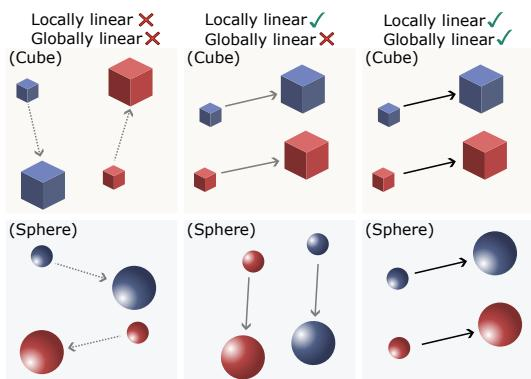
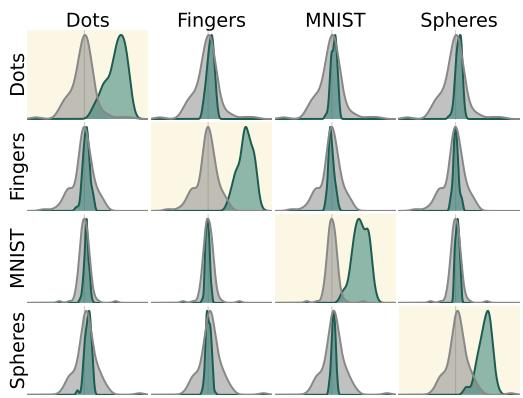
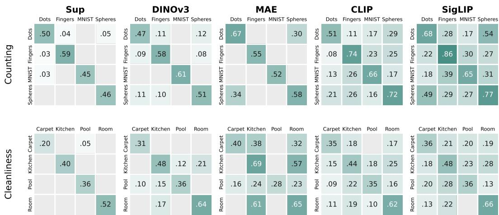
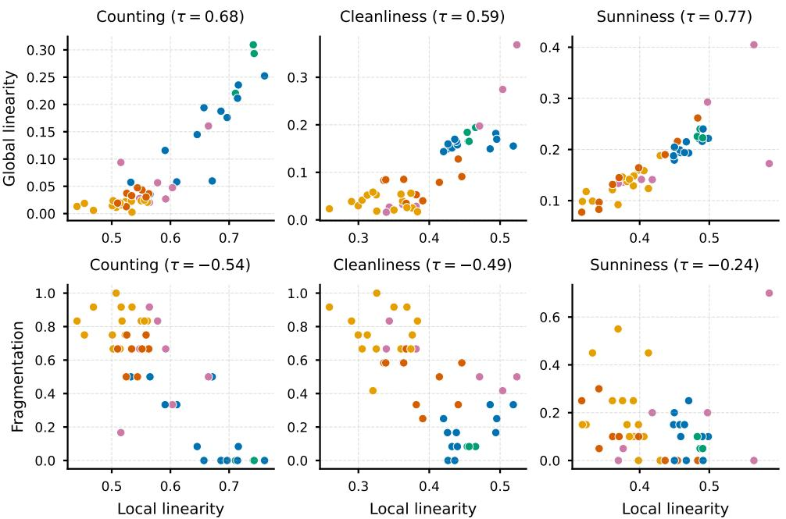
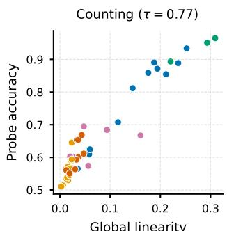
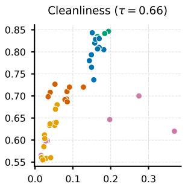
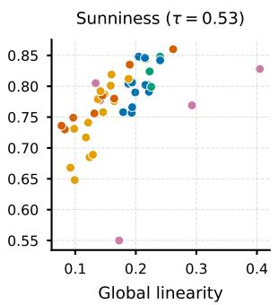

# Do vision models know that three is three?

Ankit Sonthalia1 Arnas Uselis1 Seong Joon Oh2

## Abstract

Do vision models encode the transition 2→3 the same way whether it appears in handwritten digits or in hand gestures, and do they “understand” that clean→dirty is the same transformation regardless of whether it is applied to a kitchen or a carpet? The linear representation hypothesis (LRH) answers this for language models: concept changes correspond to directions in (language) embedding space. In vision, the same concept can manifest in visually unrelated regimes that rarely co-occur: images of digits and hands do not share much in common in pixel space. To understand whether vision models still encode the underlying abstract concepts, we study 46 vision encoders across architectures, training objectives, and scales, on 10 concept families including numerosity, age, object identity, and MIT-States attributes. Within each regime, we find statistically significant concept directions near-universally across our tested models. However, two distinct regimes do not always share the same concept direction. Several models learn multiple linear structures for the same concept transition, split across regimes. We call this phenomenonfragmented linearity: strong local linearity coexisting with near-absent global linearity. Fragmentation is, however, not fixed: models with stronger local linearity progressively escape it (local-global linearity correlated with $\bar { \tau } \in [ 0 . 3 8 , 0 . 8 9 ]$ across all concepts), and where global linearity does emerge, concept directions can transfer as linear probes across regimes.

## 1 Introduction

The linear representation hypothesis (LRH) [1, 2] claims that the embedding spaces of large language models (LLMs) contain linear directions corresponding to high-level concept changes, enabling interpretability and algebraic interventions in representation space. Yet as vision encoders increasingly serve as the perceptual backbone of multimodal systems [3, 4], understanding whether the same linear structure holds in vision is essential to completing the picture.

Vision is fundamentally different from language in that the same concept often manifests in visually drastically different ways. For instance, the concept of “3” can be represented using handwritten digits [5], the number of objects in an image [6] or hand gestures [7]. While these different groups (regimes) of images do not share much in common in pixel space, a human would understand that the same underlying concept is being manipulated; do vision embedding spaces encode the same abstractions? A linear representation in embedding space would hint that they do.

Linear structure (linearity) in the embedding space is indeed often an assumption (implicit or otherwise) in prior works that attempt to interpret vision embeddings [8–10]. Prior work has also studied linearity of vision embeddings after projection onto a tangent space [11], with respect to ordinal attributes [12], and its emergence as a consequence of data diversity [13]. While these findings hint toward the presence of linear structure in vision embeddings, a more rigorous study exploring whether it survives across drastically unrelated visual regimes remains missing.

To address this gap, we study 46 vision encoders varying in architecture, training objective, model size and pretraining data, using the concepts of numerosity, age, and object identity, as well as 7 attributes curated from MIT-States [14]. We show that within a given regime, concepts are almost universally encoded linearly to an extent that is statistically distinguishable from a random baseline. However, this applies only partially to cross-regime transfer (Figure 1). This finding motivates our definitions of local (within-regime), global (cross-regime) andfragmented (only within-regime without cross-regime) linearity.

  
(a) Schematic: Is “small → big” encoded as a single direction across visual regimes (e.g., cubes vs. spheres)? Left: no consistent direction within any regime. Middle: each regime has a consistent direction, but directions differ across regimes (fragmented linearity). Right: one direction holds globally.

  
(b) [ViT-L/16-Sup] KDEs of alignment between discovered concept directions in regime i (rows) and actual counterfactual differences in regime j (columns) vs. random vectors (2→3 transition): within-regime (on-diagonal) cosines exceed the baseline; cross-regime (off-diagonal) they typically do not.  
Figure 1: Vision embeddings exhibit fragmented linearity. (a) Three possibilities for linearity: none, fragmented, or global. (b) Empirically, we often observe fragmented linearity.

While local linearity is present even in supervised models with complete fragmentation across regimes (supervised models), models with stronger local linearity (CLIP-like models) also tend to exhibit stronger global linearity. This suggests a gradual convergence of regime-specific representations into abstract regime-invariant ones.

Our contributions are:

1. A systematic investigation of the LRH for vision models.

2. Statistically rigorous empirical evidence that abstract concepts exhibit fragmented linearity.

3. Empirical evidence that modern vision encoders exhibit increasingly globally linear concept directions.

## 2 Preliminaries and related work

We review three different notions of linear structure that appear in prior work and situate our study within the existing landscape. Of these, the LRH is the main notion studied in our work.

Notation. We assume a concept space $\mathcal { Z } = Z _ { 1 } \times Z _ { 2 } \times \cdot \cdot \cdot \times Z _ { k }$ where the ith concept can take one of | $Z _ { i } \mid$ values; samples $x \in { \bar { \mathcal { X } } }$ are generated as $x = g ( z ) , z \in \mathcal { Z }$ where X is the input space (images or text prompts). An (image or text) encoder is a function $f : \mathcal { X } \to \mathbb { R } ^ { D }$ . Where convenient, we will use the notation $\phi ( z ) : = \bar { f } ( g ( z ) )$ for some $z \in { \mathcal { Z } }$

## 2.1 Different notions of linearity

(1) Linear separability. Linear probes [15] reveal whether different classes of $\mathbf { a } \mid Z _ { i }$ |-valued concept can be separated linearly using a classifier $h : \mathbb { R } ^ { D }  [ 0 , 1 ] ^ { | Z _ { i } | }$ . This notion of linearity has been largely shown to hold for many modern models $[ 1 6 - 2 1 ] ;$ ; however, separability does not guarantee that concepts admit consistent linear directions conducive to manipulation.

(2) Linear representation hypothesis (LRH). According to the LRH [2], concepts are represented as directions in embedding space. Formally, for two values $a , b \in Z _ { i }$ of the i-th concept, define a set of counterfactual pairs $\mathcal { C } _ { a  b } ^ { \mathcal { Z } , i }$ where samples differ only in the value of this concept:

$$
\mathcal { C } _ { a  b } ^ { \mathcal { Z } , i } = \{ ( z , z ^ { \prime } ) \in \mathcal { Z } \times \mathcal { Z } \mid z _ { i } = a , \ z _ { i } ^ { \prime } = b , \ a \neq b , \ z _ { j } = z _ { j } ^ { \prime } \ \forall \ j \neq i \} .\tag{1}
$$

Definition 2.1 (Directional linearity (LRH) [2]). We define concept i as being represented directionally linearly in f if for every $a , b \in Z _ { i }$ , there exists a fixed $\boldsymbol { v } _ { a  b } ^ { \mathcal { Z } , i } \in \mathbb { R } ^ { D }$ such that for every counterfactual pair $( z , z ^ { \prime } ) \in \mathcal { C } _ { a  b } ^ { \mathcal { Z } , i }$ , there exists $\alpha \in \mathbb { R }$ such that

$$
\exists \alpha \mathrm { s . t . } \phi ( z ^ { \prime } ) - \phi ( z ) = \alpha v _ { a \to b } ^ { z , i }
$$

We refer to $v _ { a  b } ^ { z , i }$ as the concept direction from a to $b .$

(3) Linear additive decomposability. [22] define linearity as the property where primitive concepts can be represented as vectors that yield composite concepts when added together. We refer to this notion of linearity as additive linearity.

Definition 2.2 (Additive linearity [22]). We define $f$ to be additively linear if the following holds for every i: for every $a , b \in Z _ { i }$ , there exists a fixed $\boldsymbol { v } _ { a  b } ^ { \mathcal { Z } , i } \in \mathbb { R } ^ { D }$ such that for every counterfactual pair $( z , z ^ { \prime } ) \in \mathcal { C } _ { a  b } ^ { z , i } ,$

$$
\phi ( z ^ { \prime } ) - \phi ( z ) = v _ { a  b } ^ { z , i } .
$$

[11] show additive linearity holds approximately after tangent space projection, but it remains unclear (i) whether the weaker LRH still holds in Euclidean space and (ii) whether any linear structure transfers across visually disjoint regimes. Our study aims to address both.

## 2.2 Related work

Interpretability and the linearity assumption. Early interpretability research pioneered by [8] assumes local linear separability of samples belonging to a concept from those not belonging to it. The assumption of concepts lying in some low-dimensional subspace is implicit [23] but not otherwise verified. More recent works [24, 9, 10] train SAEs to sparsely decompose embeddings. Nevertheless, it is unclear whether SAEs recover the “true” concept directions [25]. While the goal in these works is interpretability of vision models, we focus on characterizing the geometry that enables interpretability.

Linear structure in vision models. [26] discover task-aligned subspaces in CLIP’s image encoder. Extending the findings from [22] to the vision domain, [11] show that CLIP image embeddings admit approximately linear structure after projection onto the tangent space. [12] show that many ordinal attributes can be linearly decoded from popular vision encoders, while [13] show compositional linearity emerges as a consequence of training data diversity.

The above works assess linearity as a single global property of the representation. In contrast, we consider visually different regimes separately and hypothesize that (1) individual regimes contain strong concept representations, and (2) linearity (Definition 2.1) often holds only weakly because regime-specific concept representations fail to transfer strongly. This is also akin to learning different mechanisms for solving the same task in different contexts [27], although mechanistic interpretability is outside our scope.

VLM embedding spaces. A broad body of prior work studies different aspects of VLM embedding spaces in general. Of particular note have been the modality gap [28–30], binding capabilities [31–33] and negation [34]. [35] propose geometric constraints for an “ideal” CLIP. In contrast to these works, our work explores the local geometry of general vision models, including CLIP.

Compositional generalization and compositional zero-shot learning. VLMs have been frequently shown to be suitable for compositional zero-shot learning [36–38], compositional retrieval [39–41], and concept editing [42]. Other work has revealed shortcomings [43]. We take a complementary approach and analyze the geometry of existing vision encoders for local linearity; our findings may contribute towards explaining the compositional failures of VLMs.

Representation convergence. The Platonic Representation Hypothesis [44] argues that learned representations are converging toward a shared, canonical model of the world. In contrast, we study a different form of convergence: whether a single model’s embedding space aligns the same concept across different regimes. Our perspective is closer to work questioning whether neural networks reuse identical computational structures across settings [45, 27, 46]. In contrast, however, we focus on the final-layer embeddings which are directly exposed to downstream tasks like zero-shot retrieval and classification.

## 3 Fragmented Linearity

This section defines local linearity and fragmentation and lays out the measurements used throughout the paper.

## 3.1 Regimes and approximate counterfactuals

Our linearity metric follows the LRH definition in Definition 2.1.

## 3.1.1 Regimes and local linearity

Consider the texts $^ { 6 6 } 3$ fingers” and “the digit $3 ^ { \circ } { : }$ in language, the shared concept $\mathbf { \ddot { \delta } } 3 ^ { \mathbf { \ ' } }$ is explicit. No comparable explicit signal links an image of the digit 3 to an image of three raised fingers. Similarly, “old coin” and “old building” make the connection explicit but images of old coins and old buildings do not. This motivates studying concept structure in vision at the level of data subsets (digits, fingers, spheres, coins, buildings, and so on), which we call regimes. Formally, we use a partition $\bar { \mathcal { P } } = \{ \bar { S _ { r } } \} _ { r = 1 } ^ { m }$ with $S _ { r } \subseteq { \mathcal { Z } }$ and $\textstyle \bigcup _ { r = 1 } ^ { m } S _ { r } = { \mathcal { Z } }$ , and call each $\bar { S } _ { r }$ a regime. This allows us to study linearity within and across regimes.

Definition 3.1 (Local linearity). Given a concept space $\mathcal { Z }$ and a partition ${ \mathcal P } = \{ S _ { i } \} _ { i = 1 } ^ { m }$ with $\textstyle \bigcup _ { i } S _ { i } = { \mathcal { Z } }$ , we define $f$ to be locally linear with respect to $\mathcal { P }$ (under linearity notion L) if L holds inside each $S _ { i } \in \mathcal { P }$

Note that if L holds for all $\mathcal { P } \in \Pi ( \mathcal { Z } )$ , then f is globally linear since $\{ \mathcal { Z } \} \in \Pi ( \mathcal { Z } )$

## 3.1.2 Counterfactual construction

In Equation (1), counterfactual pairs differ only in one concept. Because our analysis is at the regime level, we construct counterfactuals within a fixed regime $S _ { r }$

Images are sparse in concept space even within regimes. A handwritten $" 2 "$ and a handwritten $\mathbf { \ddot { \mathbf { 3 } } } \mathbf { \vec { \mathbf { ) } } }$ differ in other concepts like style and stroke width; one can rarely match all such concepts across two images (text avoids this problem by abstracting these concepts away). We therefore construct approximate counterfactual pairs for transition $a \to b$ of concept i inside each regime.

Fix a regime $S _ { r }$ . We form two finite embedding sequences within this regime: one each for samples with the i-th concept set to a and b respectively. Let $E = ( e _ { k } ) _ { k = 1 } ^ { n }$ with $e _ { k } \in \{ \phi ( z ) \mid z \in S _ { r } , \ z _ { i } = a \}$ and let $E ^ { \prime } = ( e _ { \ell } ^ { \prime } ) _ { \ell = 1 } ^ { \bar { n } }$ with $e _ { \ell } ^ { \prime } \in \{ \phi ( \dot { z } ^ { \prime } ) ~ | ~ z ^ { \prime } \stackrel { . } { \in } S _ { r } , ~ z _ { i } ^ { \prime } = \stackrel { . } { b } \}$ . We compute a bijection $\pi ^ { * }$ by solving the linear sum assignment problem

$$
\pi ^ { * } = \arg \operatorname* { m i n } _ { \pi \in S _ { n } } \sum _ { k = 1 } ^ { n } \| e _ { k } - e _ { \pi ( k ) } ^ { \prime } \| _ { 2 } .\tag{2}
$$

The matched embedding pairs $\{ ( e _ { k } , e _ { \pi ^ { * } ( k ) } ^ { \prime } ) \} _ { k = 1 } ^ { n }$ define our approximation to $\mathcal { C } _ { a  b } ^ { S _ { r } , i }$ . Under the assumption that embedding distance reflects similarity in non-target concepts, this construction yields the closest available counterfactual pairs within regime $S _ { r }$

## 3.2 Metrics: direction consistency and fragmentation

We introduce our linearity metric (direction consistency) and distinguish local linearity from global linearity. This then motivates our fragmentation metric.

## 3.2.1 Direction consistency

Direction consistency (DC) measures whether counterfactual differences for a concept align with a single common direction (Definition 2.1, [2]).

Definition 3.2 (Within-regime direction consistency). This measures whether a given regime contains a coherent concept direction. Fix concept i and values $a , b \in Z _ { i }$ . Let $\mathscr { P } = \{ S _ { r } \} _ { r = 1 } ^ { m }$ and fix $S \in { \mathcal { P } }$ Let $\mathcal { C } _ { a  b } ^ { S , i } = \{ ( z _ { k } , z _ { k } ^ { \prime } ) \} _ { k = 1 } ^ { n _ { S } }$ be matched counterfactual pairs and $\Delta _ { k } ^ { S , i } : = \phi ( z _ { k } ^ { \prime } ) - \phi ( z _ { k } )$ . For each held-out index k, define

$$
\hat { v } _ { a  b } ^ { S , - k , i } : = \frac { 1 } { n _ { S } - 1 } \sum _ { j \neq k } \Delta _ { j } ^ { S , i } ,
$$

The within-regime DC score averages leave-one-out cosine alignment between each held-out displacement $\Delta _ { k } ^ { S , i }$ and its leave-one-out estimated concept direction $\hat { v } _ { a  b } ^ { S , - k , i }$

$$
\mathrm { D C } _ { a  b } ^ { i } ( S ) : = \frac { 1 } { n _ { S } } \sum _ { k = 1 } ^ { n _ { S } } \cos \Bigl ( \Delta _ { k } ^ { S , i } , \hat { v } _ { a  b } ^ { S , - k , i } \Bigr ) .\tag{3}
$$

We call $\mathrm { D C } _ { a  b } ^ { i } ( S )$ local DC. High local DC for all $S \in { \mathcal { P } }$ implies high local linearity with respect to $\mathcal { P }$

Given a partition $\mathcal { P } = \{ S _ { r } \} _ { r = 1 } ^ { m }$ , we summarize local linearity by averaging local DC across regimes:

$$
\mathrm { L L } _ { a \to b } ^ { i } ( \mathcal P ) : = \frac { 1 } { m } \sum _ { r = 1 } ^ { m } \mathrm { D C } _ { a \to b } ^ { i } ( S _ { r } ) .\tag{4}
$$

Definition 3.3 (Cross-regime direction consistency). This measures whether a direction estimated in one regime is preserved in another regime. Let $\mathbf { \mathcal { P } } = \{ S _ { r } \} _ { r = 1 } ^ { m }$ and fix source regime $S \in { \mathcal { P } }$ and evaluation regime $S ^ { \prime } \in \mathcal { P }$ . Define

$$
\hat { v } _ { a  b } ^ { S , i } : = \frac { 1 } { n _ { S } } \sum _ { j = 1 } ^ { n _ { S } } \Delta _ { j } ^ { S , i } ,
$$

Let $\mathcal { C } _ { a  b } ^ { S ^ { \prime } , i } = \{ ( z _ { t } , z _ { t } ^ { \prime } ) \} _ { t = 1 } ^ { n _ { S ^ { \prime } } }$ and $\Delta _ { t } ^ { S ^ { \prime } , i } : = \phi ( z _ { t } ^ { \prime } ) - \phi ( z _ { t } )$ . The cross-regime DC score averages cosine alignment between evaluation displacements $\Delta _ { t } ^ { S ^ { \prime } , i }$ and the source estimated concept direction $\hat { v } _ { a  b } ^ { S , i } \colon$

$$
\mathrm { D C } _ { a  b } ^ { i } ( S , S ^ { \prime } ) : = \frac { 1 } { n _ { S ^ { \prime } } } \sum _ { t = 1 } ^ { n _ { S ^ { \prime } } } \cos \Bigl ( \Delta _ { t } ^ { S ^ { \prime } , i } , \hat { v } _ { a  b } ^ { S , i } \Bigr ) .\tag{5}
$$

High cross-regime DC across all regime pairs implies high global linearity. We call $\mathrm { D C } _ { a  b } ^ { i } ( S , S ^ { \prime } )$ cross-regime DC.

We summarize global linearity by averaging cross-regime DC across distinct regime pairs:

$$
\mathrm { G L } _ { a \to b } ^ { i } ( \mathcal { P } ) : = \frac { 1 } { m ( m - 1 ) } \sum _ { r = 1 } ^ { m } \sum _ { r ^ { \prime } = 1 \atop r ^ { \prime } \neq r } ^ { m } \mathrm { D C } _ { a \to b } ^ { i } ( S _ { r } , S _ { r ^ { \prime } } ) .\tag{6}
$$

Excluding identical regimes $( r ^ { \prime } = r )$ isolates global linearity from local linearity and allows us to understand whether the concept representation survives across regimes.

## 3.2.2 Random baseline

DC scores (Equations (3) and (5)) are informative of (local or global) linearity only if cosine alignment between evaluation displacements and the estimated concept direction $\hat { v } _ { a  b } ^ { \dot { S } , i }$ exceeds chance level. As a baseline, we replace the evaluation pairs with pairs drawn uniformly at random from the pooled dataset for concept i (e.g., all counting datasets for numerosity, all MIT-States images for MIT-States attributes), without the counterfactual matching of Section 3.1.2, and compute Equations (3) and (5) with these random displacements.

  
Figure 2: Within-regime (diagonal) and cross-regime (off-diagonal) direction consistencies. Some values are indistinguishable from baseline (according to Welch’s t-test with Bonferroni-corrected p-values) and are excluded from display. Even supervised models (leftmost panel) are locally linear, while only selectively globally linear. In contrast, CLIP models are linear almost everywhere (most off-diagonal entries significant).

To test whether a DC score is distinguishable from the baseline, we use a one-sided Welch t-test comparing per-regime-pair DC scores against the random baseline. For a given concept and model, we run this test for each of the $m ^ { 2 }$ regime pairs. Because the tests are conducted simultaneously, we apply Bonferroni correction to the error rate and require $\textstyle p < { \frac { 0 . 0 5 } { m ^ { 2 } } }$ . The random baseline along with the DC metric allows us to define fragmentation and characterize fragmented linearity.

## 3.2.3 Fragmentation

We refer to a concept representation as fragmented if no consistent concept direction transfers across regimes. We quantify this as the fraction of cross-regime pairs $( \boldsymbol { S _ { r } } , \boldsymbol { \bar { S } _ { r ^ { \prime } } } ) , r \neq r ^ { \prime }$ , where $\mathrm { D C } _ { a  b } ^ { i } ( S _ { r } , S _ { r ^ { \prime } } )$ is indistinguishable from the random baseline.

Definition 3.4 (Fragmentation score). Fix concept i and a partition $\mathcal { P } ~ = ~ \{ S _ { r } \} _ { r = 1 } ^ { m }$ . Let $\tau =$ $\{ ( S _ { r } , S _ { r ^ { \prime } } ) \mid r \neq r ^ { \prime } \}$ be the $m ( m { - } 1 )$ cross-regime pairs. For each source regime $S _ { r }$ , let $\mathrm { D C } _ { a  b } ^ { i , \mathrm { r a n d } } ( S _ { r } )$ be the random-baseline DC score obtained by replacing the evaluation pairs with uniformly random pairs from the pooled dataset (Section 3.2.2). For each $( S _ { r } , S _ { r ^ { \prime } } ) \in \mathcal { T }$ , define the null hypothesis

$$
H _ { 0 } ^ { r , r ^ { \prime } } : \mathrm { D C } _ { a  b } ^ { i } ( S _ { r } , S _ { r ^ { \prime } } ) \leq \mathrm { D C } _ { a  b } ^ { i , \mathrm { r a n d } } ( S _ { r } ) .
$$

Let $p _ { r , r ^ { \prime } }$ be the p-value from the one-sided Welch t-test of $H _ { 0 } ^ { r , r ^ { \prime } }$ . The fragmentation score is

$$
\mathrm { F r a g } _ { a  b } ^ { i } ( { \mathcal P } ) : = \frac { 1 } { m ( m - 1 ) } \sum _ { r = 1 } ^ { m } \sum _ { r ^ { \prime } = 1 \atop r ^ { \prime } \neq r } ^ { m } { \bf 1 } [ p _ { r , r ^ { \prime } } \geq \frac { 0 . 0 5 } { m ^ { 2 } } ] .\tag{7}
$$

$\mathrm { F r a g } _ { a  b } ^ { i } ( \mathcal { P } ) = 0$ indicates the concept representation is consistent across all regime pairs, while $\mathrm { F r a g } _ { a  b } ^ { i } ( \mathcal { P } ) = 1$ indicates it is fragmented across all of them (under the sample sizes considered by us).

## 3.3 Experimental setup

We describe the setup for reproducing our experiments.

Models. Our study covers 46 vision models trained using different objectives: image-text contrastive models [18, 47, 48], DINO [49, 19, 50], masked image modeling [51], and several supervised models. We cover both CNN-based [52] and transformer-based [53] architectures. For CNNs we use averagepooled features; for vision transformers we use the class token. Pretrained CLIP variants are sourced from OpenCLIP [54] and all other models from timm [55]. We provide the full list of models in Appendix A.

Table 1: Local linearity is detectable near-universally; global linearity is detectable much less often. Local and global linearities are positively correlated for all concepts. We report fractions of (model, regime) pairs where within-regime DC and cross-regime DC are statistically distinguishable from baseline (per-matrix Bonferroni correction, $\alpha / m ^ { 2 } )$ , across 46 models.
<table><tr><td>Concept</td><td>Local sig. (%)</td><td>Global sig. (%)</td><td>Kendall τ</td><td>p</td></tr><tr><td> $2 \to 3$ </td><td>100.0</td><td>46.9</td><td>0.68</td><td> $3 . 2 0 \times 1 0 ^ { - 1 1 }$ </td></tr><tr><td>Clean → Dirty</td><td>99.5</td><td>51.8</td><td>0.59</td><td> $5 . 7 8 \times 1 0 ^ { - 9 }$ </td></tr><tr><td> $\mathrm { D r y } \to \mathrm { W e t }$ </td><td>97.8</td><td>18.3</td><td>0.52</td><td> $3 . 0 2 \times 1 0 ^ { - 7 }$ </td></tr><tr><td>Ancient → Modern</td><td>100.0</td><td>81.7</td><td>0.57</td><td> $3 . 0 4 \times 1 0 ^ { - 8 }$ </td></tr><tr><td>Bright → Dark</td><td>99.5</td><td>77.2</td><td>0.79</td><td> $1 . 0 3 \times 1 0 ^ { - 1 4 }$ </td></tr><tr><td>Cooked → Raw</td><td>97.8</td><td>44.7</td><td>0.51</td><td> $6 . 0 5 \times 1 0 ^ { - 7 }$ </td></tr><tr><td>Ripe → Unripe</td><td>100.0</td><td>68.5</td><td>0.38</td><td> $2 . 3 0 \times 1 0 ^ { - 4 }$ </td></tr><tr><td>Foggy → Sunny</td><td>99.6</td><td>85.5</td><td>0.77</td><td> $4 . 4 8 \times 1 0 ^ { - 1 4 }$ </td></tr><tr><td>Dog → Horse</td><td>100.0</td><td>99.3</td><td>0.89</td><td> $2 . 7 8 \times 1 0 ^ { - 1 8 }$ </td></tr><tr><td> $\mathrm { Y o u n g }  \mathrm { O l d }$ </td><td>100.0</td><td>94.6</td><td>0.53</td><td> $1 . 8 2 \times 1 0 ^ { - 7 }$ </td></tr><tr><td>Overall</td><td>99.1</td><td>52.2</td><td></td><td></td></tr></table>

Datasets. We consider 10 concept families. For numerosity, we consider MNIST [5], Fingers [7], CLEVR [6], and a synthetic dot-counting dataset (100 images per regime-class pair; 4 regimes). For age, we consider UTKFace [56] and 11k-Hands [57] (74 images per regime-class pair; 2 regimes). For object identity, we use PACS [58] (≈151 images per regime-class pair; 4 regimes). For MIT-States [14], we use 7 binary attributes (brightness, cleanliness, dryness, modernness, rawness, ripeness, sunniness), with 30 images per regime-class pair and 4-10 regimes per attribute.

## 4 Results

We evaluate 46 vision models spanning contrastive, self-supervised, and supervised training objectives, on 10 concepts (numerosity, age, object identity, and seven MIT-States attributes). For each concept, images are partitioned into regimes (e.g., MNIST digits, raised fingers, rendered spheres for numerosity). For each model-concept pair, we compute per-regime-pair DC, yielding regime × regime matrices (Figure 2). Each entry in such a matrix is a measure of local linearity within that regime (diagonal entries) or global linearity across regimes (off-diagonal entries). Full details of models and datasets are in Section 3.3.

Vision embeddings exhibit locally linear structure. Table 1 (second column) shows that 99.1% of all (model, concept, regime) triplets (over a total of 2,530 tests) yield local DC scores statistically above baseline (per-matrix Bonferroni-corrected Welch’s t-test), with the lowest rate being 97.8% for dry→wet. In particular, from the representative results in Figure 2, diagonal entries (local linearities) in the DC matrices are consistently above zero across models and concepts. Even for a supervised ViT (leftmost column), $\mathrm { D C _ { 2  3 } ^ { M N I S T } = 0 . 4 5 }$ and $\mathrm { D C _ { c l e a n \to d i r t y } ^ { r o o m } = 0 . 5 2 } .$ , significant against near-zero random baselines. We conclude that statistically detectable (but not perfect) local linearity is almost universal across models, concepts and regimes.

Linearity is often fragmented across regimes. From Table 1 (third column), only 52.2% of all (model, concept, regime-pair) tuples yield cross-regime DC above baseline (over 13,984 tests), compared to 99.1% for local linearity. We show qualitative breakdowns across regime-pairs in Figure 2. For the supervised ViT on numerosity (2→3), in 8 of 12 regime pairs, cross-regime DC is indistinguishable from the random baseline (fragmentation = 0.67), despite significant local DCs. On the other hand, CLIP achieves fragmentation = 0 for the same transition: all cross-regime DCs are significant. Similarly, for cleanliness, supervised ViT has fragmentation 0.92 (11/12 cross-regime pairs near baseline), while CLIP has fragmentation 0.08 (only one insignificant pair). We conclude that regime-specific linearity can coexist with near-absent global linearity.

Global linearity does hold almost universally for object identity and age, with (99.3%) and (94.6%) of all statistical significance tests passing respectively. Intuitively, for objects and age, regimes differ in style (photo vs. sketch, face vs. hand) while the visual cues for the concept (shape for objects, wrinkles for age) remain consistent. For more abstract concepts like numerosity and cleanliness, regimes differ in subject matter (digits, fingers, spheres), making it harder for regimeinvariant directions to emerge.

  
Figure 3: Top row: Global linearity vs local linearity across models $\big ( \bullet \mathrm { C L I P } \quad \bullet \mathrm { S i g L I P } \quad \bullet \mathrm { D I N O } \quad \circ \mathrm { M I M }$ • Sup). Bottom row: Fragmentation vs local linearity. For numerosity (2→3), MIT-States cleanliness (clean→dirty), and sunniness (foggy→sunny).

Our findings above indicate that concept representations in vision embeddings can be significantly locally linear yet fully fragmented across regimes (Figure 2, left). While we have so far treated linearity as binary (either statistically significant or not) we now ask whether global linearity varies across models of different local linearities. Does stronger within-regime linear structure in modern foundation models reflect deeper concept understanding, or simply stronger regime-specific biases (leading to even weaker global understanding)?

Global linearity increases with local linearity. From Table 1, the rank correlation, measured by Kendall τ, between global and local linearity across the tested models is positive for every concept $( \tau \in [ 0 . 3 8 , 0 . 8 9 ]$ , all $p < 1 0 ^ { - 3 } )$ . As qualitative examples, Figure 3 plots global linearity (Equation (6)) and fragmentation (Equation (7)) against local linearity (Equation (4)) across all models, for representative concept transitions $( 2 \to 3$ , clean→dirty, foggy→sunny). Global linearity correlates positively with local linearity in all three cases $( \tau = 0 . 6 8 , 0 . 5 9 , 0 . 7 7 )$ . This finding echoes the platonic representation hypothesis [44]: stronger local concept structure in vision models converges toward abstract, regime-invariant geometry. Crucially, we do not claim a causal effect; our result describes the trend that is emerging in currently popular vision foundation models.

Concept directions can act as cross-regime linear probes in globally linear models. Regimeinvariant geometry (indicated by high global linearity) implies that concept directions should transfer as linear probes across regimes. For source regime S and target regime $\bar { S ^ { \prime } } \ne S$ , we classify held-out samples from $S ^ { \prime }$ using the direction $\hat { v } _ { a  b } ^ { S , i }$ estimated in S alone: sample $z \in S ^ { \prime }$ is assigned class b if $( \phi ( z ) - \hat { \mu } _ { S ^ { \prime } } ) \cdot \hat { v } _ { a  b } ^ { S , i } > 0$ , where $\hat { \mu } _ { S ^ { \prime } }$ is the mean embedding of $S ^ { \prime }$ (computed using 5 randomly selected samples per class) and provides an estimate of the mid-point between the two classes.

Figure 4 plots probe accuracy against global linearity $\mathrm { G L } _ { a  b } ^ { i } ( \mathcal { P } )$ across models for three representative transitions. Probe accuracy correlates positively with global linearity in all three cases $( \tau = 0 . 7 7 , 0 . 6 6 , 0 . 5 3 )$ . We conclude that concept directions in high-global-linearity models are indeed semantically meaningful.

Global linearity  

  
Global linearity

  
Figure 4: Probe accuracy vs global linearity across models (• CLIP • SigLIP • DINO • MIM • Sup) for numerosity (2→3), cleanliness (clean→dirty), and sunniness (foggy→sunny).

## 5 Conclusion

Almost all vision models encode “three”, but not all of them know it is “three”. While vision embeddings are locally linear to the extent of statistical significance almost without exception, many of them learn the same concept several times, once per regime, reflected in the phenomenon we characterize as fragmentation. As locally linear structure gets stronger, cross-regime alignment increases and global linearity emerges, producing semantically meaningful concept directions that can act as effective linear probes. Given our characterization of vision embedding geometry, the overarching question as to whether regime-specific skills are also converging into abstract ones (and whether they are related to geometry) remains open to future work.

Limitations and broader impact. Although we cover a broad range of concepts exhibiting varying degrees of difficulty, our conclusions are limited in scope to the investigated concept types. Our counterfactual pairs are approximate: matched by embedding space distance. While these limitations are unavoidable in the current scope, we argue that our statistical tests and downstream capability (probing) results together establish sufficient evidence to validate our main claims.

Linear directions in embedding space can potentially be exploited to steer representations toward harmful outputs; our work characterizes this geometry but does not introduce new attack surfaces beyond what already exists in existing models. On the other hand, our work contributes to the literature on interpretability, which strives to make AI systems fair and transparent.

Acknowledgements. This work was partly supported by the National Research Foundation of Korea (NRF) grant funded by the Korean government (MSIT) in 2026 (Grant No. RS-2026-25612350, Project Title: Development of an End-to-End Design and Validation Framework for Mathematically Principled Next-Generation AI Architectures and Learning Algorithms). This work was partly also supported by Institute for Information & communications Technology Planning & Evaluation (IITP) grant funded by the Korea government (MSIT) (RS-2019-II190075, Artificial Intelligence Graduate School Program(KAIST)). The authors are grateful to Nishad Singhi and Davide Berasi for helpful feedback. AS and AU acknowledge support from the German Federal Ministry of Education and Research (BMBF): Tübingen AI Center, FKZ: 01IS18039A, and the International Max Planck Research School for Intelligent Systems (IMPRS-IS).

## References

[1] Tomas Mikolov, Wen-tau Yih, and Geoffrey Zweig. Linguistic Regularities in Continuous Space Word Representations. In Lucy Vanderwende, Hal Daumé III, and Katrin Kirchhoff, editors, Proceedings of the 2013 Conference of the North American Chapter of the Association for Computational Linguistics: Human Language Technologies, pages 746–751, Atlanta, Georgia, June 2013. Association for Computational Linguistics. URL https://aclanthology.org/ N13-1090/.

[2] Kiho Park, Yo Joong Choe, and Victor Veitch. The Linear Representation Hypothesis and the Geometry of Large Language Models, July 2024. URL http://arxiv.org/abs/2311. 03658. arXiv: 2311.03658 [cs].

[3] Haotian Liu, Chunyuan Li, Qingyang Wu, and Yong Jae Lee. Visual Instruction Tuning, December 2023. URL http://arxiv.org/abs/2304.08485. arXiv:2304.08485 [cs].

[4] Siddharth Karamcheti, Suraj Nair, Ashwin Balakrishna, Percy Liang, Thomas Kollar, and Dorsa Sadigh. Prismatic vlms: Investigating the design space of visually-conditioned language models. In Forty-first International Conference on Machine Learning, 2024.

[5] Li Deng. The MNIST Database of Handwritten Digit Images for Machine Learning Research [Best of the Web]. IEEE Signal Processing Magazine, 29(6):141–142, November 2012. doi: 10.1109/MSP.2012.2211477. URL http://ieeexplore.ieee.org/document/6296535/.

[6] Justin Johnson, Bharath Hariharan, Laurens van der Maaten, Li Fei-Fei, C. Lawrence Zitnick, and Ross Girshick. CLEVR: A Diagnostic Dataset for Compositional Language and Elementary Visual Reasoning, December 2016. URL http://arxiv.org/abs/1612.06890. arXiv: 1612.06890 [cs].

[7] Pavel Koryakin. Fingers dataset. https://www.kaggle.com/datasets/koryakinp/ fingers, 2019. CC0: Public Domain.

[8] Been Kim, Martin Wattenberg, Justin Gilmer, Carrie Cai, James Wexler, Fernanda Viegas, and Rory Sayres. Interpretability Beyond Feature Attribution: Quantitative Testing with Concept Activation Vectors (TCAV). In Proceedings ofthe 35th International Conference on Machine Learning, pages 2668–2677. PMLR, July 2018. URL https://proceedings.mlr.press/ v80/kim18d.html.

[9] Usha Bhalla, Alex Oesterling, Suraj Srinivas, Flavio P. Calmon, and Himabindu Lakkaraju. Interpreting CLIP with Sparse Linear Concept Embeddings (SpLiCE), February 2024. URL http://arxiv.org/abs/2402.10376. arXiv:2402.10376.

[10] Harrish Thasarathan, Julian Forsyth, Thomas Fel, Matthew Kowal, and Konstantinos G Derpanis. Universal Sparse Autoencoders: Interpretable Cross-Model Concept Alignment. February 2025.

[11] Davide Berasi, Matteo Farina, Massimiliano Mancini, Elisa Ricci, and Nicola Strisciuglio. Not Only Text: Exploring Compositionality of Visual Representations in Vision-Language Models, March 2025. URL http://arxiv.org/abs/2503.17142. arXiv:2503.17142 [cs].

[12] Ankit Sonthalia, Arnas Uselis, and Seong Joon Oh. On the rankability of visual embeddings. NeurIPS, 2025. doi: 10.48550/arXiv.2507.03683. URL http://arxiv.org/abs/2507. 03683. arXiv:2507.03683 [cs].

[13] Arnas Uselis, Andrea Dittadi, and Seong Joon Oh. Does Data Scaling Lead to Visual Compositional Generalization?, July 2025. URL http://arxiv.org/abs/2507.07102. arXiv:2507.07102 [cs].

[14] Phillip Isola, Joseph J. Lim, and Edward H. Adelson. Discovering states and transformations in image collections. In 2015 IEEE Conference on Computer Vision and Pattern Recognition (CVPR), pages 1383–1391, Boston, MA, USA, June 2015. IEEE. ISBN 978-1-4673-6964- 0. doi: 10.1109/CVPR.2015.7298744. URL http://ieeexplore.ieee.org/document/ 7298744/.

[15] Guillaume Alain and Yoshua Bengio. Understanding intermediate layers using linear classifier probes, November 2018. URL http://arxiv.org/abs/1610.01644. arXiv:1610.01644 [stat].

[16] Ting Chen, Simon Kornblith, Mohammad Norouzi, and Geoffrey Hinton. A Simple Framework for Contrastive Learning of Visual Representations, July 2020. URL http://arxiv.org/ abs/2002.05709. arXiv:2002.05709 [cs].

[17] Kaiming He, Haoqi Fan, Yuxin Wu, Saining Xie, and Ross Girshick. Momentum Contrast for Unsupervised Visual Representation Learning, March 2020. URL http://arxiv.org/abs/ 1911.05722. arXiv:1911.05722 [cs].

[18] Alec Radford, Jong Wook Kim, Chris Hallacy, Aditya Ramesh, Gabriel Goh, Sandhini Agarwal, Girish Sastry, Amanda Askell, Pamela Mishkin, Jack Clark, Gretchen Krueger, and Ilya Sutskever. Learning Transferable Visual Models From Natural Language Supervision. In Proceedings of the 38th International Conference on Machine Learning, pages 8748–8763. PMLR, July 2021. URL https://proceedings.mlr.press/v139/radford21a.html.

[19] Maxime Oquab, Timothée Darcet, Théo Moutakanni, Huy Vo, Marc Szafraniec, Vasil Khalidov, Pierre Fernandez, Daniel Haziza, Francisco Massa, Alaaeldin El-Nouby, Mahmoud Assran, Nicolas Ballas, Wojciech Galuba, Russell Howes, Po-Yao Huang, Shang-Wen Li, Ishan Misra, Michael Rabbat, Vasu Sharma, Gabriel Synnaeve, Hu Xu, Hervé Jegou, Julien Mairal, Patrick Labatut, Armand Joulin, and Piotr Bojanowski. DINOv2: Learning Robust Visual Features without Supervision, February 2024. URL http://arxiv.org/abs/2304.07193. arXiv: 2304.07193 [cs].

[20] Arnas Uselis and Seong Joon Oh. Intermediate Layer Classifiers for OOD generalization, April 2025. URL http://arxiv.org/abs/2504.05461. arXiv:2504.05461 [cs].

[21] Enrico Vompa, Tanel Tammet, and Mohit Vaishnav. Beyond the Linear Separability Ceiling: Aligning Representations in VLMs, December 2025. URL http://arxiv.org/abs/2507. 07574. arXiv:2507.07574 [cs].

[22] Matthew Trager, Pramuditha Perera, Luca Zancato, Alessandro Achille, Parminder Bhatia, and Stefano Soatto. Linear Spaces of Meanings: Compositional Structures in Vision-Language Models, January 2024. URL http://arxiv.org/abs/2302.14383. arXiv:2302.14383 [cs].

[23] Chih-Kuan Yeh, Been Kim, Sercan Arik, Chun-Liang Li, Tomas Pfister, and Pradeep Ravikumar. On Completeness-aware Concept-Based Explanations in Deep Neural Networks. In Advances in Neural Information Processing Systems, volume 33, pages 20554–20565. Curran Associates, Inc., 2020. URL https://proceedings.neurips.cc/paper/2020/hash/ ecb287ff763c169694f682af52c1f309-Abstract.html.

[24] Liv Gorton. The Missing Curve Detectors of InceptionV1: Applying Sparse Autoencoders to InceptionV1 Early Vision, September 2024. URL http://arxiv.org/abs/2406.03662. arXiv:2406.03662 [cs].

[25] Thomas Fel, Ekdeep Singh Lubana, Jacob S. Prince, Matthew Kowal, Victor Boutin, Isabel Papadimitriou, Binxu Wang, Martin Wattenberg, Demba Ba, and Talia Konkle. Archetypal SAE: Adaptive and Stable Dictionary Learning for Concept Extraction in Large Vision Models, May 2025. URL http://arxiv.org/abs/2502.12892. arXiv:2502.12892 [cs].

[26] Max Wolff, Wieland Brendel, and Stuart Wolff. The Independent Compositional Subspace Hypothesis for the Structure of CLIP’s Last Layer. February 2023. URL https: //openreview.net/forum?id=MmhGK8YkUKO.

[27] Akarsh Kumar, Jeff Clune, Joel Lehman, and Kenneth O. Stanley. Questioning Representational Optimism in Deep Learning: The Fractured Entangled Representation Hypothesis, May 2025. URL http://arxiv.org/abs/2505.11581. arXiv:2505.11581 [cs].

[28] Simon Schrodi, David T Hoffmann, Max Argus, Volker Fischer, and Thomas Brox. Two Effects, One Trigger: On the Modality Gap, Object Bias, and Information Imbalance in Contrastive Vision-Language Models. 2025.

[29] Weixin Liang, Yuhui Zhang, Yongchan Kwon, Serena Yeung, and James Zou. Mind the Gap: Understanding the Modality Gap in Multi-modal Contrastive Representation Learning. October 2022. URL https://openreview.net/forum?id=S7Evzt9uit3.

[30] Meir Yossef Levi and Guy Gilboa. The Double-Ellipsoid Geometry of CLIP, November 2024. URL http://arxiv.org/abs/2411.14517. arXiv: 2411.14517 [cs].

[31] Martha Lewis, Nihal V. Nayak, Peilin Yu, Qinan Yu, Jack Merullo, Stephen H. Bach, and Ellie Pavlick. Does CLIP Bind Concepts? Probing Compositionality in Large Image Models, August 2024. URL http://arxiv.org/abs/2212.10537. arXiv:2212.10537 [cs].

[32] Darina Koishigarina, Arnas Uselis, and Seong Joon Oh. CLIP Behaves like a Bag-of-Words Model Cross-modally but not Uni-modally, February 2025. URL http://arxiv.org/abs/ 2502.03566. arXiv: 2502.03566 [cs].

[33] Haider Al-Tahan, Quentin Garrido, Randall Balestriero, Diane Bouchacourt, Caner Hazirbas, and Mark Ibrahim. Scaling Vision-Language Models Does Not Improve Relational Understanding: The Right Learning Objective Helps.

[34] Sepehr Kazemi Ranjbar, Kumail Alhamoud, and Marzyeh Ghassemi. SpaceVLM: Sub-Space Modeling of Negation in Vision-Language Models, November 2025. URL http://arxiv. org/abs/2511.12331. arXiv:2511.12331 [cs].

[35] Raphi Kang, Yue Song, Georgia Gkioxari, and Pietro Perona. Is CLIP ideal? No. Can we fix it? Yes!, March 2025. URL http://arxiv.org/abs/2503.08723. arXiv:2503.08723 [cs].

[36] Nihal V. Nayak, Peilin Yu, and Stephen Bach. Learning to Compose Soft Prompts for Compositional Zero-Shot Learning. September 2022. URL https://openreview.net/forum?id= S8-A2FXnIh.

[37] Pramuditha Perera, Matthew Trager, Luca Zancato, Alessandro Achille, and Stefano Soatto. Prompt Algebra for Task Composition, June 2023. URL http://arxiv.org/abs/2306. 00310. arXiv:2306.00310 [cs].

[38] Hongyu Qu, Jianan Wei, Xiangbo Shu, and Wenguan Wang. LEARNING CLUSTERING-BASED PROTOTYPES FOR COMPOSITIONAL ZERO-SHOT LEARNING. 2025.

[39] Alberto Baldrati, Lorenzo Agnolucci, Marco Bertini, and Alberto Del Bimbo. Zero-Shot Composed Image Retrieval with Textual Inversion, August 2023. URL http://arxiv.org/ abs/2303.15247. arXiv:2303.15247 [cs].

[40] Shyamgopal Karthik, Karsten Roth, Massimiliano Mancini, and Zeynep Akata. Vision-by-Language for Training-Free Compositional Image Retrieval, February 2024. URL http: //arxiv.org/abs/2310.09291. arXiv:2310.09291 [cs].

[41] Lan Wang, Wei Ao, Vishnu Naresh Boddeti, and Ser-Nam Lim. Generative Zero-Shot Composed Image Retrieval.

[42] Duygu Ceylan, Chun-Hao Paul Huang, and Niloy J. Mitra. Pix2Video: Video Editing using Image Diffusion, March 2023. URL http://arxiv.org/abs/2303.12688. arXiv:2303.12688 [cs].

[43] Shengbang Tong, Zhuang Liu, Yuexiang Zhai, Yi Ma, Yann LeCun, and Saining Xie. Eyes Wide Shut? Exploring the Visual Shortcomings of Multimodal LLMs. 2024.

[44] Minyoung Huh, Brian Cheung, Tongzhou Wang, and Phillip Isola. The Platonic Representation Hypothesis. ICML, May 2024. URL http://arxiv.org/abs/2405.07987. arXiv:2405.07987 [cs].

[45] Michael A. Lepori, Thomas Serre, and Ellie Pavlick. Break It Down: Evidence for Structural Compositionality in Neural Networks, November 2023. URL http://arxiv.org/abs/2301. 10884. arXiv:2301.10884 [cs].

[46] Gavin McCracken, Gabriela Moisescu-Pareja, Vincent Letourneau, Doina Precup, and Jonathan Love. Uncovering a Universal Abstract Algorithm for Modular Addition in Neural Networks, May 2025. URL http://arxiv.org/abs/2505.18266. arXiv:2505.18266 [cs].

[47] Xiaohua Zhai, Basil Mustafa, Alexander Kolesnikov, and Lucas Beyer. Sigmoid Loss for Language Image Pre-Training, September 2023. URL http://arxiv.org/abs/2303.15343. arXiv:2303.15343 [cs].

[48] Michael Tschannen, Alexey Gritsenko, Xiao Wang, Muhammad Ferjad Naeem, Ibrahim Alabdulmohsin, Nikhil Parthasarathy, Talfan Evans, Lucas Beyer, Ye Xia, Basil Mustafa, Olivier Hénaff, Jeremiah Harmsen, Andreas Steiner, and Xiaohua Zhai. SigLIP 2: Multilingual Vision-Language Encoders with Improved Semantic Understanding, Localization, and Dense Features, February 2025. URL http://arxiv.org/abs/2502.14786. arXiv:2502.14786 [cs].

[49] Mathilde Caron, Hugo Touvron, Ishan Misra, Herve Jegou, Julien Mairal, Piotr Bojanowski, and Armand Joulin. Emerging Properties in Self-Supervised Vision Transformers. In 2021 IEEE/CVF International Conference on Computer Vision (ICCV), pages 9630–9640, Montreal, QC, Canada, October 2021. IEEE. ISBN 978-1-6654-2812-5. doi: 10.1109/ICCV48922.2021. 00951. URL https://ieeexplore.ieee.org/document/9709990/.

[50] Oriane Siméoni, Huy V. Vo, Maximilian Seitzer, Federico Baldassarre, Maxime Oquab, Cijo Jose, Vasil Khalidov, Marc Szafraniec, Seungeun Yi, Michaël Ramamonjisoa, Francisco Massa, Daniel Haziza, Luca Wehrstedt, Jianyuan Wang, Timothée Darcet, Théo Moutakanni, Leonel Sentana, Claire Roberts, Andrea Vedaldi, Jamie Tolan, John Brandt, Camille Couprie, Julien Mairal, Hervé Jégou, Patrick Labatut, and Piotr Bojanowski. DINOv3, 2025. URL https: //arxiv.org/abs/2508.10104. Version Number: 1.

[51] Kaiming He, Xinlei Chen, Saining Xie, Yanghao Li, Piotr Dollár, and Ross Girshick. Masked Autoencoders Are Scalable Vision Learners, December 2021. URL http://arxiv.org/abs/ 2111.06377. arXiv:2111.06377 [cs].

[52] Kaiming He, Xiangyu Zhang, Shaoqing Ren, and Jian Sun. Deep Residual Learning for Image Recognition. In 2016 IEEE Conference on Computer Vision and Pattern Recognition (CVPR), pages 770–778. IEEE, June 2016. doi: 10.1109/CVPR.2016.90. URL http://ieeexplore. ieee.org/document/7780459/. Place: Las Vegas, NV, USA.

[53] Alexey Dosovitskiy, Lucas Beyer, Alexander Kolesnikov, Dirk Weissenborn, Xiaohua Zhai, Thomas Unterthiner, Mostafa Dehghani, Matthias Minderer, Georg Heigold, Sylvain Gelly, Jakob Uszkoreit, and Neil Houlsby. An Image Is Worth 16x16 Words: Transformers for Image Recognition at Scale, June 2021. URL http://arxiv.org/abs/2010.11929. arXiv: 2010.11929.

[54] Gabriel Ilharco, Mitchell Wortsman, Ross Wightman, Cade Gordon, Nicholas Carlini, Rohan Taori, Achal Dave, Vaishaal Shankar, Hongseok Namkoong, John Miller, Hannaneh Hajishirzi, Ali Farhadi, and Ludwig Schmidt. Openclip, July 2021. URL https://doi.org/10.5281/ zenodo.5143773. If you use this software, please cite it as below.

[55] Ross Wightman. Pytorch image models. https://github.com/rwightman/ pytorch-image-models, 2019.

[56] Zhifei Zhang, Yang Song, and Hairong Qi. Age Progression/Regression by Conditional Adversarial Autoencoder, March 2017. URL http://arxiv.org/abs/1702.08423. arXiv: 1702.08423 [cs].

[57] Mahmoud Afifi. 11K Hands: Gender recognition and biometric identification using a large dataset of hand images, September 2018. URL http://arxiv.org/abs/1711.04322. arXiv:1711.04322 [cs].

[58] Da Li, Yongxin Yang, Yi-Zhe Song, and Timothy M. Hospedales. Deeper, Broader and Artier Domain Generalization, October 2017. URL http://arxiv.org/abs/1710.03077. arXiv:1710.03077 [cs].

## A Models

For reproducibility, all models are listed in Table 2. For OpenCLIP models we report the model name and pretrained tag as passed to open\_clip.create\_model\_and\_transforms; for timm models we report the model name as passed to timm.create\_model.

Table 2: Full list of models used in our study.
<table><tr><td>Model</td><td>Source</td><td>Tag</td></tr><tr><td colspan="3">CLIP</td></tr><tr><td>RN50 (OpenAI)</td><td>OpenCLIP</td><td>(RN50, openai)</td></tr><tr><td>RN101 (OpenAI)</td><td>OpenCLIP</td><td>(RN101, openai)</td></tr><tr><td>RN50x4 (OpenAI)</td><td>OpenCLIP</td><td>(RN50x4, openai)</td></tr><tr><td>ViT-B/32 (LAION-400M)</td><td>OpenCLIP</td><td>(ViT-B-32, 1aion400m_e31)</td></tr><tr><td>ViT-B/16 (OpenAI)</td><td>OpenCLIP</td><td>(ViT-B-16, openai)</td></tr><tr><td>ViT-B/16 (LAION-2B)</td><td>OpenCLIP</td><td>(ViT-B-16, laion2b_s34b_b88k)</td></tr><tr><td>ViT-L/14 (OpenAI)</td><td>OpenCLIP</td><td>(ViT-L-14, openai)</td></tr><tr><td>ViT-L/14 (LAION-2B)</td><td>OpenCLIP</td><td>(ViT-L-14, 1aion2b_s32b_b82k)</td></tr><tr><td>ViT-L/14 (CommonPool)</td><td>OpenCLIP</td><td>(ViT-L-14, commonpool_xl_s13b_b90k)</td></tr><tr><td>ViT-L/14 (DataComp)</td><td>OpenCLIP</td><td>(ViT-L-14, datacomp_xl_s13b_b90k)</td></tr><tr><td>ViT-H/14 (LAION-2B)</td><td>OpenCLIP OpenCLIP</td><td>(ViT-H-14, laion2b_s32b_b79k) (ViT-bigG-14, laion2b_s39b_b160k)</td></tr><tr><td colspan="3">ViT-bigG/14 (LAION-2B)</td></tr><tr><td>SigLIP ViT-B/16</td><td></td><td></td></tr><tr><td>ViT-L/16-256</td><td>OpenCLIP OpenCLIP</td><td>(ViT-B-16-SigLIP, webli) (ViT-L-16-SigLIP-256, webli)</td></tr><tr><td>ViT-B/16 SigLIP2</td><td>OpenCLIP</td><td>(ViT-B-16-SigLIP2, webli)</td></tr><tr><td colspan="3">DINO / DINOv2 / DINOv3</td></tr><tr><td>ViT-S/16 (DINO)</td><td>timm</td><td>vit_small_patch16_224.dino</td></tr><tr><td>ViT-B/16 (DINO)</td><td>timm</td><td>vit_base_patch16_224.dino</td></tr><tr><td>ViT-B/8 (DINO)</td><td>timm</td><td>vit_base_patch8_224.dino</td></tr><tr><td>ViT-B/14 (DINOv2)</td><td>timm</td><td>vit_base_patch14_dinov2.lvd142m</td></tr><tr><td>ViT-L/14 (DINOv2)</td><td>timm</td><td>vit_large_patch14_dinov2.1vd142m</td></tr><tr><td>ViT-g/14 (DINOv2)</td><td>timm</td><td>vit_giant_patch14_dinov2.lvd142m</td></tr><tr><td>ViT-Š/16 (DINOv3)</td><td>timm</td><td>vit_small_patch16_dinov3.lvd1689m</td></tr><tr><td>ViT-B/16 (DINOv3)</td><td>timm</td><td>vit_base_patch16_dinov3.1vd1689m</td></tr><tr><td>ViT-L/16 (DINOv3)</td><td>timm</td><td>vit_large_patch16_dinov3.lvd1689m</td></tr><tr><td colspan="3">Masked Image Modeling</td></tr><tr><td>ViT-B/16 (MAE)</td><td>timm</td><td>vit_base_patch16_224.mae</td></tr><tr><td>ViT-L/16 (MAE)</td><td>timm</td><td>vit_large_patch16_224.mae</td></tr><tr><td>ViT-H/14 (MAE)</td><td>timm</td><td>vit_huge_patch14_224.mae</td></tr><tr><td>BEiT-B/16</td><td>timm</td><td>beit_base_patch16_224.in22k_ft_in22k_in1k</td></tr><tr><td>BEiT-L/16</td><td>timm</td><td>beit_large_patch16_224.in22k_ft_in22k_in1k</td></tr><tr><td>BEiTv2-B/16</td><td>timm</td><td>beitv2_base_patch16_224.in1k_ft_in22k_in1k</td></tr><tr><td>BEiTv2-L/16</td><td>timm</td><td>beitv2_large_patch16_224.in1k_ft_in22k_in1k</td></tr><tr><td colspan="3">Supervised</td></tr><tr><td>ResNet-18</td><td>timm</td><td>resnet18.a1_in1k</td></tr><tr><td>ResNet-50</td><td>timm</td><td>resnet50.a1_in1k</td></tr><tr><td>ResNet-101</td><td>timm</td><td>resnet101.a1_in1k</td></tr><tr><td>EfficientNet-B0</td><td>timm</td><td>efficientnet_bO.ra_in1k</td></tr><tr><td>EfficientNet-B4</td><td>timm</td><td>efficientnet_b4.ra2_in1k</td></tr><tr><td>ConvNeXt-B</td><td>timm</td><td>convnext_base.fb_in22k_ft_in1k</td></tr><tr><td>ConvNeXt-L</td><td>timm</td><td>convnext_large.fb_in1k</td></tr><tr><td>ConvNeXt-XL</td><td>timm</td><td>convnext_xlarge.fb_in22k_ft_in1k</td></tr><tr><td>ViT-S/16</td><td>timm</td><td>vit_small_patch16_224.augreg_in21k_ft_in1k</td></tr><tr><td>ViT-B/16</td><td>timm</td><td>vit_base_patch16_224.augreg2_in21k_ft_in1k</td></tr><tr><td>ViT-L/16</td><td>timm</td><td>vit_large_patch16_224</td></tr><tr><td>TinyViT-21M</td><td>timm</td><td>tiny_vit_21m_224.dist_in22k_ft_in1k</td></tr><tr><td>DeiT-B/16</td><td>timm</td><td>deit_base_patch16_224.fb_in1k</td></tr><tr><td>Swin-T</td><td>timm</td><td>swin_tiny_patch4_window7_224.ms_in1k</td></tr><tr><td>Swin-B</td><td>timm</td><td>swin_base_patch4_window7_224.ms_in22k_ft_in1k</td></tr></table>