# EARS: Evidence-Aware Retrieval via Sound and Motion for Budgeted Video Reasoning

Shih-Yao Lin

Independent Researcher

mikeslin.research@gmail.com

## Abstract

Uniformframe sampling can miss briefevidence in sparseevent videos when the VLM sees only K frames. We propose EARS (Evidence-Aware Retrieval via Sound and motion), a training-free, query-freefront-end that ranksframes using optical-flow motion and audio energy, then applies temporal non-maximum suppression for diversity. The evidence score alone has frame-level AP 0.39; used only to select frames for the VLM, EARS with temporal diversity reaches localization AP 0.94, compared with 0.88 under Uniform sampling. In the updated matched study, at K = 1 EARS reaches XD-subset F1 0.660 versus 0.614 for centered Uniform (the paired interval includes zero); earlier backbone studies use separate protocols. On mostly-silent UCF-Crime, however, EARS slightly trails Uniform. A single configuration is used across both benchmarks; the new controls do not repeat the original held-out search. EARS therefore targets low-budget videos whose salient evidence aligns with motion or audio; on dense narratives or stealthy events, uniform or semantic selection remains preferable, and cheap modality statistics cannot reliably route between them. Code: https://github.com/mikeslinir/EARS

## 1. Introduction

Video understanding requires reasoning over long temporal sequences, where informative content is often sparse and unevenly distributed. Recent vision-language models (VLMs) [14, 16, 25, 35] have achieved strong performance on multimodal reasoning tasks, but their application to long videos remains computationally expensive, since VLM context capacity grows much slower than video length [11, 36].

A common approach is to sample a fixed number of frames uniformly across time. This strategy implicitly assumes that useful information is evenly distributed. However, real-world videos violate this assumption. In many scenarios, such as surveillance and safety monitoring [22,

28], important events occur only briefly, while the majority of frames contain little relevant information. This mismatch leads to a fundamental inefficiency: processing more frames does not necessarily improve reasoning if those frames lack meaningful evidence. Under limited frame budgets, uniform sampling may miss critical evidence entirely [23, 31].

In this work, we focus on sparse-event video reasoning under tight frame budgets, and argue that in this regime video reasoning should operate on evidence rather than frames. Instead of treating all frames equally, models should identify and prioritize temporally localized, information-rich regions. To this end, we propose a training-free multimodal evidence selection front-end that leverages cheap, modality-intrinsic motion and audio signals to estimate a per-frame evidence score. These complementary modalities capture visual dynamics and acoustic activity, enabling detection of salient evidence without any learning or task-specific supervision (Sec. 3). In contrast to query-aware localizers [26, 31] or learned keyframe samplers [23], our method requires no additional VLM forward passes and no training, and is complementary to such methods: it can be combined with semantic/query-aware signals or used as a cheap fallback when those signals are unavailable.

We instantiate this idea as EARS (Evidence-Aware Retrieval via Sound and motion), a lightweight, training-free front-end that selects frames from high-evidence regions and feeds them to a downstream VLM (Fig. 2). Unlike query-aware or learned selectors [23, 26, 31], EARS runs zero-shot per video: no query, no auxiliary VLM passes, no learned scorer. Experiments on XD-Violence [28] and UCF-Crime [22] (Sec. 4) show that EARS’s gain is sharply conditional on the regime: it strongly improves XD-Violence when audio-visual evidence aligns with the anomaly, but slightly trails Uniform on mostlysilent, visually subtle UCF-Crime. On the dense-narrative EgoSchema benchmark uniform sampling is also stronger, confirming that EARS is most appropriate when evidence is sparse, temporally localized, and correlated with motion or audio — not a universal frame selector.

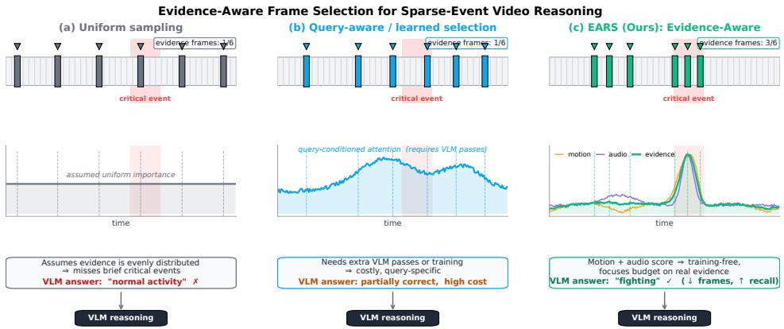  
Figure 1. Evidence-aware frame selection for sparse-event video reasoning. Under K=6, (a) Uniform largely misses a brief critical event; (b) query-aware/learned selectors [23, 26, 31] recover it but require a query, training, or extra model passes; (c) EARS instead routes frames using training-free motion–audio evidence.

## Contributions.

• Evidence-centric framing. We recast sparse-event video reasoning as evidence selection rather than uniform frame sampling, isolating the regime where the mismatch matters: tight budgets $( K \leq 4 )$ over temporally localized events.

• EARS, a training-free, query-free front-end. A fused motion+audio evidence score with an NMS-style temporal-diversity operator (IC), controlled by a single coverage knob. EARS adds no VLM forward passes, no supervision, and no learned encoder, and reduces to uniform sampling in a known limit. It runs one configuration everywhere: the original held-out study is retained separately, while the updated controls fix the same weights without a new search.

• Regime-conditional evaluation and scope. A +0.047 XD-subset F1 point difference at K = 1 against centered Uniform in the updated study; separate original studies of four VLM backbones spanning two families and three generations (Qwen2/2.5/3-VL and cross-family LLaVA-NeXT-Video) and query-aware selectors; lower UCF point estimates on the mostly-silent UCF-Crime; and a negative result on dense-narrative EgoSchema. To our knowledge this is the first work to systematically map when training-free frame selection helps a VLM and when it does not — a missing ingredient for practical deployment of frame-budgeted video reasoning.

• A boundary result on per-video routing. If selection helps on some videos and hurts on others, the obvious next step is to route between them per video using the signals we have already computed. We show this does not work: a per-video oracle would gain +0.104 over always using EARS, yet a router built from eleven modalityintrinsic statistics scores below never routing at all, and no statistic predicts the per-video outcome once multiple comparisons are accounted for (0 of 92 tests survive correction). The headroom is real and the cheap route to it is closed — a constraint on a design space that recent adaptive-selection work leaves unexamined.

## 2. Related Work

## 2.1. Video-Language Models

Recent video-language models (VLMs) extend imagelanguage pretraining to the temporal domain by sampling a fixed number of frames from an input video and feeding their visual tokens to a large language model (LLM). Representative systems include VideoChat [14], Video-LLaMA [35], Video-LLaVA [16] and Qwen2-VL [25], which now achieve strong performance on short-form video QA and captioning. For long-form videos, recent work either extrapolates the LLM context length [36] or designs memory mechanisms to summarize the full sequence [11], both of which still rely on uniformly sampled frames as the underlying visual stream. Standardized evaluations such as MVBench [15] report that performance degrades sharply when the frame budget is small, indicating that which frames are shown matters as much as how many. We share this motivation but, in contrast to methods that scale up the context window, focus on selecting a small, information-dense subset of frames before any VLM computation is performed.

## 2.2. Frame Sampling and Keyframe Selection

Uniform sampling is the de-facto default in VLM pipelines because of its simplicity, but it implicitly assumes information is evenly distributed in time. Earlier work on adaptive video recognition such as ClipBERT [13] and AdaFrame [29] already showed that sparse, content-aware sampling can match or beat dense sampling under tight budgets. For modern multimodal LLMs, SeViLA [31] chains a BLIP-2-based localizer and an answerer to find queryrelevant keyframes; AKS [23] formulates keyframe selection as an optimization that jointly maximizes prompt relevance and temporal coverage; M-LLM-FS [12] scores frames with a multimodal LLM; and VideoTree [27] builds a hierarchical CLIP-based frontier over the video. Agent-style approaches such as VideoAgent [26] iteratively query a vision tool to gather evidence. Recent training-free selectors reduce this overhead while retaining semantic guidance. WFS-SB [7] detects waveletsmoothed semantic boundaries before relevance-aware allocation; EFS [6] partitions videos with DINO features and selects a query-relevant anchor per event; and MEC [5] constructs one query-conditioned evidence-to-context ranking reusable across budgets. KeyScore [18] combines caption similarity, temporal representativeness, and contextual drop impact to score frames, together with spatiotemporal adaptive clustering for compact, diverse proposals. Complementing selection methods, STEC [17] is a reference-free diagnostic metric that evaluates a sampled frame set through spatial entropy, temporal coverage, and non-redundancy without claiming to predict downstream task accuracy. These methods deliver clear gains, but all semantic selectors above consume a task query and a learned image/video representation; several also call an LLM/VLM during selection. Our work is complementary rather than competing: we use cheap, modality-intrinsic signals (mo tion and audio energy) that require no learning and no extra VLM forward passes, providing a training-free front-end for the sparse-event, low-budget regime. The same selected frames can be fed to any off-the-shelf VLM, and the evidence score is additive with semantic/query-aware signals (e.g. CLIP/SigLIP similarity) when those are available — see Sec. 4.4.

## 2.3. Efficient Video Understanding

A parallel line of work reduces computation inside the model rather than at the input. Token-level methods such as TokenLearner [21] and Token Merging [3] dynamically prune or merge spatio-temporal tokens during the forward pass. These techniques are largely orthogonal to frame selection and can be combined with our method: we reduce the number of frames before tokenization, while token pruning further compresses the remaining representation. We view our IC mechanism (Sec. 3) as an explicit, temporal counterpart of token merging operating on the evidence axis.

A recent wave of audio-visual token-compression methods—OmniZip [24], EchoingPixels [10], and OmniSIFT [8]—prunes or merges multimodal tokens after the encoder to fit long videos into a fixed context. These are post-encoder operations and are orthogonal to, and combinable with, EARS, which acts pre-encoder: it decides which frames enter the VLM at all, so no encoder pass is spent on frames that are later discarded. On the selection side, BOLT [19] similarly finds uniform sampling suboptimal for long video, but scores frames by query–frame similarity, whereas our signal is query-free and modalityintrinsic. Finally, our “evidence” framing connects to temporally-grounded VLMs [33] and grounded multi-hop VideoQA [4], which localize supporting moments for a question; EARS instead surfaces salient moments without a question, as a cheap default when no query is available.

## 2.4. Multimodal Event and Audio-Visual Analysis

Audio and visual streams have long been recognized as complementary for event and anomaly detection. On the surveillance side, UCF-Crime [22] and XD-Violence [28] are standard weakly-supervised benchmarks, with the latter providing aligned audio for every clip. Recent methods such as MACIL-SD [30] and UR-DMU [38] exploit audio-visual cues with multiple-instance learning and dual memory banks to localize abnormal snippets. These works treat audio-visual fusion as the end task: produce a binary anomaly score per snippet. We reuse the same intuition— that motion and audio energy spike around salient events— but use these signals as a front-end for evidence selection that is decoupled from any particular downstream task and from the anomaly label space.

## 2.5. Summary

Prior work either (i) consumes uniformly sampled frames with ever-larger VLMs, (ii) trains query-aware or agentbased localizers, or (iii) fuses audio and vision to directly produce anomaly labels. Recent selectors increasingly avoid training and repeated VLM calls, but remain queryconditioned and vision-centric. EARS instead combines training-free, single-pass, query-free, and audio-visual selection. The evidence score is additive with semantic/queryaware signals (CLIP/SigLIP, learned rankers) and serves as a cheap default when those signals are unavailable.

## 3. Method

## 3.1. Problem Setup

Let an input video be a sequence of T RGB frames $\nu =$ $\{ f _ { t } \} _ { t = 1 } ^ { T }$ with an accompanying mono audio waveform a ∈ $\mathbb { R } ^ { L }$ sampled at $f _ { a }$ Hz. Given a frame budget $K \ll T$ imposed by the downstream vision-language model (VLM), our goal is to select a frame subset $\mathcal { F } \subset \mathcal { V }$ with $| { \mathcal { F } } | = K$ that maximizes the VLM’s downstream performance.

Formally, denoting the downstream evaluation score (e.g. AP, accuracy) by Φ and the VLM by $g _ { \boldsymbol { \theta } } .$ , the ideal selector solves $\mathcal { F } ^ { \star } = \arg \operatorname* { m a x } _ { \mathcal { F } \subset \mathcal { V } , | \mathcal { F } | = K } \Phi ( g _ { \theta } ( \mathcal { F } ) )$ , which is intractable. Instead, we approximate it by selecting frames that maximize a cheap proxy $A _ { t } ~ \in ~ [ 0 , 1 ]$ of multimodal information density, computed from modality-intrinsic signals that require no training and no VLM forward pass.

Our pipeline (Fig. 2) has three stages: (1) extract a motion signal $M _ { t }$ and an audio signal $E _ { t } ; ( 2 )$ fuse them into an evidence score $A _ { t } ; ( 3 )$ select K frames using an Information Compression (IC) operator that enforces both high evidence and temporal diversity.

## 3.2. Multimodal Signal Extraction

Motion signal. Dense optical flow is computed between consecutive RGB frames using the classical Farneback algorithm [9] as implemented in OpenCV’s dense opticalflow routine, evaluated on a strided subset (stride $s = 5$ capped at 2000 frames per clip) and cached so that sweeps over K reuse the same signal. Let ${ \mathbf u } _ { t } ( p ) \in \mathbb { R } ^ { 2 }$ denote the flow vector at spatial location p in frame t and $P$ the set of pixel locations. The per-frame motion magnitude is

$$
M _ { t } \ = \ \frac { 1 } { | P | } \sum _ { p \in P } \Vert \mathbf { u } _ { t } ( p ) \Vert _ { 2 } .\tag{1}
$$

Using flow magnitude rather than raw frame difference reduces sensitivity to illumination changes, although global camera motion can still produce spurious evidence.

Audio signal. The audio waveform a is split into nonoverlapping windows of length $w = f _ { a } /$ fps aligned with the video timestamps. For the window centered at frame t, containing $N = w$ samples $\{ a _ { i } \} _ { i = 1 } ^ { N } ,$ we compute the shorttime energy

$$
E _ { t } \ = \ \frac { 1 } { N } \sum _ { i = 1 } ^ { N } a _ { i } ^ { 2 } .\tag{2}
$$

Squared amplitude (rather than absolute value) is used so that $E _ { t }$ correlates with acoustic power, which empirically tracks salient events such as shouts, impacts and gunshots in our target datasets. For silent or audio-corrupted clips, $E _ { t }$ is set to zero and the pipeline degenerates to a motion-only variant (cf. Sec. 4).

## 3.3. Evidence Score

To make $M _ { t }$ and $E _ { t }$ comparable across videos with different motion and acoustic profiles, each signal is normalized per-video to [0, 1] via min-max scaling:

$$
\begin{array} { r l r } & { } & { \tilde { M } _ { t } = \frac { M _ { t } - \operatorname* { m i n } _ { t ^ { \prime } } M _ { t ^ { \prime } } } { \operatorname* { m a x } _ { t ^ { \prime } } M _ { t ^ { \prime } } - \operatorname* { m i n } _ { t ^ { \prime } } M _ { t ^ { \prime } } } , } \\ & { } & { \tilde { E } _ { t } = \frac { E _ { t } - \operatorname* { m i n } _ { t ^ { \prime } } E _ { t ^ { \prime } } } { \operatorname* { m a x } _ { t ^ { \prime } } E _ { t ^ { \prime } } - \operatorname* { m i n } _ { t ^ { \prime } } E _ { t ^ { \prime } } } . } \end{array}\tag{3}
$$

The two normalized signals are then fused into a scalar evidence score by a linear combination,

$$
{ \cal A } _ { t } \ = \ \alpha \tilde { \cal E } _ { t } \ + \beta \tilde { \cal M } _ { t } ,\tag{4}
$$

where $\alpha , \beta \ge 0$ balance the two modalities. We use a single configuration everywhere, $( \alpha , \beta , \tau ) = ( 1 , 1 , 0 . 5 \mathrm { s } )$ , where τ is the IC gap of Sec. 3.4. It is not hand-picked: a grid search on a held-out split disjoint from every test video selects it independently on both datasets (Sec. 4). EARS therefore has no per-dataset hyper-parameters, and the equal weighting is a consequence of that search rather than an assumption about modality availability in that original study.

Updated controls. New controls use up to 256 full-video motion candidates, one-second mean-absolute-amplitude audio, and sigmoid fusion. Alignment and strict decoding are specified in the supplementary.

Interpretation. $A _ { t }$ acts as a proxy for multimodal information density: motion captures visual activity and audio captures acoustic activity, so temporal peaks of $A _ { t }$ indicate that either or both modalities rise above their per-video baselines. Unlike event-detection methods that learn a discriminator against a predefined label space, our score is label-agnostic and produced without any training; it is intentionally a generic signal (motion+audio energy) rather than a query- or task-specific one.

Evidence vs. events. We deliberately use the term evidence rather than event: At does not classify what happens, only that something information-bearing happens. This distinction matters for downstream reasoning, where the VLM is the component that has to decide what the evidence implies.

## 3.4. Evidence Selection with Information Compression

A naive realization of the selection problem is to keep the K time steps with the highest evidence: $\mathcal { F } _ { { \mathrm { t o p } } - K } = \mathrm { T o p K } _ { t } A _ { t }$ In practice this collapses onto a single high-energy region: adjacent frames inside one event have nearly identical evidence scores, so the top-K set is redundant and ignores other informative regions (top panel of $\mathrm { F i g } . 2 ) ;$ ; a sharp onset can trap the whole budget inside $\mathbf { a } < 2 \cdot$ -second window (supplementary S1).

We mitigate this with an Information Compression (IC) operator — a practical temporal-NMS / diversityaware peak-selection heuristic, not an information-theoretic compression objective — that performs greedy nonmaximum suppression on the evidence signal, enforcing a minimum temporal gap τ between any two selected frames (the name reflects the conceptual goal of compressing redundant evidence; a reader who prefers may freely substitute “Temporal Evidence NMS” or “Diversity-Aware Evidence Selection”):

Starting from candidates $\mathcal { C } = \{ 1 , \ldots , T \}$ , IC repeatedly selects $t ^ { \star } = \arg \operatorname* { m a x } _ { t \in \mathcal { C } } A _ { t }$ and suppresses $\{ t : | t - t ^ { \star } | \leq$

## Algorithm 1 Evidence Selection with Information Compression

Require: Evidence scores $\{ A _ { t } \} _ { t = 1 } ^ { T }$ 1, budget K, gap τ   
1: $\mathcal { F }  \emptyset ; \mathcal { C }  \{ 1 , . . . , \overset { . } { T } \}$   
2: while $| { \mathcal { F } } | < K$ and ${ \mathcal { C } } \neq \emptyset$ do   
3: $t ^ { \star } \gets$ arg maxt∈C At   
4: ${ \mathcal { F } } \gets { \mathcal { F } } \cup \{ t ^ { \star } \}$   
5: ${ \mathcal { C } }  { \mathcal { C } } \setminus \{ { \dot { t : } } | { \dot { t } } - t ^ { \star } | \leq \tau \}$   
6: end while   
7: return $\{ f _ { t } : t \in \mathcal { F } \}$ sorted by t

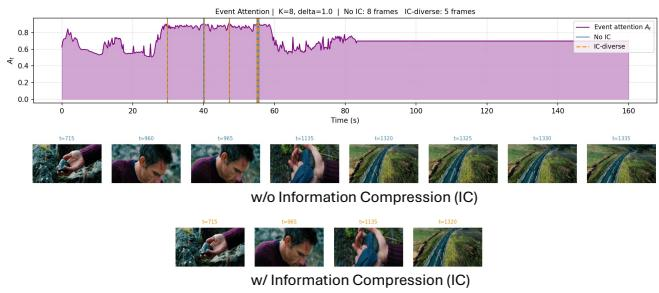  
Figure 2. IC suppresses redundant temporal evidence. Vanilla top-K clusters around one peak; a minimum gap τ retains diverse frames.

τ}. Algorithm 1 gives the complete procedure, including early termination when no candidates remain.

The parameter τ controls the diversity/coverage trade-off: smaller τ behaves like vanilla top-K, while larger τ forces the selected frames to spread out in time. We use the heldout global $\tau = 0 . 5 \ : \mathrm { s }$ throughout. Ablations in Sec. 4 show that shorter clips or high-budget regimes may prefer weaker diversity inhibition. IC is temporal non-maximum suppression rather than an information-theoretic objective; its connection to token merging in ViTs [3] is an analogy based on discarding near-duplicates.

The output F of this procedure is the compact frame subset passed to the downstream VLM gθ. Fusion and IC add only $\mathcal { O } ( T )$ work beyond flow and audio-energy extraction and are negligible in our timing study; the extracted signals are cached for reuse across budgets and queries.

## 4. Experiments

We report anomaly classification under varying frame budgets K and compare against query-aware selectors. The supplementary provides frame-level localization, ablations, backbone transfer, efficiency, and routing analyses. Earlier tables and figures retain their original protocols; Sec. 4.5 reports the updated study separately.

## 4.1. Datasets, Tasks and Implementation

Datasets. We evaluate on two long-form surveillance benchmarks with sparse anomalies: XD-Violence [28] (a local 504-video test subset, binary violence label) and UCF-Crime [22] (290 unique test videos; the original tables counted 440 entries, including repeated normal videos). The updated study deduplicates and derives binary labels from annotations. We additionally repurpose the frame-level XD-Violence annotations for the localization study in the supplementary.

Tasks and metrics. For video-level anomaly classification we report Accuracy, Precision, Recall, and F1 with the anomaly class as positive. For frame-level localization we report Average Precision (AP) and AUC against frame-level binary anomaly masks.

VLM and prompts. Within each benchmark all variants share the same backbone, prompt, greedy decoding $( T =$ 0), and frame pipeline; only the selection strategy differs. We use Qwen2-VL-7B-Instruct [25] for UCF-Crime and XD-Violence (binary anomaly prompt in Table 1; matched multi-choice prompt for the supplementary ablations and Random sanity check) and Qwen2.5-VL-7B-Instruct [2] for the EgoSchema MCQ probe (its MCQ-tuned chat template is required there). The original studies use the single frozen configuration $( \alpha , \beta , \tau ) = ( 1 , 1 , 0 . 5 \mathrm { s } )$ selected on a disjoint held-out split (supplementary); no hyper-parameter is tuned per dataset or per budget. New controls fix the same settings and one binary prompt per cohort, without a new held-out search.

Method-variant glossary. Unless stated otherwise, $\mathbf { E A R S } \ = \ A _ { t } \ \ = \ \alpha \tilde { E } _ { t } + \beta \tilde { M } _ { t }$ with the frozen global $( \alpha , \beta , \tau ) ~ = ~ ( 1 , 1 , 0 . 5 \mathrm { { s } ) }$ Uniform is evenly spaced sampling; other variants are defined in the supplementary.

## 4.2. Anomaly Classification under Varying Frame Budgets

Table 1 reports both benchmarks under $K \_ { } \in \ U$ {1, 2, 4, 6, 8, 10} frames per video, and Fig. 3 visualizes the F1 trend.

Audio–motion alignment determines the gain. On XD-Violence, where sparse events often produce both visible motion and sound, the small-K regime is exactly the practical operating point a deployed VLM faces. With centered Uniform in the updated study, F1 is 0.614→0.660 at K =1 and $0 . 7 9 1 {  } 0 . 8 1 7$ at $K = 2 .$ . All six EARS-minus-Uniform paired intervals include zero; the original curves do not establish the size of a centered-Uniform gain.

Table 1. Original-protocol classification: Qwen2-VL-7B [25], binary prompt, greedy decoding. UCF includes duplicate entries. All rows are retained, not directly comparable to updated Sec. 4.5. Best per cell is bold; older multi-choice ablations use a separate protocol.
<table><tr><td rowspan="2">Method</td><td rowspan="2">K</td><td colspan="4">UCF-Crime (440 entries)</td><td colspan="4">XD subset (504 videos)</td></tr><tr><td>Acc</td><td>P R</td><td>F1</td><td>Acc</td><td>P</td><td>R</td><td></td><td>F1</td></tr><tr><td>Uniform</td><td>1</td><td>0.398</td><td>1.000 0.086</td><td></td><td>0.159</td><td>0.665</td><td>0.927</td><td>0.186</td><td>0.310</td></tr><tr><td>EARS</td><td>1</td><td>0.382</td><td>0.909 0.069</td><td>0.128</td><td></td><td>0.819</td><td>0.952</td><td>0.583</td><td>0.723</td></tr><tr><td>Uniform</td><td>2</td><td>0.459</td><td>0.919 0.197</td><td>0.324</td><td></td><td>0.730</td><td>0.886</td><td>0.382</td><td>0.534</td></tr><tr><td>EARS</td><td>2</td><td>0.432</td><td>0.870 0.162</td><td>0.273</td><td></td><td>0.891</td><td>0.946</td><td>0.775</td><td>0.852</td></tr><tr><td>Uniform</td><td>4</td><td>0.527</td><td>0.918 0.310</td><td>0.464</td><td></td><td>0.897</td><td>0.913</td><td>0.824</td><td>0.866</td></tr><tr><td>EARS</td><td>4</td><td>0.502</td><td>0.908 0.272</td><td></td><td>0.419</td><td>0.931</td><td>0.933</td><td>0.892</td><td>0.912</td></tr><tr><td>Uniform</td><td>6</td><td>0.541</td><td>0.940 0.324</td><td></td><td>0.482</td><td>0.944</td><td>0.949</td><td>0.912</td><td>0.930</td></tr><tr><td>EARS</td><td>6</td><td>0.516</td><td>0.964 0.276</td><td></td><td>0.429</td><td>0.950</td><td>0.945</td><td>0.931</td><td>0.938</td></tr><tr><td>Uniform</td><td>8</td><td>0.543</td><td>0.932 0.331</td><td></td><td>0.489</td><td>0.946</td><td>0.936</td><td>0.931</td><td>0.934</td></tr><tr><td>EARS</td><td>8</td><td>0.523</td><td>0.955 0.290</td><td></td><td>0.444</td><td>0.952</td><td>0.937</td><td>0.946</td><td>0.941</td></tr><tr><td>Uniform</td><td>10</td><td>0.550</td><td>0.942</td><td>0.338</td><td>0.497</td><td>0.968</td><td>0.952</td><td>0.971</td><td>0.961</td></tr><tr><td>EARS</td><td>10</td><td>0.539</td><td>0.958</td><td>0.314</td><td>0.473</td><td>0.956</td><td>0.929</td><td>0.966</td><td>0.947</td></tr></table>

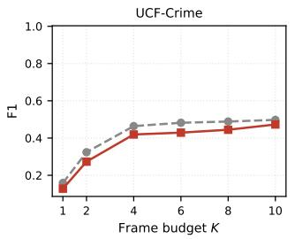

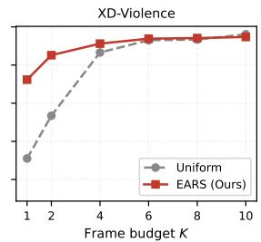  
Figure 3. F1 vs frame budget K on UCF-Crime (left) and XD-Violence (right), plotted from the EARS and Uniform columns of Table 1 (original Qwen2-VL-7B protocol, not the updated centered-Uniform study). On XD-Violence the EARS curve sits above Uniform through K = 8 (F1 +0.41 at $K = 1 , + 0 . 3 2$ at $K = 2 )$ , crossing only at $K = 1 0 .$ . On mostly-silent UCF-Crime, Uniform remains modestly stronger at every budget. This contrast — durable gains when audio–motion evidence aligns with the event, negative transfer when it does not — is the empirical signature of EARS being an evidence router rather than a universal selector.

Negative transfer on UCF-Crime. On mostly-silent UCF-Crime, EARS trails Uniform by 0.025–0.051 F1 across budgets. Increasing K improves both methods, but subtle anomalies such as Shoplifting and Stealing often produce no audio or motion spike for EARS to rank. We retain this negative result because it isolates the applicability condition: sparse events alone are insufficient; their evidence must align with the cheap modalities.

High-budget crossover. On XD-Violence EARS remains ahead through $K = 8$ and crosses Uniform only at $K = 1 0$ $( \mathrm { F 1 } = 0 . 9 4 7 \ \mathrm { v s } \ 0 . 9 6 1 )$ in the original protocol. The updated full-video cohort has median duration 99.52 s (UCF: 59.62 s), so a sub-30 s XD median cannot explain this crossover. As $K  N$ , all selectors become equivalent because every candidate frame is retained. We exploit this in the supplementary with a selectivity-annealed hybrid that lets EARS soften its selectivity as K grows, recovering uniform behavior in the high-budget limit without any training.

## 4.3. Qualitative Analysis

Fig. 4 shows two XD-Violence wins. In the Shooting clip (a, 50 s), the violent event is a brief moment around t≈37 s in which a handgun is raised at the victim. Uniform devotes most of its six-frame budget to motion-blurred chase shots in which neither the weapon nor the victim is identifiable; driven by the motion+audio peak, EARS instead returns four crisp, close-range frames of the gun pointed at the victim’s head—the literal forensic evidence the VLM needs. In the Fighting clip (b, ∼3 min hockey broadcast), uniform samples generic faceoff and crowd shots; EARS concentrates on a ∼30 s window covering both an on-ice brawl and a hard boards body-check. These illustrate where the small-K gap of Sec. 4.2 comes from in practice.

Failure modes. Fig. 5 exposes two limits of a shallow, modality-intrinsic prior: one peak can consume the budget, while motion unrelated to the event can hijack it. IC addresses the former; the latter requires semantic evidence. Further examples and per-class analysis are provided in the supplementary.

## 4.4. Comparison with Prior Frame-Selection Methods

To contextualize EARS we compare with five recent representative video-LLM frame selectors: AKS [23], SeViLA [31], VideoAgent [26], M-LLM-FS [12], and VideoTree [27]. Among these, AKS [23] and a SigLIP top-K selector [34] are the only two that can befaithfully reproduced on our query-free binary-anomaly benchmark without retraining or proprietary components; the supplementary explains why the remaining methods are not directly comparable without changing their original assumptions: they are trained for question-conditioned QA or require an LLM/API in the loop. We therefore run both as query-aware baselines at every budget on both datasets under our exact backbone, prompt, and split (Table 2); all three selectors share the identical VLM, prompt, frame budgets, and test split, and both query-aware baselines reuse the same frozen SigLIP relevance as their only scoring signal — only the frame-selection rule differs.

Two observations follow. (a) On the visually-salient, audio-rich XD-Violence, AKS and SigLIP top-K are given a task-specific anomaly query (“fighting/shooting/. . . ”) and edge out EARS at every budget below four frames $( K = 1$ 0.86 vs. 0.72); EARS instead targets query-free deployment, where such a query is unavailable. (b) On the harder, mostly-silent UCF-Crime, the query-aware selectors lead at $K \leq 2 .$ , Uniform leads at K = 4, and EARS trails both. The query-aware selectors behave almost identically to each other and EARS catches them on XD by K = 4. This is the scope our paper claims: EARS is not a universal selector but a training-free, query-free front-end for sparse-event, lowbudget regimes, explicitly complementary to query-aware selectors and combinable with them, for example as a cheap pre-filter.

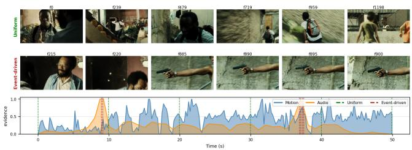  
(a) Shooting (50 s, K =6).

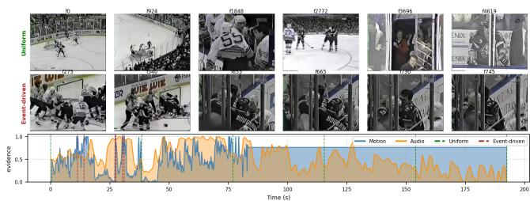  
(b) Fighting (∼3 min, K = 6).

Figure 4. Successful cases. Uniform frames (top), EARS frames (middle), and evidence with selection times (bottom). EARS captures the raised handgun and on-ice brawl that Uniform misses; characteristic failure modes are shown in the supplementary.  
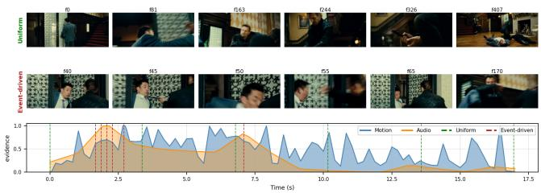  
(a) Peak clustering, XD-Violence Fighting.

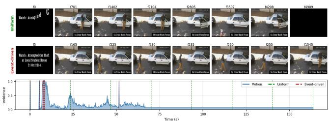  
(b) Proxy hijack, UCF-Crime Stealing.  
Figure 5. Characteristic failures. Uniform (top), EARS (middle), and evidence (bottom). (a) An early peak clusters EARS picks and misses a later event. (b) In a silent clip, title-card motion distracts EARS from the subtle theft.

Table 2. Query-aware selector baselines (F1 at tight budgets; same Qwen2-VL-7B [25] backbone, prompt, split, and frozen SigLIP relevance for all rows). The two query-aware selectors (AKS, SigLIP top-K) are strong when a task-specific anomaly query is available; EARS is the encoder-free, query-free option. Best per (dataset,K) in bold.
<table><tr><td></td><td colspan="3">XD-Violence</td><td colspan="3">UCF-Crime</td></tr><tr><td>Method</td><td>K=1</td><td>K=2</td><td>K=4</td><td>K=1</td><td>K=2</td><td>K=4</td></tr><tr><td>Uniform</td><td>0.310</td><td>0.534</td><td>0.866</td><td>0.159</td><td>0.324</td><td>0.464</td></tr><tr><td>AKS [23] (q-aware)</td><td>0.861</td><td>0.895</td><td>0.890</td><td>0.242</td><td>0.346</td><td>0.412</td></tr><tr><td>SigLIP top-K [34] (q-aware)</td><td>0.861</td><td>0.889</td><td>0.890</td><td>0.242</td><td>0.297</td><td>0.359</td></tr><tr><td>EARS (q-free)</td><td>0.723</td><td>0.852</td><td></td><td></td><td>0.9120.1280.2730.419</td><td></td></tr></table>

## 4.5. Matched Semantic Fusion

On 504 XD/290 unique UCF videos, we average normalized SigLIP [34] and EARS scores before identical NMS. XD four-frame F1 rises 0.847 → 0.889, below Uni-

form/EARS/Audio (0.893/0.898/0.907); UCF one-frame F1 drops 0.196. All six contrasts are in Table 3; full controls and 432 paired cost trials are in the supplementary.

Table 3. Hybrid minus semantic-NMS: ∆F1 [95% interval]. Exploratory, unadjusted; 10,000 paired video resamples.
<table><tr><td>K XD subset</td><td colspan="3">UCF-Crime</td></tr><tr><td>1</td><td></td><td>+0.017 [−0.023, +0.057]</td><td>-0.196 [−0.302, -0.093]</td></tr><tr><td>2</td><td></td><td>+0.022 [−0.009, +0.054]</td><td>-0.028 [−0.113, +0.058]</td></tr><tr><td>4</td><td></td><td>+0.042 [+0.017, +0.067]</td><td>+0.009 [−0.048, +0.066]</td></tr></table>

## 4.6. Additional Validation

Full protocols and per-budget results are in the supplementary. Table 4 tests backbone transfer; Table 5 separates proxy detection from VLM localization; Tables 6 and 7 report component and held-out sensitivity. The supplementary retains the original robustness, scope, and efficiency summary. The original studies are separate from the updated matched controls.

Stochastic and budget controls. Table 8 rules out a fortunate temporal draw: on XD, EARS exceeds five-seed Random by 0.05–0.10 F1 for K ≤ 4, larger than Random’s maximum 0.024 standard deviation there. On UCF, Random and EARS both trail Uniform, independently reinforcing the negative transfer finding. We also test adaptive stopping by thresholding the IC evidence in the matched ablation protocol. On UCF, it retains F1 0.419 with 1.67 frames/video, versus 0.427 with 3.80 frames for the best fixed setting, a 56% frame reduction for 0.008 F1. On XD, F1 remains approximately 0.67 while the realized budget falls from 2.42 to 2.17 frames/video over thresholds 0.5– 0.75. Thus IC supplies a continuous accuracy–budget control rather than only a fixed top-K rule; the full Pareto curves are in the supplementary.

Table 4. Backbone-transfer stress test on XD-Violence (F1). A selector configuration fixed across this transfer study improves every tested VLM at tight budgets under its original protocol, separate from the new controls.
<table><tr><td colspan="3">K = 1</td><td colspan="3">K = 2</td></tr><tr><td>Backbone</td><td>Unif.</td><td>EARS</td><td>Unif.</td><td></td><td>EARS</td></tr><tr><td>Qwen2.5-VL-7B [2]</td><td>.136</td><td>.561</td><td></td><td>.302</td><td>.656</td></tr><tr><td>Qwen3-VL-8B [1]</td><td>.433</td><td>.798</td><td></td><td>.599</td><td>.873</td></tr><tr><td>LLaVA-NeXT-7B [37]</td><td>.357</td><td>.693</td><td></td><td>.545</td><td>.788</td></tr></table>

Table 5. Frame-level localization on XD-Violence. The evidence proxy is weak alone but effective for routing frames to the VLM.
<table><tr><td>Method</td><td>AP↑</td><td>AUC↑</td></tr><tr><td>At proxy (no VLM)</td><td>0.393</td><td>0.583</td></tr><tr><td>Uniform + VLM</td><td>0.881</td><td>0.921</td></tr><tr><td>EARS + VLM (no IC)</td><td>0.925</td><td>0.938</td></tr><tr><td>EARS + IC + VLM</td><td>0.944</td><td>0.951</td></tr></table>

Table 6. Component ablations (F1; matched multi-choice protocol). Fusion uses UCF K = 2/XD K = 6; IC uses K = 4 on both. Balanced fusion is robust across modalities, while the useful temporal gap depends on clip structure.
<table><tr><td>Study</td><td>Setting</td><td>UCF</td><td>XD</td></tr><tr><td rowspan="2">Fusion</td><td>Audio only (1, 0)</td><td>.291</td><td>.654</td></tr><tr><td>Motion only (0, 1) Balanced (1, 1)</td><td>.411 .394</td><td>.593 .688</td></tr><tr><td rowspan="2">IC gap</td><td>τ = 0 s</td><td>.350</td><td>.778</td></tr><tr><td>τ = 0.5 s</td><td>.427</td><td>.716</td></tr><tr><td></td><td>τ = 1 s</td><td>.376</td><td>.671</td></tr></table>

Table 7. Held-out sensitivity (mean F1 over K = 1, 2; 300 training videos/dataset). Both datasets independently select the same global configuration, and neighboring gaps are nearly tied.
<table><tr><td>α</td><td>β</td><td>τ (s)</td><td>XD</td><td>UCF</td></tr><tr><td>0</td><td>1</td><td>0.5</td><td>.706</td><td>.548</td></tr><tr><td>1</td><td>1</td><td>0</td><td>.749</td><td>.530</td></tr><tr><td>1</td><td>1</td><td>0.5</td><td>.769</td><td>.557</td></tr><tr><td>1</td><td>1</td><td>1</td><td>.768</td><td>.555</td></tr></table>

Table 8. Random-sampling control (F1; same frozen Qwen2-VL-7B protocol as Table 1). Random reports mean±std over five seeds; EARS and Uniform are deterministic.
<table><tr><td></td><td colspan="3">XD-Violence</td><td colspan="3">UCF-Crime</td></tr><tr><td>Method</td><td>K=1</td><td>K=2</td><td>K=4</td><td>K=1</td><td>K=2</td><td>K=4</td></tr><tr><td>Uniform</td><td>.310</td><td>.534</td><td>.866</td><td>.159</td><td>.324</td><td>.464</td></tr><tr><td>EARS</td><td>.723</td><td>.852</td><td>.912</td><td>Random .627±.024 .767±.012 .863±.007 .148±.027 .128</td><td>.320±.024 .414±.013 .273</td><td>.419</td></tr></table>

Reproducibility and release. Uniform and EARS are deterministic: every reported anomaly result uses greedy decoding on fixed local cohorts (504 XD videos; the original 440 UCF entries represent 290 unique videos). The new matched study uses the deduplicated labels. Frozen configurations are serialized before test evaluation, and tables are generated from saved per-video predictions rather than transcribed from terminal output. Upon publication, we will release the code, environment specification, frozen configurations, held-out split lists, and derived predictions needed to reproduce every table. UCF-Crime and XD-Violence remain governed by their original licenses; we will provide official-download and preprocessing scripts rather than redistribute third-party videos.

## 4.7. Discussion

EARS targets tight budgets where sparse events align with motion or audio; Uniform catches up as K grows and wins on dense-narrative, audio-silent EgoSchema. A hybrid can anneal toward Uniform at larger budgets, while stealthy events require a semantic third channel. Complete ablations, failures, efficiency, and routing analyses appear in the supplementary. Together, the stress tests distinguish robustness from universality. Flow replacement and backbone transfer preserve the tight-budget XD effect, while the heldout grid removes test-set configuration choice. Conversely, EgoSchema and the failed per-video router show that cheap signals cannot decide when semantic evidence is required. Query-aware selectors should therefore be preferred when a task query is available; EARS occupies the complementary setting where no query or selector encoder is available and the frame budget is the binding constraint.

## 5. Conclusion

EARS is a training-free, query-free, single-pass frame router based on cheap motion and audio statistics. At K = 1 on the XD subset its updated F1 is 0.660 versus centered Uniform’s 0.614 (paired interval includes zero); backbone and five-seed results are separate original studies. Although the raw proxy is weak (AP 0.393), EARS+IC+VLM reaches frame-level AP 0.944: routing needs relative temporal evidence, not a calibrated detector.

Negative results bound the claim: EARS trails Uniform on mostly-silent UCF-Crime, while dense-narrative EgoSchema requires semantic evidence.

For deployment, EARS trades a one-time CPU preprocessing cost for a query-independent evidence cache that can be reused across budgets and future questions. This makes it most useful when repeated reasoning is required over motion- or audio-correlated events; for silent, semantic, or dense-narrative videos, Uniform or a queryaware selector remains the safer fallback. The new semantic–activity hybrid tests this modular extension, with cohort/budget-dependent benefits.

## References

[1] Shuai Bai, Yuxuan Cai, Ruizhe Chen, Keqin Chen, Xionghui Chen, Zesen Cheng, Lianghao Deng, Wei Ding, Chang Gao, Chunjiang Ge, et al. Qwen3-VL technical report. arXiv preprint arXiv:2511.21631, 2025.

[2] Shuai Bai, Keqin Chen, Xuejing Liu, Jialin Wang, Wenbin Ge, Sibo Song, Kai Dang, Peng Wang, Shijie Wang, Jun Tang, Humen Zhong, Yuanzhi Zhu, Mingkun Yang, Zhaohai Li, Jianqiang Wan, Pengfei Wang, Wei Ding, Zheren Fu, Yiheng Xu, Jiabo Ye, Xi Zhang, Tianbao Xie, Zesen Cheng, Hang Zhang, Zhibo Yang, Haiyang Xu, and Junyang Lin. Qwen2.5-VL technical report. arXiv preprint arXiv:2502.13923, 2025.

[3] Daniel Bolya, Cheng-Yang Fu, Xiaoliang Dai, Peizhao Zhang, Christoph Feichtenhofer, and Judy Hoffman. Token merging: Your ViT but faster. In ICLR, 2023.

[4] Qirui Chen, Shangzhe Di, and Weidi Xie. Grounded multihop VideoQA in long-form egocentric videos. In CVPR, 2025.

[5] Wang Chen, Yu Chen, Xiang Wang, Shuai Li, Jinfa Huang, and Xiawu Zheng. One ranking, any budget: Matryoshka evidence-to-context frame selection for long-video understanding. arXiv preprint arXiv:2608.05707, 2026.

[6] Wang Chen, Yongdong Luo, Yuhui Zeng, Luojun Lin, Tianyu Xie, Fei Chao, Rongrong Ji, and Xiawu Zheng. Event-anchored frame selection for effective long-video understanding. arXiv preprint arXiv:2603.00983, 2026.

[7] Wang Chen, Yuhui Zeng, Yongdong Luo, Tianyu Xie, Luojun Lin, Jiayi Ji, Yan Zhang, and Xiawu Zheng. Wavelet-based frame selection by detecting semantic boundary for long video understanding. In CVPR, 2026. arXiv:2603.00512.

[8] Yue Ding, Yiyan Ji, Jungang Li, Xuyang Liu, Xinlong Chen, Junfei Wu, Bozhou Li, Bohan Zeng, Yang Shi, Yushuo Guan, Yuanxing Zhang, Jiaheng Liu, Qiang Liu, Pengfei Wan, and Liang Wang. OmniSIFT: Modality-asymmetric token compression for efficient omni-modal large language models. In Int. Conf. Mach. Learn., 2026. arXiv:2602.04804.

[9] Gunnar Farneback. Two-frame motion estimation based on¨ polynomial expansion. In Scandinavian Conference on Image Analysis (SCIA), 2003.

[10] Chao Gong, Depeng Wang, Zhipeng Wei, Ya Guo, Huijia Zhu, and Jingjing Chen. EchoingPixels: Aliasing-resistant joint token reduction for audio-visual LLMs. In Int. Conf. Mach. Learn., 2026. arXiv:2512.10324.

[11] Bo He, Hengduo Li, Young Kyun Jang, Menglin Jia, Xuefei Cao, Ashish Shah, Abhinav Shrivastava, and Ser-Nam Lim. MA-LMM: Memory-augmented large multimodal model for long-term video understanding. In CVPR, 2024.

[12] Kai Hu, Feng Gao, Xiaohan Nie, Peng Zhou, Son Tran, Tal Neiman, Lingyun Wang, Mubarak Shah, Raffay Hamid, Bing Yin, and Trishul Chilimbi. M-LLM based video frame selection for efficient video understanding. arXiv preprint arXiv:2502.19680, 2025.

[13] Jie Lei, Linjie Li, Luowei Zhou, Zhe Gan, Tamara L. Berg, Mohit Bansal, and Jingjing Liu. Less is more: ClipBERT for video-and-language learning via sparse sampling. In CVPR, 2021.

[14] KunChang Li, Yinan He, Yi Wang, Yizhuo Li, Wenhai Wang, Ping Luo, Yali Wang, Limin Wang, and Yu Qiao. VideoChat: Chat-centric video understanding. arXiv preprint arXiv:2305.06355, 2023.

[15] Kunchang Li, Yali Wang, Yinan He, Yizhuo Li, Yi Wang, Yi Liu, Zun Wang, Jilan Xu, Guo Chen, Ping Luo, Limin Wang, and Yu Qiao. MVBench: A comprehensive multi modal video understanding benchmark. In CVPR, 2024.

[16] Bin Lin, Yang Ye, Bin Zhu, Jiaxi Cui, Munan Ning, Peng Jin, and Li Yuan. Video-LLaVA: Learning united visual rep resentation by alignment before projection. arXiv preprin arXiv:2311.10122, 2023.

[17] Shih-Yao Lin. STEC: A reference-free spatio-temporal entropy coverage metric for evaluating sampled video frames. arXiv preprint arXiv:2601.13974, 2026.

[18] Shih-Yao Lin, Sibendu Paul, and Caren Chen. From cap tions to keyframes: KeyScore for multimodal frame scor ing and video-language understanding. arXiv preprint arXiv:2510.06509, 2025.

[19] Shuming Liu, Chen Zhao, Tianqi Xu, and Bernard Ghanem. BOLT: Boost large vision-language model without training for long-form video understanding. In CVPR, 2025.

[20] Karttikeya Mangalam, Raiymbek Akshulakov, and Jitendra Malik. EgoSchema: A diagnostic benchmark for very long form video language understanding. In NeurIPS, 2023.

[21] Michael S. Ryoo, A. J. Piergiovanni, Anurag Arnab, Mostafa Dehghani, and Anelia Angelova. TokenLearner: Adaptive space-time tokenization for videos. In NeurIPS, 2021.

[22] Waqas Sultani, Chen Chen, and Mubarak Shah. Real-world anomaly detection in surveillance videos. In CVPR, 2018.

[23] Xi Tang, Jihao Qiu, Lingxi Xie, Yunjie Tian, Jianbin Jiao, and Qixiang Ye. Adaptive keyframe sampling for long video understanding. In CVPR, 2025.

[24] Keda Tao, Kele Shao, Bohan Yu, Weiqiang Wang, Jian Liu, and Huan Wang. OmniZip: Audio-guided dynamic token compression for fast omnimodal large language models. In CVPR, 2026. arXiv:2511.14582.

[25] Peng Wang, Shuai Bai, Sinan Tan, Shijie Wang, Zhihao Fan, Jinze Bai, Keqin Chen, Xuejing Liu, Jialin Wang, Wenbin Ge, Yang Fan, Kai Dang, Mengfei Du, Xuancheng Ren, Rui Men, Dayiheng Liu, Chang Zhou, Jingren Zhou, and Junyang Lin. Qwen2-VL: Enhancing vision-language model’s perception of the world at any resolution. arXiv preprint arXiv:2409.12191, 2024.

[26] Xiaohan Wang, Yuhui Zhang, Orr Zohar, and Serena Yeung-Levy. VideoAgent: Long-form video understanding with large language model as agent. In ECCV, 2024.

[27] Ziyang Wang, Shoubin Yu, Elias Stengel-Eskin, Jaehong Yoon, Feng Cheng, Gedas Bertasius, and Mohit Bansal. VideoTree: Adaptive tree-based video representation for LLM reasoning on long videos. In CVPR, 2025.

[28] Peng Wu, Jing Liu, Yujia Shi, Yujia Sun, Fangtao Shao, Zhaoyang Wu, and Zhiwei Yang. Not only look, but also listen: Learning multimodal violence detection under weak supervision. In ECCV, 2020.

[29] Zuxuan Wu, Caiming Xiong, Chih-Yao Ma, Richard Socher, and Larry S. Davis. AdaFrame: Adaptive frame selection for fast video recognition. In CVPR, 2019.

[30] Jiashuo Yu, Jinyu Liu, Ying Cheng, Rui Feng, and Yuejie Zhang. Modality-aware contrastive instance learning with self-distillation for weakly-supervised audio-visual violence detection. In ACM MM, 2022.

[31] Shoubin Yu, Jaemin Cho, Prateek Yadav, and Mohit Bansal. Self-chained image-language model for video localization and question answering. In NeurIPS, 2023.

[32] Christopher Zach, Thomas Pock, and Horst Bischof. A duality based approach for realtime TV-L1 optical flow. In Pattern Recognition (DAGM), pages 214–223. Springer, 2007.

[33] Wenzheng Zeng, Difei Gao, Mike Zheng Shou, and Hwee Tou Ng. Factorized learning for temporally grounded video-language models. In ICCV, 2025.

[34] Xiaohua Zhai, Basil Mustafa, Alexander Kolesnikov, and Lucas Beyer. Sigmoid loss for language image pre-training. In ICCV, 2023.

[35] Hang Zhang, Xin Li, and Lidong Bing. Video-LLaMA: An instruction-tuned audio-visual language model for video understanding. In EMNLP (System Demonstrations), 2023.

[36] Peiyuan Zhang, Kaichen Zhang, Bo Li, Guangtao Zeng, Jingkang Yang, Yuanhan Zhang, Ziyue Wang, Haoran Tan, Chunyuan Li, and Ziwei Liu. Long context transfer from language to vision. arXiv preprint arXiv:2406.16852, 2024.

[37] Yuanhan Zhang, Bo Li, Haotian Liu, Yong Jae Lee, Liangke Gui, Di Fu, Jiashi Feng, Ziwei Liu, and Chunyuan Li. LLaVA-NeXT: A strong zero-shot video understanding model. In arXiv preprint arXiv:2407.07895, 2024.

[38] Hang Zhou, Junqing Yu, and Wei Yang. Dual memory units with uncertainty regulation for weakly supervised video anomaly detection. In AAAI, 2023.

## Supplementary Material

This supplementary reports the extended comparisons, random-seed analysis, out-of-domain evaluation, backbone transfer, frame-level localization, ablations, efficiency, adaptive-budget analysis, and per-video routing study. Main-paper Fig. 5 visualizes the characteristic failure modes, and Algorithm 1 gives the complete Information Compression procedure.

## S1. Additional Experimental Results

Table S1. Selector requirements and matched evaluations. ✓ marks the two query-aware selectors evaluated under EARS’s exact backbone, prompt, and split (Table 2). Methods designed for question-conditioned long-video QA require a task query and, in some cases, trained or proprietary components; the concurrent 2026 methods were published after our evaluation was completed.
<table><tr><td>Selector (Sec. 2)</td><td>Per-task query</td><td>Extra model / API in the loop</td><td>Repro. here</td></tr><tr><td>AKS [23]</td><td>text</td><td>SigLIP (frozen)</td><td></td></tr><tr><td>SigLIP top-K [34]</td><td>text</td><td>SigLIP (frozen)</td><td>V</td></tr><tr><td>M-LLM-FS [12]</td><td>implicit</td><td>VLM per frame</td><td>partial</td></tr><tr><td>SeViLA [31]</td><td>QA</td><td>BLIP-2 loc. (trained)</td><td>x</td></tr><tr><td>VideoTree [27]</td><td>QA</td><td>LLM-guided CLIP tree</td><td>x</td></tr><tr><td>VideoAgent [26]</td><td>QA</td><td>GPT-4 agent (API)</td><td>x</td></tr><tr><td>WFS-SB [7]</td><td>text</td><td>CLIP/DINO features</td><td>x</td></tr><tr><td>EFS [6]</td><td>text</td><td>DINO + CLIP features</td><td>x</td></tr><tr><td>MEC [5]</td><td>text</td><td>sparse visual index</td><td>x</td></tr><tr><td>EARS (ours)</td><td>none</td><td>none</td><td>L</td></tr></table>

Random baseline and seed variance. Because Uniform and EARS are deterministic (evenly-spaced sampling; greedy T = 0 selection), only a random baseline carries seed variance. We therefore run a same-backbone Random-7B baseline under the identical binary prompt, backbone, and split as Table 1, repeated over five seeds, so its numbers are directly comparable (Table S2). Two observations follow. (a) The per-seed std is small (≤ 0.027 F1), whereas EARS exceeds Random by 0.05–0.10 F1 across XD $K \leq 4 ;$ the gain is not a lucky draw. (b) On UCF, both Random and EARS trail Uniform, reinforcing the negative-transfer result when the cheap modalities do not align with the event.

Table S2. Random-7B seed variance (five seeds; same Qwen2- VL-7B backbone, binary prompt, and split as Table 1; mean±std F1). Uniform and EARS are deterministic and repeated from Table 1 for reference. Best per (dataset,K) in bold.
<table><tr><td></td><td colspan="3">XD-Violence</td><td colspan="3">UCF-Crime</td></tr><tr><td>Method</td><td> $K { = } 1$ </td><td> $K { = } 2$ </td><td>K=4</td><td> $K { = } 1$ </td><td>K=2</td><td>K=4</td></tr><tr><td>Uniform (det.)</td><td>0.310</td><td>0.534</td><td>0.866</td><td>0.159</td><td>0.324</td><td>0.464</td></tr><tr><td>Random</td><td> $0 . 6 2 7 { \scriptstyle \pm . 0 2 4 }$ </td><td>0.767±.012</td><td>0.863±.007</td><td>0.148±.027</td><td>0.320±.024</td><td>0.414±.013</td></tr><tr><td>EARS (det.)</td><td>0.723</td><td>0.852</td><td>0.912</td><td>0.128</td><td>0.273</td><td>0.419</td></tr></table>

Table S3 then summarizes the design properties of representative selectors, and a long-video QA probe on EgoSchema [20] (Table S4) confirms that the sparse-event prior is, by design, not a universal frame router for densenarrative QA; EARS should be read as complementary to semantic/query-aware selectors rather than universally superior.

When EARS does not help. EARS is grounded in the assumption that salient events are temporally sparse and visually or acoustically distinguishable. On dense-narrative benchmarks such as EgoSchema [20], where every sub-clip contributes to a single multi-step plot and audio is uninformative (the released clips have no audio track), this assumption breaks down: motion-driven sampling concentrates frames on egocentric head-turns rather than on semantically relevant moments. Table S4 quantifies this on the EgoSchema 500-question subset under the same Qwen2.5- VL-7B backbone: uniform sampling outperforms EARS by 5.6–9.0 accuracy points at K = 4 and K = 8, confirming that event-driven sampling is the right inductive bias precisely when events are sparse, and is intentionally not a universal replacement for uniform coverage on dense-narrative QA. We expect a similar pattern on other generalist longvideo QA suites (Video-MME, LongVideoBench, MLVU), where most questions probe dense narrative or procedural context rather than a single sparse event; porting EARS to those benchmarks requires the semantic evidence channel discussed in Sec. S1.6 and is the most important extension of this work.

UCF-Crime: Fighting003 (late event, frames 1820--3103)  
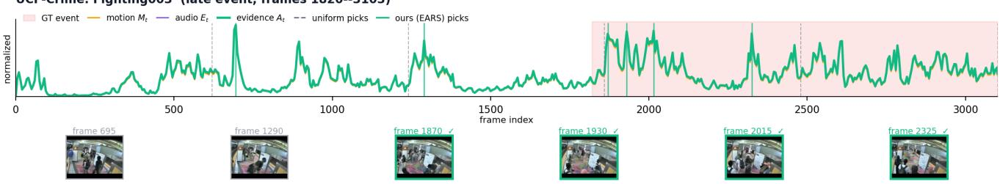  
(a) UCF-Crime Fighting003.

UCF-Crime: Burglary017 (event, frames 150--600)  
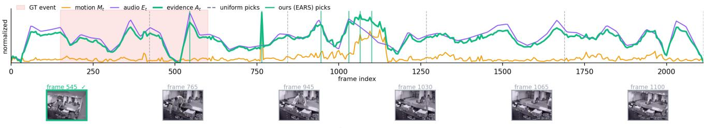  
(b) UCF-Crime Burglary017.  
Figure S1. Motion and audio evidence on real UCF-Crime videos. For each example we show normalized motion M (orange), audio energy E (purple), and fused evidence A (green). The red band marks the ground-truth interval, gray dashed lines are Uniform picks, and green solid lines are EARS picks after IC. Below each plot are the six EARS-selected frames; green borders mark frames inside the event.

Table S3. Frame-selection methods for video LLMs. Trainingfree semantic selectors have advanced rapidly, but remain queryconditioned and vision-centric; EARS is explicitly audio-visual and query-free. N = candidate frames; V/A/T denote visual, audio, text.
<table><tr><td>Method</td><td>Train-free</td><td>Selection signal</td><td>VLM passes / video</td><td>Modality</td><td>Year</td></tr><tr><td>AKS [23]</td><td></td><td>CLIP-query sim.</td><td>1</td><td>V+T</td><td>&#x27;25</td></tr><tr><td>SeViLA [31]</td><td>x</td><td>Localizer-VLM</td><td>K+1</td><td>V</td><td>&#x27;23</td></tr><tr><td>VideoAgent [26]</td><td></td><td>Iterative agent loop</td><td>many</td><td>V+T</td><td>&#x27;24</td></tr><tr><td>M-LLM-FS [12]</td><td>X</td><td>VLM scoring of frames</td><td>≥N/K</td><td>V+T</td><td>&#x27;25</td></tr><tr><td>VideoTree [27]</td><td></td><td>Hierarchical CLIP tree</td><td>log N</td><td>V</td><td>&#x27;25</td></tr><tr><td>WFS-SB [7]</td><td></td><td>Semantic boundaries</td><td>1</td><td>V+T</td><td>&#x27;26</td></tr><tr><td>EFS [6]</td><td></td><td>Event anchors + MMR</td><td>1</td><td>V+T</td><td>26</td></tr><tr><td>MEC [5]</td><td></td><td>Evidence-context rank</td><td>1</td><td>V+T</td><td>26</td></tr><tr><td>EARS (ours)</td><td>V</td><td>Motion+audio energy</td><td>1</td><td>V+A</td><td>&#x27;26</td></tr></table>

Table S4. EgoSchema [20] MCQ accuracy on the 500-question subset (Qwen2.5-VL-7B-Instruct [2], identical preprocessing). Bold marks the better method per column. EARS underperforms uniform sampling on this dense-narrative, audio-silent benchmark, consistent with its sparse-event design assumption.
<table><tr><td>Method</td><td> $\overline { { K = 4 \operatorname { A c c } } }$ </td><td>K =8 Acc</td></tr><tr><td>Uniform</td><td>0.646</td><td>0.692</td></tr><tr><td>EARS (ours)</td><td>0.590</td><td>0.602</td></tr><tr><td>∆ (EARS – Uniform)</td><td>-0.056</td><td>-0.090</td></tr></table>

## S1.1. Backbone Generality

A recurring question is whether the small-K EARS gain is an artifact of one particular VLM. We therefore re-run the entire protocol, unchanged, on three additional backbones spanning two model families and three generations: Qwen2.5-VL-7B [2], Qwen3-VL-8B [1], and the crossfamily LLaVA-NeXT-Video-7B [37]. Only the VLM is swapped; the cached motion/audio signals, the evidence score, and IC are identical. Table S5 reports F1 at the tight budgets K ∈ {1, 2, 4}.

Together with the frozen Qwen2-VL result in Table 1, the pattern spans four backbones. On XD-Violence, EARS lifts K = 1 F1 by +0.34–+0.43 (Qwen2-VL 0.31 → 0.72, Qwen2.5-VL 0.14→0.56, Qwen3-VL 0.43→0.80, LLaVA 0.36 → 0.69), confirming that the effect is a property of which frames are shown, not of a specific VLM. The separate transfer setting improves UCF at K = 1 on Qwen2.5/3, but the frozen global Qwen2 result is negative; UCF is therefore not a general gain. Two caveats remain: the newest Qwen3-VL is already more frame-robust, so the $a b \_$ solute margin shrinks as the backbone improves; and the cross-family LLaVA-NeXT-Video-7B is competent only in a narrow frame band (F1 collapses to 0 at $K \geq 8$ on XD) and effectively cannot solve UCF-Crime, so we restrict its evidence to XD $K \le 4$ , where it still shows the same routing benefit. The routing claim thus holds wherever the underlying VLM is competent at all.

Table S5. Backbone transfer stress test. F1 (Uniform vs. EARS) for three additional VLMs under one selector configuration fixed across this transfer study; within this table only the VLM changes. The tight-budget gain transfers to newer Qwen generations and the cross-family LLaVA at $K \le 4$ on XD. Gains bold where EARS > Uniform. $^ \mathrm { \dag } \mathrm { L L a V A }$ -NeXT-Video-7B collapses to F1 0 at $K \geq 8$ on XD (its frame-count sweet spot is narrow) and is near the floor on UCF-Crime, which it cannot solve; we therefore read the crossfamily evidence only where the backbone is competent (XD, $K \leq$ 4).
<table><tr><td rowspan="2">Backbone</td><td rowspan="2">Sel.</td><td colspan="3">XD-Violence</td><td colspan="3">UCF-Crime</td></tr><tr><td>K=1</td><td>K=2</td><td>K=4</td><td>K=1</td><td>K=2</td><td>K=4</td></tr><tr><td rowspan="2">Qwen2.5-VL-7B</td><td>Unif.</td><td>0.136</td><td>0.302</td><td>0.675</td><td>0.014</td><td>0.198</td><td>0.297</td></tr><tr><td>EARS</td><td>0.561</td><td>0.656</td><td>0.758</td><td>0.129</td><td>0.181</td><td>0.193</td></tr><tr><td rowspan="2">Qwen3-VL-8B</td><td>Unif.</td><td>0.433</td><td>0.599</td><td>0.873</td><td>0.151</td><td>0.325</td><td>0.418</td></tr><tr><td>EARS</td><td>0.798</td><td>0.873</td><td>0.906</td><td>0.351</td><td>0.381</td><td>0.397</td></tr><tr><td rowspan="2">LLaVA-NeXT-7B†</td><td>Unif.</td><td>0.357</td><td>0.545</td><td>0.764</td><td></td><td></td><td></td></tr><tr><td>EARS</td><td>0.693</td><td>0.788</td><td>0.811</td><td>一</td><td>_</td><td></td></tr></table>

Table S6. Frame-level localization on XD-Violence. The raw evidence proxy $A _ { t }$ is a weak detector (AP = 0.393) but, used as a router for the VLM, it lifts AP by +6.3 over uniform sampling and a further +1.9 when combined with Information Compression.
<table><tr><td>Method</td><td>AP↑</td><td>AUC↑</td></tr><tr><td>At proxy alone (no VLM)</td><td>0.393</td><td>0.583</td></tr><tr><td>Uniform + VLM (baseline)</td><td>0.881</td><td>0.921</td></tr><tr><td>EARS, evidence + VLM (no IC)</td><td>0.925</td><td>0.938</td></tr><tr><td>EARS, evidence + IC + VLM</td><td>0.944</td><td>0.951</td></tr></table>

## S1.2. Frame-Level Temporal Localization

We additionally evaluate EARS on the frame-level annotations of XD-Violence (Table S6; PR/ROC curves are deferred to the supplementary material). Each row uses the same downstream VLM but a different selection strategy.

The $A _ { t ^ { - } } \mathrm { o n l y }$ row is intentional: it demonstrates that the gain does not come from $A _ { t }$ being a strong classifier (it is not). Rather, $A _ { t }$ is a strong selector: it tells the VLM where to look, and the VLM tells us what is there.

Table S7. Ablations (matched multi-choice prompt under the same Qwen2-VL-7B backbone as Table 1; absolute F1 values are not directly comparable to Table 1 because the two tables use different prompts, but the relative rankings within each ablation are). Left: modality fusion weights $( \alpha , \beta )$ at the per-dataset budget. Motion dominates the silent-surveillance UCF set; balanced fusion dominates the multimodal XD set. Right: IC gap τ at $K = 4 .$ A small non-zero τ is preferred on long, sparse UCF-Crime clips; vanilla top-K (τ = 0) is optimal on short XD-Violence clips.
<table><tr><td>(α, β)</td><td>UCF K=2 Acc F1</td><td>XD K=6 Acc</td><td>F1</td></tr><tr><td>(1, 0) audio-only</td><td>0.436 0.291</td><td>0.790</td><td>0.654</td></tr><tr><td>(0, 1) motion-only</td><td>0.491 0.411</td><td>0.758</td><td>0.593</td></tr><tr><td>(1, 1) balanced</td><td>0.482 0.394</td><td>0.802</td><td>0.688</td></tr><tr><td>(2, 1) audio-heavy</td><td>0.482 0.394</td><td>0.796</td><td>0.671</td></tr><tr><td>(1, 2) motion-heavy</td><td>0.484 0.398</td><td>0.786</td><td>0.652</td></tr></table>

<table><tr><td> $\boldsymbol { \tau } \left( \mathrm { s } \right)$ </td><td>UCF K=4 Acc</td><td>F1 Acc</td><td>XD K=4 F1</td></tr><tr><td>0</td><td>0.468</td><td>0.350</td><td>0.849 0.778</td></tr><tr><td>0.5</td><td>0.500</td><td>0.427</td><td>0.8170.716</td></tr><tr><td>1</td><td>0.473</td><td>0.376</td><td>0.796 0.671</td></tr><tr><td>2</td><td>0.495</td><td>0.413</td><td>0.770 0.611</td></tr><tr><td>4</td><td>0.486 0.405</td><td></td><td>0.7500.563</td></tr></table>

## S1.3. Ablations

We ablate four design choices: (i) modality and fusion weights; (ii) the Information Compression gap τ ; (iii) audio robustness; and (iv) the optical-flow estimator behind the motion channel. All ablations use UCF-Crime at $K = 2$ unless stated otherwise.

Modality and fusion weights. We sweep $( \alpha , \beta )$ over five settings (Table S7 (left)). The two datasets give sharply different verdicts. On UCF-Crime, where most test clips have no usable audio, motion-only wins (F1 0.411 vs. 0.291 for audio-only); any non-zero audio weight is silently ignored because $E _ { t }$ is flat. On XD-Violence the picture inverts: audio-only $( F _ { 1 } = 0 . 6 5 4 )$ beats motion-only (0.593), and balanced fusion is best overall $( F _ { 1 } = 0 . 6 8 8 )$ . Balanced fusion is therefore the only setting that is never harmful: it is optimal on XD and within 0.017 F1 of motion-only on UCF, where the audio term is inert rather than misleading. This is the same configuration the held-out search arrives at without seeing any test video.

IC gap τ . Sweeping $\tau \in \{ 0 , 0 . 5 , 1 , 2 , 4 \}$ s at $K = 4$ (Table S7, right) shows a dataset-dependent optimum: on UCF-Crime a small gap $( \tau = 0 . 5 \mathrm { s } )$ lifts F1 by +0.077 over $\tau = 0$ by suppressing near-duplicate picks around a single motion spike; on XD-Violence, where clips are short and evidence is already concentrated, $\tau = 0$ wins. The realized frame count drops from 4.0 at τ = 0 to 1.0–1.4 at $\tau = 4$ , foreshadowing the adaptive-K gains of Sec. S1.4. With $\alpha = 0$ EARS degrades gracefully to a motion-only sampler when audio is missing, matching the motion-only row of Table S7 (left). The per-class breakdown (Supp. §S5, Fig. S3) confirms the inductive bias: wins on motion/sounddriven classes (Assault +0.67, Robbery +0.40, Fighting, Shooting), losses on subtle or isolated-flash classes (Arrest −0.20, Arson −0.33).

Robustness to the optical-flow estimator. To verify that the routing gain is a property of the motion evidence rather than of one particular flow algorithm, we recompute the entire motion channel $M _ { t }$ on XD-Violence with the variational TV-L1 optical flow [32] in place of the default Farneback estimator, holding the audio channel, fusion weights $( \alpha , \beta )$ IC gap τ, backbone, and prompt fixed — only the flow estimator changes. This estimator-only stress test uses the original fixed selector setting. The resulting EARS F1 stays within 0.024 of the Farneback pipeline at every tight budget (XD K = 1: 0.708 vs. 0.732; $K = 2 \colon 0 . 8 2 7 { \mathrm { ~ v s . ~ } } 0 . 8 4 3 ;$ $K = 4 \colon 0 . 8 8 5 \mathrm { v s } . 0 . 8 8 8 )$ , and both remain far above Uniform $( 0 . 3 1 0 / 0 . 5 3 4 / 0 . 8 6 6 )$ . The evidence router is thus robust to the flow estimator: what matters is that motion energy localizes the sparse event, not which optical-flow method computes it.

Held-out configuration selection (no test-set tuning). A selector with per-dataset weights could be encoding testset knowledge. To rule this out we select $( \alpha , \beta , \tau )$ on a held-out split that is strictly disjoint from every test video (XD-Violence train/; UCF-Crime training videos), 300 videos per dataset. We grid over $\alpha \in \{ 0 , 1 , 2 \} , \beta = 1$ $\tau \in \{ 0 , 0 . 5 , 1 \}$ s on both datasets, pick the best mean F1 at $K \leq 2 ,$ , freeze the configuration, and only then touch the test set. Both searches independently select the same setting, $( \alpha , \beta , \tau ) = ( 1 , 1 , 0 . 5 \mathrm { s } )$ , at held-out F1 0.769 (XD) and 0.557 (UCF). EARS thus uses one global configuration and has no per-dataset hyper-parameters.

The two datasets agree on the setting for different reasons, and the distinction matters. On XD-Violence the choice of α is a real effect: the spread between the best $\alpha = 1$ and the worst $\alpha = 0$ configuration is 0.063 F1, against a 0.025 baseline obtained by varying only τ within a fixed α. On UCF-Crime the corresponding numbers are 0.011 against 0.047, i.e. α is inconsequential — as expected, since 222 of its 290 test videos carry no audio track at all. Equal weighting is selected on UCF because nothing distinguishes it there, and selected on XD because audio genuinely helps; a single default is defensible precisely because the one dataset with an opinion prefers it.

## S1.4. Efficiency Analysis

We analyze two efficiency dimensions: (a) the per-video overhead of computing $A _ { t }$ relative to a VLM forward pass, and (b) the adaptive-K variant of IC in which selection terminates once no candidate exceeds an evidence threshold (Alg. 1 extended).

Pre-processing cost and amortization via caching. Audio energy and Farneback optical-flow signals (stride $s = 5 ,$ OpenCV implementation) are extracted on a single CPU core and cached to disk (∼ 10 MB for the full XD-Violence test split), so all K and τ sweeps reuse the same per-video signal at zero re-extraction cost. On 24 XD-Violence and UCF-Crime videos (single CPU core) we measure 0.28 s for audio, 2.84 s for single-pass decode plus Farneback motion, and < 1 ms for fusion+top- $\cdot K ,$ , totaling 3.12 s/video; frame decode for the K selected frames adds 0.07 s (identical to uniform). Caching amortizes the pre-processing across all K and $\tau$ sweeps—a one-time CPU cost paid against repeated GPU VLM inference. Because $A _ { t }$ is query-independent, the same cached signal also serves every future query on that video, which query-conditioned scores cannot.

Paired end-to-end latency. The preceding number isolates an optimized front-end. To include the downstream model, we additionally time EARS and Uniform on the same 24 XD videos at $K = 4$ with Qwen2-VL-7B. Uniform takes 1.33 ± 0.53 s/video end to end (1.23 s VLM); EARS takes $6 . 8 7 { \pm } 2 . 9 5 \mathrm { s } \ ( 1 . 3 9 \mathrm { s } \ \mathrm { V L M } )$ . The 5.54 s gap is therefore almost entirely CPU preprocessing: audio 0.37 s, Farneback motion 5.02 s, fusion+IC 0.005 s, and selectedframe decode 0.09 s. EARS is not faster than Uniform on a first query; its advantage is that this query-independent cost is cached and amortized across later queries.

How the front-end compares to a learned selector. Table S8 places EARS’s front-end next to the SigLIP relevance encoder that AKS and SigLIP top-K require, measured on the same 24 XD-Violence videos (mean 299 frames). Both front-ends must first decode a strided subset of frames, and how that decode is implemented dominates the comparison: requesting frames individually through CAP PROP POS FRAMES restarts the decoder at the nearest keyframe every time and costs 4.30 s/video, whereas walking the stream once and keeping the wanted frames costs 0.17 s for bit-identical output. With the single-pass decode, EARS costs 3.12 s/video against 6.89 s for the SigLIP pass. We report both numbers because the SigLIP baseline still uses per-frame seeking; after accounting for decode implementation, the front-ends differ by roughly 2× once each is implemented well, not by an order of magnitude.

The durable advantage is qualitative rather than a wallclock margin: EARS needs no learned encoder (it is CPUonly, where the SigLIP forward pass wants a GPU), no pertask query, and no extra VLM forward pass. VLM-in-theloop selectors (SeViLA, M-LLM-FS, VideoAgent) instead add one-to-many additional VLM passes per video, a cost that dwarfs either front-end.

Adaptive-K Pareto. Fig. S2 plots F1 vs. average framesper-video as the evidence threshold θ is swept. On UCF-Crime the best operating point is $\theta = 0 . 6 5$ , yielding $F _ { 1 } =$

Table S8. Selection and end-to-end cost (24 XD-Violence videos, mean 299 frames/video). Frame decoding is shared by both front-ends and dominates unless it is done in a single pass; the SigLIP row still uses per-frame seeking, so the realistic gap is near 2×, not the 2.5× the front-end rows show. Paired end-to-end rows include Qwen2-VL-7B at $K = 4$ (mean±std).
<table><tr><td>Front-end</td><td>Encoder</td><td>Query</td><td>s/video</td></tr><tr><td>SigLIP relevance [34] (AKS, top-K)</td><td>√</td><td>√</td><td>6.89</td></tr><tr><td>EARS, per-frame seeking</td><td>x</td><td>x</td><td>7.83</td></tr><tr><td>EARS, single-pass decode</td><td>x</td><td>x</td><td>3.12</td></tr><tr><td>Uniform + VLM, end to end</td><td>x</td><td>x</td><td>1.33±0.53</td></tr><tr><td>EARS + VLM, end to end</td><td>x</td><td>x</td><td>6.87±2.95</td></tr><tr><td>VLM-in-the-loop (SeViLA [31], M-LLM-FS [12])</td><td>√</td><td>√</td><td>+ ≥ 1 VLM pass</td></tr></table>

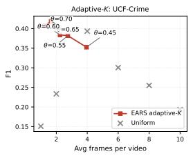

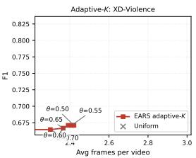  
Figure S2. Adaptive-K Pareto on UCF-Crime (left) and XD-Violence (right). Sweeping θ in Alg. 1 trades average framesper-video against F1; crosses mark fixed-K Uniform at $K \in$ {1, 2, 4, 6, 8, 10}. UCF matches its best fixed- $\cdot \tau \ \mathrm { a t } < 1 / 2$ the frame cost; XD is flat.

0.419 at only 1.67 frames/video—a 58% frame reduction over fixed $K = 4$ with no F1 loss relative to the best fixed setting (0.427 at $\tau = 0 . 5 ,$ 3.80 frames/video). On XD-Violence F1 is nearly flat (≈0.67) over $\theta \in [ 0 . 5 , 0 . 7 5 ]$ while the realized budget shrinks from 2.42 to 2.17 frames/video, indicating that $A _ { t }$ is sharply peaked on XD and adaptive stopping is essentially free. The IC threshold is thus a noretraining knob for frugal-frame deployment.

## S1.5. Can Selection Be Routed Per Video?

EARS does not help uniformly: it wins decisively at tight budgets on XD-Violence and loses to Uniform at $K \geq 4$ on UCF-Crime. The natural response is a router that inspects each video and chooses between evidence-driven and uniform sampling. Because our signals are query-independent and already computed, such a router would be free—which makes it worth asking whether it works. We report a negative answer, together with the measurement that makes it interpretable.

Setup. We evaluate on ten (dataset, K) cells: UCF-Crime and XD-Violence at $K \in \{ 1 , 2 , 4 , 8 \}$ (F1) and the EgoSchema MCQ probe at $K \in \{ 4 , 8 \}$ (accuracy), spanning sparse-event surveillance and dense egocentric narrative. Each video is described by eleven statistics of its own $M _ { t }$ and $E _ { t ^ { - } }$ —Gini coefficient, top-mass fraction, normalized entropy, peak ratio, peakiness, audio activity, and audio–motion agreement—all computable from the cached signals at no additional cost. A threshold on their weighted sum selects the arm. Thresholds are chosen leave-onedataset-out, so no cell is scored with a threshold fitted on itself. We compare against the per-video oracle, which picks the better arm with hindsight and upper-bounds any router.

Table S9. Routing policies, mean over ten (dataset, K) cells (F1 for UCF/XD, accuracy for EgoSchema). The oracle shows substantial headroom, but the learned per-video router underperforms both fixed policies. Thresholds for both adaptive rows are selected leave-one-dataset-out.
<table><tr><td>Policy</td><td>Mean score</td></tr><tr><td>Per-video router (modality statistics)</td><td>0.635</td></tr><tr><td>Always Uniform</td><td>0.647</td></tr><tr><td>Budget rule (EARS iff  $K \leq \theta )$ </td><td>0.676</td></tr><tr><td>Always EARS</td><td>0.685</td></tr><tr><td>Per-video oracle (upper bound)</td><td>0.789</td></tr></table>

The headroom is real; the router cannot reach it. Table S9 shows an oracle margin of +0.104 over always using EARS, so per-video routing is worth 10 points if it can be done. It cannot, from these signals. The router scores 0.635, below the 0.647 of never routing at all. The failure is not a tuning artifact but degeneracy: the leave-one-dataset-out threshold collapses the router onto a constant arm, and on XD-Violence it collapses onto the wrong one, forfeiting the +0.10 (at K =1) to +0.34 (at $K = 2 )$ F1 that EARS would have delivered.

No individual statistic is informative. Testing each of the eleven features in each cell for its ability to predict whether EARS beats Uniform on a given video gives 92 feature–cell tests. Three reach $p { < } 0 . 0 5$ under a permutation test, against 4.6 expected by chance alone; none survives Bonferroni correction. Mean |AUC−0.5| ranges from 0.026 to 0.070 across features, where a useful router would need roughly 0.20. The apparent exceptions reverse sign across budgets: motion top-mass reaches AUC 0.72 on UCF at $K = 2 \ ( n = 4 0 )$ but 0.44 at $K = 8$ . As a sanity check on the pipeline, every audio feature scores exactly 0.50 on EgoSchema, whose clips carry no audio stream.

Two structural reasons underlie this. First, the routable population is small: 79–92% of videos receive identical predictions under both arms, so the two arms mostly agree and the disagreements are few. Second, sparsity does not separate the regimes even at the dataset level—the same score distinguishes dense-narrative EgoSchema from sparse-event XD-Violence at AUC 0.576.

Routing on the budget instead of the video. Since K governs when EARS stops helping, one might route on K alone. Choosing the crossover on the same cells gives 0.700, above always-EARS; but that threshold is fitted on the data it is scored on. Selected leave-one-dataset-out it yields 0.676, again below always-EARS. We therefore report the constant policy as the strongest one we can validate, and treat the oracle gap as an open problem: the evidence says the information needed to route is not present in modality-intrinsic statistics, so a router would have to look at content, at which point it is no longer free. This bounds a design space that recent adaptive-selection work has assumed to be open.

## S1.6. Discussion

Three findings emerge across Tables 1–S6. (i) Gains are strongest where sparse events align with motion or audio: XD-Violence +0.41 F1 at K = 1 (+0.32 at K = 2), while UCF-Crime shows negative transfer (subtle, silent anomalies like Shoplifting). (ii) IC — temporal NMS on the evidence axis — is necessary (AP 0.925→0.944 once added). (iii) The proxy is a poor classifier (AP 0.393) but an excellent VLM router: cheap selector, expensive reasoner.

Scope and hybrid fallback. EARS suits tight budgets on motion/audio-correlated videos; under the frozen global configuration, XD crosses Uniform only at K = 10 (Fig. 3). A training-free remedy is the selectivity-annealed hybrid $S _ { t } = ( 1 { - } \lambda ) A _ { t } + \lambda U _ { t } , \lambda = \operatorname* { m i n } ( 1 , K / ( \rho ^ { * } N _ { \mathrm { e f f } } ) )$ (supp. S3): pure EARS and uniform are limits, and the adaptive-K Pareto (Sec. S1.4) is its dual.

Limitations and future work. (1) Stealthy events: motion+audio cannot rank anomalies with no spike (e.g. Shoplifting); the natural generalization is a semantic third channel $A _ { t } = \alpha E _ { t } + \beta M _ { t } + \gamma C _ { t }$ (CLIP/SigLIP). (2) Scope: extending to Video-MME/LongVideoBench/MLVU requires (1).

## S2. Frame-Level Curves

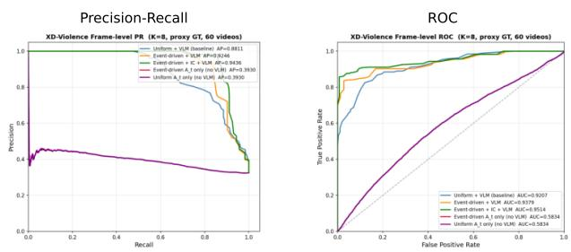  
Figure S3. Precision–Recall (left) and ROC (right) curves on the frame-level XD-Violence annotations.

## S3. Updated Matched Controls

This new study is separate from the original tables and figures retained above. It corrects video identities/labels and the Uniform baseline, and uses the updated implementation described below. Its numbers must not be mixed with the earlier protocols or interpreted as revalidation of their localization, backbone-transfer, held-out, or routing claims. Table S10 preserves the original main-paper summary relocated here for space; its numbers are not new controls.

Table S10. Original robustness, scope, and efficiency summary, relocated from the main paper without changing its numerical findings. Values are F1 unless noted; latency is measured before cache reuse.  
Study Quantitative finding   
Flow estimator TV-L1 [32] stays within 0.024 F1 of Farneback [9]   
for XD at every $K \leq 4 .$   
Dense narrative EgoSchema [20] EARS−Uniform accuracy is   
−0.056/ − 0.090 at $K = 4 / 8 .$   
Per-video rout- Modality-statistics router 0.635; always-EARS   
ing 0.685; oracle upper bound 0.789.   
End-to-end cost Paired $n \ = \ 2 4 \div$ EARS 6.87±2.95 vs. Uni  
form 1.33±0.53 s/video; reusable CPU preprocess  
ing dominates.

## S3.1. Cohorts, Reasoner, and Signal Alignment

XD comprises 120 Fighting, 84 Shooting, and 300 Normal videos in the available local test subset, not the full official test benchmark. UCF comprises 140 anomalous and 150 normal unique test videos; duplicate entries and conflicting labels from the older loader are not retained. Median nominal durations are 99.52 and 59.62 seconds. Of the UCF signals, 222 are identically zero in audio amplitude; zero amplitude does not itself prove stream absence.

All selectors use Qwen2-VL-7B-Instruct [25], revision eed13092ef92e448dd6875b2a00151bd3f7db0ac, bfloat16, seed 42, greedy generation, and at most 16 new tokens. Selected RGB frames are chronologically ordered and resized with aspect-preserving INTER AREA interpolation to maximum side 448. The reasoner sees task text and RGB, not audio, scores, flow, or timestamps. Within each cohort every selector uses exactly the same binary prompt.

## XD prompt.

Given the following frames sampled from a surveillance video, determine whether the video contains violent activity. Answer Yes or No.

## UCF prompt.

These frames are from a surveillance video. The video may show: fighting, robbery, abuse, road accidents, burglary, vandalism, explosions, or other crimes. If any anomalous or criminal event is visible in these frames, answer Yes. If the frames show only normal, safe activity, answer No. Answer with one word: Yes or No.

Uniform uses equal-bin centers, so $K \_ { \mathbf { \Sigma } } = \mathbf { \Sigma } _ { 1 }$ is the midpoint. Random uses three frozen without-replacement streams over native frames; its sample SD is not a confidence interval for a method difference. Farneback flow¨ uses up to 256 endpoint-inclusive full-video candidates in quarter-scale grayscale. The first motion value is zero; displacement magnitudes are interpolated at actual native frame positions, not divided by candidate time gaps. Mono audio at 22,050 Hz is summarized by one-second mean absolute amplitude. Nominal window centers are $j + 0 . 5$ seconds, including a final partial window; interpolation at frame timestamps uses constant endpoint extension. Constant signals normalize to zero. Fusion uses $\sigma ( \tilde { E } _ { t } + \tilde { M } _ { t } )$ and native-frame NMS radius round(0.5 fps), with earliest ties. Flat signals do not fall back to Uniform. Every saved selection contains exactly K unique in-range indices. Only verified absent audio is zero-filled; probing, decoding, invalid answers, or infeasible selections stop evaluation.

## S3.2. Semantic Fusion and Simple Alternatives

Semantic scoring uses frozen SigLIPbase-patch16-224 [34], revision 7fd15f0689c79d79e38b1c2e2e2370a7bf2761ed. Unit-normalized image/text embeddings give cosine scores maximized over eight fixed descriptions per cohort, not chosen from video labels:

• XD: a violent scene; people fighting; a shooting; an explosion; a car accident; an assault; abuse; a riot.

• UCF: a crime being committed; an anomalous event; fighting or assault; robbery or burglary; arson or a fire; a road accident; shoplifting or stealing; vandalism.

Plain semantic top-K ranks up to 256 full-video candidates. Semantic + NMS and the hybrid use the same candidate-restricted NMS. The hybrid averages independently candidate-normalized semantic and sigmoid EARS scores at fixed weight 1/2, without outcome-based tuning. These are explicit controls, not an official AKS reproduction. Comparing the hybrid to dense-grid EARS changes candidate support too.

Difference + audio replaces flow with mean absolute floating-point grayscale difference divided by 255 between the same candidate frames. The first value is zero; interpolation, audio, normalization, fusion, and native-grid NMS otherwise match EARS.

Table S11 retains the complete comparison, including Audio’s higher XD point estimates and the hybrid’s UCF one-frame loss. All six EARS-minus-Uniform intervals include zero. Semantic NMS alone improves four-frame F1 over plain top-K by 0.016 on XD and 0.037 on UCF, with exploratory intervals [0.001, 0.033] and [0.009, 0.069]. That change must not be attributed to activity fusion. All six Difference-minus-EARS intervals include zero, establishing neither flow superiority nor proxy equivalence.

## S3.3. Paired Cost and Cache Reuse

At K = 4, 24 videos (12 per cohort) are stratified by label and within-label duration tertile, with two seeded draws per stratum. Uniform, EARS, and semantic top-K each receive three measured repetitions under fresh-feature and cached-feature conditions: 432 fresh-answer trials, excluding 72 warm-ups. On NVIDIA GB10 the models remain resident, CUDA stages are synchronized, and the OS file cache is explicitly warmed. Model loading and cold-disk access are excluded. Fresh-feature trials include extraction and cache creation; cached semantic selection still encodes its queries. Every condition then uses a common selected-RGB decode/resize path and a newly inferred VLM answer. A seeded cyclic order balances trials.

We aggregate repetitions within video before comparing videos. Marginal stage medians need not add to median total time. Paired differences are medians of per-video differences, not differences of marginal medians; repetitions are not independent bootstrap samples.

Fresh-feature EARS has lower marginal medians than semantic selection but higher total cost than Uniform. Both cached EARS-minus-Uniform total-time intervals include zero, so no reliable cached speedup or equivalence is established. The hybrid, semantic-NMS, and difference selectors have no matched timing study.

The primary, semantic, and targeted runs contain 16,674, 2,382, and 7,146 classification records, respectively, covering 66 complete cohort/method/budget cells. Audits check identities, labels, strict raw-answer parsing, selections, confusion counts, frozen sources, model revisions, and signal/feature hashes. Deterministic reuse of identical-input answers in quality evaluation is logged and is never used as timing evidence.

Table S11. Updated matched F1, all methods and budgets. Random is mean ± sample SD over three streams. The upper/lower groups distinguish selection without/with a learned semantic encoder and task query.
<table><tr><td rowspan="2">Selector</td><td colspan="3">XD subset (n = 504)</td><td colspan="3"> $\mathrm { U C F - C r i m e } \left( n = 2 9 0 \right)$ </td></tr><tr><td>K = 1</td><td>K = 2</td><td>K = 4</td><td>K = 1</td><td>K = 2</td><td>K = 4</td></tr><tr><td colspan="7">Query-independent selection; no learned selection encoder</td></tr><tr><td>Uniform</td><td>0.614</td><td>0.791</td><td>0.893</td><td>0.303</td><td>0.528</td><td>0.713</td></tr><tr><td>Random (3 seeds)</td><td>0.603 ± 0.010</td><td>0.779 ± 0.005</td><td> $0 . 8 5 3 \pm 0 . 0 1 5$ </td><td> $0 . 2 4 9 \pm 0 . 0 3 0$ </td><td> $0 . 5 3 7 \pm 0 . 0 2 8$ </td><td> $0 . 6 6 8 \pm 0 . 0 1 9$ </td></tr><tr><td>Motion</td><td>0.524</td><td>0.743</td><td>0.856</td><td>0.270</td><td>0.471</td><td>0.685</td></tr><tr><td>Audio</td><td>0.683</td><td>0.838</td><td>0.907</td><td>0.095</td><td>0.158</td><td>0.272</td></tr><tr><td>Difference + audio</td><td>0.612</td><td>0.813</td><td>0.898</td><td>0.237</td><td>0.437</td><td>0.642</td></tr><tr><td>EARS</td><td>0.660</td><td>0.817</td><td>0.898</td><td>0.248</td><td>0.471</td><td>0.654</td></tr><tr><td colspan="7">Task-aware selection; frozen SigLIP encoder</td></tr><tr><td>Semantic top-K</td><td>0.824</td><td>0.843</td><td>0.832</td><td>0.546</td><td>0.651</td><td>0.694</td></tr><tr><td>Semantic + NMS</td><td>0.824</td><td>0.845</td><td>0.847</td><td>0.546</td><td>0.679</td><td>0.730</td></tr><tr><td> $\mathrm { S e m a n t i c + E A R S }$ </td><td>0.840</td><td>0.868</td><td>0.889</td><td>0.351</td><td>0.651</td><td>0.739</td></tr></table>

Table S12. Updated XD subset: complete primary metrics and confusion counts, including all three Random streams. Every row covers 504 videos.
<table><tr><td>Selector</td><td>K</td><td>Acc.</td><td>Prec.</td><td>Recall</td><td>F1</td><td>TP</td><td>FP</td><td>FN</td><td>TN</td></tr><tr><td>Uniform</td><td>1</td><td>0.768</td><td>0.939</td><td>0.456</td><td>0.614</td><td>93</td><td>6</td><td>111</td><td>294</td></tr><tr><td>Uniform</td><td>2</td><td>0.851</td><td>0.916</td><td>0.696</td><td>0.791</td><td>142</td><td>13</td><td>62</td><td>287</td></tr><tr><td>Uniform</td><td>4</td><td>0.917</td><td>0.931</td><td>0.858</td><td>0.893</td><td>175</td><td>13</td><td>29</td><td>287</td></tr><tr><td>EARS</td><td>1</td><td>0.786</td><td>0.921</td><td>0.515</td><td>0.660</td><td>105</td><td>9</td><td>99</td><td>291</td></tr><tr><td>EARS</td><td>2</td><td>0.867</td><td>0.920</td><td>0.735</td><td>0.817</td><td>150</td><td>13</td><td>54</td><td>287</td></tr><tr><td>EARS</td><td>4</td><td>0.919</td><td>0.914</td><td>0.882</td><td>0.898</td><td>180</td><td>17</td><td>24</td><td>283</td></tr><tr><td>Random-0</td><td>1</td><td>0.762</td><td>0.957</td><td>0.431</td><td>0.595</td><td>88</td><td>4</td><td>116</td><td>296</td></tr><tr><td>Random-0</td><td>2</td><td>0.841</td><td>0.913</td><td>0.672</td><td>0.774</td><td>137</td><td>13</td><td>67</td><td>287</td></tr><tr><td>Random-0</td><td>4</td><td>0.897</td><td>0.909</td><td>0.828</td><td>0.867</td><td>169</td><td>17</td><td>35</td><td>283</td></tr><tr><td>Random-1</td><td>1</td><td>0.764</td><td>0.947</td><td>0.441</td><td>0.602</td><td>90</td><td>5</td><td>114</td><td>295</td></tr><tr><td>Random-1</td><td>2</td><td>0.849</td><td>0.932</td><td>0.676</td><td>0.784</td><td>138</td><td>10</td><td>66</td><td>290</td></tr><tr><td>Random-1</td><td>4</td><td>0.877</td><td>0.908</td><td>0.775</td><td>0.836</td><td>158</td><td>16</td><td>46</td><td>284</td></tr><tr><td>Random-2</td><td>1</td><td>0.768</td><td>0.939</td><td>0.456</td><td>0.614</td><td>93</td><td>6</td><td>111</td><td>294</td></tr><tr><td>Random-2</td><td>2</td><td>0.845</td><td>0.926</td><td>0.672</td><td>0.778</td><td>137</td><td>11</td><td>67</td><td>289</td></tr><tr><td>Random-2</td><td>4</td><td>0.887</td><td>0.889</td><td>0.824</td><td>0.855</td><td>168</td><td>21</td><td>36</td><td>279</td></tr><tr><td>Motion</td><td>1</td><td>0.730</td><td>0.915</td><td>0.368</td><td>0.524</td><td>75</td><td>7</td><td>129</td><td>293</td></tr><tr><td>Motion</td><td>2</td><td>0.825</td><td>0.920</td><td>0.623</td><td>0.743</td><td>127</td><td>11</td><td>77</td><td>289</td></tr><tr><td>Motion</td><td>4</td><td>0.891</td><td>0.921</td><td>0.799</td><td>0.856</td><td>163</td><td>14</td><td>41</td><td>286</td></tr><tr><td>Audio</td><td>1</td><td>0.796</td><td>0.917</td><td>0.544</td><td>0.683</td><td>111</td><td>10</td><td>93</td><td>290</td></tr><tr><td>Audio</td><td>2</td><td>0.881</td><td>0.934</td><td>0.760</td><td>0.838</td><td>155</td><td>11</td><td>49</td><td>289</td></tr><tr><td>Audio</td><td>4</td><td>0.925</td><td>0.907</td><td>0.907</td><td>0.907</td><td>185</td><td>19</td><td>19</td><td>281</td></tr></table>

Table S13. Updated UCF: complete primary metrics and confusion counts. Every row covers 290 unique videos with annotation-derived labels.
<table><tr><td>Selector</td><td>K</td><td>Acc.</td><td>Prec.</td><td>Recall</td><td>F1</td><td>TP</td><td>FP</td><td>FN</td><td>TN</td></tr><tr><td>Uniform</td><td>1</td><td>0.603</td><td>1.000</td><td>0.179</td><td>0.303</td><td>25</td><td>0</td><td>115</td><td>150</td></tr><tr><td>Uniform</td><td>2</td><td>0.679</td><td>0.912</td><td>0.371</td><td>0.528</td><td>52</td><td>5</td><td>88</td><td>145</td></tr><tr><td>Uniform</td><td>4</td><td>0.772</td><td>0.911</td><td>0.586</td><td>0.713</td><td>82</td><td>8</td><td>58</td><td>142</td></tr><tr><td>EARS</td><td>1</td><td>0.583</td><td>0.952</td><td>0.143</td><td>0.248</td><td>20</td><td>1</td><td>120</td><td>149</td></tr><tr><td>EARS</td><td>2</td><td>0.659</td><td>0.936</td><td>0.314</td><td>0.471</td><td>44</td><td>3</td><td>96</td><td>147</td></tr><tr><td>EARS</td><td>4</td><td>0.741</td><td>0.922</td><td>0.507</td><td>0.654</td><td>71</td><td>6</td><td>69</td><td>144</td></tr><tr><td>Random-0</td><td>1</td><td>0.593</td><td>1.000</td><td>0.157</td><td>0.272</td><td>22</td><td>0</td><td>118</td><td>150</td></tr><tr><td>Random-0</td><td>2</td><td>0.683</td><td>0.944</td><td>0.364</td><td>0.526</td><td>51</td><td>3</td><td>89</td><td>147</td></tr><tr><td>Random-0</td><td>4</td><td>0.755</td><td>0.960</td><td>0.514</td><td>0.670</td><td>72</td><td>3</td><td>68</td><td>147</td></tr><tr><td>Random-1</td><td>1</td><td>0.590</td><td>1.000</td><td>0.150</td><td>0.261</td><td>21</td><td>0</td><td>119</td><td>150</td></tr><tr><td>Random-1</td><td>2</td><td>0.683</td><td>0.980</td><td>0.350</td><td>0.516</td><td>49</td><td>1</td><td>91</td><td>149</td></tr><tr><td>Random-1</td><td>4</td><td>0.766</td><td>0.974</td><td>0.529</td><td>0.685</td><td>74</td><td>2</td><td>66</td><td>148</td></tr><tr><td>Random-2</td><td>1</td><td>0.572</td><td>0.944</td><td>0.121</td><td>0.215</td><td>17</td><td>1</td><td>123</td><td>149</td></tr><tr><td>Random-2</td><td>2</td><td>0.707</td><td>0.982</td><td>0.400</td><td>0.569</td><td>56</td><td>1</td><td>84</td><td>149</td></tr><tr><td>Random-2</td><td>4</td><td>0.738</td><td>0.921</td><td>0.500</td><td>0.648</td><td>70</td><td>6</td><td>70</td><td>144</td></tr><tr><td>Motion</td><td>1</td><td>0.590</td><td>0.957</td><td>0.157</td><td>0.270</td><td>22</td><td>1</td><td>118</td><td>149</td></tr><tr><td>Motion</td><td>2</td><td>0.659</td><td>0.936</td><td>0.314</td><td>0.471</td><td>44</td><td>3</td><td>96</td><td>147</td></tr><tr><td>Motion</td><td>4</td><td>0.762</td><td>0.949</td><td>0.536</td><td>0.685</td><td>75</td><td>4</td><td>65</td><td>146</td></tr><tr><td>Audio</td><td>1</td><td>0.541</td><td>1.000</td><td>0.050</td><td>0.095</td><td>7</td><td>0</td><td>133</td><td>150</td></tr><tr><td>Audio</td><td>2</td><td>0.559</td><td>1.000</td><td>0.086</td><td>0.158</td><td>12</td><td>0</td><td>128</td><td>150</td></tr><tr><td>Audio</td><td>4</td><td>0.593</td><td>1.000</td><td>0.157</td><td>0.272</td><td>22</td><td>0</td><td>118</td><td>150</td></tr></table>

Table S14. Updated semantic and targeted-control metrics. Same cohorts, reasoner, binary prompts, and budgets as the primary controls.
<table><tr><td>Cohort</td><td>Selector</td><td>K</td><td>Acc.</td><td>Prec.</td><td>Recall</td><td>Fl</td><td>TP</td><td>FP</td><td>FN</td><td>TN</td></tr><tr><td>XD subset</td><td>Semantic top-K</td><td>1</td><td>0.857</td><td>0.824</td><td>0.824</td><td>0.824</td><td>168</td><td>36</td><td>36</td><td>264</td></tr><tr><td>XD subset</td><td>Semantic top-K</td><td>2</td><td>0.865</td><td>0.796</td><td>0.897</td><td>0.843</td><td>183</td><td>47</td><td>21</td><td>253</td></tr><tr><td>XD subset</td><td>Semantic top-K</td><td>4</td><td>0.847</td><td>0.751</td><td>0.931</td><td>0.832</td><td>190</td><td>63</td><td>14</td><td>237</td></tr><tr><td>XD subset</td><td>Semantic + NMS</td><td>1</td><td>0.857</td><td>0.824</td><td>0.824</td><td>0.824</td><td>168</td><td>36</td><td>36</td><td>264</td></tr><tr><td>XD subset</td><td>Semantic + NMS</td><td>2</td><td>0.865</td><td>0.788</td><td>0.912</td><td>0.845</td><td>186</td><td>50</td><td>18</td><td>250</td></tr><tr><td>XD subset</td><td>Semantic + NMS</td><td>4</td><td>0.859</td><td>0.755</td><td>0.966</td><td>0.847</td><td>197</td><td>64</td><td>7</td><td>236</td></tr><tr><td>XD subset</td><td>Semantic + EARS</td><td>1</td><td>0.877</td><td>0.886</td><td>0.799</td><td>0.840</td><td>163</td><td>21</td><td>41</td><td>279</td></tr><tr><td>XD subset</td><td>Semantic + EARS</td><td>2</td><td>0.887</td><td>0.824</td><td>0.917</td><td>0.868</td><td>187</td><td>40</td><td>17</td><td>260</td></tr><tr><td>XD subset</td><td>Semantic + EARS</td><td>4</td><td>0.901</td><td>0.810</td><td>0.985</td><td>0.889</td><td>201</td><td>47</td><td>3</td><td>253</td></tr><tr><td>XD subset</td><td>Difference + audio</td><td>1</td><td>0.764</td><td>0.913</td><td>0.461</td><td>0.612</td><td>94</td><td>9</td><td>110</td><td>291</td></tr><tr><td>XD subset</td><td>Difference + audio</td><td>2</td><td>0.863</td><td>0.909</td><td>0.735</td><td>0.813</td><td>150</td><td>15</td><td>54</td><td>285</td></tr><tr><td>XD subset</td><td>Difference + audio</td><td>4</td><td>0.919</td><td>0.910</td><td>0.887</td><td>0.898</td><td>181</td><td>18</td><td>23</td><td>282</td></tr><tr><td>UCF-Crime</td><td>Semantic top-K</td><td>1</td><td>0.697</td><td>0.981</td><td>0.379</td><td>0.546</td><td>53</td><td>1</td><td>87</td><td>149</td></tr><tr><td>UCF-Crime</td><td>Semantic top-K</td><td>2</td><td>0.741</td><td>0.933</td><td>0.500</td><td>0.651</td><td>70</td><td>5</td><td>70</td><td>145</td></tr><tr><td>UCF-Crime</td><td>Semantic top-K</td><td>4</td><td>0.766</td><td>0.939</td><td>0.550</td><td>0.694</td><td>77</td><td>5</td><td>63</td><td>145</td></tr><tr><td>UCF-Crime</td><td>Semantic + NMS</td><td>1</td><td>0.697</td><td>0.981</td><td>0.379</td><td>0.546</td><td>53</td><td>1</td><td>87</td><td>149</td></tr><tr><td>UCF-Crime</td><td>Semantic + NMS</td><td>2</td><td>0.755</td><td>0.926</td><td>0.536</td><td>0.679</td><td>75</td><td>6</td><td>65</td><td>144</td></tr><tr><td>UCF-Crime</td><td>Semantic + NMS</td><td>4</td><td>0.786</td><td>0.933</td><td>0.600</td><td>0.730</td><td>84</td><td>6</td><td>56</td><td>144</td></tr><tr><td>UCF-Crime</td><td>Semantic + EARS</td><td>1</td><td>0.617</td><td>0.968</td><td>0.214</td><td>0.351</td><td>30</td><td>1</td><td>110</td><td>149</td></tr><tr><td>UCF-Crime</td><td> $\mathrm { S e m a n t i c + E A R S }$ </td><td>2</td><td>0.741</td><td>0.933</td><td>0.500</td><td>0.651</td><td>70</td><td>5</td><td>70</td><td>145</td></tr><tr><td>UCF-Crime</td><td> $\mathrm { S e m a n t i c + E A R S }$ </td><td>4</td><td>0.786</td><td>0.898</td><td>0.629</td><td>0.739</td><td>88</td><td>10</td><td>52</td><td>140</td></tr><tr><td>UCF-Crime</td><td>Difference + audio</td><td>1</td><td>0.579</td><td>0.950</td><td>0.136</td><td>0.237</td><td>19</td><td>1</td><td>121</td><td>149</td></tr><tr><td>UCF-Crime</td><td>Difference + audio</td><td>2</td><td>0.645</td><td>0.930</td><td>0.286</td><td>0.437</td><td>40</td><td>3</td><td>100</td><td>147</td></tr><tr><td>UCF-Crime</td><td>Difference + audio</td><td>4</td><td>0.731</td><td>0.897</td><td>0.500</td><td>0.642</td><td>70</td><td>8</td><td>70</td><td>142</td></tr></table>

Table S15. Updated EARS-minus-Uniform paired comparisons, all budgets. Intervals use 10,000 joint video resamples, seed $^ { 4 2 , }$ and are unadjusted.
<table><tr><td>Cohort</td><td>K</td><td>∆F1</td><td>95% paired interval</td><td>Wins</td><td>Losses</td><td>Ties</td></tr><tr><td>XD subset</td><td>1</td><td>+0.047</td><td> $\left[ - 0 . 0 3 8 , \ + 0 . 1 3 2 \right]$ </td><td>58</td><td>49</td><td>397</td></tr><tr><td>XD subset</td><td>2</td><td>+0.026</td><td> $\left[ - 0 . 0 3 0 , \ + 0 . 0 8 5 \right]$ </td><td>50</td><td>42</td><td>412</td></tr><tr><td>XD subset</td><td>4</td><td>+0.005</td><td> $\left[ - 0 . 0 3 3 , \ + 0 . 0 4 4 \right]$ </td><td>30</td><td>29</td><td>445</td></tr><tr><td>UCF-Crime</td><td>1</td><td>-0.055</td><td> $[ - 0 . 1 6 6 , ~ + 0 . 0 6 0 ]$ </td><td>13</td><td>19</td><td>258</td></tr><tr><td>UCF-Crime</td><td>2</td><td>-0.057</td><td> $[ - 0 . 1 6 8 , ~ + 0 . 0 5 5 ]$ </td><td>27</td><td>33</td><td>230</td></tr><tr><td>UCF-Crime</td><td>4</td><td>-0.059</td><td> $[ - 0 . 1 3 4 , + 0 . 0 1 8 ]$ </td><td>20</td><td>29</td><td>241</td></tr></table>

Table S16. All 36 updated targeted-control contrasts, including frame differences versus EARS, NMS-only effects, and activity fusion. Exploratory unadjusted 95% paired intervals, not confirmatory tests.
<table><tr><td>Cohort</td><td>Selector</td><td>Reference</td><td>K</td><td>∆F1</td><td>95% interval</td></tr><tr><td>UCF-Crime</td><td>Semantic + NMS</td><td>Semantic top-K</td><td>1</td><td>+0.000</td><td>[+0.000, +0.000]</td></tr><tr><td>UCF-Crime</td><td>Semantic + NMS</td><td>Semantic top-K</td><td>2</td><td>+0.028</td><td>[-0.003, +0.061]</td></tr><tr><td>UCF-Crime</td><td>Semantic + NMS</td><td>Semantic top-K</td><td>4</td><td>+0.037</td><td>[+0.009, +0.069]</td></tr><tr><td>UCF-Crime</td><td>Semantic + EARS</td><td>Semantic + NMS</td><td>1</td><td>-0.196</td><td>[−0.302, -0.093]</td></tr><tr><td>UCF-Crime</td><td>Semantic + EARS</td><td>Semantic + NMS</td><td>2</td><td>-0.028</td><td>[-0.113, +0.058]</td></tr><tr><td>UCF-Crime</td><td>Semantic + EARS</td><td>Semantic + NMS</td><td>4</td><td>+0.009</td><td>[−0.048, +0.066]</td></tr><tr><td>UCF-Crime</td><td>Semantic + EARS</td><td>Semantic top-K</td><td>1</td><td>-0.196</td><td>[-0.302, -0.093]</td></tr><tr><td>UCF-Crime</td><td>Semantic + EARS</td><td>Semantic top-K</td><td>2</td><td>+0.000</td><td>[−0.086, +0.088]</td></tr><tr><td>UCF-Crime</td><td>Semantic + EARS</td><td>Semantic top-K</td><td>4</td><td>+0.046</td><td>[−0.018, +0.111]</td></tr><tr><td>UCF-Crime</td><td>Semantic + EARS</td><td>EARS</td><td>1</td><td>+0.102</td><td>[+0.026, +0.181]</td></tr><tr><td>UCF-Crime</td><td>Semantic + EARS</td><td>EARS</td><td>2</td><td>+0.181</td><td>[+0.100, +0.267]</td></tr><tr><td>UCF-Crime</td><td>Semantic + EARS</td><td>EARS</td><td>4</td><td>+0.085</td><td>[+0.025, +0.149]</td></tr><tr><td>UCF-Crime</td><td>Difference + audio</td><td>EARS</td><td>1</td><td>-0.011</td><td>[-0.094, +0.071]</td></tr><tr><td>UCF-Crime</td><td>Difference + audio</td><td>EARS</td><td>2</td><td>-0.033</td><td>[-0.125, +0.057]</td></tr><tr><td>UCF-Crime</td><td>Difference + audio</td><td>EARS</td><td>4</td><td>-0.012</td><td>[-0.085, +0.057]</td></tr><tr><td>UCF-Crime</td><td>Difference + audio</td><td>Uniform</td><td>1</td><td>-0.066</td><td>[-0.173, +0.047]</td></tr><tr><td>UCF-Crime</td><td>Difference + audio</td><td>Uniform</td><td>2</td><td>-0.091</td><td>[-0.205, +0.026]</td></tr><tr><td>UCF-Crime</td><td>Difference + audio</td><td>Uniform</td><td>4</td><td>-0.071</td><td>[-0.155, +0.010]</td></tr><tr><td>XD subset</td><td>Semantic + NMS</td><td>Semantic top-K</td><td></td><td>+0.000</td><td>[+0.000, +0.000]</td></tr><tr><td>XD subset</td><td>Semantic + NMS</td><td>Semantic top-K</td><td>2</td><td>+0.002</td><td>[-0.012,+0.017]</td></tr><tr><td>XD subset</td><td>Semantic + NMS</td><td>Semantic top-K</td><td></td><td>4 +0.016</td><td>[+0.001, +0.033]</td></tr><tr><td>XD subset</td><td>Semantic + EARS</td><td>Semantic + NMS</td><td>1</td><td>+0.017</td><td>[−0.023, +0.057]</td></tr><tr><td>XD subset</td><td>Semantic + EARS</td><td>Semantic + NMS</td><td>2</td><td>+0.022</td><td>[−0.009, +0.054]</td></tr><tr><td>XD subset</td><td>Semantic + EARS</td><td>Semantic + NMS</td><td></td><td>4+0.042</td><td>[+0.017, +0.067]</td></tr><tr><td>XD subset</td><td>Semantic + EARS</td><td>Semantic top-K</td><td></td><td>+0.017</td><td>[-0.023, +0.057]</td></tr><tr><td>XD subset</td><td>Semantic + EARS</td><td>Semantic top-K</td><td>2</td><td>+0.024</td><td>[-0.009, +0.058]</td></tr><tr><td>XD subset</td><td>Semantic + EARS</td><td>Semantic top-K</td><td>4</td><td>+0.058</td><td>[+0.031, +0.087]</td></tr><tr><td>XD subset</td><td>Semantic + EARS</td><td>EARS</td><td>1</td><td>+0.180</td><td>[+0.117, +0.245]</td></tr><tr><td>XD subset</td><td>Semantic + EARS</td><td>EARS</td><td>2</td><td>+0.050</td><td>[-0.000,+0.100]</td></tr><tr><td>XD subset</td><td>Semantic + EARS</td><td>EARS</td><td>4</td><td>-0.008</td><td>[−0.044, +0.027]</td></tr><tr><td>XD subset</td><td>Difference + audio</td><td>EARS</td><td>1</td><td>-0.048</td><td>[−0.126, +0.027]</td></tr><tr><td>XD subset</td><td>Difference + audio</td><td>EARS</td><td>2</td><td>-0.004</td><td>[−0.051, +0.043]</td></tr><tr><td>XD subset</td><td>Difference + audio</td><td>EARS</td><td>4</td><td>+0.001</td><td>[-0.030, +0.031]</td></tr><tr><td>XD subset</td><td>Difference + audio</td><td>Uniform</td><td>1</td><td>-0.001</td><td>[−0.087, +0.082]</td></tr><tr><td>XD subset</td><td> ${ \mathrm { D i f f e r e n c e } } + { \mathrm { a u d i o } }$ </td><td>Uniform</td><td></td><td>2 +0.022</td><td>[−0.038, +0.082]</td></tr><tr><td>XD subset</td><td>Difference + audio</td><td>Uniform</td><td></td><td>4 +0.005</td><td>[−0.032, +0.044]</td></tr></table>

Table S17. Updated cost stages in seconds: medians over per-video repetition medians. Fresh/cached refer to video features, not a cold/warm model or OS file cache.
<table><tr><td>Cohort</td><td>Selector</td><td>Features</td><td>Selection</td><td>RGB</td><td>VLM</td><td>Total</td></tr><tr><td>XD subset</td><td>Uniform</td><td>Fresh</td><td>0.0002</td><td>0.2281</td><td>0.5215</td><td>0.7657</td></tr><tr><td>UCF-Crime</td><td>Uniform</td><td>Fresh</td><td>0.0002</td><td>0.1314</td><td>0.4664</td><td>0.6009</td></tr><tr><td>XD subset</td><td>Uniform</td><td>Cached</td><td>0.0002</td><td>0.2244</td><td>0.5222</td><td>0.7623</td></tr><tr><td>UCF-Crime</td><td>Uniform</td><td>Cached</td><td>0.0002</td><td>0.1318</td><td>0.4707</td><td>0.5973</td></tr><tr><td>XD subset</td><td>EARS</td><td>Fresh</td><td>0.7656</td><td>0.0971</td><td>0.5262</td><td>1.3775</td></tr><tr><td>UCF-Crime</td><td>EARS</td><td>Fresh</td><td>0.3958</td><td>0.1263</td><td>0.4685</td><td>0.9773</td></tr><tr><td>XD subset</td><td>EARS</td><td>Cached</td><td>0.0007</td><td>0.0950</td><td>0.5240</td><td>0.6111</td></tr><tr><td>UCF-Crime</td><td>EARS</td><td>Cached</td><td>0.0007</td><td>0.1248</td><td>0.4693</td><td>0.5926</td></tr><tr><td>XD subset</td><td>Semantic top-K</td><td>Fresh</td><td>0.9889</td><td>0.1743</td><td>0.5219</td><td>1.7525</td></tr><tr><td>UCF-Crime</td><td>Semantic top-K</td><td>Fresh</td><td>0.6690</td><td>0.1023</td><td>0.4705</td><td>1.2567</td></tr><tr><td>XD subset</td><td>Semantic top-K</td><td>Cached</td><td>0.0116</td><td>0.1764</td><td>0.5223</td><td>0.7223</td></tr><tr><td>UCF-Crime</td><td>Semantic top-K</td><td>Cached</td><td>0.0118</td><td>0.1024</td><td>0.4693</td><td>0.5792</td></tr></table>

Table S18. All updated paired total-cost comparisons with Uniform. Video-bootstrap intervals and median paired total ratios; positive differences or ratios above one indicate greater cost.
<table><tr><td>Cohort</td><td>Selector</td><td>Features</td><td>∆ seconds</td><td>95% interval</td><td>Ratio</td></tr><tr><td>UCF-Crime</td><td>EARS</td><td>Fresh</td><td>+0.3856</td><td>[+0.2739, +0.6267]</td><td>1.652</td></tr><tr><td>UCF-Crime</td><td>EARS</td><td>Cached</td><td>-0.0079</td><td>[-0.0146,+0.0131]</td><td>0.987</td></tr><tr><td>UCF-Crime</td><td>Semantic top-K</td><td>Fresh</td><td>+0.6239</td><td>[+0.5952, +0.7634]</td><td>2.084</td></tr><tr><td>UCF-Crime</td><td>Semantic top-K</td><td>Cached</td><td>-0.0255</td><td>[-0.1512,-0.0030]</td><td>0.956</td></tr><tr><td>XD subset</td><td>EARS</td><td>Fresh</td><td>+0.6470</td><td>[+0.5045, +1.3221]</td><td>1.967</td></tr><tr><td>XD subset</td><td>EARS</td><td>Cached</td><td>-0.0278</td><td>[-0.1079, +0.0071]</td><td>0.954</td></tr><tr><td>XD subset</td><td>Semantic top-K</td><td>Fresh</td><td>+0.9138</td><td>[+0.7152,+1.1870]</td><td>2.226</td></tr><tr><td>XD subset</td><td>Semantic top-K</td><td>Cached</td><td>+0.0057</td><td>[−0.0158,+0.0400]</td><td>1.007</td></tr></table>