# FGD2HF: Frequency-guided Dual-domain Hypergraph Fusion for Semantic Segmentation

Xiaofan Yanga, Wei Panb, Yubin Liua,∗, Junyu Wub, Junming Zhanga,∗ and Jie Zhaoa

aHarbin Institute of Technology, Xidazhi Street 92, Nangang Dist., Harbin, 150001, Heilongjiang, China

bHarbin Engineering University, Nantong Street 145, Nangang Dist., Harbin, 150001, Heilongjiang, China

## A R T I C L E I N F O

Keywords:   
semantic segmentation   
wavelet transformation   
frequency fusion   
hypergraph

## A BS T RA C T

Frequency-domain information is beneficial for semantic segmentation. However, existing frequencybased methods often sufer from insuficient frequency utilization, ineficient fusion, and high computational complexity. To address these issues, we propose FGD2HF, a dual-domain fusion network that leverages frequency features to guide spatial-domain fusion and enhancement. Specifically, we introduce a novel Hybrid-Attention Encoder (NAHA) thatjointly models local and global relationships through neighborhood and hypergraph attention, enhancing the network’s ability to extract efective features. We further introduce a Wavelet Transform and Enhancement (WTE) module to extract and refine low- and high-frequency cues from preceding-stage features, followed by Frequency-guided Dual-domain Fusion (FGDF) modules that use frequency cues to condition current-stage spatial grouping and feature propagation. This design incorporates both global and local frequency guidance into spatial feature modulation, enhancement and fusion with low computational cost. Extensive comparisons with numerous state-of-the-art semantic segmentation methods demonstrate that our method is highly competitive. Our full FGD2HF-B model achieves 48.7% mIoU on ADE20K (+0.3% over SegMAN-B with 18% fewer GFLOPs), 83.2% mIoU on Cityscapes (comparable to SegMAN-B with 21% fewer GFLOPs), and 1.1% higher mIoU than VWFormer-T on SBD with 21% fewer GFLOPs, while also achieving significant improvements in boundary segmentation accuracy. The code will be made publicly available upon paper acceptance.

## 1. Introduction

Semantic segmentation, as an important downstream task in computer vision, has been widely applied in various fields, including autonomous driving [48, 72, 65], medical diagnosis [79, 44], satellite image analysis [66, 2], and robotic operations [89, 8, 40]. In recent years, with the rapid development of deep learning and convolutional neural networks, CNN-based segmentation models such as Fully Convolutional Networks (FCN) [55], MASK R-CNN [37], U-Net [63], and DeepLab [16] have gradually replaced traditional semantic segmentation methods and become the mainstream research paradigm. Moreover, since the breakthrough of the visual attention mechanism represented by Vision Transformer (ViT) [26], Transformer-based semantic segmentation models [88, 67, 75, 19, 21, 20] have experienced rapid development. Compared with conventional CNN-based models, Transformer-based approaches benefit from global receptive fields and strong spatial relationship modeling capabilities, thereby significantly improving segmentation accuracy [70].

However, traditional semantic segmentation models that rely solely on spatial information have inherent limitations. While spatial features are intuitive and efective, they are not suficiently robust and are easily afected by noise, illumination changes, and distribution shifts [6]. Furthermore, they often perform poorly in modeling object boundaries and capturing subtle inter-class diferences. In contrast, frequencydomain features ofer unique advantages in global representation and resistance to interference [4]. First, global spectral transforms such as Fourier and DCT provide holistic frequency representations, whereas wavelet transforms jointly preserve spatial localization and multi-scale frequency characteristics. Second, frequency-domain decomposition can efectively separate low- and high-frequency components. High-frequency components capture object contours, edges, and fine details, while low-frequency components encode global illumination, color distribution, and semantic structures [46]. These properties are particularly valuable for semantic segmentation as a dense prediction task.

ImageNet-1k Classification  
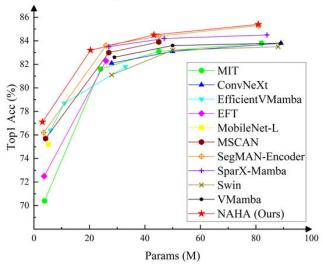  
Cityscapes Segmentation Result

SBD Segmentation Result  
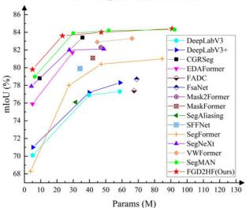  
ADE20K Segmentation Result

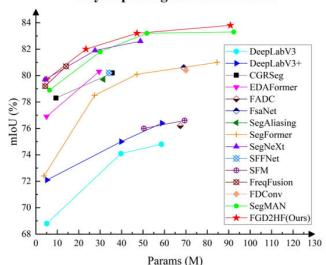

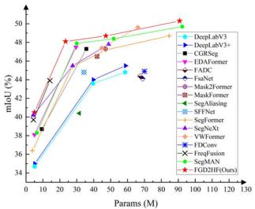  
Figure 1: NAHA Encoder classification performance compared with representative feature extraction backbones and semantic segmentation results of FGD2HF compared to state-of-the-art methods.

Therefore, efectively leveraging frequency-domain features to improve segmentation accuracy has gradually become an important research direction in recent years. In contrast to spatial-domain approaches, frequency-domain features capture diferent types of image information from a signal distribution perspective. By incorporating frequencydomain feature extraction, selection, and fusion, segmentation models can efectively suppress semantically irrelevant noise while reinforcing consistent target representations. This approach significantly enhances both segmentation accuracy and robustness in complex scenes.

We categorize existing frequency-based semantic segmentation methods into three technical routes. The first route focuses primarily on low-frequency information to enhance the consistency of target regions and global structural representations. Representative methods include DCT-EDANet [54], FDA [81], and FsaNet [87]. The second route further exploits the distinction between low- and highfrequency components. By decoupling, selecting, calibrating, or adaptively fusing low- and high-frequency components, these methods enhance boundary and detail preservation while maintaining global context consistency. Representative methods include FDNet [46], FADA [6], FADC [15], and FFR [83]. The third route underscores the importance of dual-domain collaborative modeling, facilitating seamless interaction between spatial and frequency representations. By integrating low- and high-frequency information with spatial features, these methods achieve improved segmentation performance in complex scenes and areas with ambiguous boundaries. Representative methods include DDFNet [47] and SFFNet [82]. Compared with the first two routes, dual-domain methods fully exploit the complementary advantages of frequency and spatial features, demonstrating stronger adaptability in complex scenarios.

However, existing spatial-frequency collaborative methods still face challenges. First, dual-domain feature extraction and fusion often require additional transformations, feature projections, and multi-branch interactions, which increase computational cost and memory consumption, especially for high-resolution images. Second, spatial and frequency features difer significantly in terms of representation form, semantic level, and responsive regions. Simple operations such as concatenation, addition, or weighted fusion may not achieve efective alignment. Instead, they risk introducing redundant information or semantic conflicts. Third, CNNs and Transformers tend to exhibit a low-pass filtering efect during deep feature extraction, where downsampling and global modeling progressively weaken high-frequency components, resulting in blurred boundaries, broken fine structures, and incomplete object contours [70]. Therefore, achieving efective fusion between spatial and frequency features with low computational cost, while simultaneously preserving high-frequency boundary information, remains a key challenge in frequency-based semantic segmentation.

To address these challenges, we propose a dual-domain feature fusion framework named FGD2HF for semantic segmentation that systematically addresses three key aspects:

(1) computational eficiency, (2) eficient cross-domain feature fusion, and (3) precise boundary preservation. FGD2HF employs Haar decomposition to decouple low- and highfrequency features from the preceding stage and uses the resulting frequency subbands to guide current-stage spatial feature enhancement and dual-domain fusion. The spatial locality of Haar decomposition and its downsampling factor establish a structured region-wise correspondence with current-stage features, alleviating the alignment burden in network design and addressing the problem of highfrequency propagation. Specifically, we introduce an Encoder called NAHA that jointly models local and global relationships through neighborhood and hypergraph attention, enhancing the network’s ability to extract efective features. We further introduce a Wavelet Transform and Enhancement (WTE) module to extract and refine low- and high-frequency cues from preceding-stage features, followed by Frequencyguided Dual-domain Fusion (FGDF) modules that use frequency cues to condition current-stage spatial grouping and feature propagation. Its frequency-guided hypergraph attention organizes spatial nodes into overlapping groups, with soft memberships jointly determined by global frequency context and aligned local frequency cues. Compared with standard full self-attention over (�) spatial tokens, using (�) hyperedges, where $( M \ \ll \ N )$ , reduces the number of relation weights from $( N ^ { 2 } )$ to (��), enabling compact spatial-frequency interaction.

In summary, our contributions are as follows:

(1) We propose FGD2HF, a Frequency-guided Dualdomain Hypergraph Fusion network for semantic segmentation. The framework decomposes preceding-stage features into low- and high-frequency subbands and adaptively uses the resulting frequency cues to guide current-stage spatial feature enhancement and fusion, boosting both segmentation accuracy and boundary precision.

(2) We develop a novel Hybrid-Attention Encoder, termed NAHA, which integrates neighborhood attention and hypergraph attention to jointly capture local and global dependencies, enhancing the network’s feature extraction capability while reducing computational complexity.

(3) We design a Wavelet Transform and Enhancement (WTE) module for high- and low-frequency decomposition and enhancement, and a Frequency-guided Dual-domain Fusion (FGDF) module that leverages frequency information to modulate spatial information, enabling eficient dualdomain feature fusion at low computational cost.

(4) Extensive experiments on multiple benchmark datasets demonstrate that our FGD2HF achieves highly competitive performance across diverse scenarios. Comprehensive ablation studies further verify the efectiveness and superiority of each proposed component.

## 2. Related Works

## 2.1. Semantic Segmentation

Semantic segmentation is a dense prediction task in computer vision that aims to assign a label to every pixel in an image [29]. It is widely applied in autonomous driving, robotic perception, medical analysis, and remote sensing. Early semantic segmentation approaches primarily relied on hand-crafted, low-level visual features such as edges, colors, textures, and region similarity [25]. Representative methods include edge detection techniques [3, 71], clustering-based algorithms [23, 1], support vector machines [59, 74], and Markov random fields [30, 64]. Although efective in simple scenarios, these methods often lack the representation capacity needed for accurate and robust segmentation in complex scenes with intricate structures, illumination changes, and noise.

With the rapid advancement of deep learning, CNNbased models [55, 63, 5, 16] have gradually become mainstream. These methods significantly improve segmentation performance by learning hierarchical spatial features in an end-to-end manner. However, CNNs primarily rely on local convolution operations [84]. While efective at modeling local textures, their restricted receptive fields limit their ability to capture global contextual information. The introduction of attention mechanisms spurred the development of Transformer-based segmentation models. Early methods such as SETR [88] and Segmenter [67] employ ViT as the backbone for feature extraction, verifying the feasibility of Transformer architectures in dense prediction tasks. However, these approaches incur substantial computational overhead because the self-attention mechanism scales quadratically with the number of input tokens. Subsequently, methods such as Swin Transformer [52], PVT [73], and Seg-Former [75] introduced hierarchical structures and multiscale features to address the lack of local inductive bias and the high computational overhead in ViT. Furthermore, MaskFormer [21] and Mask2Former [20] transformed the segmentation task from pixel-by-pixel classification to a mask classification problem, achieving unified modeling of semantic segmentation, instance segmentation, and panoptic segmentation. However, these methods mainly rely on spatial features and correlations, without explicitly modeling frequency characteristics or boundary details.

Given that frequency features are efective at capturing global structures, texture details, and boundary variations, using frequency information has become an important trend in semantic segmentation research. Early studies primarily focused on low-frequency and global information. For example, DCT-EDANet directly utilizes DCT compressed-domain representations for segmentation [54]. FsaNet reduces computational complexity and enhances intra-object consistency through low-frequency selfattention [87]. FDA achieves domain-style alignment using Fourier low-frequency components [81]. However, relying solely on low-frequency information limits performance in complex backgrounds, sharp boundaries, and subtle interclass texture variations. This has motivated the joint optimization of low- and high-frequency features. For instance,

FADA decomposes basic visual features into low- and highfrequency components using Haar wavelets to improve domain generalization [6]. FADC adaptively adjusts the receptive field and frequency response of atrous convolution from a spectral perspective [15]. FFR corrects the boundary oversmoothing problem caused by high-frequency attenuation in ViT-based weakly supervised segmentation [83]. These methods improve boundary preservation and detail recovery, but largely model frequency features in isolation, leaving their complementarity with spatial semantics underexplored.

More recently, advanced methods have begun to explore deep cross-domain interactions between frequency components and spatial features. DDFNet [47] selectively integrates low- and high-frequency components from both domains through a dynamic decoupling and fusion strategy, enabling the simultaneous capture of local textures and global semantics. SFFNet [82] decomposes features using Haar wavelets and then aligns and fuses low-frequency features with spatial global semantics and high-frequency features with spatial local details, thereby achieving efective complementarity between the frequency and spatial domains.

## 2.2. Frequency Domain Feature Learning

Frequency-domain analysis, as a powerful signal processing tool, provides a new perspective for understanding model optimization and generalization. In recent years, frequency-domain learning has been widely applied to address issues such as spectral bias, detail degradation, and artifacts in neural networks, achieving remarkable progress in image classification, object detection, and semantic segmentation [68, 38, 50, 4]. Kai Xu et al. introduced a DCTbased frequency-domain learning framework that reduces input redundancy while maintaining or improving recognition accuracy [76]. Yijie Zhong et al. incorporated frequency cues beyond RGB information to enhance camouflaged object detection [90]. FreqNet forces detectors to learn frequency-domain representations rather than relying on forgery-specific artifacts, improving generalization to unseen deepfake sources [69].

In semantic segmentation, FsaNet [87] introduces a frequency-domain attention mechanism that performs attention on low-frequency components, reducing computational complexity while maintaining segmentation performance. FADC [15] mitigates high-frequency detail loss and gridding artifacts in dilated convolution by adapting dilation rates to local high-frequency energy. FFR [83] addresses the low-pass bias of Vision Transformers with a dual-branch head that separately processes original and high-frequency features for sharper boundaries. FDNet [46] decouples lowand high-frequency components using learnable Gaussian kernels, recalibrates frequency channels, and applies frequency attention for fusion. DDFNet [47] further performs dynamic cross-domain decoupling and fusion to jointly model local textures and global semantics.

## 2.3. Hypergraph Neural Network

Hypergraphs are an extension of conventional graphs in graph theory and provide a more flexible framework for modeling multi-way relationships [7]. Unlike ordinary graphs, where each edge connects only two vertices, a hypergraph introduces the concept of hyperedges, each of which can connect an arbitrary number of vertices. In contrast to self-attention, which models all pairwise token interactions, hypergraph modeling captures global high-order dependencies through a small set of adaptive hyperedges, achieving near-linear complexity. This enables hypergraphs to capture global many-to-many relationships, making them well suited to complex relational tasks such as clustering, object detection, and recommendation systems [49, 27, 33, 42]. Eun-Sol Kim et al. proposed Hypergraph Attention Networks (HANs), a multimodal learning method designed to address the inconsistency of information hierarchies across diferent modalities, such as images and text [43]. HHGSA [42] leverages heterogeneous hypergraphs and attention mechanisms to model high-order social relationships and item similarities, significantly improving recommendation accuracy. YOLOv13 [45] introduces hypergraph mechanism to object detection, efectively boosting detection performance. M2I2HA [80] extends hypergraph attention to multimodal detection by constructing cross-modal hypergraphs and employing low-rank decomposition to reduce complexity, substantially improving detection accuracy.

In semantic segmentation, Shurong Chai et al. proposed an adaptive hypergraph neural network (AHGNN) for medical image segmentation, aiming to overcome the limitations of Transformers and graph convolutional networks in model ing non-pairwise relationships [10]. Weipeng Jing et al. proposed Hypergraph BiFormer (HGBT), a novel architecture for semantic segmentation of high-resolution remote sensing images. By introducing hypergraph structures, HGBT enhances the ability to model local features and segment multiscale objects [41]. Manothini Palanisamy et al. integrated hypergraph neural networks with multi-scale relational encoding for prostate cancer diagnosis. This framework combines spatial and spectral attention to improve boundary segmentation accuracy, while incorporating adaptive feature selection to enhance model generalization [60]. While hypergraph theory has already found applications in semantic segmentation, cross-domain relational modeling between the spatial and frequency domains based on hypergraphs remains largely unexplored. This underexplored direction holds great promise and calls for further investigation.

## 3. Methodology

In this section, we provide a detailed introduction to the proposed method. We begin by presenting our observations on image frequency decomposition and the design motivations. Then, we present an overview of the architecture, followed by in-depth discussions of the NAHA Encoder, the WTE module, the FGDF module, the Decoder, and the loss function design.

## 3.1. Preliminaries

Hypergraph. Graph structures excel at modeling pairwise relationships, but their descriptive capacity becomes limited when confronted with the multi-way associations prevalent in real-world scenarios. As a generalization of conventional graphs, hypergraphs allow hyperedges to connect any number of nodes, thereby ofering an intuitive and flexible means to represent high-order or group-wise relationships among entities.

A hypergraph can be formally represented as $\begin{array} { r l } { \mathcal { W } } & { { } = } \end{array}$ $( \mathcal { V } , \mathcal { E } )$ , where $\vec { \nu } ~ = ~ \{ v _ { 1 } , v _ { 2 } , . . . , v _ { n } \}$ denotes a finite set of � nodes, and $\begin{array} { r c l } { \mathcal { E } } & { = } & { \{ e _ { 1 } , e _ { 2 } , . . . , e _ { m } \} } \end{array}$ is a collection of � hyperedges, each of which is a non empty subset of $\mathcal { V } \left( \mathrm { i . e . } \right.$ $\textit { e } \subseteq \mathscr { V }$ and $\textit { e } \neq \textit { } \emptyset )$ . The structure of a hypergraph is commonly described by an incidence matrix $\pmb { A } \in \mathbb { R } ^ { n \times m }$ whose elements are defined as follows:

$$
\pmb { A } _ { i , j } = \left\{ { \begin{array} { l l } { 1 , } & { \mathrm { i f ~ } \mathrm { v e r t e x } \ v _ { i } \in \mathrm { h y p e r e d g e } \ e _ { j } } \\ { 0 , } & { \mathrm { o t h e r w i s e } } \end{array} } \right.\tag{1}
$$

Wavelet Transformation. Wavelet transformation is a signal analysis technique that jointly characterizes spatial and frequency information. For a 2D image or feature map, the wavelet transform applies low-pass and high-pass filtering along the horizontal and vertical directions, followed by downsampling, thereby decomposing the input into four frequency sub-bands: (1) the low-frequency component $L L .$ (2) the high-frequency components $L H , H L ,$ and ��, which capture horizontal, vertical, and diagonal variations, respectively.

Given an input feature map $F \in \mathbb { R } ^ { H \times W \times C }$ , a one-level 2D discrete wavelet transform can be formulated as

$$
\{ L L , L H , H L , H H \} = \mathrm { W T } ( F )\tag{2}
$$

where each sub-band generally has a spatial resolution of $\begin{array} { r } { { \frac { H } { 2 } } \times { \frac { W } { 2 } } } \end{array}$ . Therefore, wavelet decomposition explicitly separates structural information from fine-grained details while reducing the resolution. WT(⋅) denotes the 2D discrete wavelet transform operation. We can also reconstruct the decomposed frequency sub-bands to the original map without any loss by inverse wavelet transform IWT(⋅), i.e.

$$
F = \mathrm { I W T } ( L L , L H , H L , H H )\tag{3}
$$

Compared with conventional pooling or strided convolution, wavelet decomposition provides a fixed and interpretable frequency decomposition process and can alleviate the loss of detailed information during downsampling. Among diferent wavelet bases, the Haar wavelet is particularly attractive for lightweight vision networks because of its simple formulation and high computational eficiency.

## 3.2. Observations and Motivations

As illustrated in Fig. 2(a)-(d), we apply Haar wavelet decomposition to an example image and reconstruct its low- and high-frequency components separately. The highfrequency reconstruction is enhanced and normalized for visualization only. The low-frequency reconstruction retains the overall appearance and coarse structure, with some blurring around object boundaries, whereas the high-frequency reconstruction emphasizes edges and fine texture. For this example, the low- and high-frequency components account for 98.65% and 1.35% of the total coeficient energy, respectively. Reconstruction using all four subbands recovers the analyzed input.

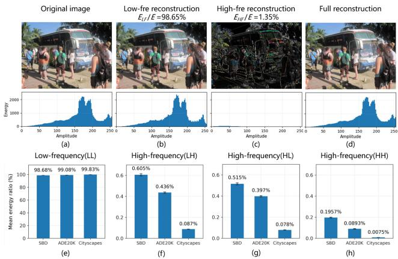  
Figure 2: Visualization of wavelet decomposition, image reconstruction and dataset-level energy statistics. (a) Original example image. (b) Low-frequency reconstruction. (c) Highfrequency reconstruction. (d) Full reconstruction. Energy percentages in (b,c) are for the example only and computed before enhancement. (e-h) Mean LL/LH/HL/HH energy ratios on diferent datasets. The energy ratio is computed from the squared $L _ { 2 } \cdot$ -norm of the Haar wavelet coeficients.

To assess whether this observation extends beyond the example, we compute dataset-level statistics, as shown in Fig. 2(e)-(h). The mean low-frequency energy ratios are 98.68%, 99.08%, and 99.83% on SBD, ADE20K, and Cityscapes, respectively, with corresponding high-frequency ratios of 1.315%, 0.922%, and 0.173%. These results indicate that low-frequency components dominate the average signal energy across the three analyzed datasets under the stated preprocessing protocol, while the precise ratios vary. Although energy magnitude alone does not establish a component’s importance for segmentation, the complementary structures visible in the reconstructions motivate incorporating both low-frequency context and high-frequency detail into spatial feature enhancement.

Based on these observations, we formulate the following design motivations:

(1) High-frequency components encode critical boundary cues. However, neural networks generally exhibit a spectral bias toward low-frequency information, limiting their ability to capture fine-grained details [62, 77, 57]. Moreover, attention layers exacerbate this issue [46]. Therefore, we can propagate high-frequency features from shallow stages to deeper stages for frequency-aware enhancement and fusion, improving boundary preservation and feature representation.

(2) Incorporating frequency components inevitably introduces additional computational overhead, especially in attention-based networks. Haar wavelet decomposition of preceding-stage spatial features produces spatially localized frequency subbands at the resolution of the current stage.

These subbands support region-wise correspondence with current-stage spatial features. Thus, decomposing features from the preceding-stage to enhance the current-stage not only supports the first motivation but also naturally aligns the resolutions of adjacent stages, facilitating spatial-frequency fusion and easing the alignment burden that may arise when fusing independently processed dual-domain branches.

(3) High-frequency components may contain both boundaryrelevant details and task-irrelevant noise. We therefore introduce an auxiliary boundary prediction task on the high-frequency-guided spatial features. This supervision encourages these representations to encode discriminative boundary cues, complementing the main semantic segmentation objective.

## 3.3. Overall Architecture

Existing spatial-frequency fusion methods often process spatial and frequency features in parallel before fusion, which can introduce additional computational overhead and complicate cross-domain feature alignment. In contrast, our framework applies Haar wavelet decomposition directly to the encoded features of the preceding stage. Wavelet decomposition’s spatial locality, combined with its downsampling factor matching the inter-stage resolution change, enables region-wise correspondence between its subbands and current-stage spatial features [34]. This design reuses the existing feature hierarchy for frequency extraction, reducing the overhead associated with independent frequency encoding. The resulting frequency cues guide the grouping and enhancement of current-stage spatial features through hypergraph theory, achieving adaptive spatial-frequency fusion and fine-grained representation. Moreover, the enhanced features from the high-frequency-guided branch support multi-scale auxiliary boundary prediction, which encourages adaptive use of boundary-relevant high-frequency cues and mitigates boundary-detail loss caused by high-frequency attenuation in deep networks.

Fig. 3 illustrates the overall architecture of the proposed FGD2HF network, which comprises a hybrid-attention encoder (NAHA), a Wavelet Transform and Enhancement (WTE) module, Frequency-guided Dual-domain Fusion (FGDF) modules, and a HyperDecoder. The main processing stages are described as follows.

(1) During encoding, NAHA combines neighborhood attention and hypergraph attention to extract multi-scale features $\{ F _ { i } \} _ { i = 1 } ^ { 4 }$ . Neighborhood attention captures local relationships, while hypergraph attention models global highorder interactions, enabling complementary local and global feature learning.

(2) For each stage $i \in \{ 2 , 3 , 4 \}$ , WTE applies Haar wavelet decomposition to the preceding-stage feature $F _ { i - 1 }$ yielding four spatially localized subbands $\{ L L _ { i } , L H _ { i } , H L _ { i } ,$ $H H _ { i } \}$ at the resolution of the current-stage feature $F _ { i } .$ . The three high-frequency subbands are concatenated along the channel dimension, after which low-frequency refinement and low-frequency-conditioned high-frequency modulation are applied to obtain $\mathcal { F } _ { i } ^ { l }$ and $\mathcal { F } _ { i } ^ { h }$

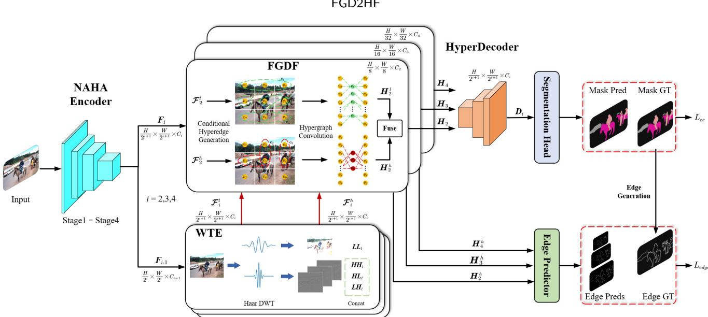  
Figure 3: Overall architecture of the proposed FGD2HF network.

(3) Each FGDF module uses $\mathcal { F } _ { i } ^ { l }$ and $\mathcal { F } _ { i } ^ { h }$ to guide spatial feature enhancement through separate low- and highfrequency branches. Within each branch, global frequency context and aligned local frequency cues jointly condition node–hyperedge associations. Spatial features are aggregated into a compact set of hyperedges, transformed nonlinearly, and propagated back to the nodes, enabling frequencyconditioned high-order feature enhancement and spatial– frequency fusion. The two branch outputs $\pmb { H } _ { i } ^ { l }$ and $\pmb { H } _ { i } ^ { h }$ are concatenated and fused by a convolution, followed by a scaled residual connection with $F _ { i }$ to produce $\pmb { H } _ { i }$

(4) During decoding, the HyperDecoder further refines the enhanced multi-scale features $\{ \pmb { H } _ { i } \} _ { i = 2 } ^ { 4 }$ and obtains the decoder representations $\{ { \pmb D } _ { i } \} _ { i = 2 } ^ { 4 } .$

(5) Finally, the decoder representations are fed into a segmentation head to generate the dense prediction, which is supervised by a pixel-wise cross-entropy loss. Meanwhile, the high-frequency-guided features $\{ \bar { \pmb { H } } _ { i } ^ { \bar { h } } \} _ { i = 2 } ^ { 4 }$ are passed to an edge predictor to generate multi-scale boundary predictions, providing deep supervision through an auxiliary boundary loss.

## 3.4. NAHA Encoder

Previous studies have shown that local context, global context, and multi-scale context modeling across intermediate features are fundamental to accurate semantic segmentation [85, 28, 29]. To enhance the network’s feature extraction capability and provide high-quality semantic representations for subsequent frequency feature extraction and dual-domain fusion, we propose a Neighborhood-Hypergraph Attention encoder, termed NAHA, which integrates Neighborhood Attention to handle local dependencies and Hypergraph Attention to capture global relationships. The encoder takes image as input $\mathbf { \bar { \boldsymbol { X } } } \in \bar { \mathbb { R } } ^ { H \times W \times 3 }$ . Here, � and � representthe height and width of the image. As shown in Fig. 4, the input first passes through a stem block, which partitions the input into patches and generates feature map. Then, this feature is processed by a series of Neighborhood Attention (NA) blocks and downsampling blocks to generate multi-level features $\{ F _ { i } ^ { \prime } \in \mathbb { R } ^ { \frac { H } { 2 ^ { i + 1 } } \times \frac { W } { 2 ^ { i + 1 } } \times C _ { i } } \} _ { i = 1 } ^ { 4 }$ . Then, multi-level features $\{ { F } _ { i } ^ { \prime } \} _ { i = 2 } ^ { 4 }$ are fed into a Hypergraph Attention (HA) block for global hypergraph enhancement, which captures global many-to-many relationships, producing enhanced features $\{ \hat { F } _ { i } ^ { \prime } \in \mathbb { R } ^ { \frac { H } { 2 ^ { i + 1 } } \times \frac { W } { 2 ^ { i + 1 } } \times C _ { i } } \} _ { i = 2 } ^ { 4 }$ . Finally, the enhanced features $\{ \hat { F } _ { i } ^ { \prime } \} _ { i = 2 } ^ { 4 }$ are added back to $\{ { F } _ { i } ^ { \prime } \} _ { i = 2 } ^ { 4 }$ to obtain the final multilevel features $\{ F _ { i } \} _ { i } ^ { 4 } = 2$ . The process can be formulated as follows:

$$
\begin{array} { r l } & { F _ { 1 } ^ { \prime } = \mathrm { N A } _ { 1 } ( \mathrm { s t e m } ( X ) ) , \quad F _ { i } ^ { \prime } = \mathrm { N A } _ { i } ( \mathrm { D o w n } ( F _ { i - 1 } ^ { \prime } ) ) } \\ & { \quad ( \hat { F } _ { 2 } ^ { \prime } , \hat { F } _ { 3 } ^ { \prime } , \hat { F } _ { 4 } ^ { \prime } ) = \mathrm { H A } ( F _ { 2 } ^ { \prime } , F _ { 3 } ^ { \prime } , F _ { 4 } ^ { \prime } ) \quad i \in \{ 2 , 3 , 4 \} } \\ & { \qquad F _ { 1 } = F _ { 1 } ^ { \prime } , \quad F _ { i } = F _ { i } ^ { \prime } + \hat { F } _ { i } ^ { \prime } } \end{array}\tag{4}
$$

Where NA(⋅) and HA(⋅) denote the Neighborhood Attention and Hypergraph Attention calculations, respectively.

Neighborhood Attention Block (NA). As shown in Fig. 5, the design of the NA block is inspired by SegMAN [29]. In contrast to SegMAN, which relies on SS2D [51] for global modeling, our method adopts LR-C3AH [80] as an alternative and restricts its application to the last block alone. Such a strategy efectively lowers computational cost while simultaneously improving the capacity for global context modeling (details are provided in Section 4.6). Specifically, in the NA block, the input $F _ { i - 1 } ^ { \prime }$ is first normalized and passed through a $3 \times 3$ convolution. Then, NATTEN [36] and LR-C3AH blocks are employed to model local relationships and global semantics, respectively. The output is then added back to $F _ { i - 1 } ^ { \prime }$ via a residual connection to produce $F _ { i } ^ { l } .$ Subsequently, $F _ { i } ^ { l }$ is normalized, processed by another $3 \times 3$ convolution, and then passed through a simple depthwise convolutional feed-forward network (FFN) [75] to perform local spatial feature enhancement, yielding the final output $F _ { i } ^ { \prime }$

NAHA Encoder  
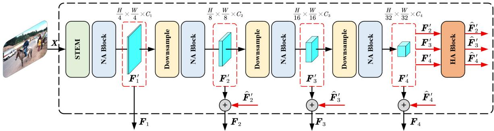  
Figure 4: The structure of the NAHA encoder.

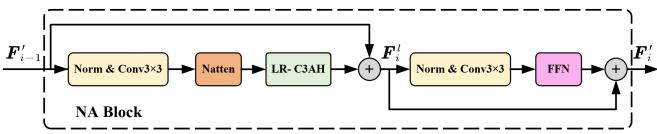  
Figure 5: The NA block in the NAHA encoder.

Table 1  
Configurations of the four NAHA variants. FLOPs were measured at the 224 × 224 resolution.
<table><tr><td>NAHA Encoders</td><td>Channels</td><td>Depths</td><td>Params (M)</td><td>FLOPs (G)</td></tr><tr><td>Tiny</td><td>[32,64,144,192]</td><td>[2,2, 4,2]</td><td>3.08</td><td>0.78</td></tr><tr><td>Small</td><td>[48,96,256,384]</td><td>[2,2, 10,4]</td><td>20.40</td><td>3.38</td></tr><tr><td>Base</td><td>[64,160,320,512]</td><td>[4,4,18,4]</td><td>43.22</td><td>8.61</td></tr><tr><td>Large</td><td>[96,192,432,640]</td><td>[4, 4,24, 4]</td><td>80.87</td><td>16.80</td></tr></table>

Hypergraph Attention Block (HA). The HA block follows previous work [80]. Here, it is integrated into the encoder for multi-scale feature aggregation and global relationship modeling. In the HA block, the multi-scale features $\{ { F } _ { i } ^ { \prime } \} _ { i = 2 } ^ { 4 }$ are aggregated to generate high-order global information, which then undergoes a size transformation to yield the enhanced features $\{ \hat { F } _ { i } ^ { \prime } \} _ { i = 2 } ^ { 4 }$ corresponding to $\{ F _ { i } ^ { \prime } \} _ { i = 2 } ^ { 4 }$ . HA block leverages low-rank decomposition and sparsification to further reduce the number of parameters and inference latency while preserving high-order modeling capability and near-linear complexity. As this is not a core contribution of this paper, we do not elaborate on the details here. Interested readers are referred to [80] for further details.

The configurations of NAHA Encoders are presented in Table 1.

## 3.5. Wavelet Transform and Enhancement

In complex scenes, intricate textures and rapid local appearance changes make precise boundary delineation challenging. Repeated spatial aggregation and downsampling can attenuate fine structural details, leading to overly smooth predictions and inaccurate boundaries. Frequency cues provide complementary information: low-frequency components capture coarse structures, whereas high-frequency components represent sharp transitions and fine details, including boundaries and textures. However, high-frequency responses may also contain noise, highlighting the need for selective enhancement. Moreover, relying solely on frequency representations can complicate the modeling of spatially localized features, whereas processing spatial and frequency features in separate branches may introduce additional computational overhead and require explicit crossdomain alignment.

We therefore introduce the Wavelet Transform and Enhancement (WTE) module to extract and enhance frequency cues directly from existing encoder features. As shown in Fig. 6, WTE applies a Haar wavelet transform to the preceding-stage features $\{ F _ { i - 1 } \in \mathbb { R } ^ { \frac { H } { 2 ^ { i } } \times \frac { W } { 2 ^ { i } } \times C _ { i - 1 } } \} _ { i = 2 } ^ { 4 } ,$ producing one low-frequency subband $L L _ { i } \in \mathbb { R } ^ { \frac { H } { 2 ^ { i + 1 } } \times \frac { W } { 2 ^ { i + 1 } } \times C _ { i - 1 } }$ and three directional high-frequency subbands $\{ L H _ { i } , H L _ { i } ,$ $H H _ { i } \}$ , each subband belongs to $\scriptstyle { \mathbb { R } ^ { \frac { H } { 2 ^ { i + 1 } } \times \frac { W } { 2 ^ { i + 1 } } \times C _ { i - 1 } } }$ . After a channel transformation, $L L _ { i }$ is converted into $ { \mathcal { L } } _ { i } \in$ $\mathbb { R } ^ { \frac { H } { 2 ^ { i + 1 } } \times \frac { W } { 2 ^ { i + 1 } } \times C _ { i } }$ . The set $\{ L H _ { i } , H L _ { i } , H H _ { i } \}$ is concatenated along the channel dimension and then subjected to a channel transformation to obtain $\mathcal { H } _ { i } \in \mathbb { R } ^ { \frac { H } { 2 ^ { i + 1 } } \times \frac { W } { 2 ^ { i + 1 } } \times C _ { i } }$

Then, WTE combines residual low-frequency refinement with low-frequency-conditioned high-frequency modulation to get enhanced frequency features

$$
\mathcal { F } _ { i } ^ { l } = \mathcal { L } _ { i } + \mathcal { R } _ { l } ( \mathcal { L } _ { i } ) , \qquad \mathcal { F } _ { i } ^ { h } = \mathcal { H } _ { i } + G _ { i } \odot \mathcal { H } _ { i }\tag{5}
$$

Where $\mathcal { R } _ { l }$ consists of a $3 \times 3$ depthwise convolution, GELU, and a $1 \times 1$ pointwise convolution.

Compared with independently enhancing high- and lowfrequency components, we further leverage low-frequency context to modulate high-frequency responses. The motivation is that high-frequency responses can characterize local detail variations, but their response magnitude alone is insuficient to determine the importance of these variations for segmentation, since object boundaries, complex textures, and noise may all produce strong high-frequency responses. Low-frequency features, in contrast, provide coarse-scale structure and regional context, ofering complementary evidence for judging the relevance of high-frequency details. Therefore, we jointly use low-frequency context and highfrequency local cues to generate spatial gating, so that the enhancement or attenuation of high-frequency responses simultaneously accounts for local variations and their surrounding structural environment, thereby achieving contextaware detail modulation.

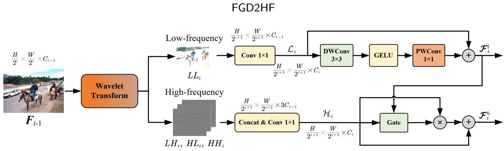  
Figure 6: The Wavelet Transform and Enhancement Module.

$$
\begin{array} { r l } & { \quad _ { i } h _ { i } ^ { h } = \left[ { \mathrm { M e a n } } _ { c } ( | \mathcal { H } _ { i } | ) , { \mathrm { M a x } } _ { c } ( | \mathcal { H } _ { i } | ) \right] \in \mathbb R ^ { H _ { i } \times W _ { i } \times 2 } } \\ & { \quad _ { G _ { i } } = \left( 2 \sigma \left( { \mathrm { C o n v } } _ { 3 \times 3 } \left[ P _ { l } ( \mathcal { F } _ { i } ^ { l } ) , B _ { i } ^ { h } \right] \right) - 1 \right) \in \mathbb R ^ { H _ { i } \times W _ { i } \times 1 } } \end{array}\tag{6}
$$

Where $P _ { l }$ is a $1 \times 1$ projection. The resulting single-channel gate is broadcast across feature channels, enabling positiondependent attenuation or amplification of high-frequency responses while maintaining spatial resolution.

The resulting frequency features subsequently guide hypergraph-based spatial feature enhancement and dualdomain fusion. This design provides a lightweight pathway for transferring frequency cues across stages and adaptively incorporating them into deeper representations, without requiring an independent frequency encoder.

## 3.6. Frequency-guided Dual-domain Fusion

Simple addition or concatenation provides limited explicit modeling of interactions between spatial- and frequency domain features, whereas full cross-attention between dense feature maps can introduce substantial computational overhead. To enable efective dual-domain interaction at low computational cost, we propose frequency-guided hypergraph fusion as shown in Fig. 7. Compared with spatial-only hypergraph construction, our mechanism conditions nodehyperedge associations on both global frequency context and aligned local frequency cues. Global context adaptively modulates spatial representations, while local cues provide position-dependent guidance for node grouping. The resulting associations support spatial feature aggregation, nonlinear processing, and redistribution through a compact set of hyperedges, enabling frequency-conditioned interaction at the group level. We further employ low-rank projections to improve parameter eficiency. Each FGDF module contains parallel low- and high-frequency guided hypergraphs. Taking one branch as an example, the detailed formulation is provided below.

Definition 1. Node Representation. Given the flatten spatial feature matrix $F _ { i } = [ \mathbf { \bar { f } } _ { 1 } , . . . , \mathbf { f } _ { N } ] \in \mathbb { R } ^ { N _ { i } \times C _ { i } }$ and flatten frequency feature matrix $\boldsymbol { \mathcal { F } } _ { i } ~ = ~ [ f _ { 1 } , . . . , f _ { N } ] ~ \in ~ \mathbb { R } ^ { N _ { i } \times C _ { i } }$ of stage �, where $N _ { i } = H _ { i } \times W _ { i }$ is the number of nodes and $C _ { i }$ is the feature dimension. For simplicity, the variable names are kept unchanged here.

For the hyperedge prototype matrix, we introduce a lowrank node projection matrix $V _ { i } ^ { 1 } ~ \in ~ \mathbb { R } ^ { r \times C _ { i } }$ and frequency projection matrix $V _ { i } ^ { 2 } \in \mathbb { R } ^ { r \times C _ { i } }$ , a low-rank hyperedge basis matrix $U _ { i } ~ \in ~ \mathbb { R } ^ { M \times r }$ , and an edge-wise bias vector $\mathbf { \psi } _ { { b } _ { i } } \in \mathbf { \psi } _ { \mathbf { \psi } }$ $\mathbb { R } ^ { M }$ , where $r \ll C _ { i }$ denotes the low-rank dimension. The spatial and frequency features are first normalized and then projected into the �-dim low-rank space

$$
\begin{array} { r l } & { Z _ { i } ^ { \mathbf { f } } = \mathrm { L N } _ { \mathbf { f } } ( F _ { i } ) V _ { i } ^ { 1 ^ { \mathrm { T } } } \in \mathbb { R } ^ { N _ { i } \times r } } \\ & { Z _ { i } ^ { f } = \mathrm { L N } _ { f } ( \mathscr { F } _ { i } ) V _ { i } ^ { 2 ^ { \mathrm { T } } } \in \mathbb { R } ^ { N _ { i } \times r } } \end{array}\tag{7}
$$

Where LN(⋅) represents layer normalization.

Unlike the spatial-only hypergraph construction which uses the original spatial information for context generation, here we use frequency information for context information generation and modulate the spatial information. Specifically, global average pooling and global max pooling are applied to the low-rank frequency representations

$$
C _ { i } = \left[ \operatorname { M e a n P o o l } ( Z _ { i } ^ { f } ) ; \operatorname { M a x P o o l } ( Z _ { i } ^ { f } ) \right] \in \mathbb { R } ^ { 1 \times 2 r }\tag{8}
$$

A lightweight multilayer perceptron is then used to generate a rank-wise context gate

$$
\pmb { g } _ { i } = 2 \sigma \left( \mathbf { M L P } ( \pmb { C } _ { i } ) \right) \in \mathbb { R } ^ { 1 \times r }\tag{9}
$$

Where $\sigma ( \cdot )$ denotes the sigmoid activation function.

Finally, the context-enhanced low-rank node representations are obtained by rank-wise modulation of spatial node information together with scaled frequency feature information. This reduces computational cost while not only fusing spatial and frequency information but also efectively preserving the positional correspondence between frequency and spatial information

$$
Z _ { i } = Z _ { i } ^ { \mathbf { f } } \odot \mathbf { g } _ { i } + \alpha Z _ { i } ^ { f }\tag{10}
$$

Where ⊙ denotes element-wise multiplication and $\pmb { g } _ { i }$ is broadcast across all nodes. � is a learnable scalar parameter. Intuitively, the term $Z _ { i } ^ { \mathbf { f } } \odot g _ { i }$ represents global frequencyconditioned spatial modulation, while the term $\alpha Z _ { i } ^ { f }$ injects local frequency representations aligned with spatial positions, thereby achieving the fusion of the spatial and frequency domains.

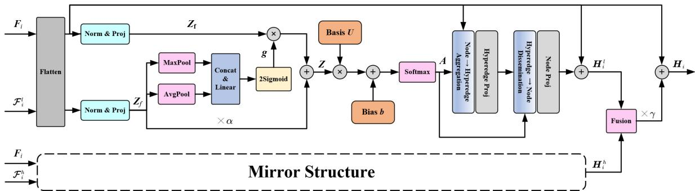  
Figure 7: The Frequency-guided Dual-domain Fusion Module. Mirror Structure denotes that the high-frequency and low-frequency branches have identical architectures but do not share network parameters.

Definition 2. Participation matrix. Based on the contextenhanced low-rank node representations $Z _ { i } ,$ the low-rank hyperedge basis matrix $U _ { i } ,$ and the edge-wise bias vector $\pmb { b } _ { i }$ defined in Definition 1, the association score matrix is defined as

$$
{ \boldsymbol { S } } _ { i } = { \frac { Z _ { i } U _ { i } ^ { \mathrm { T } } } { \sqrt { r } } } + { \boldsymbol { b } } _ { i } \in \mathbb { R } ^ { N _ { i } \times M }\tag{11}
$$

Where $S _ { i }$ is the raw association score matrix, representing the weight of nodes relative to edges.

Then, participation matrix $\pmb { A } _ { i }$ can be defined as

$$
A _ { i } ^ { j , k } = \frac { \exp ( S _ { i } ^ { j , k } ) } { \sum _ { m = 1 } ^ { M } \exp ( S _ { i } ^ { j , m } ) }\tag{12}
$$

Where $\pmb { A } _ { i } \in \mathbb { R } ^ { N _ { i } \times M }$ is the participation matrix, representing the normalized association between nodes and hyperedges.

Definition 3. Node → Hyperedge Aggregation. Based on participation matrix $\pmb { A } _ { i }$ and raw spatial feature matrix $F _ { i }$ the aggregated feature of hyperedge is defined as

$$
\begin{array} { c } { { \displaystyle W _ { i } = ( { \pmb D } _ { i } ^ { e } ) ^ { - 1 } { \pmb A } _ { i } ^ { \top } { \pmb F } _ { i } } } \\ { { \displaystyle D _ { i } ^ { e } = \mathrm { d i a g } ( \sum _ { j = 1 } ^ { N _ { i } } { \pmb A } _ { i } ^ { j , 1 } , . . . , \sum _ { j = 1 } ^ { N _ { i } } { \pmb A } _ { i } ^ { j , M } ) } } \end{array}\tag{13}
$$

Where ${ \pmb W } _ { i } \in \mathbb { R } ^ { M \times C _ { i } }$ is the hyperedge aggregation matrix.

Definition 4. Hyperedge → Node Dissemination. The updated node matrix is defined as

$$
H _ { i } ^ { v } = F _ { i } + f _ { n } ( A _ { i } f _ { e } ( W _ { i } ) ) \qquad ( v = l , h )\tag{14}
$$

Where, $f _ { n } ( \cdot )$ and $f _ { e } ( \cdot )$ denote the learned nonlinear projection functions on nodes and hyperedges, respectively. $\pmb { H } _ { i } ^ { v }$ denotes the final enhanced feature after dual-domain fusion, where $v = l$ and $v = h$ denote the low- and high-frequency branches, respectively.

Finally, $\pmb { H } _ { i } ^ { l }$ and $\pmb { H } _ { i } ^ { h }$ are concatenated and fused. The fused feature is then added to the original spatial input via a residual connection, yielding the final output $H _ { i }$

$$
H _ { i } = F _ { i } + \gamma \mathrm { C o n v } _ { 3 \times 3 } \left( \mathrm { C o n c a t } ( H _ { i } ^ { l } , H _ { i } ^ { h } ) \right)\tag{15}
$$

where � is a learnable scalar parameter.

Unlike the conventional dual-domain decoupled fusion paradigms adopted in DDFNet [47] and SFFNet [82], which transform spatial- and frequency-domain features in parallel and decompose both into low- and high-frequency components, our method applies Haar decomposition to precedingstage encoder features and uses the resulting frequency representations to guide current-stage spatial grouping and feature propagation. This design not only alleviates the misalignment caused by parallel transformations across the spatial and frequency domains but also reduces computational overhead.

## 3.7. HyperDecoder and Prediction Heads

To integrate the enhanced multi-level features, we design a HyperDecoder equipped with a hypergraph attention (HA) block. As shown in Fig. 8(a), the features $\{ \pmb { H } _ { 2 } , \pmb { H } _ { 3 } , \pmb { H } _ { 4 } \}$ are first projected to a common channel dimension, yielding $\{ \hat { H } _ { 2 } , \hat { H } _ { 3 } , \hat { H } _ { 4 } \}$ . The HA block models high-order relationships across these feature levels and produces multi-level enhanced representations that match the spatial resolution of each level. These refined features are then added to the corresponding $\begin{array} { r } { \hat { H } _ { i } , } \end{array}$ , yielding the refined features $\{ D _ { 2 } , D _ { 3 } , D _ { 4 } \}$

As illustrated in Fig. 8(b), $\pmb { { \cal D } } _ { 2 }$ and ${ \pmb D } _ { 4 }$ are downsampled and upsampled, respectively, to match the spatial resolution of ${ \pmb D } _ { 3 }$ . The aligned features are concatenated along the channel dimension and fused by a 1×1 convolution. A subsequent $1 \times 1$ classifier produces pixel-wise class predictions.

In parallel, the high-frequency-guided spatial features $\{ \pmb { H } _ { 2 } ^ { h } , \pmb { H } _ { 3 } ^ { h } , \pmb { H } _ { 4 } ^ { h } \}$ are fed into a multi-level edge prediction head, as shown in Fig. 8(c), to produce boundary predictions $\{ \hat { E } _ { 2 } , \hat { E } _ { 3 } , \hat { E } _ { 4 } \}$ at diferent scales. These predictions are supervised by an auxiliary edge loss, encouraging the network to use high-frequency cues to learn boundary-sensitive representations.

## 3.8. Loss function

To design the loss function, we adopt a joint formulation consisting of a pixel-level loss $L _ { \mathrm { p i x e l } }$ and an auxiliary boundary loss $L _ { \mathrm { e d g e } } .$ The pixel-wise cross-entropy loss supervises semantic classification, while the auxiliary boundary loss provides explicit supervision for boundary localization and encourages boundary-sensitive representations.

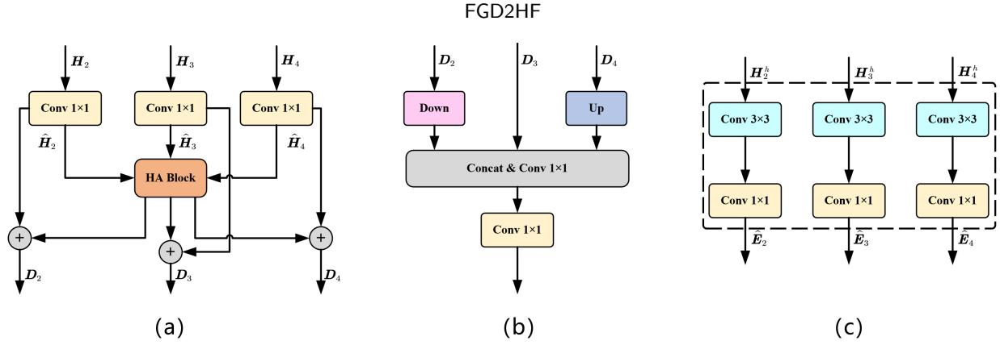  
Figure 8: (a) HyperDecoder. (b) Segmentation head. (c) Multi-level edge prediction head.

The pixel-wise loss is computed using the cross-entropy loss between the predicted mask and the ground truth label, defined as follows:

$$
L _ { \mathrm { p i x e l } } = - \frac { 1 } { H W } \sum _ { i = 1 } ^ { H } \sum _ { j = 1 } ^ { W } \sum _ { c = 1 } ^ { C } Y ( i , j , c ) \log ( \hat { Y } ( i , j , c ) )\tag{16}
$$

Where � and � are the height and width of the feature map, � is the number of classes, $Y ( i , j , c )$ is the one-hot representation of the ground truth label $Y ( i , j )$ , and $\hat { Y } ( i , j , c )$ represents the predicted probability of class � at spatial location (�, �). This loss aims to enable the network to accurately classify each pixel.

For the auxiliary boundary loss, we employ deep supervision, ensuring the high-frequency information at each layer can adapt correctly. The loss for multi-level edge predictions is summed and averaged, which is defined as:

$$
L _ { \mathrm { e d g e } } = \frac { 1 } { K H W } \sum _ { k = 1 } ^ { K } \sum _ { i = 1 } ^ { H } \sum _ { j = 1 } ^ { W } | E ( i , j ) - \operatorname { I } ( \hat { E } _ { k } ) ( i , j ) |\tag{17}
$$

Where $E ( i , j )$ is the binary edge ground truth label. It is generated from the semantic ground truth $Y ( i , j )$ following the boundary generation method in DDFNet [47]. This step is carried out ofline in the data preprocessing stage, so no diferentiable operation is involved and no gradient needs to be propagated through it. $\hat { E } _ { k } ( i , j )$ denotes the �-th binary edge prediction, and I(⋅) denotes the interpolation operation used to resize the predicted edge mask to the original $H \times W$ resolution. This loss constrains the network to efectively utilize high-frequency information, enhancing the continuity and precision of the edge predictions.

The total loss function of the network is defined as:

$$
L _ { \mathrm { t o t a l } } = \lambda L _ { \mathrm { p i x e l } } + ( 1 - \lambda ) L _ { \mathrm { e d g e } }\tag{18}
$$

Where � is a hyperparameter that controls the trade-of between semantic classification and boundary localization. An appropriate value of � is crucial for balancing the pixel-level prediction accuracy and the smoothness of the boundaries.

## 4. Experiments and Results

In this section, we conduct experiments to demonstrate the efectiveness of the proposed FGD2HF. First, we briefly introduce the dataset, experimental setup, and evaluation metrics. Next, we present detailed comparisons between our method and several benchmark methods on relevant datasets. Finally, we perform ablation studies to verify the necessity of each proposed module.

## 4.1. Settings

Datasets. To comprehensively evaluate the performance of the proposed FGD2HF, experiments were conducted on three widely recognized public benchmark datasets: Pascal VOC (SBD) [35], Cityscapes [24] and ADE20K [91].

Baselines. We selected representative strong baselines for comparison, including methods without frequency information, such as DeepLabV3 [17], DeepLabV3+ [18], Seg-Former [75], SegNeXt [32], VWFormer [78], EDAFormer [86] and SegMAN [29], as well as methods that employ frequency information, such as FsaNet [87], FADC [15], SegAliasing [13], FreqFusion [11], SFM [12], FDConv [14], and SFFNet [82].

Implementation details. All experiments were conducted on a Linux server using PyTorch, equipped with an AMD Ryzen 9 9950X CPU and two NVIDIA RTX Pro 6000 GPUs (96GB). For the unified inference-speed benchmark reported in Table 5, all models were evaluated on a single NVIDIA A100 GPU. To ensure fair comparison, we keep the common parameters consistent across all experiments as much as possible. We applied standard data augmentation techniques, such as random flip, random crop and random scale. However, strong augmentations (e.g., Mosaic, Copy-Paste, CutMix) were prohibited. Inference was performed in FP32 mode without augmentation. Inference eficiency is evaluated using frames per second (FPS), calculated as the number of processed images divided by the total model forward-pass time. Measurements use synthetic input tensors stored on the GPU and exclude data loading, input preparation, and post-processing. The default training and inference configurations are summarized in Table 2.

Metrics. We adopt mean Intersection over Union (mIoU) as the primary metric for evaluating overall segmentation performance. We further assess boundary quality using mean Boundary IoU (mBIoU) and mean boundary F1 score (mBF1). For mBIoU, the boundary-band width is set to 2% of the image diagonal, while mBF1 uses one-pixelwide boundaries with a matching tolerance of 0.8% of the image diagonal. Boundaries are extracted separately for each semantic class, and pixels with the ignore label are excluded from evaluation. For both metrics, boundary statistics are accumulated across the entire evaluation set for each class before computing the class-wise scores, which are then averaged over valid classes.

Table 2  
Default training and inference configurations.
<table><tr><td>Items</td><td>Values</td></tr><tr><td colspan="2">Training Settings</td></tr><tr><td>Image size</td><td>512 × 512 (1024 × 1024 for Cityscapes)</td></tr><tr><td>Batch size</td><td>32</td></tr><tr><td>AMP</td><td>True</td></tr><tr><td colspan="2">Optimization</td></tr><tr><td>Optimizer</td><td>AdamW</td></tr><tr><td>Initial LR</td><td>0.0006</td></tr><tr><td>Backbone LR scale</td><td>0.1</td></tr><tr><td>Weight decay</td><td>0.01</td></tr><tr><td>beta1</td><td>0.9</td></tr><tr><td>beta2</td><td>0.999</td></tr><tr><td colspan="2">Scheduler</td></tr><tr><td>Scheduler</td><td>PolyLR</td></tr><tr><td>Power</td><td>0.9</td></tr><tr><td colspan="2">Data Augmentation</td></tr><tr><td>HSV-H</td><td>0.01</td></tr><tr><td>HSV-S</td><td>0.4</td></tr><tr><td>HSV-V</td><td>0.25</td></tr><tr><td>Translate</td><td>0.05</td></tr><tr><td colspan="2">Loss Weights</td></tr><tr><td>CE loss weights (pixel)</td><td>0.8</td></tr><tr><td>Geo loss (edge)</td><td>0.2</td></tr></table>

## 4.2. Performance of NAHA Encoder

To evaluate the feature extraction capability of our proposed NAHA encoder, we pretrain it on the ImageNet-1k dataset for image classification. The classification results are compared with the backbones used in comparative segmentation methods (e.g., MobileNetV3 [39], MIT [75], MSCAN [32], EFT [86], SagMAN-Encoder [29]) as well as other visual representation backbones (e.g., Swin [52], ConvNeXt [53], Vim [92], VMamba [51], EficientV-Mamba [61], SparX-Mamba [56]). The comparison results are shown in Table 3.

The results demonstrate that the NAHA encoder achieves competitive performance compared with state-of-the-art backbones, ofering a favorable balance between model complexity and accuracy. In the comparison with lightweight models, NAHA-T achieves the best classification accuracy of 77.1% with the lowest parameter count of 3.1 M and a comparable computational cost of 0.8 GFLOPs, outperforming the recently proposed Mamba-based EficientVMamba-T by 0.7%. NAHA-S achieves an accuracy of 83.2%. Although this is not the highest accuracy, it uses the fewest parameters and FLOPs (21% and 17% fewer than the best

Comparison of NAHA encoder with state-of-the-art backbones on the ImageNet-1K datasets.
<table><tr><td>Models</td><td>Params (M)</td><td>GFLOPs</td><td>Top-1 Acc (%)</td></tr><tr><td>MIT-B0</td><td>3.8</td><td>0.6</td><td>70.4</td></tr><tr><td>MSCAN-T</td><td>4.2</td><td>0.9</td><td>75.7</td></tr><tr><td>EFT-T</td><td>3.7</td><td>0.6</td><td>72.5</td></tr><tr><td>MobileNetV3-L</td><td>5.2</td><td>0.5</td><td>75.2</td></tr><tr><td>SegMAN-Encoder-T</td><td>3.5</td><td>0.7</td><td>76.2</td></tr><tr><td>EfficientVMamba-T</td><td>6.0</td><td>0.8</td><td>76.4</td></tr><tr><td>NAHA-T (Ours)</td><td>3.1</td><td>0.8</td><td>77.1</td></tr><tr><td>EfficientVMamba-S</td><td>11.0</td><td>1.3</td><td>78.7</td></tr><tr><td>MIT-B2</td><td>24.0</td><td>4.0</td><td>81.6</td></tr><tr><td>MSCAN-B</td><td>27.0</td><td>4.4</td><td>83.0</td></tr><tr><td>EFT-B</td><td>26.0</td><td>4.2</td><td>82.3</td></tr><tr><td>SegMAN-Encoder-S</td><td>26.0</td><td>4.1</td><td>83.6</td></tr><tr><td>Swin-T</td><td>28.0</td><td>4.5</td><td>81.1</td></tr><tr><td>ConvNeXt-T</td><td>28.0</td><td>4.5</td><td>82.1</td></tr><tr><td>Vim-S</td><td>26.0</td><td></td><td>81.5</td></tr><tr><td>VMamba-T</td><td>29.0</td><td>4.9</td><td>82.6</td></tr><tr><td>SparX-Mamba-T</td><td>27.0</td><td>5.2</td><td>83.5</td></tr><tr><td>EfficientVMamba-B</td><td>33.0</td><td>4.0</td><td>81.8</td></tr><tr><td>NAHA-S (Ours)</td><td>20.4</td><td>3.4</td><td>83.2</td></tr><tr><td>MIT-B3</td><td>45.0</td><td>6.9</td><td>83.1</td></tr><tr><td>MSCAN-L</td><td>45.0</td><td>9.1</td><td>83.9</td></tr><tr><td>SegMAN-Encoder-B</td><td>45.0</td><td>9.9</td><td>84.4</td></tr><tr><td>Swin-S</td><td>50.0</td><td>8.7</td><td>83.2</td></tr><tr><td>ConvNeXt-S</td><td>50.0</td><td>8.7</td><td>83.1</td></tr><tr><td>VMamba-S</td><td>50.0</td><td>8.7</td><td>83.6</td></tr><tr><td>SparX-Mamba-S</td><td>47.0</td><td>9.3</td><td>84.2</td></tr><tr><td>NAHA-B (Ours)</td><td>43.2</td><td>8.6</td><td>84.5</td></tr><tr><td>MIT-B5</td><td>82.0</td><td>11.8</td><td>83.8</td></tr><tr><td>SegMAN-Encoder-L</td><td>81.0</td><td>16.8</td><td>85.3</td></tr><tr><td>Swin-B</td><td>88.0</td><td>15.4</td><td>83.5</td></tr><tr><td>ConvNeXt-B</td><td>89.0</td><td>15.4</td><td>83.8</td></tr><tr><td>Vim-B</td><td>98.0</td><td></td><td>83.2</td></tr><tr><td>VMamba-B</td><td>89.0</td><td>15.4</td><td>83.8</td></tr><tr><td>SparX-Mamba-B</td><td>84.0</td><td>15.9</td><td>84.5</td></tr><tr><td>NAHA-L (Ours)</td><td>80.9</td><td>16.8</td><td>85.4</td></tr></table>

SegMAN-S model, respectively). This is because, in our design, we aimed to increase the network width as uniformly as possible, thereby achieving a better balance between accuracy and computational cost. In addition, NAHA-B and NAHA-L also deliver highly competitive classification accuracies of 84.5% and 85.4%, respectively. These results indicate the eficiency and efectiveness of NAHA in feature extraction.

## 4.3. Comparison with State-of-The-Art Methods

This section presents a comprehensive comparison between our proposed FGD2HF and state-of-the-art (SOTA) segmentation methods across three widely adopted datasets. It should be noted that all of our reproduced results are in strict accordance with the configurations of the original papers, and for any cases that are not readily reproducible, we use the data as originally reported. Throughout the training process, we kept the hyperparameter settings largely consistent. Specifically, the training resolution was set to 512 × 512 for the SBD and ADE20K datasets, and 1024×1024 for Cityscapes. For validation and inference, we adopted 512 × 512 for SBD and ADE20K, and 2048 × 1024 for Cityscapes. The model’s GFLOPs are reported based on the inference resolutions. Furthermore, as diferent codebases employ distinct data loading and training paradigms, we standardized the training duration according to their respective implementations: for iteration-based codebases, we followed previous literature and set the duration to 160k iterations; for epoch-based codebases, we uniformly set the training length to 100 epochs.

Segmentation Result. Table 4 summarizes the performance of FGD2HF against several leading methods, including both traditional spatial-domain approaches and recent frequency-aware models. Among lightweight models, FGD2HF-T achieves the best performance, with mIoU scores of 79.8% on the SBD dataset, 79.7% on Cityscapes, and 40.5% on ADE20K. Compared with frequency-based methods, FGD2HF-T improves upon FreqFusion-SegNext-T by approximately 0.5% on Cityscapes with 11.8% fewer GFLOPs. Among non-frequency-based methods, FGD2HF-T also outperforms the recently proposed SegMAN-T by 0.8% on Cityscapes, while maintaining higher computational eficiency. FGD2HF-S further achieves the competitive performance among models of smaller scale, obtaining mIoU scores of 83.6% on the SBD dataset, 82.0% on Cityscapes, and 48.1% on ADE20K. On Cityscapes, FGD2HF-S improves over FreqFusion-SegFormer-B1 by approximately 1.3%, while using 9.5% fewer GFLOPs than frequency-based methods. Among non-frequency-based meth ods, FGD2HF-S surpasses the recently proposed SegMAN-S by 0.2%, while still preserving a better balance between segmentation accuracy and computational cost. FGD2HF-B achieves the second-best performance on SBD with an mIoU of 84.0%, only 0.2 percentage points lower than SegMAN-B. However, it obtains the best results on Cityscapes and ADE20K, reaching 83.2% and 48.7%, respectively. FGD2HF-L achieves the best performance on the three datasets, with scores of 84.7%, 83.8%, and 50.3%, respectively.

Boundary Prediction Result. Table 4 further demonstrates the competitive boundary segmentation performance of FGD2HF across diferent model scales. Among lightweigh models, FGD2HF-T achieves the highest mBIoU and mean boundary F1 score (mBF1) on all three datasets, with scores of 71.3%/71.6% on SBD, 74.9%/85.4% on Cityscapes, and 29.5%/38.0% on ADE20K. FGD2HF-S improves mBIoU and mBF1 over SegMAN-S by 0.7 and 0.5 percentage points on SBD, 0.4 and 0.8 points on Cityscapes, and 1.2 and 0.9 points on ADE20K, respectively, while requiring fewer GFLOPs. FGD2HF-B leads its comparison group on both boundary metrics across all three datasets, achieving 78.3%/77.8% on SBD, 79.7%/90.0% on Cityscapes, and 39.2%/49.4% on ADE20K. On SBD, it surpasses SegMAN-B on both boundary metrics despite having a slightly lower mIoU, highlighting the complementary information provided by boundary evaluation. FGD2HF-L also outperforms SegMAN-L on both boundary metrics across all three datasets and achieves the highest mBIoU and mBF1 among the compared methods on ADE20K, reaching 40.3% and 51.5%, respectively.

The results also show that incorporating frequency information does not necessarily yield better boundary segmentation than spatial-only approaches. For example, SFFNet performs below SegMAN-S on both boundary metrics on ADE20K. Since these methods difer in their encoders and fusion strategies, such comparisons reflect the performance of the complete architectures rather than the isolated contribution of frequency processing. Boundary quality depends on both the encoder representations and how frequency cues are incorporated into subsequent feature processing. This consideration motivates our design of the NAHA encoder, which combines neighborhood and hypergraph attention to capture local structural details and global semantic context, providing informative representations for frequency extraction and dual-domain fusion.

## 4.4. Analysis of Inference Speed and GPU Memory Usage

To evaluate model inference speed and GPU memory usage, we benchmark FGD2HF on a single NVIDIA A100 GPU using randomly generated RGB input tensors of size 512 × 512, with a batch size of 1 and FP32 precision. The model is set to evaluation mode, with gradient computation disabled. After 10 warm-up iterations, we record the total execution time over 1,000 forward passes and calculate FPS as the number of processed images divided by the elapsed time. Only model forward execution is timed, with input tensors already stored on the GPU. Data loading, input preparation, and post-processing are excluded to avoid discrepancies arising from diferent data pipelines and postprocessing implementations across methods. GPU Memory denotes the peak GPU memory usage during inference.

As reported in Table 5, FGD2HF-T, -S, -B, and -L achieve inference speeds of 96.0, 71.7, 46.4, and 36.3 FPS, respectively, while maintaining peak GPU memory usage of 188.6, 299.7, 386.8, and 637.4 MB. Together with their segmentation accuracy on SBD, these results demonstrate a favorable trade-of between accuracy and inference eficiency.

## 4.5. Analysis of Frequency-guided Dual-domain Fusion

To qualitatively assess the efectiveness of frequencyguided dual-domain fusion in enhancing spatial representations, we visualize the enhanced feature maps at stages P3–P5 and compare them with the corresponding NAHA encoder outputs. As shown in Fig. 9, the enhanced features exhibit more distinct object details, clearer boundary responses, and greater foreground–background activation contrast. These improvements are particularly evident at P3 and P4, whereas the efect is less pronounced at P5, where foreground and background activations remain similar in the displayed maps. This trend is consistent with the finer spatial detail retained at earlier feature levels. These visualizations provide qualitative support for the ability of frequency guidance to strengthen spatial detail and boundary-related representations, complementing the quantitative segmentation and boundary evaluation results.

We also compare FGDF with a spatial-only hypergraph fusion (SHF) variant. In this variant, spatial features from

Table 4  
Comparison of FGD2HF with state-of-the-art methods on the Pascal VOC (SBD), Cityscapes, and ADE20K datasets. † indicates the results reported in the original papers. − indicates that the value is not reported in the original paper or was not measured.
<table><tr><td rowspan="2">Method</td><td rowspan="2">Cat.</td><td rowspan="2">Params (M)</td><td colspan="4">SBD GFLOPs mloU</td><td colspan="4">Cityscapes</td><td rowspan="2"></td><td colspan="3">ADE20K</td></tr><tr><td></td><td></td><td>mBloU</td><td>mBF1</td><td>GFLOPs</td><td>mloU</td><td>mBloU</td><td>mBF1</td><td>GFLOPs</td><td>mloU mBloU</td><td>mBF1</td></tr><tr><td>DeepLabV3-MobileNet (CVPR 2017) [17]</td><td rowspan="7">Non-Fre.</td><td>5.1</td><td>6.1</td><td>70.1</td><td>58.2</td><td>57.1</td><td>47.2</td><td>68.8</td><td>62.5</td><td>76.1</td><td>6.1 17.6</td><td>34.7</td><td>24.4</td><td>31.2</td></tr><tr><td>DeepLabV3+-MobileNet (ECCV 2018) [18]</td><td>5.2 3.8</td><td>17.6</td><td>71.0</td><td>59.0</td><td>57.4</td><td>135.1</td><td>72.1</td><td>63.2</td><td>76.3</td><td></td><td>35.0</td><td>25.2</td><td>31.9</td></tr><tr><td>SegFormer-B0 (NeurlPS 2021) [75]</td><td></td><td>8.4</td><td>68.3</td><td>54.5</td><td>52.6</td><td>121.1</td><td>72.4</td><td>65.6</td><td>76.7</td><td>8.4</td><td>36.4</td><td>25.8</td><td>32.4</td></tr><tr><td>SegNeXt-T (NeurIPS 2022) [32]</td><td>4.3</td><td>6.6</td><td>77.9</td><td>65.7</td><td>64.7</td><td>56.0</td><td>79.0</td><td>74.0</td><td>83.9</td><td>6.6</td><td>38.0</td><td>27.0</td><td>34.5</td></tr><tr><td>EDAFormer-T (ECCV 2024) [86]</td><td>5.0</td><td>5.6</td><td>75.9</td><td>64.9</td><td>63.3</td><td>151.5</td><td>76.9</td><td>71.5</td><td>82.3</td><td>5.6</td><td>38.1</td><td>26.9</td><td>34.6</td></tr><tr><td>CGRSeg-T (ECCV 2024) [58]</td><td>9.4</td><td>4.8</td><td>78.8</td><td>70.0</td><td>69.7</td><td>65.5</td><td>78.3</td><td>73.1</td><td>83.6</td><td>4.8</td><td>38.7</td><td>27.9</td><td>34.3</td></tr><tr><td>SegMAN-T (CVPR 2025) [29]</td><td>6.4</td><td>6.0</td><td>79.0</td><td>70.2</td><td>70.4</td><td>52.5</td><td>78.9</td><td>73.8</td><td>84.4</td><td>6.0</td><td>38.3</td><td>27.8</td><td>35.8</td></tr><tr><td>FreqFusion-SegNext-T (TPAMI 2024) [11]</td><td rowspan="7">Fre.</td><td>4.4</td><td></td><td></td><td></td><td></td><td>52.4</td><td>79.2</td><td>74.5</td><td>84.8</td><td>7.0</td><td>40.2</td><td>29.3</td><td>37.5</td></tr><tr><td>FGD2HF-T (Ours)</td><td>5.0</td><td>5.8</td><td>79.8</td><td>71.3</td><td>71.6</td><td>46.2</td><td>79.7</td><td>74.9</td><td>85.4</td><td>5.8</td><td>40.5</td><td>29.5</td><td>38.0</td></tr><tr><td>SegFormer-B2 (NeurIPS 2021) [75]</td><td>27.4</td><td>60.7</td><td>78.0</td><td>67.4</td><td>64.7</td><td>703.6</td><td>78.5</td><td>73.5</td><td>83.9</td><td>60.7</td><td>45.4</td><td>34.0</td><td>42.4</td></tr><tr><td>SegNeXt-B (NeurIPS 2022) [32]</td><td>27.6</td><td>34.9</td><td>82.0</td><td>71.2</td><td>69.6</td><td>275.6</td><td>81.7</td><td>77.7</td><td>88.2</td><td>34.9</td><td>45.6</td><td>35.4</td><td>45.1</td></tr><tr><td>EDAFormer-B (ECCV 2024) [86]</td><td>29.5</td><td>31.9</td><td>81.7</td><td>72.4</td><td>70.0</td><td>605.4</td><td>80.3</td><td>75.6</td><td>85.7</td><td>31.9</td><td>47.5</td><td>36.5</td><td>46.0</td></tr><tr><td>CGRSeg-L (ECCV 2024) [58]</td><td>35.7</td><td>16.5</td><td>83.4</td><td>76.9</td><td>76.1</td><td>199.7</td><td>80.2</td><td>75.2</td><td>85.1</td><td>16.5</td><td>47.3</td><td>36.2 37.4</td><td>46.1</td></tr><tr><td>SegMAN-S (CVPR 2025) [29]</td><td>30.0 31.5</td><td>25.1 37.4</td><td>83.9</td><td>77.2</td><td>76.5</td><td>218.4</td><td>81.8</td><td>77.6</td><td>88.0</td><td>25.1</td><td>47.9</td><td></td><td>47.0</td></tr><tr><td>SegAliasing (ICLR 2024) [13] † FreqFusion-SegFormer-B1 (TPAMI 2024) [11]</td><td rowspan="4">Fre.</td><td></td><td></td><td>76.1</td><td></td><td></td><td>298.7</td><td>79.7</td><td>一</td><td>一</td><td>37.4</td><td>40.4</td><td></td><td>一</td></tr><tr><td></td><td>14.1</td><td></td><td></td><td></td><td></td><td>174.3</td><td>80.7</td><td>76.9</td><td>87.3</td><td>18.3</td><td>43.9</td><td>33.7</td><td>42.0</td></tr><tr><td>SFFNet (TGRS 2024) [82]</td><td>34.2</td><td>52.3</td><td>79.9</td><td>75.4</td><td>74.8 77.0</td><td>421.9</td><td>80.2</td><td>76.5</td><td>87.0</td><td>52.3</td><td>44.8</td><td>35.5</td><td>45.3</td></tr><tr><td>FGD2HF-S (Ours)</td><td>23.4</td><td>19.7</td><td>83.6 76.9</td><td>77.9</td><td></td><td>157.8</td><td>82.0</td><td>78.0</td><td>88.8</td><td>19.7</td><td>48.1</td><td>38.6</td><td>47.9</td></tr><tr><td>DeepLabV3-Resnet50 (CVPR 2017) [17] DeepLabV3+-Resnet50 (ECCV 2018) [18]</td><td>39.7 39.8</td><td>51.4</td><td></td><td>67.1</td><td>63.7</td><td>389.4</td><td>74.1</td><td></td><td>69.0</td><td>80.1</td><td>51.4</td><td>43.6</td><td>32.9</td><td>43.1</td></tr><tr><td></td><td rowspan="7">Non-Fre.</td><td></td><td>62.7</td><td>77.2</td><td>67.8</td><td>64.5</td><td>478.8</td><td>75.0</td><td>69.4</td><td>80.8</td><td>62.7</td><td>44.0</td><td>33.7</td><td>44.0</td></tr><tr><td>Segformer-B3 (NeurIPS 2021) [75]</td><td>47.2</td><td>77.4</td><td>80.4</td><td>70.2</td><td>66.8</td><td>949.5</td><td>80.1</td><td>75.2</td><td>85.5</td><td>77.4</td><td>47.2</td><td>36.3</td><td>45.3</td></tr><tr><td>MaskFormer (NeurIPS 2021) [21]</td><td>42.0</td><td>55.0</td><td>81.1</td><td>72.0</td><td>69.3</td><td></td><td></td><td></td><td></td><td>55.0</td><td>46.5</td><td>35.5</td><td>46.2</td></tr><tr><td>Mask2Former (CVPR 2022) [20]</td><td>47.0</td><td>74.2</td><td>82.3</td><td>73.3</td><td>71.1</td><td></td><td></td><td></td><td></td><td>74.2</td><td>47.3</td><td>37.9</td><td>48.4</td></tr><tr><td>SegNeXt-L (NeurIPS 2022) [32]</td><td>48.8</td><td>70.0</td><td>82.1</td><td>73.0</td><td>70.8</td><td>578.0</td><td>82.6</td><td>78.8</td><td>88.7</td><td>70.0</td><td>47.8</td><td>37.8</td><td>48.2</td></tr><tr><td>VWFormer-T (ICLR 2024) [78]</td><td>44.8</td><td>60.0</td><td>82.9</td><td>74.2</td><td>74.0</td><td></td><td></td><td></td><td></td><td>60.0</td><td>47.4</td><td>37.2</td><td>47.9</td></tr><tr><td>SegMAN-B (CVPR 2025) [29]</td><td>51.8 50.4</td><td>57.8</td><td>84.2</td><td>76.6</td><td>76.7</td><td>479.0</td><td>83.2</td><td>79.3</td><td>89.3</td><td>57.8</td><td>48.4</td><td>38.5</td><td>48.5</td></tr><tr><td>SFM-ResNet50 (TPAMI 2025) [12] † FGD2HF-B (Ours)</td><td>Fre.</td><td></td><td></td><td>84.0</td><td>78.3</td><td>77.8</td><td>221.5 377.4</td><td>76.0 83.2</td><td>79.7</td><td>90.0</td><td>47.2</td><td>48.7</td><td>39.2</td><td>49.4</td></tr><tr><td>DeepLabV3-Resnet101 (CVPR 2017) [17]</td><td></td><td>47.2 58.6</td><td>47.2 72.1</td></table>

## Table 5

Comparison of model complexity and inference speed on SBD.
<table><tr><td>Models</td><td>Params (M)</td><td>GFLOPs</td><td>mloU (%)</td><td>FPS (Hz)</td><td>GPU Memory (MB)</td></tr><tr><td>Segformer-B0</td><td>3.8</td><td>8.4</td><td>68.3</td><td>200.3</td><td>181.1</td></tr><tr><td>SegNext-T</td><td>4.3</td><td>6.6</td><td>77.9</td><td>197.5</td><td>57.3</td></tr><tr><td>EDAFormer-T</td><td>5.0</td><td>5.6</td><td>75.9</td><td>165.0</td><td>57.8</td></tr><tr><td>CGRSeg-T</td><td>9.4</td><td>4.8</td><td>78.8</td><td>135.6</td><td>359.6</td></tr><tr><td>SegMAN-T</td><td>6.4</td><td>6.0</td><td>79.0</td><td>123.8</td><td>193.0</td></tr><tr><td>FGD2HF-T</td><td>5.0</td><td>5.8</td><td>79.8</td><td>96.0</td><td>188.6</td></tr><tr><td>Segformer-B2</td><td>27.4</td><td>60.7</td><td>78.0</td><td>59.0</td><td>596.5</td></tr><tr><td>SegNext-B</td><td>27.6</td><td>34.9</td><td>82.0</td><td>101.3</td><td>189.3</td></tr><tr><td>EDAFormer-B</td><td>29.5</td><td>31.9</td><td>81.7</td><td>83.3</td><td>174.9</td></tr><tr><td>CGRSeg-L</td><td>35.7</td><td>16.5</td><td>83.4</td><td>65.6</td><td>483.4</td></tr><tr><td>SegMAN-S</td><td>30.0</td><td>25.1</td><td>83.9</td><td>69.4</td><td>350.4</td></tr><tr><td>SegAliasing</td><td>31.5</td><td>37.4</td><td>76.1</td><td>75.8</td><td>718.7</td></tr><tr><td>SFFNet</td><td>34.2</td><td>52.3</td><td>79.9</td><td>78.7</td><td>271.5</td></tr><tr><td>FGD2HF-S</td><td>23.4</td><td>19.7</td><td>83.6</td><td>71.7</td><td>299.7</td></tr><tr><td>Segformer-B3</td><td>47.2</td><td>77.4</td><td>80.4</td><td>46.0</td><td>672.4</td></tr><tr><td>MaskFormer</td><td>42.0</td><td>55.0</td><td>81.1</td><td>133.2</td><td>863.7</td></tr><tr><td>Mask2Former</td><td>47.0</td><td>74.2</td><td>82.3</td><td>48.1</td><td>845.4</td></tr><tr><td>SegNext-L</td><td>48.8</td><td>70.0</td><td>82.1</td><td>59.0</td><td>281.0</td></tr><tr><td>VWFormer-T</td><td>44.8</td><td>60.0</td><td>82.9</td><td>82.7</td><td>469.9</td></tr><tr><td>SegMAN-B</td><td>51.8</td><td>57.8</td><td>84.2</td><td>39.7</td><td>458.1</td></tr><tr><td>FGD2HF-B</td><td>47.2</td><td>47.2</td><td>84.0</td><td>46.4</td><td>386.8</td></tr><tr><td>Segformer-B5</td><td>84.6</td><td>110.0</td><td>81.0</td><td>31.9</td><td>814.4</td></tr><tr><td>VWFormer-S</td><td>66.1</td><td>83.7</td><td>83.3</td><td>60.6</td><td>551.4</td></tr><tr><td>SegMAN-L</td><td>92.3</td><td>97.2</td><td>84.3</td><td>27.7</td><td>587.6</td></tr><tr><td>FsaNet</td><td>69.0</td><td>276.6</td><td>78.7</td><td>21.9</td><td>522.0</td></tr><tr><td>FADC</td><td>67.4</td><td>230.7</td><td>77.4</td><td>44.0</td><td>745.3</td></tr><tr><td>FGD2HF-L</td><td>90.8</td><td>93.5</td><td>84.7</td><td>36.3</td><td>637.4</td></tr></table>

the preceding stage are downsampled to match the spatial resolution of the current-stage features and used in place of frequency cues to condition node–hyperedge associations. The resulting associations guide the enhancement of current-stage spatial features through hypergraph propagation. As shown in Table 6, FGDF achieves an mIoU of 83.6% and an mBIoU of 77.9% on SBD, compared with 81.9% and 73.6%, respectively, for the spatial-only counterpart. These improvements support the efectiveness of frequencydomain guidance in improving both overall segmentation accuracy and boundary quality.

Table 6  
Ablation study of the conditioning source for cross-stage hypergraph fusion on SBD using FGD2HF-S.
<table><tr><td>Fusion variant</td><td>mloU (%)</td><td>mBloU (%)</td><td>mBF1 (%)</td></tr><tr><td>SHF</td><td>81.9 (-1.7)</td><td>73.6 (-4.3)</td><td>71.9 (-5.1)</td></tr><tr><td>FGDF (ours)</td><td>83.6</td><td>77.9</td><td>77.0</td></tr></table>

## 4.6. Ablation Studies on NAHA Encoder

We systematically conduct ablation experiments to verify the efectiveness of NAHA encoder and necessity of its componements. The experiments were conducted on the SBD dataset using the FGD2HF-S variant, and the results are summarized in Table 7.

Alternative encoders. We first design multiple comparative experiments by replacing the NAHA encoder of

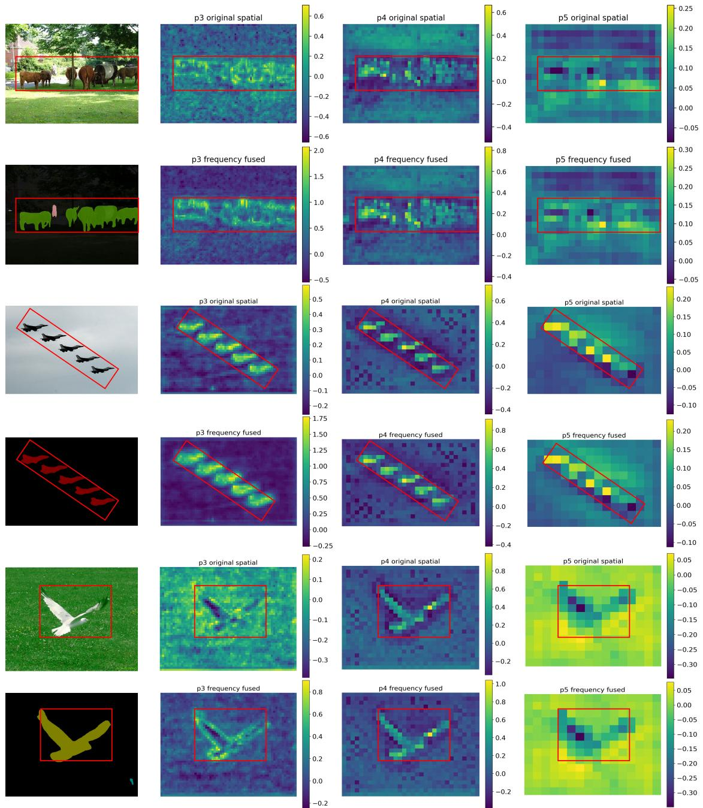  
(a) Image & Mask  
(b) P3 Feature Maps  
(c) P4 Feature Maps  
(d) P5 Feature Maps  
Figure 9: Visualization of feature maps at diferent stages (P3-P5). (a) Source image and mask; (b) Feature maps of the P3 stage; (c) Feature maps of the P4 stage; (d) Feature maps of the P5 stage. In each group, the first row shows the original feature outputs from the NAHA encoder, and the second row shows the frequency-fusion-enhanced feature outputs from the FGDF module.

FGD2HF with other backbones of similar model sizes, including MIT-B2, MSCAN-B, Swin-T, ConvNeXt-T, SegMAN-Encoder-S, and EficientVMamba-B. These selected backbones cover traditional CNNs, ViTs, and Vim-based architectures, which collectively provide a comprehensive basis to demonstrate the superiority of NAHA. Experimental results demonstrate that our proposed NAHA encoder achieves

the best overall performance among all compared backbones, surpassing the second-best competitor (SegMAN-Encoder-S) by 0.4 percentage points, while simultaneously maintaining the lowest parameter count and GFLOPs among all variants. Although its FPS performance is not the highest across all configurations, it still reaches 71.7 Hz, which is suficient to meet the requirements of most real-world applications.

Table 7  
Table 8  
Performance of FGD2HF with Diferent Encoder Variants on SBD.
<table><tr><td>Model Variant</td><td>Params (M)</td><td>GFLOPs</td><td>mloU (%)</td><td>FPS (Hz)</td></tr><tr><td>NAHA</td><td>23.4</td><td>19.7</td><td>83.6</td><td>71.7</td></tr><tr><td colspan="5">Encoder Replace</td></tr><tr><td>MIT-B2</td><td> $3 3 . 9 \ ( + 1 0 . 5 )$ </td><td> $2 6 . 7 \ ( + 7 . 0 )$ </td><td>80.5 (-3.1)</td><td> $7 8 . 8 \ ( + 7 . 1 )$ </td></tr><tr><td>MSCAN-B</td><td>36.0 (+12.6)</td><td> $3 3 . 1 \ \overset { \cdot } { ( + 1 3 . 4 ) }$ </td><td>82.7 (-0.9)</td><td> $7 7 . 1 \ \dot { ( } + 5 . 4 \dot { ) }$ </td></tr><tr><td>Swin-T</td><td>46.4 (+23.0)</td><td> $3 7 . 0 \ \AA ( + 1 7 . 3 )$ </td><td>81.9 (-1.7)</td><td> $8 0 . 1 \ \AA ( + 8 . 4 )$ </td></tr><tr><td>ConvNeXt-T</td><td>46.7 (+23.3)</td><td> $3 4 . 7 \ \AA ( + 1 5 . 0 )$ </td><td>81.7 (-1.9)</td><td> $8 7 . 7 \ ( + 1 6 . 0 )$ </td></tr><tr><td>SegMAN-Encoder-S</td><td>37.3 (+13.9)</td><td> $2 6 . 6 \ ( + 6 . 9 )$ </td><td>83.2 (-0.4)</td><td> $5 6 . 3 \ \AA ( - 1 5 . 4 )$ </td></tr><tr><td>EfficientVMamba-B</td><td>42.9 (+19.5)</td><td> $2 6 . 0 \ \AA ( + 6 . 3 )$ </td><td>82.9 (-0.7)</td><td>95.3 (+23.6)</td></tr><tr><td colspan="5">LR-C3AH Design</td></tr><tr><td>All Blocks</td><td>27.8 (+4.4)</td><td> $2 3 . 2 \ ( + 3 . 5 )$ </td><td> $8 3 . 9 \ ( + 0 . 3 ) $ </td><td>54.6 (-17.1)</td></tr><tr><td>w/o LR-C3AH</td><td>22.5 (-0.9)</td><td>18.9 (-0.8)</td><td>82.2 (-1.4)</td><td>82.1 (+10.4)</td></tr><tr><td>Last Block Only (Ours)</td><td>23.4</td><td>19.7</td><td>83.6</td><td>71.7</td></tr><tr><td>Replace LR-C3AH w SS2D</td><td>22.6 (-0.8)</td><td>18.9 (-0.8)</td><td>83.2 (-0.4)</td><td> $7 2 . 7 \ ( + 1 . 0 )$ </td></tr><tr><td>Replace LR-C3AH w Linear Attention</td><td>23.2 (-0.2)</td><td>19.3 (-0.4)</td><td>82.9 (-0.7)</td><td> $7 3 . 4 \ ( + 1 . 7 ) $ </td></tr><tr><td colspan="5">HA Design</td></tr><tr><td>Remove HA</td><td> $2 2 . 3 \ ( - 1 . 1 )$ </td><td>18.6 (-1.1)</td><td> $8 0 . 3 \ \left( - 3 . 3 \right)$ </td><td> $7 7 . 2 \ ( + 5 . 5 )$ </td></tr><tr><td> $\mathsf { R e p l a c e \ H A \ w \ S S 2 D }$ </td><td> $2 2 . 6 \ ( - 0 . 8 )$ </td><td>18.7 (-1.0)</td><td> $8 3 . 1 \ ( - 0 . 5 )$ </td><td>74.3 (+2.6)</td></tr><tr><td> $\mathsf { R e p l a c e \mathsf { H A } \mathsf { w } A t t e n }$ </td><td>23.1 (-0.3)</td><td>18.8 (-0.9)</td><td>82.9 (-0.7)</td><td>76.7 (+5.0)</td></tr></table>

To further validate the necessity of the architectural design and components choice of NAHA, we also investigate the performance of diferent variants. It should be noted that, in the NAHA Encoder illustrated in Fig. 3, each NA Block is simplified to represent the stacking of multiple NA Blocks, which together form one NA layer. This corresponds to the Depths parameter in Table 1.

LR-C3AH. We first examine the impact of the placement of LR-C3AH. Specifically, we compare three configurations: (1) enabling LR-C3AH for global context modeling in every NA Block within each NA layer, (2) disabling LR-C3AH in all NA Blocks, and (3) enabling LR-C3AH only in the last NA Block of each NA layer. Additionally, we also replace LR-C3AH with Linear Attention and 2D Selective Scan (SS2D) to compare diferent global context modeling approaches. It can be observed that fully enabling LR-C3AH yields the best segmentation performance, with a mean IoU of 83.9%. However, the test FPS drops considerably, which is mainly attributed to the additional overhead introduced by C3AH’s extensive hyperedge construction and hyperedge message passing. In contrast, completely disabling LR-C3AH leads to the worst result (mIoU = 82.2%). Furthermore, replacing LR-C3AH with SS2D causes a 0.4 percentage-point decrease in mIoU, indicating the efectiveness of our proposed module.

HA Block. To verify the importance of the HA block in Stage 4, we conduct ablation studies by either removing it entirely or replacing it with SS2D or standard attention. The experimental results show that the HA block improves performance by 0.5 and 0.7 percentage points compared with SS2D and standard attention, respectively. Moreover, it achieves a 3.3 percentage point improvement compared with the variant without the HA-based cross-scale global enhancement. These results demonstrate the superiority of HA and highlight the importance of high-order global semantic modeling for accurate semantic segmentation.

## 4.7. Ablation Studies on WTE and FGDF Modules

To systematically evaluate the efectiveness of the proposed frequency-guided dual-domain hypergraph fusion and enhancement method, we conduct ablation studies on the WTE module and FGDF module. Specifically, the following configurations are compared: (1) removing the them and directly using the spatial features extracted by the NAHA encoder; (2) suppressing the high-frequency information and performing semantic segmentation using only the low-frequency fused and enhanced features; (3) Using the low- and high-frequency features obtained by wavelet decomposition without frequency enhancement; (4) Enhancing both low- and high-frequency features without using low-frequency information to modulate high-frequency responses; and (5) replacing the proposed frequency-guided hypergraph fusion mechanism with alternative spatial-frequen fusion strategies, including Fast Fourier Convolution (FFC) [22], Spatial-Frequency Cross-Attention (SFCA) [31], and Gated Spatial-Frequency Fusion (GSFF) [9]. The ablation experiments are conducted using the FGD2HF-S model on ADE20K, and the results are reported in Table 8.

Ablation Results the WTE and FGDF modules on the ADE20K Dataset.
<table><tr><td>Model Variant</td><td>Params (M)</td><td>GFLOPs</td><td>mloU (%)</td><td>mBloU (%)</td></tr><tr><td>FGD2HF</td><td> $^ { 2 3 . 4 }$ </td><td>19.7</td><td>48.1</td><td>38.6</td></tr><tr><td>FGD2HF w/o WTE&amp;FGDF</td><td>18.1 (-5.3)</td><td> $1 6 . 5 \ ( - 3 . 2 )$ </td><td> $4 4 . 3 \ \left( - 3 . 8 \right)$ </td><td>34.2 (-4.4)</td></tr><tr><td colspan="5">Information Suppress</td></tr><tr><td>Suppress high-fre info</td><td>23.4</td><td>19.7</td><td>47.2 (-0.9)</td><td>36.5 (-2.1)</td></tr><tr><td>WTE w/o enhancement</td><td> $2 2 . 1 \ ( - 1 . 3 )$ </td><td>18.9 (-0.8)</td><td>46.9 (-1.2)</td><td>36.9 (-1.7)</td></tr><tr><td>WTE w/o low-fre modulation</td><td> $2 3 . 2 \ ( - 0 . 2 )$ </td><td>19.6 (-0.1)</td><td>47.5 (-0.6)</td><td>37.2 (-1.4)</td></tr><tr><td colspan="5">Fusion Mechanism Replace</td></tr><tr><td> ${ \mathsf { R e p l a c e  F G D F w F F C } } \ [ 2 2 ]$ </td><td> $2 5 . 6 \ ( + 2 . 2 )$ </td><td>22.1 (+2.4)</td><td>46.8 (-1.3)</td><td>35.8 (-2.8)</td></tr><tr><td> $\mathsf { R e p l a c e F G D F w S F C A ^ { \bullet } } [ 3 1 ]$ </td><td> $2 4 . 8 \ \AA + 1 . 4 )$ </td><td> $2 3 . 7 \ \mathring { ( + 4 . 0 ) }$ </td><td>47.0 (-1.1)</td><td>36.8 (-1.8)</td></tr><tr><td> ${ \mathsf { R e p l a c e \ F G D F \ w \ G S F F } } \ { \mathsf { [ 9 ] } }$ </td><td> $2 6 . 1 \ ( + 2 . 7 )$ </td><td> $2 4 . 3 \ \left( + 4 . 6 \right)$ </td><td>47.4 (-0.7)</td><td>37.0 (-1.6)</td></tr></table>

As shown in Table 8, removing both WTE and FGDF decreases mIoU and mBIoU by 3.8 and 4.4 percentage points, respectively, indicating the contribution of the two modules to overall segmentation and boundary quality. Suppressing high-frequency information reduces mIoU and mBIoU by 0.9 and 2.1 percentage points, respectively, while removing frequency enhancement leads to decreases of 1.2 and 1.7 percentage points. Furthermore, removing low-frequency guidance from high-frequency enhancement decreases mIoU by 0.6 percentage points and mBIoU by 1.4 percentage points, supporting the benefit of low-frequency guidance for boundary preservation. Compared with FFC, SFCA, and GSFF, FGDF achieves higher mIoU and mBIoU with fewer parameters and GFLOPs under the evaluated configurations.

Additionally, Fig. 10 presents a qualitative comparison of segmentation results with and without high-frequency information. The examples show clearer object boundaries when high-frequency information is incorporated, complementing the quantitative boundary evaluation.

## 4.8. Ablation Studies on FGD2HF Decoder

We evaluate the overall efectiveness of the proposed decoder on the SBD dataset. For a fair comparison, all model variants are built upon the FGD2HF-S encoder, and the number of channels in diferent decoders is adjusted to ensure comparable parameters across diferent decoder designs. The experimental results are presented in Table 9. Our hyper decoder achieves the highest segmentation accuracy while maintaining the lowest computational cost, at just 19.7 GFLOPs. More notably, when integrated with our FGD2HF-S encoder, the SegFormer, LightHam, and EDAFormer decoders achieve mIoU improvements of 4.4, 0.6, and 1.4 percentage points, respectively, over their original architectures, namely SegFormer, SegNeXt, and EDAFormer. These consistent improvements firmly validate the efectiveness of our proposed NAHA and frequency-guided dual-domain hypergraph fusion modules for semantic segmentation tasks.

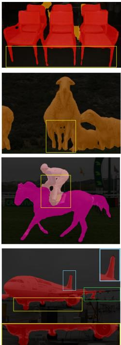

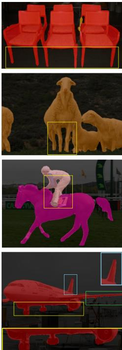  
(a) Without High Frequency  
(b) With High Frequency  
Figure 10: Segmentation results with and without highfrequency components. (a) Without high-frequency components; (b) With high-frequency components. Zoom in for best view.

Table 9  
Performance of FGD2HF with Diferent Decoders on SBD.
<table><tr><td>Model Variant</td><td>Params (M)</td><td>GFLOPs</td><td>mloU (%)</td><td>FPS (Hz)</td></tr><tr><td>FCN Decoder [55]</td><td>24.6 (+1.2)</td><td>26.9 (+7.2)</td><td>81.7 (-1.9)</td><td>76.4 (+4.7)</td></tr><tr><td>SegFormer Decoder [75]</td><td>23.1 (-0.3)</td><td>23.5 (+3.8)</td><td>82.4 (-1.2)</td><td>74.1 (+2.4)</td></tr><tr><td>LightHam Decoder [32]</td><td>23.0 (-0.4)</td><td>20.1 (+0.4)</td><td>82.6 (-1.0)</td><td>69.2 (-2.5)</td></tr><tr><td>EDAFormer Decoder [86]</td><td>26.3 (+2.9)</td><td>20.7 (+1.0)</td><td>83.1 (-0.5)</td><td>70.7 (-1.0)</td></tr><tr><td>SegMAN Decoder [29]</td><td>28.0 (+4.6)</td><td>22.4 (+2.7)</td><td>83.3 (-0.3)</td><td>71.5 (-0.2)</td></tr><tr><td>Hyper Decoder (Ours)</td><td>23.4</td><td>19.7</td><td>83.6</td><td>71.7</td></tr></table>

## 5. Conclusion and Future Work

This article presents FGD2HF, a novel dual-domain fusion network that enhances semantic segmentation by leveraging low- and high-frequency components to fuse and enhance spatial-domain features via frequency-guided hypergraph attention. Our approach includes a NAHA encoder that extracts multi-level features using neighborhood and hypergraph attention, boosting the feature extraction capability ofFGD2HF. Through the integration ofthe WTE module and FGDF module, FGD2HF efectively captures both global semantics and local texture details by fusing low- and high-frequency information. Wavelet transform is employed to extract frequency information from the preceding stage, which is then used to enhance spatial information fusion in the subsequent stage. This mechanism efectively alleviates the over-smoothing phenomenon commonly caused by the loss of high-frequency information in deeper network layers, while maintaining low computational complexity.

Extensive experiments on multiple public datasets demonstrate that FGD2HF achieves highly competitive or superior performance across multiple benchmark datasets. The frequency-guided dual-domain hypergraph fusion strategy efectively improves semantic segmentation accuracy, especially in complex scenes. Furthermore, FGD2HF achieves superior accuracy with lower computational resource requirements, demonstrating an excellent trade-of between segmentation accuracy and computational eficiency.

Future work will focus on further optimizing FGD2HF, including reducing network parameters and model size without sacrificing performance, as well as improving its inference speed. We will also explore the deep integration of other advanced model architectures with FGD2HF to further enhance its segmentation capabilities.

## A. Segmentation Examples

Fig. 11, 12, and 13 illustrate the segmentation examples of diferent models on the SBD, Cityscapes, and ADE20K datasets, respectively. As can be observed from these qualitative examples, our proposed FGD2HF method, which leverages frequency-based hypergraph fusion, is more efective at capturing both fine-grained local dependencies and long-range contextual information. Consequently, it exhibits cleaner boundaries and improved semantic coherence in the selected examples.

## References

[1] Achanta, R., Shaji, A., Smith, K., Lucchi, A., Fua, P., Süsstrunk, S., 2012. Slic superpixels compared to state-of-the-art superpixel methods. IEEE transactions on pattern analysis and machine intelligence 34, 2274–2282.

[2] Amirgan, B., Erener, A., 2024. Semantic segmentation of satellite images with diferent building types using deep learning methods. Remote Sensing Applications: Society and Environment 34, 101176.

[3] Arbelaez, P., Maire, M., Fowlkes, C., Malik, J., 2010. Contour detection and hierarchical image segmentation. IEEE transactions on pattern analysis and machine intelligence 33, 898–916.

[4] Aslan, M.F., Aslan, B., Sabanci, K., 2026. Frequency-domain vision transformers: Architectures, applications, and open challenges. Applied Sciences 16, 2024.

[5] Badrinarayanan, V., Kendall, A., Cipolla, R., 2017. Segnet: A deep convolutional encoder-decoder architecture for image segmentation. IEEE transactions on pattern analysis and machine intelligence 39, 2481–2495.

[6] Bi, Q., Yi, J., Zheng, H., Zhan, H., Huang, Y., Ji, W., Li, Y., Zheng, Y., 2024. Learning frequency-adapted vision foundation model for

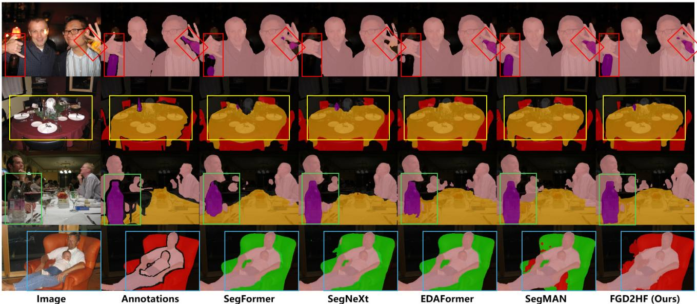  
Figure 11: Segmentation examples on SBD. Zoom in for best view.

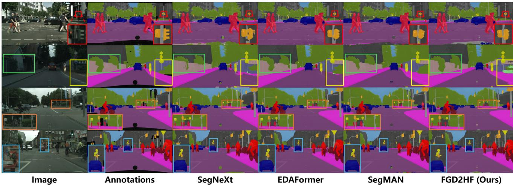  
Figure 12: Segmentation examples on Cityscapes. Zoom in for best view.

domain generalized semantic segmentation. Advances in Neural Information Processing Systems 37, 94047–94072.

[7] Bretto, A., 2013. Hypergraph theory. An introduction. Mathematical Engineering. Cham: Springer 1, 209–216.

[8] Brunke, L., Zhang, Y., Römer, R., Naimer, J., Staykov, N., Zhou, S., Schoellig, A.P., 2025. Semantically safe robot manipulation: From semantic scene understanding to motion safeguards. IEEE Robotics and Automation Letters .

[9] Canıtez, İ.E., Erkent, Ö., 2026. Frequency-guided fusion for rgbthermal semantic segmentation. arXiv preprint arXiv:2605.26273 .

[10] Chai, S., Jain, R.K., Mo, S., Liu, J., Yang, Y., Li, Y., Tateyama, T., Lin, L., Chen, Y.W., 2024. A novel adaptive hypergraph neural network for enhancing medical image segmentation, in: International Conference on Medical Image Computing and Computer-Assisted Intervention, Springer. pp. 23–33.

[11] Chen, L., Fu, Y., Gu, L., Yan, C., Harada, T., Huang, G., 2024a. Frequency-aware feature fusion for dense image prediction. IEEE transactions on pattern analysis and machine intelligence 46, 10763– 10780.

[12] Chen, L., Fu, Y., Gu, L., Zheng, D., Dai, J., 2025a. Spatial frequency modulation for semantic segmentation. IEEE Transactions on Pattern

Analysis and Machine Intelligence 47, 9767–9784. doi:10.1109/ TPAMI.2025.3592621.

[13] Chen, L., Gu, L., Fu, Y., 2024b. When semantic segmentation meets frequency aliasing, in: International Conference on Learning Representations.

[14] Chen, L., Gu, L., Li, L., Yan, C., Fu, Y., 2025b. Frequency dynamic convolution for dense image prediction, in: Proceedings of the Computer Vision and Pattern Recognition Conference, pp. 30178–30188.

[15] Chen, L., Gu, L., Zheng, D., Fu, Y., 2024c. Frequency-adaptive dilated convolution for semantic segmentation, in: Proceedings of the IEEE/CVF Conference on Computer Vision and Pattern Recognition, pp. 3414–3425.

[16] Chen, L.C., Papandreou, G., Kokkinos, I., Murphy, K., Yuille, A.L., 2017a. Deeplab: Semantic image segmentation with deep convolutional nets, atrous convolution, and fully connected crfs. IEEE transactions on pattern analysis and machine intelligence 40, 834– 848.

[17] Chen, L.C., Papandreou, G., Schrof, F., Adam, H., 2017b. Rethinking atrous convolution for semantic image segmentation. arXiv preprint arXiv:1706.05587 .

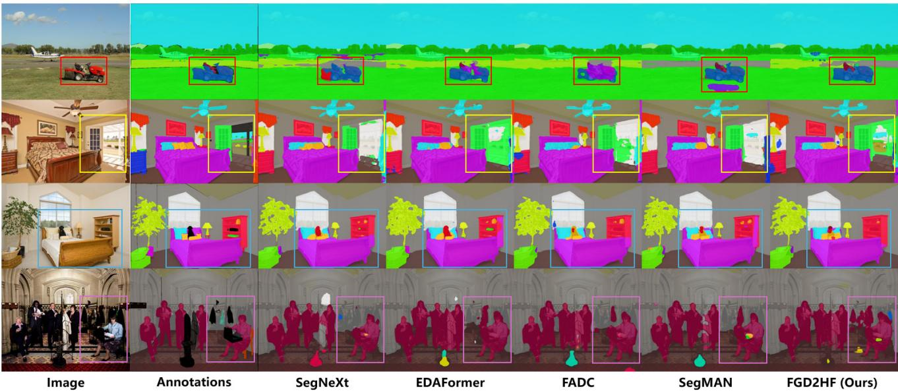  
Figure 13: Segmentation examples on ADE20K. Zoom in for best view.

[18] Chen, L.C., Zhu, Y., Papandreou, G., Schrof, F., Adam, H., 2018. Encoder-decoder with atrous separable convolution for semantic image segmentation, in: Proceedings of the European conference on computer vision (ECCV), pp. 801–818.

[19] Chen, Z., Zhu, Y., Zhao, C., Hu, G., Zeng, W., Wang, J., Tang, M., 2021. Dpt: Deformable patch-based transformer for visual recognition, in: Proceedings of the 29th ACM international conference on multimedia, pp. 2899–2907.

[20] Cheng, B., Misra, I., Schwing, A.G., Kirillov, A., Girdhar, R., 2022. Masked-attention mask transformer for universal image segmentation, in: Proceedings of the IEEE/CVF conference on computer vision and pattern recognition, pp. 1290–1299.

[21] Cheng, B., Schwing, A., Kirillov, A., 2021. Per-pixel classification is not all you need for semantic segmentation. Advances in neural information processing systems 34, 17864–17875.

[22] Chi, L., Jiang, B., Mu, Y., 2020. Fast fourier convolution. Advances in Neural Information Processing Systems 33, 4479–4488.

[23] Comaniciu, D., Meer, P., 2002. Mean shift: A robust approach toward feature space analysis. IEEE Transactions on pattern analysis and machine intelligence 24, 603–619.

[24] Cordts, M., Omran, M., Ramos, S., Rehfeld, T., Enzweiler, M., Benenson, R., Franke, U., Roth, S., Schiele, B., 2016. The cityscapes dataset for semantic urban scene understanding, in: Proceedings of the IEEE conference on computer vision and pattern recognition, pp. 3213–3223.

[25] Csurka, G., Volpi, R., Chidlovskii, B., 2022. Semantic image segmentation: Two decades of research. Foundations and Trends in Computer Graphics and Vision 14, 1–162.

[26] Dosovitskiy, A., Beyer, L., Kolesnikov, A., Weissenborn, D., Zhai, X., Unterthiner, T., Dehghani, M., Minderer, M., Heigold, G., Gelly, S., et al., 2020. An image is worth 16x16 words: Transformers for image recognition at scale. arXiv preprint arXiv:2010.11929 .

[27] Feng, Z., Qiao, M., Cheng, H., 2023. Modularity-based hypergraph clustering: random hypergraph model, hyperedge-cluster relation, and computation. Proceedings of the ACM on Management of Data 1, 1–25.

[28] Fu, J., Liu, J., Tian, H., Li, Y., Bao, Y., Fang, Z., Lu, H., 2019. Dual attention network for scene segmentation, in: Proceedings of the IEEE/CVF conference on computer vision and pattern recognition, pp. 3146–3154.

[29] Fu, Y., Lou, M., Yu, Y., 2025. Segman: Omni-scale context modeling with state space models and local attention for semantic segmentation,

in: Proceedings of the Computer Vision and Pattern Recognition Conference, pp. 19077–19087.

[30] Geman, S., Geman, D., 1984. Stochastic relaxation, gibbs distributions, and the bayesian restoration of images. IEEE Transactions on pattern analysis and machine intelligence , 721–741.

[31] Gu, X., Wang, L., Deng, Z., Cao, Y., Huang, X., Zhu, Y.m., 2023. Adafuse: Adaptive medical image fusion based on spatial-frequential cross attention. arXiv preprint arXiv:2310.05462 .

[32] Guo, M.H., Lu, C.Z., Hou, Q., Liu, Z., Cheng, M.M., Hu, S.M., 2022. Segnext: Rethinking convolutional attention design for semantic segmentation. Advances in neural information processing systems 35, 1140–1156.

[33] Guo, X., Zhang, T., Wang, F., Wang, X., Zhang, X., Liu, X., Cui, Z., 2025. Mmhcl: Multi-modal hypergraph contrastive learning for recommendation. ACM Transactions on Multimedia Computing, Communications and Applications 21, 1–23.

[34] Han, Y., Mu, Y., Huang, Q., Zhang, Y., Wei, M., Hong, S., 2026. Fdhnet: Frequency-aware decomposition with hypergraph modeling network for real-time surface defect segmentation. Knowledge-Based Systems , 116853.

[35] Hariharan, B., Arbeláez, P., Bourdev, L., Maji, S., Malik, J., 2011. Semantic contours from inverse detectors, in: 2011 international conference on computer vision, IEEE. pp. 991–998.

[36] Hassani, A., Walton, S., Li, J., Li, S., Shi, H., 2023. Neighborhood attention transformer, in: IEEE/CVF Conference on Computer Vision and Pattern Recognition (CVPR).

[37] He, K., Gkioxari, G., Dollár, P., Girshick, R., 2017. Mask r-cnn, in: Proceedings of the IEEE international conference on computer vision, pp. 2961–2969.

[38] Hou, C., Liu, G., Tian, Q., Zhou, Z., Hua, L., Lin, Y., 2022. Multisignal modulation classification using sliding window detection and complex convolutional network in frequency domain. IEEE Internet of Things Journal 9, 19438–19449.

[39] Howard, A., Sandler, M., Chu, G., Chen, L.C., Chen, B., Tan, M., Wang, W., Zhu, Y., Pang, R., Vasudevan, V., et al., 2019. Searching for mobilenetv3, in: Proceedings of the IEEE/CVF international conference on computer vision, pp. 1314–1324.

[40] Jiang, Y., Liu, G., Huang, Z., Yang, B., Yang, W., 2024. Geometry perception and motion planning in robotic assembly based on semantic segmentation and point clouds reconstruction. Engineering Applications of Artificial Intelligence 130, 107678.

[41] Jing, W., Zhang, W., Di, D., Li, C., Emam, M., Mian, A., 2025. Hypergraph biformer for semantic segmentation of high-resolution remote sensing images. IEEE Transactions on Geoscience and Remote Sensing .

[42] Khan, B., Wu, J., Yang, J., Ma, X., 2025. Heterogeneous hypergraph neural network for social recommendation using attention network. ACM Transactions on Recommender Systems 3, 1–22.

[43] Kim, E.S., Kang, W.Y., On, K.W., Heo, Y.J., Zhang, B.T., 2020. Hypergraph attention networks for multimodal learning, in: Proceedings of the IEEE/CVF conference on computer vision and pattern recognition, pp. 14581–14590.

[44] Krithika Alias AnbuDevi, M., Suganthi, K., 2022. Review of semantic segmentation of medical images using modified architectures of unet. Diagnostics 12, 3064.

[45] Lei, M., Li, S., Wu, Y., Hu, H., Zhou, Y., Zheng, X., Ding, G., Du, S., Wu, Z., Gao, Y., 2025. Yolov13: Real-time object detection with hypergraph-enhanced adaptive visual perception. arXiv preprint arXiv:2506.17733 .

[46] Li, X., Xu, F., Yu, A., Lyu, X., Gao, H., Zhou, J., 2025a. A frequency decoupling network for semantic segmentation of remote sensing images. IEEE Transactions on Geoscience and Remote Sensing 63, 1–21.

[47] Li, X., Xu, F., Zhang, J., Yu, A., Lyu, X., Gao, H., Zhou, J., 2025b. Dual-domain decoupled fusion network for semantic segmentation of remote sensing images. Information Fusion 124, 103359.

[48] Li, Y., Hu, C., Ren, K., Xi, H., Fan, J., 2026. Dyfuse: Dynamic fusion for weakly-supervised semantic segmentation in autonomous driving scenes. Information Fusion 125, 103471.

[49] Li, Y., Yang, R., Shi, J., 2023. Eficient and efective attributed hypergraph clustering via k-nearest neighbor augmentation. Proceedings of the ACM on Management of Data 1, 1–23.

[50] Ling, H., Li, L., Pan, D., Zhang, Y., 2025. Fdl-yolo: eficient real-time trafic detection network based on frequency domain learning. The Journal of Supercomputing 81, 966.

[51] Liu, Y., Tian, Y., Zhao, Y., Yu, H., Xie, L., Wang, Y., Ye, Q., Jiao, J., Liu, Y., 2024. Vmamba: Visual state space model. Advances in neural information processing systems 37, 103031–103063.

[52] Liu, Z., Lin, Y., Cao, Y., Hu, H., Wei, Y., Zhang, Z., Lin, S., Guo, B., 2021. Swin transformer: Hierarchical vision transformer using shifted windows, in: Proceedings of the IEEE/CVF international conference on computer vision, pp. 10012–10022.

[53] Liu, Z., Mao, H., Wu, C.Y., Feichtenhofer, C., Darrell, T., Xie, S., 2022. A convnet for the 2020s, in: Proceedings of the IEEE/CVF conference on computer vision and pattern recognition, pp. 11976– 11986.

[54] Lo, S.Y., Hang, H.M., 2019. Exploring semantic segmentation on the dct representation, in: Proceedings of the 1st ACM International Conference on Multimedia in Asia, pp. 1–6.

[55] Long, J., Shelhamer, E., Darrell, T., 2015. Fully convolutional networks for semantic segmentation, in: Proceedings of the IEEE conference on computer vision and pattern recognition, pp. 3431– 3440.

[56] Lou, M., Fu, Y., Yu, Y., 2025. Sparx: A sparse cross-layer connection mechanism for hierarchical vision mamba and transformer networks, in: Proceedings of the AAAI Conference on Artificial Intelligence, pp. 19104–19114.

[57] Magid, S.A., Zhang, Y., Wei, D., Jang, W.D., Lin, Z., Fu, Y., Pfister, H., 2021. Dynamic high-pass filtering and multi-spectral attention for image super-resolution, in: Proceedings of the IEEE/CVF International Conference on Computer Vision, pp. 4288–4297.

[58] Ni, Z., Chen, X., Zhai, Y., Tang, Y., Wang, Y., 2024. Context-guided spatial feature reconstruction for eficient semantic segmentation, in: European conference on computer vision, Springer. pp. 239–255.

[59] Pal, M., Mather, P.M., 2005. Support vector machines for classification in remote sensing. International journal of remote sensing 26, 1007–1011.

[60] Palanisamy, M., Sennidurai, K., 2026. Multi-scale attention and hypergraph neural network based deep learning framework for prostate

cancer classification and segmentation. Biomedical Signal Processing and Control 113, 108925.

[61] Pei, X., Huang, T., Xu, C., 2025. Eficientvmamba: Atrous selective scan for light weight visual mamba, in: Proceedings of the AAAI conference on artificial intelligence, pp. 6443–6451.

[62] Rahaman, N., Baratin, A., Arpit, D., Draxler, F., Lin, M., Hamprecht, F., Bengio, Y., Courville, A., 2019. On the spectral bias of neural networks, in: International conference on machine learning, PMLR. pp. 5301–5310.

[63] Ronneberger, O., Fischer, P., Brox, T., 2015. U-net: Convolutional networks for biomedical image segmentation, in: International Conference on Medical image computing and computer-assisted intervention, Springer. pp. 234–241.

[64] Shotton, J., Winn, J., Rother, C., Criminisi, A., 2009. Textonboost for image understanding: Multi-class object recognition and segmentation by jointly modeling texture, layout, and context. International journal of computer vision 81, 2–23.

[65] Silva, M., Seoane, A., Mures, O.A., Lopez, A.M., Iglesias-Guitian, J.A., 2025. Exploring the efects of synthetic data generation: a case study on autonomous driving for semantic segmentation: M. silva et al. The visual computer 41, 7379–7397.

[66] Singh, N.J., Nongmeikapam, K., 2023. Semantic segmentation of satellite images using deep-unet. Arabian Journal for Science and Engineering 48, 1193–1205.

[67] Strudel, R., Garcia, R., Laptev, I., Schmid, C., 2021. Segmenter: Transformer for semantic segmentation, in: Proceedings of the IEEE/CVF international conference on computer vision, pp. 7262– 7272.

[68] Stuchi, J.A., Canto, N.G., de Faissol Attux, R.R., Boccato, L., 2024. A frequency-domain approach with learnable filters for image classification. Applied Soft Computing 155, 111443.

[69] Tan, C., Zhao, Y., Wei, S., Gu, G., Liu, P., Wei, Y., 2024. Frequencyaware deepfake detection: Improving generalizability through frequency space domain learning, in: Proceedings of the AAAI Conference on Artificial Intelligence, pp. 5052–5060.

[70] Thisanke, H., Deshan, C., Chamith, K., Seneviratne, S., Vidanaarachchi, R., Herath, D., 2023. Semantic segmentation using vision transformers: A survey. Engineering Applications of Artificial Intelligence 126, 106669.

[71] Wang, H., Oliensis, J., 2010. Generalizing edge detection to contour detection for image segmentation. Computer Vision and Image Understanding 114, 731–744.

[72] Wang, R., Yang, T., Liang, C., Wang, M., Ci, Y., 2025. Reliable autonomous driving environment perception: uncertainty quantification of semantic segmentation. Journal of Transportation Engineering, Part A: Systems 151, 04024117.

[73] Wang, W., Xie, E., Li, X., Fan, D.P., Song, K., Liang, D., Lu, T., Luo, P., Shao, L., 2021. Pyramid vision transformer: A versatile backbone for dense prediction without convolutions, in: Proceedings of the IEEE/CVF international conference on computer vision, pp. 568–578.

[74] Wang, X.Y., Wang, T., Bu, J., 2011. Color image segmentation using pixel wise support vector machine classification. Pattern Recognition 44, 777–787.

[75] Xie, E., Wang, W., Yu, Z., Anandkumar, A., Alvarez, J.M., Luo, P., 2021. Segformer: Simple and eficient design for semantic segmentation with transformers. Advances in neural information processing systems 34, 12077–12090.

[76] Xu, K., Qin, M., Sun, F., Wang, Y., Chen, Y.K., Ren, F., 2020. Learning in the frequency domain, in: Proceedings of the IEEE/CVF conference on computer vision and pattern recognition, pp. 1740– 1749.

[77] Xu, Z.Q.J., Zhang, Y., Luo, T., Xiao, Y., Ma, Z., 2019. Frequency principle: Fourier analysis sheds light on deep neural networks. arXiv preprint arXiv:1901.06523 .

[78] Yan, H., Wu, M., Zhang, C., 2024. Multi-scale representations by varying window attention for semantic segmentation. arXiv preprint arXiv:2404.16573 .

[79] Yang, H., Yang, C., An, Z., Huang, L., Xu, Y., 2025a. Hsrdif: A hierarchical self-regulation difusion model for stochastic semantic segmentation, in: Proceedings of the AAAI Conference on Artificial Intelligence, pp. 1701–1709.

[80] Yang, X., Liu, Y., Pan, W., Chu, G., Zhang, J., Zhao, J., Man, Z., Cao, X., 2026. M2i2ha: A multi-modal object detection method based on intra-and inter-modal hypergraph attention. arXiv preprint arXiv:2601.14776 .

[81] Yang, Y., Soatto, S., 2020. Fda: Fourier domain adaptation for semantic segmentation, in: Proceedings of the IEEE/CVF conference on computer vision and pattern recognition, pp. 4085–4095.

[82] Yang, Y., Yuan, G., Li, J., 2024. Sfnet: A wavelet-based spatial and frequency domain fusion network for remote sensing segmentation. IEEE Transactions on Geoscience and Remote Sensing 62, 1–17.

[83] Yang, Z., Zhao, X., Wang, X., Zhang, Q., Xiao, J., 2025b. Ffr: Frequency feature rectification for weakly supervised semantic segmentation, in: Proceedings of the Computer Vision and Pattern Recognition Conference, pp. 30261–30270.

[84] Younesi, A., Ansari, M., Fazli, M., Ejlali, A., Shafique, M., Henkel, J., 2024. A comprehensive survey of convolutions in deep learning: Applications, challenges, and future trends. IEEE Access 12, 41180– 41218.

[85] Yu, C., Wang, J., Peng, C., Gao, C., Yu, G., Sang, N., 2018. Learning a discriminative feature network for semantic segmentation, in: Proceedings of the IEEE conference on computer vision and pattern recognition, pp. 1857–1866.

[86] Yu, H., Cho, Y., Kang, B., Moon, S., Kong, K., Kang, S.J., 2024. Embedding-free transformer with inference spatial reduction for eficient semantic segmentation, in: European Conference on Computer Vision, Springer. pp. 92–110.

[87] Zhang, F., Panahi, A., Gao, G., 2023. Fsanet: Frequency self-attention for semantic segmentation. IEEE Transactions on Image Processing 32, 4757–4772.

[88] Zheng, S., Lu, J., Zhao, H., Zhu, X., Luo, Z., Wang, Y., Fu, Y., Feng, J., Xiang, T., Torr, P.H., et al., 2021. Rethinking semantic segmentation from a sequence-to-sequence perspective with transformers, in: Proceedings of the IEEE/CVF conference on computer vision and pattern recognition, pp. 6881–6890.

[89] Zhong, X., Chen, Y., Luo, J., Shi, C., Hu, H., 2024. A novel grasp detection algorithm with multi-target semantic segmentation for a robot to manipulate cluttered objects. Machines 12, 506.

[90] Zhong, Y., Li, B., Tang, L., Kuang, S., Wu, S., Ding, S., 2022. Detecting camouflaged object in frequency domain, in: Proceedings of the IEEE/CVF conference on computer vision and pattern recognition, pp. 4504–4513.

[91] Zhou, B., Zhao, H., Puig, X., Fidler, S., Barriuso, A., Torralba, A., 2017. Scene parsing through ade20k dataset, in: Proceedings of the IEEE Conference on Computer Vision and Pattern Recognition.

[92] Zhu, L., Liao, B., Zhang, Q., Wang, X., Liu, W., Wang, X., 2024. Vision mamba: Eficient visual representation learning with bidirectional state space model. arXiv preprint arXiv:2401.09417 .