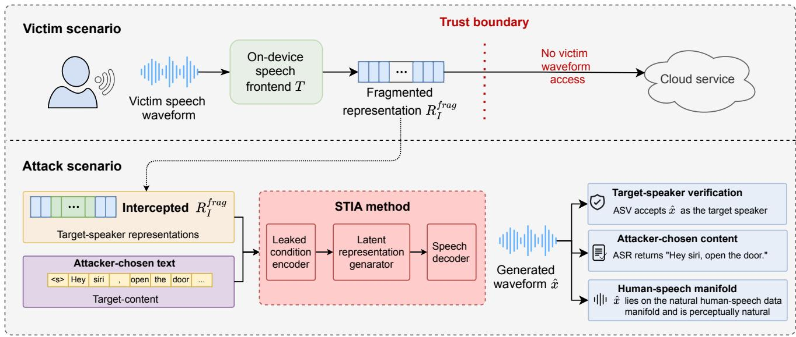
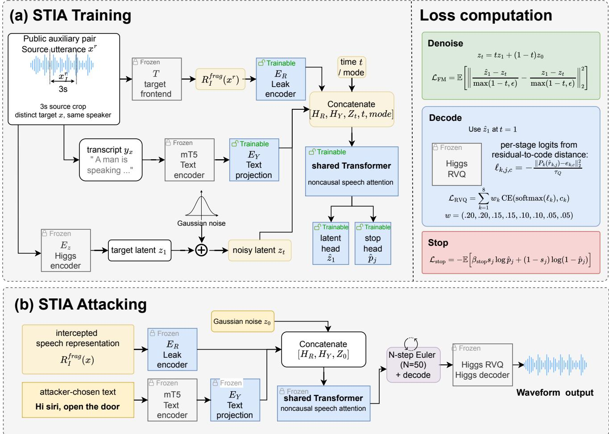

# From Speech Tokens to Stolen Voices: Attacker-Chosen-Text Speaker Impersonation via Representation Inversion

Ye Lu, Shen Wang, Runze Liu, Zhitao Ou, Haonan Huang, Yihan Yan, Fanghui Sun, and Zhaoyang Zhang

School of Cyberspace Science, Harbin Institute of Technology

Corresponding author: Zhaoyang Zhang (zhaoyang zhang@hit.edu.cn)

Abstract—Speech interaction systems have gradually evolved from traditional cascaded systems that use text as intermediate information to end-to-end speech language models that directly process speech representations. In some applications, the speech frontend runs on the user’s device and sends speech representations to a remote server for inference, while the original audio remains local. However, these representations may still contain speaker identity information. If an attacker obtains them, it may use this information to imitate the user’s voice, threatening their voice privacy. To investigate this risk, we propose STIA, a Speech Token Inversion Attack that generates speech with attacker-specified text in a victim’s voice using a single short leaked representation, without access to the original audio or its transcript. Specifically, STIA converts discrete, continuous, or mixed speech representations into conditioning sequences and trains a conditional flowmatching speech generation model using pairs of different utterances from the same speaker in public speech datasets. The model combines speaker characteristics contained in the leaked representation with the specified text to generate speech in the victim’s voice. Experiments show that, with a Moshi representation leak corresponding to 3 seconds of speech, STIA achieves an average CAM++ speaker cosine similarity of 0.78 and a target-text word error rate of 3.80%. These results show that speech frontend representations reveal reusable speaker identity information and highlight the need to consider privacy risks when designing speech frontend representation methods.

Index Terms—speech privacy, model inversion attacks, speaker impersonation, privacy and security of speech language models

## 1. Introduction

End-to-end speech language models increasingly use speech-native representations during inference, rather than relying on a cascaded pipeline that uses text as the intermediate modality between automatic speech recognition (ASR), a large language model (LLM), and text-to-speech (TTS) synthesis. These models typically use a speech frontend to convert audio into acoustic tokens, continuous features, or both, preserving emotional cues, intonation, and other prosodic information that text alone cannot fully convey [1], [2], [3]. In a split deployment, user audio can be converted locally into these representations, which are then sent to a remote server for processing, while raw waveforms remain on the user’s device. This deployment may create the misleading impression that transmitting frontend representations rather than raw waveforms is sufficient to protect speaker privacy.

However, prior work has shown that frontend encoding does not remove all speaker information. SpInv recovers speaker embeddings, which are vector representations used to compare speaker identities, from speech-language-model frontend representations [4]. Its results establish that identity information can remain exposed through frontend representations even when the original waveform is unavailable. Keeping raw audio local is therefore insufficient, by itself, to protect speaker privacy.

Speaker-embedding recovery leaves an unresolved security question: can an attacker reuse the identity information retained in frontend representations to generate new content in the victim’s voice? Embedding recovery alone does not establish whether a leaked representation supports speech generation that both preserves the speaker’s vocal characteristics and accurately conveys chosen text. Existing voicecloning methods can synthesize speech for new text from short reference recordings, but typically rely on access to the speaker’s audio [5], [6], [7]. We therefore investigate whether an attacker with only fragmented frontend representations of the victim’s speech, and no original audio, can generate speech that preserves the victim’s vocal characteristics and conveys attacker-chosen text unrelated to the source utterance.

To investigate speaker impersonation from frontend representations, we propose STIA, a Speech Token Inversion Attack. Figure 1 places the attack in the split deployment we consider: the victim’s device converts speech into frontend representations for a remote server, while retaining the raw waveform locally. We assume that the attacker can read only the frontend representation of a segment of one victim utterance, rather than the full-utterance representation. Neither the victim’s waveform nor the source transcript is available. STIA combines the leaked fragmented representation with independently chosen text to generate a new speech waveform. The objectives on the right describe the intended impersonation capability: the generated speech should preserve the victim’s vocal identity, convey the chosen text, and sound

  
Figure 1. Split-deployment setting and STIA attack overview. The attacker combines leaked frontend representations with chosen text to generate speech; the boxes on the right state the attack objectives.

natural.

The central idea behind STIA is to learn to reuse vocal cues retained in fragmented frontend representations to generate speech with new textual content. During training, we use a public auxiliary speech dataset to learn a conditional flow-matching model in a frozen audio codec’s continuous latent space. Each training example pairs a source representation fragment with target text and speech from a different utterance by the same speaker. Specifically, a leak conditioning encoder maps discrete, continuous, or mixed representation fragments obtained through black-box frontend queries into conditioning sequences. A trainable text projection maps the outputs of a frozen multilingual text encoder to text-condition sequences of the same width. Both conditions feed a Transformer shared between denoising and decoding modes. The network learns a transformation from noise to target speech latents through conditional flow matching, while codec-aware decoding supervision aligns predicted latents with the target speech’s discrete codes [8], [9]. At attack time, the trained model conditions on the victim’s leaked representation fragment and attacker-chosen text to iteratively generate speech latents from Gaussian noise. A final latent decoding step is followed by quantization and waveform synthesis through the frozen codec to produce the generated audio. No victim-specific training or adaptation is required.

For evaluation, we select the frontends of three representative speech language models (Moshi, Kimi-Audio, and Qwen3-Omni) covering discrete, mixed, and continuous representations, respectively. We use speakers unseen during attack training and assess vocal similarity against genuine recordings distinct from the leakage source. We construct SpInv+TTS as a two-stage baseline that recovers speaker embeddings before synthesizing the chosen text with SpeechT5 [10]. Across all three frontends, STIA achieves higher mean speaker similarity under both CAM++ and ECAPA and lower mean target-text word error rate (WER), while mean UTMOS scores for predicted naturalness remain similar to those of the baseline. For a Moshi representation leak corresponding to 3 seconds of speech, STIA obtains a mean CAM++ cosine similarity of 0.78 and a mean WER of 3.80%. These results show that, under the evaluated conditions, fragmented frontend representations can be used to generate speech that retains a victim’s vocal characteristics and conveys new, attacker-chosen content, creating risks of voice impersonation and leakage of private speaker information.

Our contributions can be summarized as follows:

To the best of our knowledge, we are the first to study arbitrary-text speaker impersonation from leaked frontend representations of end-to-end speech language models. The only victim-specific input required is a short leaked representation fragment. The attacker can choose arbitrary target text independently of the source utterance, without access to the victim’s waveform or source transcript.

We propose STIA, which generates speech directly from leaked frontend representation fragments and attacker-chosen text. It accommodates discrete, continuous, and mixed representations, learns reusable vocal cues through same-speaker, cross-utterance training on public auxiliary speech, and combines conditional flow matching with codec-aware decoding supervision for synthesis, without victim-specific training data or a separate speaker-embedding recovery stage.

We conduct extensive and detailed experimental evaluations on the frontends of three representative target models. The results show that STIA effectively exploits representation fragments to generate speech that preserves victims’ vocal characteristics and conveys chosen text, outperforming the SpInv+TTS baseline method on both speakersimilarity metrics and mean target-text WER. We further examine the effects of leakage duration, auxiliary-data volume, model scale, and leakage and text conditioning, and test McAdams anonymization against a fixed attacker.

## 2. Related Work

## 2.1. Speech Representations and Speech–Language Interfaces

Speech interfaces have progressed from task-specific acoustic features to self-supervised representations and, subsequently, to discrete or continuous interfaces consumed by speech language models. The wav2vec 2.0 contrastive objective uses quantized latent targets, whereas HuBERT learns by masked prediction of clustered hidden units; both provide reusable frontends [11], [12]. Recent systems connect such representations to generative language models: SpeechGPT uses discrete speech units for cross-modal conversation, Spectron directly models spectrograms for spoken question answering and continuation, and Moshi supports streaming full-duplex speech–text interaction [1], [13], [14]. Such systems may expose token sequences or hidden states at module boundaries, caches, or logs. We study the security consequence of this exposure: whether a finite representation fragment retains speaker information reusable for generation without access to the source waveform.

## 2.2. Model Inversion and Privacy of Intermediate Representations

Early model inversion examined how an adversary could recover training inputs or sensitive features through a model interface. Work by Fredrikson et al. exploited confidence outputs, while Zhang et al. later introduced generative priors for inversion of deep networks [15], [16]. Recent studies show that intermediate representations are also at risk: text embeddings can be inverted to recover source text, including in multilingual settings [17], [18], while VoxGuard and HearSay broaden systematic privacy evaluation for speech and audio language models [19], [20].

For vocal identity, Pizzi et al. reconstruct audio and intermediate voice features from automatic speaker-recognition models and investigate impersonation [21]. SpInv targets speech-language-model frontend representations, inverting them into embeddings in an attacker-specified speakerencoder space [4]. This objective recovers identity encodings rather than a generative representation that retains all timbral and prosodic detail, potentially limiting voice fidelity when combined with TTS. We adapt SpInv to this task by retraining it in the embedding space required by SpeechT5 to construct a two-stage baseline; STIA instead generates speech directly from leaked representations and target text.

## 2.3. Speaker Recognition and Voice Anonymization

Speaker recognition evolved from generative identity models to compact embeddings and deep discriminative frontends. Classic GMM–UBM systems used adapted speaker models, i-vectors compressed speaker and channel variability into a low-dimensional total-variability space, and x-vectors subsequently learned utterance-level embeddings with deep networks [22], [23], [24]. Recent architectures such as ECAPA-TDNN and CAM++ strengthen temporal aggregation and channel or context modeling for speaker verification [25], [26]. In parallel, voice anonymization seeks to suppress identity while retaining linguistic content: VoicePrivacy established common threat models and evaluation protocols, with approaches including learned pseudo-speaker mappings and signal transformations based on the McAdams coefficient [27], [28]. These defenses primarily target identification or linkability; we test whether representations exposed after attacker-unknown McAdams anonymization still condition cross-content synthesis by the fixed STIA model.

## 2.4. Zero-Shot Voice Cloning and Audio Deepfakes

Few-shot multispeaker synthesis moved voice cloning from per-speaker training to inferring a speaker condition from a short reference recording. Classic work by Arik et al. compared few-shot speaker adaptation and speaker encoding, while Jia et al. transferred speaker-verification embeddings to multispeaker text-to-speech synthesis [5], [29]. More recently, YourTTS enabled zero-shot multispeaker and cross-lingual synthesis, and VALL-E cast zero-shot TTS as neural audio-codec language modeling [6], [7].

Recent flow-matching methods further advance zeroshot speech generation. Voicebox supports multilingual gen eration through text-guided speech infilling; E2 TTS simplifies non-autoregressive synthesis, and F5-TTS improves flow-matching TTS robustness through refined text modeling and sampling [30], [31], [32]. These methods typically derive voice conditions from reference audio and do not natively accept arbitrary leaked representations from different black-box frontends. STIA studies how to use such representations directly, without the victim’s waveform or source transcript. ASVspoof addresses the complementary detection problem of distinguishing genuine speech from synthetic, converted, or replayed speech [33].

## 3. Threat Model and Motivation

## 3.1. Threat Model

3.1.1. Target model. We consider a hypothetical split deployment of an open-source speech language model: the user device runs the speech frontend $\check { T , }$ and the remote service runs the speech backend G. This setting keeps raw waveforms local instead of uploading audio directly, allowing us to study the privacy risk of exposing frontend representations. Given user speech $x ,$ the frontend produces $R = T ( x )$ . The backend combines this representation with textual, system, or session context p available to the service. Denoting the complete model by M, we have

$$
M ( x , p ) = G ( R , p ) , \qquad R = T ( x ) .\tag{1}
$$

Thus, the client must make R available to the service, while the source waveform x need not leave the device.

We write the frontend representation as $\scriptstyle R \quad =$ $( R ^ { \mathrm { t o k } } , R ^ { \mathrm { f e a t } } )$ . The component $R ^ { \mathrm { t o k } }$ contains one or more ordered token streams whose elements index tokenizer vocabularies or codebooks, while $R ^ { \mathrm { f e a t } }$ contains one or more ordered streams of feature frames. Either component may be empty, but not both, and each stream retains its own temporal order and native frame rate. Besides linguistic content needed by the backend, these representations may retain prosody, speaker characteristics, and channel conditions. The input segment $x _ { I }$ spans a finite source-time interval $I = [ t _ { 0 } , t _ { 0 } + \Delta )$ , where $t _ { 0 }$ is the start time and $\Delta$ is the segment duration. The adversary intercepts only the token and feature streams produced when the frontend processes this segment. We denote this fragmented frontend representation by

$$
R _ { I } ^ { \mathrm { f r a g } } ( x ) = T ( x _ { I } ) = \left( R _ { I } ^ { \mathrm { t o k } } ( x ) , R _ { I } ^ { \mathrm { f e a t } } ( x ) \right) .\tag{2}
$$

Here, $R _ { I } ^ { \mathrm { t o k } } ( x )$ and $R _ { I } ^ { \mathrm { f e a t } } ( x )$ are the token and feature streams produced from $x _ { I } ,$ respectively. The fragment retains the visible streams and their temporal order but is not the full-utterance representation $R .$

3.1.2. Adversary knowledge and capabilities. During one victim interaction, the adversary can read the fragmented representation sent by the frontend, but cannot obtain its source waveform or transcript, arbitrary user-device memory, or service-side backend states. Read access may arise from interception of readable representations at the client– service interface, a compromised endpoint, an honest-butcurious service that legitimately receives the same representation, or a third-party large-model gateway or relay that terminates the user connection and forwards requests to a model provider. The adversary also has black-box access to the same frontend T: it may submit chosen audio and observe the corresponding frontend representation, but cannot read or modify the parameters of T. It additionally possesses a public auxiliary speech corpus with transcripts and may use its speaker metadata to train an attack model offline on different utterances from the same auxiliary speaker. Victim speech, identity labels, and victim-specific training data are unavailable.

Formally, let v denote the victim and let $x _ { v } ^ { r }$ denote the victim utterance that produced the observed representation, where superscript r marks the representation source. The adversary observes $R _ { I } ^ { \mathrm { f r a g } } ( x _ { v } ^ { r } )$ during that interaction, but not $x _ { v } ^ { r }$ itself or its transcript. It has no victim-specific training data or parameters of G and does not use the evaluation models for training or output selection. Its resources comprise frontend queries, public auxiliary data, a finite leakage duration, and attack-model capacity and training compute.

3.1.3. Adversary objective. An attack trial for victim v additionally contains an enrollment utterance $x _ { v } ^ { e }$ disjoint from $x _ { v } ^ { r }$ and available only to the experimenter, where superscript e denotes enrollment, and attacker-chosen target text y independent of the source content. Given the fragmented representation and target text, an attack algorithm A generates $\mathbf { \bar { \Phi } } ( \mathbf { \Phi } _ { \hat { x } } = A ( R _ { I } ^ { \mathrm { f r a g } } ( x _ { v } ^ { r } ) , y )$ . The attack aims to preserve the victim’s vocal identity, convey the chosen text, and produce natural speech. We describe these goals through real-valued scores.

Let S be an independent speaker-similarity scorer, $C$ fixed ASR transcription map, d the normalized edit distance relative to the target text, and Q a quality scorer that predicts speech naturalness. For the same generated waveform, we define identity similarity $s _ { \mathrm { i d } }$ , content error $e _ { \mathrm { t e x t } }$ , and predicted naturalness $s _ { \mathrm { q u a l } } \colon$

$$
s _ { \mathrm { i d } } = S ( \hat { x } , x _ { v } ^ { e } ) , e _ { \mathrm { t e x t } } = d ( C ( \hat { x } ) , y ) , s _ { \mathrm { q u a l } } = Q ( \hat { x } ) .\tag{3}
$$

Subject to the stated knowledge, capability, and resource constraints, the adversary seeks higher identity similarity and predicted naturalness together with lower content error. The corresponding multi-objective formulation is given below, with expectations over the prespecified trial distribution of victims, source and enrollment utterances, interception intervals, target texts, and attack randomness. The three components specify preferred directions and allow tradeoffs rather than being combined into a weighted aggregate:

$$
\operatorname* { m a x i m i z e } _ { A } \quad ( \mathbb { E } [ s _ { \mathrm { i d } } ] , - \mathbb { E } [ e _ { \mathrm { t e x t } } ] , \mathbb { E } [ s _ { \mathrm { q u a l } } ] \big ) .\tag{4}
$$

Equation (4) characterizes three system-level attack goals rather than prescribing a direct training loss. The formulation emphasizes that impersonation involves preserving vocal identity together with conveying attacker-chosen content and retaining natural-speech quality, with possible tradeoffs among these goals.

## 3.2. Motivation

Direct voice cloning from reference audio is well studied. Few- and zero-shot systems can extract a speaker condition from a short reference recording and synthesize new textual content [5], [6], [7], [29]. Consistently, speakerverification research shows that learned speech representations encode identity information sufficient for speaker matching [24], [25], [26]. More recent evidence extends this privacy concern to general-purpose speech representations and speech language models: self-supervised representations support age estimation [34]; HearSay demonstrates privateattribute inference from acoustic voiceprints by audio language models [20]; and SpInv reveals recoverable voiceprint information in end-to-end speech-language-model frontend outputs [4]. These studies indicate that speech representations may retain acoustic cues associated with speaker timbre and identity in addition to linguistic content.

Together, this evidence motivates an unresolved security question: without access to a victim reference waveform, can an adversary turn a single intercepted short frontend representation into reusable speaker conditioning for attacker-chosen speech independent of the source content? Reference-audio cloning establishes that speaker conditioning can support synthesis of new content, while embedding recovery establishes that identity information persists in frontend representations; neither determines whether leaked representations retain the acoustic detail required for direct speech generation. This motivates learning to reuse such information across utterances and testing whether short leaks support impersonation of unseen speakers.

## 4. Speech Token Inversion Attack

## 4.1. Overview

STIA converts fragmented frontend representations into generation conditions for attacker-chosen-text speech. As shown in Fig. 2, a leak encoder maps the representation to a speaker-related condition sequence, while a frozen mT5 encoder [35] and trainable text projection supply the targetcontent condition. The two sequences are concatenated as inputs to a Transformer whose parameters are shared between denoise and decode modes. It learns conditional flow matching [8] in the continuous latent space of the Higgs encoder [36]. Its denoise mode learns to move from noise toward speech latents, its decode mode provides codecaware endpoint supervision, and a stop head predicts the valid output boundary.

Figure 2(a) shows training on same-speaker, crossutterance pairs from public auxiliary speech: constructing leakage and text conditions and supervising the generator with target speech latents. The target frontend only supplies black-box query outputs and is excluded from gradient computation; mT5 and the Higgs codec components remain frozen. The leak encoder, text projection, shared Transformer, and its output heads are trained. Figure 2(b) shows the fixed-model attack: encoding the intercepted representation and new text, sampling a latent from Gaussian noise, applying final decode, and synthesizing speech through frozen RVQ and the Higgs waveform decoder. For readability, the figure omits latent-standardization bars and abbreviates frame- and channel-averaged losses.

## 4.2. STIA Training

Training pairs and conditioning. Each training example pairs target utterance x with a distinct source utterance $x ^ { r }$ from the same speaker, where superscript r denotes the representation source. A source crop $\boldsymbol { x } _ { I } ^ { r }$ over interval I passes through frozen frontend $T$ to produce $R _ { I } ^ { \mathrm { f r a g } } ( x ^ { r } )$ ; the target utterance supplies transcript $y _ { x }$ and acoustic supervision. Identity is thus shared across the two utterances, whereas target text specifies the generated content.

The trainable leak encoder $E _ { R }$ maps heterogeneous frontend outputs to a condition sequence $H _ { R }$ of a common width. Discrete tokens use codebook-specific embeddings aggregated across codebooks; continuous features use a linear projection and normalization. For mixed representations, the aligned branches are concatenated along the feature dimension and projected to the shared width. A validity mask preserves the temporal extent of the observed sequence:

$$
H _ { R } = E _ { R } ( R _ { I } ^ { \mathrm { f r a g } } ( x ^ { r } ) ) .\tag{5}
$$

The frozen multilingual mT5 encoder $M _ { \mathrm { T 5 } }$ encodes the target transcript, and trainable projection $E _ { Y }$ maps it to a text-condition sequence $H _ { Y }$ of the same width. This permits a leaked condition to be combined with different target texts, without requiring the target text to match the source transcript:

$$
H _ { Y } = E _ { Y } ( M _ { \mathrm { T 5 } } ( y _ { x } ) ) .\tag{6}
$$

The shared Transformer assembles $H _ { R } , ~ H _ { Y }$ , speech latents, and time and mode embeddings into one sequence. Condition positions cannot attend to speech positions, whereas speech positions can attend to all valid condition and speech positions. This noncausal speech attention combines identity cues, target text, and full latent context. Crossutterance supervision encourages speaker information that can be reused in generating the target content, but does not enforce complete disentanglement of identity and content. Latent flow matching. We use conditional flow matching [8], adapting ELF’s scheme of denoising in a continuous embedding space followed by decoding [9] to speech-latent generation. The frozen Higgs encoder $E _ { Z }$ extracts the prequantization target latent $\bar { z _ { 1 } } = E _ { Z } ( x ) \in \mathbb { R } ^ { L \times d _ { Z } }$ , where L and $d _ { Z }$ are the valid frame count and channel dimension. We standardize it using auxiliary-training-set channelwise mean $\mu _ { Z }$ and standard deviation $\sigma _ { Z }$ . The continuous prequantization space admits interpolation paths between noise and the target:

$$
\bar { z } _ { 1 } = \frac { z _ { 1 } - \mu _ { Z } } { \sigma _ { Z } } .\tag{7}
$$

Conditioned on $H _ { R }$ and $H _ { Y }$ , the flow model learns the distribution of standardized target latents. Denoise training samples noise $z _ { \mathrm { 0 } }$ from $\mathcal { N } ( 0 , \bar { 4 } \mathbf { I } )$ , where I is the identity matrix, and a time t from a time distribution $p _ { t }$ on (0, 1). The state $z _ { t }$ on the linear path is

$$
z _ { t } = ( 1 - t ) z _ { 0 } + t \bar { z } _ { 1 } .\tag{8}
$$

As in ELF [9], we use an x-prediction, v-loss strategy: the network predicts the clean endpoint rather than velocity directly. Let $F _ { \theta }$ denote the shared Transformer mapping with its latent and stop heads, where θ collects trainable parameters, u is the noisy latent input, τ is the network’s time input, and b selects denoise or decode mode. The auxiliary self-conditioning endpoint $q$ is zero when unused. Its outputs are clean-endpoint estimate $\hat { \bar { z } } _ { 1 }$ and framewise stop probabilities ${ \hat { p } } .$ Denoise mode uses $u = z _ { t }$ and $\tau = t \colon$

$$
\begin{array} { r } { ( \hat { \bar { z } } _ { 1 } , \hat { p } ) = F _ { \theta } ( H _ { R } , H _ { Y } , u , \tau , b ; q ) . } \end{array}\tag{9}
$$

The predicted endpoint is converted to velocity through the remaining path length. Let $d _ { t } = \operatorname* { m a x } ( 1 - t , \epsilon )$ , where ϵ is a numerical-stability floor. The predicted velocity $\hat { v } _ { t }$ is

$$
\hat { v } _ { t } = \frac { \hat { \bar { z } } _ { 1 } - z _ { t } } { d _ { t } } .\tag{10}
$$

  
Figure 2. Overview of STIA. (a) Cross-utterance training with flow-matching, codec, and stopping losses. (b) Generation from leaked representations and chosen text via Euler sampling and codec decoding.

The target velocity parameterization $v _ { t } ^ { * }$ is computed identically from the true endpoint. When the floor is inactive, it equals the exact linear-path velocity $\bar { z } _ { 1 } \ - \ z _ { 0 } ;$ near the endpoint, the floor limits error amplification:

$$
v _ { t } ^ { * } = \frac { \bar { z } _ { 1 } - z _ { t } } { d _ { t } } .\tag{11}
$$

The denoise objective minimizes squared velocity error. Let j index valid latent frames and E denote expectation over auxiliary pairs, noise, time, and valid frames. Averaging over latent channels gives a clean-endpoint error weighted by $d _ { t } ^ { - 2 }$ . Thus, endpoint prediction is linked to iterative denoising along the path through velocity supervision:

$$
\mathcal { L } _ { \mathrm { F M } } = \mathbb { E } \left[ \frac { \lVert \hat { v } _ { t , j } - v _ { t , j } ^ { * } \rVert _ { 2 } ^ { 2 } } { d _ { Z } } \right] .\tag{12}
$$

Codec-aware decoding. Flow matching supervises denoising in continuous space, whereas the resulting speech also depends on discrete code selection by the frozen RVQ. Following ELF’s shared denoising/decoding design [9], decode mode adds target-code supervision to connect the predicted endpoint to the Higgs quantization structure. It shares the Transformer and output heads with denoise mode and is not a separate waveform decoder.

Decode training constructs input $z _ { a }$ using independent Gaussian noise $\xi ~ \sim ~ \mathcal { N } ( 0 , \mathbf { I } )$ and corruption coefficient a sampled from a distribution $p _ { a }$ on (0, 1). The network receives $\boldsymbol { u } = \boldsymbol { z } _ { a }$ , but its time is fixed to $\tau = 1$ and its mode to b = decode:

$$
z _ { a } = a \bar { z } _ { 1 } + ( 1 - a ) \xi .\tag{13}
$$

The predicted endpoint is denormalized before RVQ supervision:

$$
\hat { z } _ { 1 } = \sigma _ { Z } \cdot \hat { \bar { z } } _ { 1 } + \mu _ { Z } .\tag{14}
$$

Let $k ~ \in ~ \{ 1 , \ldots , 8 \}$ index RVQ stages, $e _ { k , c }$ denote codeword c at stage k, and $P _ { k }$ its frozen input projection. Target indices $c _ { k , j } ^ { * }$ are obtained by quantizing $z _ { 1 }$ . The predicted residual $\hat { r } _ { k , j }$ is initialized with $\hat { z } _ { 1 , j }$ and updated by subtracting the output projections of preceding ground-truth codewords. This teacher forcing supervises each stage under the same target-code prefix. Classification logits $\ell _ { k , j , c }$ use projected residual-to-codeword distances, with temperature τQ:

$$
\ell _ { k , j , c } = - \frac { \| P _ { k } ( \boldsymbol { \hat { r } } _ { k , j } ) - \boldsymbol { e } _ { k , c } \| _ { 2 } ^ { 2 } } { \tau _ { Q } } .\tag{15}
$$

Let $\ell _ { k , j }$ collect the logits over all codewords at a frame, CE denote cross-entropy between predicted probabilities and the target code index, and $w _ { k }$ be normalized stage weights. The RVQ loss weights stages and averages over decode examples and their valid frames. Codebooks and projections remain frozen, but the distance logits propagate gradients to the predicted latent:

$$
\mathcal { L } _ { \mathrm { R V Q } } = \mathbb { E } \left[ \sum _ { k = 1 } ^ { 8 } w _ { k } \mathrm { C E } ( \mathrm { s o f t m a x } ( \ell _ { k , j } ) , c _ { k , j } ^ { * } ) \right] .\tag{16}
$$

Stopping and joint training. The stop head predicts stopping probability $\hat { p } _ { j }$ at each frame. Let $s _ { j }$ be a binary label equal to 1 only at the final valid frame, and $\beta _ { \mathrm { s t o p } }$ a positiveclass balancing weight. Both modes use weighted binary cross-entropy to learn output boundaries alongside acoustic generation:

$$
\mathcal { L } _ { \mathrm { s t o p } } = - \mathbb { E } \left[ \beta _ { \mathrm { s t o p } } s _ { j } \log \hat { p } _ { j } + ( 1 - s _ { j } ) \log ( 1 - \hat { p } _ { j } ) \right] .\tag{17}
$$

Each example selects denoise mode with probability 0.8 and decode mode with probability 0.2. The former learns continuous denoising, the latter learns target-code consistency, and stopping supervision applies to both. The expected training objective is therefore given below, with the stopping loss also averaged over mode sampling:

$$
\mathcal { L } = 0 . 8 \mathcal { L } _ { \mathrm { F M } } + 0 . 2 \mathcal { L } _ { \mathrm { R V Q } } + 0 . 1 \mathcal { L } _ { \mathrm { s t o p } } .\tag{18}
$$

As in ELF [9], self-conditioning supplies a preliminary endpoint prediction as q without gradient propagation, providing an existing clean-latent estimate for iterative prediction. It is enabled for a minibatch with probability 0.5. Each example jointly drops leakage and text conditions with probability 0.1, denoting empty conditions by ∅, to learn unconditional predictions for classifier-free guidance at attack time [37].

Algorithm 1 summarizes five training stages: constructing cross-utterance conditions and targets, sampling denoise or decode mode and forming noisy inputs, predicting with the shared network, computing the mode-specific primary loss and stopping loss, and aggregating losses to update attack parameters. Here, B denotes a minibatch, and $\ell _ { \mathrm { F M } , j } .$ $\ell _ { \mathrm { R V Q } , j }$ , and $\ell _ { \mathrm { s t o p } , j }$ denote per-frame loss terms, with the inactive mode’s loss set to zero. $\mathcal { L } _ { B }$ averages the sum of primary losses plus 0.1 times the stopping loss over all valid frames in the minibatch; mode probabilities are realized through sampling rather than applied again as weights.

## 4.3. STIA Attacking

At attack time, fixed encoders transform $R _ { I } ^ { \mathrm { f r a g } } ( x _ { v } ^ { r } )$ intercepted from victim v and chosen text $y$ into conditions $H _ { R } , H _ { Y }$ . No victim waveform, source transcript, or enrollment speech is required. Let $L _ { \mathrm { m a x } }$ be the latentlength limit determined from the chosen text. Initial state $\boldsymbol { z } ^ { ( 0 ) } \in \mathbb { R } ^ { L _ { \operatorname* { m a x } } \times d _ { Z } }$ is sampled from the same Gaussian base distribution as denoise training:

Algorithm 1 Training the STIA attack model   
Input: Same-speaker triples $( x , x ^ { r } , y _ { x } )$ with x $\dag \neq \ d { x } ^ { r } \dag ;$   
black-box T; frozen $M _ { \mathrm { T 5 } } , E _ { Z } , \mathrm { R V Q } ; p _ { t } , p _ { a }$   
Output: Trained θ and statistics $( \mu _ { Z } , \sigma _ { Z } )$   
1: Initialize θ; estimate $\mu _ { Z } , \sigma _ { Z }$ from $E _ { Z } ( x )$   
2: for each minibatch B do   
3: Initialize an empty frame-loss list S   
4: Enable self-conditioning with probability 0.5   
5: for all $( x , x ^ { r } , y _ { x } ) \in \tilde { B }$ do   
▶ 1. Conditions and targets   
6: Crop $\boldsymbol { x } _ { I } ^ { r } ;$ encode leakage as $H _ { R } \gets E _ { R } ( T ( x _ { I } ^ { r } ) )$   
7: Encode target text as $\bar { H } _ { Y }  \bar { E _ { Y } } ( M _ { \mathrm { T 5 } } ( y _ { x } ) ) ^ { \prime }$   
8: $z _ { 1 }  E _ { Z } ( x ) ; \bar { z } _ { 1 }  ( z _ { 1 } - \mu _ { Z } ) / \bar { \sigma } _ { Z }$   
9: Set $s _ { L } = 1 ;$ all other stop labels $s _ { j } = 0$   
10: Jointly drop $H _ { R } , H _ { Y }$ with probability 0.1   
▶ 2. Add noise: mode-specific inputs   
11: Sample $b \in$ {denoise, decode} with $0 . 8 / 0 . 2$   
12: $\mathbf { i } \mathbf { f } \ b =$ denoise then   
13: Sample z0, t; form $u \gets z _ { t } , \tau \gets t$ via Eq. (8)   
14: else   
15: Sample ξ, a; form $u \gets z _ { a } , \tau \gets 1$ via Eq. (13)   
16: end if   
▶ 3. Denoise / decode: shared prediction   
17: $q \gets 0$   
18: if self-conditioning is enabled then   
19: $( q , \ L _ { - } )  F _ { \theta } ( \bar { H } _ { R } , H _ { Y } , u , \tau , b ; 0 )$ ; detach q   
20: end if   
21: $( \hat { \bar { z } } _ { 1 } , \hat { p } ) \gets F _ { \theta } ( H _ { R } , H _ { Y } , u , \tau , b ; q )$   
▶ 4. Losses: flow, codec, and stopping   
22: $\ell _ { \mathrm { F M } , j } , \ell _ { \mathrm { R V Q } , j } \gets 0 , 0$ for valid frames j   
23: if b = denoise then   
24: Compute per-frame $\ell _ { \mathrm { F M } , j }$ via Eq. (12)   
25: else   
26: Denormalize $\hat { \bar { z } } _ { 1 } ;$ quantize z to target codes   
27: Compute per-frame $\ell _ { \mathrm { R V Q } , j }$ via Eqs. (15)–(16)   
28: end if   
29: Compute weighted stop BCE $\ell _ { \mathrm { s t o p } , j }$ via Eq. (17)   
30: Append per-frame $\ell _ { \mathrm { F M } , j } + \ell _ { \mathrm { R V Q } , j } + 0 . 1 \ell _ { \mathrm { s t o p } , j }$ to S   
31: end for   
▶ 5. Joint loss and parameter update   
32: Average frame losses: $\mathcal { L } _ { B } \gets \mathrm { M e a n } ( S )$   
33: Update only θ with AdamW using $\dot { \nabla } _ { \boldsymbol { \theta } } \dot { \mathcal { L } } _ { B }$   
34: end for

$$
z ^ { ( 0 ) } \sim \mathcal { N } ( 0 , 4 \mathbf { I } ) .\tag{19}
$$

At sampling step $n ,$ the model predicts clean endpoints with $( H _ { R } , H _ { Y } )$ and with empty conditions, denoted $\hat { \bar { z } } _ { 1 , n } ^ { \mathrm { c } }$ and $\hat { \bar { z } } _ { 1 , n } ^ { \mathrm { u } } ;$ superscripts c and u mean conditional and unconditional. Classifier-free guidance (CFG) [37] combines the predictions with scale s to strengthen adherence to leakage and text conditions. Each path uses its own preceding endpoint as self-conditioning, initialized to zero:

$$
\hat { \bar { z } } _ { 1 , n } ^ { \mathrm { c f g } } = \hat { \bar { z } } _ { 1 , n } ^ { \mathrm { u } } + s \big ( \hat { \bar { z } } _ { 1 , n } ^ { \mathrm { c } } - \hat { \bar { z } } _ { 1 , n } ^ { \mathrm { u } } \big ) .\tag{20}
$$

The guided endpoint defines a velocity from the current noisy state toward conditional speech. Let $t _ { n }$ denote the current time, $\epsilon _ { \mathrm { s a m } }$ the sampling denominator floor, and $v _ { n }$

the velocity evaluated at the current state with its selfconditioning:

$$
v _ { n } = \frac { \hat { \bar { z } } _ { 1 , n } ^ { \mathrm { c f g } } - z ^ { ( n ) } } { \operatorname* { m a x } ( 1 - t _ { n } , \epsilon _ { \mathrm { s a m } } ) } .\tag{21}
$$

We integrate the learned flow with an explicit Euler ordinary differential equation (ODE) sampler, as in EL $\varGamma ^ { \prime } s$ ODE sampling scheme [9]. We use $N = 5 0$ steps in all experiments. Integration ends at $t _ { \star } = 0 . 9 9$ on the uniform grid $t _ { n } ~ = ~ n t _ { \star } / N _ { \star }$ , where $n = 0 , \ldots , N ,$ with step size $\Delta t = t _ { \star } / N$ . Each update advances the latent along the predicted velocity:

$$
z ^ { ( n + 1 ) } = z ^ { ( n ) } + \Delta t v _ { n } .\tag{22}
$$

After sampling, the model performs one conditional decode at time 1 on $z ^ { ( N ) }$ , without CFG and retaining the last conditional endpoint as self-conditioning. This step produces the final latent and stop probabilities. Valid length L is the first frame after $L _ { \mathrm { m a x } } / 2$ whose stop probability reaches threshold $\tau _ { \mathrm { s t o p } } ,$ or $L _ { \mathrm { m a x } }$ if none does. The prediction is then truncated to L frames and denormalized.

Frozen RVQ converts the final continuous latent into discrete codes. Let $r _ { k , j }$ denote the inference residual, initialized with $\boldsymbol { r } _ { 1 , j } ~ = ~ \hat { z } _ { 1 , j } , ~ \hat { c } _ { k , j }$ the selected code index, and $O _ { k }$ the frozen output projection at stage k. Each stage selects the nearest codeword to its projected residual, then updates the residual by subtracting that codeword’s output projection. Unlike training teacher forcing, these updates use only predicted codewords:

$$
\hat { c } _ { \boldsymbol { k } , j } = \arg \operatorname* { m i n } _ { \boldsymbol { c } } \| P _ { \boldsymbol { k } } ( \boldsymbol { r } _ { \boldsymbol { k } , j } ) - e _ { \boldsymbol { k } , \boldsymbol { c } } \| _ { 2 } ^ { 2 } .\tag{23}
$$

Let $\hat { \boldsymbol C } \in  { \mathbb { N } } ^ { 8 \times L }$ be the array of predicted code indices $\hat { c } _ { k , j }$ ordered by stage and frame, $Q _ { Z }$ denote frozen RVQ reconstruction from indices to quantized latents, and $D _ { Z }$ be the Higgs waveform decoder. Decoding the reconstructed latent yields the attack waveform:

$$
\hat { x } = D _ { Z } ( Q _ { Z } ( \hat { C } ) ) .\tag{24}
$$

Algorithm 2 summarizes the complete attack in four stages. First, it encodes the leaked representation and target text and initializes latents with Gaussian noise. Second, it iteratively performs Euler ODE sampling using CFG to combine conditional and unconditional predictions. Third, a final decode determines the valid output length and denormalizes the latent. Fourth, frozen RVQ and the waveform decoder synthesize speech. These stages convert a single short representation leak into speech conveying attackerchosen text.

## 5. Experiments

## 5.1. Experimental Setup

Datasets. Our training and validation sets are two disjoint subsets of the public Emilia dataset partitioned by speaker ID, with no shared speakers [38]. Each experiment uses data from one specific language within Emilia for both training and validation. Main experiments use Emilia-English, while separate Chinese experiments use Emilia-Chinese. We train an attack model separately for each language and evaluate it on the validation subset of the same language; we do not perform cross-language validation.

Algorithm 2 Attacking with STIA: from leaked conditions   
to speech   
Input: Intercepted $R _ { I } ^ { \mathrm { f r a g } } ( x _ { v } ^ { r } )$ , chosen text y;   
fixed models, $( \mu _ { Z } ^ { ' } , \sigma _ { Z } ) ; N = 5 0 , s = 2 ,$   
$\epsilon _ { \mathrm { s a m } } = 0 . 0 1 , \tau _ { \mathrm { s t o p } } = 0 . 5$   
Output: Attack waveform xˆ   
▶ 1. Conditions and noise initialization   
1: Encode leakage as $H _ { R } \gets E _ { R } ( R _ { I } ^ { \mathrm { f r a g } } ( x _ { v } ^ { r } ) )$   
2: Encode text as $H _ { Y }  E _ { Y } ( \ddot { M } _ { \mathrm { T 5 } } ( y ) ) ;$ estimate $L _ { \mathrm { m a x } }$   
3: Sample $L _ { \mathrm { m a x } }$ noise frames $z ^ { ( 0 ) }$ using Eq. (19)   
4: Set $\dot { t } _ { n } \gets 0 . 9 9 n / N$ and $\Delta t \gets 0 . 9 9 \tilde { / } N$   
5: Initialize separate self-conditions $q ^ { \mathrm { c } } , \dot { q } ^ { \mathrm { u } } \gets 0 , 0$   
▶ 2. Denoise: guided Euler sampling   
6: for $n = 0 , \ldots , \bar { N } - 1 $ do   
7: Set $( u , \tau , b )  ( z ^ { ( n ) } , t _ { n } ,$ , denoise)   
8: Predict $\hat { \bar { z } } _ { 1 , n } ^ { \mathrm { c } }$ with $( H _ { R } , \dot { H } _ { Y } , q ^ { \mathrm { c } } )$ via Eq. (9)   
9: Predict $\hat { \bar { z } } _ { 1 , n } ^ { \mathrm { u } }$ with $( \varnothing , \varnothing , q ^ { \mathrm { u } } )$ via Eq. (9)   
10: Combine endpoints with CFG using Eq. (20)   
11: Compute velocity $v _ { n }$ using Eq. (21)   
12: Update $z ^ { ( n + 1 ) }$ with the Euler step in Eq. (22)   
13: $q ^ { \dot { \mathrm { c } } } \gets \hat { \tilde { z } } _ { 1 , n } ^ { \mathrm { c } } ; q ^ { \mathrm { u } } \gets \hat { \tilde { z } } _ { 1 , \prime } ^ { \mathrm { u } }$   
n   
14: end for   
▶ 3. Decode: final latent and stopping   
15: Set $( u , \tau , b )  ( z ^ { ( N ) } , 1 ;$ , decode)   
16: Predict $( \hat { \bar { z } } _ { 1 } , \hat { p } )$ via Eq. (9) with $( { \dot { H } } _ { R } , H _ { Y } , q ^ { \mathrm { c } } )$   
using only the conditional prediction, without CFG   
17: $L \gets \operatorname* { m i n } \{ j : j > L _ { \operatorname* { m a x } } / 2 , \ \hat { \hat { p } } _ { j } \geq \tau _ { \mathrm { s t o p } } \}$   
Use Lmax if no such frame exists   
18: $\hat { z } _ { 1 } \gets ( \sigma _ { Z } \cdot \hat { \bar { z } } _ { 1 } + \mu _ { Z } ) _ { 1 : L }$   
▶ 4. RVQ and waveform synthesis   
19: Quantize $\hat { z } _ { 1 }$ to $\hat { C }$ with 8-stage RVQ, Eq. (23)   
updating residuals using predicted codes only   
20: Synthesize xˆ with the frozen Higgs decoder, Eq. (24)   
21: return xˆ

Target models. We select Moshi, Kimi-Audio, and Qwen3- Omni as three representative target models and use only their input-side audio frontends [1], [2], [3]. Access to all three targets follows a black-box input–output interface: submitting audio and receiving frontend representations, without access to model parameters or gradients. Representations of auxiliary speech are obtained through frontend queries. The target models remain fixed and are excluded from attackmodel parameter optimization and backpropagation; their backends are not involved in attack training.

Table 1 summarizes the audio frontend architectures, processing pipelines, and output formats of the three target models. The selected representations are taken after Mimi RVQ, at Kimi-Audio’s two branch outputs, and at the AuT output, respectively, to instantiate the assumed split-deployment interfaces. The attacker receives only victim representations at these interfaces, not raw waveforms. Qwen3-Omni’s Talker output codec is not part of the selected input-side audio frontend.

Comparison baseline. We combine SpInv [4], the closest representation-inversion method, with the SpeechT5 synthesizer [10] to construct a SpInv+TTS baseline for this task. SpInv supports attacker-specified embedding spaces; we retrain it specifically in the 512-dimensional x-vector space used by SpeechT5 so that the recovered vectors are compatible with the synthesizer. SpeechT5 then generates speech conditioned on the predicted embedding and attacker-chosen text; neither stage receives genuine victim audio. Both attacks use the same leakage segments, target texts, victim trials, and evaluators. The comparison evaluates two-stage embedding recovery and synthesis against STIA’s direct representation-conditioned generation. Evaluation models participate in neither training nor output selection.

TABLE 1. AUDIO FRONTEND ARCHITECTURES, PROCESSING PIPELINES, OUTPUT FORMATS, AND REPRESENTATION DIMENSIONS OF MOSHI, KIMI-AUDIO, AND QWEN3-OMNI AT THE INPUT-SIDE INTERFACES EVALUATED IN THE SPLIT-DEPLOYMENT ATTACK SETTING.
<table><tr><td>Target model</td><td>Frontend model</td><td>Frontend processing pipeline</td><td>Frontend output format</td><td>Output dimension</td></tr><tr><td>Moshi</td><td>Mimi neural audio codec</td><td>24-kHz mono waveform → causal SEANet encoder (strides 4, 5, 6, 8, 2) → 8-layer, 8-head Transformer → 8-stage split RVQ</td><td>Frame-synchronous discrete RVQ code-index streams at 12.50 Hz</td><td>8 scalar IDs/frame; 2,048 entries per stage</td></tr><tr><td>Kimi-Audio</td><td>GLM-4-Voice semantic tokenizer and adapted Whisper encoder</td><td>16-kHz mono waveform → 128-bin log-Mel features → parallel semantic and acoustic branches: 32-layer tokenizer with single-codebook VQ; four 1,280-D Whisper frames with a 2-layer adaptor</td><td>Aligned semantic ID and continuous acoustic feature at 12.50 Hz</td><td>1 scalar ID + 3,584-D vector/frame</td></tr><tr><td>Qwen3-Omni</td><td>Audio Transformer (AuT) encoder</td><td>16-kHz mono waveform → 128-bin log-Mel features (25-ms window, 10-ms hop) → three stride-2 Conv2D blocks → 32-layer, 650M-parameter AuT (width 1,280)</td><td>Frame-synchronous continuous AuT hidden sequence at 12.50 Hz</td><td>2,048-D vector/frame</td></tr></table>

Metrics. CAM++ similarity (CAM in tables) is computed by extracting speaker embeddings from generated speech and the victim’s separate genuine enrollment speech using CAM++, then taking their cosine similarity: the embedding dot product divided by the product of their Euclidean norms [26]. It measures preservation of the victim’s vocal identity; higher is better.

ECAPA-TDNN similarity (ECAPA in tables) is computed from ECAPA-TDNN embeddings of generated speech and the same genuine enrollment speech, taking their cosine similarity as the dot product divided by the product of their norms [25]. It measures identity preservation with a second speaker encoder; higher is better.

Word error rate (WER) aligns the ASR transcript of generated English speech with the attacker-chosen text, divides the minimum total number of word substitutions, deletions, and insertions by the target word count, and reports the result as a percentage. It measures how accurately the generated English content matches the chosen text; lower is better.

Character error rate (CER) aligns the ASR transcript of generated Chinese speech with the attacker-chosen text, divides the minimum total number of character substitutions, deletions, and insertions by the target character count, and reports the result as a percentage. It measures how accurately the generated Chinese content matches the chosen text; lower is better.

UTMOS passes each generated waveform through a pretrained scoring model to predict its mean opinion score without reference audio [39]. It estimates the perceptual naturalness of generated speech; higher is better.

Implementation details. M, L, and XL use 8, 12, and 16 layers, respectively; the default is XL (0.60B). The main Moshi setting uses 3-second leaks and the largest Emilia-English budget. Tables without a target-model column use Moshi and reuse its main-configuration results. Training settings and cost appear in Sec. 5.9.

Leakage and enrollment utterances are disjoint; frozen target prompts are independent of leaked content. Each configuration generates four samples per recording for 1,000 recordings using 50-step Euler sampling and CFG scale 2. All 4,000 utterance-level scores are aggregated separately by language. Table 2 reports mean ± standard deviation; Tables 3–8 report means. Reported statistics are rounded to two decimals.

Result presentation. Subscripts indicate the direction and magnitude of absolute mean changes, computed before rounding. The reference is SpInv+TTS on the same frontend in Table 2 and the first row of each table in Tables 3–8. Error-rate differences are expressed in percentage points. Bold marks the numerically best reported mean, determined before rounding, within each frontend in Table 2 and within each column in Tables 3–8. Underlined changes in Table 2 identify the largest improvement across frontends for each metric.

Evaluators use 3D-Speaker’s CAM++ and ECAPA-TDNN checkpoints [40], OpenAI’s Whisper-large-v3-turbo, and UTMOS22-strong [39]. All methods share fixed checkpoints and identical ASR decoding and text-normalization settings; evaluators participate in neither training nor output selection.

## 5.2. Comparison with SpInv+TTS

For each frontend, STIA and SpInv+TTS receive the same 3-second victim representation fragment and attackerchosen English text and are evaluated against the same genuine enrollment utterance. Table 2 shows higher similarity under both speaker encoders and lower mean WER for STIA on all three frontends. Kimi-Audio yields the highest identity similarity with mean WER of 3.84%, close to Moshi’s 3.80%. UTMOS means remain similar between the two attacks; the principal observed gains are in identity similarity and text accuracy.

TABLE 2. COMPARISON OF STIA AND SPINV+TTS ON UNSEEN EMILIA SPEAKERS ACROSS THREE SPEECH FRONTENDS, USING IDENTICAL 3-SECOND REPRESENTATION LEAKS AND ATTACKER-CHOSEN ENGLISH PROMPTS.
<table><tr><td>Target model</td><td>Attack</td><td>CAM ↑</td><td>ECAPA ↑</td><td> $\mathbf { W E R } \ ( \% ) \downarrow$ </td><td>UTMOS ↑</td></tr><tr><td>Moshi</td><td>SpInv+TTS STIA (ours)</td><td> $0 . 2 2 \pm 0 . 1 1$   $\mathbf { 0 . 7 8 \pm 0 . 0 3 _ { ( \uparrow 0 . 5 6 ) } }$ </td><td> $0 . 2 6 \pm 0 . 1 0$   $\mathbf { 0 . 7 9 \pm 0 . 0 5 } _ { ( \uparrow 0 . 5 3 ) }$ </td><td> $1 3 . 3 7 \pm 4 4 . 9 9$   $\mathbf { 3 . 8 0 \pm 1 2 . 6 0 } _ { ( \downarrow 9 . 5 7 ) }$ </td><td> $2 . 9 1 \pm 0 . 6 5$   $\mathbf { 2 . 9 2 \pm 0 . 1 7 } _ { ( \uparrow 0 . 0 1 ) }$ </td></tr><tr><td>Kimi-Audio</td><td>SpInv+TTS STIA (ours)</td><td> $0 . 1 3 \pm 0 . 1 2$   $\mathbf { 0 . 8 2 } \pm 0 . 0 3 _ { ( \uparrow \underline { { 0 . 6 9 } } ) }$ </td><td> $0 . 2 0 \pm 0 . 1 2$   $\mathbf { 0 . 8 5 \pm 0 . 0 5 _ { ( \uparrow 0 . 6 5 ) } }$ </td><td> $1 2 . 4 0 \pm 3 2 . 4 0$   $\mathbf { 3 . 8 4 \pm 1 1 . 2 5 } _ { ( \downarrow 8 . 5 5 ) }$ </td><td> $2 . 8 7 \pm 0 . 5 2$   $\mathbf { 2 . 9 7 \pm 0 . 2 2 } _ { \left( \uparrow \mathrm { { 0 . 1 0 } } \right) }$ </td></tr><tr><td>Qwen3-Omni</td><td>SpInv+TTS STIA (ours)</td><td> $0 . 3 5 \pm 0 . 0 9$   $\mathbf { 0 . 7 5 \pm 0 . 0 4 } _ { ( \uparrow 0 . 4 0 ) }$ </td><td> $0 . 3 3 \pm 0 . 1 0$   $\mathbf { 0 . 7 8 \pm 0 . 0 6 } _ { ( \uparrow 0 . 4 5 ) }$ </td><td> $1 0 . 5 6 \pm 2 6 . 2 7$   $\mathbf { 4 . 6 1 \pm 1 3 . 7 0 } _ { ( \downarrow 5 . 9 5 ) }$ </td><td> $2 . 9 1 \pm 0 . 3 7$   $\mathbf { 2 . 9 1 } \pm 0 . 2 1 _ { ( \uparrow } { < } 0 . 0 1 )$ </td></tr></table>

TABLE 3. SEPARATE ENGLISH AND CHINESE EVALUATIONS OF STIA WITH LANGUAGE-SPECIFIC TRAINING ON MOSHI.
<table><tr><td>Language</td><td>CAM ↑</td><td>ECAPA ↑</td><td>WER/CER(%) ↓</td><td>UTMOS ↑</td></tr><tr><td>English</td><td>0.78</td><td>0.79</td><td>3.80</td><td>2.92</td></tr><tr><td>Chinese</td><td> $\mathbf { 0 . 8 2 } _ { ( \uparrow 0 . 0 4 ) }$ </td><td> $\mathbf { 0 . 8 4 } _ { ( \uparrow 0 . 0 5 ) }$ </td><td> $4 . 0 5 _ { ( \uparrow 0 . 2 5 ) }$ </td><td> $2 . 6 2 _ { ( \downarrow 0 . 3 0 ) }$ </td></tr></table>

## 5.3. Language Experiments

We conduct separate experiments on Emilia-English and Emilia-Chinese, training architecturally identical STIA models and evaluating each language with its own speakers and frozen prompt set. The experiments do not share victim speakers but use the same Moshi frontend, model size, training steps, and optimization settings. Table 3 shows that the attack retains speaker similarity in both languages. The Chinese group has higher identity scores but lower UTMOS; with different speaker populations, these differences cannot be attributed to language alone. English WER and Chinese CER also use different counting units.

## 5.4. Auxiliary-Data Ablation

The auxiliary-data ablation compares three nested Emilia-English budgets, selected with a fixed random seed and retaining valid same-speaker, cross-utterance pairs. Filtering, frontend, English prompts, leakage duration, and model size remain unchanged, and all configurations are trained for 150,000 steps. In Table 4, M denotes million clips and k denotes thousand hours. The table shows that additional auxiliary data improves both identity scores and lowers mean WER at a fixed update count, while UTMOS remains largely unchanged. Identity gains from the middle to the largest budget are smaller than those from the smallest to the middle budget.

## 5.5. Leakage-Duration Ablation

We extract frontend representations from nested 2-, 3-, 5-, and 8-second speech crops of the same victim source utterance. Only utterances long enough for the largest crop are eligible; victims, English prompts, enrollment utterances, and attack checkpoints are fixed across durations. Table 5 shows substantial identity similarity even with the shortest leak, with both identity means increasing with duration. Mean WER decreases from 2 to 3 seconds and then remains approximately stable; UTMOS has no monotonic trend. The 3-second configuration therefore captures most of the textaccuracy benefit in this comparison, while longer leaks primarily yield additional identity similarity.

TABLE 4. EFFECT OF AUXILIARY EMILIA-ENGLISH DATA BUDGETS ON STIA SPEECH GENERATION USING THE MOSHI FRONTEND.
<table><tr><td>Clips(M) Dura.(h)</td><td></td><td>CAM ↑</td><td>ECAPA ↑</td><td>WER (%) ↓</td><td>UTMOS ↑</td></tr><tr><td>0.80</td><td>2.9k</td><td>0.70</td><td>0.76</td><td>8.98</td><td>2.93</td></tr><tr><td>1.60</td><td>5.9k</td><td> $0 . 7 6 _ { ( \uparrow 0 . 0 6 ) }$ </td><td> $0 . 7 8 _ { ( \uparrow 0 . 0 3 ) }$ </td><td> $5 . 1 9 _ { ( \downarrow 3 . 7 8 ) }$ </td><td> $2 . 9 2 _ { ( \downarrow < 0 . 0 1 ) }$ </td></tr><tr><td>2.40</td><td>8.9k</td><td> $\mathbf { 0 . 7 8 } _ { ( \uparrow 0 . 0 8 ) }$ </td><td> $\mathbf { 0 . 7 9 } _ { ( \uparrow 0 . 0 3 ) }$ </td><td> $\mathbf { 3 . 8 0 } _ { ( \downarrow 5 . 1 7 ) }$ </td><td> $2 . 9 2 _ { ( \downarrow < 0 . 0 1 ) }$ </td></tr></table>

TABLE 5. EFFECT OF LEAKED REPRESENTATION DURATION ON STIA SPEECH GENERATION USING THE MOSHI FRONTEND.
<table><tr><td>Leakage</td><td>CAM ↑</td><td>ECAPA↑</td><td>WER (%) ↓</td><td>UTMOS ↑</td></tr><tr><td> $2 . 0 0 \ s$ </td><td>0.76</td><td>0.79</td><td>6.24</td><td>2.91</td></tr><tr><td> $\mathbf { 3 . 0 0 \ s }$ </td><td> $0 . 7 8 _ { ( \uparrow 0 . 0 3 ) }$ </td><td> $0 . 7 9 _ { ( \uparrow \textless 0 . 0 1 ) }$ </td><td> $\mathbf { 3 . 8 0 } _ { ( \downarrow 2 . 4 4 ) }$ </td><td> $\mathbf { 2 . 9 2 } _ { ( \uparrow 0 . 0 1 ) }$ </td></tr><tr><td> $5 . 0 0 \ s$ </td><td> $0 . 7 9 _ { ( \uparrow 0 . 0 3 ) }$ </td><td> $0 . 8 1 _ { ( \uparrow 0 . 0 3 ) }$ </td><td> $3 . 8 5 _ { ( \downarrow 2 . 3 8 ) }$ </td><td> $2 . 9 0 _ { ( \downarrow < 0 . 0 1 ) }$ </td></tr><tr><td>8.00 s</td><td> $\mathbf { 0 . 8 0 } _ { ( \uparrow 0 . 0 4 ) }$ </td><td> $\mathbf { 0 . 8 2 } _ { ( \uparrow 0 . 0 3 ) }$ </td><td> $3 . 9 5 _ { ( \downarrow 2 . 2 9 ) }$ </td><td> $2 . 9 0 _ { ( \downarrow < 0 . 0 1 ) }$ </td></tr></table>

## 5.6. Model-Scale Ablation

The model-scale ablation compares M, L, and XL configurations with approximately 0.35B, 0.50B, and 0.60B parameters, respectively. Training data, leakage fragments, the Moshi frontend, English trial lists, and other training settings are fixed. Table 6 shows improvements in measured identity similarity, text accuracy, and predicted naturalness as model size increases. XL has the best mean on all four metrics within the tested range and is used as the main configuration.

TABLE 6. EFFECT OF STIA MODEL SIZE ON SPEECH GENERATION FROM 3-SECOND MOSHI REPRESENTATION LEAKS.
<table><tr><td>Size</td><td>Params</td><td>CAM ↑</td><td>ECAPA ↑</td><td>WER (%) ↓</td><td>UTMOS ↑</td></tr><tr><td>XL</td><td>0.60B</td><td>0.78</td><td>0.79</td><td>3.80</td><td>2.92</td></tr><tr><td>L</td><td>0.50B</td><td> $0 . 7 5 _ { ( \downarrow 0 . 0 3 ) }$ </td><td> $0 . 7 7 _ { ( \downarrow 0 . 0 2 ) }$ </td><td> $4 . 7 1 _ { ( \uparrow 0 . 9 1 ) }$ </td><td> $2 . 8 2 _ { ( \downarrow 0 . 1 0 ) }$ </td></tr><tr><td>M</td><td>0.35B</td><td> $0 . 7 0 _ { ( \downarrow 0 . 0 8 ) }$ </td><td> $0 . 7 2 _ { ( \downarrow 0 . 0 7 ) }$ </td><td> $7 . 7 2 _ { ( \uparrow 3 . 9 2 ) }$ </td><td> $2 . 5 9 _ { ( \downarrow 0 . 3 3 ) }$ </td></tr></table>

TABLE 7. EFFECT OF MCADAMS INPUT ANONYMIZATION ON A FIXED STIA ATTACKER USING THE MOSHI FRONTEND.
<table><tr><td>Input</td><td>CAM ↑</td><td>ECAPA↑</td><td>WER (%) ↓</td><td>UTMOS ↑</td></tr><tr><td>Original</td><td>0.78</td><td>0.79</td><td>3.80</td><td>2.92</td></tr><tr><td>Anonymized</td><td> $0 . 4 4 _ { ( \downarrow 0 . 3 5 ) }$ </td><td> $0 . 4 3 _ { ( \downarrow 0 . 3 6 ) }$ </td><td> $4 . 5 1 _ { ( \uparrow 0 . 7 1 ) }$ </td><td> $2 . 4 3 _ { ( \downarrow 0 . 4 9 ) }$ </td></tr></table>

## 5.7. Speaker Anonymization

We use the VoicePrivacy 2022 B2 McAdams anonymization method and default parameter settings as an input-side defense [28]. Each 3-second source crop is converted to 16- kHz mono audio and processed using 20-ms windows, a 10-ms hop, and order-20 linear predictive coding (LPC). The coefficient $\alpha \sim \mathcal { U } ( 0 . 5 , 0 . 9 )$ is drawn once per speaker and held fixed across that speaker’s crops and repeated generation trials. Boundary zero-padding covers the full crop; frontend representations are then re-extracted from the anonymized waveform to condition STIA.

The attacker is trained on unanonymized auxiliary speech without retraining or tuning; its checkpoint, sampling settings, and output selection rule remain fixed. The anonymization transform and coefficients are unknown to the attacker. Both input conditions use the same Moshi frontend, victims, and English prompts; identity evaluation uses disjoint, genuine enrollment speech of the victim’s original identity.

Table 7 shows lower mean similarity under both speaker encoders and lower UTMOS after anonymization, with a small increase in mean WER. These results support attenuation of this attacker, but distribution shift and reduced naturalness preclude interpreting them as evidence that identity information has been removed; adaptive attackers remain unevaluated.

## 5.8. Conditioning and Text Controls

We examine leakage and text conditioning through three input interventions: No-leak removes leakage, No-text removes text, and No-leak-and-text removes both. These interventions use the fixed main-configuration model without retraining. Let v denote the victim speaker and define $R _ { v } = R _ { I } ^ { \mathrm { f r a g } } ( x _ { v } ^ { r } )$ . Generation seeds and other settings are fixed for these three interventions; Standard in Table 8 reuses the main-experiment results.

No-leak removes all leakage-conditioning streams, retaining text in the conditional branch while preserving normal behavior of the CFG unconditional branch; the final decode also receives no leakage. Training jointly drops text and leakage, so the text-only no-leak condition may be out of distribution; degradation alone cannot establish the necessity of leakage conditioning.

TABLE 8. LEAKAGE-CONDITIONING AND TARGET-TEXT CONTROLS FOR STIA SPEECH GENERATION USING THE MOSHI FRONTEND.
<table><tr><td>Control</td><td>CAM ↑</td><td>ECAPA ↑</td><td>WER (%) ↓</td><td>UTMOS ↑</td></tr><tr><td>Standard</td><td>0.78</td><td>0.79</td><td>3.80</td><td>2.92</td></tr><tr><td>- No-leak</td><td> $0 . 2 5 _ { ( \downarrow 0 . 5 4 ) }$ </td><td> $0 . 2 5 _ { ( \downarrow 0 . 5 4 ) }$ </td><td> $1 2 . 9 4 _ { ( \uparrow 9 . 1 4 ) }$ </td><td> $2 . 4 7 _ { ( \downarrow 0 . 4 4 ) }$ </td></tr><tr><td>- No-text</td><td> $0 . 5 7 _ { ( \downarrow 0 . 2 1 ) }$ </td><td> $0 . 4 8 _ { ( \downarrow 0 . 3 1 ) }$ </td><td>一</td><td> $2 . 4 9 _ { ( \downarrow 0 . 4 3 ) }$ </td></tr><tr><td>- Neither</td><td> $0 . 2 2 _ { \scriptstyle ( \downarrow 0 . 5 7 ) }$ </td><td> $0 . 2 6 _ { ( \downarrow 0 . 5 3 ) }$ </td><td>一</td><td> $2 . 4 9 _ { ( \downarrow 0 . 4 3 ) }$ </td></tr><tr><td>- Wrong text</td><td> $0 . 7 5 _ { ( \downarrow 0 . 0 4 ) }$ </td><td> $0 . 7 1 _ { ( \downarrow 0 . 0 8 ) }$ </td><td> $9 9 . 1 7 _ { ( \uparrow 9 5 . 3 7 ) }$ </td><td> $\mathbf { 3 . 0 8 } _ { ( \uparrow 0 . 1 6 ) }$ </td></tr></table>

TABLE 9. TRAINING AND SAMPLING CONFIGURATION OF STIA AND MAIN-MODEL TRAINING COST ON THE MOSHI FRONTEND.
<table><tr><td>Setting</td><td>Value</td></tr><tr><td>Optimizer / precision</td><td>AdamW / BF16</td></tr><tr><td>Effective batch size</td><td>64</td></tr><tr><td>Training steps</td><td>150,000</td></tr><tr><td>Peak / final learning rate</td><td> $\mathrm { 2 . 0 0 \times 1 0 ^ { - 4 } ~ / ~ 2 . 0 0 \times 1 0 ^ { - 5 } }$ </td></tr><tr><td>Warmup / schedule</td><td>1,000 steps / cosine decay</td></tr><tr><td>Main leak / model</td><td>3.00 s / XL (0.60B)</td></tr><tr><td>Euler sampling steps</td><td>50</td></tr><tr><td>Guidance scale</td><td>2.00</td></tr><tr><td>Training GPUs</td><td>2 × A100-40GB</td></tr><tr><td>Training time</td><td>110 h</td></tr></table>

No-text retains leakage conditioning but supplies no target text, whereas No-leak-and-text (Neither in Table 8) supplies neither leakage conditioning nor target text. WER is not reported for these two conditions because no target text is supplied.

Mismatched text (Wrong text in Table 8) is a separate scoring negative control: the fixed model generates speech conditioned on attacker-chosen text $y _ { A }$ , but the ASR transcript is scored against a different, unpaired text $y _ { B } .$ , with $y _ { A } \neq y _ { B }$ . This row uses a newly generated set of utterances rather than directly rescoring the Standard audio; the model is not retrained. Its identity and naturalness scores describe that output set, not an effect of changing the scoring reference. Its WER measures mismatch with $y _ { B } ,$ , not adherence error relative to the generation condition $y _ { A }$

Removing leakage reduces CAM similarity from 0.78 to 0.25, whereas retaining leakage without text yields 0.57. Mismatched text yields CAM and ECAPA similarities of 0.75 and 0.71 and UTMOS of 3.08, but WER against the unpaired text is 99.17%, compared with 3.80% under the standard protocol. This high error rate reflects mismatch with the scoring text and cannot be interpreted as failure to follow the generation condition.

## 5.9. Training Settings and Cost

Table 9 summarizes the main training and sampling settings and the training cost of STIA against Moshi. The main configuration uses a 3-second leak and the XL model with approximately 0.60B parameters. All STIA training configurations use 150,000 steps. The main model targeting Moshi was trained for 110 hours in BF16 on two NVIDIA A100 GPUs, each with 40 GB of memory. This time excludes preprocessing of the cached mT5 text representations and Higgs speech latents.

## 6. Discussion

## 6.1. Security Implications

SpInv established that speaker identity information can be recovered from speech-language-model frontend representations [4]. Our results show a further consequence: vocal cues retained in fragmented representations can be reused to generate new, attacker-chosen content. Evaluation on three representative frontends shows that a representation leak can expose identity information and also provide a condition for generating speech with the victim’s vocal characteristics. A speaker may therefore face voice impersonation risks even when the attacker cannot obtain the original recording.

Assessing voice impersonation risks requires examining both whose voice the generated speech resembles and what it says. Table 2 shows higher mean speaker similarity and lower mean target-text WER for STIA than for the SpInv+TTS baseline method, while mean UTMOS scores remain similar. The principal observed gains are therefore in vocal-identity preservation and content accuracy, with no large improvement in predicted naturalness. Privacy evaluation should consider all three aspects together: high identity similarity alone does not establish accurate delivery of the chosen text, and accurate text does not establish resemblance to the victim’s voice.

## 6.2. Defensive Directions

Because the attack assumes read access to frontend representations, limiting that access is a direct defensive measure. Authenticated encryption can protect representations in transit, while process isolation, restricted read permissions, and short retention can reduce exposure at endpoints. Protection must also account for services or relays that legitimately receive the representations, since transport encryption alone cannot prevent their reuse by a recipient. Systems should therefore identify which components can read or store representations and restrict access accordingly. Shorter exposure can reduce the information available, but Sec. 5.5 shows that even the shortest tested fragments retain useful speaker cues.

A complementary direction is to alter speaker identity cues before frontend encoding. In the Moshi experiment, McAdams anonymization lowers both mean speakersimilarity scores for the fixed attacker, along with the UT-MOS of the generated speech (Table 7). This shows that the transformation can weaken the evaluated attacker, but does not establish that identity information has been removed.

Because the attacker was trained only on unanonymized speech, the decrease may also partly reflect differences between its inputs and training data. Further defense evaluation should therefore include attackers retrained on anonymized inputs and measure the impact on legitimate backend tasks; neither aspect is evaluated here.

In applications that use voice for authentication, an additional authentication factor or independent confirmation tied to a specific transaction could help limit the consequences of forged speech. Such measures address the application-level impact of voice impersonation and complement protection of the frontend representations themselves.

## 6.3. Limitations

Evaluation coverage. The experiments use speaker-disjoint subsets of Emilia and attack models trained for each target frontend. Three representative frontends are evaluated in English, with a separate Chinese evaluation on Moshi. The results therefore establish generalization to unseen speakers within the tested settings; generalization across datasets or languages, and transfer across frontends without retraining, remain untested.

Output-codec dependence. Although STIA accommodates multiple frontend representation formats, speech generation uses the frozen Higgs codec’s continuous pre-quantization latent space. The vocal characteristics and quality of the generated speech therefore also depend on what the Higgs codec can represent and reconstruct. Alternative output codecs have not been evaluated.

Measurement limitations. Speaker similarity, ASR error rates, and UTMOS provide automatic measurements of vocal identity, text accuracy, and naturalness, but may not fully agree with listener judgments. The reported similarities are not authentication success rates, and UTMOS predicts naturalness rather than collecting listener ratings. Listener studies and evaluation against operational authentication systems are needed to determine practical impersonation effectiveness.

## 7. Ethics Considerations

This study uses public Emilia data for offline privacy measurement; the dataset is distributed under CC BY-NC 4.0. We synthesize speech resembling dataset speakers without recruiting participants, collecting private recordings, or constructing real-world identity profiles. Institutional con sultation confirmed that formal ethics approval was not required for this study. Experiments remain within controlled, dataset-based settings and do not deploy attacks against external services.

Public availability does not imply speaker consent to voice cloning. Representation inversion could enable unauthorized impersonation or fraud. To limit individual exposure through experimental results, this paper reports aggregate metrics rather than identifiable voice demonstrations. Future releases should respect dataset licenses and restrict distribution of identifiable audio and reusable attack models.

The study aims to expose these risks and inform more privacy-preserving speech interfaces.

## 8. Conclusion

We introduced STIA for arbitrary-text speaker impersonation from leaked frontend representation fragments of end-to-end speech language models. The method combines cross-utterance training with conditional flow matching to reuse vocal cues in representations without the victim’s waveform or source transcript. Experiments on three representative frontends show higher mean speaker similarity and lower mean target-text WER than the SpInv+TTS baseline method, exposing voice impersonation risks from representation leakage.

Future work should pursue three directions. First, extend evaluation to additional datasets, languages, and realistic deployment conditions. Second, assess practical impersonation effectiveness through listener studies and tests against operational authentication systems. Third, investigate stronger voice anonymization and frontend privacy protections, jointly evaluating their resistance to adaptive attackers and their impact on legitimate speech tasks.

## References

[1] A. Defossez, L. Mazar ´ e, M. Orsini, A. Royer, P. P ´ erez, H. J ´ egou ´ et al., “Moshi: A speech-text foundation model for real-time dialogue,” arXiv preprint arXiv:2410.00037, 2024.

[2] KimiTeam, D. Ding, Z. Ju, Y. Leng, S. Liu, T. Liu et al., “Kimi-Audio technical report,” arXiv preprint arXiv:2504.18425, 2025.

[3] J. Xu, Z. Guo, H. Hu, Y. Chu, X. Wang, J. He et al., “Qwen3-Omni technical report,” arXiv preprint arXiv:2509.17765, 2025.

[4] Y. Lu, Y. Yan, Z. Zhang, Z. Ou, R. Liu, L. Liu et al., “Do speech tokens leak voiceprints? speaker inversion attacks against end-to-end speech language models,” arXiv preprint arXiv:2607.16870, 2026.

[5] Y. Jia, Y. Zhang, R. J. Weiss, Q. Wang, J. Shen, F. Ren et al., “Transfer learning from speaker verification to multispeaker textto-speech synthesis,” in Adv. Neural Inf. Process. Syst. (NeurIPS), vol. 31, 2018.

[6] E. Casanova, J. Weber, C. D. Shulby, A. C. Junior, E. Golge, and¨ M. A. Ponti, “YourTTS: Towards zero-shot multi-speaker TTS and zero-shot voice conversion for everyone,” in Proc. Int. Conf. Mach. Learn. (ICML), 2022, pp. 2709–2720.

[7] S. Chen, C. Wang, Y. Wu, Z. Zhang, L. Zhou, S. Liu et al., “Neural codec language models are zero-shot text to speech synthesizers,” IEEE Trans. Audio Speech Lang. Process. (TASLP), vol. 33, pp. 705– 718, 2025.

[8] Y. Lipman, R. T. Q. Chen, H. Ben-Hamu, M. Nickel, and M. Le, “Flow matching for generative modeling,” in Proc. Int. Conf. Learn. Represent. (ICLR), 2023.

[9] K. Hu, L. Qiu, Y. Lu, H. Zhao, T. Li, Y. Kim et al., “ELF: Embedded language flows,” arXiv preprint arXiv:2605.10938, 2026.

[10] J. Ao, R. Wang, L. Zhou, C. Wang, S. Ren, Y. Wu et al., “SpeechT5: Unified-modal encoder-decoder pre-training for spoken language processing,” in Proc. Annu. Meeting Assoc. Comput. Linguist. (ACL), 2022, pp. 5723–5738.

[11] A. Baevski, Y. Zhou, A. Mohamed, and M. Auli, “wav2vec 2.0: A framework for self-supervised learning of speech representations,” in Adv. Neural Inf. Process. Syst. (NeurIPS), vol. 33, 2020, pp. 12 449– 12 460.

[12] W.-N. Hsu, B. Bolte, Y.-H. H. Tsai, K. Lakhotia, R. Salakhutdinov, and A. Mohamed, “HuBERT: Self-supervised speech representation learning by masked prediction of hidden units,” IEEE/ACM Trans. Audio Speech Lang. Process. (TASLP), vol. 29, pp. 3451–3460, 2021.

[13] D. Zhang, S. Li, X. Zhang, J. Zhan, P. Wang, Y. Zhou et al., “SpeechGPT: Empowering large language models with intrinsic cross-modal conversational abilities,” in Findings Assoc. Comput. Linguist. (EMNLP), 2023, pp. 15 757–15 773.

[14] E. Nachmani, A. Levkovitch, R. Hirsch, J. Salazar, C. Asawaroengchai, S. Mariooryad et al., “Spoken question answering and speech continuation using spectrogram-powered LLM,” in Proc. Int. Conf. Learn. Represent. (ICLR), 2024.

[15] M. Fredrikson, S. Jha, and T. Ristenpart, “Model inversion attacks that exploit confidence information and basic countermeasures,” in Proc. ACM SIGSAC Conf. Comput. Commun. Security (CCS), 2015, pp. 1322–1333.

[16] Y. Zhang, R. Jia, H. Pei, W. Wang, B. Li, and D. Song, “The secret revealer: Generative model-inversion attacks against deep neural networks,” in Proc. IEEE/CVF Conf. Comput. Vis. Pattern Recognit. (CVPR), 2020, pp. 253–261.

[17] J. X. Morris, V. Kuleshov, V. Shmatikov, and A. M. Rush, “Text embeddings reveal (almost) as much as text,” in Proc. Conf. Empir. Methods Nat. Lang. Process. (EMNLP), 2023, pp. 12 448–12 460.

[18] Y. Chen, H. Lent, and J. Bjerva, “Text embedding inversion security for multilingual language models,” in Proc. Annu. Meeting Assoc. Comput. Linguist. (ACL), 2024, pp. 7808–7827.

[19] E. Tsaprazlis, T. Lertpetchpun, T. Feng, S. P. Karimireddy, and S. Narayanan, “VoxGuard: Evaluating user and attribute privacy in speech via membership inference attacks,” in Proc. IEEE Int. Conf. Acoust. Speech Signal Process. (ICASSP), 2026, pp. 19 042–19 046.

[20] J. Wang, K. Luo, L. Lin, W. Wang, Y. Chen, M. Aloqaily et al., “HearSay benchmark: Do audio LLMs leak what they hear?” in Findings Assoc. Comput. Linguist. (ACL), 2026, pp. 19 312–19 331.

[21] K. Pizzi, F. Boenisch, U. Sahin, and K. Bottinger, “Introducing model¨ inversion attacks on automatic speaker recognition,” in Proc. Symp. Secur. Privacy Speech Commun. (SPSC), 2022, pp. 11–16.

[22] D. A. Reynolds, T. F. Quatieri, and R. B. Dunn, “Speaker verification using adapted Gaussian mixture models,” Digit. Signal Process (DSP), vol. 10, no. 1–3, pp. 19–41, 2000.

[23] N. Dehak, P. J. Kenny, R. Dehak, P. Dumouchel, and P. Ouellet, “Front-end factor analysis for speaker verification,” IEEE Trans. Audio Speech Lang. Process. (TASLP), vol. 19, no. 4, pp. 788–798, 2011.

[24] D. Snyder, D. Garcia-Romero, G. Sell, D. Povey, and S. Khudanpur, “X-Vectors: Robust DNN embeddings for speaker recognition,” in Proc. IEEE Int. Conf. Acoust. Speech Signal Process. (ICASSP), 2018, pp. 5329–5333.

[25] B. Desplanques, J. Thienpondt, and K. Demuynck, “ECAPA-TDNN: Emphasized channel attention, propagation and aggregation in TDNN based speaker verification,” in Proc. Annu. Conf. Int. Speech Commun. Assoc. (Interspeech), 2020, pp. 3830–3834.

[26] H. Wang, S. Zheng, Y. Chen, L. Cheng, and Q. Chen, “CAM++: A fast and efficient network for speaker verification using contextaware masking,” in Proc. Annu. Conf. Int. Speech Commun. Assoc. (Interspeech), 2023, pp. 5301–5305.

[27] N. Tomashenko, X. Wang, E. Vincent, J. Patino, B. M. L. Srivastava, P.-G. Noe´ et al., “The VoicePrivacy 2020 challenge: Results and findings,” Comput. Speech Lang. (CSL), vol. 74, p. 101362, 2022.

[28] J. Patino, N. Tomashenko, M. Todisco, A. Nautsch, and N. Evans, “Speaker anonymisation using the McAdams coefficient,” in Proc. Annu. Conf. Int. Speech Commun. Assoc. (Interspeech), 2021, pp. 1099–1103.

[29] S. Arik, J. Chen, K. Peng, W. Ping, and Y. Zhou, “Neural voice cloning with a few samples,” in Adv. Neural Inf. Process. Syst. (NeurIPS), vol. 31, 2018.

[30] M. Le, A. Vyas, B. Shi, B. Karrer, L. Sari, R. Moritz et al., “Voicebox: Text-guided multilingual universal speech generation at scale,” in Adv. Neural Inf. Process. Syst. (NeurIPS), vol. 36, 2023.

[31] S. E. Eskimez, X. Wang, M. Thakker, C. Li, C.-H. Tsai, Z. Xiao et al., “E2 TTS: Embarrassingly easy fully non-autoregressive zeroshot TTS,” in Proc. IEEE Spoken Lang. Technol. Workshop (SLT), 2024, pp. 682–689.

[32] Y. Chen, Z. Niu, Z. Ma, K. Deng, C. Wang, J. Zhao et al., “F5-TTS: A fairytaler that fakes fluent and faithful speech with flow matching,” arXiv preprint arXiv:2410.06885, 2024.

[33] M. Todisco, X. Wang, V. Vestman, M. Sahidullah, H. Delgado, A. Nautsch et al., “ASVspoof 2019: Future horizons in spoofed and fake audio detection,” in Proc. Annu. Conf. Int. Speech Commun. Assoc. (Interspeech), 2019, pp. 1008–1012.

[34] D.-T. Truong, T. T. Anh, and C. E. Siong, “Exploring speaker age estimation on different self-supervised learning models,” in Proc. Asia-Pacific Signal Inf. Process. Assoc. Annu. Summit Conf. (APSIPA ASC), 2022, pp. 1950–1955.

[35] L. Xue, N. Constant, A. Roberts, M. Kale, R. Al-Rfou, A. Siddhant et al., “mT5: A massively multilingual pre-trained text-to-text transformer,” in Proc. North Amer. Chapter Assoc. Comput. Linguist. (NAACL-HLT), 2021, pp. 483–498.

[36] Boson AI, “Higgs TTS 2 (Higgs Audio V2): Model card,” 2025, accessed: 2026-09-22. [Online]. Available: https://huggingface.co/ bosonai/higgs-audio-v2-generation-3B-base

[37] J. Ho and T. Salimans, “Classifier-free diffusion guidance,” arXiv preprint arXiv:2207.12598, 2022.

[38] H. He, Z. Shang, C. Wang, X. Li, Y. Gu, H. Hua et al., “Emilia: An extensive, multilingual, and diverse speech dataset for large-scale speech generation,” in Proc. IEEE Spoken Lang. Technol. Workshop (SLT), 2024, pp. 885–890.

[39] T. Saeki, D. Xin, W. Nakata, T. Koriyama, S. Takamichi, and H. Saruwatari, “UTMOS: UTokyo-SaruLab system for VoiceMOS challenge 2022,” in Proc. Annu. Conf. Int. Speech Commun. Assoc. (Interspeech), 2022, pp. 4521–4525.

[40] Y. Chen, S. Zheng, H. Wang, L. Cheng, T. Zhu, R. Huang et al., “3D-Speaker-Toolkit: An open-source toolkit for multimodal speaker verification and diarization,” in Proc. IEEE Int. Conf. Acoust. Speech Signal Process. (ICASSP), 2025, pp. 1–5.