# GUIFLOW: TEMPORAL REDUNDANCY-AWARE INCRE-MENTAL INFERENCE FOR GUI AGENTS

Ye Li1, Haoran Ding1, Huanan Liu1, Yuan Meng1∗, Yutian Shen1, Yuansong Wang1, Kangye Ji1, Hanyun Cui1, Hongbo Duan1, Chen Tang2, Jiawei Li3∗, Shu-Tao Xia1, Zhi Wang1∗

1 Tsinghua University 2 The Chinese University of Hong Kong

3 Joy Future Academy, JD Group, Beijing, China

## ABSTRACT

GUI agents built on vision-language models interact with continuously evolving interfaces, yet conventional inference repeatedly recomputes representations of largely overlapping observations and histories. This mismatch makes multi-step interaction costly, while changes in context, interface content, and action arguments prevent straightforward cache reuse. We introduce GUIFlow, a framework for full-pipeline incremental inference in multi-image GUI interaction. Our central insight is that advancing a decision need not require rebuilding all supporting representations: each interaction step can instead selectively update computational states maintained across the trajectory. To support new decisions as the context evolves, GUIFlow adapts how past computation is reused: historical KV states are position-aligned and injected into the current context; change signals guide selective updates of current-observation states in the vision encoder and language model; and earlier action responses serve as speculative drafts verified by the target model. Together, these mechanisms enable cross-step reuse throughout visual encoding, prefill, and decoding without additional training, a separate draft model, or changes to the model-visible inputs and action interface. Experiments demonstrate up to 3.39× geometric-mean speedup across offline multi-image benchmarks and up to 3.49× in online, closed-loop interaction on OSWorld, while maintaining task performance broadly comparable to the dense baseline.

## 1 INTRODUCTION

AI agents are moving beyond answering questions toward executing tasks in digital environments, including everyday applications on computers and mobile devices. Graphical user interfaces (GUIs) provide a broadly applicable way to interact with existing software without relying solely on applicationspecific APIs. Advances in vision-language models (Bai et al., 2025) have enabled GUI agents to interpret screens and act on them through repeated observation and action (Qin et al., 2025; Xu et al., 2026a; Xie et al., 2024). However, completing multi-step tasks requires sustained model inference, whose cumulative latency limits the responsiveness and practical usability of these agents.

The continuity of interaction offers an opportunity to reduce this cost. Successive decision steps share supporting information: historical screenshots recur across overlapping context windows, neighboring observations share persistent interface regions, and action responses often repeat structural patterns. For example, editing a text field changes only part of a screen, while the surrounding interface and much of the interaction history remain available from the preceding step. Figure 1 provides evidence at both the image and representation levels: across the evaluated tasks, more than 70% of observation pairs have RGB-image error no greater than 5% at each temporal gap from one to four steps. The illustrated KV-drift maps show similar spatial patterns of change in an early and the final layer, while the trajectory example shows substantial state stability between major interface changes. These observations suggest that advancing a decision can build on persistent computational states and selectively update what changes, rather than rebuild all supporting representations at every step.

Recent efficiency methods exploit temporal structure through KV-cache compression, as in GUI-KV and ST-Lite (Huang et al., 2025; Zhou et al., 2026), or learned visual-patch reduction, as in ReVision (Abaskohi et al., 2026). Reducing visual context, however, does not by itself make past computational states reusable under new conditions or ensure benefits across the full inference pipeline, raising two broader challenges. The first is maintaining reusable computation under evolving interactions: past computational states must support new decisions even as their context changes, requiring a distinction between what remains reusable and what needs updating. The second is turning local reuse into pipeline-wide acceleration: savings within individual stages may be limited by computation elsewhere and by the overhead of reuse itself. Addressing this challenge requires extending reuse across visual encoding, prefill, and decoding while translating computational savings into actual latency reductions. These challenges motivate our central question: Can GUI agents accelerate real-world interaction through full-pipeline incremental inference, selectively updating existing computational states as the interaction evolves?

To address these challenges, we introduce GUIFlow, a temporal redundancy-aware framework for full-pipeline incremental inference in GUI agents. GUIFlow treats each interaction step as a selective update to computational states maintained across the trajectory, rather than an independent inference pass. For historical inputs, it injects position-aligned KV states for recurring screenshots into the current context, enabling approximate reuse beyond unchanged prefixes. For current observations, change signals guide selective updates in the vision encoder and deeper language-model layers, while source tracking and reuse limits control state staleness. For action generation, earlier responses serve as speculative drafts rather than fixed answers, with the target model verifying draft tokens and correcting mismatches. Together, these mechanisms extend reuse across visual encoding, prefill, and decoding, reducing repeated computation beyond any single stage. GUIFlow requires neither additional training nor a separate draft model, and leaves the model-visible inputs and action interface unchanged.

We evaluate GUIFlow on AITW (Rawles et al., 2023) and Mind2Web (Deng et al., 2023; Cheng et al., 2024) for offline multi-image navigation and on OSWorld (Xie et al., 2024) for online closed-loop interaction, covering both fixed trajectories and evolving environments. GUIFlow achieves up to 3.39× geometric-mean speedup across the offline benchmarks and up to 3.49× speedup on OSWorld, while maintaining task performance broadly comparable to the dense baseline. Across these settings, mean per-step processing latency is reduced by factors of 1.94–2.55. These results show that selective state updates can turn temporal redundancy into both computational savings and lower execution latency. Our contributions are threefold:

(1) We introduce an incremental inference paradigm for GUI agents. This paradigm reframes successive decisions as selective updates to persistent computational states rather than independent inference passes, exploiting temporal redundancy across interaction steps.

(2) We propose GUIFlow, a training-free framework for full-pipeline incremental inference. GUIFlow integrates historical KV injection, source-aware current-state refinement, and verified action generation to extend cross-step reuse across visual encoding, prefill, and decoding.

(3) We demonstrate the effectiveness of GUIFlow in both offline navigation and online closed-loop interaction. Experiments on AITW, Mind2Web, and OSWorld show substantial speedups and lower processing latency while maintaining task performance broadly comparable to dense inference.

## 2 RELATED WORK

Efficient GUI Agents. Visual-token reduction (Alvar et al., 2025; Li et al., 2025c), operator skipping (Luo et al., 2026), and KV-cache compression (Li et al., 2024) offer complementary routes to reducing inference cost. FastV prunes visual tokens after early decoder layers (Chen et al., 2024), whereas VisionZip selects dominant tokens and merges contextual information before languagemodel processing (Yang et al., 2025). For GUI interaction, ShowUI introduces interface-aware token selection (Lin et al., 2025). GUI-KV, STaR-KV, and ST-Lite exploit spatial importance and temporal structure to compress screenshot-history KV caches (Huang et al., 2025; Han et al., 2026; Zhou et al., 2026), while ReVision learns to remove temporally redundant visual patches and fine-tunes the agent on compressed histories (Abaskohi et al., 2026). Complementing input and cache compression, GUIFlow focuses on selectively updating persistent computational states across successive decisions.

(a) Adjacent observations  
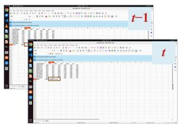

(b) A local edit  
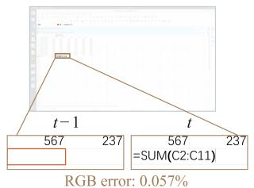

(c) Image-error distribution  
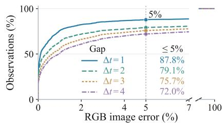

(d) L6 KV drift  
(e) L36 KV drift  
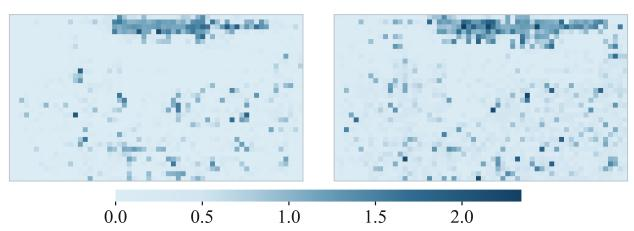  
Relative KV drift, max(dK, dy)

(f) KV stability over time  
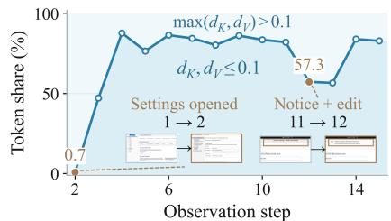  
Figure 1: Incremental changes in GUI observations and internal representations. (a–c) Imagelevel changes. A local edit modifies only a small part of successive screenshots; across the evaluated tasks, more than 70% of observation pairs have RGB-image error at most 5% at each temporal gap $\Delta t \in \{ 1 , 2 , 3 , 4 \}$ . (d–f) Representation-level changes. For the same observation pair, KV-drift maps at layer 6 and the final layer 36 show broadly similar spatial concentrations of change. Along the illustrated trajectory, a large share of tokens has small KV drift $( d _ { K } , d _ { V } \leq 0 . 1 )$ during stable-interface segments, with drops around substantial interface changes. Together, these observations motivate selectively updating changing states rather than rebuilding all representations at every step.

Computation Reuse and Incremental Inference. Temporal redundancy motivates both state caching (Xu et al., 2026b; Ji et al., 2026) and temporal-aware acceleration (Li et al., 2025b; 2026; 2025a) in embodied control. For language models, prefix caching reuses KV states for identical leading contexts, but recurring content outside an unchanged prefix requires additional treatment of positional and contextual changes. CacheBlend addresses this issue in retrieval-augmented generation by selectively recomputing states to account for cross-chunk interactions (Yao et al., 2025). TRACE combines visual-token selection with cross-step cache reuse for GUI agents (Wang et al., 2026). At the generation stage, speculative decoding evaluates candidate continuations with the target model, allowing multiple tokens to be accepted in one verification pass (Leviathan et al., 2023); REST retrieves drafts from existing text without a separate draft model (He et al., 2024). GUIFlow coordinates historical-state reuse, current-observation refinement, and draft verification under evolving contexts, organizing visual encoding, prefill, and decoding into a unified incremental inference process.

## 3 METHOD

## 3.1 FULL-PIPELINE INCREMENTAL INFERENCE

At step $t ,$ a task instruction $q ,$ current screenshot $I _ { t } ,$ , and history $H _ { t }$ of preceding screenshots and actions form the agent’s input $X _ { t }$ . Step-independent execution encodes the screenshots, prefills the language model, and autoregressively generates a response $y _ { t }$ for action execution. Despite KV caching within each response, this execution can repeatedly process overlapping histories and persistent interface content across steps. Figure 1 examines whether changes between decisions require rebuilding these representations. At the image level, panels (a–b) illustrate a localized edit, while panel (c) aggregates observation pairs across tasks: the share with RGB-image error at most 5% is 87.8% for adjacent steps and remains 72.0% at a four-step gap. Thus, visual continuity persists beyond immediately adjacent observations, providing opportunities to carry forward existing visual states.

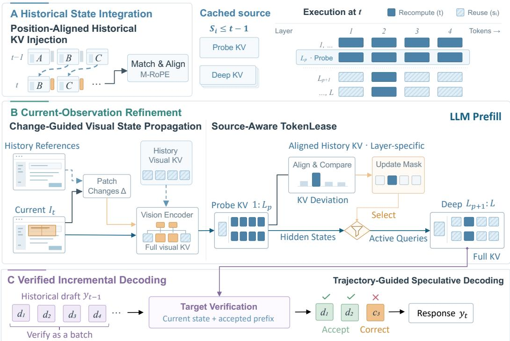  
Figure 2: Overview of GUIFlow. GUIFlow treats successive GUI decisions as incremental updates to existing computation rather than independent inference passes. (A) Historical State Integration. Historical KV states are positionally aligned and injected into the current context. (B) Current-Observation Refinement. Pixel changes guide visual-encoder updates, while source-aware KV deviations guide deeper language-model updates. (C) Verified Incremental Decoding. Conditioned on the prefill state formed by (A) and (B), the target model verifies historical response drafts, accepting matching tokens and correcting mismatches. Together, these mechanisms exploit temporal redundancy across visual encoding, prefill, and decoding without additional training or a separate draft model.

At the representation level, panels (d–e) show that the same observation pair produces broadly similar spatial concentrations of KV drift at layer 6 and the final layer 36. Panel (f) further shows that a large share of tokens retains small KV drift during stable-interface segments, whereas substantial interface changes coincide with drops in this share. These patterns motivate using early-layer deviations to guide deeper-state updates and monitoring state changes as interaction progresses, rather than treating every new screenshot as entirely new computation. Because position and preceding context also affect KV states, visual similarity alone is not sufficient to decide reuse.

Building on these observations, GUIFlow treats each new decision as a selective update to computation maintained within the same task trajectory. Let $\mathcal { C } _ { t - 1 }$ denote the state retained before step t. Incremental inference produces both the current response and the state available to the next step:

$$
( y _ { t } , \mathcal { C } _ { t } ) = \mathcal { G } _ { \theta } ^ { \mathrm { i n c } } ( X _ { t } , \mathcal { C } _ { t - 1 } ) ,\tag{1}
$$

where ${ \mathcal { G } } _ { \theta } ^ { \mathrm { i n c } }$ is an execution procedure for the fixed model with parameters θ, not a separately trained model. The maintained state includes historical KV caches, visual and language-layer caches with reuse metadata, and previous responses used as drafts. Cached representations replace selected computations, whereas response drafts require target-model verification before acceptance. The updated state $\mathcal { C } _ { t }$ retains reusable computation and incorporates newly computed states and the current response.

GUIFlow organizes incremental execution around three sources of temporal redundancy, as illustrated in Figure 2. First, historical screenshots recur across overlapping context windows, motivating reuse of their cached KV states with positional alignment as the window advances. Second, successive observations share persistent interface regions, motivating selective refresh of visual and language states based on observed changes and representation deviations. Finally, action responses within a trajectory often share structural patterns and token sequences, motivating historical drafts whose candidate tokens are verified by the target model and corrected at mismatches. Unavailable or incompatible caches trigger initialization or recomputation. Together, these mechanisms extend incremental execution across visual encoding, prefill, and decoding without changing model-visible inputs or the action interface. Intermediate-state reuse can be approximate, and draft verification under the resulting prefill state does not imply equivalence to dense inference

## 3.2 INCREMENTAL STATE INTEGRATION FOR HISTORICAL CONTEXT

We first address redundant computation in historical context, focusing on the KV states of screenshots retained across interaction steps. As the context window advances, these screenshots may shift in position, requiring a mechanism beyond unchanged-prefix matching.

Position-Aligned Historical KV Injection. The principle is to populate the current context with position-aligned historical KV states and compute the remaining regions, without adding tokens or changing the model-visible input. GUIFlow maps eligible historical image blocks in $X _ { t }$ to their cached counterparts in $\mathcal { C } _ { t - 1 }$ . It first identifies a contiguous matching prefix using multimodal fingerprints: text tokens are identified by token ID and type, while image tokens are identified by image content, grid layout, and within-image offset. Beyond this prefix, historical image blocks are matched by content, grid, and token count. This mapping separates blocks eligible for cache injection from regions requiring computation, including intervening text and action tokens outside the matching prefix and historical images that cannot be reused.

For each matched historical token, GUIFlow transfers the cached KV states to the corresponding current position. Let $p _ { s }$ and $p _ { t }$ denote its source and current multimodal positions, and let $R ( p )$ denote the corresponding M-RoPE rotation. At layer ℓ, the position-aligned states are

$$
\widetilde { K } _ { t } ^ { ( \ell ) } = R ( p _ { t } ) R ( p _ { s } ) ^ { \top } K _ { s } ^ { ( \ell ) } , \qquad \widetilde { V } _ { t } ^ { ( \ell ) } = V _ { s } ^ { ( \ell ) } ,\tag{2}
$$

where $K _ { s } ^ { ( \ell ) }$ already carries the source positional rotation; the correction acts on rotary dimensions and leaves other dimensions unchanged. These states populate their slots in the current logical KV layout, allowing recomputed queries to attend to both reused and newly computed states under the current causal mask.

Finally, GUIFlow uses a positive integer hyperparameter $M _ { \mathrm { h i s t } }$ to cap the number of sliding reuses of historical-image KV states, preventing indefinite reuse without recomputation. Each sliding copy increments the inherited per-token reuse count, whereas exact-prefix reuse leaves it unchanged. Before a historical image block is reused, its maximum source-token count is checked against $M _ { \mathrm { h i s t } } ^ { - }$ if the count is at least $M _ { \mathrm { h i s t } }$ , the block is recomputed and its counts are reset to zero.

## 3.3 INCREMENTAL STATE REFINEMENT FOR CURRENT OBSERVATIONS

The current observation captures the latest environment state and directly informs the next action, while sharing persistent interface regions and potentially reusable internal states with preceding observations. GUIFlow therefore selectively refreshes current-observation computation at two levels, using pixel changes to guide visual-state updates and context-dependent representation deviations to guide deeper language-model updates.

Change-Guided Visual State Propagation. GUIFlow propagates existing visual states while concentrating new computation on changed regions. Patch-level pixel differences against a rolling reference identify an update set $A _ { t } ,$ expanded to include complete patch-merging groups. At visionencoder layer $\ell ,$ the KV states are updated as

$$
Z _ { t , i } ^ { ( \ell ) } = \left\{ \begin{array} { l l } { \widehat { Z } _ { t , i } ^ { ( \ell ) } , } & { i \in \mathcal { A } _ { t } , } \\ { Z _ { \mathrm { r e f } , i } ^ { ( \ell ) } , } & { i \notin \mathcal { A } _ { t } , } \end{array} \right. \quad Z \in \{ K , V \} ,\tag{3}
$$

where $\widehat { Z } _ { t , i } ^ { ( \ell ) }$ denotes a newly computed state and $Z _ { \mathrm { r e f } } ^ { ( \ell ) } ,$ its cached counterpart in the rolling reference. Selected patch queries attend to this full mixture of new and cached visual KV and undergo feedforward computation; unselected patches retain their cached states. Updated states become the next reference; incompatible layouts, extensive changes, or reaching the sparse-update limit trigger full recomputation.

Table 1: Main results on offline multi-image navigation. FLOPs (T) are averaged per step; speedup is the Dense/method FLOPs ratio, with an equal-weight geometric mean across datasets. GUIFlow achieves 3.37–3.39× geometric-mean speedups while maintaining scores close to Dense.
<table><tr><td rowspan="2">Model</td><td rowspan="2">Method</td><td colspan="3">AITW</td><td colspan="3">Mind2Web</td><td rowspan="2">Geo. Mean</td></tr><tr><td>Action Matching (%) ↑</td><td>FLOPs (T) ↓</td><td>Speedup (x)↑</td><td>Step SR (%) ↑</td><td>FLOPs (T) ↓</td><td>Speedup (x)↑</td></tr><tr><td rowspan="9">Qwen3-VL</td><td>Dense</td><td>61.20</td><td>31.94</td><td>1.00</td><td>49.77</td><td>43.97</td><td>1.00</td><td>(x)↑ 1.00</td></tr><tr><td>FastV</td><td>60.26</td><td>22.14</td><td>1.44</td><td>48.31</td><td>30.10</td><td>1.46</td><td>1.45</td></tr><tr><td>VisionZip</td><td>60.23</td><td>18.91</td><td>1.69</td><td>42.09</td><td>24.90</td><td>1.77</td><td>1.73</td></tr><tr><td>GUI-KV</td><td>58.59</td><td>31.94</td><td>1.00</td><td>49.25</td><td>43.96</td><td>1.00</td><td>1.00</td></tr><tr><td>4B-Instruct STaR-KV</td><td>60.34</td><td>31.93</td><td>1.00</td><td>49.61</td><td>43.95</td><td>1.00</td><td>1.00</td></tr><tr><td>Op-Skip</td><td>58.29</td><td>24.65</td><td>1.30</td><td>53.41</td><td>34.21</td><td>1.29</td><td>1.29</td></tr><tr><td>HistPrune</td><td>61.20</td><td>25.47</td><td>1.25</td><td>49.75</td><td>34.67</td><td>1.27</td><td>1.26</td></tr><tr><td>GUIFlow</td><td>61.74</td><td>9.23</td><td>3.46</td><td>49.16</td><td>13.37</td><td>3.29</td><td>3.37</td></tr><tr><td>Dense</td><td>69.06</td><td>62.45</td><td>1.00</td><td>53.40</td><td>85.78</td><td>1.00</td><td>1.00</td></tr><tr><td rowspan="8">UI-TARS 1.5-7B</td><td>FastV</td><td>67.99</td><td>41.27</td><td>1.51</td><td>52.40</td><td>55.72</td><td>1.54</td><td>1.53</td></tr><tr><td>VisionZip</td><td>66.11</td><td>42.01</td><td>1.49</td><td>49.31</td><td>57.54</td><td>1.49</td><td>1.49</td></tr><tr><td>GUI-KV</td><td>69.12</td><td>62.45</td><td>1.00</td><td>52.17</td><td>85.78</td><td>1.00</td><td>1.00</td></tr><tr><td>STaR-KV</td><td>69.10</td><td>62.44</td><td>1.00</td><td>53.05</td><td>85.77</td><td>1.00</td><td>1.00</td></tr><tr><td>Op-Skip</td><td>65.17</td><td>50.30</td><td>1.24</td><td>49.49</td><td>69.20</td><td>1.24</td><td>1.24</td></tr><tr><td>HistPrune</td><td>69.06</td><td>52.30</td><td>1.19</td><td>53.29</td><td>71.58</td><td>1.20</td><td>1.20</td></tr><tr><td>GUIFlow</td><td>68.93</td><td>18.33</td><td>3.41</td><td>53.13</td><td>25.49</td><td>3.37</td><td>3.39</td></tr><tr><td></td><td></td><td></td><td></td><td></td><td></td><td></td><td></td></tr></table>

Source-Aware TokenLease. TokenLease probes context-dependent representation changes before deciding which deep states to refresh. Current-image tokens pass through the first $L _ { p }$ language-model layers, and their probe KV is compared with the position-aligned probe KV of their actual deep-cache sources, not necessarily the previous step. We quantify this deviation and its residual mass as

$$
d _ { i } = \operatorname* { m a x } _ { Z \in \{ K , V \} } \frac { \mathrm { R M S } ( Z _ { i } ^ { \mathrm { c u r } } - \bar { Z } _ { i } ^ { \mathrm { s r c } } ) } { \operatorname* { m a x } \bigl ( \mathrm { R M S } ( \bar { Z } _ { i } ^ { \mathrm { s r c } } ) , \delta \bigr ) } , \qquad m _ { i } = d _ { i } ^ { 2 } ,\tag{4}
$$

where $Z _ { i } ^ { \mathrm { c u r } }$ and $\bar { Z } _ { i } ^ { \mathrm { s r c } }$ denote the current and position-aligned source probe states at layer $L _ { p } ,$ respectively, and $\delta > 0$ stabilizes the normalization. The refresh set $\mathcal { R } _ { t }$ includes pixel-changed tokens and tokens reaching the reuse limit $M _ { \mathrm { c u r } } ,$ , then expands in descending residual mass until

$$
\sum _ { i \in \mathcal { I } _ { t } \backslash \mathcal { R } _ { t } } m _ { i } \leq \varepsilon \sum _ { i \in \mathcal { I } _ { t } } m _ { i } ,\tag{5}
$$

where $\mathcal { T } _ { t }$ indexes current-image tokens and $\varepsilon \in [ 0 , 1 ]$ sets the unrefreshed residual-mass budget. Beyond layer $L _ { p } ,$ selected image queries are computed and others reuse deep KV; text queries and the full logical KV layout are retained. Refreshed tokens renew their sources and reset reuse counts; reused tokens retain their sources and increment counts.

## 3.4 VERIFIED INCREMENTAL DECODING FOR ACTION GENERATION

We next accelerate autoregressive decoding by exploiting temporal redundancy in action responses. Outputs at successive interaction steps often share structural patterns and token sequences, although action arguments may change with the current observation. Rather than regenerating these sequences token by token, GUIFlow uses historical outputs to propose continuations and verifies them under the current context.

Trajectory-Guided Speculative Decoding. Following the draft–verify principle of speculative decoding (Leviathan et al., 2023), GUIFlow treats the action-response portion of an earlier output, such as $y _ { t - 1 }$ , as a draft for $y _ { t }$ . The candidate pool retains the most recent response for each action type within the same task, allowing earlier steps to supply alternatives when the immediately preceding action differs. These drafts require neither a separate model nor additional training and are not appended to the model-visible prompt as extra history. Instead, their candidate tokens are evaluated in a batched target-model forward pass from the current prefill state and the accepted response prefix.

Table 2: Main results on online OSWorld interaction. FLOPs (T) are averaged per step/request for each evaluated run; speedups are Dense/method mean FLOPs ratios across rollout trajectories. GUIFlow achieves 3.32–3.49× speedups relative to Dense.
<table><tr><td>Model</td><td>Method</td><td>Mean Score (%) ↑</td><td>Strict SR (%) ↑</td><td>FLOPs (T) ↓</td><td>Speedup (×)↑</td></tr><tr><td rowspan="7">Qwen3-VL 8B-Instruct</td><td>Dense</td><td>24.30</td><td>23.55</td><td>247.01</td><td>1.00</td></tr><tr><td>FastV</td><td>23.16</td><td>22.16</td><td>165.50</td><td>1.49</td></tr><tr><td>VisionZip</td><td>21.22</td><td>20.22</td><td>161.48</td><td>1.53</td></tr><tr><td>GUI-KV</td><td>22.81</td><td>21.61</td><td>246.54</td><td>1.00</td></tr><tr><td>HistPrune</td><td>20.82</td><td>19.94</td><td>194.52</td><td>1.27</td></tr><tr><td>DivPrune</td><td>22.93</td><td>22.71</td><td>185.89</td><td>1.33</td></tr><tr><td>GUIFlow</td><td>27.90</td><td>26.87</td><td>70.85</td><td>3.49</td></tr><tr><td rowspan="6">GUI-Owl 1.5-8B-Instruct</td><td>Dense</td><td>48.79</td><td>47.09</td><td>278.12</td><td>1.00</td></tr><tr><td>FastV</td><td>45.83</td><td>44.32</td><td>187.36</td><td>1.48</td></tr><tr><td>VisionZip</td><td>44.36</td><td>42.38</td><td>183.18</td><td>1.52</td></tr><tr><td>HistPrune</td><td>45.74</td><td>43.77</td><td>219.07</td><td>1.27</td></tr><tr><td>DivPrune</td><td>41.79</td><td>40.17 44.60</td><td>182.84</td><td>1.52</td></tr><tr><td>GUIFlow</td><td>46.30</td><td></td><td>83.81</td><td>3.32</td></tr></table>

For greedy decoding, let u denote the accepted prefix and $d ^ { ( j ) }$ a candidate continuation of length $n _ { j }$ Writing $p _ { \theta , t }$ for the target-model distribution conditioned on the current prefill state, we compute

$$
\begin{array} { r l } & { \widehat { d } _ { i } ^ { ( j ) } = \arg \operatorname* { m a x } _ { v } p _ { \theta , t } ( v \mid u , d _ { < i } ^ { ( j ) } ) , } \\ & { ~ a _ { j } = \operatorname* { m a x } \big \{ k \in \{ 0 , \ldots , n _ { j } \} : ~ d _ { i } ^ { ( j ) } = \widehat { d } _ { i } ^ { ( j ) } ~ \mathrm { f o r ~ a l l } ~ 1 \leq i \leq k \big \} . } \end{array}\tag{6}
$$

GUIFlow selects the longest matching prefix, favoring more recent drafts in a tie. It retains the accepted tokens and their newly computed KV, discards rejected candidate states, and generates a target-model correction at the first mismatch before continuing decoding. When applicable, later structural matches allow re-entry into a historical draft; otherwise, generation proceeds token by token. Matching drafts thus let one verification pass advance multiple output tokens, reducing serial decoding calls while leaving the current token decisions to the target model.

## 4 EXPERIMENTS

## 4.1 MAIN RESULTS

Offline Multi-Image Navigation. Many multimodal baselines optimize individual requests, while GUI-specific alternatives exploit temporal structure through context compression or historical caching. Repeated screenshot histories and locally changing interfaces offer a broader opportunity: advancing a decision need not require recomputing all supporting representations. Table 1 shows that GUIFlow achieves the lowest FLOPs across both models and datasets, with geometric-mean speedups of 3.37× on Qwen3-VL and 3.39× on UI-TARS while maintaining task scores close to Dense. Across the four model–dataset settings, GUIFlow delivers 3.29–3.46× speedups, compared with at most 1.77× among the evaluated baselines.

Online Closed-Loop Interaction. We complement offline action prediction on fixed trajectories with closed-loop evaluation in OSWorld, where actions alter subsequent observations and task success is evaluated from the resulting environment state. This coupling requires cached computation to support decisions as the trajectory evolves. GUIFlow achieves 3.49× and 3.32× speedups on Qwen3-VL and GUI-Owl, respectively, with higher mean scores and strict success rates than the evaluated acceleration baselines (Table 2). On Qwen3-VL, GUIFlow reaches 27.90% mean score and 26.87% strict success rate, compared with 24.30% and 23.55% for Dense. These findings extend the evidence for incremental inference from fixed histories to interactive execution; we examine wall-clock benefits in the following analysis.

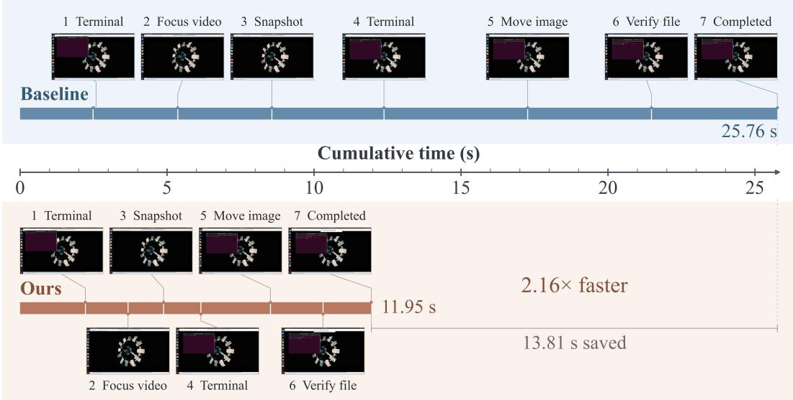  
Figure 3: Qualitative comparison of task execution time on an OSWorld task. Dense inference and GUIFlow complete the same seven interaction stages. GUIFlow reduces task execution time from 25.76 to 11.95 seconds, corresponding to a 2.16× speedup and 13.81 seconds saved. The horizontal axis measures cumulative task execution time.

Table 3: FLOPs and wall-clock efficiency of GUIFlow. Total latency covers per-step processing and inference, excluding environment execution. Speedups use Dense/GUIFlow ratios of unrounded means; online records come from different trajectories.
<table><tr><td rowspan="2">Benchmark Model</td><td rowspan="2"></td><td rowspan="2">FLOPs (T) ↓</td><td rowspan="2">Total Latency (ms) ↓</td><td colspan="2">Speedup</td></tr><tr><td>FLOPs (x)↑</td><td>Latency (×)↑</td></tr><tr><td rowspan="2">AITW</td><td>Qwen3-VL-4B</td><td>9.23</td><td>470.64</td><td>3.46</td><td>1.96</td></tr><tr><td>UI-TARS-1.5-7B</td><td>18.33</td><td>547.23</td><td>3.41</td><td>1.94</td></tr><tr><td rowspan="2">Mind2Web</td><td>Qwen3-VL-4B</td><td>13.37</td><td>633.91</td><td>3.29</td><td>1.97</td></tr><tr><td>UI-TARS-1.5-7B</td><td>25.49</td><td>603.08</td><td>3.37</td><td>2.32</td></tr><tr><td rowspan="2">OSWorld</td><td>Qwen3-VL-8B</td><td>70.85</td><td>1502.69</td><td>3.49</td><td>2.51</td></tr><tr><td>GUI-Owl-1.5-8B</td><td>83.81</td><td>1713.34</td><td>3.32</td><td>2.55</td></tr></table>

## 4.2 ANALYSIS

Speedup and Latency Reduction. Table 3 reports 3.29–3.49× speedups across the evaluated offline and online settings, alongside reductions in wall-clock latency by factors of 1.94–2.55. For example, GUI-Owl’s mean processing latency on OSWorld decreases from 4362.91 to 1713.34 ms. Processing latency also reflects memory access, cache management, and input/output costs, so its reduction differs from the FLOPs reduction.

Component Contributions. Table 4 shows complementary benefits across the cumulative configurations. Historical KV injection provides the largest initial FLOPs reduction, with sparse visual updates and TokenLease bringing further savings. With the same TokenLease settings, speculative decoding slightly increases FLOPs but lowers cumulative server processing time from 27.51 to 17.85 s/task.

Table 4: Cumulative component ablation on Qwen3-VL-8B in OSWorld. Checkmarks indicate enabled components; quality uses 361 tasks, with missing results scored as zero. TokenLease uses $L _ { p } = 6$ and $M _ { \mathrm { c u r } } = 3$ in both enabled configurations. FLOPs and Total average valid task measurements; Total sums server processing time and excludes environment execution.
<table><tr><td colspan="4">Enabled Components</td><td colspan="2">Task Performance</td><td colspan="2">Inference Cost</td></tr><tr><td>KV</td><td>History Sparse Token Vision</td><td>Lease</td><td>Spec. Decode</td><td>Mean Score (%)↑</td><td>Strict SR (%)↑</td><td>FLOPs (T/task) ↓</td><td>Total (s/task) ↓</td></tr><tr><td>一</td><td>一</td><td>一</td><td>一</td><td>24.30</td><td>23.55</td><td>2981.19</td><td>45.43</td></tr><tr><td>√</td><td>一</td><td></td><td></td><td>27.33</td><td>26.32</td><td>1010.29</td><td>29.54</td></tr><tr><td>√</td><td>√</td><td>一</td><td></td><td>26.21</td><td>24.93</td><td>962.02</td><td>29.35</td></tr><tr><td>√</td><td>√</td><td>√</td><td>一</td><td>25.43</td><td>24.65</td><td>819.07</td><td>27.51</td></tr><tr><td>√</td><td>√</td><td>√</td><td>√</td><td>27.90</td><td>26.87</td><td>841.33</td><td>17.85</td></tr></table>

Table 5: Sensitivity to TokenLease probe depth and reuse limit on Qwen3-VL-8B in OSWorld. The layer sweep fixes $M _ { \mathrm { { c u r } } } = 2 .$ , and the reuse-limit sweep fixes $L _ { p } = 6 .$ † marks the shared default value of the swept parameter; quality uses all 361 tasks, with missing results scored as zero. Bold marks the best value within each sweep.
<table><tr><td>Sweep</td><td>Setting</td><td>Mean Score (%) ↑</td><td>Strict SR (%)↑</td><td>FLOPs (T/step) ↓</td><td>Total (s/step) ↓</td></tr><tr><td rowspan="4">Probe Depth  $( M _ { \mathrm { { c u r } } } = \bar { 2 } )$ </td><td> $L _ { p } = 3$ </td><td>24.28</td><td>23.27</td><td>224.70</td><td>3.59</td></tr><tr><td> $L _ { p } = 6 ^ { \dagger }$ </td><td>27.35</td><td>26.59</td><td>228.22</td><td>3.56</td></tr><tr><td> $L _ { p } = 9$ </td><td>26.48</td><td>25.48</td><td>230.43</td><td>3.58</td></tr><tr><td> $L _ { p } = 1 2$ </td><td>25.25</td><td>24.65</td><td>231.01</td><td>3.62</td></tr><tr><td rowspan="4">Reuse Limit  $( L _ { p } = 6 )$ </td><td> $M _ { \mathrm { c u r } } = 1$ </td><td>25.93</td><td>24.65</td><td>226.28</td><td>3.57</td></tr><tr><td> $M _ { \mathrm { c u r } } = 2$ </td><td>27.35</td><td>26.59</td><td>228.22</td><td>3.56</td></tr><tr><td> $M _ { \mathrm { { c u r } } } = 3 ^ { \dagger }$ </td><td>27.60</td><td>26.59</td><td>224.76</td><td>3.57</td></tr><tr><td> $M _ { \mathrm { { c u r } } } = 4$ </td><td>26.76</td><td>25.48</td><td>224.33</td><td>3.60</td></tr></table>

This is consistent with trading additional verification work for fewer serial decoding calls: state updates reduce repeated computation, while historical drafts improve generation efficiency.

Probe Depth and Reuse Limit. Table 5 characterizes sensitivity to probe depth and reuse limit. In the layer sweep, $L _ { p } = 6$ achieves the highest task scores; shallower probing saves slightly more FLOPs at lower quality, while deeper probing adds cost without improving quality. At $L _ { p } = 6$ $M _ { \mathrm { { c u r } } } = 3$ gives the highest mean score and ties the best strict success rate; extending reuse to four saves only 0.2% additional FLOPs with lower scores. The shared defaults, $L _ { p } = 6$ and $M _ { \mathrm { { c u r } } } = 3$ were fixed before the main evaluations; this study analyzes their sensitivity on Qwen3-VL/OSWorld.

Qualitative Visualization. Figure 3 compares cumulative task execution time for Dense inference and GUIFlow on an OSWorld task that both complete through the same interaction stages; the time gap grows over the rollout, reaching a 2.16× speedup. Appendix A reports split-, category-, and mechanism-level results, Appendix B details the evaluation setup, and Appendix C presents eight further successful trajectories with similar time savings.

## 5 CONCLUSION

We presented GUIFlow, a training-free framework that incrementally updates persistent states across GUI interaction. By reusing position-aligned historical KV states, selectively refreshing currentobservation states, and verifying trajectory-derived drafts, GUIFlow reduces repeated computation across visual encoding, prefill, and decoding. It achieves up to 3.39× and 3.49× FLOPs speedups on offline benchmarks and OSWorld, respectively, while lowering processing latency and maintaining task performance broadly comparable to dense inference.

## REFERENCES

Amirhossein Abaskohi, Yuhang He, Peter West, Giuseppe Carenini, Pranit Chawla, and Vibhav Vineet. Revision: Scaling computer-use agents via temporal visual redundancy reduction. arXiv preprint arXiv:2605.11212, 2026.

Saeed Ranjbar Alvar, Gursimran Singh, Mohammad Akbari, and Yong Zhang. Divprune: Diversitybased visual token pruning for large multimodal models. In 2025 IEEE/CVF Conference on Computer Vision and Pattern Recognition (CVPR), pp. 9392–9401. IEEE, 2025.

Shuai Bai, Yuxuan Cai, Ruizhe Chen, Keqin Chen, Xionghui Chen, Zesen Cheng, Lianghao Deng, Wei Ding, Chang Gao, Chunjiang Ge, et al. Qwen3-vl technical report. arXiv preprint arXiv:2511.21631, 2025.

Liang Chen, Haozhe Zhao, Tianyu Liu, Shuai Bai, Junyang Lin, Chang Zhou, and Baobao Chang. An image is worth 1/2 tokens after layer 2: Plug-and-play inference acceleration for large visionlanguage models. In European Conference on Computer Vision, pp. 19–35. Springer, 2024.

Kanzhi Cheng, Qiushi Sun, Yougang Chu, Fangzhi Xu, Li YanTao, Jianbing Zhang, and Zhiyong Wu. Seeclick: Harnessing gui grounding for advanced visual gui agents. In Proceedings ofthe 62nd Annual Meeting of the Association for Computational Linguistics (Volume 1: Long Papers), pp. 9313–9332, 2024.

Xiang Deng, Yu Gu, Boyuan Zheng, Shijie Chen, Sam Stevens, Boshi Wang, Huan Sun, and Yu Su. Mind2web: Towards a generalist agent for the web. Advances in Neural Information Processing Systems, 36:28091–28114, 2023.

Yuhang Han, Wenzheng Yang, Yujie Chen, Xiangqi Jin, Yaojie Zhang, Siteng Huang, and Linfeng Zhang. Star-kv: Spatio-temporal adaptive re-weighting for kv cache compression in gui visionlanguage models. arXiv preprint arXiv:2606.01790, 2026.

Zhenyu He, Zexuan Zhong, Tianle Cai, Jason Lee, and Di He. Rest: Retrieval-based speculative decoding. In Proceedings ofthe 2024 Conference ofthe North American Chapter ofthe Association for Computational Linguistics: Human Language Technologies (Volume 1: Long Papers), pp. 1582–1595, 2024.

Kung-Hsiang Huang, Haoyi Qiu, Yutong Dai, Caiming Xiong, and Chien-Sheng Wu. Gui-kv: Efficient gui agents via kv cache with spatio-temporal awareness. arXiv preprint arXiv:2510.00536, 2025.

Kangye Ji, Yuan Meng, Hanyun Cui, Ye Li, Jianbo Zhou, Shengjia Hua, Lei Chen, and Zhi Wang. Block-wise adaptive caching for accelerating diffusion policy. In International Conference on Learning Representations, 2026.

Yaniv Leviathan, Matan Kalman, and Yossi Matias. Fast inference from transformers via speculative decoding. In International conference on machine learning, pp. 19274–19286. PMLR, 2023.

Ye Li, Jiahe Feng, Yuan Meng, Kangye Ji, Chen Tang, Xinwan Wen, Shutao Xia, Zhi Wang, and Wenwu Zhu. Ts-dp: Reinforcement speculative decoding for temporal adaptive diffusion policy acceleration. arXiv preprint arXiv:2512.15773, 2025a.

Ye Li, Yuan Meng, Zewen Sun, Kangye Ji, Chen Tang, Jiajun Fan, Xinzhu Ma, Shutao Xia, Zhi Wang, and Wenwu Zhu. Sp-vla: A joint model scheduling and token pruning approach for vla model acceleration. arXiv preprint arXiv:2506.12723, 2025b.

Ye Li, Chen Tang, Yuan Meng, Jiajun Fan, Zenghao Chai, Xinzhu Ma, Zhi Wang, and Wenwu Zhu. Prance: Joint token-optimization and structural channel-pruning for adaptive vit inference. IEEE Transactions on Pattern Analysis and Machine Intelligence, 2025c.

Ye Li, Huanan Liu, Kangye Ji, Yuan Meng, Jiajun Fan, Yuansong Wang, Shiyu Qin, Chenglei Wu, Shu-Tao Xia, and Zhi Wang. Elegantvla: Learning when to think for efficient vision-languageaction models. arXiv preprint arXiv:2605.29438, 2026.

Yingxin Li, Ye Li, Yuan Meng, Xinzhu Ma, Zihan Geng, Shutao Xia, and Zhi Wang. Ems: Adaptive evict-then-merge strategy for head-wise kv cache compression based on global-local importance. arXiv preprint arXiv:2412.08521, 2024.

Kevin Qinghong Lin, Linjie Li, Difei Gao, Zhengyuan Yang, Shiwei Wu, Zechen Bai, Stan Weixian Lei, Lijuan Wang, and Mike Zheng Shou. Showui: One vision-language-action model for gui visual agent. In 2025 IEEE/CVF Conference on Computer Vision and Pattern Recognition (CVPR), pp. 19498–19508. IEEE, 2025.

Zhaoyang Luo, Runmin Dong, Miao Yang, Fan Wei, Yushan Lai, Bin Luo, and Haohuan Fu. Attend, transform, or silence: Operator-level visual skipping for efficient multimodal llm inference. arXiv preprint arXiv:2606.31903, 2026.

Yujia Qin, Yining Ye, Junjie Fang, Haoming Wang, Shihao Liang, Shizuo Tian, Junda Zhang, Jiahao Li, Yunxin Li, Shijue Huang, et al. Ui-tars: Pioneering automated gui interaction with native agents. arXiv preprint arXiv:2501.12326, 2025.

Christopher Rawles, Alice Li, Daniel Rodriguez, Oriana Riva, and Timothy Lillicrap. Androidinthewild: A large-scale dataset for android device control. Advances in Neural Information Processing Systems, 36:59708–59728, 2023.

Yuhao Wang, Mu Qiao, Xindong Zhang, Yunzhi Zhuge, Lei Zhang, and Huchuan Lu. Trace: Trajectory-robust admission with evidence ordering for efficient gui agents. arXiv preprint arXiv:2609.10297, 2026.

Tianbao Xie, Danyang Zhang, Jixuan Chen, Xiaochuan Li, Siheng Zhao, Ruisheng Cao, Toh J Hua, Zhoujun Cheng, Dongchan Shin, Fangyu Lei, et al. Osworld: Benchmarking multimodal agents for open-ended tasks in real computer environments. Advances in Neural Information Processing Systems, 37:52040–52094, 2024.

Haiyang Xu, Xi Zhang, Haowei Liu, Junyang Wang, Zhaozai Zhu, Shengjie Zhou, Xuhao Hu, Feiyu Gao, Junjie Cao, Zihua Wang, et al. Mobile-agent-v3. 5: Multi-platform fundamental gui agents. arXiv preprint arXiv:2602.16855, 2026a.

Siyu Xu, Yunke Wang, Chenghao Xia, Dihao Zhu, Tao Huang, and Chang Xu. Vla-cache: Efficient vision-language-action manipulation via adaptive token caching. Advances in Neural Information Processing Systems, 38:164448–164473, 2026b.

Senqiao Yang, Yukang Chen, Zhuotao Tian, Chengyao Wang, Jingyao Li, Bei Yu, and Jiaya Jia. Visionzip: Longer is better but not necessary in vision language models. In 2025 IEEE/CVF Conference on Computer Vision and Pattern Recognition (CVPR), pp. 19792–19802. IEEE, 2025.

Jiayi Yao, Hanchen Li, Yuhan Liu, Siddhant Ray, Yihua Cheng, Qizheng Zhang, Kuntai Du, Shan Lu, and Junchen Jiang. Cacheblend: Fast large language model serving for rag with cached knowledge fusion. In Proceedings of the twentieth European conference on computer systems, pp. 94–109, 2025.

Bowen Zhou, Zhou Xu, Wanli Li, Jingyu Xiao, and Haoqian Wang. Efficient long-horizon gui agents via training-free kv cache compression. arXiv preprint arXiv:2603.00188, 2026.

Table A1: Split-level results on Mind2Web. Step SR (%) is macro-averaged within each split, and Avg. is the unweighted mean across the three splits. Speedup is the Dense/method mean FLOPs ratio; bold denotes the best result for each model.
<table><tr><td>Model</td><td>Method</td><td>Cross-Task Step SR ↑</td><td>Cross-Website Step SR ↑</td><td>Cross-Domain Step SR ↑</td><td> $\operatorname { A v g } .$  Step SR ↑</td><td>Speedup (×)↑</td></tr><tr><td rowspan="8">Qwen3-VL 4B-Instruct</td><td>Dense</td><td>51.11</td><td>48.37</td><td>49.84</td><td>49.77</td><td>1.00</td></tr><tr><td>FastV</td><td>49.55</td><td>46.73</td><td>48.64</td><td>48.31</td><td>1.46</td></tr><tr><td>VisionZip</td><td>42.36</td><td>41.23</td><td>42.69</td><td>42.09</td><td>1.77</td></tr><tr><td>GUI-KV</td><td>51.59</td><td>47.06</td><td>49.09</td><td>49.25</td><td>1.00</td></tr><tr><td>STaR-KV</td><td>51.40</td><td>47.81</td><td>49.63</td><td>49.61</td><td>1.00</td></tr><tr><td>Op-Skip</td><td>54.18</td><td>52.48</td><td>53.56</td><td>53.41</td><td>1.29</td></tr><tr><td>HistPrune</td><td>51.09</td><td>48.22</td><td>49.93</td><td>49.75</td><td>1.27</td></tr><tr><td>GUIFlow</td><td>50.59</td><td>47.45</td><td>49.45</td><td>49.16</td><td>3.29</td></tr><tr><td rowspan="8">UI-TARS 1.5-7B</td><td>Dense</td><td>55.04</td><td>52.19</td><td>52.98</td><td>53.40</td><td>1.00</td></tr><tr><td>FastV</td><td>54.46</td><td>51.59</td><td>51.14</td><td>52.40</td><td>1.54</td></tr><tr><td>VisionZip</td><td>51.98</td><td>48.08</td><td>47.87</td><td>49.31</td><td>1.49</td></tr><tr><td>GUI-KV</td><td>53.30</td><td>51.99</td><td>51.21</td><td>52.17</td><td>1.00</td></tr><tr><td>STaR-KV</td><td>54.51</td><td>51.88</td><td>52.76</td><td>53.05</td><td>1.00</td></tr><tr><td>Op-Skip</td><td>51.16</td><td>47.69</td><td>49.62</td><td>49.49</td><td>1.24</td></tr><tr><td>HistPrune</td><td>54.74</td><td>52.22</td><td>52.91</td><td>53.29</td><td>1.20</td></tr><tr><td>GUIFlow</td><td>55.13</td><td>51.65</td><td>52.62</td><td>53.13</td><td>3.37</td></tr></table>

## A ADDITIONAL EXPERIMENTAL RESULTS

## A.1 MIND2WEB SPLIT-LEVEL RESULTS

Table A1 expands the aggregate Mind2Web results in Table 1 across the Cross-Task, Cross-Website, and Cross-Domain splits while retaining the corresponding speedups. On Qwen3-VL, GUIFlow achieves a 3.29× speedup with an average Step SR of 49.16%, only 0.61 percentage points below Dense. This provides a substantially stronger efficiency–accuracy trade-off than VisionZip, which reaches a 1.77× speedup but reduces the average Step SR to 42.09%, while the higher-scoring Op-Skip provides only a 1.29× speedup. On UI-TARS, GUIFlow attains the best Cross-Task result and preserves an average Step SR within 0.27 points of Dense while delivering a 3.37× speedup, compared with at most 1.54× among the baselines. Across both backbones, no individual split drops by more than 0.92 percentage points from Dense.

## A.2 OSWORLD CATEGORY-LEVEL RESULTS

Table A2 reports category-level efficiency and quality results for GUI-Owl on OSWorld. Overall, GUIFlow reduces FLOPs per request by 69.9% (3.32×) and total FLOPs per task by 67.7% (3.10×), while keeping the mean score within 2.49 points of Dense. Task-level speedups range from 2.33× to 4.41× across application categories, demonstrating consistent computational savings under varying request counts.

## A.3 TOKENLEASE MECHANISTIC STATISTICS

Table A3 complements the outcome-level sensitivity results in Table 5 by exposing the internal reuse behavior of TokenLease. Across probe depths, the acceptance rate remains stable at approximately 91.6%, while moving the probe from layer 3 to layer 12 reduces the fraction of reused image tokens from 30.66% to 23.64% and the FLOPs reduction from 9.07% to 6.23%. This indicates that deeper probing primarily reduces the amount of downstream computation available for reuse rather than materially changing the lease decisions. With $L _ { p } = 6$ , increasing $M _ { \mathrm { c u r } }$ from 1 to 3 raises image-token reuse from 25.60% to 31.31% and the FLOPs reduction from 8.08% to 8.77%. Extending the limit to 4 yields no further computational benefit and slightly lowers the paired latency speedup. These

Table A2: Category-level efficiency and quality on OSWorld with GUI-Owl-1.5-8B. Request and score changes are measured relative to Dense; FLOPs speedups are computed as Dense/GUIFlow. Overall covers all 361 tasks; efficiency uses valid measurements.
<table><tr><td>Application</td><td>Tasks</td><td>Request change (%)</td><td>FLOPs/request speedup (×)</td><td>Task FLOPs speedup (×)</td><td>Score change (pp)</td></tr><tr><td>Chrome</td><td>46</td><td>+40.4</td><td>3.27</td><td>2.33</td><td>-0.01</td></tr><tr><td>GIMP</td><td>26</td><td>+14.2</td><td>3.44</td><td>3.01</td><td>-3.85</td></tr><tr><td>LibreOffice Calc</td><td>47</td><td>-5.6</td><td>3.23</td><td>3.42</td><td>-6.38</td></tr><tr><td>LibreOffice Impress</td><td>47</td><td>-16.8</td><td>3.67</td><td>4.41</td><td>+4.26</td></tr><tr><td>LibreOffice Writer</td><td>23</td><td>+45.5</td><td>3.45</td><td>2.37</td><td>-8.70</td></tr><tr><td>Multi-Apps</td><td>93</td><td>+5.7</td><td>3.19</td><td>3.02</td><td>-1.08</td></tr><tr><td>OS</td><td>24</td><td>+16.8</td><td>3.33</td><td>2.86</td><td>0.00</td></tr><tr><td>Thunderbird</td><td>15</td><td>-15.0</td><td>3.64</td><td>4.28</td><td>-6.67</td></tr><tr><td>VLC</td><td>17</td><td>+8.8</td><td>3.54</td><td>3.25</td><td>-11.76</td></tr><tr><td>VS Code</td><td>23</td><td>-6.9</td><td>3.53</td><td>3.80</td><td>-4.35</td></tr><tr><td>Overall</td><td>361</td><td>+7.1</td><td>3.32</td><td>3.10</td><td>-2.49</td></tr></table>

Table A3: Mechanistic statistics of TokenLease on Qwen3-VL-8B in OSWorld. The probe-depth sweep fixes $M _ { \mathrm { { c u r } } } = 2 ,$ and the reuse-limit sweep fixes $L _ { p } = 6$ . FLOPs reduction and latency speedup are paired against Dense on common task-step keys; † marks the shared default value of the swept parameter.
<table><tr><td>Sweep</td><td>Setting</td><td>Effective Tasks</td><td>Lease Acceptance (%)</td><td>Reused Image Tokens (%)</td><td>FLOPs Reduction (%)</td><td>Latency Speedup (×)</td></tr><tr><td rowspan="4">Probe Depth  $( M _ { \mathrm { { c u r } } } = \bar { 2 } )$ </td><td> $L _ { p } = 3$ </td><td>359</td><td>91.66</td><td>30.66</td><td>9.07</td><td>1.05</td></tr><tr><td> $L _ { p } = 6 ^ { \dagger }$ </td><td>359</td><td>91.59</td><td>29.95</td><td>7.53</td><td>1.06</td></tr><tr><td> $L _ { p } = 9$ </td><td>359</td><td>91.66</td><td>25.46</td><td>6.73</td><td>1.05</td></tr><tr><td> $L _ { p } = 1 2$ </td><td>359</td><td>91.56</td><td>23.64</td><td>6.23</td><td>1.04</td></tr><tr><td rowspan="4">Reuse Limit  $( L _ { p } = 6 )$ </td><td> $M _ { \mathrm { c u r } } = 1$ </td><td>359</td><td>91.54</td><td>25.60</td><td>8.08</td><td>1.05</td></tr><tr><td> $M _ { \mathrm { c u r } } = 2$ </td><td>359</td><td>91.59</td><td>29.95</td><td>7.53</td><td>1.06</td></tr><tr><td> $M _ { \mathrm { { c u r } } } = 3 ^ { \dagger }$ </td><td>358</td><td>91.58</td><td>31.31</td><td>8.77</td><td>1.05</td></tr><tr><td> $M _ { \mathrm { { c u r } } } = 4$ </td><td>359</td><td>91.43</td><td>30.86</td><td>8.73</td><td>1.04</td></tr></table>

statistics complement Table 5 by characterizing reuse behavior around the shared defaults, $L _ { p } = 6$ and $M _ { \mathrm { { c u r } } } = 3$

## B EXPERIMENTAL SETUP

Benchmarks and Metrics. We evaluate offline navigation on AITW (Rawles et al., 2023) and the screenshot-based Mind2Web benchmark (Deng et al., 2023; Cheng et al., 2024). AITW contains five subsets—General, Install, GoogleApps, Single, and WebShopping—comprising 4,694 evaluated steps in our setup. We follow the official action-matching metric and report the macro-average over the five subsets; action types must match, taps are evaluated against the annotated target region, and swipes must agree along the primary direction. For Mind2Web, we evaluate 9,268 runnable steps from 1,341 tasks under teacher-forced offline navigation, providing up to four preceding screenshot–action pairs together with the current screenshot. A step is successful when the predicted point lies within the ground-truth element and the predicted operation matches the reference; we macro-average within Cross-Task, Cross-Website, and Cross-Domain and report their unweighted mean. For online evaluation, we use all 361 tasks in OSWorld’s test nogdrive split (Xie et al., 2024). The agent interacts with the environment in closed loop, and task quality is measured by the environment-specific final-state evaluator. Mean Score and strict success rate use all 361 tasks as the denominator; only an evaluator score of one counts as strict success. Missing or incomplete results, including tasks interrupted by simulator crashes, are assigned zero scores and counted as failures.

Models. Our evaluation covers both general-purpose vision-language models and GUI-specialized agents. For offline navigation, we use Qwen3-VL-4B-Instruct (Bai et al., 2025) and UI-TARS-1.5-7B, from the UI-TARS family (Qin et al., 2025). For online OSWorld interaction, we use Qwen3-VL-8B-Instruct and GUI-Owl-1.5-8B-Instruct (Xu et al., 2026a). This selection evaluates GUIFlow across two model scales and across both general multimodal and GUI-native model families. GUIFlow is applied at inference time without updating model parameters, and each model retains its native processor, prompt structure, and action representation; UI-TARS uses its start box action protocol in the offline evaluation.

Hyperparameter Configuration. We determined a shared hyperparameter configuration through preliminary observations on sampled offline tasks before the main evaluations. The configuration, including $L _ { p } = 6$ and $M _ { \mathrm { c u r } } = 3 .$ , was then fixed across all evaluated models and both offline and online benchmarks, except for the explicitly varied settings in the ablation and sensitivity studies. The OSWorld sensitivity study analyzes parameter effects and was not used to select the defaults.

Baselines and Efficiency Measurement. We compare against Dense inference, visual-token pruning, KV compression, operator skipping, and historical caching baselines. All experiments are conducted on NVIDIA GeForce RTX 4090 GPUs. We measure efficiency using average VLM FLOPs and processing latency, and report improvements relative to Dense inference. Efficiency statistics retain valid measurements from successful and failed tasks; missing measurements from simulator crashes are excluded rather than imputed as zeros.

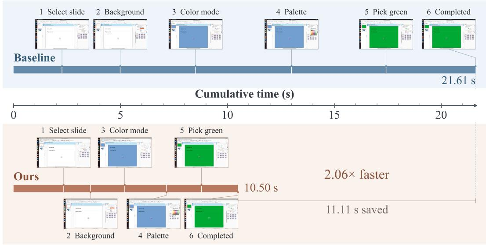

## C ADDITIONAL QUALITATIVE VISUALIZATIONS

Figures 4–7 provide eight additional successful OSWorld trajectories spanning presentation editing, file operations, document editing, image manipulation, email organization, system configuration, and code editing. In every example, Dense inference and GUIFlow follow the same interaction stages and reach the completed state, while GUIFlow consistently accumulates less task execution time. Across these trajectories, the observed speedups range from 2.01× to 2.24×, with 8.97–22.61 seconds saved per task. These trajectories complement Figure 3 by illustrating lower cumulative task execution time across applications and trajectory lengths. All timelines report task execution time.

(a) Changing a slide background to green: 21.61 to 10.50 s (2.06×).  
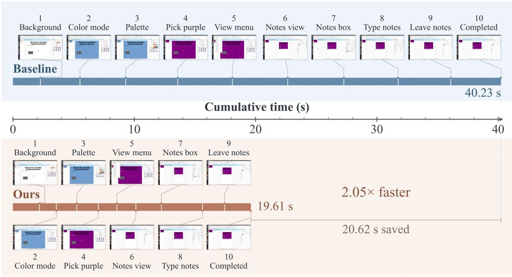  
(b) Editing slide color and speaker notes: 40.23 to 19.61 s (2.05×).  
Figure 4: Additional presentation-editing trajectories. GUIFlow preserves all interaction stages while reducing cumulative task execution time by 11.11 and 20.62 seconds, respectively.

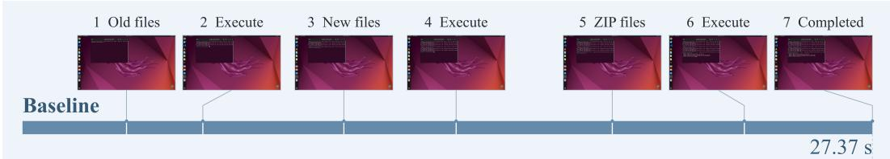  
Cumulative time (s)

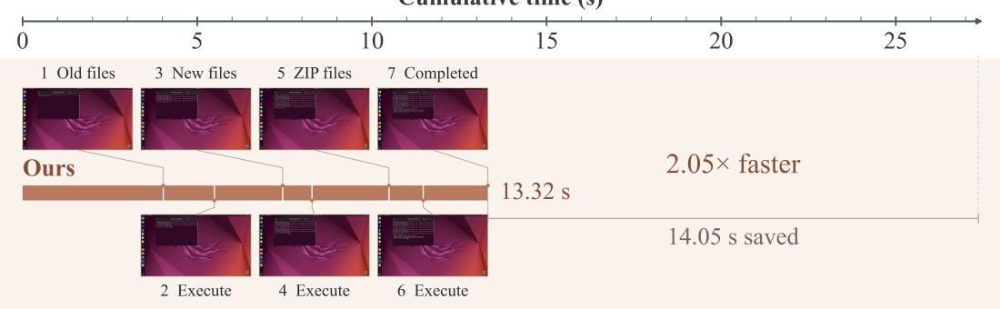  
(a) Sorting and archiving files: 27.37 to 13.32 s (2.05×).

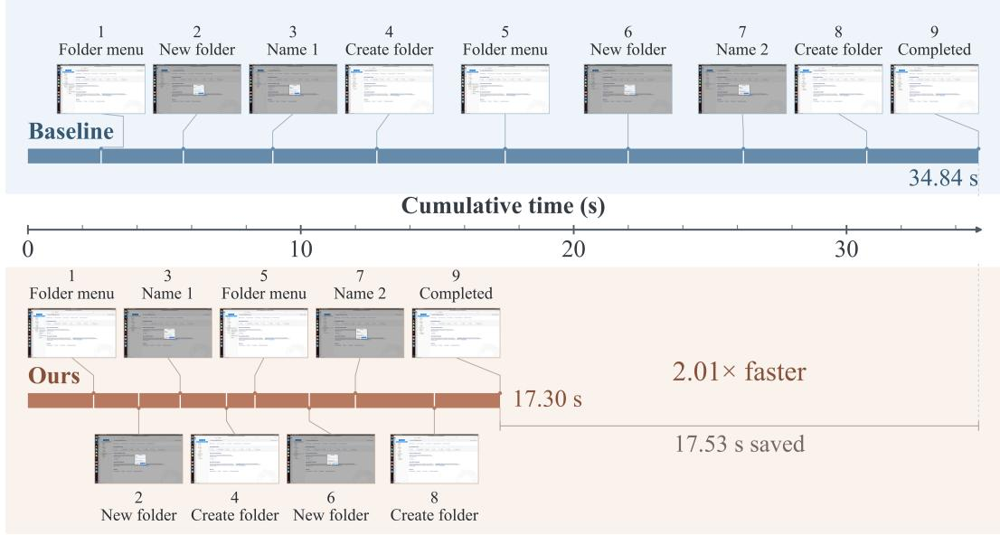  
(b) Creating two mail folders: 34.84 to 17.30 s (2.01×).  
Figure 5: Additional file- and email-organization trajectories. GUIFlow saves 14.05 and 17.53 seconds while retaining the completed task sequence.

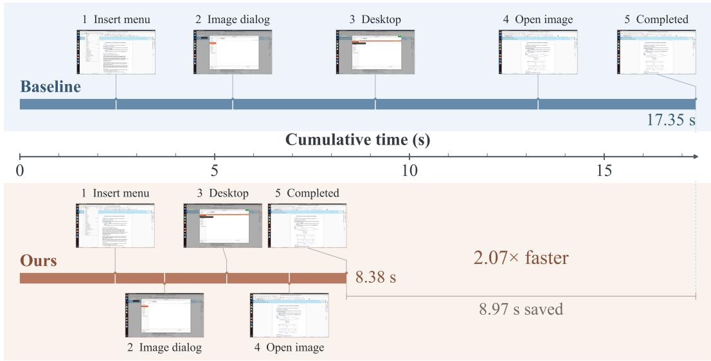  
(a) Inserting an image in Writer: 17.35 to 8.38 s (2.07×).

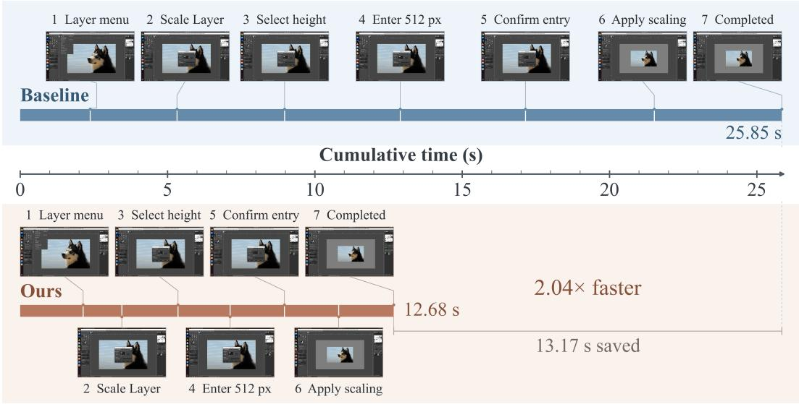  
(b) Resizing an image in GIMP: 25.85 to 12.68 s (2.04×).  
Figure 6: Additional document- and image-editing trajectories. GUIFlow saves 8.97 and 13.17 seconds while completing the same editing stages as Dense inference.

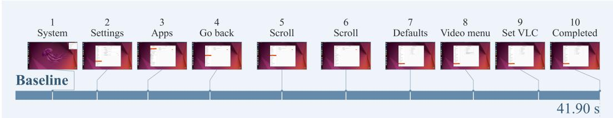

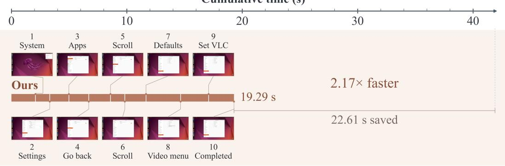  
(a) Setting VLC as the default application: 41.90 to 19.29 s (2.17×).

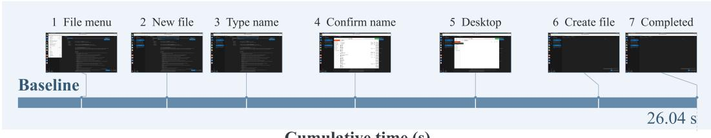

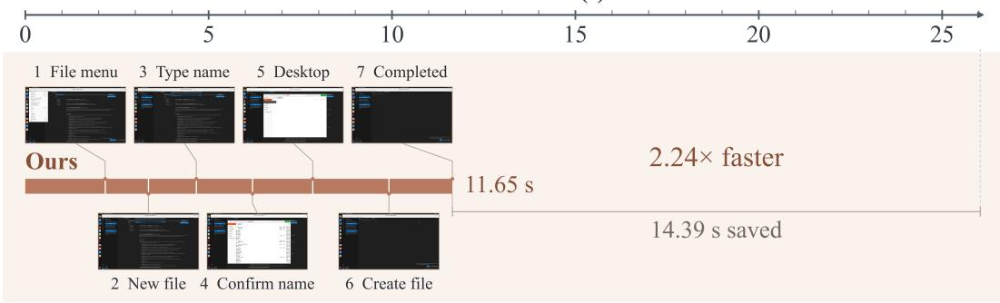  
(b) Creating a Python file in VS Code: 26.04 to 11.65 s (2.24×).  
Figure 7: Additional system-configuration and code-editing trajectories. GUIFlow saves 22.61 and 14.39 seconds, respectively, while preserving all interaction stages.