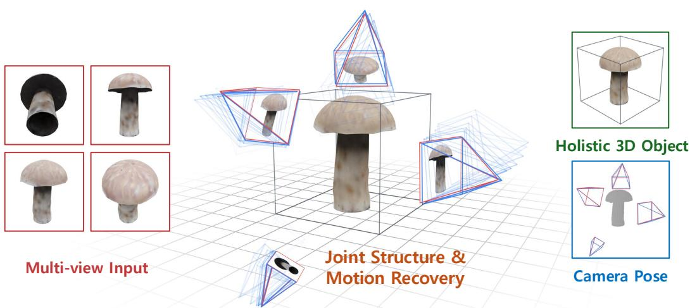
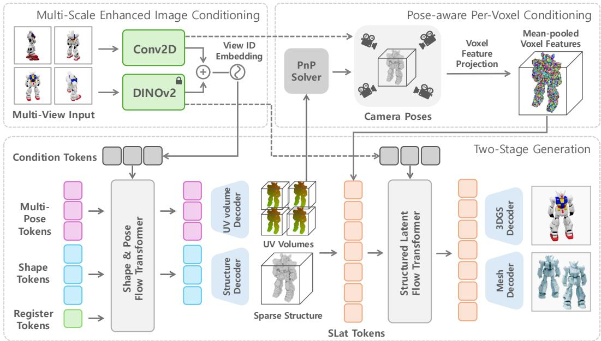
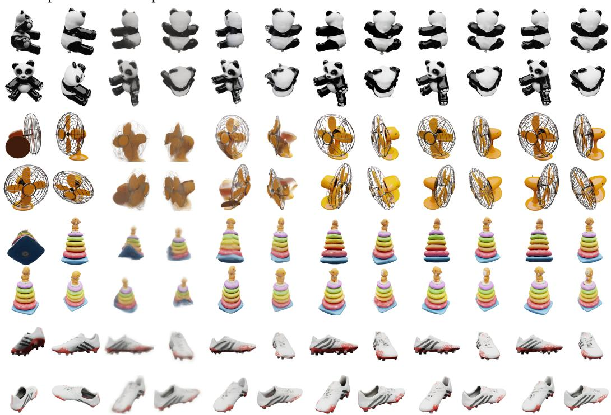
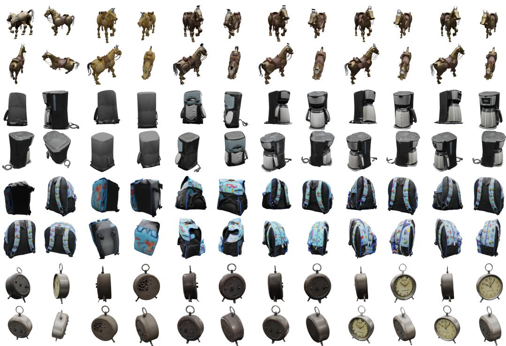
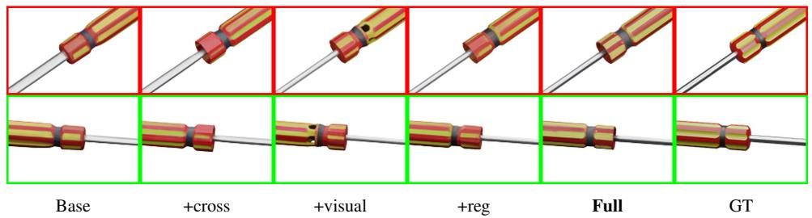
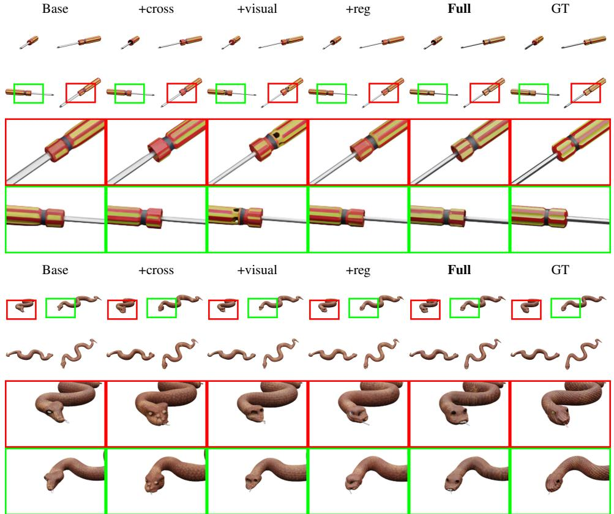

# Generative Structure from Motion with Native 3D Diffusion

Haobin Duan1,2∗ Binbin Huang1,2∗ Mochu Xiang1,2 Yiqun Zhao1,2 Zibo Zhao3 Yi Ma1,2 Shenghua Gao1,2†

1The University of Hong Kong 2Transengram 3Tencent

  
Figure 1: Generative object shape and camera motion recovery. Given multiview input images, GENSFM recovers the object shape and camera poses in a unified 3D space. A diffusion transformer performs multi-view reasoning through iterative structure-and-pose denoising (the trajectory of the camera), emulating an end-to-end SfM process. The denoised cameras (blue) align accurately with the ground-truth poses (red) and the recovered 3D structure gives a holistic object representation.

## Abstract

Recovering an object’s 3D structure and camera motion from a few uncalibrated views is a fundamental problem in computer vision. Classical structure from motion methods recover 3D geometry consistent with the input images but cannot recover unseen regions; native generation methods produce plausible 3D objects which are related but not necessarily faithful to the input images. Methods simply concatenating reconstruction and generation allow error to cascade across the two stages, instead of producing a 3D object consistent with both the distribution and the input. We propose GENSFM, which integrates image-based 3D reconstruction with a native 3D diffusion model. In particular, we use a multi-modal diffusion transformer to jointly denoise the shape latent and per-view pose latents under shared self-attention, grounding generated geometry in the observed views while using object-level priors to infer unobserved regions. A compact 3D-native UV-volume tokenization keeps the joint sequence small as views are added, and a pose-aware stage refines geometry and texture by sampling per-voxel image features at the recovered camera poses. On Toys4k and GSO, for 4 uncalibrated views, GENSFM improves novel-view PSNR by 3.2–4.5 dB and reduces me-

dian Chamfer distance by 2.8–3.8× over a strong native-3D generation baseline, while recovering input-view poses over 96% Acc@5◦ without any external poseestimation backbone, post-hoc optimization, or known intrinsics. Project page: https://dotb1ue.github.io/GenSfm/.

## 1 Introduction

Recovering 3D structure and camera motion from images is a foundational problem in computer vision. Classical Structure-from-Motion and Multi-View Stereo pipelines [1, 2, 3] estimate camera poses from multi-view correspondences and reconstruct geometry through photometric or geometric consistency, often regularized by hand-crafted priors. While effective when input views provide sufficient texture, overlap, and coverage, this geometric paradigm becomes brittle in sparse objectcentric settings, where only a few uncalibrated views are available and large object regions go unrecovered.

Such settings are common in practice, from robotic manipulation to AR capture and content-creation pipelines, all of which need a holistic 3D representation to reason about occluded surfaces and contact regions. Sparse-view 3D object recovery therefore requires more than triangulating visible evidence: it must infer a complete 3D explanation that is both consistent with the input images and plausible as an object, jointly answering what the object is and where each view was taken from.

Recent learning-based methods relax the texture and overlap assumptions of classical pipelines by introducing large-scale data-driven priors. Feed-forward reconstructors [4, 5, 6] predict camera parameters and pixel-aligned 3D representations jointly, while pose-centric works [7, 8, 9, 10] estimate relative camera motion under limited overlap and pose ambiguity. Both threads remain primarily observation-driven: they recover what the input views support but do not explicitly model the distribution of complete object shapes, leaving outputs incomplete in unobserved regions when input coverage is poor.

A complementary line of work introduces generative priors learned from large-scale 3D datasets [11] into sparse reconstruction. View-based generative SfM [12, 13, 14, 15] casts structure and motion as a generative problem in view space, while reconstruct-then-generate pipelines [16, 17, 18, 19, 20] pair feed-forward reconstructors with native 3D generators [21, 22, 23]. The latter family in particular has shown that 3D generative priors can complete hidden geometry that observation-driven methods cannot. These systems remain cascaded: an external module predicts poses or image-aligned representations and the 3D generator only completes the result, propagating errors across stages and preventing joint optimization of a single 3D hypothesis that explains all input views.

In this paper, we invert this pipeline: instead of using a generative prior to complete the output of a feed-forward reconstructor, we treat the 3D generative prior itself as the primary reasoning mechanism for sparse-view reconstruction. We propose GENSFM, an end-to-end framework that formulates joint recovery of complete object structure and per-view camera motion as a single conditional inference problem in a native 3D diffusion model, as shown in Fig. 1. The diffusion prior operates directly on a native 3D representation throughout inference, simultaneously denoising shape and per-view pose under joint self-attention. This grounds the generated object in the observed views while using object-level regularities to infer unobserved geometry.

Realizing this formulation requires a single diffusion transformer that jointly denoises a shared 3D shape with a per-view pose latent bound to its input image, while keeping the per-view posetoken overhead small as views are added. We adopt CUPID’s [24] 3D-native UV-volume pose tokenization, but compress each view’s pose latent to a compact token grid, since the dense volume over-parameterizes a low-DoF perspective projection. A learned view embedding tags each view’s pose latent and image tokens, binding pose to its source image. Since neither stream natively carries cross-view information, we prepend a small set of register tokens to the shape stream as a shared channel for all views to communicate through self-attention.

Instead of relying on back-projection to recover surface texture like feed-forward methods [4], we add a second stage of native 3D refinement and texturing [22] so that hidden regions stay coherent with the observed views. We design a pose-aware fine stage that, using the cameras predicted in the coarse stage, projects every active voxel into the input views and conditions denoising on per-voxel semantic and texture features sampled and averaged across views.

Table 1: Comparison of paradigms for sparse-view object structure-and-motion recovery. “Where” denotes camera-motion recovery and “what” denotes object-structure recovery, with observed and hidden geometry referring to visible and unobserved object regions, respectively. “Unified joint inference” means jointly recovering complete object structure and camera motion in one model, while “native 3D prior” denotes a generative prior over complete 3D shapes. ✓: explicit support; △: partial or indirect support; –: not a primary objective.
<table><tr><td rowspan="2">Method family</td><td rowspan="2">Where: camera motion</td><td colspan="2">What: object structure</td><td rowspan="2">Unified joint inference</td><td rowspan="2">Native 3D prior</td></tr><tr><td>observed</td><td>hidden</td></tr><tr><td>Classical SfM/MVS [1, 2, 3]</td><td></td><td></td><td></td><td>△</td><td></td></tr><tr><td>Pose-centric methods [7, 8, 9, 10]</td><td></td><td></td><td></td><td></td><td></td></tr><tr><td>Feed-forward reconstruction [4, 5, 6]</td><td></td><td></td><td>△</td><td>△</td><td></td></tr><tr><td>Native 3D generation [21, 22, 23]</td><td></td><td>N</td><td></td><td></td><td></td></tr><tr><td>View-based generative SfM [12, 13, 14]</td><td></td><td></td><td>△</td><td>△</td><td></td></tr><tr><td>Recon. with 3D Gen. priors [18, 17, 19]</td><td></td><td></td><td></td><td>△</td><td></td></tr><tr><td>GENSFM (Ours)</td><td></td><td></td><td></td><td></td><td></td></tr></table>

On the Toys4k [25] and GSO [26] sparse-view object benchmarks under uncalibrated 4-view inputs, GENSFM improves novel-view PSNR by 3.2–4.5 dB, reduces median Chamfer distance by 2.8– 3.8×, and lifts F@.01 from 0.56 to 0.83 on Toys4k over the strong native-3D generation baseline TRELLIS-M [22], while recovering input-view camera poses to over 96% Acc@5◦ (a 5× rotationerror reduction over the strongest pose baseline VGGT [6]) without requiring known intrinsics. Our contributions are summarized as follows:

• We propose GENSFM, a joint native-3D architecture that recasts a diffusion model from a posthoc completion module into the primary inference mechanism for joint sparse-view structure and motion recovery, eliminating any external feed-forward reconstruction backbone.

• A 3D-native multi-view pose tokenization that places per-view UV-volume pose latents and the shape latent in a single multi-modal sequence, jointly denoised by a diffusion transformer under shared self-attention.

• A pose-aware fine stage that, with cameras recovered from the coarse stage, anchors semantic and texture features at every active voxel and averages them across views, sharpening surface detail beyond global, pose-agnostic conditioning.

## 2 Related Work

Sparse-view object reconstruction must jointly answer two coupled questions: what is the 3D object, and where was each view taken from? What requires both visible and hidden object structure, while where requires the camera motion relating the input views. Existing methods typically excel on one side or address the two with separate models stacked in series (Tab. 1).

Feed-forward pose and 3D reconstruction. Pose-centric approaches [7, 8, 9, 10] target the where side, regressing relative camera motion under limited overlap and pose ambiguity, but leave what largely untouched. More general feed-forward reconstructors [4, 5, 6] predict dense pointmaps, correspondences, and camera parameters jointly, addressing camera motion and visible geometry; hidden geometry, however, is recovered only indirectly through learned priors.

Native 3D generation. Native 3D generators trained on large 3D corpora [11], such as TripoSR [21], TRELLIS [22], and Hunyuan3D [23], are strong on what: complete object structure is modeled explicitly and hidden geometry is hallucinated from the prior. They do not target where: camera motion is typically assumed and only weakly encoded through cross-attention, so applied directly to uncalibrated sparse views they can produce plausible but misaligned geometry.

View-based generative SfM. View-based generative SfM [12, 13, 14, 15] casts what and where as a joint generative problem in view space; DiffusionSfM, for instance, diffuses ray origins and endpoints to recover per-view geometry and camera motion jointly. Because diffusion operates over view-based quantities (rays, pointmaps, depths), hidden what is recovered only insofar as it can be back-projected from individual views.

Reconstruction with 3D generative priors. Reconstruct-then-generate pipelines [16, 17, 18, 19, 20, 27] couple feed-forward reconstruction with native 3D generators: $\mathrm { e . g . }$ , ReconViaGen [18] injects VGGT [6] geometry tokens into a 3D generator. These pipelines recover hidden geometry through the generative prior while grounding camera motion and visible structure with feed-forward geometry, but solve what and where in separate stages, so errors from the reconstruction backbone propagate into a 3D hypothesis that need not remain coherent with all input views.

## 3 Preliminaries

Overview. Given N uncalibrated multi-view images $\mathcal { T } = \{ \mathbf { I } _ { i } \} _ { i = 1 } ^ { N }$ of an object O, our goal is to recover the holistic 3D structure and per-view camera poses $\mathbf { \mathcal { P } } = \{ \mathbf { P } _ { i } \} _ { i = 1 } ^ { N }$ as a coarse-to-fine genera tive problem in a native 3D diffusion model. We build on two native 3D generators reviewed below: TRELLIS [22] provides the two-stage backbone and CFM objective we inherit, and CUPID [24] contributes the 3D-native single-image pose tokenization we lift to multi-view.

Coarse-to-fine 3D generation. Our backbone is TRELLIS [22], which generates a 3D object in two coarse-to-fine stages under a shared conditional flow matching [28] (CFM) objective. The first stage produces a sparse-structure (SS) latent $\mathbf { z } ^ { s }$ on a $1 6 ^ { 3 }$ grid, decoded to a $6 4 ^ { 3 }$ occupancy grid whose active voxels define positions $\{ \mathbf { x } _ { j } \} _ { j = 1 } ^ { L }$ . The second stage produces the structured-latent (SLat) set $\boldsymbol { S } = \{ \mathbf { x } _ { j } , \mathbf { f } _ { j } \} _ { j = 1 } ^ { L }$ with per-voxel features $\mathbf { f } _ { j }$ , which separate decoders [29, 30] map to 3D Gaussians, a radiance field, or a mesh. Both stages train with

$$
\mathcal { L } _ { \mathrm { C F M } } ( \phi ) = \mathbb { E } _ { t , \mathbf { z } _ { 0 } , \epsilon } \left. \mathbf { v } _ { \phi } ( \mathbf { z } _ { t } , \mathbf { I } , t ) - ( \epsilon - \mathbf { z } _ { 0 } ) \right. _ { 2 } ^ { 2 } ,\tag{1}
$$

where ${ \bf z } _ { t } = ( 1 - t ) { \bf z } _ { 0 } + t { \bf \epsilon }$ is the noisy latent at $t \in [ 0 , 1 ]$ for clean target ${ \bf z } _ { 0 } \left( { \bf z } ^ { s } \right.$ for SS, $\{ \mathbf { f } _ { j } \}$ for SLat) and noise $\epsilon \sim \mathcal { N } ( 0 , \mathbf { I } ) ; \mathbf { v } _ { \phi }$ is the DiT velocity prediction conditioned on I.

3D-native pose representation. Our pose tokenization derives from CUPID [24], which extends TRELLIS’s SS stage to jointly recover the camera pose for a single input image: the SS latent gains channels encoding per-voxel UV coordinates, decoded to a $6 4 ^ { 3 } \mathrm { \overline { { U } } V }$ volume that gives each active voxel’s projection $\bar { \mathbf { u } } _ { j } \in [ 0 , 1 ] ^ { 2 }$ . The 3×4 projection matrix P is thus a dense 3D-2D field on the active voxels, recovered from the per-voxel correspondences $\{ \mathbf { x } _ { j } , \mathbf { u } _ { j } \} _ { j = 1 } ^ { L }$ by Direct Linear Transform (DLT) least-squares [31]:

$$
\mathbf { P } ^ { * } = \underset { \mathbf { P } } { \arg \operatorname* { m i n } } \sum _ { j = 1 } ^ { L } \left\| \pi ( \mathbf { P } , \mathbf { x } _ { j } ) - \mathbf { u } _ { j } \right\| ^ { 2 } ,\tag{2}
$$

where π is the perspective projection. Finally, camera intrinsic K and extrinsic $\left[ \mathbf { R } \mid \mathbf { t } \right]$ are recovered from $\mathbf { P } ^ { * }$ via RQ decomposition.

## 4 Method

We frame this joint recovery as a coarse-to-fine generative problem in the latent space of a native 3D diffusion model (Fig. 2). Building on TRELLIS’s two-stage architecture and CUPID’s 3D-native pose representation (Sec. 3), Sec. 4.1 jointly generates 3D structure and multi-view poses with a multi-modal DiT over per-view pose tokens, and Sec. 4.2 refines geometry and appearance via per-voxel pose-sampled image conditioning.

## 4.1 3D structure and pose recovery from multi-view images

The coarse stage casts joint recovery of 3D structure and per-view camera poses as a single denoising problem: each camera is encoded as a per-view 3D-native pose token, and shape and pose are denoised jointly by a multi-modal DiT with joint self-attention over both streams.

  
Figure 2: Overview of GENSFM. We cast pose-free multi-view 3D recovery as a single coarse-tofine generative problem. The coarse stage (Sec. 4.1) jointly denoises the sparse-structure latent and per-view 3D-native pose tokens with a multi-modal shape-pose DiT, recovering shape and multi-view camera poses together. The fine stage (Sec. 4.2) refines geometry and appearance with per-voxel pose-sampled image conditioning, producing the final structured-latent set.

Tokenizing multi-view camera poses. For each view $i ,$ every active voxel $\mathbf { x } _ { j }$ projects to ${ \bf u } _ { j , i } =$ $\pi ( \mathbf { P } _ { i } , \mathbf { x } _ { j } )$ , yielding a UV volume $\mathbf { u } _ { i } \in [ 0 , 1 ] ^ { 2 \times 6 4 ^ { 3 } }$ . A shared pose VAE compresses each $\mathbf { u } _ { i }$ into a latent grid $\mathbf { \check { z } } _ { i } ^ { p } \in \mathbb { R } ^ { c \times r \times r \times r }$ with $c { = } 8 , r { = } 4$ . To represent multiple input views, we form a unified token sequence with the shape latent $\mathbf { z } ^ { s }$ followed by the per-view pose latents $\{ \mathbf { z } _ { i } ^ { p } \} _ { i = 1 } ^ { N } -$ in contrast to CUPID [24], whose channel-wise concatenation of shape and pose into a single SS latent is restricted to one view. We choose r=4 (vs CUPID’s r=16), giving 64× fewer tokens per pose at negligible accuracy cost since the UV volume is heavily over-parameterized for a low-DoF projection. At inference, the pose VAE decodes each generated $\mathbf { z } _ { i } ^ { p }$ back to a UV volume, from which $\mathbf { P } _ { i } ^ { * }$ is recovered by solving Eq. 2. See App. A.3 for details.

Multi-view conditioned shape-pose DiT. A shared transformer backbone denoises shape and pose jointly, with stream-specific projections and grid-aligned positional embeddings. Learnable register tokens $\mathbf { z } ^ { r }$ are prepended to the shape stream to capture $\mathrm { g l }$ obal context. We extend the CFM interpolation of Eq. 1 to a shape timestep $t ^ { s ^ { \bar { s } } } \in [ 0 , 1 ]$ and per-view pose timesteps $\mathbf { t } ^ { p } \in [ 0 , 1 ] ^ { N }$ , giving $\mathbf { z } _ { 0 } = [ \mathbf { z } ^ { s } ; \mathbf { z } ^ { p } ]$ and $\mathbf { z } _ { t } = [ \mathbf { z } _ { t } ^ { s } ; \mathbf { z } _ { t } ^ { p } ]$ . Stream-specific in-projections then lift each noisy latent to the shared transformer width, where positional and view embeddings are added in to form the layer-0 hidden state of the DiT:

$$
\mathbf { h } _ { 0 } = [ \mathbf { z } ^ { r } ; ~ W _ { \mathrm { i n } } ^ { s } \mathbf { z } _ { t } ^ { s } + \mathbf { e } ^ { s } ; ~ W _ { \mathrm { i n } } ^ { p } \mathbf { z } _ { t } ^ { p } + \mathbf { e } ^ { p } + \mathbf { e } ^ { v } ] ,\tag{3}
$$

where $\mathbf { e } ^ { s } , \mathbf { e } ^ { p }$ are absolute 3D PEs over the $1 6 ^ { 3 }$ and $4 ^ { 3 }$ grids that anchor each stream to its native voxel layout, and $\mathbf { e } ^ { v }$ is a per-view ID embedding shared between each pose latent and its source view’s image-condition tokens $( \mathrm { E q . 6 } )$ , binding each pose to its view through cross-attention. We then stack L DiT blocks; each block injects the multi-view condition tokens $\mathbf { z } ^ { I } = \{ \mathbf { z } _ { i } ^ { I } \} _ { i = 1 } ^ { N }$

$$
{ \bf h } _ { l + 1 } = \mathrm { C r o s s A t t n } \big ( Q ( { \bf h } _ { l } ) , { \cal K } ( { \bf z } ^ { I } ) , { \cal V } ( { \bf z } ^ { I } ) \big ) ,\tag{4}
$$

where $Q , K , V$ are the query/key/value projections, applied jointly over all N views without per-view masking. Each block also runs a joint self-attention over the entire sequence and a feed-forward sub-layer, both modulated by per-modality AdaLN values conditioned on $t ^ { s }$ for shape tokens and on $t _ { i } ^ { p }$ for view-i pose tokens. After the final block, stream-specific out-projections read out the velocities (register outputs are discarded), $\mathbf { v } _ { \phi } ( \mathbf { z } _ { t } , \mathbf { z } ^ { I } , t ^ { s } , \mathbf { t } ^ { p } ) = [ W _ { \mathrm { o u t } } ^ { s } \ \mathbf { h } _ { L } ^ { s } ; \ W _ { \mathrm { o u t } } ^ { p } \mathbf { h } _ { L } ^ { p } ]$ ], and the whole network is trained with a stream-wise conditional flow matching loss:

$$
\mathcal { L } _ { \mathrm { c o a r s e } } ( \phi ) = \mathbb { E } _ { t ^ { s } , { \ t ^ { p } } , { \mathbf { z } _ { 0 } } , { \epsilon } } \left\| { \mathbf { v } _ { \phi } } ( { \mathbf { z } _ { t } } , { \mathbf { z } ^ { I } } , t ^ { s } , { \mathbf { t } ^ { p } } ) - ( { \epsilon } - { \mathbf { z } _ { 0 } } ) \right\| _ { 2 } ^ { 2 } .\tag{5}
$$

Table 2: Comparison with feed-forward reconstruction methods. We align predictions to the ground truth via a similarity transform fit by least squares between predicted and ground-truth input view pointmaps, then evaluate photometric quality on novel views and 3D geometric accuracy in the ground-truth coordinate frame. CD is bidirectional symmetric (squared $\mathrm { L } 2 , \times 1 0 ^ { - 3 } )$ , reported as the median across objects.
<table><tr><td rowspan="2">Method</td><td colspan="6">Toys4k</td><td colspan="6">GSO</td></tr><tr><td>PSNR↑</td><td>SSIM↑</td><td>LPIPS↓</td><td>CD-med.↓</td><td>F@.01↑</td><td>F@.05↑</td><td>PSNR↑</td><td>SSIM↑</td><td>LPIPS↓</td><td>CD-med↓</td><td>F@.01↑</td><td>F@.05↑</td></tr><tr><td>FreeSplatter [32]</td><td>22.00</td><td>0.9183</td><td>0.0913</td><td>2.7160</td><td>0.3163</td><td>0.7112</td><td>20.07</td><td>0.8948</td><td>0.1135</td><td>3.2859</td><td>0.2713</td><td>0.6736</td></tr><tr><td>LucidFusion [33]</td><td>22.24</td><td>0.9251</td><td>0.0827</td><td>4.1596</td><td>0.1527</td><td>0.6670</td><td>20.94</td><td>0.9097</td><td>0.0943</td><td>3.8702</td><td>0.1755</td><td>0.7164</td></tr><tr><td>ReconViaGen [18]</td><td>21.88</td><td>0.9216</td><td>0.0721</td><td>1.1237</td><td>0.3369</td><td>0.8434</td><td>20.88</td><td>0.9021</td><td>0.0856</td><td>1.0495</td><td>0.3524</td><td>0.8789</td></tr><tr><td>GENSFM</td><td>28.61</td><td>0.9609</td><td>0.0308</td><td>0.2184</td><td>0.6701</td><td>0.9823</td><td>26.36</td><td>0.9411</td><td>0.0472</td><td>0.2801</td><td>0.6095</td><td>0.9842</td></tr></table>

Multi-scale enhanced image condition. DINOV2 patch features capture rich semantics but are spatially coarse, providing limited cues for the fine appearance and accurate 2D-3D correspondences our coarse stage must recover. We therefore augment them with multi-scale local features extracted by a small convolutional pyramid on the same image: for each view $i ,$ the condition tokens are

$$
\mathbf { z } _ { i } ^ { I } = \left( \operatorname { D I N O v } 2 ( \mathbf { I } _ { i } ) \oplus \Phi _ { \operatorname { c n n } } ^ { s } ( \mathbf { I } _ { i } ) \right) + \mathbf { e } ^ { v } ,\tag{6}
$$

where $\mathrm { D I N O v } 2 ( \mathbf { I } _ { i } )$ are the frozen patch tokens, $\Phi _ { \mathrm { c n n } } ^ { s } ( \mathbf { I } _ { i } )$ stacks features from a 4-level convolutional pyramid where each level patchified to the DINOV2 patch grid and channel-concatenated across levels, ⊕ denotes channel-wise concatenation per token, and $\mathbf { e } ^ { v }$ is the view-tag embedding from Eq. 3. The resulting $\mathbf { z } ^ { I } = \{ \mathbf { z } _ { i } ^ { I } \} _ { i = 1 } ^ { N }$ serves as the cross-attention key/value sequence in every DiT block. See App. A.4 for details.

## 4.2 Pose-aware generation of fine geometry and appearance

The fine stage generates geometry and appearance with pose-aware per-voxel image conditioning: each voxel receives a semantic feature from DINOV2 and a texture feature from a multi-scale CNN pyramid, with both features average-pooled over pose-aligned projections across views.

Pose-aware per-voxel image conditioning. TRELLIS’s SLat stage conditions on the input image only through global cross-attention with DINOV2 patch tokens, leaving fine-appearance cues unanchored from any specific voxel and producing blurry surface detail. Once $\mathbf { P } ^ { * }$ is recovered by the coarse stage (Sec. 4.1), every active voxel $\mathbf { x } _ { j }$ has a known image projection $\mathbf { u } _ { j } = \pi ( \mathbf { P } ^ { * } , \mathbf { x } _ { j } )$ , so image features can be sampled directly per voxel. At each $\mathbf { x } _ { j }$ we form two complementary features: a semantic feature $\mathbf { c } _ { j } ^ { \mathrm { s e m } }$ from pose-sampled DINOV2 patches re-encoded through the frozen SLat encoder Enc (placing it on the same latent manifold as the SLat target $\mathbf { f } _ { j } )$ , and a texture feature ${ \bf c } _ { j } ^ { \mathrm { t e x } }$ from a multi-scale CNN pyramid $\Phi _ { \mathrm { c n n } } ^ { l }$ that supplies the low-level cues that DINOV2 lacks:

$$
\begin{array} { r } { \{ \mathbf { c } _ { j } ^ { \mathrm { s e m } } \} _ { j = 1 } ^ { L } = \mathrm { E n c } _ { \mathrm { L } } \left( \{ \mathbf { x } _ { j } , \mathrm { B i l i n e a r I n t e r p } ( \mathbf { u } _ { j } , \mathrm { D I N O v } 2 ( \mathbf { I } ) ) \} _ { j = 1 } ^ { L } \right) , } \\ { \mathbf { c } _ { j } ^ { \mathrm { t e x } } = \mathrm { B i l i n e a r I n t e r p } \left( \mathbf { u } _ { j } , \Phi _ { \mathrm { c n n } } ^ { l } ( \mathbf { I } ) \right) . \qquad } \end{array}\tag{7}
$$

where BilinearInterp denotes bilinear interpolation. We channel-wise concatenate $\mathbf { c } _ { j } ^ { \mathrm { s e m } }$ and $\mathbf { c } _ { j } ^ { \mathrm { t e x } }$ with the noisy voxel feature $\mathbf { f } _ { j } ^ { t }$ (the SLat target $\mathbf { f } _ { j }$ noised via Eq. 1) and linearly project to form the per-voxel layer-0 DiT token $\bar { \mathbf { h } } _ { 0 } ( \mathbf { x } _ { j } ) = W _ { \mathrm { i n } } ^ { l } [ \mathbf { f } _ { j } ^ { t } \oplus \mathbf { c } _ { j } ^ { \mathrm { s e m } } \oplus \mathbf { c } _ { j } ^ { \mathrm { t e x } } ]$ ; the remainder of the DiT follows TRELLIS. See App. A.4 for the visual pyramid architecture.

Pooling per-voxel features across views. With N input views, every active voxel has $N$ posealigned projections $\mathbf { u } _ { j , i } = \pi ( \mathbf { P } _ { i } ^ { * } , \mathbf { x } _ { j } )$ . We extend BilinearInterp to per-view sampling followed by averaging, BilinearInterp $\begin{array} { r } { { \bf u } _ { j } , \Phi ( \mathcal { T } ) ) : = \frac { 1 } { N } \sum _ { i = 1 } ^ { N } } \end{array}$ BilinearInt $\mathrm { e r p } ( \mathbf { u } _ { j , i } , \Phi ( \mathbf { I } _ { i } ) )$ ), so Eq. 7 applies unchanged with I replaced by ${ \dot { \tau } } .$ The cross-attention condition is likewise the per-view mean of DINOV2 patch tokens. The mean operator itself is parameter-free and view-count-agnostic; the model in this work is trained with $N { \overset { \cdot } { = } } 4$

Input

FreeSplatter

LucidFusion

ReconViaGen

Ours

GT

  
Figure 3: Qualitative comparison with feed-forward reconstruction methods on Toys4k (top two rows) and GSO (bottom two). All non-input columns render the same held-out novel view in the GT camera frame after the input-view pointmap LSQ alignment of Table 2.

## 5 Experiments

## 5.1 Experimental Setup

Datasets. We train our model on four public 3D-asset datasets: Objaverse-XL [11] (GitHub and Sketchfab partitions), HSSD [34], 3D-FUTURE [35], and ABO [36]. After TRELLIS’s aesthetic filter (≥ 4.5), about 430K instances remain. Each is rendered following TRELLIS’s protocol, with 24 condition views at 1024×1024 from cameras uniformly sampled on the upper hemisphere. We evaluate on two held-out test sets, Toys4k [25] (synthetic) and GSO [26] (real-captured), neither overlapping the training corpus.

Evaluation protocol. We assess photometric fidelity, 3D geometry, and camera-pose accuracy. Each test set uses its first 400 objects with two disjoint 4-view sets, {0, 6, 12, 18} and {3, 9, 15, 21}, yielding 800 object–viewset instances for aggregation. As baselines fall into three capability families, we apply the most suitable evaluation protocol to each: (i) least squares on predicted vs ground-truth input-view pointmaps for feed-forward reconstruction, tight only with accurate predicted geometry and poses; (ii) similarity ICP on sampled point clouds for 3D generation; and (iii) gauge-invariant pair wise relative-pose comparison on unordered input-view pairs for pose-predicting methods. GENSFM is reevaluated under each applicable protocol; comparisons are restricted to methods sharing a table and protocol. We report PSNR, SSIM, and LPIPS [37] on 512×512 novel views at the 8 held-out condition-view indices {2, 4, 8, 10, 14, 16, 20, 22}; bidirectional Chamfer Distance (CD; reported as the median across objects, since a few severe failures dominate the mean) and F-scores at τ ∈ {0.01, 0.05}; and Relative Rotation Error (RRE) with Acc@{5◦, 15◦}, Relative Translation Error (RTE), and mean absolute FOV error (RFOV; only for methods that predict intrinsics). See App. A.1 for the full alignment protocol and App. A.2 for the pose metric definitions.

Baseline methods. We compare against a representative set of multi-view image-to-3D baselines: (a) TRELLIS-S [22]: TRELLIS run as a single-image generator on each input view independently,

Table 3: Comparison with 3D generation methods. For methods that produce a canonical 3D output without input camera poses, we align predictions to the ground truth via similarity ICP on 100K points sampled from the rendered surface of the output mesh of each side, then evaluate photometric quality on novel views and 3D geometric accuracy in the ground-truth coordinate frame.

Method

<table><tr><td rowspan="2">Method</td><td rowspan="2">PSNR↑</td><td rowspan="2">SSIM↑</td><td rowspan="2">LPIPS↓</td><td rowspan="2">CD-med↓</td><td rowspan="2">F@.01↑</td><td rowspan="2">F@.05↑</td><td rowspan="2">PSNR↑</td><td rowspan="2">SSIM↑</td><td rowspan="2">LPIPS↓</td><td rowspan="2">CD-med↓</td><td rowspan="2">F@.01↑</td><td rowspan="2">F@.05↑</td></tr><tr><td></td></tr><tr><td>SAM 3D [19]</td><td>20.49</td><td>0.9155</td><td>0.0926</td><td>1.7935</td><td>0.3292</td><td>0.8250</td><td>19.49</td><td>0.8995</td><td>0.1112</td><td>1.3716</td><td>0.3387</td><td>0.8505</td></tr><tr><td>TRELLIS-S [22]</td><td>21.78</td><td>0.9205</td><td>0.0874</td><td>1.2032</td><td>0.4064</td><td>0.8881</td><td>20.00</td><td>0.8943</td><td>0.1127</td><td>1.2418</td><td>0.3663</td><td>0.8695</td></tr><tr><td>TRELLIS-M [22]</td><td>24.01</td><td>0.9355</td><td>0.0658</td><td>0.4329</td><td>0.5570</td><td>0.9604</td><td>22.28</td><td>0.9138</td><td>0.0867</td><td>0.5200</td><td>0.5079</td><td>0.9655</td></tr><tr><td>ReconViaGen [18]</td><td>23.26</td><td>0.9316</td><td>0.0587</td><td>0.6955</td><td>0.4374</td><td>0.9555</td><td>21.98</td><td>0.9108</td><td>0.0778</td><td>0.6500</td><td>0.4428</td><td>0.9434</td></tr><tr><td>GENSFM</td><td>28.54</td><td>0.9599</td><td>0.0315</td><td>0.1133</td><td>0.8279</td><td>0.9970</td><td>25.50</td><td>0.9349</td><td>0.0533</td><td>0.1882</td><td>0.7283</td><td>0.9914</td></tr></table>

SAM3D  
TRELLIS-S  
TRELLIS-M  
Ours

Input

GT

  
Figure 4: Qualitative comparison with 3D generation methods on Toys4k (top row) and GSO (bottom three). All non-input columns render the same held-out novel view in the GT camera frame after the similarity ICP alignment of Tab. 3.

with the mean over the four outputs reported; (b) TRELLIS-M [22]: TRELLIS with multi-view input in stochastic mode, where each denoising step is conditioned on one randomly chosen input view; (c) SAM 3D [19]: a single-image-to-3D generator run once per input view, with the mean over the four outputs reported; (d) FreeSplatter [32]: predicts per-view pixel-aligned 3D Gaussians together with input camera parameters in a pose-free setting; (e) LucidFusion [33]: predicts per-view relative coordinate maps that are fused into a 3D Gaussian output; (f) ReconViaGen [18]: combine feed-forward reconstruction with generative refinement, using VGGT-derived geometry tokens to condition a 3D generator; (g) VGGT [6]: a transformer that jointly regresses per-view pointmaps and camera extrinsics/intrinsics from uncalibrated images. Our table appear in three families: 3D generation (a,b,c,f), feed-forward reconstruction (d,e,f), and pose prediction (d,f,g).

## 5.2 Main Results

Comparison with feed-forward reconstruction methods. Tab. 2 and Fig. 3 compare against feedforward reconstruction baselines under input-view pointmap LSQ alignment. GENSFM outperforms every baseline on every metric and on both datasets, with the gap widening at the strict F@.01 threshold and qualitatively in the form of alignment artifacts and surface noise. Feed-forward methods compound any disagreement between their predicted geometry and predicted poses, while a generative 3D-native model refines it away.

Table 4: Camera-pose prediction accuracy. We report relative rotation error (RRE) with Acc.@{5◦, 15◦} thresholds, relative translation error (RTE; the angular error between predicted and GT relative-translation directions), and mean absolute FOV error (RFOV; intrinsic-only); see supplementary for the full evaluation protocol. GENSFM reports two rows: known intrinsics (GT FOV fed in; RFOV not applicable, marked –) and predicted intrinsics. Angular pose metrics use raw, gauge-invariant pairwise relative poses and the same ambiguity-tolerant score for all methods.
<table><tr><td rowspan="2">Method</td><td colspan="5">Toys4k</td><td colspan="5">GSO</td></tr><tr><td>RRE↓</td><td>Acc.@5°↑</td><td>Acc.@15°↑</td><td>RTE↓</td><td>RFOV↓</td><td>RRE↓</td><td>Acc.@5°↑</td><td>Acc.@15°↑</td><td>RTE↓</td><td>RFOV↓</td></tr><tr><td>FreeSplatter [32]</td><td>26.45</td><td>0.2438</td><td>0.4996</td><td>32.32</td><td>12.51</td><td>29.10</td><td>0.2327</td><td>0.4646</td><td>32.81</td><td>13.13</td></tr><tr><td>ReconViaGen [18]</td><td>16.54</td><td>0.2044</td><td>0.6881</td><td>19.56</td><td>9.54</td><td>14.48</td><td>0.2260</td><td>0.7343</td><td>16.16</td><td>8.95</td></tr><tr><td>VGGT [6]</td><td>10.29</td><td>0.5969</td><td>0.8406</td><td>18.61</td><td>37.66</td><td>9.33</td><td>0.6310</td><td>0.8702</td><td>17.69</td><td>36.08</td></tr><tr><td>GENSFM (predicted intrinsics)</td><td>1.60</td><td>0.9723</td><td>0.9913</td><td>5.51</td><td>2.90</td><td>1.27</td><td>0.9821</td><td>0.9985</td><td>5.08</td><td>2.86</td></tr><tr><td>GENSFM (known intrinsics)</td><td>1.44</td><td>0.9798</td><td>0.9910</td><td>2.38</td><td></td><td>1.13</td><td>0.9892</td><td>0.9981</td><td>2.11</td><td></td></tr></table>

Table 5: Ablation study on Toys4k. Rows add components cumulatively, ending with the full model. Stage 1 uses a single-view-trained fine decoder extended to multi-view at inference; Stage 2 replaces it with a natively multi-view-trained decoder. All rows use the input-view pointmap alignment from Table 2; RRE and Acc.@5◦ use a similarity fit from the final pointmap, so the fine decoder can shift them without changing raw coarse cameras. CD is the median across objects.
<table><tr><td>Stage</td><td>Variant</td><td>PSNR↑</td><td>LPIPS↓</td><td>CD-med↓</td><td>F@.01↑</td><td>F@.05↑</td><td>RRE↓</td><td>Acc.@5°↑</td></tr><tr><td rowspan="4">Stage 1</td><td>Base (per-view cross-attention)</td><td>27.00</td><td>0.0383</td><td>0.2811</td><td>0.6078</td><td>0.9677</td><td>5.62</td><td>0.8653</td></tr><tr><td>+ full cross-attention</td><td>27.49</td><td>0.0359</td><td>0.2568</td><td>0.6324</td><td>0.9748</td><td>5.20</td><td>0.9069</td></tr><tr><td>+ visual conditioning</td><td>27.65</td><td>0.0353</td><td>0.2488</td><td>0.6346</td><td>0.9783</td><td>4.59</td><td>0.9228</td></tr><tr><td>+ register tokens</td><td>28.23</td><td>0.0327</td><td>0.2204</td><td>0.6670</td><td>0.9824</td><td>3.55</td><td>0.9478</td></tr><tr><td>Stage 2</td><td>+ native multi-view training (Full model)</td><td>28.61</td><td>0.0308</td><td>0.2184</td><td>0.6701</td><td>0.9823</td><td>3.65</td><td>0.9416</td></tr></table>

Comparison with 3D generation methods. Tab. 3 and Fig. 4 compare against 3D generation models that produce a canonical, pose-free output, under similarity-ICP alignment. GENSFM leads on every metric, with the largest margins on the strict-threshold geometry metrics (F@.01, CD-med). Pose-free baselines hallucinate plausible but mismatched detail on unseen sides; the two strong multi-view baselines (TRELLIS-M’s stochastic per-step view conditioning and ReconViaGen’s feedforward reconstruction with generative refinement) still trail GENSFM by large margins, indicating the gain comes from joint shape–pose denoising rather than late-stage view sampling.

Pose prediction accuracy. Tab. 4 reports camera-pose accuracy on baselines that predict input-view extrinsics. GENSFM achieves substantially lower rotation and translation errors, with Acc.@5◦ saturating; baselines commonly fail on symmetric objects whose orientation depends on low-level visual cues. Our model also recovers intrinsics accurately (known-intrinsics row shown for reference); VGGT, not trained on varying-FOV synthetic data, incurs large RFOV despite strong extrinsics, whereas GENSFM keeps RFOV under 3◦ on both datasets while saturating Acc.@5◦. Thus, RFOV confirms reliable intrinsic recovery under varying FOV, but its margin over VGGT also reflects training-distribution coverage, not architecture alone.

## 5.3 Ablation Study

We ablate each design choice on Toys4k in Tab. 5, with rows added cumulatively. In Stage 1, full cross-attention enables cross-view information sharing and improves all metrics; visual feature conditioning sharpens photometric fidelity and pose accuracy with only marginal geometry gains, suggesting appearance cues primarily help rendering and pose grounding; shared register tokens aggregate global information and contribute most to pose accuracy and the strict F@.01 threshold. In Stage 2, a fine decoder trained natively on multi-view data sharpens photometric fidelity, while 3D geometry is already saturated. The decoder swap leaves raw coarse-stage cameras unchanged but shifts geometry-aligned pose metrics because their similarity fit depends on the final pointmap. Fig. 5 corroborates these trends qualitatively: surface details (e.g., the screwdriver cap, the snake’s head) sharpen left-to-right and the full model best matches GT.

  
Figure 5: Qualitative ablation on Toys4k. For each instance we show the four held-out test views as a 2×2 grid (top), with two zoomed-in regions of largest cross-variant disagreement below (red / green borders). Columns left-to-right correspond to the cumulative ablation rows of Table 5: Base, +cross, +visual, +reg, the full model, and ground truth. Each added component sharpens local geometry and texture, with the full model best matching GT.

## 6 Conclusion

We presented GENSFM, which recasts a native 3D diffusion model as the primary inference mecha nism for sparse-view object reconstruction, jointly denoising shape and per-view camera poses in a single multi-modal diffusion transformer. Three choices keep the formulation tractable: a UV-volume pose latent compressed to a compact token grid, a unified multi-modal sequence that places shape and per-view pose tokens in a single self-attention, and a pose-aware fine stage that conditions each voxel on features sampled at its pose-aligned image projection. On Toys4k and GSO, GENSFM outperforms feed-forward, 3D-generation, and pose-prediction baselines on photometric, geometric, and pose metrics simultaneously, recovering both extrinsics and intrinsics to high accuracy without any external pose estimator or post-hoc optimization.

Limitations and future work. Our results are restricted to object-centric inputs at N=4; extending to larger view counts, scene-level inputs, and in-the-wild captures with looser segmentation is a natural next step. Under distribution shift, large pose/calibration errors may misregister fine-stage image features, degrading local refinement while the coarse 3D prior preserves global completion. The model also inherits the object distribution and resolution limits of its TRELLIS backbone, so scaling the underlying generator should directly improve sparse-view recovery.

## Acknowledgments and Disclosure of Funding

This work is partially supported by funding and computing resources provided by the HKU-Shanghai Intelligent Computing Research Center. This work was supported by the General Research Fund of the Research Grants Council of Hong Kong under Grant No. 17200725 and the JC STEM Lab funded by The Hong Kong Jockey Club Charities Trust.

## References

[1] Johannes Lutz Schönberger and Jan-Michael Frahm. Structure-from-motion revisited. In Conference on Computer Vision and Pattern Recognition (CVPR), 2016. 2, 3

[2] Johannes Lutz Schönberger, Enliang Zheng, Marc Pollefeys, and Jan-Michael Frahm. Pixelwise view selection for unstructured multi-view stereo. In European Conference on Computer Vision (ECCV), 2016. 2, 3

[3] Yasutaka Furukawa and Jean Ponce. Accurate, dense, and robust multiview stereopsis. IEEE transactions on pattern analysis and machine intelligence, 32(8):1362–1376, 2009. 2, 3

[4] Shuzhe Wang, Vincent Leroy, Yohann Cabon, Boris Chidlovskii, and Jerome Revaud. Dust3r: Geometric 3d vision made easy. In Proceedings of the IEEE/CVF Conference on Computer Vision and Pattern Recognition, pages 20697–20709, 2024. 2, 3

[5] Vincent Leroy, Yohann Cabon, and Jérôme Revaud. Grounding image matching in 3d with mast3r. In European conference on computer vision, pages 71–91. Springer, 2024. 2, 3

[6] Jianyuan Wang, Minghao Chen, Nikita Karaev, Andrea Vedaldi, Christian Rupprecht, and David Novotny. Vggt: Visual geometry grounded transformer. In Proceedings of the Computer Vision and Pattern Recognition Conference, pages 5294–5306, 2025. 2, 3, 4, 8, 9

[7] Jason Y Zhang, Deva Ramanan, and Shubham Tulsiani. Relpose: Predicting probabilistic relative rotation for single objects in the wild. In European Conference on Computer Vision, pages 592–611. Springer, 2022. 2, 3

[8] Jianyuan Wang, Christian Rupprecht, and David Novotny. Posediffusion: Solving pose estimation via diffusion-aided bundle adjustment. In Proceedings of the IEEE/CVF International Conference on Computer Vision, pages 9773–9783, 2023. 2, 3

[9] Samarth Sinha, Jason Y Zhang, Andrea Tagliasacchi, Igor Gilitschenski, and David B Lindell. Sparsepose: Sparse-view camera pose regression and refinement. In Proceedings of the IEEE/CVF Conference on Computer Vision and Pattern Recognition, pages 21349–21359, 2023. 2, 3

[10] Jason Y Zhang, Amy Lin, Moneish Kumar, Tzu-Hsuan Yang, Deva Ramanan, and Shubham Tulsiani. Cameras as rays: Pose estimation via ray diffusion. arXiv preprint arXiv:2402.14817, 2024. 2, 3

[11] Matt Deitke, Ruoshi Liu, Matthew Wallingford, Huong Ngo, Oscar Michel, Aditya Kusupati, Alan Fan, Christian Laforte, Vikram Voleti, Samir Yitzhak Gadre, et al. Objaverse-xl: A universe of 10m+ 3d objects. Advances in Neural Information Processing Systems, 36:35799–35813, 2023. 2, 3, 7

[12] Qitao Zhao, Amy Lin, Jeff Tan, Jason Y. Zhang, Deva Ramanan, and Shubham Tulsiani. Diffusionsfm: Predicting structure and motion via ray origin and endpoint diffusion. In CVPR, 2025. 2, 3

[13] Qihang Zhang, Shuangfei Zhai, Miguel Ángel Bautista, Kevin Miao, Alexander Toshev, Joshua Susskind, and Jiatao Gu. World-consistent video diffusion with explicit 3d modeling. In arXiv, 2024. 2, 3

[14] Chao Xu, Ang Li, Linghao Chen, Yulin Liu, Ruoxi Shi, Hao Su, and Minghua Liu. Sparp: Fast 3d object reconstruction and pose estimation from sparse views. In European Conference on Computer Vision, pages 143–163. Springer, 2024. 2, 3

[15] Qitao Zhao and Shubham Tulsiani. Sparse-view pose estimation and reconstruction via analysis by generative synthesis. In NeurIPS, 2024. 2, 3

[16] Andreea Ardelean, Mert Özer, and Bernhard Egger. Gen3dsr: Generalizable 3d scene reconstruction via divide and conquer from a single view. In 2025 International Conference on 3D Vision (3DV), pages 616–626. IEEE, 2025. 2, 4

[17] Zhisheng Huang, Jiahao Chen, Cheng Lin, Chenyu Hu, Hanzhuo Huang, Zhengming Yu, Mengfei Li, Yuheng Liu, Zekai Gu, Zibo Zhao, et al. Unirecgen: Unifying multi-view 3d reconstruction and generation. arXiv preprint arXiv:2604.01479, 2026. 2, 3, 4

[18] Jiahao Chang, Chongjie Ye, Yushuang Wu, Yuantao Chen, Yidan Zhang, Zhongjin Luo, Chenghong Li, Yihao Zhi, and Xiaoguang Han. Reconviagen: Towards accurate multi-view 3d object reconstruction via generation. arXiv preprint arXiv:2510.23306, 2025. 2, 3, 4, 6, 8, 9

[19] SAM 3D Team, Xingyu Chen, Fu-Jen Chu, Pierre Gleize, Kevin J Liang, Alexander Sax, Hao Tang, Weiyao Wang, Michelle Guo, Thibaut Hardin, Xiang Li, Aohan Lin, Jiawei Liu, Ziqi Ma, Anushka Sagar, Bowen Song, Xiaodong Wang, Jianing Yang, Bowen Zhang, Piotr Dollár, Georgia Gkioxari, Matt Feiszli, and Jitendra Malik. Sam 3d: 3dfy anything in images. 2025. 2, 3, 4, 8

[20] Yawar Siddiqui, Duncan Frost, Samir Aroudj, Armen Avetisyan, Henry Howard-Jenkins, Daniel DeTone, Pierre Moulon, Qirui Wu, Zhengqin Li, Julian Straub, et al. Shaper: Robust conditional 3d shape generation from casual captures. arXiv preprint arXiv:2601.11514, 2026. 2, 4

[21] Dmitry Tochilkin, David Pankratz, Zexiang Liu, Zixuan Huang, Adam Letts, Yangguang Li, Ding Liang, Christian Laforte, Varun Jampani, and Yan-Pei Cao. Triposr: Fast 3d object reconstruction from a single image. arXiv preprint arXiv:2403.02151, 2024. 2, 3

[22] Jianfeng Xiang, Zelong Lv, Sicheng Xu, Yu Deng, Ruicheng Wang, Bowen Zhang, Dong Chen, Xin Tong, and Jiaolong Yang. Structured 3d latents for scalable and versatile 3d generation. In Proceedings ofthe Computer Vision and Pattern Recognition Conference, pages 21469–21480, 2025. 2, 3, 4, 7, 8

[23] Zibo Zhao, Zeqiang Lai, Qingxiang Lin, Yunfei Zhao, Haolin Liu, Shuhui Yang, Yifei Feng, Mingxin Yang, Sheng Zhang, Xianghui Yang, et al. Hunyuan3d 2.0: Scaling diffusion models for high resolution textured 3d assets generation. arXiv preprint arXiv:2501.12202, 2025. 2, 3

[24] Binbin Huang, Haobin Duan, Yiqun Zhao, Zibo Zhao, Yi Ma, and Shenghua Gao. Cupid: Generative 3d reconstruction via joint object and pose modeling. arXiv preprint arXiv:2510.20776, 2025. 2, 4, 5

[25] Stefan Stojanov, Anh Thai, and James M Rehg. Using shape to categorize: Low-shot learning with an explicit shape bias. In Proceedings of the IEEE/CVF conference on computer vision and pattern recognition, pages 1798–1808, 2021. 3, 7

[26] Laura Downs, Anthony Francis, Nate Koenig, Brandon Kinman, Ryan Hickman, Krista Reymann, Thomas B McHugh, and Vincent Vanhoucke. Google scanned objects: A high-quality dataset of 3d scanned household items. In 2022 International Conference on Robotics and Automation (ICRA), pages 2553–2560. IEEE, 2022. 3, 7

[27] Kaixin Yao, Longwen Zhang, Xinhao Yan, Yan Zeng, Qixuan Zhang, Lan Xu, Wei Yang, Jiayuan Gu, and Jingyi Yu. Cast: Component-aligned 3d scene reconstruction from an rgb image, 2025. 4

[28] Yaron Lipman, Ricky TQ Chen, Heli Ben-Hamu, Maximilian Nickel, and Matt Le. Flow matching for generative modeling. arXiv preprint arXiv:2210.02747, 2022. 4

[29] Tianchang Shen, Jacob Munkberg, Jon Hasselgren, Kangxue Yin, Zian Wang, Wenzheng Chen, Zan Gojcic, Sanja Fidler, Nicholas Sharp, and Jun Gao. Flexible isosurface extraction for gradient-based mesh optimization. ACM Transactions on Graphics (TOG), 42(4):1–16, 2023. 4

[30] Bernhard Kerbl, Georgios Kopanas, Thomas Leimkühler, and George Drettakis. 3d gaussian splatting for real-time radiance field rendering. ACM Trans. Graph., 42(4):139–1, 2023. 4

[31] Yousset I Abdel-Aziz, Hauck Michael Karara, and Michael Hauck. Direct linear transformation from comparator coordinates into object space coordinates in close-range photogrammetry. Photogrammetric engineering & remote sensing, 81(2):103–107, 2015. 4

[32] Jiale Xu, Shenghua Gao, and Ying Shan. Freesplatter: Pose-free gaussian splatting for sparse-view 3d reconstruction. arXiv preprint arXiv:2412.09573, 2024. 6, 8, 9

[33] Hao He, Yixun Liang, Luozhou Wang, Yuanhao Cai, Xinli Xu, Haoxiang Guo, Xiang Wen, and Yingcong Chen. Lucidfusion: Reconstructing 3d gaussians with arbitrary unposed images. In Computer Graphics Forum, volume 44, page e70227. Wiley Online Library, 2025. 6, 8

[34] Mukul Khanna, Yongsen Mao, Hanxiao Jiang, Sanjay Haresh, Brennan Shacklett, Dhruv Batra, Alexander Clegg, Eric Undersander, Angel X Chang, and Manolis Savva. Habitat synthetic scenes dataset (hssd-200): An analysis of 3d scene scale and realism tradeoffs for objectgoal navigation. In Proceedings of the IEEE/CVF Conference on Computer Vision and Pattern Recognition, pages 16384–16393, 2024. 7

[35] Huan Fu, Rongfei Jia, Lin Gao, Mingming Gong, Binqiang Zhao, Steve Maybank, and Dacheng Tao. 3d-future: 3d furniture shape with texture. International Journal ofComputer Vision, 129(12):3313–3337, 2021. 7

[36] Jasmine Collins, Shubham Goel, Kenan Deng, Achleshwar Luthra, Leon Xu, Erhan Gundogdu, Xi Zhang, Tomas F Yago Vicente, Thomas Dideriksen, Himanshu Arora, et al. Abo: Dataset and benchmarks for real-world 3d object understanding. In Proceedings ofthe IEEE/CVF conference on computer vision and pattern recognition, pages 21126–21136, 2022. 7

[37] Richard Zhang, Phillip Isola, Alexei A Efros, Eli Shechtman, and Oliver Wang. The unreasonable effectiveness of deep features as a perceptual metric. In Proceedings ofthe IEEE conference on computer vision and pattern recognition, pages 586–595, 2018. 7

[38] Shinji Umeyama. Least-squares estimation of transformation parameters between two point patterns. IEEE Transactions on pattern analysis and machine intelligence, 13(4):376–380, 2002. 13

[39] Patrick Esser, Sumith Kulal, Andreas Blattmann, Rahim Entezari, Jonas Müller, Harry Saini, Yam Levi, Dominik Lorenz, Axel Sauer, Frederic Boesel, et al. Scaling rectified flow transformers for high-resolution image synthesis. In Forty-first international conference on machine learning, 2024. 16

## A Technical appendices and supplementary material

## A.1 Alignment protocol

Our baselines differ in what they natively output (input-view pointmaps, canonical pose-free 3D, or input-camera poses), so a single shared alignment would unfairly discard the structure each method already provides. We therefore align each prediction with the protocol best matched to its output family before evaluating, and GENSFM is evaluated under each applicable family using that family’s protocol so all comparisons within a table are like-for-like.

Input-view pointmap least squares (Table 2). This protocol applies to feed-forward reconstruction methods (LucidFusion, FreeSplatter, ReconViaGen), which already place geometry in a noisy estimate of the input-camera frame. For each input view, we back-project the per-pixel predicted depth at the predicted camera into 3D, alpha-mask the result, randomly subsample to at most 50K points per view, and pair it with the GT pointmap obtained by back-projecting GT depth at the GT camera. Stacking the per-view pairs with equal aggregate weight per view yields one set of 3D-to-3D correspondences per object, which we fit with a closed-form Umeyama similarity [38]. The resulting transform is applied once to the full predicted 3D before all photometric and geometric evaluation; we log the per-object LSQ residual as an alignment-fidelity diagnostic. Note that this protocol exercises both halves of feed-forward reconstruction: the matched correspondences require the predicted geometry to align with the predicted cameras, so a method with weak geometry, weak pose recovery, or any mismatch between the two will produce noisy correspondences and a loose Umeyama fit, inflating all downstream metrics.

Similarity ICP (Table 3). This protocol applies to 3D generation methods (TRELLIS-S, TRELLIS-M, SAM 3D), which output a canonical pose-free 3D, and to GENSFM when evaluated under the same family. To obtain the prediction-side point cloud uniformly across output formats (whether the prediction is a mesh or a set of 3D Gaussians), we render depth from a set of orbiting random views around the prediction and back-project the depth maps into 3D, which yields a well-covered surface point cloud without surface-sampling biases specific to the underlying representation. The GT-side cloud is sampled directly on the GT mesh surface. We initialize alignment by sweeping the 24 orientation-preserving signed axis permutations of the PCA-aligned bounding box and keep the candidate with the lowest post-ICP residual; we then refine with similarity ICP and use the resulting transform to map the prediction into the GT frame for evaluation.

## A.2 Pose metric protocol

Pose metric definitions. Different pose-predicting baselines fix their world frame in different ways (some anchor to the first input view, some to an internal canonical frame, others through their own internal similarity fit), so absolute predicted extrinsics cannot be directly compared to GT extrinsics. To bypass this gauge ambiguity entirely, all metrics in Table 4 are computed on unordered pairs of input views: for each pair, the relative pose between the two views cancels any global rotation, translation, and scale that affects all views jointly, leaving only the camera geometry intrinsic to the pair. We adopt this pairwise form uniformly for both rotation and translation rather than anchoring to one reference view, which would entangle every error with the chosen anchor. For each object, we average each metric over the $N ( N { - } 1 ) / \overline { { 2 } }$ unordered pairs and then average across objects. Relative Rotation Error (RRE) is the geodesic angle (in degrees) between the predicted and GT relative rotations of the pair; $\mathbf { A c c . } @ 5 ^ { \circ } / \mathbf { A c c . } @ 1 5 ^ { \circ }$ is the fraction of pairs whose RRE falls below the corresponding threshold; Relative Translation Error (RTE) is the angular error (in degrees) between the predicted and GT relative-translation directions, an angular form chosen because absolute translation magnitude is itself gauge-dependent (a global similarity scale can be reabsorbed by any consistent rescaling of all camera centers); and Field-of-View Error (RFOV) is the mean absolute difference (in degrees) between predicted and $\mathrm { G T F O V } ,$ computed directly on intrinsics without any pose alignment, since intrinsics are independent of the world frame. To score baselines with a coarse front/back chirality ambiguity on geometric correctness rather than chirality alone, all angular metrics (RRE, Acc.@ $\{ \bar { 5 ^ { \circ } } , 1 5 ^ { \circ } \}$ , RTE) are read off after collapsing $R _ { \mathrm { p r e d } } R _ { \mathrm { g t } } ^ { \top }$ under the $\mathrm { d i a g } ( \pm 1 , \pm 1 , - 1 )$ sign-flip equivalence class. The same rule is applied uniformly to all methods, including ours, to compare geometric recovery under a shared front/back equivalence. Chirality remains relevant for camera-dependent applications, so we explicitly note that this metric does not assess that failure mode.

Table 6: Pose VAE autoencoding accuracy on Toys4k across latent spatial resolutions. We sweep the latent grid in $\{ 4 ^ { 3 } , 8 ^ { 3 } , 1 6 ^ { 3 } \}$ at a fixed 8 channels per token (yielding {64, 512, 4096} latent tokens respectively), encode each held-out $6 4 ^ { 3 }$ ground-truth UV volume, decode, and recover camera pose via the DLT solve. Each cell reports median/mean/95% quantile over $\sim 7 7 \mathrm { K }$ (image, pose) pairs. UV distance is in normalized image coordinates $( \times 1 0 ^ { - 4 } ) ;$ pose errors are in degrees.
<table><tr><td>Latent</td><td> $\mathbf { U V } \mathbf { D i s t . } \downarrow ( \times 1 0 ^ { - 4 } )$ </td><td>RRE↓</td><td>RTE↓</td><td>RFOV↓</td></tr><tr><td> $4 ^ { 3 }$ </td><td> $4 . 6 1 / 5 . 4 8 / 1 0 . 1 2$ </td><td>0.217/0.388/0.987</td><td>0.209/0.380/0.986</td><td> $0 . 0 7 7 / 0 . 1 3 6 / 0 . 2 6 4$ </td></tr><tr><td> $8 ^ { 3 }$ </td><td> $7 . 0 6 / 7 . 8 5 / 1 2 . 4 1$ </td><td>0.202/0.373/0.919</td><td>0.200/0.366/0.924</td><td> $0 . 0 6 3 / 0 . 1 2 1 / 0 . 2 3 4$ </td></tr><tr><td> $1 6 ^ { 3 }$ </td><td> $4 . 5 8 / 4 . 8 8 / 6 . 7 8$ </td><td> $0 . 2 4 1 / 0 . 4 0 2 / 1 . 0 3 1$ </td><td> $0 . 2 3 5 / 0 . 3 9 3 / 1 . 0 2 8$ </td><td> $0 . 0 9 0 / 0 . 1 4 7 / 0 . 2 8 2$ </td></tr></table>

## A.3 Pose VAE

Architecture and training. The pose VAE is a 3D-convolutional encoder–decoder over a $6 4 ^ { 3 }$ voxel grid with a deliberately aggressive bottleneck: four 2× spatial downsamples compress the input into $\textrm { a } 4 ^ { 3 }$ token grid with 8 channels per token. This compression is feasible because each per-voxel target is a smooth function of voxel position and a low-DoF camera, so the latent does not need to absorb high-frequency content. Per voxel the encoder receives three input channels (a binary in-frustum indicator plus the two pixel coordinates obtained by projecting the voxel center under the input camera), and the decoder emits the same three channels through a classification head (visibility mask) and a regression head (pixel UV).

We use a dice loss on the visibility classifier and an L1 loss on the UV regression, with a small KL weight $( 1 0 ^ { - 3 } )$ so the latent stays close to a standard Gaussian for the downstream diffusion stage. The training distribution matches inference: each minibatch sample takes a real camera pose from the multi-view renders of a sampled training object and projects it on the fly into the $6 4 ^ { 3 }$ voxel grid. We optimize for 1M steps with AdamW $( \mathrm { l r { \bar { 3 } } } { \times } \mathrm { \bar { 1 } } 0 ^ { - 4 }$ , weight decay $1 0 ^ { - 3 } )$ on a cosine schedule.

Out-of-frame voxels. Voxel centers can project outside the input image. We handle this by clamping target UVs to $[ 0 , 1 ] ^ { 2 }$ rather than dropping out-of-frame voxels, keeping the decoder output well-defined everywhere. The visibility channel encodes the same in-/out-of-frame information as a binary indicator with a small $1 \%$ inset margin $( 0 . 0 1 \leq u , v \leq 0 . 9 9 )$ ; the inference DLT solve uses this channel to restrict to in-frustum voxels, so saturated boundary UVs never contaminate the recovered pose. The UV reconstruction loss is applied uniformly to all voxels rather than only the in-frustum subset, keeping saturated-boundary regions consistent between encoder and decoder.

Pose autoencoding accuracy. Table 6 reports the autoencoding fidelity of the trained pose VAE on the Toys4k held-out split, sweeping the latent spatial resolution. We encode each held-out $6 4 ^ { 3 }$ ground-truth UV volume to the chosen latent grid, decode back, and recover camera pose via a DLT solve over in-frustum voxels. UV Dist. is the per-voxel L2 distance in normalized image coordinates; RRE, RTE, and RFOV are the standard rotation, translation-direction, and FOV errors in degrees. All three latent resolutions deliver near-identical pose accuracy (within a few hundredths of a degree on RRE/RTE/RFOV), and even the worst row stays an order of magnitude below the downstream pose-prediction residuals in Table 4, so the latent is not the bottleneck on overall pose accuracy. We adopt the $4 ^ { 3 }$ latent in the main paper as the most compute-efficient operating point, since the larger grids carry $8 \times$ and 64× more tokens at no measurable pose gain.

## A.4 Image conditioning across stages

Coarse stage: dual-stream encoder and token fusion. Each view is encoded by two complementary streams that fuse into a single per-view token sequence for the coarse DiT to cross-attend to. A frozen DINOv2-L/14 with registers at 518×518 produces 1374 tokens per view (CLS + 4 registers + a 37×37 patch grid) at 1024 channels, supplying object-level semantics. In parallel, a lightweight 4-level CNN at 296×296 (5×5 convolutions, strides {1, 2, 2, 2}, output channels $[ 6 , 6 , 6 , 8 ] )$ is patchified down to the same 37×37 grid, with per-token contributions [384, 96, 24, 8] channel-concatenating into a 512-dim local-texture feature. We append the 512 local channels onto the 1024 semantic channels at every patch token (non-patch tokens zero-pad on the local side), giving a uniform per-token width of 1536 and a cross-attention key/value of length $N \times 1 3 7 4$ . The two streams are deliberately complementary: semantic anchors pose to image content, while local texture restores the pixel-faithful appearance cues the semantic encoder has discarded, letting cross-attention recover accurate cameras without polluting the joint self-attention with raw image tokens.

Fine stage: visual pyramid and per-voxel projection. The fine stage refines up to $L \leq 3 2 , 7 6 8$ active voxels at $6 4 ^ { \bar { 3 } }$ under the cameras already recovered by the coarse stage. Cross-attending every voxel to thousands of image tokens per view is intractable, so we replace cross-attention with per-voxel pixel-aligned feature sampling: each voxel projects to $\mathbf { u } _ { j , i }$ in view i under the predicted camera, and visual features are bilinearly sampled at that pixel. The visual encoder is a ConvNeXtstyle pyramid run once per view at 256×256: four stages, each one ConvNeXt block with a 7×7 depthwise kernel at internal width 32, with a $2 \times$ downsample between stages. Each stage exposes a 4-channel tap (LayerNorm + 1×1 Conv); the four taps sampled at $\mathbf { u } _ { j , i }$ and channel-concatenated yield a 16-channel multi-scale texture feature $\mathbf { c } _ { i } ^ { \mathrm { { t e x } } }$ . We pair it with an 8-channel semantic feature $\mathbf { c } _ { j } ^ { \mathrm { s e m } }$ : the coarse-stage DINOv2 patch tokens (reused, no extra DINOv2 pass) are bilinearly sampled at the same per-voxel projection and re-encoded through the frozen SLat encoder, placing them on the SLat target’s latent manifold and giving a compact 24-channel per-voxel conditioning vector. This keeps fine-stage cost proportional to active voxels rather than view tokens, while the multi-scale taps let each voxel combine coarse contour cues with fine local texture without inflating the per-voxel width.

## A.5 Implementation details

Pose VAE training. The pose VAE of App. A.3 is trained for 1M steps on 8 H200 GPUs with batch size 4 per GPU, using AdamW $( \mathrm { l r 3 \times 1 0 ^ { - 4 } }$ , weight decay $1 0 ^ { - 3 } )$ under a cosine schedule with 1000 warmup steps decaying to $1 0 ^ { - 5 }$ , EMA 0.9999, and FP16 mixed precision. The same recipe trains the $4 ^ { 3 } , 8 ^ { 3 }$ , and $\mathrm { \dot { 1 } 6 ^ { 3 } }$ latent variants of Tab. 6.

Coarse-stage shape-pose DiT training. The coarse stage is fine-tuned for 1M steps on 8 H200 GPUs at global batch size 64 (8 per GPU, split into two gradient-accumulation microbatches), initialized from a prior single-view coarse-stage checkpoint of ours (itself from the pretrained TRELLIS-image-large SS DiT). Each instance contributes $N { = } 4$ random condition views uniformly sampled from the 24 rendered views of the object; each input image is crop-resized at a $1 . 2 \times$ tightness ratio around the alpha-mask bounding box and bilinearly resampled to $5 1 8 \times 5 1 8$ for the frozen DINOv2 ViT-L/14-with-registers encoder. The DiT operates on 4096 shape, 256 pose, and 128 shared register tokens, with cross-attention over $N \times \mathrm { 1 \dot { 3 } 7 4 } = 5 4 9 6$ image-condition tokens augmented by the convolutional pyramid of Eq. 6. We use $\mathrm { A d a m W } ( \mathrm { l r 1 0 ^ { - 4 } }$ , no weight decay), CFG dropout 0.1, the same cosine schedule and EMA as above, and timesteps drawn from a logit-normal distribution with mean 1.0 and std $1 . 0 ( \sigma _ { \mathrm { m i n } } { = } 1 0 ^ { - 5 } )$ . At each step we randomly choose between two timestep-coupling modes: with probability 0.8, the shape stream and all pose streams share a single timestep; with probability 0.2, each stream draws an independent timestep. The shared mode dominates so the model stays well-calibrated to the synchronized inference schedule, while the per-pose mode supplies enough timestep diversity that the per-modality AdaLN modulation actually learns to handle independent noise levels.

Fine-stage SLat DiT training. The fine stage is fine-tuned independently for 1M steps on 4 H200 GPUs at global batch size 32 (8 per GPU), initialized from TRELLIS’s pretrained SLat DiT checkpoint. It denoises up to $L { \le } 3 2 , 7 6 8$ active voxels at $6 4 ^ { 3 } \mathrm { { ; } }$ ; ground-truth cameras and occupancy are used during training so the fine stage learns from clean projections. Each instance again contributes

N=4 random condition views, with per-voxel features pooled across views by mean (16-channel ConvNeXt-pyramid texture and 8-channel SLat-encoded semantic) and the cross-attention condition the per-view mean of DINOv2 patches. We use AdamW (lr 10−4, weight decay 10−3), CFG dropout 0.1, and the same cosine schedule and logit-normal timestep distribution as the coarse stage.

Inference. The coarse stage runs a 25-step flow-Euler sampler over the joint shape-pose sequence at classifier-free guidance strength 7.5, active on the noise interval $t \in \mathsf { \bar { [ 0 . 5 , 1 . 0 ] } }$ with a guidance time-rescale factor of 3.0 [39]. We then decode each per-view pose latent through the pose VAE and recover P∗ by the DLT solve of Eq. 2. The fine stage runs a 25-step flow-Euler sampler with sequential multi-view fusion at CFG strength 3.0 on the same [0.5, 1.0] interval and rescale factor, conditioned on the recovered cameras and on the per-voxel pose-sampled features of Eq. 7.

## A.6 Broader impacts

GENSFM produces a 3D representation of an object from a few uncalibrated images, jointly recovering shape and camera. The most direct positive applications are in robotics (object-level scene understanding from a small number of viewpoints), augmented and virtual reality (capturing personal items as 3D assets for placement in virtual environments), and content creation (3D meshes from reference photos as a starting point for downstream editing). Joint recovery of camera intrinsics and extrinsics with shape removes the calibration friction that has limited deployment of feed-forward reconstruction methods in casually-captured settings.

The negative considerations are those shared with image-conditioned 3D generation more broadly: the resulting 3D models could be used to fabricate convincing 3D content of real-world objects, including objects belonging to others, without their consent; coupled with downstream rendering pipelines, this could enable image-only digital reproduction at a scale that traditional photogrammetry has not previously allowed. The model is trained only on common, non-sensitive object categories from public 3D-asset datasets, and recovery quality degrades on out-of-distribution categories, which provides a partial natural mitigation. Released model checkpoints will carry an attribution requirement and an acceptable-use note as the safeguard accompanying our open release.