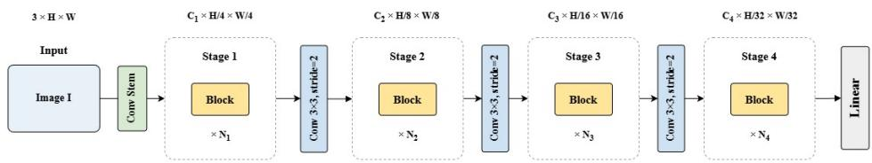
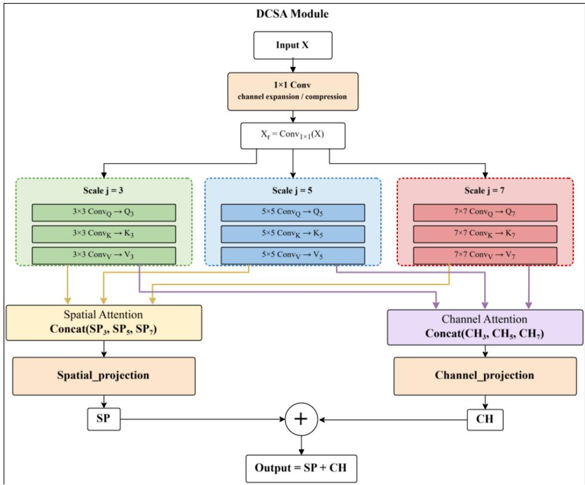
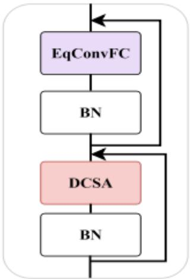

## Highlights

ACSAN: All-Convolutional Self-Attention Network Integrating Convolutional Operations with Vision Transformer

Zimian Wei1, Tianqi Zhang1, Hengyue Pan2

• We propose DCSA module that combines self-attention with convolution operation

• We define a novel model, namely ACSAN, which is a fully convolutional self-attention network

• ACSAN achieves excellent image classification accuracy over ViTs on several databases

# ACSAN: All-Convolutional Self-Attention Network Integrating Convolutional Operations with Vision Transformer

Zimian Wei1, Tianqi Zhang1, Hengyue Pan2

College of Computer Science and Technology, National University of Defense Technology, 109 Deya Road, Changsha, 410073, Hunan, China

## Abstract

In the past few years, Vision Transformer (ViT) has achieved excellent performance in the field of computer vision. However, there still some problems remain. For instance, ViTs heavily rely on large-scale training data since they simply contain a large number of trainable parameters, which slows down their learning eficiency and limits their applicability in resource-constrained scenarios. In this paper, we propose a novel deep learning model, namely All-Convolutional Self-Attention Network (ACSAN), which applies convolution operations to replace fully-connected matrices multiplications in the ViT framework. To implement ACSAN, we firstly design Dynamic Convolutional Self-Attention (DCSA) as the basic module, which employs multi-scale dilated convolutions to generate Query, Key, and Value. We defined spatial self-attention and channel self-attention to generate attention features respectively. The two attention features are finally merged as the output of the DCSA module. Based on DCSA, we then construct the basic ACSAN block. Comparing with ViT, we use DCSA to replace the regular self-attention operations, and use convolution layers to replace MLPs. To evaluate the performance of the proposed method, we train ACSAN on three widely-used image classification databases, i.e. CIFAR-10, CIFAR-100 and ImageNet-1k, from scratch. Experimental results show that ACSAN achieves excellent classification accuracy comparing with standard ViT with comparable or fewer parameters, as well as other state-of-the-art methods. Ablation studies verify that each component contributes positively to the final performance.

Keywords: ViT, CNN, Self-attention

## 1. Introduction

The past few years have witnessed the fast development of Transformer-related architectures. Starting from Transformer[1], many related models that apply the self-attention mechanism show outstanding performance in the field of natural language processing (NLP) due to their powerful global modeling ability from the self-attention mechanism [2, 3, 4, 5]. Moreover, the introduction of Vision Transformer (ViT) [6] makes the Transformer models can deal with image-related tasks. To avoid large-scale matrices multiplication, ViT splits images into patch sequences and feeds them into a standard Transformer encoder for processing. Positional encoding mechanism is applied to keep the spatial information of the input images. In practice, ViT achieved state-of-the-art performance on image classification tasks. However, comparing with CNNs [7], the success of ViT highly relies on the large amount of training data, since the self-attentions and MLPs contain large amount of trainable parameters, and can hardly capture local features of input images. For instance, according to [6], the ViTs require large-scale pretraining to achieve good performance on ImageNet database. Moreover, due to the large number of matrices multiplication operations, the training and inference eficiency of ViTs are also not good enough.

There are many works try to introduce more local priors to provide ViTs with better ability to extract image features. For example, Swin Transformer [8] builds hierarchical feature maps and a shifted window approach for better image classification abilities. [9] proposes Shifted Patch Tokenization(SPT) and Locality Self-Attention (LSA) to provide ViTs with locality inductive bias, which make ViTs achieve good performance when training data are not enough. In [10], the Tokens-to-Token Vision Transformer (T2T-ViT) is proposed. T2T-ViT recursively aggregates neighboring Tokens into one Token to model the local structure representation and reduce the length of tokens. In this way, T2T-ViT can achieve good image classification accuracy on ImageNet database when training from scratch.

The above mentioned methods imply that provide local structure information for ViTs may help them to capture image features better. In fact, one main reason that CNN played an essential role in computer vision is that the image convolution operation has ability to extract local image features. Therefore, some previous researches consider to incorporate image convolution operations into the ViT framework to find a better balance between the network performance and computation complexity. For instance, ACmix [11] is a mixture model of self-attention and image convolution, thus have lower computation overhead comparing with both convolution and self-attention operations. UniFormer [12] designs a network module called Multi-Head Relation Aggregator (MHRA). MHRA unifies image convolution and self-attention, and achieves eficient and efective representation learning in image related tasks. In [13], DMFormer is proposed. DMFormer introduces a novel dynamic multi-level attention (DMA) mechanism, which combines the advantages of convolution and self-attention. Based on DMA, DMFormer achieves good performance on image classification and segmentation tasks.

Based on the researches above, we hope to design a novel neural network architecture, which equips ViTs with better ability to extract local features of images. Specifically, we defined channel self-attention and spatial self-attention on convolution operations, which extract local features and global dependencies simultaneously. Moreover, the MLP layers in ViTs, which contain large number of trainable parameters with high computational complexity, are replaced by convolution layers. In this way, the proposed model has ability to maintain strong representation capabilities while significantly reducing dependency on training data and improving computational eficiency. Generally speaking, the main contributions of this paper are as follows:

• DCSA Module: We propose the Dynamic Convolutional Self-Attention (DCSA) module, which integrates convolutional operations into the selfattention mechanism, which provide both the strong local inductive bias of convolutional neural networks and the strong long-range dependency modeling capability of self-attention mechanisms. Moreover, DCSA introduces multi-scale dilated convolutions with the capability to capture multi-scale features of input images.

• ACSAN Network: Based on the proposed DCSA module, we construct the All-Convolutional Self-Attention Network (ACSAN), which combines the advantages of CNNs and ViTs, since it can simultaneously extract local and global features of input images.

• Experiments: We perform experiments on several widely used image classification databases, which include CIFAR-10, CIFAR-100, and ImageNet-1k. The experimental results imply that ACSAN can efectively handle scenarios with insuficient training samples. Without large scale pre-training, ACSAN can achieve good classification performance with higher training eficiency.

  
Figure 1: Overall architecture of the proposed ACSAN model. The model consists of a convolution stem followed by multiple stages of DCSA Blocks with downsampling between stages.

The remainder of this paper is organized as follows. Section 2 reviews the related works of this research. Section 3 presents the details of the proposed DCSA module and ACSAN architecture. Section 4 presents experimental results and ablation studies. Section 5 concludes the paper.

## 2. Related Works

## 2.1. Convolutional Neural Network

Convolutional Neural Network (CNN) [7] is the most widely-used neural network architecture in the field of computer vision. Inspired by biological visual systems, its local receptive field, parameter sharing mechanism, and hierarchical feature extraction make it suitable to extract image local features and reduce the computation and storage costs. The past few decades have witnessed the success of many CNN based models, such as AlexNet [14], VGG [15], ResNet [16], and ConvNext[17]. Even though currently self-attention based models (such as Vision Transformer) and their variants show excellent performance, CNNs are still the main backbone architecture of most image-related applications. Therefore, it is worthful to consider how to introduce the advantages of CNNs to the self-attention mechanism for better performance and eficiency.

## 2.2. Vision Transformer

Vision Transformer (ViT)[6] successfully transfers the Transformer architecture from natural language processing tasks to the field of computer vision. The core idea of ViT is to treat images as sequence data and use the self-attention mechanism to directly model global dependencies between image patches. In scenarios with suficient training data or large-scale pre-trained models are available, ViT-based models achieve better performance over convolutional neural networks in many image related tasks. However, when training data is limited, due to the lack of the strong inductive bias on image spatial structure, the performance of ViT models may sufer from obvious decreasing. Another significant issue of ViT is the high training cost because of its large number of trainable parameters, which make them can hardly be trained and deployed on platforms with limited computational resources. Therefore, there are many previous works [8, 9, 10, 18] try to reduce the data requirement of ViTs and achieve good results.

There are also some works begin to combine image convolution operations with attention mechanism, to make the model capture both local features and global dependencies. Early research such as BAM [19] and CBAM [20] inserts channel and spatial attention modules into CNNs. SENet [21] and ECA-Net [22] applied channel attention branches into CNNs to enhance network performance. The combination of convolution operations and self-attentions has also been viewed as a worthful research topic. In [23], an attention augmented convolution module is proposed, which contains two branches: one regular image convolution branch and one self-attention branch. The convolution feature and self-attention feature are finally concatenated as the output feature. In [11], it is proved that one convolution layer can be split into a group of 1 × 1 convolution operations followed by convolution aggregation, while one self-attention module can also be decompose into 1 × 1 convolution operations and self-attention aggregation. Based on this observation, ACMix is proposed, which firstly performs a group of into 1 × 1 convolutions to extract image features, then introduces one convolution aggregation branch and one self-attention aggregation branch. In this way, image convolution and self-attention can be combined into one module. In [12], UniFormer is proposed to unify the merits of convolution and self-attention in the ViT framework. Specifically, the core component of UniFormer, i.e. Multi-Head Relation Aggregator (MHRA), contains two variants. Local MHRA can be explained as an extension of MobileNet Block, which has ability to capture local dependencies. While global MHRA shares similar feature of self-attention, which make it can extract global information. DMFormer [13] contains Dynamic Multi-level Attention (DMA) modules, where multi-scale dilated convolutions are used to capture diferent scales of image local features, while a gating mechanism with fully-connected layers is introduced to generate attention information. The researches above show the potential of the combination of image convolution and self-attention, which can be viewed as important basis of our research.

## 3. Methodology

In this section, we firstly propose the basic idea of DCSA, then presents the designation of ACSAN.

  
Figure 2: Structure of the Dynamic Convolutional Self-Attention (DCSA) module. The DCSA module generates Q, K, V via multi-scale dilated convolutions, then applies parallel spatial and channel attention branches before fusion.

## 3.1. DCSA Module

DCSA is the fundamental computational module of the proposed ACSAN model, which combines the self-attention mechanism with image convolution operation. DCSA includes the following key components: (1) multi-scale dilated convolution unit (MDCU), (2) convolution self-attentions, and (3) feature fusion unit. The overall structure of DCSA is shown in Fig. 2.

## 3.1.1. Multi-scale Dilated Convolution Unit

The main objective of the proposed MDCU is to generate Query, Key, and Value for the further self-attention calculation. Comparing with the regular selfattention mechanism, we use multi-scale dilated convolutions as generator, instead of fully-connect matrices multiplication, for better ability to use local features of input feature maps. In one MDCU, the input feature maps are firstly processed by an $1 \times 1$ convolution for channel expansion/compression. Assuming that the input of MDCU is X, then we have:

$$
X _ { e c } = C o n \nu _ { 1 \times 1 } ( X )\tag{1}
$$

assuming that X contains $c _ { i }$ feature maps, while $X _ { e c }$ contains $c _ { o }$ feature maps, then we have $c _ { o } = r * c _ { i }$ . Here r is a pre-defined expansion/compression rate.

After that, inspired by DMFormer [13], we apply multi-scale dilated convolutions (we adopt 3, 5, and 7 in this paper) to generate a group of QueryKeyValue triplets:

$$
\begin{array} { r } { Q _ { j } = W _ { j } ^ { q } * X _ { e c } } \\ { K _ { j } = W _ { j } ^ { k } * X _ { e c } } \\ { V _ { j } = W _ { j } ^ { \nu } * X _ { e c } } \end{array}\tag{2}
$$

where $W _ { j } ^ { * }$ is the convolution kernel to generate $Q _ { j } , K _ { j }$ and $V _ { j } .$ , and j denotes the convolution kernel size of the dilated convolution.

## 3.1.2. Convolution Self-Attentions

For each group of $Q _ { j } , K _ { j }$ and $V _ { j }$ , we define two convolution self-attention branches:

Channel Self-Attention Branch: We define the channel self-attention branch to capture the global dependency between each channel of the input feature maps. Assuming that the feature maps $Q _ { j } , K _ { j }$ and $V _ { j }$ has the shape $( B , C , H , W )$ , where B is the batch size, C is the number of channels, H is the height, and W is the width. Based on the definition of self-attention, we firstly flatten them to the shape $( B , C , H \times W )$

$$
Q _ { f } = \operatorname { F l a t t e n } ( Q _ { j } ) , \quad K _ { f } = \operatorname { F l a t t e n } ( K _ { j } ) , \quad V _ { f } = \operatorname { F l a t t e n } ( V _ { j } )\tag{3}
$$

In the flattened feature maps, the last dimension corresponding to all elements from the same channel. To calculate the channel self-attention, we transpose the last two dimensions of $K _ { f }$ and obtain $K _ { f } ^ { T }$ with shape $( B , H \times W , C )$ , then we have:

$$
\mathbf { C A t t n } ( Q , K , V ) = \mathbf { R e s h a p e } \left( \operatorname { s o f t m a x } \left( \frac { Q _ { f } K _ { f } ^ { T } } { \sqrt { C } } \right) V _ { f } \right)\tag{4}
$$

In Eq. 4, computing $Q _ { f } \cdot K _ { f } ^ { T }$ yields a $C - b y - C$ matrix that semantically represents the co-dependency between channels. After scaling by $\sqrt { C }$ and softmax normalization, the channel attention weight matrix is obtained. Finally, we multiply the channel attention weight matrix with $V _ { f }$ , and reshape back to the size of $( B , C , H , W )$

Spatial Self-Attention Branch: We define the spatial self-attention branch to capture the global dependency between each spatial location of the input feature maps. Similar with channel self-attention, we firstly get $Q _ { f } , K _ { f }$ , and $V _ { f }$ using Eq. 3. Diferent from Eq. 4, the calculation of spatial attention follows Eq. 5:

$$
\mathrm { S A t t n } ( Q , K , V ) = \mathrm { R e s h a p e } \left( \mathrm { s o f t m a x } \left( \frac { Q _ { f } ^ { T } K _ { f } } { \sqrt { H \times W } } \right) V _ { f } \right)\tag{5}
$$

where $Q _ { f } ^ { T }$ has the shape of $( B , H \times W , C )$ . Therefore, computing $Q _ { f } ^ { T } \cdot K _ { f }$ yields a $( H \times W ) \stackrel { \smile } { - } b y - ( H \times W )$ matrix that semantically represents the co-dependency between spatial locations. After scaling by $\sqrt { H \times W }$ and softmax normalization, the spatial attention weight matrix is obtained. Finally, the spatial attention weight matrix should also multiply with $V _ { f }$ , and reshape back to the size of $( B , C , H , W )$ .

## 3.1.3. Feature Fusion Unit

At the last stage of the DCSA module, we need to merge the results of channel self-attention and spatial self-attention. Firstly, we introduce two convolution projection layers, which include convolution operation, batch normalization, and ReLU, to project $C A t t n ( Q , K , V )$ and $S A t t n ( Q , K , V )$ to a pre-defined number of channels:

$$
\begin{array} { l } { C P = \mathrm { { P r o j } } ( \mathrm { { C A t t n } } ( Q , K , V ) ) } \\ { S P = \mathrm { { P r o j } } ( \mathrm { { S A t t n } } ( Q , K , V ) ) } \end{array}\tag{6}
$$

Then, CP and S P are summarized obtain the final output of the DCSA unit:

$$
\mathrm { { D C S A } } ( X ) = C P + S P\tag{7}
$$

## 3.1.4. Multi-Head DCSA

Following the basic idea of ViT and related researches, DCSA can further enhance feature representation capability by introducing the multi-head self-attention mechanism. To implement multi-head convolutional self-attention without significantly increasing model parameters, we split the input feature X by channels into n sub-features $( \mathrm { i . e . , } n$ self-attention heads), then independently execute multi-scale convolution operations, self-attention computation, and projection. In this way, we get n CPs and n S Ps. All CPs and S Ps are then concatenated along the channel dimension:

$$
C P = \operatorname { c a t } ( C P _ { 1 } , C P _ { 2 } , \dots , C P _ { n } )\tag{8}
$$

$$
S P = \operatorname { c a t } ( S P _ { 1 } , S P _ { 2 } , \ldots , S P _ { n } )\tag{9}
$$

After that, we use Eq. 7 to get the final output of the multi-head DCSA.

## 3.2. ACSAN Architecture

Based on the definition of DCSA, we design DCSA Block as the basic component of the ACSAN model. Each DCSA Block includes a DCSA module, an Equivalent Convolutional Fully Connected (EqConvFC) layer using convolution operations, and batch normalization layers. Residual connections are adopted to alleviate the gradient vanishing problem (see Fig. 3 for more details).

  
Figure 3: The structure of the proposed DCSA\_Block module.

The proposed ACSAN architecture uses DCSA Blocks as basic modules. Within the same network stage, DCSA Blocks are directly concatenated with feature map sizes unchanged. Between diferent stages, 3×3 convolutions with stride 2 are used for downsampling and channel number changing. In the classification layer, a fully-connected layer is used to convert DCSA module outputs to class feature vectors. The overall structure of ACSAN is shown in Fig. 1.

To evaluate the practical performance of models with diferent number of parameters, we design three scales of ACSAN models for CIFAR-10 and CIFAR-100 databases, i.e. ACSAN\_small, ACSAN\_base, and ACSAN\_large, with parameter counts of 8.0M, 9.78M, and 11.0M respectively. The channel expansion/compression ratio r of DCSA modules is set to 0.75 to reduce model parameters while efectively improving training and inference eficiency. The number of heads in the multi-head attention is set to 4. Detailed architecture configurations are shown in Table 1.

Table 1: Detailed architecture configurations of ACSAN variants for CIFAR-10 and CIFAR-100.
<table><tr><td rowspan=1 colspan=1>Stage</td><td rowspan=1 colspan=1>ACSAN_small</td><td rowspan=1 colspan=1>ACSAN_baseA</td><td rowspan=1 colspan=1>CSAN_large</td></tr><tr><td rowspan=1 colspan=1>Stage 1</td><td rowspan=1 colspan=1> $[ \mathrm { { B l o c k } } ] { \times } 2 , C { = } 6 4$ </td><td rowspan=1 colspan=1> $[ \mathrm { { B l o c k } } ] { \times } 2 , C { = } 6 4$ </td><td rowspan=1 colspan=1> $[ \mathrm { { B l o c k } } ] { \times } 2 , C { = } 6 4$ </td></tr><tr><td rowspan=1 colspan=1>Stage 2</td><td rowspan=1 colspan=1> $[ \mathrm { B l o c k } ] { \times } 2 , C = 1 2 8$ </td><td rowspan=1 colspan=1> $[ \mathrm { B l o c k } ] { \times } 2 , C = 1 2 8$ </td><td rowspan=2 colspan=1> $[ \mathrm { B l o c k } ] { \times } 2 , C = 1 2 8$  $[ \mathrm { B l o c k } ] { \times } 6 , C { = } 2 5 6$ </td></tr><tr><td rowspan=1 colspan=1>Stage 3</td><td rowspan=1 colspan=1> $[ \mathrm { B l o c k } ] { \times } 3 , C = 2 5 6$ </td><td rowspan=1 colspan=1> $[ \mathrm { B l o c k } ] { \times } 4 , C { = } 2 5 6$ </td></tr><tr><td rowspan=1 colspan=1>Stage 4</td><td rowspan=1 colspan=1> $[ \mathrm { { B l o c k } } ] { \times } 2 , C { = } 3 2 0$ </td><td rowspan=1 colspan=1> $[ \mathrm { B l o c k } ] { \times } 2 , C = 3 5 2$ </td><td rowspan=1 colspan=1> $[ \mathrm { { B l o c k } } ] { \times } 2 , C { = } 3 2 0$ </td></tr></table>

Table 2: Detailed architecture configurations of ACSAN variants for ImageNet database.
<table><tr><td></td><td>Stage |ACSAN_ImageNet_base | ACSAN_ImageNet_large</td><td></td></tr><tr><td>Stage 1</td><td> $[ \mathrm { { B l o c k } } ] { \times } 2 , C { = } 6 4$ </td><td> $[ \mathrm { { B l o c k } } ] { \times } 2 , C { = } 6 4$ </td></tr><tr><td>Stage 2</td><td> $[ \mathrm { B l o c k } ] { \times } 2 , C = 1 2 8$ </td><td> $[ \mathrm { B l o c k } ] { \times } 2 , C = 1 2 8$ </td></tr><tr><td>Stage 3</td><td> $[ \mathrm { B l o c k } ] { \times } 6 , C { = } 2 5 6$ </td><td> $[ \mathrm { B l o c k } ] { \times } 6 , C = 3 2 0$ </td></tr><tr><td>Stage 4</td><td> $[ \mathrm { B l o c k } ] { \times } 2 , C = 3 2 0$ </td><td> $[ \mathrm { B l o c k } ] { \times } 2 , C = 5 1 2$ </td></tr></table>

For ImageNet, we design two ACSAN models, i.e. ACSAN\_ImageNet\_base and ACSAN\_ImageNet\_large. Specifically, ACSAN\_ImageNet\_base follows ACSAN\_large settings, while ACSAN\_ImageNet\_large extends per-stage channel counts to 64, 128, 320, 512 for richer feature extraction. ViT\_ImageNet\_base has 10 layers, 6 heads, hidden dimension 384, and MLP ratio 2. ViT\_ImageNet\_large has 12 layers, 6 heads, hidden dimension 384, and MLP ratio 4. Both models use patch size 8 for fine-grained classification. Detailed architecture configurations are shown in Table 2.

Notice that during the training process, all models are randomly initialized without pre-training.

## 4. Experimental Results

## 4.1. Databases and Implementation Details

In this paper, we apply three widely used databases to evaluate the proposed ACSAN, i.e., CIFAR-10 [24], CIFAR-100 [24] and ImageNet [14].

The proposed ACSAN network is implemented using PyTorch 2.80 [25] in a Python 3.10 environment. The computation platform includes Intel Xeon 4108 CPU, 256 GB memory, and eight Tesla A100 GPUs. During the training process of all databases, pre-trained models are not applied for ACSAN and all baseline models.

Table 3: Comparison of ACSAN and ViT on CIFAR-10 dataset. All models are trained from scratch without pre-training.
<table><tr><td>Model</td><td>Params (M)</td><td>FLOPs (M)</td><td>Top-1 Acc. (%)</td></tr><tr><td>ViT_small</td><td>8.04</td><td>541.31</td><td>90.61</td></tr><tr><td>ViT_base</td><td>9.82</td><td>661.34</td><td>90.50</td></tr><tr><td>ViT_large</td><td>10.71</td><td>721.36</td><td>90.63</td></tr><tr><td>ACSAN_small</td><td>8.03</td><td>53.84</td><td>93.26</td></tr><tr><td>ACSAN_base</td><td>9.75</td><td>58.87</td><td>93.52</td></tr><tr><td>ACSAN_large</td><td>11.06</td><td>66.68</td><td>93.38</td></tr></table>

## 4.2. CIFAR-10 Experiments

In our CIFAR-10 experiments, all models are trained using the AdamW optimizer for 250 epochs with a batch size of 64 on a single GPU. The initial learning rate was set to $1 \times 1 0 ^ { - 3 }$ with cosine annealing scheduling. The baseline ViT models are configured following [6] with adjustments for CIFAR datasets, and we make them has similar number of trainable parameters with the ACSAN counterparts for fair performance comparison. Specifically, ViT\_small has 9 layers with 12 heads self-attention; ViT\_base has 11 layers with 12 heads self-attention; ViT\_large has 12 layers with 12 heads self-attention. All three ViT models have a hidden dimension of 384 and MLP ratio of 1, with patch size of 4. All ACSAN and ViT models are randomly initialized without any pre-training. Table 3 summarizes the CIFAR-10 classification results.

The experimental results reflect two important facts:

Table 4: Comparison of ACSAN and ViT on CIFAR-100 dataset. All models are trained from scratch without pre-training.
<table><tr><td>Model</td><td>Params (M)</td><td>FLOPs (M)</td><td>Top-1 Acc. (%)</td></tr><tr><td>ViT_small</td><td>8.07</td><td>541.35</td><td>65.50</td></tr><tr><td>ViT_base</td><td>9.85</td><td>661.38</td><td>65.02</td></tr><tr><td>ViT_large</td><td>10.74</td><td>721.39</td><td>65.15</td></tr><tr><td>ACSAN_small</td><td>8.05</td><td>53.87</td><td>73.38</td></tr><tr><td>ACSAN_base</td><td>9.78</td><td>58.90</td><td>72.91</td></tr><tr><td>ACSAN_large</td><td>11.09</td><td>66.71</td><td>73.36</td></tr></table>

• Comparing with the ViT model with similar number of parameters, ACSAN can obviously reduce the computation complexity, which is meaningful for real-world applications.

• Due to the fully-convolution structure, all ACSANs achieve better performance comparing with their ViT counterparts.

## 4.3. CIFAR-100 Experiments

Our CIFAR-100 experiments share the same training settings as CIFAR-10 experiments. Table 4 summarizes the CIFAR-100 results. From the experimental results we can learn that the proposed ACSAN model can also handle the situation that the training sample size of each class is extremely small without any pretraining.

## 4.4. ImageNet Experiments

In our ImageNet experiments, we use the AdamW optimizer to train 220 epochs with batch size 8 on 8 Tesla A100 GPUs. The initial learning rate is $2 \times 1 0 ^ { - 4 }$ with a cosine annealing schedule. Here, besides the corresponding ViT structure, we also apply several previous research as baselines to compare with the proposed ACSAN.

Table 5 shows the experimental results, and from which we can learn that the proposed methods show better classification accuracy comparing with corresponding ViT structure under the conditions of less number of parameters and FLOPs. Moreover, comparing with other baselines, ACSAN also shows its advantages to achieve good balance between compuation/storage costs and network performance.

Table 5: Comparison of ACSAN and baseline models on ImageNet dataset. All ViTs and ACSANs are trained from scratch.
<table><tr><td rowspan=1 colspan=1>Model</td><td rowspan=1 colspan=1>Params (M)</td><td rowspan=1 colspan=1>FLOPs (G)</td><td rowspan=1 colspan=1>Top-1 Acc. (%)</td></tr><tr><td rowspan=3 colspan=1>ViT_ImageNet_baseViT_ImageNet_largeSwin-T[8]</td><td rowspan=1 colspan=1>12.24</td><td rowspan=1 colspan=1>14.05</td><td rowspan=1 colspan=1>81.1</td></tr><tr><td rowspan=1 colspan=1>21.69</td><td rowspan=1 colspan=1>22.40</td><td rowspan=1 colspan=1>81.9</td></tr><tr><td rowspan=1 colspan=1>28.3</td><td rowspan=1 colspan=1>4.5</td><td rowspan=1 colspan=1>81.3</td></tr><tr><td rowspan=6 colspan=1>Swin-S[8]ConvNext-T[17]ConvNext-S[17]DMFormer-S[13]DMFormer-L[13]WeightFormer-S[18]</td><td rowspan=1 colspan=1>49.6</td><td rowspan=1 colspan=1>8.7</td><td rowspan=1 colspan=1>83.0</td></tr><tr><td rowspan=1 colspan=1>28.6</td><td rowspan=1 colspan=1>4.5</td><td rowspan=1 colspan=1>82.1</td></tr><tr><td rowspan=1 colspan=1>50.0</td><td rowspan=1 colspan=1>8.7</td><td rowspan=1 colspan=1>83.1</td></tr><tr><td rowspan=1 colspan=1>26.7</td><td rowspan=1 colspan=1>5.0</td><td rowspan=1 colspan=1>82.8</td></tr><tr><td rowspan=1 colspan=1>45.0</td><td rowspan=1 colspan=1>8.7</td><td rowspan=2 colspan=1>83.681.3</td></tr><tr><td rowspan=1 colspan=1>27.0</td><td rowspan=1 colspan=1>4.4</td></tr><tr><td rowspan=2 colspan=1>ACSAN_ImageNet_baseACSAN_ImageNet_large</td><td rowspan=2 colspan=1>11.0819.94</td><td rowspan=1 colspan=1>9.77</td><td rowspan=2 colspan=1>82.782.8</td></tr><tr><td rowspan=1 colspan=1>10.82</td></tr></table>

Table 6: Ablation study results on CIFAR-10 database.
<table><tr><td>Model</td><td>Params (M)</td><td>CIFAR-10 (%)</td></tr><tr><td>Channel Attn Only</td><td>9.78</td><td>93.28</td></tr><tr><td rowspan="2">Spatial Attn Only ACSAN_base</td><td>9.78</td><td>93.29</td></tr><tr><td>9.78</td><td>93.52</td></tr><tr><td rowspan="2">Fully Convolution Fully Depthwise Sep. Conv</td><td>9.58</td><td>89.47</td></tr><tr><td>9.52</td><td>89.14</td></tr><tr><td>DMFormer</td><td>9.85</td><td>88.70</td></tr></table>

## 4.5. Ablation Studies

To prove the advantages brought by the main innovations of this research, we conduct ablation studies. In our ablation studies, we use ACSAN\_base as the baseline method, and design several ablation models. Firstly, to verify the impact of the proposed spatial and channel self-attention, we introduce two extra models:

• ’Channel Attn Only’ model: the two self-attention branches in each DCSA module are all channel self-attentions

• ’Spatial Attn Only’ model: the two self-attention branches in each DCSA module are all spatial self-attentions

In this way, we can show the impacts of the combination of two attentions. Moreover, we also consider three ablation models that all self-attentions are removed:

• ’Fully Convolution’ model: all self-attention computations in the ACSAN\_base are removed.

• ’Fully Depthwise Sep. Conv’ model: comparing with the ’Fully Convolution model, the dilated convolutions in each Multi-scale Dilated Convolution Unit are replaced by depthwise separable convolutions.

• DMFormer [13]: the only diference between DMFormer and ’Fully Depthwise Sep. Conv’ model is that all MLP layers in DMFormer are replaced by convolution layers in the ’Fully Depthwise Sep. Conv’ model.

Table 6 presents the experimental results of ablation studies on CIFAR-10 database. Considering the results of ’Channel Attn Only’ model, ’Spatial Attn Only’ model and ACSAN\_base, we can learn that the combination of channel self-attention and spatial self-attention brings about positive influences on the network performances. Moreover, the results of ’Fully Convolution’ model, ’Fully Depthwise Sep. Conv’ model, and DMFormer show that the proposed DCSA module as well as the fully-convolution ACSAN network can obviously improve the image classification performance when training data is not enough.

## 5. Conclusion

This paper proposes ACSAN, which fuses ViT’s core self-attention mechanism with convolution operations to form convolutional self-attention. Based on this, we propose the DCSA module, which contains multi-scale dilated convolution unit (MDCU), convolution self-attentions, and feature fusion unit. By using DCSA modules and equivalently replacing ViT’s MLP layers with convolution layers, we form the All-Convolutional Self-Attention Network (ACSAN). Experimental results show that ACSAN achieves excellent performance comparing with baseline models under the condition that the training data are not enough.

## References

[1] A. Vaswani, N. Shazeer, N. Parmar, J. Uszkoreit, L. Jones, A. N. Gomez, Ł. Kaiser, I. Polosukhin, Attention is all you need, in: Advances in Neural Information Processing Systems (NeurIPS), Vol. 30, 2017.

[2] J. Devlin, M.-W. Chang, K. Lee, K. Toutanova, BERT: Pre-training of deep bidirectional transformers for language understanding, arXiv preprint arXiv:1810.04805 (2019).

[3] A. Radford, K. Narasimhan, T. Salimans, I. Sutskever, Improving language understanding by generative pre-training, OpenAI Technical Report (2018).

[4] A. Radford, J. Wu, R. Child, D. Luan, D. Amodei, I. Sutskever, Language models are unsupervised multitask learners, OpenAI Technical Report (2019).

[5] T. B. Brown, B. Mann, N. Ryder, M. Subbiah, et al., Language models are few-shot learners, arXiv preprint arXiv:2005.14165 (2020).

[6] A. Dosovitskiy, L. Beyer, A. Kolesnikov, D. Weissenborn, X. Zhai, T. Unterthiner, M. Dehghani, M. Minderer, G. Heigold, S. Gelly, J. Uszkoreit, N. Houlsby, An image is worth 16x16 words: Transformers for image recognition at scale, in: International Conference on Learning Representations (ICLR), 2021.

[7] Y. LeCun, Y. Bengio, Convolutional networks for images, speech, and time series, The handbook of brain theory and neural networks 3361 (1995).

[8] Z. Liu, Y. Lin, Y. Cao, H. Hu, Y. Wei, Z. Zhang, S. Lin, B. Guo, Swin transformer: Hierarchical vision transformer using shifted windows, in: Proceedings of the IEEE/CVF International Conference on Computer Vision (ICCV), 2021, pp. 10012–10022.

[9] S. H. Lee, S. Lee, B. C. Song, Vision transformer for small-size datasets, arXiv preprint arXiv:2112.13492 (2021).

[10] L. Yuan, Y. Chen, T. Wang, W. Yu, Y. Shi, Z.-H. Jiang, F. E. Tay, J. Feng, S. Yan, Tokens-to-token vit: Training vision transformers from scratch on imagenet, in: Proceedings of the IEEE/CVF international conference on computer vision, 2021, pp. 558–567.

[11] X. Pan, C. Ge, R. Lu, S. Song, G. Chen, Z. Huang, G. Huang, On the integration of self-attention and convolution, in: Proceedings of the IEEE/CVF conference on computer vision and pattern recognition, 2022, pp. 815–825.

[12] K. Li, Y. Wang, J. Zhang, P. Gao, G. Song, Y. Liu, H. Li, Y. Qiao, Uniformer: Unifying convolution and self-attention for visual recognition, IEEE

Transactions on Pattern Analysis and Machine Intelligence 45 (10) (2023) 12581–12600.

[13] Z. Wei, H. Pan, L. Li, M. Lu, X. Niu, P. Dong, D. Li, Dmformer: Closing the gap between cnn and vision transformers, in: ICASSP 2023-2023 IEEE International Conference on Acoustics, Speech and Signal Processing (ICASSP), IEEE, 2023, pp. 1–5.

[14] A. Krizhevsky, I. Sutskever, G. E. Hinton, Imagenet classification with deep convolutional neural networks, Advances in neural information processing systems 25 (2012).

[15] K. Simonyan, A. Zisserman, Very deep convolutional networks for large-scale image recognition, arXiv preprint arXiv:1409.1556 (2014).

[16] K. He, X. Zhang, S. Ren, J. Sun, Deep residual learning for image recognition, in: Proceedings of the IEEE conference on computer vision and pattern recognition, 2016, pp. 770–778.

[17] Z. Liu, H. Mao, C.-Y. Wu, C. Feichtenhofer, T. Darrell, S. Xie, A convnet for the 2020s, in: 2022 IEEE/CVF Conference on Computer Vision and Pattern Recognition (CVPR), 2022, pp. 11966–11976. doi:10.1109/CVPR52688.2022.01167.

[18] R. He, D. Han, G. Huang, Linear-time global visual modeling without explicit attention, arXiv preprint arXiv:2605.01711 (2026).

[19] J. Park, S. Woo, J.-Y. Lee, I. S. Kweon, Bam: Bottleneck attention module, arXiv preprint arXiv:1807.06514 (2018).

[20] S. Woo, J. Park, J.-Y. Lee, I. S. Kweon, Cbam: Convolutional block attention module, in: Proceedings of the European Conference on Computer Vision (ECCV), 2018, pp. 3–19.

[21] J. Hu, L. Shen, S. Albanie, G. Sun, E. Wu, Squeeze-and-excitation networks, IEEE Transactions on Pattern Analysis and Machine Intelligence 42 (8) (2020) 2011–2023.

[22] Q. Wang, B. Wu, P. Zhu, P. Li, W. Zuo, Q. Hu, ECA-Net: Eficient channel attention for deep convolutional neural networks, in: Proceedings of the IEEE/CVF Conference on Computer Vision and Pattern Recognition (CVPR), 2020.

[23] I. Bello, B. Zoph, A. Vaswani, J. Shlens, Q. V. Le, Attention augmented convolutional networks, in: Proceedings of the IEEE/CVF international conference on computer vision, 2019, pp. 3286–3295.

[24] A. Krizhevsky, Learning multiple layers of features from tiny images, Technical Report, University of Toronto (2009).

[25] A. Paszke, S. Gross, F. Massa, A. Lerer, J. Bradbury, G. Chanan, T. Killeen, Z. Lin, N. Gimelshein, L. Antiga, et al., PyTorch: An imperative style, high-performance deep learning library, in: Advances in Neural Information Processing Systems (NeurIPS), Vol. 32, 2019.