# A FIRST-STEP BIAS RESTORES LOST DIVERSITY IN DIFFUSION MODEL DISTILLATION

Wenwu Tang, Dong Wang, Yun Cheng\*, Olga Saukh,§

Graz University of Technology, §Complexity Science Hub, Austria

\*Swiss Data Science Center, Switzerland

{wenwu.tang,dong.wang,saukh}@tugraz.at,yun.cheng@sdsc.ethz.ch

## ABSTRACT

Distribution-matching distillation enables high-quality image generation in only a few denoising steps. However, distilled student models often map different initial noise samples to similar outputs under the same prompt. To locate where diversity is lost, we compare the teacher and student along the sampling trajectory. The largest measured reduction in the response to different initial noises occurs during the first, high-noise step. When we replace the first step with the teacher's corresponding trajectory and leave the final three student steps unchanged, most of the output diversity returns. This suggests that the first step is a key point for restoring diversity. Motivated by this finding, we introduce ReSeed, a post-distillation method that adds a seed-response bias adapter only to the first student step and aligns its velocity with the teacher's first-interval secant velocity. All student weights and later denoising steps remain unchanged. We evaluate ReSeed on three text-to-image models (SD3-Medium, SD3.5-Medium, and FLUX.1-dev) and one text-to-video model (Wan2.1-T2V-1.3B). For a distilled 4-step FLUX.1-dev model, ReSeed requires only 0.00196% additional trainable parameters relative to the base model and is trained on 8,000 prompt-noise pairs, while keeping the distilled student fully frozen and requiring no target images, perceptual losses, or adversarial losses. It improves DINO diversity by 48.3% while maintaining competitive visual quality. These results show that substantial diversity can be recovered through a lightweight, data-efficient tuning of only the first denoising step, without finetuning the full student model. Additional results are available on our Project Page.

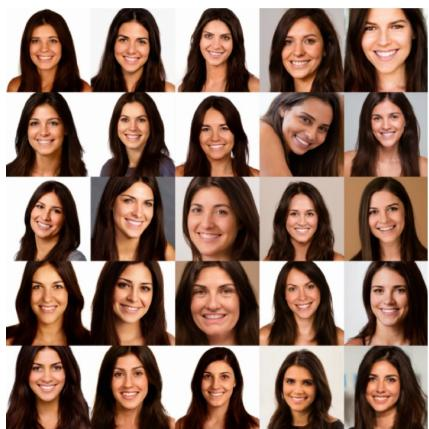  
(a) SD3.5-M (80 NFEs)

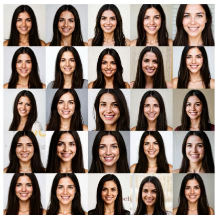  
(b) DMD (4 NFEs)

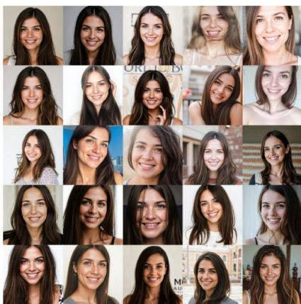  
(c) DMD + ReSeed (4 NFEs)

Figure 1: ReSeed recovers visible same-prompt diversity. All panels use the prompt “A smiling woman with long dark brown hair, hazel eyes, and a warm expression" and the same 25 fixed initial noises, matched cell by cell. (a) The 40-step SD3.5-Medium teacher at CFG 4.5. (b) The frozen 4-step DMD student, and (c) The same frozen 4-step DMD student with ReSeed.

## 1 Introduction

Diffusion and flow models generate high-quality images and videos, but often require many network evaluations [Ho et al., 2020, Esser et al., 2024]. Distillation reduces this cost by training a student to generate samples in only a few denoising steps [Salimans and Ho, 2022, Song et al., 2023, Yin et al., 2024b]. However, students trained with distribution matching distillation (DMD) often produce similar outputs from different initial noises under the same prompt. This loss of diversity reduces the range of results that users can obtain from a few-step model.

Previous works try to address this problem by aligning the student's response to initial noise [Huang et al., 2026] assigning different training objectives to early and late denoising steps [Wu et al., 2026], or using the base model for the first sampling step [Gandikota and Bau, 2025]. These studies highlight the importance of preserving variation during early generation. Further related work is discussed in 6. Building on these findings, we ask a practical question: can we recover diversity in an already distilled student by changing only its rst denoising step, while keeping its original weights and later steps fixed?

We first examine this question through controlled interventions on SD3-Medium. We replace the first student step with the teacher's trajectory over the same time interval, then run the final three student steps without any changes. This yields a higher DINOv3 diversity than that of the 28-step teacher. The result shows that the unchanged later steps can preserve much of the diversity recovered by the teacher's first interval. It supports our central hypothesis: a substantial part of the measured diversity loss can be restored at the first step, without retraining the rest of the student.

Motivated by this finding, we introduce ReSeed, a post-distillation method that trains small bias adapters only for the first student step (Figure 3). We add learned per-channel biases to transformer block outputs and keep all original student weights frozen. Training matches the student's first-step velocity to the teacher's average velocity over the same interval, using the same prompt and initial noise. Matching these velocities also matches the states reached at the first student boundary. At inference, the biases are enabled only during the first step; later steps use the unchanged student, with no teacher calls or additional denoising steps. The biases are shared across prompts and noise seeds, so they do not provide new seed-specific information. Instead, the frozen nonlinear network turns the shared biases into input-dependent corrections. Our analysis links diversity recovery to better alignment with the teacher's seed-dependent responses, rather than simply increasing response magnitudes. This explains why we study a small first-step correction instead of changing the entire sampling process.

We evaluate ReSeed on SD3-Medium, SD3.5-Medium, and SenseFlow-FLUX, a 4-step student of FLUX.1-dev [Black Forest Labs, 2024, Ge et al., 2026], and extend the evaluation to Wan2.1 text-to-video generation. For 4-step FLUX.1- dev student, ReSeed trains only 233,472 parameters (0.00196% of the denoiser parameters) using 8,000 prompt-noise pairs. It requires no target images, perceptual losses, or adversarial losses. DINOv3 diversity increases by 48.3%, while FID decreases from 40.22 to 34.65. Experiments on the other image models and the video model also show diversity gains, with trade-offs in some quality metrics. These results show that substantial diversity can be recovered with very few trainable parameters after distillation.

Our main contributions are:

• Most diversity loss occurs in the first denoising step. We show that most of the diversity loss in few-step distilled models occurs in the first denoising step, while the frozen suffix retains the ability to preserve diversity.

• A small first-step adapter can recover lost diversity. We introduce ReSeed, a first-step residual tuning that restores lost diversity while keeping the pretrained distilled student frozen, requiring less than 0.005% additional trainable parameters and approximately 8,000 prompt-noise pairs.

• Existing distilled models can be repaired without repeating distillation. Our results demonstrate that diversity in an already distilled model can be substantially improved through a lightweight post-hoc tuning, without repeating distillation or fine-tuning the whole original student. This provides a practical way to enhance the diversity of existing few-step generative models after training.

## 2 Preliminaries

Flow matching. Diffusion models [Ho et al., 2020] and flow matching [Lipman et al., 2023, Liu et al., 2023] can both be read as a learned velocity field that defines a probability-flow ODE [Song et al., 2021]: a diffusion model derives the velocity from its predicted score, flow matching regresses it directly. For rectified-flow models, a clean latent $x _ { 0 }$ and a Gaussian noise € are joined by the straight path $x _ { t } = ( 1 - t ) x _ { 0 } + t \epsilon$ with flow time $t \in [ 0 , 1 ]$ , whose derivative is the constant velocity $\mathrm { d } x _ { t } / \mathrm { d } t = \epsilon - x _ { 0 }$ . A network $v _ { \theta } ( x _ { t } , t , c )$ , with trainable parameters θ and prompt condition $c ,$ is

trained to predict this velocity,

$$
\mathcal { L } _ { \mathrm { F M } } ( \theta ) = \mathbb { E } _ { t , x _ { 0 } , \epsilon } \big | \big | v _ { \theta } ( x _ { t } , t , c ) - ( \epsilon - x _ { 0 } ) \big | \big | _ { 2 } ^ { 2 } ,\tag{1}
$$

where $\mathcal { L } _ { \mathrm { F M } }$ is the flow-matching objective, $\mathbb { E } _ { t , x _ { 0 } , \epsilon }$ averages over the sampled flow time, training latent, and Gaussian noise, and $\lVert \cdot \rVert _ { 2 }$ is the Euclidean norm over latent elements. The predicted velocity gives the clean estimate $\hat { x } _ { 0 } =$ $x _ { t } - t v _ { \theta } ( x _ { t } , t , c )$ . Sampling starts from pure noise $z = x _ { 1 }$ and integrates dx $_ t / \mathrm { d } t = v _ { \theta }$ from $t = 1$ to 0. We call the exact solution of this ODE $\Phi : z \mapsto x _ { 0 }$ . With Euler steps on a decreasing grid $1 = t _ { 0 } > t _ { 1 } > \cdot \cdot \cdot > t _ { K } = 0$

$$
x _ { t _ { k + 1 } } = x _ { t _ { k } } + ( t _ { k + 1 } - t _ { k } ) v _ { \theta } ( x _ { t _ { k } } , t _ { k } , c ) , \qquad k = 0 , \ldots , K - 1 .\tag{2}
$$

Here $K$ is the number of denoising steps, k indexes a step, and $x _ { t _ { k } }$ is the latent state at flow time $t _ { k } ;$ the subscript k on $t _ { k }$ indexes denoising boundaries, and the signed increment $t _ { k + 1 } - t _ { k }$ is negative because sampling moves from noise to data. The sampler is deterministic: for a fixed prompt, everything that differs between two images comes from the initial noise z.

Distribution matching distillation. DMD [Yin et al., 2024b,a] trains a few-step student to match the teacher's output distribution. Let $x _ { \theta } = F _ { \theta } ( z , c )$ be the student output and let $p _ { \mathrm { s t u } , \theta }$ and $p _ { \mathrm { t e a } }$ denote the student and teacher output distributions. The ideal distribution-matching objective is the reverse Kullback-Leibler divergence

$$
\mathcal { L } _ { \mathrm { D M D } } ( \boldsymbol { \theta } ) : = D _ { \mathrm { K L } } ( p _ { \mathrm { s t u } , \boldsymbol { \theta } } \parallel p _ { \mathrm { t e a } } ) .\tag{3}
$$

Here $\theta$ denotes the student parameters, z is the initial noise, c is the prompt, and $D _ { \mathrm { K L } }$ is the KL divergence. This divergence is not evaluated directly. In practice, DMD updates the student using estimated scores of re-noised samples [Yin et al., 2024b,a]. Under the flow parameterization used here, we form $x _ { t } = ( 1 - t ) x _ { \theta } + t \epsilon .$ , where $\epsilon \sim \mathcal { N } ( 0 , I )$ is independent Gaussian noise. The score-based update is

$$
\nabla _ { \boldsymbol { \theta } } \ell _ { \mathrm { D M D } } ( \boldsymbol { \theta } ) = \mathbb { E } _ { \boldsymbol { z } , t , \boldsymbol { \epsilon } } \big [ w \mathbin { J _ { \boldsymbol { \theta } } } ( \boldsymbol { x } _ { t } ) ^ { \top } \big ( \hat { s } _ { \mathrm { s t u } } ( \boldsymbol { x } _ { t } , t , \boldsymbol { c } ) - \hat { s } _ { \mathrm { t e a } } ( \boldsymbol { x } _ { t } , t , \boldsymbol { c } ) \big ) \big ] ,\tag{4}
$$

Here $\nabla _ { \theta } \ell _ { \mathrm { D M D } } ( \theta )$ is the score-based update vector, $J _ { \theta } ( x _ { t } ) = \partial x _ { t } / \partial \theta$ is the Jacobian of the re-noised sample, and w is a scalar weighting factor. The expectation averages over initial noise z, re-noising time $t ,$ and re-noising noise €. The frozen teacher provides $\hat { s } _ { \mathrm { t e a } } ,$ while an auxiliary model fitted online to student samples provides $\hat { s } _ { \mathrm { s t u } } .$ These estimate the gradients of the log densities of the re-noised teacher and student outputs, respectively. Reverse KL is mode seeking: it penalises student samples the teacher finds unlikely, not teacher modes the student never produces.

Diversity as the response to the initial noise. For a fixed prompt c, the deterministic sampler maps initial noise $z \operatorname { t o }$ the output $F _ { \theta } ( z , c )$ . We call the change in output caused by changing the initial noise the seed response. We write the complete sampler as $F _ { \theta } ( z , c ) = H _ { \theta } ( \bar { R } _ { \theta } ( z , c ) , \bar { c } )$ , where $R _ { \theta }$ maps the initial noise to the first-step state and $H _ { \theta }$ denotes the remaining steps. We use this decomposition to test whether the observed diversity loss can be corrected at the first step while keeping the remaining steps unchanged.

## 3 First-step correction restores diversity

A first-step repair can restore output diversity only if the unchanged later steps still preserve differences between seeds. We test this condition on the 4-step SD3-Medium student, then ask whether better first-step seed responses accompany more diverse final images.

## 3.1 First-step replacement restores diversity

We replace the first student step with corresponding teacher steps covering the same time interval. The remaining three steps use the unchanged student. Both samplers share the same prompts and initial noises, so the replacement changes only how they reach the first student boundary. This replacement increases DINOv3 diversity from 0.2142 to 0.3117. Replacing additional student intervals brings smaller further gains (Figure 2). The replacement requires extra teacher evaluations and serves as a diagnostic test, rather than an equal-cost alternative to the student.

These results show that the unchanged final three steps can produce diverse images when given a different first-boundary state. They identify the first step as an effective repair point in this setting, without requiring changes to the remaining steps. These findings motivate matching the student's first-step state to the teacher's. For an Euler step, this is equivalent to matching the student's velocity to the teacher's average velocity over the same interval, which forms the training objective in Section 4.

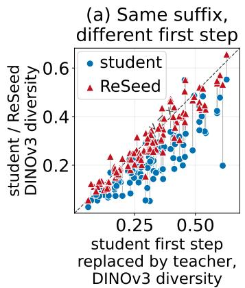

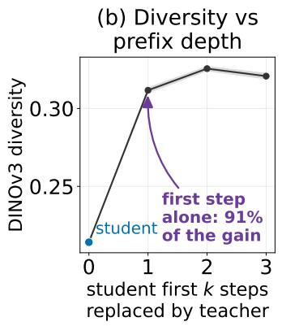

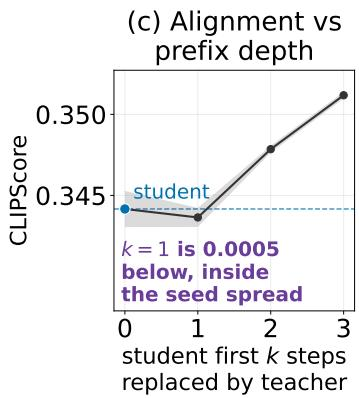  
Figure 2: First-step replacement on SD3-Medium. (a) With student steps 2–4 fixed, replacing step 1 by the teacher raises diversity for $9 8 \dot { / } 1 0 0$ prompts; ReSeed moves them toward the teacher-prefix result. (b,c) Replacing the first k steps shows that $k = \dot { 1 }$ gives $9 1 \%$ of the diversity gain. CLIPScore changes little until later steps are replaced. Bands show the standard deviation over three seeds.

## 3.2 Better seed-response alignment accompanies higher diversity

For a fixed prompt, a seed response is the difference between two first-step endpoints from different initial noises. On 5,000 COCO prompts with ten seeds each, we compare this response with the teacher's for the frozen SD3-Medium student and seven ReSeed checkpoints. Mean response error falls by a factor of 2.7 as final-image DINOv3 diversity rises from 0.213 to 0.290 (Figure 4). Across checkpoints, lower error accompanies higher diversity for 90% of prompts. This association supports correcting the first endpoint while keeping later steps unchanged.

## 4 ReSeed: a seed-response bias for the first step

ReSeed adds a constant bias adapter to each transformer block, active only in the first student step (Figure 3). The four steps share backbone parameters, so changing an original bias would affect them all. Instead, we freeze the backbone and disable the adapters in steps 2–4. The adapters contain no seed or prompt information; their input-dependent effect arises through the frozen network.

Teacher-secant target. Let $x _ { t _ { 0 } } = z$ be the initial Gaussian latent and let $x _ { t _ { 1 } } ^ { \mathrm { t e a } } ( z , c )$ be the endpoint reached by the teacher from the same latent and prompt after the teacher steps corresponding to the student's first denoising interval. The target is the teacher's average velocity across this interval,

$$
\bar { v } _ { \mathrm { t e a } } ( z , c ) = \frac { x _ { t _ { 1 } } ^ { \mathrm { t e a } } ( z , c ) - x _ { t _ { 0 } } } { t _ { 1 } - t _ { 0 } } ,\tag{5}
$$

where $z$ is the sampled initial noise, c is the prompt, $t _ { 0 }$ and $t _ { 1 }$ are the two flow-time boundaries of the first denoise interval, and the bar denotes an average over this interval. This is a displacement target, not the teacher's instantaneous velocity at the last step. The training loss and the sampler are

$$
\mathcal { L } _ { \mathrm { R e S e e d } } = \mathbb { E } _ { c , z } \left[ \frac { 1 } { d } \Big \| v _ { \mathrm { s t u } } ^ { \beta } \big ( x _ { t _ { 0 } } , t _ { 0 } , c \big ) - \mathrm { s g } \big ( \bar { v } _ { \mathrm { t e a } } ( z , c ) \big ) \Big \| _ { 2 } ^ { 2 } \right] , \qquad x _ { t _ { 1 } } = x _ { t _ { 0 } } + ( t _ { 1 } - t _ { 0 } ) v _ { \mathrm { s t u } } ^ { \beta } ( x _ { t _ { 0 } } , t _ { 0 } , c ) ,\tag{6}
$$

where $\mathbb { E } _ { c , z }$ averages over prompt-noise pairs, d is the number of latent elements, $\beta$ is the collection of trainable bias adapters, $v _ { \mathrm { s t u } } ^ { \beta }$ is the frozen student evaluated with those biases, sg stops gradients through the teacher target. The second expression is the Euler update that produces the adapted first endpoint $x _ { t _ { 1 } }$ . For intervals $k \in \{ 1 , 2 , 3 \}$ , the adapter is disabled and the original frozen student advances from the modified first endpoint. The training loss is defined for individual prompt-noise pairs, whereas diversity concerns differences between samples under the same prompt. The following proposition connects these two views: the same loss also bounds the error in pairwise seed responses at the first endpoint.

Proposition 1 (Pointwise regression bounds pairwise seed-response error) For each prompt $c ,$ let $z , z ^ { \prime }$ be independent noises from the same initial-noise distribution. Let $F _ { \beta } ( z , c )$ denote the adapted frst endpoint and $T ( z , c )$ the teacher endpoint. Defne $\Delta F _ { \beta } = F _ { \beta } ( z , c ) - F _ { \beta } ( z ^ { \prime } , c )$ , and $\Delta T = T ( z , c ) - T ( z ^ { \prime } , c )$ . Let d be the number of latent elements. The pointwise regression objective used during training upper-bounds the expected same-prompt pairwise response error per latent element at the tted endpoint, up to the factor $2 ( t _ { 1 } - t _ { 0 } ) ^ { 2 } .$

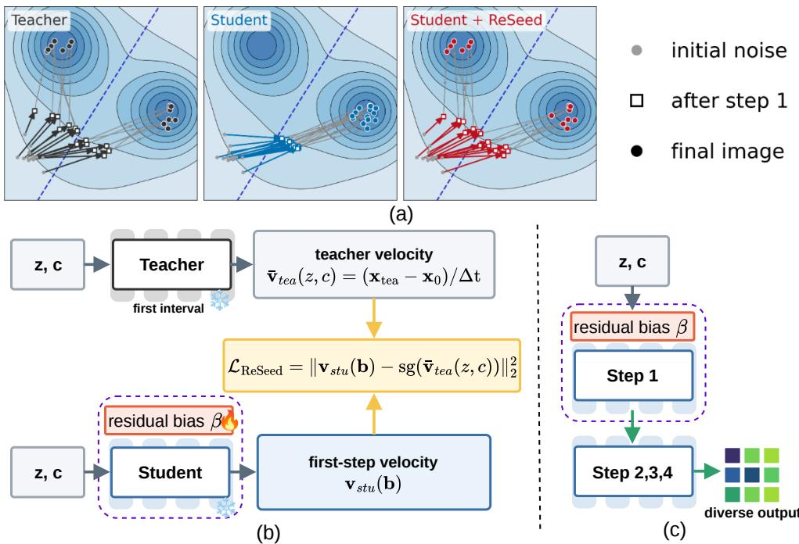  
Figure 3: Overview of ReSeed. (a) First-step contraction can merge seed trajectories; the teacher and ReSeed retain alternative paths. (b) Training fits first-step block-output biases to the teacher's interval-average velocity with frozen base weights. (c) The bias is off in steps 2–4.

$$
\frac 1 d \mathbb { E } _ { c , z , z ^ { \prime } } \lVert \Delta F _ { \beta } - \Delta T \rVert _ { 2 } ^ { 2 } \leq 2 ( t _ { 1 } - t _ { 0 } ) ^ { 2 } \mathcal { L } _ { \mathrm { R e S e e d } } .\tag{7}
$$

Appendix E.1 gives the full proof. This bound controls first-endpoint response error, not final-image diversity; whether the recovered response can improve the generated image diversity is tested empirically in Section 3. Figure 4 shows that lower pairwise endpoint response error is associated with higher final-image DINOv3 diversity.

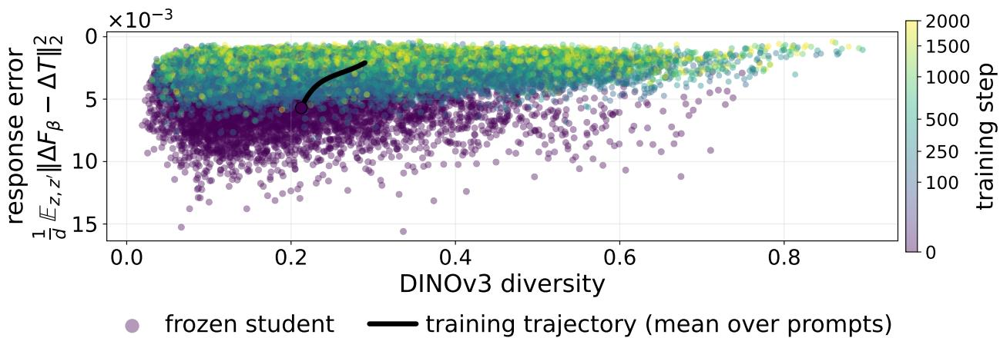  
Figure 4: Seed-response error versus DINOv3 diversity on COCO5K (5,000 prompts × 10 seeds). The error axis is reversed; black curve is checkpoint means.

Bias adapter parameterisation. For block b in the model, we add constant per-channel vectors $\beta _ { b } \in \mathbb { R } ^ { N }$ to the block output of both streams, each $\beta _ { b }$ is an N-dimensional channel vector. The bias is broadcast over the batch and token dimensions and initialized to zero, so an untrained adapter reproduces the original student model exactly. For SD3-Medium, $N _ { \mathrm { b i a s } } = 7 2 , 1 9 2$ parameters or 0.00356% of the 2,028,328,000 student parameters. Unlike BitFit [Ben Zaken et al., 2022], ReSeed does not unfreeze existing model biases; it adds new zero-initialised residual vectors whose activity is gated by the denoising interval

## 5 Experiments and Results

## 5.1 Experimental setup

Models and datasets. We evaluate 4-step DMD students of SD3-Medium and SD3.5-Medium [Esser et al., 2024, Yin et al., 2024b], the 4-step SenseFlow student of FLUX.1-dev [Black Forest Labs, 2024, Ge et al., 2026], and the 4-step Wan2.1-T2V-1.3B DMD2 student [Wan Team, 2025, Yin et al., 2024a] released with Data-Forcing Distillation (DFD) [Chen et al., 2026]. Image adapters use JourneyDB prompts [Sun et al., 2023]; the video adapter uses a pool of 4,000 ViPE-Wild-1M captions [Huang et al., 2025]. Training requires only prompts and initial noise.

Training. We train only first-step bias adapters, keeping the teachers and student backbones frozen. We use three training seeds for the main image results and one for video. Reported checkpoints, training budgets, and sampling settings are given in Appendix A.

Evaluation. We evaluate image quality on 5,000 images generated from COCO-2017 validation captions [Lin et al., 2014], using CLIP score [Radford et al., 2021], PickScore [Kirstain et al., 2023], HPSv2.1 [Wu et al., 2023], the LAION aesthetic score [Schuhmann et al., 2022], and FID [Heusel et al., 2017]. Image diversity uses a separate set of 100 prompts with R = 10 independent initial noises per prompt. For a feature extractor φ, we define same-prompt diversity as

$$
D _ { \phi } ( c ) = 1 - \frac { 2 } { R ( R - 1 ) } \sum _ { 1 \leq i < j \leq R } \cos \Bigl ( \phi \Bigl ( x _ { \theta } ^ { ( i ) } ( c ) \Bigr ) , \phi \Bigl ( x _ { \theta } ^ { ( j ) } ( c ) \Bigr ) \Bigr ) .\tag{8}
$$

Here $x _ { \theta } ^ { ( i ) } ( c )$ is the image generated by model θ for prompt c from noise sample $i ; i , j$ index distinct samples, φ maps images to feature vectors, and cos denotes cosine similarity. We average $D _ { \phi } ( c )$ over prompts using DINOv3 [Siméoni et al., 2025] and CLIP features, and also report mean pairwise LPIPS-Alex distance [Zhang et al., 2018].

For video, we use a category-balanced subset of 320 VBench prompts [Huang et al., 2024]. Each method generates eight videos per prompt for diversity and text alignment; five of these are used for VBench quality. We report seven quality dimensions, CLIP text alignment, and video-level and per-frame diversity using CLIP and DINOv2 features [Oquab et al., 2024]. Within each comparison, all methods share the same prompts, initial noises, and scorers. Appendix A.1 gives the video protocol.

## 5.2 Text-to-Image Generation

Comparison baselines. Our primary baseline is the original 4-step DMD student. We also compare with GAD, which matches teacher and student responses to initial-noise perturbations [Huang et al., 2026], and DP-DMD, which uses a teacher-derived prediction target for the first step and the DMD loss for later steps [Wu et al., 2026]. Both methods change the distillation process. In contrast, ReSeed is applied after distillation: it freezes the student and trains only first-step bias adapters. We also apply ReSeed to a GAD student to test whether the two methods can work together. All 4-step students comparisons are sampled at CFG 1.

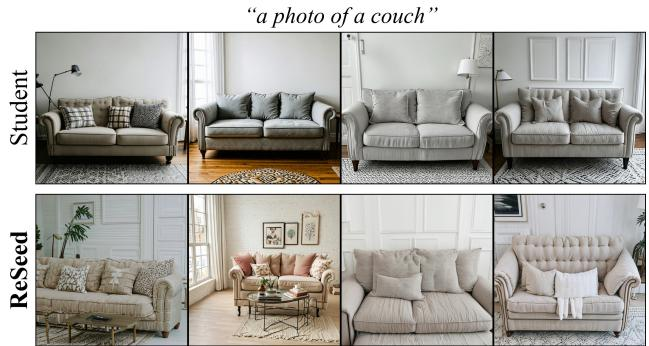  
Figure 5: Matched-noise SD3.5-Medium samples. Top: the frozen DMD student. Bottom: the same student with ReSeed.

Main comparison. Against the DMD students, ReSeed raises DINOv3 diversity from 0.2142 to 0.2936 (+37.1%) on SD3-Medium and from 0.2356 to 0.3282 (+39.3%) on SD3.5-Medium; CLIP-feature diversity and LPIPS also rise (Table 1). FID improves from 37.38 to 33.48 and from 32.51 to 29.30, respectively. PickScore and HPS fall by 0.7% and 1.5% on SD3-Medium, and by 1.5% and 2.8% on SD3.5-Medium, while aesthetic scores change little. Thus, diversity and FID improve, but not every quality measure does. Section 5.5 examines the effect of bias strength. Figure 5 shows a matched-noise SD3.5-Medium example: the student produces similar couches, while ReSeed adds variation in their appearance and surroundings.

Table 1: Results on SD3-Medium and SD3.5-Medium under a common evaluation protocol.
<table><tr><td rowspan="2">Method</td><td rowspan="2">NFEs</td><td colspan="3">Diversity</td><td colspan="5">Quality</td></tr><tr><td>DINO↑</td><td>CLIP dist. ↑</td><td>LPIPS ↑</td><td>CLIP↑</td><td>Pick ↑</td><td>HPS ↑</td><td>AeS ↑</td><td>FID↓</td></tr><tr><td colspan="9">SD3-Medium (teacher CFG = 7)</td></tr><tr><td>Base Model</td><td>56</td><td>0.269</td><td>0.148</td><td>0.696</td><td>0.3534</td><td>22.516</td><td>0.2895</td><td>5.33</td><td>32.15</td></tr><tr><td>DMD</td><td>4</td><td> $0 . 2 1 4 { \scriptstyle \pm 0 . 0 0 1 }$ </td><td> $0 . 1 3 4 { \scriptstyle \pm 0 . 0 0 0 3 }$ </td><td> $0 . 6 5 5 { \scriptstyle \pm 0 . 0 0 6 }$ </td><td> $\mathbf { 0 . 3 4 4 2 _ { \pm 0 . 0 0 1 1 } }$ </td><td> $\mathbf { 2 2 . 6 5 4 } _ { \pm 0 . 0 1 5 }$ </td><td> $\mathbf { 0 . 3 0 9 4 { \scriptstyle \pm 0 . 0 0 0 7 } }$ </td><td> $\underline { { 5 . 6 1 } } _ { \pm 0 . 0 1 }$ </td><td> $3 7 . 3 8 _ { \pm 0 . 4 0 }$ </td></tr><tr><td>DP-DMD</td><td>4</td><td> $\underline { { 0 . 2 8 2 } } _ { \pm 0 . 0 0 7 }$ </td><td> $\underline { { 0 . 1 6 7 } } _ { \pm 0 . 0 0 2 }$ </td><td> $0 . 6 6 6 _ { \pm 0 . 0 1 6 }$ </td><td> $0 . 3 2 7 6 { \scriptstyle \pm 0 . 0 0 0 4 }$ </td><td> $2 1 . 9 8 3 { \scriptstyle \pm 0 . 0 9 6 }$ </td><td> $0 . 2 8 0 5 { \scriptstyle \pm 0 . 0 0 7 8 }$ </td><td> $5 . 2 0 { \scriptstyle \pm 0 . 0 9 }$ </td><td> $4 3 . 2 9 _ { \pm 2 . 1 2 }$ </td></tr><tr><td>GAD</td><td></td><td> $0 . 2 3 4 { \scriptstyle \pm 0 . 0 0 2 }$ </td><td> $0 . 1 3 2 _ { \pm 0 . 0 0 2 }$ </td><td> $\underline { { 0 . 6 6 8 } } _ { \pm 0 . 0 1 7 }$ </td><td> $0 . 3 3 9 8 _ { \pm 0 . 0 0 2 0 }$ </td><td> $\underline { { 2 2 . 5 8 7 } } { \scriptstyle \pm 0 . 0 5 7 }$ </td><td> $0 . 3 0 4 6 { \scriptstyle \pm 0 . 0 0 0 3 }$ </td><td> $5 . 5 3 { \scriptstyle \pm 0 . 0 1 }$ </td><td> $\underline { { 3 5 . 8 2 } } _ { \pm 0 . 3 9 }$ </td></tr><tr><td>DMD</td><td>44</td><td> $\mathbf { 0 . 2 9 4 _ { \pm 0 . 0 0 3 } }$ </td><td> $\mathbf { 0 . 1 6 8 _ { \pm 0 . 0 0 1 } }$ </td><td> $\mathbf { 0 . 7 2 1 { \scriptstyle \pm 0 . 0 0 2 } }$ </td><td> $\underline { { 0 . 3 4 0 4 } } _ { \pm 0 . 0 0 0 7 }$ </td><td> $2 2 . 4 8 8 _ { \pm 0 . 0 1 2 }$ </td><td> $\underline { { 0 . 3 0 4 7 } } _ { \pm 0 . 0 0 0 3 }$ </td><td> ${ \bf 5 . 6 2 _ { \pm 0 . 0 1 } }$ </td><td> $\mathbf { 3 3 . 4 8 _ { \pm 0 . 0 3 } }$ </td></tr><tr><td colspan="9">+ ReSeed (ours) SD3.5-Medium (teacher</td></tr><tr><td></td><td></td><td> $\dot { C } F G = 4 . 5 )$ </td><td>0.154</td><td></td><td>0.3589</td><td></td><td></td><td></td><td></td></tr><tr><td>Base Model DMD</td><td>80 4</td><td>0.283</td><td> $0 . 1 3 2 _ { \pm 0 . 0 0 4 }$ </td><td>0.697</td><td></td><td>22.479</td><td>0.2851</td><td>5.30  $\underline { { 5 . 5 2 3 } } _ { \pm 0 . 0 2 0 }$ </td><td>28.18  $3 2 . 5 1 _ { \pm 0 . 1 9 }$ </td></tr><tr><td>DP-DMD</td><td></td><td> $0 . 2 3 6 { \scriptstyle \pm 0 . 0 0 3 }$ </td><td> $\underline { { 0 . 1 6 7 } } _ { \pm 0 . 0 0 2 }$ </td><td> $0 . 6 6 8 _ { \pm 0 . 0 1 4 }$ </td><td> $\underline { { 0 . 3 5 0 5 } } _ { \pm 0 . 0 0 0 4 }$   $0 . 3 4 5 5 { \scriptstyle \pm 0 . 0 0 1 2 }$ </td><td> $\underline { { 2 2 . 7 3 4 } } _ { \pm 0 . 0 1 9 }$   $2 2 . 4 4 4 { \scriptstyle \pm 0 . 0 1 8 }$ </td><td> $\mathbf { 0 . 3 0 4 0 { \scriptstyle \pm 0 . 0 0 2 3 } }$ </td><td> $5 . 5 1 { \scriptstyle \pm 0 . 0 2 }$ </td><td>29.12±0.62</td></tr><tr><td>GAD</td><td>444</td><td> $\underline { { 0 . 3 2 5 } } _ { \pm 0 . 0 0 5 }$ </td><td> $0 . 1 2 6 { \scriptstyle \pm 0 . 0 0 2 }$ </td><td> $\underline { { 0 . 7 1 7 } } _ { \pm 0 . 0 1 1 }$   $0 . 6 4 2 { \scriptstyle \pm 0 . 0 0 9 }$ </td><td> $\mathbf { 0 . 3 5 2 3 { \scriptstyle \pm 0 . 0 0 0 8 } }$ </td><td> $\mathbf { 2 2 . 7 7 1 { \scriptstyle \pm 0 . 0 2 1 } }$ </td><td> $0 . 2 9 1 5 { \scriptstyle \pm 0 . 0 0 0 7 }$ </td><td> $5 . 5 1 8 { \scriptstyle \pm 0 . 0 3 6 }$ </td><td></td></tr><tr><td>DMD</td><td></td><td> $0 . 2 3 4 { \scriptstyle \pm 0 . 0 0 3 }$ </td><td></td><td></td><td> $0 . 3 4 4 6 { \scriptstyle \pm 0 . 0 0 1 0 }$ </td><td></td><td> $\underline { { 0 . 2 9 9 0 } } _ { \pm 0 . 0 0 2 0 }$ </td><td></td><td> $3 1 . 1 8 { \scriptstyle \pm 0 . 1 9 }$ </td></tr><tr><td>+ ReSeed (ours)</td><td></td><td> $\mathbf { 0 . 3 2 8 _ { \pm 0 . 0 0 6 } }$ </td><td> $\mathbf { 0 . 1 6 9 _ { \pm 0 . 0 0 3 } }$ </td><td> $\mathbf { 0 . 7 2 3 _ { \pm 0 . 0 0 7 } }$ </td><td></td><td> $2 2 . 3 9 8 _ { \pm 0 . 0 0 8 }$ </td><td> $0 . 2 9 5 6 { \scriptstyle \pm 0 . 0 0 1 4 }$ </td><td> ${ \bf 5 . 5 3 3 _ { \pm 0 . 0 2 4 } }$ </td><td> $\underline { { 2 9 . 3 0 } } _ { \pm 0 . 8 1 }$ </td></tr></table>

Comparison with diversity-aware distillation. On SD3-Medium, DMD + ReSeed has higher DINOv3 diversity and lower FID than GAD and DP-DMD (Table 1). On SD3.5-Medium it is close to DP-DMD on these measures, while GAD retains higher CLIP score and PickScore. ReSeed also improves an already trained GAD student: in a matched seed-42 SD3-Medium comparison, DINOv3 diversity rises from 0.2324 to 0.3029 and FID falls from 36.05 to 34.36. CLIP score, PickScore, HPS, and aesthetic score decrease. ReSeed can therefore complement GAD, but retains a quality-diversity trade-off.

Cross-architecture results on FLUX.1-dev. At 2,000 updates, ReSeed increases DINOv3 diversity of the frozen SenseFlow student [Ge et al., 2026] from 0.1575 to 0.2336 (+48.3%), recovering 89.8% of the measured gap to the FLUX.1-dev teacher [Black Forest Labs, 2024]. CLIP-feature diversity and LPIPS increase by 40.3% and 16.1%, respectively. FID improves from 40.22 to 34.65. Unlike the SD3 results, CLIP score also improves, from 0.3431 to 0.3450, while PickScore, HPS, and the aesthetic score decrease slightly (Table 2). The training curves in Figure 6 show that most DINOv3 diversity recovery occurs within the first 300–400 updates, with smaller gains afterwards. Figure 10 in Appendix D shows that the diversity gains occur across most evaluated prompts.

Table 2: FLUX quality-diversity comparison.
<table><tr><td rowspan="2">Model</td><td rowspan="2">NFEs</td><td colspan="3">Diversity</td><td colspan="4">Quality</td></tr><tr><td>DINO ↑ CLIP dist. ↑LPIPS ↑</td><td></td><td></td><td>CLIP score ↑ Pick ↑ 1</td><td></td><td></td><td>HPS ↑ AeS ↑ FID ↓</td></tr><tr><td>FLUX.1-dev</td><td>28</td><td>0.242</td><td>0.140</td><td>0.649</td><td>0.3472</td><td>23.0500.3033</td><td>5.70</td><td>33.49</td></tr><tr><td>SenseFlow</td><td>4</td><td>0.158</td><td>0.090 0.533</td><td>0.3431</td><td></td><td>23.1520.3128</td><td>5.87</td><td>40.22</td></tr><tr><td>SenseFlow</td><td></td><td>0.234</td><td>0.126</td><td>0.618</td><td>0.3450</td><td>23.1210.3118</td><td></td><td>5.8534.65</td></tr><tr><td>+ ReSeed (ours)</td><td>4</td><td>±0.001</td><td>±0.002</td><td>±0.003</td><td>±0.0003</td><td>±0.011 ±0.0003 ±0.01 ±0.15</td><td></td><td></td></tr></table>

## 5.3 Extension to Text-to-Video Generation

We also test ReSeed on a distilled video generator. Table 3 compares the Wan2.1 teacher, the released 4-step DMD2 and DFD checkpoints, and the same frozen DMD2 student with ReSeed. We evaluate them on the 320-prompt VBench subset described in Section 5.1

ReSeed raises video-level DINO diversity from 0.3374 to 0.4290, a relative gain of 27.1%. The paired increase is +0.0916, with a 95% bootstrap interval of [+0.0804, +0.1024], and 273 of 320 prompts improve. This recovers 56.2% of the measured teacher-student DINO gap, although the teacher remains higher at 0.5005. Mean DINO diversity increases in all eight categories (Appendix B.1). Video-level CLIP diversity rises from 0.1267 to 0.1437, and per-frame DINO diversity from 0.3748 to 0.4716. The released DFD checkpoint has similar DINO diversity to DMD2 (0.3358 versus 0.3374), but higher projected-CLIP diversity (0.1351). Figure 15 in Appendix F shows matched-noise frame strips for four prompts. Subject and background consistency stay close to DMD2, while the flickering, smoothness, and aesthetic scores increase. However, imaging quality falls from 0.698 to 0.675, and dynamic degree from 0.531 to 0.329. The latter is closer to the teacher's 0.371, but closeness alone does not show that motion quality improves. CLIP text alignment falls from 0.2419 to 0.2365 (about 2.3%). Thus, the larger feature-space diversity comes with measurable costs and does not by itself establish better coverage of prompt-consistent content. The bootstrap intervals describe variation across prompts, not across training runs. The earlier checkpoint study is retained in Appendix B.1; inference cost is reported in Section 5.4.

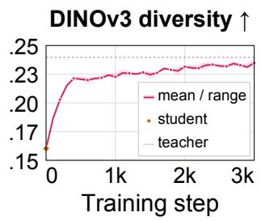

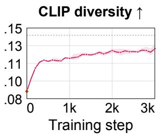

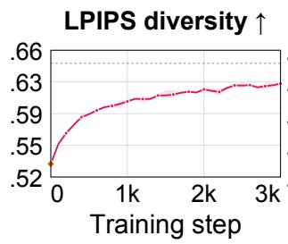

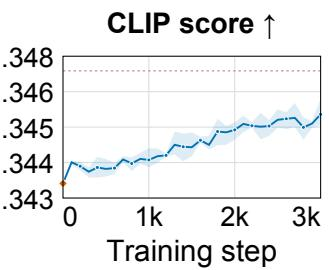

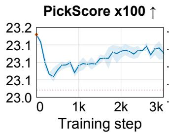

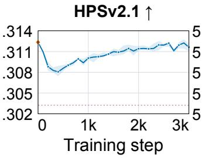

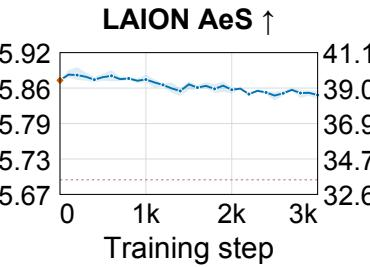

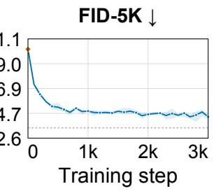  
Figure 6: 4-step FLUX.1-dev student during bias adapter training.

Table 3: Wan2.1-T2V-1.3B on 320 VBench prompts. Bold marks the best 4-step result
<table><tr><td rowspan="2">Method</td><td rowspan="2">Steps</td><td colspan="7">Video quality (VBench)</td><td rowspan="2">Text align. ↑</td><td colspan="4">Video diversity</td></tr><tr><td>Subject ↑ Backg. ↑ Flicker ↑ Smooth. ↑ Dynamic ↑ AeS ↑ Imaging ↑</td><td></td><td></td><td></td><td></td><td></td><td></td><td>CLIP mean ↑</td><td>CLIP frame ↑</td><td>DINO mean↑</td><td>DINO frame ↑</td></tr><tr><td>Teacher</td><td>50</td><td>0.970</td><td>0.961</td><td>0.983</td><td>0.991</td><td>0.371</td><td>0.590</td><td>0.703</td><td>0.2425</td><td>0.1634</td><td>0.1899</td><td>0.5005</td><td>0.5352</td></tr><tr><td>DMD2</td><td>4</td><td>0.970</td><td>0.962</td><td>0.983</td><td>0.991</td><td>0.531</td><td>0.615</td><td>0.698</td><td>0.2419</td><td>0.1267</td><td>0.1530</td><td>0.3374</td><td>0.3748</td></tr><tr><td>DFD</td><td>4</td><td>0.967</td><td>0.955</td><td>0.984</td><td>0.991</td><td>0.529</td><td>0.611</td><td>0.711</td><td>0.2398</td><td>0.1351</td><td>0.1659</td><td>0.3358</td><td>0.3775</td></tr><tr><td>DMD2</td><td></td><td></td><td></td><td></td><td></td><td></td><td></td><td></td><td></td><td></td><td></td><td></td><td></td></tr><tr><td>+ ReSeed (ours)</td><td>4</td><td>0.967</td><td>0.961</td><td>0.986</td><td>0.992</td><td>0.329</td><td>0.631</td><td>0.675</td><td>0.2365</td><td>0.1437</td><td>0.1733</td><td>0.4290</td><td>0.4716</td></tr></table>

## 5.4 Training and inference overhead

ReSeed trains only 0.002–0.004% of the student denoiser's parameters (46,080–233,472; Table 4), excluding text encoders and autoencoders. The teacher is used only over the first student interval, and the loss is computed on the first-step velocity, so training needs no later denoising steps, no decoding, no target images, and no discriminator or perceptual network. The reported image checkpoints use 1,900–2,100 updates of four prompt-noise pairs, and Wan2.1 uses 300; most of the gain appears within the first few hundred updates (Appendix A). At inference, the bias is added only at step 1, so the number of function evaluations is unchanged. Per-sample latency rises by 0.14–0.41% and peak activation memory by at most 1 MiB.

## 5.5 Ablation Studies

Bias strength controls the inference-time trade-off. We scale the learned bias by α, where α = 0 gives the original student and α = 1 uses the trained bias. Increasing α from 0.5 to 1.5 raises diversity and lowers FID, but reduces CLIP score, PickScore, and HPS. This allows the quality-diversity balance to be adjusted without retraining (Table 8).

Table 4: ReSeed training and inference overhead.
<table><tr><td></td><td colspan="2">Adapter</td><td colspan="2">DINO diversity</td><td>Peak act.</td><td colspan="3">Latency (ms)</td></tr><tr><td>Student model</td><td>Params</td><td>of denoiser</td><td>Before → after</td><td>Gain</td><td>change</td><td>Step 1</td><td>Per sample</td><td>Overhead</td></tr><tr><td>SD3-Medium</td><td>72,192</td><td>0.00356%</td><td>0.2142 → 0.2936</td><td>+37.1%</td><td>+0.00 MiB</td><td>37.10→37.68</td><td>148.4→149.0</td><td>+0.410%</td></tr><tr><td>SD3.5-Medium</td><td>72,192</td><td>0.00322%</td><td>0.2356 → 0.3282</td><td>+39.3%</td><td>+0.00 MiB</td><td> $5 5 . 6 9 \to 5 6 . 2 5$ </td><td>222.8→223.2</td><td>+0.194%</td></tr><tr><td>FLUX.1-dev</td><td>233,472</td><td>0.00196%</td><td>0.1575 → 0.2336</td><td>+48.3%</td><td>+1.00 MiB</td><td>253.4→255.9</td><td>1013.6→1016.2</td><td>+0.250%</td></tr><tr><td>Wan2.1-T2V-1.3B</td><td>46,080</td><td>0.00325%</td><td>0.3374 → 0.4290</td><td>+27.1%</td><td>+0.00 MiB</td><td>992.7→996.1</td><td>3978.9→3984.3</td><td>+0.137%</td></tr></table>

Teacher guidance affects the repair target. We change teacher guidance from 1 to 10 while keeping student inference at CFG 1. Higher teacher guidance reduces DINOv3 diversity from 0.3132 to 0.2873 and generally increases alignment and preference scores. Our default follows the student's distillation guidance rather than maximizing diversity. Full results and training curves are provided in Appendix C (Table 7 and Figure 7).

## 6 Related work

Few-step distillation. Prior approaches progressively halve sampler steps [Salimans and Ho, 2022], learn consistency maps to trajectory endpoints [Song et al., 2023, Luo et al., 2023], match output distributions [Yin et al., 2024b,a], match trajectory distributions [Luo et al., 2025], or add adversarial objectives [Sauer et al., 2023]. We study diversity loss in already distilled students.

Diversity-aware diffusion model distillation. Reduced sample diversity is a known cost of these methods. Scoreidentity distillation studies guidance-dependent diversity and introduces zero- and anti-guidance objectives [Zhou et al., 2025]; GAD matches initial-noise Jacobian-vector products during training [Huang et al., 2026]. At the sampler level, Gandikota and Bau [2025] trace part of the loss to premature structural commitment and recover diversity by using the multi-step base model for the first denoising step. At the training-schedule level, DP-DMD gives that step a teacher-derived target-prediction objective while retaining DMD later [Wu et al., 2026], and 1.x-Distill separates coarse distribution matching from detail refinement [Li et al., 2026]. Data-Forcing Distillation instead performs a short post-training correction using teacher scores on real video samples [Chen et al., 2026]. CADS improves diversity at inference by adding noise to the conditioning signal and gradually reducing it during sampling [Sadat et al., 2024] ReSeed differs in both question and mechanism: it diagnoses an already distilled, frozen image generator and changes only the first step of the frozen student without target images, adversarial training, or a teacher call at inference. We use finite differences only for diagnosis. Vendi is an alternative set-level diversity summary [Friedman and Dieng, 2023].

Parameter-efficient adaptation. LoRA adds low-rank updates to frozen weights [Hu et al., 2022] and BitFit tunes biases [Ben Zaken et al., 2022]. TimeStep Master assigns LoRA experts to different timestep intervals and mixes them with time-dependent gating [Zhuang et al., 2025]. Our residual bias is substantially simpler: it is active only during the first solver interval, adds no expert router, and serves as both intervention and diagnostic.

## 7 Discussion & Conclusion

ReSeed repairs the first denoising step of a distilled student while leaving the later steps unchanged. It adds small residual biases to the frozen denoiser and trains them to match the teacher's average velocity over the first high-noise interval. At inference, the biases act only in step 1, so steps 2–4 use the original student. Training needs no target images or videos. On SD3-Medium, SD3.5-Medium, and SenseFlow-FLUX, the adapters add only 0.002–0.004% denoiser parameters and raise DINOv3 diversity by 37.1%, 39.3%, and 48.3%, respectively, while lowering FID. On Wan2.1-T2V-1.3B DMD2, 300 updates raise video-level DINOv2 diversity by 27.1%, recovering 56.2% of the measured teacher-student gap. ReSeed thus provides a low-cost post-distillation correction without retraining the student.

## 8 Limitations

ReSeed training requires multi-step teacher trajectories. Our experiments use flow-matching transformers; we have not tested non-flow-matching diffusion models or U-Net backbones, so it remains unclear whether the same first-step behavior holds for those models.

## Acknowledgments

This work was supported by the ANT project, funded by the European Union's Horizon Europe research and innovation programme under Grant Agreement No. 101169439, and by the FFG COMET K1 Centre “Pro²Future II" (Cognitive and Sustainable Products and Production Systems of the Future; Contract No. 911655). The results presented in this paper were obtained using the computational resources of the Austrian Scientific Computing (ASC) infrastructure. Part of this work was carried out during a secondment at AVL List. We thank Peter Priller for his mentorship and support during this period.

## References

Elad Ben Zaken, Yoav Goldberg, and Shauli Ravfogel. BitFit: Simple parameter-efficient fine-tuning for transformerbased masked language-models. In Annual Meeting of the Association for Computational Linguistics (ACL), 2022.

Black Forest Labs. FLUX.1: Text-to-image models. https://github.com/black-forest-labs/flux, 2024.

Siyi Chen, Shaowei Liu, Yixuan Jia, Zian Wang, Huan Ling, Qing Qu, and Jun Gao. Data-forcing distillation: Restoring diversity and fidelity in few-step video generation, 2026. URL https://arxiv. org/abs/2606.18478.

Patrick Esser, Sumith Kulal, Andreas Blattmann, Rahim Entezari, Jonas Müller, Harry Saini, Yam Levi, Dominik Lorenz, Axel Sauer, Frederic Boesel, Dustin Podell, Tim Dockhorn, Zion English, and Robin Rombach. Scaling rectified flow transformers for high-resolution image synthesis. In International Conference on Machine Learning (ICML), 2024.

Dan Friedman and Adji Bousso Dieng. The vendi score: A diversity evaluation metric for machine learning. Transactions on Machine Learning Research (TMLR), 2023.

Rohit Gandikota and David Bau. Distilling diversity and control in diffusion models, 2025. URL https: //arxiv. org/abs/2503.10637.

Xingtong Ge, Xin Zhang, Tongda Xu, Yi Zhang, Xinjie Zhang, Yan Wang, and Jun Zhang. SenseFlow: Scaling distribution matching for flow-based text-to-image distillation. In International Conference on Learning Representations (ICLR), 2026. URL https://openreview.net/forum?id=bhdvdYJ8WZ.

Martin Heusel, Hubert Ramsauer, Thomas Unterthiner, Bernhard Nessler, and Sepp Hochreiter. GANs trained by a two time-scale update rule converge to a local nash equilibrium. In Advances in Neural Information Processing Systems (NeurIPS), 2017.

Jonathan Ho and Tim Salimans. Classifier-free diffusion guidance. arXiv preprint arXiv:2207.12598, 2022.

Jonathan Ho, Ajay Jain, and Pieter Abbeel. Denoising diffusion probabilistic models. In Advances in Neural Information Processing Systems (NeurIPS), 2020.

Edward J. Hu, Yelong Shen, Phillip Wallis, Zeyuan Allen-Zhu, Yuanzhi Li, Shean Wang, Lu Wang, and Weizhu Chen. LoRA: Low-rank adaptation of large language models. In International Conference on Learning Representations (ICLR), 2022.

Huayang Huang, Ruoyu Wang, Jinhui Zhao, Wei Deng, Daiguo Zhou, Jian Luan, Yu Wu, and Ye Zhu. Restoring initial noise sensitivity in text-to-image distillation via geometric alignment. In International Conference on Machine Learning (ICML), 2026. arXiv:2606.01651.

Jiahui Huang, Qunjie Zhou, Hesam Rabeti, Aleksandr Korovko, Huan Ling, Xuanchi Ren, Tianchang Shen, Jun Gao, Dmitry Slepichev, Chen-Hsuan Lin, Jiawei Ren, Kevin Xie, Joydeep Biswas, Laura Leal-Taixé, and Sanja Fidler. ViPE: Video pose engine for 3D geometric perception, 2025. URL https: //arxiv. org/abs/2508.10934.

Ziqi Huang, Yinan He, Jiashuo Yu, Fan Zhang, Chenyang Si, Yuming Jiang, Yuanhan Zhang, Tianxing Wu, Qingyang Jin, Nattapol Chanpaisit, Yaohui Wang, Xinyuan Chen, Limin Wang, Dahua Lin, Yu Qiao, and Ziwei Liu. VBench: Comprehensive benchmark suite for video generative models. In IEEE/CVF Conference on Computer Vision and Pattern Recognition (CVPR), pages 21807–21818, 2024.

Yuval Kirstain, Adam Polyak, Uriel Singer, Shahbuland Matiana, Joe Penna, and Omer Levy. Pick-a-pic: An open dataset of user preferences for text-to-image generation. In Advances in Neural Information Processing Systems (NeurIPS), 2023.

Haoyu Li, Tingyan Wen, Lin Qi, Zhe Wu, Yihuang Chen, Xing Zhou, Lifei Zhu, Xueqian Wang, and Kai Zhang. 1.x-Distill: Breaking the diversity, quality, and efficiency barrier in distribution matching distillation, 2026. URL https://arxiv.org/abs/2604.04018.

Tsung-Yi Lin, Michael Maire, Serge Belongie, James Hays, Pietro Perona, Deva Ramanan, Piotr Dollár, and C. Lawrence Zitnick. Microsoft COCO: Common objects in context. In European Conference on Computer Vision (ECCV), 2014.

Yaron Lipman, Ricky T. Q. Chen, Heli Ben-Hamu, Maximilian Nickel, and Matthew Le. Flow matching for generative modeling. In International Conference on Learning Representations (ICLR), 2023.

Xingchao Liu, Chengyue Gong, and Qiang Liu. Flow straight and fast: Learning to generate and transfer data with rectified flow. In International Conference on Learning Representations (ICLR), 2023.

Simian Luo, Yiqin Tan, Longbo Huang, Jian Li, and Hang Zhao. Latent consistency models: Synthesizing highresolution images with few-step inference. arXiv preprint arXiv:2310.04378, 2023.

Yihong Luo, Tianyang Hu, Jiacheng Sun, Yujun Cai, and Jing Tang. Learning few-step diffusion models by trajectory distribution matching. In IEEE/CVF International Conference on Computer Vision (ICCV), 2025. URL https: //arxiv.org/abs/2503.06674.

Maxime Oquab, Timothée Darcet, Théo Moutakanni, Huy Vo, Marc Szafraniec, Vasil Khalidov, Pierre Fernandez, Daniel Haziza, Francisco Massa, Alaaeldin El-Nouby, Mahmoud Assran, Nicolas Ballas, Wojciech Galuba, Russell Howes, Po-Yao Huang, Shang-Wen Li, Ishan Misra, Michael Rabbat, Vasu Sharma, Gabriel Synnaeve, Hu Xu, Hervé Jégou, Julien Mairal, Patrick Labatut, Armand Joulin, and Piotr Bojanowski. DINOv2: Learning robust visual features without supervision. Transactions on Machine Learning Research (TMLR), 2024.

Alec Radford, Jong Wook Kim, Chris Hallacy, Aditya Ramesh, Gabriel Goh, Sandhini Agarwal, Girish Sastry, Amanda Askell, Pamela Mishkin, Jack Clark, Gretchen Krueger, and Ilya Sutskever. Learning transferable visual models from natural language supervision. In International Conference on Machine Learning (ICML), 2021.

Seyedmorteza Sadat, Jakob Buhmann, Derek Bradley, Otmar Hilliges, and Romann M. Weber. CADS: Unleashing the diversity of diffusion models through condition-annealed sampling. In International Conference on Learning Representations (ICLR), 2024.

Tim Salimans and Jonathan Ho. Progressive distillation for fast sampling of diffusion models. In International Conference on Learning Representations (ICLR), 2022.

Axel Sauer, Dominik Lorenz, Andreas Blattmann, and Robin Rombach. Adversarial diffusion distillation. arXiv preprint arXiv:2311.17042, 2023.

Christoph Schuhmann, Romain Beaumont, Richard Vencu, Cade Gordon, Ross Wightman, Mehdi Cherti, Theo Coombes, Aarush Katta, Clayton Mullis, Mitchell Wortsman, Patrick Schramowski, Srivatsa Kundurthy, Katherine Crowson, Ludwig Schmidt, Robert Kaczmarczyk, and Jenia Jitsev. LAION-5B: An open large-scale dataset for training next generation image-text models. In Advances in Neural Information Processing Systems (NeurIPS) Datasets and Benchmarks Track, 2022

Oriane Siméoni, Huy V. Vo, Maximilian Seitzer, Federico Baldassarre, Maxime Oquab, Cijo Jose, Vasil Khalidov, Marc Szafraniec, Seungeun Yi, Michaël Ramamonjisoa, Francisco Massa, Daniel Haziza, Luca Wehrstedt, Jianyuan Wang, Timothée Darcet, Théo Moutakanni, Leonel Sentana, Claire Roberts, Andrea Vedaldi, Jamie Tolan, John Brandt, Camille Couprie, Julien Mairal, Hervé Jégou, Patrick Labatut, and Piotr Bojanowski. DINOv3. arXiv preprint arXiv:2508.10104, 2025.

Yang Song, Jascha Sohl-Dickstein, Diederik P. Kingma, Abhishek Kumar, Stefano Ermon, and Ben Poole. Scorebased generative modeling through stochastic differential equations. In International Conference on Learning Representations (ICLR), 2021.

Yang Song, Prafulla Dhariwal, Mark Chen, and Ilya Sutskever. Consistency models. In International Conference on Machine Learning (ICML), 2023.

Keqiang Sun, Junting Pan, Yuying Ge, Hao Li, Haodong Duan, Xiaoshi Wu, Renrui Zhang, Aojun Zhou, Zipeng Qin, Yi Wang, Jifeng Dai, Yu Qiao, Limin Wang, and Hongsheng Li. JourneyDB: A benchmark for generative image understanding. In Advances in Neural Information Processing Systems (NeurIPS) Datasets and Benchmarks Track, 2023.

Wan Team. Wan: Open and advanced large-scale video generative models. arXiv preprint arXiv:2503.20314, 2025.

Tianhe Wu, Ruibin Li, Lei Zhang, and Kede Ma. Diversity-preserved distribution matching distillation for fast visual synthesis. In International Conference on Machine Learning (ICML), 2026. arXiv:2602.03139.

Xiaoshi Wu, Yiming Hao, Keqiang Sun, Yixiong Chen, Feng Zhu, Rui Zhao, and Hongsheng Li. Human preference score v2: A solid benchmark for evaluating human preferences of text-to-image synthesis. arXiv preprint arXiv:2306.09341, 2023.

Tianwei Yin, Michaël Gharbi, Taesung Park, Richard Zhang, Eli Shechtman, Frédo Durand, and William T. Freeman. Improved distribution matching distillation for fast image synthesis. In Advances in Neural Information Processing Systems (NeurIPS), 2024a.

Tianwei Yin, Michaël Gharbi, Richard Zhang, Eli Shechtman, Frédo Durand, William T. Freeman, and Taesung Park. One-step diffusion with distribution matching distillation. In IEEE/CVF Conference on Computer Vision and Pattern Recognition (CVPR), 2024b.

Richard Zhang, Phillip Isola, Alexei A. Efros, Eli Shechtman, and Oliver Wang. The unreasonable effectiveness of deep features as a perceptual metric. In IEEE/CVF Conference on Computer Vision and Pattern Recognition (CVPR), 2018.

Mingyuan Zhou, Yi Gu, and Zhendong Wang. Few-step diffusion via score identity distillation, 2025. URL https: //arxiv.org/abs/2505.12674.

Shaobin Zhuang, Yiwei Guo, Yanbo Ding, Kunchang Li, Xinyuan Chen, Yaohui Wang, Fangyikang Wang, Ying Zhang, Chen Li, and Yali Wang. TimeStep Master: Asymmetrical mixture of timestep LoRA experts for versatile and efficient diffusion models in vision, 2025. URL https://arxiv.org/abs/2503.07416.

## Appendix Overview

<table><tr><td>Appendix</td><td>Contents</td><td>Page</td></tr><tr><td>A</td><td>Implementation and evaluation details</td><td>14</td></tr><tr><td>B</td><td>Full results and statistical analysis</td><td>16</td></tr><tr><td>C</td><td>Additional ablations</td><td>16</td></tr><tr><td>D</td><td>Training dynamics</td><td>17</td></tr><tr><td>E</td><td>Theoretical analysis</td><td>19</td></tr><tr><td>F</td><td>Qualitative comparisons</td><td>23</td></tr></table>

## A Implementation and evaluation details

Model and checkpoint sources. Table 5 lists the sources of the models and checkpoints used in our experiments. The SD3-Medium and SD3.5-Medium DMD, GAD, and DP-DMD students were trained by us rather than taken from official checkpoint releases. ReSeed adapters are trained on top of the corresponding frozen students. For SenseFlow-FLUX, we load the released transformer and retain the text encoders, autoencoder, and scheduler from FLUX.1-dev, following the release instructions. The video students are the DMD2 and DFD weights released with Data-Forcing Distillation.

Table 5: Model and checkpoint sources. Repository identifiers link to the public weight releases; locally trained students are listed separately.
<table><tr><td>Model</td><td>Source type</td><td>Repository or checkpoint</td></tr><tr><td>SD3-Medium teacher</td><td>Public</td><td>stabilityai/stable-diffusion-3- medium-diffusers</td></tr><tr><td>SD3.5-Medium teacher</td><td>Public</td><td>stabilityai/</td></tr><tr><td>FLUX.1-dev teacher</td><td>Public</td><td>stable-diffusion-3.5-medium black-forest-labs/FLUX.1-dev</td></tr><tr><td>SenseFlow-FLUX student</td><td>Public</td><td>domiso/SenseFlow, SenseFlow-FLUX/ transformer [Ge et al., 2026]</td></tr><tr><td>Wan2.1-T2V-1.3B teacher</td><td>Public</td><td>Wan-AI/</td></tr><tr><td>Wan2.1 DMD2 student</td><td>Public</td><td>Wan2.1-T2V-1.3B-Diffusers csusupergear/</td></tr><tr><td></td><td></td><td>wan_t2v_checkpoints_release, dmd2_t2v_vipe/0001000 [Chen et al., 2026]</td></tr><tr><td>Wan2.1 DFD student SD3-Medium and</td><td>Public Trained by us</td><td>Same release, ours_wan_t2v_vipe/0000040 [Chen et al., 2026] DMD, GAD, and DP-DMD; training seeds 42, 43, and 44.</td></tr><tr><td>SD3.5-Medium students</td><td></td><td></td></tr><tr><td>ReSeed adapters</td><td>Trained by us</td><td>First-step bias parameters only; reported training budgets and checkpoint steps are specified below.</td></tr></table>

Image models and schedule. SD3-Medium is a rectified-flow transformer with 24 joint transformer blocks [Esser et al., 2024, Liu et al., 2023, Lipman et al., 2023]. Its 4-step DMD student is distilled from the 28-step base model with teacher CFG 7 [Ho and Salimans, 2022, Yin et al., 2024b]. The student uses the shifted flow-matching boundaries [1.0, 0.8984375, 0.75, 0.5, 0], obtained from the base boundaries [1, 0.75, 0.5, 0.25, 0] with scheduler shift 3. The teacher uses 28 Euler microsteps, that is seven per student interval. The teacher query grid of the first interval is

[1.0, 0.98828125, 0.9765625, 0.9609375, 0.9453125, 0.9296875, 0.9140625, 0.8984375].

The main SD3.5-Medium comparison uses 4-step students at 1024 pixels and a 40-step teacher at CFG 4.5. The 4-step SenseFlow-FLUX student is paired with the 28-step FLUX.1-dev teacher. Each model retains its native flow parameterisation and sampler.

SD3-Medium guidance. The teacher uses guidance scale 7 with the shifted-time threshold $a = 0 . 9 6 \mathrm { : }$ below the threshold the guided velocity is $v ^ { \mathrm { u n c o n d } } + w ( \stackrel { \smile } { v } ^ { \mathrm { c o n d } } - v ^ { \mathrm { u n c o n d } } )$ , and above it the conditional velocity is used directly. Here $v ^ { \mathrm { c o n d } }$ and vuncond are the conditional and unconditional velocity predictions, w = 7 is the guidance scale, and a is the noise-level threshold at which guidance is switched on. The student always runs at guidance scale 1.

Image-adapter training. Each student is paired with its corresponding pretrained teacher and retains its original text encoder and autoencoder. Teacher targets use the same prompt and initial noise as the student. Image runs use global batch size 4 and training seeds 42, 43, and 44. The main results report checkpoints at 1,900 updates for SD3-Medium, 2,100 for SD3.5-Medium, and 2,000 for SenseFlow-FLUX. These correspond to 7,600, 8,400, and 8,000 prompt–noise pairs per run, respectively, not necessarily unique prompts. SenseFlow-FLUX training continues to 3,000 updates, with evaluation every 100 updates.

Video sampling. The Wan2.1-T2V-1.3B teacher uses 50 steps, scheduler shift 5, CFG 5, and the released negative prompt. We use the released DMD2 checkpoint and DFD checkpoint. DMD2, DFD, and DMD2 with ReSeed all sample without CFG at the time boundaries t = [0.999, 0.937, 0.833, 0.624, 0] using the released inference code. For each generation seed, this code samples one initial noise tensor and reuses it across prompts. All methods generate 81-frame videos at $8 3 2 \times 4 8 0$ , 16 fps, in BF16. Table 3 counts denoising steps: the teacher uses both conditional and unconditional predictions for CFG at each step.

Prompt banks and scorers. Quality uses COCO-2017 validation captions with 5,000 or 1,000 fixed prompt and latent pairs. Diversity uses a separate fixed bank of 100 prompts with 10 independent Gaussian initial noises. The scorers are a CLIP ViT for the CLIP score and CLIP diversity, PickScore, HPSv2.1, the LAION aesthetic predictor, LPIPS-Alex and a DINOv3 encoder; FID uses the standard implementation on matched records. Forward passes are BF16; offline analysis is float64. The aesthetic score uses PyIQA's laion\_aes implementation of the CLIP-based aesthetic predictor.¹ For image diversity, R = 10 gives $R ( R { - } 1 ) / 2 = 4 5$ unordered pairs per prompt. DINOv3 and CLIP use Equation 8; LPIPS-Alex uses the same pairs but averages LPIPS distances rather than cosine distances. All methods within a comparison use the same prompts, initial noises, and scoring models.

Training progress and overhead measurements. For SD3-Medium, most endpoint-error reduction occurs within 250 updates, and the alignment statistics plateau after roughly 1,000 updates. The FLUX.1-dev student recovers most DINOv3 diversity within 300–400 updates. At inference, ReSeed adds one elementwise bias per block only on the first of four denoising steps. The image models in Table 4 are measured on one H100 at $1 0 2 4 ^ { 2 }$ , batch 1, bfloat16, over 100 passes after 20 warm-up passes. The video model uses the same GPU and precision and reports the median over eight samples of 81 frames at 832 × 480. Timing reports denoising only. Bias storage is at most 456 KiB (0.002% of student weights). Peak activation memory is unchanged for SD3-Medium, SD3.5-Medium, and Wan2.1-T2V-1.3B, and increases by 1 MiB for FLUX.1-dev. Parameter percentages use the student denoising transformer as the denominator, excluding the frozen text encoders and image or video autoencoder. Image diversity uses DINOv3, whereas video diversity uses DINOv2-L; absolute values are not directly comparable across modalities.

## A.1 Video training data and evaluation protocol

Training data and budget. We use 4,000 captions extracted from the first 40 shards of the 1ong split of the released ViPE dataset csusupergear/vipe\_fliter\_complete. Only caption text and its precomputed UMT5 embeddings enter ReSeed training; the associated videos are not used as targets. Each update samples four prompt-noise pairs on four H100 GPUs. The 300-update checkpoint therefore uses 1,200 prompt-noise pairs. The full training trajectory contains 2,000 updates (8,000 prompt-noise pairs), with checkpoints saved every 100 updates.

Target and optimization. The teacher starts from the same noise as the student and takes 13 boundary-aligned Euler microsteps from $t _ { 0 } = 0 . 9 9 9 \mathrm { ~ t o ~ } t _ { 1 } = 0 . 9 3 7$ , with CFG 5 and the released negative prompt. The microstep grid is uniform in the unshifted time coordinate, then shifted and aligned to the exact student boundaries. The target is the secant velocity over this interval, not the teacher's instantaneous prediction or a decoded video. We fit zero-initialized FP32 bias adapters with AdamW (learning rate $1 0 ^ { - 3 }$ , momentum coefficients 0.9 and 0.999, zero weight decay, and gradient-norm clipping at 1). All 30 blocks receive one 1,536-channel bias shared over spatial and temporal tokens, for 46,080 trainable parameters; the frozen backbone is evaluated in BF16. Biases are enabled only on the first student step, with no change to the remaining three steps. The 13-step Euler training target differs from the 50-step UniPC sampler used to evaluate the teacher, as described above.

Evaluation prompts and counts. We take the first 40 unique prompts from each of the eight VBench category files: animal, architecture, food, human, lifestyle, plant, scenery, and vehicles. The source is Vchitect/VBench. A plant prompt already present in lifestyle is skipped and replaced by the next prompt, leaving 320 unique prompts. For each of the teacher, DMD2, DFD, and DMD2 with ReSeed, seeds 0–7 produce 2,560 videos.

## B Full results and statistical analysis

## B.1 Additional video results

Category-level results. Table 6 breaks down the 320-prompt evaluation. ReSeed increases mean DINO diversity over DMD2 in every category, but remains below the teacher in every category. The largest mean increases are in lifestyle and human prompts, and the smallest is in scenery. These are feature-space distances, not direct counts of semantic modes. The category intervals are pointwise bootstrap intervals and are not adjusted for multiple comparisons.

Table 6: Video-level DINOv2 diversity by VBench category (40 prompts each). The paired change and the number of improved prompts compare ReSeed with DMD2.
<table><tr><td>Category</td><td>Teacher</td><td>DMD2</td><td>DFD</td><td>+ ReSeed</td><td></td><td>Change [95% CI]</td><td>Improved</td></tr><tr><td>Animal</td><td>0.4235</td><td>0.2555</td><td>0.2471</td><td>0.3313</td><td>+0.0758</td><td>[+0.053, +0.100]</td><td>34/40</td></tr><tr><td>Architecture</td><td>0.5948</td><td>0.4391</td><td>0.4374</td><td>0.5278</td><td>+0.0888</td><td>[+0.056, +0.125]</td><td>31/40</td></tr><tr><td>Food</td><td>0.4371</td><td>0.2797</td><td>0.2719</td><td>0.3904</td><td>+0.1107</td><td>[+0.087, +0.136]</td><td>40/40</td></tr><tr><td>Human</td><td>0.4518</td><td>0.2564</td><td>0.2635</td><td>0.3800</td><td>+0.1236</td><td>[+0.097, +0.152]</td><td>37/40</td></tr><tr><td>Lifestyle</td><td>0.4792</td><td>0.2837</td><td>0.3117</td><td>0.4093</td><td>+0.1255</td><td>[+0.096, +0.155]</td><td>38/40</td></tr><tr><td>Plant</td><td>0.5813</td><td>0.4125</td><td>0.4146</td><td>0.4818</td><td>+0.0693</td><td>[+0.034, +0.104]</td><td>31/40</td></tr><tr><td>Scenery</td><td>0.5335</td><td>0.4128</td><td>0.3841</td><td>0.4556</td><td>+0.0428</td><td>[+0.017, +0.068]</td><td>29/40</td></tr><tr><td>Vehicles</td><td>0.5029</td><td>0.3596</td><td>0.3558</td><td>0.4557</td><td>+0.0961</td><td>[+0.062, +0.133]</td><td>33/40</td></tr></table>

Paired comparisons and feature choice. On the full 320-prompt set, ReSeed's projected-CLIP diversity increase over DMD2 is +0.0170 with a 95% interval of [+0.0119, +0.0221]; 220 of 320 prompts improve. Using CLIP's 1,024- dimensional pre-projection CLS features instead gives mean diversity 0.1835 for DMD2 and 0.2105 for ReSeed, with a paired increase of +0.0270 and interval [+0.0211, +0.0333]. Thus, the direction of the aggregate gain holds under both feature choices. DFD's DINO difference from DMD2 is —0.0016 with interval [-0.0090, +0.0059], whereas its projected-CLIP difference is +0.0084 with interval [+0.0047, +0.0116]. DFD thus improves projected-CLIP diversity, while its DINO difference is not distinguishable from zero under this protocol. ReSeed exceeds DFD in DINO diversity by 0.0932 with interval [+0.0830, +0.1035], but its text alignment is lower by 0.0033 with interval [-0.0053, -0.0012].

## C Additional ablations

## C.1 Teacher guidance

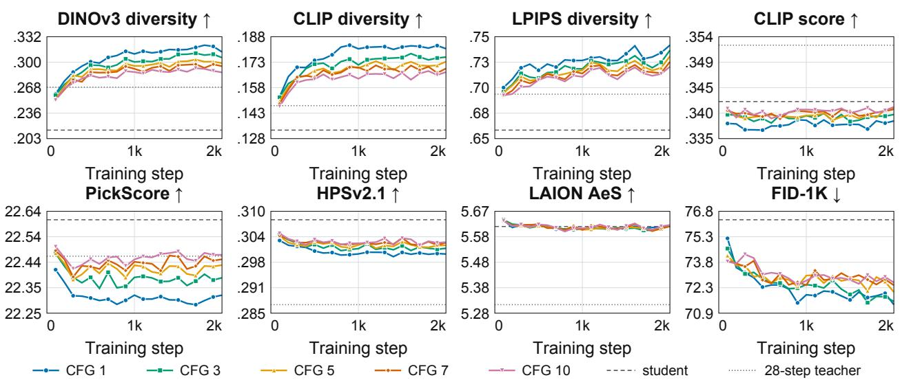  
Figure 7: Training trajectories for five teacher guidance scales.

Table 7: Teacher guidance for the first-interval regression target, SD3-Medium, read at 2,000 updates. Only the guidance used to build the target changes; the student, its sampler at CFG 1, the COCO1K prompts, the 100 × 10 diversity bank, the seed and the block range are shared. Bold marks the best column entry. Diversity falls and alignment generally increases with w, and FID is best at the lowest guidance.
<table><tr><td rowspan="2">Teacher w</td><td colspan="3">Diversity</td><td colspan="5">Quality</td></tr><tr><td>DINO ↑</td><td>CLIP dist. ↑</td><td>LPIPS ↑</td><td>CLIP score ↑</td><td>Pick ↑</td><td>HPS ↑</td><td>AeS ↑</td><td>FID-1K↓</td></tr><tr><td>1</td><td>0.3132</td><td>0.1813</td><td>0.7441</td><td>0.33832</td><td>22.318</td><td>0.2998</td><td>5.617</td><td>71.35</td></tr><tr><td>3</td><td>0.3060</td><td>0.1764</td><td>0.7391</td><td>0.33952</td><td>22.384</td><td>0.3012</td><td>5.616</td><td>71.54</td></tr><tr><td>5</td><td>0.2990</td><td>0.1737</td><td>0.7332</td><td>0.34072</td><td>22.433</td><td>0.3019</td><td>5.619</td><td>72.08</td></tr><tr><td>7</td><td>0.2951</td><td>0.1697</td><td>0.7279</td><td>0.34049</td><td>22.454</td><td>0.3026</td><td>5.617</td><td>72.47</td></tr><tr><td>10</td><td>0.2873</td><td>0.1676</td><td>0.7230</td><td>0.34094</td><td>22.471</td><td>0.3027</td><td>5.621</td><td>72.63</td></tr></table>

## C.2 Bias strength and controls

Table 8 reports COCO5K quality and matched diversity for inference-time bias scaling. All bias rows use the same seed-42 ReSeed checkpoint; 4-step student and the teacher are reference models. Channel-shuffled bias and the blocks 4–23 variant have diversity evaluations only and are not included in this table.

Table 8: COCO5K quality and diversity.
<table><tr><td>Variant</td><td>CLIP score</td><td>Pick</td><td>HPS</td><td>AeS</td><td>FID↓</td><td>DINO↑</td><td>CLIPd ↑</td><td>LPIPS ↑</td></tr><tr><td>4-step student (frozen)</td><td>0.34290</td><td>22.637</td><td>0.3100</td><td>5.618</td><td>37.471</td><td>0.2142</td><td>0.1334</td><td>0.6609</td></tr><tr><td>28-step teacher</td><td>0.35343</td><td>22.516</td><td>0.2895</td><td>5.325</td><td>32.148</td><td>0.2686</td><td>0.1478</td><td>0.6961</td></tr><tr><td>α = −1</td><td>0.34346</td><td>22.597</td><td>0.3118</td><td>5.623</td><td>38.468</td><td>0.1815</td><td>0.1230</td><td>0.5855</td></tr><tr><td>α = 0.5</td><td>0.34222</td><td>22.605</td><td>0.3081</td><td>5.628</td><td>35.598</td><td>0.2545</td><td>0.1509</td><td>0.6979</td></tr><tr><td>α = 1</td><td>0.34051</td><td>22.471</td><td>0.3041</td><td>5.623</td><td>33.376</td><td>0.2914</td><td>0.1698</td><td>0.7283</td></tr><tr><td>α = 1.5</td><td>0.33918</td><td>22.304</td><td>0.2980</td><td>5.600</td><td>31.476</td><td>0.3190</td><td>0.1862</td><td>0.7535</td></tr><tr><td>randomO</td><td>0.34282</td><td>22.576</td><td>0.3081</td><td>5.623</td><td>36.646</td><td>0.2193</td><td>0.1343</td><td>0.6569</td></tr></table>

## D Training dynamics

The left panel of Figure 8 shows the ReSeed training loss for the three image models. The largest decrease occurs early in training, followed by a slower decline. These curves describe target fitting, not final-image quality or diversity, which we evaluate separately below.

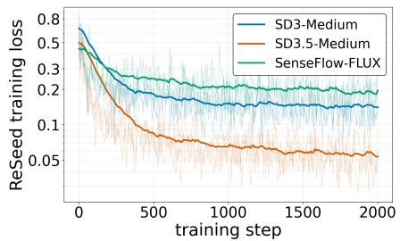

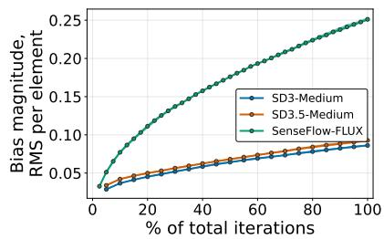

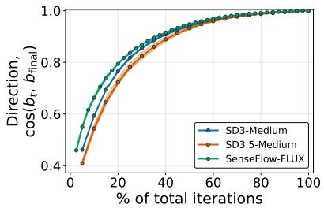  
Figure 8: ReSeed training dynamics. Left: training loss for the three image models. Middle and right: bias magnitude and cosine with the final bias during training.

Figure 9 shows the training process of SD3-Medium and SD3.5-Medium Both models were independently trained with seeds 42, 43, and 44, producing checkpoints every 100 updates. The middle and right panels of Figure 8 show the bias norm and its cosine similarity with the final trained bias.

Figure 10 shows prompt-level trajectories for the FLUX.1-dev run with training seed 43, complementing the aggregate curves in Figure 6.

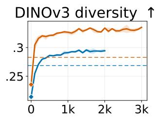

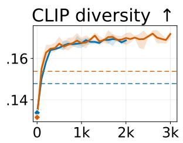

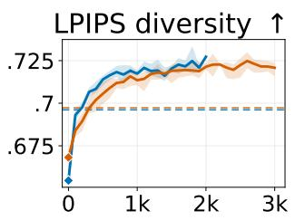

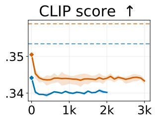

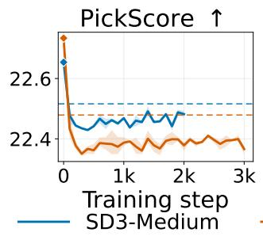

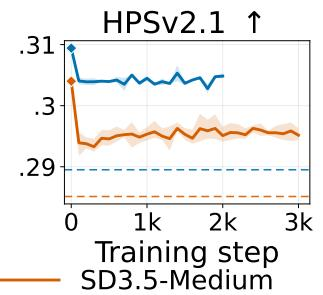

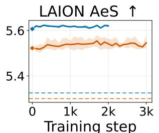  
frozen sudent (step 0)

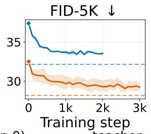  
Figure 9: SD3-Medium and SD3.5-Medium over ReSeed training.

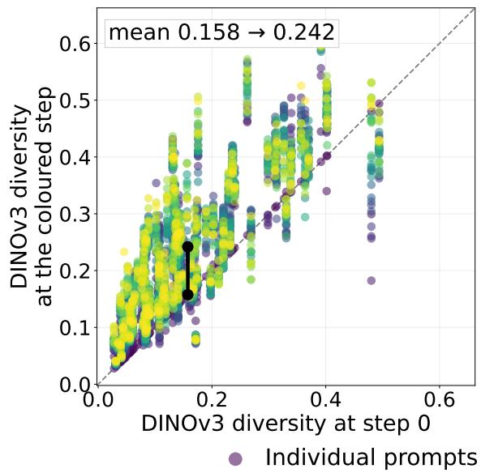

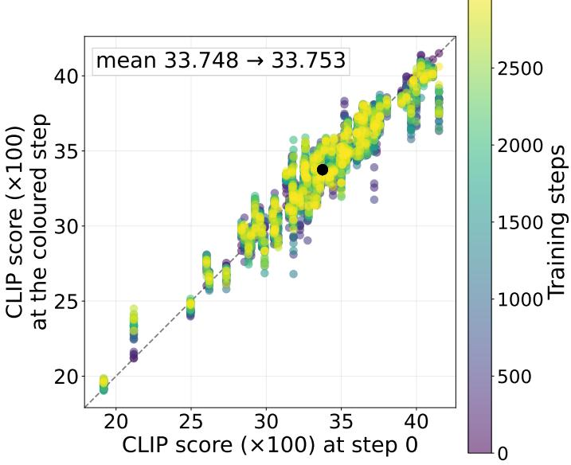  
Figure 10: Prompt-level trajectories for one FLUX.1-dev adapter on 100 prompts × 10 initial noises. Each point compares one prompt at a training checkpoint (vertical axis) with the original student (horizontal axis); colour denotes the checkpoint and the black line shows the prompt mean. Left: DINOv3 diversity improves for 95 of 100 prompts, from 0.158 to 0.242 on average. Right: CLIP returns to its initial mean (0.33748 →0.33753).

## E Theoretical analysis

This appendix explains what first-step regression controls and how a shared bias can change responses to different seeds. We first prove Proposition 1, then explain the gap between the bound and the measured error, including the correction for a finite seed bank. We next relate these measurements to final-image diversity and finish with a local analysis of the bias. The mathematical results concern endpoint responses; the connection to output diversity is tested empirically.

## E.1 From velocity regression to pairwise endpoint error

This subsection proves Proposition 1. The argument has two steps: velocity regression controls the error of each first endpoint, and this pointwise error bounds the error between pairs of endpoints.

Definitions and assumptions. Fix a prompt c. Let $z , z ^ { \prime }$ be independently sampled from the same initial-noise distribution, and let $\beta$ collect the learned residual biases. Write $F _ { \beta } ( z , c ) \in \mathbb { R } ^ { \bar { d } }$ for the adapted student's first endpoint and $T ( z , c ) \in \mathbb { R } ^ { d }$ for the teacher endpoint reached over the same interval. Here d is the number of latent elements, and T denotes the teacher map, not a transpose. Define the endpoint error and its mean over noise:

$$
e ( z , c ) = F _ { \beta } ( z , c ) - T ( z , c ) , \qquad { \bar { e } } ( c ) = \mathbb { E } _ { z } e ( z , c ) .
$$

Assume $\mathbb { E } _ { c , z } \| e ( z , c ) \| _ { 2 } ^ { 2 } < \infty$ , where $\| \cdot \| _ { 2 }$ is the Euclidean norm. Expectations over c use the prompt distribution in the regression objective. For the same prompt, define the student and teacher seed responses as

$$
\Delta F _ { \beta } = F _ { \beta } ( z , c ) - F _ { \beta } ( z ^ { \prime } , c ) , \qquad \Delta T = T ( z , c ) - T ( z ^ { \prime } , c ) .\tag{9}
$$

Their mismatch is $\Delta F _ { \beta } - \Delta T = e ( z , c ) - e ( z ^ { \prime } , c )$ . It measures agreement with the teacher's response, not the size of the student response alone.

Velocity error determines endpoint error. Fix a prompt c and an initial noise z. Let $t _ { 0 }$ and $t _ { 1 }$ be the boundaries of the first student interval, and write $\Delta t = t _ { 1 } - t _ { 0 } \neq 0$ . Let d be the number of scalar elements in a flattened velocity tensor. We divide squared errors by d to measure error per latent element. The teacher and student start from the same latent $z \ \mathrm { a t } \ t _ { 0 }$ and are compared at the same boundary $t _ { 1 }$

The teacher reaches $t _ { 1 }$ through K denoising steps, with boundaries $t _ { 0 } = \tau _ { 0 } , \tau _ { 1 } , \dots , \tau _ { K } = t _ { 1 }$ . Starting from $x _ { 0 } ^ { T } = z _ { : }$ its j-th update is

$$
\boldsymbol x _ { j + 1 } ^ { T } = \boldsymbol x _ { j } ^ { T } + ( \tau _ { j + 1 } - \tau _ { j } ) \boldsymbol v _ { \mathrm { t e a } } ( \boldsymbol x _ { j } ^ { T } , \tau _ { j } , c ) .
$$

Adding these updates gives the teacher endpoint $T ( z , c ) = x _ { K } ^ { T } \colon$

$$
T ( z , c ) = z + \sum _ { j = 0 } ^ { K - 1 } ( \tau _ { j + 1 } - \tau _ { j } ) v _ { \mathrm { t e a } } ( x _ { j } ^ { T } , \tau _ { j } , c ) .
$$

We define the teacher's secant velocity over the entire student interval by dividing its total displacement by $\Delta t \mathbf { \cdot }$

$$
\bar { v } _ { \mathrm { t e a } } ( z , c ) = \frac { T ( z , c ) - z } { \Delta t } = \sum _ { j = 0 } ^ { K - 1 } \frac { \tau _ { j + 1 } - \tau _ { j } } { \Delta t } v _ { \mathrm { t e a } } ( x _ { j } ^ { T } , \tau _ { j } , c ) .
$$

The coefficients in the sum add to one. Thus, $\bar { v } _ { \mathrm { t e a } }$ describes the teacher's average velocity across the interval; it is not the instantaneous velocity at the final microstep.

The adapted student takes one Euler step from the same starting point:

$$
F _ { \beta } ( z , c ) = z + \Delta t v _ { \mathrm { s t u } } ^ { \beta } ( z , t _ { 0 } , c ) .
$$

Subtracting the teacher endpoint cancels the common starting point z. The endpoint error $e ( z , c ) = F _ { \beta } ( z , c ) - T ( z , c )$ is therefore

$$
\begin{array} { r l } & { e ( z , c ) = \big [ z + \Delta t v _ { \mathrm { s t u } } ^ { \beta } ( z , t _ { 0 } , c ) \big ] - \big [ z + \Delta t \bar { v } _ { \mathrm { t e a } } ( z , c ) \big ] } \\ & { \phantom { e } = \Delta t \big [ v _ { \mathrm { s t u } } ^ { \beta } ( z , t _ { 0 } , c ) - \bar { v } _ { \mathrm { t e a } } ( z , c ) \big ] . } \end{array}\tag{10}
$$

This equality holds for each prompt-noise pair. Squaring both sides and dividing by d gives

$$
\frac { \left\| e ( z , c ) \right\| _ { 2 } ^ { 2 } } { d } = ( \Delta t ) ^ { 2 } \frac { \left\| v _ { \mathrm { s t u } } ^ { \beta } ( z , t _ { 0 } , c ) - \bar { v } _ { \mathrm { t e a } } ( z , c ) \right\| _ { 2 } ^ { 2 } } { d } .
$$

Define the expected velocity loss at a fixed prompt and over the prompt distribution as

$$
\mathcal { L } _ { \mathrm { R e S e e d } } ( c ) = \mathbb { E } _ { z } \left[ \frac { \left\| v _ { \mathrm { s t u } } ^ { \beta } ( z , t _ { 0 } , c ) - \bar { v } _ { \mathrm { t e a } } ( z , c ) \right\| _ { 2 } ^ { 2 } } { d } \right] , \qquad \mathcal { L } _ { \mathrm { R e S e e d } } = \mathbb { E } _ { c } \mathcal { L } _ { \mathrm { R e S e e d } } ( c ) .
$$

Taking expectations in the preceding equality yields

$$
\frac { 1 } { d } \mathbb { E } _ { c , z } \| e ( z , c ) \| _ { 2 } ^ { 2 } = ( t _ { 1 } - t _ { 0 } ) ^ { 2 } \mathcal { L } _ { \mathrm { R e S e e d } } .
$$

Thus, expected squared velocity error and expected squared first-endpoint error differ only by the known factor $( t _ { 1 } - t _ { 0 } ) ^ { 2 }$ This is an equality for the expected objective; a finite training average alone does not bound error on unseen prompts or noises.

Proof of the pairwise bound. Fix a prompt c and sample z and $z ^ { \prime }$ independently from the same initial-noise distribution. Recall that $\Delta F _ { \beta } - \Delta T = { \dot { e } } ( z , c { \dot { ) } } - e ( z ^ { \prime } , c )$ , and let $\bar { e } ( c ) = \mathbb { E } _ { z } e ( z , c )$ . Expanding the square and using independence in one calculation gives

$$
\begin{array} { r l } & { \mathbb { E } _ { z , z ^ { \prime } } \| \Delta F _ { \beta } - \Delta T \| _ { 2 } ^ { 2 } = \mathbb { E } _ { z , z ^ { \prime } } \| e ( z , c ) - e ( z ^ { \prime } , c ) \| _ { 2 } ^ { 2 } } \\ & { \qquad = 2 \mathbb { E } _ { z } \| e ( z , c ) \| _ { 2 } ^ { 2 } - 2 \bigl \langle \mathbb { E } _ { z } e ( z , c ) , \mathbb { E } _ { z ^ { \prime } } e ( z ^ { \prime } , c ) \bigr \rangle } \\ & { \qquad = 2 \bigl ( \mathbb { E } _ { z } \| e ( z , c ) \| _ { 2 } ^ { 2 } - \| \bar { e } ( c ) \| _ { 2 } ^ { 2 } \bigr ) . } \end{array}\tag{11}
$$

The second line uses independent, identically distributed noises; the last line is the mean-variance identity. Thus, an endpoint error shared by all seeds under a prompt cancels from their pairwise response.

Averaging over prompts, dividing by the latent dimension $d ,$ and using the velocity-to-endpoint equality above gives

$$
\begin{array} { r l } & { \displaystyle \frac 1 d \mathbb E _ { c , z , z ^ { \prime } } \| \Delta F _ { \beta } - \Delta T \| _ { 2 } ^ { 2 } = \frac 2 d \big ( \mathbb E _ { c , z } \| e ( z , c ) \| _ { 2 } ^ { 2 } - \mathbb E _ { c } \| \bar { e } ( c ) \| _ { 2 } ^ { 2 } \big ) } \\ & { \quad \quad \quad \quad \quad \leq \frac 2 d \mathbb E _ { c , z } \| e ( z , c ) \| _ { 2 } ^ { 2 } } \\ & { \quad \quad \quad \quad = 2 ( t _ { 1 } - t _ { 0 } ) ^ { 2 } \mathcal L _ { \mathrm { R e S e e d } } . } \end{array}\tag{12}
$$

The inequality drops the nonnegative mean-error term. This proves Proposition 1.

## E.2 Bound tightness and finite-sample estimates

The mean error determines population slack. For a fixed prompt with nonzero endpoint error, define

$$
s ( c ) = \frac { \| \bar { e } ( c ) \| _ { 2 } ^ { 2 } } { \mathbb { E } _ { z } \| e ( z , c ) \| _ { 2 } ^ { 2 } } \in [ 0 , 1 ] .
$$

This is the fraction of squared error due to the mean error across seeds. Equation 11 shows that the ratio of pairwise response error to its pointwise upper bound is exactly $1 - s ( c )$ . If all endpoint errors are equal, $s ( c ) = 1$ and pairwise error is zero. If the mean error is zero, $s ( c ) = 0$ and the bound is tight. When endpoint error is zero, both sides vanish and the ratio is undefined.

Finite-sample correction. The population identity uses two independent noise samples. In an evaluation bank of n noises, we instead average over the $n ( n - 1 ) / 2$ distinct pairs. For a fixed prompt, let $e _ { i } = e ( z _ { i } , c )$ , let $\hat { e } = n ^ { - 1 } \sum _ { i } e _ { i }$ be the sample mean error, and define

$$
{ \widehat { P } } = { \frac { 2 } { n ( n - 1 ) d } } \sum _ { i < j } \| e _ { i } - e _ { j } \| _ { 2 } ^ { 2 } , \qquad { \widehat { B } } = { \frac { 2 } { n d } } \sum _ { i } \| e _ { i } \| _ { 2 } ^ { 2 } .
$$

Here $\widehat { P }$ is measured pairwise response error and $\widehat { B }$ is the empirical counterpart of the regression-based upper bound. The sample identity $\begin{array} { r } { \dot { \sum } _ { i < j } \| e _ { i } - \dot { e } _ { j } \| _ { 2 } ^ { 2 } = n \sum _ { i } \| e _ { i } - \hat { e } \| _ { 2 } ^ { 2 } } \end{array}$ gives

$$
{ \widehat { P } } = { \frac { n } { n - 1 } } \left( { \widehat { B } } - { \frac { 2 } { d } } \| { \widehat { e } } \| _ { 2 } ^ { 2 } \right) \leq { \frac { n } { n - 1 } } { \widehat { B } } .\tag{13}
$$

Thus, a finite-bank estimate can exceed $\widehat { B }$ without violating the population result. With $n = 1 0$ , the corrected empirical upper bound is $1 0 { \widehat { B } } / 9$ . The numerical results below report the uncorrected ratio $\widehat { P } / \widehat { B }$ unless stated otherwise.

## E.3 Empirical experiments and the relation to output diversity

Evaluation design. We evaluate both sides of Equation 7 on 5,000 COCO5K prompts with ten seeds each, using the frozen SD3-Medium student and seven checkpoints from one ReSeed run (100–1,900 updates). This gives 40,000 prompt-checkpoint comparisons. Table 9 reports the endpoint statistics and final-image feature diversity. These are measured in different spaces and answer different questions.

Consistency and tightness of the bound. All measured pairwise errors satisfy the finite-sample bound in Equation 13 with $n = 1 0$ This confirms that the two errors were computed consistently. The median ratio $\widehat { P } / \widehat { B }$ rises from 0.68 to 0.92 during training, as the estimated seed-shared share of endpoint error falls from 0.39 to 0.17 (Table 9). We next examine whether the reduction in pairwise response error accompanies a change in final-image diversity.

Association with final-image diversity. Mean pairwise response error decreases by a factor of 2.7, with a decrease on every prompt. Mean DINOv3 diversity rises from 0.213 to 0.290 (+36.5%), with gains on 92% of prompts; as the bound's right-hand side falls, this diversity rises (Table 9).

Figure 4 shows the relation between pairwise response error and final-image diversity. Across the frozen student and seven trained checkpoints, lower mean error consistently accompanies higher mean diversity (Spearman $\rho = - 1 )$ Comparing checkpoints within each prompt, halving the response error is associated with a 0.056 increase in DINOv3 diversity (95% CI [0.054, 0.057], prompt-clustered bootstrap). The within-prompt Spearman correlation is —0.54 (CI $[ - 0 . 5 5 , - 0 . 5 3 ] )$ , and the association is negative for 90% of prompts. These results show an association, not a causal effect of response error on final diversity.

Table 9: Pairwise response error, its bound, and final-image diversity on COCO5K (5,000 prompts × 10 seeds) for one SD3-Medium ReSeed run. Step 0 is the DMD 4-step student. LHS and RHS are the empirical pairwise error $\widehat { P }$ and uncorrected bound ${ \widehat { B } } ,$ averaged over prompts and reported in units of $1 0 ^ { - 3 }$ . LHS/RHS and the estimated mean-error share s are medians over prompts.
<table><tr><td>Step</td><td>LHS</td><td>RHS</td><td>LHS/RHS</td><td>S</td><td>DINOv3 div. ↑</td><td>CLIP div. ↑</td></tr><tr><td>0</td><td>5.70</td><td>8.53</td><td>0.68</td><td>0.39</td><td>0.213</td><td>0.122</td></tr><tr><td>100</td><td>3.09</td><td>3.66</td><td>0.85</td><td>0.23</td><td>0.253</td><td>0.139</td></tr><tr><td>200</td><td>2.74</td><td>3.08</td><td>0.90</td><td>0.19</td><td>0.267</td><td>0.145</td></tr><tr><td>300</td><td>2.60</td><td>2.93</td><td>0.89</td><td>0.20</td><td>0.277</td><td>0.149</td></tr><tr><td>400</td><td>2.46</td><td>2.73</td><td>0.91</td><td>0.18</td><td>0.279</td><td>0.150</td></tr><tr><td>700</td><td>2.28</td><td>2.49</td><td>0.92</td><td>0.17</td><td>0.281</td><td>0.152</td></tr><tr><td>1,000</td><td>2.20</td><td>2.40</td><td>0.92</td><td>0.17</td><td>0.287</td><td>0.154</td></tr><tr><td>1,900</td><td>2.10</td><td>2.29</td><td>0.92</td><td>0.17</td><td>0.290</td><td>0.155</td></tr></table>

## E.4 Why a shared bias can change seed-dependent responses

A constant added directly to every endpoint cancels from pairwise differences. ReSeed instead adds its biases inside the network. The following local result explains why the same parameter change can then produce different endpoint changes for different seeds. It describes a possible mechanism, not a guarantee that an arbitrary bias improves teacher alignment or diversity.

Proposition 2 (An input-dependent bias Jacobian changes seed responses) Fix a prompt c and write $G ( z ; \beta ) =$ $F _ { \beta } ( z , c ) \in \mathbb { R } ^ { d }$ . Let $\beta \in \mathbb { R } ^ { m }$ collect the m bias parameters, with $\beta = 0$ denoting the original frozen student. Assume that $G ( z ; \beta )$ is twice continuously differentiable in β near zero and that its second derivative with respect to $\beta$ is uniformly bounded over the inputs considered. Define $J _ { \beta } ( z ) = \partial G ( z ; \beta ) / \partial \beta | _ { \beta = 0 } \in \mathbb { R } ^ { d \times m }$ , the sensitivity of the endpoint to the bias parameters at zero bias. Then, for any two seeds $z , z ^ { \prime }$ and sufficiently small $\beta ,$

$$
\begin{array} { c } { { \left[ G ( z ; \beta ) - G ( z ^ { \prime } ; \beta ) \right] - \left[ G ( z ; 0 ) - G ( z ^ { \prime } ; 0 ) \right] } } \\ { { { } } } \\ { { = \left[ J _ { \beta } ( z ) - J _ { \beta } ( z ^ { \prime } ) \right] \beta + O ( \| \beta \| _ { 2 } ^ { 2 } ) . } } \end{array}\tag{14}
$$

For a given bias direction, the rst-order change vanishes when $[ J _ { \beta } ( z ) - J _ { \beta } ( z ^ { \prime } ) ] \beta = 0 ;$ this can occur even if the two Jacobians differ. It vanishes for every direction if and only if the Jacobians are equal. The term $O ( \| \beta \| _ { 2 } ^ { 2 } )$ denotes a remainder whose norm is bounded by a constant times $\| \beta \| _ { 2 } ^ { 2 }$ near zero.

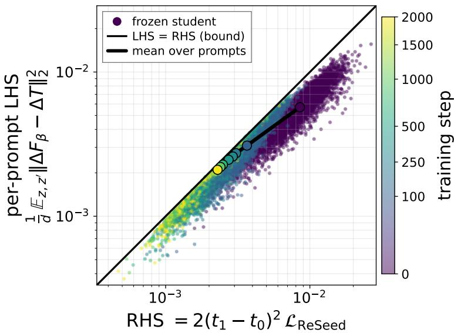  
Figure 11: Empirical analysis of Proposition 1 on COCO5K. Each point is one prompt at one checkpoint, coloured by training step; step 0 is the frozen student. The black curve shows per-step means over prompts. The left-hand side of Equation 7 is plotted against its right-hand side $2 ( t _ { 1 } - t _ { 0 } ) ^ { 2 } \mathcal { L } _ { \mathrm { R e S e e d } }$ . The diagonal marks ${ \widehat { P } } = { \widehat { B } } ;$ the exact finite-sample bound is given in Equation 13. The median LHS/RHS rises from 0.68 to 0.92 during training (Table 9).

Proof. Taylor expansion in $\beta$ at each fixed input gives $G ( z ; \beta ) = G ( z ; 0 ) + J _ { \beta } ( z ) \beta + O ( \| \beta \| _ { 2 } ^ { 2 } )$ and the analogous expression for $z ^ { \prime } .$ Subtracting the two expansions gives Equation 14. The uniform Hessian bound makes the remainder uniform over the inputs considered.

Interpretation and limits. The same bias is used for every seed, but its output correction need not be the same because $J _ { \beta } ( z )$ depends on the prompt, noise and activation state. In a jointly affine map this Jacobian is constant and the bias cancels exactly from every seed difference. In the nonlinear student, the leading correction is instead potentially first order in $\beta$ and is controlled by the difference of two input-specific Jacobians. If two inputs are close, that Jacobian difference can be described locally by a mixed derivative, but independent Gaussian seeds need not be close; the result instead expands in the small parameter change $\beta ,$ not in the distance between seeds. It does not establish that the local approximation remains accurate at the final trained bias, or that its direction will reduce response error. Those are empirical questions.

In summary, Proposition 1 identifies what the regression objective controls, and Proposition 2 explains how shared internal biases can change seed differences. The observed link to final-image diversity comes from the matched evaluations above and the teacher-prefix intervention, not from either proposition alone.

"a couple of buckets in a white room"

## F Qualitative comparisons

  
"a big purple bus parked in a parking spot"

  
"A man in a shirt and tie motioning with his hand."

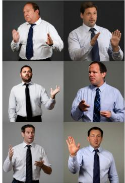

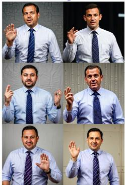

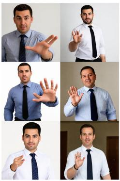  
"A man that has glasses and a hat."

  
SD3.5M Teacher

  
DMD

  
GAD

  
DP-DMD

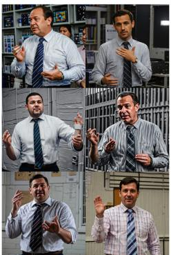

  
Ours

Figure 12: Matched-noise SD3.5-Medium comparisons. Each method uses the same six seeds. The figure continues on the next page.

  
"a photo of a coffee mug"

## "a photo of a table lamp"

  
"a photo of a cat"

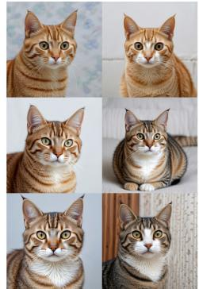  
"a photo of a teddy bear"

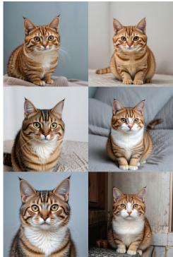

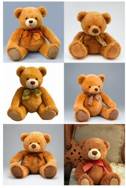  
SD3.5-M Teacher

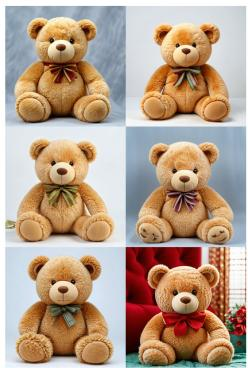  
DMD

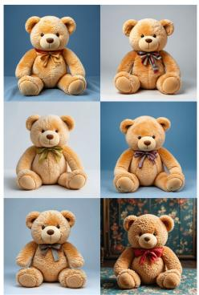  
GAD

  
DP-DMD

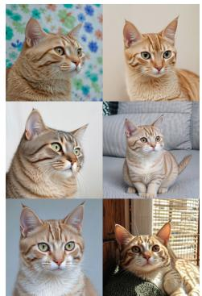

  
ReSeed (Ours)

"a photo of a backpack"  
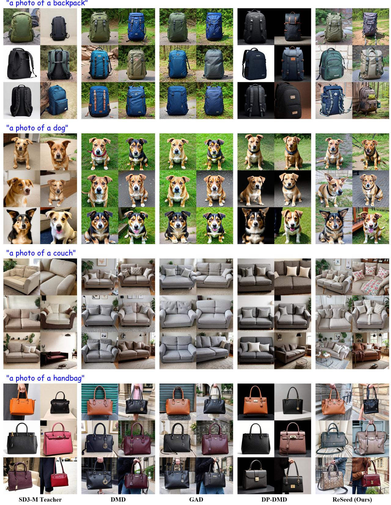  
Figure 13: Matched-noise SD3-Medium comparisons. Each method uses the same six noises.

"A woman stands in the dining area at the table."  
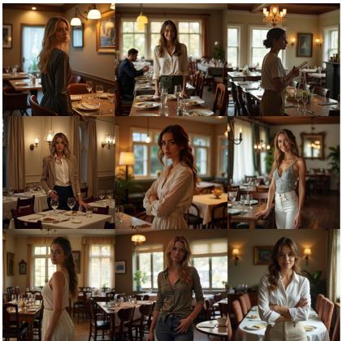

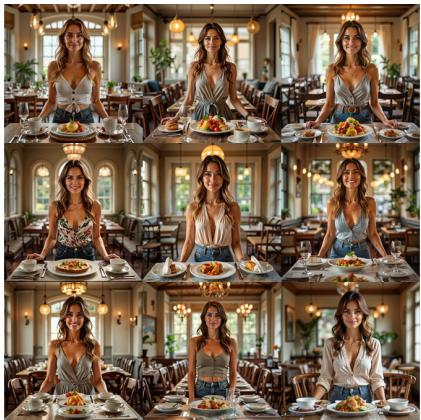  
"A cat resting on an open laptop computer.'

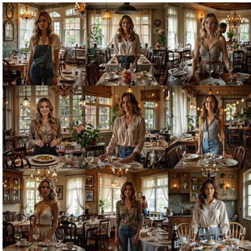

  
"Bedroom scene with a bookcase, blue comforter and window."

  
(a) FLUX.1-dev teacher

  
(b) SenseFlow-FLUX

  
(c) ReSeed (Ours)  
Figure 14: Matched-seed FLUX.1-dev comparisons. Each method uses the same nine noises for each prompt.

"A kitchen with a refrigerator, stove and oven with cabinets."  
  
"a photo of horse"

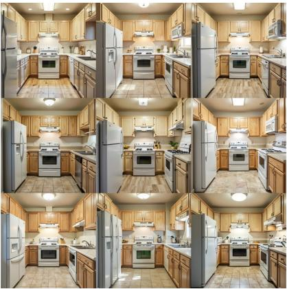

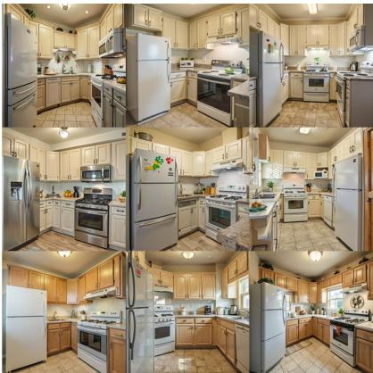

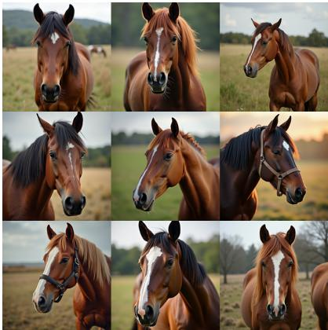  
"a photo of bird"

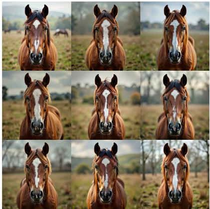

  
(a) FLUX.1-dev teacher

  
(b) SenseFlow-FLUX

  
(c) ReSeed (Ours)

Figure 14: Matched-seed FLUX.1-dev comparisons (continued).

  
(a)

  
(c)

(b)  

  
(d)  
Figure 15: Matched-noise frame strips for Wan2.1-T2V-1.3B. In each panel, the top, middle, and bottom blocks show the 50-step teacher, the 4-step DMD2 student, and the same student with ReSeed (300 updates); within a block, the eight rows are seeds 0–7 with the same initial noise across blocks, and the twelve columns are twelve evenly spaced frames from 0 to 80. Prompts and video-level DINO diversity (teacher / DMD2 / ReSeed, eight seeds): (a) “A barista pours latte art into a cappuccino, viewed from directly above as a delicate rosetta forms", 0.122/0.058/0.245; (b) “an elegant ceramic plant pot and hanging plant on indoor", 0.607/0.247/0.588; (c) “A young boy lights sparklers in his backyard as twilight settles, his face illuminated in flickering gold", 0.113/0.082/0.132; (d) “scenic view from wooden pathway", 0.599/0.339/0.475.

  
Figure 16: SD3-Medium: a gallery of 4-step ReSeed samples at 1024 × 1024.

  
Figure 17: SD3.5-Medium: a gallery of 4-step ReSeed samples at 1024 × 1024.

  
Figure 18: FLUX.1-dev: a gallery of 4-step ReSeed samples at 1024 × 1024.