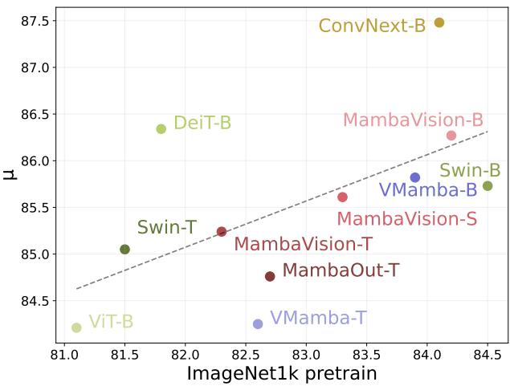
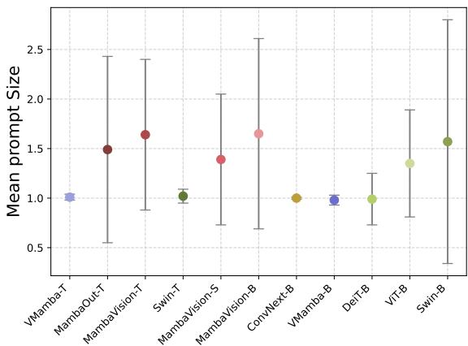
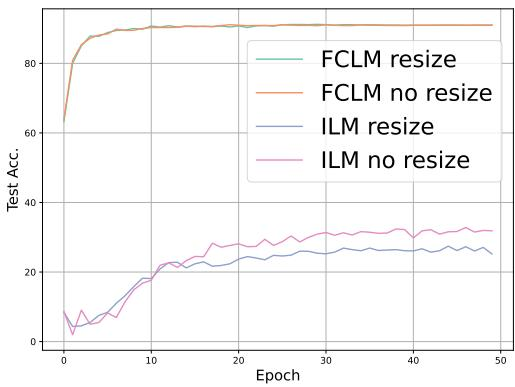

# A note on data-efficient finetuning of vision foundation models

Niclas Hergenrother¨ 1 Antonio Orvieto 1

## Abstract

Adapting foundation models to a new task within or beyond the training domain is the de facto standard for building specialized machine learning models. Recently, Visual Prompting (VP) has emerged as a promising technique for efficient knowledge transfer. As new foundation model families (like Mamba) get introduced and VP pipelines such as AutoVP reach greater maturity, we find a growing need for a systematic evaluation of current approaches. In this work, we assess the performance of the latest models, comparing them to earlier architectures and alternative finetuning methods, to better understand the progress, challenges and opportunities in the field of efficient fine-tuning under resource limitations. Towards this goal, this paper provides a concise empirical overview of the interactions among foundation model families (Attention-, Convolution-, and Mamba-based) and transfer paradigms: VP, Linear Probing (LP), Full Fine-tuning (FFT) and Low Rank Adaptation (LoRA). Our work builds up on previous findings by broadening the selection of evaluated models and techniques while tuning hyperparameters. In the interest of delivering practical guidelines for the user, we also explore application of prevalent regularization techniques to boost performance in the context of VP.

## 1. Introduction

Efficient transfer of pretraining knowledge to new tasks and domains is an essential requirement for successful downstream applicability of foundation models. As the AI landscape continues to grow – spanning diverse architectures and design choices – so do options for fine-tuning, including new pipelines for Visual Prompting (VP), Linear Probing (LP), Full Fine-tuning (FFT) and Low Rank Adaptation (LoRA).

  
Figure 1: ImageNet1k-pretrain and average VP top-1 accuracy over the tasks described in Section 3. We follow the recipe of Tsao et al. (2024). All models are tuned to best. Dotted line is linear regression, full results in Table 1.

For a review of these methods, please refer to Section 2. Given this rapid expansion, it is critical to systematically and regularly assess how different architectural choices interact with various transfer learning methods. In this work, we present an empirical evaluation of VP across several prominent model architectures, analyze how performance correlates with pretraining accuracy, and discuss potential performance and compute tradeoffs when comparing it to other fine-tuning methods on challenging tasks.

1. Compared to earlier results (Misra et al., 2024) for ILM-VP (Chen et al., 2023), we found that vision transformers and Mamba-based (Gu & Dao, 2023) models perform similarly – with only a slight edge for the former – under latest VP practice (Tsao et al., 2024). However, when selecting a model for VP, ConvNext appears to be the best choice from our selection (Figure 1). References and a short description for these models are presented in Section 3.

2. On DTD, LoRA achieves higher reported accuracy than FFT for five of the six evaluated models while training fewer parameters.. State-of-the-art VP practice can underperform (overfit) on data scarce tasks compared to LP, FFT and LoRA – see Table 2. In settings with restricted computational resources, LP seems to be dominant w.r.t. VP.

<table><tr><td></td><td colspan="6"></td><td colspan="2">OXETS</td><td></td><td>PREN AACL</td></tr><tr><td>VMAMBA-T</td><td>CI10 94.89</td><td>CIH10 80.53</td><td>FLOR102</td><td>GTSRB</td><td>DD</td><td>EUOSSSAT</td><td>FP0101</td><td></td><td>μ</td><td></td></tr><tr><td>MAMBAOUT-T</td><td>95.07</td><td>81.36</td><td>91.67 89.58</td><td>86.75 88.27</td><td>67.17 67.73</td><td>95.72 95.70</td><td>69.25 71.26</td><td>88.07 89.14</td><td>84.25 84.76</td><td>82.60</td></tr><tr><td>MAMBAVISION-T</td><td>95.44</td><td>80.89</td><td>92.55</td><td>87.74</td><td>66.26</td><td>96.56</td><td>71.56</td><td>90.91</td><td>85.24</td><td>82.70 82.30</td></tr><tr><td>SWIN-T</td><td>94.28</td><td>80.32</td><td>92.34</td><td>88.95</td><td>66.37</td><td>96.31</td><td>72.99</td><td>88.83</td><td>85.05</td><td>81.50</td></tr><tr><td>MAMBAVISION-S</td><td>95.97</td><td>82.37</td><td>90.71</td><td>86.93</td><td>66.58</td><td>96.62</td><td>74.18</td><td>91.57</td><td>85.61</td><td>83.30</td></tr><tr><td>MAMBAVISION-B</td><td>96.54</td><td>83.88</td><td>91.79</td><td>88.79</td><td>65.64</td><td>96.63</td><td>75.65</td><td>91.22</td><td>86.27</td><td>84.20</td></tr><tr><td>CONVNEXT-B</td><td>96.42</td><td>84.44</td><td>94.15</td><td>90.28</td><td>70.77</td><td>96.61</td><td>75.10</td><td>92.04</td><td>87.48</td><td>84.10</td></tr><tr><td>VMAMBA-B</td><td>96.58</td><td>76.90</td><td>93.67</td><td>90.56</td><td>67.87</td><td>94.14</td><td>75.52</td><td>91.35</td><td>85.82</td><td>83.90</td></tr><tr><td>DEIT-B</td><td>96.52</td><td>83.59</td><td>93.51</td><td>91.57</td><td>66.54</td><td>96.85</td><td>72.13</td><td>90.01</td><td>86.34</td><td>81.80</td></tr><tr><td>VIT-B</td><td>95.52</td><td>78.18</td><td>90.74</td><td>89.54</td><td>62.13</td><td>96.80</td><td>70.84</td><td>89.97</td><td>84.21</td><td>81.10</td></tr><tr><td>SWIN-B</td><td>95.45</td><td>81.55</td><td>93.35</td><td>86.19</td><td>68.47</td><td>96.59</td><td>74.26</td><td>89.95</td><td>85.73</td><td>84.50</td></tr><tr><td>CORR. IMAGENET</td><td>0.49</td><td>0.31</td><td>0.35</td><td>-0.23</td><td>0.66</td><td>-0.23</td><td>0.73</td><td>0.53</td><td>0.60</td><td></td></tr></table>

Table 1: Top-1 accuracy after training with AutoVP usingfully connected label mapping. µ denotes the meanfine-tuning performance. The last column represents the ImageNet pretraining accuracy. The bottom row reports the correlation coefficient between the corresponding column and the ImageNet pretraining accuracy.

3. It is natural to ask at this point if VP performance can be improved via regularization. We found that prevalent regularization techniques can boost generalization, whilst still underperforming LoRA. We noticed that most gains can be observed when applying regularization to the label mapping weights, as opposed to the prompt.

## 2. Background

Benchmarking Visual Prompting. VP, first introduced as Adversarial Reprogramming (Elsayed et al., 2018), leverages the idea of utilizing a universal input perturbation to transfer a pretrained model to a new domain or task. The term Prompting originates from language modeling (Lester et al., 2021) and was later adapted to the vision domain (Bahng et al., 2022). VP keeps the pretrained source model entirely frozen and therefore differs from other techniques (see next paragraph) that may require adapting source model weights. Black-box variants of reprogramming can also work with API-only access (Tsai et al., 2020).

With AutoVP, Tsao et al. (2024) introduced improvements of the VP methodology as well as a unified benchmark for VP. The introduced improvements include the possibility of resizing the prompt as well as a new Label Mapping (LM) technique: Fully Connected Label Mapping (FCLM). FCLM is realized by a fully connected layer of dimensions $C _ { S } \times C _ { T }$ (# of source classes $C _ { S } { ; } \#$ of target classes C ).

While there exists research on the combination of new foundation models and VP (Chen et al., 2023; Tsao et al., 2024; Misra et al., 2024), these works are either limited in model selection or didn’t tune hyperparameters, making the results ambiguous to interpret. In this work, we evaluate a selection of ImageNet1k pretrained foundation models (Sec. 3) using AutoVP (Tsao et al., 2024) on a common set of downstream image-classification tasks and in addition to performance (Tab. 1 and Fig. 1) also investigate on the behavior of models w.r.t. the resizing of the prompt (Tab. 6 and Fig. 2).

<table><tr><td></td><td>VP</td><td>LP FFT</td><td>LORA</td></tr><tr><td>MAMBAVISION</td><td>65.64 70.21</td><td>75.16 73.18</td><td>73.88 76.60</td></tr><tr><td>CONVNEXT VMAMBA</td><td>70.77 70.90 67.87 67.45</td><td>73.30</td><td>75.00</td></tr><tr><td>DEIT</td><td></td><td></td><td></td></tr><tr><td>VIT</td><td>66.54 68.56</td><td>72.98</td><td>74.68</td></tr><tr><td>SWIN</td><td>62.13 71.38 68.47 77.07</td><td>75.32 79.63</td><td>77.02 81.33</td></tr></table>

Table 2: Top 1 test-performance in % of various base-models on DTD using different Transfer Learning paradigms. Learning rate, rank (LoRA) and weight decay tuned. Basesize usedfor all models.

Full fine-tuning and linear probing. Based on the improvements of AutoVP, we conduct a comparison of FFT, LP, LoRA (described next) and VP on the data scarce DTD dataset (Cimpoi et al., 2014), which showed to be the most challenging task in the benchmark. We investigate a subset of the models evaluated in Tab. 1, while tuning learning rate and weight decay to ensure optimal performance for each method. LP freezes the pretrained model, whilst only replacing and training a new classifier with the idea of leveraging the existing feature representations at the penultimate layer of a model (Alain & Bengio, 2018). In contrast to full fine-tuning, LP drastically reduces the amount of trainable parameters as well as hardware requirements. Last, in our implementation of FFT, we account for the new number of output classes by training a new classifier from scratch (Chen et al., 2023). In contrast to LP or VP, no model parameters are frozen. While this unlocks stronger results, it also requires larger compute and memory (Tab.3) compared to the other approaches.

LoRA. Low-Rank Adaptation (LoRA) (Hu et al., 2022) is one of the most prominent lines of PEFT research. Instead of updating the weight matrix $W \in \mathbb { R } ^ { d \times k }$ directly, LoRA parametrizes the update as a product $\Delta W = B A$ of low-rank $B \in \mathbb { R } ^ { d \times r } , A \in \mathbb { R } ^ { r \times k }$ and hyperparameter r ≪ min(d, k). Only A and B are trained, which drastically reduces the number of trainable parameters. Since the LoRA modules contain only these low-rank updates and not the base model’s weights, they are lightweight and can be swapped depending on the task, while the base model remains frozen and unchanged.

Regularizing Visual Prompting. We noticed models showed signs of overfitting when being transferred to DTD using VP – as testified by Table 2, where all models reached ≥ 99% training accuracy despite suboptimal test performance compared to LP, FFT or LoRA. This poses the question on how to effectively regularize VP. This task is particularly interesting, as common regularization methods are motivated by a different learning paradigm. We investigated a set of common regularization approaches while also ablating on targeting regularizing only to a subset of the optimized parameters in VP: either prompt or Label Mapping parameters. Specifically, we evaluated performance of Dropout (Hinton et al., 2012), L1-/L2-regularization, Sharpness-aware minimization (SAM) (Foret et al., 2020) and Autoaugment (Cubuk et al., 2019).

## 3. Experimental setup

The tasks are selected in accordance with earlier evaluations on VP (Chen et al., 2023; Tsao et al., 2024), consisting of CIFAR10/100 (Krizhevsky et al., 2009) Flowers102 (Nilsback & Zisserman, 2008),GTSRB(Stallkamp et al., 2011), DTD (Cimpoi et al., 2014), EuroSAT (Helber et al., 2019), Food101 (Bossard et al., 2014), OxfordPets (Parkhi et al., 2012).

The models we use are VMamba1 (Liu et al., 2024b), MambaOut2 (Yu & Wang, 2025), MambaVision3 (Hatamizadeh & Kautz, 2024), SwinT4 (Liu et al., 2021), ConvNext4 (Liu et al., 2022), ViT4 (Dosovitskiy, 2020) and DeiT5(Touvron et al., 2021). In all cases, the ImageNet (Deng et al., 2009) pretrained weights are utilized.

• Our initial set of experiments (Table 1 and Section 4.1) involves training the previously introduced models – belonging to drastically different architecture families – on the AutoVP Benchmark (Tsao et al., 2024). For detailed information regarding hyperparameter tuning, please refer to Appendix A.

• Our second series of experiments (Section 4.2) entails a comparative evaluation of LP, VP, FFT and LoRA on a subset of the introduced models. These fine-tuning paradigms are compared on the DTD dataset, as it appears to be the most challenging task with limited training data.

• Our third set of experiments (Section 4.3) focuses on the regularization of VP. To assess regularization strategies on VP, we evaluate VMamba-B on the DTD Dataset (with Vanilla-VP performance obtainable from Table 1), utilizing a fixed learning rate of 0.001. Dropout and L1/L2 regularization are implemented both across the entire model or specifically targeted to either the mapping or the prompt parameters.

All runs from the first and second set of experiments are using a single Nvidia A100 GPU. The remaining experiments are utilizing either Nvidia Tesla V100 or Nvidia Quadro RTX 6000 GPUs.

The evaluation of different fine-tuning techniques must consider the distinct computational requirements for training models of significant size. The precise calculation of trainable model parameters for the different approaches is contingent on numerous factors, including the selected model, input dimensions, and the number of target classes. For this comparison we assume VMamba-B being applied to the DTD dataset with 47 target classes. For VP, inputs are resized using a learnable prompt size, while for LP, FFT and LoRA they are resized to the input size 224 × 224. Furthermore, while the trainable parameters of all approaches depend on the number of target classes, VP is also reliant on the input dimensions and the number of source classes in the pretrained model while LP also depends on the feature dimension of the penultimate layer. for LoRA, a rank of 2 was used to compute the reported number of parameters, as the different ranks all yielded similar results and therefore rank 2 showed to be the most lightweight variant reaching good performance. It is noteworthy that the implementation for LoRA in combination with VMamba was probably less optimized compared to the implementation for transformer based models. Consequently, the reported numbers need to be interpreted within the context of the specific choice of pretrained model and task.

## 4. Results

## 4.1. VP levels model performances

Tab. 1 presents the model performances alongside the correlation between model performance and pretraining ImageNet accuracy. In general, raw ImageNet pretraining accuracy presents itself to be a determining factor for model performance, as validated by the reported correlation coefficient. This indicates an external validity of ImageNetperformance (Torralba & Efros, 2011). Nonetheless, certain tasks exhibit weak or even negative correlation.

  
Figure 2: Mean prompt size of the best performing run, with the initial prompt scaling being 1. Mean and standard deviation calculated over the tasks introduced in Sec. 3.

ConvNext achieved the highest accuracy on four of the eight tasks. Yet, some tasks are more sensitive to model choice than others: while on CIFAR10 and EuroSAT performance differences are marginal, on DTD, the right selection of pretrained model is crucial. Our last investigation concerns the

  
Figure 3: Flowers102 performance ofVMamba-Tfor combinations ofILM and FCLM with and without enabled resizing.

comparison with VP methods prior to Tsao et al. (2024), and in particular with ILM-VP (Chen et al., 2023), tested also by Misra et al. (2024). In contrast to ILM-VP, the variance in performance between different model architectures is significantly reduced. Using AutoVP on the Flowers102 dataset increases the performance of VMamba by 54.77 percentage points in comparison to ILM-VP, where it only reaches 38.9%. In comparison, ViT-B already achieves 83.1% under ILM-VP and is outperformed by VMamba under AutoVP.

For VMamba-T on Flowers102, our ablation separates the effects of label map- ping and prompt resizing and identifies fully connected label mapping as the main source of the improvement over ILM-VP (Fig. 3). As depicted in Fig. 2, the capability to resize the prompt is not exploited uniformly across models. ConvNext, which on average performs best, retains the initial configuration, while Swin-B exhibits considerable variation in prompt size. Models differing only by size (e.g., MambaVision, VMamba) tend to have similar behavior, while Swin Transformer behaves as an outlier with Swin-T maintaining the initial prompt size and Swin-B showing variation. Detailed results can be found in Appendix A.

<table><tr><td></td><td># PARAM.</td><td>GPU-MEM (GB)</td><td>EPOCHTIME (s)</td></tr><tr><td>VP</td><td>197,576</td><td>12.5</td><td>39.8</td></tr><tr><td>LP</td><td>48,175</td><td>11.2</td><td>36.1</td></tr><tr><td>FFT</td><td>87,601,967</td><td>72.3</td><td>49.2</td></tr><tr><td>LoRA</td><td>740,911</td><td>67.5</td><td>45.0</td></tr></table>

Table 3: VP refers to AutoVP with fully connected label mapping and adjustable prompt size. GPU-Mem describes the peak allocated GPU Memory. Reported Runtime is the median over all runs. All reported numbers refer to the use ofVMamba-B on the DTD dataset.

## 4.2. Comparison training paradigms

As showcased in Tab. 3, for the specific setting described above, LP proves to be the most lightweight fine-tuning method, with VP being only slightly more hardware demanding. By requiring only about 15% of the GPU-memory required for FFT, the field of application is drastically broadened by, in contrast to FFT, being able to e.g. run on a Nvidia Tesla V100 GPU. LoRA manages to outperform FFT on 5 of the 6 evaluated models, surprisingly not showing substantial differences between different rank configurations (See tab. 4).

<table><tr><td colspan="2">RANK r 1</td><td>2</td><td>4</td><td>8</td><td>16</td></tr><tr><td>M-VISION CONVNEXT VMAMBA DEIT VIT</td><td>73.09 76.22 73.78 73.09</td><td>73.78 76.39 75.00 73.94</td><td>72.77 76.49 74.41 74.57</td><td>73.88 76.54 74.57</td><td>73.94 76.12 74.15</td></tr></table>

Table 4: Top 1 test-performance in % for different rank configurations.

It is also noteworthy, that whilst the majority of research conducted on LoRA is in combination with Transformerbased architectures, even a naive implementation on Mambaand Convolution-based architectures shows to be an efficient way of fine-tuning, making it thereby easily applicable for a variety of tasks. Whilst LoRA outperforming FFT is generally not a novel observation on language modeling (Liu et al., 2024a), the transfer to image classification offers great potential for downstream applicability to further domains.

## 4.3. Regularization of VP

Applying L1 regularization to either the prompt generation and the Label Mapping leads to almost similar enhancements. Conversely, for L2 regularization, regularizing the Label Mapping is substantially more effective than regularizing the prompt. The augmentation schemes from Cubuk et al. (2019), which are derived from ImageNet, SVHN, and CIFAR10, increased performance, however to the smallest degree. VMamba also benefits from the utilization of SAM as well as from applying Dropout to the Label Mapping.

<table><tr><td rowspan=1 colspan=1>REFERENCE</td><td rowspan=1 colspan=1>67.87</td></tr><tr><td rowspan=1 colspan=1>DROPOUT</td><td rowspan=1 colspan=1>68.73</td></tr><tr><td rowspan=1 colspan=1>L1 PROMPT</td><td rowspan=1 colspan=1>69.42</td></tr><tr><td rowspan=1 colspan=1>L1 MAPPING</td><td rowspan=1 colspan=1>69.37</td></tr><tr><td rowspan=1 colspan=1>L2 PROMPT</td><td rowspan=1 colspan=1>68.84</td></tr><tr><td rowspan=1 colspan=1>L2 MAPPING</td><td rowspan=1 colspan=1>70.31</td></tr><tr><td rowspan=2 colspan=1>AUTOAUGMENTSAM</td><td rowspan=1 colspan=1>68.65</td></tr><tr><td rowspan=1 colspan=1>69.31</td></tr></table>

Table 5: AutoVP performances of VMamba-B using different regularization mechanics. First row reports the unregularized VP performance.

For VMamba-B on DTD, the tested regularizers improve VP accuracy but leave a gap to LoRA. Also, no single regularization method can completely close the performance gap between VMamba and ConvNext.

## Conclusion

The VMamba-T ablation on Flowers102 shows that the choice of label mapping can strongly affect visual prompting performance, highlighting the importance of the adaptation procedure when assessing a pretrained model. When employing VP, our results show that the selection should consider both its pretraining accuracy and the model architecture, with ConvNext being the best option in our setup. In particular on data scarce tasks, LoRA seems to be the method of choice, outperforming FFT while being lightweight.

## Acknowledgments

The authors acknowledge the financial support of the Hector Foundation.

## References

Alain, G. and Bengio, Y. Understanding intermediate layers using linear classifier probes, 2018.

Bahng, H., Jahanian, A., Sankaranarayanan, S., and Isola, P. Exploring visual prompts for adapting large-scale models. arXiv preprint arXiv:2203.17274, 2022.

Bossard, L., Guillaumin, M., and Van Gool, L. Food-101 – mining discriminative components with random forests. In European Conference on Computer Vision, 2014.

Chen, A., Yao, Y., Chen, P.-Y., Zhang, Y., and Liu, S. Understanding and improving visual prompting: A labelmapping perspective. In Proceedings ofthe IEEE/CVF Conference on Computer Vision and Pattern Recognition, pp. 19133–19143, 2023.

Cimpoi, M., Maji, S., Kokkinos, I., Mohamed, S., and Vedaldi, A. Describing textures in the wild. In 2014 IEEE Conference on Computer Vision and Pattern Recognition, pp. 3606–3613, 2014. doi: 10.1109/CVPR.2014.461.

Cubuk, E. D., Zoph, B., Mane, D., Vasudevan, V., and Le, Q. V. Autoaugment: Learning augmentation strategies from data. In Proceedings of the IEEE/CVF conference on computer vision and pattern recognition, pp. 113–123, 2019.

Deng, J., Dong, W., Socher, R., Li, L.-J., Li, K., and Fei-Fei, L. Imagenet: A large-scale hierarchical image database. In 2009 IEEE conference on computer vision and pattern recognition, pp. 248–255. Ieee, 2009.

Dosovitskiy, A. An image is worth 16x16 words: Transformers for image recognition at scale. arXiv preprint arXiv:2010.11929, 2020.

Elsayed, G. F., Goodfellow, I. J., and Sohl-Dickstein, J. Adversarial reprogramming of neural networks. CoRR, abs/1806.11146, 2018.

Foret, P., Kleiner, A., Mobahi, H., and Neyshabur, B. Sharpness-aware minimization for efficiently improving generalization. arXiv preprint arXiv:2010.01412, 2020.

Gu, A. and Dao, T. Mamba: Linear-time sequence modeling with selective state spaces. arXiv preprint arXiv:2312.00752, 2023.

Hatamizadeh, A. and Kautz, J. Mambavision: A hybrid mamba-transformer vision backbone. arXiv preprint arXiv:2407.08083, 2024.

Helber, P., Bischke, B., Dengel, A., and Borth, D. Eurosat: A novel dataset and deep learning benchmark for land use and land cover classification. IEEE Journal of Selected Topics in Applied Earth Observations and Remote Sensing, 12(7):2217–2226, 2019. doi: 10.1109/JSTARS.2019.2918242.

Hinton, G. E., Srivastava, N., Krizhevsky, A., Sutskever, I., and Salakhutdinov, R. R. Improving neural networks by preventing co-adaptation of feature detectors. arXiv preprint arXiv:1207.0580, 2012.

Hu, E. J., Shen, Y., Wallis, P., Allen-Zhu, Z., Li, Y., Wang, S., Wang, L., and Chen, W. LoRA: Low-rank adaptation of large language models. In International Conference on Learning Representations, 2022.

Krizhevsky, A. et al. Learning multiple layers of features from tiny images. 2009.

Lester, B., Al-Rfou, R., and Constant, N. The power of scale for parameter-efficient prompt tuning. arXiv preprint arXiv:2104.08691, 2021.

Liu, S.-Y., Wang, C.-Y., Yin, H., Molchanov, P., Wang, Y.-C. F., Cheng, K.-T., and Chen, M.-H. Dora: Weightdecomposed low-rank adaptation. In Forty-first International Conference on Machine Learning, 2024a.

Liu, Y., Tian, Y., Zhao, Y., Yu, H., Xie, L., Wang, Y., Ye, Q., and Liu, Y. Vmamba: Visual state space model. arXiv preprint arXiv:2401.10166, 2024b.

Liu, Z., Lin, Y., Cao, Y., Hu, H., Wei, Y., Zhang, Z., Lin, S., and Guo, B. Swin transformer: Hierarchical vision transformer using shifted windows. In Proceedings of the IEEE/CVF International Conference on Computer Vision (ICCV), 2021.

Liu, Z., Mao, H., Wu, C.-Y., Feichtenhofer, C., Darrell, T., and Xie, S. A convnet for the 2020s. In 2022 IEEE/CVF Conference on Computer Vision and Pattern Recognition (CVPR), pp. 11966–11976, 2022. doi: 10.1109/CVPR52688.2022.01167.

maintainers, T. and contributors. Torchvision: Pytorch’s computer vision library. https://github.com/ pytorch/vision, 2016.

Mangrulkar, S., Gugger, S., Debut, L., Belkada, Y., Paul, S., and Bossan, B. PEFT: State-of-the-art parameterefficient fine-tuning methods. https://github. com/huggingface/peft, 2022.

Misra, D., Gala, J., and Orvieto, A. On the low-shot transferability of [v]-mamba. arXiv preprint arXiv:2403.10696, 2024.

Nilsback, M.-E. and Zisserman, A. Automated flower classification over a large number of classes. 2008 Sixth Indian Conference on Computer Vision, Graphics & Image Processing, pp. 722–729, 2008.

Parkhi, O. M., Vedaldi, A., Zisserman, A., and Jawahar, C. V. Cats and dogs. 2012 IEEE Conference on Computer Vision and Pattern Recognition, pp. 3498–3505, 2012.

Stallkamp, J., Schlipsing, M., Salmen, J., and Igel, C. The german traffic sign recognition benchmark: a multi-class classification competition. In The 2011 internationaljoint conference on neural networks, pp. 1453–1460. IEEE, 2011.

Torralba, A. and Efros, A. A. Unbiased look at dataset bias. In CVPR 2011, pp. 1521–1528. IEEE, 2011.

Touvron, H., Cord, M., Douze, M., Massa, F., Sablayrolles, A., and Jegou, H. Training data-efficient image transform-´ ers & distillation through attention. In International conference on machine learning, pp. 10347–10357. PMLR, 2021.

Tsai, Y.-Y., Chen, P.-Y., and Ho, T.-Y. Transfer learning without knowing: Reprogramming black-box machine learning models with scarce data and limited resources. In International Conference on Machine Learning, pp. 9614–9624. PMLR, 2020.

Tsao, H.-A., Hsiung, L., Chen, P.-Y., Liu, S., and Ho, T.-Y. AutoVP: An Automated Visual Prompting Framework and Benchmark. In The Twelfth International Conference on Learning Representations, 2024.

Wightman, R. Pytorch image models. https://github. com/rwightman/pytorch-image-models, 2019.

Yu, W. and Wang, X. Mambaout: Do we really need mamba for vision? In Proceedings ofthe IEEE/CVF Conference on Computer Vision and Pattern Recognition, 2025.

## A. Benchmarking Visual Prompting

The Experiments from 4.1 followed the AutoVP recipe (Tsao et al., 2024) with:

• Learning rates of [0.0001, 0.0003, 0.001, 0.003, 0.01, 0.03, 0.1, 0.3]

• 2 different seeds and no regularization applied.

• Initial image-scale of 1.0 with prompt scaling enabled

• 50 epochs

The reported accuracy is the maximum test accuracy over the run. Runs comparing the different Mapping approaches were conducted with learning rates [0.0001, 0.0003, 0.001, 0.003, 0.01, 0.03, 0.1, 0.3] with one seed.

<table><tr><td></td><td>CIH10 CIAR10</td><td>FLOWRR102</td><td>GTSRB</td><td>DTD</td><td>EUSAT</td><td>F0101</td><td>OXRPETS</td><td></td></tr><tr><td>VMAMBA-T</td><td>0.990 0.999</td><td>0.996</td><td>1.047</td><td>0.999</td><td>1.083</td><td>1.000</td><td>0.999</td><td>μ 6 1.014 0.031</td></tr><tr><td>MAMBAOUT-T</td><td>1.000 0.999</td><td>0.999</td><td>3.674</td><td>0.997</td><td>0.691</td><td>1.254</td><td>2.275</td><td>1.486 0.938</td></tr><tr><td>MAMBAVISION-T</td><td>0.995 0.998</td><td>1.401</td><td>3.111</td><td>2.195</td><td>0.927</td><td>1.182</td><td>2.342</td><td>1.644 0.756</td></tr><tr><td>SWINT-T</td><td>0.986 1.001</td><td>0.999</td><td>0.995</td><td>0.999</td><td>0.950</td><td>1.000</td><td>1.196</td><td>1.016 0.070</td></tr><tr><td>MAMBAVISION-S</td><td>0.927 1.006</td><td>2.930</td><td>1.105</td><td>0.997</td><td>1.006</td><td>1.238</td><td>1.942</td><td>1.394 0.656</td></tr><tr><td>MAMBAVISION-B</td><td>1.003 1.006</td><td>1.002</td><td>3.912</td><td>2.362</td><td>0.994</td><td>1.386</td><td>1.574</td><td>1.655 0.960</td></tr><tr><td>CONVNEXT-B</td><td>0.994 1.001</td><td>0.999</td><td>0.991</td><td>0.998</td><td>0.985</td><td>1.000</td><td>1.001</td><td>0.996 0.005</td></tr><tr><td>VMAMBA-B</td><td>1.004 1.021</td><td>0.997</td><td>0.863</td><td>0.999</td><td>0.927</td><td>1.000</td><td>0.998</td><td>0.976 0.050</td></tr><tr><td>DEIT-B</td><td>1.011 1.000</td><td>0.998</td><td>0.792</td><td>1.000</td><td>0.569</td><td>1.000</td><td>1.562</td><td>0.991 0.261</td></tr><tr><td>VIT-B</td><td>1.004 0.856</td><td>1.090</td><td>0.998</td><td>1.349</td><td>1.000</td><td>2.332</td><td>2.190</td><td>1.352 0.542</td></tr><tr><td>SWIN-B</td><td>1.003 0.997</td><td>1.001</td><td>4.798</td><td>0.999</td><td>1.003</td><td>1.214</td><td>1.542</td><td>1.569 1.233</td></tr></table>

Table 6: Prompt scaling ofthe best runfor the respective model-task combination

Tab. 6 provides detailed results regarding the Prompt resizing for different Model-task combinations. The reported number is the prompt size after the last training epoch w.r.t. the initial instantiation.

An interesting observation is that while some tasks generally lead to a stronger resizing (e.g. GTSRB results in an average prompt size of 2.026 times the initial calibration), 5 out of the 11 models observed also reduce the prompt size.

## B. Comparing Knowledge Transfer Methods

LP and FFT were implemented by adapting https://github.com/kuangliu/pytorch-cifar. The results for VP were obtained using the setup described in A.

The models were all evaluated on FFT and LP using the combinations of the learning rates [0.0001, 0.0003, 0.001, 0.003, 0.01, 0.03, 0.1, 0.3] and weight decays [0.0001, 0.0003, 0.001, 0.003, 0.01, 0.03, 0.1, 0.3]. All models were trained for 200 epochs on one seed.

LoRA was implemented using the peft (Mangrulkar et al., 2022) library.

RandomRotation((10)), Colorjitter(brightness=0.05,contrast=0.05,saturation=0.05) and RandomAffine(degrees=5,translate=(0.1,0.1),scale=(0.9,1.1)) were used as input perturbations.

For LP and FFT, the linear layer of the classification head was replaced to account for the correct number of output classes.   
For LP, the rest of the model was frozen and only the new classifier was trained.

## C. Regularizing Visual Prompting

The Experiments from 4.3 used the best performing learning rate of 0.001.

• Dropout was applied with p-values of [0.05, 0.1, 0.2, 0.4] on the Label Mapping.

• L1 and L2 regularization were both run with λ-values of [0.0001, 0.0003, 0.001, 0.003, 0.01, 0.03, 0.1, 0.3] on either the prompt or the Label Mapping.

• Autoaugment was used by applying the precomputed schemes for ImageNet, SVHN and CIFAR10.

• For SAM, ρ of [0.001, 0.003, 0.005, 0.008 and 0.01] were used.