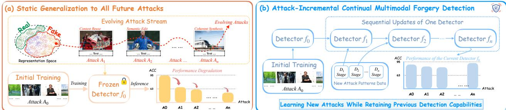
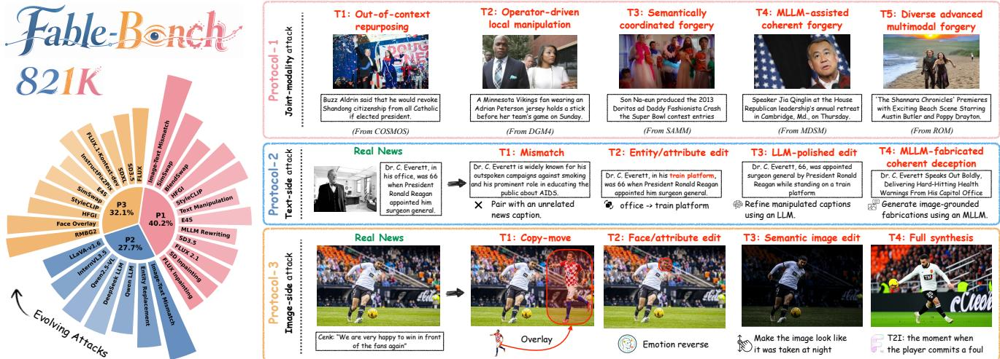
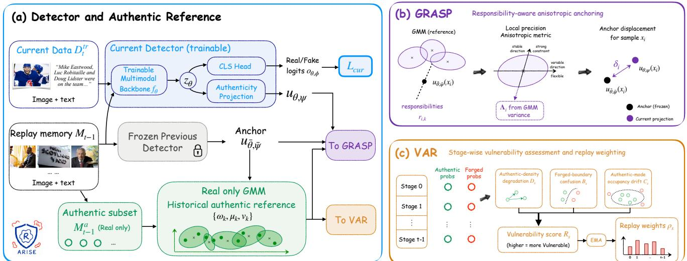
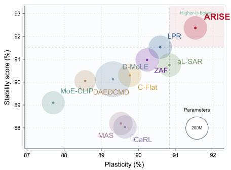
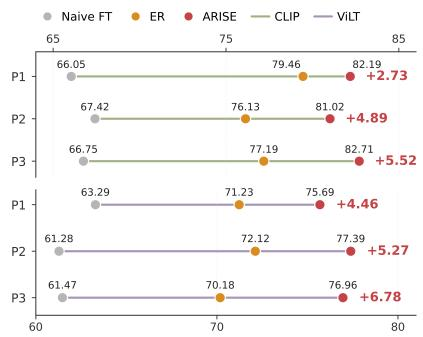
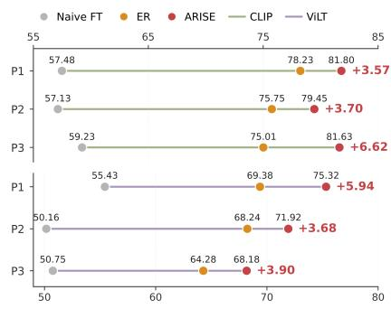

# ARISE: Authentic Reference-Informed Stability Enhancement for Continual Multimodal Forgery Detection

Yuchen Zhang1,3 Yaxiong Wang2,\* Yujiao Wu4 Lianwei Wu5 Qi Zhang3 Li Zhu1

Chaofeng Dong7 Le Wu2 Zhedong Zheng6

1School of Software Engineering, Xi’an Jiaotong University

2School of Computer and Information Engineering, Hefei University of Technology

3Xingchen AGI Lab 4CSIRO 5Northwestern Polytechnical University 6University of Macau 7Tongji University

yczhang@stu.xjtu.edu.cn wangyx@hfut.edu.cn \*Corresponding author

  
Fi ure 1: Conce tual motivation for attack-incremental for er detection. (a) A detector trained once on an initial attack-s ace snapshot is frozen after deployment. As new forgery mechanisms emerge, the resulting distribution shifts alter forensic evidence and could substantially degrade detection performance. (b) We instead sequentially update the detector with newly available labeled attack data. After each stage, the current detector is evaluated on all attacks observed so far.

## Abstract

Multimodal forgery detection is commonly studied under a static assumption: training attacks are expected to approximate those encountered after deployment. This assumption becomes increasingly fragile as generators, editing systems, and multimodal large language models continually introduce new forgery mechanisms and forensic evidence. We formulate this problem as attack-incremental continual multimodal forgery detection, where the binary real/fake interface remains fixed while emerging attacks must be learned without forgetting previous ones. We introduce Fable-Bench, which organizes attack evolution through complementary jointmodality, text-side, and image-side protocols. We further propose Arise (Authentic Reference-Informed Stability Enhancement), motivated by the open-ended forged class and the comparatively reusable geometry of authentic content. Arise fits a real-only Gaussian mixture model to projected authentic replay representations as a compact historical reference. Meanwhile, the proposed Gaussian-Responsibility-Aware Stability Preservation (GRASP) derives a sample-adaptive anisotropic metric that strongly constrains historically stable representation directions while retaining plasticity elsewhere. Our Vulnerability-Aware Replay (VAR) further estimates stage-wise vulnerability from authentic-density degradation, forged-to-authentic boundary confusion, and authentic-mode occupancy drift, then assigns bounded replay emphasis to fragile stages. All adaptive signals are obtained from training-time replay statistics, while inference uses only the original multimodal backbone and binary classification head. Experiments across three attackevolution protocols and multiple detector architectures demonstrate improved historical retention and final average performance over representative continual-learning baselines.

## CCS Concepts

• Computing methodologies → Learning paradigms; Supervised learning by classification; • Applied computing → Investigation techniques.

## Keywords

Multimedia, Multimodal Forgery Detection, Continual Learning, Catastrophic Forgetting.

## 1 Introduction

Advances in generative artificial intelligence have made visualcontent creation and editing increasingly accessible, while also lowering the cost of fabricating persuasive image–text news, in which manipulated images, misleading captions, and machinewritten narratives reinforce false claims [12, 35]. Such content is particularly consequential in news and social media, where plausible image–text pairs can spread faster than manual verification.

Multimodal misinformation detection has progressed from coarse event-level classification to fine-grained manipulation reasoning. Early methods learn event-invariant representations or detect out-of-context image reuse [2, 25], while later approaches jointly detect and ground multimodal manipulations [19, 20], improve cross-modal alignment [9, 34] and coordinated-attack detection [21, 32], and introduce explicit forensic reasoning [31]. A central objective throughout this progression is generalization beyond the manipulations observed during training.

Generalization remains necessary, but treating static generalization to all future attacks as the only deployment strategy is unrealistic. As shown in Fig. 1a, a detector trained once on an initial snapshot of the attack space degrades substantially as previously unseen forgery mechanisms emerge over time. Theoretical studies show that generalization to arbitrary out-of-distribution environments cannot be guaranteed without assumptions linking the training and deployment distributions [28], while extrapolation beyond observed environments is inherently more dificult than interpolation among them [17, 33]. Moreover, future forgery mechanisms are not merely samples from a fixed hidden distribution, but arise from an evolving technology pipeline. Retraining from scratch after each attack update is also operationally unattractive, as it repeatedly requires reconstructing historical data and does not explicitly preserve accumulated forensic knowledge. These limitations motivate continual adaptation [4], which progressively acquires emerging forensic evidence while retaining previous capabilities.

Rather than expecting a frozen detector to generalize indefinitely, we argue for continual adaptation with limited historical memory. When a new forgery mechanism emerges, a single detector should learn from newly available labeled data and retain its competence on earlier attacks, as illustrated in Fig. 1b. Here, an attack denotes a forgery-generation or manipulation mechanism that induces a new data distribution. Unlike class-incremental learning, the label space remains fixed; what evolves is primarily the forged distribution and the evidence separating forged from authentic content. This setting can be viewed as a structured, forensics-specific form of domain-incremental learning, where distribution shifts are induced by emerging forgery mechanisms. We refer to it as attack-incremental continual multimodal forgery detection.

To operationalize this setting, we introduce Fable-Bench, short for Forgery Attack Benchmark for Lifelong Evaluation. Fable-Bench organizes evolving forgery mechanisms into three complementary continual protocols covering joint-modality, text-side, and image-side attack evolution. Across all protocols, the binary label space remains fixed, requiring a single detector to sequentially acquire emerging forensic evidence while retaining its competence on previously observed attacks.

We further propose Arise (Authentic Reference-Informed Stability Enhancement), motivated by the asymmetry between the openended forged class and the comparatively reusable geometry of authentic content. Rather than modeling all historical forgeries, Arise uses replayed authentic samples as a compact geometric reference for preserving stable forensic knowledge across attack stages. At each incremental stage, Arise freezes the preceding detector as a historical anchor and fits a real-only diagonal Gaussian mixture model to projected authentic replay representations. GRASP (Gaussian-Responsibility-Aware Stability Preservation) converts local mixture responsibilities and variances into a sample-adaptive anisotropic metric, strongly constraining directions that are stable within relevant authentic modes while preserving plasticity along naturally variable ones. This avoids uniformly reproducing the entire historical representation.

Complementarily, Vulnerability-Aware Replay (VAR) estimates stage-wise vulnerability from authentic-geometry drift, forgedto-authentic boundary confusion, and authentic-mode occupancy drift, and converts these signals into bounded weights for classbalanced replay. GRASP stabilizes historical representations, whereas VAR emphasizes stages whose geometry or decision boundaries are becoming fragile. All adaptive signals are computed from training-time replay statistics without validation or test feedback. At inference, only the multimodal backbone and binary classification head are used; the auxiliary projection, authentic reference, probe sets, and replay memory remain outside the inference path and are retained only for future continual updates. Our contributions are threefold:

• We formulate attack-incremental continual multimodal forgery detection, a fixed-label, forensics-specific continual-learning setting in which forgery mechanisms and discriminative evidence evolve while the detector retains a single real/fake interface.

• We introduce Fable-Bench, which is the first benchmark specifically designed for attack-incremental continual multimodal image–text forgery detection. It provides complementary jointmodality, text-side, and image-side evolution protocols under a fixed real/fake interface.

• We propose Arise, which uses historical authentic content as a compact geometric reference. GRASP performs responsibilityaware anisotropic representation stabilization, while VAR provides bounded vulnerability-aware replay emphasis without additional inference-time computation.

## 2 Related Work

## 2.1 Multimodal Misinformation Detection

Early methods combine textual, visual, social, and event cues: EANN [25] learns event-invariant representations, dEFEND [22] incorporates user comments, and COSMOS [2] detects out-of-context image–text pairs, establishing cross-modal inconsistency as a key signal. Later work targets finer-grained and coordinated manipulations. DGM4 [19] jointly detects and grounds manipulations, ASAP [34] models fine-grained semantic alignment, SAMM [21] considers coordinated image–text forgeries, and MDSM [32] uses MLLMs to generate coherent deceptive narratives. ROM broadens multimodal attack coverage, while REFORM [31] improves generalization through explicit forensic reasoning. LLM-based style camouflage can further weaken static detectors [26]. These methods generally assume joint access to attack distributions during training. Instead, Fable-Bench organizes sequentially emerging joint-modality, text-side, and image-side attacks. Arise continually updates a single detector with a fixed real/fake interface, complementing existing backbones without adding inference-time branches.

## 2.2 Continual Learning

Continual learning acquires knowledge from non-stationary data while mitigating catastrophic forgetting [4]. Architecture-based methods expand or specialize capacity, including D-MoLE [6], MoE-CLIP [30], and DAEDCMD [23]. Replay methods retain bounded historical samples, as in iCaRL [15], LPR [29], and aL-SAR [18].

  
Figure 2: Overview of Fable-Bench and its attack-evolution protocols. Left: 821K image–text pairs spanning 30+ attack mechanisms. Right: representative samples from (P1) joint-modality, (P2) text-side, and (P3) image-side evolution.

Regularization methods constrain important parameters, representations, or predictions, including MAS [1], C-Flat [3], and ZAF [5]. Most benchmarks study class, task, or generic domain-incremental classification. Multimodal forensics instead retains a binary label space while forged distributions and discriminative evidence evolve. We term this setting attack-incremental continual learning. Arise combines bounded replay with authentic-reference-informed stabilization. GRASP uses reusable historical authentic geometry to constrain locally stable representation directions, while VAR emphasizes stages whose geometry or decision boundary becomes vulnerable. Both operate only during continual updates and add no inference-time capacity.

## 3 Methodology

## 3.1 Problem Setting

We study multimodal forgery detection under an attack-incremental continual learning setting. An input sample is an image–text pair $x = ( I , Q ) \in X$ with a fixed binary label $y \in \{ 0 , 1 \}$ , where 0 and 1 denote authentic and forged content, respectively. Training data arrive sequentially as

$$
\mathcal { D } _ { 0 } , \mathcal { D } _ { 1 } , \dots , \mathcal { D } _ { T - 1 } ,\tag{1}
$$

where each stage provides a newly available labeled set associated with an emerging attack distribution. The label space remains unchanged, but the forged distribution $p _ { t } ( x \mid y = 1 )$ and the evidence separating forged content from authentic content could vary substantially across stages.

At stage �, the learner can access the current training set $\mathcal { D } _ { t } ^ { \mathrm { t r } }$ a bounded replay memory $M _ { t - 1 } ,$ and the detector obtained after stage � − 1. The complete historical training data are unavailable. After each update, a single detector is evaluated on all observed stages without stage identity, requiring it to learn emerging forensic evidence while retaining previously acquired knowledge.

## 3.2 Fable-Bench

To evaluate detection under evolving attack mechanisms, we construct Fable-Bench (Forgery Attack Benchmark for Lifelong Evaluation), which organizes successive attack stages rather than another static forgery collection. All stages retain the same real/fake semantics, and the detector is evaluated on all previously observed attacks after each update. As shown in Fig. 2, Fable-Bench includes three complementary protocols covering joint-modality, text-side, and image-side evolution.

Protocol-1: Joint-Modality Attack Evolution. This protocol follows the mechanism-driven progression COSMOS [2] → DGM4 [19] → SAMM [21] → MDSM [32] → ROM [31]. The five stages evolve from out-of-context repurposing and local manipulation to semantically coordinated, MLLM-assisted, and diverse advanced multimodal forgeries, jointly increasing visual, textual, and cross-modal complexity.

Protocol-2: Text-Side Attack Evolution. With authentic images fixed, textual attacks progress from random mismatch (T1) and targeted entity or attribute modification (T2) to language-modelpolished manipulation (T3) and image-conditioned coherent deception (T4). This protocol tests whether coarse inconsistency cues can be retained while increasingly subtle semantic evidence is learned. Protocol-3: Image-Side Attack Evolution. With accompanying text semantics controlled, image attacks progress from copy–move manipulation (T1) and face or attribute editing (T2) to instructionguided semantic editing (T3) and caption-consistent full-image synthesis (T4), shifting the dominant evidence from local forensic traces to global synthetic characteristics.

Overall, Fable-Bench contains 821,387 image–text pairs across three protocols and over 30 manipulation models and attack mechanisms.

## 3.3 Arise: Authentic Reference-Informed Stability Enhancement

At stage �, the detector learns the newly available attack distribution in $\mathcal { D } _ { t } ^ { \mathrm { t r } }$ together with a bounded replay memory $\boldsymbol { \mathcal { M } } _ { t - 1 }$ maintained by standard Experience Replay (ER) [16]. However, replay classification neither explicitly preserves historical representation geometry nor accounts for the heterogeneous and time-varying vulnerability of historical stages, while uniform feature constraints may limit adaptation to new attacks. We therefore use replayed authentic content as a compact historical reference. Based on this shared reference, GRASP performs sample-adaptive anisotropic stabilization, while VAR assigns bounded replay emphasis to vulnerable historical stages.

  
Figure 3: Overview of Arise. (a) A frozen copy of the previous detector and a real-only Gaussian mixture provide historical anchors during continual updates. (b) GRASP derives a responsibility-aware anisotropic preservation metric from the local geometry of the authentic reference. (c) VAR estimates stage-wise vulnerability and accordingly reweights historical replay. All auxiliary components are removed from the inference path.

As shown in Fig. 3a, let $f _ { \theta }$ denote the multimodal backbone, and let $h _ { \mathrm { c l s } , \phi }$ and $h _ { \mathrm { a u t h } , \psi }$ denote the binary classification head and the auxiliary authenticity projection, respectively. For an input �, the backbone produces ${ \bf z } _ { \theta } ( x ) = f _ { \theta } ( x )$ , on which the two heads operate:

$$
{ \bf o } _ { \theta , \phi } ( x ) = h _ { \mathrm { c l s } , \phi } ( { \bf z } _ { \theta } ( x ) ) , \qquad { \bf u } _ { \theta , \psi } ( x ) = h _ { \mathrm { a u t h } , \psi } ( { \bf z } _ { \theta } ( x ) ) .\tag{2}
$$

Here, ${ \mathbf { o } } _ { \theta , \phi } ( x ) \in \mathbb { R } ^ { 2 }$ contains the authentic and forged logits, while $\mathbf { u } _ { \theta , \psi } ( x ) \in \mathbb { R } ^ { d }$ is a projected representation used only for authenticreference modeling and the proposed continual-learning objectives. It provides a compact geometry-oriented space without imposing the reference structure directly on the full task representation.

At the beginning of stage $t > 0 ,$ the current detector is initialized from the detector obtained at stage � − 1. We freeze copies of its backbone and authenticity projection, denoted by $f _ { \bar { \theta } }$ and $h _ { \mathrm { a u t h } , \bar { \psi } } ,$ respectively. Because the current and frozen branches are identical at initialization,

$$
\mathbf { u } _ { \theta , \psi } ( x ) = \mathbf { u } _ { \bar { \theta } , \bar { \psi } } ( x ) .\tag{3}
$$

Only the current branch is subsequently updated, while the frozen branch provides historical anchor representations before learning the newly arriving attack.

Let $\mathbf { { \cal M } } _ { t - 1 } ^ { \mathrm { a } }$ denote the retained historical authentic samples available at the beginning of stage �. Then we use the frozen detector to extract their projected anchor representations and fit a Gaussian

Mixture Model (GMM):

$$
q _ { \mathrm { r e f } } \left( \mathbf { u } \right) = \sum _ { k = 1 } ^ { K _ { t } } \omega _ { k } N \big ( \mathbf { u } ; \pmb { \mu } _ { k } , \mathrm { d i a g } ( \mathbf { v } _ { k } ) \big ) .\tag{4}
$$

Here, $q _ { \mathrm { r e f } }$ denotes the historical authentic-reference density, and $\left\{ \omega _ { k } , \pmb { \mu } _ { k } , \mathbf { v } _ { k } \right\} _ { k = 1 } ^ { K _ { t } }$ are the mixture weights, means, and diagonal variances. The reference is estimated at the beginning of stage � and remains fixed throughout the stage.

To accommodate the growing diversity of historical authentic content, the component budget increases with the number of historical stages:

$$
K _ { t } = \operatorname* { m i n } \ ( 4 t , 2 0 , \left| \mathcal { M } _ { t - 1 } ^ { \mathrm { a } } \right| ) .\tag{5}
$$

This design progressively expands the reference capacity while avoiding excessive fragmentation under bounded replay memory.

The resulting GMM serves as a shared historical reference for the two subsequent components of Arise. GRASP uses its local precision geometry to identify representation directions that should remain stable, whereas VAR uses its components and stage-specific density statistics to identify historical stages requiring stronger replay protection.

## 3.4 GRASP: Gaussian-Responsibility-Aware Stability Preservation

GRASP addresses the lack of geometry-aware preservation in standard replay. It derives a sample-dependent anisotropic preservation metric from the authentic GMM, selectively constraining historically stable directions while retaining flexibility along naturally variable ones. Consider a historical sample � drawn from the replay mini-batch ${ \mathcal { B } } ^ { \mathrm { r e p } }$ . Let $\mathbf { a } _ { i } = \mathbf { u } _ { \bar { \theta } , \bar { \psi } } ( x _ { i } )$ be its frozen anchor representation. Its posterior responsibility for Gaussian component � is

$$
r _ { i , k } = \frac { \omega _ { k } N \big ( \mathbf { a } _ { i } ; \pmb { \mu } _ { k } , \mathrm { d i a g } ( \mathbf { v } _ { k } ) \big ) } { \sum _ { j = 1 } ^ { K _ { t } } \omega _ { j } N \big ( \mathbf { a } _ { i } ; \pmb { \mu } _ { j } , \mathrm { d i a g } ( \mathbf { v } _ { j } ) \big ) } .\tag{6}
$$

Thus, $r _ { i , k }$ quantifies how strongly the historical representation of $x _ { i }$ is associated with component $k ,$ , and $\begin{array} { r } { \sum _ { k = 1 } ^ { K _ { t } } r _ { i , k } = 1 } \end{array}$

For each component, the inverse diagonal variance identifies directions that are locally stable in the historical authentic distribution. GRASP combines these component-wise precisions according to the sample-specific responsibilities:

$$
\lambda _ { i } = \mathrm { c l i p } \left( \sum _ { k = 1 } ^ { K _ { t } } r _ { i , k } \frac { 1 } { \operatorname* { m a x } ( \mathbf v _ { k } , \varepsilon _ { \mathrm { v a r } } ) } , 0 , \lambda _ { \mathrm { m a x } } \right) , \quad \Lambda _ { i } = \mathrm { d i a g } ( \lambda _ { i } ) .\tag{7}
$$

All vector operations in Eq. (7) are element-wise. The variance floor $\varepsilon _ { \mathrm { v a r } } > 0$ prevents numerical instability for small component variances, while $\lambda _ { \mathrm { m a x } }$ limits excessively large preservation gradients.

The current representation displacement is

$$
\delta _ { i } = \mathbf { u } _ { \theta , \psi } ( x _ { i } ) - \mathrm { s g } \left[ \mathbf { u } _ { \bar { \theta } , \bar { \psi } } ( x _ { i } ) \right] ,\tag{8}
$$

where sg[·] denotes stop-gradient. The GRASP objective is then

$$
\begin{array} { r } { \mathcal { L } _ { \mathrm { G R A S P } } = \mathbb { E } _ { x _ { i } \sim \mathcal { B } ^ { \mathrm { r e p } } } \left[ \delta _ { i } ^ { \top } \pmb { \Lambda } _ { i } \pmb { \delta } _ { i } \right] . } \end{array}\tag{9}
$$

The frozen representations, posterior responsibilities, local precisions, and GMM parameters are detached from gradient computation. The gradients pass only through ${ \bf u } _ { \theta , \psi } ( x _ { i } )$ . Both authentic and forged replay samples participate in Eq. (9). Although the metric is estimated from authentic geometry, it constrains representationupdate directions rather than sample authenticity. Hence it applies to any sample whose gradient updates the current detector.

Unlike conventional approaches that attempt to preserve the entire historical feature distribution, GRASP estimates its preservation metric solely from authentic representation geometry, which provides a comparatively stable and reusable reference under continually evolving forgery patterns.

## 3.5 VAR: Vulnerability-Aware Replay

GRASP stabilizes historical representations, but diferent stages exhibit unequal vulnerability to forgetting. Such vulnerability depends not only on stage age, but also on the interaction between current optimization and historical attack distributions. As shown in Fig. 3c, VAR periodically estimates stage-level vulnerability from accumulated diagnostic signals and assigns bounded replay weights to vulnerable stages.

Stage Vulnerability Assessment. For each historical stage $s < t ,$ VAR constructs fixed authentic and forged probe subsets at the beginning of stage �, where stage(�) denotes the source-stage index of replay sample �:

$$
\begin{array} { r } { \mathcal { P } _ { s } ^ { \mathrm { a } } \subseteq \left\{ x \in M _ { t - 1 } \vert \mathrm { s t a g e } ( x ) = s , y = 0 \right\} , } \end{array}\tag{10}
$$

$$
\mathcal { P } _ { s } ^ { \mathrm f } \subseteq \{ x \in \mathcal { M } _ { t - 1 } | \mathrm { s t a g e } ( x ) = s , y = 1 \} .\tag{11}
$$

These subsets are used for periodic sample-level diagnostics, whereas all retained authentic replay samples from stage � are used to construct the more stable stage occupancy profiles.

VAR then constructs a target component profile for each historical stage:

$$
\pi _ { s } = \frac { 1 + \sum _ { x \in \mathcal { M } _ { t - 1 , s } ^ { \mathrm { a } } } \mathbf { r } \Big ( \mathbf { u } _ { \bar { \theta } , \bar { \psi } } ( x ) \Big ) } { K _ { t } + | \mathcal { M } _ { t - 1 , s } ^ { \mathrm { a } } | } ,\tag{12}
$$

where $\mathcal { M } _ { t - 1 , s } ^ { \mathrm { a } }$ contains the authentic replay samples from stage �, and $\mathbf { r } ( \mathbf { u } ) = [ r _ { 1 } ( \mathbf { u } ) , \ldots , r _ { K _ { t } } ( \mathbf { u } ) ] ^ { \top }$ is the responsibility vector under

the frozen global GMM in $\operatorname { E q . } \ ( 4 )$ . Thus, $\pi _ { s , k }$ denotes the target occupancy of component � for stage �.

Using the shared frozen Gaussian components and stage-specific occupancy $\pi _ { s } ,$ we define

$$
q _ { s } ( \mathbf { u } ) = \sum _ { k = 1 } ^ { K _ { t } } \pi _ { s , k } N \big ( \mathbf { u } ; \pmb { \mu } _ { k } , \mathrm { d i a g } ( \mathbf { v } _ { k } ) \big ) .\tag{13}
$$

The stages therefore share Gaussian components and difer only in authentic component occupancy.

For any probe sample �, its anchor and current negative loglikelihoods are

$$
\ell _ { s } ^ { \mathrm { a n c } } ( x ) = - \log q _ { s } \left( \mathbf { u } _ { \bar { \theta } , \bar { \psi } } ( x ) \right) , \quad \ell _ { s } ^ { \mathrm { c u r } } ( x ) = - \log q _ { s } \left( \mathbf { u } _ { \theta , \psi } ( x ) \right) .\tag{14}
$$

Let $\nu _ { s }$ and $\kappa _ { s }$ denote the robust center and scale of the anchor negative log-likelihoods on $\mathcal { S } _ { s } ^ { \mathrm { a } }$ , estimated using median absolute deviation [11]. They normalize the following density-based vulnerability indicators.

’ Authentic-density degradation $D _ { s }$ . We measure whether authentic representations move toward lower-density regions of the stage-specific reference:

$$
D _ { s } = \frac { 1 } { \vert \mathcal { P } _ { s } ^ { \mathrm { a } } \vert } \sum _ { x \in \mathcal { P } _ { s } ^ { \mathrm { a } } } g \left( \frac { \left[ \ell _ { s } ^ { \mathrm { c u r } } ( x ) - \ell _ { s } ^ { \mathrm { a n c } } ( x ) \right] _ { + } } { \kappa _ { s } } \right) ,\tag{15}
$$

where $[ \cdot ] _ { + } = \operatorname* { m a x } ( \cdot , 0 )$ and $g ( \cdot )$ smoothly bounds the normalized likelihood degradation.

’ Forged-boundary confusion $B _ { s } . \mathrm { A }$ forged sample is vulnerable when it both resembles the authentic reference and receives an insuficient forged-class margin. Let $m _ { \theta , \phi } ( x ) = [ { \bf o } _ { \theta , \phi } ( x ) ] _ { 1 } -$ $\left[ \mathbf { o } _ { \theta , \phi } ( x ) \right]$ 0 denote this margin. We define

$$
B _ { s } = \frac { 1 } { | \mathcal { P } _ { s } ^ { \mathrm { f } } | } \sum _ { x \in \mathcal { P } _ { s } ^ { \mathrm { f } } } \sigma \biggl ( - \frac { \ell _ { s } ^ { \mathrm { c u r } } ( x ) - \nu _ { s } } { \kappa _ { s } \tau _ { \mathrm { d e n } } } \biggr ) \sigma \biggl ( - \frac { m _ { \theta , \phi } ( x ) } { \tau _ { \mathrm { m a r } } } \biggr ) ,\tag{16}
$$

where $\sigma ( \cdot )$ is the sigmoid function, and $\tau _ { \mathrm { d e n } }$ and $\tau _ { \mathrm { m a r } }$ are temperature factors. The two factors measure authentic-region proximity and insuficient forged-class confidence, respectively.

’ Authentic-mode occupancy drift $C _ { s }$ . VAR further considers and measures changes in the aggregate allocation of authentic representations across Gaussian modes. The current occupancy profile is

$$
\widehat { \pi } _ { s } = \frac { 1 + \sum _ { x \in { \mathcal { M } _ { t - 1 , s } ^ { \mathrm { a } } } } \mathbf { r } \big ( \mathbf { u } _ { \theta , \psi } ( x ) \big ) } { K _ { t } + | { \mathcal { M } _ { t - 1 , s } ^ { \mathrm { a } } } | } .\tag{17}
$$

We compare the anchor and current profiles using the Hellinger distance:

$$
C _ { s } = \frac { 1 } { \sqrt { 2 } } \left\| \sqrt { \pi _ { s } } - \sqrt { \widehat { \pi } _ { s } } \right\| _ { 2 } .\tag{18}
$$

Together, $D _ { s } , B _ { s }$ , and $C _ { s }$ capture authentic-density degradation, forged-boundary confusion, and authentic-mode redistribution. The stage vulnerability score is

$$
R _ { s } = \mathrm { c l i p } ( \alpha _ { \mathrm { d r i f t } } D _ { s } + \alpha _ { \mathrm { c o n f } } B _ { s } + \alpha _ { \mathrm { o c c } } C _ { s } , 0 , 1 ) .\tag{19}
$$

Vulnerability-Aware Replay Allocation. To reduce estimation noise, VAR maintains an exponential moving average $\widetilde { R } _ { s }$ of historical vulnerability estimates. The relative vulnerability is then

Table 1: Accuracy (%) comparison under the joint-modality (P1), text-side (P2), and image-side (P3) attack-evolution protocols. The best and second-best results among continual-learning methods are shown in bold and underlined, respectively. MLLM- based baselines and reference baselines are excluded from ranking.
<table><tr><td rowspan="2">Method</td><td colspan="5">Joint-Modality Protocol (P1)</td><td colspan="5">Text-Side Protocol (P2)</td><td colspan="5">Image-Side Protocol (P3)</td></tr><tr><td>T1</td><td>T2 T3</td><td></td><td>T4</td><td>T5</td><td>Avg.</td><td>T1 T2</td><td>T3</td><td>T4</td><td></td><td>Avg. T1</td><td>T2</td><td>T3</td><td>T4</td><td>Avg.</td></tr><tr><td>MLLM-based Baselines</td><td></td><td></td><td></td><td></td><td></td><td></td><td></td><td></td><td></td><td></td><td></td><td></td><td></td><td></td><td></td></tr><tr><td>GPT-5.4-mini [13]</td><td>92.20</td><td>64.10</td><td>69.40</td><td>62.30</td><td>62.10</td><td>70.02</td><td>91.70 64.20</td><td>60.50</td><td>59.40</td><td>68.95</td><td>61.20</td><td>58.40</td><td>68.10</td><td>73.30</td><td>65.25</td></tr><tr><td>Gemini-3-Flash [7]</td><td>93.10</td><td>65.30</td><td>70.80</td><td>63.50</td><td>63.20</td><td>71.18</td><td>92.20 65.00</td><td>61.40</td><td>60.32</td><td>69.73</td><td>63.00</td><td>60.20</td><td>70.60</td><td>75.40</td><td>67.30</td></tr><tr><td>Qwen3.5-Plus [14]</td><td>90.59</td><td>61.26</td><td>66.67</td><td>59.46</td><td>59.46</td><td>67.49</td><td>90.09 61.26</td><td>56.76</td><td>55.86</td><td>65.99</td><td>57.66</td><td>54.95</td><td>63.96</td><td>69.17</td><td>61.44</td></tr><tr><td>InternVL3.5-30B [24]</td><td>88.80</td><td>59.40</td><td>64.10</td><td>57.20</td><td>57.60</td><td>65.42</td><td>87.60</td><td>58.30 54.10</td><td>52.90</td><td>63.23</td><td>59.80</td><td>57.10</td><td>65.60</td><td>71.18</td><td>63.42</td></tr><tr><td>LLaVA-v1.6-7B [10]</td><td>87.70</td><td>55.10</td><td>59.30</td><td>53.20</td><td>53.80</td><td>61.82</td><td>86.60</td><td>54.40 51.20</td><td>50.10</td><td>60.58</td><td>53.70</td><td>51.90</td><td>59.40</td><td>64.80</td><td>57.45</td></tr><tr><td>Reference Baselines</td><td></td><td></td><td></td><td></td><td></td><td></td><td></td><td></td><td></td><td></td><td></td><td></td><td></td><td></td><td></td></tr><tr><td>Joint Training</td><td>93.12</td><td>80.40</td><td>90.51</td><td>95.84</td><td>94.74</td><td>90.92</td><td>84.16</td><td>83.04</td><td>86.40 93.59</td><td>86.80</td><td>98.04</td><td>81.95</td><td>91.73</td><td>94.29</td><td>91.50</td></tr><tr><td>Naive Fine-tuning</td><td>50.08</td><td>61.22</td><td>54.19</td><td>80.92</td><td>92.11</td><td>67.70</td><td>50.28</td><td>51.21 73.92</td><td>99.27</td><td>68.67</td><td>68.07</td><td>45.82</td><td>67.46</td><td>96.92</td><td>69.57</td></tr><tr><td>Experience Replay</td><td>70.94</td><td>74.05</td><td>80.44</td><td>90.34</td><td>92.75</td><td>81.70</td><td>68.44</td><td>71.89</td><td>75.79 94.57</td><td>77.67</td><td>80.41</td><td>78.41</td><td>80.39</td><td>95.07</td><td>83.57</td></tr><tr><td>Architecture-based Methods</td><td></td><td></td><td></td><td></td><td></td><td></td><td></td><td></td><td></td><td></td><td></td><td></td><td></td><td></td><td></td></tr><tr><td>MoE-CLIP [30]</td><td>76.89</td><td>68.27</td><td>76.42</td><td>86.42</td><td>88.25</td><td>79.25</td><td>65.87</td><td>68.87</td><td>75.87 84.87</td><td>73.87</td><td>87.70</td><td>80.97</td><td>76.97</td><td>93.80</td><td>84.86</td></tr><tr><td>D-MoLE [6]</td><td>80.28</td><td>73.24</td><td>75.43</td><td>89.12</td><td>92.11</td><td>82.04</td><td>68.89</td><td>72.98</td><td>75.87</td><td>82.42 75.04</td><td>90.86</td><td>82.57</td><td>83.85</td><td>94.68</td><td>87.99</td></tr><tr><td>DAEDCMD [23]</td><td>75.49</td><td>66.83</td><td>78.14</td><td>89.18</td><td>92.37</td><td>80.40</td><td>69.98</td><td>71.97 76.87</td><td>81.68</td><td>75.12</td><td>94.69</td><td>81.97</td><td>78.83</td><td>93.86</td><td>87.34</td></tr><tr><td colspan="12">Replay-based Methods</td><td></td><td></td><td></td></tr><tr><td>iCaRL [15]</td><td>66.87</td><td>70.59</td><td>81.32</td><td>88.79</td><td>90.18</td><td>79.55</td><td>68.76</td><td>62.75</td><td>81.58 93.88</td><td>76.74</td><td>89.56</td><td>78.47</td><td>77.68</td><td>95.23</td><td>85.24</td></tr><tr><td>LPR [29]</td><td>81.09</td><td>69.78</td><td>81.12</td><td>92.65</td><td>94.73</td><td>83.87</td><td>71.23</td><td>73.80</td><td>80.19</td><td>92.17</td><td>79.35</td><td>97.03 83.12</td><td>80.64</td><td>95.27</td><td>89.02</td></tr><tr><td>aL-SAR [18]</td><td>81.93</td><td>68.24</td><td>79.61</td><td>92.51</td><td>96.03</td><td>83.66</td><td>70.80</td><td>72.79</td><td>81.97</td><td>90.98</td><td>79.13 96.54</td><td>82.35</td><td>80.23</td><td>94.24</td><td>88.34</td></tr><tr><td colspan="3">Regularization-based Methods</td><td></td><td></td><td></td><td></td><td></td><td></td><td></td><td></td><td></td><td></td><td></td><td></td><td></td></tr><tr><td>MAS [1]</td><td>70.17</td><td>68.24</td><td>80.98</td><td>89.14</td><td>90.10</td><td>79.73</td><td>65.87</td><td>68.78</td><td>76.88</td><td>96.43</td><td>76.99 88.45</td><td>77.57</td><td>79.43</td><td>93.67</td><td>84.78</td></tr><tr><td>C-Flat [3]</td><td>76.07 80.14</td><td>69.68 70.21</td><td>77.46 78.76</td><td>90.18 92.34</td><td>92.07</td><td>81.09</td><td>69.76</td><td>68.47</td><td>79.65</td><td>92.76</td><td>77.66 95.68</td><td>82.59</td><td>80.87</td><td>94.68</td><td>88.45</td></tr><tr><td>ZAF [5]</td><td></td><td></td><td></td><td></td><td>95.43</td><td>83.38</td><td>70.87</td><td>74.68</td><td>80.57</td><td>83.76</td><td>77.47 95.23</td><td>83.47</td><td>81.26</td><td>95.99</td><td>88.99</td></tr><tr><td>ARISE (Ours)</td><td>81.23</td><td>74.10</td><td>82.61</td><td>93.61</td><td>95.28</td><td>85.37</td><td>71.56</td><td>74.16</td><td>83.62</td><td>95.52</td><td>81.22 97.36</td><td>84.12</td><td>84.12</td><td>96.26</td><td>90.47</td></tr></table>

converted into a bounded stage weight:

$$
\rho _ { s } = \mathrm { c l i p } \left( 1 + \eta \left[ \widetilde { R } _ { s } - \frac { 1 } { t } \sum _ { j = 0 } ^ { t - 1 } \widetilde { R } _ { j } \right] _ { + } , \rho _ { \mathrm { m i n } } , \rho _ { \mathrm { m a x } } \right) .\tag{20}
$$

Thus, stages with above-average vulnerability receive stronger replay supervision, while the bounded weighting prevents a single stage from dominating optimization. The final VAR objective is a weighted aggregation of historical replay losses:

$$
\mathcal { L } _ { \mathrm { V A R } } = \frac { \sum _ { s = 0 } ^ { t - 1 } \rho _ { s } \mathcal { L } _ { \mathrm { r e p } } ^ { ( s ) } } { \sum _ { s = 0 } ^ { t - 1 } \rho _ { s } } .\tag{21}
$$

Here, $\mathcal { L } _ { \mathrm { r e p } } ^ { ( s ) }$ denotes the classification loss over replay samples originating from historical stage �. VAR only reweights the replay classification objective and does not modify GRASP, GMM fitting, or replay-memory replacement.

## 3.6 Training and Inference

At stage $t > 0 ,$ the complete training objective is

$$
\begin{array} { r } { \mathcal { L } _ { \mathrm { A R I S E } } = \mathcal { L } _ { \mathrm { c u r } } + \mathcal { L } _ { \mathrm { V A R } } + \mathcal { L } _ { \mathrm { G R A S P } } , } \end{array}\tag{22}
$$

where ${ \mathcal { L } } _ { \mathrm { c u r } }$ is the binary classification loss on the current-stage training samples. At the initial stage, no historical replay or authentic reference is available, and only ${ \mathcal { L } } _ { \mathrm { c u r } }$ is optimized.

During an incremental update, replay samples are forwarded through both the current and frozen detectors. The current detector produces replay logits for $\mathcal { L } _ { \mathrm { V A R } }$ and projected representations for $\mathcal { L } _ { \mathrm { G R A S P } }$ . The frozen detector supplies the corresponding historical anchors and the coordinate system used by the authentic GMM. The GMM and stage target profiles remain fixed within the stage, whereas VAR risks and replay weights are updated periodically during optimization. After all training epochs for stage � have completed, samples from $\mathcal { D } _ { t } ^ { \mathrm { t r } }$ are processed sequentially by the standard reservoir insertion rule to update the replay memory.

At inference, prediction uses only the multimodal backbone $f _ { \theta }$ and the binary classification head $h _ { \mathrm { c l s } , \phi }$ . The authenticity projection, frozen anchor detector, GRASP, VAR, and replay memory are excluded from the inference path. Therefore, Arise introduces no stage-specific prediction branch and no additional inference burden.

## 4 Experiments

Arise uses Florence-2 [27] as its multimodal backbone. We compare Arise with representative architecture-based, replay-based, and

Table 2: Cross-benchmark evaluation on the public Weibo and FineFake datasets. Avg. denotes the average over the four incremental tasks. The best and second-best results are marked in bold and underlined, respectively.
<table><tr><td rowspan="3">Method</td><td colspan="10">Weibo [8]</td><td colspan="10">FineFake [36]</td></tr><tr><td>T1</td><td></td><td></td><td></td><td>T3</td><td></td><td>T4</td><td></td><td>Avg.</td><td></td><td>T1</td><td></td><td>T2</td><td></td><td>T3</td><td></td><td>T4</td><td></td><td>Avg.</td><td></td></tr><tr><td>Acc.</td><td>F1</td><td>Acc.</td><td>F1</td><td>Acc.</td><td>F1</td><td>Acc.</td><td>F1</td><td>Acc.</td><td>F1</td><td>Acc.</td><td>F1</td><td>Acc.</td><td>F1</td><td>Acc.</td><td>F1</td><td>Acc.</td><td>F1</td><td>Acc.</td><td>F1</td></tr><tr><td colspan="10">Architecture-based Methods</td><td colspan="10"></td></tr><tr><td>MoE-CLIP [30]</td><td>92.44</td><td>92.26</td><td>91.16</td><td>90.40</td><td>92.53</td><td>92.01</td><td>94.65</td><td>94.45</td><td>92.70</td><td>92.28</td><td>73.58</td><td>65.00</td><td>61.00</td><td>58.93</td><td>60.46</td><td>53.07</td><td>87.69</td><td>76.48</td><td>70.68</td><td>63.37</td></tr><tr><td>D-MoLE [6]</td><td>92.68</td><td>92.09</td><td>92.49</td><td>92.78</td><td>94.17</td><td>94.35</td><td>97.65</td><td>98.23</td><td>94.25</td><td>94.36</td><td>76.69</td><td>73.19 71.75</td><td></td><td>70.21</td><td>66.06</td><td>60.95</td><td>86.00</td><td>78.80 75.12</td><td></td><td>70.79</td></tr><tr><td colspan="2">DAEDCMD [23] 93.01</td><td>93.12</td><td>94.79</td><td>92.68</td><td>93.77</td><td>93.99</td><td>100.00</td><td>100.00</td><td>95.39</td><td>94.95</td><td>75.82</td><td>73.57</td><td>72.38</td><td>70.26</td><td>68.23</td><td>63.93</td><td>88.61</td><td>75.22</td><td>76.26</td><td>70.74</td></tr><tr><td colspan="10">Replay-based Methods</td><td colspan="10"></td></tr><tr><td>iCaRL [15]</td><td>89.43</td><td>88.65</td><td>90.80</td><td>90.28</td><td>92.76</td><td>92.17</td><td>91.78</td><td>91.67</td><td>91.19</td><td>90.69</td><td>68.29</td><td>63.46</td><td>53.71</td><td>53.87</td><td>59.90</td><td>60.15</td><td>82.29</td><td>76.19</td><td>66.05</td><td>63.42</td></tr><tr><td>LPR [29]</td><td>94.16</td><td>94.17</td><td>94.18</td><td>94.23</td><td>95.29</td><td>95.46</td><td>100.00</td><td>100.00</td><td>95.91</td><td>95.97</td><td>71.45</td><td>68.92</td><td>72.14</td><td>74.08</td><td>67.18</td><td>60.74</td><td>89.47</td><td>73.09</td><td>75.06</td><td>69.21</td></tr><tr><td>aL-SAR [18]</td><td>92.12</td><td>92.49</td><td>93.66</td><td>93.29</td><td>92.43</td><td>92.16</td><td>98.76</td><td>98.81</td><td>94.24</td><td>94.19</td><td>74.18</td><td>72.83</td><td>59.12</td><td>61.58</td><td>70.19</td><td>61.31</td><td>87.04</td><td>76.12</td><td>72.63</td><td>67.96</td></tr><tr><td colspan="10">Regularization-based Methods</td><td colspan="10"></td></tr><tr><td>MAS [1]</td><td>88.89</td><td>88.16</td><td>89.90</td><td>88.60</td><td>90.91</td><td>90.99</td><td>94.23</td><td>94.21</td><td>90.98</td><td>90.49</td><td>72.43</td><td>64.59</td><td>64.81</td><td>62.38</td><td>60.68</td><td>57.47</td><td>84.92</td><td>74.37</td><td>70.71</td><td>64.70</td></tr><tr><td>C-Flat [3]</td><td>93.90</td><td>93.78</td><td>93.75</td><td>93.08</td><td>92.41</td><td>92.16</td><td>99.79</td><td>99.75</td><td>94.96</td><td>94.69</td><td>75.85 79.17</td><td>71.54</td><td></td><td>69.18 65.58</td><td></td><td>58.60</td><td>87.28</td><td>74.38</td><td>75.06</td><td>70.33</td></tr><tr><td>ZAF [5]</td><td>92.32</td><td>94.08</td><td>93.49</td><td>94.67</td><td>94.99</td><td>95.81</td><td>100.00</td><td>100.00</td><td>95.20</td><td>96.14</td><td>73.71</td><td>71.04</td><td>72.16</td><td>71.28</td><td>68.62</td><td>60.71</td><td>88.44</td><td>76.72</td><td>75.73</td><td>69.94</td></tr><tr><td>ARIsE (Ours)</td><td>94.70</td><td>94.51</td><td>95.70</td><td>95.63</td><td>95.77</td><td>95.68</td><td>100.00</td><td>100.00</td><td>96.54</td><td>96.46</td><td>76.82</td><td>74.10</td><td>72.98</td><td>73.96</td><td>69.25</td><td>60.47</td><td>89.78</td><td>77.99</td><td>77.21</td><td>71.63</td></tr></table>

regularization-based continual learning methods, with zero-shot MLLMs included as reference baselines.

## 4.1 Main Results on Fable-Bench

Tab. 1 compares Arise with representative continual-learning methods under the joint-modality (P1), text-side (P2), and imageside (P3) attack-evolution protocols. We additionally include three reference baselines. Joint Training learns from the data of all stages simultaneously and provides a reference with full access to the complete attack history. Naive Fine-tuning sequentially adapts to each new stage without replay or continual-learning constraints, illustrating the efect of catastrophic forgetting. Experience Replay stores and replays historical samples.

Zero-shot MLLMs achieve competitive performance on the initial tasks of P1 and P2, where relatively direct cross-modal inconsistencies are more common. However, their accuracy decreases substantially on the subsequent tasks and remains clearly below that of specialized continual-learning methods. Their performance on P3 is also inconsistent across attack types, indicating that generalpurpose multimodal reasoning alone is insuficient for tracking evolving forensic evidence.

Among the continual-learning methods, Arise achieves the highest average accuracy on all three protocols, reaching 85.37%, 81.22%, and 90.47% on P1, P2, and P3, respectively. These results outperform top competitor LPR by 1.50, 1.87, and 1.45 percentage points. Arise also delivers the best performance on most individual tasks, demonstrating consistent advantages across joint-modality, text-side, and image-side attack evolution. Overall, Arise efectively incorporates new attack evidence while preserving prior forensic knowledge, striking a balance between continual adaptation and retention.

## 4.2 Generalization Evaluation

Cross-benchmark generalization. We further evaluate Arise on the public Weibo [8] and FineFake [36] datasets. Following [23], Weibo is organized into event-based chronological stages, whereas

FineFake is divided according to publication year. The results are reported in Tab. 2. As shown in Tab. 2, Arise achieves the best average Accuracy and Macro-F1 on both datasets, obtaining 96.54%/96.46% on Weibo and 77.21%/71.63% on FineFake. The consistent gains under event-driven and temporal distribution shifts demonstrate that authentic-reference-informed stabilization is also efective across continually evolving misinformation benchmarks.

Backbone transferability. We further assess whether Arise depends on its default Florence-2 backbone by integrating it with CLIP and ViLT. As shown in Figs. 4b–c, compared with standard experience replay, Arise consistently improves Accuracy by 2.73– 6.78 percentage points and Macro-F1 by 3.57–6.62 points across all protocols and both backbones. These improvements demonstrate that Arise is backbone-agnostic and can be integrated with diferent multimodal architectures.

## 4.3 Stability–Plasticity Analysis

Beyond final average performance, we examine whether Arise balances the acquisition of emerging attacks with the stability of historical forensic knowledge.

We quantify this trade-of using two complementary metrics: Plasticity, which measures performance on a newly introduced attack when it is learned, and Stability, which measures the preservation of performance on previously observed attacks after subsequent updates. As shown in Fig. 4a, Arise lies in the upper-right region of the trade-of space, indicating strong adaptation and historical stability simultaneously. On P1, for example, Arise achieves a Plasticity score of 91.31% and a Stability score of 92.57%, showing that its ability to learn emerging attacks does not rely on severe forgetting of earlier ones.

## 4.4 Ablation Studies

Tab. 3 examines the contributions of GRASP and VAR and evaluates their key internal designs. Average Forgetting (AF) measures the average decline from the best historical performance of each old task to its final performance. Therefore, lower AF indicates stronger resistance to catastrophic forgetting.

  
(a) Plasticity–stability trade-of

  
(b) Plug-and-play Accuracy

  
(c) Plug-and-play Macro-F1  
Figure 4: Overall efectiveness and plug-and-play generalization of Arise. (a) Plasticity–stability trade-of across continual learnin methods, where bubble size re resents the number of arameters. (b)–(c) Plu -and- la erformance with CLIP and ViLT backbones in terms of Accuracy and Macro-F1, respectively.

Table 3: Ablations of Arise. All Avg. metrics are macro-averaged over P1–P3, and Δ denotes the ACC gain over ER in percentage points. Higher is better except for AF; the best and second-best results are bolded and underlined.
<table><tr><td rowspan="2">Variant</td><td rowspan="2">G</td><td rowspan="2">V</td><td colspan="3"> $\operatorname { A v g . A C C } \left( \% \right) \uparrow$ </td><td rowspan="2">∆(pp)</td></tr><tr><td>P1</td><td>P2</td><td>P3</td></tr><tr><td>Base (ER)</td><td>一</td><td>一</td><td>81.70</td><td>77.67</td><td>83.57</td><td></td></tr><tr><td>Base + GRASP</td><td>√</td><td>一</td><td>83.64</td><td>80.14</td><td>88.93</td><td>+3.26</td></tr><tr><td>Base + VAR</td><td>一</td><td>√</td><td>82.12</td><td>79.13</td><td>88.29</td><td>+2.20</td></tr><tr><td>ARISE</td><td>√</td><td>√</td><td>85.37</td><td>81.22</td><td>90.47</td><td>+4.71</td></tr></table>

(a) Component Ablation

<table><tr><td>Variant</td><td>Continual Scores Plasticity ↑ Stability ↑ ACC ↑</td><td></td><td>Protocol Avg. (%) F1 ↑</td></tr><tr><td>Iso. Anchor</td><td>89.78</td><td>92.39 82.46</td><td>80.56</td></tr><tr><td>Global Precision</td><td>90.57</td><td>91.56 83.13</td><td>81.76</td></tr><tr><td>Hard Assignment</td><td>90.88</td><td>92.13 83.80</td><td>82.44</td></tr><tr><td>Full GRASP</td><td>91.11</td><td>92.47 84.24</td><td>82.93</td></tr></table>

(b) GRASP Ablation

Component contributions. Tab. 3a compares standard ER with the addition of GRASP, VAR, and their complete combination. GRASP improves the averaged Accuracy over P1–P3 by 3.26 percentage points, while VAR provides a 2.20-point gain. Combining the two components improves all three protocols and yields an overall gain of 4.71 points over ER. These results show that representation-level anchoring and vulnerability-aware replay provide complementary protection rather than functioning as interchangeable regularizers.

Full GRASP achieves the highest Plasticity, Stability and average Accuracy, reaching 91.11%, 92.47% and 84.24%, respectively. This result indicates that mode-specific geometric preservation provides a better stability–plasticity balance than uniformly constraining all feature directions.

GRASP design. Tab. 3b isolates two central design choices in GRASP: component-specific anisotropic precision and responsibility-aware anchoring. Iso. Anchor replaces the learned precision with the identity matrix and therefore constrains all representation directions equally. Global Precision retains anisotropic weighting but shares a single precision estimate across all authentic modes. Hard Assignment uses only the most likely Gaussian component for each sample, discarding the uncertainty represented by soft responsibilities.

VAR design. Tab. 3c decomposes the vulnerability signals used for replay allocation. The geometry variant $\left( D _ { s } + C _ { s } \right)$ combines authentic-density degradation $D _ { s }$ and authentic-mode occupancy drift $C _ { s } ,$ , thereby identifying historical stages whose authentic reference structure is becoming poorly preserved. The boundary variant (��) measures forged-to-authentic boundary confusion and emphasizes stages whose real–fake decision boundary has become ambiguous. Uniform ER uses none of these signals, whereas full VAR combines $D _ { s } , B _ { s } ,$ and $C _ { s }$

(c) VAR Ablation
<table><tr><td>Variant</td><td colspan="2">Continual Scores AF ↓ Plasticity ↑</td><td colspan="2">Protocol Avg. (%)</td></tr><tr><td></td><td></td><td></td><td>ACC↑</td><td>F1↑</td></tr><tr><td>ER</td><td>11.48</td><td>92.36</td><td>80.98</td><td>78.78</td></tr><tr><td>Geometry  $( D _ { s } + C _ { s } )$ </td><td>9.65</td><td>91.97</td><td>82.54</td><td>80.89</td></tr><tr><td>Boundary (Bs)</td><td>10.13</td><td>92.25</td><td>81.89</td><td>80.43</td></tr><tr><td>Full VAR  $\left( D _ { s } + B _ { s } + C _ { s } \right)$ </td><td>8.67</td><td>92.08</td><td>83.18</td><td>81.61</td></tr></table>

The geometry signals reduce AF more efectively than the boundary signal alone, while the boundary signal better preserves Plasticity. Combining all three signals reduces AF from 11.48% to 8.67% and improves average Accuracy to 83.18%, with only a 0.28-point decrease in Plasticity. VAR therefore strengthens historical stability without materially impairing the acquisition of emerging attacks.

## 5 Conclusion

We introduced attack-incremental continual multimodal forgery detection, where a fixed-label detector must learn emerging attacks while retaining previously acquired forensic knowledge. We developed Fable-Bench with complementary joint-modality, text-side, and image-side evolution protocols, and proposed Arise, which uses reusable authentic geometry as a compact historical reference. GRASP provides responsibility-aware anisotropic stabilization, while VAR emphasizes vulnerable historical stages during replay. Experiments on Fable-Bench, two public benchmarks, and multiple backbones show consistent improvements in final performance, retention, and the stability–plasticity balance. Since all auxiliary components are used only during continual updates, Arise adds no inference-time computation. These results support continual adaptation as an efective complement to zero-shot generalization under evolving forgery attacks.

## References

[1] Rahaf Aljundi, Francesca Babiloni, Mohamed Elhoseiny, Marcus Rohrbach, and Tinne Tuytelaars. 2018. Memory Aware Synapses: Learning What (Not) to Forget. In Computer Vision – ECCV 2018 (Lecture Notes in Computer Science, Vol. 11207). Springer, Cham, Switzerland, 144–161. doi:10.1007/978-3-030-01219-9\_9

[2] Shivangi Aneja, Chris Bregler, and Matthias Nießner. 2023. COSMOS: Catching Out-of-Context Image Misuse Using Self-Supervised Learning. Proceedings of the AAAI Conference on Artificial Intelligence 37, 12 (2023), 14084–14092. doi:10.1609/aaai.v37i12.26648

[3] Ang Bian, Wei Li, Hangjie Yuan, Chengrong Yu, Mang Wang, Zixiang Zhao, Aojun Lu, Pengliang Ji, and Tao Feng. 2024. Make Continual Learning Stronger via C-Flat. In Advances in Neural Information Processing Systems, Vol. 37. Curran Associates, Inc., Red Hook, NY, USA, 7608–7630. doi:10.52202/079017-0244

[4] Matthias De Lange, Rahaf Aljundi, Marc Masana, Sarah Parisot, Xu Jia, Aleš Leonardis, Gregory Slabaugh, and Tinne Tuytelaars. 2022. A Continual Learning Survey: Defying Forgetting in Classification Tasks. IEEE Transactions on Pattern Analysis and Machine Intelligence 44, 7 (2022), 3366–3385. doi:10.1109/TPAMI. 2021.3057446

[5] Zijian Gao, Xingxing Zhang, Kele Xu, Xinjun Mao, and Huaimin Wang. 2024. Stabilizing Zero-Shot Prediction: A Novel Antidote to Forgetting in Continual Vision-Language Tasks. In Advances in Neural Information Processing Systems, Vol. 37. Curran Associates, Inc., Red Hook, NY, USA, 128462–128488. doi:10. 52202/079017-4080

[6] Chendi Ge, Xin Wang, Zeyang Zhang, Hong Chen, Jiapei Fan, Longtao Huang, Hui Xue, and Wenwu Zhu. 2025. Dynamic Mixture of Curriculum LoRA Experts for Continual Multimodal Instruction Tuning. In Proceedings of the 42nd International Conference on Machine Learning (Proceedings of Machine Learning Research, Vol. 267). PMLR, Vancouver, Canada, 19011–19033. https: //proceedings.mlr.press/v267/ge25d.html

[7] Google DeepMind. 2025. Gemini 3 Flash: Model Card. Technical Report. Google DeepMind. https://storage.googleapis.com/deepmind-media/Model-Cards/Gemini-3-Flash-Model-Card.pdf

[8] Zhiwei Jin, Juan Cao, Han Guo, Yongdong Zhang, and Jiebo Luo. 2017. Multimodal Fusion with Recurrent Neural Networks for Rumor Detection on Microblogs. In Proceedings ofthe 25th ACM International Conference on Multimedia (Mountain View, California, USA) (MM ’17). Association for Computing Machinery, New York, NY, USA, 795–816. doi:10.1145/3123266.3123454

[9] Haiyang Li, Yaxiong Wang, Shengeng Tang, Yuchen Zhang, Lianwei Wu, Lechao Cheng, Liu Liu, Chaofeng Dong, and Zhun Zhong. 2025. Towards unified multimodal misinformation detection in social media: A benchmark dataset and baseline. (2025). arXiv:2509.25991 [cs.AI]

[10] Haotian Liu, Chunyuan Li, Yuheng Li, Bo Li, Yuanhan Zhang, Sheng Shen, and Yong Jae Lee. 2024. LLaVA-NeXT: Improved Reasoning, OCR, and World Knowledge. https://llava-vl.github.io/blog/2024-01-30-llava-next

[11] M. Markatou and E. Ronchetti. 1997. Robust Inference: The Approach Based on Influence Functions. In Robust Inference, G. S. Maddala and C. R. Rao (Eds.). Handbook of Statistics, Vol. 15. Elsevier, Amsterdam, The Netherlands, 49–75. doi:10.1016/S0169-7161(97)15005-2

[12] Femi Olan, Uchitha Jayawickrama, Emmanuel Ogiemwonyi Arakpogun, Jana Suklan, and Shaofeng Liu. 2024. Fake news on Social Media: the Impact on Society. Information Systems Frontiers 26, 2 (2024), 443–458. doi:10.1007/s10796- 022-10242-z

[13] OpenAI. 2026. Introducing GPT-5.4 Mini and Nano. OpenAI. https://openai. com/index/introducing-gpt-5-4-mini-and-nano/

[14] Qwen Team. 2026. Qwen3.5: Towards Native Multimodal Agents. https://qwen. ai/blog?id=qwen3.5

[15] Sylvestre-Alvise Rebufi, Alexander Kolesnikov, Georg Sperl, and Christoph H. Lampert. 2017. iCaRL: Incremental Classifier and Representation Learning. In Proceedings ofthe IEEE Conference on Computer Vision and Pattern Recognition. IEEE, Los Alamitos, CA, USA, 5533–5542. doi:10.1109/CVPR.2017.587

[16] David Rolnick, Arun Ahuja, Jonathan Schwarz, Timothy P. Lillicrap, and Gregory Wayne. 2019. Experience Replay for Continual Learning. In Advances in Neural Information Processing Systems, Vol. 32. Curran Associates, Inc., Red Hook, NY, USA, 348–358.

[17] Elan Rosenfeld, Pradeep Ravikumar, and Andrej Risteski. 2022. An Online Learning Approach to Interpolation and Extrapolation in Domain Generalization. In Proceedings ofthe 25th International Conference on Artificial Intelligence and Statistics (Proceedings ofMachine Learning Research, Vol. 151). PMLR, Valencia, Spain, 2641–2657.

[18] Minhyuk Seo, Hyunseo Koh, and Jonghyun Choi. 2025. Budgeted Online Continual Learning by Adaptive Layer Freezing and Frequency-based Sampling. In The Thirteenth International Conference on Learning Representations. OpenReview.net, Singapore. https://openreview.net/forum?id=dOAkHmsjRX

[19] Rui Shao, Tianxing Wu, and Ziwei Liu. 2023. Detecting and Grounding Multi-Modal Media Manipulation. In Proceedings ofthe IEEE/CVF Conference on Computer Vision and Pattern Recognition. IEEE, Los Alamitos, CA, USA, 6904–6913. doi:10.1109/CVPR52729.2023.00667

[20] Jinjie Shen, Zheng Huang, Yuchen Zhang, Yujiao Wu, Yaxiong Wang, Lechao Cheng, Shengeng Tang, Tianrui Hui, Nan Pu, and Zhun Zhong. 2026. OmniVL-Guard Pro: A tool-augmented agent for omnibus vision-language forensics. (2026). arXiv:2605.16962 [cs.CV]

[21] Jinjie Shen, Yaxiong Wang, Lechao Cheng, Nan Pu, and Zhun Zhong. 2025. Beyond Artificial Misalignment: Detecting and Grounding Semantic-Coordinated Multimodal Manipulations. In Proceedings of the 33rd ACM International Conference on Multimedia. Association for Computing Machinery, New York, NY, USA, 11308–11317. doi:10.1145/3746027.3754951

[22] Kai Shu, Limeng Cui, Suhang Wang, Dongwon Lee, and Huan Liu. 2019. dEFEND: Explainable Fake News Detection. In Proceedings ofthe 25th ACM SIGKDD International Conference on Knowledge Discovery & Data Mining. Association for Computing Machinery, New York, NY, USA, 395–405. doi:10.1145/3292500.3330935

[23] Bing Wang, Ximing Li, Mengzhe Ye, Changchun Li, Bo Fu, Jianfeng Qu, and Lin Yuanbo Wu. 2025. Remember Past, Anticipate Future: Learning Continual Multimodal Misinformation Detectors. In Proceedings ofthe 33rd ACM International Conference on Multimedia. Association for Computing Machinery, New York, NY, USA, 5490–5498. doi:10.1145/3746027.3754759

[24] Weiyun Wang, Zhangwei Gao, Lixin Gu, Hengjun Pu, Long Cui, Xingguang Wei, Zhaoyang Liu, Linglin Jing, Shenglong Ye, Jie Shao, Zhaokai Wang, Zhe Chen, Hongjie Zhang, Ganlin Yang, Haomin Wang, Qi Wei, Jinhui Yin, Wenhao Li, Erfei Cui, Guanzhou Chen, Zichen Ding, Changyao Tian, Zhenyu Wu, Jingjing Xie, Zehao Li, Bowen Yang, Yuchen Duan, Xuehui Wang, Songze Li, Xiangyu Zhao, Haodong Duan, Nianchen Deng, Bin Fu, Yinan He, Yi Wang, Conghui He, Botian Shi, Junjun He, Yingtong Xiong, Han Lv, Lijun Wu, Wenqi Shao, Kaipeng Zhang, Huipeng Deng, Biqing Qi, Jiaye Ge, Qipeng Guo, Wenwei Zhang, Wanli Ouyang, Limin Wang, Min Dou, Xizhou Zhu, Tong Lu, Dahua Lin, Jifeng Dai, Bowen Zhou, Weijie Su, Kai Chen, Yu Qiao, Wenhai Wang, and Gen Luo. 2025. InternVL3.5: Advancing Open-Source Multimodal Models in Versatility, Reasoning, and Eficiency. arXiv:2508.18265 [cs.CV] doi:10.48550/arXiv.2508. 18265

[25] Yaqing Wang, Fenglong Ma, Zhiwei Jin, Ye Yuan, Guangxu Xun, Kishlay Jha, Lu Su, and Jing Gao. 2018. EANN: Event Adversarial Neural Networks for Multi Modal Fake News Detection. In Proceedings of the 24th ACM SIGKDD International Conference on Knowledge Discovery & Data Mining. Association for Computing Machinery, New York, NY, USA, 849–857. doi:10.1145/3219819.3219903

[26] Jiaying Wu, Jiafeng Guo, and Bryan Hooi. 2024. Fake News in Sheep’s Clothing: Robust Fake News Detection Against LLM-Empowered Style Attacks. In Proceedings ofthe 30th ACM SIGKDD Conference on Knowledge Discovery and Data Mining. Association for Computing Machinery, New York, NY, USA, 3367–3378. doi:10.1145/3637528.3671977

[27] Bin Xiao, Haiping Wu, Weijian Xu, Xiyang Dai, Houdong Hu, Yumao Lu, Michael Zeng, Ce Liu, and Lu Yuan. 2024. Florence-2: Advancing a Unified Representation for a Variety of Vision Tasks. In Proceedings of the IEEE/CVF Conference on Computer Vision and Pattern Recognition. IEEE, Los Alamitos, CA, USA, 4818– 4829.

[28] Haotian Ye, Chuanlong Xie, Tianle Cai, Ruichen Li, Zhenguo Li, and Liwei Wang. 2021. Towards a Theoretical Framework of Out-of-Distribution Generalization. In Advances in Neural Information Processing Systems, Vol. 34. Curran Associates, Inc., Red Hook, NY, USA, 23519–23531.

[29] Jinsoo Yoo, Yunpeng Liu, Frank Wood, and GeofPleiss. 2024. Layerwise Proximal Replay: A Proximal Point Method for Online Continual Learning. In Proceedings ofthe 41st International Conference on Machine Learning (Proceedings ofMachine Learning Research, Vol. 235). PMLR, Vienna, Austria, 57199–57216. https:/ proceedings.mlr.press/v235/yoo24a.htm

[30] Jiazuo Yu, Yunzhi Zhuge, Lu Zhang, Ping Hu, Dong Wang, Huchuan Lu, and You He. 2024. Boosting Continual Learning of Vision-Language Models via Mixtureof-Experts Adapters. In Proceedings ofthe IEEE/CVF Conference on Computer Vision and Pattern Recognition. IEEE, Los Alamitos, CA, USA, 23219–23230. doi:10.1109/CVPR52733.2024.02191

[31] Yuchen Zhang, Yaxiong Wang, Kecheng Han, Yujiao Wu, Lianwei Wu, Li Zhu, and Zhedong Zheng. 2026. Cultivating Forensic Reasoning for Generalizable Multimodal Manipulation Detection. In Proceedings of the 64th Annual Meeting of the Association for Computational Linguistics (Volume 1: Long Papers). Association for Computational Linguistics, San Diego, California, United States, 28545–28560. doi:10.18653/v1/2026.acl-long.1316

[32] Yuchen Zhang, Yaxiong Wang, Yujiao Wu, Lianwei Wu, Li Zhu, and Zhedong Zheng. 2026. The Coherence Trap: When MLLM-Crafted Narratives Exploit Manipulated Visual Contexts. In Proceedings of the IEEE/CVF Conference on Computer Vision and Pattern Recognition. IEEE, Los Alamitos, CA, USA, 8760– 8769. doi:10.48550/arXiv.2505.17476

[33] Yi-Fan Zhang, Jindong Wang, Jian Liang, Zhang Zhang, Baosheng Yu, Liang Wang, Dacheng Tao, and Xing Xie. 2023. Domain-Specific Risk Minimization for Domain Generalization. In Proceedings ofthe 29th ACM SIGKDD Conference on Knowledge Discovery and Data Mining. Association for Computing Machinery, New York, NY, USA, 3409–3421. doi:10.1145/3580305.3599313

[34] Zhenxing Zhang, Yaxiong Wang, Lechao Cheng, Zhun Zhong, Dan Guo, and Meng Wang. 2025. ASAP: Advancing Semantic Alignment Promotes Multi-Modal Manipulation Detecting and Grounding. In Proceedings ofthe IEEE/CVF Conference on Computer Vision and Pattern Recognition. IEEE, Los Alamitos, CA, USA, 4005–4014.

[35] Jun Zhou, Bingwen Hu, Yaxiong Wang, Zhedong Zheng, Yongzhen Wang, Yuchen Zhang, and Ping Liu. 2026. REVEAL: Reference-Grounded Reasoning for Multimodal Manipulation Detection. arXiv:2605.28459 [cs.CV] doi:10.48550/arXiv.

[36] Ziyi Zhou, Xiaoming Zhang, Litian Zhang, Jiacheng Liu, Erik Cambria, and Chaozhuo Li. 2026. FineFake: A knowledge-enriched dataset for fine-grained multi-domain fake news detection. Information Fusion 132 (Aug. 2026), 104253. doi:10.1016/j.infus.2026.104253

2605.28459