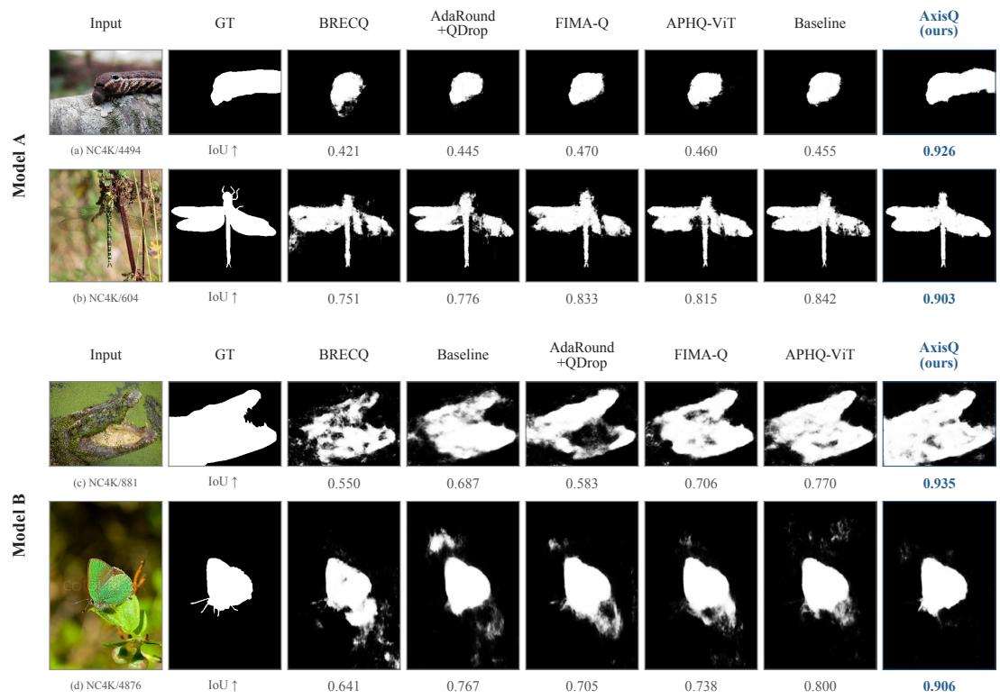
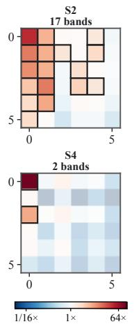
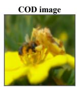
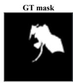
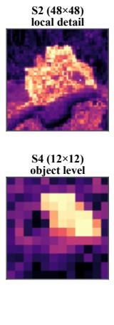
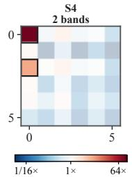
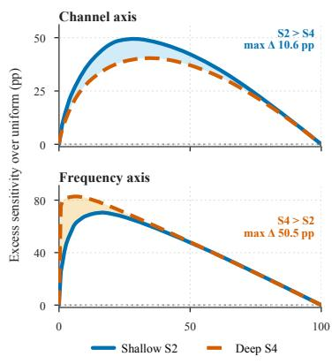
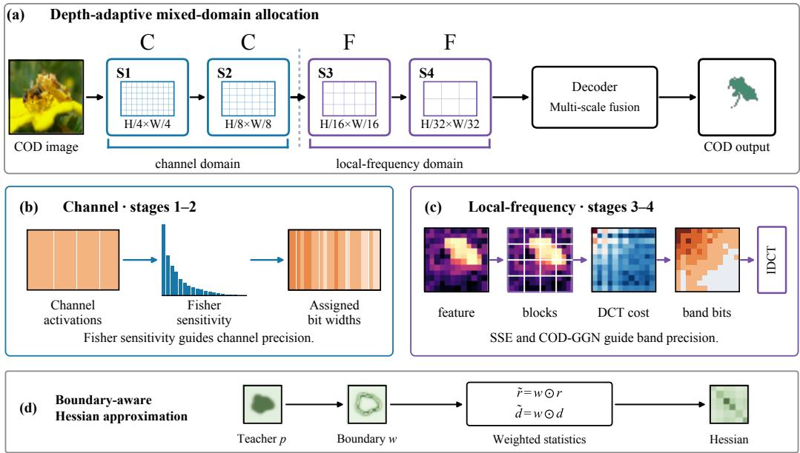
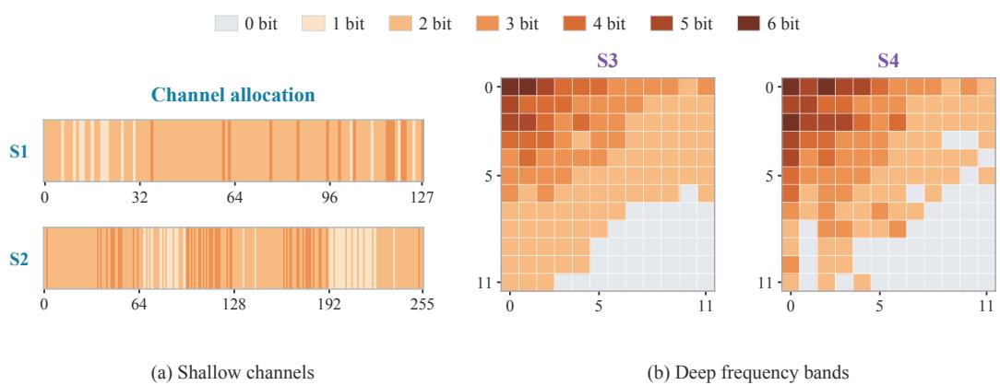

# AXISQ: DEPTH-ADAPTIVE CHANNEL–FREQUENCY QUANTIZATION FOR CAMOUFLAGED OBJECT DETECTION

Chi Ruan1, Tianqi Li2, Xin He3, Xue Geng4, Ming-Ming Cheng2, Yun Liu2 1SpinEntropy, 2Nankai University, 3Tianjin University of Technology, 4I2R, A\*STAR

## ABSTRACT

Camouflaged object detection (COD) depends on weak texture and boundary cues that can be destroyed by aggressive post-training quantization (PTQ). Existing PTQ methods mainly optimize quantizers or reconstruct network blocks, while using a single precision-allocation domain throughout hierarchical backbones. Instead, we introduce AxisQ, a depth-adaptive bit-allocation framework motivated by the observation that the useful allocation axis changes with feature depth. Under a fixed per-layer average activation-bit budget, AxisQ allocates precision in the channel domain for shallow features and in the localfrequency domain for deep features, using COD-aware sensitivity to better preserve subtle foreground regions and ambiguous boundaries. We also formulate a boundary-aware Hessian approximation for reconstruction by incorporating boundary-weighted gradient and error statistics. Experiments across multiple COD models and diverse benchmarks demonstrate improved accuracy over the strongest baselines at low bit widths, with relative weighted F-measure gains of 12.7% for CFRN and 33.3% for CamoFormer-P on CAMO under W2A2 quantization. These results support adapting the allocation domain to feature depth as a transferable quantization strategy for hierarchical COD models. Code: https://github.com/chi558/AxisQ.

## 1 INTRODUCTION

Camouflaged object detection (COD) segments objects whose color, texture, and boundaries resemble their surroundings (Fan et al., 2020). This makes accurate prediction unusually dependent on low-amplitude and spatially structured evidence. Modern state-of-the-art COD models (Hu et al., 2023; Yin et al., 2024; Song et al., 2025) usually use hierarchical Transformers to combine fine local details with semantic context, but their memory and arithmetic cost complicate deployment. Post-training quantization (PTQ) is attractive because it compresses a trained model without end-toend retraining (Nagel et al., 2020; Li et al., 2021). At low bit widths, however, a small calibration error can erase precisely the cues that distinguish a camouflaged foreground from its background. Figure 1 illustrates foreground omissions and inaccurate boundaries under low-bit quantization.

Sensitivity-aware mixed precision and curvature-based reconstruction already account for the unequal effects of quantization perturbations (Li et al., 2021; Wu et al., 2025a). In the context of COD, recent calibration work addresses the loss of weak target cues caused by activation-range imbalance (Li et al., 2026). However, these methods typically retain the same precision-allocation domain throughout the model. Whether this domain remains suitable as features change from shallow to deep stages is less explored. This motivates exploring whether allocating precision in different domains across stages can improve quantization performance.

To investigate this possibility, we examine how feature characteristics at different depths affect the choice of precision-allocation domain. Shallow features capture local patterns, and their channel differ in sensitivity to quantization. Allocating bits by channel allows more precision to be assigned to those carrying weak target cues. Deeper features combine information over larger spatial regions. In these features, local frequency bands separate smooth spatial content from variations associated with boundaries and textures, allowing these components to receive different precision. This difference suggests that shallow and deep features may benefit from different allocation domains. The analysis in Figure 2 supports channel-wise allocation in shallow stages and local-frequency allocation in deep stages.

  
Figure 1: Qualitative comparison of quantization methods on two COD models at W2A2. Model A is CFRN, and Model B is CamoFormer-P. Each pair of rows corresponds to one model, with IoU reported for each prediction against the ground-truth mask. The compared methods show incomplete foreground regions and false detections in the background. In these examples, AxisQ recovers more complete object shapes and clearer boundaries while reducing background false positives.

Accordingly, we propose AxisQ, which allocates precision across channels in shallow stages and across local-frequency bands in deep stages. Figure 3 shows the overall framework. Figure 1 shows improved foreground and boundary preservation at W2A2 across both architectures. Under a fixed per-layer average activation-bit budget, AxisQ uses COD-aware sensitivity to assign higher precision to components important for foreground and boundary prediction. We also formulate a boundaryaware Hessian approximation for reconstruction using boundary-weighted gradient and error statis tics. Experiments demonstrate AxisQ’s gains across COD models and precision settings. At W2A2, AxisQ improves mean weighted F-measure over the best competing results by 6.6% on CFRN and 21.5% on CamoFormer-P across four benchmarks.

In summary, our main contributions include:

• We propose AxisQ, a depth-adaptive mixed-domain PTQ framework allocating activation precision across shallow-stage channels and deep-stage local-frequency bands under a fixed per-layer average-bit budget, with an auxiliary boundary-aware Hessian approximation.

• We develop task-sensitive channel-bit allocation for COD. Label-assisted empirical-Fisher costs measure channel sensitivity, while reverse water filling followed by exact budget correction assigns channel bit widths while satisfying each layer’s budget exactly.

• We derive a positive-semidefinite COD-GGN cost for local-frequency allocation. It balances foreground and background contributions and emphasizes multi-scale boundaries and uncertain pixels, using one first-order probe per layer and calibration batch.

  
(a) Sample  
(b) Features

  
(c) DCT sensitivity

  
(d) Domain concentration  
Figure 2: Depth-dependent sensitivity on a selected COD image. (a) shows the input and groundtruth mask, and (b) shows independently normalized S2 and S4 feature responses. In (c), 17 bands in S2 and two in S4 account for 80% of DCT sensitivity. (d) plots cumulative sensitivity above uniform versus the percentage of top-ranked channels or frequency bands, with separate vertical scales. Sensitivity is more concentrated across channels in S2 and across frequency bands in S4, supporting channel-wise allocation in shallow stages and local-frequency allocation in deep stages.

## 2 RELATED WORK

Camouflaged object detection. COD methods aim to distinguish concealed targets from similar backgrounds while recovering fine object structures (Mei et al., 2021; Sun et al., 2022). Early approaches addressed target localization through classification-assisted segmentation in ANet (Le et al., 2019) and a search-and-identification framework in SINet (Fan et al., 2020). Later work introduced complementary information to recover less visible regions: ZoomNet fused features across image scales (Pang et al., 2022), while FDCOD incorporated frequency-domain cues (Zhong et al., 2022). Transformer-based methods combine semantic context and spatial detail. HitNet used high resolution feedback to refine low-resolution representations (Hu et al., 2023), and CamoFormer progressively refined predictions through masked separable attention (Yin et al., 2024). Our work examines how to preserve foreground localization and detailed structures under low-bit quantization.

Post-training quantization. PTQ research addresses quantization errors through reconstruction and adapts quantizers to feature distributions through calibration (Banner et al., 2019; Liu et al., 2023). AdaRound and BRECQ match full-precision outputs by optimizing rounding at layer and block levels, respectively (Nagel et al., 2020; Li et al., 2021), while QDrop improves robustness to activation quantization (Wei et al., 2022). Vision Transformers require calibration tailored to attention and normalization layers (Ding et al., 2022). This motivates attention-ranking constraints (Liu et al., 2021b), distribution-aware quantizers in PTQ4ViT and FQ-ViT (Yuan et al., 2022; Lin et al., 2022), and scale reparameterization in RepQ-ViT (Li et al., 2023). These methods quantize existing feature representations; our work explores depth-dependent allocation domains.

Sensitivity-aware quantization. Quantization errors affect model predictions unequally (Dong et al., 2020; Tai & Wu, 2024). HAWQ uses Hessian information to allocate layer-wise precision (Dong et al., 2019). For reconstruction, FIMA-Q weights feature errors with diagonal and low-rank Fisher approximations (Wu et al., 2025a), while LS-ViT fits curvature through least squares (Hwang et al., 2026). COD-TDQ constrains token-group ranges to protect weak boundary cues from background-dominated quantization (Li et al., 2026). These methods consider information importance beyond numerical error, motivating allocation domains that expose task-relevant features at different depths.

  
Figure 3: Overview of AxisQ for a four-stage hierarchical encoder. Channel-domain allocation is used in shallow and eligible non-frequency paths, while deep encoder features use local-frequency allocation. The strip and grid visualize channel-wise and frequency-wise activation-bit assignments at W2A2; darker orange indicates higher precision, and gray denotes zero-bit bands. (d) sketches the auxiliary boundary-aware Hessian approximation using teacher-derived boundary weights and weighted gradient statistics.

## 3 METHOD

This section presents our depth-adaptive mixed-domain quantization framework for hierarchical COD models. It covers channel-wise allocation in shallow stages, frequency-wise allocation in deep stages, and the corresponding reconstruction procedure.

## 3.1 DEPTH-ADAPTIVE MIXED-DOMAIN ALLOCATION

Low-bit quantization can suppress the weak foreground and boundary cues required for COD. Fig ure 2 suggests that sensitivity is more concentrated across channels in shallow features and across local-frequency bands in deep features, so we adapt the allocation domain to network depth.

Let $f ( \pmb { x } ; \pmb { \theta } )$ denote a trained hierarchical COD model, and let $\boldsymbol { A } _ { \ell } \in \mathbb { R } ^ { B \times N _ { \ell } \times C _ { \ell } }$ denote the input activation of layer ℓ. We use an asymmetric b-bit uniform quantizer:

$$
Q _ { b } ( a ; s , z ) = s \left[ \mathrm { c l i p } \big ( \mathrm { r o u n d } ( a / s ) + z , 0 , 2 ^ { b } - 1 \big ) - z \right] ,\tag{1}
$$

where s and z are the quantization scale and zero point, respectively. Weights are quantized at a fixed precision of $W _ { b }$ bits. The activation of layer ℓ is partitioned into $K _ { \ell }$ allocation units, namely channels or local-frequency bands, and each unit k receives a bit width $b _ { \ell , k }$ from a set of allowed tiers B. We seek

$$
\operatorname* { m i n } _ { \{ b _ { \ell , k } \} \subset B } \sum _ { k = 1 } ^ { K _ { \ell } } \mathcal { D } _ { \ell , k } ( b _ { \ell , k } ) \quad \mathrm { s . t . } \quad \frac { 1 } { K _ { \ell } } \sum _ { k = 1 } ^ { K _ { \ell } } b _ { \ell , k } = A _ { b } ,\tag{2}
$$

where $\mathcal { D } _ { \ell , k } ( b )$ estimates how quantizing unit k at b bits affects COD predictions.

As shown in Figure 3, AxisQ instantiates Eq. (2) with two depth-specific branches followed by a shared reconstruction stage. Stages 1–2 use channels as units with label-assisted empirical-Fisher costs, while stages 3–4 use block-DCT local-frequency bands with costs that combine reconstruction error and COD-GGN sensitivity. The stage partition is fixed before calibration and retained across precision settings; frequency allocation takes precedence when both branches are applicable.

After calibration, the assignments are frozen for blockwise reconstruction, where the boundaryaware Hessian approximation serves as an auxiliary extension. Sections 3.2–3.4 develop these three components in order.

## 3.2 TASK-SENSITIVE CHANNEL-BIT ALLOCATION

Empirical-Fisher channel cost. We compute the supervised binary-cross-entropy loss on a small paired COD calibration subset. For layer $\ell ,$ channel $c ,$ and candidate bit tier $b ,$ the per-channel empirical-Fisher distortion (Kunstner et al., 2019) is

$$
D _ { \ell , c } ^ { ( b ) } = \mathbb { E } _ { ( \pmb { x } , \pmb { y } ) } \left[ \left( \sum _ { n } \frac { \partial \mathcal { L } } { \partial A _ { \ell , n , c } } \left( Q _ { b } ( \pmb { A } _ { \ell , n , c } ) - \pmb { A } _ { \ell , n , c } \right) \right) ^ { 2 } \right] ,\tag{3}
$$

where $n$ indexes spatial or token positions and any remaining non-channel dimensions, $Q _ { b }$ is the $b \mathrm { - }$ bit activation quantizer, and the expectation is taken over image-label pairs in the calibration subset. The inner sum approximates the first-order loss change caused by quantizing channel $c ;$ squaring and averaging this response gives the channel distortion used for bit allocation. The score retains interactions within a channel while ignoring cross-channel interactions. It uses only first derivative and 64 ground-truth masks.

Reverse water filling. In Eq. $( 2 ) , D _ { \ell , c } ( b ) = D _ { \ell , c } ^ { ( b ) }$ . We use the reference-tier costs in a budgetpreserving heuristic. Given a target average activation precision $A _ { b } ,$ we initialize a continuous precision for each channel by adjusting $A _ { b }$ according to its log sensitivity relative to the layer mean:

$$
\widetilde { b } _ { \ell , c } = A _ { b } + \gamma \left[ \log _ { 2 } \Bigl ( D _ { \ell , c } ^ { ( b _ { \mathrm { r e f } } ) } + \epsilon \Bigr ) - \frac { 1 } { C _ { \ell } } \sum _ { j = 1 } ^ { C _ { \ell } } \log _ { 2 } \Bigl ( D _ { \ell , j } ^ { ( b _ { \mathrm { r e f } } ) } + \epsilon \Bigr ) \right] ,\tag{4}
$$

where $b _ { \mathrm { r e f } }$ is a reference bit tier, $\gamma$ controls the strength of sensitivity-based reallocation, and ϵ improves numerical stability. Channels with larger distortion therefore receive higher initial precision. We round the continuous values to the allowed bit tiers and greedily adjust the assignments until $\begin{array} { r } { C _ { \ell } ^ { - 1 } \sum _ { c } b _ { \ell , c } = A _ { b } } \end{array}$ exactly. This layer-wise allocation gives more bits to sensitive channels while preserving the target average precision $A _ { b }$ for each layer.

## 3.3 COD-GGN TASK-AWARE FREQUENCY ALLOCATION

Block-frequency representation and reconstruction cost. For deep activations, we partition the spatial feature map into local blocks and apply an orthonormal 2-D DCT to each block. Coefficients at the same within-block frequency coordinate are grouped into a frequency band and share one bit width. Let $\tau$ denote the block-DCT transform and $b _ { \ell }$ the band-wise bit assignment. The quantized activation is reconstructed as

$$
\widehat { A } _ { \ell } = \mathcal { T } ^ { - 1 } ( Q _ { b _ { \ell } } \left( \mathcal { T } ( A _ { \ell } ) \right) ) ,\tag{5}
$$

where $\tau$ is the block-DCT transform.

For frequency band k and candidate bit tier $b ,$ let $u _ { i , k }$ denote the DCT coefficient from calibration sample i. We estimate the reconstruction cost by

$$
C _ { k , b } ^ { \mathrm { S S E } } = \operatorname* { m i n } _ { { r } } \sum _ { i } \left( Q _ { b , r } ( u _ { i , k } ) - u _ { i , k } \right) ^ { 2 } .\tag{6}
$$

where r indexes candidate clipping ranges. The minimum over r selects the clipping range that gives the smallest reconstruction error for each band and bit tier. This SSE term measures coefficient distortion without task weighting; the COD-aware cost introduced below accounts for the task sensitivity of different frequency bands. These SSE values provide a reconstruction-only reference for comparing candidate bit tiers before task sensitivity is incorporated. Each band is evaluated independently, so candidate tiers share a common reconstruction criterion.

COD-aware curvature and frequency cost. Reconstruction error weights all DCT coefficient errors equally, although COD is more sensitive to errors near object boundaries, uncertain predictions, and small foreground regions. From the full-precision teacher probability map $\pmb { p } = \sigma ( z )$ , we define the output-space task metric

$$
\begin{array} { c } { \displaystyle \Omega = \mathrm { N o r m } ( R ( { \pmb p } ) [ 1 + \alpha B ( { \pmb p } ) ] U ( { \pmb p } ) ) , } \\ { \displaystyle B ( { \pmb p } ) = \frac { 1 } { | { \pmb Q } | } \sum _ { q \in { \pmb Q } } \left| \mathrm { A v g P o o l } _ { q } ( { \pmb p } ) - { \pmb p } \right| , } \\ { \displaystyle U ( { \pmb p } ) = \eta + ( 1 - \eta ) 4 { \pmb p } ( 1 - { \pmb p } ) . } \end{array}\tag{7}
$$

Here R balances foreground and background mass, B captures multi-scale boundary variation, and U emphasizes uncertain predictions while retaining a nonzero floor. Together, these factors separate global mass balance from local task structure: R prevents large regions from dominating, while B and U highlight boundary changes and uncertain predictions. Their product is normalized independently for each image, so the probe represents relative task importance rather than output magnitude.

Using a Rademacher probe, we map this output-space metric to the activation at layer ℓ through a vector–Jacobian product (VJP). This produces a positive-semidefinite COD-aware generalized Gauss–Newton (COD-GGN) curvature surrogate without constructing a full Hessian (Martens, 2020). The probe response and the quantization error are expressed in the same block-DCT basis. For frequency band k and candidate bit tier $b ,$ we define the task-aware cost and its fusion with the reconstruction cost as

$$
\begin{array} { c } { C _ { k , b } ^ { \mathrm { t a s k } } = \displaystyle \sum _ { i } ( g _ { i , k } ) ^ { 2 } ( \pmb { e } _ { i , k } ^ { ( b ) } ) ^ { 2 } , } \\ { C _ { k , b } = ( 1 - \beta ) \frac { C _ { k , b } ^ { \mathrm { S S E } } } { \displaystyle \sum _ { j } C _ { j , b _ { \mathrm { r e f } } } ^ { \mathrm { S S E } } } + \beta \frac { C _ { k , b } ^ { \mathrm { t a s k } } } { \displaystyle \sum _ { j } C _ { j , b _ { \mathrm { r e f } } } ^ { \mathrm { t a s k } } } . } \end{array}\tag{8}
$$

Here $g _ { i , k }$ and $e _ { i , k } ^ { ( b ) }$ are the transformed probe response and quantization error for sample i and band k. A larger probe response makes the same quantization error more costly and therefore favors a higher bit tier. Reference-tier normalization keeps the two terms comparable, while $\beta$ controls the influence of task sensitivity. With $\mathcal { D } _ { \ell , k } ( b ) = C _ { k , b }$ in Eq. (2), the Lagrangian relaxation gives $b _ { k } = \mathrm { a r g }$ minb $( C _ { k , b } + \lambda b )$ . We then greedily correct the assignments so that their average equals $A _ { b }$ exactly.

The SSE term measures coefficient distortion, whereas the task term increases the penalty for errors in COD-sensitive directions. Setting β = 0 recovers a reconstruction-only frequency allocator; larger $\beta$ shifts the allocation toward task-sensitive bands. After correction, the frozen band assignments are passed to the shared reconstruction procedure below. All task costs are computed during calibration and discarded after the assignments are frozen, so the selected quantizers introduce no additional inference-time COD computation.

## 3.4 BOUNDARY-AWARE RECONSTRUCTION

After allocations are frozen, we reconstruct the model block by block using the existing Hessianbased reconstruction objective (Hwang et al., 2026), AdaRound weight variables (Nagel et al., 2020), and QDrop (Wei et al., 2022). This pipeline is shared by matched baselines and AxisQ; COD-GGN affects only frequency calibration, while the boundary-aware extension is evaluated separately.

To make reconstruction boundary-aware, we reweight the gradient and error statistics before the existing Hessian fitting procedure. For calibration image i at block ℓ, let ${ \mathbf { } } r _ { \ell , i }$ be the absolute teacherloss gradient and $\mathbf { \Delta } d _ { \ell , i }$ its absolute deviation from the full-precision output. With the teacher probability map $_ { \mathbf { \delta } ^ { p _ { \ell , i } } }$ resized to the block grid, we use

$$
\begin{array} { r } { \pmb { w } _ { \ell , i } = 1 + \alpha _ { \mathrm { r e c } } \left| \mathrm { A v g P o o l } _ { k _ { \ell } } ( \pmb { p } _ { \ell , i } ) - \pmb { p } _ { \ell , i } \right| , } \\ { \widetilde { \pmb { r } } _ { \ell , i } = \pmb { w } _ { \ell , i } \odot \pmb { r } _ { \ell , i } , \qquad \widetilde { d } _ { \ell , i } = \pmb { w } _ { \ell , i } \odot \pmb { d } _ { \ell , i } . } \end{array}\tag{9}
$$

The weight map is expanded to the flattened block statistics. Larger local prediction variation therefore gives boundary-sensitive responses more weight in the curvature fit. Applying the same map to the gradient and error vectors preserves their correspondence with the original reconstruction statistics. AdaRound, QDrop, and final-logit BCE reconstruction remain unchanged. Because the weights come from the teacher prediction, no additional segmentation labels are required.

## 4 EXPERIMENTS

This section evaluates AxisQ across various COD models and benchmarks under different quantization settings. We describe the experimental setup, present comparisons with existing methods, and examine the contributions of individual components.

## 4.1 EXPERIMENTAL SETUP

Models and quantization settings. We quantize the Swin-based CFRN model (Song et al., 2025; Liu et al., 2021a) and CamoFormer-P (Yin et al., 2024; Wang et al., 2022) at input resolution $3 8 4 \times 3 8 4$ Models A and B in Figure 1 denote CFRN and CamoFormer-P, respectively. The main comparison evaluates both models at W2A2 and W4A4, with additional W2A3, W2A4, and W3A3 results on CFRN. These settings allow us to evaluate AxisQ’s performance across different precision levels. Patch-embedding activations remain at A8 for every method and precision setting.

Datasets and evaluation metrics. Evaluation uses the standard CAMO, CHAMELEON, COD10K, and NC4K test sets (Le et al., 2019; Skurowski et al., 2018; Fan et al., 2020; Lv et al., 2021). We report S-measure $S _ { \alpha }$ (Fan et al., 2017) for structural similarity and weighted F-measure $F _ { \beta } ^ { w }$ (Margolin et al., 2014) for spatially weighted precision and recall. Mean E-measure $E _ { \phi }$ (Fan et al., 2018) assesses local and global alignment, averaged across thresholds. Maximum F-measure $F _ { \beta } ^ { m }$ is the highest F-score across thresholds, while MAE measures the mean absolute pixel-wise prediction error. Higher is better except for MAE. Macro metrics give equal weight to each dataset. Macro quality averages $S _ { \alpha } , F _ { \beta } ^ { w } , E _ { \phi } \mathrm { ~ \bar { { F } } _ { \beta } ^ { { m } } }$ , and 1 − MAE with equal weights across metrics and datasets.

Implementation details. All calibration samples are drawn from the training set. The calibration pool contains 128 images, processed with batch size 4. We use 64 paired image–mask samples with batch size 2 to estimate channel-domain Fisher costs, and 16 images to estimate deep frequency and COD-GGN costs. Block reconstruction uses 1,024 images, an effective batch size of 32, and 20,000 optimization iterations per block. QDrop is applied with probability 0.5. We set the channel allocation spread to $\gamma = 0 . 3 0$ and use 12 × 12 DCT blocks with eight candidate clipping ratios. For COD-GGN, we use pooling sizes $\mathcal { Q } = \{ 3 , 7 , 1 5 \}$ , boundary weight $\alpha = 2 .$ , uncertainty floor $\eta = 0 . 1$ , and cost mixing weight $\beta = 0 . 1 0$ . The output weights are normalized to mean one per image and capped at 8. Both frequency cost terms are normalized at the reference tier $b _ { \mathrm { r e f } } = 2$ These settings, the stage split, and the reconstruction length remain fixed across precision budgets.

Compared methods. We compare with LS-ViT (Hwang et al., 2026), BRECQ (Li et al., 2021), AdaRound+QDrop (Nagel et al., 2020; Wei et al., 2022), FIMA-Q (Wu et al., 2025a), and APHQ-ViT (Wu et al., 2025b) on both models, and additionally with RepQ-ViT (Li et al., 2023) and COD-TDQ (Li et al., 2026) on CFRN. These methods cover calibration-based quantization, adaptive rounding, and curvature-based reconstruction. All comparator results use local COD adaptations. Reconstruction-based methods use 20,000 optimization iterations per block; RepQ-ViT and COD-TDQ use no reconstruction. COD-TDQ retains full-precision attention matrix multiplications; its W2A2 row is a local four-level affine extension, not an author-released W2A2 result. FP32 results provide the full-precision reference for each model.

## 4.2 QUANTITATIVE RESULTS

AxisQ delivers substantial gains under W2A2 quantization across both backbones, as shown in Table 1. It leads all 20 dataset–metric comparisons on CFRN and 19 on CamoFormer-P. On CAMO, its weighted F-measure exceeds the best competing result by 0.082 on CFRN and 0.125 on CamoFormer-P. The consistent improvements across models and evaluation measures support the effectiveness of AxisQ in preserving segmentation quality under a tight bit budget.

The advantage remains consistent at W4A4. At the reported three-decimal precision, AxisQ achieves the best quantized result in 33 of the 40 dataset–metric comparisons and ties for the best in the remaining seven. This shows that its benefit extends to higher-precision quantization, where reconstruction-based methods already perform closely. Although the margins are smaller than at W2A2, AxisQ maintains a consistently strong position across both models and all four datasets.

Table 1: Quantitative comparison on CFRN and CamoFormer-P across four COD benchmarks at W4A4 and W2A2. FP32 denotes the full-precision reference. Bold indicates the best quantized results within each model and precision setting.
<table><tr><td></td><td colspan="5">CAMO</td><td colspan="5">CHAMELEON</td><td colspan="5">COD10K</td><td colspan="5">NC4K</td></tr><tr><td>Method</td><td colspan="2">Sα↑ FB↑ Eφ↑ Fm↑ MAE↓ Sα↑ FB↑ Eφ↑ Fm↑ MAE↓ Sα↑ FB↑ Eφ↑ Fm↑ MAE↓ Sα↑ FB↑ Eφ↑ Fm↑ MAE↓</td><td colspan="2"></td><td></td><td></td><td></td><td></td><td></td><td></td><td></td><td></td><td></td><td></td><td></td><td></td><td></td><td></td><td></td><td></td><td></td></tr><tr><td></td><td></td><td></td><td></td><td></td><td></td><td></td><td></td><td>CFRN</td><td></td><td></td><td></td><td></td><td></td><td></td><td></td><td></td><td></td><td></td><td></td><td></td></tr><tr><td>FP32</td><td>.876 .843 .932 .877</td><td></td><td></td><td></td><td>.042</td><td>.912 .874 .959</td><td></td><td>.898</td><td></td><td>.020</td><td>.870 .794 .937 .835</td><td></td><td></td><td></td><td>.022</td><td></td><td></td><td></td><td>.888 .849 .939 .880</td><td>.030</td></tr><tr><td></td><td></td><td></td><td></td><td></td><td></td><td></td><td></td><td></td><td>W4A4</td><td></td><td></td><td></td><td></td><td></td><td></td><td></td><td></td><td></td><td></td><td></td></tr><tr><td>RepQ-ViT</td><td></td><td>.676.608</td><td>.750</td><td>.656</td><td>.099</td><td>.701</td><td>.622</td><td>.774</td><td>.672</td><td>.067</td><td>.676 .549 .779</td><td></td><td>.599</td><td></td><td>.062</td><td>.718 .651</td><td>.783</td><td></td><td>.691</td><td>.072</td></tr><tr><td>COD-TDQ</td><td></td><td></td><td>.813 .723 .864</td><td>.795</td><td>.070</td><td>.861</td><td>.759</td><td>.906</td><td>.825</td><td>.040</td><td>.802 .650 .864</td><td></td><td></td><td>.737</td><td>.038</td><td></td><td>.836.746</td><td>.883</td><td>.816</td><td>.052</td></tr><tr><td>LS-ViT</td><td></td><td></td><td>.860 .816 .916</td><td>.855</td><td>.048</td><td>.906 .857 .951</td><td></td><td></td><td>.887</td><td>.023</td><td>.850 .754 .915</td><td></td><td></td><td>.802</td><td>.026</td><td>.875 .824 .925</td><td></td><td></td><td>.862</td><td>.035</td></tr><tr><td>BRECQ</td><td></td><td></td><td>.864 .823 .919 .861</td><td></td><td>.047</td><td>.907 .857 .956</td><td></td><td></td><td>.883</td><td>.022</td><td>.859 .769 .923</td><td></td><td>.815</td><td></td><td>.024</td><td></td><td>.881 .834 .930</td><td>.870</td><td></td><td>.033</td></tr><tr><td>AdaRound+QDrop.863</td><td></td><td></td><td>.823 .917 .861</td><td></td><td>.047</td><td>.907 .860 .951</td><td></td><td></td><td>.886</td><td>.022</td><td>.859 .771 .923</td><td></td><td>.815</td><td></td><td>.024</td><td></td><td>.881 .836 .929</td><td>.871</td><td></td><td>.033</td></tr><tr><td>FIMA-Q</td><td></td><td></td><td>.865 .825 .920 .863</td><td></td><td>.046</td><td>.907 .861</td><td></td><td>.951</td><td>.888</td><td>.022</td><td>.859 .772 .923 .816</td><td></td><td></td><td></td><td>.024</td><td></td><td></td><td>.881 .836 .929 .871</td><td></td><td>.033</td></tr><tr><td>APHQ-ViT</td><td></td><td>.866 .827</td><td>.921</td><td>.864</td><td>.046</td><td>.907</td><td>.859</td><td>.951</td><td>.886</td><td>.022</td><td>.859.772</td><td>.923</td><td>.817</td><td></td><td>.024</td><td>.882 .837</td><td>.930</td><td>.872</td><td></td><td>.033</td></tr><tr><td>AxisQ (ours)</td><td></td><td></td><td>.869 .832 .924</td><td>.870</td><td>.044</td><td>.909 .865</td><td></td><td>.956</td><td>.893</td><td>.021</td><td>.861 .775 .925</td><td></td><td>.820</td><td></td><td>.024</td><td></td><td>.883 .838 .932</td><td>.873</td><td></td><td>.033</td></tr><tr><td></td><td></td><td></td><td></td><td></td><td></td><td></td><td></td><td></td><td>W2A2</td><td></td><td></td><td></td><td></td><td></td><td></td><td></td><td></td><td></td><td></td><td></td></tr><tr><td>COD-TDQ (ext.)</td><td></td><td>.261 .162</td><td>.244</td><td>.218</td><td>.614</td><td>.239</td><td>.133</td><td>.236</td><td>.171</td><td>.662</td><td>.249 .082</td><td>.234</td><td>.112</td><td>.648</td><td>.258</td><td>.138</td><td>.240</td><td></td><td></td><td>.629</td></tr><tr><td>RepQ-ViT</td><td></td><td>.386.106</td><td>.485</td><td>.218</td><td>.247</td><td>.400</td><td>.085</td><td>.511</td><td>.171</td><td>.215</td><td>.421</td><td>.061</td><td>.534</td><td>.111</td><td>.175</td><td>.399</td><td>.093</td><td>.503</td><td>.185 .185</td><td>.224</td></tr><tr><td>BRECQ</td><td></td><td></td><td>.702 .559 .764 .641</td><td></td><td>.113</td><td>.779</td><td>.625</td><td>.839</td><td>.709</td><td>.066</td><td>.734 .521 .803</td><td></td><td></td><td>.607</td><td>.059</td><td>.787 .659</td><td></td><td>9.841</td><td>.736</td><td>.072</td></tr><tr><td>AdaRound+QDrop .713 .583 .749 .668</td><td></td><td></td><td></td><td></td><td>.102</td><td></td><td></td><td>.803 .681 .859</td><td>.750</td><td>.052</td><td>.759 .580 .806</td><td></td><td>.654</td><td></td><td>.045</td><td></td><td>.805 .700 .845</td><td>.767</td><td></td><td>.060</td></tr><tr><td>FIMA-Q</td><td></td><td>.729 .612 .767</td><td></td><td>.694</td><td>.097</td><td>.804 .686 .851</td><td></td><td></td><td>.756</td><td>.048</td><td>.766 .596 .819 .668</td><td></td><td></td><td></td><td>.044</td><td></td><td>.814 .716 .856</td><td>.779</td><td></td><td>.057</td></tr><tr><td>APHQ-ViT</td><td></td><td>.743 .631 .785</td><td></td><td>.707</td><td>.093</td><td>.823 .712</td><td></td><td>.874.776</td><td></td><td>.047</td><td>.774 .608 .828</td><td></td><td>.679</td><td>.042</td><td></td><td>.818.723</td><td>.861</td><td>.785</td><td></td><td>.056</td></tr><tr><td>LS-ViT</td><td></td><td>.746.645 .794</td><td></td><td>.725</td><td>.089</td><td>.826 .722</td><td></td><td>.873 .786</td><td></td><td>.045</td><td>.782 .624 .836</td><td></td><td>.693</td><td>.040</td><td></td><td>.824 .735</td><td>.867</td><td>.794</td><td></td><td>.054</td></tr><tr><td>AxisQ (ours)</td><td>.798 .727</td><td></td><td>.861 .787</td><td></td><td>.071</td><td>.851.766</td><td></td><td>.924.809</td><td></td><td>.036</td><td>.793 .654 .862</td><td></td></table>

The two backbones show different sensitivity to low-bit quantization. Their FP32 mean weighted F-measures are relatively close, but CamoFormer-P suffers a larger drop under the W2A2 LS-ViT baseline. AxisQ raises mean weighted F-measure over this baseline by approximately 0.104 on CamoFormer-P, compared with 0.045 on CFRN. This larger recovery on the more affected backbone further demonstrates AxisQ’s ability to alleviate severe quantization degradation across models.

Table 2 further demonstrates the applicability of AxisQ across different precision budgets on CFRN. With shared allocation hyperparameters, it improves 94 of the 100 dataset–metric comparisons against precision-matched baselines, including all 20 comparisons at W2A2, W3A3, and W4A4. With weights fixed at two bits, mean weighted F-measure gains remain positive as activation precision increases from two to four bits. These results support using the same allocation strategy across different combinations of weight and activation precision.

## 4.3 ABLATION STUDIES AND ALLOCATION ANALYSIS

Table 3 suggests that the allocation domain should be chosen according to feature depth. The mixeddomain no-GGN variant improves macro weighted F-measure by 0.025 over the stronger frequencyonly control, exceeding that control’s 0.013 gain over the baseline. This gap is consistent with the complementary roles of channel sensitivity in shallow features and frequency structure in deep features. The accompanying reduction in MAE supports an overall improvement in prediction quality.

Table 2: AxisQ gains across precisions.
<table><tr><td>Setting  $\Delta S _ { \alpha } \Delta F _ { \beta } ^ { w } \Delta E _ { \phi } \Delta F _ { \beta } ^ { m }$ </td><td>∆MAE Wins</td></tr><tr><td> $\mathrm { W 2 A 2 \ + . 0 2 5 + . 0 4 5 + . 0 4 2 \ + . 0 3 0 }$   $\mathrm { W 2 A 3 \ + . 0 0 6 + . 0 0 9 + . 0 0 8 \ + . 0 0 8 }$   $\mathrm { W 2 A 4 \ + . 0 0 2 + . 0 0 4 + . 0 0 1 \ + . 0 0 5 }$   $\mathrm { W 3 A 3 \ + . 0 0 6 + . 0 1 1 + . 0 1 0 \ + . 0 0 8 }$ </td><td>-.009 20/20 -.002 18/20 .000 16/20 -.002 20/20 -.003 20/20</td></tr></table>

Table 3: W2A2 quantization comparison.
<table><tr><td>Method  $S _ { \alpha }$  ↑ Fu β</td><td>↑  $E _ { \phi }$  个 Fm ↑MAE↓ β</td></tr><tr><td>Baseline .795 .681</td><td>.842 .749 .057</td></tr><tr><td>Channel-only .799</td><td>.688 .848 .749 .055</td></tr><tr><td>Frequency-only .802 AxisQ no GGN .813</td><td>.694 .854 .758 .054</td></tr><tr><td>AxisQ .819</td><td>.719 .875 .774 .050 .727 .884 .780 .048</td></tr></table>

  
Figure 4: Actual CFRN W2A2 bit assignments in the first attention-output projection of each encoder stage. Channels retain their original order; frequency maps use DCT coordinates. Every shown layer averages two bits. Gray indicates suppressed, zero-bit bands.

The full configuration improves structural agreement and prediction alignment while reducing pixel-wise error. These gains suggest improvements in both the overall structure of the predicted masks and their pixel-level accuracy. The improvements over no-GGN favor the complete design. Boundary-weighted reconstruction shows a similar pattern in the separate CFRN W2A4 comparison on CHAMELEON, supporting the relevance of boundary-focused reconstruction to overall mask quality.

Figure 4 visualizes CFRN’s frozen W2A2 bit assignments. Most shallow channels retain two bits, with selected channels adjusted to one or three bits. Deep layers show greater variation across fre quency bands: lower frequencies generally receive more precision, while part of the high-frequency region is suppressed with zero-bit assignments. Each displayed layer maintains an exact two-bit average. The differences between the S3 and S4 maps reflect layer-specific calibration costs, allowing each deep layer to distribute precision differently within the same frequency domain. This pattern illustrates how AxisQ redistributes a limited precision budget across different feature components, using channels in shallow stages and local frequencies in deep stages.

## 5 CONCLUSION

We presented AxisQ, a depth-adaptive post-training quantization framework for camouflaged object detection. Motivated by the changing characteristics of hierarchical features, AxisQ allocates activation precision across shallow channels and deep local-frequency bands under a fixed per-layer average-bit budget. Empirical-Fisher channel costs and COD-aware frequency costs guide this allocation toward components important for foreground and boundary prediction. We also formulated an auxiliary boundary-aware Hessian approximation that incorporates boundary-weighted gradient and error statistics into reconstruction. Experiments across COD models, benchmarks, and precision settings demonstrate the effectiveness of the mixed-domain allocation. This work highlights the importance of adapting both the allocation domain and its sensitivity measure to preserve task-relevant information in low-bit hierarchical COD models.

## ETHICS STATEMENT

This work studies low-bit quantization for camouflaged object detection using publicly available benchmarks. It involves no human-subject studies or collection of new personal data. Although efficient COD can support applications such as wildlife monitoring, its potential use in surveillance and military applications warrants consideration.

## REPRODUCIBILITY STATEMENT

We provide the implementation and configuration files for AxisQ, along with environment require ments and instructions for quantization and evaluation. These materials document the calibration data, precision settings, and reconstruction procedure, and include commands for evaluating the models on all four COD benchmarks.

## AI USE STATEMENT

We used generative AI tools to assist with code implementation and debugging, experimental analysis, and manuscript preparation, including English editing and LaTeX formatting. Reported results are based on experimental measurements and cited sources. The authors take responsibility for the accuracy and originality of the final manuscript and accompanying code.

## REFERENCES

Ron Banner, Yury Nahshan, and Daniel Soudry. Post training 4-bit quantization of convolutional networks for rapid-deployment. In Advances in Neural Information Processing Systems, volume 32, 2019.

Yifu Ding, Haotong Qin, Qinghua Yan, Zhenhua Chai, Junjie Liu, Xiaolin Wei, and Xianglong Liu. Towards accurate post-training quantization for vision transformer. In Proceedings of the 30th ACM International Conference on Multimedia, pp. 5380–5388, 2022. doi: 10.1145/3503161. 3547826.

Zhen Dong, Zhewei Yao, Amir Gholami, Michael W. Mahoney, and Kurt Keutzer. HAWQ: Hessian AWare quantization of neural networks with mixed-precision. In Proceedings of the IEEE/CVF International Conference on Computer Vision, pp. 293–302, 2019.

Zhen Dong, Zhewei Yao, Daiyaan Arfeen, Amir Gholami, Michael W. Mahoney, and Kurt Keutzer. HAWQ-V2: Hessian aware trace-weighted quantization of neural networks. In Advances in Neural Information Processing Systems, volume 33, 2020.

Deng-Ping Fan, Ming-Ming Cheng, Yun Liu, Tao Li, and Ali Borji. Structure-measure: A new way to evaluate foreground maps. In Proceedings of the IEEE International Conference on Computer Vision, pp. 4548–4557, 2017.

Deng-Ping Fan, Cheng Gong, Yang Cao, Bo Ren, Ming-Ming Cheng, and Ali Borji. Enhancedalignment measure for binary foreground map evaluation. In Proceedings of the Twenty-Seventh International Joint Conference on Artificial Intelligence, pp. 698–704, 2018. doi: 10.24963/ijcai. 2018/97.

Deng-Ping Fan, Ge-Peng Ji, Guolei Sun, Ming-Ming Cheng, Jianbing Shen, and Ling Shao. Camouflaged object detection. In Proceedings ofthe IEEE/CVF Conference on Computer Vision and Pattern Recognition, pp. 2777–2787, 2020.

Xiaobin Hu, Shuo Wang, Xuebin Qin, Hang Dai, Wenqi Ren, Donghao Luo, Ying Tai, and Ling Shao. High-resolution iterative feedback network for camouflaged object detection. In Proceedings of the AAAI Conference on Artificial Intelligence, volume 37, pp. 881–889, 2023. doi: 10.1609/aaai.v37i1.25167.

Hyunha Hwang, Xuan Truong Nguyen, and Hyuk-Jae Lee. Least-squares hessian based block reconstruction for low-bit post-training quantization of vision transformers. In Proceedings of the IEEE/CVF Conference on Computer Vision and Pattern Recognition, pp. 33588–33597, 2026.

Frederik Kunstner, Lukas Balles, and Philipp Hennig. Limitations of the empirical Fisher approximation for natural gradient descent. arXiv preprint arXiv:1905.12558, 2019. URL https: //arxiv.org/abs/1905.12558.

Trung-Nghia Le, Tam V. Nguyen, Zhiqiang Nie, Minh-Triet Tran, and Akihiro Sugimoto. Anabranch network for camouflaged object segmentation. Computer Vision and Image Understanding, 184:45–56, 2019. doi: 10.1016/j.cviu.2019.04.006.

Tianqi Li, Wenyu Fang, Xin He, Xue Geng, Xu Cheng, and Yun Liu. When W4A4 breaks camouflaged object detection: Token-group dual-constraint activation quantization. arXiv preprint arXiv:2604.16855, 2026.

Yuhang Li, Ruihao Gong, Xu Tan, Yang Yang, Peng Hu, Qi Zhang, Fengwei Yu, Wei Wang, and Shi Gu. BRECQ: Pushing the limit of post-training quantization by block reconstruction. In International Conference on Learning Representations, 2021.

Zhikai Li, Junrui Xiao, Lianwei Yang, and Qingyi Gu. RepQ-ViT: Scale reparameterization for post-training quantization of vision transformers. In Proceedings of the IEEE/CVF International Conference on Computer Vision, pp. 17227–17236, 2023.

Yang Lin, Tianyu Zhang, Peiqin Sun, Zheng Li, and Shuchang Zhou. FQ-ViT: Post-training quantization for fully quantized vision transformer. In Proceedings of the Thirty-First International Joint Conference on Artificial Intelligence, pp. 1173–1179, 2022.

Yijiang Liu, Huanrui Yang, Zhen Dong, Kurt Keutzer, Li Du, and Shanghang Zhang. NoisyQuant: Noisy bias-enhanced post-training activation quantization for vision transformers. In Proceedings of the IEEE/CVF Conference on Computer Vision and Pattern Recognition, pp. 20321–20330, 2023.

Ze Liu, Yutong Lin, Yue Cao, Han Hu, Yixuan Wei, Zheng Zhang, Stephen Lin, and Baining Guo. Swin transformer: Hierarchical vision transformer using shifted windows. In Proceedings of the IEEE/CVF International Conference on Computer Vision, pp. 10012–10022, 2021a.

Zhenhua Liu, Yunhe Wang, Kai Han, Wei Zhang, Siwei Ma, and Wen Gao. Post-training quantization for vision transformer. In Advances in Neural Information Processing Systems, volume 34, 2021b.

Yunqiu Lv, Jing Zhang, Yuchao Dai, Aixuan Li, Bowen Liu, Nick Barnes, and Deng-Ping Fan. Simultaneously localize, segment and rank the camouflaged objects. In Proceedings of the IEEE/CVF Conference on Computer Vision and Pattern Recognition, pp. 11591–11601, 2021.

Ran Margolin, Lihi Zelnik-Manor, and Ayellet Tal. How to evaluate foreground maps? In Proceed ings of the IEEE Conference on Computer Vision and Pattern Recognition, pp. 248–255, 2014.

James Martens. New insights and perspectives on the natural gradient method. Journal of Machine Learning Research, 21(146):1–76, 2020. URL https://jmlr.org/papers/v21/ 17-678.html.

Haiyang Mei, Ge-Peng Ji, Ziqi Wei, Xin Yang, Xiaopeng Wei, and Deng-Ping Fan. Camouflaged object segmentation with distraction mining. In Proceedings of the IEEE/CVF Conference on Computer Vision and Pattern Recognition, pp. 8772–8781, 2021.

Markus Nagel, Rana Ali Amjad, Mart van Baalen, Christos Louizos, and Tijmen Blankevoort. Up or down? adaptive rounding for post-training quantization. In Proceedings ofthe 37th International Conference on Machine Learning, volume 119 of Proceedings of Machine Learning Research, pp. 7197–7206, 2020.

Youwei Pang, Xiaoqi Zhao, Tian-Zhu Xiang, Lihe Zhang, and Huchuan Lu. Zoom in and out: A mixed-scale triplet network for camouflaged object detection. In Proceedings of the IEEE/CVF Conference on Computer Vision and Pattern Recognition, pp. 2160–2170, 2022.

Przemysław Skurowski, Hassan Abdulameer, Jakub Błaszczyk, Tomasz Depta, Adam Kornacki, and Przemysław Kozieł. Animal camouflage analysis: CHAMELEON database. Unpublished manuscript, 2018. URL https://www.polsl.pl/rau6/ chameleon-database-animal-camouflage-analysis/.

Ze Song, Xudong Kang, Xiaohui Wei, Jinyang Liu, Zheng Lin, and Shutao Li. Continuous feature representation for camouflaged object detection. IEEE Transactions on Image Processing, 34: 5672–5685, 2025. doi: 10.1109/TIP.2025.3602657.

Yujia Sun, Shuo Wang, Chenglizhao Chen, and Tian-Zhu Xiang. Boundary-guided camouflaged object detection. In Proceedings of the Thirty-First International Joint Conference on Artificial Intelligence, pp. 1335–1341, 2022. doi: 10.24963/ijcai.2022/186.

Yu-Shan Tai and An-Yeu (Andy) Wu. MPTQ-ViT: Mixed-precision post-training quantization for vision transformer. arXiv preprint arXiv:2401.14895, 2024. URL https://arxiv.org/ abs/2401.14895.

Wenhai Wang, Enze Xie, Xiang Li, Deng-Ping Fan, Kaitao Song, Ding Liang, Tong Lu, Ping Luo, and Ling Shao. PVT v2: Improved baselines with pyramid vision transformer. Computational Visual Media, 8(3):415–424, 2022. doi: 10.1007/s41095-022-0274-8.

Xiuying Wei, Ruihao Gong, Yuhang Li, Xianglong Liu, and Fengwei Yu. QDrop: Randomly dropping quantization for extremely low-bit post-training quantization. In International Conference on Learning Representations, 2022.

Zhuguanyu Wu, Shihe Wang, Jiayi Zhang, Jiaxin Chen, and Yunhong Wang. FIMA-Q: Post-training quantization for vision transformers by fisher information matrix approximation. In Proceedings of the IEEE/CVF Conference on Computer Vision and Pattern Recognition, pp. 14891–14900, 2025a.

Zhuguanyu Wu, Jiayi Zhang, Jiaxin Chen, Jinyang Guo, Di Huang, and Yunhong Wang. APHQ-ViT: Post-training quantization with average perturbation hessian based reconstruction for vision transformers. In Proceedings ofthe IEEE/CVF Conference on Computer Vision and Pattern Recognition, pp. 9686–9695, 2025b.

Bowen Yin, Xuying Zhang, Deng-Ping Fan, Shaohui Jiao, Ming-Ming Cheng, Luc Van Gool, and Qibin Hou. CamoFormer: Masked separable attention for camouflaged object detection. IEEE Transactions on Pattern Analysis and Machine Intelligence, 2024.

Zhihang Yuan, Chenhao Xue, Yiqi Chen, Qiang Wu, and Guangyu Sun. PTQ4ViT: Post-training quantization for vision transformers with twin uniform quantization. In European Conference on Computer Vision, pp. 191–207, 2022.

Yijie Zhong, Bo Li, Lv Tang, Senyun Kuang, Shuang Wu, and Shouhong Ding. Detecting camouflaged object in frequency domain. In Proceedings of the IEEE/CVF Conference on Computer Vision and Pattern Recognition, pp. 4504–4513, 2022.

## A EXPECTATION OF THE COD-GGN PROBE

COD-GGN uses teacher-derived output weights to account for foreground–background balance, boundaries, and prediction uncertainty during frequency allocation. Here we explain how a random probe transfers these weights to layer activations using a vector–Jacobian product (VJP) via firstorder backpropagation, without explicitly forming the Jacobian or Hessian.

For a fixed calibration image, let $J _ { \ell }$ be the Jacobian of the $H \times W$ output logits with respect to the flattened activation at layer ℓ. The model and the nonnegative teacher weights Ω in Equation 7 are held fixed; the expectation is over independent Rademacher entries of $\epsilon ,$ each equally likely to be $- 1 \ \mathrm { o r \ + 1 }$ . Thus $\mathbb { E } [ \boldsymbol { \epsilon } ] = 0$ and $\mathbb { E } [ \epsilon \epsilon ^ { \top } ] = I .$ . Defining ${ \pmb v } = \mathrm { d i a g } ( \Omega ) ^ { 1 / 2 } { \pmb \epsilon } / \sqrt { H W }$ and $\mathbf { \mathit { g } } _ { \ell } = \mathbf { \mathit { J } } _ { \ell } ^ { \top }$ v gives

$$
\mathbb { E } [ \pmb { g } \ell \pmb { g } _ { \ell } ^ { \top } ] = \pmb { J } _ { \ell } ^ { \top } \mathbb { E } [ \pmb { v } \pmb { v } ^ { \top } ] \pmb { J } _ { \ell }\tag{10}
$$

$$
\mathbf { \Sigma } = \frac { 1 } { H W } \pmb { J } _ { \ell } ^ { \top } \operatorname { d i a g } ( \Omega ) \pmb { J } _ { \ell } .\tag{11}
$$

Because $\Omega \geq 0 ,$ , the expected matrix is positive semidefinite. After expressing $\mathbf { \delta } _ { \mathbf { \boldsymbol { g } } \ell }$ in the orthonormal block-DCT basis, its component-wise squares estimate the diagonal curvature in that basis. These sensitivities weight the coefficient errors in Equation $^ { 8 , }$ making errors in task-sensitive directions more costly. The allocation cost uses this diagonal approximation and omits cross-coordinate curvature interactions.

## B DETAILED GAINS OVER MATCHED BASELINES

Table 4 expands the CFRN comparison in Table 2 into per-dataset gains across five precision settings. Each entry reports AxisQ minus the precision-matched baseline, exposing variation hidden by the macro averages. Gains are positive for the first four metrics and negative for MAE.

Table 4: Per-dataset metric changes of AxisQ relative to the precision-matched baseline, rounded to three decimal places.
<table><tr><td>Setting</td><td>Dataset</td><td> $\Delta S _ { \alpha }$ </td><td> $\Delta F _ { \beta } ^ { w }$ </td><td> $\Delta E _ { \phi }$ </td><td> $\Delta F _ { \beta } ^ { m }$ </td><td>∆MAE</td></tr><tr><td rowspan="4">W2A2</td><td>CAMO</td><td>+.052</td><td>+.082</td><td>+.067</td><td>+.062</td><td>-.017</td></tr><tr><td>CHAMELEON</td><td>+.025</td><td>+.044</td><td>+.051</td><td>+.023</td><td>-.009</td></tr><tr><td>COD10K</td><td>+.011</td><td>+.030</td><td>+.026</td><td>+.020</td><td>-.003</td></tr><tr><td>NC4K</td><td>+.010</td><td>+.025</td><td>+.023</td><td>+.016</td><td>-.005</td></tr><tr><td rowspan="4">W2A3</td><td>CAMO</td><td>+.017</td><td>+.026</td><td>+.019</td><td>+.024</td><td>-.005</td></tr><tr><td>CHAMELEON</td><td>+.001</td><td>+.001</td><td>+.006</td><td>.000</td><td>.000</td></tr><tr><td>COD10K</td><td>+.002</td><td>+.004</td><td>+.002</td><td>+.004</td><td>-.001</td></tr><tr><td>NC4K</td><td>+.003</td><td>+.004</td><td>+.005</td><td>+.004</td><td>-.001</td></tr><tr><td rowspan="4">W2A4</td><td>CAMO</td><td>+.006</td><td>+.009</td><td>+.009</td><td>+.009</td><td>-.003</td></tr><tr><td>CHAMELEON</td><td>.000</td><td>+.002</td><td>-.004</td><td>+.004</td><td>+.001</td></tr><tr><td>COD10K</td><td>+.001</td><td>+.003</td><td>+.001</td><td>+.005</td><td>.000</td></tr><tr><td>NC4K</td><td>.000</td><td>+.001</td><td>+.001</td><td>+.001</td><td>.000</td></tr><tr><td rowspan="4">W3A3</td><td>CAMO</td><td>+.016</td><td>+.023</td><td>+.019</td><td>+.020</td><td>-.005</td></tr><tr><td>CHAMELEON</td><td>+.003</td><td>+.007</td><td>+.007</td><td>+.004</td><td>-.001</td></tr><tr><td>COD10K</td><td>+.004</td><td>+.008</td><td>+.008</td><td>+.006</td><td>-.001</td></tr><tr><td>NC4K</td><td>+.002</td><td>+.004</td><td>+.005</td><td>+.002</td><td>-.001</td></tr><tr><td rowspan="4">W4A4</td><td>CAMO</td><td>+.009</td><td>+.017</td><td>+.009</td><td>+.014</td><td>-.004</td></tr><tr><td>CHAMELEON</td><td>+.003</td><td>+.008</td><td>+.005</td><td>+.005</td><td>-.002</td></tr><tr><td>COD10K</td><td>+.010</td><td>+.022</td><td>+.010</td><td>+.018</td><td>-.003</td></tr><tr><td>NC4K</td><td>+.008</td><td>+.014</td><td>+.007</td><td>+.011</td><td>-.003</td></tr></table>

Gains peak at W2A2 and generally shrink as activation precision rises with two-bit weights, consistent with allocation being most useful under tight budgets. Yet W4A4 gives larger weighted F-

measure gains than W2A4 on every dataset, showing that activation precision alone does not explain the benefit. CAMO leads in four settings and COD10K at W4A4.

Weighted F-measure improves in all 20 dataset–precision pairs, while MAE decreases in 16. These gains generally combine better foreground prediction with lower pixelwise error, although the small MAE increase on CHAMELEON at W2A4 shows that improvement is not uniform across metrics.

## C FIXED HYPERPARAMETERS AND QUANTIZATION SCOPE

Table 5 summarizes the calibration, reconstruction, and allocation settings shared by the main mixed-domain experiments. The stated activation precision is an exact per-layer average over eligible channels or frequency bands, allowing individual units to receive different bit widths. The reconstruction component study follows the separate protocol in Appendix D.

Fisher allocation covers eligible non-frequency Conv/Linear paths, including the decoder; DCT allocation covers frequency-eligible stage 3–4 Linear layers. Zero-bit bands are suppressed and patch-embedding activations remain A8. Unwrapped operations follow the reconstruction baseline.

Table 5: Configuration used for the main mixed-domain runs.
<table><tr><td>Item</td><td>Value</td></tr><tr><td>Input resolution</td><td>384× 384</td></tr><tr><td>Calibration / reconstruction images</td><td>128 / 1,024</td></tr><tr><td>Fisher image-mask pairs / frequency images</td><td>64 / 16</td></tr><tr><td>Reconstruction iterations</td><td>20,000 per block</td></tr><tr><td>Reconstruction method</td><td>Least-squares Hessian + AdaRound + QDrop</td></tr><tr><td>QDrop probability / temperature</td><td>0.5 / 20</td></tr><tr><td>Channel / DCT encoder stages</td><td>1-2 / 3-4</td></tr><tr><td>Channel allocation spread γ</td><td>0.30</td></tr><tr><td>DCT block / bands</td><td>12 × 12 / 144</td></tr><tr><td>Deep bit tiers</td><td>{0, 2, 3, 4, 5, 6}</td></tr><tr><td>Frequency clip candidates</td><td>8</td></tr><tr><td>COD-GGN blendβ</td><td>0.10</td></tr><tr><td>Boundary kernels / weight</td><td>{3, 7, 15} / 2.0</td></tr><tr><td>Uncertainty floor / curvature cap</td><td>0.10 / 8.0</td></tr><tr><td>Frequency normalization reference</td><td>2 bits for every precision</td></tr><tr><td>Patch embedding activation</td><td>8 bits for every precision</td></tr></table>

## D BOUNDARY-RECONSTRUCTION COMPONENT PROTOCOL

Table 6 uses a separate CFRN W2A4 protocol. Both runs restore the same calibration checkpoint and use identical adaptive iteration counts across 35 blocks (153,800 iterations total). Their shared teacher BCE uses pixel weights $1 + 1 0 | \operatorname { A v g P o o l } _ { 9 } ( p ) - p |$ |, normalized by the sum within each image. Only the variant adds the local Hessian weighting in Equation 9, with $\alpha _ { \mathrm { r e c } } = 2$ and kernels 7/5/3 for patch embedding/stages 1/2.

Table 6: Historical CFRN W2A4 reconstruction on CHAMELEON, with and without local boundary weights.
<table><tr><td colspan="6">Boundary</td></tr><tr><td>weights</td><td> $S _ { \alpha } \uparrow$ </td><td> $F _ { \beta } ^ { w } \uparrow$ </td><td> $E _ { \phi } \uparrow$ </td><td> $F _ { \beta } ^ { m } \uparrow$ </td><td>MAE↓</td></tr><tr><td>Without</td><td>.897</td><td>.841</td><td>.942</td><td>.878</td><td>.027</td></tr><tr><td>With</td><td>.901</td><td>.844</td><td>.946</td><td>.878</td><td>.025</td></tr></table>

Table 7: AxisQ latency on CamoFormer-P under CUDA Graph replay (RTX 5090). Speedup is relative to FP32.
<table><tr><td colspan="3">Latency</td><td rowspan="2">Speedup↑</td></tr><tr><td>Implementation</td><td>(ms)↓</td><td>FPS↑</td></tr><tr><td>FP32</td><td>17.13</td><td>58.4</td><td>1.00×</td></tr><tr><td>W4A4 (integer)</td><td>15.95</td><td>62.7</td><td>1.07×</td></tr><tr><td>W4A4 (FP16)</td><td>11.28</td><td>88.6</td><td>1.52×</td></tr></table>

## E W4A4 DEPLOYMENT PERFORMANCE

Deployment gains. With CUDA Graph replay (Table 7), our fused W4A4 implementation runs CamoFormer-P at 88.6 FPS (11.28 ms), achieving 3.33× and 1.52× speedups over the original PyTorch quantization simulation and FP32 reference, respectively. These correspond to latency reductions of 70.0% and 34.1%. The packed-W4 integer-GEMM prototype reaches 62.7 FPS, a 2.36× speedup over the simulation. Both reuse the saved AxisQ bit assignments and quantization parameters without recalibration or reconstruction.

Accuracy after deployment. On all 250 CAMO test images, the fused implementation achieves $F _ { \beta } ^ { w } \ = \ \dot { 0 } . 8 1 6 4$ and $\dot { S } _ { \alpha } \ : = \ : 0 . 8 6 7 0$ , compared with 0.8179 and 0.8679 for the original quantized reference, respectively. The packed-W4 integer-GEMM prototype achieves $F _ { \beta } ^ { w } = 0 . 8 1 9 1$ and $S _ { \alpha } =$ 0.8691. Both implementations retain comparable segmentation accuracy. Metrics come from fresh checkpoint replays; floating-point casts and summation order cause small numerical differences.

Implementation and timing. The fused path caches quantized weights and fuses quantization/dequantization (Q/DQ), retaining DCT/IDCT and using FP16 GEMM. The packed-W4 path adapts the COD-TDQ Triton backend (Li et al., 2026): weights are unpacked into INT8 registers for Tensor Core products with INT32 accumulation. It covers all 205 Linear layers and 76 pointwise convolutions, with FP16 outputs and remaining operators. A4 denotes the per-layer average activation budget, including mixed tiers.

Measurements use PyTorch 2.8.0, CUDA 12.8, Triton 3.4.0, and driver 580.76.05 on an RTX 5090 (32 GB), with cuDNN autotuning. All implementations use batch size 1, 384 × 384 inputs, and disabled TF32; FPS is the reciprocal of latency. We average five rounds of 100 complete forwards after 30 warm-up calls using synchronized CUDA events. Timing includes channel gathering and padded computation, Q/DQ, DCT/IDCT, the decoder, and all prediction heads. Inputs reside on the GPU; I/O, preprocessing, postprocessing, compilation, graph capture, and offline weight packing are excluded.