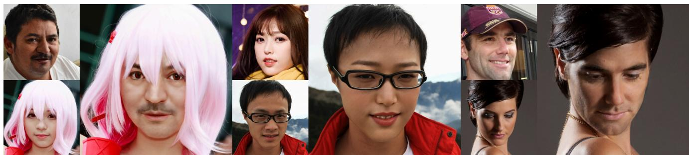
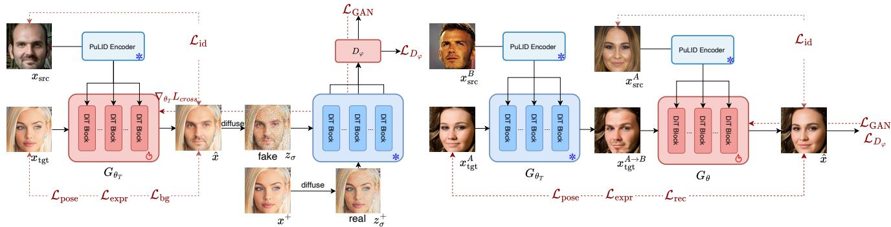
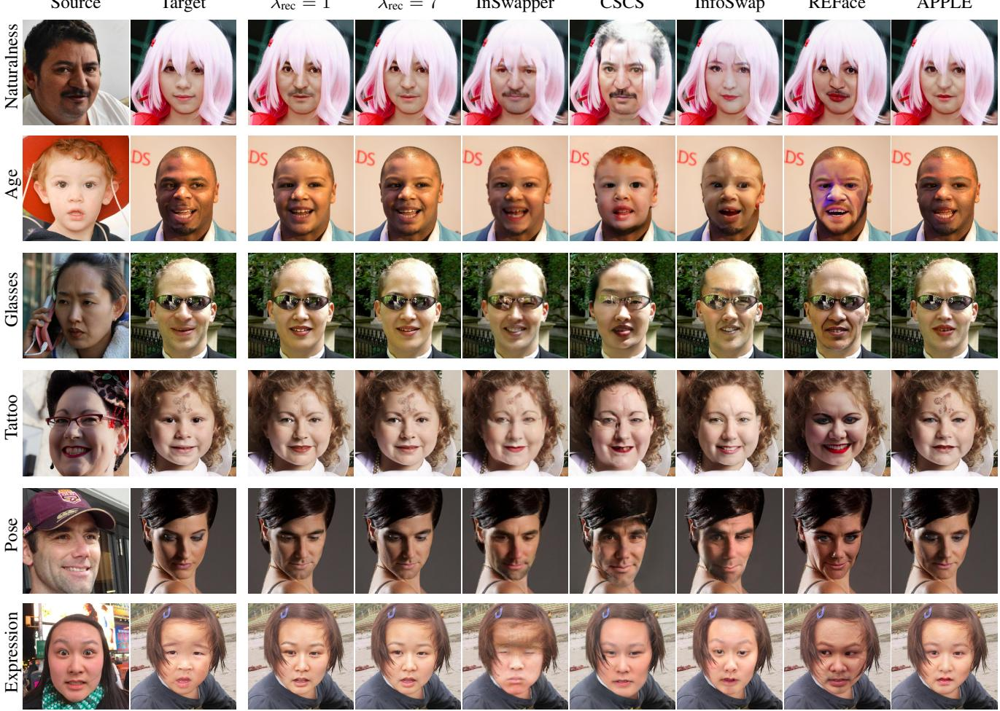
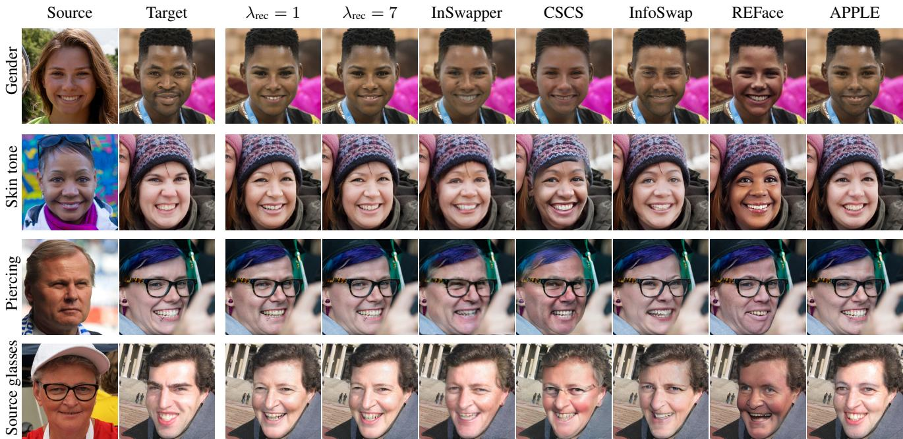
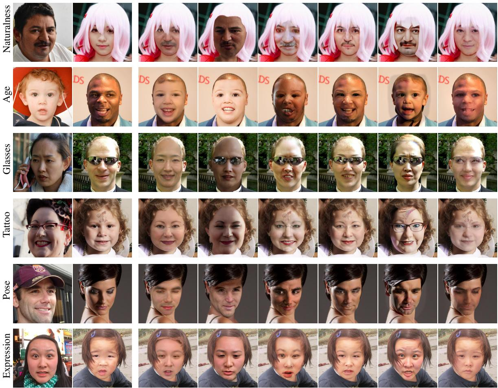

# Adversarial Latent Diffusion Distillation for One-Step Identity Swapping

Ivan Shchekotov∗1 Timofei Gritsaev∗1 Viacheslav Pirogov2 Dmitry Vetrov1

1Constructor University, Bremen, Germany 2Sumsub, Berlin, Germany

  
Figure 1. Qualitative face-swapping results on FFHQ. Each example shows the source identity (top left), target image (bottom left), and the output generated by our model. The model transfers the source identity while preserving the target’s pose, expression, hairstyle, glasses, illumination, and background

## Abstract

Face swapping transfers a source identity onto a target image while preserving the target’s pose, expression, hair, and lighting. The most realistic current methods are diffusion-based, but they need many network evaluations per image. GAN-based methods are fast, yet trained from scratch they must learn realism from the adversarial signal alone and produce visibly weaker results. We present AL-ADDIN (Adversarial LAtent Diffusion Distillation for One-Step Identity SwappiNg), a one-stepface swapper obtained by initialising the generator from a pre-trained multi-step flow-matching model and training it adversarially under identity and target-preservation constraints. We expose a controllable trade-off between identity transfer and targetattribute preservation by training a student model with triplet pseudo-label supervision. We additionally identify a bias in the standard evaluation protocol, which favours methods trained against the same identity encoder used to score them, and re-evaluate all baselines with an independent one. ALADDIN is state-of-the-art among one-step methods in realism and target preservation at comparable identity transfer, and matches the best multi-step model with 28× fewer network evaluations and an order of magnitude

fewer training pairs.

## 1. Introduction

The goal of face swapping is to transfer the source human identity onto a target face image while keeping the target’s attributes intact: background, hair, pose, expression, lighting, and accessories. An example of a face swap application is shown in Figure 1. The task has broad relevance across various areas, for example, film production [35] and privacy protection [50].

Early systems were limited to existing collections of faces [3] or required manual intervention [5], whereas modern approaches learn the swap with neural networks.

Many prominent face-swapping methods are built on the Generative Adversarial Network (GAN) [16] framework. GAN-based face-swapping methods can be broadly categorised into two families: direct and inversion-based. Direct methods, including SimSwap [7], HifiFace [49], FaceDancer [39], and InfoSwap [13], train a swapping generator end to end with identity, attribute-preservation, and adversarial objectives. Inversion-based methods, such as MegaFS [57] and E4S [34] manipulate the latent representation of a pretrained StyleGAN generator [27, 28]. However, GANs suffer from unstable training and usually produce less realistic results [11] than diffusion-based models [21, 32, 44].

Diffusion modelling is another paradigm for image generation with a more stable training compared to GANs, but comes at a higher training and inference cost. One requires tens of neural function evaluations (NFE) to generate an image with a diffusion model, while GAN inference requires just a single NFE. Diffusion models for face swapping were developed in [2, 18, 26, 29, 52, 56]. Since diffusion models suffer from high inference cost, a lot of diffusion distillation techniques were developed recently [15, 33, 41, 42, 45, 53, 54] to combine high quality generation with a low inference cost.

In our paper, we combine the high realism of diffusion models with one-step GAN inference: we initialise the generator from a pre-trained diffusion model and train it adversarially with a discriminator that reads diffusion features, a design introduced by adversarial diffusion distillation [41, 42] and adopted as an auxiliary loss by improved distribution matching distillation [53, 54]. Our main contributions are:

1. We present ALADDIN: Adversarial LAtent Diffusion Distillation for one-step Identity swappiNg, a simple method that achieves state-of-the-art quality among onestep models.

2. We outperform almost every multi-step baseline and achieve the same quality as the state-of-the-art diffusion model, APPLE [26]. Our model requires an order of magnitude fewer training pairs than APPLE and 28× fewer network evaluations at inference.

3. We identify a positive bias in identity similarity estimation in the prior evaluation protocols and address it by re-evaluating all baselines with an independent identity model.

## 2. Related work

GAN-based face swapping methods Early neural faceswapping methods predominantly relied on GANs and could be broadly divided into direct generator-based and GAN-inversion approaches. Direct methods train a swapping network to combine the source identity with target attributes. SimSwap [7] introduces an ID-injection module and a weak feature-matching loss to improve identity transfer while preserving target attributes. InfoSwap [13] uses information-bottleneck objectives and an identity-contrastive loss to disentangle source identity from target-specific information. HiFiFace [49] incorporates 3D shape and semantic priors to improve face-shape transfer and geometric consistency, while FaceDancer [39] employs adaptive feature-fusion attention and identity feature refinement to improve robustness to pose variation and occlusion. InSwapper [48] is a widely used direct model whose training procedure is undocumented. CSCS [22] uses two surrogate generators to synthesise a source and a target from one real image, which then serves as the ground-truth swap.

Trained from scratch, direct methods must learn realism from the adversarial signal alone while the identity and attribute objectives compete with it, and they produce local artifacts under large pose, shape, or occlusion changes.

The second branch exploits the high-resolution image prior of a pretrained StyleGAN. MegaFS [57] encodes source and target into an extended StyleGAN2 latent space, blends their high-level codes with a face-transfer module while keeping the target’s low-level codes, and decodes the result with the frozen generator. E4S [34] reenacts the source into the target’s pose and expression, represents each face by per-region style codes and a segmentation mask, and swaps only the inner-face regions. These methods inherit the realism of StyleGAN but also its limits: each face must first be embedded into an extended latent space, where an embedding either loses identity detail or leaves the wellbehaved region in which the generator was trained [38, 47].

Diffusion-based face swapping methods Diffusion models have recently emerged as an alternative to GANs due to their strong image priors, stable training, and highfidelity generation. DiffFace [29] introduces an identityconditioned DDPM and applies identity, semantic, and gaze guidance during sampling. However, the required gradientbased guidance and iterative denoising make inference expensive. DiffSwap [56] formulates face swapping as 3Daware masked diffusion, using facial landmarks and masks to preserve target pose and expression. It also introduces midpoint estimation to apply identity supervision without differentiating through the complete sampling trajectory.

REFace [2] trains latent diffusion as a conditional inpainting model and unrolls several differentiable DDIM steps during training to apply identity and perceptual losses to estimated clean images. It further uses CLIP-feature disentanglement and semantic mask shuffling to support face, head, and regional swapping. FaceAdapter [18] adapts a pretrained Stable Diffusion model by explicitly separating identity, spatial, and attribute conditions. It maps source face embeddings into cross-attention tokens, while target landmarks, background, and CLIP features provide structural and appearance guidance.

More recent work, DreamID [52], revisits the idea of CSCS [22] by introducing the triplet ID group, which allows existing data to be used as ground truth for face swaps. They build on SD-Turbo [42], which enables one-step generation. In comparison, our method does not require a distilled model and can make use of a multi-step diffusion model. This makes our approach more general and, in particular, allows us to use the larger FLUX model [4] and the recent PuLID [17] for better identity conditioning. Unfortunately, neither the code of DreamID nor its weights have been released, so a comparison with their model is unavailable. APPLE [26] further studies the construction of triplet data supervision, noting that the teacher used in DreamID leads to limited target attribute preservation. APPLE trains a diffusion teacher with conditional deblurring and attribute-aware inversion to generate pseudo-labels that result in better target attribute preservation, and subsequently trains a student on the resulting pseudo-triplets. While DreamID presents a one-step model, it requires a distilled model for initialisation. APPLE presents a highquality but multi-step model that requires an order of magnitude larger training budget than ALADDIN. Our model is one-step, preserves target attributes, and is not limited to a distilled pre-trained initialisation.

## 3. Method

We formulate one-step face swapping as conditional generation. Given a source image $x _ { \mathrm { s r c } }$ and a target image $x _ { \mathrm { t g t } }$ the generator $G _ { \theta }$ produces a face swap in a single step

$$
{ \hat { x } } = G _ { \theta } ( x _ { \mathrm { s r c } } , x _ { \mathrm { t g t } } ) = x _ { \mathrm { t g t } } - \sigma _ { \mathrm { g e n } } v _ { \theta } ( x _ { \mathrm { t g t } } , \sigma _ { \mathrm { g e n } } , x _ { \mathrm { s r c } } ) ,\tag{1}
$$

where $\hat { x }$ is the generated face image, which should retain the attributes of $x _ { \mathrm { t g t } }$ and carry the identity of $x _ { \mathrm { s r c } } .$ . Here $v _ { \theta }$ is the velocity predicted by a flow-matching model [4, 33] extended with an identity-conditioning branch for $x _ { \mathrm { s r c } }$ . We treat the target image as a sample at noise level $\sigma _ { \mathrm { g e n } } , { \bf s 0 }$ that the model maps it to the clean swap in one evaluation. The generator operates on the latents of the frozen FLUX VAE, and Equation 1 is applied in that space before decoding. The noise level $\sigma _ { \mathrm { g e n } }$ is a fixed hyperparameter which we set to 0.2 to ensure a benign initialisation at the beginning of the training.

## 3.1. Training Objectives

In this section, we describe training objectives and different training data groups that are required to effectively train our face swapping model. An overview of our method’s training is illustrated in Figure 2.

Identity loss Identity transfer is encouraged by minimising the cosine distance between the identity embeddings of the generated and the source image:

$$
\mathcal { L } _ { \mathrm { i d } } \big ( \hat { x } , x _ { \mathrm { s r c } } \big ) = 1 - \cos \big ( f _ { \mathrm { i d } } \big ( \hat { x } \big ) , f _ { \mathrm { i d } } \big ( x _ { \mathrm { s r c } } \big ) \big ) ,\tag{2}
$$

where $f _ { \mathrm { i d } }$ returns the identity embedding of a frozen facerecognition network [9]. The loss vanishes when the two embeddings reach cosine similarity 1, which reflects strong identity transfer. This objective is widely used in both GAN- and diffusion-based face-swapping methods [2, 7, 22, 26, 29, 39, 52, 56, 57].

Realism losses If one uses solely the identity loss, the generator easily transfers source identity but produces unrealistic images. To prevent this, we employ adversarial training and, where the data provides a ground-truth answer, a reconstruction loss.

Adversarial loss Adversarial training supplies the realism signal, but its behaviour is significantly affected by representations the discriminator sees. Following Latent Adversarial Diffusion Distillation (LADD) [41], the discriminator relies on the activations of the frozen diffusion model rather than pixels or raw latents.

Let E denote the frozen VAE encoder, $z = \mathcal { E } ( \hat { x } )$ the latent of a generated swap, and $z ^ { + } = \mathcal { E } ( x ^ { + } )$ the latent of a real image $x ^ { + }$ , for which we use the target image of the same batch. Both are corrupted by the same linear interpolation $z _ { \sigma } = ( 1 - \sigma ) z + \sigma \epsilon , \epsilon \sim \mathcal { N } ( 0 , I )$ at a noise level σ shared by the real and the generated branch. We then pass both latents through the frozen diffusion model — the same model that initialises $G _ { \theta } -$ and intercept the activations ${ h ^ { ( 1 ) } , \dots , h ^ { ( K ) } }$ of K of its blocks. Each activation is read by its own discriminator head, and the heads are aggregated into a single realism score:

$$
D _ { \varphi } ( z _ { \sigma } ) = \sum _ { k = 1 } ^ { K } w _ { k } D _ { \varphi _ { k } } \left( h ^ { ( k ) } , \sigma \right) , \quad w = \mathrm { s o f t m a x } ( \alpha ) ,\tag{3}
$$

so that training itself decides which activations carry usable signal. Only the heads $\{ D _ { \varphi _ { k } } \}$ and the pooling logits α are trainable; the diffusion model stays frozen. Since it is the same network that initialises the generator, adversarial training introduces no pretrained model beyond the diffusion prior we already depend on.

We use the non-saturating GAN objective [16], minimising $\mathcal { L } _ { D _ { \varphi } }$ over the discriminator parameters $\varphi$ and $\mathcal { L } _ { \mathrm { G A N } }$ over the generator parameters $\theta ,$ where $D _ { \varphi }$ predicts the probability that a sample is real:

$$
\mathcal { L } _ { D _ { \varphi } } ( z _ { \sigma } ^ { + } , z _ { \sigma } ) = - \log D _ { \varphi } ( z _ { \sigma } ^ { + } ) - \log \left( 1 - D _ { \varphi } ( z _ { \sigma } ) \right) \mathrm { , }
$$

$$
\mathcal { L } _ { \mathrm { G A N } } ( z _ { \sigma } ) = - \log D _ { \varphi } ( z _ { \sigma } ) .\tag{4}
$$

(5)

This choice of the discriminator allows us to make use of strong features from a pretrained diffusion model. Blocks at different depths of the model already encode different levels of abstraction. More importantly, these are not generic features: the diffusion model was trained to generate images including faces, so its activations already encode wha a plausible face looks like at every scale, from global geometry to skin microtexture. A discriminator built on top of them reuses that prior for free instead of having to learn it from the adversarial signal alone. Moreover, discriminative backbones trained for classification are known to rely predominantly on texture [14], whereas classifiers derived from diffusion models exhibit a shape bias close to natural human comprehension [25]. This argument motivates [41] to use generative features over a frozen discriminative backbone, DINO [6, 36], as in [42].

Reconstruction loss As we show below, training data can be arranged so that an existing image serves as the groundtruth swap. For example, if the pair $( x _ { \mathrm { s r c } } , x _ { \mathrm { t g t } } )$ shares the same identity, then $x _ { \mathrm { t g t } }$ is itself the correct answer. In this case, we can add a reconstruction loss:

  
Figure 2. Overview of ALADDIN training. Left (teacher training): the teacher generator $G _ { \theta _ { T } }$ receives the target image $x _ { \mathrm { t g t } }$ and the source identity encoded by frozen PuLID, and produces the one-step swap xˆ. Identity, pose, expression, and background losses constrain the swap. For adversarial training, the latent of xˆ and that of a real image $x ^ { + }$ are diffused to the same noise level σ and passed through a frozen diffusion model; the discriminator, $D _ { \varphi } .$ , classifies its intermediate features as generated or real. Right (student training): the frozen teacher constructs the pseudo-target $x _ { \mathrm { t g t } } ^ { A  B }$ from $x _ { \mathrm { s r c } } ^ { B }$ and $x _ { \mathrm { t g t } } ^ { A }$ . The student $G _ { \theta } ,$ initialised from the teacher, swaps identity A back onto this pseudo-target and is supervised toward the real image $x _ { \mathrm { t g t } } ^ { A }$ by the reconstruction loss.

$$
\mathcal { L } _ { \mathrm { r e c } } ( \hat { x } , x _ { \mathrm { t g t } } ) = d ( \hat { x } , x _ { \mathrm { t g t } } ) ,\tag{6}
$$

where d is a distance metric, for example the $\ell _ { 1 }$ or $\ell _ { 2 }$ distance. Empirically, we find that Learned Perceptual Image Patch Similarity (LPIPS) [55] leads to better quantitative results than $\ell _ { 1 }$

Section 3.2 shows how the triplet group extends the reconstruction loss to the non-trivial case in which the source and target identities differ. This idea originates in [52] and was further developed in [26].

Target preservation losses Finally, we need objectives that preserve the target attributes. Three of them must be carried over from the target: head pose, facial expression, and the image background.

Pose loss We preserve the target head orientation using a frozen 6DRepNet pose estimator [19]. Given an image $x ,$ the estimator predicts a rotation matrix $\psi _ { \mathrm { p o s e } } ( x ) = R _ { x } \in$ SO(3). The matrix describes how the head is oriented relative to the camera: its columns give the directions of the head’s local right, up, and forward axes. We compare the predicted orientations of the generated and target images using their geodesic distance:

$$
\begin{array} { r l } & { \mathcal { L } _ { \mathrm { p o s e } } ( \hat { x } , x _ { \mathrm { t g t } } ) = } \\ & { \qquad \operatorname { a r c c o s } \left( \mathrm { c l i p } \left( \frac { \mathrm { t r } \left( R _ { \hat { x } } R _ { x _ { \mathrm { t g t } } } ^ { \top } \right) - 1 } { 2 } , - 1 + \epsilon , 1 - \epsilon \right) \right) , } \end{array}\tag{7}
$$

where $R _ { \hat { x } } = \psi _ { \mathrm { p o s e } } ( \hat { x } )$ and $R _ { x _ { \mathrm { t g t } } } = \psi _ { \mathrm { p o s e } } ( x _ { \mathrm { t g t } } )$ . The estimator remains frozen, while gradients through $\psi _ { \mathrm { p o s e } } ( { \hat { x } } )$ update the face-swapping generator.

Expression loss We preserve the target expression using a frozen DECA estimator [12]. DECA predicts a 50-dimensional FLAME [31] expression vector $\psi _ { \mathrm { e x p r } } ( x )$ whose coordinates weight learnt blendshapes describing expression-related changes in facial geometry. It captures non-identity facial surface deformations such as smiles, frowns, and mouth opening, and encodes geometric changes rather than categorical emotion labels, separately from identity shape, global head pose, appearance, and illumination. We minimise:

$$
\mathcal { L } _ { \mathrm { e x p r } } ( \hat { x } , x _ { \mathrm { t g t } } ) = \frac { 1 } { 2 d _ { \mathrm { e x p r } } } \left. \psi _ { \mathrm { e x p r } } ( \hat { x } ) - \psi _ { \mathrm { e x p r } } ( x _ { \mathrm { t g t } } ) \right. _ { 2 } ^ { 2 } .\tag{8}
$$

Here $d _ { \mathrm { e x p r } } = 5 0 \colon$ ; the loss is half the coefficient-wise mean squared error, averaged over the batch.

Background loss Identity transfer requires modifying the face, whereas regions outside the face should remain consistent with the target. We obtain a facial mask $m _ { \mathrm { t g t } }$ from a frozen face-parsing model, SegFormer [51], dilated and smoothed at its boundary and then binarised. The mask contains the target skin, nose, eyebrows, eyes, mouth, lips, and ears. Its complement $1 - m _ { \mathrm { { t g t } } }$ therefore retains the target hair, glasses, earrings, hat, neck, clothing, and general background. We minimise the normalised pixel difference over this complementary region:

$$
\mathcal { L } _ { \mathrm { b g } } ( \hat { x } , x _ { \mathrm { t g t } } ) = \frac { \sum _ { c , h , w } \left( 1 - m _ { \mathrm { t g t } } ^ { h , w } \right) \left| \hat { x } ^ { c , h , w } - x _ { \mathrm { t g t } } ^ { c , h , w } \right| } { \operatorname* { m a x } \Bigl ( 1 , \sum _ { h , w } \left( 1 - m _ { \mathrm { t g t } } ^ { h , w } \right) \Bigr ) } ,\tag{9}
$$

where the superscripts index the channel and the two spatial dimensions.

## 3.2. Training Data Groups

Cross Identity Group Having established all loss objectives, we start with the general case $\mathrm { I D } ( x _ { \mathrm { s r c } } ) \ne \mathrm { I D } ( x _ { \mathrm { t g t } } )$ for which we construct the cross identity objective as:

$$
\begin{array} { r l } & { \mathcal { L } _ { \mathrm { c r o s s } } ( \hat { x } , x _ { \mathrm { s r c } } , x _ { \mathrm { t g t } } ) = \lambda _ { \mathrm { i d } } \mathcal { L } _ { \mathrm { i d } } ( \hat { x } , x _ { \mathrm { s r c } } ) + \lambda _ { \mathrm { G A N } } \mathcal { L } _ { \mathrm { G A N } } ( \hat { x } ) + } \\ & { \quad \lambda _ { \mathrm { p o s e } } \mathcal { L } _ { \mathrm { p o s e } } ( \hat { x } , x _ { \mathrm { t g t } } ) + \lambda _ { \mathrm { e x p r } } \mathcal { L } _ { \mathrm { e x p r } } ( \hat { x } , x _ { \mathrm { t g t } } ) + \lambda _ { \mathrm { b g } } \mathcal { L } _ { \mathrm { b g } } ( \hat { x } , x _ { \mathrm { t g t } } ) . } \end{array}
$$

The identity loss drives identity transfer, the adversarial loss makes the one-step generation realistic, and the last three losses preserve the target attributes. Figure 2 (left) presents training with the cross identity group.

Same Identity Group When the pair $( x _ { \mathrm { s r c } } , x _ { \mathrm { t g t } } )$ shares the same identity, we construct the same identity objective as:

$$
\begin{array} { r l } & { \mathcal { L } _ { \mathrm { s a m e } } ( \hat { x } , x _ { \mathrm { s r c } } , x _ { \mathrm { t g t } } ) = \lambda _ { \mathrm { i d } } \mathcal { L } _ { \mathrm { i d } } ( \hat { x } , x _ { \mathrm { s r c } } ) + } \\ & { \quad \lambda _ { \mathrm { G A N } } \mathcal { L } _ { \mathrm { G A N } } ( \hat { x } ) + \lambda _ { \mathrm { r e c } } \mathcal { L } _ { \mathrm { r e c } } ( \hat { x } , x _ { \mathrm { t g t } } ) } \end{array}
$$

The reconstruction loss supplies a direct supervision signal and thereby improves image quality. A model trained on the same identity group alone, however, cannot perform well in the general case, since the generator attains a perfect score by naively copying the target image. This group needs no pose or expression loss, because both attributes are already constrained by the reconstruction loss.

Triplet Group To apply the reconstruction loss when the identities differ, we use the triplet group of [26, 52], illustrated in Figure 2 (right). It requires two distinct images $( x _ { \mathrm { s r c } } ^ { A } , x _ { \mathrm { t g t } } ^ { A } )$ of the same identity A. We first generate a pseudo-target using a frozen face swap teacher $G _ { \theta _ { T } }$

$$
x _ { \mathrm { t g t } } ^ { A  B } = G _ { \theta _ { T } } ( x _ { \mathrm { s r c } } ^ { B } , x _ { \mathrm { t g t } } ^ { A } )
$$

carrying the source identity B and the target attributes of $x _ { \mathrm { t g t } } ^ { A }$ . We then generate a final image from the real image $x _ { \mathrm { s r c } } ^ { A }$ and the pseudo-target $x _ { \mathrm { t g t } } ^ { A  B }$

$$
\hat { x } = G _ { \theta } \big ( x _ { \mathrm { s r c } } ^ { A } , x _ { \mathrm { t g t } } ^ { A \to B } \big ) ,
$$

where xˆ has the identity of A and the target attributes of $x _ { \mathrm { t g t } } ^ { A  B }$ , and hence those of $x _ { \mathrm { t g t } } ^ { A }$ . The construction therefore yields a ground-truth reconstruction target, $x _ { \mathrm { t g t } } ^ { A }$ . The triplet objective is:

$$
\begin{array} { r l } & { \mathcal { L } _ { \mathrm { t r i p l e t } } ( \hat { x } , x _ { \mathrm { s r c } } ^ { A } , x _ { \mathrm { t g t } } ^ { A } ) = \lambda _ { \mathrm { i d } } \mathcal { L } _ { \mathrm { i d } } ( \hat { x } , x _ { \mathrm { s r c } } ^ { A } ) + } \\ & { \quad \lambda _ { \mathrm { G A N } } \mathcal { L } _ { \mathrm { G A N } } ( \hat { x } ) + \lambda _ { \mathrm { r e c } } \Big ( \mathcal { L } _ { \mathrm { r e c } } ( \hat { x } , x _ { \mathrm { t g t } } ^ { A } ) + } \\ & { \quad \lambda _ { \mathrm { p o s e } } \mathcal { L } _ { \mathrm { p o s e } } ( \hat { x } , x _ { \mathrm { t g t } } ^ { A } ) + \lambda _ { \mathrm { e x p r } } \mathcal { L } _ { \mathrm { e x p r } } ( \hat { x } , x _ { \mathrm { t g t } } ^ { A } ) \Big ) . } \end{array}
$$

Training pipeline We first train the teacher on a mixture of the cross identity and same identity groups. The student generator is initialised from the teacher, with a freshly initialised discriminator, and trained on the triplet group alone, with the frozen teacher $G _ { \theta _ { 7 } }$ generating the pseudo-targets $x _ { \mathrm { t g t } } ^ { A  B }$ on the fly. Increasing $\lambda _ { \mathrm { { r e c } } }$ of the student trades identity transfer against realism and target preservation, so we report students at several settings, written Student with λ standing for $\lambda _ { \mathrm { { r e c } } }$

## 4. Experiments

## 4.1. Experimental setup

Implementation details We follow the architecture of APPLE [26] and initialise the generator with FLUX.1- Krea-dev [4], using PuLID [17] as the identity encoder and OminiControl [46] as the attribute-conditioning branch. The same frozen FLUX.1-Krea-dev transformer supplies the discriminator features of Equation 3. We train LoRA adapters of rank 64 on the attention projections of all transformer blocks, together with PuLID’s cross-attention layers, on top of the frozen backbone, and all experiments run at a resolution of $5 1 2 \times 5 1 2$ . For $\mathcal { L } _ { \mathrm { i d } }$ , we use an ArcFace [9] model trained on Glint360K [24]. Following REFace [2] and APPLE [26], the source image is masked before it enters the identity encoder, so that target attributes do not leak into the embedding. For $\mathcal { L } _ { \mathrm { i d } }$ , the masked images are resized to $1 1 2 \times 1 1 2$ without further alignment. We report two kinds of model: teacher and student. Increasing the reconstruction weight $\lambda _ { \mathrm { { r e c } } }$ of the student trades identity transfer against realism and target preservation, so we report triplettrained students with $\lambda _ { \mathrm { { r e c } } } \in \{ 1 , 3 , 7 \}$ to expose this tradeoff. Hyperparameter choices and other details can be found in Appendix A.

Dataset filtration Our face swapping model is trained on VGGFace2-HQ [8] and Arc2Face [37]. Both datasets provide several images per identity, which the same identity and triplet groups require. Batches are drawn from Arc2Face and VGGFace2-HQ in a 4:1 ratio, and after the filtering described below the training set contains 4.1M images of 540K identities. They also need filtering, since they contain low-quality images and since some identities mix photographs of different people. We first discard lowquality images using the AES predictor [43] with a threshold of 5.1 as in [26]. To clean an identity, we define its anchor as the face with the highest average identity similarity to the others, sort the remaining faces by their similarity to that anchor, and keep only those whose similarity to it lies between 0.6 and 0.95; a face is admitted only if its similarity to every already accepted face is below 0.95 to avoid duplicate images.

Evaluation protocol We follow the protocol of [2, 26, 52] and evaluate on the fixed list of 1,000 source–target pairs from FFHQ [27] used by REFace, reporting four aspects of a swap. Realism is measured by the Frechet dis-´ tance [20] between CLIP ViT-B/32 features [30] of the 1,000 generated images and of all 70,000 FFHQ images at $5 1 2 \times 5 1 2$ , computed with the evaluation code released with REFace [2]. We refer to it as FID throughout. Identity transfer is measured in two ways: the cosine similarity between the identity embeddings of the generated and the source face, and retrieval accuracy, obtained by ranking all source faces by that similarity and reporting how often the correct one appears first (Top-1) or within the first five (Top-5). Following [2], we mask out the region outside the face in both images before extracting these embeddings, so that shared background and hair cannot affect the score. Target preservation is measured by the $\ell _ { 2 }$ distance between the generated and target images in head pose, estimated with Hopenet [40], and in expression, estimated with Deep3DFace [10]. Both are applied to the whole frame without face detection, and both are independent of the estimators used for training. To provide a fair comparison, we generate face swaps with the available baseline models and score them under our protocol.

Identity encoder bias in prior evaluation protocols Several prior face-swapping methods use a single identity encoder for training, conditioning, and evaluation. Prior works [2, 26, 52] evaluate identity with MS1M–IR-SE50, and both REFace [2] and InfoSwap [13] are optimised against it. Table 1 shows the effect. REFace scores 0.64 under MS1M–IR-SE50 but only 0.41 and 0.39 under the other two encoders. Its own protocol thus ranks it first on identity transfer, while under either alternative several baselines score higher. Scoring all methods with MS1M–IR-SE50 therefore rewards the ones that were optimised against it.

We instead evaluate with WebFace–R50, an ArcFace identity encoder with an iResNet-50 backbone trained on WebFace600K. It performs strongly both overall and across demographic subsets [23]. To the best of our knowledge, none of the compared methods is trained against it. The one method that uses it is InSwapper, which relies on WebFace– R50 for identity conditioning. For a comparison with this baseline we additionally report identity under MS1M–IR-SE50, which our method never uses.

WebFace–R50 serves for evaluation only. Identity conditioning and $\mathcal { L } _ { \mathrm { i d } }$ use Glint–R100, an ArcFace identity encoder with an iResNet-100 backbone trained on Glint360K [1, 9], from the model family PuLID conditions on. Our method is thus never optimised against the encoder that scores it.

Appendix B compares the encoders in detail. It also discusses the effects of the comparison with MS1M–IR-SE50 more thoroughly.

Table 1. Identity encoder bias in prior evaluation protocols. Each method is scored by all three ArcFace identity encoders. marks the identity encoder the method is trained against.
<table><tr><td colspan="4">ID Similarity measured with</td></tr><tr><td>Method</td><td>MS1M–IR-SE50</td><td>Glint–R100</td><td>WebFace-R50</td></tr><tr><td colspan="4">Trained against MS1M–IR-SE50</td></tr><tr><td>REFace</td><td>0.64†</td><td>0.41</td><td>0.39</td></tr><tr><td>InfoSwap</td><td>0.58†</td><td>0.43</td><td>0.42</td></tr><tr><td colspan="4">Trained against Glint–R100 Ours ALÁDDIN</td></tr><tr><td>Student  $\lambda { = } 1$ </td><td>0.55</td><td>0.54†</td><td>0.50</td></tr></table>

Table 2. Results on 1,000 pairs from FFHQ. FID is computed on CLIP ViT-B/32 features (Section 4). Identity similarity and retrieval are measured with WebFace–R50. Retrieval reports top-1 and top-5 accuracy in percent. Methods are ordered by FID within each group, with better FID placed lower. Bold shows the best value in each column; the second and third best are underlined.
<table><tr><td>Method</td><td>FID ↓ ID Sim. ↑</td><td>Retrieval ↑ Top-1/5</td><td></td><td>Pose ↓ Expr. ↓</td></tr><tr><td colspan="5">One-step methods 0.38</td></tr><tr><td>MegaFS E4S</td><td>15.54 12.00</td><td>84.5/89.7 0.37 77.9/87.9</td><td>4.50 4.47</td><td>1.14 1.30</td></tr><tr><td>HiFiFace InSwapper†</td><td>11.08 8.67</td><td>0.45 93.1/96.7 †0.60 90.3/90.5</td><td>3.20 2.80</td><td>1.34 1.52</td></tr><tr><td>CSCS SimSwap</td><td>8.59 5.90</td><td>0.63 99.4/100 0.38 81.9/85.8</td><td>3.70 1.83</td><td>1.45 0.96</td></tr><tr><td>FaceDancer InfoSwap</td><td>4.86 0.34 3.88 0.42</td><td>78.8/90.3 91.2/96.1</td><td>2.27 3.18</td><td>0.74 0.99</td></tr><tr><td colspan="3">Multi-step methods</td><td></td><td></td></tr><tr><td>FaceAdapter</td><td>9.33</td><td>0.47</td><td>96.1/99.0</td><td>4.01</td></tr><tr><td>DiffSwap</td><td>6.94</td><td>0.26 54.3/72.7</td><td>2.61</td><td>1.20 1.02</td></tr><tr><td>REFace</td><td>5.45</td><td>0.39 88.8/96.2</td><td>3.68</td><td>1.04</td></tr><tr><td>APPLE</td><td>3.22</td><td>0.40</td><td>89.9/96.2 1.86</td><td>0.63</td></tr><tr><td colspan="3">Ours ALADDIN, one-step method</td><td></td><td></td></tr><tr><td>Teacher</td><td>4.55</td><td>0.49</td><td>96.4/98.2</td><td>1.90</td></tr><tr><td></td><td>4.49</td><td></td><td></td><td>0.77</td></tr><tr><td>Studen  $\mathfrak { L } _ { \lambda = 1 }$ </td><td></td><td>0.50</td><td>97.4/98.7</td><td>1.93 0.76</td></tr><tr><td>Studentλ=3</td><td>3.66</td><td>0.44</td><td>94.0/97.6</td><td>1.68 0.65</td></tr><tr><td></td><td></td><td></td><td></td><td>1.56</td></tr><tr><td>Studen  $\mathrm { t } _ { \lambda = 7 }$ </td><td>3.34</td><td>0.40</td><td>88.9/95.3</td><td>0.60</td></tr></table>

† InSwapper generates face swaps using the same identity model employed here for evaluation. Under MS1M–IR-SE50, Studentλ=1 obtains 0.55 and InSwapper obtains 0.56.

## 4.2. Comparison with other methods

Quantitative comparison Table 2 reports the results. No method dominates on all four metrics, so we report our models across the trade-off set by $\lambda _ { \mathrm { { r e c } } } .$

Comparison with one-step methods Every one of our models improves on MegaFS and E4S in all four metrics. HiFiFace is beaten in all four by our Teacher and by Studen $\mathbf { t } _ { \lambda = 1 }$ , and SimSwap, FaceDancer, and InfoSwap

Ours ALADDIN Students

Source

Target

InSwapper

  
Figure 3. Qualitative comparison on selected FFHQ source–target pairs. The first two columns give the source and the target; the remaining columns show the swap produced by each method. Every row probes a different difficulty. Naturalness transfers an identity onto a target with unusual hair, and Age presents a large age gap between source and target. The last four rows test how well the target’s attributes survive the swap: glasses, tattoo, head pose, and facial expression.

are beaten in all four by $\mathrm { S t u d e n t } _ { \lambda = 3 } ,$ . Only InSwapper and CSCS reach a higher identity similarity, and both pay for it elsewhere. InSwapper is scored with the same identity encoder that it uses for identity conditioning; under the neutral MS1M–IR-SE50 identity encoder it is level with Student , 0.56 against 0.55, while the student leads by a wide margin in FID, pose, and expression. CSCS attains the highest identity similarity by pasting the source face onto the target, as the qualitative comparison shows, at a clear cost in realism, pose, and expression. On Top-1 retrieval, $\mathrm { S t u d e n t } _ { \lambda = 1 }$ and the Teacher are second only to CSCS.

Comparison with multi-step methods DiffSwap and REFace are beaten in all four metrics by every one of our models, and FaceAdapter by our Teacher and $\mathrm { S t u d e n t } _ { \lambda = 1 }$ APPLE is the only baseline that remains competitive. The APPLE row is its released student model, sampled with 28 steps. $\mathrm { S t u d e n t } _ { \lambda = 7 }$ matches it in identity transfer at 0.40, in FID (3.34 against 3.22), and in expression (0.60 against 0.63), while improving on it in pose (1.56 against 1.86). Our model reaches this with a single network evaluation instead of APPLE’s 28. Note that we use exactly the same architecture.

Training cost against APPLE The same gap appears in the training budget. APPLE trains its teacher on 1.04M image pairs and its student on a further 0.24M, reporting 12.78 days on four A6000 GPUs, of which 5.78 are spent generating pseudo-triplets offline with the 28-step teacher. ALADDIN uses 0.10M pairs for the teacher, trained in about 4.5 hours of wall-clock time on four H100 GPUs, and 0.015M for the student, which needs no offline generation stage because the teacher is itself one-step. This is more than a tenfold reduction in training data at matching qual-

ity.

Qualitative comparison Figure 3 compares our method against the selected strong baselines across six axes. The first two probe the realism of the swap: an unusual target hairstyle (row 1) and a large source–target age gap (row 2). The remaining four measure the preservation of target attributes, namely glasses, tattoo, head pose and facial expression. GAN-based methods introduce severe artifacts, significantly worsening realism. CSCS is prone to copypaste behaviour with little adaptation to the target. InSwapper transfers identity well, but its fidelity is limited by the 128×128 resolution of the original model. InfoSwap struggles to retain the target’s attributes: it alters the hair in row 1, renders the glasses transparent in row 3, and perturbs the pose and expression in rows 5 and 6. Diffusion-based baselines achieve superior realism and attribute preservation to the GAN-based methods. Nevertheless, REFace produces unrealistic texture and under-transfers the source identity in most rows. APPLE is the strongest baseline overall. However, it is also prone to artifacts in challenging scenarios (transparent lenses in row 3). After triplet training, AL-ADDIN matches APPLE’s realism and attribute preservation at a fraction of its inference cost. Moreover, short training time allows us to flexibly choose the operating point via the LPIPS reconstruction coefficient $\lambda _ { \mathrm { { r e c } } }$ . Higher values im prove realism and attribute retention at the cost of identity transfer, as seen between our two columns.

## 4.3. Ablation study

We ablate the design choices specific to our method. All of them concern teacher training, so the triplet group is not used here. For every run we select a checkpoint whose identity similarity closely matches the others, which makes the remaining three metrics comparable across rows; Appendix A gives the details. Table 3 reports the results.

Data mixture We vary the proportion of cross identity and same identity batches. Same identity pairs come with a ground-truth answer, and adding a quarter of them improves FID, pose, and expression over training on cross identity pairs alone. They do not reflect the deployment scenario, however: raising their share to one half degrades FID from 4.55 to 5.01, while identity similarity, pose, and expression stay essentially unchanged.

Latent discriminator The central design choice in our adversarial training is that the discriminator reads the frozen teacher’s activations rather than the latent itself. To isolate its effect, we train on cross-identity batches only, replace the teacher features $h ^ { ( 1 ) } , \ldots , h ^ { ( K ) }$ in Equation 3 with the noised latent $z _ { \sigma }$ , and leave everything else unchanged. FID then degrades from 5.50 to 20.46, pose from 2.20 to 2.82, and expression from 0.95 to 1.13, while identity similarity rises from 0.49 to 0.53. No checkpoint of this run reaches the identity similarity of the other rows, so the identitymatched selection could not be applied to it. A discriminator reading raw latents carries no prior about what a face should look like and is easy to hack: it exerts almost no realism pressure, leaving the generator free to satisfy ${ \mathcal { L } } _ { \mathrm { i d } }$ with heavily artefacted images.

Table 3. Ablation study of the teacher training. FID is computed on CLIP ViT-B/32 features. Identity similarity is measured with WebFace–R50 under the masked protocol of Table 2. The optimal configuration, 0.75 / 0.25, is the one we report as AL-ADDIN Teacher. The discriminator ablation keeps the 1.00 / 0.00 mixture to isolate the effect of the discriminator input. Checkpoints are selected to match identity similarity (Appendix A), so that column is not ranked. Bold shows the best value in each remaining column and the second best is underlined.
<table><tr><td></td><td>FID ↓ ID Sim. ↑ Pose ↓ Expr. ↓</td><td></td><td></td></tr><tr><td colspan="2">Data mixture ratio (cross/ same ID)</td><td></td><td></td></tr><tr><td rowspan="3">1.00/0.00 0.75/0.25, optimal ALADDIN Teacher</td><td>5.50</td><td>0.49 2.20</td><td>0.95</td></tr><tr><td>4.55</td><td>0.49</td><td>1.90 0.77</td></tr><tr><td>5.01</td><td>0.49</td><td>1.87 0.79</td></tr><tr><td>Discriminator input</td><td></td><td></td><td></td></tr><tr><td>Raw latent</td><td>20.46 0.53</td><td>2.82</td><td>1.13</td></tr></table>

## 5. Conclusion and limitations

We presented ALADDIN, a one-step face swapper obtained by initialising the generator from a pretrained flowmatching model and training it adversarially. No distillation objective is needed: the pretrained flow model supplies the realism prior twice, as the generator’s initialisation and as the feature extractor of the discriminator. ALADDIN is state-of-the-art among one-step methods, and it matches APPLE, the strongest multi-step baseline, in identity transfer, FID, and expression while improving on it in pose, while using one network evaluation instead of 28 and an order of magnitude less training data. Our ablations isolate the design choice this rests on: the discriminator must read the intermediate activations of the frozen diffusion model rather than the latent itself, which supplies the realism prior that adversarial training alone does not. We further show that prior evaluation protocols score identity with an encoder several of the compared methods are trained against, and adopt one that is disjoint from all of them.

Limitations and future work Our method inherits the failure modes of the field. Identity transfer degrades on unusual source identities and on large age gaps. Our model with the weakest target preservation additionally loses tattoos (see Figure 3). Appendix C discusses these cases. Resolving them is open work for face swapping as a whole.

## Acknowledgements

This work was supported by Sumsub through a donation to Constructor University under the Sumsub AI Academic Program.

## References

[1] Xiang An, Xuhan Zhu, Yuan Gao, Yang Xiao, Yongle Zhao, Ziyong Feng, Lan Wu, Bin Qin, Ming Zhang, Debing Zhang, et al. Partial fc: Training 10 million identities on a single machine. In 2021 IEEE/CVF International Conference on Computer Vision Workshops (ICCVW), pages 1445–1449. IEEE, 2021.

[2] Sanoojan Baliah, Qinliang Lin, Shengcai Liao, Xiaodan Liang, and Muhammad Haris Khan. Realistic and efficient face swapping: A unified approach with diffusion models. In 2025 IEEE/CVF Winter Conference on Applications ofComputer Vision (WACV), pages 1062–1071. IEEE, 2025.

[3] Dmitri Bitouk, Neeraj Kumar, Samreen Dhillon, Peter N. Belhumeur, and Shree K. Nayar. Face swapping: Automatically replacing faces in photographs. In ACM SIGGRAPH 2008 papers, pages 1–8. Association for Computing Machinery, 2008.

[4] Black Forest Labs. Flux. https://github.com/ black-forest-labs/flux, 2024.

[5] Volker Blanz, Kristina Scherbaum, Thomas Vetter, and Hans-Peter Seidel. Exchanging faces in images. Computer Graphics Forum, 23(3):669–676, 2004.

[6] Mathilde Caron, Hugo Touvron, Ishan Misra, Herve J´ egou,´ Julien Mairal, Piotr Bojanowski, and Armand Joulin. Emerging properties in self-supervised vision transformers. In Proceedings of the International Conference on Computer Vision (ICCV), 2021.

[7] Renwang Chen, Xuanhong Chen, Bingbing Ni, and Yanhao Ge. Simswap: An efficient framework for high fidelity face swapping. In Proceedings of the 28th ACM international conference on multimedia, pages 2003–2011, 2020.

[8] Xuanhong Chen, Bingbing Ni, Yutian Liu, Naiyuan Liu, Zhilin Zeng, and Hang Wang. Simswap++: Towards faster and high-quality identity swapping. IEEE Transactions on Pattern Analysis and Machine Intelligence, 46(1):576–592, 2023.

[9] Jiankang Deng, Jia Guo, Niannan Xue, and Stefanos Zafeiriou. Arcface: Additive angular margin loss for deep face recognition. In Proceedings of the IEEE/CVF conference on computer vision and pattern recognition, pages 4690–4699, 2019.

[10] Yu Deng, Jiaolong Yang, Sicheng Xu, Dong Chen, Yunde Jia, and Xin Tong. Accurate 3d face reconstruction with weakly-supervised learning: From single image to image set. In IEEE Computer Vision and Pattern Recognition Workshops, 2019.

[11] Prafulla Dhariwal and Alexander Nichol. Diffusion models beat gans on image synthesis. Advances in neural information processing systems, 34:8780–8794, 2021.

[12] Yao Feng, Haiwen Feng, Michael J. Black, and Timo Bolkart. Learning an animatable detailed 3D face model

from in-the-wild images. ACM Transactions on Graphics, (Proc. SIGGRAPH), 40(8), 2021.

[13] Gege Gao, Huaibo Huang, Chaoyou Fu, Zhaoyang Li, and Ran He. Information bottleneck disentanglement for identity swapping. In Proceedings of the IEEE/CVF conference on computer vision and pattern recognition, pages 3404–3413, 2021.

[14] Robert Geirhos, Patricia Rubisch, Claudio Michaelis, Matthias Bethge, Felix A Wichmann, and Wieland Brendel. Imagenet-trained CNNs are biased towards texture; increasing shape bias improves accuracy and robustness. In International Conference on Learning Representations, 2019.

[15] Zhengyang Geng, Mingyang Deng, Xingjian Bai, Zico Kolter, and Kaiming He. Mean flows for one-step generative modeling. Advances in Neural Information Processing Systems, 38:75460–75482, 2026.

[16] Ian Goodfellow, Jean Pouget-Abadie, Mehdi Mirza, Bing Xu, David Warde-Farley, Sherjil Ozair, Aaron Courville, and Yoshua Bengio. Generative adversarial networks. Commu nications ofthe ACM, 63(11):139–144, 2020.

[17] Zinan Guo, Yanze Wu, Chen Zhuowei, Peng Zhang, Qian He, et al. PuLID: Pure and lightning ID customization via contrastive alignment. Advances in neural information processing systems, 37:36777–36804, 2024.

[18] Yue Han, Junwei Zhu, Keke He, Xu Chen, Yanhao Ge, Wei Li, Xiangtai Li, Jiangning Zhang, Chengjie Wang, and Yong Liu. Face-adapter for pre-trained diffusion models with finegrained id and attribute control. In European conference on computer vision, pages 20–36. Springer, 2024.

[19] Thorsten Hempel, Ahmed A. Abdelrahman, and Ayoub Al-Hamadi. Toward robust and unconstrained full range of rotation head pose estimation. IEEE Transactions on Image Processing, 33:2377–2387, 2024.

[20] Martin Heusel, Hubert Ramsauer, Thomas Unterthiner, Bernhard Nessler, and Sepp Hochreiter. Gans trained by a two time-scale update rule converge to a local nash equilib rium. In Advances in Neural Information Processing Sys tems, 2017.

[21] Jonathan Ho, Ajay Jain, and Pieter Abbeel. Denoising diffusion probabilistic models. Advances in neural information processing systems, 33:6840–6851, 2020.

[22] Ziyao Huang, Fan Tang, Yong Zhang, Juan Cao, Chengyu Li, Sheng Tang, Jintao Li, and Tong-Yee Lee. Identitypreserving face swapping via dual surrogate generative mod els. ACM Transactions on Graphics, 2024.

[23] InsightFace. Insightface model zoo. https://github. com/deepinsight/insightface/tree/master/ model\_zoo. Accessed: 2026-08-28.

[24] InsightFace. Glint360k. https : / / github . com/deepinsight/insightface/tree/master/ recognition/partial\_fc, 2021.

[25] Priyank Jaini, Kevin Clark, and Robert Geirhos. Intriguing properties of generative classifiers. In International Conference on Learning Representations, pages 13898–13923, 2024.

[26] Jiwon Kang, Yeji Choi, JoungBin Lee, Wooseok Jang, Jin hyeok Choi, Taekeun Kang, Yongjae Park, Myungin Kim,

and Seungryong Kim. Attribute-preserving pseudo-labeling for diffusion-based face swapping. In Proceedings of the IEEE/CVF Conference on Computer Vision and Pattern Recognition, pages 18651–18661, 2026.

[27] Tero Karras, Samuli Laine, and Timo Aila. A style-based generator architecture for generative adversarial networks. In Proceedings ofthe IEEE/CVF conference on computer vision and pattern recognition, pages 4401–4410, 2019.

[28] Tero Karras, Samuli Laine, Miika Aittala, Janne Hellsten, Jaakko Lehtinen, and Timo Aila. Analyzing and improving the image quality of stylegan. In Proceedings of the IEEE/CVF conference on computer vision and pattern recognition, pages 8110–8119, 2020.

[29] Kihong Kim, Yunho Kim, Seokju Cho, Junyoung Seo, Jisu Nam, Kychul Lee, Seungryong Kim, and KwangHee Lee. Diffface: Diffusion-based face swapping with facial guidance. Pattern Recognition, 163:111451, 2025.

[30] Tuomas Kynka¨anniemi, Tero Karras, Miika Aittala, Timo¨ Aila, and Jaakko Lehtinen. The role of ImageNet classes in Frechet inception distance. In ´ International Conference on Learning Representations (ICLR), 2023.

[31] Tianye Li, Timo Bolkart, Michael. J. Black, Hao Li, and Javier Romero. Learning a model of facial shape and expression from 4D scans. ACM Transactions on Graphics, (Proc. SIGGRAPH Asia), 36(6):194:1–194:17, 2017.

[32] Yaron Lipman, Ricky TQ Chen, Heli Ben-Hamu, Maximilian Nickel, and Matt Le. Flow matching for generative modeling. arXiv preprint arXiv:2210.02747, 2022.

[33] Xingchao Liu, Chengyue Gong, and Qiang Liu. Flow straight and fast: Learning to generate and transfer data with rectified flow. In International conference on learning representations (ICLR), 2023.

[34] Zhian Liu, Maomao Li, Maomao Li, Yong Zhang, Cairong Wang, Qi Zhang, Jue Wang, and Yongwei Nie. Fine-grained face swapping via regional gan inversion. In Proceedings of the IEEE/CVF Conference on Computer Vision and Pattern Recognition (CVPR), pages 20857–20866, 2023.

[35] Jacek Naruniec, Leonhard Helminger, Christopher Schroers, and Romann M. Weber. High-resolution neural face swapping for visual effects. Computer Graphics Forum, 39(4): 173–184, 2020.

[36] Maxime Oquab, Timothee Darcet, Th´ eo Moutakanni, Huy V.´ Vo, Marc Szafraniec, Vasil Khalidov, Pierre Fernandez, Daniel HAZIZA, Francisco Massa, Alaaeldin El-Nouby, Mido Assran, Nicolas Ballas, Wojciech Galuba, Russell Howes, Po-Yao Huang, Shang-Wen Li, Ishan Misra, Michael Rabbat, Vasu Sharma, Gabriel Synnaeve, Hu Xu, Herve Jegou, Julien Mairal, Patrick Labatut, Armand Joulin, and Piotr Bojanowski. DINOv2: Learning robust visual features without supervision. Transactions on Machine Learning Research, 2024.

[37] Foivos Paraperas Papantoniou, Alexandros Lattas, Stylianos Moschoglou, Jiankang Deng, Bernhard Kainz, and Stefanos Zafeiriou. Arc2face: A foundation model for id-consistent human faces. In Proceedings ofthe European Conference on Computer Vision (ECCV), 2024.

[38] Daniel Roich, Ron Mokady, Amit H. Bermano, and Daniel

Cohen-Or. Pivotal tuning for latent-based editing of real images. ACM Transactions on Graphics, 42(1):1–13, 2022.

[39] Felix Rosberg, Eren Erdal Aksoy, Fernando Alonso-Fernandez, and Cristofer Englund. Facedancer: Pose-and occlusion-aware high fidelity face swapping. In Proceedings of the IEEE/CVF winter conference on applications ofcom puter vision, pages 3454–3463, 2023.

[40] Nataniel Ruiz, Eunji Chong, and James M. Rehg. Finegrained head pose estimation without keypoints. In The IEEE Conference on Computer Vision and Pattern Recognition (CVPR) Workshops, 2018.

[41] Axel Sauer, Frederic Boesel, Tim Dockhorn, Andreas Blattmann, Patrick Esser, and Robin Rombach. Fast highresolution image synthesis with latent adversarial diffusion distillation. In SIGGRAPH Asia 2024 Conference Papers, pages 1–11, 2024.

[42] Axel Sauer, Dominik Lorenz, Andreas Blattmann, and Robin Rombach. Adversarial diffusion distillation. In European Conference on Computer Vision, pages 87–103. Springer, 2024.

[43] Christoph Schuhmann. Improved aesthetic predictor. https : / / github . com / christophschuhmann / improved-aesthetic-predictor, 2022.

[44] Yang Song, Jascha Sohl-Dickstein, Diederik P Kingma, Abhishek Kumar, Stefano Ermon, and Ben Poole. Score-based generative modeling through stochastic differential equations. arXiv preprint arXiv:2011.13456, 2020.

[45] Yang Song, Prafulla Dhariwal, Mark Chen, and Ilya Sutskever. Consistency models. In International Conference on Machine Learning (ICML), 2023.

[46] Zhenxiong Tan, Songhua Liu, Xingyi Yang, Qiaochu Xue, and Xinchao Wang. Ominicontrol: Minimal and universal control for diffusion transformer. In Proceedings of the IEEE/CVF International Conference on Computer Vision, pages 14940–14950, 2025.

[47] Omer Tov, Yuval Alaluf, Yotam Nitzan, Or Patashnik, and Daniel Cohen-Or. Designing an encoder for StyleGAN image manipulation. ACM Transactions on Graphics, 40(4): 1–14, 2021.

[48] Frank (Haofan) Wang and Ashley Kleynhans. Inswapper. https://github.com/haofanwang/inswapper, 2023. GitHub repository.

[49] Yuhan Wang, Xu Chen, Junwei Zhu, Wenqing Chu, Ying Tai, Chengjie Wang, Jilin Li, Yongjian Wu, Feiyue Huang, and Rongrong Ji. Hififace: 3d shape and semantic prior guided high fidelity face swapping. In Proceedings of the Thirtieth International Joint Conference on Artificial Intelligence, 2021.

[50] Ethan Wilson, Frederick Shic, Jenny Skytta, and Eakta Jain. Practical digital disguises: Leveraging face swaps to protect patient privacy. arXiv preprint arXiv:2204.03559, 2022.

[51] Enze Xie, Wenhai Wang, Zhiding Yu, Anima Anandkumar, Jose M Alvarez, and Ping Luo. Segformer: Simple and efficient design for semantic segmentation with transformers. In Neural Information Processing Systems (NeurIPS), 2021.

[52] Fulong Ye, Miao Hua, Pengze Zhang, Xinghui Li, Qichao Sun, Songtao Zhao, Qian He, and Xinglong Wu. Dreamid:

High-fidelity and fast diffusion-based face swapping via triplet id group learning. In Proceedings of the SIGGRAPH Asia 2025 Conference Papers, pages 1–10, 2025.

[53] Tianwei Yin, Michael Gharbi, Taesung Park, Richard Zhang,¨ Eli Shechtman, Fredo Durand, and William T Freeman. Improved distribution matching distillation for fast image synthesis. Advances in neural information processing systems, 37:47455–47487, 2024.

[54] Tianwei Yin, Michael Gharbi, Richard Zhang, Eli Shecht-¨ man, Fredo Durand, William T Freeman, and Taesung Park. One-step diffusion with distribution matching distillation. In Proceedings of the IEEE/CVF conference on computer vision and pattern recognition, pages 6613–6623, 2024.

[55] Richard Zhang, Phillip Isola, Alexei A Efros, Eli Shechtman, and Oliver Wang. The unreasonable effectiveness of deep features as a perceptual metric. In CVPR, 2018.

[56] Wenliang Zhao, Yongming Rao, Weikang Shi, Zuyan Liu, Jie Zhou, and Jiwen Lu. Diffswap: High-fidelity and controllable face swapping via 3d-aware masked diffusion. In Proceedings of the IEEE/CVF Conference on Computer Vision and Pattern Recognition, pages 8568–8577, 2023.

[57] Yuhao Zhu, Qi Li, Jian Wang, Cheng-Zhong Xu, and Zhenan Sun. One shot face swapping on megapixels. In Proceedings ofthe IEEE/CVF conference on computer vision and pattern recognition, pages 4834–4844, 2021.

[58] Zheng Zhu, Guan Huang, Jiankang Deng, Yun Ye, Junjie Huang, Xinze Chen, Jiagang Zhu, Tian Yang, Jiwen Lu, Dalong Du, et al. Webface260m: A benchmark unveiling the power of million-scale deep face recognition. In 2021 IEEE/CVF Conference on Computer Vision and Pattern Recognition (CVPR), pages 10487–10497. IEEE, 2021.

# Adversarial Latent Diffusion Distillation for One-Step Identity Swapping

Supplementary Material

## A. Implementation details

Main experiments The generator runs at the fixed noise level $\sigma _ { \mathrm { g e n } } = 0 . 2$ of Equation 1, and the discriminator reads K = 4 feature maps taken at the double-stream blocks 0, 6, 12, and 18 of the frozen transformer, at noise levels $\sigma \sim \mathcal { U } [ 0 . 0 1 , 0 . 4 ] ;$ both are rescaled by the scheduler’s resolution-dependent shift. Noising the latents before feature extraction makes no clear difference to the identity–realism trade-off, so we keep the noise as in LADD. We condition FLUX on the fixed prompt “cinematic full head portrait”. The guidance scale of FLUX, which the model receives as an input embedding, is set to 4.5 in every forward pass. All models use $\lambda _ { \mathrm { i d } } = 1$ and $\lambda _ { \mathrm { G A N } } = 0 . 0 3$ , and the discriminator loss $\mathcal { L } _ { D _ { \omega } }$ is scaled by 0.1. The teacher uses $\lambda _ { \mathrm { r e c } } = 2 , \lambda _ { \mathrm { b g } } = 0 . 3 , \lambda _ { \mathrm { p o s e } } = 2$ , and $\lambda _ { \mathrm { e x p r } } = 2$ . The students use $\lambda _ { \mathrm { p o s e } } = \lambda _ { \mathrm { e x p r } } = 1$ inside the triplet objective and vary only λ . We take one discriminator step per generator step. Both networks are optimised with AdamW at a learning rate of $5 \times 1 0 ^ { - 5 }$ , weight decay $0 . 0 1 , \beta = ( 0 . 9 , 0 . 9 9 9 )$ , and gradient clipping at 1.0, using 500 warmup steps followed by a constant schedule. The estimators used for training, 6DRepNet and DECA, differ from those used for evaluation, so the reported pose and expression metrics are not measured with the networks the generator was optimised against. Experiments run on 4xH100 GPUs with a batch size of 5 per GPU, giving an effective batch of 20. We observe that training with the triplet group improves realism and target attributes at the cost of identity transfer. In our case, triplet group training effectively provides the realism–identity transfer trade-off.

Training time Our teacher model is trained on 100K image pairs, which takes about 4.5 hours of wall-clock time on 4xH100. Each student is trained on 15K image pairs in about 50 minutes on 4xH100.

Evaluation details The 1,000 pairs swap FFHQ image 69000 + i onto image 68000 + i for $i = 0 , \ldots , 9 9 9$ . For HiFiFace, FID, pose, and expression are computed on 999 images, as one swap failed.

Ablation runs Quality saturates after roughly 70K image pairs, and further training does not improve it. Beyond that point, individual checkpoints differ slightly in how they trade realism against identity transfer, which would confound a comparison between ablation runs. We therefore select, for each run, a post-convergence checkpoint whose identity similarity closely matches that of the others, so that the differences reported in Table 3 fall on FID, pose, and expression rather than on identity The reported teacher of the main experiments is the checkpoint at 100K pairs. The cross identity checkpoint was selected a 70K pairs and the equal-mixture checkpoint at 80K pairs; the raw-latent discriminator run was trained for 70K pairs and its final checkpoint is reported.

## B. Additional discussion of the identity-encoder bias in prior evaluation protocols

Discussion of results under incorrect protocol, with MS1M–IR-SE50 Table 4 shows metrics where the identity similarity is scored with MS1M–IR-SE50. From this perspective, REFace and InfoSwap seem to be very strong methods: InfoSwap achieves very high identity similarity with one of the best FIDs, and REFace achieves even higher identity similarity. Under the incorrect protocol, there is no model that is strictly better than REFace and InfoSwap. As Table 2 shows, this conclusion is incorrect under the unbiased protocol. InfoSwap performs worse than our $\mathrm { S t u d e n t } _ { \lambda = 3 }$ and REFace is worse than APPLE and several of our models.

Comparison of the identity encoders MS1M–IR-SE50 and WebFace–R50 share a 50-layer backbone, the ArcFace objective, and 512-dimensional embeddings, and differ in architecture and training data. MS1M–IR-SE50 uses an IR-SE backbone trained on MS1MV2, a refined version of MS-Celeb-1M with 5,822,653 images of 85,742 identities. WebFace–R50 uses an iResNet-50 backbone trained on WebFace600K, also known as WebFace12M, derived from the cleaned WebFace42M collection [58] and containing more than 12 million images of roughly 600,000 identities. Its training set is therefore abou twice as large in images and seven times as large in identities. Combined with the benchmark results reported in [23], where WebFace–R50 outperforms MS1M–IR-SE50, it makes WebFace–R50 the better-suited model for evaluation.

Systematic over-estimation with MS1M–IR-SE50 Beyond favouring the methods trained against it, MS1M–IR-SE50 assigns higher identity similarity than the other two identity encoders, Glint–R100 and WebFace–R50, to almost every method. A plausible explanation is its smaller and less diverse training corpus, which yields a less discriminative embedding space in which distinct identities are separated less sharply.

Table 4. Results on 1,000 pairs from FFHQ with the previous, biased protocol. Identity metric is scored with MS1M–IR-SE50. FID (CLIP ViT-B/32 features), pose, and expression follow the protocol of Table 2; only the identity evaluator is changed. Methods are ordered by FID within each group, with better FID placed lower. Bold shows the best value in each column; the second and third best are underlined.
<table><tr><td>Method</td><td>FID↓ ID Sim. ↑</td><td></td><td>Pose ↓ Expr. ↓</td></tr><tr><td colspan="4">One-step methods</td></tr><tr><td>MegaFS</td><td>15.54</td><td>0.48</td><td>4.50 1.14</td></tr><tr><td>E4S</td><td>12.00</td><td>0.49 4.47</td><td>1.30</td></tr><tr><td>HiFiFace</td><td>11.08</td><td>0.48 3.20</td><td>1.34</td></tr><tr><td>InSwapper</td><td>8.67</td><td>0.56 2.80</td><td>1.52</td></tr><tr><td>CSCS</td><td>8.59</td><td>0.61 3.70</td><td>1.45</td></tr><tr><td>SimSwap</td><td>5.90</td><td>0.49 1.83</td><td>0.96</td></tr><tr><td>FaceDancer</td><td>4.86</td><td>0.48 2.27</td><td>0.74</td></tr><tr><td>InfoSwap</td><td>3.88 0.58</td><td>3.18</td><td>0.99</td></tr><tr><td colspan="4">Multi-step methods</td></tr><tr><td>FaceAdapter</td><td>9.33</td><td>0.53 4.01</td><td>1.20</td></tr><tr><td>DiffSwap</td><td>6.94 0.34</td><td>2.61</td><td>1.02</td></tr><tr><td>REFace</td><td>5.45 0.64</td><td>3.68</td><td>1.04</td></tr><tr><td>APPLE</td><td>3.22 0.52</td><td>1.86</td><td>0.63</td></tr><tr><td colspan="4">Ours ALADDIN, one-step method</td></tr><tr><td>Teacher</td><td>4.55 0.54</td><td>1.90</td><td>0.77</td></tr><tr><td>Studentλ=1 4.49</td><td>0.55</td><td>1.93</td><td>0.76</td></tr></table>

## C. Extended discussion of qualitative results

In this section, we present more examples showcasing other complex cases in Figure 4: transfer of gender, skin colour, piercing, and source identity with glasses. Figure 5 extends Figure 3 with the methods omitted there.

More examples InfoSwap fails to transfer gender. REFace shifts the skin tone toward the source, while the other methods, including ours, keep the target’s. ALADDIN and APPLE transfer piercing, and the others fail. CSCS includes glasses from the source.

## D. Ethical considerations

Face swapping can be misused to produce non-consensual or deceptive imagery, and a one-step method lowers the cost of doing so at scale. Our interest in the problem comes from identity verification, where realistic swaps are needed to train and stress-test the systems that detect them, and from film production [35]. We train only on research datasets used throughout prior face-swapping work, and all qualitative examples use FFHQ images.

Ours ALADDIN Students  
  
Figure 4. Qualitative comparison on selected FFHQ source–target pairs. The first two columns give the source and the target; the remaining columns show the swap produced by each method. Every row probes a different difficulty. Gender transfers an identity onto a target of another perceived gender. Skin tone presents a source–target pair with markedly different skin tones. Piercing tests piercing transfer from the target. Source glasses tests that a method does not transfer glasses from the source.

Source

Target

E4S  
MegaFS  
  
Figure 5. Qualitative comparison on selected FFHQ source–target pairs for the methods omitted from Figure 3. The first two columns give the source and the target; the remaining columns show the swap produced by each method. Every row probes a different difficulty. Naturalness transfers an identity onto a target with unusual hair, and Age presents a large age gap between source and target. The last four rows test how well the target’s attributes survive the swap: glasses, tattoo, head pose, and facial expression.