# Can Discrete Tokens Serve as Semantically Lossless Representations of Visual Signals?

Jialv Zou1, \*,⋄, Xiaotong Li2, \*, †, Zhengrong Yue3, ⋄, Xu Huang4, ⋄, Yaxin Luo5, ⋄, Wenhao Yan6, ⋄, Haodong Li7, ⋄, Wenyu Liu1, Xinggang Wang1,#

1Huazhong University of Science and Technology 2Meituan LongCat

3Shanghai Jiao Tong University 4Peking University

5Mohamed bin Zayed University of Artificial Intelligence

6Tsinghua University 7The Chinese University of Hong Kong

\*Equal contribution, #Corresponding author, †Project lead

⋄Work done during an internship at Meituan LongCat

Discrete visual tokens represent vision in a discrete form analogous to language, ofering a native interface for multimodal modeling under a shared next-token prediction objective. However, quantization error is widely assumed to cause unavoidable semantic loss, fundamentally limiting the semantic fidelity of discrete visual tokens and positioning continuous visual representations as an intrinsic upper bound. Using multimodal understanding as a proxy for semantic fidelity, we revisit this assumption and find quantization error unreliable, as discrete representations with substantially larger errors can achieve better understanding. Instead, the efective bit budget of discrete indices emerges as a key determinant of downstream performance. However, existing quantizers eventually saturate as additional codebooks contribute progressively less semantic information. As one approach to alleviating this saturation, we introduce Factorized Vector Quantization (FVQ), which quantizes complementary, fixed-dimensional views of the visual feature with symmetric parallel codebooks. It continues to improve at larger bit budgets, ultimately matching continuous visual representations in multimodal understanding. Trained on industrial-scale multimodal data, our model achieves state-of-the-art performance among discrete representation models, outperforming UniAR and Emu3-Chat by 22.8% and 59.2%, respectively, on a nine-metric average. To our knowledge, it is also the first discrete-representation model competitive with strong continuous-representation models such as Qwen3-VL, including on fine-grained OCR tasks. We further identify the key principles and a practical recipe enabling this competitiveness. Together, these results and insights support the potential of discrete visual representations to underpin large-scale native multimodal foundation models.

€ Project Website § Code Repository

https://doctor-james.github.io/FVQ-Page/ https://github.com/hustvl/FVQ

## 1 Introduction

Recent multimodal models are moving beyond the conventional pipeline of attaching a standalone vision encoder to a language model through approaches such as early-fusion pretraining (Qwen Team, 2026; Kimi Team et al., 2026) and encoder-free designs (Diao et al., 2024, 2025, 2026). More ambitiously, recent work pursues the grand unification of multimodal modeling by representing images as discrete tokens analogous to text (Wang et al., 2024a; Geng et al., 2025; Meituan LongCat Team et al., 2026). By bringing vision and language under a shared token interface, this formulation allows multimodal models to inherit the mature architectures, training paradigms, and scaling recipes of LLMs. Beyond serving as a common modeling interface, discrete visual representations can also function as visual chains of thought (Yang et al., 2026; Sun et al., 2026) or intermediate semantic representations (Wang et al., 2026), providing explicit guidance for image generation, spatial understanding, and depth estimation within unified multimodal models.

However, quantizing continuous visual features into a finite codebook inevitably incurs quantization error, which is widely assumed to entail semantic loss. Under this view, discrete representations cannot serve as a semantically faithful proxy for the original visual signal, making continuous visual representations a natural upper bound on downstream performance.

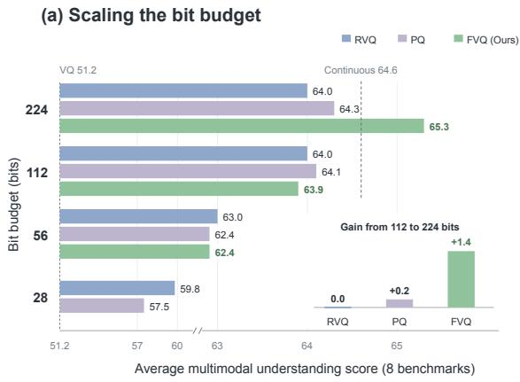

(b) Text recognition at increasing budgets  
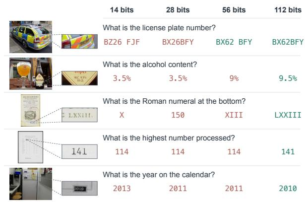  
Figure 1 Scaling the bit budget of discrete visual representations. (a) Average multimodal understanding performance improves with the per-patch bit budget. FVQ continues to improve in the high-budget regime and reaches the continuous QwenViT baseline, whereas existing multi-codebook quantizers saturate. (b) Qualitative examples of text recognition at increasing bit budgets. Higher budgets progressively recover the fine-grained textual information required for correct predictions; green and red denote correct and incorrect answers, respectively.

In this work, we challenge this common assumption. We use multimodal understanding as a proxy for semantic fidelity, since a representation that provides the information needed to answer any image-centric question can be regarded as semantically lossless with respect to the original visual signal (Meituan LongCat Team et al., 2026). Our experiments reveal that a discrete representation with an order-of-magnitude larger quantization error can nevertheless achieve substantially better understanding performance. This result demonstrates that quantization error is not a reliable measure of semantic fidelity, raising a fundamental question: What determines the semantic fidelity of discrete visual representations?

Returning to first principles, raw visual signals, continuous features, and discrete representations are all finite-bit encodings in digital systems, whose nominal capacities can be characterized by their bit budgets, as illustrated in Fig. 2 (right). The semantic content of raw visual signals can in principle be represented with far fewer bits owing to their high redundancy, suggesting that discrete representations may approach semantic completeness with a suficiently large bit budget. For discrete representations, the bit budget grows linearly with the number of codebooks L but only logarithmically with the size of each codebook C, making multi-codebook quantization a more eficient scaling strategy. To test this hypothesis, we systematically scale the bit budget and observe steady improvements in downstream multimodal understanding, as shown in Fig. 1(a).

However, existing multi-codebook quantizers face a scaling bottleneck as additional codebooks become less semantically informative. Residual vector quantization (RVQ) (Lee et al., 2022) assigns later codebooks to progressively smaller residuals, whereas product quantization (PQ) (Jégou et al., 2011; Ma et al., 2026a) partitions the feature into increasingly narrow channel groups. Consequently, the efective semantic capacity fails to keep pace with the nominal bit budget, limiting further scaling.

The observed saturation motivates quantizer designs that continue to provide newly added codebooks with informative views as the bit budget grows. As one approach to alleviating this bottleneck, we introduce Factorized Vector Quantization (FVQ), illustrated in Fig. 3, which constructs complementary, fixed-dimensional views of the same visual feature and quantizes them with symmetric parallel codebooks. Fig. 1(a) shows that FVQ continues to improve with larger bit budgets after RVQ and PQ saturate, ultimately matching continuous visual representations in multimodal understanding.

Moving beyond small-scale feasibility studies, we train our model on industrial-scale multimodal data. The resulting model achieves competitive performance with flagship multimodal models across a broad suite of benchmarks, demonstrating the data scalability of discrete visual representations and supporting their potential to underpin large-scale native multimodal foundation models.

Our main contributions are summarized as follows.

• We show that quantization error does not determine semantic fidelity. Starting from the first-principles observation that digital RGB images are themselves discrete finite-bit signals, we further demonstrate that a suficiently large efective bit budget enables discrete representations to match continuous ones in downstream understanding.

• We introduce Factorized Vector Quantization (FVQ), which provides one approach to alleviating the high-budget saturation observed in existing multi-codebook quantizers. FVQ quantizes complementary, fixed-dimensional views of the same visual feature with symmetric parallel codebooks and sustains gains as the bit budget increases.

• We demonstrate the data scalability of our model through industrial-scale multimodal training, achieving state-of-the-art performance among discrete-representation models with relative improvements of 22.8% over UniAR and 59.2% over Emu3-Chat on a nine-metric average. To the best of our knowledge, ours is the first discrete-representation model to achieve competitive performance against flagship continuous-representation models such as Qwen3-VL. Beyond these empirical results, we distill the key principles and a practical recipe that make such competitiveness possible, further supporting the potential of discrete visual representations to underpin large-scale native multimodal foundation models.

## 2 What Determines the Semantics of Discrete Visual Representations?

Discrete visual representations provide a shared token interface for vision and language, enabling native multimodal modeling and visual chains of thought while potentially reducing modality conflicts. Their limited semantic fidelity, however, remains a central bottleneck. We therefore investigate what governs the semantic fidelity of discrete visual representations. Section 2.1 tests whether quantization error necessarily implies semantic loss, and Section 2.2 examines efective bit budget and the scaling bottlenecks of existing quantizers. Fig. 2 summarizes the two analyses.

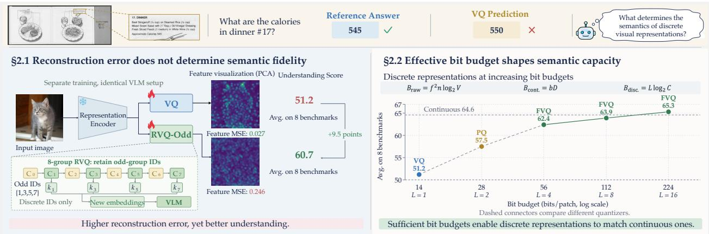

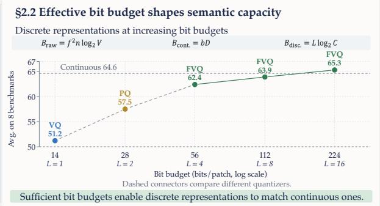  
Figure 2 Overview of the analyses in Section 2: reconstruction error versus semantic fidelity (left) and bit-budget scaling across representative quantizers (right). $B _ { \mathrm { r a w } } , ~ B _ { \mathrm { c o n t } }$ , and $B _ { \mathrm { d i s c } }$ denote per-patch budgets for raw pixels, continuous features, and discrete indices. $f , n , V , b , D , L ,$ and C denote patch side length, channels, values per channel, bits per feature dimension, feature dimension, number of codebooks, and codebook size, respectively.

## 2.1 Rethinking Quantization Error and Semantic Fidelity

Finding 1: Quantization Error Does Not Determine Semantic Fidelity. Representations with similar errors can exhibit substantially diferent understanding performance, whereas those with markedly diferent errors can retain comparable semantic information.

In this section, we challenge the common assumption that continuous visual representations form an intrinsic upper bound for their discrete counterparts. A prevailing view holds that mapping continuous visual features to a finite codebook inevitably introduces quantization error and that this distortion necessarily entails semantic loss. Under this view, discrete representations are inherently weaker than continuous ones.

However, the VLM operates on discrete indices rather than reconstructed features, so quantization error need not translate directly into reduced semantic fidelity. We compare single-codebook VQ (van den Oord et al., 2017) with eight-group RVQ and construct two partial representations by retaining alternating groups. Fig. 2 (left) highlights the odd-group comparison, while Table 1 reports feature-reconstruction MSE on the ImageNet validation set (Deng et al., 2009) alongside downstream multimodal understanding performance for all variants.

Table 1 Quantization error and multimodal understanding of discrete QwenViT representations. C and L denote the codebook size and number of selected codebooks, respectively. MSE measures feature-reconstruction error. Avg. is the unweighted mean over the eight benchmarks, with OCRBench divided by 10.
<table><tr><td colspan="3">Quantization</td><td colspan="9">Multimodal Understanding</td></tr><tr><td>Quantizer</td><td>C × L</td><td>MSE↓</td><td></td><td>MathVista RealWorldQA</td><td>MMStar</td><td>OCRBench TextVQA</td><td></td><td>AI2D</td><td>ChartQA</td><td>DocVQA</td><td>Avg. ↑</td></tr><tr><td>VQ</td><td>16,384 × 1</td><td>0.027</td><td>39.4</td><td>52.4</td><td>40.5</td><td>367</td><td>51.3</td><td>67.1</td><td>54.2</td><td>68.2</td><td>51.2</td></tr><tr><td>RVQ (Odd)</td><td>16,384 × 4</td><td>0.246</td><td>41.4</td><td>56.2</td><td>41.7</td><td>615</td><td>66.9</td><td>75.1</td><td>63.5</td><td>79.5</td><td>60.7</td></tr><tr><td>RVQ (Even)</td><td>16,384 × 4</td><td>0.028</td><td>40.3</td><td>56.2</td><td>41.7</td><td>564</td><td>66.1</td><td>73.6</td><td>61.7</td><td>78.4</td><td>59.3</td></tr><tr><td>RVQ (All)</td><td>16,384 × 8</td><td>0.016</td><td>43.7</td><td>59.3</td><td>43.1</td><td>652</td><td>71.6</td><td>78.8</td><td>67.3</td><td>82.8</td><td>64.0</td></tr></table>

The results reveal a counterintuitive pattern. Although the odd-group variant omits the coarse component captured by group 0 and incurs substantially greater reconstruction error, it markedly outperforms VQ and performs comparably to the even-group variant in understanding performance. Conversely, the even-group variant exhibits reconstruction error comparable to VQ but achieves much stronger understanding. Together, these contrasting cases show that reconstruction error does not determine semantic fidelity, raising a more fundamental question: what governs the semantic capacity of a discrete representation?

## 2.2 Bit-Budget Scaling in Discrete Visual Representations

Finding 2: Larger Bit Budgets Improve Semantic Capacity When Added Codes Remain Informative. Increasing the discrete bit budget improves semantic fidelity and downstream multimodal understanding, ultimately enabling discrete representations to match the understanding performance of continuous visual representations.

Returning to first principles, raw visual signals, continuous features, and discrete representations are all finite-bit encodings in digital systems, and their nominal capacities can be characterized by their per-patch bit budgets (Yu et al., 2026a), as summarized in Fig. 2 (right). The semantic content of raw visual signals can in principle be represented with far fewer bits owing to their high redundancy. Accordingly, we hypothesize that increasing the discrete bit budget improves semantic fidelity, provided that the additional codes remain semantically informative.

To test this hypothesis, we scale the discrete bit budget and evaluate the resulting representations on downstream multimodal understanding tasks. The discrete bit budget $B _ { \mathrm { d i s c } } = L \log _ { 2 } C$ grows linearly with the number of codebooks L but only logarithmically with the codebook size C. Larger codebooks are more dificult to optimize and may sufer from poor utilization or codebook collapse. Keeping the codebook size fixed while increasing the number of codebooks therefore provides a more eficient and tractable scaling strategy. We compare RVQ with product quantization (PQ) (Jégou et al., 2011; Ma et al., 2026a), which partitions each feature into channel groups and quantizes them in parallel. Fig. 1(a) shows that both methods improve as the bit budget increases and progressively approach the continuous representation. This trend also extends to OCR, where discrete representations often struggle because quantization can discard high-frequency details (Yu et al., 2026b). Larger budgets progressively recover the fine-grained textual information required for correct predictions, as shown in Fig. 1(b). Detailed benchmark results are reported in Table 2.

Despite this trend, both RVQ and PQ saturate at high bit budgets. Increasing the number of codebooks from 8 to 16 doubles the nominal bit budget but yields only marginal gains in understanding performance. We attribute this saturation to diminishing information per codebook, as later RVQ groups receive weaker residuals and PQ partitions features into increasingly narrow channel groups. The nominal capacity therefore grows without a corresponding increase in efective semantic capacity, showing that additional bits help only when the added codes remain semantically informative. This observation motivates quantizer designs that continue to provide informative representations to newly added codebooks as their number grows. In the next section, we introduce FVQ as one such approach.

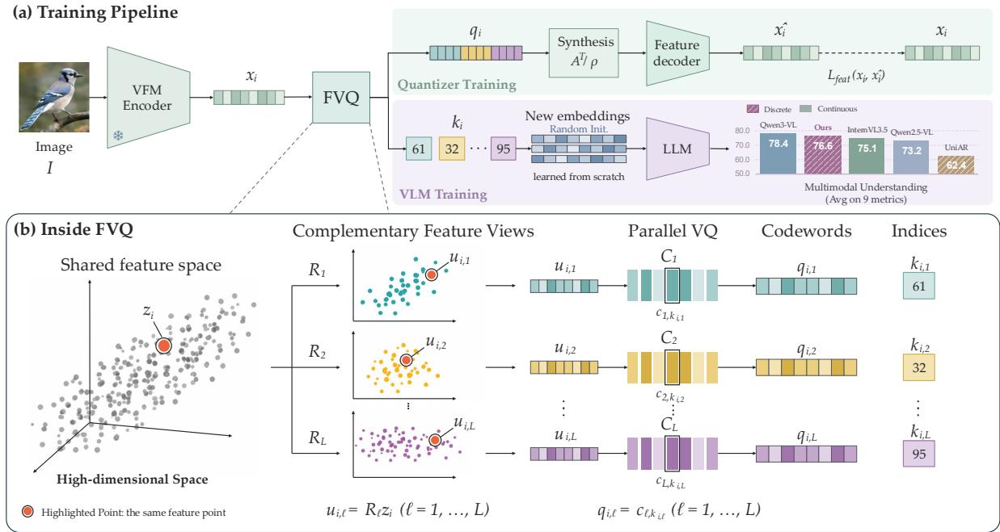  
Figure 3 Overview of FVQ. During quantizer training, multiple dense projections produce complementary views of the same visual feature, which are quantized in parallel by independent codebooks. The selected codewords are combined through tight-frame synthesis for feature reconstruction. In the subsequent VLM training stage, the quantizer is frozen, and only the resulting discrete indices are mapped to newly initialized token embeddings for multimodal understanding. The nine-metric average is computed over MMMU, MathVista, MMStar, OCRBench/10, ChartQA, CharXiv-DQ, CharXiv-RQ, DocVQA, and InfoVQA.

## 3 From Bit-Budget Scaling to Quantizer Design

## 3.1 Overview

The preceding analysis shows that a larger nominal bit budget is insuficient when the information available to each codebook diminishes as their number grows. A scalable multi-codebook quantizer should therefore assign symmetric roles to its codebooks, provide each with a fixed-dimensional view derived from the full feature, and collectively preserve the original feature before quantization. Guided by these principles, we introduce Factorized Vector Quantization (FVQ) as a concrete realization based on dense tight-frame projections, parallel independent codebooks, and information-preserving synthesis, as illustrated in Fig. 3.

## 3.2 Factorized Vector Quantization

Complementary Tight-Frame Projections. Let $\mathbf { z } _ { i } \in \mathbb { R } ^ { D }$ denote the projected VFM feature of the i-th visual patch. FVQ maps z into L fixed-dimensional dense views. Each projection $\mathbf { R } _ { \ell } \in \mathbb { R } ^ { d \times D }$ is dense over all D input channels, allowing every codebook to receive information from the full feature while keeping its input dimension d unchanged as L grows. Unlike PQ, increasing L adds another view rather than dividing the feature into progressively narrower channel groups. We stack these projections into an analysis operator A

and constrain them as follows:

$$
\begin{array} { r l } & { \mathbf { u } _ { i , \ell } = \mathbf { R } _ { \ell } \mathbf { z } _ { i } , \quad \mathbf { R } _ { \ell } \in \mathbb { R } ^ { d \times D } , } \\ & { \quad \mathbf { A } = \left[ \mathbf { R } _ { 1 } ^ { \top } \quad \cdot \cdot \quad \mathbf { R } _ { L } ^ { \top } \right] ^ { \top } \in \mathbb { R } ^ { L d \times D } , } \\ & { \quad \mathbf { A } ^ { \top } \mathbf { A } = \rho \mathbf { I } _ { D } , \quad \rho = \frac { L d } { D } . } \end{array}\tag{1}
$$

Dense projections provide global views of the same feature, but independently sampled projections do not guarantee that these views preserve the feature collectively and may weight diferent directions unevenly. We therefore impose the tight-frame condition $\mathbf { A } ^ { \top } \mathbf { A } = \rho \mathbf { I } _ { D }$ . This makes the aggregate transform isotropic, such that $\| \mathbf { A } \mathbf { z } _ { i } \| _ { 2 } ^ { 2 } = \rho \| \mathbf { z } _ { i } \| _ { 2 } ^ { 2 }$ . Every feature direction is scaled equally, and no nonzero direction is discarded by all views simultaneously. The projected views therefore preserve the feature geometry collectively before quantization.

For $L d \ge D$ , we construct A by applying reduced QR decomposition to a fixed Gaussian matrix and scaling the resulting column-orthonormal matrix by ${ \sqrt { \rho } } .$ The projections remain fixed throughout training, providing stable input spaces for the corresponding codebooks.

Symmetric Parallel Quantization. Each projected view $\mathbf { u } _ { i , \ell }$ is quantized independently using a codebook $\mathcal { C } _ { \ell } = \{ \mathbf { c } _ { \ell , j } \} _ { j = 1 } ^ { C }$ , where $\mathbf { c } _ { \ell , j } \in \mathbb { R } ^ { d }$ and all codebooks contain $C$ entries. FVQ performs nearest-neighbor lookup in parallel:

$$
k _ { i , \ell } = \arg \operatorname* { m i n } _ { \substack { j \in \{ 1 , \dots , C \} } } \left\| \mathbf { u } _ { i , \ell } - \mathbf { c } _ { \ell , j } \right\| _ { 2 } ^ { 2 } .\tag{2}
$$

Here, $k _ { i , \ell }$ is the selected discrete ID and $\mathbf { c } _ { \ell , k _ { i , \ell } }$ is the corresponding codeword. Each visual patch is represented by the tuple $( k _ { i , 1 } , \ldots , k _ { i , L } )$ , yielding the nominal bit budget $B = L \log _ { 2 } C$ illustrated in Fig. 2 (right). Independent parallel quantization places all codebooks in symmetric roles, allowing this capacity to grow with L without introducing the residual hierarchy of RVQ.

Tight-Frame Synthesis. To reconstruct the projected feature zi during tokenizer training, we combine the selected codewords using the tight-frame synthesis operator $\rho ^ { - 1 } \mathbf { A } ^ { \top }$ . Let $\mathbf { u } _ { i } = [ \mathbf { u } _ { i , 1 } ^ { \top } , \ldots , \mathbf { u } _ { i , L } ^ { \top } ] ^ { \top } = \mathbf { A } \mathbf { z } _ { i }$ denote the stacked views before quantization. Then

$$
\begin{array} { r } { \hat { \mathbf { z } } _ { i } = \displaystyle \frac { 1 } { \rho } \sum _ { \ell = 1 } ^ { L } \mathbf { R } _ { \ell } ^ { \top } \mathbf { c } _ { \ell , k _ { i , \ell } } , } \\ { \frac { 1 } { \rho } \mathbf { A } ^ { \top } \mathbf { u } _ { i } = \displaystyle \frac { 1 } { \rho } \mathbf { A } ^ { \top } \mathbf { A } \mathbf { z } _ { i } = \mathbf { z } _ { i } . } \end{array}\tag{3}
$$

The second line follows directly from $\mathbf { A } ^ { \top } \mathbf { A } = \rho \mathbf { I } _ { D }$ and shows that the analysis–synthesis transform exactly recovers $\mathbf { z } _ { i }$ before quantization. The factorization itself therefore introduces no reconstruction error. All distortion arises from replacing the projected views with their nearest codewords.

Properties of FVQ. FVQ implements the three design choices described above. First, parallel independent quantization assigns symmetric roles to all codebooks, avoiding the progressively weaker inputs induced by a residual hierarchy. Second, dense projections provide each codebook with a fixed-dimensional view derived from the full feature, so the information available to an individual codebook does not structurally diminish as L increases. Third, the tight-frame analysis–synthesis pair makes these views collectively information-preserving before quantization. Together, these choices enable the nominal bit budget to scale with L without structurally reducing the information available to newly added codebooks.

## 4 Experiments

## 4.1 Implementation Details

We report two training configurations: an industrial-scale configuration for the main experiments and a shared configuration based primarily on the LLaVA-OneVision data (Li et al., 2024) for the exploratory experiments in Section 2 and the ablation studies.

Model Architecture. Our main model pairs Qwen3-8B (Yang et al., 2025) with an any-resolution visual tokenizer constructed by applying 16-codebook FVQ to Qwen3 ViT (Bai et al., 2025a). To preserve a native next-token prediction setup with minimal modality-specific modifications to the LLM, we use standard 1D RoPE (Su et al., 2024) in the LLM and omit the DeepStack connections from Qwen3 ViT. Unless otherwise specified, the exploratory and ablation experiments use Qwen3-1.7B and vary the quantization configuration according to the experiment.

Training Schedule. Both configurations follow four stages. Quantizer training learns the visual tokenizer by reconstructing frozen visual features. Alignment stage freezes both the tokenizer and the LLM and optimizes the newly initialized visual token embeddings and merger to align the discrete IDs with the language embedding space. Pre-training and supervised fine-tuning both keep the tokenizer frozen and jointly optimize the LLM, visual token embeddings, and merger, using context lengths of 8K and 16K and maximum image resolutions of 1024px and 2048px, respectively.

Training Data. For the main experiments, quantizer training, alignment, pre-training, and supervised fine-tuning use 100B, 10B, 60B, and 30B tokens, respectively, drawn from mixtures covering STEM, OCR, interleaved image-text sequences, image captioning and text-only data. For the exploratory and ablation experiments, we train the quantizer on 50B tokens, use approximately 4B tokens for alignment, and adopt LLaVA-OneVision (Li et al., 2024) for pre-training and supervised fine-tuning.

Evaluation. We evaluate general perception and reasoning on MMMU (Yue et al., 2024), its more challenging and robust extension MMMU-Pro (Yue et al., 2025), MMStar (Chen et al., 2024a), and RealWorldQA (xAI, 2024). We assess mathematical reasoning on MathVista (Lu et al., 2024). For text recognition and text-centric understanding, we use OCRBench (Liu et al., 2024), OCRBench V2 (Fu et al., 2026), and TextVQA (Singh et al., 2019); for document and infographic understanding, we use DocVQA (Mathew et al., 2021), InfoVQA (Mathew et al., 2022), and OmniDocBench (Ouyang et al., 2025), which evaluates document parsing across diverse PDF document types. We assess diagram and chart understanding on AI2D (Kembhavi et al., 2016) with mask, ChartQA (Masry et al., 2022), and CharXiv (Wang et al., 2024b).

## 4.2 Main Results

Bit-Budget Scaling. We compare discrete quantizers with the original continuous Qwen3 ViT representation under identical VLM training and evaluation settings. Table 2 reports the complete benchmark results underlying the scaling trend in Fig. 1(a). Increasing the number of codebooks substantially improves RVQ and PQ over single-codebook methods, but their gains diminish at high budgets. FVQ, by contrast, continues to improve with larger budgets and ultimately matches the average understanding performance of continuous QwenViT.

STEM & General. Table 3 shows that our model achieves state-of-the-art performance among discreterepresentation models while remaining competitive with strong continuous-representation models. It matches Qwen3-VL-8B on MathVista and achieves the best RealWorldQA result, demonstrating that discrete visual representations can support strong reasoning and general understanding under industrial-scale training.

OCR & Doc & Chart. Quantization is commonly thought to discard the high-frequency details required for OCR, document, and chart understanding, causing discrete-representation models to lag substantially behind continuous-representation models (Yu et al., 2026b). Table 4 shows that our model substantially narrows this gap, achieving state-of-the-art performance among discrete-representation models, performing comparably to Qwen3-VL-8B on OmniDocBench and DocVQA, and surpassing the continuous-representation models on both CharXiv tasks. These results suggest that weak fine-grained visual understanding is not intrinsic to discretization but instead reflects the information bottleneck imposed by an insuficient efective bit budget. By expanding this budget, FVQ alleviates the bottleneck and substantially improves fine-grained visual understanding, challenging the view that discrete visual representations are inherently ill-suited to OCR.

Table 2 Bit-budget scaling of discrete QwenViT representations under the shared experimental setting. All discrete variants quantize the same features with codebook size C = 16,384. L is the number of codebooks and $B = L \log _ { 2 } C$ is the nominal per-patch bit budget. Bold indicates the best discrete result. Continuous denotes the original QwenViT representation.
<table><tr><td colspan="3">Quantization</td><td colspan="9">Multimodal Understanding</td></tr><tr><td>Quantizer</td><td>L</td><td>B</td><td>MathVista</td><td>RealWorldQA</td><td>MMStar OCRBench TextVQA</td><td></td><td></td><td>AI2D</td><td>ChartQA</td><td>DocVQA</td><td>Avg. ↑</td></tr><tr><td>VQ (van den Oord et al., 2017)</td><td>1</td><td>14</td><td>39.4</td><td>52.4</td><td>40.5</td><td>367</td><td>51.3</td><td>67.1</td><td>54.2</td><td>68.2</td><td>51.2</td></tr><tr><td>SimVQ (Zhu et al., 2025b)</td><td>1</td><td>14</td><td>37.9</td><td>49.7</td><td>39.1</td><td>204</td><td>32.2</td><td>63.9</td><td>41.9</td><td>49.9</td><td>41.9</td></tr><tr><td rowspan="4">RVQ (Lee et al., 2022)</td><td>2</td><td>28</td><td>41.4</td><td>54.8</td><td>42.7</td><td>563</td><td>65.8</td><td>74.3</td><td>64.4</td><td>79.0</td><td>59.8</td></tr><tr><td>4</td><td>56</td><td>43.2</td><td>58.7</td><td>43.1</td><td>625</td><td>69.7</td><td>78.2</td><td>66.8</td><td>81.7</td><td>63.0</td></tr><tr><td>8</td><td>112</td><td>43.7</td><td>59.3</td><td>43.1</td><td>652</td><td>71.6</td><td>78.8</td><td>67.3</td><td>82.8</td><td>64.0</td></tr><tr><td>16</td><td>224</td><td>44.4</td><td>56.2</td><td>43.2</td><td>649</td><td>72.3</td><td>80.2</td><td>68.6</td><td>82.5</td><td>64.0</td></tr><tr><td rowspan="4">PQ (Ma et al., 2026a)</td><td>2</td><td>28</td><td>41.1</td><td>55.9</td><td>41.4</td><td>489</td><td>60.8</td><td>73.6</td><td>61.6</td><td>76.8</td><td>57.5</td></tr><tr><td>4</td><td>56</td><td>44.6</td><td>58.0</td><td>42.7</td><td>603</td><td>68.0</td><td>77.8</td><td>66.6</td><td>81.2</td><td>62.4</td></tr><tr><td>8</td><td>112</td><td>46.0</td><td>57.3</td><td>45.3</td><td>623</td><td>70.1</td><td>80.3</td><td>68.7</td><td>82.4</td><td>64.1</td></tr><tr><td>16</td><td>224</td><td>45.1</td><td>57.6</td><td>43.9</td><td>642</td><td>71.6</td><td>79.4</td><td>68.8</td><td>83.6</td><td>64.3</td></tr><tr><td rowspan="3">FVQ (Ours)</td><td>4</td><td>56</td><td>45.8</td><td>57.1</td><td>42.7</td><td>600</td><td>68.3</td><td>78.1</td><td>66.3</td><td>81.1</td><td>62.4</td></tr><tr><td>8</td><td>112</td><td>44.5</td><td>57.6</td><td>44.2</td><td>658</td><td>69.7</td><td>79.3</td><td>68.2</td><td>81.7</td><td>63.9</td></tr><tr><td>16</td><td>224</td><td>45.8</td><td>61.7</td><td>44.3</td><td>663</td><td>71.9</td><td>79.0</td><td>69.2</td><td>84.0</td><td>65.3</td></tr><tr><td>Continuous</td><td></td><td></td><td>45.7</td><td>60.1</td><td>45.8</td><td>676</td><td>71.3</td><td>76.7</td><td>67.4</td><td>81.9</td><td>64.6</td></tr></table>

Table 3 Comparison on STEM and general multimodal understanding benchmarks. For a fair comparison, results marked with \* are obtained by us under the same evaluation setting as our model.
<table><tr><td>Method</td><td>MMMU</td><td>MMMU-Pro</td><td>MathVista</td><td>RealWorldQA</td><td>MMStar</td></tr><tr><td colspan="6">Continuous</td></tr><tr><td>LLaVA-OV-1.5-8B (An et al., 2025)</td><td>55.4</td><td>31.3</td><td>69.6</td><td>68.1</td><td>67.7</td></tr><tr><td>LLaVA-OV-2-8B (An et al., 2026)</td><td></td><td></td><td></td><td>69.7</td><td>64.8</td></tr><tr><td>InternVL3-8B (Zhu et al., 2025a)</td><td>62.7</td><td></td><td>71.6</td><td>70.8</td><td>68.2</td></tr><tr><td>InternVL3.5-8B (Wang et al., 2025)</td><td>73.4</td><td></td><td>78.4</td><td>67.5</td><td>69.3</td></tr><tr><td>Qwen2.5-VL-7B (Bai et al., 2025b)</td><td>58.6</td><td>38.3</td><td>68.2</td><td></td><td>63.9</td></tr><tr><td>Qwen3-VL-8B (Bai et al., 2025a)</td><td>69.6</td><td>55.9</td><td>77.2</td><td>71.5</td><td>70.9</td></tr><tr><td colspan="6">Discrete</td></tr><tr><td>Emu3-Chat-8B (Wang et al., 2024a)</td><td>31.6</td><td></td><td>47.6*</td><td>57.4</td><td>46.5*</td></tr><tr><td>Tar-7B (Han et al., 2026)</td><td>39.0</td><td></td><td></td><td></td><td></td></tr><tr><td>ViQ-7B (Yu et al., 2026b)</td><td>49.1</td><td></td><td></td><td></td><td>54.2</td></tr><tr><td>UniAR-8B (Peng et al., 2026)</td><td>44.3</td><td>22.7*</td><td>50.8*</td><td>68.5</td><td>56.7*</td></tr><tr><td>Ours-8B</td><td>64.3</td><td>40.8</td><td>77.4</td><td>72.0</td><td>68.5</td></tr></table>

## 4.3 Visualization of Fine-Grained Visual Understanding

Fig. 4 presents three cases that probe fine-grained visual understanding beyond standard OCR. They require locating and aggregating sparse entries in a long table at an extreme resolution of 21,253 × 3,912 pixels, extracting small and irregular handwritten selections from a dense scanned examination sheet, and sustaining accurate transcription across a densely typeset page with more than 5,000 output characters. Our model succeeds in all three settings, challenging the view that discrete visual representations are intrinsically incapable of fine-grained visual understanding.

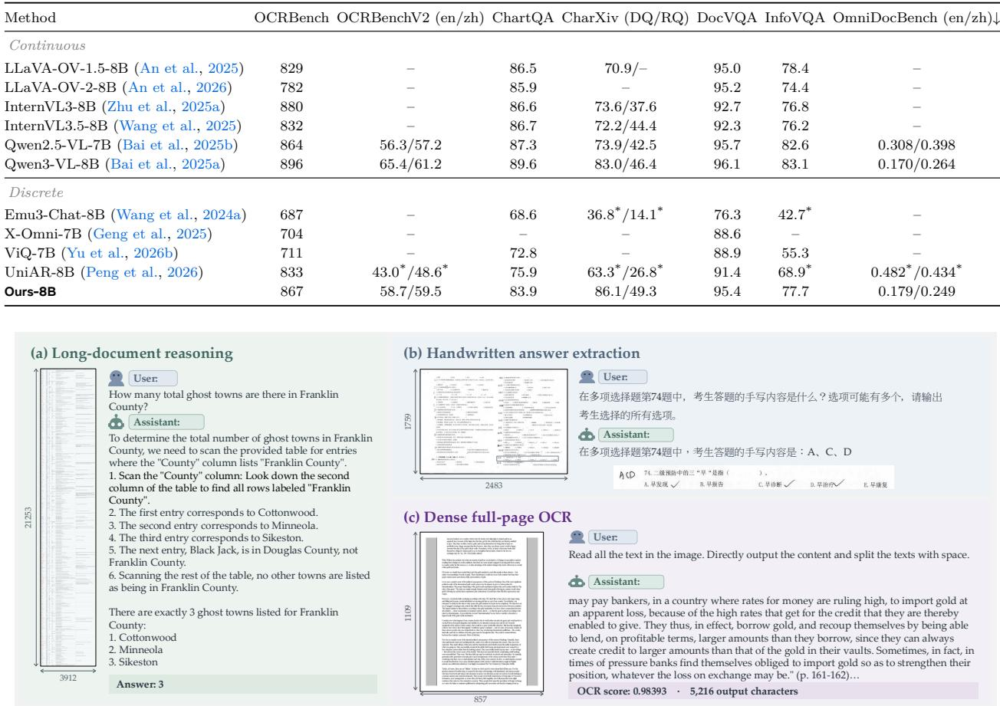

Table 4 Comparison of OCR, chart, and document understanding performance. For a fair comparison, results marked with \* are obtained by us under the same evaluation setting as our model.
<table><tr><td>Method</td><td>OCRBench OCRBenchV2 (en/zh)</td><td></td><td>ChartQA CharXiv (DQ/RQ)</td><td></td><td></td><td></td><td>DocVQA InfoVQA OmniDocBench (en/zh)↓</td></tr><tr><td>Continuous</td><td></td><td></td><td></td><td></td><td></td><td></td><td></td></tr><tr><td>LLaVA-OV-1.5-8B (An et al., 2025)</td><td>829</td><td></td><td>86.5</td><td>70.9/-</td><td>95.0</td><td>78.4</td><td></td></tr><tr><td>LLaVA-OV-2-8B (An et al., 2026)</td><td>782</td><td></td><td>85.9</td><td></td><td>95.2</td><td>74.4</td><td></td></tr><tr><td>InternVL3-8B (Zhu et al., 2025a)</td><td>880</td><td></td><td>86.6</td><td>73.6/37.6</td><td>92.7</td><td>76.8</td><td></td></tr><tr><td>InternVL3.5-8B (Wang et al., 2025)</td><td>832</td><td></td><td>86.7</td><td>72.2/44.4</td><td>92.3</td><td>76.2</td><td></td></tr><tr><td>Qwen2.5-VL-7B (Bai et al., 2025b)</td><td>864</td><td>56.3/57.2</td><td>87.3</td><td>73.9/42.5</td><td>95.7</td><td>82.6</td><td>0.308/0.398</td></tr><tr><td>Qwen3-VL-8B (Bai et al., 2025a)</td><td>896</td><td>65.4/61.2</td><td>89.6</td><td>83.0/46.4</td><td>96.1</td><td>83.1</td><td>0.170/0.264</td></tr><tr><td>Discrete</td><td></td><td></td><td></td><td></td><td></td><td></td><td></td></tr><tr><td>Emu3-Chat-8B (Wang et al., 2024a)</td><td>687</td><td></td><td>68.6</td><td>36.8*/14.1*</td><td>76.3</td><td>42.7*</td><td></td></tr><tr><td>X-Omni-7B (Geng et al., 2025)</td><td>704</td><td></td><td></td><td></td><td>88.6</td><td></td><td></td></tr><tr><td>ViQ-7B (Yu et al., 2026b)</td><td>711</td><td></td><td>72.8</td><td></td><td>88.9</td><td>55.3</td><td></td></tr><tr><td>UniAR-8B (Peng et al., 2026)</td><td>833</td><td>43.0*/48.6*</td><td>75.9</td><td>63.3*/26.8*</td><td>91.4</td><td>68.9*</td><td>0.482*/0.434*</td></tr><tr><td>Ours-8B</td><td>867</td><td>58.7/59.5</td><td>83.9</td><td>86.1/49.3</td><td>95.4</td><td>77.7</td><td>0.179/0.249</td></tr></table>

Figure 4 Challenging cases for fine-grained visual understanding: (a) reasoning over an extremely high-resolution long document, (b) extracting irregular handwritten answers, and (c) long-form transcription of a dense full page.

## 4.4 Ablation Studies

Unless otherwise specified, all ablation studies are conducted using FVQ with eight codebooks under the shared setting described in Section 4.1.

Generalization across Vision Encoders. We examine whether the bit-budget finding generalizes beyond QwenViT by comparing single-codebook VQ with eight-codebook FVQ on features from MoonViT-v2 (Kimi Team et al., 2026) and SigLIP2 (Tschannen et al., 2025) under the same setting. Table 5 shows substantial average gains for both encoders, supporting our view that efective bit budget is a general determinant of semantic capacity across visual representations.

Table 5 Comparison of VQ (van den Oord et al., 2017) and FVQ across vision encoders. B denotes the per-patch bit budget; B = 14 and B = 112 correspond to single-codebook VQ and eight-codebook FVQ, respectively.
<table><tr><td>Encoder</td><td>B</td><td></td><td>MathVista RealWorldQA</td><td>MMStar</td><td>OCRBench</td><td>TextVQA</td><td>AI2D</td><td>ChartQA</td><td>DocVQA</td><td>Avg. ↑</td></tr><tr><td rowspan="2">MoonViT-v2</td><td>14</td><td>34.9</td><td>47.5</td><td>36.5</td><td>198</td><td>36.7</td><td>63.3</td><td>27.9</td><td>43.0</td><td>38.7</td></tr><tr><td>112</td><td>44.6</td><td>54.1</td><td>39.9</td><td>608</td><td>62.1</td><td>78.4</td><td>69.5</td><td>79.7</td><td>61.1</td></tr><tr><td rowspan="2">SigLIP2</td><td>14</td><td>38.6</td><td>52.7</td><td>43.5</td><td>287</td><td>47.4</td><td>68.3</td><td>44.6</td><td>33.7</td><td>44.7</td></tr><tr><td>112</td><td>40.0</td><td>56.3</td><td>43.9</td><td>499</td><td>64.7</td><td>75.6</td><td>57.1</td><td>43.3</td><td>53.9</td></tr></table>

Comparison under LLaVA-OneVision SFT. To isolate the efect of FVQ from industrial-scale training, we retain only the alignment stage and then fine-tune the model on LLaVA-OneVision SFT data, omitting the industrial-scale pre-training and SFT data used for our main model. Table 6 shows that FVQ achieves the strongest overall performance among the compared methods.

Table 6 Comparison under LLaVA-OneVision SFT. LLaVA-OneVision uses Qwen2-7B (Li et al., 2024); all other models use Qwen2.5-7B. LLaVA-OneVision results are from its paper, and the other baselines are reported by ViQ (Yu et al., 2026b). Bold indicates the best discrete result.
<table><tr><td>Method</td><td></td><td></td><td>MMMU MathVista RealWorldQA MMStar OCRBench ChartQA DocVQA</td><td></td><td></td><td></td><td></td></tr><tr><td>Continuous</td><td></td><td></td><td></td><td></td><td></td><td></td><td></td></tr><tr><td>LLaVA-OneVision (Li et al., 2024)</td><td>48.8</td><td>63.2</td><td>66.3</td><td>61.7</td><td></td><td>80.0</td><td>87.5</td></tr><tr><td>SigLIP2-g (Tschannen et al., 2025)</td><td>48.3</td><td></td><td></td><td>57.2</td><td>671</td><td>72.8</td><td>75.0</td></tr><tr><td>AIMv2-H (Fini et al., 2025)</td><td>48.2</td><td></td><td></td><td>55.2</td><td>687</td><td>72.5</td><td>80.1</td></tr><tr><td>InternViT-2.5-6B (Chen et al., 2024b)</td><td>48.1</td><td></td><td></td><td>55.3</td><td>757</td><td>77.4</td><td>85.7</td></tr><tr><td>Discrete</td><td></td><td></td><td></td><td></td><td></td><td></td><td></td></tr><tr><td>ViQ (Yu et al., 2026b)</td><td>49.1</td><td></td><td></td><td>54.2</td><td>711</td><td>72.8</td><td>88.9</td></tr><tr><td>Ours</td><td>53.1</td><td>60.2</td><td>65.2</td><td>58.5</td><td>791</td><td>81.6</td><td>90.3</td></tr></table>

## 5 Conclusion

We revisit the semantic fidelity of discrete visual tokens and show that feature reconstruction error does not reliably predict downstream understanding. Instead, efective bit budget emerges as a key determinant of semantic capacity. However, existing multi-codebook quantizers eventually saturate as additional codebooks contribute diminishing semantic information. As one approach to alleviating this bottleneck, FVQ combines complementary projections with symmetric parallel codebooks and sustains gains at larger bit budgets. Moving beyond small-scale feasibility studies, our industrial-scale model achieves state-of-the-art performance among discrete-representation models and remains competitive with strong continuous-representation models, including on fine-grained OCR and document understanding. These results support discrete tokens as a scalable interface for large-scale native multimodal foundation models.

## References

Xiang An, Yin Xie, Kaicheng Yang, Wenkang Zhang, Xiuwei Zhao, Zheng Cheng, Yirui Wang, Songcen Xu, Changrui Chen, Didi Zhu, et al. LLaVA-OneVision-1.5: Fully open framework for democratized multimodal training. arXiv preprint arXiv:2509.23661, 2025.

Xiang An, Yin Xie, Feilong Tang, Yunyao Yan, Huajie Tan, Didi Zhu, Changrui Chen, Xiuwei Zhao, Bin Qin, Kaicheng Yang, et al. LLaVA-OneVision-2: Towards next-generation perceptual intelligence. arXiv preprint arXiv:2605.25979, 2026.

Shuai Bai, Yuxuan Cai, Ruizhe Chen, Keqin Chen, Xionghui Chen, Zesen Cheng, Lianghao Deng, Wei Ding, Chang Gao, Chunjiang Ge, et al. Qwen3-VL technical report. arXiv preprint arXiv:2511.21631, 2025a.

Shuai Bai, Keqin Chen, Xuejing Liu, Jialin Wang, Wenbin Ge, Sibo Song, Kai Dang, Peng Wang, Shijie Wang, Jun Tang, Humen Zhong, Yuanzhi Zhu, Mingkun Yang, Zhaohai Li, Jianqiang Wan, Pengfei Wang, Wei Ding, Zheren Fu, Yiheng Xu, Jiabo Ye, Xi Zhang, Tianbao Xie, Zesen Cheng, Hang Zhang, Zhibo Yang, Haiyang Xu, and Junyang Lin. Qwen2.5-VL technical report. arXiv preprint arXiv:2502.13923, 2025b.

Chameleon Team. Chameleon: Mixed-modal early-fusion foundation models. arXiv preprint arXiv:2405.09818, 2024.

Lin Chen, Jinsong Li, Xiaoyi Dong, Pan Zhang, Yuhang Zang, Zehui Chen, Haodong Duan, Jiaqi Wang, Yu Qiao, Dahua Lin, et al. Are we on the right way for evaluating large vision-language models? Advances in Neural Information Processing Systems, 37:27056–27087, 2024a.

Xiaokang Chen, Zhiyu Wu, Xingchao Liu, Zizheng Pan, Wen Liu, Zhenda Xie, Xingkai Yu, and Chong Ruan. Janus-Pro: Unified multimodal understanding and generation with data and model scaling. arXiv preprint arXiv:2501.17811, 2025.

Zhe Chen, Weiyun Wang, Yue Cao, Yangzhou Liu, Zhangwei Gao, Erfei Cui, Jinguo Zhu, Shenglong Ye, Hao Tian, Zhaoyang Liu, et al. Expanding performance boundaries of open-source multimodal models with model, data, and test-time scaling. arXiv preprint arXiv:2412.05271, 2024b.

Chaorui Deng, Deyao Zhu, Kunchang Li, Chenhui Gou, Feng Li, Zeyu Wang, Shu Zhong, Weihao Yu, Xiaonan Nie, Ziang Song, et al. Emerging properties in unified multimodal pretraining. arXiv preprint arXiv:2505.14683, 2025.

Jia Deng, Wei Dong, Richard Socher, Li-Jia Li, Kai Li, and Li Fei-Fei. ImageNet: A large-scale hierarchical image database. In 2009 IEEE conference on computer vision and pattern recognition, pages 248–255. IEEE, 2009.

Haiwen Diao, Yufeng Cui, Xiaotong Li, Yueze Wang, Huchuan Lu, and Xinlong Wang. Unveiling encoder-free vision-language models. Advances in Neural Information Processing Systems, 37:52545–52567, 2024.

Haiwen Diao, Xiaotong Li, Yufeng Cui, Yueze Wang, Haoge Deng, Ting Pan, Wenxuan Wang, Huchuan Lu, and Xinlong Wang. EVEv2: Improved baselines for encoder-free vision-language models. In 2025 IEEE/CVF International Conference on Computer Vision (ICCV), pages 21014–21025. IEEE, 2025.

Haiwen Diao, Penghao Wu, Hanming Deng, Jiahao Wang, Shihao Bai, Silei Wu, Weichen Fan, Wenjie Ye, Wenwen Tong, Xiangyu Fan, et al. SenseNova-U1: Unifying multimodal understanding and generation with neo-unify architecture. arXiv preprint arXiv:2605.12500, 2026.

Enrico Fini, Mustafa Shukor, Xiujun Li, Philipp Dufter, Michal Klein, David Haldimann, Sai Aitharaju, Victor G Turrisi da Costa, Louis Béthune, Zhe Gan, et al. Multimodal autoregressive pre-training of large vision encoders. In 2025 IEEE/CVF Conference on Computer Vision and Pattern Recognition (CVPR), pages 9641–9654. IEEE, 2025.

Ling Fu, Zhebin Kuang, Jiajun Song, Mingxin Huang, Biao Yang, Yuzhe Li, Linghao Zhu, Qidi Luo, Xinyu Wang, Hao Lu, et al. OCRBench V2: An improved benchmark for evaluating large multimodal models on visual text localization and reasoning. Advances in Neural Information Processing Systems, 38, 2026.

Zigang Geng, Yibing Wang, Yeyao Ma, Chen Li, Yongming Rao, Shuyang Gu, Zhao Zhong, Qinglin Lu, Han Hu, Xiaosong Zhang, et al. X-Omni: Reinforcement learning makes discrete autoregressive image generative models great again. arXiv preprint arXiv:2507.22058, 2025.

Jiaming Han, Hao Chen, Yang Zhao, Hanyu Wang, Qi Zhao, Ziyan Yang, Hao He, Xiangyu Yue, and Lu Jiang. Vision as a dialect: Unifying visual understanding and generation via text-aligned representations. Advances in Neural Information Processing Systems, 38:158430–158459, 2026.

Hervé Jégou, Matthijs Douze, and Cordelia Schmid. Product quantization for nearest neighbor search. IEEE Transactions on Pattern Analysis and Machine Intelligence, 33(1):117–128, 2011. doi: 10.1109/TPAMI.2010.57.

Aniruddha Kembhavi, Mike Salvato, Eric Kolve, Minjoon Seo, Hannaneh Hajishirzi, and Ali Farhadi. A diagram is worth a dozen images. In European conference on computer vision, pages 235–251. Springer, 2016.

Kimi Team, Tongtong Bai, Yifan Bai, Yiping Bao, Jianfeng Cai, Xinyuan Cai, Peizhou Cao, Yuxuan Cao, Ziwei Chai, Y Charles, et al. Kimi K3: Open frontier intelligence. arXiv preprint arXiv:2607.24653, 2026.

Doyup Lee, Chiheon Kim, Saehoon Kim, Minsu Cho, and Wook-Shin Han. Autoregressive image generation using residual quantization. In Proceedings of the IEEE/CVF Conference on Computer Vision and Pattern Recognition, pages 11523–11532, 2022.

Bo Li, Yuanhan Zhang, Dong Guo, Renrui Zhang, Feng Li, Hao Zhang, Kaichen Zhang, Peiyuan Zhang, Yanwei Li, Ziwei Liu, et al. LLaVA-OneVision: Easy visual task transfer. arXiv preprint arXiv:2408.03326, 2024.

Yuliang Liu, Zhang Li, Mingxin Huang, Biao Yang, Wenwen Yu, Chunyuan Li, Xu-Cheng Yin, Cheng-Lin Liu, Lianwen Jin, and Xiang Bai. OCRBench: On the hidden mystery of OCR in large multimodal models. Science China Information Sciences, 67(12):220102, 2024.

Ilya Loshchilov and Frank Hutter. Decoupled weight decay regularization. arXiv preprint arXiv:1711.05101, 2017.

Pan Lu, Hritik Bansal, Tony Xia, Jiacheng Liu, Chunyuan Li, Hannaneh Hajishirzi, Hao Cheng, Kai-Wei Chang, Michel Galley, and Jianfeng Gao. MathVista: Evaluating mathematical reasoning of foundation models in visual contexts. In International Conference on Learning Representations, volume 2024, pages 23439–23554, 2024.

Gen Luo, Xue Yang, Wenhan Dou, Zhaokai Wang, Jiawen Liu, Jifeng Dai, Yu Qiao, and Xizhou Zhu. Mono-InternVL: Pushing the boundaries of monolithic multimodal large language models with endogenous visual pre-training. In Proceedings of the IEEE/CVF Conference on Computer Vision and Pattern Recognition, pages 24960–24971, 2025.

Chuofan Ma, Yi Jiang, Junfeng Wu, Jihan Yang, Xin Yu, Zehuan Yuan, Bingyue Peng, and Xiaojuan Qi. UniTok: A unified tokenizer for visual generation and understanding. Advances in Neural Information Processing Systems, 38: 129274–129297, 2026a.

Tianren Ma, Lin Long, Chuyan Chen, Mu Zhang, Junbo Zhao, Tong Zhang, and Qixiang Ye. dRAE: Representation autoencoder with hyper-spherical codes. arXiv preprint arXiv:2607.22148, 2026b.

Yiyang Ma, Xingchao Liu, Xiaokang Chen, Wen Liu, Chengyue Wu, Zhiyu Wu, Zizheng Pan, Zhenda Xie, Haowei Zhang, Xingkai Yu, et al. JanusFlow: Harmonizing autoregression and rectified flow for unified multimodal understanding and generation. In 2025 IEEE/CVF Conference on Computer Vision and Pattern Recognition (CVPR), pages 7739–7751. IEEE, 2025.

Ahmed Masry, Jia Qing Tan, Shafiq Joty, Enamul Hoque, et al. ChartQA: A benchmark for question answering about charts with visual and logical reasoning. In Findings of the association for computational linguistics: ACL 2022, pages 2263–2279, 2022.

Minesh Mathew, Dimosthenis Karatzas, and CV Jawahar. DocVQA: A dataset for VQA on document images. In 2021 IEEE Winter Conference on Applications of Computer Vision (WACV), pages 2199–2208. IEEE, 2021.

Minesh Mathew, Viraj Bagal, Rubèn Tito, Dimosthenis Karatzas, Ernest Valveny, and CV Jawahar. InfographicVQA. In 2022 IEEE/CVF Winter Conference on Applications of Computer Vision (WACV), pages 2582–2591. IEEE, 2022.

Meituan LongCat Team, Bin Xiao, Chao Wang, Chengjiang Li, Chi Zhang, Chong Peng, Hang Yu, Hao Yang, Haonan Yan, Haoze Sun, et al. LongCat-Next: Lexicalizing modalities as discrete tokens. arXiv preprint arXiv:2603.27538, 2026.

Fabian Mentzer, David Minnen, Eirikur Agustsson, and Michael Tschannen. Finite scalar quantization: VQ-VAE made simple. In International Conference on Learning Representations, pages 51772–51783, 2024.

Linke Ouyang, Yuan Qu, Hongbin Zhou, Jiawei Zhu, Rui Zhang, Qunshu Lin, Bin Wang, Zhiyuan Zhao, Man Jiang, Xiaomeng Zhao, et al. OmniDocBench: Benchmarking diverse PDF document parsing with comprehensive annotations. In 2025 IEEE/CVF Conference on Computer Vision and Pattern Recognition (CVPR), pages 24838– 24848. IEEE, 2025.

Wujian Peng, Lingchen Meng, Yuxuan Cai, Xianwei Zhuang, Yuhuan Yang, Rongyao Fang, Chenfei Wu, Junyang Lin, Zuxuan Wu, and Shuai Bai. Unified multimodal autoregressive modeling with shared context—visual tokenizer is key to unification. arXiv preprint arXiv:2606.18249, 2026.

Qwen Team. Qwen3.5: Towards native multimodal agents, February 2026. https://qwen.ai/blog?id=qwen3.5.

Alec Radford, Jong Wook Kim, Chris Hallacy, Aditya Ramesh, Gabriel Goh, Sandhini Agarwal, Girish Sastry, Amanda Askell, Pamela Mishkin, Jack Clark, et al. Learning transferable visual models from natural language supervision. In International conference on machine learning, pages 8748–8763. PMLR, 2021.

Fengyuan Shi, Zhuoyan Luo, Yixiao Ge, Yujiu Yang, Ying Shan, and Limin Wang. Scalable image tokenization with index backpropagation quantization. In 2025 IEEE/CVF International Conference on Computer Vision (ICCV), pages 16037–16046. IEEE, 2025.

Amanpreet Singh, Vivek Natarajan, Meet Shah, Yu Jiang, Xinlei Chen, Dhruv Batra, Devi Parikh, and Marcus Rohrbach. Towards VQA models that can read. In 2019 IEEE/CVF Conference on Computer Vision and Pattern Recognition (CVPR), pages 8309–8318. IEEE, 2019.

Jianlin Su, Murtadha Ahmed, Yu Lu, Shengfeng Pan, Wen Bo, and Yunfeng Liu. Roformer: Enhanced transformer with rotary position embedding. Neurocomputing, 568:127063, 2024.

Jingxiang Sun, Chao Liao, Zhengxiong Luo, Chaorui Deng, Chen-lin Zhang, Junke Wang, Ceyuan Yang, Haoqi Fan, and Weilin Huang. VoT: Vision-of-thought for unified multimodal representation alignment. arXiv preprint arXiv:2609.07815, 2026.

Thinking Machines Lab. Interaction models: A scalable approach to human–AI collaboration. Thinking Machines Lab: Connectionism, May 2026. doi: 10.64434/tml.20260511. https://thinkingmachines.ai/blog/interaction-models/.

Michael Tschannen, Alexey Gritsenko, Xiao Wang, Muhammad Ferjad Naeem, Ibrahim Alabdulmohsin, Nikhil Parthasarathy, Talfan Evans, Lucas Beyer, Ye Xia, Basil Mustafa, et al. SigLIP 2: Multilingual vision-language encoders with improved semantic understanding, localization, and dense features. arXiv preprint arXiv:2502.14786, 2025.

Aaron van den Oord, Oriol Vinyals, and Koray Kavukcuoglu. Neural discrete representation learning. In Advances in Neural Information Processing Systems, volume 30, 2017.

Weiyun Wang, Zhangwei Gao, Lixin Gu, Hengjun Pu, Long Cui, Xingguang Wei, Zhaoyang Liu, Linglin Jing, Shenglong Ye, Jie Shao, et al. InternVL3.5: Advancing open-source multimodal models in versatility, reasoning, and eficiency. arXiv preprint arXiv:2508.18265, 2025.

Xinlong Wang, Xiaosong Zhang, Zhengxiong Luo, Quan Sun, Yufeng Cui, Jinsheng Wang, Fan Zhang, Yueze Wang, Zhen Li, Qiying Yu, et al. Emu3: Next-token prediction is all you need. arXiv preprint arXiv:2409.18869, 2024a.

Yuqing Wang, Zhijie Lin, Ceyuan Yang, Yang Zhao, Fei Xiao, Hao He, Qi Zhao, Zihan Ding, Fuyun Wang, Shuai Wang, et al. Representation forcing for bottleneck-free unified multimodal models. arXiv preprint arXiv:2605.31604, 2026.

Zirui Wang, Mengzhou Xia, Luxi He, Howard Chen, Yitao Liu, Richard Zhu, Kaiqu Liang, Xindi Wu, Haotian Liu, Sadhika Malladi, et al. CharXiv: Charting gaps in realistic chart understanding in multimodal LLMs. Advances in Neural Information Processing Systems, 37:113569–113697, 2024b.

Yecheng Wu, Zhuoyang Zhang, Junyu Chen, Haotian Tang, Dacheng Li, Yunhao Fang, Ligeng Zhu, Enze Xie, Hongxu Yin, Li Yi, et al. VILA-U: A unified foundation model integrating visual understanding and generation. In International Conference on Learning Representations, volume 2025, pages 93620–93638, 2025.

xAI. RealWorldQA: A benchmark for real-world spatial understanding. https://huggingface.co/datasets/xai-org/ RealworldQA, 2024. Accessed: 2025-04-26.

Jinheng Xie, Weijia Mao, Zechen Bai, David Junhao Zhang, Weihao Wang, Kevin Qinghong Lin, Yuchao Gu, Zhijie Chen, Zhenheng Yang, and Mike Zheng Shou. Show-o: One single transformer to unify multimodal understanding and generation. In International Conference on Learning Representations, volume 2025, pages 28240–28264, 2025.

An Yang, Anfeng Li, Baosong Yang, Beichen Zhang, Binyuan Hui, Bo Zheng, Bowen Yu, Chang Gao, Chengen Huang, Chenxu Lv, et al. Qwen3 technical report. arXiv preprint arXiv:2505.09388, 2025.

Ceyuan Yang, Zhijie Lin, Yang Zhao, Fei Xiao, Hao He, Qi Zhao, Chaorui Deng, Kunchang Li, Zihan Ding, Yuwei Guo, et al. Context unrolling in omni models. arXiv preprint arXiv:2604.21921, 2026.

Lijun Yu, José Lezama, Nitesh B. Gundavarapu, Luca Versari, Kihyuk Sohn, David Minnen, Yong Cheng, Vighnesh Birodkar, Agrim Gupta, Xiuye Gu, Alexander G. Hauptmann, Boqing Gong, Ming-Hsuan Yang, Irfan Essa, David A. Ross, and Lu Jiang. Language model beats difusion—tokenizer is key to visual generation. In International Conference on Learning Representations, 2024.

Qihang Yu, Qihao Liu, Ju He, Xinyang Zhang, Yang Liu, Liang-Chieh Chen, and Xi Chen. Autoregressive image generation with masked bit modeling. arXiv preprint arXiv:2602.09024, 2026a.

Xumin Yu, Zuyan Liu, Zhenyu Yang, Yuhao Dong, Shengsheng Qian, Jiwen Lu, Han Hu, and Yongming Rao. ViQ: Text-aligned visual quantized representations at any resolution. arXiv preprint arXiv:2606.27313, 2026b.

Zhenlong Yuan, Xiangyan Qu, Chengxuan Qian, Rui Chen, Jing Tang, Lei Sun, Xiangxiang Chu, Dapeng Zhang, Yiwei Wang, Yujun Cai, and Shuo Li. Video-STAR: Reinforcing open-vocabulary action recognition with tools. In The Fourteenth International Conference on Learning Representations, 2026a.

Zhenlong Yuan, Yue Wang, Dapeng Zhang, Kejin Cui, Rui Chen, Jing Tang, Lei Sun, Hongwei Yu, Chengxuan Qian, Xiangxiang Chu, Shuo Li, and Yuyin Zhou. What if agents could imagine? reinforcing open-vocabulary HOI comprehension through generation. Advances in Neural Information Processing Systems, 2026b.

Xiang Yue, Yuansheng Ni, Kai Zhang, Tianyu Zheng, Ruoqi Liu, Ge Zhang, Samuel Stevens, Dongfu Jiang, Weiming Ren, Yuxuan Sun, et al. MMMU: A massive multi-discipline multimodal understanding and reasoning benchmark for expert AGI. In Proceedings of the IEEE/CVF conference on computer vision and pattern recognition, pages 9556–9567, 2024.

Xiang Yue, Tianyu Zheng, Yuansheng Ni, Yubo Wang, Kai Zhang, Shengbang Tong, Yuxuan Sun, Botao Yu, Ge Zhang, Huan Sun, et al. MMMU-Pro: A more robust multi-discipline multimodal understanding benchmark. In Proceedings of the 63rd Annual Meeting of the Association for Computational Linguistics (Volume 1: Long Papers), pages 15134–15186, 2025.

Xiaohua Zhai, Basil Mustafa, Alexander Kolesnikov, and Lucas Beyer. Sigmoid loss for language image pre-training. In 2023 IEEE/CVF International Conference on Computer Vision (ICCV), pages 11941–11952. IEEE, 2023.

Yue Zhao, Yuanjun Xiong, and Philipp Krähenbühl. Image and video tokenization with binary spherical quantization. In International Conference on Learning Representations, volume 2025, pages 90844–90868, 2025.

Boyang Zheng, Nanye Ma, Shengbang Tong, and Saining Xie. Difusion transformers with representation autoencoders. In International Conference on Learning Representations, volume 2026, pages 35791–35820, 2026.

Chunting Zhou, Lili Yu, Arun Babu, Kushal Tirumala, Michihiro Yasunaga, Leonid Shamis, Jacob Kahn, Xuezhe Ma, Luke Zettlemoyer, and Omer Levy. Transfusion: Predict the next token and difuse images with one multi-modal model. In International Conference on Learning Representations, 2025.

Jinguo Zhu, Weiyun Wang, Zhe Chen, Zhaoyang Liu, Shenglong Ye, Lixin Gu, Hao Tian, Yuchen Duan, Weijie Su, Jie Shao, et al. InternVL3: Exploring advanced training and test-time recipes for open-source multimodal models. arXiv preprint arXiv:2504.10479, 2025a.

Yongxin Zhu, Bocheng Li, Yifei Xin, Zhihua Xia, and Linli Xu. Addressing representation collapse in vector quantized models with one linear layer. In Proceedings of the IEEE/CVF International Conference on Computer Vision, pages 22968–22977, 2025b.

Jialv Zou, Bencheng Liao, Qian Zhang, Wenyu Liu, and Xinggang Wang. OmniMamba: Eficient and unified multimodal understanding and generation via state space models. arXiv preprint arXiv:2503.08686, 2025.

## A Mathematical Formulation of Visual Quantization

This section provides the complete formulation underlying the visual quantizer and expands the FVQ construction introduced in Section 3. We first define feature-space vector quantization and its training objective, then derive the tight-frame analysis and synthesis operators used by FVQ.

## A.1 Quantizer Training

Nearest-Neighbor Quantization. Following Representation Autoencoders (RAEs) (Zheng et al., 2026), we quantize semantically structured features from a pretrained Vision Foundation Model (VFM) rather than pixel-space latents. This isolates discretization from the mismatch between high-frequency pixel signals and semantic features. The tokenizer is trained solely to reconstruct frozen VFM features and receives no pixel-level supervision.

Given an image I, the frozen VFM produces N patch features, $\mathbf { X } = f _ { \mathrm { V F M } } ( I ) = \{ \mathbf { x } _ { i } \} _ { i = 1 } ^ { N }$ , with $\mathbf { x } _ { i } \in \mathbb { R } ^ { D _ { x } }$ An input projection $f _ { \mathrm { i n } } : \mathbb { R } ^ { D _ { x } }  \mathbb { R } ^ { D }$ maps each feature to $\mathbf { z } _ { i } = f _ { \mathrm { i n } } ( \mathbf { x } _ { i } )$ . For a codebook $\mathcal { C } = \{ \mathbf { c } _ { j } \} _ { j = 1 } ^ { C }$ with $\mathbf { c } _ { j } \in \mathbb { R } ^ { D }$ , vector quantization selects the nearest codeword:

$$
k _ { i } = \arg \operatorname* { m i n } _ { j \in \{ 1 , \dots , C \} } \| { \bf z } _ { i } - { \bf c } _ { j } \| _ { 2 } ^ { 2 } , \qquad { \bf q } _ { i } = { \bf c } _ { k _ { i } } .\tag{4}
$$

The integer $k _ { i }$ is the discrete visual ID supplied to the VLM, while qi is used only within tokenizer training to reconstruct the continuous target. A feature decoder $f _ { \mathrm { d e c } } : \mathbb { R } ^ { D }  \mathbf { \bar { \mathbb { R } } } ^ { D _ { \bar { \mathbf { \Phi } } } }$ x produces $\hat { \mathbf { x } } _ { i } = f _ { \mathrm { d e c } } ( \mathbf { q } _ { i } )$

Tokenizer Training Objective. The tokenizer is optimized using feature reconstruction, codebook, and commitment losses:

$$
\mathcal { L } _ { \mathrm { t o k e n i z e r } } = \frac { 1 } { N } \sum _ { i = 1 } ^ { N } \left( \left| | \mathrm { s g } ( \mathbf { x } _ { i } ) - \hat { \mathbf { x } } _ { i } | \right| _ { 2 } ^ { 2 } + \left| | \mathrm { s g } ( \mathbf { z } _ { i } ) - \mathbf { q } _ { i } | \right| _ { 2 } ^ { 2 } + \beta \left| \left| \mathbf { z } _ { i } - \mathrm { s g } ( \mathbf { q } _ { i } ) \right| \right| _ { 2 } ^ { 2 } \right) ,\tag{5}
$$

Here, sg(·) denotes stop-gradient and $\beta$ controls the commitment strength. The reconstruction term trains the quantized representation and feature decoder to recover the frozen VFM target. The codebook term moves the selected codeword toward the encoder output, while the commitment term encourages the encoder output to remain close to its selected codeword. The feature-space objective preserves the semantic target supplied by the VFM without requiring a pixel decoder.

## A.2 Factorized Vector Quantization: Design and Derivation

Design Requirements. The analysis in Section 2.2 shows that increasing the number of codebooks expands the nominal bit budget, but does not guarantee a corresponding increase in efective semantic capacity. A scalable multi-codebook quantizer must therefore satisfy three requirements. First, each codebook should receive a fixed-dimensional view derived from the full feature, so its input does not shrink as L grows. Second, these views should collectively preserve the original feature before quantization, ensuring that the factorization itself does not introduce another information bottleneck. Third, all codebooks should play symmetric roles, so newly added codebooks are not restricted to progressively weaker residuals. These requirements lead to Factorized Vector Quantization (FVQ), which combines dense fixed-dimensional projections, tight-frame synthesis, and symmetric parallel codebooks. Each visual patch is represented by L indices with a per-patch bit budget of $L \log _ { 2 } C$

Fixed-Dimensional Global Projections. To keep the information available to each codebook from structurally diminishing with L, FVQ gives every codebook a fixed-dimensional view of the full feature. Let $\mathbf { z } _ { i } \in \mathbb { R } ^ { D }$ be the input to FVQ. For each codebook $\ell \in \{ 1 , \ldots , L \}$ , a projection $\mathbf { R } _ { \ell } \in \mathbb { R } ^ { d \times D }$ produces

$$
\mathbf { u } _ { i , \ell } = \mathbf { R } _ { \ell } \mathbf { z } _ { i } .\tag{6}
$$

Each $\mathbf { R } _ { \ell }$ is dense over the D input channels, so every view is derived from the full feature. Unlike PQ, the view dimension d remains fixed as $L$ increases. Stacking the projections and their outputs gives

$$
\mathbf { A } = \left[ \overset { \mathbf { R } _ { 1 } } { \underset { \mathbf { i } } { : } } \right] \in \mathbb { R } ^ { L d \times D } , \qquad \mathbf { u } _ { i } = \left[ \overset { \mathbf { u } _ { i , 1 } } { \underset { \mathbf { i } _ { i , L } } { : } } \right] = \mathbf { A } \mathbf { z } _ { i } .\tag{7}
$$

Tight-Frame Constraint. Fixed-dimensional dense views alone do not guarantee that their collection preserves the input. If the projection matrices are constructed independently without a global constraint, their row spaces may overlap substantially, repeatedly encoding some feature directions while providing little coverage of others. In the extreme case, a direction in the null space of the stacked operator A disappears from every projected view and cannot be recovered. Even when A has full column rank, unequal singular values can strongly amplify some directions and attenuate others, yielding a poorly conditioned representation whose geometry is dificult to recover. The dimensional requirement $L d \ge D$ makes full-rank recovery possible, but does not by itself guarantee uniform or stable coverage. FVQ therefore imposes the tight-frame condition

$$
\mathbf { A } ^ { \top } \mathbf { A } = \rho \mathbf { I } _ { D } , \qquad \rho = \frac { L d } { D } .\tag{8}
$$

This is a collective constraint on the stacked operator rather than an orthogonality requirement on each projection. Individual blocks $\mathbf { R } _ { \ell }$ need not be square, orthogonal, or invertible. Since all eigenvalues of $\mathbf { A } ^ { \top } \mathbf { A }$ equal $\rho ,$ all singular values of A equal ${ \sqrt { \rho } } .$ The stacked transform consequently has full column rank, contains no lost input direction, and preserves energy uniformly:

$$
\left\| \mathbf { A } \mathbf { z } _ { i } \right\| _ { 2 } ^ { 2 } = \mathbf { z } _ { i } ^ { \top } \mathbf { A } ^ { \top } \mathbf { A } \mathbf { z } _ { i } = \rho \left\| \mathbf { z } _ { i } \right\| _ { 2 } ^ { 2 } .\tag{9}
$$

Every feature direction is therefore scaled by the same factor rather than being amplified or suppressed according to direction. The transform is well-conditioned, and its transpose yields the closed-form synthesis operator derived below. The value $\rho = L d / D$ normalizes the aggregate transform as the number and dimension of the views change.

QR-Based Construction. We use QR decomposition as a direct and numerically stable way to construct an operator that satisfies Eq. (8). We first sample a fixed Gaussian matrix $\mathbf { G } \in \dot { \mathbb { R } } ^ { L d \times D }$ , where $L d \ge D$ , and compute its reduced QR decomposition:

$$
\begin{array} { r } { \mathbf { G } = \mathbf { Q } \mathbf { T } , \qquad \mathbf { Q } ^ { \top } \mathbf { Q } = \mathbf { I } _ { D } . } \end{array}\tag{10}
$$

Here, $\mathbf { Q } \in \mathbb { R } ^ { L d \times D }$ contains orthonormal columns and $\mathbf { T } \in \mathbb { R } ^ { D \times D }$ is upper triangular. We use T for the triangular factor to avoid confusing it with the projection blocks $\mathbf { R } _ { \ell }$ . Only $\mathbf { Q }$ is required after orthonormalization. We define

$$
\mathbf { A } = { \sqrt { \rho } } \mathbf { Q } , \qquad \mathbf { A } ^ { \top } \mathbf { A } = \rho \mathbf { Q } ^ { \top } \mathbf { Q } = \rho \mathbf { I } _ { D } ,\tag{11}
$$

and partition the rows of A into L consecutive blocks to obtain $\{ \mathbf { R } _ { \ell } \} _ { \ell = 1 } ^ { L }$ . QR decomposition is therefore not an additional learned module. Its role is to turn a random dense matrix into a fixed column-orthonormal basis whose scaled form exactly satisfies the tight-frame constraint. The resulting projections remain fixed throughout training.

Symmetric Parallel Quantization. To keep all codebooks structurally equivalent as L grows, FVQ quantizes the projected views independently and in parallel. Each view $\mathbf { u } _ { i , \ell }$ is assigned to a codeword from $\mathcal { C } _ { \ell } = \{ \mathbf { c } _ { \ell , j } \} _ { j = 1 } ^ { C } ,$ where $\mathbf { c } _ { \ell , j } \in \mathbb { R } ^ { d }$ . Nearest-neighbor assignment is performed independently for every view:

$$
k _ { i , \ell } = \arg \operatorname* { m i n } _ { j \in \{ 1 , \dots , C \} } \| \mathbf { u } _ { i , \ell } - \mathbf { c } _ { \ell , j } \| _ { 2 } ^ { 2 } , \qquad \mathbf { q } _ { i , \ell } = \mathbf { c } _ { \ell , k _ { i , \ell } } .\tag{12}
$$

The patch is represented by the tuple $( k _ { i , 1 } , \ldots , k _ { i , L } )$ . Because all codebooks receive views of the same dimension and operate in parallel, none is conditioned on the output or residual of another. Increasing L thus adds another structurally equivalent codebook and increases the nominal bit budget linearly.

Synthesis and Exact Recovery. Let $\mathbf { q } _ { i } = [ \mathbf { q } _ { i , 1 } ^ { \top } , \ldots , \mathbf { q } _ { i , L } ^ { \top } ] ^ { \top }$ denote the stacked quantized views. Since $\mathbf { A } ^ { \top } \mathbf { A } =$ $\rho { \bf I } _ { D } .$ , the scaled transpose $\rho ^ { - 1 } \mathbf { A } ^ { \top }$ is a left inverse of the analysis transform. FVQ therefore synthesizes the quantized feature as

$$
\hat { \mathbf { z } } _ { i } = \frac { 1 } { \rho } \mathbf { A } ^ { \top } \mathbf { q } _ { i } = \frac { 1 } { \rho } \sum _ { \ell = 1 } ^ { L } \mathbf { R } _ { \ell } ^ { \top } \mathbf { q } _ { i , \ell } .\tag{13}
$$

Before quantization, substituting $\mathbf { u } _ { i } = \mathbf { A } \mathbf { z } _ { i }$ gives

$$
\frac { 1 } { \rho } \mathbf { A } ^ { \top } \mathbf { u } _ { i } = \frac { 1 } { \rho } \mathbf { A } ^ { \top } \mathbf { A } \mathbf { z } _ { i } = \mathbf { z } _ { i } .\tag{14}
$$

The analysis–synthesis transform is therefore exactly information-preserving before nearest-neighbor lookup. If $\mathbf { e } _ { i } = \mathbf { q } _ { i } - \mathbf { u } _ { i }$ denotes the stacked quantization error, then

$$
\hat { \mathbf { z } } _ { i } - \mathbf { z } _ { i } = \frac { 1 } { \rho } \mathbf { A } ^ { \top } \mathbf { e } _ { i } , \qquad \left\| \hat { \mathbf { z } } _ { i } - \mathbf { z } _ { i } \right\| _ { 2 } ^ { 2 } \leq \frac { 1 } { \rho } \left\| \mathbf { e } _ { i } \right\| _ { 2 } ^ { 2 } .\tag{15}
$$

Thus, the factorization itself introduces no reconstruction error. Any discrepancy in $\hat { \mathbf { z } } _ { i }$ arises from quantizing the projected views.

FVQ Training Objective. The synthesized feature is decoded as $\hat { \mathbf { x } } _ { i } = f _ { \mathrm { d e c } } ( \hat { \mathbf { z } } _ { i } )$ . The single-codebook objective in Eq. (5) extends to FVQ by applying the codebook and commitment terms to every projected view:

$$
\begin{array} { l } { \displaystyle \mathcal { L } _ { \mathrm { F V Q } } = \frac { 1 } { N } \sum _ { i = 1 } ^ { N } { \lVert \mathrm { s g } ( { \bf x } _ { i } ) - \hat { \bf x } _ { i } \rVert } _ { 2 } ^ { 2 } } \\ { \displaystyle \qquad + \frac { 1 } { N L } \sum _ { i = 1 } ^ { N } \sum _ { \ell = 1 } ^ { L } \left( { \lVert \mathrm { s g } ( { \bf u } _ { i , \ell } ) - { \bf q } _ { i , \ell } \rVert } _ { 2 } ^ { 2 } + \beta { \lVert { \bf u } _ { i , \ell } - \mathrm { s g } ( { \bf q } _ { i , \ell } ) \rVert } _ { 2 } ^ { 2 } \right) . } \end{array}\tag{16}
$$

The reconstruction term supervises the joint contribution of all codebooks after synthesis, while the remaining terms train each codebook in its corresponding projected space. This preserves the structural symmetry of the codebooks throughout tokenizer training.

Design Summary. FVQ directly realizes the three requirements above. Dense projections provide every codebook with a fixed-dimensional view of the full feature, the tight-frame analysis–synthesis pair preserves these views collectively before quantization, and parallel independent lookup gives all codebooks symmetric roles. Together, these properties allow the nominal bit budget to grow with L without structurally reducing the information available to newly added codebooks.

## B Related Work

## B.1 Native and Unified Multimodal Modeling

Multimodal foundation models are moving beyond the conventional paradigm of attaching a vision encoder and lightweight adapter to a pretrained language model. Recent work pursues more native multimodal modeling along two complementary directions. The first adopts early-fusion pretraining, introducing multimodal data from the outset of language-model pretraining, as exemplified by Qwen3.5 (Qwen Team, 2026) and Kimi K3 (Kimi Team et al., 2026). The second integrates visual processing directly into the multimodal backbone, reducing the architectural separation between vision and language. EVE (Diao et al., 2024), EVEv2 (Diao et al., 2025), Mono-InternVL (Luo et al., 2025), and SenseNova-U1 (Diao et al., 2026) pursue encoderfree or monolithic designs, while TML-Interaction (Thinking Machines Lab, 2026) combines encoder-free processing with early-fusion pretraining for real-time multimodal interaction. These approaches pursue native multimodality by changing when multimodal learning begins or where visual processing occurs.

A complementary line of work pursues unification at the representation level. Chameleon (Chameleon Team, 2024) and Emu3 (Wang et al., 2024a) represent images as discrete tokens and model vision and language under a shared autoregressive objective. X-Omni (Geng et al., 2025) uses a shared semantic image-token space for understanding and generation, with a difusion decoder translating predicted tokens into images. LongCat-Next (Meituan LongCat Team et al., 2026) lexicalizes arbitrary-resolution visual inputs through hierarchical discrete codes, while UniAR (Peng et al., 2026) uses a shared visual tokenizer to connect multimodal understanding and generation. Beyond unifying understanding and generation, visual representations can also serve as intermediate computational states. Representation Forcing autoregressively predicts visual representations before pixels and retains them in context to guide pixel-space difusion (Wang et al., 2026). Context Unrolling enables explicit reasoning across multiple modal representations before producing predictions (Yang et al., 2026). VoT generates discrete visual-plan tokens, such as objects and layouts, to bridge high-level semantics and pixel rendering (Sun et al., 2026). Together, these works establish discrete visual tokens as a promising interface for native and unified multimodal models (Zhou et al., 2025; Chen et al., 2025; Ma et al., 2025; Deng et al., 2025; Xie et al., 2025; Wu et al., 2025; Zou et al., 2025). Complementary work improves multimodal understanding through generative imagination for human–object interaction (Yuan et al., 2026b) and tool-assisted action recognition (Yuan et al., 2026a). Our work addresses the representation bottleneck underlying this interface by studying what determines the semantic fidelity of discrete visual tokens and how that capacity can be scaled.

## B.2 Semantic Visual Representations and Tokenization

Pretrained vision-language encoders provide the semantic feature spaces that modern visual tokenizers seek to discretize. CLIP (Radford et al., 2021) learns transferable visual representations through contrastive language supervision, while SigLIP (Zhai et al., 2023) improves the scalability of image-text alignment through a pairwise sigmoid objective. SigLIP2 (Tschannen et al., 2025) further strengthens semantic understanding, localization, and dense visual features.

More recent VLM-oriented vision encoders, including Qwen3 ViT (Bai et al., 2025a), MoonViT-v2 (Kimi Team et al., 2026), and InternViT (Zhu et al., 2025a), are trained on large-scale task-oriented multimodal data covering OCR, document understanding, and visual question answering. Compared with CLIP-style image-text alignment, this richer supervision yields more fine-grained visual representations that better preserve textual, spatial, and structural information.

These semantically structured continuous features provide a natural target space for visual tokenization. RAE (Zheng et al., 2026) uses pretrained VFM features directly as continuous latents, demonstrating their suitability for reconstruction and generation. UniTok (Ma et al., 2026a) combines reconstruction with semantic supervision to support both understanding and generation. ViQ (Yu et al., 2026b) introduces text-aligned, position-aware quantization, while dRAE (Ma et al., 2026b) uses hyperspherical codes that better match the geometry of pretrained features.

Despite these advances, discrete visual representations continue to lag substantially behind continuous visual representations in multimodal understanding. This persistent gap motivates us to study what governs the semantic information retained when continuous features are mapped to finite discrete indices. We isolate this process within a frozen VFM feature space and use downstream multimodal understanding to evaluate the resulting representations. Our analysis shifts attention from reconstruction quality alone to the semantic information carried by discrete indices.

## B.3 Quantized Visual Encoders

Vector quantization maps continuous features to entries in a finite codebook (van den Oord et al., 2017). Recent methods improve the optimization and utilization of this discrete space from diferent perspectives. FSQ (Mentzer et al., 2024), LFQ (Yu et al., 2024), and BSQ (Zhao et al., 2025) replace unconstrained learned codebooks with structured scalar or binary codes, while SimVQ (Zhu et al., 2025b) and IBQ (Shi et al., 2025) improve the learning and utilization of explicit codebooks.

A complementary line of work expands representation capacity through multiple codebooks. Residual vector quantization recursively encodes the residual left by preceding codebooks (Lee et al., 2022), while product quantization partitions each feature into independent channel groups, as adopted by UniTok for visual generation and understanding (Jégou et al., 2011; Ma et al., 2026a). However, their gains can saturate as the number of codebooks grows. Our work studies this limitation in semantic visual representations and presents FVQ as one approach to sustaining scaling through fixed-dimensional full-feature views and symmetric parallel codebooks.

## C Additional Experiments

## C.1 Additional Experimental Details

Our model follows four sequential stages: tokenizer training, alignment, pre-training (PT), and supervised fine-tuning (SFT). Tokenizer training initializes from Qwen3-VL-8B ViT and optimizes the input projection, codebooks, and feature decoder while keeping the tight-frame projections fixed, reconstructing frozen visual features for 100B tokens. Alignment freezes both the tokenizer and the LLM and trains the visual token embeddings and merger for 10B tokens. PT then unfreezes the LLM and jointly optimizes it with the visual interface for 60B tokens while keeping the tokenizer frozen. SFT continues to optimize the LLM and visual interface for 30B tokens with the tokenizer frozen. All four stages use AdamW (Loshchilov and Hutter, 2017) with $\beta _ { 1 } = 0 . 9$ and $\beta _ { 2 } = 0 . 9 6$ . Table 7 summarizes the remaining hyperparameters.

Table 7 Training hyperparameter configurations for tokenizer training, alignment, pre-training (PT), and supervised fine-tuning (SFT).
<table><tr><td>Setting</td><td>Tokenizer</td><td>Alignment</td><td>PT</td><td>SFT</td></tr><tr><td>LLM LR</td><td>一</td><td>Frozen</td><td> $1 \times 1 0 ^ { - 5 }$ </td><td> $1 \times 1 0 ^ { - 5 }$ </td></tr><tr><td>Visual LR</td><td> $1 \times 1 0 ^ { - 4 }$ </td><td> $2 \times 1 0 ^ { - 4 }$ </td><td> $1 \times 1 0 ^ { - 5 }$ </td><td> $2 \times 1 0 ^ { - 6 }$ </td></tr><tr><td>LR schedule</td><td>Cosine</td><td>Cosine</td><td>Cosine</td><td>Constant</td></tr><tr><td>Weight decay</td><td>0</td><td>0.05</td><td>0.05</td><td>0.05</td></tr><tr><td>Gradient norm clip</td><td>1.0</td><td>1.0</td><td>1.0</td><td>1.0</td></tr><tr><td>Optimizer</td><td></td><td colspan="3">AdamW  $( \beta _ { 1 } = 0 . 9 , \beta _ { 2 } = 0 . 9 6 )$ </td></tr><tr><td>Warm-up steps</td><td>10K</td><td>1K</td><td>1K</td><td>100</td></tr><tr><td>Training tokens</td><td>100B</td><td>10B</td><td>60B</td><td>30B</td></tr></table>

## C.2 Additional Quantitative Results

Quantization Position. We compare quantization before and after the QwenViT merger, corresponding to spatial downsampling factors of 16 and 32. The former retains the original merger, whereas the latter uses the Pre-Bufer (Meituan LongCat Team et al., 2026). Table 8 shows that the 16× configuration performs slightly better overall, suggesting that Pre-Bufer is not essential. Instead, discrete visual embeddings require a learnable transformation that aligns them with the text embedding space, a role already fulfilled by the QwenViT merger when quantization is applied before it.

Table 8 Efect of quantization position and post-embedding adaptation. 16× and 32× denote spatial downsampling factors relative to the input image.
<table><tr><td>Configuration</td><td></td><td>MathVista RealWorldQA</td><td>MMStar</td><td>OCRBench</td><td>TextVQA</td><td>AI2D</td><td>ChartQA</td><td>DocVQA</td><td>Avg.</td></tr><tr><td> $1 6 \times + \mathrm { M e r g e r }$ </td><td>44.5</td><td>57.6</td><td>44.2</td><td>658</td><td>69.7</td><td>79.3</td><td>68.2</td><td>81.7</td><td>63.9</td></tr><tr><td> $3 2 \times + \mathrm { P r e } { \mathrm { - } } \mathrm { B u } \mathrm { f f e r }$ </td><td>46.0</td><td>59.2</td><td>43.3</td><td>634</td><td>71.5</td><td>75.9</td><td>66.8</td><td>81.9</td><td>63.5</td></tr></table>

## C.3 Additional Qualitative Visualizations

Figures 5–9 present manually selected examples spanning dense OCR, long-document retrieval, fine-grained chart comparison, and visual reasoning. They illustrate the textual and reasoning-relevant information retained by the discrete representations, but are not intended as statistical evidence.

公共产品的供应需求上看①，“一带一路”建设语境下我国地方公共服务供给的形式主要包括公共基础设施建设及管理公共基础教育与文化服务，公共卫生与社会保障服务等具体内容，共同对地方各经济主体的活动产生影响。

随着我国跨界民族参与“一带一路”建设的实践加深，我国边疆地区地方公共服务供给不足的问题也日益凸显，制约了前者快速融入“一带一路”倡议效率与水平的提高。

首先，在公共基础设旅建设及管理方面。尽管自“一带一路”倡议提出以来在我国中央党政机关的关怀帮助下边疆地方政府和社会各界努力推动地方公共基础设施建设，取得了不少突出成绩，然而，由于资金来源渠道有限、资金投入总量不足，项目规划缺少论证，参与主体缺乏协同等原因，目前我国边疆地方的公共基础设施服务仍然存在设施建设进展缓慢，设施建设规划欠合理，设施管理维护不到位等具体问题，制约着我国跨界民族各类经济主体依靠边疆地区交通系统、通讯系统、能源系统和其他生产生活基本保障设旅系统直接沟通外界的能力。其次，在公共基础教育与文化服务方面。由于经费投入、人才队伍、先进理念等要素的相对匮乏，我国边疆地区的公共基础教育与文化服务存在着资源配置不平衡、管理运作效率低等弊病，不利于“一带一路”建设期间我国跨界民族群众科学和文化素质的进一步提高以及对异质文化环境认知与适应能力的培养，再次 在公共卫生与社会保障服务方面、受制度落地运行失范，管理执行缺少配合，机构服务意识淡薄、公共产品定价偏高、权利救济响应滞后等传统边疆地方公共服务短板的影响，我国边疆地区人群目前普遍面临医疗负担重、养老压力大、住房获得难、保险覆盖低、就业渠道窄等现实生产生活困境，由此加重了我国跨界民族成员参与“一带一路”建设的压力束缚。

综上所述，在当前对我国跨界民族参与“一带一路”建设的支持过程中，我国边疆地方公共服务供给的不足在多个层面业已得到呈现，这不仅或直接或间接地妨碍了我国跨界民族广泛，高效，持续地对外接触，而且也客观上削弱了我国跨界民族在从事“一带一路”经济活动中的抗风险能力。

## (三)境外敌对势力的破坏

“一带一路”建设中，以“三股势力”为代表的境外敌对势力常妄图将我国边疆“作为牵制中国的突破口，企图以加大渗透的方式遏制中国、阻搭一带一路’建设”[6]。在这种动机驱使下，他们也往往假借一定的伪造名义和特殊身份对我国跨界民族正常参与“一带一路”建设的秩序进行渗透式破坏。

我国周边的“一带一路”沿线国家及地区不乏潜藏着民族分裂势力、宗教极端势力、暴力恐饰势力等“三股势力”分子，其妄图利用国际“一带一路”建设活动掀起逆流返潮。在他们的活动过程中部分境外敌对势力分子尝试采取欺骗、蛊惑等罪恶手段向我国跨界民族人群进行渗透，干扰我国跨界民族正常参与“一带一路”建设的各方面活动。

从具体的渗透及破坏路径上看，目前境外敌对势力惯以借助“一带一路”中的经济互动和人文交流形式为掩护或直接采用粗暴的视听宣传方式鼓吹民族分裂主义思想，宗教极端主义思想和暑力恐怖主义思想，从而影响我国跨界民族正常参与“一带一路”建设。一方面，打着经济互动和人文交流的幌子，境外敌对势力分子往往假借伪装的民族身份、宗教身份接触我国跨界民族群众，以贸易接洽，就业协助，探亲访友，文化集会等名义借助人际关系、印刷制品、电子媒介等工具对我国跨界民族成员实施隐蔽性蛊惑，扭曲其国家认同意识。另一方面，部分狂妄的境外敌对势力分子擅闯我国跨界民族日常生产生活场所，以简单粗暴的形式利用图像、视频、音频、文字刊物等视听介质直接进行欺骗、煽动活动，破坏我国跨界民族成员正常的生产生活秩序。

可以说，由于境外敌对势力发起的上述一系列渗透性破坏，我国跨界民族参与“一带一路”建设的安全与发展形势正面临着不小的挑战，不仅为我国跨界民族参加建设“一带一路”的深入埋下了隐患，而且也对我国参与共建“一带一路”和“一带一路”倡议全球化的持续推进造成了负面影响。

①学者杨默如、李平和何寿奎曾分别对“一带一路”建设中所需公共服务及公共产品进行了较详细的归纳说明。参见杨默如.李平《“一带一路”战略下国际公共产品供给研究》.《价格理论与实践》2015年第11期.第64-65页，何寿奎《“一带一路”公共产品供给困境与路径优化》,《中国流通经济》,2017年第11期,第15-18页。

②参见于晓冬、李云鹏《重塑人类文明的秩序正义——“一带一路”沿线宗教极端主义情势及治理研究》，《世界宗教文化》.2018年第2期，第49页。

## A: [Model output]

## 第1期

袁迪嘉,黄金辉:“一带一路”建设的我国跨界民族参与:优势、挑战与角色定位63

公共产品的供应需求上看①，“一带一路”建设语境下我国地方公共服务供给的形式主要包括公共基础设施建设及管理、公共基础教育与文化服务、公共卫生与社会保障服务等具体内容，共同对地方各经济主体的活动产生影响。

随着我国跨界民族参与“一带一路”建设的实践加深，我国边疆地区地方公共服务供给不足的问题也日益凸显，制约了前者快速融入“一带一路”倡议效率与水平的提高。  
首先，

在公共基础设施建设及管理方面。尽管自“一带一路”倡议提出以来在我国中央党政机关的关怀帮助下边疆地方政府和社会各界努力推动地方公共基础设施建设，取得了不少突出成绩，然而，由于资金来源渠道有限、资金投入总量不足、项目规划缺少论证、参与主体缺乏协同等原因，目前我国边疆地方的公共基础设施服务仍然存在设施建设进展缓慢、设施建设规划欠合理、设施管理维护不到位等具体问题，制约着我国跨界民族各类经济主体依靠边疆地区交通系统、通讯系统、能源系统和其他生产生活基本保障设施系统直接沟通外界的能力。其次，在公共基础教育与文化服务方面。由于经费投入、人才队伍、先进理念等要素的相对匮乏，我国边疆地区的公共基础教育与文化服务存在着资源配置不平衡、管理运作效率低等弊病，不利于“一带一路”建设期间我国跨界民族群众科学知识与文化素质的进一步提高以及对异质文化环境认知与适应能力的培养。再次，在公共卫生与社会保障服务方面。受制度落地运行失范、管理执行缺少配合、机构服务意识淡薄、公共产品定价偏高、权利救济响应滞后等传统边疆地方公共服务短板的影响，我国边疆地区人群目前普遍面临医疗负担重、养老压力大、住房获得难、保险覆盖低、就业渠道窄等现实生产生活困境，由此加重了我国跨界民族成员参与“一带一路”建设的压力束缚。

综上所述，在当前对我国跨界民族参与“一带一路”建设的支持过程中，我国边疆地方公共服务供给的不足在多个层面业已得到呈现，这不仅或直接或间接地妨碍了我国跨界民族广泛、高效、持续地对外接触，而且也客观上削弱了我国跨界民族在从事“一带一路”经济活动中的抗风险能力。

## (三) 境外敌对势力的破坏

“一带一路”建设中，以“三股势力”为代表的境外敌对势力妄妄图将我国边疆“作为牵制中国的突破口，企图以加大渗透的方式遏制中国、阻挠一带一路建设”[6]。在这种动机驱使下，他们也往往假借一定的伪造名义和特殊身份对我国跨界民族正常参与“一带一路”建设的秩序进行渗透式破坏。

我国周边的“一带一路”沿线国家及地区不乏潜藏着民族分裂势力、宗教极端势力、暴力恐怖势力等“三股势力”分子，其妄图利用国际“一带一路”建设活动掀起逆流返潮。②在他们的活动过程中，部分境外敌对势力分子尝试采取欺骗、蛊惑等罪恶手段向我国跨界民族人群进行渗透，干扰我国跨界民族正常参与“一带一路”建设的各方面活动。

从具体的渗透及破坏路径上看，目前境外敌对势力惯以借助“一带一路”中的经济互动和人文交流形式为掩护或直接采用粗暴的视听宣传方式鼓吹民族分裂主义思想、宗教极端主义思想和暴力恐怖主义思想，从而影响我国跨界民族正常参与“一带一路”建设。一方面，打着经济互动和人文交流的幌子，境外敌对势力分子往往假借伪装的民族身份、宗教身份接触我国跨界民族群众，以贸易接洽、就业协助、探亲访友、文化集会等名义，借助人际关系、印刷制品、电子媒介等工具对我国跨界民族成员实施隐蔽性蛊惑，扭曲其国家认同意识。另一方面，部分狂妄的境外敌对势力分子擅闯我国跨界民族日常生产生活场所，以简单粗暴的形式利用图像、视频、音频、文字刊物等视听介质直接进行欺骗、煽动活动，破坏我国跨界民族成员正常的生产生活秩序。

可以说，由于境外敌对势力发起的上述一系列渗透性破坏，我国跨界民族参与“一带一路”建设的安全与发展形势正面临着不小的挑战，不仅为我国跨界民族参加建设“一带一路”的深入埋下了隐患，而且也对我国参与共建“一带一路”和“一带一路”倡议全球化的持续推进造成了负面影响。

①学者杨默如、李平和何寿奎曾分别对“一带一路”建设中所需公共服务及公共产品进行了较详细的归纳说明。参见杨默如、李平《“一带一路”战略下国际公共产品供给研究》，《价格理论与实践》，2015年第11期，第64-65页；何寿奎“一带一路”公共产品供给困境与路径优化》，《中国流通经济》，2017年第11期，第15-18页。

②参见于晓冬、李云鹏《重塑人类文明的秩序正义—“一带一路”沿线宗教极端主义情势及治理研究》，《世界宗教文化》，2018年第2期，第49页。

(C)1994-2021 China Academic Journal Electronic Publishing House. All rights reserve d. http://www.cnki.net

Figure 5 Dense Chinese full-page OCR. The source page and beginning of the transcription appear on the left, with the complete output continuing on the right. The model receives an OCRBenchV2 similarity score of 0.9690.

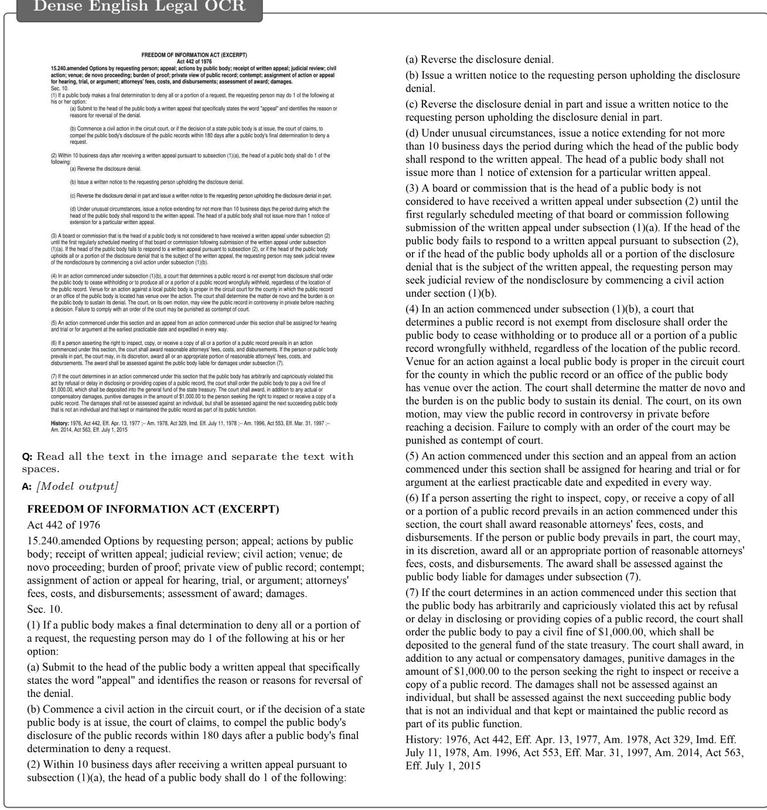  
Figure 6 Dense English full-page OCR. The source page and beginning of the transcription appear on the left, with the complete output continuing on the right. The model receives an OCRBenchV2 similarity score of 0.9828.

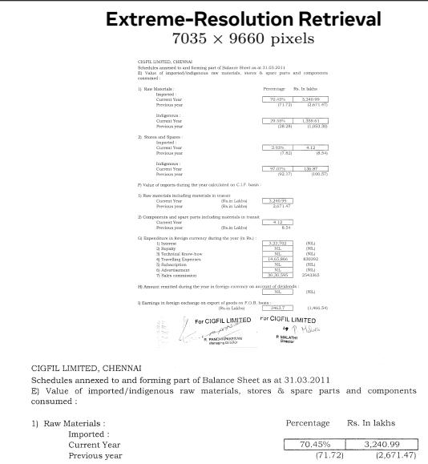

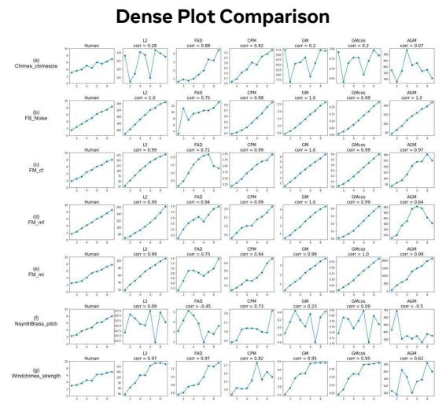  
Q: What is the current-year percentage of raw-material import? A: 70.45%.  
Q: In the FM\_cf row, which subplot shows the lowest correlation?

A: In the FM\_cf row (labeled as (c)), the subplot that shows the lowest correlation is FAD, with a correlation value of 0.71. This is explicitly written in the chart as $\mathrm { ^ { * } F A D \ c o r r = 0 . 7 1 " }$ in the third column of the (c) row.

Figure 7 Qualitative examples of extreme-resolution document retrieval and dense plot comparison. The complete model responses are shown with formatting adapted for typesetting.

## Geometry Reasoning

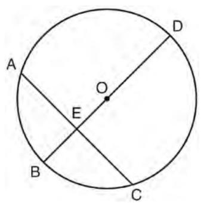

A: We are given a circle with center O, diameter ${ \overline { { D B } } } = 3 4 ,$ and chord ${ \overline { { A C } } } = 3 0 ,$ which is perpendicular to diameter DB at point E. We are told $D E > B E ,$ , and we are to find the length of BE.

Step 1: Use the Perpendicular Chord Theorem

Q: In circle O shown below, diameter DB is perpendicular to chord AC at E. If DB = 34, AC = 30, and DE > BE, what is the length of BE?

When a diameter is perpendicular to a chord, it bisects the chord. So, since DB is perpendicular to AC at E, then E is the midpoint of AC. Thus, $\begin{array} { r } { A E = E C = \frac { 3 0 } { 2 } = 1 5 . } \end{array}$

Options: A. 14; B. 8; C. 25; D. 7; E. 12; F.   
10; G. 15; H. 11; I. 16; J. 9.

## Step 2: Use the Power of a Point (or intersecting chords theorem)

The intersecting chords theorem states that if two chords intersect at a point inside the circle, then the products of the lengths of the segments of each chord are equal. Here, chords AC and DB intersect at E, so

$$
A E \cdot E C = D E \cdot E B .
$$

We know $\begin{array} { r } { A E = E C = 1 5 , } \end{array}$ so

$$
1 5 \cdot 1 5 = D E \cdot E B \quad \Rightarrow \quad 2 2 5 = D E \cdot E B .
$$

Also, since $D B = 3 4$ , and $\begin{array} { r } { D B = D E + E B , } \end{array}$ we have $\begin{array} { r } { D E + E B = 3 4 . } \end{array}$ Let $E B = x ,$ then $\begin{array} { r } { D E = 3 4 - x . } \end{array}$ Substitute into the equation:

$$
x ( 3 4 - x ) = 2 2 5 \Rightarrow 3 4 x - x ^ { 2 } = 2 2 5 \Rightarrow x ^ { 2 } - 3 4 x + 2 2 5 = 0 .
$$

## Step 3: Solve the quadratic

Use the quadratic formula:

$$
\begin{array}{c} x = { \frac { 3 4 \pm { \sqrt { ( - 3 4 ) ^ { 2 } - 4 \cdot 1 \cdot 2 2 5 } } } { 2 } }  \\ { = { \frac { 3 4 \pm { \sqrt { 1 1 5 6 - 9 0 0 } } } { 2 } } = { \frac { 3 4 \pm { \sqrt { 2 5 6 } } } { 2 } } = { \frac { 3 4 \pm 1 6 } { 2 } } . } \end{array}
$$

So, x = 34+16 = 25 or x = 34−16 2 = 9. Thus, EB = 9 or EB = 25. But we are told $D \dot { E } > B E . ^ { \circ } \operatorname { I f } E B = 9 .$ , then $\tilde { D E } = 3 4 - 9 = 2 5 , { \mathrm { ~ s o ~ } } D E >$ BE and the condition is satisfied. If EB = 25, then DE = 9, so DE < BE and the condition is not satisfied. Therefore, $E B = 9 .$

Final Answer: J. 9

Answer: J

Figure 8 Geometry reasoning with the complete model response, reformatted for typesetting.

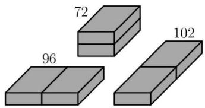

## Spatial Reasoning

A: We are given three diferent ways to place two identical bricks side by side, forming cuboids with surface areas 72, 96, and 102 cm2. We are to find the surface area of one brick.

Q: Two identical bricks can be placed side by side in three diferent ways as shown in the diagrams. The surface areas of the resulting cuboids are 72, 96, and 102 cm2. What is the surface area (in cm2) of one brick?

Let’s denote the dimensions of one brick as length l, width w, and height h. Since the bricks are identical, when placed side by side, we combine them along one dimension. So the three configurations correspond to combining the bricks along length, width, or height. Let’s assume the three configurations are:

1. Placing two bricks side by side along the length: so new dimensions are $2 l \times w \times h .$ 2. Placing two bricks side by side along the width: so new dimensions are $l \times 2 w \times h .$ 3. Placing two bricks side by side along the height: so new dimensions are $l \times w \times 2 h$ Each configuration gives a diferent surface area.

So for each configuration:

Configuration 1: 2l $\times \ w \times h$

The surface area of a cuboid is

$$
S A = 2 ( l w + l h + w h ) .
$$

$$
S A _ { 1 } = 2 [ ( 2 l ) ( w ) + ( 2 l ) ( h ) + ( w ) ( h ) ] = 2 [ 2 l w + 2 l h + w h ] = 4 l w + 4 l h + 2 w h .
$$

Given: $S A _ { 1 } = 7 2 $

Configuration 2: l × 2w × h

$$
S A _ { 2 } = 2 [ l ( 2 w ) + l ( h ) + ( 2 w ) ( h ) ] = 2 [ 2 l w + l h + 2 w h ] = 4 l w + 2 l h + 4 w h .
$$

Given: $S A _ { 2 } = 9 6$

Configuration 3 $: l \times w \times 2 h$

$$
S A _ { 3 } = 2 [ l w + l ( 2 h ) + w ( 2 h ) ] = 2 [ l w + 2 l h + 2 w h ] = 2 l w + 4 l h + 4 w h .
$$

Given: $S A _ { 3 } = 1 0 2 .$

Now we have three equations:

$$
\begin{array} { r l } & { 4 l w + 4 l h + 2 w h = 7 2 , } \\ & { 4 l w + 2 l h + 4 w h = 9 6 , } \\ & { 2 l w + 4 l h + 4 w h = 1 0 2 . } \end{array}
$$

Let’s simplify these equations. Divide Equation (1) by 2:

$$
2 l w + 2 l h + w h = 3 6 .
$$

Divide Equation (2) by 2:

$$
2 l w + l h + 2 w h = 4 8 .\tag{1a}
$$

Equation (3) remains:

(2a)

$$
2 l w + 4 l h + 4 w h = 1 0 2 .\tag{3}
$$

Now subtract (1a) from (2a):

$$
\begin{array} { c } { { ( 2 l w + l h + 2 w h ) - ( 2 l w + 2 l h + w h ) = 4 8 - 3 6 , } } \\ { { - l h + w h = 1 2 , } } \\ { { h ( w - l ) = 1 2 . \quad \mathrm { ( A ) } } } \end{array}
$$

Now subtract (1a) from (3):

$$
\begin{array} { c } { { ( 2 l w + 4 l h + 4 w h ) - ( 2 l w + 2 l h + w h ) = 1 0 2 - 3 6 , } } \\ { { ) l h + 3 w h = 6 6 . \quad \mathrm { ( B ) } } } \end{array}
$$

From Equation (A), $h ( w - l ) = 1 2$ . Let’s solve for h: $\begin{array} { r } { h = \frac { 1 2 } { w - l } } \end{array}$ Plug into Equation (B):

$$
2 l h + 3 w h = 6 6 .
$$

Factor h:

$$
h ( 2 l + 3 w ) = 6 6 .
$$

Multiply both sides by $w - l { : }$

Substitute $\begin{array} { r } { h = \frac { 1 2 } { w - l } : } \end{array}$

$$
1 2 ( 2 l + 3 w ) = 6 6 ( w - l ) .
$$

Divide both sides by 6:

$$
2 ( 2 l + 3 w ) = 1 1 ( w - l ) .
$$

Expand: the left side is 4l + 6w, and the right side is $1 1 w - 1 1 l$ Bring all terms to the left:

$$
4 l + 6 w - 1 1 w + 1 1 l = 0 \Rightarrow 1 5 l - 5 w = 0 \Rightarrow 3 l = w .
$$

$\mathrm { S o } , w = 3 l$ . Now plug back into Equation (A), $h ( w - l ) = 1 2 \colon$

$$
h ( 3 l - l ) = 1 2 \Rightarrow h ( 2 l ) = 1 2 \Rightarrow h = \frac { 6 } { l } .
$$

Now we have $w = 3 l$ and $\begin{array} { r } { h = { \frac { 6 } { l } } } \end{array}$ . Plug into Equation (1a), 2lw + 2lh + wh = 36:

$$
\begin{array} { r } { 2 l ( 3 l ) + 2 l \left( \frac { 6 } { l } \right) + ( 3 l ) \left( \frac { 6 } { l } \right) = 6 l ^ { 2 } + 1 2 + 1 8 } \\ { = 6 l ^ { 2 } + 3 0 = 3 6 . } \end{array}
$$

Thus, $6 l ^ { 2 } = 6 ,$ so $l ^ { 2 } = 1$ and $l = 1$ (since length > 0). Then w = 3l = 3 and $\begin{array} { r } { h = \frac { 6 } { l } = 6 . } \end{array}$

So the dimensions of one brick are $l = 1 , w = 3 ,$ and h = 6. Now compute its surface area:

$$
{ \frac { 1 2 } { w - l } } ( 2 l + 3 w ) = 6 6 .
$$

$$
\begin{array} { c } { S A = 2 ( l w + l h + w h ) } \\ { = 2 ( 1 \cdot 3 + 1 \cdot 6 + 3 \cdot 6 ) } \\ { = 2 ( 3 + 6 + 1 8 ) = 2 ( 2 7 ) = 5 4 . } \end{array}
$$

Final Answer: 54

Figure 9 Spatial reasoning with the complete model response, reformatted for typesetting.