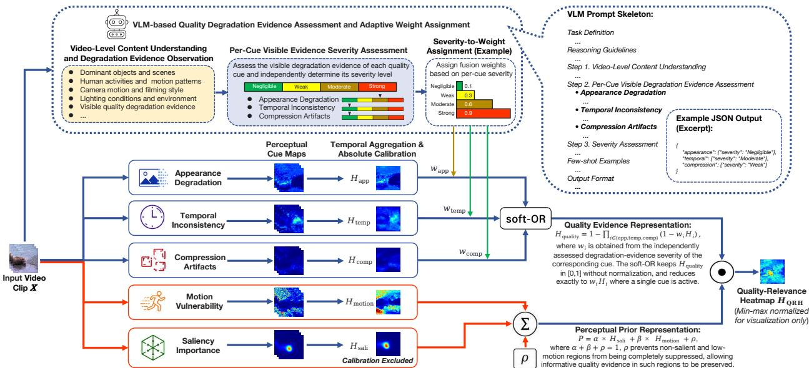
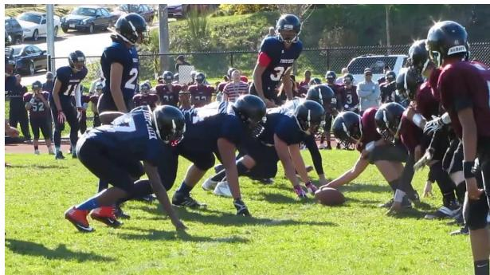
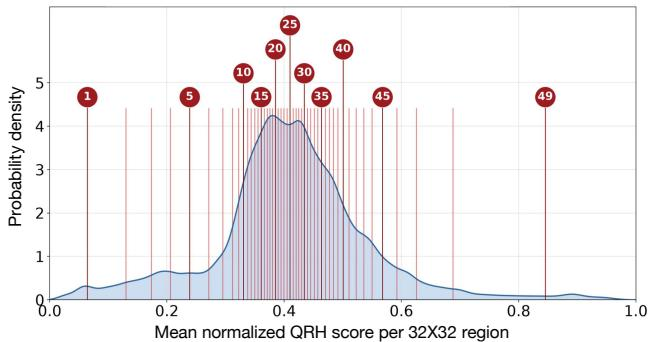
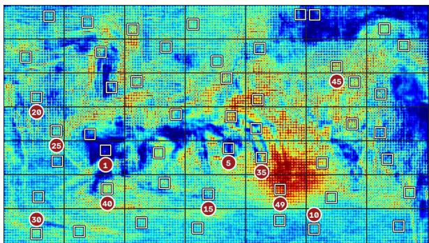
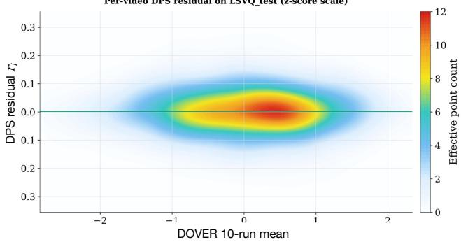
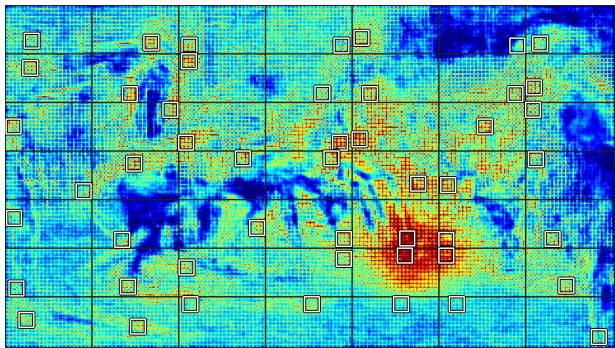

# EXPLICIT REGIONAL REPRESENTATIONS FOR VIDEO QUALITY ASSESSMENT

Fuyi Yang1,\*, Lei Yang2,B, Andrew Liu3,\*, Chenyu Wei4,\*, Xiaoyi Guo5,\*, Ming Kai Hsu2

1University of California, Los Angeles 2Transtreams Technologies, Inc. 3University of Southern California 4University of Wisconsin–Madison 5BASIS Independent Fremont

## ABSTRACT

End-to-end video quality assessment (VQA) methods leave the regional evidence underlying their predictions largely implicit. We introduce an explicit pixel-level regional representation for VQA, instantiated as a Quality-Relevance Heatmap (QRH) that combines localized degradation evidence with perceptual priors under vision-language model guidance, without requiring pixel-level annotations. We apply QRH to existing VQA models through two deterministic fragment-sampling strategies: distribution-preserving sampling approximates the original sampler’s QRH-score distribution without retraining, while quality-aware sampling prioritizes regions with high QRH scores and is paired with fine-tuning. Experiments with DOVER on multiple benchmarks show that the former closely approximates predictions averaged over random samples, while the latter improves most evaluated metrics across popular VQA benchmarks. These results support explicit regional representations as a useful interface for downstream VQA.

## 1 Introduction

No-reference video quality assessment (NR-VQA) predicts perceptual quality without a pristine reference. Recent methods achieve strong performance through learned representations [1–5], yet the regional evidence underlying their predictions remains largely implicit. This raises a central question: What regional evidence is relevant to perceptual quality judgments, and how should it be represented?

Observations from large-scale video quality annotation suggest that annotators consider both localized degradation, such as blur, compression artifacts, and temporal instability, and the perceptual importance of the affected regions.

We therefore introduce an explicit pixel-level regional representation for VQA, instantiated as a Quality-Relevance Heatmap (QRH). QRH combines localized quality evidence with perceptual priors under vision-language model (VLM) guidance, without requiring pixel-level quality annotations. Here, quality relevance refers to the estimated importance of localized visual evidence to quality assessment, rather than a decomposition of subjective video quality into regional contributions. QRH separates two complementary aspects of regional quality analysis: quality evidence captures localized appearance degradation, temporal inconsistency, and compression artifacts, while perceptual priors characterize where such evidence are more perceptually important through motion vulnerability and visual saliency. Their composition produces an explicit pixel-level representation that summarizes the spatial distribution of quality relevant evidence and its perceptual importance.

Beyond representation, we demonstrate the utility of QRH through two deterministic fragment-sampling strategies for existing VQA models. Distribution-preserving sampling (DPS) approximates the original random sampler’s QRH-score distribution without retraining, while quality-aware sampling (QAS) prioritizes regions with high QRH scores and is paired with fine-tuning. These strategies allow QRH to guide regional selection while preserving the original fragment layout and VQA architecture.

Our contributions are:

• An explicit regional representation for VQA that separates localized degradation evidence from perceptual importance.

• An interpretable, semantically guided construction of the regional representation without requiring pixel-level annotations.

• Two QRH-guided sampling policies, with experiments demonstrating stable prediction through DPS and performance gains through QAS adaptation.

## 2 Related work

## 2.1 Hand-crafted and end-to-end VQA methods

Early quality assessment used distortion-specific features and natural scene statistics, as in BRISQUE [6], V-BLIINDS [7], VIIDEO [8], TLVQM [9], and VIDEVAL [10]. Learned methods instead combine visual and temporal features, including VSFA [11], BVQA [12], and recurrent or attention-based architectures [13–17]. Patch-VQ estimates space-time quality maps before global aggregation [18]. These developments expand representation capacity beyond hand-crafted cues, but regional degradation and its perceptual importance are often encoded within learned features rather than exposed as distinct components.

Fragment-based methods reduce the cost of high-resolution VQA. FAST-VQA and FasterVQA sample spatial or spatiotemporal fragments [1, 19]; DOVER separates aesthetic and technical quality, using fragments in its technical branch [2]. COVER combines technical, aesthetic, and semantic quality [3]; MaxVQA and CLIPVQA incorporate languagebased representations [20, 21]; and ModularBVQA uses a modular prediction architecture [4]. QRH complements these architectures by explicitly representing regional degradation evidence and perceptual importance before quality prediction.

## 2.2 Regional quality modeling

Regional approaches model localized degradation, quality-aware importance, or perceptual priors. BPSQM predicts pixel-wise quality maps from full-reference image quality assessment (IQA) similarity maps [22]; TOPIQ uses semantic guidance for distortion localization [23]; and ReLIQS estimates IQA-specific importance for patch selection [24]. Saliency models such as TASED-Net, UNISAL, and ViSAGE provide visual-attention priors [25–28]. Among saliency methods, SF-VQA uses saliency-guided sampling and pooling [29], while KVQ combines visual saliency and local texture quality [5]. These approaches establish the value of spatially non-uniform quality modeling, while differing in whether their maps describe degradation, attention, or usefulness for prediction. Our emphasis is on explicitly separating quality evidence from perceptual priors and combining them into an explicit pixel-level regional representation that integrates localized degradation evidence with perceptual priors.

## 2.3 Vision-language models for quality reasoning

LMM-VQA formulates video quality assessment as multimodal question answering [30], while Q-Router uses a VLM to route videos among specialized evaluators and optionally localize artifacts [31]. Q-Bench-Video evaluates multimodal models’ understanding of technical, aesthetic, and temporal quality, identifying both capabilities and limitations [32]. In QRH, the VLM provides clip-level semantic guidance for degradation-cue weighting to avoid overreliance on unreliable VLM judgments; spatial localization remains with the cue maps, and a separate VQA model produces the final score.

## 3 Methodology

We propose an explicit regional representation for video quality assessment, instantiated as a Quality-Relevance Heatmap (QRH). Rather than directly decomposing subjective quality into regional contributions, QRH organizes two complementary sources of spatial information: quality evidence, which captures localized degradation cues, and perceptual priors, which characterize where such evidence may be more perceptually important. The resulting pixellevel representation summarizes the spatial distribution of quality-relevant evidence and its perceptual importance within a video clip and is independent of any particular VQA architecture. The following sections describe the representation, its semantically guided construction, and its use in fragment sampling.

  
Figure 1: Quality-Relevance Heatmap (QRH) construction. Quality evidence maps (appearance degradation, temporal inconsistency, and compression artifacts) are adaptively fused under VLM guidance, while motion vulnerability and saliency are combined into a perceptual-prior representation. Their element-wise product yields QRH, an explicit pixel-level regional representation that combines localized quality evidence with perceptual importance.

## 3.1 Overview

Figure 1 illustrates our overall QRH construction pipeline. We formulate the regional representation by addressing two complementary questions:

1. Where is quality degradation present? Explicit quality evidence is extracted from multiple cues, including appearance degradation, temporal inconsistency, and compression artifacts.

2. Where is degradation likely to matter? Perceptual priors, including visual saliency and motion vulnerability, estimate the perceptual importance of different regions during human quality judgment.

A VLM supplies clip-level semantic guidance for fusing the quality evidence, which is later combined with the perceptual prior to construct QRH. QRH subsequently guides deterministic, content-adaptive fragment sampling for downstream VQA, enabling reproducible and quality-aware region selection without modifying the VQA backbone.

## 3.2 QRH construction

Direct pixel-level supervision for quality-relevant regional evidence is generally unavailable, as subjective VQA datasets typically provide a single quality score per video. We therefore construct QRH without pixel-level human annotations by combining localized quality evidence with perceptual priors, producing an explicit spatial representation for downstream quality assessment.

## 3.2.1 Quality evidence and perceptual priors

We define both components using five spatial cue maps summarized at the clip level, with values in [0, 1]. Algorithm 1 outlines the generation of these maps.

Quality evidence. Three maps characterize local degradation mechanisms. Appearance degradation $H _ { \mathrm { a p p } }$ captures blur/structure loss, abnormal high-frequency content, and overexposure; temporal inconsistency $H _ { \mathrm { t e m p } }$ measures perceptual residuals after motion compensation; and compression degradation $H _ { \mathrm { { c o m p } } }$ captures coding artifacts through multi-scale blocking responses. These maps localize degradation evidence and are temporally aggregated and calibrated to a common absolute scale so their magnitudes remain comparable across video clips.

Perceptual priors. Two additional maps characterize where observed degradations have greater perceptual impact. Motion vulnerability $H _ { \mathrm { m o t i o n } }$ emphasizes visible motion boundaries where temporal degradations are strongly apparent, while saliency $H _ { \mathrm { s a l i } }$ estimates visual attention using an existing video saliency model [27]. The motion-vulnerability map performs the same aggregation and calibration as the degradation cues, whereas the saliency output is already normalized and requires no further calibration.

Algorithm 1 Clip-Level Generation of the Five Cue Maps   
Require: Video clip $X$   
Ensure: Quality-evidence maps $H _ { \mathrm { a p p } } , H _ { \mathrm { t e m p } } , H _ { \mathrm { c o m p } }$ and perceptual-prior maps $H _ { \mathrm { m o t i o n } } , H _ { \mathrm { s a l i } }$   
1: Sample frames $\{ F _ { t } \}$ from X; resize appearance, temporal, and motion inputs to a fixed working width, and keep   
compression inputs at the native resolution.   
2: // Quality evidence   
3: $H _ { \mathrm { a p p } } ^ { ( t ) }$ ← exposure-first fusion of blur/structure loss and abnormal high-frequency noise under texture, edge, and   
exposure gates.   
4: $H _ { \mathrm { t e m p } } ^ { ( t ) }$ ← perceptual residual between $F _ { t }$ and the flow-warped $F _ { t + 1 }$ , gated by forward–backward flow confidence.   
5: $H _ { \mathrm { c o m p } } ^ { ( t ) }$ ← multi-scale blocking response comparing on-grid with matched off-grid gradients, maximized over   
candidate block spacings.   
6: // Perceptual priors   
7: $H _ { \mathrm { m o t i o n } } ^ { ( t ) }$ ← optical-flow boundary magnitude gated by image-edge visibility.   
8: $H _ { \mathrm { s a l i } } ^ { ( t ) } \gets$ frame-wise saliency from the external video saliency model ViSAGE [27].   
9: Aggregate the four internally constructed maps over time by a pixel-wise Top-K mean; the saliency frames are   
aggregated by the external model.   
10: Calibrate the internally constructed maps with fixed dataset-level thresholds (appearance and compression before   
aggregation, temporal and motion after); retain the normalized saliency map.   
11: return $H _ { \mathrm { a p p } } , H _ { \mathrm { t e m p } } , H _ { \mathrm { c o m p } } , H _ { \mathrm { m o t i o n } } , H _ { \mathrm { s a l i } }$

Together, the quality evidence maps and perceptual priors form two complementary components of QRH. Their explicit separation distinguishes perceptual importance from quality evidence, preventing visually important regions from being interpreted as degradation evidence.

Severity-and-gate construction. The internally constructed cues separate response strength from reliability: severity measures the cue response, while a bounded gate suppresses signals caused by natural scene content or estimation errors, such as low texture resembling blur or inaccurate flow producing temporal residuals. Blocking responses instead compare boundary and neighboring non-boundary gradients without an additional gate. Dataset-level calibration preserves severity differences across clips, avoiding the amplification of weak responses by per-clip normalization. Together, these steps provide calibrated cue maps with reduced sensitivity to unreliable responses.

## 3.2.2 VLM semantic guidance and adaptive weights

The VLM provides content-dependent semantic guidance for cue weighting. Directly predicting continuous weights, however, introduces uncertainty into numerical estimation. We therefore use the VLM only to independently assess the coarse visible severity of appearance, temporal, and compression degradation at the clip level, then obtain numerical weights through a fixed mapping. Spatial localization remains the role of the cue maps; saliency and motion vulnerability are perceptual priors and are excluded from this assessment. Each degradation type receives one of four severity labels, mapped to weights $( w _ { \mathrm { a p p } } , w _ { \mathrm { t e m p } } , w _ { \mathrm { c o m p } } )$ by

$$
\begin{array} { r l } {  } & { { } w ( \mathrm { N e g l i g i b l e } ) = 0 . 1 , \quad w ( \mathrm { W e a k } ) = 0 . 3 , } \\ { w ( \mathrm { M o d e r a t e } ) = 0 . 6 , \quad w ( \mathrm { S t r o n g } ) = 0 . 9 . } \end{array}\tag{1}
$$

This separates semantic assessment from numerical weight estimation. The nonzero weight for Negligible retains weak cue responses that may still provide useful evidence.

## 3.2.3 Quality evidence and perceptual prior fusion

Quality evidence aggregation. Different degradation types may occur separately or overlap within a region. The fusion should retain strong individual evidence while allowing multiple cues to contribute. We use soft-OR, a continuous analogue of logical OR, to combine the calibrated degradation maps:

$$
H _ { \mathrm { q u a l i t y } } = 1 - \prod _ { i \in \{ \mathrm { a p p , t e m p , c o m p } \} } \left( 1 - w _ { i } H _ { i } \right) ,\tag{2}
$$

Algorithm 2 QRH-Guided Sampling   
Require: QRH H, candidate-region sets $\{ R _ { i } \} _ { i = 1 } ^ { N }$ , sampling mode m   
Ensure: Selected regions $\{ r _ { i } ^ { * } \} _ { i = 1 } ^ { \breve { N } }$   
1: if m = DISTRIBUTION-PRESERVING then   
2: Compute mean QRH score $s ( r )$ for each candidate region $r$   
3: Construct the cell-balanced QRH-score distribution $\begin{array} { r } { \dot { F _ { H } } = \frac { 1 } { N } \sum _ { i = 1 } ^ { N } F _ { i } } \end{array}$   
4: Partition the probability space of $F _ { H }$ into N equal-probability interval $I _ { j } = [ ( j - 1 ) / N , j / N ] , j = 1 , \ldots , N$   
5: Compute centroid targets $\dot { t } _ { j } = \mathbb { E } [ S \mid F _ { H } ( S ) \in \dot { I } _ { j } ]$   
6: Construct the cell–target cost matrix $C _ { i j } = \mathrm { m i n } _ { r \in R _ { i } } | s ( r ) - t _ { j } | ^ { 2 }$   
7: Find the minimum-cost one-to-one cell–target assignment using the Hungarian algorithm   
8: Select $r _ { i } ^ { * }$ as the region closest to the assigned target in each cell   
9: else if $m \overset { \cdot } { = } \mathrm { Q U A I }$ ITY-AWARE then   
10: Compute mean QRH score $s ( r )$ for each candidate region $r$   
11: Select $r _ { i } ^ { * }$ as the highest-scoring region in each cell   
12: end if   
13: return $\{ r _ { i } ^ { * } \} _ { i = 1 } ^ { N }$

where $w _ { i }$ are the adaptive weights in Eq. (1). Intuitively, each factor represents the complement of one weighted cue response. Subtracting their product from one allows any active degradation cue to raise the aggregate response. This has the form of a probabilistic union, but the cue responses are treated as bounded evidence strengths, not calibrated probabilities of independent events.

When only one cue is active, its weighted response is preserved exactly. Additional cues increase the response with diminishing increments as it approaches saturation. Unlike a channel-wise maximum, soft-OR therefore retains contributions from co-occurring cues; unlike a simple sum, it stays within [0, 1] without clipping or further normalization. The aggregate lies between the strongest weighted cue and their sum, allowing evidence to accumulate without unrestricted addition of overlapping responses.

Perceptual prior. Saliency and motion vulnerability indicate where degradation is likely to have greater perceptual impact:

$$
P = \alpha H _ { \mathrm { s a l i } } + \beta H _ { \mathrm { m o t i o n } } + \rho , \qquad \alpha + \beta + \rho = 1 ,\tag{3}
$$

where $\alpha , \beta \geq 0 \mathrm { a n d } \rho > 0$ . The baseline ρ prevents low-saliency, low-motion regions from being completely suppressed, and the bounded input maps ensure $P \in [ \rho , 1 ]$

Composition. QRH combines quality evidence and perceptual importance through

$$
H _ { \mathrm { Q R H } } = H _ { \mathrm { q u a l i t y } } \odot P .\tag{4}
$$

High responses identify degradation coinciding with high perceptual importance. Without per-clip rescaling, lightly degraded clips retain low responses rather than being artificially amplified. Given the cue maps and VLM-derived weights, this composition deterministically produces the QRH used for downstream sampling.

## 3.3 QRH-guided sampling

As a practical application of QRH, we introduce two sampling strategies for fragment-based VQA methods such as FAST-VQA and DOVER [1, 2]. Distribution-preserving sampling constructs a deterministic sample approximating the QRH-score distribution induced by the original random sampler while remaining compatible with pretrained models. Quality-aware sampling instead directs region selection toward regions with higher QRH scores. Let $R _ { i }$ be the candidate-region set in grid cell $i ,$ for $i = 1 , \ldots , N$ , and let $s ( r )$ be the mean QRH value within candidate region r. Algorithm 2 summarizes the two policies. Deterministic selection requires a fixed rule for resolving equal scores or assignment costs.

Distribution-preserving sampling (DPS). DPS approximates the distribution of regional QRH scores induced by the original random sampler, rather than the full distribution of sampled inputs. Let $F _ { i } ( s )$ be the empirical cumulative distribution function (ECDF) of candidate-region QRH scores within cell i. Equal cell weighting reflects the baseline model’s one-region-per-cell sampling:

$$
F _ { H } ( s ) = \frac { 1 } { N } \sum _ { i = 1 } ^ { N } F _ { i } ( s ) .\tag{5}
$$

Table 1: Performance of LSVQ-trained VQA methods. QRH+DOVER uses QAS adaptation; DOVER is re-evaluated under our pipeline. The best result in each column is shown in bold.
<table><tr><td rowspan="2">Method</td><td colspan="2">LSVQ-test</td><td colspan="2">LSVQ-1080p</td><td colspan="2">KoNViD-1k</td><td colspan="2">LIVE-VQC</td></tr><tr><td>SROCC↑</td><td>PLCC ↑</td><td>SROCC ↑</td><td>PLCC ↑</td><td>SROCC ↑</td><td>PLCC ↑</td><td>SROCC ↑</td><td>PLCC ↑</td></tr><tr><td>BRISQUE [6]</td><td>.569</td><td>.576</td><td>.497</td><td>.531</td><td>.646</td><td>.647</td><td>.524</td><td>.536</td></tr><tr><td>TLVQM [9]</td><td>.772</td><td>.774</td><td>.589</td><td>.616</td><td>.732</td><td>.724</td><td>.670</td><td>.691</td></tr><tr><td>VIDEVAL [10]</td><td>.794</td><td>.783</td><td>.545</td><td>.554</td><td>.751</td><td>.741</td><td>.630</td><td>.640</td></tr><tr><td>VSFA [11]</td><td>.801</td><td>.796</td><td>.675</td><td>.704</td><td>.784</td><td>.794</td><td>.734</td><td>.772</td></tr><tr><td>Patch-VQ w/o patches [18]</td><td>.814</td><td>.816</td><td>.686</td><td>.708</td><td>.781</td><td>.781</td><td>.747</td><td>.776</td></tr><tr><td>Patch-VQ w/ patches [18]</td><td>.827</td><td>.828</td><td>.711</td><td>.739</td><td>.791</td><td>.795</td><td>.770</td><td>.807</td></tr><tr><td>BVQA [12]</td><td>.852</td><td>.855</td><td>.771</td><td>.782</td><td>.834</td><td>.837</td><td>.816</td><td>.824</td></tr><tr><td>CLIPVQÅ [21]</td><td>.883</td><td>.885</td><td>.785</td><td>.833</td><td></td><td></td><td></td><td></td></tr><tr><td>FAST-VQA [1]</td><td>.876</td><td>.877</td><td>.779</td><td>.814</td><td>.859</td><td>.855</td><td>.823</td><td>.844</td></tr><tr><td>FasterVQA [19]</td><td>.873</td><td>.874</td><td>.772</td><td>.811</td><td>.863</td><td>.863</td><td>.813</td><td>.837</td></tr><tr><td>DOVER [2]</td><td>.878</td><td>.866</td><td>.782</td><td>.813</td><td>.874</td><td>.869</td><td>.819</td><td>.841</td></tr><tr><td>QRH + DOVER</td><td>.888</td><td>.889</td><td>.791</td><td>.827</td><td>.882</td><td>.885</td><td>.811</td><td>.847</td></tr></table>

As detailed in Algorithm 2, equal-probability intervals of $F _ { H }$ define centroid targets (with $S$ denoting a score drawn from this cell-balanced distribution), which are matched one-to-one to cells using the Hungarian algorithm. Selecting the closest candidate in each assigned cell yields a deterministic sample while preserving the original sampling structure and pretrained model. Section 4.2 evaluates its agreement with predictions averaged over repeated random sampling.

Quality-aware sampling (QAS). Alternatively, QRH can direct region selection toward regions with higher QRH scores. For each cell i, we select

$$
r _ { i } ^ { * } = \arg \operatorname* { m a x } _ { r \in R _ { i } } s ( r ) ,\tag{6}
$$

Unlike DPS, QAS deliberately shifts the sampling distribution toward regions with higher QRH scores. To accommodate this shift, we fine-tune the pretrained VQA model using the same QAS sampling policy.

## 4 Experiments

We first test whether DPS approximates DOVER’s predictions averaged over random samples without retraining. We then evaluate QAS under LSVQ training and dataset-specific adaptation, separating prediction stability from performance gains after fine-tuning.

## 4.1 Experiment setup

## 4.1.1 Datasets and evaluation protocols

We evaluate on LSVQ-test and LSVQ-1080p [18], KoNViD-1k [33], LIVE-VQC [11], and YouTube-UGC [34]. Performance is measured by Spearman’s rank-order correlation coefficient (SROCC) and Pearson’s linear correlation coefficient (PLCC) against mean opinion scores (MOS); higher is better.

## 4.1.2 Evaluation scope and implementation setup

We assess QRH through DOVER [2], applying sampling to its technical branch while retaining the original $7 \times 7$ fragment grid and architecture. Qwen3.6-35B-A3B [35] provides semantic guidance, with $( \alpha , \beta , \rho ) = ( 0 . 4 \bar { 5 } , 0 . 1 5 , 0 . 4 )$ in Eq. (3) throughout. DOVER baseline results are re-evaluated from the official checkpoint under our pipeline for controlled comparison. They differ somewhat from the original paper’s values but are consistent with the independent evaluation in Q-Router [31].

## 4.2 Analysis of distribution-preserving sampling

For each LSVQ-test video, we compare one deterministic DPS prediction with the mean of ten DOVER runs using independent sampling seeds; normalization statistics are estimated from those runs. Figure 2(a–c) illustrates the frame, QRH-score distribution, and selected regions. QRH is normalized before computing region scores for this visualization, with ten targets highlighted. DPS covers both low- and high-response regions under the original sampling constraints.

(a)  

  
(b)

  
(c)

  
(d)

  
(e)  
Figure 2: Illustration and evaluation of QRH-guided sampling. (a) Representative frame. (b) Normalized QRH-score distribution and DPS targets, with ten highlighted. (c) Regions matched to the highlighted DPS targets on the normalized QRH. (d) Per-video residuals relative to the ten-run DOVER mean on LSVQ-test. (e) QAS region selection on the same QRH.

Figure 2(d) reports residuals $r _ { i } = \hat { y } _ { i } ^ { \mathrm { D P S } } - \bar { y } _ { i } ^ { \mathrm { D O V E R } }$ . Agreement with the ten-run mean reaches 0.9963 SROCC and 0.9968 PLCC. Residual mean, mean absolute error (MAE), and root mean squared error (RMSE) are 0.0019, 0.0563, and 0.0763, respectively, with the central 95% in [−0.155, 0.155]. Against MOS, the SROCC and PLCC differences between DPS and the ten-run mean are −0.00087 and −0.00081, respectively. These results support DPS as an approximation of DOVER’s averaged predictions in this evaluation, without implying that it reproduces individual random samples or the full input distribution.

## 4.3 Quality-aware sampling and fine-tuning

QAS prioritizes high-QRH regions, as illustrated in Figure 2(e), and requires adaptation to the shifted sampling distribution. We fine-tune the official DOVER checkpoint with QAS for 10 epochs on the 28,056-video LSVQ training split [18], retaining its architecture and fragment grid, and evaluate the final checkpoint on LSVQ-test, LSVQ-1080p, KoNViD-1k, and LIVE-VQC. Dataset-specific adaptation is evaluated separately in Section 4.5.

Table 2: Transfer-learning performance on smaller VQA benchmarks. Our results are averaged over ten random 80%/20% train/test splits; baseline values are taken from the literature. Since the fully labeled YouTube-UGC dataset is unavailable, our results use a matched 992/1380 video subset, reported for reference only.
<table><tr><td colspan="2">Target dataset</td><td colspan="2">LIVE-VQC</td><td colspan="2">KoNViD-1k</td><td colspan="2">YouTube-UGC</td></tr><tr><td>Method</td><td>Pre-training dataset</td><td>SROCC ↑</td><td>PLCC ↑</td><td>SROCC ↑</td><td>PLCC ↑</td><td>SROCC ↑</td><td>PLCC ↑</td></tr><tr><td>TLVQM [9]</td><td>N/A (hand-crafted)</td><td>.799</td><td>.803</td><td>.773</td><td>.768</td><td>.669</td><td>.659</td></tr><tr><td>VIDEVAL [10]</td><td>N/A (hand-crafted)</td><td>.752</td><td>.751</td><td>.783</td><td>.780</td><td>.779</td><td>.773</td></tr><tr><td>VSFA [11]</td><td>None</td><td>.773</td><td>.795</td><td>.773</td><td>.775</td><td>.724</td><td>.743</td></tr><tr><td>CoINVQ [13]</td><td>Self-collected</td><td>.727</td><td>.795</td><td>.767</td><td>.764</td><td>.816</td><td>.802</td></tr><tr><td>Patch-VQ[18]</td><td>PaQ-2-PiQ</td><td>.827</td><td>.837</td><td>.791</td><td>.786</td><td></td><td></td></tr><tr><td>2BiVQA[14]</td><td>ImageNet/KonIQ-10k</td><td>.761</td><td>.832</td><td>.815</td><td>.835</td><td>.771</td><td>.790</td></tr><tr><td>BVQA[12]</td><td>BID/LIVE/KonIQ/SPAQ</td><td>.834</td><td>.842</td><td>.834</td><td>.836</td><td>.818</td><td>.826</td></tr><tr><td>VQT [15]</td><td>ImageNet/Kinetics-400</td><td>.824</td><td>.836</td><td>.858</td><td>.868</td><td>.836</td><td>.851</td></tr><tr><td>StarVQA [16]</td><td>LSVQ</td><td>.753</td><td>.809</td><td>.842</td><td>.849</td><td></td><td></td></tr><tr><td>StarVQA+[17]</td><td>ImageNet/LSVQ/etc.</td><td>.857</td><td>.874</td><td>.876</td><td>.881</td><td>.826</td><td>.820</td></tr><tr><td>FAST-VQA [1]</td><td>LSVQ</td><td>.849</td><td>.862</td><td>.891</td><td>.892</td><td>.855</td><td>.852</td></tr><tr><td>FasterVQA [19]</td><td>LSVQ</td><td>.843</td><td>.858</td><td>.895</td><td>.898</td><td>.863</td><td>.859</td></tr><tr><td>DOVER [2]</td><td>LSVQ</td><td>.860</td><td>.875</td><td>.909</td><td>.906</td><td>.890</td><td>.891</td></tr><tr><td>KVQ [5]</td><td>LSVQ</td><td>.859</td><td>.879</td><td>.909</td><td>.915</td><td>.903</td><td>.905</td></tr><tr><td>QRH + DOVER</td><td>LSVQ</td><td>.840</td><td>.881</td><td>.922</td><td>.921</td><td>.878</td><td>.876</td></tr></table>

## 4.4 Performance on VQA benchmarks

Table 1 compares QRH+DOVER with representative VQA methods; QRH+DOVER denotes the QAS-adapted model. Relative to our re-evaluated DOVER baseline, QAS adaptation improves seven of eight metrics across LSVQ-test, LSVQ-1080p, KoNViD-1k, and LIVE-VQC, including a 2.7% relative PLCC gain on LSVQ-test. These results complement DPS: DPS approximates the original model’s averaged predictions without retraining, while QAS improve performance through quality-aware sampling and fine-tuning.

## 4.5 Transfer learning

We separately fine-tune the LSVQ-pretrained DOVER model with QAS on LIVE-VQC, KoNViD-1k, and YouTube-UGC, averaging results over ten random 80%/20% train/test splits. In Table 2, QRH+DOVER achieves the highest KoNViD-1k SROCC/PLCC (.922/.921) among the compared methods, and the highest LIVE-VQC PLCC (.881). YouTube-UGC results use a matched subset of 992 out of 1380 videos because the full labeled set is unavailable. The YouTube-UGC results are therefore for reference only and are not directly comparable with the published full-dataset baselines.

## 5 Conclusion

We introduced an explicit pixel-level regional representation for video quality assessment, instantiated as a Quality-Relevance Heatmap (QRH). QRH combines localized degradation evidence with perceptual priors under VLM-derived semantic guidance, without requiring pixel-level annotations. Its utility is demonstrated through two QRH-guided sampling strategies applied to DOVER: DPS closely approximates predictions averaged over repeated random sampling without retraining, while QAS with fine-tuning improves most evaluated benchmark metrics. These results support explicit regional representations as an interface between localized quality analysis and downstream quality assessment. Future work will examine other VQA backbones, explore learning such regional representations directly from videos while preserving the semantic structure of the current cue-based construction, and apply them to tasks beyond VQA that benefit from spatially localized quality information.

## References

[1] Haoning Wu, Chaofeng Chen, Jingwen Hou, Liang Liao, Annan Wang, Wenxiu Sun, Qiong Yan, and Weisi Lin. FAST-VQA: Efficient end-to-end video quality assessment with fragment sampling, 2022. URL https: //arxiv.org/abs/2207.02595.

[2] Haoning Wu, Erli Zhang, Liang Liao, Chaofeng Chen, Jingwen Hou, Annan Wang, Wenxiu Sun, Qiong Yan, and Weisi Lin. Exploring video quality assessment on user generated contents from aesthetic and technical perspectives, 2023. URL https://arxiv.org/abs/2211.04894.

[3] Chenlong He, Qi Zheng, Ruoxi Zhu, Xiaoyang Zeng, Yibo Fan, and Zhengzhong Tu. COVER: A comprehensive video quality evaluator. In Proceedings of the IEEE/CVF Conference on Computer Vision and Pattern Recognition Workshops, pages 5799–5809, 2024. doi: 10.1109/CVPRW63382.2024. 00589. URL https://openaccess.thecvf.com/content/CVPR2024W/AI4Streaming/html/He\_COVER\_ A\_Comprehensive\_Video\_Quality\_Evaluator\_CVPRW\_2024\_paper.html.

[4] Wen Wen, Mu Li, Yabin Zhang, Yiting Liao, Junlin Li, Li Zhang, and Kede Ma. Modular blind video quality assessment, 2024. URL https://arxiv.org/abs/2402.19276.

[5] Yunpeng Qu, Kun Yuan, Qizhi Xie, Ming Sun, Chao Zhou, and Jian Wang. Kvq: Boosting video quality assessment via saliency-guided local perception. In Proceedings ofthe IEEE/CVF Conference on Computer Vision and Pattern Recognition (CVPR), pages 2150–2160, June 2025.

[6] Anish Mittal, Anush Krishna Moorthy, and Alan Conrad Bovik. No-reference image quality assessment in the spatial domain. IEEE Transactions on Image Processing, 21(12):4695–4708, 2012.

[7] Michele A. Saad, Alan C. Bovik, and Christophe Charrier. Blind prediction of natural video quality. IEEE Transactions on Image Processing, 23(3):1352–1365, 2014. doi: 10.1109/TIP.2014.2299154. URL https: //doi.org/10.1109/TIP.2014.2299154.

[8] Anish Mittal, Michele A. Saad, and Alan C. Bovik. A completely blind video integrity oracle. IEEE Transactions on Image Processing, 25(1):289–300, 2016.

[9] Jari Korhonen. Two-level approach for no-reference consumer video quality assessment. IEEE Transactions on Image Processing, 28(12):5923–5938, 2019.

[10] Zhengzhong Tu, Yilin Wang, Neal Birkbeck, Balu Adsumilli, and Alan C. Bovik. Ugc-vqa: Benchmarking blind video quality assessment for user generated content. IEEE Transactions on Image Processing, 30:4449–4464, 2021.

[11] Dingquan Li, Tingting Jiang, and Ming Jiang. Quality assessment of in-the-wild videos. In Proceedings ofthe 27th ACM International Conference on Multimedia, pages 2351–2359, 2019. doi: 10.1145/3343031.3351028. URL https://arxiv.org/abs/1908.00375.

[12] Bowen Li, Weixia Zhang, Meng Tian, Guangtao Zhai, and Xianpei Wang. Blindly assess quality of in-the-wild videos via quality-aware pre-training and motion perception. IEEE Transactions on Circuits and Systems for Video Technology, 32(9):5944–5958, 2022.

[13] Yilin Wang, Junjie Ke, Hossein Talebi, Joong Gon Yim, Neil Birkbeck, Balu Adsumilli, Peyman Milanfar, and Feng Yang. Rich features for perceptual quality assessment of ugc videos. In Proceedings of the IEEE/CVF Conference on Computer Vision and Pattern Recognition, pages 13435–13444, 2021.

[14] Ahmed Telili, Sid Ahmed Fezza, Wassim Hamidouche, and Hanene Brachemi Meftah. 2BiVQA: Double Bi-LSTMbased video quality assessment of UGC videos. ACM Transactions on Multimedia Computing, Communications, and Applications, 20(4):100:1–100:22, 2024. doi: 10.1145/3632178.

[15] Kun Yuan, Zishang Kong, Chuanchuan Zheng, Ming Sun, and Xing Wen. Capturing co-existing distortions in user-generated content for no-reference video quality assessment. In Proceedings ofthe 31st ACM International Conference on Multimedia, pages 1098–1107, 2023. doi: 10.1145/3581783.3612023.

[16] Fengchuang Xing, Yuan-Gen Wang, Hanpin Wang, Leida Li, and Guopu Zhu. StarVQA: Space-time attention for video quality assessment. In 2022 IEEE International Conference on Image Processing, pages 2326–2330, 2022. doi: 10.1109/ICIP46576.2022.9897881.

[17] Fengchuang Xing, Yuan-Gen Wang, Weixuan Tang, Guopu Zhu, and Sam Kwong. StarVQA+: Co-training space-time attention for video quality assessment. arXiv preprint arXiv:2306.12298, 2023.

[18] Zhenqiang Ying, Maniratnam Mandal, Deepti Ghadiyaram, and Alan Bovik. Patch-VQ: ‘patching up’ the video quality problem, 2021. URL https://arxiv.org/abs/2011.13544.

[19] Haoning Wu, Chaofeng Chen, Liang Liao, Jingwen Hou, Wenxiu Sun, Qiong Yan, Jinwei Gu, and Weisi Lin. Neighbourhood representative sampling for efficient end-to-end video quality assessment, 2022. URL https://arxiv.org/abs/2210.05357.

[20] Haoning Wu, Erli Zhang, Liang Liao, Chaofeng Chen, Jingwen Hou, Annan Wang, Wenxiu Sun, Qiong Yan, and Weisi Lin. Towards explainable in-the-wild video quality assessment: A database and a language-prompted approach, 2023. URL https://arxiv.org/abs/2305.12726.

[21] Fengchuang Xing, Mingjie Li, Yuan-Gen Wang, Guopu Zhu, and Xiaochun Cao. CLIPVQA: Video quality assessment via CLIP. IEEE Transactions on Broadcasting, 71(1):291–306, 2025. doi: 10.1109/TBC.2024. 3511927.

[22] Da Pan, Ping Shi, Ming Hou, Zefeng Ying, Sizhe Fu, and Yuan Zhang. Blind predicting similar quality map for image quality assessment. In Proceedings of the IEEE Conference on Computer Vision and Pattern Recognition, pages 6373–6382, 2018. doi: 10.1109/CVPR.2018.00667. URL https://openaccess.thecvf. com/content\_cvpr\_2018/html/Pan\_Blind\_Predicting\_Similar\_CVPR\_2018\_paper.html.

[23] Chaofeng Chen, Jiadi Mo, Jingwen Hou, Haoning Wu, Liang Liao, Wenxiu Sun, Qiong Yan, and Weisi Lin. TOPIQ: A top-down approach from semantics to distortions for image quality assessment. IEEE Transactions on Image Processing, 33:2404–2418, 2024. doi: 10.1109/TIP.2024.3378466. URL https://arxiv.org/abs/ 2308.03060.

[24] Hakan Emre Gedik, Shashank Gupta, and Alan C. Bovik. Learning where to look and how to judge: Resolution-agnostic image quality assessment with quality-aware saliency. In Proceedings of the IEEE/CVF Conference on Computer Vision and Pattern Recognition, pages 37507–37517, June 2026. URL https://openaccess.thecvf.com/content/CVPR2026/html/Gedik\_Learning\_Where\_to\_Look\_ and\_How\_to\_Judge\_Resolution-agnostic\_Image\_CVPR\_2026\_paper.html.

[25] Kyle Min and Jason J. Corso. TASED-Net: Temporally-aggregating spatial encoder-decoder network for video saliency detection, 2019. URL https://arxiv.org/abs/1908.05786.

[26] Richard Droste, Jianbo Jiao, and J. Alison Noble. Unified image and video saliency modeling, 2020. URL https://arxiv.org/abs/2003.05477.

[27] Kun Wang, Yupeng Hu, Zhiran Li, Hao Liu, Qianlong Xiang, and Liqiang Nie. ViSAGE @ NTIRE 2026 challenge on video saliency prediction. In Proceedings of the IEEE/CVF Conference on Computer Vision and Pattern Recognition (CVPR) Workshops, 2026.

[28] Yi Wang, Kunchang Li, Xinhao Li, Jiashuo Yu, Yinan He, Chenting Wang, Guo Chen, Baoqi Pei, Ziang Yan, Rongkun Zheng, Jilan Xu, Zun Wang, Yansong Shi, Tianxiang Jiang, Songze Li, Hongjie Zhang, Yifei Huang, Yu Qiao, Yali Wang, and Limin Wang. InternVideo2: Scaling foundation models for multimodal video understanding, 2024. URL https://arxiv.org/abs/2403.15377.

[29] Namuk Kim, Cheul-Hee Hahm, Wook-Hyung Kim, Ilhyun Cho, and Sojeong Park. SF-VQA: Saliency fragments no-reference video quality assessment. In 2025 IEEE International Conference on Image Processing (ICIP), September 2025. doi: 10.1109/ICIP55913.2025.11084380.

[30] Xiong Ge, Long Chen, Yao Liu, et al. Lmm-vqa: Large multimodal models for general video quality assessment, 2024. URL https://arxiv.org/abs/2408.14008.

[31] Shuo Xing, Soumik Dey, Mingyang Wu, Ashirbad Mishra, Naveen Ravipati, Binbin Li, Hansi Wu, and Zhengzhong Tu. Q-Router: Agentic video quality assessment with expert model routing and artifact localization, 2025. URL https://arxiv.org/abs/2510.08789.

[32] Yifan Zhang et al. Q-bench-video: Benchmarking the video quality understanding of large multimodal models. In Proceedings of the IEEE/CVF Conference on Computer Vision and Pattern Recognition, 2025. URL https://openaccess.thecvf.com/content/CVPR2025/html/Zhang\_Q-Bench-Video\_ Benchmark\_the\_Video\_Quality\_Understanding\_of\_LMMs\_CVPR\_2025\_paper.html.

[33] Vlad Hosu, Franz Hahn, Mohsen Jenadeleh, Hanhe Lin, Hui Men, Tamás Szirányi, Shujun Li, and Dietmar Saupe. The konstanz natural video database (KoNViD-1k). In 2017 Ninth International Conference on Quality of Multimedia Experience (QoMEX), pages 1–6, 2017. doi: 10.1109/QoMEX.2017.7965673. URL https: //doi.org/10.1109/QoMEX.2017.7965673.

[34] Yilin Wang, Sasi Inguva, and Balu Adsumilli. YouTube UGC dataset for video compression research. In 2019 IEEE 21st International Workshop on Multimedia Signal Processing (MMSP), pages 1–5, 2019. doi: 10.1109/MMSP.2019.8901772. URL https://doi.org/10.1109/MMSP.2019.8901772.

[35] Qwen Team. Qwen3.6-35B-A3B: Agentic coding power, now open to all, April 2026. URL https://qwen.ai/ blog?id=qwen3.6-35b-a3b.