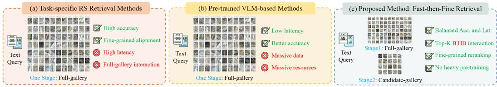
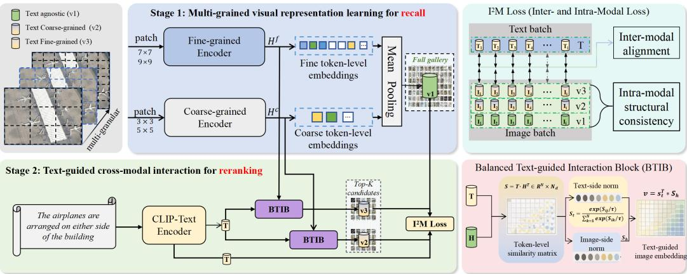
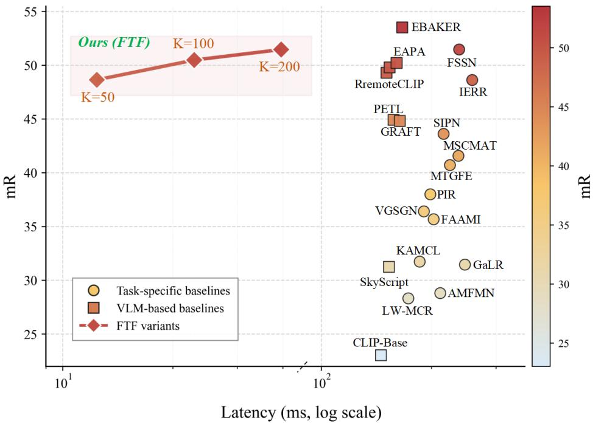
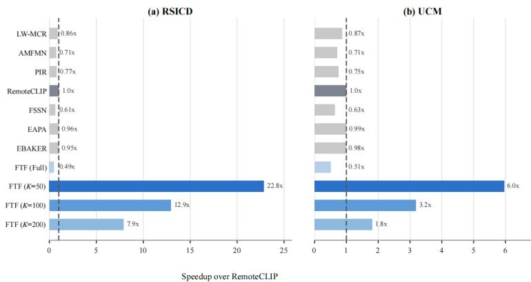
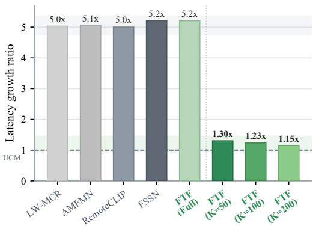
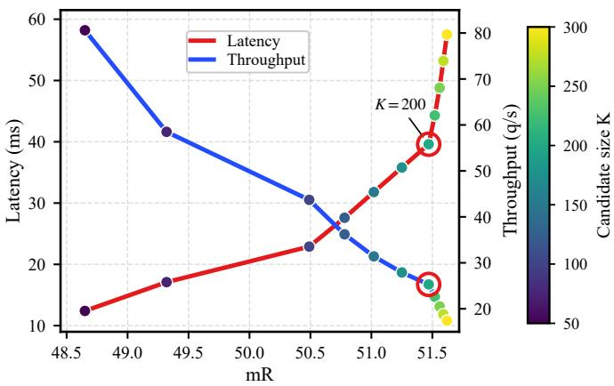
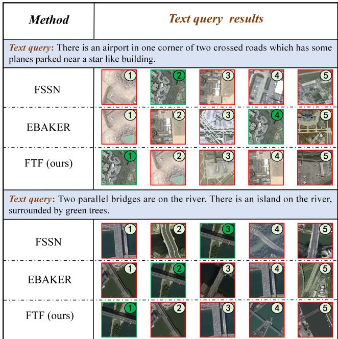
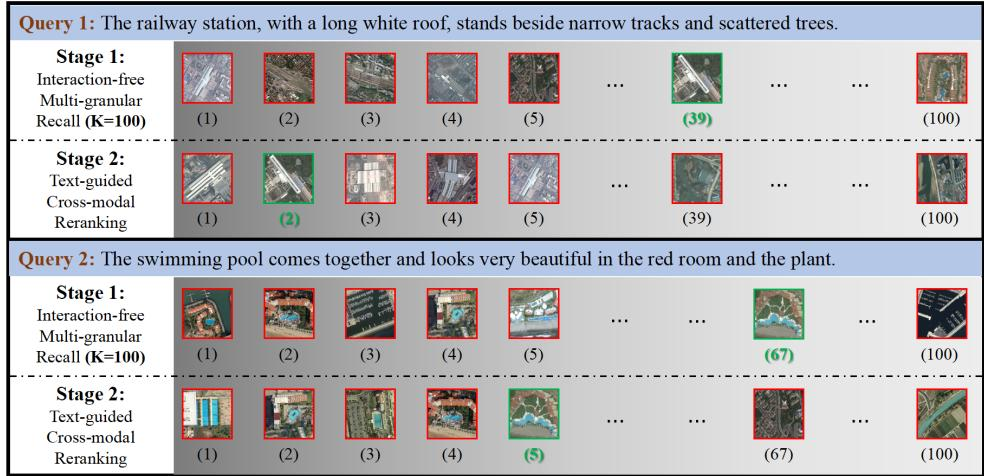
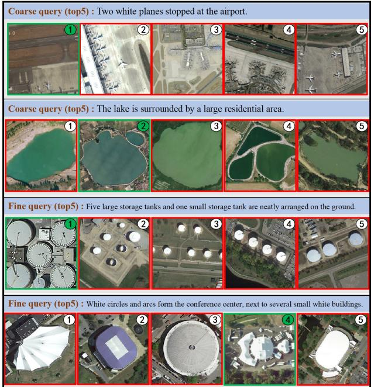

# Eficient Remote Sensing Image-Text Retrieval via Interaction-Free Recall and Text-Guided Reranking

XI CHEN, School of Computer Science, Wuhan University, China

XU CHEN∗, School of Computer Science, Wuhan University, China

XIANGYANG JIA, School of Computer Science, Wuhan University, China

WEI WANG, Beijing Institute for General Artificial Intelligence (BIGAI), China

XU ZHANG, School of Computer Science, Wuhan University, China

ZHENYUAN SUN, School of Computer Science, Wuhan University, China

Remote sensing (RS) image–text retrieval plays a critical role in understanding massive RS imagery. However, the dense multi-object distribution and complex backgrounds in RS imagery make it dificult to simultaneously achieve fine-grained cross-modal alignment and eficient retrieval. Existing methods either rely on complex cross-modal interactions that lead to low retrieval eficiency, or depend on large-scale vision–language adaptation, which requires massive data and computational resources. To address these issues, we develop a fast then-fine (FTF) retrieval framework centered on interaction-free multi-granular recall and parameter-free textguided cross-modal reranking with the Balanced Text-guided Interaction Block (BTIB). Specifically, interaction free multi-granular recall pre-computes gallery embeddings and matches them with the corresponding query embedding without full-gallery token-level text–image interaction, while text-guided cross-modal reranking with BTIB refines local semantic correspondence within the top-� candidate set. Furthermore, an inter- and intra-modal loss is designed to jointly optimize cross-modal alignment across multi-granular representations. Extensive experiments on public benchmarks demonstrate that the FTF achieves competitive retrieval accuracy while significantly improving retrieval eficiency compared with existing methods.

CCS Concepts: • Computer systems organization → Embedded systems; • Information systems → Multimedia and multimodal retrieval.

Additional Key Words and Phrases: Remote sensing imagery, cross-modal retrieval, image–text retrieval, two-stage retrieval, multi-granular representation, eficient retrieval.

## 1 Introduction

Remote sensing (RS) imagery has grown rapidly with the continuous development of earth observation platforms, generating massive volumes of visual data [2]. Eficient access to and understanding of RS imagery have become increasingly important [23]. Image–text retrieval provides an efective way to retrieve RS images through textual queries by linking visual content with semantic descriptions [6, 12, 13, 33]. However, RS imagery typically exhibits high spatial resolution and complex background composition, where diverse objects and fine structural details coexist within a single scene, making it dificult to simultaneously achieve eficient retrieval and fine-grained alignment.

Recent years have witnessed substantial progress in RS image–text retrieval [21, 58]. On one hand, as illustrated in Fig. 1(a), many methods leverage complex cross-modal interactions to achieve fine-grained alignment between RS images and text, which improves retrieval accuracy but often introduces significant computational overhead and limits retrieval eficiency [46, 47, 52, 61]. On the other hand, as illustrated in Fig. 1(b), recent VLM-based methods further improve retrieval performance by leveraging strong pretrained vision–language representation models, but these methods typically require massive data and computational resources [30, 43, 49, 56]. More recently, MLLM-assisted methods such as Caption2CLIP [41] and GraVLM [5] further improve retrieval accuracy through caption enrichment or semantic entity extraction. However, these additional MLLM-based steps may introduce considerable inference overhead in practical deployment. As a result, achieving a practical balance between accuracy and eficiency remains a critical challenge for RS image–text retrieval.

  
Fig. 1. Comparison of three paradigms for RS image–text retrieval. (a) Task-specific methods perform finegrained matching via complex full-gallery token-level text–image interaction, but sufer from high latency. (b) VLM-based methods achieve strong generalization, but often require massive data and computationa resources. (c) Our FTF performs interaction-free multi-granular recall followed by text-guided cross-moda reranking with BTIB, achieving a beter balance between retrieval accuracy and eficiency.

To address the above challenges, we propose a fast-then-fine (FTF) two-stage retrieval framework for RS image–text retrieval, as shown in Fig. 1(c). Considering the high resolution, dense objects, and fine-grained spatial descriptions in RS image–text retrieval, applying token-level text–image interaction to the full gallery is often unnecessarily expensive. FTF therefore separates interactionfree multi-granular recall from text-guided cross-modal reranking with BTIB: the recall stage still uses the query text embedding for similarity matching, but avoids full-gallery token-level text–image interaction. Unlike one-stage local-global interaction models that apply expensive cross-modal reasoning throughout retrieval, FTF explicitly controls where the costly interaction is performed, placing it only after the top-� candidate set has been obtained. This design reduces expensive full-gallery token-level text–image interaction while preserving the ability to achieve fine-grained cross-modal alignment. Compared with existing task-specific methods that mainly improve retrieval accuracy through increasingly complex matching, the proposed framework ofers a practical way to improve the accuracy–eficiency balance in RS image–text retrieval [10, 32, 33, 52, 59]. Its focus is not merely to introduce a cascaded retrieval pipeline, but to coordinate scalable multi-granular candidate recall with lightweight, query-conditioned refinement under a controllable candidate budget.

The main contributions of this work are summarized as follows:

• We propose an eficiency-oriented FTF framework that coordinates interaction-free multigranular recall and candidate-level fine-grained refinement. By constructing pre-computable gallery embeddings from complementary scene and local semantics and restricting text– image interaction to the top-� candidates, FTF provides an explicit and adjustable accuracy– eficiency trade-of.

• We design the Balanced Text-guided Interaction Block (BTIB), a parameter-free reranking module that combines text-conditioned visual normalization with visual-token balancing normalization. This complementary normalization refines candidate-level semantic correspondence while avoiding additional learnable parameters.

• We introduce an Inter- and Intra-Modal $( \mathrm { I } ^ { 2 } \mathrm { M } )$ Loss that jointly optimizes recall and reranking representations by coupling cross-modal alignment with intra-modal neighborhood consistency across multiple visual granularities.

• We conduct extensive experiments on RSITMD, RSICD, and UCM, including candidate coverage analysis, reranking alternative comparison, and accuracy–eficiency evaluation, demonstrating that FTF achieves competitive retrieval accuracy with substantially lower inference cost.

## 2 Related Work

## 2.1 Task-Specific RS Retrieval Methods

Existing RS image–text retrieval methods mainly improve retrieval accuracy by designing increasingly complex cross-modal interaction mechanisms, thereby enhancing semantic alignment between RS imagery and textual descriptions. Representative methods, including CAMP [42], LW-MCR [51], AMFMN [50], KAMCL [12], and SCAN [16], focus on establishing semantic correspondence through cross-modal projection, attention-based matching [14], semantic consistency learning [17], and semantic correlation modeling [22, 64], which lay an important foundation for RS image–text retrieval. Building on this line, more recent methods, such as GaLR [52], PIR [33], FAAMI [61], MTGFE [54], MSCMAT [47], IERR [46], VGSGN [10], SIPN [32], and FSSN [59], further strengthen fine-grained cross-modal alignment through local-to-global matching [6, 8], relation aware modeling, multi-granular feature learning, and richer semantic interaction [25, 40, 57]. Recent studies have also investigated RS image–text retrieval directly [4]. SSJDN jointly decouples scale specific and semantic features to improve cross-modal representation, whereas EEDR addresses incorrectly correlated and weakly correlated image–text pairs through correspondence rectification and diversity-aware feature decoupling [37, 60]. These methods indicate that fine-grained modeling is crucial for handling the high spatial resolution and complex background characteristics of RS imagery [1, 29]. However, these methods apply complex cross-modal interaction directly over the full candidate space, which limits retrieval eficiency in practical retrieval scenarios.

## 2.2 VLM-Based Methods

In addition to task-specific RS image–text retrieval methods, recent studies have further improved retrieval performance by leveraging strong vision–language representations [18, 19, 36]. Representative methods, including CLIP-Base [36] and PETL [49], transfer general-purpose vision– language representations to the RS domain, while SkyScript [43], GRAFT [30], RemoteCLIP [24], and GeoRSCLIP [56] further enhance retrieval accuracy through RS-oriented adaptation. These methods demonstrate that strong vision–language representations can improve cross-modal rep resentation learning and semantic alignment [7, 31, 39, 45, 55] between RS imagery and textual descriptions. However, their performance usually depends on massive data and computational resources [11, 44]. More recently, MLLM-assisted methods further exploit generative semantic understanding to enhance RS image–text retrieval. For example, Caption2CLIP enriches visual representations with MLLM-generated hierarchical captions and language modeling ability from LLaMA[9], while GraVLM [5] uses DeepSeek [26] to extract semantic entities and construct graphaligned cross-modal representations. Although these generative semantics are helpful for improving retrieval accuracy, they introduce additional caption generation, entity parsing, or reasoning steps. As a result, these VLM- and MLLM-based directions do not directly address how to achieve eficient fine-grained matching without relying on large-scale data collection, high-cost model adaptation or additional generative inference.

## 2.3 Eficient Cross-Modal Retrieval

Eficient cross-modal retrieval [3] commonly relies on lightweight dual-encoder models, where image and text embeddings are pre-computed and matched through fast similarity search [36, 48]. This design enables scalable gallery search, but compact global representations may lose finegrained matching accuracy, especially for RS image–text retrieval with complex backgrounds multiple objects, and rich spatial relationships [46, 47, 52, 59]. Recent general-domain studies improve image–text matching through authentic negative repository learning and lightweight cluster refinement [34]. These methods improve representation learning and matching robustness, but they are not designed for the RS-specific accuracy–eficiency trade-of.

To balance eficiency and accuracy, recall-then-rerank pipelines have been explored in several retrieval scenarios, where a lightweight recall stage first selects candidates and a stronger reranking model then performs more detailed semantic matching [19, 20]. Eficient reranking has also been reformulated as sparse graph propagation to reduce the computational cost of neighborhood-based refinement [53]. In RS retrieval, two-stage reranking has been studied for single-modal image retrieval [38], while CFITR directly addresses RS image–text retrieval by combining dual-stream hash-based coarse retrieval with single-stream Transformer-based fine matching [63]. FTF follows a diferent design: it constructs multi-granular CLIP representations for interaction-free candidate recall and applies the parameter-free BTIB only to the top-� candidates. This formulation avoids hash-based retrieval and learnable cross-modal reranking layers while retaining fine-grained, query-conditioned refinement under an explicit candidate budget.

## 3 Methods

## 3.1 Problem Formulation

Let $\mathbf { \mathcal { D } } = \{ ( I _ { i } , x _ { i } ) \} _ { i = 1 } ^ { N }$ denote a training set of paired RS images $I _ { i }$ and textual descriptions $x _ { i } ,$ , where � is the number of samples. Given a textual query $x _ { q } .$ , the goal of RS image–text retrieval is to return a ranked list of images from a large gallery $\mathcal { G }$ that are semantically relevant to $x _ { q }$

Each textual description $x _ { i }$ is encoded into a token-level representation $T _ { i }$ and a global text embedding $t _ { i }$ using a text encoder. For a given textual query, each candidate image $I _ { i }$ is represented by three visual embeddings: (1) the interaction-free multi-granular recall embedding $\mathbf { v } _ { 1 , i } ; ( 2 )$ the text-guided coarse embedding $\mathbf { v } _ { 2 , i }$ for reranking; and (3) the text-guided fine embedding ${ \bf v } _ { 3 , i }$ for reranking.

The overall objective is to learn embeddings $\mathbf { v } _ { 1 } , \mathbf { v } _ { 2 } , \mathbf { v } _ { 3 }$ and � such that $(  { \mathbf { i } } )  { \mathbf { v } } _ { 1 }$ eficiently identifies the top-� candidate set in the interaction-free multi-granular recall stage, and (ii) $\mathbf { v } _ { 2 }$ and $\mathbf { v } _ { 3 }$ support textguided cross-modal reranking through complementary coarse-grained and fine-grained semantic alignment with the query. For both text and visual encoding, we adopt transformer-based encoders. Detailed backbone settings are provided in the experimental section.

## 3.2 Overview

We denote the gallery of RS images as $\mathcal { G }$ and a textual query as $x _ { q } .$ The FTF framework aims to retrieve a ranked subset of candidate images $C \subset { \mathcal { G } }$ that are semantically relevant to $x _ { q }$ while maintaining high eficiency. Formally, the interaction-free multi-granular recall stage computes a visual mapping

$$
\mathbf { v } _ { 1 } = f _ { \mathrm { r e c a l l } } ( I ) , \quad I \in \mathcal { G } ,\tag{1}
$$

to produce multi-granular embeddings for eficient candidate selection, where $f _ { \mathrm { r e c a l l } }$ aggregates coarse and fine patch token embeddings. The interaction-free design allows gallery visual embeddings to be pre-computed without query-specific token-level text–image interaction, while

candidate retrieval is performed through embedding-level similarity with the query. For each candidate image, the text-guided cross-modal reranking stage then performs BTIB-based interaction between its visual tokens and the query textual tokens:

$$
\begin{array} { r } { \mathbf { v } _ { 2 } , \mathbf { v } _ { 3 } = f _ { \mathrm { B T I B } } ( \mathbf { H } ^ { c } , \mathbf { H } ^ { f } , T _ { q } ) , } \end{array}\tag{2}
$$

where $\mathbf { v } _ { 2 }$ and $\mathbf { v } _ { 3 }$ denote coarse and fine text-guided embeddings generated by BTIB.

  
Fig. 2. The overall FTF two-stage retrieval framework. Multi-granular visual embeddings $\mathbf { v } _ { 1 }$ are used for interaction-free multi-granular recall, where query texts are matched with pre-computed gallery features without full-gallery token-level text–image interaction, while BTIB generates $\mathbf { v } _ { 2 }$ and $\mathbf { v } _ { 3 }$ in the text-guided cross-modal reranking stage. $\mathsf { I } ^ { 2 } M$ Loss jointly optimizes cross-modal alignment and intra-modal structural consistency.

Fig. 2 illustrates the overall framework. Given a query from either modality, interaction-free multi-granular recall first selects the top-� candidates from the opposite-modality target gallery by comparing query and target embeddings, avoiding full-gallery token-level text–image interaction. The text-guided cross-modal reranking stage then applies BTIB only to the selected query–candidate pairs and refines the final ranking with the text-guided coarse and fine embeddings $\mathbf { v } _ { 2 }$ and $\mathbf { v } _ { 3 }$ . This two-stage design balances retrieval eficiency and retrieval accuracy, as fine-grained cross-modal interaction is restricted to the top-� candidate set.

Algorithm 1 summarizes the overall inference procedure of the proposed FTF framework. The algorithm is written for T2I retrieval for clarity. For I2T retrieval, the same candidate filtering and reranking principle is applied by exchanging the query and target gallery, where each candidate text is paired with the query image and BTIB uses the textual tokens of the candidate sentence to refine the visual tokens of the query image before reranking.

## 3.3 Interaction-Free Multi-Granular Recall

In the interaction-free multi-granular recall stage, each RS image � is encoded into a multi-granular visual embedding $\mathbf { v } _ { 1 }$ by integrating coarse scene-level semantics and fine patch-level details. These gallery embeddings can be pre-computed before inference, allowing candidate selection to be performed through lightweight embedding-level similarity with the textual query embedding $t _ { q } .$ . In this way, the recall stage avoids full-gallery token-level text–image interaction while preserving multi-granular visual semantics for eficient top-� candidate selection.

Formally, a shared CLIP visual encoder first extracts a base patch-token grid from image �. Coarse and fine regional tokens are then constructed using window sets $\mathcal { P } _ { c } = \{ 3 { \times } 3 , 5 { \times } 5 \}$ and $\mathcal { P } _ { f } = \{ 7 { \times } 7 , 9 { \times } 9 \}$ , respectively. These values denote average-pooling window sizes on the visual token grid, rather than input-pixel patch sizes or numbers of grid partitions. The two branches share the same visual backbone and difer only in their token-grid window scales. For window � in branch �, the token sequence is

Algorithm 1 Fast-then-Fine Retrieval with BTIB   
Require: Text query $x _ { q } ,$ image gallery ${ \mathcal { G } } ,$ , candidate size �   
Ensure: Ranked image list   
Stage 1: Interaction-free Multi-granular Recall   
1: Encode $x _ { q }$ into global text embedding $t _ { q }$ and textual tokens $T _ { q }$   
2: for each image $I \in { \mathcal { G } }$ do   
3: Compute or load the interaction-free multi-granular recall embedding $\mathbf { v } _ { 1 } ( I )$   
4: end for   
5: $C \gets \mathrm { T o p K } ( \{ \cos ( t _ { q } , { \bf v } _ { 1 } ( I ) ) \} _ { I \in \mathcal { G } } , K )$   
Stage 2: Text-guided Cross-modal Reranking with BTIB   
6: for each candidate image $I \in C$ do   
7: Construct coarse and fine visual tokens ${ \bf H } ^ { c } ( I )$ and $\mathbf { H } ^ { f } ( I )$   
8: Compute $\mathbf { v } _ { 2 } , \mathbf { v } _ { 3 } = \mathrm { B T I B } ( \mathbf { H } ^ { c } ( I ) , \mathbf { H } ^ { f } ( I ) , T _ { q } )$   
$\boldsymbol { \mathbf { \rho } } _ { : } \qquad \boldsymbol { s } ( I ) \gets ( 1 - \lambda ) \cos ( t _ { q } , \boldsymbol { \mathbf { v } } _ { 2 } ) + \lambda \cos ( t _ { q } , \boldsymbol { \mathbf { v } } _ { 3 } )$   
10: end for   
11: return candidates in C ranked by $s ( I )$

$$
\begin{array} { r } { \mathbf { H } ^ { g , w } = \operatorname { W i n d o w P o o l } \left( E _ { \mathrm { v i s } } ^ { \mathrm { C L I P } } ( I ) , w \right) , \quad w \in \mathcal { P } _ { g } , ~ g \in \{ c , f \} . } \end{array}\tag{3}
$$

Tokens from all windows in the same branch are concatenated as $\mathbf { H } ^ { g } = \| _ { w \in \mathcal { P } _ { g } } \mathbf { H } ^ { g , w }$ for subsequent aggregation and reranking.

For each scale, mean and max pooling are concatenated to retain complementary distributional and salient-region information:

$$
\begin{array} { r } { \mathbf { p } ^ { g , w } = \left[ { \mathrm { M e a n P o o l } } ( \mathbf { H } ^ { g , w } ) \parallel { \mathrm { M a x P o o l } } ( \mathbf { H } ^ { g , w } ) \right] . } \end{array}\tag{4}
$$

Layer normalization is applied to the tokens before pooling and to each pooled scale feature. The four scale features are concatenated and mapped to the shared �-dimensional embedding space through two bias-free linear layers with a GELU activation:

$$
\mathbf { v } _ { 1 } = \operatorname { n o r m } _ { 2 } \left( \mathbf { W } _ { r } ^ { ( 2 ) } \operatorname { G E L U } \left( \mathbf { W } _ { r } ^ { ( 1 ) } \big \lVert \mathbf { \Phi } _ { y \in \{ c , f \} , w \in \mathcal { P } _ { g } } \mathbf { p } ^ { g , w } \right) \right) ,\tag{5}
$$

where ∥ denotes feature concatenation and $\mathrm { n o r m } _ { 2 } ( \cdot )$ denotes $\ell _ { 2 }$ normalization. The final projection $\mathbf { W } _ { r } ^ { ( 2 ) }$ maps the fused visual feature to dimension $d ,$ ensuring that $\mathbf { v } _ { 1 }$ and the global text embedding have the same dimensionality for cosine similarity. Given a textual query embedding $t _ { q } .$ , the interaction-free multi-granular recall stage eficiently retrieves the top-� candidate set:

$$
C = \mathrm { T o p K } \Big ( \big \{ \cos \big ( t _ { q } , \mathbf { v } _ { 1 } ( I ) \big ) \big \} _ { I \in \mathcal { G } } , K \Big ) ,\tag{6}
$$

where C is the top-� candidate set passed to the text-guided cross-modal reranking stage.

This design ensures that $\mathbf { v } _ { 1 }$ captures both global structures and local details, enabling eficient candidate selection using approximate nearest neighbor search while avoiding full-gallery tokenlevel text–image interaction.

## 3.4 Text-Guided Cross-Modal Reranking with BTIB

After interaction-free multi-granular recall, the top-� candidate set is selected using the similarity between the query text embedding and the pre-computed recall embedding $\mathbf { v } _ { 1 }$ . Recent studies have shown that structured text–visual interaction can improve fine-grained multimodal matching by guiding textual cues to focus on diferent semantic patterns in visual features [15]. Inspired by this observation, text-guided cross-modal reranking with BTIB refines the candidate ranking by introducing textual information through parameter-free token interaction.

For each candidate image, its coarse and fine tokens, $\mathbf { H } ^ { c }$ and $\mathbf { H } ^ { f }$ , interact with the textual token embeddings � to produce text-guided coarse and fine embeddings, $\mathbf { v } _ { 2 }$ and $\mathbf { v } _ { 3 }$

$$
\mathbf { v } _ { 2 } , \mathbf { v } _ { 3 } = \mathrm { B T I B } ( \mathbf { H } ^ { c } , \mathbf { H } ^ { f } , T ) .\tag{7}
$$

The core mechanism of BTIB is a bidirectional matching process. Let $\bar { T }$ and H¯ denote token-wise $\ell _ { 2 }$ -normalized text and visual features. The similarity matrix is

$$
S = \frac { \bar { T } \bar { \mathbf { H } } ^ { \top } } { \tau } \in \mathbb { R } ^ { N _ { t } \times N _ { v } } ,\tag{8}
$$

where $T \in \mathbb { R } ^ { N _ { t } \times d }$ denotes valid, non-padding textual token embeddings, $\mathbf { H } \in \{ \mathbf { H } ^ { c } , \mathbf { H } ^ { f } \}$ denotes coarse or fine image tokens corresponding to $\mathbf { v } _ { 2 }$ or $\mathbf { v } _ { 3 }$ , and � is a temperature hyperparameter.

Text-conditioned visual normalization: for each textual token, we apply a softmax over all visual tokens to obtain its visual-token assignment:

$$
A _ { i j } = \frac { \exp ( S _ { i j } ) } { \sum _ { k = 1 } ^ { N _ { v } } \exp ( S _ { i k } ) } , i = 1 , . . . , N _ { t } , j = 1 , . . . , N _ { v } ,\tag{9}
$$

Visual-token balancing normalization: we also apply a softmax over all textual tokens for each visual token:

$$
B _ { i j } = \frac { \exp ( S _ { i j } ) } { \sum _ { l = 1 } ^ { N _ { t } } \exp ( S _ { l j } ) } , \quad i = 1 , \ldots , N _ { t } , \ j = 1 , \ldots , N _ { v } .\tag{10}
$$

The two directional assignments are combined through element-wise multiplication and normalized over the visual dimension:

$$
M = A \odot B , \qquad W _ { i j } = \frac { M _ { i j } } { \operatorname* { m a x } \left( \sum _ { k = 1 } ^ { N _ { v } } M _ { i k } , \epsilon \right) } ,\tag{11}
$$

where ⊙ denotes element-wise multiplication and $\epsilon$ is a small numerical constant. This balanced correspondence emphasizes token pairs that are simultaneously distinctive from both the textual and visual perspectives.

The balanced assignments aggregate the candidate’s visual values for each valid textual token:

$$
\mathbf { Z } = W \mathbf { H } \in \mathbb { R } ^ { N _ { t } \times d } ,\tag{12}
$$

and the rows are averaged and $\ell _ { 2 }$ -normalized to generate coarse and fine reranking embeddings:

$$
\mathbf { v } _ { 2 } = \mathrm { n o r m } _ { 2 } \left( \frac { 1 } { N _ { t } } \sum _ { i = 1 } ^ { N _ { t } } Z _ { i } ^ { c } \right) , \quad \mathbf { v } _ { 3 } = \mathrm { n o r m } _ { 2 } \left( \frac { 1 } { N _ { t } } \sum _ { i = 1 } ^ { N _ { t } } Z _ { i } ^ { f } \right) ,\tag{13}
$$

The text-guided coarse and fine embeddings $\mathbf { v } _ { 2 }$ and $\mathbf { v } _ { 3 }$ are jointly optimized with the recall embedding $\mathbf { v } _ { 1 }$ using the $\mathrm { I } ^ { 2 } \mathrm { M }$ Loss. During reranking, their similarities to the query are combined to score each candidate:

$$
\begin{array} { r } { s ( I ) = ( 1 - \lambda ) \cos ( t _ { q } , \mathbf { v } _ { 2 } ) + \lambda \cos ( t _ { q } , \mathbf { v } _ { 3 } ) , } \end{array}\tag{14}
$$

The candidate images in $c$ are ranked according to $s ( I )$ . BTIB is a parameter-free interaction module that establishes correspondences between textual and visual tokens through bidirectional

normalization and aggregates query-relevant coarse- and fine-grained visual information to refine candidate-level semantic matching.

## 3.5 Inter- and Intra-Modal Loss

Recent studies have shown that contrastive learning is an efective method for multimodal representation learning and cross-modal retrieval, and the InfoNCE [36] objective has been widely used to align matched visual–text pairs while separating non-matching pairs [28, 62]. Motivated by this line of research, to jointly optimize the recall embedding $\mathbf { v } _ { 1 }$ and the reranking embeddings $\mathbf { v } _ { 2 }$ and $\mathbf { v } _ { 3 }$ under a unified objective, we design an improved Inter- and Intra-Modal $( \mathrm { I } ^ { 2 } \mathrm { M } )$ Loss. Specifically, the proposed loss combines an inter-modal alignment term to enforce cross-modal consistency with an intra-modal structural consistency term to preserve the relative structure of embeddings within each modality:

$$
\begin{array} { r } { \mathcal { L } _ { \mathrm { I ^ { 2 } M } } = \mathcal { L } _ { \mathrm { i n t e r } } + \beta \mathcal { L } _ { \mathrm { i n t r a } } , } \end{array}\tag{15}
$$

where $\beta$ balances the two terms.

Inter-modal alignment. For a minibatch of � image–text pairs, the inter-modal term aligns the global text embedding $\mathbf { t } _ { i }$ with the recall and reranking representations of every image in the minibatch. The recall representation $\mathbf { v } _ { 1 , j }$ depends only on image $I _ { j }$ , whereas the two BTIB representations are conditioned on both image $I _ { j }$ and the textual tokens $T _ { i }$ of the current query:

$$
\begin{array} { r } { { \mathbf { v } } _ { 1 , j } = f _ { \mathrm { r e c a l l } } ( I _ { j } ) , \qquad ( { \mathbf { v } } _ { 2 , i j } , { \mathbf { v } } _ { 3 , i j } ) = f _ { \mathrm { B T I B } } ( { \mathbf { H } } _ { j } ^ { c } , { \mathbf { H } } _ { j } ^ { f } , T _ { i } ) . } \end{array}\tag{16}
$$

Accordingly, the pairwise similarities are computed as

$$
\begin{array} { r l } & { s _ { i j } ^ { ( 1 ) } = \bar { \mathbf { t } } _ { i } ^ { \top } \bar { \mathbf { v } } _ { 1 , j } , } \\ & { s _ { i j } ^ { ( k ) } = \bar { \mathbf { t } } _ { i } ^ { \top } \bar { \mathbf { v } } _ { k , i j } , \quad k \in \{ 2 , 3 \} , } \end{array}\tag{17}
$$

where the overbar denotes $\ell _ { 2 }$ normalization. Thus, the reranking branches use the same queryconditioned image–text pairing during training and inference. We then adopt a sigmoid-based alignment objective:

$$
\mathcal { L } _ { \mathrm { i n t e r } } ^ { ( k ) } = \frac { 1 } { B ^ { 2 } } \sum _ { i = 1 } ^ { B } \sum _ { j = 1 } ^ { B } \log \left( 1 + \exp \left( - y _ { i j } s _ { i j } ^ { ( k ) } / \tau \right) \right) ,\tag{18}
$$

where $y _ { i j } = 1 \operatorname { i f } i = j $ and $y _ { i j } = - 1$ otherwise, and � is a temperature hyperparameter. The overall inter-modal loss is defined as

$$
\mathcal { L } _ { \mathrm { i n t e r } } = \alpha _ { 1 } \mathcal { L } _ { \mathrm { i n t e r } } ^ { ( 1 ) } + \alpha _ { 2 } \mathcal { L } _ { \mathrm { i n t e r } } ^ { ( 2 ) } + \alpha _ { 3 } \mathcal { L } _ { \mathrm { i n t e r } } ^ { ( 3 ) } ,\tag{19}
$$

where $\alpha _ { 1 } , \alpha _ { 2 }$ , and $\alpha _ { 3 }$ control the contributions of the recall and reranking embeddings. This term encourages $\mathbf { v } _ { 1 }$ , v2, and $\mathbf { v } _ { 3 }$ to maintain consistent semantic alignment with the paired text.

Intra-modal structural consistency. Although $\mathbf { v } _ { 2 }$ and $\mathbf { v } _ { 3 }$ are refined by text-guided cross-modal reranking with BTIB, they should preserve the intrinsic neighborhood structure established by the interaction-free multi-granular recall embedding $\mathbf { v } _ { 1 }$ . For the intra-modal term, ${ \mathbf { v } } _ { k , i }$ denotes the positive pair-conditioned representation ${ \mathbf { v } } _ { k , i i }$ for $k \in \{ 2 , 3 \}$ . We first $\ell _ { 2 } .$ -normalize all representations as $\bar { \mathbf { v } } _ { k , i } = \mathbf { v } _ { k , i } / \lVert \mathbf { v } _ { k , i }$ � ∥2 and construct a batch-level similarity graph based on $\mathbf { v } _ { 1 }$

$$
a _ { i j } = \bar { \mathbf { v } } _ { 1 , i } ^ { \top } \bar { \mathbf { v } } _ { 1 , j } .\tag{20}
$$

For each sample $i ,$ we select its top-� neighbors $N _ { M } ( i )$ according to $a _ { i j }$ , excluding the sample itself, and define the normalized neighborhood weights:

$$
g _ { i j } = \frac { \exp ( a _ { i j } / \sigma ) } { \sum _ { m \in N _ { M } ( i ) } \exp ( a _ { i m } / \sigma ) } , \quad j \in N _ { M } ( i ) ,\tag{21}
$$

where $\sigma$ is a temperature hyperparameter. The neighborhood weights are not detached: gradients propagate through the selected similarities and target embeddings, while the discrete top-� index selection itself is treated as fixed within each forward pass. The intra-modal loss then enforces v2 and $\mathbf { v } _ { 3 }$ to preserve this local structure:

$$
\mathcal { L } _ { \mathrm { i n t r a } } ^ { ( k ) } = \frac { 1 } { B } \sum _ { i = 1 } ^ { B } \sum _ { j \in N _ { M } ( i ) } g _ { i j } \left( 1 - \bar { \mathbf { v } } _ { k , i } ^ { \top } \bar { \mathbf { v } } _ { k , j } \right) , \quad k \in \{ 2 , 3 \} .\tag{22}
$$

The final intra-modal term is

$$
\begin{array} { r } { \mathcal { L } _ { \mathrm { i n t r a } } = \mathcal { L } _ { \mathrm { i n t r a } } ^ { ( 2 ) } + \mathcal { L } _ { \mathrm { i n t r a } } ^ { ( 3 ) } . } \end{array}\tag{23}
$$

By jointly optimizing inter-modal alignment and intra-modal structural consistency, $\mathrm { I } ^ { 2 } \mathrm { M }$ Loss encourages the recall and reranking embeddings to be semantically aligned with the query while maintaining consistent multi-granular representation structure.

## 4 Experiments

## 4.1 Experimental Setings

Datasets. We conduct experiments on the public RS image–text retrieval benchmark RSITMD [50]. This dataset consists of paired RS images and textual descriptions, and exhibits high spatial resolution and complex background characteristics. To further evaluate generalization, we additionally include RSICD [27] and UCM [35], two widely used RS image–text retrieval benchmarks with diferent data scales, scene distributions, and caption granularities.

Settings. We initialize both the visual and textual branches from pretrained CLIP ViT-B/32 [36]. The shared CLIP visual encoder extracts base patch tokens from which the coarse and fine window branches are constructed, while the CLIP text encoder produces token-level and sentence-level representations of each description. The encoders, projection layers, and other trainable components are adapted on the training split of each target RS image–text retrieval dataset using the proposed objective. All experiments are conducted on a single NVIDIA A100 GPU with 40GB memory. Images are resized to $2 2 4 \times 2 2 4$ , the maximum text length is set to 77 tokens, and both image and text embeddings are projected to 512 dimensions. We train FTF for 30 epochs with a batch size of 128 using AdamW, with an initial learning rate of $1 \times 1 0 ^ { - 5 }$ and a weight decay of 0.05. At inference time, the system follows the FTF two-stage retrieval pipeline: it first performs interaction-free multi-granular recall over the full gallery and then applies text-guided cross-modal reranking with BTIB only to the top-� candidate set. The same procedure is used for both I2T and T2I retrieval, with candidate filtering performed over the corresponding target gallery before reranking. Unless otherwise specified, the candidate size � is selected from {50, 100, 200}. All datasets follow the data partitioning protocol of GaLR [52].

Evaluation metrics. We report Recall@K for both image-to-text retrieval (I2T) and text-toimage retrieval (T2I), where $K \in \{ 1 , 5 , 1 0 \}$ , and compute mean Recall (mR) as the average of these six values. Let Q denote the query set, TopK(�) the top-� retrieved items for query �, and $\mathcal G ( \boldsymbol q )$ the set of its ground-truth matched items. Recall@� is defined as

$$
{ \mathrm { R } } @ K = { \frac { 1 } { | Q | } } \sum _ { q \in Q } 1 ( { \mathcal { G } } ( q ) \cap { \mathrm { T o p K } } ( q ) \neq \emptyset ) ,\tag{24}
$$

where 1(·) equals 1 if the condition is true and 0 otherwise. To evaluate retrieval eficiency, we further report latency (Lat.), defined as the average inference time per query, and throughput (Thr.), defined as the number of queries processed per second.

Compared methods. We compare FTF with 20 representative methods, including LW-MCR [51], AMFMN [50], KAMCL [12], GaLR [52], PIR [33], FAAMI [61], MTGFE [54], MSCMAT [47], IERR [46],

Table 1. Comparison of state-of-the-art methods on RSITMD. For FTF, Full denotes full-gallery BTIB reranking without candidate pruning, while � > 0 denotes interaction-free multi-granular recall followed by text-guided cross-modal reranking with BTIB over the top-� candidate set.
<table><tr><td rowspan="2">Method</td><td rowspan="2">Year</td><td colspan="3">I2T</td><td colspan="3">T2I</td><td rowspan="2">mR↑</td><td rowspan="2">Lat. (ms)↓</td><td rowspan="2">Thr. (q/s)↑</td></tr><tr><td>R@1</td><td>R@5</td><td>R@10</td><td>R@1</td><td>R@5</td><td>R@10</td></tr><tr><td>LW-MCR</td><td>2022</td><td>9.43</td><td>26.18</td><td>37.87</td><td>8.52</td><td>34.13</td><td>53.80</td><td>28.32</td><td>172.8</td><td>5.8</td></tr><tr><td>AMFMN</td><td>2022</td><td>10.31</td><td>29.21</td><td>37.93</td><td>9.85</td><td>33.30</td><td>52.26</td><td>28.81</td><td>211.3</td><td>4.7</td></tr><tr><td>GaLR</td><td>2022</td><td>14.69</td><td>32.20</td><td>41.84</td><td>10.68</td><td>36.90</td><td>52.44</td><td>31.46</td><td>246.8</td><td>4.1</td></tr><tr><td>KAMCL</td><td>2023</td><td>14.95</td><td>29.47</td><td>44.39</td><td>9.76</td><td>36.41</td><td>55.48</td><td>31.74</td><td>185.6</td><td>5.4</td></tr><tr><td>PIR</td><td>2023</td><td>17.54</td><td>40.50</td><td>52.55</td><td>12.71</td><td>41.14</td><td>63.55</td><td>38.00</td><td>198.5</td><td>5.0</td></tr><tr><td>FAAMI</td><td>2023</td><td>16.39</td><td>35.40</td><td>48.97</td><td>12.22</td><td>41.64</td><td>59.46</td><td>35.68</td><td>202.7</td><td>4.9</td></tr><tr><td>MTGFE</td><td>2023</td><td>18.23</td><td>40.81</td><td>53.00</td><td>16.74</td><td>48.42</td><td>67.09</td><td>40.72</td><td>224.6</td><td>4.5</td></tr><tr><td>MSCMAT</td><td>2024</td><td>22.85</td><td>43.26</td><td>55.31</td><td>15.31</td><td>47.39</td><td>65.37</td><td>41.58</td><td>236.9</td><td>4.2</td></tr><tr><td>IERR</td><td>2024</td><td>28.05</td><td>48.53</td><td>61.88</td><td>23.78</td><td>56.45</td><td>73.10</td><td>48.63</td><td>258.4</td><td>3.9</td></tr><tr><td>VGSGN</td><td>2024</td><td>13.57</td><td>34.94</td><td>49.88</td><td>13.52</td><td>43.02</td><td>63.55</td><td>36.41</td><td>190.6</td><td>5.2</td></tr><tr><td>SIPN</td><td>2025</td><td>23.65</td><td>45.70</td><td>58.29</td><td>17.20</td><td>50.01</td><td>66.88</td><td>43.62</td><td>215.8</td><td>4.6</td></tr><tr><td>FSSN</td><td>2025</td><td>31.11</td><td>52.97</td><td>65.45</td><td>25.99</td><td>57.57</td><td>75.74</td><td>51.47</td><td>238.0</td><td>4.2</td></tr><tr><td>CLIP-Base</td><td>2021</td><td>9.36</td><td>21.26</td><td>32.25</td><td>8.09</td><td>26.99</td><td>40.27</td><td>23.04</td><td>145.5</td><td>6.9</td></tr><tr><td>PETL</td><td>2023</td><td>23.35</td><td>47.05</td><td>60.72</td><td>19.76</td><td>49.78</td><td>69.00</td><td>44.94</td><td>157.6</td><td>6.3</td></tr><tr><td>SkyScript</td><td>2024</td><td>11.42</td><td>35.31</td><td>53.49</td><td>14.44</td><td>32.43</td><td>40.39</td><td>31.25</td><td>152.9</td><td>6.5</td></tr><tr><td>GRAFT</td><td>2024</td><td>25.33</td><td>45.33</td><td>58.43</td><td>25.54</td><td>53.01</td><td>61.33</td><td>44.83</td><td>163.8</td><td>6.1</td></tr><tr><td>RemoteCLIP</td><td>2024</td><td>27.64</td><td>51.31</td><td>66.49</td><td>21.58</td><td>55.91</td><td>72.95</td><td>49.31</td><td>150.7</td><td>6.6</td></tr><tr><td>GeoRSCLIP</td><td>2024</td><td>29.64</td><td>51.52</td><td>63.42</td><td>23.14</td><td>56.68</td><td>74.46</td><td>49.81</td><td>153.5</td><td>6.5</td></tr><tr><td>EBAKER</td><td>2024</td><td>33.85</td><td>54.31</td><td>68.72</td><td>28.37</td><td>60.38</td><td>75.51</td><td>53.52</td><td>166.4</td><td>6.0</td></tr><tr><td>EAPA</td><td>2025</td><td>30.17</td><td>52.56</td><td>63.51</td><td>24.64</td><td>58.12</td><td>72.32</td><td>50.22</td><td>160.5</td><td>6.2</td></tr><tr><td>FTF (Full)</td><td>2026</td><td>30.97</td><td>52.18</td><td>66.78</td><td>27.39</td><td>59.76</td><td>73.30</td><td>51.73</td><td>295.4</td><td>3.4</td></tr><tr><td>FTF (K=50)</td><td>2026</td><td>27.44</td><td>49.77</td><td>63.18</td><td>24.91</td><td>54.66</td><td>71.94</td><td>48.65</td><td>12.4</td><td>80.6</td></tr><tr><td>FTF (K=100)</td><td>2026</td><td>29.83</td><td>50.69</td><td>65.64</td><td>26.42</td><td>58.21</td><td>72.15</td><td>50.49</td><td>22.9</td><td>43.7</td></tr><tr><td>FTF (K=200)</td><td>2026</td><td>30.03</td><td>52.78</td><td>65.77</td><td>27.76</td><td>58.68</td><td>73.80</td><td>51.47</td><td>39.6</td><td>25.3</td></tr></table>

VGSGN [10], SIPN [32], FSSN [59], CLIP-Base [36], PETL [49], SkyScript [43], GRAFT [30], RemoteCLIP [24], GeoRSCLIP [56], EBAKER [13], and EAPA [21]. For methods based on pretrained vision–language models, we report fine-tuned retrieval results.

## 4.2 Comparison with State-of-the-Art Methods

Table 1 reports the main comparison results on RSITMD, and Fig. 3 visualizes the corresponding accuracy–eficiency distribution. Overall, FTF achieves a favorable accuracy–eficiency balance across diferent candidate sizes �. The full-gallery BTIB reranking setting, FTF (Full), obtains an mR of 51.73, which is competitive with strong task-specific and VLM-based baselines. Although EBAKER achieves the highest mR, FTF (Full) remains close to the strongest results and outperforms several representative methods such as IERR, SIPN, FSSN, RemoteCLIP, GeoRSCLIP, and EAPA. This indicates that text-guided cross-modal reranking with BTIB is efective when applied to the complete gallery. However, full-gallery BTIB reranking also introduces relatively high latency, which motivates the FTF two-stage retrieval framework.

  
Fig. 3. Accuracy–eficiency comparison on RSITMD using the methods reported in Table 1. FTF provides favorable operating points under diferent candidate sizes �.

When candidate pruning is enabled, FTF provides a flexible balance between retrieval accuracy and inference eficiency. With candidate size $K = 5 0$ , FTF achieves the lowest latency (12.4 ms) and the highest throughput (80.6 q/s) among all compared methods, while maintaining a competitive mR of 48.65. Increasing the candidate size gradually recovers retrieval accuracy: FTF $( K = 1 0 0 )$ achieves higher mR than RemoteCLIP and GeoRSCLIP, and FTF $\left( K = 2 0 0 \right)$ reaches an mR of 51.47, which is close to FTF (Full) and comparable to the strong task-specific baseline FSSN, while requiring only 39.6 ms latency. These results show that candidate size � serves as an explicit control knob: smaller � values favor real-time retrieval eficiency, while larger � values recover fine-grained matching accuracy.

Compared with VLM-based methods, FTF is particularly useful under practical inference constraints. Rather than pursuing the highest single-point mR, FTF provides adjustable operating points with substantially lower latency. For example, FTF (� = 50) is substantially faster than all methods with available eficiency results, and FTF $( K = 2 0 0 )$ achieves higher mR than RemoteCLIP, GeoRSCLIP, and EAPA. This demonstrates that the proposed framework does not rely on heavy full-gallery token-level text–image interaction; instead, it restricts text-guided cross-modal reranking with BTIB to the top-� candidate set, thereby maintaining competitive retrieval performance while substantially reducing inference cost.

## 4.3 Generalization and Eficiency on Additional Datasets

To evaluate the generalization ability of the proposed FTF, we further conduct experiments on two additional RS image–text retrieval benchmarks, RSICD and UCM. RSICD contains more images and more diverse scene categories, while UCM is a compact benchmark with diferent caption and category distributions. These complementary datasets allow us to assess whether the accuracy– eficiency balance of FTF is consistent across diferent data scales and retrieval settings.

Table 2. Comparison of retrieval performance and eficiency on RSICD and UCM.
<table><tr><td rowspan="2">Dataset</td><td rowspan="2">Method</td><td colspan="3">I2T</td><td colspan="3">T2I</td><td rowspan="2">mR↑</td><td rowspan="2">Lat. (ms)↓</td><td rowspan="2">Thr. (q/s)↑</td></tr><tr><td>R@1</td><td>R@5</td><td>R@10</td><td>R@1</td><td>R@5</td><td>R@10</td></tr><tr><td rowspan="13">RSICD</td><td>LW-MCR</td><td>3.34</td><td>13.00</td><td>21.95</td><td>3.00</td><td>15.38</td><td>27.96</td><td>14.11</td><td>386.4</td><td>2.6</td></tr><tr><td>AMFMN</td><td>4.59</td><td>15.33</td><td>27.99</td><td>4.93</td><td>17.42</td><td>28.33</td><td>16.43</td><td>472.8</td><td>2.1</td></tr><tr><td>PIR</td><td>10.38</td><td>27.03</td><td>38.84</td><td>6.33</td><td>24.20</td><td>39.90</td><td>24.45</td><td>435.6</td><td>2.3</td></tr><tr><td>RemoteCLIP</td><td>16.79</td><td>34.94</td><td>48.25</td><td>13.91</td><td>40.79</td><td>56.58</td><td>35.21</td><td>333.5</td><td>3.0</td></tr><tr><td>FSSN</td><td>18.94</td><td>39.65</td><td>51.71</td><td>16.30</td><td>39.32</td><td>56.92</td><td>37.14</td><td>548.9</td><td>1.8</td></tr><tr><td>EAPA</td><td>18.24</td><td>38.74</td><td>50.62</td><td>15.66</td><td>41.24</td><td>58.04</td><td>37.09</td><td>347.1</td><td>2.9</td></tr><tr><td>EBAKER</td><td>20.12</td><td>41.32</td><td>53.76</td><td>17.42</td><td>43.58</td><td>56.96</td><td>38.86</td><td>352.4</td><td>2.8</td></tr><tr><td>FTF (Full)</td><td>18.17</td><td>37.86</td><td>50.44</td><td>15.38</td><td>42.73</td><td>58.32</td><td>37.15</td><td>680.4</td><td>1.5</td></tr><tr><td>FTF (K=50)</td><td>15.83</td><td>36.42</td><td>48.07</td><td>14.56</td><td>39.74</td><td>57.18</td><td>35.30</td><td>14.6</td><td>68.5</td></tr><tr><td>FTF (K=100)</td><td>17.23</td><td>36.72</td><td>49.46</td><td>14.48</td><td>41.37</td><td>57.52</td><td>36.13</td><td>25.8</td><td>38.8</td></tr><tr><td>FTF (K=200)</td><td>17.87</td><td>37.74</td><td>50.18</td><td>15.25</td><td>42.14</td><td>58.16</td><td>36.89</td><td>42.3</td><td>23.6</td></tr><tr><td rowspan="13">UCM</td><td>LW-MCR</td><td>14.06</td><td>39.87</td><td>59.14</td><td>9.59</td><td>44.07</td><td>74.42</td><td>40.19</td><td>76.8</td><td>13.0</td></tr><tr><td>AMFMN</td><td>14.80</td><td>51.04</td><td>67.02</td><td>14.64</td><td>51.74</td><td>80.35</td><td>46.60</td><td>93.5</td><td>10.7</td></tr><tr><td>PIR</td><td>12.43</td><td>47.98</td><td>75.25</td><td>13.76</td><td>53.08</td><td>91.13</td><td>48.94</td><td>88.6</td><td>11.3</td></tr><tr><td>RemoteCLIP</td><td>16.12</td><td>50.57</td><td>81.33</td><td>17.02</td><td>63.18</td><td>98.46</td><td>54.45</td><td>66.7</td><td>15.0</td></tr><tr><td>FSSN</td><td>23.18</td><td>64.27</td><td>81.07</td><td>21.06</td><td>66.19</td><td>94.51</td><td>58.38</td><td>105.3</td><td>9.5</td></tr><tr><td>EAPA</td><td>21.16</td><td>61.54</td><td>80.42</td><td>20.13</td><td>64.39</td><td>94.12</td><td>56.96</td><td>67.4</td><td>14.8</td></tr><tr><td>EBAKER</td><td>22.47</td><td>63.18</td><td>81.25</td><td>20.62</td><td>65.73</td><td>94.09</td><td>57.89</td><td>68.1</td><td>14.7</td></tr><tr><td>FTF (Full)</td><td>21.83</td><td>62.21</td><td>80.54</td><td>20.78</td><td>65.37</td><td>93.91</td><td>57.44</td><td>130.8</td><td>7.6</td></tr><tr><td>FTF (K=50)</td><td>19.42</td><td>57.13</td><td>79.36</td><td>18.55</td><td>63.58</td><td>93.34</td><td>55.23</td><td>11.2</td><td>89.3</td></tr><tr><td>FTF (K=100)</td><td>19.86</td><td>60.73</td><td>79.58</td><td>20.18</td><td>63.71</td><td>94.22</td><td>56.38</td><td>20.9</td><td>47.8</td></tr><tr><td>FTF (K=200)</td><td>21.34</td><td>61.86</td><td>81.02</td><td>20.58</td><td>64.79</td><td>94.33</td><td>57.32</td><td>36.9</td><td>27.1</td></tr><tr><td></td><td></td><td></td><td></td><td></td><td></td><td></td><td></td><td></td><td></td></tr></table>

Table 2 focuses on representative methods with comparable eficiency evaluation, covering early lightweight models, fine-grained task-specific models, and VLM-based models. On RSICD, FTF (Full) achieves an mR of 37.15, slightly higher than FSSN (37.14) and RemoteCLIP (35.21). It obtains the best T2I R@10 and the second-best T2I R@5, indicating that full-gallery BTIB reranking remains efective on a larger and more diverse dataset. With candidate pruning, increasing the candidate size from � = 50 to � = 200 improves mR from 35.30 to 36.89 while keeping latency far lower than full-gallery BTIB reranking. On UCM, FTF (Full) reaches an mR of 57.44, close to the strongest baseline FSSN (58.38), and the two-stage variants preserve competitive retrieval accuracy under diferent candidate sizes �. Although the highest mR is obtained by EBAKER on RSICD and FSSN on UCM, FTF provides much lower latency under candidate pruning, showing a practical accuracy–eficiency balance across datasets.

To complement the absolute latency and throughput reported in Table 2, we visualize the relative speedup of each method by using RemoteCLIP as the dataset-specific reference.

As shown in Fig. 4, FTF with candidate size � = 50 provides clear inference acceleration over RemoteCLIP. Specifically, FTF (� = 50) is 22.8× faster than RemoteCLIP on RSICD and 6.0× faster on UCM. The Full setting performs full-gallery BTIB reranking and is therefore slower, but it serves as a full-gallery reranking reference. In contrast, � > 0 ofers a practical accuracy–eficiency balance: smaller candidate sizes bring stronger speedups, while larger candidate sizes recover more retrieval accuracy.

  
Fig. 4. Relative inference speedup over RemoteCLIP on additional datasets. Speedup is computed as the latency of RemoteCLIP divided by the latency of each method on the same dataset. Gray bars denote compared baselines, and blue bars denote FTF variants under diferent candidate sizes �.

  
Fig. 5. Latency growth ratio from UCM to RSICD. The growth ratio is computed as the latency on RSICD divided by the latency on UCM for each method. Smaller values indicate beter scalability as the gallery size increases.

Beyond relative speedup on each dataset, we further analyze how inference latency scales when the gallery size increases from UCM to RSICD. As shown in Fig. 5, full-gallery matching methods exhibit clear latency growth, with the compared baselines increasing by about 5.0×–5.2×. FTF (Full) follows a similar trend because BTIB reranking is applied to the complete gallery. In contrast, the two-stage FTF variants grow much more slowly, with only 1.30×, 1.23×, and 1.15× latency growth for � = 50, � = 100, and � = 200, respectively. This scalability advantage primarily comes from restricting text-guided cross-modal reranking with BTIB to a fixed-size top-� candidate set, while interaction-free multi-granular recall eficiently scans the expanding gallery.

Table 3. Stage-1 candidate coverage before text-guided cross-modal reranking.
<table><tr><td>Dataset</td><td>Direction</td><td>Cov@50 (%)</td><td>Cov@100 (%)</td><td>Cov@200 (%)</td></tr><tr><td>RSITMD</td><td>I2T</td><td>90.6</td><td>94.7</td><td>97.6</td></tr><tr><td>RSITMD</td><td>T2I</td><td>89.8</td><td>94.1</td><td>97.0</td></tr><tr><td>RSITMD</td><td>Avg.</td><td>90.2</td><td>94.4</td><td>97.3</td></tr><tr><td>RSICD</td><td>I2T</td><td>88.4</td><td>92.6</td><td>96.1</td></tr><tr><td>RSICD</td><td>T2I</td><td>87.6</td><td>92.0</td><td>95.5</td></tr><tr><td>RSICD</td><td>Avg.</td><td>88.0</td><td>92.3</td><td>95.8</td></tr><tr><td>UCM</td><td>I2T</td><td>93.2</td><td>96.0</td><td>98.4</td></tr><tr><td>UCM</td><td>T2I</td><td>92.5</td><td>95.6</td><td>98.0</td></tr><tr><td>UCM</td><td>Avg.</td><td>92.9</td><td>95.8</td><td>98.2</td></tr></table>

Table 4. Ablation study of FTF on RSITMD with � = 100.
<table><tr><td>Variant</td><td>I2T R@1</td><td>T2I R@1</td><td>mR</td></tr><tr><td>Coarse only</td><td>18.42</td><td>16.87</td><td>39.26</td></tr><tr><td>Fine only</td><td>24.83</td><td>22.94</td><td>45.31</td></tr><tr><td>w/o BTIB</td><td>27.96</td><td>25.21</td><td>46.67</td></tr><tr><td>w/o intra-modal term</td><td>29.08</td><td>26.11</td><td>48.72</td></tr><tr><td>Full FTF</td><td>29.83</td><td>26.42</td><td>50.49</td></tr></table>

## 4.4 Stage-1 Candidate Coverage

To quantify the upper-bound constraint introduced by candidate filtering, we report the candidate coverage ofthe interaction-free multi-granular recall stage before text-guided cross-modal reranking with BTIB. Coverage@� measures the percentage of queries whose ground-truth set has at least one matched item retained in the top-� candidate set.

As shown in Table 3, the interaction-free multi-granular recall stage preserves most groundtruth matches across all three datasets. The average Cov@200 reaches 97.3%, 95.8%, and 98.2% on RSITMD, RSICD, and UCM, respectively, indicating that moderate candidate budgets provide suficient candidate coverage for subsequent text-guided cross-modal reranking with BTIB.

## 4.5 Ablation Study

To verify the efectiveness of the proposed modules, we conduct ablation experiments on RSITMD under the setting of � = 100. Specifically, we analyze three key components of FTF, including multi-granular learning, BTIB, and the I2M Loss. For simplicity, we report I2T R@1, T2I R@1, and mR as representative metrics.

Table 4 reports the ablation results. First, the performance of Coarse only and Fine only is significantly lower than that of the full model, which confirms the necessity of multi-granular learning. In particular, Fine only clearly outperforms Coarse only, indicating that fine-grained local details are more important than coarse global structures for RS image–text retrieval. However, the best performance is achieved only when both branches are used together, showing that coarse and fine representations are complementary.

Second, removing BTIB leads to a clear performance drop, with mR decreasing from 50.49 to 46.67. This result demonstrates that the proposed parameter-free text-guided interaction is efective for refining semantic correspondence between RS imagery and textual descriptions. Third, removing the intra-modal term from the I2M Loss also degrades performance, reducing mR from 50.49 to 48.72. This observation shows that, besides inter-modal alignment, preserving the neighborhood structure across multi-granular representations provides additional optimization benefits.

Table 5. Comparison between BTIB and lightweight reranking alternatives on RSITMD with $K = 1 0 0 .$ The reported parameters denote the additional parameters introduced by the reranking module.
<table><tr><td>Reranking strategy</td><td>Params</td><td>I2T R@1</td><td>T2I R@1</td><td>mR↑</td><td>Lat. (ms)↓</td><td>Thr. (q/s)↑</td></tr><tr><td>No reranking</td><td>0</td><td>27.96</td><td>25.21</td><td>46.67</td><td>12.2</td><td>82.0</td></tr><tr><td>Score-level fusion</td><td>0</td><td>26.87</td><td>24.61</td><td>48.12</td><td>15.8</td><td>63.3</td></tr><tr><td>Text-to-image softmax</td><td>0</td><td>28.16</td><td>25.84</td><td>49.31</td><td>18.9</td><td>52.9</td></tr><tr><td>Lightweight cross-attention</td><td>0.52M</td><td>29.31</td><td>26.18</td><td>50.21</td><td>33.4</td><td>29.9</td></tr><tr><td>BTIB</td><td>0</td><td>29.83</td><td>26.42</td><td>50.49</td><td>22.9</td><td>43.7</td></tr></table>

Table 5 further compares BTIB with lightweight reranking alternatives. Compared with no reranking and score-level fusion, token-level text-guided interaction clearly improves retrieval accuracy. BTIB also outperforms the one-directional text-to-image softmax, indicating that the visual-token balancing normalization is necessary for alleviating token crowding and improving candidate-level alignment. Although lightweight cross-attention achieves competitive accuracy, it introduces extra parameters and higher latency, whereas BTIB obtains the best mR with no additional parameters and lower text-guided cross-modal reranking cost.

## 4.6 Eficiency–Accuracy Balance Analysis

  
Fig. 6. Accuracy–eficiency balance of FTF under diferent candidate sizes �. The plot shows latency and throughput versus mean recall under diferent candidate sizes �. Point color encodes �, and the figure highlights the balance between retrieval accuracy and eficiency.

To investigate the impact of candidate size � on retrieval performance, we evaluated FTF with � ranging from 50 to 300 on RSITMD. Fig. 6 illustrates the balance between retrieval accuracy (mR) and eficiency metrics, including latency and throughput. Each colored point corresponds to a specific candidate size �.

As shown in Fig. 6, mR improves steadily as the candidate size increases from � = 50 to � = 200, and then gradually saturates, reaching 51.62 at $K = 3 0 0$ . In contrast, latency increases almost monotonically from 12.4 ms to 57.5 ms, while throughput decreases from 80.6 q/s to 17.4 q/s. This trend shows that larger candidate sets recover more fine-grained matching accuracy, but the marginal accuracy gain becomes small after � = 200. Therefore, candidate size � provides an explicit accuracy–eficiency control knob, and � = 200 ofers a practical balance between competitive retrieval accuracy and moderate inference cost.

## 4.7 Qualitative Analysis

  
Fig. 7. Qualitative comparisons with representative baselines. For each text query, we show the top-5 retrieved results of FSSN, EBAKER, and the proposed method. The numbers denote retrieval ranks, and ground-truth images are highlighted with green boxes. The proposed method retrieves results that are more consistent with both global semantics and fine-grained spatial details.

Comparison with representative baselines. Fig. 7 shows qualitative comparisons with representative baselines under two challenging queries. For the airport query, FSSN and EBAKER retrieve semantically related airport scenes, but fail to rank the ground-truth image at the top because they do not fully capture the detailed spatial constraints. In contrast, the proposed method ranks the correct image at position 1, showing better alignment with both global semantics and fine-grained layout details. For the bridge query, a similar trend can be observed: although the baselines return visually related bridge scenes, their results only partially satisfy the query conditions, whereas our method again ranks the ground-truth image first. These examples show that the combination of coarse semantic understanding and fine-grained structural discrimination leads to more consistent retrieval results across queries requiring diferent levels of semantic detail.

Efectiveness of the FTF two-stage retrieval framework. Fig. 8 further illustrates the effectiveness of the proposed FTF two-stage retrieval framework. In the first stage, interaction-free multi-granular recall is able to retrieve the ground-truth image into the top-� candidate set, but its ranking position may remain relatively low because this stage avoids full-gallery token-level interaction. In the second stage, text-guided cross-modal reranking with BTIB further refines semantic correspondence within the top-� candidate set and significantly improves the ranking of the correct image. For example, in Query 1, the ground-truth image is ranked at position 39 after recall but is promoted to rank 2 after reranking; in Query 2, it moves from rank 67 to rank 5. These examples show that interaction-free multi-granular recall efectively preserves semantically relevant candidates, while text-guided cross-modal reranking with BTIB further improves the final ordering through fine-grained text-guided interaction.

  
Fig. 8. Qualitative examples illustrating the efectiveness of the FTF two-stage retrieval framework. In the interaction-free multi-granular recall stage, the ground-truth image is retrieved into the top-� candidate set but may appear at a relatively low rank. After text-guided cross-modal reranking with BTIB, the same image is promoted to a much higher position.

Efectiveness of multi-granular learning. Fig. 9 provides qualitative examples illustrating the benefit of multi-granular learning. Coarse-grained queries capture global scene structures and dominant semantic categories, such as airports or lakes, but may retrieve scenes with similar overall layouts while overlooking subtle object diferences. Fine-grained queries are more sensitive to local object arrangements and geometric details, such as the number and layout of storage tanks or the shape of buildings, although local similarities alone may be insuficient to distinguish the broader scene context. Combining coarse and fine representations therefore provides complementary retrieval cues, allowing the framework to consider both scene-level semantics and local structural details.

  
Fig. 9. Qualitative examples illustrating the efectiveness of multi-granular learning. Coarse queries capture global scene structures and dominant semantic categories, while fine queries focus on local objects and structural details. Ground-truth retrievals are highlighted with green boxes.

## 5 Conclusions

In this work, we propose FTF, a two-stage framework that achieves competitive RS image–text retrieval accuracy with a favorable accuracy–eficiency balance. The interaction-free multi-granular recall stage selects top-� candidates using pre-computed gallery embeddings, thereby avoiding costly full-gallery token-level text–image interaction. The text-guided cross-modal reranking stage then employs the parameter-free BTIB to refine semantic correspondence within the candidate set, while the proposed I2M Loss jointly optimizes inter-modal alignment and intra-modal structural consistency. Extensive experiments on three public benchmarks demonstrate that FTF maintains competitive retrieval performance while substantially reducing inference cost. Moreover, the candidate size provides a flexible mechanism for balancing retrieval accuracy, latency, and throughput across diferent deployment requirements. These results establish FTF as an efective and scalable solution for eficient RS image–text retrieval.

## References

[1] Mothilal Asokan, Kebin Wu, and Fatima Albreiki. 2025. FineLIP: Extending CLIP’s Reach via Fine-Grained Alignment with Longer Text Inputs. In Proceedings of the IEEE/CVF Conference on Computer Vision and Pattern Recognition (CVPR). 14495–14504. doi:10.1109/CVPR52734.2025.01351

[2] Guillaume Astruc, Nicolas Gonthier, Clément Mallet, and Loic Landrieu. 2025. AnySat: One Earth Observation Model for Many Resolutions, Scales, and Modalities. In Proceedings of the IEEE/CVF Conference on Computer Vision and Pattern Recognition (CVPR). 19530–19540. doi:10.1109/CVPR52734.2025.01819

[3] Xi Chen, Xu Chen, Xiangyang Jia, Ting Gan, Xu Zhang, Shuquan Wei, and Sitong Fan. 2026. Relevance-Resolution Transfer via Scale-Decomposable Fractional Difusion for Multi-Length Cross-Modal Hash Retrieval. arXiv:2609.34393. https://arxiv.org/abs/2609.34393

[4] Xi Chen, Xu Chen, Xiangyang Jia, Wei Wang, Xu Zhang, and Zhenyuan Sun. 2026. DARAD: Dual Adapters and Ranking-Aware Distillation for Continual Remote Sensing Image-Text Retrieval. arXiv:2608.06059. https://arxiv.org/ abs/2608.06059

[5] Xi Chen, Xu Chen, Wei Wang, Xiangyang Jia, Gongping Yu, and Feng Li. 2026. GraVLM: A Hierarchical Graph-Aligned Vision-Language Model for Cross-Modal Retrieval in Remote Sensing. IEEE Transactions on Geoscience and Remote Sensing 64 (2026), 1–15. doi:10.1109/TGRS.2026.3671643

[6] Xiumei Chen, Xiangtao Zheng, and Xiaoqiang Lu. 2025. Context-Aware Local-Global Semantic Alignment for Remote Sensing Image-Text Retrieval. IEEE Transactions on Geoscience and Remote Sensing 63 (2025), 1–12. doi:10.1109/TGRS. 2025.3552304

[7] Hang Cheng, Hehui Ye, Xiaofei Zhou, Ximeng Liu, Fei Chen, and Meiqing Wang. 2024. Vision-Language Pre-Training via Modal Interaction. Pattern Recognition 156 (2024), 110809. doi:10.1016/j.patcog.2024.110809

[8] Hyungyu Choi, Young Kyun Jang, and Chanho Eom. 2025. GOAL: Global-Local Object Alignment Learning. In Proceedings ofthe IEEE/CVF Conference on Computer Vision and Pattern Recognition (CVPR). 4070–4079. doi:10.1109 CVPR52734.2025.00385

[9] Aaron Grattafiori, Abhimanyu Dubey, et al. 2024. The Llama 3 Herd of Models. arXiv:2407.21783. https://arxiv.org/ abs/2407.21783

[10] Yangpeng He, Xin Xu, Hongjia Chen, Jinwen Li, and Fangling Pu. 2024. Visual Global-Salient-Guided Network for Remote Sensing Image-Text Retrieval. IEEE Transactions on Geoscience and Remote Sensing 62 (2024), 1–14. doi:10.1109/TGRS.2024.3466389

[11] Zhenyu Huang, Mouxing Yang, Xinyan Xiao, Peng Hu, and Xi Peng. 2025. Noise-Robust Vision-Language Pre-Training with Positive-Negative Learning. IEEE Transactions on Pattern Analysis and Machine Intelligence 47, 1 (2025), 338–350. doi:10.1109/TPAMI.2024.3462996

[12] Zhong Ji, Changxu Meng, Yan Zhang, Yanwei Pang, and Xuelong Li. 2023. Knowledge-Aided Momentum Contrastive Learning for Remote-Sensing Image Text Retrieval. IEEE Transactions on Geoscience and Remote Sensing 61 (2023), 1–13. doi:10.1109/TGRS.2023.3332317

[13] Zhong Ji, Changxu Meng, Yan Zhang, Haoran Wang, Yanwei Pang, and Jungong Han. 2024. Eliminate Before Align: A Remote Sensing Image-Text Retrieval Framework with Keyword Explicit Reasoning. In Proceedings ofthe 32nd ACM International Conference on Multimedia. 1662–1671. doi:10.1145/3664647.3681270

[14] Haojun Jiang, Jianke Zhang, Rui Huang, Chunjiang Ge, Zanlin Ni, Shiji Song, and Gao Huang. 2025. Cross-Modal Adapter for Vision-Language Retrieval. Pattern Recognition 159 (2025), 111144. doi:10.1016/j.patcog.2024.111144

[15] Kwanyoung Kim, Yujin Oh, and Jong Chul Ye. 2024. OTSeg: Multi-Prompt Sinkhorn Attention for Zero-Shot Semantic Segmentation. In Computer Vision – ECCV 2024. 200–217. doi:10.1007/978-3-031-72980-5\_12

[16] Kuang-Huei Lee, Xi Chen, Gang Hua, Houdong Hu, and Xiaodong He. 2018. Stacked Cross Attention for Image-Text Matching. In Computer Vision – ECCV 2018. 212–228. doi:10.1007/978-3-030-01225-0\_13

[17] Bo Li and Zhixin Li. 2026. Causality-Inspired Graph Neural Networks for Cross-Modal Retrieval. IEEE Transactions on Multimedia 28 (2026), 2497–2509. doi:10.1109/TMM.2026.3651028

[18] Junnan Li, Dongxu Li, Silvio Savarese, and Steven C. H. Hoi. 2023. BLIP-2: Bootstrapping Language-Image Pre-Training with Frozen Image Encoders and Large Language Models. In Proceedings ofthe 40th International Conference on Machine Learning (Proceedings ofMachine Learning Research, Vol. 202). PMLR, 19730–19742. https://proceedings.mlr.press v202/li23q.html

[19] Junnan Li, Dongxu Li, Caiming Xiong, and Steven C. H. Hoi. 2022. BLIP: Bootstrapping Language-Image Pre-Training for Unified Vision-Language Understanding and Generation. In Proceedings ofthe 39th International Conference on Machine Learning (Proceedings ofMachine Learning Research, Vol. 162). PMLR, 12888–12900. https://proceedings.mlr. press/v162/li22n.html

[20] Junnan Li, Ramprasaath R. Selvaraju, Akhilesh Deepak Gotmare, Shafiq Joty, Caiming Xiong, and Steven C. H. Hoi. 2021. Align before Fuse: Vision and Language Representation Learning with Momentum Distillation. In Advances in Neural Information Processing Systems, Vol. 34. 9694–9705.

[21] Shuoshuo Li, Shuli Cheng, and Liejun Wang. 2025. Entity-Level Alignment with Prompt-Guided Adapter for Remote Sensing Image-Text Retrieval. In Proceedings ofthe 33rd ACM International Conference on Multimedia. 8224–8233. doi:10.1145/3746027.3755374

[22] Zhuoyi Li, Huibin Lu, Hao Fu, Fanzhen Meng, and Guanghua Gu. 2025. CSAN: Cross-Coupled Semantic Adversaria Network for Cross-Modal Retrieval. Artificial Intelligence Review 58, 5 (2025), 151. doi:10.1007/s10462-025-11152-7

[23] Zhenshi Li, Dilxat Muhtar, Feng Gu, Yanglangxing He, Xueliang Zhang, Pengfeng Xiao, Guangjun He, and Xiaoxiang Zhu. 2025. LHRS-Bot-Nova: Improved Multimodal Large Language Model for Remote Sensing Vision-Language Interpretation. ISPRS Journal of Photogrammetry and Remote Sensing 227 (2025), 539–550. doi:10.1016/j.isprsjprs.2025. 06.003

[24] Fan Liu, Delong Chen, Zhangqingyun Guan, Xiaocong Zhou, Jiale Zhu, Qiaolin Ye, Liyong Fu, and Jun Zhou. 2024. RemoteCLIP: A Vision-Language Foundation Model for Remote Sensing. IEEE Transactions on Geoscience and Remote Sensing 62 (2024), 1–16. doi:10.1109/TGRS.2024.3390838

[25] Zheng Liu, Xinlei Pei, Shanshan Gao, Changhao Li, Jingyao Wang, and Junhao Xu. 2024. Perceive, Reason, and Align: Context-Guided Cross-Modal Correlation Learning for Image-Text Retrieval. Applied Soft Computing 154 (2024), 111395. doi:10.1016/j.asoc.2024.111395

[26] Haoyu Lu, Wen Liu, Bo Zhang, Bingxuan Wang, Kai Dong, Bo Liu, Jingxiang Sun, Tongzheng Ren, Zhuoshu Li, Hao Yang, Yaofeng Sun, Chengqi Deng, Hanwei Xu, Zhenda Xie, and Chong Ruan. 2024. DeepSeek-VL: Towards Real-World Vision-Language Understanding. arXiv:2403.05525. https://arxiv.org/abs/2403.05525

[27] Xiaoqiang Lu, Binqiang Wang, Xiangtao Zheng, and Xuelong Li. 2018. Exploring Models and Data for Remote Sensing Image Caption Generation. IEEE Transactions on Geoscience and Remote Sensing 56, 4 (2018), 2183–2195. doi:10.1109/TGRS.2017.2776321

[28] Huaishao Luo, Lei Ji, Ming Zhong, Yang Chen, Wen Lei, Nan Duan, and Tianrui Li. 2022. CLIP4Clip: An Empirical Study of CLIP for End-to-End Video Clip Retrieval and Captioning. Neurocomputing 508 (2022), 293–304. doi:10.1016/j. neucom.2022.07.028

[29] Zehong Ma, Hao Chen, Wei Zeng, Limin Su, and Shiliang Zhang. 2025. Multi-Modal Reference Learning for Fine-Grained Text-to-Image Retrieval. IEEE Transactions on Multimedia 27 (2025), 5009–5022. doi:10.1109/TMM.2025.3543066

[30] Utkarsh Mall, Cheng Perng Phoo, Meilin Kelsey Liu, Carl Vondrick, Bharath Hariharan, and Kavita Bala. 2024. Remote Sensing Vision-Language Foundation Models Without Annotations via Ground Remote Alignment. In The Twelfth International Conference on Learning Representations. https://openreview.net/forum?id=w9tc699w3Z

[31] Muhammad Ferjad Naeem, Yongqin Xian, Xiaohua Zhai, Lukas Hoyer, Luc Van Gool, and Federico Tombari. 2024. SILC: Improving Vision Language Pretraining with Self-Distillation. In Computer Vision – ECCV2024. 38–55. doi:10.1007/978- 3-031-72664-4\_3

[32] Pengxiang Ouyang, Qing Ma, and Cong Bai. 2025. Sparse Information Perception Network for Remote Sensing Cross-Modal Retrieval. IEEE Transactions on Geoscience and Remote Sensing 63 (2025), 1–15. doi:10.1109/TGRS.2025.3597055

[33] Jiancheng Pan, Qing Ma, and Cong Bai. 2023. A Prior Instruction Representation Framework for Remote Sensing Image-Text Retrieval. In Proceedings ofthe 31st ACM International Conference on Multimedia. 611–620. doi:10.1145/ 3581783.3612374

[34] Renjie Pan, Hua Yang, and Xiangyu Zhao. 2025. ReAL: Improving Image-Text Retrieval with Authentic Negative Repository Learning. ACM Transactions on Multimedia Computing, Communications, and Applications 21, 10, Article 279 (2025), 22 pages. doi:10.1145/3729172

[35] Bo Qu, Xuelong Li, Dacheng Tao, and Xiaoqiang Lu. 2016. Deep Semantic Understanding of High Resolution Remote Sensing Image. In 2016 International Conference on Computer, Information and Telecommunication Systems (CITS). 1–5. doi:10.1109/CITS.2016.7546397

[36] Alec Radford, Jong Wook Kim, Chris Hallacy, Aditya Ramesh, Gabriel Goh, Sandhini Agarwal, Girish Sastry, Amanda Askell, Pamela Mishkin, Jack Clark, Gretchen Krueger, and Ilya Sutskever. 2021. Learning Transferable Visual Models from Natural Language Supervision. In Proceedings of the 38th International Conference on Machine Learning (Proceedings ofMachine Learning Research, Vol. 139). PMLR, 8748–8763

[37] Yuchen Sha, Yujian Feng, Jing Sun, Yichi Jin, Shuai You, Lingli Wan, Yimu Ji, and Shangdong Liu. 2025. Enhancing Embedding Diversity and Robustness for Image-Text Retrieval in Remote Sensing. ACM Transactions on Multimedia Computing, Communications, and Applications, Article 3773281 (2025), 21 pages. doi:10.1145/3773281

[38] Xu Tang, Licheng Jiao, William J. Emery, Fang Liu, and Dan Zhang. 2017. Two-Stage Reranking for Remote Sensing Image Retrieval. IEEE Transactions on Geoscience and Remote Sensing 55, 10 (2017), 5798–5817. doi:10.1109/TGRS.2017. 2714676

[39] Rong-Cheng Tu, Yatai Ji, Jie Jiang, Weijie Kong, Chengfei Cai, Wenzhe Zhao, Hongfa Wang, Yujiu Yang, and Wei Liu. 2025. Global and Local Semantic Completion Learning for Vision-Language Pre-Training. IEEE Transactions on Pattern Analysis and Machine Intelligence 47, 12 (2025), 11065–11079. doi:10.1109/TPAMI.2025.3596394

[40] Jingyao Wang, Zheng Liu, Shanshan Gao, Junhao Xu, and Changhao Li. 2026. From External to Internal: Step-Wise Feature Enhancement Network for Image-Text Retrieval. Neural Networks 193 (2026), 108072. doi:10.1016/j.neunet. 2025.108072

[41] Teng Wang, Ruize Wang, Lingquan Meng, and Changyin Sun. 2026. Multimodal Large Language Models Assisted Hierarchical Image-Caption Fusion for Remote Sensing Image-Text Retrieval. IEEE Transactions on Multimedia 28 (2026), 7621–7634. doi:10.1109/TMM.2026.3675936

[42] Zihao Wang, Xihui Liu, Hongsheng Li, Lu Sheng, Junjie Yan, Xiaogang Wang, and Jing Shao. 2019. CAMP: Cross-Modal Adaptive Message Passing for Text-Image Retrieval. In Proceedings ofthe IEEE/CVF International Conference on Computer Vision (ICCV). 5764–5773. doi:10.1109/ICCV.2019.00586

[43] Zhecheng Wang, Rajanie Prabha, Tianyuan Huang, Jiajun Wu, and Ram Rajagopal. 2024. SkyScript: A Large and Semantically Diverse Vision-Language Dataset for Remote Sensing. Proceedings ofthe AAAI Conference on Artificial Intelligence 38, 6 (2024), 5805–5813. doi:10.1609/aaai.v38i6.28393

[44] Zhixiang Wei, Guangting Wang, Xiaoxiao Ma, Ke Mei, Huaian Chen, Yi Jin, and Fengyun Rao. 2025. HQ-CLIP: Leveraging Large Vision-Language Models to Create High-Quality Image-Text Datasets and CLIP Models. In Proceedings ofthe IEEE/CVF International Conference on Computer Vision (ICCV). 22447–22456. doi:10.1109/ICCV51701.2025.02084

[45] Shin’ya Yamaguchi, Dewei Feng, Sekitoshi Kanai, Kazuki Adachi, and Daiki Chijiwa. 2025. Post-Pre-Training for Modality Alignment in Vision-Language Foundation Models. In Proceedings ofthe IEEE/CVF Conference on Computer Vision and Pattern Recognition (CVPR). 4256–4266. doi:10.1109/CVPR52734.2025.00402

[46] Lingling Yang, Tongqing Zhou, Wentao Ma, Mengze Du, Lu Liu, Feng Li, Shan Zhao, and Yuwei Wang. 2024. Remote Sensing Image-Text Retrieval with Implicit-Explicit Relation Reasoning. IEEE Transactions on Geoscience and Remote Sensing 62 (2024), 1–11. doi:10.1109/TGRS.2024.3466909

[47] Rui Yang, Shuang Wang, Yingping Han, Yuanheng Li, Dong Zhao, Dou Quan, Yanhe Guo, Licheng Jiao, and Zhi Yang. 2024. Transcending Fusion: A Multiscale Alignment Method for Remote Sensing Image–Text Retrieval. IEEE Transactions on Geoscience and Remote Sensing 62 (2024), 1–17. doi:10.1109/TGRS.2024.3496898

[48] Wei Yang,Jingjing Fu, Rui Wang,Jinyu Wang, Lei Song, andJiang Bian. 2025. OMGM: Orchestrate Multiple Granularities and Modalities for Eficient Multimodal Retrieval. In Proceedings of the 63rd Annual Meeting of the Association for Computational Linguistics (Volume 1: Long Papers). 24545–24563. doi:10.18653/v1/2025.acl-long.1198

[49] Yuan Yuan, Yang Zhan, and Zhitong Xiong. 2023. Parameter-Eficient Transfer Learning for Remote Sensing Image–Text Retrieval. IEEE Transactions on Geoscience and Remote Sensing 61 (2023), 1–14. doi:10.1109/TGRS.2023.3308969

[50] Zhiqiang Yuan, Wenkai Zhang, Kun Fu, Xuan Li, Chubo Deng, Hongqi Wang, and Xian Sun. 2022. Exploring a Fine-Grained Multiscale Method for Cross-Modal Remote Sensing Image Retrieval. IEEE Transactions on Geoscience and Remote Sensing 60 (2022), 1–19. doi:10.1109/TGRS.2021.3078451

[51] Zhiqiang Yuan, Wenkai Zhang, Xuee Rong, Xuan Li, Jialiang Chen, Hongqi Wang, Kun Fu, and Xian Sun. 2022. A Lightweight Multi-Scale Crossmodal Text-Image Retrieval Method in Remote Sensing. IEEE Transactions on Geoscience and Remote Sensing 60 (2022), 1–19. doi:10.1109/TGRS.2021.3124252

[52] Zhiqiang Yuan, Wenkai Zhang, Changyuan Tian, Xuee Rong, Zhengyuan Zhang, Hongqi Wang, Kun Fu, and Xian Sun. 2022. Remote Sensing Cross-Modal Text-Image Retrieval Based on Global and Local Information. IEEE Transactions on Geoscience and Remote Sensing 60 (2022), 1–16. doi:10.1109/TGRS.2022.3163706

[53] Xuanmeng Zhang, Minyue Jiang, Zhedong Zheng, Xiao Tan, and Yi Yang. 2026. Understanding Image Retrieval Re-Ranking: A Graph Neural Network Perspective. ACM Transactions on Multimedia Computing, Communications, and Applications 22, 5, Article 145 (2026), 19 pages. doi:10.1145/3803010

[54] Xiong Zhang, Weipeng Li, Xu Wang, Luyao Wang, Fuzhong Zheng, Long Wang, and Haisu Zhang. 2023. A Fusion Encoder with Multi-Task Guidance for Cross-Modal Text–Image Retrieval in Remote Sensing. Remote Sensing 15, 18 (2023), 4637. doi:10.3390/rs15184637

[55] Xu Zhang, Jiaqi Ma, Guoli Wang, Qian Zhang, Huan Zhang, and Lefei Zhang. 2026. Perceive-IR: Learning to Perceive Degradation Better for All-in-One Image Restoration. IEEE Transactions on Image Processing 35 (2026), 2018–2033. doi:10.1109/TIP.2025.3566300

[56] Zilun Zhang, Tiancheng Zhao, Yulong Guo, and Jianwei Yin. 2024. RS5M and GeoRSCLIP: A Large-Scale Vision-Language Dataset and a Large Vision-Language Model for Remote Sensing. IEEE Transactions on Geoscience and Remote Sensing 62 (2024), 1–23. doi:10.1109/TGRS.2024.3449154

[57] Shengwei Zhao, Linhai Xu, Yuying Liu, and Shaoyi Du. 2023. Multi-Grained Representation Learning for Cross-Moda Retrieval. In Proceedings ofthe 46th International ACM SIGIR Conference on Research and Development in Information Retrieval. 2194–2198. doi:10.1145/3539618.3592025

[58] Chengyu Zheng, Xiu Li, Xinyue Liang, Lei Huang, Shan Du, Jie Nie, and Junyu Dong. 2025. Cross-Modal Progressive Perspective Matching Network for Remote Sensing Image-Text Retrieval. IEEE Transactions on Multimedia 27 (2025), 3966–3979. doi:10.1109/TMM.2025.3535365

[59] Chengyu Zheng, Jie Nie, Bo Yin, Xiu Li, Yuntao Qian, and Zhiqiang Wei. 2025. Frequency and Spatial-Domain Saliency Network for Remote Sensing Cross-Modal Retrieval. IEEE Transactions on Geoscience and Remote Sensing 63 (2025), 1–13. doi:10.1109/TGRS.2025.3561626

[60] Chengyu Zheng, Ning Song, Ruoyu Zhang, Lei Huang, Zhiqiang Wei, and Jie Nie. 2023. Scale-Semantic Joint Decoupling Network for Image-Text Retrieval in Remote Sensing. ACM Transactions on Multimedia Computing, Communications, and Applications 20, 1, Article 4 (2023), 20 pages. doi:10.1145/3603628

[61] Fuzhong Zheng, Xu Wang, Luyao Wang, Xiong Zhang, Hongze Zhu, Long Wang, and Haisu Zhang. 2023. A Fine-Grained Semantic Alignment Method Specific to Aggregate Multi-Scale Information for Cross-Modal Remote Sensing Image Retrieval. Sensors 23, 20 (2023), 8437. doi:10.3390/s23208437

[62] Junjie Zhou, Yongping Xiong, Zheng Liu, Ze Liu, Shitao Xiao, Yueze Wang, Bo Zhao, Chen Jason Zhang, and Defu Lian. 2025. MegaPairs: Massive Data Synthesis for Universal Multimodal Retrieval. In Proceedings ofthe 63rd Annual Meeting ofthe Association for Computational Linguistics (Volume 1: Long Papers). Association for Computational Linguistics, Vienna, Austria, 19076–19095. doi:10.18653/v1/2025.acl-long.935

[63] Wenqian Zhou, Hanlin Wu, and Pei Deng. 2025. Toward Eficient and Accurate Remote Sensing Image–Text Retrieva with a Coarse-to-Fine Approach. IEEE Geoscience and Remote Sensing Letters 22 (2025), 1–5. doi:10.1109/LGRS.2024. 3494543

[64] Jie Zhu, Jianan Liu, Shufang Wu, and Feng Zhang. 2025. Unified Semantic Space Learning for Cross-Modal Retrieval. Neural Networks 191 (2025), 107756. doi:10.1016/j.neunet.2025.107756