# Evaluating AlphaEarth Embeddings for Crop Classification: Separability, Temporal Dynamics, and Cross-Regional Transferability

Priyanka Goyala,∗, Maitreyee Sarb, Adway Mitraa, Manjira Sinhac

aDepartment of Artificial Intelligence, Indian Institute of Technology Kharagpur, West Bengal, India bCentre for Atmospheric Sciences, Indian Institute of Technology Delhi, India cTata Consultancy Services Research, Kolkata, India

## Abstract

Earth Observation (EO)-based agricultural monitoring is increasingly shifting from pixel-level spectral analysis toward representation-driven modeling. However, systematic evaluation of learned representations across spatial, temporal, and domain-generalization dimensions remains limited. Geospatial foundation models (FMs) generate high-dimensional embeddings encoding complex spatio-temporal land-surface properties, but their utility and interpretability for agricultural applications remain insuficiently understood. This study presents a representation-agnostic evaluation framework integrating geometric separability, temporal dynamics, spatial robustness, and cross-regional generalisation. A 64-dimensional AlphaEarth embedding space is benchmarked against Sentinel-2 reflectance, NDVI-derived phenology, and harmonic features using field-scale datasets from the Conterminous United States (CONUS; 2017–2023) and Northern India (2021).

Traditional features achieve strong linear separability (Fisher ratio), while embeddings provide superior distribution-aware separation—Bhattacharyya and Mahalanobis distances up to an order of magnitude higher for spectrally similar pairs (e.g. Corn/Soybeans: 3.9 vs. 0.10). Embeddings uniquely capture multiyear crop rotation dynamics, yielding a separability ratio of 1.784 where all engineered features fail to exceed the discrimination threshold (≤1.003). Under spatially explicit validation, embeddings exhibit lower residual spatial autocorrelation of errors (mean Moran’s I ≈ 0.17), reducing reliance on geographic proximity. However, cross-regional evaluation reveals that harmonic and NDVI features demonstrate stronger cross-continental transferability (US→India Macro F1: 0.493 vs. 0.326 for embeddings) due to improved distributional alignment. The combined feature space yields broadly balanced performance, supporting hybrid modeling strategies. These findings reveal a fundamental trade-of between representational richness and cross-region transferability, and provide a structured evaluation framework for feature selection in large-scale crop classification.

Keywords: Geospatial foundation models, Crop classification, Representation learning, Temporal dynamics, Spatial autocorrelation, cross-region transferability

## Highlights

• Representation-agnostic framework benchmarks AlphaEarth embeddings for crop classification.

• Embeddings outperform spectral features in distribution-aware class separability by up to 39 times.

• Only embeddings capture multi-year crop rotation dynamics (sep. ratio 1.784 vs. ≤1.003).

• Embedding classifiers exhibit lower spatial error clustering (mean Moran’s I ≈ 0.17).

• Harmonic features show superior cross-continental transferability; hybrid features balance both goals.

## 1. Introduction

Global agricultural monitoring is undergoing a transition from pixel-based spectral analysis toward fieldscale, representation-driven modeling. Accurate characterization of cropping systems is essential for food security, resource management, and climate resilience [1]. Widely used datasets such as the USDA Cropland Data Layer (CDL) provide detailed crop type information but ofer limited insight into temporal dynamics, including phenological evolution and multi-year crop rotations [2, 3]. This limitation constrains the ability to monitor management practices and long-term agricultural processes. Traditional approaches rely on hand-engineered features derived from spectral indices such as the Normalized Diference Vegetation Index (NDVI), which capture vegetation condition and seasonal dynamics [4, 5]. While efective in many contexts, these features are constrained by saturation efects in dense vegetation, sensitivity to atmospheric conditions, and limited capacity to represent complex temporal and management-driven variability [6, 7]. Object-based approaches, such as Geographic Object-Based Image Analysis (GEOBIA), improve robustness by aggregating pixel-level information into field units [8, 9], but remain fundamentally limited by the descriptive capacity of engineered features [10, 11]. Consequently, representing multi-year and management-driven variability particularly in complex cropping systems—remains a persistent challenge for engineered descriptors.

Temporal dynamics play a central role in distinguishing spectrally similar crops, as crop identity is often better characterized by temporal trajectories than by instantaneous spectral signatures [12]. Timeseries approaches, including harmonic modeling and dense satellite observations, have been widely used to represent seasonal growth patterns [4, 13, 14]. However, these approaches typically assume periodic behavior and may not capture irregular or multi-year dynamics such as crop rotations and management variability [3, 15].

Recent advances in Remote Sensing Foundation Models (RSFMs) introduce a paradigm shift by learning feature representations directly from large-scale, multi-sensor EO data [16, 17]. Models such as AlphaEarth and Prithvi leverage self-supervised learning to generate spatially continuous (wall-to-wall) geospatial embeddings that integrate spectral, spatial, and temporal information [18–20]. These approaches have shown improved performance in complex agricultural environments [21, 22]. Evaluating such representations requires criteria beyond predictive accuracy, incorporating structural and statistical properties [23]. Improved representational capacity does not necessarily translate to robustness under spatial or domain shifts, particularly in heterogeneous agricultural environments.

Despite advances in deep learning for crop classification, most studies focus primarily on predictive performance, with limited attention to the structure and interpretability of learned representations. It remains unclear whether these embeddings capture agronomically meaningful patterns or primarily reflect statistical regularities in the data. This is further compounded by domain shift, where variations in acquisition conditions, management practices, and agro-ecological contexts can degrade model transferability [24]. In particular, it is unclear whether learned representations encode (i) crop-specific phenology, (ii) multi-year rotation dynamics, and (iii) spatially consistent structures across regions.

Within remote sensing, representational quality is commonly assessed using separability metrics and spatially explicit validation strategies. Linear measures such as the Fisher Discriminant Ratio quantify mean-based class separation, while distribution-aware metrics such as Bhattacharyya and Mahalanobis distances capture class overlap in high-dimensional spaces [25, 26]. These approaches are well established in hyperspectral and multi-temporal analysis [27, 28].

A major challenge in model evaluation is spatial autocorrelation, which can lead to inflated performance estimates when training and testing samples are geographically proximate [29]. Spatially explicit validation strategies, such as spatial block cross-validation and Leave-One-Region-Out (LORO), are therefore essential for robust evaluation [30, 31]. Ignoring spatial dependence has been shown to significantly overestimate mode accuracy—and thus underestimate true generalisation error—in agricultural applications [32]. Agricultural systems also exhibit strong temporal dependencies driven by crop rotations and management practices, which require trajectory-based analysis for accurate representation [15, 33]. Emerging evidence suggests that representation learning can encode temporal trajectories and management signals more efectively than traditional features [20, 34].

Furthermore, representation consistency across regions is critical for scalable deployment. While embeddings may preserve structural relationships, diferences in distribution across agro-ecological systems can limit transferability, necessitating evaluation of both geometric alignment and distributional similarity [35, 36]. This highlights the need for a unified evaluation framework that jointly captures separability, temporal dynamics, spatial dependence, and cross-regional transferability.

To address these challenges, this study introduces a representation-agnostic evaluation framework— one that evaluates feature sets without assuming a particular model architecture—integrating geometric separability, temporal trajectory modeling, spatial validation, and cross-regional analysis, applied across two contrasting agricultural systems: mechanized large-scale farming in the CONUS and fragmented smallholder systems in Northern India.

This study is guided by the following research questions:

1. RQ1: Do learned embeddings improve geometric separability compared to traditional features?

2. RQ2: Do embeddings better capture temporal dynamics of crop phenology and rotation?

3. RQ3: Do embeddings produce less spatially structured classification errors than engineered features?

4. RQ4: Do embeddings generalize better across distinct agro-ecological regions?

It is hypothesized that learned embeddings provide enhanced representational capacity across these dimensions due to their ability to encode nonlinear spatio-temporal dependencies.

The principal contributions of this study are:

1. A comprehensive evaluation framework through joint analysis of linear and distribution-aware separability, enabling more complete characterization of feature space geometry.

2. A trajectory-based approach for modeling multi-year crop dynamics, with explicit representation of crop rotation patterns and management-driven signals.

3. Spatially explicit validation combining LORO cross-validation, spatial block cross-validation, and Moran’s I applied to residual errors, ensuring robust evaluation under spatial dependence.

4. Cross-regional consistency evaluation using Centered Kernel Alignment (CKA) and Earth Mover’s Distance (EMD), characterizing both structural and distributional alignment across agro-ecological boundaries.

5. A quantitative demonstration of the trade-of between representation quality and cross-regional transferability, with practical guidance for feature selection in large-scale crop classification.

## 2. Materials and Methods

The experimental workflow (Fig. 1) integrates large-scale geospatial feature extraction in Google Earth Engine (GEE) with downstream representational analysis in Python. The framework systematically evaluates learned geospatial embeddings relative to engineered features across four dimensions: (i) representationa geometry, (ii) temporal dynamics, (iii) spatial robustness, and (iv) cross-regional generalization [22, 23].

## 2.1. Study Areas, Data Processing, and Feature Construction

Four datasets are harmonized at a common spatial resolution of 10 m: (i) AlphaEarth foundation embeddings [18], (ii) Sentinel-2 MSI (Multispectral Instrument) Level-2A imagery (atmospherically corrected surface reflectance), (iii) USDA Cropland Data Layer (CDL) [2], and (iv) the AgriFieldNet dataset for India [37]. These datasets represent two contrasting agricultural regimes: large-scale mechanized systems in the CONUS and fragmented smallholder systems in Northern India. All inputs are cloud-masked, resampled to 10 m, and temporally filtered to crop-relevant growing seasons (DOY 90–300 for CONUS, where DOY denotes day of year; region-specific windows for India). A GEOBIA framework is adopted to aggregate pixel-leve information to field units [8, 9, 38].

Five CONUS counties (Fig. 2; Table 1) are selected to represent diverse agro-ecological conditions, crop management practices, and landscape structures. Fresno (CA) represents highly diverse, specialty-crop systems; McLean (IL) represents homogeneous, large-scale corn–soybean systems; Bolivar (MS) captures double-cropping and hydrologically dynamic conditions; Lancaster (NE) represents transitional agro-climatic conditions with mixed irrigation; and Finney (KS) reflects semi-arid systems with wheat–sorghum–fallow rotations. This diversity enables evaluation of feature representations under varying spectral complexity, temporal behavior, and environmental conditions.

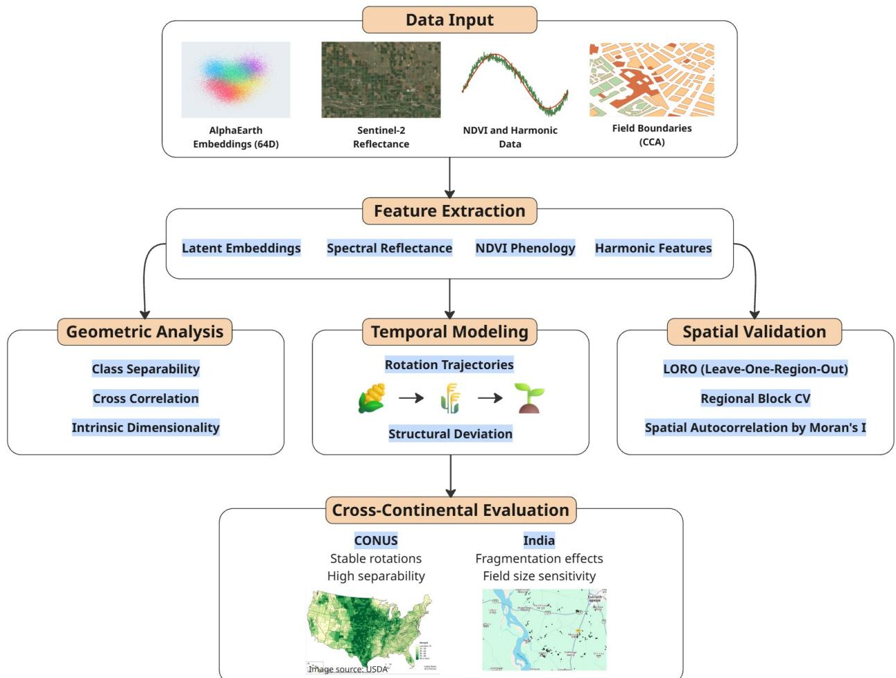

Figure 1: Overview of the representation evaluation framework. Feature sets (latent embeddings, spectral reflectance, NDVI phenology, harmonic features) are extracted at field level from Google Earth Engine and evaluated across four dimensions: (i) geometric separability, (ii) temporal dynamics and rotation structure, (iii) spatially explicit validation, and (iv) crossregional transfer analysis for both CONUS and Northern India datasets.  
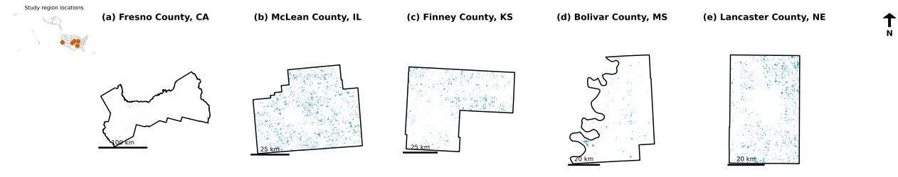  
Data: USDA Cropland Data Layer (CDL); county boundaries: U.S. Census TIGER/Line 2025. Coordinate reference system: NAD83 / Conus Albers (EPSG:5070).

Figure 2: Study regions across five U.S. counties (Fresno, CA; Finney, KS; Lancaster, NE; McLean, IL; Bolivar, MS). Map line delineate study areas and do not necessarily depict accepted national boundaries.

Homogeneous crop patches in the CONUS are delineated by applying 8-neighbour Connected-Component Analysis (CCA) [39, 40] to annual CDL rasters, grouping contiguous pixels of identical crop-class labels into candidate field objects. Unlike GEOBIA, which segments raw imagery to discover field boundaries [8, 9], CCA operates directly on pre-classified label rasters to delineate spatially contiguous, label-homogeneous agricultural patches. This approach is particularly appropriate in the present study because the primary objective is to construct temporally consistent sampling units for representation evaluation and crop-rotation analysis rather than to extract precise field boundaries [2, 3, 33]. Fields are retained using minimum area thresholds (>10 ha for Fresno; >5 ha elsewhere) and a temporal consistency criterion (stable CDL labels across at least six years), ensuring that patches correspond to genuine agricultural fields rather than classification artefacts [10, 38]. The full 2017–2023 CDL time series is used to derive crop sequences and rotation patterns [2, 33], yielding diverse rotation types (Fig. 3), with alternating corn–soybean as the dominant pattern, followed by three-crop and multi-crop rotations.

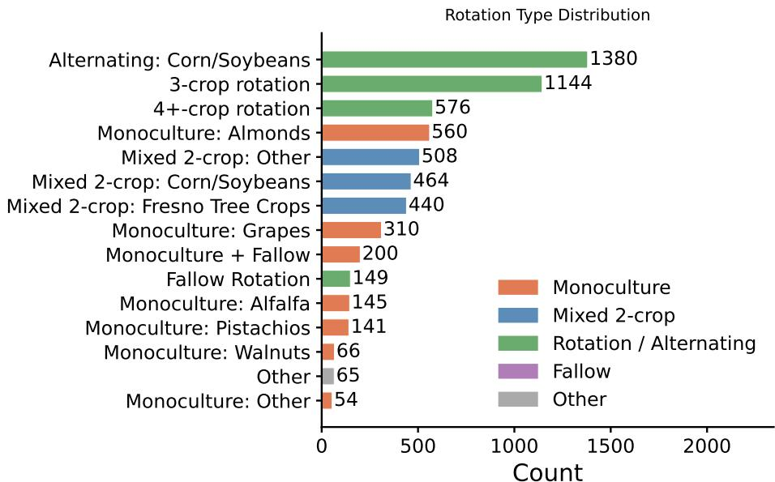  
Figure 3: Frequency distribution of crop rotation types across the five CONUS study counties, including monoculture (singlecrop), alternating (two-crop, predominantly corn–soybean), three-crop, and multi-crop (≥4 crops) systems. The diversity of rotation regimes provides a rigorous testbed for evaluating multi-year temporal feature representations.

Table 1: Summary of the 2017–2023 CONUS dataset. GEOID = US Census Bureau county FIPS code (Federal Information Processing Standard geographic identifier). “Crops” indicates the number of unique crop classes observed across the CDL time series for each county.
<table><tr><td>County</td><td>GEOID</td><td>Fields</td><td>Crops</td><td>Mean Area (ha)</td><td>Area Range (ha)</td></tr><tr><td>Fresno</td><td>06019</td><td>1,748</td><td>21</td><td>128.2</td><td>10.1-11,252.0</td></tr><tr><td>McLean</td><td>17113</td><td>929</td><td>10</td><td>259.7</td><td>5.0–19,449.9</td></tr><tr><td>Finney</td><td>20055</td><td>1,759</td><td>16</td><td>103.2</td><td>5.0–8,130.3</td></tr><tr><td>Bolivar</td><td>28011</td><td>580</td><td>9</td><td>76.4</td><td>5.0–2,090.4</td></tr><tr><td>Lancaster</td><td>31109</td><td>1,299</td><td>9</td><td>114.8</td><td>5.0-5,919.6</td></tr></table>

For India, the AgriFieldNet dataset [37] is processed by applying a 5 m interior bufer to reduce mixedpixel efects and boundary noise prevalent in smallholder systems [10]. Dataset characteristics are summarized in Table 2.

Four complementary feature sets are constructed at the field level using mean aggregation:

1. Latent Embeddings: 64-dimensional vectors capturing multi-sensor spatio-temporal context [18, 22].

2. Spectral Reflectance: Median growing-season reflectance for Sentinel-2 bands (B2, B3, B4, B8, B11, B12).

3. NDVI Phenology: Maximum, minimum, amplitude, and peak timing of NDVI time series [4, 5].

4. Harmonic Features: Seasonal phase, amplitude, and trigonometric coeficients derived from a 1-cycle harmonic model [13, 14].

Table 2: Summary of the AgriFieldNet dataset (India, 2021).
<table><tr><td colspan="2">Overall</td><td colspan="2">Crop distribution</td><td colspan="2">State distribution</td><td colspan="2">Field area</td></tr><tr><td>Total fields States covered</td><td>3,890</td><td>Wheat</td><td>52.0%</td><td>Uttar Pradesh</td><td>94.0%</td><td>Mean (ha)</td><td>0.256</td></tr><tr><td>Crop classes</td><td>4</td><td>Mustard</td><td>25.3%</td><td>Odisha</td><td>3.1%</td><td>Std. dev.</td><td>0.331</td></tr><tr><td></td><td>12</td><td>Maize</td><td>7.5%</td><td>Madhya Pradesh</td><td>2.9%</td><td>Median (ha)</td><td>0.148</td></tr><tr><td></td><td></td><td>Sugarcane</td><td>4.2%</td><td></td><td></td><td>&lt; 0.1 ha</td><td>32.7%</td></tr><tr><td></td><td></td><td>Rice</td><td>3.3%</td><td></td><td></td><td>0.1–0.5 ha</td><td>54.8%</td></tr><tr><td></td><td></td><td>Lentil</td><td>2.6%</td><td></td><td></td><td>0.5–1.0 ha</td><td>8.7%</td></tr><tr><td></td><td></td><td>Gram</td><td>1.5%</td><td></td><td></td><td>&gt; 1.0 ha</td><td>3.8%</td></tr><tr><td></td><td></td><td>Garlic</td><td>1.2%</td><td></td><td></td><td></td><td></td></tr><tr><td></td><td></td><td>Potato</td><td>1.1%</td><td></td><td></td><td></td><td></td></tr><tr><td></td><td></td><td>Green pea</td><td>0.6%</td><td></td><td></td><td></td><td></td></tr><tr><td></td><td></td><td>Berseem</td><td>0.4%</td><td></td><td></td><td></td><td></td></tr><tr><td></td><td></td><td>Coriander</td><td>0.4%</td><td></td><td></td><td></td><td></td></tr></table>

## 2.2. Representation Evaluation Framework

All features are standardized using z-score normalization. Let $\mathbf { x } _ { i } \in \mathbb { R } ^ { d }$ denote the feature representation of sample $i ,$ where d is the feature dimensionality and N is the total number of samples, with corresponding class labels $y _ { i }$ . We evaluate representation quality across complementary dimensions capturing separability, sparsity, agreement, intrinsic structure, temporal dynamics, and spatial generalization [23].

Intrinsic Structure and Dimensionality. Representational structure is analyzed using PCA [41, 42] and intrinsic dimensionality estimation via maximum likelihood estimation (MLE) [43–45]. Let $\{ \gamma _ { i } \} _ { i = 1 } ^ { d }$ denote the eigenvalues of the covariance matrix sorted in descending order. Eigenvalue decay characterizes variance distribution across principal components, where steeper decay indicates compact representations and slower decay reflects distributed variance. The efective dimensionality is quantified using the participation ratio:

$$
D _ { \mathrm { { P R } } } = \frac { \left( \sum _ { i } \gamma _ { i } \right) ^ { 2 } } { \sum _ { i } \gamma _ { i } ^ { 2 } }\tag{1}
$$

We compute the number of principal components required to explain a fraction $\alpha \in ( 0 , 1 )$ of variance, denoted $n _ { \alpha }$ (so $n _ { 9 5 }$ is the number of components retaining 95% of variance), and variance concentration via the top eigenvalue ratio $\gamma _ { 1 } / \sum _ { i } \gamma _ { i }$ . Intrinsic dimensionality is estimated using MLE:

$$
\hat { m } = \left[ \frac { 1 } { k _ { \mathrm { N N } } - 1 } \sum _ { i = 1 } ^ { k _ { \mathrm { N N } } - 1 } \log \frac { T _ { k _ { \mathrm { N N } } } } { T _ { i } } \right] ^ { - 1 }\tag{2}
$$

where $T _ { i }$ denotes the distance to the i-th nearest neighbor and $k _ { \mathrm { N N } }$ is the number of neighbors considered [46]. Higher intrinsic dimensionality in embedding spaces reflects distributed encoding of complex agronomic signals rather than redundancy.

Feature Ranking Agreement. Agreement between feature importance rankings derived from PCA loadings, ANOVA F-statistics, and model-based importance is measured using Spearman’s rank correlation [47]:

$$
\rho = 1 - \frac { 6 \sum _ { i = 1 } ^ { d } ( r _ { i } - s _ { i } ) ^ { 2 } } { d ( d ^ { 2 } - 1 ) }\tag{3}
$$

where $r _ { i }$ and $s _ { i }$ denote feature ranks from two methods.

Class Separability. We compute complementary distribution-aware separability metrics [48]: Fisher ratio [49], Bhattacharyya distance [25], Mahalanobis distance [26], and Jefries–Matusita distance [50, 51]. Linear separability is assessed using L2-regularized logistic regression (hereafter LR-L2), extended to multi-class via a one-vs-rest scheme. The binary sub-problem for each class minimises:

$$
\underset { \mathbf { w } } { \mathop { \operatorname* { m i n } } } \ : \sum _ { i = 1 } ^ { N } \log \left( 1 + \exp ( - y _ { i } \mathbf { w } ^ { \top } \mathbf { x } _ { i } ) \right) + \lambda \| \mathbf { w } \| _ { 2 } ^ { 2 }\tag{4}
$$

where $\mathbf { w } \in \mathbb { R } ^ { d }$ is the weight vector and $\lambda > 0$ is the L2 regularisation strength (selected by cross-validation). Nonlinear separability is evaluated using a multi-layer perceptron (MLP) with a single hidden layer, where $\sigma ( \cdot )$ denotes the ReLU activation function:

$$
\mathbf { h } = \sigma ( \mathbf { W } _ { 1 } \mathbf { x } + \mathbf { b } _ { 1 } ) , \quad \hat { \mathbf { y } } = \mathbf { W } _ { 2 } \mathbf { h } + \mathbf { b } _ { 2 }\tag{5}
$$

where $\mathbf { W } _ { 1 } , \mathbf { b } _ { 1 }$ are the hidden-layer weights and biases, $\mathbf { W } _ { 2 } , \mathbf { b } _ { 2 }$ are the output-layer parameters, and $\hat { \mathbf { y } }$ is the class score vector. Feature sparsity is quantified by the proportion of zero-valued coeficients under L1 and Elastic Net regularization $( S = \# \{ w _ { j } = 0 \} / d )$ . Higher classification accuracy under LORO-CV indicates stronger separability under spatial generalization.

Temporal Dynamics and Stability. Temporal dynamics are modeled as multi-year embedding trajectories [3, 15], where $e _ { t } \in \mathbb { R } ^ { d }$ is the field-level mean feature vector in growing season t and k is the number of years in the observation window (here $k = 7$ for the 2017–2023 CONUS dataset). Rotation separability is evaluated using a scale-invariant ratio of between-class distances to within-class variance, assessed via permutation testing (1,000 iterations). At the field level, temporal consistency is quantified using the Structural Deviation Index (SDI). Let $T _ { i } = \{ e _ { t - k } , . . . , e _ { t } \}$ be the k-year feature trajectory of field i (a sequence of annual embeddings), and let $T _ { \mathrm { c e n t r o i d } }$ be the mean trajectory of all fields assigned to the same crop class (i.e. the element-wise mean over all fields in that class). The SDI measures how much an individual field’s trajectory deviates from its class mean:

$$
{ \mathrm { S D I } } _ { i } = 1 - { \frac { T _ { i } \cdot T _ { \mathrm { c e n t r o i d } } } { \| T _ { i } \| \| T _ { \mathrm { c e n t r o i d } } \| } }\tag{6}
$$

where lower values indicate higher temporal stability. At the class level, inter-annual stability is measured via the cosine similarity between class centroids across pairs of years. Let $c _ { t } , c _ { t ^ { \prime } } \in \mathbb { R } ^ { d }$ denote the class centroid

feature vectors in years t and $t ^ { \prime } ,$ respectively; then centroid similarity is:

$$
\mathrm { S i m } ( c _ { t } , c _ { t ^ { \prime } } ) = \frac { c _ { t } \cdot c _ { t ^ { \prime } } } { \| c _ { t } \| \| c _ { t ^ { \prime } } \| }\tag{7}
$$

with values close to 1 indicating that the class representation is stable across years, and values near 0 indicating large inter-annual distributional shift.

Cross-Regional Consistency. Cross-regional consistency is evaluated using Centered Kernel Alignment (CKA) [52, 53] and Earth Mover’s Distance (EMD) [54]. CKA captures structural alignment of feature spaces; EMD reflects distributional similarity.

Spatial Robustness and Generalization. Spatial robustness is assessed using: Tier 1 Leave-One-Region-Out (LORO) validation [29, 30] and Tier 2 spatial block cross-validation (10 km × 10 km) [31, 55]. Residual spatial dependence is quantified using Moran’s I applied to classification errors [56, 57]. We evaluate representations using Random Forest [58], XGBoost [59], LightGBM [60], Support Vector Machines [61], LSTM [62], and Temporal Convolutional Networks (TCN) [63, 64]. The inclusion of sequence-based models (LSTM, TCN) follows established practice for satellite image time series classification [65, 66].

## 2.3. Cross-Continental Transferability and Scale Efects

To evaluate cross-regional transferability, models trained on CONUS data are tested on the Indian dataset and vice versa, using common crop classes (maize, rice, wheat). Field-size efects are analyzed by grouping fields into size bins and evaluating classification performance across feature sets.

## 3. Results

This section presents AlphaEarth embedding evaluations against traditional spectral and phenological features across five complementary dimensions: representation structure (Section 3.2), geometric separability (Sections 3.3–3.4), temporal dynamics (Section 3.5), spatial robustness (Section 3.6), and cross-regiona generalization (Sections 3.7–3.9).

## 3.1. Feature Representation Suitability: A Multi-Criteria Summary

Table 3 synthesises the evaluation results across all tested criteria and feature types. Ratings are derived from the quantitative analyses in Sections 3.2–3.9 and span separability, temporal dynamics, spatial robustness, cross-regional transfer, and field-scale performance. This table is presented here as an advance overview to orient the reader; it is discussed fully in Section 3.10 (Implications for Agricultural Monitoring).

## 3.2. Representation Structure

Cross-correlation analysis (Figure 4a) confirms that embedding dimensions are efectively orthogonal to engineered features at the global level $( | \mu | < 0 . 0 3 )$ , yet exhibit localised correlations (range up to ±0.70), most prominently with NDVI $( \sigma = 0 . 2 2 )$ . Intrinsic dimensionality analysis reveals a striking contrast: all engineered feature sets exhibit low efective dimensionality $( n _ { 9 5 } ~ \le ~ 3 ; ~ \mathrm { P R } ~ \approx ~ 1 . 5 \mathrm { - 2 . 7 } )$ ), while embeddings display $n _ { 9 5 } = 2 1$ (US) and $n _ { 9 5 } = 3 0 $ (India) with participation ratios of 7.86 and 9.91, and strongly negative MLE log-likelihood estimates (−25.21 and −35.62; negative values arise because the MLE estimator here returns the log of the reciprocal mean, which is negative when inter-neighbour distances are small relative to the neighbourhood scale), consistent with a complex, high-dimensional manifold. The higher intrinsic dimensionality in the Indian dataset reflects increased heterogeneity in smallholder systems [10].

Table 3: Suitability of feature representations across evaluation criteria. Ratings derived from quantitative results in Sections 3.2–3.9. ++ = strongly suitable; + = suitable; ∼ = moderate; - = limited. Combined: combined embedding + engineered feature set.
<table><tr><td>Evaluation Criterion</td><td>Embedding</td><td>Spectral</td><td>NDVI</td><td>Harmonic</td><td>Combined</td></tr><tr><td colspan="6">Geometric Separability</td></tr><tr><td>Linear separability (Fisher ratio) Distribution-aware separation (Bhat-</td><td></td><td>X</td><td></td><td></td><td></td></tr><tr><td>tacharyya) Distribution-aware separation (Ma-</td><td></td><td></td><td></td><td></td><td></td></tr><tr><td>halanobis)</td><td></td><td></td><td></td><td></td><td></td></tr><tr><td>Feature space interpretability Intrinsic Structure</td><td></td><td></td><td></td><td></td><td></td></tr><tr><td colspan="6">Representational capacity (intrinsic</td></tr><tr><td>dim.)</td><td></td><td></td><td></td><td></td><td></td></tr><tr><td>Feature compactness</td><td></td><td></td><td></td><td></td><td></td></tr><tr><td>Variance-discriminability alignment</td><td></td><td></td><td></td><td></td><td></td></tr><tr><td colspan="6">Temporal Dynamics Within-class temporal</td></tr><tr><td>(SDI)</td><td>stability</td><td></td><td></td><td></td><td></td></tr><tr><td>Crop rotation separability</td><td></td><td></td><td></td><td></td><td></td></tr><tr><td>Multi-year trajectory structure</td><td></td><td></td><td></td><td></td><td></td></tr><tr><td>Centroid stability across years</td><td></td><td></td><td></td><td></td><td></td></tr><tr><td colspan="6">Spatial Robustness Reduced spatial error clustering</td></tr><tr><td>(Moran&#x27;s I) Within-region classification (LORO-</td><td></td><td></td><td>2</td><td></td><td></td></tr><tr><td>CV)</td><td></td><td></td><td></td><td></td><td></td></tr><tr><td>Performance in large structured fields</td><td></td><td></td><td></td><td></td><td></td></tr><tr><td>Performance in small/fragmented fields</td><td></td><td></td><td></td><td></td><td></td></tr><tr><td colspan="6">Cross-Regional Generalization Structural alignment across regions</td></tr><tr><td>(CKA)</td><td></td><td></td><td>2</td><td></td><td></td></tr><tr><td>Distributional alignment across re- gions (EMD)</td><td></td><td></td><td></td><td></td><td></td></tr><tr><td>Cross-continental transfer (US→India)</td><td></td><td></td><td></td><td></td><td></td></tr><tr><td>Cross-continental transfer (India→US)</td><td></td><td></td><td></td><td></td><td></td></tr><tr><td colspan="6">Overall Recommendation</td></tr><tr><td colspan="2">Within-region crop classification Rotation monitoring / management</td><td>X 2</td><td></td><td></td><td></td></tr><tr><td colspan="2">signals</td><td></td><td></td><td></td><td></td></tr><tr><td colspan="2">Smallholder / fragmented systems</td><td></td><td></td><td></td><td></td></tr><tr><td colspan="2">Scalable global deployment</td><td></td><td></td><td></td><td></td></tr></table>

As shown in Figures 5 and $6 ,$ the variance–discriminability decoupling has a direct practical consequence: standard PCA-based feature selection would discard approximately half of the class-relevant embedding dimensions. For NDVI, alignment between PCA and ANOVA rankings $( \rho = 0 . 4 0 – 0 . 8 0 )$ implies that variance-based compression retains most discriminative information. The negative PCA–ANOVA alignment for harmonic features $( \rho = - 1 . 0 0$ in the US) reveals a counter-intuitive structure: harmonic amplitude explains the most variance but provides the least discrimination, while phase angle—stable across years but crop-specific—is the primary discriminant.

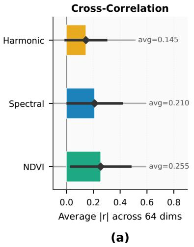

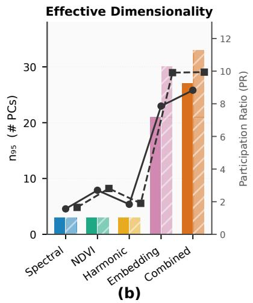

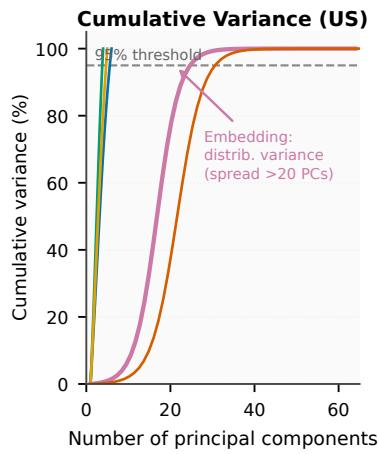  
(c)  
Spectral NDVI Harmonic Embedding Combined US (solid) India (hatched) PR (US) PR (India)

Figure 4: Embedding space structure across feature representations. (a) Cross-correlation between the 64 embedding dimensions and each engineered feature set. Near-zero means $( | \mu | < 0 . 0 3 )$ confirm no systematic global alignment; wider spread for NDVI $( \sigma = 0 . 2 2 )$ reveals partial phenological overlap. (b) Efective dimensionality: $n _ { 9 5 }$ (bars) and participation ratio (PR; markers) for the US (solid) and India (hatched) datasets. Embeddings occupy a substantially higher-dimensional regime $( n _ { 9 5 } > 2 0 , \mathrm { P R } > 7 . 5 )$ compared with all engineered feature sets $( n _ { 9 5 } \leq 3 , \mathrm { \ P R \leq 2 . 7 ) }$ . (c) Cumulative variance explained as a function of retained principal components (US dataset). Engineered features concentrate 95% of variance in two to three components, whereas embedding variance is spread across more than 20 components.  
Table 4: Linear and non-linear separability, feature sparsity, and feature ranking agreement across feature sets (US data, LORO-CV). Low overall F1 scores reflect the dificulty of cross-county generalisation under Leave-One-Region-Out validation; diferences across feature sets highlight representational properties rather than absolute classification performance.
<table><tr><td></td><td colspan="2">Linear Sep. (LR-L2)</td><td colspan="2">Non-linear Sep. (MLP)</td><td colspan="2">Sparsity (retained dims)</td><td colspan="2">Ranking Agreement</td></tr><tr><td>Feature Set</td><td> $\mathrm { M a c r o ~ F 1 }$ </td><td>Weighted F1</td><td>Macro F1</td><td> $\mathrm { W e i g h t e d ~ F 1 }$ </td><td>L1</td><td> $\mathrm { E N e t } ^ { \dagger }$ </td><td>ρ(PCA,LR)</td><td> $\rho ( \mathrm { A N O V A } , \mathrm { L R } )$ </td></tr><tr><td>Embedding</td><td> ${ \bf 0 . 0 9 \pm 0 . 0 7 }$ </td><td> ${ \bf 0 . 2 7 \pm 0 . 1 6 }$ </td><td> $\mathbf { 0 . 0 6 5 \pm 0 . 0 5 3 }$ </td><td> $\mathbf { 0 . 2 2 5 \pm 0 . 1 7 1 }$ </td><td>64/64</td><td>64/64</td><td>0.14</td><td>0.29</td></tr><tr><td>Spectral</td><td> $0 . 0 5 \pm 0 . 0 3$ </td><td> $0 . 2 0 \pm 0 . 1 3$ </td><td> $0 . 0 4 1 \pm 0 . 0 2 7$ </td><td> $0 . 1 9 6 \pm 0 . 1 4 2$ </td><td>6/6</td><td>6/6</td><td>0.26</td><td>0.09</td></tr><tr><td>NDVI</td><td> $0 . 0 5 \pm 0 . 0 3$ </td><td> $0 . 2 2 \pm 0 . 1 7$ </td><td> $0 . 0 4 7 \pm 0 . 0 2 5$ </td><td> $0 . 2 4 0 \pm 0 . 1 8 5$ </td><td>4/4</td><td>4/4</td><td>0.40</td><td>0.80</td></tr><tr><td>Harmonic</td><td> $0 . 0 5 \pm 0 . 0 3$ </td><td> $0 . 2 2 \pm 0 . 1 6$ </td><td> $0 . 0 3 5 \pm 0 . 0 2 5$ </td><td> $0 . 2 1 2 \pm 0 . 1 7 8$ </td><td>5/5</td><td>5/5</td><td>0.30</td><td>-1.00</td></tr></table>

Sparsity columns (L1, ENet†) report the number of feature dimensions with non-zero coeficients retained by L1 and Elastic Net regularisation out of total dimensionality d. †ENet = Elastic Net (combined L1+L2 penalty). ρ: Spearman rank correlation between two importance rankings; $+ 1 ~ = \ \mathrm { f u l l }$ agreement, −1 = full inversion.

## 3.3. Linear and Non-linear Separability

Separability under strict spatial generalization (LORO-CV; Table 4) remains challenging across all feature sets, with Macro F1 below 0.10, reflecting substantial domain shift between regions. Despite the low absolute performance, embeddings consistently achieve the highest scores under linear models (LR-L2). Non-linear models (MLP) do not yield improvements, suggesting that discriminative structure becomes approximately linear in the learned representation space—embeddings reorganize the feature space such that class boundaries become approximately linearly separable [22]. All 64 embedding dimensions are retained under both L1 and Elastic Net regularization (64/64), indicating distributed discriminative information across the full feature space. The $\rho = - 1 . 0 0$ for harmonic ANOVA vs. model importance reveals extreme feature instability under cross-regional conditions.

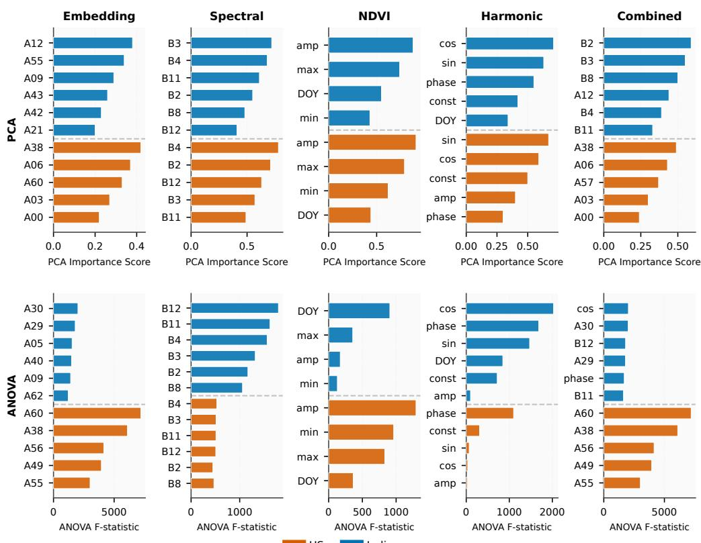  
Figure 5: Feature importance across US (red bars) and India (blue bars) datasets, ranked by PCA loading magnitude (top row) and ANOVA F-statistic (bottom row). For embeddings, the top PCA dimensions (A38, A60) difer markedly from the top ANOVA dimensions (A56, A49) for both US (red) and India (blue), confirming variance–discriminability decoupling: the directions of greatest variance are not the directions of greatest class discrimination. NDVI exhibits the most consistent feature hierarchy between PCA and ANOVA rankings (Spearman $\rho = 0 . 4 0 – 0 . 8 0 )$ , implying that variance-based compression retains most discriminative information for this feature set. For harmonic features, the ANOVA ranking is anticorrelated with $\mathrm { P C A } ~ ( \rho = - 1 . 0 0$ for the US, red): harmonic amplitude dominates PCA but is the least discriminative feature, while phase angle—stable across years but crop-specific—carries the most class-relevant information.

## 3.4. Distribution-Aware Separability

Geometric separability analysis (Figure 7) reveals a clear distinction between linear and distribution-aware metrics. For spectrally similar pairs—most notably Corn/Soybeans—the Fisher ratio is virtually identical across all feature sets (≈0.05), providing no discriminative advantage. In contrast, Bhattacharyya distances for embeddings (3.9) and the combined set (5.2) exceed those of spectral features (0.10) by more than an order of magnitude [28]. The saturation of the Jefries–Matusita distance at its theoretical maximum of 1.41 for embeddings across all US pairs confirms complete distributional separation. AUC (Area Under the ROC Curve) and log-loss confirm that these distributional advantages translate directly into improved probabilistic classification.

## 3.5. Temporal Dynamics and Crop Rotation Structure

Rotation separability results (Table 5) confirm that embeddings achieve the highest separation ratio (1.784). All engineered features fail to meaningfully exceed the threshold ratio of 1.0 (Spectral: 1.003; Harmonic: 0.990; NDVI: 0.936; Combined: 0.941), where only embeddings achieve a separation ratio substantially above unity, confirming that embeddings alone capture higher-order temporal structure beyond seasonal variability [15, 33]. Embedding trajectories trace rotation-type-specific orbits consistent across geographically separated counties—a pattern indicative of genuine agronomic encoding. The intermediate SDI regime represents a productive operating point: too-low SDI (harmonic, NDVI) implies insensitivity to annual variation; too-high SDI (spectral) confounds rotation detection with year-to-year noise. Centroid cosine similarities exceeding 0.9 confirm stable class identity while remaining sensitive to management-driven shifts.

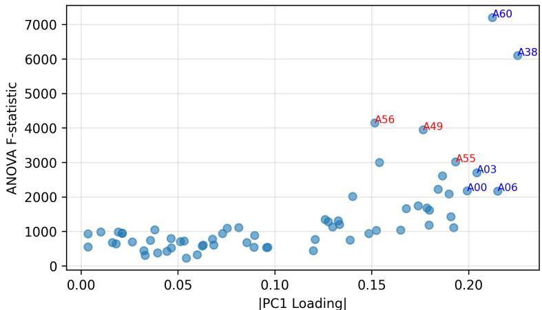  
Figure 6: ANOVA F-statistics versus PCA loading magnitudes for individual embedding dimensions (red circles = dimensions with the highest ANOVA F-statistic; blue circles = dimensions with the highest PC1 loading magnitude). Several high-ANOVA dimensions (A56, A49; shown in red) lie far from the dominant PCA directions (A38, A60; shown in blue), confirming that class-relevant discriminative information is distributed across non-principal axes. PCAbased dimensionality reduction would therefore discard approximately half of the class-relevant embedding information, since dimensions that explain the most variance (high |PC1 loading|) are not the same as those that best discriminate between crop classes (high ANOVA F).

Table 5: Rotation type separability by feature set. Separation ratio = mean between-rotation distance / mean within-rotation variance. Mean F = mean ANOVA F-statistic across all feature dimensions (higher = greater discriminative power per dimension). Sig. dims = number of dimensions with statistically significant between-rotation discrimination $( p < 0 . 0 0 1$ after permutation testing), expressed as a fraction of the total feature dimensionality. All permutation tests use 1,000 iterations.
<table><tr><td>Feature Set</td><td>Within var.</td><td>Between dist.</td><td>Sep. ratio</td><td>Mean F</td><td>Sig. dims</td></tr><tr><td>Embedding</td><td>0.178</td><td>0.753</td><td>1.784</td><td>450.67</td><td>64/64</td></tr><tr><td>Spectral</td><td>0.006</td><td>0.074</td><td>1.003</td><td>127.07</td><td>6/6</td></tr><tr><td>NDVI</td><td>378.04</td><td>18.21</td><td>0.936</td><td>348.28</td><td>4/4</td></tr><tr><td>Harmonic</td><td>1.136</td><td>1.055</td><td>0.990</td><td>161.29</td><td>5/5</td></tr><tr><td>Combined</td><td>379.35</td><td>18.33</td><td>0.941</td><td>402.59</td><td>79/79</td></tr></table>

Note: Within variance and between distance are not directly comparable across feature sets due to difering scales and dimensionality. A separation ratio greater than 1 indicates that between-class separation exceeds within-class variability.

## 3.6. Spatial Robustness and Error Structure

Under Tier 1 LORO validation, embeddings achieve a model-averaged Macro F1 of 0.34 compared with 0.22–0.27 for engineered features—a 26–55% relative improvement consistent across all six classifier types (Figure 9b). Under Tier 2 block cross-validation, the embedding advantage is maintained (Fresno: 0.82; Bolivar: 0.93; Finney: 0.93). The Moran’s I analysis is particularly informative: embedding and combined feature sets exhibit lower spatial autocorrelation in residual errors (mean Moran’s $I \approx 0 . 1 7 \substack { - 0 . 2 0 } )$ than harmonic features $( \approx 0 . 4 3  – 0 . 4 8 )$ , revealing that harmonic features partly exploit spatial continuity in training data—an advantage that disappears under strict spatial blocking. The TCN achieves peak performance (Cohen’s $\kappa ~ = ~ 0 . 5 7$ with combined features), suggesting that temporal encoders best exploit structured multi-year trajectories.

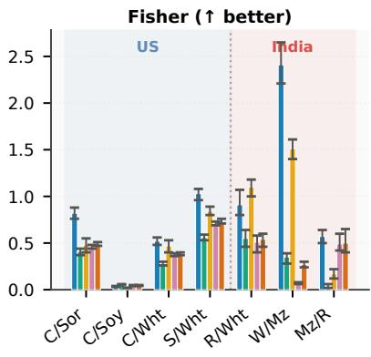  
(a)

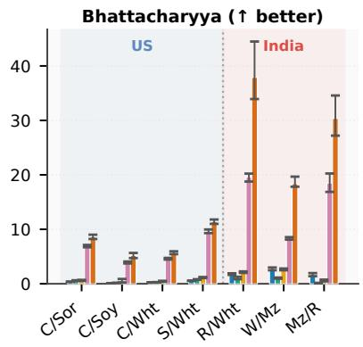  
(b)

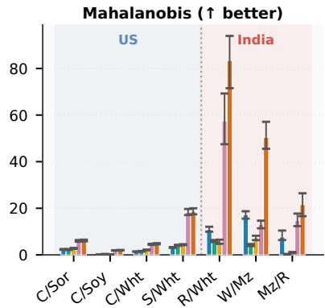  
(c)

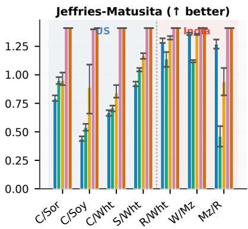  
(d)

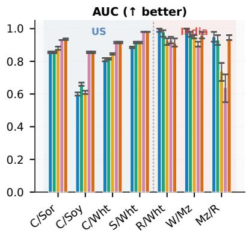  
(e)

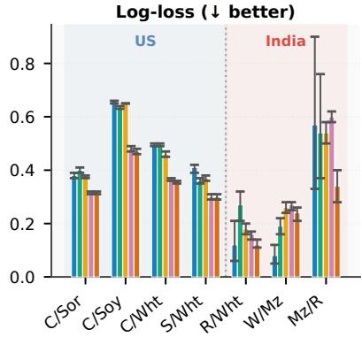  
(f)  
Spectral NDVI Harmonic Embedding Combined US India  
Figure 7: Class separability across six complementary metrics for US (blue-shaded) and India (red-shaded) crop pairs. Crop pair abbreviations on the x-axis: C/Sor = Corn vs. Sorghum; C/Soy = Corn vs. Soybean; C/Wht = Corn vs. Wheat; $\mathbf { S } / \mathbf { W h t } = \mathrm { S o y b e a n }$ vs. Wheat; R/Wht = Rice vs. Wheat (US and India); W/Mz = Wheat vs. Maize (India); Mz/R = Maize vs. Rice (India). US pairs (blue background, left of dashed line); India pairs (red background, right of dashed line). (a) Fisher ratio: spectral and harmonic features achieve competitive mean-based separation for several US pairs, but all feature sets converge near zero for Corn/Soybean, reflecting their spectral similarity. (b–c) Bhattacharyya and Mahalanobis distances: embeddings consistently outperform all engineered features by up to an order of magnitude (C/Soy Bhattacharyya: 3.9 embeddings vs. 0.10 spectral; S/Wht Mahalanobis: 18.3 vs. 4.1 NDVI; R/Wht India: 57.5 vs. 5.8 NDVI). (d) Jefries–Matusita distance saturates at the theoretical maximum of 1.41 for embeddings across all US pairs, confirming complete distributional separation. (e–f) AUC (Area Under the ROC Curve) and log-loss corroborate improved probabilistic classification for embeddings; error bars represent standard deviation across five cross-validation folds.

## 3.7. Cross-Regional Consistency

The CKA–EMD analysis uncovers a fundamental trade-of between geometric alignment and distributional similarity. Within the US, embeddings achieve the highest CKA scores (mean 0.175 for Fresno vs. McLean/Finney), reflecting preserved geometry of class relationships. However, embedding EMD values substantially exceed those of harmonic and NDVI features in the cross-continental setting $\mathrm { ( E M D > 1 . 2 }$ for embeddings $\mathrm { v s . } < 0 . 7 8$ for NDVI). Harmonic and NDVI features represent temporally normalised quantities that are more invariant to absolute reflectance diferences, explaining their superior distributional alignment and cross-continental transferability. CKA degradation is severe for all feature sets (Figure 10c), confirming that cross-continental transfer requires explicit domain adaptation strategies [24].

Spectral Harmonic Combined Alternating Mean F-stat NDVI Embedding Monoculture Multi-crop

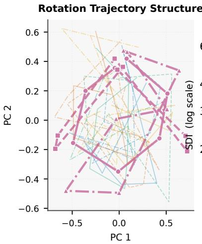  
(a)

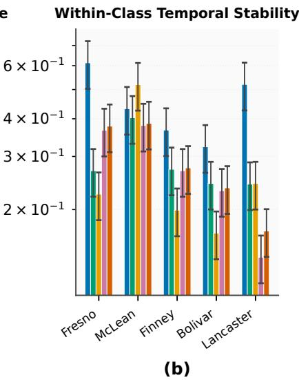

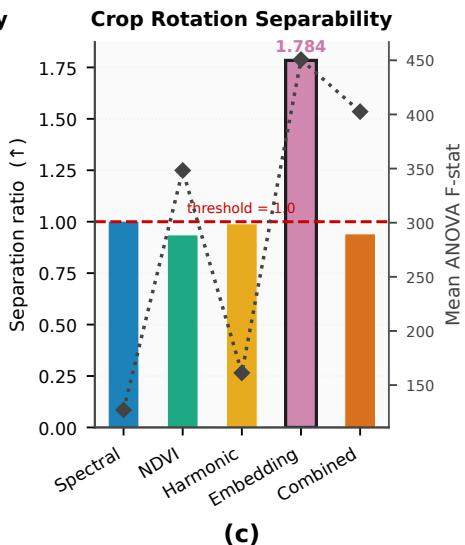  
Figure 8: Temporal dynamics and crop rotation structure across feature representations. (a) Multi-year rotation trajectories projected onto the first two principal components. Embedding-based trajectories form coherent, rotation-typespecific loops consistent across all five counties, whereas spectral and NDVI feature trajectories collapse into an undiferentiated cloud. (b) Within-class temporal stability (SDI; dimensionless, range 0–2, log scale). Lower SDI indicates that a field’s trajectory closely tracks its class centroid trajectory. Embeddings occupy an intermediate regime (SDI ≈ 0.277) balancing sensitivity to annual crop dynamics with resistance to year-to-year noise. (c) Rotation-type separability ratio (bars) and mean ANOVA F-statistic (diamonds). Only embeddings surpass the critical threshold of 1.0 $( \mathrm { r a t i o } = 1 . 7 8 4 ;$ all 64 dimensions significant at $p < 0 . 0 0 1 )$

## 3.8. Classification Performance: Within-Region and Cross-Continental

Within-region evaluation confirms strong but context-dependent performance (Figure 11a): embeddings achieve Macro F1 of 0.94 for maize and 0.89 for wheat in the US, and the combined feature set consistently achieves the highest F1 in both regions (India mean: $0 . 6 5 5 { \pm } 0 . 0 0 8 )$ ). Spectral features outperform embeddings for several Indian crops when trained on Indian data (e.g. maize F1 = 0.93 vs. 0.68 for embeddings), attributable to strong phenological contrast under India’s rabi growing season (the winter crop season, approximately October–March), readily captured by median reflectance without temporal context. Note that this within-India advantage of spectral features does not imply cross-continental transferability, as spectral distributions shift substantially between the US and India (Table 3).

Cross-continental evaluation reveals a qualitative reversal: embedding performance collapses most severely (transfer gap = −0.50 for both directions) compared with harmonic features $( \mathrm { g a p } = - 0 . 2 7 )$ . Harmonic and NDVI features retain approximately 40–50% of within-US performance under cross-continental transfer, compared with ≈33% for embeddings (computed from the within-region and cross-continental F1 values in Figure 11). The combined feature set does not consistently outperform individual features under cross-region conditions, indicating that feature concatenation alone is insuficient to resolve distributional mismatch [24].

## 3.9. Field Size Efects

Embeddings and combined features maintain relatively stable performance across field sizes (Weighted F1 $\geq 0 . 7 5$ for fields > 0.2 ha; Figure 12), indicating robustness to mixed-pixel efects and spatial heterogeneity.

Classification Performance  
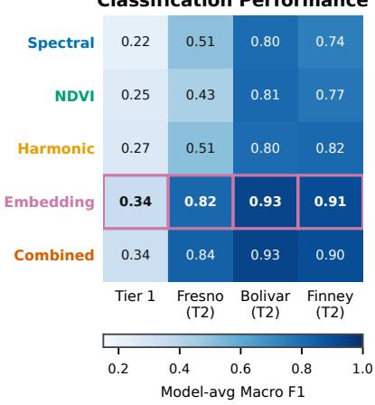  
(a)

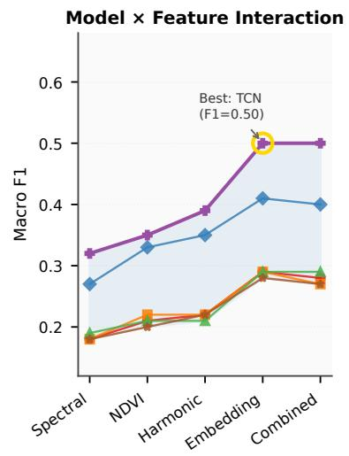  
(b)

F1 vs. Spatial Error Clustering  
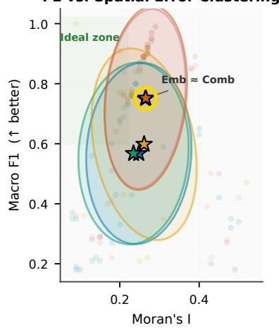  
(c)

<table><tr><td colspan="3">Classifier</td><td></td><td>TCN</td></tr><tr><td>RF</td><td></td><td>XGBoost</td><td>十</td><td></td></tr><tr><td>LightGBM</td><td></td><td>LSTM</td><td></td><td>SVM</td></tr></table>

<table><tr><td colspan="6">Feature (★=mean)</td></tr><tr><td>★ ★</td><td>Spectral NDVI</td><td>★ ★</td><td>Harmonic Embedding</td><td>★</td><td>Combined</td></tr></table>

Figure 9: Spatial validation: classification performance and spatial error structure. (a) Model-averaged Macro F1 across Tier 1 LORO validation and three Tier 2 spatial block cross-validation sites. Embedding-row cells are outlined in purple. (b) Individual classifier performance under LORO-CV. The TCN achieves the highest overall performance (Macro F1 = 0.50) with combined features. (c) Macro F1 versus Moran’s I on classification errors. Embedding and combined features cluster in the upper-left ideal zone (high F1, low spatial error autocorrelation). Harmonic features exhibit high Moran’s I (≈0.4 at Fresno), indicating spatially structured errors that inflate apparent accuracy under non-spatial cross-validation.

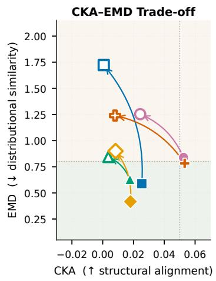  
(a)

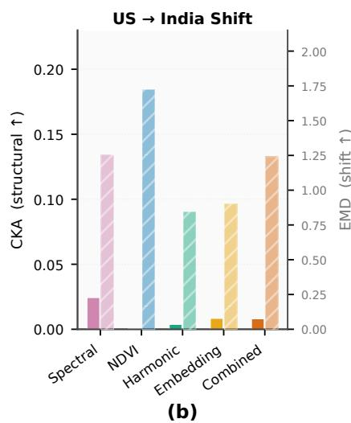  
CKA Degradation Across Scales

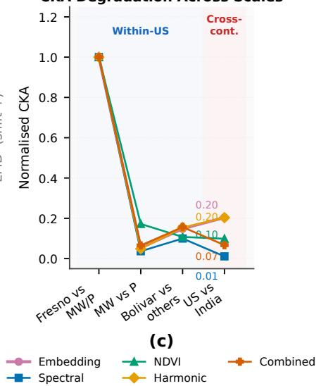  
Spectral Harmonic Within-US  
Figure 10: Cross-regional consistency: structural alignment (CKA) versus distributional shift (EMD). Abbre viations in panel labels: MW = Midwest group (McLean, IL; Finney, KS; Lancaster, NE); P = Plains group (Finney, KS; Lancaster, NE). (a) CKA–EMD trade-of scatter for all pairwise within-US county comparisons (filled markers; e.g. Fresno vs. MW/P) and US→India cross-continental comparisons (open markers). The green-shaded quadrant (low EMD, moderate-tohigh CKA) represents the preferred transferability region. (b) CKA (bars; left axis) and EMD (hatched bars; right axis) fo the US→India distributional shift by feature set. Harmonic features maintain the lowest distributional shift (lowest EMD); embeddings achieve the highest structural alignment (highest CKA). (c) Normalised CKA values across spatial scales, from within-US pairwise comparisons to cross-continental US–India transfer. All feature sets experience substantial CKA collapse (≤ 0.20 of within-US maximum), confirming the severity of the cross-continental domain shift.

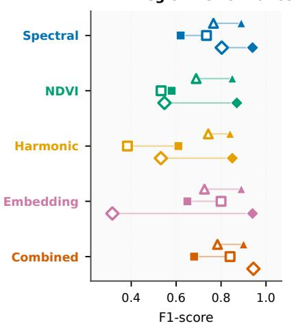  
(a)

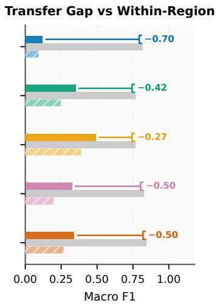  
(b)

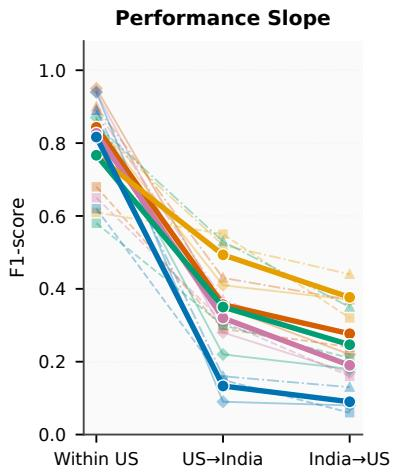  
(c)  
Combined Harmonic Spectral Within India Rice Within-US ceiling India→US Embedding NDVI Within US Maize Wheat US→India

Figure 11: Classification performance across feature representations: within-region and cross-continental. (a) Per crop F1 scores under within-region evaluation for the US (filled markers) and India (open markers). (b) Cross-continental Macro F1 for both transfer directions. Harmonic features achieve the highest cross-continental Macro F1 (US→India: 0.493; India→US: 0.389), substantially outperforming embeddings (0.326; 0.198). (c) Mean F1 across crops as a function of evaluation context. Harmonic and NDVI features show shallower performance slopes, confirming superior transferability.  
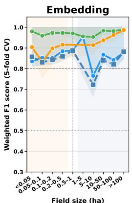

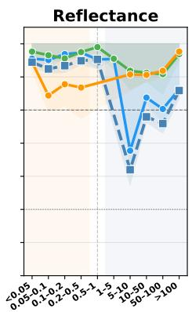

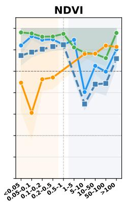

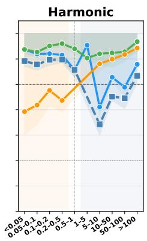

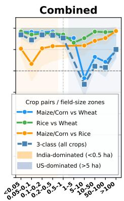  
Figure 12: Classification performance (Weighted F1) as a function of field area across India (<0.5 ha) and U.S. (>5 ha) datasets. Embedding and combined features maintain robust performance across the full size range (≥0.75 at >0.2 ha), whereas NDVI-based models exhibit significant performance drops in small fields (<0.1 ha, ∆F1 ≈ 0.30). The orange-shaded region marks India-dominated bins; the blue-shaded region marks U.S.-dominated bins.

In contrast, NDVI-based models exhibit significant performance drops in small fields (< 0.1 ha; $\Delta \mathrm { F 1 \approx 0 . 3 0 } )$ . The stability of embedding-based models across the smallholder-to-mechanized gradient underscores the importance of scale-aware feature design for global agricultural monitoring.

## 3.10. Implications for Agricultural Monitoring

The results collectively reveal a trade-of between representational richness, spatial dependence, and crossregional transferability. Embeddings are the feature of choice for within-region applications—rotation monitoring, small-field classification, and tasks where regional domain coverage is adequate. Their cross-region efectiveness depends on addressing distributional mismatch through domain adaptation. Traditional spectral and phenological features demonstrate greater robustness under domain shift, making them preferable for scalable global deployment. The combined feature space generally achieves balanced performance, confirming that learned and engineered representations capture complementary aspects of agricultural variability. Table 3 provides practitioners with a consolidated guide for feature selection depending on task objectives, system type, and deployment context.

## 4. Discussion

Returning to the four research questions posed in Section 1: RQ1 (geometric separability) is confirmed— embeddings achieve Bhattacharyya distances up to an order of magnitude larger than all engineered features for spectrally similar pairs, and the Jefries–Matusita distance saturates at its theoretical maximum across all US crop pairs. Linear mean-based separability (Fisher ratio), however, is roughly equivalent across feature sets, consistent with AlphaEarth benchmark findings in [22]. RQ2 (temporal dynamics) is strongly confirmed—embeddings are the only feature set achieving a rotation separability ratio substantially above unity (1.784), with SDI occupying an agronomically productive intermediate regime, extending prior evidence that learned representations encode management-driven signals beyond seasonal periodicity [20, 34]. RQ3 (spatial error structure) is confirmed—embeddings exhibit consistently lower Moran’s I on residual errors (≈0.17–0.20) than harmonic features (≈0.43–0.48), indicating that embedding-based classifiers generalise through representational quality rather than spatial proximity. RQ4 (cross-regional generalisation) is not confirmed in the expected direction: embeddings degrade most severely under cross-continental transfer (gap = −0.50), while harmonic and NDVI features retain 40–50% of within-region performance—underscoring that representational richness within a training distribution does not guarantee distributional robustnes across agro-ecological boundaries [24, 35].

These results confirm and extend several findings from the broader remote sensing foundation mode literature. The high intrinsic dimensionality of embeddings (n95 > 20), contrasting with the near-complete collapse of engineered features into two to three principal components, is consistent with representation analyses in [23]. The variance–discriminability decoupling identified here—where PCA-optimal and ANOVAoptimal dimensions systematically diverge—instantiates, in a practically consequential form, the intrinsic structure findings of [42]. The cross-continental transferability advantage of harmonic features aligns with the domain shift analysis of [24] and transfer learning results of [35], who find that normalised phenologica descriptors are more distribution-invariant than deep features trained on region-specific data. The robustness of embeddings across the smallholder-to-mechanized field-size gradient is a novel finding, complementing recent work on smallholder field delineation [10, 38].

This study is subject to three principal limitations. First, AlphaEarth embeddings are evaluated as fixed pre-trained representations without region-specific fine-tuning; given that lightweight target-domain adaptation has been shown to yield substantial performance gains [67], the results reported here represent a conservative lower bound on embedding utility. Second, the Indian validation dataset is confined to a single growing season (2021) and geographically concentrated in Uttar Pradesh (94% of fields), constraining the generalisability of cross-continental conclusions across broader agro-ecological and calendrical contexts. Third, the single-cycle harmonic fit may inadequately capture the temporal complexity of double-cropping systems (e.g. Bolivar, MS), potentially underestimating harmonic discriminability in multi-season environ ments. Together, these limitations motivate four priorities for future research: (i) region-specific fine-tuning of AlphaEarth embeddings on locally labelled agricultural datasets; (ii) multi-modal fusion incorporating synthetic aperture radar (SAR) and gridded climate variables to improve robustness under cloud contamination and across agro-climatic gradients [68]; (iii) systematic mapping of latent embedding dimensions onto interpretable biophysical variables (e.g. leaf area index, canopy water content) to strengthen agronomic interpretability; and (iv) integration of explicit domain adaptation and representation alignment technique [24] with geospatial foundation models to enable globally consistent deployment.

## 5. Conclusion

This study presents a comprehensive, representation-agnostic evaluation of 10 m AlphaEarth embeddings for crop classification, integrating geometric separability analysis, temporal dynamics modelling, spatially explicit validation, and cross-continental transfer experiments across five CONUS counties (2017–2023) and a Northern India smallholder dataset (2021).

Three principal findings emerge. First, embeddings achieve superior distribution-aware class separation— Bhattacharyya distances an order of magnitude higher than engineered features for spectrally similar crop pairs (Corn/Soybeans: 3.9 vs. 0.10; Rice/Wheat India: Mahalanobis 57.5)—while variance–discriminability decoupling in their feature space necessitates discriminative rather than variance-based dimensionality reduction criteria. Second, embeddings are the only feature set capturing multi-year crop rotation dynamics (separability ratio 1.784 $\mathrm { v s . \leq 1 . 0 0 3 }$ for all engineered features) and exhibit the lowest residual spatial autocorrelation of errors (mean Moran’s $I \approx 0 . 1 7 )$ , confirming that their advantage is structural rather than geographic. Third, a fundamental trade-of exists between representational richness and cross-region transferability: embedding performance degrades most severely under cross-continental transfer $( \mathrm { g a p } = - 0 . 5 0 )$ ), while harmonic features retain 40–50% of within-US performance, making them preferable for scalable global deployment.

Collectively, these findings establish that geospatial embeddings constitute structured agronomic representations well-suited to within-region classification, rotation monitoring, and smallholder mapping. The critical limitation—cross-region transferability—is addressable through fine-tuning, domain adaptation, and multi-modal fusion, each representing a necessary step toward globally consistent large-scale agricultura monitoring. The evaluation framework introduced here is applicable to any GFM embedding space and provides a reusable benchmark for the community.

## Declaration of Competing Interest

The authors declare that they have no known competing financial interests or personal relationships that could have appeared to influence the work reported in this paper.

## Acknowledgements

The authors thank the providers of the AlphaEarth embeddings, the Radiant Earth Foundation for the AgriFieldNet dataset, and the USDA National Agricultural Statistics Service for the Cropland Data Layer. Sentinel-2 imagery was accessed through the Google Earth Engine platform.

## Data Availability

Data used in this study are described in Section 2. The AlphaEarth Foundations Satellite Embedding dataset is publicly available through Google Earth Engine and Google Cloud Storage. The AgriFieldNet dataset is available from Radiant Earth MLHub. The USDA Cropland Data Layer (CDL) can be accessed through the USDA NASS CropScape portal, and Sentinel-2 Level-2A imagery is available via Google Earth Engine. Code and derived datasets will be released through a public repository (GitHub and Zenodo) upon acceptance.

## References

[1] E. Omia, H. Bae, E. Park, M. S. Kim, I. Baek, I. Kabenge, B.-K. Cho, Remote sensing in field crop monitoring: A comprehensive review of sensor systems, data analyses and recent advances, Remote Sensing 15 (2) (2023) 354.

[2] L. Yan, D. P. Roy, Conterminous united states crop field size quantification from multi-temporal landsat data, Remote Sensing of Environment 172 (2016) 67–86.

[3] E. V. Upcott, P. A. Henrys, J. W. Redhead, S. G. Jarvis, R. F. Pywell, A new approach to characterising and predicting crop rotations using national-scale annual crop maps, Science of the Total Environment 860 (2023) 160471.

[4] L. Zeng, B. D. Wardlow, D. Xiang, S. Hu, D. Li, A review of vegetation phenological metrics extraction using time-series, multispectral satellite data, Remote Sensing of Environment 237 (2020) 111511.

[5] S. Li, L. Xu, Y. Jing, H. Yin, X. Li, X. Guan, High-quality vegetation index product generation: A review of ndvi time series reconstruction techniques, International Journal of Applied Earth Observation and Geoinformation 105 (2021) 102640.

[6] B. Matsushita, W. Yang, J. Chen, Y. Onda, G. Qiu, Sensitivity of the enhanced vegetation index (evi) and normalized diference vegetation index (ndvi) to topographic efects: a case study in high-density cypress forest, Sensors 7 (11) (2007) 2636–2651.

[7] A. Huete, K. Didan, T. Miura, E. P. Rodriguez, X. Gao, L. G. Ferreira, Overview of the radiometric and biophysical performance of the modis vegetation indices, Remote sensing of environment 83 (1-2) (2002) 195–213.

[8] T. Blaschke, Object based image analysis for remote sensing, ISPRS journal of photogrammetry and remote sensing 65 (1) (2010) 2–16.

[9] T. Blaschke, G. J. Hay, M. Kelly, S. Lang, P. Hofmann, E. Addink, R. Q. Feitosa, F. Van der Meer, H. Van der Werf, F. Van Coillie, et al., Geographic object-based image analysis–towards a new paradigm, ISPRS journal of photogrammetry and remote sensing 87 (2014) 180–191.

[10] C. Persello, V. A. Tolpekin, J. R. Bergado, R. A. De By, Delineation of agricultural fields in smallholder farms from satellite images using fully convolutional networks and combinatorial grouping, Remote sensing of environment 231 (2019) 111253.

[11] J. Zheng, Z. Ye, Y. Wen, J. Huang, Z. Zhang, Q. Li, Q. Hu, B. Xu, L. Zhao, H. Fu, A comprehensive review of agricultural parcel and boundary delineation from remote sensing images: Recent progress and future perspectives, IEEE Geoscience and Remote Sensing Magazine (2026).

[12] H. do Nascimento Bendini, L. M. G. Fonseca, M. Schwieder, T. S. Kørting, P. Rufin, I. D. A. Sanches, P. J. Leitao, P. Hostert, Detailed agricultural land classification in the brazilian cerrado based on phenological information from dense satellite image time series, International Journal of Applied Earth Observation and Geoinformation 82 (2019) 101872.

[13] D. Roy, L. Yan, Robust landsat-based crop time series modelling, Remote Sensing of Environment 238 (2020) 110810.

[14] S. K. Jha, J. Brinkhof, A. J. Robson, B. W. Dunn, Integrating remote sensing and weather time series for australian irrigated rice phenology prediction, Remote Sensing 17 (17) (2025) 3050.

[15] X. Zhou, J. Wang, Y. He, B. Shan, Crop classification and representative crop rotation identifying using statistical features of time-series sentinel-1 grd data, Remote Sensing 14 (20) (2022) 5116.

[16] R. Bommasani, D. A. Hudson, E. Adeli, R. Altman, S. Arora, S. von Arx, M. S. Bernstein, J. Bohg, A. Bosselut, E. Brunskill, et al., On the opportunities and risks of foundation models, arXiv preprint arXiv:2108.07258 (2021).

[17] A. Xiao, W. Xuan, J. Wang, J. Huang, D. Tao, S. Lu, N. Yokoya, Foundation models for remote sensing and earth observation: A survey, IEEE Geoscience and Remote Sensing Magazine (2025).

[18] C. F. Brown, M. R. Kazmierski, V. J. Pasquarella, W. J. Rucklidge, M. Samsikova, C. Zhang, E. Shelhamer, E. Lahera, O. Wiles, S. Ilyushchenko, et al., Alphaearth foundations: An embedding field model for accurate and eficient global mapping from sparse label data, arXiv preprint arXiv:2507.22291 (2025).

[19] D. Szwarcman, S. Roy, P. Fraccaro, O. E. Gíslason, B. Blumenstiel, R. Ghosal, P. H. De Oliveira, J. L. de Sousa Almeida, R. Sedona, Y. Kang, et al., Prithvi-eo-2.0: A versatile multi-temporal foundation model for earth observation applications, IEEE Transactions on Geoscience and Remote Sensing (2025).

[20] Y. Cong, S. Khanna, C. Meng, P. Liu, E. Rozi, Y. He, M. Burke, D. Lobell, S. Ermon, Satmae: Pretraining transformers for temporal and multi-spectral satellite imagery, Advances in Neural Information Processing Systems 35 (2022) 197–211.

[21] B. Han, S. Zhang, X. Shi, M. Reichstein, Bridging remote sensors with multisensor geospatial foundation models, in: Proceedings of the IEEE/CVF conference on computer vision and pattern recognition, 2024, pp. 27852–27862.

[22] Y. Ma, Y. Shen, A. Swatantran, D. B. Lobell, Harvesting alphaearth: Benchmarking the geospatia foundation model for agricultural downstream tasks, arXiv preprint arXiv:2601.00857 (2025).

[23] K. Nozawa, I. Sato, Evaluation methods for representation learning: A survey., in: IJCAI, 2022, pp. 5556–5563.

[24] D. Tuia, C. Persello, L. Bruzzone, Domain adaptation for the classification of remote sensing data: An overview of recent advances, IEEE geoscience and remote sensing magazine 4 (2) (2016) 41–57.

[25] A. Bhattacharyya, On a measure of divergence between two multinomial populations, Sankhy¯a: the indian journal of statistics (1946) 401–406.

[26] J. A. Richards, X. Jia, Remote sensing digital image analysis: an introduction, Springer, 2006.

[27] J. A. Benediktsson, P. Ghamisi, Spectral-spatial classification of hyperspectral remote sensing images, Artech House, 2015.

[28] F. Samadzadegan, A. Toosi, F. Dadrass Javan, A critical review on multi-sensor and multi-platform remote sensing data fusion approaches: current status and prospects, International journal of remote sensing 46 (3) (2025) 1327–1402.

[29] G. M. Foody, Status of land cover classification accuracy assessment, Remote sensing of environment 80 (1) (2002) 185–201.

[30] D. R. Roberts, V. Bahn, S. Ciuti, M. S. Boyce, J. Elith, G. Guillera-Arroita, S. Hauenstein, J. J. Lahoz-Monfort, B. Schrøder, W. Thuiller, et al., Cross-validation strategies for data with temporal, spatial, hierarchical, or phylogenetic structure, Ecography 40 (8) (2017) 913–929.

[31] P. Schratz, J. Muenchow, E. Iturritxa, J. Richter, A. Brenning, Hyperparameter tuning and performance assessment of statistical and machine-learning algorithms using spatial data, Ecological Modelling 406 (2019) 109–120.

[32] M. A. Ferraciolli, F. F. Bocca, L. H. A. Rodrigues, Neglecting spatial autocorrelation causes underestimation of the error of sugarcane yield models, Computers and Electronics in Agriculture 161 (2019) 233–240.

[33] K. A. Hunt, J. Abernethy, P. C. Beeson, M. Bowman, S. Wallander, R. Williams, Crop sequence boundaries using usda national agricultural statistics service historic cropland data layers, Statistical Journal of the IAOS 40 (2) (2024) 237–246.

[34] M. Tarasiou, E. Chavez, S. Zafeiriou, Vits for sits: Vision transformers for satellite image time series, in: Proceedings of the IEEE/CVF Conference on Computer Vision and Pattern Recognition, 2023, pp. 10418–10428.

[35] P. Hao, L. Di, C. Zhang, L. Guo, Transfer learning for crop classification with cropland data layer data (cdl) as training samples, Science of The Total Environment 733 (2020) 138869.

[36] H. Kerner, G. Tseng, I. Becker-Reshef, B. Barker, B. Munshell, M. Paliyam, M. Hosseini, Rapid response crop maps in data sparse regions, arXiv preprint arXiv:2006.16866 (2020).

[37] R. E. Foundation, Agrifieldnet dataset (2022). URL https://mlhub.earth/data

[38] F. Waldner, F. I. Diakogiannis, Deep learning on edge: Extracting field boundaries from satellite images with a convolutional neural network, Remote sensing of environment 245 (2020) 111741.

[39] A. Rosenfeld, J. L. Pfaltz, Sequential operations in digital picture processing, Journal of the ACM (JACM) 13 (4) (1966) 471–494.

[40] L. He, X. Ren, Q. Gao, X. Zhao, B. Yao, Y. Chao, The connected-component labeling problem: A review of state-of-the-art algorithms, Pattern Recognition 70 (2017) 25–43.

[41] I. T. Jollife, J. Cadima, Principal component analysis: a review and recent developments, Philosophical transactions of the royal society A: Mathematical, Physical and Engineering Sciences 374 (2065) (2016) 20150202.

[42] P. Pope, C. Zhu, A. Abdelkader, M. Goldblum, T. Goldstein, The intrinsic dimension of images and its impact on learning, arXiv preprint arXiv:2104.08894 (2021).

[43] E. Levina, P. Bickel, Maximum likelihood estimation of intrinsic dimension, Advances in neural information processing systems 17 (2004).

[44] A. Aghajanyan, S. Gupta, L. Zettlemoyer, Intrinsic dimensionality explains the efectiveness of language model fine-tuning, in: Proceedings of the 59th annual meeting of the association for computational linguistics and the 11th international joint conference on natural language processing (volume 1: long papers), 2021, pp. 7319–7328.

[45] P. Campadelli, E. Casiraghi, C. Ceruti, A. Rozza, Intrinsic dimension estimation: Relevant techniques and a benchmark framework, Mathematical Problems in Engineering 2015 (1) (2015) 759567.

[46] C. Feferman, S. Mitter, H. Narayanan, Testing the manifold hypothesis, Journal of the American Mathematical Society 29 (4) (2016) 983–1049.

[47] C. Molnar, Interpretable machine learning, Lulu. com, 2020.

[48] S.-H. Cha, Comprehensive survey on distance/similarity measures between probability density functions, City 1 (2) (2007) 1.

[49] R. A. Fisher, The use of multiple measurements in taxonomic problems, Annals of eugenics 7 (2) (1936) 179–188.

[50] K. Matusita, On the notion of afinity of several distributions and some of its applications, Annals of the institute of Statistical Mathematics 19 (1) (1967) 181–192.

[51] M. Pándy, A. Agostinelli, J. Uijlings, V. Ferrari, T. Mensink, Transferability estimation using bhattacharyya class separability, in: Proceedings of the IEEE/CVF Conference on Computer Vision and Pattern Recognition, 2022, pp. 9172–9182.

[52] S. Kornblith, M. Norouzi, H. Lee, G. Hinton, Similarity of neural network representations revisited, in: International conference on machine learning, PMlR, 2019, pp. 3519–3529.

[53] C. Cortes, M. Mohri, A. Rostamizadeh, Algorithms for learning kernels based on centered alignment, The Journal of Machine Learning Research 13 (2012) 795–828.

[54] Y. Rubner, C. Tomasi, L. J. Guibas, The earth mover’s distance as a metric for image retrieval, International journal of computer vision 40 (2) (2000) 99–121.

[55] R. Valavi, J. Elith, J. J. Lahoz-Monfort, G. Guillera-Arroita, blockcv: An r package for generating spatially or environmentally separated folds for k-fold cross-validation of species distribution models, Biorxiv (2018) 357798.

[56] P. A. Moran, Notes on continuous stochastic phenomena, Biometrika 37 (1/2) (1950) 17–23.

[57] J. Nowosad, H. Meyer, Investigating moran’s i properties for spatial machine learning: A preliminary analysis, AGILE: GIScience Series 6 (2025) 40.

[58] L. Breiman, Random forests, Machine learning 45 (1) (2001) 5–32.

[59] T. Chen, C. Guestrin, Xgboost: A scalable tree boosting system, in: Proceedings of the 22nd acm sigkdd international conference on knowledge discovery and data mining, 2016, pp. 785–794.

[60] G. Ke, Q. Meng, T. Finley, T. Wang, W. Chen, W. Ma, Q. Ye, T.-Y. Liu, Lightgbm: A highly eficient gradient boosting decision tree, Advances in neural information processing systems 30 (2017).

[61] C. Cortes, V. Vapnik, Support-vector networks, Machine learning 20 (3) (1995) 273–297.

[62] S. Hochreiter, J. Schmidhuber, Long short-term memory, Neural computation 9 (8) (1997) 1735–1780.

[63] S. Bai, J. Z. Kolter, V. Koltun, An empirical evaluation of generic convolutional and recurrent networks for sequence modeling, arXiv preprint arXiv:1803.01271 (2018).

[64] C. Pelletier, G. I. Webb, F. Petitjean, Temporal convolutional neural network for the classification of satellite image time series, Remote Sensing 11 (5) (2019) 523.

[65] M. Rußwurm, M. Körner, Self-attention for raw optical satellite time series classification, ISPRS journal of photogrammetry and remote sensing 169 (2020) 421–435.

[66] V. S. F. Garnot, L. Landrieu, Panoptic segmentation of satellite image time series with convolutiona temporal attention networks (2021) 4872–4881.

[67] G. Tseng, R. Cartuyvels, I. Zvonkov, M. Purohit, D. Rolnick, H. Kerner, Lightweight, pre-trained transformers for remote sensing timeseries, arXiv preprint arXiv:2304.14065 (2023).

[68] D. Ienco, R. Interdonato, R. Gaetano, D. H. T. Minh, Combining sentinel-1 and sentinel-2 satellite image time series for land cover mapping via a multi-source deep learning architecture, ISPRS Journal of Photogrammetry and Remote Sensing 158 (2019) 11–22.