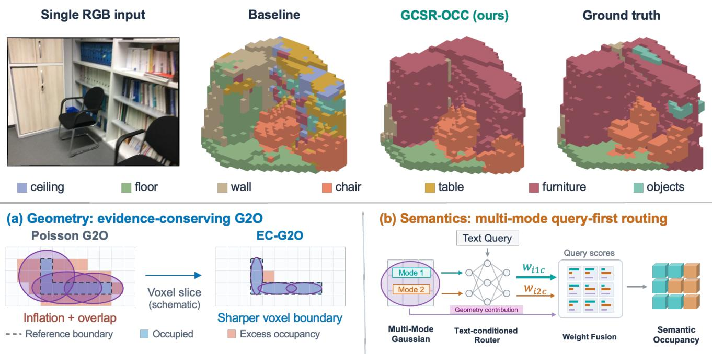
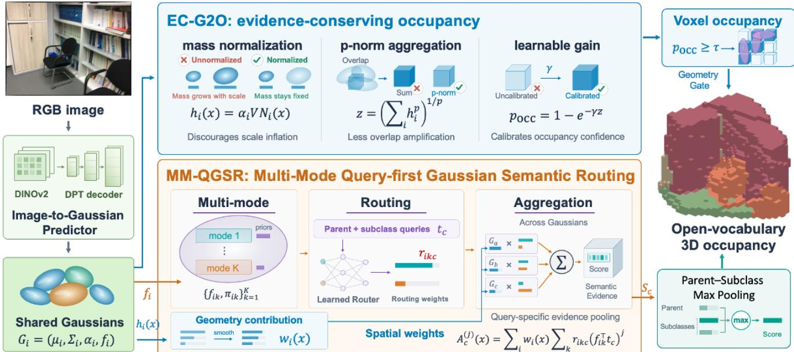
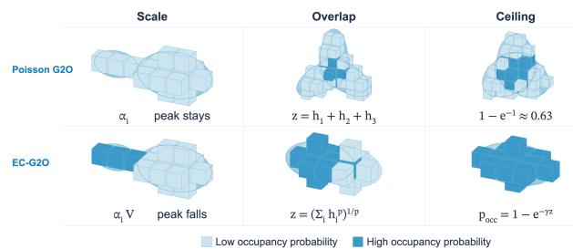
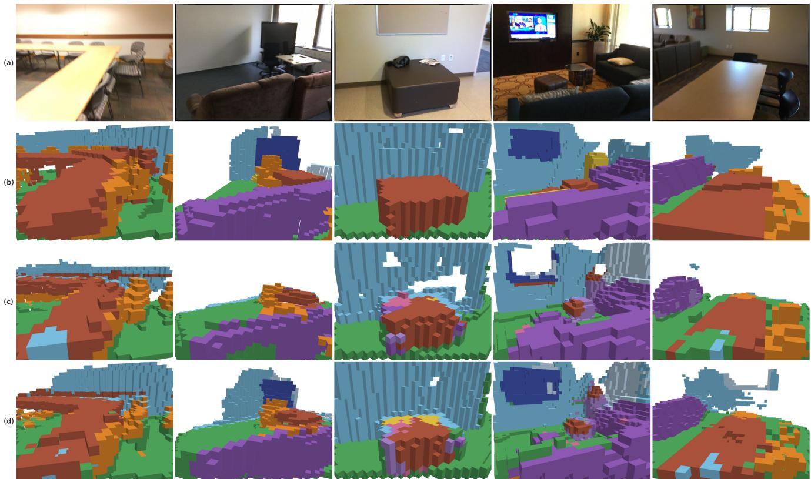

# GCSR-OCC: Geometry Calibration and Semantic Routing for Open-Vocabulary Occupancy Prediction

Bohua Wang\* Congyang Zhao\* Tianxiong Lv† Chenxu Zhao He Zheng Hangqi Fan Leigang Luo Zhihao Liao Yihong Guo Yang Cai

Alibaba Amap

wangbohua.wbh, zhaocongyang.zcy@alibaba-inc.com tianxiong.ltx@autonavi.com

  
Figure 1. Overview of GCSR-OCC. Our method predicts geometric occupancy and open-vocabulary voxel semantics from a single RGB image. Top: a selected qualitative comparison with a reproduced LegoOcc baseline and ground truth. Bottom: geometry calibration, query-first semantic routing, and reported performance.

## Abstract

Open-vocabulary 3D occupancy prediction represents scene geometry and semantics in a unified voxel grid, enabling recognition beyond predefined categories. One approach reconstructs scenes with 3D Gaussians and converts them into voxel occupancy. However, Gaussian scale inflation and excessive overlap can distort voxel occupancy predictions, while semantic mixing can arise within Gaussians spanning multiple categories and during 3D–2D semantic feature alignment. We propose GCSR-OCC, which combines geometry calibration and multimode query-conditioned semantic routing for indoor occupancy prediction from a single RGB image. The Evidence-

Conserving Gaussian-to-Occupancy operator (EC-G2O) uses kernel mass normalization, p-norm aggregation, and a learnable gain to suppress scale inflation and excessive local evidence accumulation while calibrating occupancy responses. Multi-mode Query-First Gaussian Semantic Routing (MM-QGSR) matches multiple semantic modes per Gaussian to text queries and aggregates query-specific evidence into voxels through a learnable text-conditioned router. Fine-grained subclass queries and smoothed semantic aggregation further refine voxel-level predictions. Without 3D semantic annotations, GCSR-OCC achieves stateof-the-art performance in open-vocabulary occupancy prediction on Occ-ScanNet, with 63.31% geometric IoU and 27.44% semantic mIoU. It also reduces geometric aggregation latency from 19.76 ms to 12.88 ms. Our code will be made publicly available.

## 1. Introduction

Semantic 3D occupancy represents scene geometry and semantics in a unified voxel grid [30, 33, 39], supporting robot navigation and interaction with the environment [8, 10]. Real-world categories are diverse and difficult to enumerate, motivating semantic recognition beyond a predefined set of semantic categories [6, 31]. This paper addresses monocular open-vocabulary 3D occupancy prediction in indoor scenes, aiming to predict voxel occupancy states and open-vocabulary semantics from a single RGB image.

Direct 3D occupancy prediction from a single RGB image faces challenges from depth ambiguity and occlusion of scene regions by foreground objects, while dense voxel representations entail a trade-off between spatial resolution and computational cost [29, 32]. An alternative is to first reconstruct the scene in 3D and then convert the reconstruction into voxel occupancy, a paradigm we term Reconstructionthen-Occupancy (RTO).

RTO uses reconstructed 3D structure to guide occupancy prediction. It can leverage geometric priors from pretrained visual geometry models [3, 36, 38, 44] and incorporate auxiliary supervision on the reconstructed scene to improve geometric consistency [13, 14, 46, 51]. However, 3D occupancy prediction accuracy depends not only on reconstruction quality but also on the reconstruction-to-occupancy conversion mechanism, which is the focus of this work.

Direct alignment between 3D representations and text remains challenging due to the scarcity of large-scale 3D–text datasets [27, 43]. Therefore, several existing methods use pretrained 2D vision–language models [5, 28] for semantic supervision. These methods transfer language-aligned features to 3D through image-space correspondences [15] or rendering supervision [18], without requiring 3D semantic annotations [1, 34, 51]. However, 3D-to-2D mapping can associate multiple 3D locations with the same image pixel [41]. Aggregating their features can mix distinct semantics and degrade voxel-level semantic predictions.

LegoOcc [51] is a representative reconstruction-based approach to monocular open-vocabulary 3D occupancy prediction in indoor scenes. Its opacity-aware, Poisson-based Gaussian-to-occupancy operator stabilizes volumetric aggregation under weak supervision. However, this formulation allows the model to increase occupancy responses through Gaussian scale inflation and greater overlap, without necessarily improving 3D geometric accuracy. On the semantic side, it aggregates Gaussian features before text matching, potentially merging different semantics into a single voxel feature. Although temperature scheduling reduces feature blending during training, text queries still operate on this aggregated representation.

To address these limitations, we propose GCSR-OCC (Figure 2), which combines geometry calibration and query-conditioned semantic routing for Gaussian-to-voxel aggregation. Our main contributions are as follows:

• We introduce an Evidence-Conserving Gaussian-to-Occupancy operator (EC-G2O), combining kernel mass normalization, p-norm aggregation, and a learnable gain to suppress scale inflation and excessive local evidence accumulation while calibrating occupancy responses.

• We propose Multi-mode Query-First Gaussian Semantic Routing (MM-QGSR), which improves semantic prediction through mode-level text matching and textconditioned routing. Subclass queries and smoothed aggregation further refine voxel-level semantics.

• On Occ-ScanNet, GCSR-OCC achieves 63.31% geometric IoU and 27.44% open-vocabulary semantic mIoU. Compared with the Poisson baseline, geometric aggregation latency decreases from 19.76 ms to 12.88 ms.

## 2. Related Work

## 2.1. 3D Semantic Occupancy Prediction

Vision-based occupancy prediction lifts image information into 3D to recover scene geometry and semantics [40, 48]. MonoScene [2] combines the Features Line of Sight Projection (FLoSP) module with a 3D context prior for monocular scene completion. VoxFormer [20] initializes sparse voxel queries from estimated depth and propagates their information to dense voxels through attention. TPVFormer [11] uses three orthogonal planes to lift and aggregate image features in 3D, enabling dense semantic occupancy prediction under sparse supervision. For indoor scenes, ISO [45] combines a pretrained depth model with dual feature projection and introduces Occ-ScanNet. EmbodiedOcc [42] maintains a Gaussian scene memory across successive observations for online occupancy prediction. This paper follows a reconstruction-then-occupancy framework and focuses on converting reconstructed 3D representations into voxel occupancy.

## 2.2. Reconstruction-Based Occupancy Prediction

Reconstruction-based methods model scene geometry using implicit fields [21–24, 37] or explicit 3D primitives [7, 9, 17, 25], providing spatial constraints for occupancy prediction. SelfOcc [12] represents scenes as signed distance fields and learns 3D occupancy through cross-frame image reconstruction. GaussianOcc [4] learns metric-scale 3D occupancy through Gaussian splatting, using cross-camera constraints and efficient voxel rendering.

Another line of work directly aggregates Gaussian primitives into voxel occupancy. GaussianFormer [13] reduces memory costs with sparse semantic Gaussians and converts them into dense voxel occupancy through splatting. GaussianFormer-2 [14] models geometric occupancy through probabilistic superposition and semantics through a Gaussian mixture model. EmbodiedOcc++ [35] improves Gaussian representations through planar regularization and uncertainty-guided updates. RoboOcc [49] uses opacityguided interactions and geometry-aware encoding to improve semantic and geometric prediction. Our EC-G2O operator focuses on Gaussian-to-voxel aggregation, suppressing scale inflation and excessive local evidence accumulation.

  
Figure 2. Overview of the proposed GCSR-OCC framework.

## 2.3. Open-Vocabulary Occupancy Prediction

Language-aligned 2D [19, 28, 50] and 3D representations [26] support open-vocabulary scene understanding. POP-3D [34] distills 2D vision–language features into voxels for text-based 3D recognition. LangOcc [1] renders 3D language features into image space and aligns them with 2D vision–language features. These methods support openvocabulary occupancy prediction without 3D semantic annotations.

Gaussian-based methods adopt different paradigms for aggregating semantic information into voxels. LegoOcc [51] aggregates Gaussian features into voxel features before text matching, using progressive temperature decay to reduce feature blending during rendering supervision. In contrast, GaussTR [16] performs text matching on individual Gaussians and aggregates the resulting semantic scores into voxels. Feature aggregation before text matching can mix distinct semantics. Although GaussTR matches text before aggregation, each Gaussian carries a single semantic feature, and the aggregation weights are not explicitly text-conditioned. To address these limitations, our MM-QGSR represents each Gaussian with multiple semantic modes and aggregates query-specific evidence into voxels through learnable text-conditioned routing.

## 3. Method

## 3.1. Problem Definition

The input is a monocular RGB image of an indoor scene, $\mathbf { I } \in \dot { \mathbb { R } ^ { H \times W \times 3 } }$ . Predictions are made on a regular voxel grid in front of the camera, with resolution $X \times Y \times Z$ and voxel volume $V .$ At a voxel center x, the model predicts an occupancy probability $p _ { \mathrm { o c c } } ( \mathbf { x } )$ and a category if the voxel is occupied. Categories are not restricted to a closed list fixed at training time. At inference, the category is obtained by matching a text query to the semantic feature of that voxel.

The two predictions use one set of 3D primitives. A decoder maps I to anisotropic 3D Gaussians $\mathcal { G } = \{ G _ { i } \} _ { i = 1 } ^ { N } ,$

$$
G _ { i } = ( \mu _ { i } , \Sigma _ { i } , \alpha _ { i } , \mathbf { f } _ { i } ) .\tag{1}
$$

$\pmb { \mu } _ { i } \in \mathbb { R } ^ { 3 }$ and $\Sigma _ { i }$ specify position and shape. The covariance factors as $\pmb { \Sigma } _ { i } = R _ { i } ^ { \top } S _ { i } ^ { 2 } R _ { i }$ , with rotation $R _ { i }$ and semi-axes $S _ { i } = \mathrm { d i a g } ( s _ { i 1 } , s _ { i 2 } , s _ { i 3 } ) . ~ \alpha _ { i } \in ( 0 , 1 ]$ is the opacity, and $\mathbf { f } _ { i }$ is a semantic feature. The occupancy probability depends only on $( \pmb { \mu } _ { i } , \pmb { \Sigma } _ { i } , \alpha _ { i } ) ; \mathbf { f } _ { i }$ does not enter $p _ { \mathrm { o c c } } .$ . The same $\alpha _ { i }$ is also used to render $\mathcal { G }$ onto the image plane, so occupancy aggregation and rendering cannot each introduce an opacity of their own. At a query point x, the spatial influence of $G _ { i }$ is the unnormalized kernel

$$
\begin{array} { r } { \varphi _ { i } ( \mathbf { x } ) = \exp \Big ( - \frac { 1 } { 2 } ( \mathbf { x } - \pmb { \mu } _ { i } ) ^ { \top } \pmb { \Sigma } _ { i } ^ { - 1 } ( \mathbf { x } - \pmb { \mu } _ { i } ) \Big ) . } \end{array}\tag{2}
$$

Since $\varphi _ { i } ( \pmb { \mu } _ { i } ) = 1$ and the expression excludes $| \Sigma _ { i } |$ |, changing the semi-axes changes coverage without changing the

  
Figure 3. Geometric effects of EC-G2O (darker blocks indicate higher occupancy probability). Top (Scale and Overlap): Under Poisson aggregation, enlarged Gaussians expand spatial coverage without peak penalty, and overlapping regions accumulate linearly. Bottom (Scale and Overlap): EC-G2O dilutes enlarged Gaussians and reduces the extra occupancy caused by overlap. Right (Ceiling): Unlike Poisson aggregation, which requires multiple overlapping primitives for high occupancy confidence, EC-G2O allows a single Gaussian to produce a high-confidence response.

peak. The next subsection defines the aggregator that produces $p _ { \mathrm { o c c } }$ from $\mathcal { G } ;$ category prediction is described with the semantic model.

## 3.2. Evidence-Conserving Gaussian-to-Occupancy

We aggregate the decoder’s 3D Gaussians into voxel occupancy. The same primitives are α-blended in image space, so the 2D and 3D pathways share a single opacity $\alpha _ { i } .$ Unlike aggregators that set the peak occupancy of a single Gaussian to 1 (e.g. GaussianFormer-2), this shared-opacity design prevents omitting α in the 3D geometry or introducing a separate 3D opacity.

Previous Poisson-based Gaussian-to-Occupancy (G2O) retains the shared $\alpha ,$ but uses the unnormalized splatting kernel as an intensity. A single primitive cannot yield high occupancy confidence. Because a linear sum treats each overlapping primitive as an independent hit, merely duplicating a Gaussian increases occupancy just as effectively as placing it accurately. Consequently, training exploits a shortcut: compensating for inaccurate placement and weak per-primitive confidence by generating more and larger Gaussians. We propose evidence-conserving G2O (EC-G2O). Evidence is a Gaussian’s contribution to occupancy; conservation means that the integrated contribution does not grow with scale. Given the shared $\alpha ,$ EC-G2O decouples the integrated mass from the spatial scale and attenuates the extra occupancy contributed by overlapping primitives.

Poisson Gaussian-to-Occupancy. Defining $\begin{array} { r l } { h _ { i } ( \mathbf { x } ) } & { { } = } \end{array}$ $\alpha _ { i } \varphi _ { i } ( \mathbf { x } )$ , Poisson aggregation computes

$$
z ( \mathbf { x } ) = \sum _ { i = 1 } ^ { N } h _ { i } ( \mathbf { x } ) , \qquad p _ { \mathrm { o c c } } ( \mathbf { x } ) = 1 - \exp \big ( - z ( \mathbf { x } ) \big ) .\tag{3}
$$

Here, $h _ { i }$ is the occupancy contribution of the i-th Gaussian, and $z$ the accumulated contribution at the query point x. This formulation is closed-form and naturally retains the shared opacity $\alpha _ { i }$

Limitations of Poisson G2O. This formulation incentivizes the model to exploit a shortcut: occupancy can increase without requiring more accurate placement.

First, scales tend to grow monotonically. The peak of $h _ { i }$ equals $\alpha _ { i }$ at any scale, while the integral $\begin{array} { r l } { \int { h _ { i } } \mathrm { d } \mathbf { x } } & { { } = } \end{array}$ $\alpha _ { i } ( 2 \bar { \pi } ) ^ { 3 / 2 } | \pmb { \Sigma } _ { i } | ^ { 1 / 2 }$ grows unboundedly with scale. Enlarging the semi-axes increases coverage at no cost to peak intensity; shrinking them only reduces coverage. Consequently, the optimization gradient encourages larger Gaussians, and the resulting overlaps are linearly accumulated as additional evidence.

Second, duplicating primitives inflates occupancy. Linear summation followed by $1 - e ^ { - z }$ yields $p _ { \mathrm { o c c } } ~ = ~ 1 - ~$ $\textstyle \prod _ { i } ( 1 - p _ { i } )$ , where $p _ { i } = 1 - e ^ { - h _ { i } }$ is the occupancy produced by the i-th Gaussian alone. This formulation acts as a noisy-OR model: each Gaussian is treated as an independent source of hits, meaning any single hit suffices to occupy the voxel. As a result, merely copying a Gaussian independently inflates the occupancy probability. Although multiple Gaussians on the same surface should constitute a single piece of geometric evidence, duplication is cheaper than precise localization; thus, the network simply votes by count.

Third, a single Gaussian has a strict upper bound on its contribution. Because $\varphi _ { i } \leq 1$ and $\alpha _ { i } \ \leq \ 1$ , the maximum occupancy contributed by a single primitive is strictly bounded by $1 - e ^ { - 1 } \approx 0 . 6 3$ . Reaching $p _ { \mathrm { { o c c } } } \approx 0 . 9 5$ requires $z \approx 3$ . The first two properties make stacking inexpensive; the third makes it necessary. This ceiling is a direct consequence of sharing $\alpha _ { i }$ with rendering. For instance, GaussianFormer-2 bypasses this issue by artificially setting the peak occupancy of a single Gaussian to 1, allowing one primitive to saturate the voxel without stacking. However, we cannot adopt this workaround by simply rescaling the peak to 1, as doing so would break the shared $\alpha _ { i }$ constraint.

Evidence-Conserving G2O. EC-G2O retains the mapping of nonnegative evidence to (0, 1) via $1 - e ^ { - ( \cdot ) }$ . To address the three limitations identified above, we introduce the following modifications:

First, a mass-normalized kernel. We replace the splatting kernel with a Gaussian density scaled by the voxel volume:

$$
\begin{array} { l } { { \displaystyle h _ { i } ( { \bf x } ) = \alpha _ { i } V { \mathcal N } ( { \bf x } ; { \pmb \mu } _ { i } , { \pmb \Sigma } _ { i } ) } \ ~ } \\ { { \displaystyle ~ = \frac { \alpha _ { i } V } { ( 2 \pi ) ^ { 3 / 2 } s _ { i 1 } s _ { i 2 } s _ { i 3 } } \exp \Big ( - \frac { 1 } { 2 } ( { \bf x } - { \pmb \mu } _ { i } ) ^ { \top } { \pmb \Sigma } _ { i } ^ { - 1 } ( { \bf x } - { \pmb \mu } _ { i } ) \Big ) } . } \end{array}\tag{4}
$$

Table 1. Monocular occupancy on Occ-ScanNet. IoU is the geometric score. The remaining columns are per-class IoU, and mIoU is their mean over the eleven nonempty classes. Closed-vocabulary methods see full semantic labels during training. Open-vocabulary methods do not see semantic voxel labels.
<table><tr><td>Method</td><td>IoU</td><td>ceiling</td><td>floor</td><td>wall</td><td>window</td><td>chair</td><td>bed</td><td>sofa</td><td>table</td><td>TV</td><td></td><td>furniture objects mIoU</td><td></td></tr><tr><td colspan="10">Closed-vocabulary (full annotation)</td><td></td><td></td><td></td><td></td></tr><tr><td>TPVFormer [11]</td><td>33.39</td><td>6.96</td><td></td><td>32.9714.41</td><td>9.10</td><td>24.01</td><td>41.49</td><td>45.44</td><td>28.61</td><td>10.66</td><td>35.37</td><td>25.31</td><td>24.94</td></tr><tr><td>GaussianFormer [13]</td><td>40.91</td><td>20.70</td><td>42.00</td><td>23.40</td><td>17.40</td><td>27.0</td><td>44.30</td><td>44.80</td><td>32.70</td><td>15.30</td><td>36.70</td><td>25.00</td><td>29.93</td></tr><tr><td>MonoScene [2]</td><td>41.60</td><td>15.17</td><td>44.71</td><td>22.41</td><td>12.55</td><td>26.11</td><td>27.03</td><td>35.91</td><td>28.32</td><td>6.57</td><td>32.16</td><td>19.84</td><td>24.62</td></tr><tr><td>ISO [45]</td><td>42.16</td><td>19.88</td><td>41.88</td><td>22.37</td><td>16.98</td><td>29.09</td><td>42.43</td><td>42.00</td><td>29.60</td><td>10.62</td><td>36.36</td><td>24.61</td><td>28.71</td></tr><tr><td>SurroundOcc [40]</td><td>42.52</td><td>18.90</td><td>49.30</td><td>24.80</td><td>18.00</td><td>26.80</td><td>42.00</td><td>44.10</td><td>32.90</td><td>18.60</td><td>36.80</td><td>26.90</td><td>30.83</td></tr><tr><td>EmbodiedOcc [42]</td><td>53.55</td><td>39.60</td><td>50.40</td><td>41.40</td><td>31.70</td><td>40.90</td><td>55.00</td><td>61.40</td><td>44.00</td><td>36.10</td><td>53.90</td><td>42.20</td><td>45.15</td></tr><tr><td>EmbodiedOcc++ [35]</td><td>54.90</td><td>36.40</td><td>53.10</td><td>41.80</td><td>34.40</td><td>42.90</td><td>57.30</td><td>64.10</td><td>45.20</td><td>34.80</td><td>54.20</td><td>44.10</td><td>46.20</td></tr><tr><td>RoboOcc [49]</td><td>56.48</td><td>45.36</td><td>53.49</td><td>44.35</td><td>34.81</td><td>43.38 56.93</td><td></td><td>63.35</td><td></td><td>46.3536.12</td><td>55.48</td><td>44.78</td><td>47.76</td></tr><tr><td colspan="10">Open-vocabulary (geometry-only annotation)</td><td></td><td></td><td></td><td></td></tr><tr><td>POP-3D [34]</td><td>35.32</td><td>0.00</td><td>23.89</td><td>16.59</td><td>0.01</td><td>4.62</td><td>8.65</td><td>2.01</td><td>7.61</td><td>0.00</td><td>2.14</td><td>0.08</td><td>5.96</td></tr><tr><td>LOcc [47]</td><td>36.70</td><td>0.00</td><td>24.40</td><td>17.37</td><td>1.83</td><td>9.31</td><td>10.73</td><td>23.42</td><td>11.29</td><td>0.01</td><td>3.15</td><td>0.19</td><td>9.25</td></tr><tr><td>LegoOcc [51]</td><td>59.50</td><td>17.81</td><td>41.65</td><td>28.52</td><td>18.91</td><td>19.32</td><td>33.05</td><td>34.92</td><td>19.16</td><td>5.36</td><td>5.88</td><td>6.94</td><td>21.05</td></tr><tr><td>Ours</td><td>63.31</td><td>35.27</td><td></td><td>44.4031.62</td><td>23.37</td><td>21.05</td><td>38.87</td><td>40.07</td><td>20.04</td><td>8.62</td><td>26.92</td><td>11.64</td><td>27.44</td></tr></table>

The integrated mass $\begin{array} { r } { \int h _ { i } \mathrm { d } \mathbf { x } = \alpha _ { i } V } \end{array}$ is now independent of scale. Increasing the scale lowers the local peak while decreasing it raises the peak; consequently, spatial coverage and per-voxel evidence naturally trade off, driving the optimization toward more compact Gaussians.

Second, p-norm aggregation:

$$
z ( \mathbf { x } ) = \Big ( \sum _ { i = 1 } ^ { N } h _ { i } ( \mathbf { x } ) ^ { p } \Big ) ^ { 1 / p } , \qquad p \ge 1 .\tag{5}
$$

For $p > 1$ , the aggregate is dominated by the largest $h _ { i } .$ and a contribution that is weak relative to z receives a vanishing gradient. Equal copies are not removed: n identical contributions h give $z = n ^ { 1 / p } h$ , so duplication still raises occupancy, but only sublinearly.

Third, a learnable gain γ:

$$
\begin{array} { r } { p _ { \mathrm { o c c } } = 1 - \exp ( - \gamma z ) , } \end{array}\tag{6}
$$

where $\gamma = e ^ { \theta }$ is initialized at 1. Because kernel normalization alters the magnitude of $z ,$ the gain $\gamma$ recalibrates it to a valid occupancy probability while compensating for the single-primitive ceiling. Crucially, γ serves solely for calibration rather than acting as an independent source of geometric accuracy: increasing $\gamma$ raises the confidence of whatever evidence z already contains, including evidence from stacked primitives.

Detailed derivations, including the proof that gradients vanish for weak contributions when $p > 1$ , and the efficient evaluation of mass normalization and $h _ { i } ^ { p }$ using standard splatting kernels, are provided in the supplementary material.

Geometry objective. Occupancy is trained with binary voxel labels inside the camera frustum; semantic voxel labels are not used. Let $y ( \mathbf { x } ) ~ \in ~ \{ 0 , 1 \}$ denote empty versus occupied (ignored voxels are dropped). The occupancy probability $p _ { \mathrm { o c c } }$ is supervised by a standard voxel occupancy loss $\mathcal { L } _ { \mathrm { o c c } } ,$ , comprising focal, Lovasz, and scene-scale´ terms. Because $p _ { \mathrm { o c c } } = 1 - \exp ( - \gamma z )$ saturates at large $z ,$ $\mathcal { L } _ { \mathrm { o c c } }$ alone cannot penalize surplus intensity. We therefore add two losses on the intensity z: a log-intensity regression $\mathcal { L } _ { \log z }$ and an occupied-voxel overshoot penalty $\mathcal { L } _ { \mathrm { o v e r } }$ . The geometry objective is

$$
\mathcal { L } _ { \mathrm { g e o } } = \mathcal { L } _ { \mathrm { o c c } } + \lambda _ { \mathrm { l o g } z } \mathcal { L } _ { \mathrm { l o g } z } + \lambda _ { \mathrm { o v e r } } \mathcal { L } _ { \mathrm { o v e r } } .\tag{7}
$$

The definitions of $\mathcal { L } _ { \mathrm { l o g } 2 }$ and $\mathcal { L } _ { \mathrm { o v e r } } .$ , the expansion of ${ \mathcal { L } } _ { \mathrm { o c c } } ,$ and the loss weights are given in the supplementary material.

## 3.3. Multi-modal Query-Conditioned Gaussian Semantic Routing

Aggregating Gaussian features prior to text alignment inevitably blends distinct semantics. As our semantic module, we propose Multimodal Query-Conditioned Gaussian Semantic Routing (MM-QGSR). It extracts text-aligned semantic evidence from individual Gaussians prior to voxel aggregation via a learnable router.

Query-first Gaussian semantic routing. Semantic evidence is computed for each Gaussian against the text queries, and only then aggregated into voxels. Let $\mathbf { f } _ { i }$ and $\mathbf { t } _ { c }$ denote the $\ell _ { 2 } \cdot$ -normalized semantic feature of the i-th Gaussian and the text feature of the c-th category, respectively.

The raw semantic evidence $e _ { i c } ,$ text-conditioned logit $\ell _ { i c } .$ and routing weight $r _ { i c }$ are defined as:

$$
\begin{array} { r l } & { e _ { i c } = \mathbf { f } _ { i } ^ { \top } \mathbf { t } _ { c } , } \\ & { \ell _ { i c } = e _ { i c } + \operatorname { t a n h } ( \eta ) \mathrm { c o s } \mathrm { s i m } ( W _ { g } \mathbf { f } _ { i } , W _ { t } \mathbf { t } _ { c } ) , } \\ & { r _ { i c } = \mathrm { e x p } [ \mathrm { c l i p } ( \beta \ell _ { i c } , - L , L ) ] . } \end{array}\tag{8}
$$

Here, $W _ { g }$ and $W _ { t }$ are learnable low-rank projections, η controls the residual alignment term, $\beta > 0$ modulates routing sharpness, and L clips the logits to ensure numerical stability. In practice, we set the projection dimension to 64.

To aggregate this into the voxel grid, we combine it with the routing weight $r _ { i c }$ and a normalized geometric weight $\bar { g } _ { i } ( { \bf x } )$ , which corresponds to the spatial contribution $w _ { i } ( \mathbf { x } )$ detailed in our smoothed aggregation scheme. Specifically, we compute the query-specific evidence moments up to the second order at each voxel x as:

$$
A _ { c } ^ { ( j ) } ( { \bf x } ) = \sum _ { i } \bar { g } _ { i } ( { \bf x } ) r _ { i c } e _ { i c } ^ { j } , \quad j \in \{ 0 , 1 , 2 \} .\tag{9}
$$

These aggregated moments are used to derive the normalized support, mean semantic match, and variance for each voxel-query pair:

$$
\begin{array} { l } { m _ { c } ( { \bf x } ) = { A } _ { c } ^ { ( 0 ) } ( { \bf x } ) , } \\ { \widetilde { m } _ { c } ( { \bf x } ) = \operatorname* { m a x } ( m _ { c } ( { \bf x } ) , \epsilon ) , } \\ { \mu _ { c } ( { \bf x } ) = \frac { { A } _ { c } ^ { ( 1 ) } ( { \bf x } ) } { \widetilde { m } _ { c } ( { \bf x } ) } , } \\ { v _ { c } ( { \bf x } ) = \left[ \frac { { A } _ { c } ^ { ( 2 ) } ( { \bf x } ) } { \widetilde { m } _ { c } ( { \bf x } ) } - \mu _ { c } ( { \bf x } ) ^ { 2 } \right] _ { + } . } \end{array}\tag{10}
$$

Here, $m _ { c }$ is the geometry-normalized support for query $c ,$ $\mu _ { c }$ is the average semantic match, and $v _ { c }$ is the disagreement among the contributing evidence. The constant $\epsilon > 0$ keeps the division numerically stable, and $[ \cdot ] _ { + }$ clamps the negative values to zero.

These statistics form the semantic score of the voxel:

$$
S _ { c } ( \mathbf { x } ) = \mu _ { c } ( \mathbf { x } ) + \lambda _ { m } \frac { \log \widetilde { m } _ { c } ( \mathbf { x } ) } { \beta } - \lambda _ { v } v _ { c } ( \mathbf { x } ) ,\tag{11}
$$

where $\lambda _ { m } , \lambda _ { v } \geq 0$ are global learnable calibration parameters shared across voxels and queries. For geometrically occupied voxels, the final semantic prediction is given by:

$$
\hat { y } ( \mathbf { x } ) = \arg \operatorname* { m a x } _ { c } S _ { c } ( \mathbf { x } ) .\tag{12}
$$

Ultimately, the learnable router dictates which primitive evidence contributes to each voxel, while the variance penalty ensures that only semantically consistent aggregations yield high scores.

Multi-mode Gaussian semantics. A single feature vector may encode multiple semantics within one Gaussian. We therefore extend each Gaussian to K latent semantic modes:

$$
\mathbf { f } _ { i k } = \mathrm { n o r m } ( \mathbf { f } _ { i } + \rho \operatorname { t a n h } ( [ F _ { \theta } ( \mathbf { f } _ { i } ) ] _ { k } ) ) ,\tag{13}
$$

$$
\pi _ { i k } = \mathrm { s o f t m a x } _ { k } ( P _ { \psi } ( { \bf f } _ { i } ) ) ,\tag{14}
$$

where $F _ { \theta }$ and $P _ { \psi }$ are learnable MLPs generating mode residuals and priors, respectively. Here, norm denotes $\ell _ { 2 }$ normalization, and $\rho = 0 . 2 5$

The mode-level evidence $e _ { i k c }$ and logit $\ell _ { i k c }$ follow Eq. (8) using $\mathbf { f } _ { i k }$ . Incorporating the mode prior gives

$$
r _ { i k c } = \pi _ { i k } \exp [ \exp ( \beta \ell _ { i k c } , - L , L ) ] .\tag{15}
$$

The voxel-level evidence moments become

$$
A _ { c } ^ { ( j ) } ( { \bf x } ) = \sum _ { i } \bar { g } _ { i } ( { \bf x } ) \sum _ { k = 1 } ^ { K } r _ { i k c } e _ { i k c } ^ { j } , \quad j \in \{ 0 , 1 , 2 \} .\tag{16}
$$

These moments use the same support, mean, variance, and scoring definitions as above. Network architectures and initialization are provided in the supplementary material.

Fine-grained subclass queries. A single text prototype is too coarse for broad categories such as furniture or objects. To address this, each parent query p is expanded into a set of fine-grained subclass queries ${ \mathit { S } } _ { p } ,$ while retaining the original parent query. Let $\widetilde { S } _ { p }$ denote the retained subclass queries, and let $S _ { t } ( \mathbf { x } )$ be the voxel score obtained by applying MM-QGSR to query t. The final parent-category score is derived via max-pooling over all associated queries:

$$
\widehat { S } _ { p } ( { \bf x } ) = \operatorname* { m a x } _ { t \in \{ p \} \cup \widetilde { S } _ { p } } S _ { t } ( { \bf x } ) .\tag{17}
$$

Smoothed aggregation. Directly using raw occupancy support for semantic aggregation allows a few dominant Gaussians to overwhelm the contributions of others. To mitigate this, let $h _ { i } ( \mathbf { x } )$ be the EC-G2O occupancy support of the i-th Gaussian at voxel x. Before raising this support to a power q, we normalize the semantic aggregation weights:

$$
w _ { i } ( \mathbf { x } ) = \frac { h _ { i } ( \mathbf { x } ) ^ { q } } { \sum _ { j } h _ { j } ( \mathbf { x } ) ^ { q } } ,\tag{18}
$$

and set $\bar { g } _ { i } ( \mathbf { x } ) = w _ { i } ( \mathbf { x } )$ . The exponent q governs the relative contribution disparity: $q = 1$ preserves their original proportions, whereas $q < 1$ reduces the disparity among different Gaussians, yielding smoother semantic aggregation weights. In practice, we set $q = 0 . 5$ . Crucially, this smoothing is applied exclusively within the semantic branch, leaving the geometric occupancy predictions strictly unchanged. The router objective and the construction of the subclass queries are given in the supplementary material.

Semantic objective. We train the semantic router with

$$
\begin{array} { r l } & { { \mathcal { L } } _ { \mathrm { r o u t e r } } = \lambda _ { \mathrm { i m g } } { \mathcal { L } } _ { \mathrm { i m g } } + \lambda _ { \mathrm { f i t } } { \mathcal { L } } _ { \mathrm { f i t } } } \\ & { ~ + ~ \lambda _ { \mathrm { d i v } } { \mathcal { L } } _ { \mathrm { d i v } } + \lambda _ { \mathrm { m a s s } } { \mathcal { L } } _ { \mathrm { m a s s } } . } \end{array}\tag{19}
$$

The terms provide image distillation, footprint fitting, mode diversity, and prior regularization, respectively. Loss weights and detailed definitions are given in the supplementary material.

## 4. Experiment

## 4.1. Experimental Setup

Dataset and Metrics. We evaluate monocular 3D occupancy prediction on Occ-ScanNet, where each sample pairs a single RGB image with a 60×60×36 semantic occupancy grid (4.8 m×4.8 m×2.88 m at 0.08 m resolution). The annotation space comprises one empty class and eleven semantic categories (ceiling, floor, wall, window, chair, bed, sofa, table, television, furniture, and objects). The dataset is partitioned into 45,755 training and 19,764 validation frames, with all metrics evaluated on the full validation set.

During inference, our open-vocabulary model processes a single RGB image. Unlike closed-vocabulary baselines trained with semantic voxel labels, our geometry is trained with binary occupancy supervision only. The semantic router is then trained by distilling a frozen Trident teacher, without semantic voxel labels. Category names enter only as text queries, and semantic voxel labels are excluded from both training and evaluation.

The implementation details are provided in the supplementary material.

## 4.2. Main Experiment

Table 1 presents the monocular occupancy prediction results on Occ-ScanNet. The closed-vocabulary methods are trained with full semantic annotations, whereas the openvocabulary methods do not use semantic voxel labels. Under geometry-only supervision, our model achieves 63.31 IoU and 27.44 mIoU, outperforming the strongest compared baseline (59.50 / 21.05) by margins of +3.81 and +6.39, respectively. Notably, significant per-class improvements are observed: furniture rises from 5.88 to 26.92 (+21.04), ceiling from 17.81 to 35.27 (+17.46), and bed from 33.05 to 38.87 (+5.82).

As an extended structural surface, the substantial gain in ceiling, along with the overall IoU improvement, is primarily attributed to EC-G2O. Specifically, its mass normalization and p-norm aggregation effectively regulate the contributions of overlapping primitives within the same voxel. Conversely, furniture and bed are discrete object categories that the compared baseline struggles to recognize. The corresponding mIoU gains are driven by the query-conditioned router, which precisely assigns language evidence to individual primitives via MM-QGSR, smooth aggregation, and subclass queries.

Remarkably, our geometric IoU of 63.31 surpasses all closed-vocabulary counterparts, including RoboOcc (56.48), demonstrating that EC-G2O achieves superior occupancy accuracy even without semantic voxel labels. For semantics, our mIoU of 27.44 outperforms closedvocabulary models like MonoScene (24.62) and TPV-Former (24.94), though it remains slightly below ISO (28.71) and embodied-occupancy models trained with full supervision. This remaining gap reflects the inherent challenge of calibrating fine-grained categories in the absence of dense semantic annotations.

Table 2. Aggregation cost of EC-G2O against the Poisson baseline.
<table><tr><td>Method</td><td>pairs</td><td>Gaussian-voxel Aggregation Full forward latency (ms) latency (ms)</td><td></td></tr><tr><td>Baseline</td><td> $3 . 1 1 5 \times 1 0 ^ { 6 }$ </td><td>19.76</td><td>60.16</td></tr><tr><td>EC-G2O</td><td> $\mathbf { 1 . 5 1 7 \times 1 0 ^ { 6 } }$ </td><td>12.88</td><td>50.88</td></tr></table>

Efficiency. Table 2 compares the Poisson baseline with EC-G2O in terms of Gaussian-voxel pairs and overall inference latency, measured on identical hardware. This substantial reduction in evaluated pairs is inherently driven by our geometric aggregation design. By fixing the integrated mass of each primitive to $\alpha _ { i } V .$ , mass normalization ensures that expanding the spatial scale lowers the local density peak, thereby reducing the number of Gaussians effectively contributing to any given voxel. Geometrically, the p-norm taggregation replaces the standard weigh $h _ { i }$ with $h _ { i } ^ { p }$ (where $p \ > \ 1 )$ . This exponentiation forces contributions to decay more rapidly away from the center, which mathematically tightens the effective culling radius along each semi-axis to $s _ { i k } / { \sqrt { p } } .$ Consequently, the total Gaussian-voxel pairs drop drastically from $3 . 1 1 5 \times 1 0 ^ { 6 }$ to $1 . 5 1 7 \times 1 0 ^ { 6 } \ ( - 5 1 . 3 \% )$ , reducing the isolated aggregation time from 19.76 ms to 12.88ms (−34.8%). Since the full forward pass also includes the image backbone and Gaussian head, whose computational costs remain constant, the end-to-end latency achieves a more modest but meaningful reduction from 60.16 ms to 50.88 ms (−15.4%).

## 4.3. Ablation Study

To validate the contribution of each proposed module, we conduct a cumulative ablation study. Starting from the Poisson baseline, components are progressively incorporated, with the resulting performance detailed in Table 3.

  
Figure 4. Qualitative results on five Occ-ScanNet scenes. From top to bottom: the input photograph, the ground-truth semantic occupancy, the result of the Poisson baseline, and the result of our model.

Introducing mass normalization improves mIoU to 22.82 and IoU to 61.46, indicating that balancing primitive contributions inherently aids semantic recognition. Replacing the standard sum with p-norm aggregation drives a substantial geometric leap, pushing IoU to 63.31 (+3.81 over the baseline). However, this modification causes a slight mIoU dip (from 22.82 to 22.64). This trade-off occurs because while p-norm aggregation effectively suppresses dominant Gaussians to refine structural boundaries (boosting IoU), it simultaneously attenuates the concentrated feature responses required for distinguishing fine-grained semantics.

Table 3. Cumulative ablation on Occ-ScanNet. Changes from the Poisson baseline are in parentheses.
<table><tr><td>Configuration</td><td>IoU</td><td>mIoU</td></tr><tr><td>Poisson baseline</td><td>59.50</td><td>21.05</td></tr><tr><td>+ Mass normalization</td><td>61.46</td><td>22.82</td></tr><tr><td>+ p-norm aggregation</td><td>63.3122.64</td><td></td></tr><tr><td>+ MM-QGSR</td><td>63.3123.79</td><td></td></tr><tr><td>+ Smooth aggregation</td><td>63.3124.73</td><td></td></tr><tr><td>+ Fine-grained subclass queries</td><td>63.31 27.44</td><td></td></tr></table>

The subsequent three modules, namely MM-QGSR, smooth aggregation, and fine-grained subclass queries, are designed explicitly to recover and enhance semantic fidelity. Upon introducing MM-QGSR, mIoU climbs steadily from 22.64 to 23.79, further improves to 24.73 with smooth aggregation, and ultimately surges to 27.44 with fine-grained subclass queries. This final step delivers the most significant semantic boost (+2.71 over smooth aggregation and +6.39 over the baseline), proving its critical role in resolving broad categories. The configuration in the final row corresponds exactly to the full model evaluated in Table 1.

## 4.4. Qualitative Visualization

Figure 4 presents qualitative comparisons across five representative scenes, with each column corresponding to a distinct scene. From top to bottom, the four rows display the input RGB image, the ground-truth semantic occupancy, the prediction of the Poisson baseline, and our final result, respectively.

Consistent with the quantitative improvements reported in Table 1, compared to the baseline, our method reconstructs more complete wall structures, while yielding sharper semantic boundaries for object categories such as table, chair, and sofa. Furthermore, our model predicts television instances more completely and assigns their semantic labels with higher accuracy.

## 5. Conclusion

This paper presents GCSR-OCC, a novel framework that advances monocular 3D occupancy prediction via geometric calibration and semantic routing. Geometrically, our evidence-conserving Gaussian-to-occupancy (EC-G2O) operator effectively suppresses scale inflation and attenuates excessive local evidence accumulation. Semantically, the proposed multimodal query-conditioned Gaussian semantic routing (MM-QGSR) mitigates feature mixing both across and within individual primitives. These designs are further complemented by fine-grained subclass queries and smooth aggregation to enhance openvocabulary recognition. Geometry is trained with binary occupancy supervision, and the semantic router is distilled from a frozen 2D teacher. Trained solely without dense 3D semantic annotations, GCSR-OCC achieves a geometric IoU of 63.31% and an open-vocabulary mIoU of 27.44% on Occ-ScanNet. Moreover, by substantially reducing Gaussian-voxel pairs during splatting, our method simultaneously decreases aggregation latency, demonstrating that rigorous geometric design can unify prediction accuracy with computational efficiency. Future work will explore generative models for completing the geometry and semantics of occluded regions from a single RGB image.

## References

[1] Simon Boeder, Fabian Gigengack, and Benjamin Risse. LangOcc: Self-supervised open vocabulary occupancy estimation via volume rendering. arXiv preprint arXiv:2407.17310, 2024. 2, 3

[2] Anh-Quan Cao and Raoul de Charette. MonoScene: Monocular 3D semantic scene completion. In Proceedings of the IEEE/CVF Conference on Computer Vision and Pattern Recognition, pages 3991–4001, 2022. 2, 5

[3] Ainaz Eftekhar, Alexander Sax, Jitendra Malik, and Amir Zamir. Omnidata: A scalable pipeline for making multitask mid-level vision datasets from 3D scans. In Proceedings of the IEEE/CVF International Conference on Computer Vision, pages 10786–10796, 2021. 2

[4] Wanshui Gan, Fang Liu, Hongbin Xu, Ningkai Mo, and Naoto Yokoya. GaussianOcc: Fully self-supervised and efficient 3D occupancy estimation with gaussian splatting. In Proceedings of the IEEE/CVF International Conference on Computer Vision, 2025. 2

[5] Golnaz Ghiasi, Xiuye Gu, Yin Cui, and Tsung-Yi Lin. Scaling open-vocabulary image segmentation with image-level labels. In Computer Vision – ECCV 2022, pages 540–557. Springer, 2022. 2

[6] Xiuye Gu, Tsung-Yi Lin, Weicheng Kuo, and Yin Cui. Open-vocabulary object detection via vision and language

knowledge distillation. In International Conference on Learning Representations, 2022. 2

[7] Antoine Guedon and Vincent Lepetit. SuGaR: Surface-´ aligned gaussian splatting for efficient 3D mesh reconstruction and high-quality mesh rendering. In Proceedings of the IEEE/CVF Conference on Computer Vision and Pattern Recognition, pages 5354–5363, 2024. 2

[8] Armin Hornung, Kai M. Wurm, Maren Bennewitz, Cyrill Stachniss, and Wolfram Burgard. OctoMap: An efficient probabilistic 3D mapping framework based on octrees. Autonomous Robots, 34:189–206, 2013. 2

[9] Binbin Huang, Zehao Yu, Anpei Chen, Andreas Geiger, and Shenghua Gao. 2D gaussian splatting for geometrically accurate radiance fields. In ACM SIGGRAPH 2024 Conference Papers, pages 1–11. Association for Computing Machinery, 2024. 2

[10] Chenguang Huang, Oier Mees, Andy Zeng, and Wolfram Burgard. Visual language maps for robot navigation. In Pro ceedings of the IEEE International Conference on Robotics and Automation, pages 10608–10615, 2023. 2

[11] Yuanhui Huang, Wenzhao Zheng, Yunpeng Zhang, Jie Zhou, and Jiwen Lu. Tri-perspective view for vision-based 3D semantic occupancy prediction. In Proceedings of the IEEE/CVF Conference on Computer Vision and Pattern Recognition, pages 9223–9232, 2023. 2, 5

[12] Yuanhui Huang, Wenzhao Zheng, Borui Zhang, Jie Zhou, and Jiwen Lu. SelfOcc: Self-supervised vision-based 3D occupancy prediction. In Proceedings of the IEEE/CVF Conference on Computer Vision and Pattern Recognition, pages 19946–19956, 2024. 2

[13] Yuanhui Huang, Wenzhao Zheng, Yunpeng Zhang, Jie Zhou, and Jiwen Lu. GaussianFormer: Scene as gaussians fo vision-based 3D semantic occupancy prediction. In Euro pean Conference on Computer Vision, 2024. 2, 5

[14] Yuanhui Huang, Amonnut Thammatadatrakoon, Wenzhao Zheng, Yunpeng Zhang, Dalong Du, and Jiwen Lu. GaussianFormer-2: Probabilistic gaussian superposition for efficient 3D occupancy prediction. In Proceedings of the IEEE/CVF Conference on Computer Vision and Pattern Recognition, 2025. 2

[15] Krishna Murthy Jatavallabhula, Alihusein Kuwajerwala, Qiao Gu, Mohd Omama, Ganesh Iyer, Soroush Saryazdi, Tao Chen, Alaa Maalouf, Shuang Li, Nikhil Varma Keetha, Ayush Tewari, Joshua Tenenbaum, Celso de Melo, Madhava Krishna, Liam Paull, Florian Shkurti, and Antonio Torralba. ConceptFusion: Open-set multimodal 3D mapping. In Pro ceedings ofRobotics: Science and Systems, 2023. 2

[16] Haoyi Jiang, Liu Liu, Tianheng Cheng, Xinjie Wang, Tianwei Lin, Zhizhong Su, Wenyu Liu, and Xinggang Wang. GaussTR: Foundation model-aligned gaussian transformer for self-supervised 3D spatial understanding. In Proceedings of the IEEE/CVF Conference on Computer Vision and Pattern Recognition, 2025. 3

[17] Bernhard Kerbl, Georgios Kopanas, Thomas Leimkuhler,¨ and George Drettakis. 3D gaussian splatting for real-time radiance field rendering. ACM Transactions on Graphics, 42 (4):1–14, 2023. 2

[18] Justin Kerr, Chung Min Kim, Ken Goldberg, Angjoo Kanazawa, and Matthew Tancik. LERF: Language embedded radiance fields. In Proceedings of the IEEE/CVF International Conference on Computer Vision, pages 19729– 19739, 2023. 2

[19] Boyi Li, Kilian Q. Weinberger, Serge Belongie, Vladlen Koltun, and Rene Ranftl. Language-driven semantic seg-´ mentation. In International Conference on Learning Representations, 2022. 3

[20] Yiming Li, Zhiding Yu, Christopher Choy, Chaowei Xiao, Jose M. Alvarez, Sanja Fidler, Chen Feng, and Anima Anandkumar. VoxFormer: Sparse voxel transformer for camera-based 3D semantic scene completion. In Proceedings of the IEEE/CVF Conference on Computer Vision and Pattern Recognition, pages 9087–9098, 2023. 2

[21] Lars Mescheder, Michael Oechsle, Michael Niemeyer, Sebastian Nowozin, and Andreas Geiger. Occupancy networks: Learning 3D reconstruction in function space. In Proceedings of the IEEE/CVF Conference on Computer Vision and Pattern Recognition, pages 4460–4470, 2019. 2

[22] Ben Mildenhall, Pratul P. Srinivasan, Matthew Tancik, Jonathan T. Barron, Ravi Ramamoorthi, and Ren Ng. NeRF: Representing scenes as neural radiance fields for view synthesis. In Computer Vision – ECCV 2020, pages 405–421. Springer, 2020.

[23] Michael Oechsle, Songyou Peng, and Andreas Geiger. UNISURF: Unifying neural implicit surfaces and radiance fields for multi-view reconstruction. In Proceedings of the IEEE/CVF International Conference on Computer Vision, pages 5589–5599, 2021.

[24] Jeong Joon Park, Peter Florence, Julian Straub, Richard Newcombe, and Steven Lovegrove. DeepSDF: Learning continuous signed distance functions for shape representation. In Proceedings of the IEEE/CVF Conference on Computer Vision and Pattern Recognition, pages 165–174, 2019. 2

[25] Despoina Paschalidou, Ali Osman Ulusoy, and Andreas Geiger. Superquadrics revisited: Learning 3D shape parsing beyond cuboids. In Proceedings of the IEEE/CVF Conference on Computer Vision and Pattern Recognition, pages 10344–10353, 2019. 2

[26] Songyou Peng, Kyle Genova, Chiyu ”Max” Jiang, Andrea Tagliasacchi, Marc Pollefeys, and Thomas Funkhouser. OpenScene: 3D scene understanding with open vocabularies. In Proceedings of the IEEE/CVF Conference on Computer Vision and Pattern Recognition, pages 815–824, 2023. 3

[27] Minghan Qin, Wanhua Li, Jiawei Zhou, Haoqian Wang, and Hanspeter Pfister. LangSplat: 3D language gaussian splatting. In Proceedings of the IEEE/CVF Conference on Computer Vision and Pattern Recognition, pages 20051–20060, 2024. 2

[28] Alec Radford, Jong Wook Kim, Chris Hallacy, Aditya Ramesh, Gabriel Goh, Sandhini Agarwal, Girish Sastry, Amanda Askell, Pamela Mishkin, Jack Clark, Gretchen Krueger, and Ilya Sutskever. Learning transferable visual models from natural language supervision. In Proceedings

of the 38th International Conference on Machine Learning, pages 8748–8763. PMLR, 2021. 2, 3

[29] Luis Roldao, Raoul de Charette, and Anne Verroust-Blondet.˜ LMSCNet: Lightweight multiscale 3D semantic completion. In International Conference on 3D Vision, pages 111–119, 2020. 2

[30] Shuran Song, Fisher Yu, Andy Zeng, Angel X. Chang, Manolis Savva, and Thomas Funkhouser. Semantic scene completion from a single depth image. In Proceedings of the IEEE Conference on Computer Vision and Pattern Recognition, pages 1746–1754, 2017. 2

[31] Ayc¸a Takmaz, Elisabetta Fedele, Robert W. Sumner, Marc Pollefeys, Federico Tombari, and Francis Engelmann. Open-Mask3D: Open-vocabulary 3D instance segmentation. In Advances in Neural Information Processing Systems, pages 68367–68390. Curran Associates, Inc., 2023. 2

[32] Maxim Tatarchenko, Alexey Dosovitskiy, and Thomas Brox. Octree generating networks: Efficient convolutional architectures for high-resolution 3D outputs. In Proceedings of the IEEE International Conference on Computer Vision, pages 2088–2096, 2017. 2

[33] Xiaoyu Tian, Tao Jiang, Longfei Yun, Yucheng Mao, Huitong Yang, Yue Wang, Yilun Wang, and Hang Zhao. Occ3D: A large-scale 3D occupancy prediction benchmark for autonomous driving. In Advances in Neural Information Processing Systems, pages 64318–64330, 2023. 2

[34] Antonin Vobecky, Oriane Simeoni, David Hurych, Spyri-´ don Gidaris, Andrei Bursuc, Patrick Perez, and Josef Sivic.´ POP-3D: Open-vocabulary 3D occupancy prediction from images. In Advances in Neural Information Processing Sys tems, pages 50545–50557, 2023. 2, 3, 5

[35] Hao Wang, Xiaobao Wei, Xiaoan Zhang, Jianing Li, Chengyu Bai, Ying Li, Ming Lu, Wenzhao Zheng, and Shanghang Zhang. EmbodiedOcc++: Boosting embodied 3D occupancy prediction with plane regularization and uncertainty sampler. In Proceedings of the ACM International Conference on Multimedia, 2025. 3, 5

[36] Jianyuan Wang, Minghao Chen, Nikita Karaev, Andrea Vedaldi, Christian Rupprecht, and David Novotny. VGGT: Visual geometry grounded transformer. In Proceedings of the IEEE/CVF Conference on Computer Vision and Pattern Recognition, pages 5294–5306, 2025. 2

[37] Peng Wang, Lingjie Liu, Yuan Liu, Christian Theobalt, Taku Komura, and Wenping Wang. NeuS: Learning neural im plicit surfaces by volume rendering for multi-view recon struction. In Advances in Neural Information Processing Systems, pages 27171–27183. Curran Associates, Inc., 2021. 2

[38] Shuzhe Wang, Vincent Leroy, Yohann Cabon, Boris Chidlovskii, and Jerome Revaud. DUSt3R: Geometric 3D vision made easy. In Proceedings of the IEEE/CVF Conference on Computer Vision and Pattern Recognition, pages 20697–20709, 2024. 2

[39] Xiaofeng Wang, Zheng Zhu, Wenbo Xu, Yunpeng Zhang, Yi Wei, Xu Chi, Yun Ye, Dalong Du, Jiwen Lu, and Xingang Wang. OpenOccupancy: A large scale benchmark for surrounding semantic occupancy perception. In Proceedings

of the IEEE/CVF International Conference on Computer Vision, pages 17850–17859, 2023. 2

[40] Yi Wei, Linqing Zhao, Wenzhao Zheng, Zheng Zhu, Jie Zhou, and Jiwen Lu. SurroundOcc: Multi-camera 3D occupancy prediction for autonomous driving. In Proceedings ofthe IEEE/CVF International Conference on Computer Vision, pages 21729–21740, 2023. 2, 5

[41] Yanmin Wu, Jiarui Meng, Haijie Li, Chenming Wu, Yahao Shi, Xinhua Cheng, Chen Zhao, Haocheng Feng, Errui Ding, Jingdong Wang, and Jian Zhang. OpenGaussian: Towards point-level 3D gaussian-based open vocabulary understanding. In Advances in Neural Information Processing Systems, pages 19114–19138. Curran Associates, Inc., 2024. 2

[42] Yuqi Wu, Wenzhao Zheng, Sicheng Zuo, Yuanhui Huang, Jie Zhou, and Jiwen Lu. EmbodiedOcc: Embodied 3D occupancy prediction for vision-based online scene understanding. In Proceedings of the IEEE/CVF International Conference on Computer Vision, pages 26360–26370, 2025. 2, 5

[43] Le Xue, Mingfei Gao, Chen Xing, Roberto Mart´ın-Mart´ın, Jiajun Wu, Caiming Xiong, Ran Xu, Juan Carlos Niebles, and Silvio Savarese. ULIP: Learning a unified representation of language, images, and point clouds for 3D understanding. In Proceedings of the IEEE/CVF Conference on Computer Vision and Pattern Recognition, pages 1179–1189, 2023. 2

[44] Lihe Yang, Bingyi Kang, Zilong Huang, Zhen Zhao, Xiaogang Xu, Jiashi Feng, and Hengshuang Zhao. Depth anything V2. In Advances in Neural Information Processing Systems, pages 21875–21911. Curran Associates, Inc., 2024. 2

[45] Hongxiao Yu, Yuqi Wang, Yuntao Chen, and Zhaoxiang Zhang. Monocular occupancy prediction for scalable indoor scenes. In Computer Vision – ECCV 2024, pages 38–54. Springer Nature Switzerland, 2025. 2, 5

[46] Zehao Yu, Songyou Peng, Michael Niemeyer, Torsten Sattler, and Andreas Geiger. MonoSDF: Exploring monocular geometric cues for neural implicit surface reconstruction. In Advances in Neural Information Processing Systems, pages 25018–25032. Curran Associates, Inc., 2022. 2

[47] Zhu Yu, Bowen Pang, Lizhe Liu, Runmin Zhang, Qiang Li, Si-Yuan Cao, Maochun Luo, Mingxia Chen, Sheng Yang, and Hui-Liang Shen. Language driven occupancy prediction. In Proceedings of the IEEE/CVF International Conference on Computer Vision, pages 7548–7558, 2025. 5

[48] Yunpeng Zhang, Zheng Zhu, and Dalong Du. OccFormer: Dual-path transformer for vision-based 3D semantic occupancy prediction. In Proceedings of the IEEE/CVF International Conference on Computer Vision, pages 9433–9443, 2023. 2

[49] Zhang Zhang, Qiang Zhang, Wei Cui, Shuai Shi, Yijie Guo, Gang Han, Wen Zhao, Hengle Ren, Renjing Xu, and Jian Tang. RoboOcc: Enhancing the geometric and semantic scene understanding for robots. arXiv preprint arXiv:2504.14604, 2025. 3, 5

[50] Chong Zhou, Chen Change Loy, and Bo Dai. Extract free dense labels from CLIP. In Computer Vision – ECCV 2022, pages 696–712. Springer, 2022. 3

[51] Changqing Zhou, Yueru Luo, Han Zhang, Zeyu Jiang, and Changhao Chen. Monocular open vocabulary occu-

pancy prediction for indoor scenes. In Proceedings of the IEEE/CVF Conference on Computer Vision and Pattern Recognition, 2026. 2, 3, 5

# GCSR-OCC: Geometry Calibration and Semantic Routing for Open-Vocabulary Occupancy Prediction

Supplementary Material

Separation of occupancy and semantics. EC-G2O maps nonnegative evidence to occupancy by $\begin{array} { r c l } { p _ { \mathrm { o c c } } } & { = } & { 1 \mathrm { ~ - ~ } } \end{array}$ $\exp ( - \gamma z )$ . Semantic features $\mathbf { f } _ { i }$ do not enter this mapping. Voxel semantics are produced by MM-QGSR in the main text, not by pooling $\mathbf { f } _ { i }$ on the Poisson support $z = \textstyle \sum _ { i } h _ { i }$

Insufficient contribution of one Gaussian. A noisy-OR is used by GaussianFormer-2 because peak occupancy of one Gaussian is defined to be 1, so a single primitive already occupies and overlap is not required. We cannot borrow that remedy by rescaling the peak to 1: that would abandon the $\alpha _ { i }$ shared with splatting. Under $\alpha _ { i } \leq 1$ and an undensified $\varphi _ { i } ,$ the Poisson intensity writes $\mathbf { \ddot { a } }$ single Gaussian cannot be high-confidence occupied” into the representation, and the noisy-OR becomes a reward for copies. EC-G2O is an occupancy aggregator under this constraint, not a different summation chosen in an unconstrained setting.

Scale only grows. The renderer still uses the original $\alpha _ { i } .$ The scale-dependent factor in the mass-normalized kernel is determined by $\Sigma _ { i }$ and is not a second learnable opacity. Mass normalization already allows the peak of a compact Gaussian to exceed 1, so a single primitive’s z need not be capped at 1.

Copies raise occupancy. The composed occupancy support is $z ( { \bf x } ) ~ = ~ \left( \sum _ { i } { h _ { i } ( { \bf x } ) ^ { p } } \right) ^ { 1 / p }$ . The credit assigned to primitive i is

$$
\frac { \partial z } { \partial h _ { i } } = \Big ( \frac { h _ { i } } { z } \Big ) ^ { p - 1 } , \qquad p \ge 1 .\tag{20}
$$

At $p = 1$ the expression reduces to the original sum, and every overlapping Gaussian receives unit credit regardless of its contribution. At $p > 1$ , credit concentrates on the dominant primitive. The gradient vanishes for a weak contribution.

Geometry objective. Occupancy is supervised on voxels inside the camera frustum. Ignored voxels are excluded. The remaining labels are empty versus occupied, written $y ( \mathbf { x } ) \in \{ 0 , 1 \}$ below. Let $p _ { \mathrm { o c c } } = 1 - \exp ( - \gamma z )$ be the EC-G2O occupancy probability. The occupancy loss is

$$
\mathcal { L } _ { \mathrm { o c c } } = \lambda _ { \mathrm { f o c } } \mathcal { L } _ { \mathrm { f o c a l } } + \lambda _ { \mathrm { l o v } } \mathcal { L } _ { \mathrm { l o v a s z } } + \lambda _ { \mathrm { G S } } \mathcal { L } _ { \mathrm { G S } } + \lambda _ { \mathrm { S S } } \mathcal { L } _ { \mathrm { S S } } ,\tag{21}
$$

applied to $p _ { \mathrm { o c c } }$ with weights $\lambda _ { \mathrm { f o c } } = 1 0 0$ and $\lambda _ { \mathrm { l o v } } = \lambda _ { \mathrm { G S } } =$ $\lambda _ { \mathrm { S S } } = 1$ . Here $\mathcal { L } _ { \mathrm { f o c a l } }$ and $\mathcal { L } _ { \mathrm { l o v a s z } }$ are focal classification and

Lovasz-softmax, and´ $\mathcal { L } _ { \mathrm { G S } } , \mathcal { L } _ { \mathrm { S S } }$ are geometric and semantic scene-scale terms on empty versus occupied. These four terms follow the standard voxel-occupancy recipe and are not the geometric contribution of EC-G2O.

Because $\partial p _ { \mathrm { o c c } } / \partial z = \gamma \exp ( - \gamma z )$ vanishes once $z$ is large, $\mathcal { L } _ { \mathrm { o c c } }$ barely penalizes further stacking. The two intensity losses $\mathcal { L } _ { \mathrm { l o g } z }$ and $\mathcal { L } _ { \mathrm { o v e r } }$ in the main-text objective are applied to z, with masks taken from ground truth rather than from the prediction. Let $z ^ { * } = - \log ( 1 - 0 . 9 5 ) \approx 3$ . The log-intensity term is a Huber regression of $\log ( 1 + z )$

$$
\mathcal { L } _ { \log z } = \mathrm { H u b e r } \big ( \log ( 1 + z ) , t ( y ) \big ) , t ( 1 ) = \log ( 1 + z ^ { * } ) , t ( 0 ) = 0 .\tag{22}
$$

Its gradient $1 / ( 1 + z )$ remains much larger than $\partial p _ { \mathrm { o c c } } / \partial z$ in the saturated regime, so surplus evidence on empty voxels is driven toward 0 and z on occupied voxels is anchored at a finite scale. The overshoot term applies only on groundtruth occupied voxels:

$$
\mathcal { L } _ { \mathrm { o v e r } } = \mathbb { E } \bigl [ \mathrm { r e l u } ( z - z ^ { * } ) ^ { 2 } \bigr ] .\tag{23}
$$

Values below $z ^ { * }$ are not penalized; overshoot is penalized quadratically. The geometry objective used in training is

$$
\mathcal { L } _ { \mathrm { g e o } } = \mathcal { L } _ { \mathrm { o c c } } + \lambda _ { \mathrm { l o g } z } \mathcal { L } _ { \mathrm { l o g } z } + \lambda _ { \mathrm { o v e r } } \mathcal { L } _ { \mathrm { o v e r } } ,\tag{24}
$$

with $\lambda _ { \mathrm { l o g } z } = 0 . 5$ and $\lambda _ { \mathrm { o v e r } } = 0 . 0 5$ . An image-space depth Huber loss (valid pixels only) and a frozen 2D featurealignment term are used as implementation auxiliaries; neither enters $p _ { \mathrm { o c c } }$ , and occupancy aggregation does not use the semantic features $\mathbf { f } _ { i }$

Semantic objective. Binary occupancy supervision does not train $W _ { g } , W _ { t } , \eta , \lambda _ { m } , \lambda _ { v } ,$ or the mode parameters, because occupancy does not depend on the semantic features. These parameters are trained by distilling the frozen Trident teacher. The teacher is not updated, and no semantic voxel label is used. Gradients enter only the router.

Two losses are applied. The image-level loss has weight 0.5. Query scores are rendered into the image and bilinearly resampled to the resolution of the teacher feature map. Their softmax is matched, by a KL divergence, to the softmax of the frozen dense features dotted with the CLIP text embeddings. A relation term of weight 0.25 matches the mean-centered teacher and student logits by cosine distance. Both terms are weighted by rendered opacity and teacher confidence. The teacher and student logit scales are 20.

The footprint loss has weight 1.0. In each training view, the Gaussian covariance is projected to an ellipse of radius 1.5 standard deviations and sampled at the center and on one ring of eight points. Frozen teacher features at these locations remain separate observations and are not averaged into one target. A soft mixture of temperature 0.25 assigns each observation to the latent mode that explains it. A diversity term of weight 0.1 and a mode-mass term of weight 0.05 keep the two modes from collapsing.

For each Gaussian and query, we first combine modes into three evidence moments:

$$
b _ { i c } ^ { ( j ) } = \sum _ { k = 1 } ^ { K } r _ { i k c } e _ { i k c } ^ { j } , \qquad j \in \{ 0 , 1 , 2 \} .\tag{25}
$$

The zeroth, first, and second moments encode routing support, weighted text matching, and weighted squared text matching, respectively. They are spatially aggregated for voxel inference and rendered for image supervision:

$$
\begin{array} { c } { { A _ { c } ^ { ( j ) } ( { \bf x } ) = \displaystyle \sum _ { i } \bar { g } _ { i } ( { \bf x } ) b _ { i c } ^ { ( j ) } , } } \\ { { B _ { u c } ^ { ( j ) } = \displaystyle \sum _ { i } a _ { u i } b _ { i c } ^ { ( j ) } , } } \end{array}\tag{26}
$$

where $\bar { g } _ { i } ( \mathbf { x } )$ are the normalized semantic spatial weights and $a _ { u i }$ are the rasterizer’s alpha-compositing coefficients at pixel u. The image moments are not additionally divided by rendered opacity. For a moment triplet $T =$ $( T ^ { ( 0 ) } , \dot { T ^ { ( 1 ) } } , T ^ { ( 2 ) } )$ , both paths use the decoder

$$
\begin{array} { l } { { \widetilde { m } ( T ) = \operatorname* { m a x } ( T ^ { ( 0 ) } , \epsilon ) , } } \\ { { \mu ( T ) = T ^ { ( 1 ) } / \widetilde { m } ( T ) , } } \\ { { v ( T ) = [ T ^ { ( 2 ) } / \widetilde { m } ( T ) - \mu ( T ) ^ { 2 } ] _ { + } , } } \\ { { \mathcal { D } ( T ) = \mu ( T ) + \lambda _ { m } \frac { \log \widetilde { m } ( T ) } { \beta } - \lambda _ { v } v ( T ) . } } \end{array}\tag{27}
$$

Here $[ x ] _ { + } = \operatorname* { m a x } ( x , 0 )$ . Thus, voxel scores are $S _ { c } ( \mathbf { x } ) =$ $\mathcal { D } ( A _ { c } ( \mathbf { x } ) )$ , and rendered pixel scores are $s _ { u c } = \mathcal { D } ( B _ { u c } )$ The two paths share the decoder but use different spatial coefficients. This order—mode moments, rendering, and score decoding—allows image supervision to update the mode, routing, and score-calibration parameters.

Implementation. The identity below is used to evaluate $h _ { i } ^ { p }$ . After mass normalization, a primitive contribution factors as the unnormalized kernel times a scalar that depends only on the primitive itself. That scalar is the coefficient in front of the Gaussian exponential, times $\alpha _ { i } V$ , and does not depend on the query x, so it can be absorbed into opacity. The effective opacity is

$$
\tilde { \alpha } _ { i } = \frac { \alpha _ { i } V } { ( 2 \pi ) ^ { 3 / 2 } s _ { i 1 } s _ { i 2 } s _ { i 3 } } , \qquad h _ { i } ( { \bf x } ) = \tilde { \alpha } _ { i } \varphi _ { i } ( { \bf x } ) .\tag{28}
$$

Here $\tilde { \alpha } _ { i }$ folds the voxel volume and the three semi-axes into opacity, while the shape at the query remains $\varphi _ { i }$ . Because $\varphi _ { i }$ is unnormalized, $\varphi _ { i } ( \pmb { \mu } _ { i } ) = 1$ , and raising it to the p-th power acts only on the exponent:

$$
\begin{array} { r l } & { \varphi _ { i } ( \mathbf { x } ) ^ { p } = \exp \Big ( - \frac { p } { 2 } ( \mathbf { x } - \pmb { \mu } _ { i } ) ^ { \top } \pmb { \Sigma } _ { i } ^ { - 1 } ( \mathbf { x } - \pmb { \mu } _ { i } ) \Big ) } \\ & { \qquad = \exp \Big ( - \frac { 1 } { 2 } ( \mathbf { x } - \pmb { \mu } _ { i } ) ^ { \top } ( p \pmb { \Sigma } _ { i } ^ { - 1 } ) ( \mathbf { x } - \pmb { \mu } _ { i } ) \Big ) . } \end{array}\tag{29}
$$

The right-hand side has the same form as $\varphi _ { i } .$ , with precision $\pmb { \Sigma } _ { i } ^ { - 1 }$ replaced by $p \pmb { \Sigma } _ { i } ^ { - 1 }$ (equivalently, covariance $\Sigma _ { i } / p )$ Therefore

$$
h _ { i } ( { \bf x } ) ^ { p } = \tilde { \alpha } _ { i } ^ { p } \exp \Big ( - { \textstyle \frac { 1 } { 2 } } ( { \bf x } - { \pmb \mu } _ { i } ) ^ { \top } ( p { \pmb \Sigma } _ { i } ^ { - 1 } ) ( { \bf x } - { \pmb \mu } _ { i } ) \Big ) ,\tag{30}
$$

which is the same kernel evaluated on a primitive with parameters $\left( \tilde { \alpha } _ { i } ^ { p } , \pmb { \Sigma } _ { i } / p \right)$ . The occupancy field is therefore

$$
z ( \mathbf { x } ) = \left( \sum _ { i = 1 } ^ { N } \tilde { \alpha } _ { i } ^ { p } \exp \Big ( - \frac { 1 } { 2 } ( \mathbf { x } - \pmb { \mu } _ { i } ) ^ { \top } ( p \pmb { \Sigma } _ { i } ^ { - 1 } ) ( \mathbf { x } - \pmb { \mu } _ { i } ) \Big ) \right) ^ { 1 / p } ,
$$

and occupancy is $p _ { \mathrm { o c c } } = 1 - \exp ( - \gamma z )$

(31)

Experiment Details. We use Depth Anything V2 (ViT-B) as the image backbone. Its features are converted into 3D primitives by a Gaussian head and projected onto the voxel grid by EC-G2O. Category names are embedded by a frozen CLIP ViT-B/16 text encoder. Dense language-aligned features come from a frozen Trident segmenter (CLIP ViT-B/16, DINO, and SAM). Input images are resized so that the longer side is 518 pixels, preserving the aspect ratio.

Geometry is optimized with AdamW (learning rate $2 \times$ $1 0 ^ { - 4 }$ , weight decay 0.01, gradient clipping 1.0), a cosine schedule, and linear warmup. The backbone learning rate is scaled by 0.1. The geometry branch is trained for 15 epochs. The splatting temperature decays exponentially from 1 to $1 0 ^ { - 3 ^ { \circ } }$ over the first 10 epochs and is then held constant. We set $p = 2$ . The per-GPU batch size is 1, using three NVIDIA RTX 4090 GPUs.

The router is trained for two further epochs after occupancy parameters are frozen, with learning rate $1 \times 1 0 ^ { - 4 }$ Each primitive has $K = 2$ semantic modes. At inference, semantic aggregation uses $q = 0 . 5$ and the subclass queries defined below. Evaluation uses voxels inside the camera frustum. Geometric accuracy is the IoU between predicted and ground-truth occupied voxels. Semantic accuracy is the per-class IoU of the eleven nonempty categories and their mean (mIoU). The empty class is excluded from mIoU.

Subclass queries. Only the hypernyms furniture and objects are expanded. For a parent word, the language-model prompt is: “List the 20 most common concrete object types that would be described by the word $\cdot \{ \mathrm { p a r e n t } \} ^ { \mathrm { , } }$ in an ordinary indoor room. Output only a comma-separated list of singular noun phrases, ordered from most common to least common.” The prompt names neither the dataset nor the sibling classes.

Multi-mode semantic parameterization. Let $\mathbf { f } _ { i } \in \mathbb { R } ^ { 5 1 2 }$ be the normalized, frozen feature of Gaussian i, and let $\mathbf { t } _ { c } \in \mathbb { R } ^ { 5 1 2 }$ be the normalized text embedding of query c. Two independent MLPs generate residual mode features and mode priors:

$$
\mathbf { f } _ { i k } = \mathrm { n o r m } ( \mathbf { f } _ { i } + \rho \operatorname { t a n h } ( [ F _ { \theta } ( \mathbf { f } _ { i } ) ] _ { k } ) ) ,\tag{32}
$$

$$
\pi _ { i k } = \mathrm { s o f t m a x } _ { k } ( P _ { \psi } ( { \bf f } _ { i } ) ) .\tag{33}
$$

Here, norm denotes $\ell _ { 2 }$ normalization, and $[ F _ { \theta } ( \mathbf { f } _ { i } ) ] _ { k }$ is the k-th row after reshaping the output into $K \times 5 1 2$ . We use $K = 2$ and $\rho = 0 . 2 5$ . The residual and prior MLPs have widths $5 1 2 \to 1 2 8 \to 5 1 2 K$ and $5 1 2  1 2 8  K$ , respectively, with GELU between their linear layers. The final residual layer is initialized with zero bias and Gaussian weights of standard deviation $1 0 ^ { - 3 }$ The final prior layer is initialized to zero, giving uniform initial priors; earlier layers use the default linear-layer initialization. Parameters inherited from earlier training stages retain their checkpoint values. All modes of a primitive share its spatial kernel.

Text-conditioned routing. Mode-level evidence, alignment logits, and routing weights are

$$
\begin{array} { r l } & { e _ { i k c } = \mathbf { f } _ { i k } ^ { \top } \mathbf { t } _ { c } , } \\ & { \ell _ { i k c } = e _ { i k c } + \operatorname { t a n h } ( \eta ) \cos \lrcorner \mathrm { s i m } ( W _ { g } \mathbf { f } _ { i k } , W _ { t } \mathbf { t } _ { c } ) , } \\ & { r _ { i k c } = \pi _ { i k } \exp [ \mathrm { c l i p } ( \beta \ell _ { i k c } , - L , L ) ] . } \end{array}\tag{34}
$$

The bias-free projections $W _ { g } , W _ { t }$ map 512-dimensional features to 64 dimensions and use Xavier initialization; η is initialized to zero. Routing sharpness and score-calibration parameters are constrained by

$$
\begin{array} { r } { \beta = \frac { 0 . 2 5 + 3 . 7 5 \mathrm { s i g m o i d } ( b _ { \beta } ) } { 0 . 2 5 } , \qquad } \\ { \lambda _ { m } = \mathrm { s o f t p l u s } ( b _ { m } ) , \qquad \lambda _ { v } = \mathrm { s o f t p l u s } ( b _ { v } ) . } \end{array}\tag{35}
$$

Thus $\beta \in ( 1 , 1 6 )$ and $\lambda _ { m } , \lambda _ { v } \geq 0 .$ . Configured initial values are $\beta = 4$ and $\lambda _ { m } = \lambda _ { v } = 0 . 2 5$ . We set $L = 5$ and use $\epsilon = 1 0 ^ { - 6 }$ in the stabilized expressions below.

Training queries. We use $\begin{array} { r l r l } { C } & { { } } & { = } & { { } } & { 6 4 } \end{array}$ fixed text queries. Each query is encoded with the openai imagenet template prompts: individual CLIP embeddings are normalized, averaged, and normalized again. The distillation queries are listed below; they exclude the eleven benchmark parent strings. This exclusion does not imply that all subclass queries used at evaluation are unseen.

door, doorway, pillar, column, beam, staircase, railing, balcony, roof, carpet, rug, curtain, blind, mold ing, cabinet, desk, shelf, bookshelf, dresser, nightstand, wardrobe, stool, bench, counter, closet, cupboard, drawer, ottoman, armchair, workstation, rack, box, book, bag, lamp, pillow, bottle, cup, towel, clothing, plant, trash bin, monitor, keyboard, picture frame, cushion, basket, backpack, vase, telephone, clock, refrigerator, microwave, oven, sink, bathtub, toilet, mirror, fan, heater, air conditioner, laptop, printer, speaker.

Subclass query mapping. Table 4 lists the retained subclasses for furniture and objects. The other nine parent queries (ceiling, floor, wall, window, chair, bed, sofa, table, and television) are used without expansion. Each parent score is the maximum over its own query score and the scores of its retained subclasses.

Table 4. Retained subclass queries. All 11 parent queries remain in the vocabulary, giving 29 queries in total.
<table><tr><td>Parent</td><td>Count</td><td>Retained subclass queries</td></tr><tr><td>furniture</td><td>6</td><td>cabinet, bookshelf, dresser, chest of drawers, ottoman, filing cabinet</td></tr><tr><td>objects</td><td>12</td><td>box, book, bag, lamp, bottle, cup, clothes, potted plant, trash can, basket,</td></tr></table>

Subclass queries on the Poisson baseline. To isolate the contribution of fine-grained prompts, we apply the identical set of retained subclass queries to the Poisson baseline (denoted as LegoOcc in Table 1), with results detailed in Table 5. Since this modification solely replaces the text prototypes without altering the underlying geometry, the occupancy field remains intact, keeping the geometric IoU fixed at 59.50. mIoU rises from 21.05 to 24.63. Our full model still reaches 27.44 mIoU, a further +2.81 over this promptmatched baseline. Subclass queries therefore explain part of the semantic gain, but not all of it: EC-G2O, MM-QGSR, and smoothed aggregation contribute the remaining mIoU once the query set is held fixed.

Table 5. Subclass queries on the Poisson baseline. The first row repeats the LegoOcc numbers from Table 1. The second row uses the same retained queries as our full model.
<table><tr><td>Configuration</td><td>IoU mIoU</td></tr><tr><td>LegoOcc</td><td>59.50 21.05</td></tr><tr><td>+ Subclass queries 59.50</td><td>24.63</td></tr><tr><td>Ours</td><td>63.31 27.44</td></tr></table>

Gaussian scale. By fixing the integrated mass of each primitive to $\alpha _ { i } V$ , mass normalization in EC-G2O ensures that enlarging a Gaussian inherently lowers its local density peak, thereby biasing the occupancy objective toward compact primitives. To empirically validate this effect, Table 6 reports the Gaussian scales—defined as the mean of the three semi-axes—for active primitives participating in occupancy aggregation across the first frames of 100 validation scenes. Compared to the Poisson baseline, EC-G2O significantly reduces both the mean scale (from 0.0479 m to 0.0349 m, −27.1%) and the median scale (from 0.0458 m to 0.0341 m, −25.4%). This contracted spatial footprint confirms that the learned Gaussians naturally favor smaller volumes, perfectly aligning with the theoretical scale-peak trade-off derived in our method.

Table 6. Gaussian scale on 100 validation scenes. Scale is the mean of the three semi-axes, in metres.
<table><tr><td colspan="3">Method Mean (m) Median (m)</td></tr><tr><td>Poisson baseline</td><td>0.0479</td><td>0.0458</td></tr><tr><td>EC-G20</td><td>0.0349</td><td>0.0341</td></tr></table>