# GPA-VGGT: Geometry-Preserving Acceleration of VGGT

Muyeol Sung Jangwon Kim Jongwoo Lim

Seoul National University {smy4024169, jangwons9, jongwoo.lim}@snu.ac.kr

## Abstract

Feed-forward geometry models such as VGGT recover camera parameters, depth maps, and point maps from one to hundreds of views in a single forward pass, making them powerful backbones for multi-view 3D perception. However, VGGT’s global attention is quadratic in the number of frames and dominates end-to-end runtime on long sequences, which has motivated a range of training-free eficiency methods such as token merging. These methods, however, come with a drop in accuracy that makes them hard to use in place ofVGGT. We propose GPA-VGGT, a training-free acceleration method that replaces global attention in early blocks with frame attention augmented by a shared cross-frame K/V set. In the remaining blocks, we merge only keys and values while preserving all queries, restore the attention mass of the tokens each merged key represents, and randomly project the matching metric to 128 dimensions to reduce matching cost. Across diverse multi-view geometry tasks, GPA-VGGT provides training-free acceleration at speedups comparable to prior work while preserving the information required for precise geometric estimation, retaining over 99% of VGGT’s pose accuracy under AUC@3. Our project page is available at https: //noheat61. github. io/GPA-VGGT/.

## 1. Introduction

After pairwise systems such as DUSt3R [11], feedforward models including Fast3R [12], π3 [13], and VGGT [1] extended direct 3D reconstruction to multiview inputs and have become widely used backbones for multi-view 3D perception. VGGT jointly predicts camera parameters, depth maps, point maps, and tracks from one to hundreds of unposed views. However, this accuracy comes at a substantial computational cost: its aggregator alternates between frame attention, whose complexity scales linearly with the number of views, and global attention, whose complexity scales quadratically. On long sequences, global attention dominates end-to-end runtime and becomes the primary bottleneck, limiting the scalability of VGGT to the many-view settings it was designed to support.

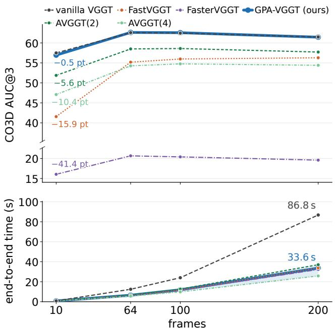  
Figure 1. Accuracy and runtime scaling with the number of input frames. Although existing acceleration methods substantially reduce end-to-end runtime, they incur pronounced camera-pose degradation under the strict AUC@3 metric. GPA-VGGT achieves comparable runtime while maintaining camera-pose accuracy close to that of vanilla VGGT.

This bottleneck has motivated a growing body of acceleration methods. FastVGGT [2] introduces Token Merging (ToMe) [15] into the aggregator, whereas FasterVGGT [6] replaces dense global attention with block-sparse attention. AVGGT [3] replaces early global-attention blocks with frame attention and subsamples keys in later blocks, while LiteVGGT [4] uses geometry-aware cached token merging and FlashVGGT [5] compresses the global aggregator with learned descriptors, both relying on finetuning for acceleration. Although these methods report substantial speedups with little loss in accuracy, evaluation under a common protocol shows that this accuracy preservation is largely confined to lenient metrics. At relaxed pose thresholds (e.g., AUC@30), the degradation may appear minor; however, as Figure 1 shows, camera estimates become noticeably less precise under strict thresholds (e.g., AUC@3). The former primarily reflects coarse pose correctness and can mask errors that remain consequential for reconstruction, whereas the latter directly tests the geometric precision required for an accelerated method to serve as a practical replacement for VGGT.

We introduce GPA-VGGT, a training-free acceleration method designed to preserve the information required for accurate geometric estimation. GPA-VGGT merges keys and values only, retaining every query so that each token continues to produce its own output. It further adds log s to the logit of each merged or pooled key, restoring the attention mass of the tokens it represents. In early blocks, GPA-VGGT preserves cross-frame context through a compact shared crossframe K/V set comprising the camera and register tokens from all frames, together with a small number of content-adaptive pooled patch summaries. Finally, because the retained similarity is used only for an argmax operation, we reduce matching cost through a fixed low-dimensional projection of the matching metric.

Without additional training, GPA-VGGT processes a 200-frame sequence in approximately 34 s, compared with 87 s for vanilla VGGT, while matching the runtime of other baselines. Across all benchmarks evaluated using AUC@3, GPA-VGGT remains within 1% of vanilla VGGT on benchmarks and shows a particularly large advantage over existing acceleration methods on the more challenging setting.

Our contributions are summarized below:

• We analyze accuracy degradation in existing VGGT acceleration methods, including FastVGGT and AVGGT, and identify three distinct sources: query merging, attention-mass distortion, and early global to frame attention replacement.

• We combine Pooled Cross-Frame Broadcast to retain early cross-frame context with Query-Preserving K/V Merging to compress later global attention while retaining every query token, and use low-dimensional matching to reduce overhead.

• We evaluate GPA-VGGT on representative benchmarks, maintaining strong performance across multi-view geometry tasks without fine-tuning.

## 2. Related Work

## 2.1. VGGT Acceleration

VGGT [1] is a feed-forward multi-view geometry model that takes a set of unposed images as input and jointly predicts camera parameters, depth maps, point maps, and tracking features for all views. Each view is tokenized by a DINOv2 [24] encoder, and its Transformer [25] alternates between frame attention and global attention. Although global attention is essential for establishing multi-view consistency, its quadratic complexity with respect to the number of tokens makes it the primary computational bottleneck for long image sequences.

FlashVGGT [5] compresses the global aggregator using learned descriptors. LiteVGGT [4] introduces geometry-aware cached token merging, preserving geometrically important tokens while reusing merge indices across adjacent blocks. Co-Me [9] uses an auxiliary confidence predictor, trained by distillation, to identify tokens suitable for merging. QuantVGGT [7] and QVGGT [8] improve computational and memory eficiency through reduced-precision inference. Because these methods rely on additional training or reduced precision, they are not the target of our training-free architectural design.

FastVGGT [2] was the first method to introduce token merging into VGGT. To address token collapse in long sequences, it uses a partitioning strategy tailored to the multi-frame layout and preserves a subset of salient tokens from merging. FasterVGGT [6] replaces dense global attention with training-free block-sparse attention, retaining selected block interactions based on coarse attention patterns and geometrically meaningful correspondences. AVGGT [3] replaces early global blocks with frame attention and applies uniform grid-based subsampling to patch tokens in the remaining global blocks. Its design is motivated by the observation that global attention supports cross-view alignment through sparse spatial correspondences rather than dense token-to-token interactions. HTTM [10] performs head-wise temporal token merging with temporal reordering to preserve feature diversity after head concatenation. Although these methods provide substantial acceleration, their accuracy degradation becomes more apparent under strict metrics such as AUC@3, which are sensitive to fine-grained camerapose errors. Our method instead preserves the information required for precise geometric estimation and pose accuracy at AUC@3.

## 2.2. Token Merging

ToMe [15] was first introduced as a training-free approach to improve the throughput of vision transformers, and was later extended to difusion, video, and language models. ToMe partitions tokens in each block into source and destination sets and merges tokens based on the similarity of their attention keys. Since a merged key represents multiple tokens, ToMe adds the logarithm of the group size to the attention logit so that the merged key receives their combined attention mass. ToMeSD [16] adapts this procedure to Stable Difusion by selecting destination tokens from a fixed 2D grid and computing similarity from the block input rather than attention keys. It also omits this correction and uses a merge–unmerge scheme to preserve dense outputs. FastVGGT adopts this ToMeSD-style token merging for a 3D geometry backbone, where such design choices can lead to fine-grained information loss and accuracy degradation in precise geometry estimation.

## 3. Analysis

## 3.1. Token Merging Disrupts Token-Specific Predictions and Attention Mass

FastVGGT [2] merges queries together with keys and values, then restores the original sequence length by assigning each merged output to all tokens in its group. Consequently, non-representative tokens receive outputs that were not computed from their individual queries. This difers fundamentally from an imperfect approximation that can be corrected after merging. FastVGGT preserves salient tokens from merging, but this only partially mitigates the loss of token-specific predictions. Figure 2 (top) plots the member-token outputs associated with twelve representative merge slots selected from block 12, projected onto the first two principal components of the unmerged output field. Query merging collapses within-group output diversity to zero, whereas K/V-only merging closely overlaps with the unmerged outputs in this diagnostic.

The number of original tokens represented by each merged key, its token size $s ,$ is accounted for by adding + log s to the corresponding attention logit. Following ToMeSD [16], FastVGGT omits this correction, so a merged key receives the mass of only a single token. In VGGT, this omission introduces an asymmetric bias because the first frame consists predominantly of destination tokens; attention is therefore progressively biased toward the first frame across merged blocks. Figure 2 (bottom) shows that, without the correction, the first frame receives nearly twice as much attention mass as in the unmerged model, whereas applying the correction restores a distribution close to the unmerged one. This efect causes a larger accuracy loss than query merging, and the losses from the two factors are approximately additive.

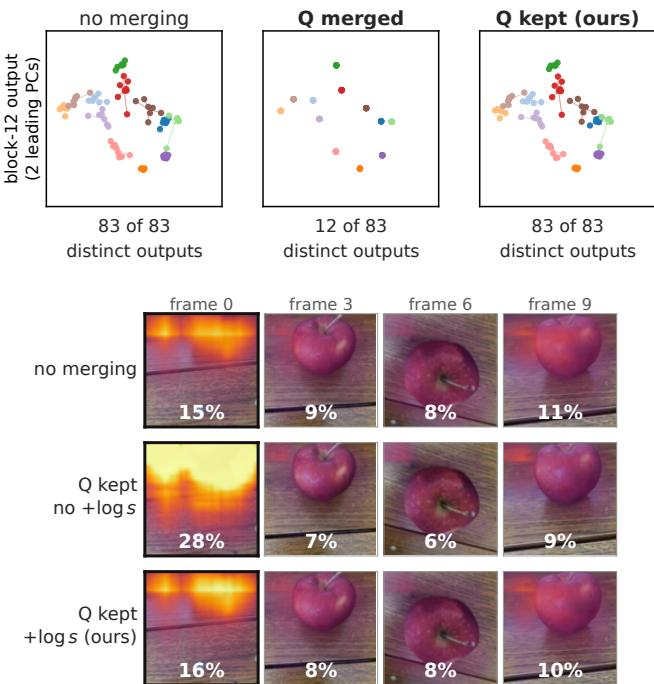  
Figure 2. Two sources of accuracy degradation in existing token-merging methods. Top: Query merging collapses the block-12 outputs of 83 tokens into 12 shared outputs, whereas retaining all queries while merging only K/V preserves the output diversity of the unmerged model. Bottom: Omitting the + log s correction disproportionately allocates attention to the first frame. Restoring the correction recovers an attention distribution close to that of the unmerged model.

## 3.2. Early Blocks Still Need Cross-Frame Context

AVGGT’s layer-wise analysis [3] concludes that early global-attention blocks do not form meaningful crossview correspondences, motivating their conversion to frame attention. This finding supports replacing dense global attention, but does not establish that early blocks can dispense with cross-frame context entirely. The absence of token-level correspondences does not preclude informative interactions at the regional level, where compact cross-frame context can still support geometric estimation.

Figure 3 demonstrates that the principal limitation of early frame attention is not merely representational drift, but the disruption of a shared geometric reference across views. In the top row of Figure $^ { 3 , }$ frame attention displaces the block-8 output field by 15.5% of its radius relative to the full-global-attention reference, whereas the shared cross-frame $\mathrm { K } / \mathrm { V }$ set reduces this displacement to $7 . 8 \%$ . The bottom row further reveals that this drift is view-specific rather than globally shared: the pairwise cosine similarities between per-frame drift directions exhibit a broad distribution, with some views moving coherently and others in opposing directions. Their mean similarity is −0.09, close to zero, indicating the absence of a common drift direction. Whereas a common drift preserves relative geometry, such inconsistent view-specific perturbations alter inter-view relationships and degrade relative-pose estimation. Adding shared special tokens and pooled patch summaries progressively aligns the per-frame drifts, thereby preserving the shared geometric reference.

Early blocks require cross-frame context because frame attention induces view-specific representational drift, disrupting the relative geometry required for pose estimation. Preserving this shared geometric reference, however, does not require the full cross-frame key set; a compact shared context is suficient. Incorporating cross-frame special tokens partially mitigates the drift, and augmenting them with image-token summaries yields further improvement.

## 4. GPA-VGGT

## 4.1. Query-Preserving K/V Merging with Token-Size Compensation

We merge keys and values while preserving the full query sequence. Each token therefore attends to the reduced key set using its own query and retains an individual output. In contrast to FastVGGT [2], which computes attention over $N _ { \mathrm { m e r g e d } } \times N _ { \mathrm { m e r g e d } }$ tokens, our formulation has complexity $N { \times } N _ { \mathrm { m e r g e d } }$ . This increases the attention cost by a factor of $N / N _ { \mathrm { m e r g e d } }$ relative to merging queries, but avoids the accuracy loss caused by replacing token-specific outputs with shared ones. For the remaining configurations, we follow FastVGGT, using the same grouping rule and merge ratio of 0.9.

After K/V merging, the remaining approximation is the replacement of s keys by their mean. The merged key then has token size s but receives the attention mass of a single key. We correct this bias by adding log s to the attention logit of each merged key, without altering the merged key vector. Let $\mathcal { G } _ { j }$ be the set of tokens merged into the j-th key, $s _ { j } = | \mathcal { G } _ { j } |$ , and $\bar { k } _ { j } , \bar { v } _ { j }$ the means of their keys and values. Every query $q _ { i }$ $i = 1 , \ldots , N$ , then produces its own output

$$
o _ { i } = \sum _ { j = 1 } ^ { N _ { \mathrm { m e r g e d } } } \mathrm { s o f t m a x } _ { j } \Bigl ( \frac { q _ { i } ^ { \top } \bar { k } _ { j } } { \sqrt { d } } + \log s _ { j } \Bigr ) \bar { v } _ { j } ,\tag{1}
$$

which equals unmerged attention exactly when the keys within each group are identical.

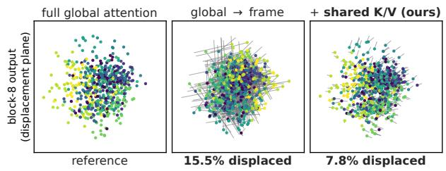

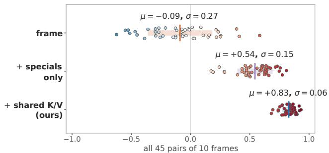  
Figure 3. Efect of cross-frame context in the early blocks. Top: Replacing global attention with frame attention substantially displaces the block-8 output field from the full-global-attention reference, whereas the shared cross-frame $\mathrm { K } / \mathrm { V }$ set largely preserves it. Bottom: Pairwise alignment of per-frame drift directions. Cross-frame special tokens partially align the drift, and image-token summaries further reduce its variation, preserving a coherent geometric reference across views.

Accuracy depends primarily on preserving tokenspecific queries and correctly normalizing merged keys. Salient-token protection becomes redundant because all queries are already retained. Removing it simplifies the method without sacrificing accuracy, while also eliminating its overhead and the double-counting of destination tokens in the original implementation.

## 4.2. Pooled Cross-Frame Broadcast for Early Layers

We retain cross-frame context in the early blocks through a compact shared cross-frame $\mathrm { K } / \mathrm { V }$ set. Each query attends to three disjoint groups: patch tokens from its own frame, the camera and four register tokens from all frames, and pooled patch summaries from all frames. Pooling keeps the shared set compact, while including each frame’s own summaries makes the set identical across frames. It can therefore be constructed once and reused without masks or per-frame $\mathrm { K } / \mathrm { V }$ copies. For frame $f ,$ the key set is ${ \cal K } _ { f } = [ K _ { f } ^ { \mathrm { p a t c h } } ; K _ { 1 : F } ^ { \mathrm { s p e c i a l } } ; \bar { K } _ { 1 : F } ^ { \mathrm { p o o l } } ]$ , and the value set is built in the same way.

We construct content-adaptive pooled summaries using cluster-h. We initialize representative locations on a stride-8 grid, assign each patch token to the representative with the highest cosine similari $\operatorname { \mathrm { [ y , } }$ and average the assigned keys and values to form each summary. Unlike fixed-window average pooling, this groups patches with similar content rather than merely nearby locations. Since multi-head attention splits each 1024-dimensional token into 16 heads of dimension 64, cluster-h performs this assignment independently for each head using its head-specific features. Thus, a patch can be grouped diferently across heads according to the information each head captures. Each pooled summary represents s patch tokens but enters attention as a single key, so we apply the same + log s correction.

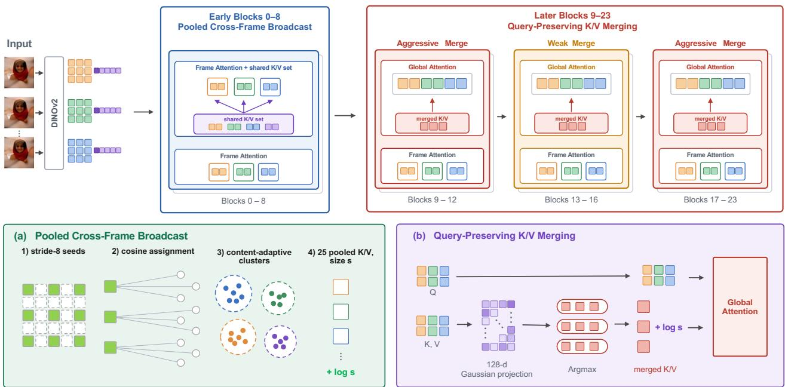  
Figure 4. Overview of GPA-VGGT. Early blocks 0–8 replace global attention with frame attention augmented by a shared cross-frame $\mathrm { K } / \mathrm { V }$ set containing special tokens and content-adaptive pooled image-token summaries. Later blocks 9–23 preserve all queries and merge only $\mathrm { K } / \mathrm { V }$ tokens, using a weaker merge ratio in the core blocks 13–16. (a) Pooled summaries are constructed by assigning patch tokens to stride-8 seeds according to cosine similarity and averaging the $\mathrm { K } / \mathrm { V }$ tokens within each content-adaptive cluster; the summary size determines the + log s correction. (b) $\mathrm { K } / \mathrm { V }$ matching is computed after a 128-dimensional Gaussian projection, while all queries are retained for global attention.

## 4.3. Core-Block Sensitivity-Aware Merging

The aggregator is not uniformly tolerant to merging: blocks 13–16 are substantially more sensitive than the remaining merged blocks, and errors introduced in this range are amplified rather than corrected by subsequent blocks. This sensitivity follows from the attention patterns. In the middle blocks, queries attend sharply to a small number of keys, particularly crossview correspondences; averaging keys can therefore dilute the information carried by the most relevant key. In later blocks, attention is more difuse and primarily directed toward global sink tokens, making merging less disruptive. We consequently use a merge ratio of 0.2 for blocks 13–16 and retain the ratio of 0.9 for all other blocks in the merging window.

## 4.4. Gaussian Random Projection for Efficient Matching

Token matching incurs additional overhead because it determines the source–destination assignments before merging. Assigning each source token to its most similar destination requires an $O ( { \mathrm { s r c } } \times \operatorname* { d s t } \times C )$ argmax operation, where C denotes the feature dimension. In the accelerated model with the preceding components applied, matching accounts for approximately 18% of the forward-pass time for a 200-frame sequence when using the full C = 1024 representation.

We reduce matching cost by projecting the matching features into a lower-dimensional space using a random Gaussian matrix and performing cosine normalization and argmax in that space. Each source token i is assigned to the destination

$$
d ( i ) = \arg \operatorname* { m a x } _ { j \in \mathcal { D } } \cos \bigl ( P ^ { \top } x _ { i } , P ^ { \top } x _ { j } \bigr ) ,\tag{2}
$$

where $x _ { i } \in \mathbb { R } ^ { 1 0 2 4 }$ is its matching feature, D the destination set, and $P \in \mathbb { R } ^ { 1 0 2 4 \times 1 2 8 }$ a random Gaussian matrix shared across all blocks and inputs. Reducing the feature dimension from 1024 to 128 lowers the cost of matching by approximately 7–8×.

<table><tr><td></td><td colspan="4">CO3D</td><td colspan="4">RE10K</td></tr><tr><td></td><td>AUC@3</td><td>AUC@5</td><td>AUC@10</td><td>AUC@30</td><td>AUC@3</td><td>AUC@5</td><td>AUC@10</td><td>AUC@30</td></tr><tr><td>vanilla VGGT</td><td>57.49</td><td>68.88</td><td>80.66</td><td>91.71</td><td>44.78</td><td>56.67</td><td>70.79</td><td>85.76</td></tr><tr><td>FastVGGT</td><td>41.56</td><td>55.97</td><td>72.61</td><td>88.38</td><td>37.56</td><td>50.52</td><td>66.38</td><td>83.69</td></tr><tr><td>FasterVGGT</td><td>16.05</td><td>33.80</td><td>60.00</td><td>83.91</td><td>22.00</td><td>34.09</td><td>51.47</td><td>73.85</td></tr><tr><td>AVGGT(2)</td><td>51.87</td><td>64.55</td><td>78.02</td><td>90.65</td><td>44.68</td><td>56.49</td><td>70.66</td><td>85.70</td></tr><tr><td>AVGGT(4)</td><td>47.08</td><td>60.75</td><td>75.72</td><td>89.72</td><td>42.53</td><td>54.78</td><td>69.50</td><td>85.21</td></tr><tr><td>GPA-VGGT</td><td>56.94</td><td>68.54</td><td>80.41</td><td>91.57</td><td>44.45</td><td>56.33</td><td>70.46</td><td>85.54</td></tr></table>

Table 1. Camera-pose accuracy on CO3D and RE10K, with ten frames per sequence and relative pose errors computed over all frame pairs. Bold and underline mark the best and second-best value in each column, excluding vanilla VGGT.

The similarity scores are used only to select destination indices and are discarded thereafter; merging averages the tokens assigned to each group. Even when projection changes the selected destination, it typically selects an alternative among near-tied candidates: token features are highly redundant, and the most similar destination is rarely unique. Thus, random projection may reorder nearly equivalent matches without producing a fundamentally diferent assignment. Since merging requires each token to be grouped with a sufficiently similar token rather than one specific destination, the projection reduces matching cost while preserving similarity-based token groups.

## 4.5. Custom Kernels

Two custom Triton [22] kernels implement the design: a FlashAttention [21]-style kernel that adds the + log s bias inside its online-softmax loop, since passing it as a mask makes PyTorch [23] SDPA fall back to a slower backend, and a matching kernel that computes the source–destination argmax without storing the score matrix. Both are numerically equivalent to their Py-Torch references; Appendix A gives details.

## 5. Experiments

We organize our evaluation around four questions: (1) Does GPA-VGGT preserve camera-pose accuracy under strict thresholds, and does it keep doing so as the sequence grows longer? (2) Does the same preservation carry over to other tasks? (3) How does its runtime speedup compare with existing acceleration methods? (4) Which components are responsible for accuracy recovery and acceleration?

## 5.1. Experimental Setup

We follow the π3 [13] evaluation protocol for both tasks. For camera pose estimation, we evaluate on CO3D [17] and RealEstate10K (RE10K) [18] with ten frames per sequence, compute relative pose errors over all frame pairs, and report AUC at the standard thresholds as well as the stricter AUC@3. We additionally evaluate long-sequence behavior on CO3D using 64, 100, and 200 input frames.

<table><tr><td rowspan="2"></td><td colspan="3">AUC@3↑</td><td colspan="3">AUC@30 ↑</td></tr><tr><td>64</td><td>100</td><td>200</td><td>64</td><td>100</td><td>200</td></tr><tr><td>vanilla VGGT</td><td>62.57</td><td>62.45</td><td>61.47</td><td>92.58</td><td>92.59</td><td>92.42</td></tr><tr><td>FastVGGT</td><td>55.18</td><td>55.97</td><td>56.28</td><td>91.33</td><td>91.54</td><td>91.68</td></tr><tr><td>FasterVGGT</td><td>20.66</td><td>20.40</td><td>19.59</td><td>85.62</td><td>85.57</td><td>85.42</td></tr><tr><td>AVGGT(2)</td><td>58.49</td><td>58.59</td><td>57.71</td><td>91.94</td><td>92.03</td><td>91.85</td></tr><tr><td>AVGGT(4)</td><td>54.27</td><td>54.76</td><td>54.40</td><td>91.35</td><td>91.50</td><td>91.45</td></tr><tr><td>GPA-VGGT</td><td>62.61</td><td>62.55</td><td>61.43</td><td>92.57</td><td>92.59</td><td>92.41</td></tr></table>

Table 2. Camera-pose accuracy on CO3D at 64, 100, and 200 input frames. Bold and underline mark the best and second-best value in each column, excluding vanilla VGGT.

For point-map reconstruction, we evaluate on 7- Scenes [19] and NRGBD [20] using accuracy, completeness, and normal consistency, computed over pixels valid under the ground-truth mask. We follow the sparse and dense frame samplings of $\pi ^ { 3 }$ and report the two settings separately. The sparse samplings contain 26 frames across 9 NRGBD sequences and 86 frames across 18 7-Scenes sequences, corresponding to 1–5 selected frames per sequence; the dense samplings contain 114 and 426 frames, respectively, corresponding to 4–25 frames per sequence.

We retain the original VGGT [1] architecture with L = 24 alternating frame-attention and globalattention layers. All methods use the same VGGT released checkpoint without training or fine-tuning. Experiments use bfloat16 autocast and are conducted on a single NVIDIA RTX A6000 GPU with 48 GiB of memory, using PyTorch 2.11 and CUDA 12.8.

As the oficial AVGGT [3] code is unreleased, we reimplemented the method from its specification. It reproduces the reported qualitative trend on RE10K. Absolute AUC values are not comparable, since its RE10K subset and sampling are not public.

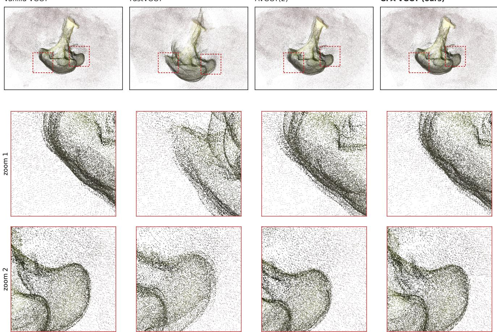  
Figure 5. Qualitative reconstruction under estimated camera poses. Each column shows the point cloud produced by the corresponding method, and red boxes indicate the enlarged regions below. GPA-VGGT most closely matches the geometry reconstructed by vanilla VGGT.

## 5.2. Camera Pose

Table 1 highlights that under AUC@30, most accelerated methods remain close to vanilla VGGT; under the stricter AUC@3 metric, however, their performance gaps become more pronounced.

The results also difer across the two benchmarks. AVGGT(2) stays close to vanilla VGGT on RE10K but incurs a much larger AUC@3 drop on CO3D. This diference reflects AVGGT’s fixed-stride K/V subsampling, in contrast to GPA-VGGT’s content-based K/V merging. RE10K consists of temporally adjacent indoor views with high overlap and predominantly smooth surfaces, making positional subsampling efective. In contrast, CO3D contains wider-baseline views of detailed objects, where content-aware selection is needed to preserve the relevant K/V information. Accordingly, GPA-VGGT preserves accuracy across both benchmarks.

Table 2 shows that this trend holds across sequence lengths. GPA-VGGT’s AUC@3 gap from vanilla

VGGT does not widen as the sequence length increases, while competing methods remain less accurate.

Figure 5 qualitatively compares the reconstructed geometry on the same scene. FastVGGT shows the object boundary as two separate edges and makes the nearby surface blurry, and AVGGT(2) reconstructs the same region as two nearby surface layers. At the scale of the full object it looks similar to vanilla VGGT, and only the zoomed-in view reveals a thinner surface behind those layers. GPA-VGGT preserves one clear boundary and remains visually close to vanilla VGGT. FastVGGT remains close to vanilla VGGT under AUC@30 but degrades substantially under AUC@3. The qualitative reconstructions are consistent with this gap, indicating that AUC@3 more directly reflects visible geometric degradation.

## 5.3. Point-Map Reconstruction

Table 3 shows that GPA-VGGT preserves point-map reconstruction quality across datasets and sampling densities. It is closest to vanilla VGGT on dense

<table><tr><td></td><td colspan="3">NRGBD sparse</td><td colspan="3">NRGBD dense</td><td colspan="3">7-Scenes sparse</td><td colspan="3">7-Scenes dense</td></tr><tr><td></td><td>Acc ↓</td><td>Comp ↓</td><td>NC↑</td><td>Acc ↓</td><td>Comp ↓</td><td>NC ↑</td><td>Acc ↓</td><td>Comp ↓</td><td>NC↑</td><td>Acc ↓</td><td>Comp ↓</td><td>NC↑</td></tr><tr><td>vanilla VGGT</td><td>0.0510</td><td>0.0665</td><td>0.8843</td><td>0.0144</td><td>0.0152</td><td>0.8743</td><td>0.0432</td><td>0.0557</td><td>0.7337</td><td>0.0215</td><td>0.0259</td><td>0.6673</td></tr><tr><td>FastVGGT</td><td>0.0560</td><td>0.0819</td><td>0.8601</td><td>0.0308</td><td>0.0328</td><td>0.8302</td><td>0.0510</td><td>0.0696</td><td>0.7215</td><td>0.0195</td><td>0.0235</td><td>0.6646</td></tr><tr><td>FasterVGGT</td><td>0.1551</td><td>0.2173</td><td>0.7749</td><td>0.0759</td><td>0.0642</td><td>0.7988</td><td>0.0994</td><td>0.1527</td><td>0.6637</td><td>0.0246</td><td>0.0254</td><td>0.6695</td></tr><tr><td>AVGGT(2)</td><td>0.0355</td><td>0.0396</td><td>0.8981</td><td>0.0154</td><td>0.0157</td><td>0.8562</td><td>0.0613</td><td>0.0765</td><td>0.7115</td><td>0.0210</td><td>0.0257</td><td>0.6653</td></tr><tr><td>AVGGT(4)</td><td>0.0465</td><td>0.0554</td><td>0.8818</td><td>0.0207</td><td>0.0182</td><td>0.8466</td><td>0.0656</td><td>0.0866</td><td>0.7063</td><td>0.0218</td><td>0.0248</td><td>0.6665</td></tr><tr><td>GPA-VGGT</td><td>0.0414</td><td>0.0476</td><td>0.8941</td><td>0.0143</td><td>0.0151</td><td>0.8714</td><td>0.0474</td><td>0.0600</td><td>0.7309</td><td>0.0204</td><td>0.0253</td><td>0.6674</td></tr></table>

Table 3. Point-map reconstruction on NRGBD and 7-Scenes, under the sparse and dense frame samplings of $\pi ^ { 3 }$ Bold and underline mark the best and second-best value in each column, excluding vanilla VGGT.

<table><tr><td></td><td colspan="6">number of input frames</td></tr><tr><td>time (s) ↓</td><td>10</td><td>32</td><td>64</td><td>100</td><td>200</td><td>500</td></tr><tr><td>vanilla VGGT</td><td>0.84</td><td>3.84</td><td>12.46</td><td>24.01</td><td>86.78</td><td>513.78</td></tr><tr><td>FastVGGT</td><td>0.85</td><td>2.81</td><td>6.46</td><td>11.71</td><td>33.91</td><td>169.43</td></tr><tr><td>FasterVGGT</td><td>0.78</td><td>2.66</td><td>6.18</td><td>11.29</td><td>32.27</td><td>OOM</td></tr><tr><td>AVGGT(2)</td><td>0.78</td><td>2.76</td><td>6.70</td><td>12.66</td><td>37.02</td><td>184.03</td></tr><tr><td>AVGGT(4)</td><td>0.76</td><td>2.51</td><td>5.58</td><td>9.86</td><td>25.82</td><td>111.74</td></tr><tr><td>GPA-VGGT</td><td>0.78</td><td>2.76</td><td>6.49</td><td>11.92</td><td>33.65</td><td>158.63</td></tr></table>

Table 4. End-to-end runtime for the whole forward pass, camera and depth heads included, on a single A6000.

NRGBD and sparse 7-Scenes, while maintaining nearvanilla normal consistency in every setting. AVGGT(2) achieves the best results on sparse NRGBD, but its fixed-stride subsampling degrades more substantially on dense NRGBD and sparse 7-Scenes. FastVGGT and FasterVGGT also show consistent degradation, particularly in normal consistency.

## 5.4. Runtime

Table 4 reports end-to-end runtime across sequence lengths. At 10 frames, no method exceeds a 1.2× speedup over vanilla VGGT, whereas all methods exceed 2.3× at 200 frames. At 500 frames, FasterVGGT runs out of memory, while the remaining methods achieve speedups between 2.8× and 4.6×. AVGGT(4) is the fastest method beyond 32 frames, reaching 4.60× at 500 frames, compared with 3.24× for GPA-VGGT; this additional speedup, however, accompanies a substantially larger accuracy loss.

## 5.5. Ablation

Table 5 shows a clear division of roles among the design components. The second rung is the early globalto-frame conversion AVGGT [3] proposes, applied on its own: it provides the initial runtime reduction, cutting 27.7 of the 86.8 seconds, but lowers CO3D AUC@3 by 3.06 points. Pooled cross-frame broadcast then restores the missing cross-view context and recovers 2.82 of those points for 0.7 additional seconds. Query-preserving K/V merging then provides the main additional acceleration without substantially compromising accuracy. Random-projection matching and sensitivity-aware merging further reduce computation overhead with only a small additional efect on accuracy. The same design transfers to $\pi ^ { 3 }$ [13] and VGGT-Ω [14], reaching 2.36× and 1.84× speedups at 200 frames while largely preserving the AUC@3 of their vanilla models on CO3D and RE10K (Appendix H).

<table><tr><td rowspan="2"></td><td>time ↓</td><td colspan="2">AUC@3 ↑</td></tr><tr><td>200f</td><td>CO3D</td><td>RE10K</td></tr><tr><td>vanilla VGGT</td><td>86.8s</td><td>57.49</td><td>44.78</td></tr><tr><td>+ frame attention in early blocks</td><td>59.1 s</td><td>54.43</td><td>44.45</td></tr><tr><td>+ pooled cross-frame broadcast</td><td>59.8s</td><td>57.25</td><td>45.20</td></tr><tr><td>+ query-preserving K/V merging</td><td>40.1 s</td><td>57.13</td><td>44.45</td></tr><tr><td>on blocks 9–12 and 17–23 + random-projection matching</td><td>35.5 s</td><td>57.12</td><td>44.47</td></tr><tr><td>+ sensitivity-aware core, 13-16</td><td>33.6 s</td><td>56.94</td><td>44.45</td></tr></table>

Table 5. Ablation of GPA-VGGT components. Each row adds one component to the row above it.

## 6. Conclusion

We identify three sources of accuracy degradation in accelerated VGGT: information loss from query merging, incorrect attention mass after K/V merging, and the removal of early cross-frame context. GPA-VGGT addresses these issues through Query-Preserving K/V Merging with + log s correction, Pooled Cross-Frame Broadcast, and low-dimensional matching. Across diverse multi-view geometry evaluations, GPA-VGGT reduces inference time while preserving vanilla VGGT’s accuracy under both standard and strict metrics.

## 7. Acknowledgments

This work was supported by Institute of Information & communications Technology Planning & Evaluation (IITP) grant funded by the Korea government (MSIT) [No. RS-2021-II211343, Artificial Intelligence Graduate School Program (Seoul National University)], and by the National Research Foundation of Korea (NRF) grant funded by the Korea government (MSIT) (No. RS-2024-00359718).

## References

[1] Jianyuan Wang, Minghao Chen, Nikita Karaev, Andrea Vedaldi, Christian Rupprecht, and David Novotny. VGGT: Visual geometry grounded transformer. In CVPR, 2025. 1, 2, 6

[2] You Shen, Zhipeng Zhang, Yansong Qu, Xiawu Zheng, Jiayi Ji, Shengchuan Zhang, and Liujuan Cao. FastVGGT: Training-free acceleration of visual geometry transformer. In ICLR, 2026. 1, 2, 3, 4, 10

[3] Xianbing Sun, Zhikai Zhu, Zhengyu Lou, Bo Yang, Jinyang Tang, Liqing Zhang, He Wang, and Jianfu Zhang. AVGGT: Rethinking global attention for accelerating VGGT. In CVPR, 2026. 1, 2, 3, 6, 8, 12

[4] Zhijian Shu, Cheng Lin, Tao Xie, Wei Yin, Ben Li, Zhiyuan Pu, Weize Li, Yao Yao, Xun Cao, Xiaoyang Guo, and Xiao-Xiao Long. LiteVGGT: Boosting vanilla VGGT via geometry-aware cached token merging. In CVPR, 2026. 1, 2

[5] Zipeng Wang and Dan Xu. FlashVGGT: Eficient and scalable visual geometry transformers with compressed descriptor attention. In CVPR, 2026. 1, 2

[6] Chung-Shien Brian Wang, Christian Schmidt, Jens Piekenbrinck, and Bastian Leibe. Block-sparse global attention for eficient multi-view geometry transformers. In CVPR, 2026. 1, 2

[7] Weilun Feng, Haotong Qin, Mingqiang Wu, Chuanguang Yang, Yuqi Li, Xiangqi Li, Zhulin An, Libo Huang, Yulun Zhang, Michele Magno, and Yongjun Xu. Quantized visual geometry grounded transformer. In ICLR, 2026. 2

[8] Zhizhen Pan, Hesong Wang, and Huan Wang. QVGGT: Post-training quantized visual geometry grounded transformer. In CVPR, 2026. 2

[9] Yutian Chen, Yuheng Qiu, Ruogu Li, Ali Agha, Shayegan Omidshafiei, Jay Patrikar, and Sebastian Scherer. Co-Me: Confidence-guided token merging for visual geometric transformers. In CVPR, 2026. 2

[10] Weitian Wang, Lukas Meiner, Shubham Rai, Cecilia De La Parra, and Akash Kumar. HTTM: Head-wise temporal token merging for faster VGGT. In CVPR, 2026. 2

[11] Shuzhe Wang, Vincent Leroy, Yohann Cabon, Boris Chidlovskii, and Jerome Revaud. DUSt3R: Geometric 3D vision made easy. In CVPR, 2024. 1

[12] Jianing Yang, Alexander Sax, Kevin J. Liang, Mikael Henaf, Hao Tang, Ang Cao, Joyce Chai, Franziska Meier, and Matt Feiszli. Fast3R: Towards 3D reconstruction of 1000+ images in one forward pass. In CVPR, 2025. 1

[13] Yifan Wang, Jianjun Zhou, Haoyi Zhu, Wenzheng Chang, Yang Zhou, Zizun Li, Junyi Chen, Jiangmiao Pang, Chunhua Shen, and Tong He. π3: Permutationequivariant visual geometry learning. In ICLR, 2026. 1, 6, 8, 12

[14] Jianyuan Wang, Minghao Chen, Shangzhan Zhang, Nikita Karaev, Johannes Sch¨onberger, Patrick Labatut, Piotr Bojanowski, David Novotny, Andrea

Vedaldi, and Christian Rupprecht. VGGT-Ω. In CVPR, 2026. 8, 12

[15] Daniel Bolya, Cheng-Yang Fu, Xiaoliang Dai, Peizhao Zhang, Christoph Feichtenhofer, and Judy Hofman. Token merging: Your ViT but faster. In ICLR, 2023. 1, 3

[16] Daniel Bolya and Judy Hofman. Token merging for fast stable difusion. In CVPRW, 2023. 3

[17] Jeremy Reizenstein, Roman Shapovalov, Philipp Henzler, Luca Sbordone, Patrick Labatut, and David Novotny. Common objects in 3D: Large-scale learning and evaluation of real-life 3D category reconstruction. In ICCV, 2021. 6

[18] Tinghui Zhou, Richard Tucker, John Flynn, Graham Fyfe, and Noah Snavely. Stereo magnification: Learning view synthesis using multiplane images. ACM TOG, 37(4), 2018. 6

[19] Jamie Shotton, Ben Glocker, Christopher Zach, Shahram Izadi, Antonio Criminisi, and Andrew Fitzgibbon. Scene coordinate regression forests for camera relocalization in RGB-D images. In CVPR, 2013. 6

[20] Dejan Azinovi´c, Ricardo Martin-Brualla, Dan B. Goldman, Matthias Nießner, and Justus Thies. Neural RGB-D surface reconstruction. In CVPR, 2022. 6

[21] Tri Dao, Daniel Y. Fu, Stefano Ermon, Atri Rudra, and Christopher R´e. FlashAttention: Fast and memory-eficient exact attention with IO-awareness. In NeurIPS, 2022. 6, 10

[22] Philippe Tillet, H. T. Kung, and David Cox. Triton: An intermediate language and compiler for tiled neural network computations. In ACM SIGPLAN International Workshop on Machine Learning and Programming Languages (MAPL), 2019. 6

[23] Adam Paszke, Sam Gross, Francisco Massa, Adam Lerer, James Bradbury, Gregory Chanan, Trevor Killeen, Zeming Lin, Natalia Gimelshein, Luca Antiga, Alban Desmaison, Andreas K¨opf, Edward Yang, Zach DeVito, Martin Raison, Alykhan Tejani, Sasank Chilamkurthy, Benoit Steiner, Lu Fang, Junjie Bai, and Soumith Chintala. PyTorch: An imperative style, high-performance deep learning library. In NeurIPS, 2019. 6, 10

[24] Maxime Oquab, Timoth´ee Darcet, Th´eo Moutakanni, Huy Vo, Marc Szafraniec, Vasil Khalidov, Pierre Fernandez, Daniel Haziza, Francisco Massa, Alaaeldin El-Nouby, Mahmoud Assran, Nicolas Ballas, Wojciech Galuba, Russell Howes, Po-Yao Huang, Shang-Wen Li, Ishan Misra, Michael Rabbat, Vasu Sharma, Gabriel Synnaeve, Hu Xu, Herv´e Jegou, Julien Mairal, Patrick Labatut, Armand Joulin, and Piotr Bojanowski. DI-NOv2: Learning robust visual features without supervision. TMLR, 2024. 2

[25] Ashish Vaswani, Noam Shazeer, Niki Parmar, Jakob Uszkoreit, Llion Jones, Aidan N. Gomez, Lukasz Kaiser, and Illia Polosukhin. Attention is all you need. In NeurIPS, 2017. 2

# GPA-VGGT: Geometry-Preserving Acceleration of VGGT

Supplementary Material

## A. Custom Triton Kernels

## A.1. Attention with a Per-Key Additive Bias

The standard attention interface treats the + log s correction as a mask and therefore falls back to a slower implementation. For a 200-frame sequence, this fallback takes 2,142 ms, compared with 948 ms for unbiased fused attention—more time than key merging saves in the merged global-attention block.

Because the correction depends only on the key index, our Triton kernel adds it directly to each score tile inside the online-softmax loop, preserving the streaming structure of FlashAttention [21]. We avoid masked loads by clamping out-of-range key indices and assigning duplicate columns $\mathrm { ~ a ~ } - 1 0 ^ { 9 }$ bias. This avoids padding and copying K/V tensors; only the small bias vector is padded. The bias is also pre-scaled on the host, avoiding conversion within the inner loop. For a 200-frame sequence, our kernel takes 984 ms: only 4% slower than unbiased fused attention and 2.18× faster than the fallback.

## A.2. Memory-Efficient K/V Matching

Bipartite matching requires only the row-wise maximum similarity and argmax index, not the full similarity matrix. Materializing the full matrix would require 27.25 GiB for a 200-frame sequence. Even a chunked PyTorch [23] reference, which materializes 5,000 rows at a time, requires a 1.20 GiB temporary bufer. Our Triton kernel keeps each score tile in registers and writes only the two required outputs, reducing this temporary memory to 0.003 GiB.

The kernel trades a modest increase in runtime for substantially lower memory use: the similarity kernel itself takes 482 ms against 330 ms for the chunked reference at this shape. This overhead of roughly 150 ms is small relative to the memory saved, since materializing similarity tiles incurs a large transient VRAM cost and can become the limiting factor for long sequences.

The PyTorch reference delegates the 1,024- dimensional dot-product reduction to its matrixmultiplication backend. In our fused kernel, which additionally computes the row-wise maximum and argmax, we partition the feature dimension into smaller tiles and accumulate partial dot products.

<table><tr><td>frames</td><td>vanilla</td><td>FastVGGT</td><td>FasterVGGT</td><td>AVGGT</td><td>GPA-VGGT</td></tr><tr><td>10</td><td>4.58</td><td>4.58</td><td>4.58</td><td>4.58</td><td>4.58</td></tr><tr><td>32</td><td>5.12</td><td>5.12</td><td>5.12</td><td>5.12</td><td>5.12</td></tr><tr><td>64</td><td>6.08</td><td>6.85</td><td>7.48</td><td>6.08</td><td>6.08</td></tr><tr><td>100</td><td>8.27</td><td>9.48</td><td>10.50</td><td>8.27</td><td>8.28</td></tr><tr><td>200</td><td>14.37</td><td>16.78</td><td>19.46</td><td>14.37</td><td>14.38</td></tr><tr><td>300</td><td>20.47</td><td>24.08</td><td>29.43</td><td>20.47</td><td>20.48</td></tr><tr><td>400</td><td>26.57</td><td>31.38</td><td>40.29</td><td>26.57</td><td>26.58</td></tr><tr><td>500</td><td>32.67</td><td>38.69</td><td>OOM</td><td>32.68</td><td>32.69</td></tr></table>

Table S1. Peak GPU memory (GiB) during the full forward pass on a single A6000, measured using torch.cuda.max memory allocated() after warm-up. Vanilla denotes the VRAM-eficient VGGT implementation introduced by FastVGGT, and the AVGGT column covers both σ = 2 and σ = 4, which produced identical measurements at every length.

## B. Peak VRAM Footprint

Table S1 reports the peak VRAM of the full forward pass, using the VRAM-eficient VGGT implementation introduced by FastVGGT [2] as the vanilla baseline. GPA-VGGT remains within 0.02 GiB of vanilla VGGT across all sequence lengths and AVGGT matches it exactly, whereas at 500 frames FastVGGT uses 6.02 GiB more VRAM; FasterVGGT already uses 13.72 GiB more at 400 frames and exceeds device memory at 500.

Although K/V merging reduces the K/V sequence length in global attention, the full-model peak is set by the unchanged feed-forward sublayer within a global-aggregator block. Moreover, FlashAttention [21] does not materialize an N × N score matrix, so the memory used by the modified globalattention sublayer is already linear in the number of tokens. GPA-VGGT therefore reduces attention computation without changing peak VRAM, while keeping attention memory nearly identical to vanilla VGGT and below the feed-forward-memory peak. In contrast, FastVGGT merges queries as well as K/V tokens and subsequently restores the original token resolution. The associated full-length token copies and unmerging bufers raise its attention-memory peak above that of the feed-forward sublayer.

AVGGT incurs essentially no additional peakmemory overhead. Its subsampled global attention drops keys rather than copying tokens back, so it allocates neither FastVGGT’s unmerging bufers nor any workspace that scales with the dropped set, and its peak equals vanilla VGGT’s at every sequence length and at both subsampling settings.

<table><tr><td></td><td>vanilla</td><td>mean</td><td>stride</td><td>cluster</td><td>cluster-h</td></tr><tr><td>CO3D AUC@3</td><td>57.49</td><td>56.44</td><td>56.61</td><td>56.90</td><td>56.94</td></tr><tr><td>∆ vs. vanilla</td><td>一</td><td>-1.04</td><td>-0.88</td><td>-0.59</td><td>-0.55</td></tr></table>

Table S2. Pooling strategy for the shared cross-frame summaries on CO3D, using the same stride-8 seed grid and summary-token budget. Bold marks the adopted setting.

<table><tr><td></td><td>preserve Q</td><td>+ log s bias</td><td>output error</td><td>CO3D AUC@3</td></tr><tr><td>no merging</td><td></td><td></td><td></td><td>57.25</td></tr><tr><td colspan="3">(Pooled Cross-Frame Broadcast only)</td><td></td><td></td></tr><tr><td>neither component</td><td></td><td></td><td>0.394</td><td>49.93</td></tr><tr><td>query preservation only</td><td>√</td><td></td><td>0.374</td><td>51.09</td></tr><tr><td>+ log s correction only</td><td></td><td>√</td><td>0.112</td><td>55.36</td></tr><tr><td>both (adopted)</td><td>√</td><td>√</td><td>0.055</td><td>56.94</td></tr></table>

Table S3. Merge-operator components on CO3D, under a fixed merge window and merge ratio. Output error is the relative deviation of the merged attention output from unmerged attention on the same input. Bold marks the adopted operator.

## C. Pooling for the Shared Cross-Frame K/V Set

Each frame’s queries attend to local K/V tokens, shared special tokens, and pooled image-token summaries. The first two groups are held fixed in this ablation; this section studies how to construct the summaries. Table S2 compares pooling strategies on CO3D using a fixed 8×8 pooling window. Fixed-window mean pooling performs worst, while content-based clustering is more efective. Per-head clustering performs best and is used in our model.

## D. Merge-Operator Ablation

The merge operator independently determines whether to merge queries with K/V tokens and whether to correct each merged key’s logit by its token size. Table S3 isolates these choices under an otherwise fixed configuration. Merging queries forces all tokens within a group to share the same output, whereas preserving queries retains within-group diversity but does not address the attention-mass bias caused by K/V merging. The + log s correction restores the mass of the tokens each merged key represents and provides the larger accuracy gain. Together, query preservation and the + log s correction nearly recover no-merging accuracy, with the benefit becoming larger at higher merge ratios.

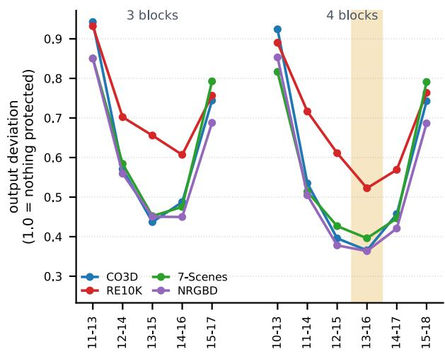  
Figure S1. Core-block selection on VGGT. Each point shows how much the final global-block output changes from the unmerged model when the indicated contiguous block set is protected from merging; lower values mean smaller changes. The criterion is computed without ground-truth annotations across four datasets. Blocks 13–16 consistently give the smallest change and are selected as the core-block set.

## E. Selection of the Core Blocks

We choose the core blocks by measuring how much merging changes the aggregator’s final representation. For each candidate set, we leave those blocks unmerged and apply merging to every other block. We measure the relative Frobenius-norm deviation between the final global-block outputs of the merged and unmerged models on the special tokens, and normalize it by the deviation obtained when all blocks are merged. Because this measurement uses no ground-truth annotations, the core blocks are selected without reference to task labels.

We evaluate block sets rather than individual blocks. Simply ranking individual blocks and selecting the top k does not reliably find the best set. A single-block measurement considers one block while all other blocks remain unmerged, whereas the full model applies merging across multiple blocks. Merging in one block can therefore change the token representations and source– destination assignments used by later blocks.

For VGGT, this criterion selects blocks 13–16. Figure S1 shows that this set gives the smallest output change on all four datasets. No three-block set matches this result. We apply the same procedure to $\pi ^ { 3 }$ and VGGT-Ω; Figure S2 shows the resulting core-block selections, which are used in Section H.

<table><tr><td>dimension</td><td>32</td><td>64</td><td>128</td><td>256</td><td>512</td><td>1024</td></tr><tr><td>matching (ms)</td><td>37</td><td>38</td><td>64</td><td>106</td><td>194</td><td>469</td></tr><tr><td>same destination (%)</td><td>54.4</td><td>67.1</td><td>76.6</td><td>82.8</td><td>87.9</td><td>100</td></tr><tr><td>similarity loss (%)</td><td>3.30</td><td>1.28</td><td>0.56</td><td>0.28</td><td>0.13</td><td>0</td></tr><tr><td>CO3D AUC@3</td><td>56.47</td><td>56.48</td><td>56.94</td><td>56.87</td><td>56.89</td><td>57.09</td></tr></table>

Table S4. Projected feature dimension for K/V matching, with matching cost measured at 200 input frames and AUC@3 on CO3D. Same destination and similarity loss are both measured against the full 1,024- dimensional metric. Bold marks the adopted dimension.

## F. Matching Feature Dimension

Table S4 evaluates the fixed random projection used for K/V matching. Projecting the matching features from 1,024 to 128 dimensions lowers the cost of each matching call from 469 ms to 64 ms. Although only 76.6% of source tokens select the same destination as under the full-dimensional metric, the selected destinations lose only 0.56% similarity relative to the full-metric optimum, indicating that most disagreements occur among near-equivalent candidates. We therefore use 128 dimensions, the smallest projection size that maintains accuracy close to the full-dimensional metric.

## G. Comparison with AVGGT

GPA-VGGT and AVGGT [3] share a two-stage structure: both replace early global-attention blocks with frame attention and reduce the K/V set in later blocks while preserving all queries. In the early stage, AVGGT restricts attention to within-frame tokens, whereas GPA-VGGT augments each frame with a pooled shared cross-frame K/V set. In the later stage, AVGGT retains K/V tokens at fixed spatial strides, whereas GPA-VGGT selects them through bipartite merging. At an equal token budget, AVGGT summarizes all removed tokens with a single unweighted mean K/V pair, whereas GPA-VGGT aggregates each removed token into the retained token it most closely matches and restores the corresponding attention mass through the + log s correction. The 128-dimensional Gaussian projection reduces matching overhead, enabling GPA-VGGT to retain fewer K/V tokens than AVGGT(2) while achieving both lower runtime and higher accuracy.

## H. Transfer to Other Backbones

The proposed design applies to backbones that alternate frame attention and global attention over a token layout comprising special tokens followed by a patch grid. Both $\pi ^ { 3 }$ [13] and VGGT-Ω [14] follow this structure. We adjust only model-specific properties, including the block layout, the number of special tokens per frame, and patch size. Each adaptation uses the same 128-dimensional Gaussian projection for K/V matching.

Table S5 reports the incremental ablation on $\pi ^ { 3 }$ . We retain the early-block setting used by AVGGT: global attention in blocks 0–9 is replaced by frame attention, and K/V merging is applied in blocks 10–17, with a lower merge ratio in core blocks 13–15. However, $\pi ^ { 3 }$ requires a lower overall merge ratio than VGGT because it has fewer global-attention blocks. Each merged block therefore has a larger efect on the information propagated through the remaining global-attention blocks.

Table S6 reports the same ablation on VGGT-Ω, which contains five register blocks at raw indices 2, 6, 9, 14, and 20 that do not perform cross-frame attention over patch tokens. We therefore replace global attention with frame attention in raw blocks 0, 1, 3, 4, 5, 7, and 8, and apply K/V merging in the subsequent non-register blocks, with a lower merge ratio in raw blocks 12, 13, 15, and 16. As in $\pi ^ { 3 } .$ , patch tokens participate in global attention in fewer blocks than in VGGT, requiring a lower overall merge ratio.

On both backbones, the shared cross-frame K/V set mitigates the accuracy loss caused by replacing early global attention with frame attention. The adopted configurations accelerate all three backbones while retaining most of the accuracy of their vanilla models.

## I. Additional Qualitative Results

Figures S3–S5 provide additional qualitative comparisons for examples from 7-Scenes, NRGBD, and RealEstate10K.

<table><tr><td rowspan="2"></td><td colspan="4">CO3D AUC@τ</td><td colspan="4">RE10K AUC@τ</td><td colspan="2">200 frames</td></tr><tr><td>3</td><td>5</td><td>10</td><td>30</td><td>3</td><td>5</td><td>10</td><td>30</td><td>time (s)</td><td>speedup</td></tr><tr><td>vanilla</td><td>58.01</td><td>68.36</td><td>79.16</td><td>89.71</td><td>50.90</td><td>60.67</td><td>72.43</td><td>85.74</td><td>65.5</td><td>1.00×</td></tr><tr><td>+ frame attention in early blocks</td><td>56.25</td><td>67.01</td><td>78.35</td><td>89.32</td><td>50.64</td><td>60.39</td><td>72.18</td><td>85.63</td><td>35.4</td><td>1.85×</td></tr><tr><td>+ pooled cross-frame broadcast</td><td>58.06</td><td>68.42</td><td>79.18</td><td>89.66</td><td>51.34</td><td>60.85</td><td>72.42</td><td>85.67</td><td>36.5</td><td>1.80×</td></tr><tr><td>+ query-preserving K/V merging,  $r { = } 0 . 5 0$ </td><td>57.29</td><td>67.92</td><td>78.97</td><td>89.56</td><td>51.04</td><td>60.66</td><td>72.35</td><td>85.73</td><td>27.7</td><td>2.36×</td></tr><tr><td>+ query-preserving K/V merging, r=0.90</td><td>56.40</td><td>67.34</td><td>78.58</td><td>89.35</td><td>49.85</td><td>59.71</td><td>71.72</td><td>85.45</td><td>23.8</td><td>2.75×</td></tr></table>

Table S5. Ablation of the proposed design on $\pi ^ { 3 } .$ . Bold marks the adopted configuration.

<table><tr><td rowspan="2"></td><td colspan="4">CO3D AUC@τ</td><td colspan="4">RE10K AUC@τ</td><td colspan="2">200 frames</td></tr><tr><td>3</td><td>5</td><td>10</td><td>30</td><td>3</td><td>5</td><td>10</td><td>30</td><td>time (s)</td><td>speedup</td></tr><tr><td>vanilla</td><td>54.66</td><td>66.09</td><td>77.95</td><td>89.14</td><td>63.22</td><td>71.26</td><td>80.59</td><td>90.58</td><td>41.5</td><td>1.00×</td></tr><tr><td>+ frame attention in early blocks</td><td>53.98</td><td>65.59</td><td>77.62</td><td>88.97</td><td>63.01</td><td>71.09</td><td>80.47</td><td>90.57</td><td>29.4</td><td>1.41×</td></tr><tr><td>+ pooled cross-frame broadcast</td><td>54.56</td><td>66.01</td><td>77.90</td><td>89.11</td><td>63.21</td><td>71.23</td><td>80.59</td><td>90.61</td><td>29.9</td><td>1.39×</td></tr><tr><td>+ query-preserving K/V merging, r=0.50</td><td>53.84</td><td>65.44</td><td>77.52</td><td>89.00</td><td>62.95</td><td>71.05</td><td>80.50</td><td>90.56</td><td>22.5</td><td>1.84×</td></tr><tr><td>+ query-preserving K/V merging, r=0.90</td><td>52.97</td><td>64.81</td><td>77.08</td><td>88.81</td><td>62.64</td><td>70.82</td><td>80.36</td><td>90.52</td><td>19.2</td><td>2.17×</td></tr></table>

Table S6. Ablation of the proposed design on VGGT-Ω. Bold marks the adopted configuration.

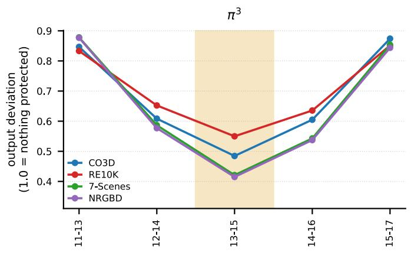

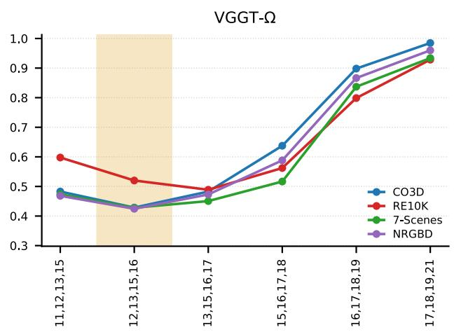  
Figure S2. Core-block selection on $\pi ^ { 3 }$ and VGGT-Ω. Core blocks are selected using the same measurement as in Figure S1. The criterion selects blocks 13–15 on $\pi ^ { 3 }$ and raw blocks 12, 13, 15, and 16 on VGGT-Ω, where raw block 14 is a register block and is therefore excluded from merging.

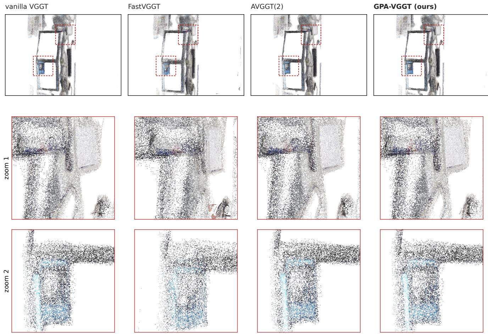  
Figure S3. A small-room scene from 7-Scenes (heads-seq-02#0).

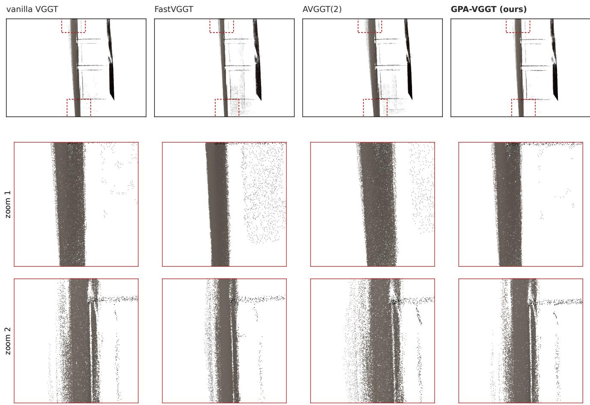  
Figure S4. A green-room scene from NRGBD (green room#11).

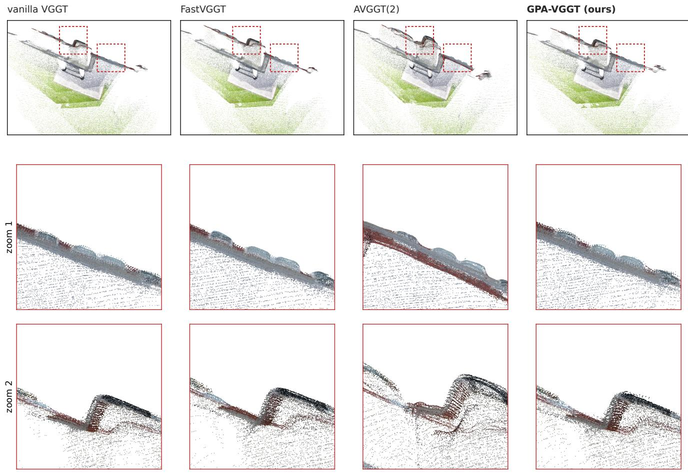  
Figure S5. An outdoor scene from RealEstate10K (2c805f56d92a2e22).