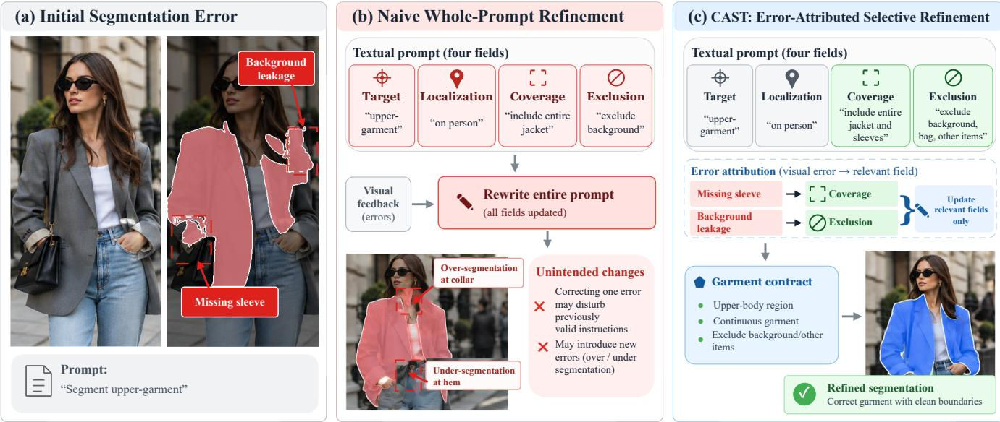
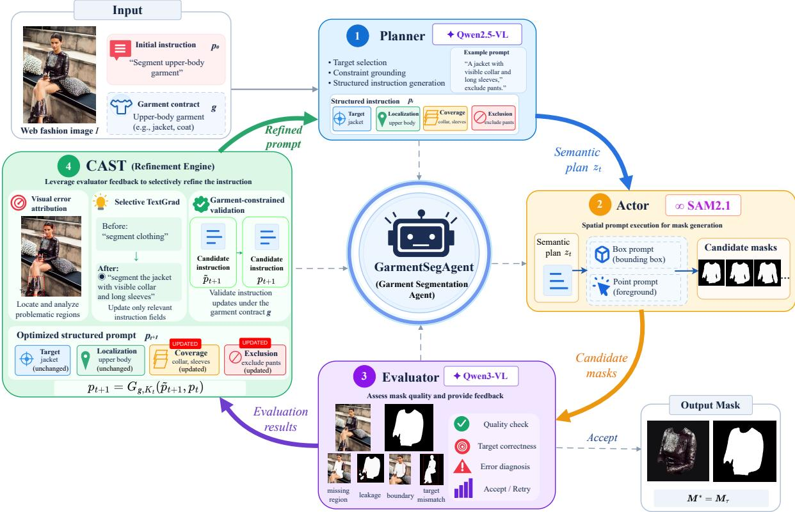
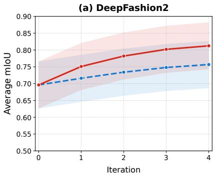
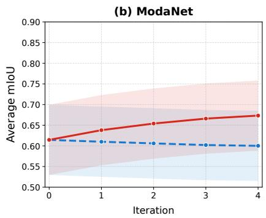
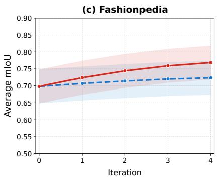
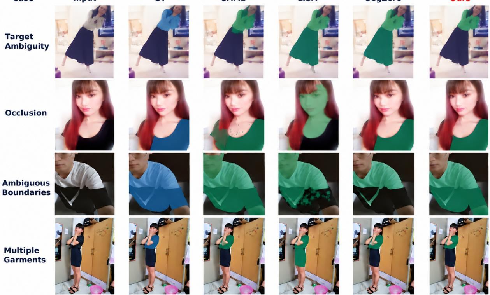
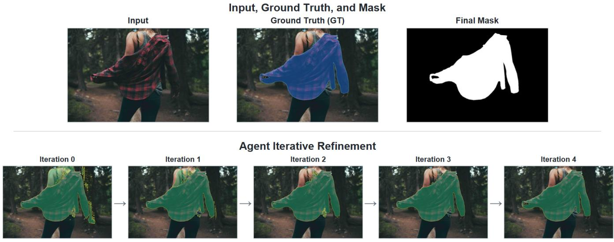
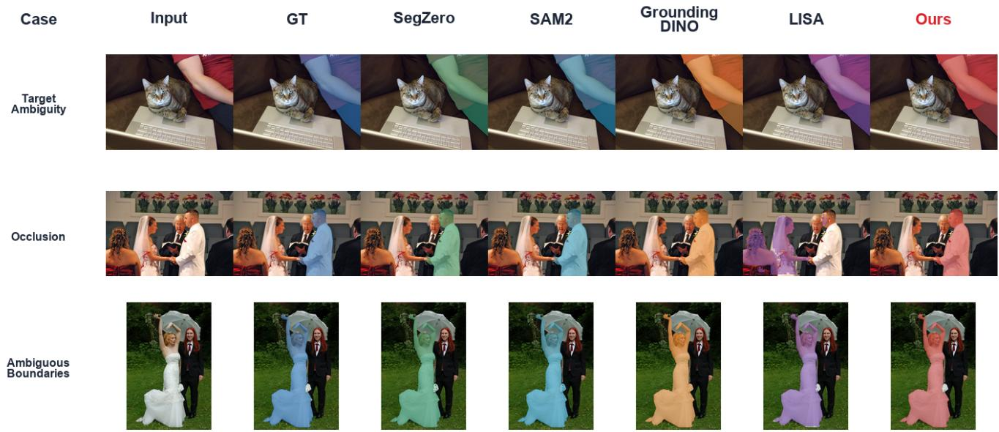

# GarmentSegAgent: Autonomous Garment Segmentation for Web Fashion Images via Textual Self-Refinement

Jia Chen1,2,\*, Chao Huang1,\*, Xinrong Hu1, Mingdi Huang1, Ruyang Zhao1, Jun Bai3,†

1 School of Computer Science and Artificial Intelligence, Wuhan Textile University, Wuhan, China

2 Engineering Research Center of Hubei Province for Clothing Information, Wuhan Textile University, Wuhan, China

3 Australian Institute for Machine Learning (AIML), Adelaide University, Adelaide, Australia

## Abstract

Web fashion images support applications such as visual product search and consumer-to-shop matching, yet their visual hetero- geneity makes reliable garment segmentation challenging. Despite advances in promptable segmentation, autonomously identifying and correcting garment-specific errors without human-provided spatial prompts remains dificult. We propose GarmentSegAgent, an autonomous framework that integrates semantic planning, spatial execution, and visual evaluation through iterative textual self- refinement. At its core, we introduce CAST (Constrained Attribution-guided Selective TextGrad), which connects visual error attribution with targeted textual optimization. CAST identifies instruc- tion components responsible for segmentation errors, selectively updates them through textual gradients, and validates the result- ing instructions against garment-specific constraints. This enables image-specific error correction at inference time while keeping the underlying foundation models frozen. Experiments on DeepFashion2, ModaNet, and Fashionpedia demonstrate consistent improve- ments in region overlap and boundary accuracy, alongside more reliable refinement than conventional TextGrad. By enabling visual feedback to guide controlled instruction updates, GarmentSegAgent ofers a promising direction for autonomous garment understanding, with potential applications in scalable fashion content analysis, visual retrieval, and consumer-to-shop matching on the Web.

## Keywords

garment segmentation, agentic segmentation, visual error attribution, textual optimization, web fashion images

## 1 Introduction

Fashion images are widespread across the Web and support applications such as visual product search, fine-grained fashion retrieval, and consumer-to-shop matching [6, 7, 31]. Unlike curated product images, consumer-generated and street-fashion photographs of- ten contain cluttered backgrounds, diverse viewpoints, occlusions, and overlapping garments, making individual clothing instances dificult to localize and delineate [7, 10]. Accurate pixel-level garment segmentation helps isolate clothing instances and preserve fine-grained spatial details for downstream fashion understanding. However, reliable segmentation across such heterogeneous imagery remains challenging, particularly when target garments must be identified without human-provided spatial prompts.

Visual segmentation has progressed from garment-specific architectures, such as FashionFormer [26], to promptable foundation models [4] including SAM [12] and SAM 2 [21]. Grounding DINO [15] and LISA [13] further support language-guided object localization and segmentation, respectively, while SAM-REF [29] improves segmentation details through image-prompt interaction. Despite these advances, generating accurate masks from spatial or textual prompts does not necessarily address errors in the instruc- tions guiding segmentation. In heterogeneous Web fashion images, ambiguous targets, occlusions, and overlapping garments can lead to incorrect target selection or incomplete garment coverage. Reli-able autonomous segmentation therefore requires not only efective mask generation but also the ability to diagnose intermediate errors and refine the guiding instructions without human intervention.

Recent studies have extended segmentation beyond single-pass prediction by incorporating sequential reasoning and feedback. SegAgent [33] learns segmentation actions from human annotation trajectories, while RSAgent [9] integrates multi-turn reasoning and tool execution through supervised fine-tuning and reinforcement learning. Other approaches explore collaborative reflection in video segmentation [11] and guideline-consistent segmentation through a training-free Worker–Supervisor framework [23]. These developments highlight the potential of agentic segmentation, yet a key challenge remains: how should visual errors guide updates to spe- cific segmentation instructions? For example, the missing sleeve and background leakage in Fig. 1(a) require distinct corrections to garment coverage and region exclusion. This motivates connecting visual error diagnosis with targeted instruction refinement.

Textual optimization provides a flexible means of refining instructions through feedback without modifying model parameters [1, 25]. ProTeGi [19] employs natural-language gradients for prompt refinement, while OPRO [27] uses language models to iteratively search for efective instructions. TextGrad [30] further enables feedback-driven optimization of textual variables in compound AI systems through language-based backpropagation. However, applying general-purpose textual optimization to garment segmen- tation requires accounting for the relationship between visual errors and individual instruction components. The whole-prompt revision depicted in Fig. 1(b) exemplifies how correcting localized errors may inadvertently disrupt previously valid segmentation decisions. Efective refinement therefore requires identifying error-relevant textual variables while maintaining garment-specific constraints.

To enable error-specific and constraint-aware refinement, we pro- pose GarmentSegAgent, an autonomous garment segmentation framework integrating semantic planning, spatial execution, and visual evaluation within an iterative self-refinement process. At its core, CAST (Constrained Attribution-guided Selective TextGrad)

  
Figure 1: Motivation for error-attributed selective textual refinement. (a) Initial segmentation with missing garment regions and background leakage. (b) Naive whole-prompt refinement may disrupt otherwise correct instructions. (c) CAST maps visual errors to relevant instruction fields for selective, garment-constrained textual refinement.

connects visual segmentation errors with structured textual op- timization. CAST attributes observed errors to four instruction fields—target, localization, coverage, and exclusion—and selectively applies TextGrad updates to the relevant variables. For instance, CAST directs missing garment regions to coverage refinement and background leakage to exclusion refinement, while preserving un- related instructions under garment-specific constraints (Fig. 1(c)). The refined instructions subsequently guide spatial prompt generation and segmentation, enabling autonomous, image-specific refinement without human-provided spatial prompts or fine-tuning the underlying foundation models.

Our main contributions are threefold. (1) Autonomous Garment Segmentation. We introduce GarmentSegAgent, a feedback driven framework that enables autonomous, iterative garment seg- mentation without human-provided spatial prompts or foundationmodel fine-tuning. (2) Error-Attributed Textual Refinement. We propose CAST, a task-aware optimization mechanism that maps vi-sual segmentation errors to relevant textual variables and performs selective TextGrad updates under garment-specific constraints. (3) Comprehensive Experimental Validation. Experiments across three fashion benchmarks demonstrate superior region and bound- ary accuracy, while refinement analyses and ablations establish the efectiveness of CAST in improving optimization reliability.

## 2 Related Work

Agentic Segmentation. Agentic segmentation extends mask prediction through sequential reasoning, tool interaction, and feedback- driven correction [24, 28]. SegAgent [33] learns multi-step seg- mentation policies from human annotation trajectories, whereas RSAgent [9] combines multi-turn tool use with supervised finetuning and reinforcement learning. Other approaches emphasize

agent coordination and iterative evaluation. Refer-Agent [11] introduces collaborative reasoning and reflection for referring video seg- mentation, while guideline-consistent segmentation [23] employs a Worker–Supervisor framework with guideline-based feedback and adaptive termination. These approaches advance segmentation through learned action policies, collaborative reasoning, and iterative mask correction.

Textual Optimization. Language-based refinement has been explored through iterative self-feedback, verbal reflection, and tool-assisted correction [8, 17, 22]. For prompt optimization, Pro-TeGi [19] employs natural-language gradients and beam search, while OPRO [27] uses language models to optimize instructions based on previous evaluations. TextGrad [30] further extends textual optimization to compound AI systems through language-based backpropagation across textual variables. These methods provide general mechanisms for optimizing instructions without diferentiating through underlying models. Applying such optimization to segmentation additionally requires grounding visual errors in rele-vant instruction variables and maintaining task-specific constraints during updates.

## 3 Methodology

## 3.1 Problem Formulation and Framework Overview

We consider autonomous garment segmentation in heterogeneous Web fashion images. Given an input image $I \in \mathbb { R } ^ { H \times W \times 3 }$ and an ini tial textual instruction ${ \mathit { p } } _ { 0 } ,$ the objective is to extract a target garment instance as a binary segmentation mask $M ^ { * } \in \{ 0 , 1 \} ^ { H \bar { \times } W }$ without human-provided spatial prompts. We formulate this task as an iterative process in which segmentation predictions are evaluated and refined through visual feedback at inference time.

  
Figure 2: Overview of GarmentSegAgent. The Planner generates a garment-aware semantic plan, the Actor produces candidate masks, and the Evaluator selects predictions and provides visual feedback. CAST performs selective, garment-constrained textual refinement to guide subsequent segmentation iterations.

To maintain task consistency, we introduce a garment extrac- tion contract � specifying target-selection rules and segmentation constraints. Given an instruction ${ \boldsymbol { p } } ,$ the Planner $\mathcal { P }$ generates a se- mantic segmentation plan, which the Actor S converts into spatial prompts to produce candidate masks:

$$
\begin{array} { r } { \boldsymbol { \mathcal { M } } ( p ) = \boldsymbol { S } ( I , \mathcal { P } ( I , p , g ) ) . } \end{array}\tag{1}
$$

The visual Evaluator selects a mask $M ( p )$ from $M ( p )$ and pro-vides feedback on segmentation errors. We formulate textual self- refinement as a constrained test-time optimization problem:

$$
\operatorname* { m a x } _ { p \in C ( g ) } \widehat { Q } ( I , M ( p ) , g ) ,\tag{2}
$$

where $\widehat { Q }$ denotes evaluator-estimated segmentation quality and $C ( g )$ is the set of instructions satisfying the garment contract. This objective guides feedback-driven refinement under a finite inference budget.

To realize this formulation, we develop GarmentSegAgent, which integrates semantic planning, spatial execution, visual eval-uation, and CAST-based textual optimization into a closed-loop framework, as shown in Fig. 2. CAST attributes visual errors to rel-evant instruction components and selectively refines them through TextGrad under garment-specific constraints. The validated instructions guide subsequent segmentation iterations, while all foundation models remain frozen.

## 3.2 Garment-Aware Planning and Spatial Execution

We represent the segmentation instruction at iteration � as four structured textual variables: $\boldsymbol { p } _ { t } = ( p _ { t } ^ { t a r } , p _ { t } ^ { l o c } , p _ { t } ^ { c o v } , p _ { t } ^ { e x c } )$ , correspond- ing to target selection, spatial localization, garment coverage, and region exclusion, respectively. These variables allow individual instruction components to be selectively refined while maintaining consistency with the garment extraction contract �.

Given the image �, current instruction ${ \bf \nabla } ^ { p _ { t } }$ , and contract �, the Planner employs Qwen2.5-VL [3] to generate a garment-aware semantic plan:

$$
z _ { t } = \mathcal { P } ( I , \boldsymbol { p } _ { t } , \boldsymbol { g } ) = ( c _ { t } , b _ { t } , \mathcal { R } _ { t } ^ { + } , \mathcal { R } _ { t } ^ { - } ) ,\tag{3}
$$

where $c _ { t }$ describes the target garment, $b _ { t }$ denotes its estimated bounding box, and $\mathcal { R } _ { t } ^ { + }$ and $\mathcal { R } _ { t } ^ { - }$ specify candidate foreground and exclusion regions, respectively.

The Actor translates this semantic plan into spatial prompts for SAM 2.1. Using the estimated bounding box and positive and negative point configurations derived from the corresponding regions, it generates a set of candidate masks:

$$
\begin{array} { r } { \mathcal { M } _ { t } = \left\{ S ( I , b _ { t } , P _ { t , k } ^ { + } , P _ { t , k } ^ { - } ) \right\} _ { k = 1 } ^ { B _ { t } } , } \end{array}\tag{4}
$$

where $P _ { t , k } ^ { + }$ and $P _ { t , k } ^ { - }$ denote the positive and negative point sets for the �-th prompt configuration, and $B _ { t }$ is the number of candidate

configurations. The resulting masks are passed to the Evaluator for candidate selection and visual error diagnosis.

## 3.3 Visual Error Attribution

Despite garment-aware planning, the generated masks may contain target mismatches, incomplete garment regions, or inaccurate boundaries. A coarse quality assessment alone provides limited guidance for targeted correction. We therefore introduce Visual Error Attribution (VEA) to characterize segmentation errors as structured visual feedback for subsequent textual optimization.

Given the image $I ,$ candidate masks $\boldsymbol { \mathcal { M } } _ { t }$ , current instruction $\displaystyle { \mathbf { \mathit { p } } } _ { t } :$ and garment contract ${ \mathit { g } } ,$ the visual Evaluator selects a candidate mask and generates error-specific feedback:

$$
( M _ { t } , e _ { t } ) = \mathcal { E } ( I , M _ { t } , p _ { t } , g ) ,\tag{5}
$$

where $M _ { t } \in { \cal M } _ { t }$ is the selected mask and $e _ { t }$ denotes its structured visual feedback. VEA considers four error categories: target mismatch, missing regions, region leakage, and boundary errors. Each identified error is represented by

$$
\begin{array} { r } { e _ { t } = \left\{ ( k _ { t , i } , r _ { t , i } , s _ { t , i } , c _ { t , i } , a _ { t , i } ) \right\} _ { i = 1 } ^ { N _ { t } } , } \end{array}\tag{6}
$$

where $N _ { t }$ is the number of identified errors, $k _ { t , i }$ denotes the error category, $r _ { t , i }$ specifies the afected visual region, $s _ { t , i }$ and $c _ { t , i }$ repre- sent error severity and evaluator confidence, respectively, and $a _ { t , i }$ describes a suggested correction.

VEA infers these errors from the input image and predicted masks without accessing ground-truth annotations. For instance, a missing sleeve indicates insuficient garment coverage, whereas retained skin regions suggest inadequate exclusion. These structured diagnostics provide error-specific signals that CAST maps to relevant instruction variables for selective textual refinement.

## 3.4 CAST: Constrained Attribution-Guided Selective TextGrad

Constrained Textual Optimization. TextGrad [30] enables feedbackdriven optimization of textual variables, but unrestricted instruction updates may disrupt previously valid components when correcting localized segmentation errors. To address this issue, we introduce CAST, which couples visual error attribution with selective textual optimization under garment-specific constraints.

Let $\mathcal { T } = \left\{ t a r \right.$ , ���, ���, ���} index the four instruction fields defined in Section 3.2, and let $\mathcal { K } _ { t } \subseteq \mathcal { I }$ denote the error-relevant fields selected at iteration �. We formulate the desired refinement as

$$
\begin{array} { r l } { \underset { \ b { \hat { p } } } { \operatorname* { m a x } } } & { \widehat { Q } ( \boldsymbol { I } , \boldsymbol { M } ( \boldsymbol { \hat { p } } ) , \boldsymbol { g } ) } \\ { \mathrm { s . t . } } & { \boldsymbol { \hat { p } } \in \boldsymbol { C } ( \boldsymbol { g } ) , } \\ & { \boldsymbol { \hat { p } } ^ { ( j ) } = \boldsymbol { \hat { p } } _ { t } ^ { ( j ) } , \quad \forall j \in \mathcal { I } \backslash \mathcal { K } _ { t } . } \end{array}\tag{7}
$$

This formulation restricts updates to selected instruction fields while requiring the resulting instruction to satisfy the garment contract. CAST operationalizes this objective through error-toinstruction routing, selective TextGrad updates, and garment-constrained validation.

Error-to-Instruction Routing. CAST identifies the instruction fields requiring refinement based on the error categories detected by VEA. Given the structured feedback $\boldsymbol { e } _ { t } ,$ , the active instruction

set is determined by

$$
\mathcal { K } _ { t } = \bigcup _ { i = 1 } ^ { N _ { t } } \mathcal { R } ( k _ { t , i } ) ,\tag{8}
$$

where $\mathcal { R }$ maps each error category to a subset ofinstruction fields in $\mathcal { T }$ . Specifically, target mismatches activate target and localization; missing garment regions activate coverage and localization; region leakage activates exclusion and localization; and boundary inac- curacies activate coverage and localization. When multiple errors are detected, their associated fields are combined, while unrelated instruction components remain unchanged during refinement.

Selective Textual Gradient Descent. Given the selected instruction fields $\mathcal { K } _ { t } ,$ CAST applies TextGrad to refine only the variables associated with detected visual errors. For each $j \in \mathcal { K } _ { t }$ , the corre- sponding error feedback is collected as $e _ { t } ^ { ( j ) } = \{ e _ { t , i } \ | \ j \in \mathcal { R } ( k _ { t , i } ) \}$ We construct a component-specific textual loss:

$$
\ell _ { t } ^ { ( j ) } = \mathcal { L } _ { \mathrm { t e x t } } ( p _ { t } ^ { ( j ) } ; e _ { t } ^ { ( j ) } , p _ { t } , g ) ,\tag{9}
$$

where $\mathcal { L } _ { \mathrm { t e x t } }$ produces an error-conditioned assessment of the se- lected field in the context of the full instruction and garment con- tract. The textual loss is propagated through the language-based backward operator:

$$
\gamma _ { t } ^ { ( j ) } = \mathcal { B } _ { \mathrm { T G } } ( \ell _ { t } ^ { ( j ) } ; \boldsymbol { p } _ { t } ^ { ( j ) } ) ,\tag{10}
$$

where $\mathcal { B } _ { \mathrm { T G } }$ denotes the textual backward operator and $\gamma _ { t } ^ { ( j ) }$ denotes the natural-language gradient identifying potential corrections to the selected instruction field. Unlike numerical gradients, this feed- back provides semantic guidance for instruction revision.

The resulting gradients drive selective textual updates:

$$
\tilde { p } _ { t + 1 } ^ { ( j ) } = \left\{ \begin{array} { l l } { \mathcal { U } _ { \mathrm { T G D } } ( p _ { t } ^ { ( j ) } , \gamma _ { t } ^ { ( j ) } ) , } & { j \in \mathcal { K } _ { t } , } \\ { p _ { t } ^ { ( j ) } , } & { j \notin \mathcal { K } _ { t } , } \end{array} \right.\tag{11}
$$

where $\mathcal { U } _ { \mathrm { T G D } }$ denotes the TextGrad optimizer step. This operation updates only error-relevant fields while leaving the remaining com- ponents unchanged. The resulting candidate instruction $\tilde { p } _ { t + 1 }$ is subsequently validated against the garment contract

Garment-Constrained Update. Although selective TextGrad re-stricts instruction updates to error-relevant fields, the resulting candidates may still violate garment-specific requirements. We therefore introduce a contract-aware validation operator:

$$
p _ { t + 1 } = g _ { g , \mathcal { K } _ { t } } ( \tilde { p } _ { t + 1 } , p _ { t } ) ,\tag{12}
$$

where $\mathcal { G } _ { g , \mathcal { K } _ { t } }$ checks the candidate instruction against the garment contract and update scope. Compliant updates are accepted, while violations are repaired when feasible or rolled back to ${ \boldsymbol { p } } _ { t }$ . This process aims to maintain target identity, coverage, and exclusion requirements without altering unselected instruction fields.

Together, visual error attribution, selective TextGrad, and garment-constrained validation enable CAST to refine instructions based on localized segmentation errors. The validated instruction $\phi _ { t + 1 }$ is returned to the Planner for the next segmentation iteration, while all foundation models remain frozen. Theoretical analysis of up- date locality and conditional constraint preservation is provided in Appendix E.

Algorithm 1 GarmentSegAgent with CAST Optimization   
Require: Image �, initial instruction ${ \mathit { p } } _ { 0 } ,$ garment contract �, itera-   
tion budget �   
Ensure: Segmentation mask $M ^ { * }$   
1: for $t = 0 , . . . , T - 1$ do   
2: $\boldsymbol { z } _ { t } \gets \mathcal { P } ( \boldsymbol { I } , \boldsymbol { p } _ { t } , \boldsymbol { g } )$   
3: $\boldsymbol { M } _ { t } \gets \boldsymbol { S } ( \boldsymbol { I } , \boldsymbol { z } _ { t } )$   
4: $( M _ { t } , e _ { t } ) \gets \mathcal { E } ( I , M _ { t } , p _ { t } , g )$   
5: $d _ { t } \gets \mathcal { D } ( I , M _ { t } , e _ { t } , g )$   
6: if $d _ { t } =$ accept or $t = T - 1$ then   
7: return $M _ { t }$   
8: end if   
9: $\mathcal { K } _ { t } \gets \bigcup _ { i = 1 } ^ { N _ { t } } \mathcal { R } ( k _ { t , i } )$   
10: $\tilde { p } _ { t + 1 } \gets p _ { t }$   
11: for $j \in \mathcal { K } _ { t }$ do   
12: $e _ { t } ^ { ( j ) } \gets \{ e _ { t , i } ~ | ~ j \in \mathcal { R } ( k _ { t , i } ) \}$   
13: $\ell _ { t } ^ { ( j ) } \gets \mathcal { L } _ { \mathrm { t e x t } } ( p _ { t } ^ { ( j ) } ; e _ { t } ^ { ( j ) } , p _ { t } , g )$   
14: $\gamma _ { t } ^ { ( j ) }  \mathcal { B } _ { \mathrm { T G } } ( \ell _ { t } ^ { ( j ) } ; p _ { t } ^ { ( j ) } )$   
15: $\tilde { p } _ { t + 1 } ^ { ( j ) }  \mathcal { U } _ { \mathrm { T G D } } ( p _ { t } ^ { ( j ) } , \gamma _ { t } ^ { ( j ) } )$   
16: end for   
17: $p _ { t + 1 } \gets G _ { g , \mathcal { K } _ { t } } ( \tilde { p } _ { t + 1 } , p _ { t } )$   
18: end for

## 3.5 Iterative Decision and Termination

At each iteration, the Evaluator determines whether the selected mask $M _ { t }$ requires further refinement based on its visual error feed- back $e _ { t }$ and the garment contract �:

$$
d _ { t } = \mathcal { D } ( I , M _ { t } , e _ { t } , g ) \in \{ \mathrm { a c c e p t , r e t r y } \} ,\tag{13}
$$

where D denotes the evaluator-based decision function. A mask is accepted when the Evaluator judges it consistent with the garment extraction requirements. Otherwise, CAST generates a validated instruction $\displaystyle { \mathit { p } } _ { t + 1 } ,$ which guides the Planner and Actor in producing new segmentation candidates. The complete inference procedure is summarized in Algorithm 1.

To bound inference cost, we allow at most � segmentation iterations. The process terminates upon acceptance or when the iteration budget is exhausted. The stopping iteration � and final segmentation mask are defined as

$$
\begin{array} { r } { \tau = \operatorname* { m i n } \left( \lbrace t \mid d _ { t } = \mathrm { a c c e p t } \rbrace \cup \lbrace T - 1 \rbrace \right) , } \\ { M ^ { * } = M _ { \tau } , } \end{array}\tag{14}
$$

where $t \in \{ 0 , . . . , T - 1 \}$ . If no mask is accepted, the final candi- date is returned. Each image is processed independently, with all foundation models remaining frozen.

## 4 Experiments

## 4.1 Experimental Setup

4.1.1 Datasets andEvaluation Protocol. We evaluate GarmentSegA-gent on three fashion segmentation benchmarks: DeepFashion2 [7], ModaNet [32], and Fashionpedia [10]. DeepFashion2 includes consumer and commercial images with diverse garment appearances, viewpoints, and occlusions. ModaNet features street-fashion im-agery with cluttered backgrounds and varied clothing configura- tions, while Fashionpedia provides fine-grained annotations across garment categories and attributes. Together, these datasets cover diverse visual conditions and garment characteristics.

We adopt a unified upper-garment segmentation setting, evaluating 500 images from each benchmark. The objective is to extract a target upper-garment instance as a binary mask. For images containing multiple garments, a consistent target-selection and annotation-matching protocol determines the evaluation target, as detailed in Appendix A. GarmentSegAgent processes each image independently without human-provided spatial prompts or access to ground-truth annotations. Its refinement relies solely on the input image and intermediate visual feedback, with ground-truth masks and evaluation metrics reserved for ofline assessment.

4.1.2 Baselines. We compare GarmentSegAgent with representative baselines across spatial prompting, vision-language segmentation, and reasoning-based or agentic segmentation. Spatial prompting methods include SAM 2 [21] with box prompts and Grounding DINO+SAM 2 [15], which generates spatial prompts through object detection. Vision-language segmentation methods include READ [20], SEEM [34], and LISA [13]. We further include SegZero+SAM 2 [16] and SegAgent [33] as reasoning-based and agentic segmentation baselines, respectively. All methods are evaluated on identical image subsets and target garment definitions. We distinguish externally supplied spatial prompts from automatically generated prompts to account for diferences in prompting requirements.

4.1.3 Implementation Details. GarmentSegAgent employs Qwen2.5- VL as the Planner, SAM 2.1 as the segmentation Actor, and Qwen3- VL [2] as the visual Evaluator. The Planner generates a garment-aware semantic plan, which the Actor translates into bounding-box and positive/negative point prompts for candidate mask generation. The Evaluator selects a mask and provides structured visual feedback to CAST, which selectively refines the target, localization, coverage, and exclusion instruction fields under garment-specific constraints. All foundation models remain frozen, and each image is processed independently without cross-image state sharing. We allow at most five segmentation iterations, including the initial prediction, with early termination upon evaluator acceptance.

4.1.4 Evaluation Metrics. We assess segmentation quality using mean Intersection over Union (mIoU), Dice coeficient [18], Boundary IoU (BIoU) [5], precision, and recall. mIoU and Dice quantify region-level agreement between predicted and ground-truth gar- ment masks, while BIoU measures boundary alignment, particularly for fine garment structures and irregular contours. Precision and recall further characterize foreground leakage and missing gar- ment regions, respectively. To evaluate textual self-refinement, we additionally report IoU improvement from the initial prediction, improvement and degradation rates, and inference costs in terms of refinement steps, language-model calls, and execution time.

## 4.2 Main Results

Table 1 compares GarmentSegAgent with representative baselines on DeepFashion2, ModaNet, and Fashionpedia in terms of region overlap, boundary accuracy, and foreground prediction quality. Additional experiments evaluate GarmentSegAgent on COCO [14] person segmentation and examine CAST performance across shop and consumer images in DeepFashion2 (Appendix B Table 5, Fig. 6, and Table 6).

Table 1: Quantitative comparison of upper-garment segmentation on DeepFashion2, ModaNet, and Fashionpedia. The best score for each metric within each dataset is highlighted in bold.
<table><tr><td>Dataset</td><td>Method</td><td>Source</td><td>mIoU↑</td><td>Dice↑</td><td>Boundary IoU↑</td><td>Precision↑</td><td>Recall↑</td></tr><tr><td rowspan="9">DeepFashion2</td><td>SEEM</td><td>NeurIPS&#x27;23</td><td>0.4587</td><td>0.5619</td><td>0.2372</td><td>0.4777</td><td>0.7862</td></tr><tr><td>LISA</td><td>CVPR&#x27;24</td><td>0.6913</td><td>0.7761</td><td>0.4688</td><td>0.7340</td><td>0.8828</td></tr><tr><td>SAM 2 (box-only)</td><td>ICLR&#x27;25</td><td>0.6328</td><td>0.7047</td><td>0.4124</td><td>0.7130</td><td>0.7391</td></tr><tr><td>Grounding DINO + SAM 2</td><td>ECCV&#x27;24 / ICLR&#x27;25</td><td>0.2689</td><td>0.2889</td><td>0.2122</td><td>0.3129</td><td>0.2759</td></tr><tr><td>READ</td><td>CVPR&#x27;25</td><td>0.6067</td><td>0.6866</td><td>0.4008</td><td>0.7728</td><td>0.6761</td></tr><tr><td>SegAgent</td><td>CVPR&#x27;25</td><td>0.4638</td><td>0.5675</td><td>0.2477</td><td>0.5871</td><td>0.7178</td></tr><tr><td>SegZero + SAM 2</td><td>arXiv&#x27;25 / ICLR&#x27;25</td><td>0.7959</td><td>0.8629</td><td>0.6047</td><td>0.8877</td><td>0.8765</td></tr><tr><td>GarmentSegAgent (Ours)</td><td></td><td>0.8124</td><td>0.8736</td><td>0.6318</td><td>0.9156</td><td>0.8741</td></tr><tr><td></td><td>NeurIPS&#x27;23</td><td>0.2624</td><td>0.4009</td><td>0.1391</td><td>0.2645</td><td>0.9699</td></tr><tr><td rowspan="10">ModaNet</td><td>SEEM LISA</td><td>CVPR&#x27;24</td><td>0.4538</td><td>0.5910</td><td>0.3380</td><td>0.4634</td><td></td></tr><tr><td>SAM 2 (box-only)</td><td>ICLR&#x27;25</td><td></td><td></td><td>0.5020</td><td></td><td>0.9340</td></tr><tr><td>Grounding DINO + SAM 2</td><td>ECCV&#x27;24 / ICLR&#x27;25</td><td>0.5940</td><td>0.6765</td><td></td><td>0.6410</td><td>0.7590</td></tr><tr><td>READ</td><td>CVPR&#x27;25</td><td>0.1304</td><td>0.1397</td><td>0.1146</td><td>0.1433</td><td>0.1388</td></tr><tr><td>SegAgent</td><td>CVPR&#x27;25</td><td>0.5143 0.2996</td><td>0.6292 0.4428</td><td>0.3906 0.1812</td><td>0.5400 0.3122</td><td>0.8138</td></tr><tr><td>SegZero + SAM 2</td><td>arXiv&#x27;25 / ICLR&#x27;25</td><td>0.6683</td><td>0.7337</td><td>0.5814</td><td>0.7105</td><td>0.9549 0.8021</td></tr><tr><td></td><td></td><td></td><td></td><td></td><td></td><td></td></tr><tr><td>GarmentSegAgent (Ours)</td><td></td><td>0.6733</td><td>0.7476</td><td>0.6027</td><td>0.7220</td><td>0.8301</td></tr><tr><td>SEEM LISA</td><td>NeurIPS&#x27;23</td><td>0.3043</td><td>0.4376</td><td>0.1685</td><td>0.3059</td><td>0.9078</td></tr><tr><td></td><td>CVPR&#x27;24</td><td>0.5326</td><td>0.6545</td><td>0.4086</td><td>0.5456</td><td>0.9281</td></tr><tr><td rowspan="6">Fashionpedia</td><td>SAM 2 (box-only)</td><td>ICLR&#x27;25</td><td>0.6989</td><td>0.7627</td><td>0.6180</td><td>0.7312</td><td>0.8642</td></tr><tr><td>Grounding DINO + SAM 2</td><td>ECCV&#x27;24 / ICLR&#x27;25</td><td>0.2191</td><td>0.2291</td><td>0.2012</td><td>0.2299</td><td>0.2328</td></tr><tr><td>READ</td><td>CVPR&#x27;25</td><td>0.4496</td><td>0.5412</td><td>0.3554</td><td>0.5089</td><td>0.6350</td></tr><tr><td>SegAgent</td><td>CVPR&#x27;25</td><td>0.3558</td><td>0.5034</td><td>0.2063</td><td>0.3613</td><td>0.9158</td></tr><tr><td>SegZero + SAM 2</td><td>arXiv&#x27;25 / ICLR&#x27;25</td><td>0.7426</td><td>0.8158</td><td>0.6662</td><td>0.7706</td><td>0.9332</td></tr><tr><td>GarmentSegAgent (Ours)</td><td></td><td>0.7685</td><td>0.8375</td><td>0.6950</td><td>0.7940</td><td>0.9410</td></tr></table>

Table 2: Comparison of textual refinement strategies on three fashion segmentation benchmarks. BIoU denotes Boundary IoU. All iterative methods share the same foundation models and maximum refinement budget.
<table><tr><td></td><td colspan="2">DeepFashion2</td><td colspan="2">ModaNet</td><td colspan="2">Fashionpedia</td></tr><tr><td>Method</td><td>mIoU↑</td><td>BIoU↑</td><td>mIoU↑</td><td>BIoU↑</td><td>mIoU↑</td><td>BIoU↑</td></tr><tr><td>One-pass</td><td>0.6961</td><td>0.6148</td><td>0.6145</td><td>0.5369</td><td>0.6982</td><td>0.6080</td></tr><tr><td>Rule-based Refinement</td><td>0.7014</td><td>0.6179</td><td>0.6399</td><td>0.5534</td><td>0.7080</td><td>0.6079</td></tr><tr><td>Vanilla TextGrad</td><td>0.7568</td><td>0.6242</td><td>0.6001</td><td>0.5221</td><td>0.7235</td><td>0.6304</td></tr><tr><td>All-field TextGrad</td><td>0.7491</td><td>0.6218</td><td>0.6283</td><td>0.5392</td><td>0.7128</td><td>0.6153</td></tr><tr><td>Selective TextGrad</td><td>0.7836</td><td>0.6287</td><td>0.6454</td><td>0.5558</td><td>0.7339</td><td>0.6612</td></tr><tr><td>Full CAST (Ours)</td><td>0.8124</td><td>0.6318</td><td>0.6733</td><td>0.6027</td><td>0.7685</td><td>0.6950</td></tr></table>

Performance on DeepFashion2. GarmentSegAgent achieves an mIoU of0.8124, outperforming the strongest baseline, SegZero+SAM 2, by 1.65 percentage points. Boundary IoU also improves from 0.6047 to 0.6318, indicating better preservation of garment bound aries. Moreover, GarmentSegAgent achieves the highest precision (0.9156), reflecting reduced foreground leakage. Although LISA at tains slightly higher recall, its considerably lower precision and mIoU suggest a less favorable balance between garment coverage and background exclusion.

Performance on ModaNet. On ModaNet, the performance advantage is more modest in region overlap but more evident in boundary accuracy. Compared with SegZero+SAM 2, GarmentSegA-gent improves mIoU from 0.6683 to 0.6733, while Boundary IoU increases from 0.5814 to 0.6027, suggesting better delineation of garment contours in street-fashion scenes. Although SEEM and SegAgent achieve higher recall, their substantially lower precision indicates greater foreground leakage. In contrast, GarmentSegAgent achieves a precision of 0.7220 and recall of 0.8301, outperforming

SegZero+SAM 2 on both metrics and maintaining a better balance between garment coverage and background exclusion.

Performance on Fashionpedia. Fashionpedia shows the most consistent performance gains, with GarmentSegAgent outperforming all baselines across five evaluation metrics. Compared with SegZero+SAM 2, mIoU and Boundary IoU improve by 2.59 and 2.88 percentage points, reaching 0.7685 and 0.6950, respectively. Notably, precision and recall increase simultaneously, indicating more complete garment coverage with reduced foreground leakage. These results demonstrate improved region and boundary accuracy in a benchmark featuring fine-grained garment annotations.

## 4.3 Textual Optimization Strategies

To investigate the efects of textual refinement, we compare five optimization strategies against a One-pass reference without refinement. Rule-based Refinement applies predefined corrections based on evaluator feedback, while Vanilla TextGrad optimizes the entire instruction as a single variable. All-field TextGrad independently updates all four instruction fields, whereas Selective TextGrad updates only fields associated with visual errors. Full CAST additionally incorporates garment-contract validation. All iterative methods share the same foundation models, initial instructions, evaluation protocol, and iteration budget. Table 2 reports the results.

  
Vanilla TextGrad (mean) Vanilla TextGrad (95% bootstrap CI) Full CAST (mean) Full CAST (95% bootstrap CI)  
Figure 3: Evolution of mIoU during iterative refinement on (a) DeepFashion2, (b) ModaNet, and (c) Fashionpedia. Iteration 0 denotes the initial prediction. Shaded regions indicate 95% bootstrap confidence intervals. Predictions from early-terminated samples are retained for subsequent iterations.

Table 3: Refinement outcomes and inference cost on three fashion benchmarks. IR and DR denote the percentages of improved and degraded predictions, respectively.
<table><tr><td></td><td></td><td colspan="3">Refinement Outcomes</td><td colspan="3">Inference Cost</td></tr><tr><td>Dataset</td><td>Method</td><td>∆IoU↑</td><td>IR (%)↑</td><td>DR (%)↓</td><td>Avg. Steps↓</td><td>LLM Calls↓</td><td>Time (s/img)↓</td></tr><tr><td rowspan="2">DeepFashion2</td><td>Vanilla TextGrad</td><td>+0.0607</td><td>72.4</td><td>18.0</td><td>2.2</td><td>4.4</td><td>7.8</td></tr><tr><td>Full CAST</td><td>+0.1163</td><td>88.7</td><td>6.4</td><td>2.6</td><td>6.1</td><td>10.9</td></tr><tr><td rowspan="2">ModaNet</td><td>Vanilla TextGrad</td><td>-0.0144</td><td>43.8</td><td>48.2</td><td>2.4</td><td>4.8</td><td>8.5</td></tr><tr><td>Full CAST</td><td>+0.0588</td><td>79.6</td><td>12.0</td><td>2.7</td><td>6.4</td><td>11.8</td></tr><tr><td rowspan="2">Fashionpedia</td><td>Vanilla TextGrad</td><td>+0.0253</td><td>61.5</td><td>29.2</td><td>2.2</td><td>4.4</td><td>7.9</td></tr><tr><td>Full CAST</td><td>+0.0703</td><td>83.5</td><td>9.2</td><td>2.5</td><td>5.9</td><td>10.6</td></tr></table>

The results highlight the limitations ofunrestricted textual refine ment. Although Vanilla TextGrad improves mIoU on DeepFashion2 and Fashionpedia, it degrades performance on ModaNet from 0.6145 to 0.6001 relative to One-pass. Updating all instruction fields does not consistently improve performance either. By contrast, Selective TextGrad outperforms both variants across all three benchmarks, supporting the efectiveness of error-conditioned field selection.

Full CAST further achieves the highest mIoU and Boundary IoU on every benchmark. Relative to Selective TextGrad, its mIoU gains reach 2.88, 2.79, and 3.46 percentage points on DeepFashion2, ModaNet, and Fashionpedia, respectively. Boundary IoU improve-ments are especially notable on ModaNet and Fashionpedia, reach- ing 4.69 and 3.38 percentage points. These results underscore the complementary roles of selective instruction updates and garment-specific consistency validation in reliable textual refinement.

## 4.4 Self-Refinement Analysis

Iterative Refinement Dynamics. Figure 3 compares the evolution of mIoU across refinement iterations for Vanilla TextGrad and CAST under identical initial predictions. On DeepFashion2 and Fashionpedia, both methods improve through iterative refinement, with CAST achieving larger gains. A contrasting trend appears on

ModaNet, where Vanilla TextGrad reduces mIoU from 0.6145 to 0.6001, whereas CAST progressively improves it to 0.6733. These divergent trajectories demonstrate that repeated refinement does not inherently improve segmentation; its efectiveness depends on how visual errors guide textual updates. For early-terminated samples, the final predictions are retained in subsequent plotted iterations to maintain a consistent evaluation set. Further examples of iterative mask evolution and instruction updates are provided in Appendix B (Fig. 5) and Appendix C (Table 7), respectively. An illustrative case study of error-attributed instruction refinement is provided in Appendix D.

Refinement Reliability. Average segmentation gains alone do not capture the risk of harmful instruction updates. We therefore report the mean IoU change (ΔIoU) between initial and final predictions, along with improvement rate (IR) and degradation rate (DR), measuring the proportions of samples with increased and decreased IoU, respectively. As shown in Table 3, CAST consistently achieves larger IoU gains, higher improvement rates, and lower degradation rates. The contrast is particularly evident on ModaNet, where CAST increases IR from 43.8% to 79.6% while reducing DR from 48.2% to 12.0%. Similar reductions in degradation are observed on Deep- Fashion2 and Fashionpedia, indicating more reliable image-specific textual refinement.

Inference Cost. These reliability improvements incur additional inference overhead. Compared with Vanilla TextGrad, CAST re- quires approximately 1.5–1.7 more language-model calls per image,

Input

SAM2

  
Figure 4: Qualitative comparison of upper-garment segmentation under target ambiguity, occlusion, ambiguous boundaries, and multiple garments (top to bottom). Columns show the input, ground truth (GT), and predictions from SAM 2, LISA, SegZero + SAM 2, and GarmentSegAgent (Ours). GT is used only for evaluation.

with average inference time increasing by 2.7–3.3 seconds across the three benchmarks. For instance, on ModaNet, inference time increases from 8.5 to 11.8 seconds per image, accompanied by a substantial reduction in degradation rate. This trade-of reflects the additional computation associated with error-attributed refine- ment and garment-constrained validation, rather than improved inference eficiency.

## 4.5 Ablation Studies

We investigate the contributions of three core CAST mechanisms: visual error attribution (VEA), selective routing, and garment-contract validation. As shown in Table 4, removing VEA reduces mIoU from 0.8124 to 0.7128 and Boundary IoU from 0.6318 to 0.4924, highlighting the importance of structured visual feedback. Disabling selective routing similarly degrades mIoU to 0.7287 and Boundary IoU to 0.5121, supporting the benefit of error-guided instruction up- dates. Without garment-contract validation, mIoU drops to 0.7128, while the degradation rate increases from 6.4% to 18.0%, indicating its role in mitigating harmful updates. These findings demonstrate the complementary contributions of error attribution, selective opti mization, and constraint validation. Additional validation statistics are provided in Appendix C (Table 8).

## 4.6 Qualitative Comparison

Qualitative results demonstrate the efectiveness of GarmentSegA-gent under target ambiguity, occlusion, ambiguous boundaries, and multiple garments. As shown in Fig. 4, GarmentSegAgent better preserves target garment regions while reducing leakage into adjacent clothing and backgrounds. In contrast, competing methods often omit garment parts or include unrelated regions, highlighting the importance of accurate target localization and region exclusion.

Table 4: Ablation of CAST on DeepFashion2. DR: percentage of samples with decreased final IoU.
<table><tr><td>Variant</td><td>mIoU↑</td><td>BIoU↑</td><td>DR (%)↓</td></tr><tr><td>Full CAST</td><td>0.8124</td><td>0.6318</td><td>6.4</td></tr><tr><td>w/o VEA</td><td>0.7128</td><td>0.4924</td><td>14.0</td></tr><tr><td>w/o Selective Routing</td><td>0.7287</td><td>0.5121</td><td>14.0</td></tr><tr><td>w/o Garment Validation</td><td>0.7128</td><td>0.4917</td><td>18.0</td></tr></table>

## 5 Limitations

Our evaluation focuses on single-target upper-garment segmentation in Web fashion images. Extending GarmentSegAgent to broader garment categories and multi-instance scenarios remains unexplored. Moreover, CAST relies on visual feedback and candi- date masks from frozen foundation models, while garment-constrained validation cannot guarantee pixel-level accuracy. Iterative refine-ment also introduces additional inference overhead. Future work will investigate broader garment understanding and more eficient refinement strategies.

## 6 Conclusion

We presented GarmentSegAgent, an autonomous framework for garment segmentation in heterogeneous Web fashion images. Its core mechanism, CAST, combines visual error attribution, selec- tive textual optimization, and garment-constrained validation to iteratively improve segmentation without human-provided spatial prompts or fine-tuning. Experiments on DeepFashion2, ModaNet, and Fashionpedia demonstrate consistent improvements in region overlap and boundary accuracy over competitive baselines. These findings highlight the potential of error- guided textual optimiza- tion for coordinating frozen foundation models in visual tasks.

## References

[1] Jun Bai, Ruilin Wang, and Yue Li. 2026. FedEHR-Agents: Federated Agentic Optimization for Automated EHR Modeling. arXiv preprint arXiv:2608.27856 (2026).

[2] Shuai Bai, Yuxuan Cai, Ruizhe Chen, Keqin Chen, et al. 2025. Qwen3-VL Technica Report. arXiv preprint arXiv:2511.21631 (2025).

[3] Shuai Bai, Keqin Chen, Xuejing Liu, Jialin Wang, et al. 2025. Qwen2.5-VL Techni cal Report. arXiv preprint arXiv:2502.13923 (2025).

[4] Rishi Bommasani, Drew A. Hudson, Ehsan Adeli, et al. 2021. On the Opportunities and Risks of Foundation Models. arXiv preprint arXiv:2108.07258 (2021).

[5] Bowen Cheng, Ross Girshick, Piotr Dollár, Alexander C. Berg, and Alexander Kirillov. 2021. Boundary IoU: Improving Object-Centric Image Segmentation Evaluation. In Proceedings ofthe IEEE/CVF Conference on Computer Vision and Pattern Recognition. 15334–15342. doi:10.1109/CVPR46437.2021.01508

[6] Dehong Gao, Linbo Jin, Ben Chen, Minghui Qiu, Peng Li, Yi Wei, Yi Hu, and Hao Wang. 2020. Fashionbert: Text and image matching with adaptive loss for crossmodal retrieval. In Proceedings ofthe 43rd International ACM SIGIR conference on research and development in information retrieval. 2251–2260.

[7] Yuying Ge, Ruimao Zhang, Xiaogang Wang, Xiaoou Tang, and Ping Luo. 2019. Deepfashion2: A versatile benchmark for detection, pose estimation, segmentation and re-identification of clothing images. In 2019 IEEE/CVF Conference on Computer Vision and Pattern Recognition (CVPR). IEEE, 5332–5340.

[8] Zhibin Gou, Zhihong Shao, Yeyun Gong, Yelong Shen, Yujiu Yang, Nan Duan, and Weizhu Chen. 2024. CRITIC: Large Language Models Can Self-Correct with Tool Interactive Critiquing. In International Conference on Learning Representations.

[9] Xingqi He, Yujie Zhang, Shuyong Gao, Wenjie Li, Lingyi Hong, Mingxi Chen, Kaixun Jiang, Jiyuan Fu, and Wenqiang Zhang. [n. d.]. RSAgent: Learning to Reason and Act via Multi-Turn Tool Invocations for Text-Guided Segmentation. In Forty-third International Conference on Machine Learning.

[10] Menglin Jia, Mengyun Shi, Mikhail Sirotenko, Yin Cui, Claire Cardie, Bharath Hariharan, Hartwig Adam, and Serge Belongie. 2020. Fashionpedia: Ontology, segmentation, and an attribute localization dataset. In European conference on computer vision. Springer, 316–332.

[11] Haichao Jiang, Tianming Liang, Wei-Shi Zheng, and Jian-Fang Hu. 2026. Refer-Agent: A Collaborative Multi-Agent System with Reasoning and Reflection for Referring Video Object Segmentation. In Proceedings of the IEEE/CVF Conference on Computer Vision and Pattern Recognition (CVPR). 39508–39517.

[12] Alexander Kirillov, Eric Mintun, Nikhila Ravi, Hanzi Mao, Chloe Rolland, Laura Gustafson, Tete Xiao, Spencer Whitehead, Alexander C Berg, Wan-Yen Lo, et al. 2023. Segment anything. In 2023 IEEE/CVF international conference on computer vision (ICCV). IEEE, 3992–4003.

[13] Xin Lai, Zhuotao Tian, Yukang Chen, Yanwei Li, Yuhui Yuan, Shu Liu, andJiayaJia. 2024. Lisa: Reasoning segmentation via large language model. In 2024 IEEE/CVF Conference on Computer Vision and Pattern Recognition (CVPR). IEEE, 9579–9589.

[14] Tsung-Yi Lin, Michael Maire, Serge Belongie, James Hays, Pietro Perona, Deva Ramanan, Piotr Dollár, and C. Lawrence Zitnick. 2014. Microsoft COCO: Common Objects in Context. In Computer Vision – ECCV 2014. Lecture Notes in Computer Science, Vol. 8693. Springer, 740–755. doi:10.1007/978-3-319-10602-1\_48

[15] Shilong Liu, Zhaoyang Zeng, Tianhe Ren, Feng Li, Hao Zhang, Jie Yang, Qing Jiang, Chunyuan Li, Jianwei Yang, Hang Su, et al. 2024. Grounding dino: Marry- ing dino with grounded pre-training for open-set object detection. In European conference on computer vision. Springer, 38–55.

[16] Yuqi Liu, Bohao Peng, Zhisheng Zhong, Zihao Yue, Fanbin Lu, Bei Yu, and Jiaya Jia. 2025. Seg-zero: Reasoning-chain guided segmentation via cognitive reinforcement. arXiv preprint arXiv:2503.06520 (2025).

[17] Aman Madaan, Niket Tandon, Prakhar Gupta, Skyler Hallinan, Luyu Gao, Sarah Wiegrefe, Uri Alon, Nouha Dziri, Shrimai Prabhumoye, Yiming Yang, Shashank Gupta, Bodhisattwa Prasad Majumder, Katherine Hermann, Sean Welleck, Amir Yazdanbakhsh, and Peter Clark. 2023. Self-Refine: Iterative Refinement with Self-Feedback. In Advances in Neural Information Processing Systems, Vol. 36.

[18] Fausto Milletari, Nassir Navab, and Seyed-Ahmad Ahmadi. 2016. V-Net: Fully Convolutional Neural Networks for Volumetric Medical Ima e Se mentation. In 2016 Fourth International Conference on 3D Vision (3DV). 565–571. doi:10.1109/ 3DV.2016.79

[19] Reid Pryzant, Dan Iter, Jerry Li, Yin Lee, Chenguang Zhu, and Michael Zeng. 2023. Automatic prompt optimization with “gradient descent” and beam search. In Proceedings of the 2023 conference on empirical methods in natural language processing. 7957–7968.

[20] Rui Qian, Xin Yin, and Dejing Dou. 2025. Reasoning to attend: Try to understand how< seg> token works. In 2025 IEEE/CVF Conference on Computer Vision and Pattern Recognition (CVPR). IEEE, 24722–24731.

[21] Nikhila Ravi, Valentin Gabeur, Yuan-Ting Hu, Ronghang Hu, Chaitanya Ryali, Tengyu Ma, Haitham Khedr, Roman Rädle, Chloe Rolland, Laura Gustafson, et al. 2025. Sam 2: Segment anything in images and videos. In International Conference on Learning Representations, Vol. 2025. 28085–28128.

[22] Noah Shinn, Federico Cassano, Ashwin Gopinath, Karthik Narasimhan, and Shunyu Yao. 2023. Reflexion: Language Agents with Verbal Reinforcement Learning. In Advances in Neural Information Processing Systems, Vol. 36.

[23] Vanshika Vats, Ashwani Rathee, and James Davis. 2026. Guideline-consistent segmentation via multi-agent refinement. In Proceedings ofthe AAAI Conference on Artificial Intelligence, Vol. 40. 9612–9620.

[24] Lei Wang, Chen Ma, Xueyang Feng, Zeyu Zhang, Hao Yang, Jingsen Zhang, Zhiyuan Chen, Jiakai Tang, Xu Chen, Yankai Lin, Wayne Xin Zhao, Zhewei Wei, and Ji-Ron Wen. 2024. A Surve on Lar e Lan ua e Model Based Autonomous Agents. Frontiers ofComputer Science 18 (2024). Article 186345. doi:10.1007/ s11704-024-40231-1

[25] Ruilin Wang, Bo-Hong Wang, Elizabeth Kourbatski, Jun Bai, Hegang Chen, Ziyang Song, Gilles Boire, Marie Hudson, and Yue Li. 2026. DoctorAgents: an a entic framework to iterativel refine AutoML i eline for small clinical temporal data. arXiv preprint arXiv:2608.05375 (2026).

[26] Shilin Xu, Xiangtai Li, Jingbo Wang, Guangliang Cheng, Yunhai Tong, and Dacheng Tao. 2022. Fashionformer: A simple, efective and unified baseline for human fashion segmentation and recognition. In European Conference on Computer Vision. Springer, 545–563.

[27] Chengrun Yang, Xuezhi Wang, Yifeng Lu, Hanxiao Liu, Quoc V Le, Denny Zhou, and Xinyun Chen. 2024. Large language models as optimizers. In International Conference on Learning Representations, Vol. 2024. 12028–12068.

[28] Shunyu Yao,Jefrey Zhao, Dian Yu, Nan Du, Izhak Shafran, Karthik R. Narasimhan, and Yuan Cao. 2023. ReAct: Synergizing Reasoning and Acting in Language Models. In International Conference on Learning Representations.

[29] Chongkai Yu, Ting Liu, Anqi Li, Xiaochao Qu, Chengjing Wu, Luoqi Liu, and Xi-aolin Hu. 2025. SAM-REF: Introducing image-prompt synergy during interaction for detail enhancement in the Segment Anything Model. In 2025 IEEE/CVF Conference on Computer Vision and Pattern Recognition (CVPR). IEEE, 19356–19365.

[30] Mert Yuksekgonul, Federico Bianchi, Joseph Boen, Sheng Liu, Pan Lu, Zhi Huang, Carlos Guestrin, and James Zou. 2025. Optimizing generative AI by backpropagating language model feedback. Nature 639, 8055 (2025), 609–616.

[31] Shuili Zhang, Hongzhang Mu, Wenyuan Zhang, Duohe Ma, and Tingwen Liu. 2026. Beyond Patches: Superpixel Token-based Transformers for Attribute- Specific Fashion Retrieval. In Proceedings ofthe ACM Web Conference 2026. 6956– 6964.

[32] Shuai Zheng, Fan Yang, M Hadi Kiapour, and Robinson Piramuthu. 2018. Modanet: A large-scale street fashion dataset with polygon annotations. In Proceedings of the 26th ACM international conference on Multimedia. 1670–1678.

[33] Muzhi Zhu, Yuzhuo Tian, Hao Chen, Chunluan Zhou, Qingpei Guo, Yang Liu, Ming Yang, and Chunhua Shen. 2025. Segagent: Exploring pixel understanding capabilities in mllms by imitating human annotator trajectories. In 2025 IEEE/CVF Conference on Computer Vision and Pattern Recognition (CVPR). IEEE, 3686–3696

[34] Xueyan Zou, Jianwei Yang, Hao Zhang, Feng Li, Linjie Li, Jianfeng Wang, Lijuan Wang, Jianfeng Gao, and Yong Jae Lee. 2023. Segment everything everywhere all at once. Advances in neural information processing systems 36 (2023), 19769–19782.

## A Target Selection and Evaluation Protocol

For images containing multiple eligible upper-body garments, we designate the visible instance with the largest garment area as the segmentation target. This selection criterion establishes a con-sistent target definition across evaluated methods, particularly in scenes containing overlapping or adjacent garments. Predicted masks are evaluated against the corresponding target-instance annotation rather than other visible garment instances. Importantly, ground-truth masks and instance annotations are not accessible to GarmentSegAgent during planning, segmentation, evaluation, or textual refinement. They are used exclusively for ofline annotation matching and metric computation, ensuring that visual feedback remains independent of reference segmentation masks.

## B Additional Experimental Results

Visualization of Iterative Refinement. To further illustrate the refinement process, Fig. 5 presents the evolution of garment seg- mentation across successive iterations. Starting from the initial prediction, GarmentSegAgent progressively improves garment cov-erage and boundary alignment, particularly around the sleeves and lower edges. This example provides a visual illustration of how feedback-driven textual refinement can correct localized segmenta- tion errors without modifying foundation-model parameters.

Cross-domain Person Segmentation on COCO. We further evaluate the generalization of the agentic segmentation framework on COCO [14] person segmentation, which difers from garment extraction in both target semantics and image distribution. As shown in Table 5, the TextGrad-based GarmentSegAgent achieves an mIoU of 0.7138, outperforming SegZero by 1.68 percentage points. Im-provements are also observed in Dice, Boundary IoU, and precision, while the highest recall of 0.9045 indicates stronger foreground coverage. Grounding DINO + SAM 2 achieves higher region and boundary accuracy, potentially benefiting from detector-guided localization of the predefined person category. In contrast, Gar- mentSegAgent relies on language-guided planning and general textual refinement, without task-specific adaptation for person seg mentation.

Table 5: Cross-domain person segmentation on COCO. BIoU denotes Boundary IoU.
<table><tr><td>Method</td><td>mIoU</td><td>Dice</td><td>BIoU</td><td>Prec.</td><td>Rec.</td></tr><tr><td>READ</td><td>0.5820</td><td>0.6720</td><td>0.4660</td><td>0.6460</td><td>0.6800</td></tr><tr><td>SEEM</td><td>0.6110</td><td>0.6560</td><td>0.4990</td><td>0.6610</td><td>0.7860</td></tr><tr><td>LISA</td><td>0.6420</td><td>0.7140</td><td>0.5250</td><td>0.7060</td><td>0.8830</td></tr><tr><td>SegZero</td><td>0.6970</td><td>0.7520</td><td>0.5770</td><td>0.7610</td><td>0.8770</td></tr><tr><td>Grounding DINO+SAM 2</td><td>0.7650</td><td>0.8210</td><td>0.6450</td><td>0.8320</td><td>0.8500</td></tr><tr><td>GarmentSegAgent</td><td>0.7138</td><td>0.7826</td><td>0.6049</td><td>0.8017</td><td>0.9045</td></tr></table>

Qualitative results in Fig. 6 further illustrate the cross-domain behavior of GarmentSegAgent under target ambiguity, occlusion, and ambiguous boundaries. Despite being developed for garment seg- mentation, GarmentSegAgent can identify and segment the target person across diverse scenes, preserving visible foreground regions while limiting interference from surrounding objects and individuals. These observations suggest that its language-guided planning and textual refinement can transfer beyond garment-specific seg mentation tasks.

Performance across Fashion Image Sources. We further com-pare segmentation performance between shop and consumer im-ages in DeepFashion2. As reported in Table 6, GarmentSegAgent with CAST consistently outperforms its conventional TextGrad counterpart and SegZero + SAM 2 across both domains. CAST im-proves mIoU over conventional TextGrad by 0.9 and 0.7 percentage points on shop and consumer images, respectively. All methods achieve lower accuracy on consumer images, indicating greater segmentation dificulty in this domain.

Table 6: Segmentation performance across shop and consumer images in DeepFashion2 (500 images per domain). GSA denotes GarmentSegAgent, and BIoU denotes Boundary IoU.
<table><tr><td>Domain</td><td>Method</td><td>mIoU↑</td><td>BIoU↑</td></tr><tr><td rowspan="3">Shop</td><td>SegZero + SAM 2</td><td>0.808</td><td>0.625</td></tr><tr><td>GSA (TextGrad)</td><td>0.817</td><td>0.638</td></tr><tr><td>GSA (CAST)</td><td>0.826</td><td>0.650</td></tr><tr><td rowspan="3">Consumer</td><td>SegZero + SAM 2</td><td>0.784</td><td>0.584</td></tr><tr><td>GSA (TextGrad)</td><td>0.792</td><td>0.599</td></tr><tr><td>GSA (CAST)</td><td>0.799</td><td>0.614</td></tr></table>

## C CAST Mechanism Analysis

Prompt Evolution Case Study. We examine the textual refinement process by tracing how CAST transforms visual segmentation feedback into targeted instruction updates. As illustrated in Table 7, the trace records the attributed visual error, selected instruction fields, textual gradient feedback, and instructions before and after optimization. We also examine whether unselected fields remain unchanged and how the proposed updates are handled by garment- contract validation. The corresponding IoU change is measured ofline to assess the efect of refinement on segmentation quality.

Table 7: Condensed CAST refinement trace for Fashionpedia image 10324. Textual entries summarize the recorded feedback and updates; IoU is measured ofline.
<table><tr><td>Component</td><td>Refinement Trace</td></tr><tr><td>Visual Errors</td><td>Missing jacket regions (torso, sleeves, collar, and hem), with erroneous inclusion of hands, skin, and a fur collar.</td></tr><tr><td>Selected Fields</td><td>Coverage and exclusion.</td></tr><tr><td>Initial Instruction</td><td>Preserve visible garment fabric and exclude body parts, other garments, and background.</td></tr><tr><td>Textual Feedback</td><td>Re-examine incomplete jacket coverage and the in- clusion of non-garment regions.</td></tr><tr><td>Updated Fields</td><td>Coverage: retain the visible torso, sleeves, cuffs, col- lar, and hem. Exclusion: remove body parts, acces-</td></tr><tr><td>Preserved Rule</td><td>sories, unrelated garments, and background. Select the eligible upper-body garment with the</td></tr><tr><td>IoU</td><td>largest visible fabric area.</td></tr><tr><td>(Before → After)</td><td>0.2247 → 0.8925 (∆ = +0.6678).</td></tr></table>

Garment-Contract Validation. We further examine the outcomes of garment-contract validation across the three benchmarks. As reported in Table 8, 26.0–31.8% of proposed updates require repair, while no rollbacks are recorded. Independent assessment identi- fies residual constraint-violation rates of 0.2–0.8%, suggesting that validation substantially supports instruction consistency without ensuring perfect constraint compliance.

  
Arrows indicate the chronological sequence of agent iterations

Figure 5: Visualization of iterative garment segmentation refinement. The top row presents the input image, ground truth (GT), and final prediction, while the bottom row shows the predicted masks across Iterations 0–4. GT is used only for ofline comparison.  
  
Figure 6: Qualitative comparison of person segmentation on COCO under target ambiguity, occlusion, and ambiguous bound aries.

## D Case Study of Iterative Prompt Evolution

We illustrate iterative instruction refinement using Fashionpedia image 18374, featuring a red-and-black plaid overshirt. The case covers five segmentation iterations, from initial garment localization to boundary refinement. As the original textual logs were not retained, the following prompts are illustrative reconstructions based on the available segmentation masks and CAST protocol, rather than verbatim execution records.

## Prompt 0: Initial Garment Specification

Instruction: Identify and segment the complete red-and-black plaid overshirt, including its collar, sleeves, cufs, and lower hem. Exclude exposed skin, trousers, surrounding objects, and background regions. Preserve the garment’s identity and visible structure.

Table 8: Garment-contract validation outcomes. Direct, Repair, and Rollback denote the final handling of proposed updates; Viol. denotes independently assessed constraint violations.
<table><tr><td>Dataset</td><td>Updates</td><td>Direct (%)</td><td>Repair (%)</td><td>Rollback (%)</td><td>Viol. (%)</td></tr><tr><td>DeepFashion2</td><td>650</td><td>74.0</td><td>26.0</td><td>0.0</td><td>0.2</td></tr><tr><td>ModaNet</td><td>640</td><td>71.9</td><td>28.1</td><td>0.0</td><td>0.3</td></tr><tr><td>Fashionpedia</td><td>530</td><td>68.2</td><td>31.8</td><td>0.0</td><td>0.8</td></tr></table>

## Prompt 1: Background Exclusion

Feedback: Background leakage and fragmented garment regions in the initial prediction.

Selected fields: Localization, Coverage, Exclusion.

Update: Focus on the connected plaid fabric regions forming the overshirt. Recover missing garment areas while excluding unrelated background pixels. Preserve the collar, sleeves, and lower hem with- out changing the target garment.

## Prompt 2: Contour Refinement

Feedback: Residual background leakage and overly broad spatial localization near garment edges.

Selected fields: Localization, Exclusion.

Update: Tighten the upper and right garment boundaries to follow the visible fabric contours. Exclude adjacent skin and tree background regions while preserving the natural sleeve–torso gap and previously identified garment structures.

## Prompt 3: Local Region Recovery

Feedback: Missing regions near the cuf and lower-right hem, with residual leakage along the left sleeve.

Selected fields: Localization, Coverage, Exclusion.

Update: Recover omitted plaid fabric near the cuf and lower hem. Refine the left sleeve contour to suppress surrounding background while preserving thin garment regions and natural boundaries. Avoid unnecessary expansion into adjacent areas.

## Prompt 4: Final Boundary Refinement

Feedback: Minor residual background near garment boundaries, with most visible regions recovered.

Selected fields: Localization, Exclusion.

Update: Apply localized corrections to remove remaining back-ground leakage. Maintain alignment with the visible plaid fabric while preserving the collar, sleeve contours, cufs, and lower hem. Avoid altering correctly segmented garment regions.

Analysis. This illustrative sequence demonstrates how diferent visual errors can activate distinct instruction fields during iterative refinement. Early updates address background leakage and incom- plete garment coverage, while later refinements focus on localized boundaries and residual errors. Throughout the sequence, the tar- get instruction remains unchanged, whereas localization, coverage, and exclusion are selectively revised according to the attributed errors. Garment-contract validation checks candidate instructions for task consistency before subsequent execution. Although the re- constructed prompts are not verified execution logs, they illustrate the intended interaction between visual error attribution, selective TextGrad, and constrained instruction updates.

## E Theoretical Analysis of CAST

We analyze two structural properties of CAST: the locality of selective textual updates and the preservation of garment-specific constraints.

Selective Update Locality. Let $p _ { t } = ( \boldsymbol { p } _ { t } ^ { ( 1 ) } , \ldots , \boldsymbol { p } _ { t } ^ { ( m ) } )$ denote the structured instruction at iteration �, where $m = 4$ corresponds to the target, localization, coverage, and exclusion fields. Given the error- attributed active set ${ \mathcal { K } } _ { t } \subseteq \{ 1 , \dots , m \}$ , CAST generates a candidate update as

$$
\widetilde { p } _ { t + 1 } ^ { ( j ) } = \left\{ \begin{array} { l l } { \mathcal { U } _ { \mathrm { T G D } } ( p _ { t } ^ { ( j ) } , \gamma _ { t } ^ { ( j ) } ) , } & { j \in \mathcal { K } _ { t } , } \\ { p _ { t } ^ { ( j ) } , } & { j \notin \mathcal { K } _ { t } . } \end{array} \right.\tag{15}
$$

The final instruction is obtained through $p _ { t + 1 } = \mathscr { G } _ { g , \mathcal { K } _ { t } } ( \widetilde { p } _ { t + 1 } , p _ { t } )$

Proposition 1 (Update Locality). Suppose the garment-constrained update operator preserves all inactive fields, including during validation and repair. Then

$$
\boldsymbol { p } _ { t + 1 } ^ { ( j ) } = \boldsymbol { p } _ { t } ^ { ( j ) } , \quad \forall j \notin \mathcal { K } _ { t } ,\tag{16}
$$

and the number of modified instruction fields satisfies

$$
\left| \left\{ j : { \boldsymbol { p } } _ { t + 1 } ^ { ( j ) } \neq { \boldsymbol { p } } _ { t } ^ { ( j ) } \right\} \right| \leq | { \mathcal { K } } _ { t } | \leq m .\tag{17}
$$

Proof. By construction, selective TextGrad leaves every inactive field unchanged. The assumed field-preserving validation operator does not modify these fields. Consequently, only fields belonging to $\mathcal { K } _ { t }$ can change, establishing the bound. □

Garment-Contract Feasibility. Let $C ( g )$ denote the set of in- structions satisfying the garment contract �. CAST validates each candidate instruction and accepts a direct or repaired update only when it passes the contract check; otherwise, it restores the previous instruction.

Proposition 2 (Constraint Preservation). Assume $( i ) p _ { 0 } \in$ $C ( g )$ , (ii) the contract validator is sound, such that every accepted instruction belongs to $C ( g )$ , and (iii) unsuccessful updates are rolled back to � . Then

$$
p _ { t } \in C ( g ) , \quad \forall t \in \{ 0 , . . . , T \} .\tag{18}
$$

Proof. The claim holds at $t = 0$ by assumption. Suppose �� ∈ $C ( g )$ . If the candidate or its repaired version passes sound validation, the accepted instruction belongs to $C ( g )$ . Otherwise, rollback gives $p _ { t + 1 } = p _ { t } \in C ( g )$ . The result follows by induction. □

Scope of the Guarantees. These propositions characterize instructionlevel properties rather than segmentation accuracy. Selective up- dates restrict which textual variables may change, but do not bound the resulting mask variation. Similarly, contract preservation does not guarantee that a revised instruction improves IoU. In practice, language-model-based validation may also be imperfect, making the feasibility guarantee conditional on validator soundness. We therefore complement these properties with empirical analyses of refinement gains, degradation rates, and validation outcomes.