# GradCO: Behavior-Aware Gradient-Conflict Ofloading for Text-Based Person Anomaly Search

Zhiheng Fu1 Zixu Li1,† Zhiwei Chen1 Jiale Huang1 Fangxu Liu1 Jinhe Bi2 Yupeng Hu1, 1Shandong University 2National University of Singapore {fuzhiheng8, lizixu.cs, zivczw, cunyurelax}@gmail.com huangjiale.cs@outlook.com, bijinhe@outlook.com, huyupeng@sdu.edu.cn Code: https://github.com/ZhihFu/GradCO\_TPAS

Text-based Person Anomaly Search (TPAS) retrieves a target pedestrian using natural-language descriptions of appearance and normal or anomalous behavior. Unlike conventional text-based person retrieval, TPAS must preserve identity cues while distinguishing fine-grained behaviors. It presents two challenges: same-identity, diferentbehavior hard negatives cause gradient conflict during granular alignment, while strong appearance cues can obscure weak behavioral evidence during aggregation. We propose GradCO (behavior-aware Gradient-Conflict Ofloading), comprising three complementary components. Behavior-Aware Mixture-of-Experts (B-MoE) forms appearance, normal-behavior, and anomalous-behavior streams whose roles are learned from retrieval objectives without expert-specific semantic labels. Conflict Ofload Learning (COL) uses pair-conditioned ofload anchors in similarity computation to reduce the conflicting-gradient burden on the main text representations. Hierarchical Intent Alignment (HIA) aggregates expert similarities and features using query-conditioned weights. Experiments onfive TPAS/TIPR benchmarks show GradCO significantly surpasses SOTA methods and validate our design.

## 1. Introduction

Text-to-Image Person Retrieval (TIPR) is a key technology in the field of multimodel learning (Jiang et al., 2024; Gu et al., 2023; Hu et al., 2026; Park et al., 2024; Sheng et al., 2023; Aggarwal et al., 2020; Zhao et al., 2023; Chen et al., 2022; Jiang and Ye, 2023). Recent multimodal large language models further address data selection and modality balance (Bi et al., 2025a; Li et al., 2024; Bi et al., 2025b; Aniri et al., 2026a). As illustrated on the left side of Figure 1 (a), this technique allows users to locate target pedestrians using natural language descriptions, ofering greater flexibility and intuitiveness compared to traditional image-based ReID. However, existing person retrieval research has largely concentrated on matching the static appearance of individuals, such as “a man wearing a red T-shirt,” while often overlooking the comprehension of dynamic behaviors, particularly abnormal behaviors that are crucial in safety-critical scenarios (Shafique et al., 2018; Song et al., 2025; Bialas, 2010; Theodor-

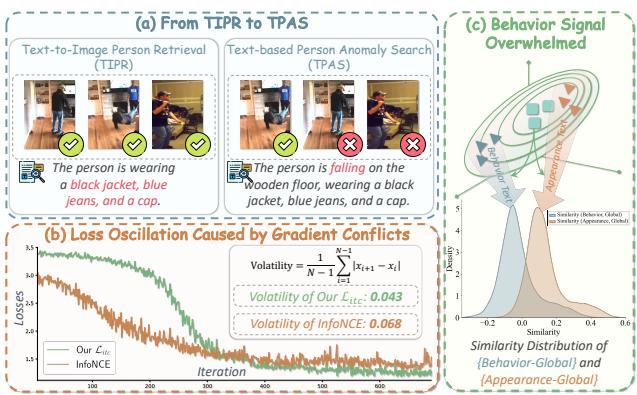  
Figure 1. (a) illustrates examples of TIPR and TPAS tasks. (b) displays the loss value curves for the InfoNCE loss and our COL-enhanced $\mathcal { L } _ { i t c }$ (detailed in Sec. 3.3 and 3.4) on the PAB dataset for TPAS, illustrating the loss oscillation phenomenon caused by gradient conflict. (c) illustrates that within global features, the feature strength of the appearance signal is typically significantly greater than that of the behavior signal, which readily leads to the intent mismatch phenomenon.

To bridge the behavioral blind spot in ReID and the identity neglect in traditional visual anomaly detection (Barbalau et al., 2023; Huang et al., 2025; Sampieri et al., 2022; Hirschorn and Avidan, 2023; Flaborea et al., 2023), Yang et al. (Yang et al., 2025) introduced the Text-based Person Anomaly Search (TPAS) task (Yang et al., 2025; Zhang et al., 2026; Xie et al., 2026). As shown in right side of Figure 1 (a), TPAS aims to retrieve a specific pedestrian from a large-scale image database using a natural language query describing both appearance and behavior (normal or abnormal), e.g., “the man in the blue jacket who is falling down” (Yang et al., 2026).

TPAS requires both fine-grained appearance discrimination from person re-identification (ReID) and subtle behavior perception from anomaly detection, posing a fundamental invariance–sensitivity conflict. Specifically, the model must learn appearance features invariant to behavioral changes for identity recognition, while remaining sensitive to postural variations for behavior recognition. A natural solution is to disentangle the feature learning of “invariant” appearance and “sensitive” behavior, for example, by using independent identity and behavior expert streams. However, this seemingly reasonable disentanglement scheme, under the unique data distribution of the TPAS task, inevitably induces the following two deeper technical challenges.

C1: Gradient Conflict in Granular Alignment. We observe that hard negative samples in the TPAS task (e.g., “the same man in a blue jacket who is standing”) are designed to share identity with the positive sample (e.g., “the man in the blue jacket who is falling down”). A conventional contrastive objective therefore receives competing signals in an appearance-sensitive stream: identity similarity favors preserving the pair’s proximity, whereas behavior mismatch favors separating it. This conflict is induced by the joint retrieval objective and does not imply that the corresponding expert stream is assigned an explicit semantic label. As illustrated in Figure 1(b), the COL-enhanced objective exhibits smaller loss fluctuations than standard InfoNCE on PAB, indicating improved optimization stability rather than directly proving semantic disentanglement.

C2: Aggregation Distortion of the Alignment Paradigm. Furthermore, another traditional “Aggregate-then-Align” paradigm is also incompatible with the disentanglement scheme. As illustrated in Figure 1(c), if the identity and behavior features are forcibly aggregated (e.g., via concatenation or summation) into a single global vector, the feature strength of the appearance signal can be significantly greater than that of the behavior signal. This aggregation can cause the strong identity (appearance) signal to overwhelm the weak yet critical behavior signal. Moreover, this context-agnostic global feature cannot respond to the dynamic intent of the text (for instance, when querying “falling down,” the focus should be primarily on behavior features), leading to an “intent mismatch.”

To address these challenges, we propose GradCO (Behavior-Aware Gradient-Conflict Offloading), a TPAS framework that combines three complementary designs. (a) Behavior-Aware Mixture-of-Experts (B-MoE) forms appearance, normal-behavior, and abnormal-behavior streams, whose relative roles emerge from retrieval training without expert-specific semantic labels. (b) Conflict Ofload Learning (COL) introduces pairconditioned ofload anchors on the text side to redirect conflict-bearing gradients from hard negatives away from the main text representations. (c) Hierarchical Intent Alignment (HIA) uses textconditioned weights to aggregate expert similarities and features, mitigating signal domination and intent mismatch.

The main contributions are summarized as:

• We identify and analyze two TPAS-specific challenges: gradient conflict from same-identity, diferent-behavior hard negatives and queryagnostic aggregation distortion.

• We propose GradCO, which integrates B-MoE, COL, and HIA for structured expert representation, gradient ofloading, and intent-aware aggregation.

• Experiments on five TPAS/TIPR benchmarks demonstrate improved retrieval, corruption robustness, and out-of-distribution generalization, supported by ablation and visualization results.

## 2. Related Work

Text-based Person Anomaly Search. Text-to Image Person Retrieval (TIPR) retrieves pedestrians from natural-language descriptions (Jiang et al., 2024; Gu et al., 2023; Chen et al., 2022, 2026; Gao et al., 2021; Song et al., 2022; Li et al., 2022; Song et al., 2023; Niu et al., 2020; Qian et al., 2017; Wang et al., 2020; Li et al., 2025; Song et al., 2026). Existing work uses crossmodal attention (Hu et al., 2026; Park et al., 2024; Sheng et al., 2023; Shao et al., 2022; Shu et al., 2022; Wang et al., 2022; Li et al., 2026a), auxiliary cues (Aggarwal et al., 2020; Jing et al., 2020; Li et al., 2026b), task-specific objectives (Sarafianos et al., 2019; Liu et al., 2019; Zheng et al., 2020), and vision-language pretraining or large language models (Jiang and Ye, 2023; Shu et al., 2022; Bi et al., 2026a; Bai et al., 2023; Song et al., 2024; Aniri et al., 2026b; Han et al., 2021; Hu et al., 2025; Bi et al., 2026b; Yan et al., 2023; Bi et al., 2026c; Li et al., 2023a) to align images and text (Li et al., 2026c; Fu et al., 2026b; Chen et al., 2025; Li et al., 2026d). In parallel, Video Anomaly Detection (VAD) identifies deviations from normal patterns through latent-, skeleton-, and reconstruction-based paradigms (Barbalau et al., 2023; Huang et al., 2025; Sampieri et al., 2022; Yuan and Kitani, 2020; Nguyen et al., 2019; Wu et al., 2025; Tang et al., 2025; Gong et al., 2019; Chong and Tay, 2017). TPAS unifies these settings by requiring retrieval conditioned on both pedestrian appearance and normal or anomalous behavior (Yang et al., 2025). Yet TIPR and VAD methods generally optimize identity matching and behavior recognition separately, leaving their joint alignment unresolved. GradCO addresses this gap by learning a query-responsive joint rep resentation that preserves identity-consistent ap pearance cues while retaining behavior-sensitive evidence for TPAS retrieval.

Mixtures of Experts. Mixture-of-Experts (MoE) architectures route inputs to multiple experts and have been applied to large-model optimization, multitask learning, transfer learning, and ReID (Jacobs et al., 1991; Fedus et al., 2022; Chen et al., 2023; Zoph et al., 2022; Jaiswal et al., 2025; Li et al., 2023b, 2026e; Xu et al., 2022; Liu et al.,

2024). ReID MoE methods mainly model modality variation, biometric-factor fusion, or domain generalization (Liu et al., 2024; Feng et al.; Su et al., 2025). GradCO extends MoE to this setting by redirecting conflicting optimization signals during granular alignment and making expert aggregation responsive to text intent, so identity consistency and behavior sensitivity can coexist under TPAS hard negatives.

## 3. Methodology

GradCO organizes coupled appearance, normalbehavior, and anomal-behavior semantics into parallel expert streams, while ofload anchors mitigate alignment-related gradient conflicts. As shown in Figure 2, GradCO consists of three jointly trained components: (a) Behavior-Aware Mixture-of-Experts (B-MoE, detailed in Sec. 3.2); (b) Conflict Ofload Learning (COL, detailed in Sec. 3.3); and (c) Hierarchical Intent Alignment (HIA, detailed in Sec. 3.4). We first define the TPAS task and then describe each component.

## 3.1. Problem Formulation

The TPAS task is defined as follows: given a textual query describing the appearance of a pedestrian and a specific normal or abnormal behavior, the objective is to retrieve images from a large scale database where the pedestrian matches both the identity and the described behavior. Formally, given a set of image text pairs $\mathcal { T } = \{ ( x _ { \mathbb { T } } , x _ { \mathbb { I } } ) _ { n } \} _ { n = 1 } ^ { N }$ (where $x _ { \mathbb { T } }$ and $x _ { \mathbb { I } }$ denote the text and image, respectively, and � is the total number of pairs), the objective is to learn a text encoder $\Phi _ { \mathbb { T } }$ and an image encoder $\Phi _ { \mathbb { I } }$ that map the corresponding text and image into a unified embedding space, such that $\Phi _ { \mathbb { T } } ( x _ { \mathbb { T } } ) \to \Phi _ { \mathbb { I } } ( x _ { \mathbb { I } } )$

## 3.2. Behavior-Aware Mixture-of-Experts (B-MoE)

To model appearance and behavior cues with different invariance and sensitivity requirements, we design the Behavior-Aware Mixture-of-Experts (B-MoE) module. As shown in Figure 2(a), B-MoE constructs three parallel streams for appearance, normal behavior, and abnormal behavior, which provide the representations for subsequent crossmodal alignment.

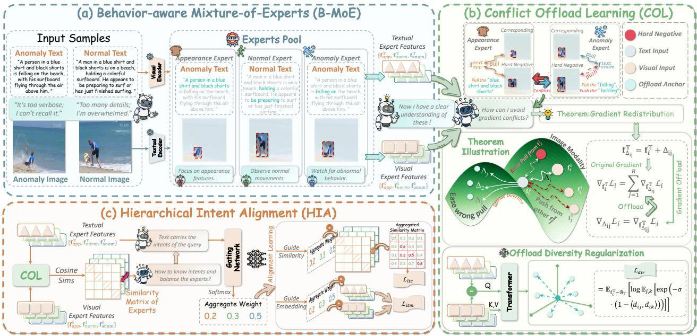  
Figure 2. Overview of GradCO. B-MoE learns three input-dependent streams whose names denote posttraining routing preferences rather than supervised semantic labels. COL predicts pair-conditioned ofload anchors for expert-pair similarities, while HIA aggregates expert similarities and features with query-conditioned weights.

Expert Construction. For each modality, every stream contains � sub-experts and a streamspecific gating network. We use the text-side abnormal-behavior stream as an example. Given the text encoder output, the sub-experts process the input from diferent perspectives and are dynamically combined by $\mathcal { G } _ { e x t }$

$$
\mathbf { H } _ { a n o m } ^ { \mathbb { T } } = \sum _ { k = 1 } ^ { K } \mathbf { w } _ { e x t , a n o m } ^ { \mathbb { T } , k } \odot E _ { a n o m } ^ { \mathbb { T } , k } \big ( \Phi _ { \mathbb { T } } ( x _ { \mathbb { T } } ) \big ) ,\tag{1}
$$

where $\mathbf { H } _ { a n o m } ^ { \mathbb { T } } \in \mathbb { R } ^ { S \times D }$ , � is the text sequence length, � is the embedding dimension, and $\mathbf { w } _ { e x t , a n o m } ^ { \mathbb { T } , k }$ is the scalar weight of the �-th sub-expert. The appearance and normal-behavior streams use the same construction to obtain $\mathbf { H } _ { a p p } ^ { \mathbb { T } }$ and $\mathbf { H } _ { n o r m } ^ { \mathbb { T } }$ . Although all streams share the encoder output, their independent experts and gates produce diferent input-dependent representations.

Implicit Specialization. Since three initial representations share the same encoder output, we reweight each according to input context. For the abnormal-behavior stream, the top-level gate $\mathcal { G } _ { t o p } ^ { \mathbb { T } }$ produces a scalar weight $\mathbf { w } _ { t o p , a n o m } ^ { \mathbb { T } } \in \mathbb { R } ^ { 1 } .$ , yielding:

$$
{ \mathbf { U } } _ { a n o m } ^ { \mathbb { T } } = { \mathbf { W } } _ { t o p , a n o m } ^ { \mathbb { T } } \odot { \mathbf { H } } _ { a n o m } ^ { \mathbb { T } } .\tag{2}
$$

The appearance and normal-behavior streams use their corresponding top-level gates to obtain $\mathbf { U } _ { a p p } ^ { \mathbb { T } }$ and $\mathbf { U } _ { n o r m } ^ { \mathbb { T } }$ . No stream-specific semantic labels are used; all sub-experts and gates are jointly optimized by the image-text alignment and matching objectives.

Finally, text projection produces the global text expert features $\mathbf { f } _ { a p p } ^ { \mathbb { T } } , \mathbf { f } _ { n o r m } ^ { \mathbb { T } } , \mathbf { f } _ { a n o m } ^ { \mathbb { T } } \in \mathbb { R } ^ { D }$ . The image branch follows the same procedure with its own modality-specific experts and gates, producing ${ \bf U } _ { a p p } ^ { \mathbb { I } } , { \bf U } _ { n o r m } ^ { \mathbb { I } } , { \bf U } _ { a n o m } ^ { \mathbb { I } } \in \mathrm { ~ \mathbb { R } ^ { C \times D } ~ }$ , where � is the number of image patches. After image projection, we obtain the global image expert features $\mathbf { f } _ { a p p } ^ { \mathbb { I } } , \mathbf { f } _ { n o r m } ^ { \mathbb { I } } , \mathbf { f } _ { a n o m } ^ { \mathbb { I } } \in \mathbb { R } ^ { D }$

## 3.3. Conflict Ofload Learning (COL)

To address the gradient conflict problem, we design the Conflict Ofload Learning (COL) module based on the expert features from B-MoE. As shown in Figure 2(b), it introduces pairconditioned ofload anchors for each expert and modifies the gradient path of contrastive learning, thereby providing an ofload path for the conflicts caused by “same-identity, diferent-behavior” hard negatives.

Ofload-anchor formulation. Before describing the implementation of COL, we first formulate the efect of an ofload anchor on gradient propagation. For a batch of � paired samples, let S denote image-text similarity matrix, where $s _ { i j } = \cos ( \mathbf { f } _ { i } ^ { \mathbb { T } } , \mathbf { f } _ { j } ^ { \mathbb { I } } )$ . The InfoNCE loss is defined as follows,

$$
\mathcal { L } _ { \mathrm { N C E } } ( \mathbf { S } ) = - \frac { 1 } { B } \sum _ { i = 1 } ^ { B } \log \left( \frac { \exp ( s _ { i i } / \tau ) } { \sum _ { j = 1 } ^ { B } \exp ( s _ { i j } / \tau ) } \right) ,\tag{3}
$$

where � is the temperature coeficient.

For each sample pair, we introduce an ofload anchor $\Delta _ { i j }$ and redefine the similarity as follows,

$$
\begin{array} { r } { \hat { s } _ { i j } = \cos ( \mathbf { f } _ { i } ^ { \mathbb { T } } + \Delta _ { i j } , \mathbf { f } _ { j } ^ { \mathbb { I } } ) . } \end{array}\tag{4}
$$

Let $\begin{array} { r } { \hat { p } _ { i j } = \exp ( \hat { s } _ { i j } / \tau ) / \sum _ { \ell = 1 } ^ { B } \exp ( \hat { s } _ { i \ell } / \tau ) , y _ { i j } = \mathbf { 1 } _ { [ j = i ] } } \end{array}$ $\mathbf { g } _ { i j } = \nabla _ { \mathbf { Z } _ { i j } } \hat { s } _ { i j }$ with $\begin{array} { r } { \mathbf { z } _ { i j } = \mathbf { f } _ { i } ^ { \mathbb { T } } + \Delta _ { i j } } \end{array}$ , and $\mathbf { J } _ { i j } = \partial \Delta _ { i j } / \partial \mathbf { f } _ { i } ^ { \mathbb { T } }$ The corresponding gradients are

$$
\begin{array} { r l } & { \nabla _ { \Delta _ { i j } } \mathcal { L } _ { i } = \frac { \hat { P } _ { i j } - y _ { i j } } { \tau } \mathbf { g } _ { i j } , } \\ & { \nabla _ { \mathbf { f } _ { i } ^ { \intercal } } \mathcal { L } _ { i } = \displaystyle \sum _ { j = 1 } ^ { B } ( \mathbf { I } + \mathbf { J } _ { i j } ) ^ { \intercal } \nabla _ { \Delta _ { i j } } \mathcal { L } _ { i } , } \end{array}\tag{5}
$$

where I is the identity matrix. The first line gives the gradient through the ofload path, while the second accounts for both the direct path through $\mathbf { f } _ { i } ^ { \mathbb { T } } + \Delta _ { i j }$ and the dependence of the predicted anchor on the text feature through $\mathbf { J } _ { i j }$

We focus on text-side gradients because text acts as the dynamic query while image gallery remains fixed at retrieval time. The pairconditioned anchor absorbs part of conflicting alignment pressure while preserving text feature’s semantic content.

Conflict ofloading. For each expert image-text pair $( \mathbf { f } _ { i } ^ { \mathbb { T } } , \mathbf { f } _ { j } ^ { \mathbb { I } } )$ , COL computes an ofload anchor from their feature diference and the image expert tokens. We illustrate the process using the abnormal-behavior expert:

$$
\begin{array} { r } { \Delta _ { \mathrm { a n o m } } ^ { i j } = \mathrm { T F } _ { \mathrm { a n o m } } \Big ( Q = \mathbf { f } _ { \mathrm { a n o m } , i } ^ { \mathbb { T } } - \mathbf { f } _ { \mathrm { a n o m } , j } ^ { \mathbb { I } } , } \\ { \{ K , V \} = \mathbf { U } _ { \mathrm { a n o m } , j } ^ { \mathbb { I } } \Big ) , } \end{array}\tag{6}
$$

where $\mathrm { T F _ { a n o m } }$ denotes the Transformer used by the abnormal-behavior expert. The corresponding ofload-based similarity is as follows,

$$
s _ { \mathrm { a n o m } , i j } = \cos \left( \mathbf { f } _ { \mathrm { a n o m } , i } ^ { \mathbb { T } } + \Delta _ { \mathrm { a n o m } } ^ { i j } , \mathbf { f } _ { \mathrm { a n o m } , j } ^ { \mathbb { I } } \right) .\tag{7}
$$

The appearance and normal-behavior experts follow the same procedure, yielding $\pmb { S } _ { \mathrm { a p p } }$ and $\mathbf { S } _ { \mathrm { n o r m } } .$

Direction diversity regularization. To prevent the ofload anchors from collapsing into similar directions, we introduce:

$$
\begin{array} { r l } & { \mathcal { L } _ { \mathrm { d i r } } = \mathbb { E } _ { \mathbf { f } _ { \mathrm { a n o m } , i } ^ { \intercal } \sim \mathcal { B } _ { \intercal } } [ \log \mathbb { E } _ { j \neq k } [ } \\ & { \qquad \exp \Big ( - \sigma \big ( 1 - \langle d _ { i j } , d _ { i k } \rangle \big ) \Big ) \Big ] ] , } \end{array}\tag{8}
$$

where $\mathcal { B } _ { \mathbb { T } }$ denotes the text samples in the batch, � is a scaling factor, and $d _ { i j }$ and $d _ { i k }$ are the normalized forms of $\Delta _ { \mathrm { a n o m } } ^ { i j }$ and $\Delta _ { \mathrm { a n o m } } ^ { i k } ,$ , respectively. $\langle \cdot , \cdot \rangle$ denotes cosine similarity. This regularizer encourages diferent pair-conditioned anchors associated with the same text query to maintain distinct directions.

## 3.4. Hierarchical Intent Alignment (HIA)

To address aggregation distortion, we design Hierarchical Intent Alignment (HIA). As shown in Figure 2(c), HIA predicts query-conditioned weights from text expert features and uses them to aggregate expert similarities and features.

Query-conditioned similarity aggregation. Taking the text side as an example, we feed the three global expert features from B-MoE into the text intent gating network $\mathcal { G } _ { H } ^ { \mathbb { T } }$ . For the �-th text query, it produces ${ \mathbf W } _ { g a t e , i } ^ { \mathbb T } \in { \mathbb R } ^ { 3 } \colon$

$$
\begin{array} { r } { \mathbf { W } _ { g a t e , i } ^ { \mathbb { T } } = { \mathrm { S o f t m a x } } \Big ( \mathcal { G } _ { H } ^ { \mathbb { T } } \big ( \mathrm { C o n c a t } [ \mathbf { f } _ { a p p , i } ^ { \mathbb { T } } , } \\ { \mathbf { f } _ { n o r m , i } ^ { \mathbb { T } } , \mathbf { f } _ { a n o m , i } ^ { \mathbb { T } } ] \big ) \Big ) , } \end{array}\tag{9}
$$

where $\mathbf { W } _ { g a t e , i } ^ { \mathbb { T } } = [ w _ { a p p , i } ^ { \mathbb { T } } , w _ { n o r m , i } ^ { \mathbb { T } } , w _ { a n o m , i } ^ { \mathbb { T } } ]$ . For a textimage pair $( i , j )$ , these weights aggregate the expert similarities as $\begin{array} { r } { { S } _ { \mathrm { f i n a l } } ^ { i j } \ = \ \sum _ { r \in \mathcal { K } } { w } _ { r , i } ^ { \top } { S } _ { r } ^ { i j } } \end{array}$ , where $\mathcal { K } = \{ a p p$ , ����, ����}. We then optimize the bidirectional image-text contrastive loss:

$$
\mathcal { L } _ { \mathrm { { i } t c } } = \frac { 1 } { 2 } \left[ \mathcal { L } _ { \mathrm { { N C E } } } ( \pmb { S } _ { \mathrm { { f i n a l } } } ) + \mathcal { L } _ { \mathrm { { N C E } } } ( \pmb { S } _ { \mathrm { { f i n a l } } } ^ { \top } ) \right] ,\tag{10}
$$

where $\mathcal { L } _ { \mathrm { N C E } } ( \cdot )$ is defined in Eq. (3). This loss jointly trains expert streams and HIA gate, allowing their relative contributions to adapt to each query.

Intent-aware feature aggregation and matching. Following CMP (Yang et al., 2025), we further introduce an image-text matching loss to model semantic combinations. We reuse the weights in Eq. (9) to aggregate the text expert features as $\begin{array} { r } { \mathbf { f } _ { \mathrm { f i n a l } , i } ^ { \mathbb { T } } = \sum _ { r \in \mathcal { K } } w _ { r , i } ^ { \mathbb { T } } \mathbf { f } _ { r , i } ^ { \mathbb { T } } } \end{array}$ . For each imagetext pair, the same weights are applied to the corresponding image expert features. The resulting representations are fused by last six layers of BERT, which act as a cross encoder and produce the matching logit $s _ { i t m }$ . We optimize the binary cross-entropy loss $\mathcal { L } _ { i t m }$ using the label $y _ { i t m } \in \{ 0 , 1 \}$

Finally, the overall objective is as follows,

$$
\begin{array} { r } { \Theta ^ { * } = \underset { \Theta } { \arg \operatorname* { m i n } } \left( \mathcal { L } _ { i t c } + \mathcal { L } _ { i t m } + \gamma \mathcal { L } _ { d i r } \right) , } \end{array}\tag{11}
$$

where � weights the direction-diversity regularizer. Following previous works (Yang et al., 2025; Cao et al., 2025), the coeficients of $\mathcal { L } _ { i t c }$ and $\mathcal { L } _ { i t m }$ are set to 1.

## 4. Experiments

In this section, we evaluate GradCO on the target TPAS task and conventional TIPR benchmarks, followed by ablation, sensitivity, and qualitative analyses.

## 4.1. Experimental Settings

## 4.1.1. Datasets.

For TPAS, we use PAB (Yang et al., 2025) as the in-distribution benchmark, Multi-Weather to evaluate robustness to weather corruptions, and UCC as the out-of-distribution (OOD) test set. For TIPR, we evaluate on CUHK-PEDES (Li et al., 2017), ICFG-PEDES (Ding et al., 2021), RSTPReID (Zhu et al., 2021), and UFineBench (Zuo et al., 2024), which includes the UFine6926 and UFine3C settings.

Table 1. Performance comparison on PAB dataset. Best results are in bold, and sub-optimal is underlined.
<table><tr><td>Method</td><td>#Data</td><td>R@1 47.57</td><td>R@5</td><td>R@10</td><td>mAP</td></tr><tr><td>CLIP (ICML&#x27;21) X-VLM (ICML&#x27;22) RaSa (IJCAI&#x27;23)</td><td></td><td></td><td>81.55</td><td>89.03</td><td>62.73 83.96</td></tr><tr><td rowspan="3">APTM (MM&#x27;23) IRRA (CVPR&#x27;23)</td><td rowspan="3"></td><td>71.94 21.74</td><td>97.78 27.30</td><td>98.99 27.96</td><td>24.35</td></tr><tr><td>22.90</td><td>45.80</td><td>52.38</td><td>33.56</td></tr><tr><td>30.59</td><td>59.61</td><td>68.91</td><td>44.41</td></tr><tr><td>MRA (arXiv&#x27;25)</td><td></td><td>9.91</td><td>23.66</td><td>31.45</td><td>17.15</td></tr><tr><td>WoRA (WWW&#x27;25) CAMeL (TIFS&#x27;25)</td><td></td><td>22.25 24.47</td><td>45.91</td><td>53.54</td><td>33.39</td></tr><tr><td>CLIP (ICML&#x27;21)</td><td>0.1M 0.1M</td><td>77.60</td><td>50.00</td><td>58.75</td><td>36.75</td></tr><tr><td>X-VLM (ICML&#x27;22)</td><td></td><td>81.95</td><td>98.84 98.84</td><td>99.75 99.19</td><td>87.35</td></tr><tr><td>RaSa (IJCAI&#x27;23)</td><td>0.1M</td><td>80.79</td><td></td><td></td><td>89.86</td></tr><tr><td>APTM (MM&#x27;23)</td><td>0.1M</td><td></td><td>98.89</td><td>99.65</td><td>89.20</td></tr><tr><td></td><td>0.1M</td><td>72.14</td><td>95.30</td><td>97.17</td><td>82.78</td></tr><tr><td>IRRA (CVPR&#x27;23)</td><td>0.1M</td><td>76.39</td><td>97.62</td><td>99.14</td><td>86.33</td></tr><tr><td>MRA (arXiv&#x27;25)</td><td>0.1M</td><td>70.53</td><td>94.69</td><td>97.47</td><td>81.59</td></tr><tr><td>WoRA (WWW&#x27;25)</td><td>0.1M</td><td>74.47</td><td>96.82</td><td>98.48</td><td>84.60</td></tr><tr><td>CAMeL (TIFS&#x27;25)</td><td></td><td>74.30</td><td>96.79</td><td>98.84</td><td>84.20</td></tr><tr><td>CMP (ICCV&#x27;25)</td><td>0.1M</td><td>83.06</td><td>98.89</td><td>99.49</td><td>90.41</td></tr><tr><td>GradCO (Ours)</td><td>0.1M</td><td>85.39</td><td>99.34</td><td>99.60</td><td>92.13</td></tr><tr><td>CMP (ICCV&#x27;25)</td><td>1M</td><td>84.93</td><td>99.09</td><td>99.75</td><td>91.66</td></tr><tr><td>GradCO (Ours)</td><td>1M</td><td>86.60</td><td>99.60</td><td>99.75</td><td>92.88</td></tr></table>

PAB. Pedestrian Anomaly Behavior (PAB) Yang et al. (2025) is a benchmark for text-based person anomaly search, which retrieves pedestrians engaged in normal or anomalous activities using natural-language descriptions. It contains 1,015,583 image-text pairs, including 1,013,605 synthetic training pairs generated with difusion models using descriptions from OOPS! as prompts, and 1,978 real-world test pairs from OOPS!. PAB covers 1,600 anomalous action types (e.g., falling and being hit) and 1,000 normal action types (e.g., running and playing soccer). Its frame-level descriptions cover appearance, actions, and scenes, with an average length of 50.3 words; the training set uses an anomalousto-normal ratio of 3:2. To construct the test set, OpenPose and ResNet-50 are used for filtering, followed by professional manual verification. Qwen2-VL generates the test descriptions, which are then checked through human quality control.

Multi-Weather Setting of PAB. Multi-Weather is an evaluation protocol applied to the PAB test set to measure retrieval robustness under weather and lighting corruptions. It includes ten conditions: Normal, Wind, Rain, Snow, Rain+Snow, Dark, Dark+Wind, Dark+Rain, Dark+Snow, and Over-exposure. We report results for each condition and their arithmetic mean.

Table 2. Performance comparison on the PAB dataset of multi-weather test setting, measured by R@1 and mAP for each weather. Our model is highlighted in light purple, and the overall best results are indicated in bold.
<table><tr><td>Method</td><td>Normal</td><td></td><td>Wind</td><td>Rain</td><td>Snow</td><td>Rain+Snow</td><td>Dark</td><td></td><td>Dark+Wind</td><td>Dark+Rain</td><td></td><td>Dark+Snow</td><td>Over-exposure</td><td></td><td>Mean</td></tr><tr><td></td><td>R@1</td><td>mAP R@1</td><td>mAP</td><td>R@1 mAP</td><td>R@1 mAP</td><td>R@1 mAP</td><td>R@1</td><td>mAP R@1</td><td>mAP</td><td>R@1</td><td>mAP</td><td>R@1 mAP</td><td>R@1</td><td>mAP</td><td>R@1 mAP</td></tr><tr><td>X-VLM (ICML&#x27;22)</td><td>83.47</td><td>90.94</td><td>79.02 88.10</td><td>54.40 67.40</td><td>59.10</td><td>49.95</td><td>62.09 79.58</td><td>88.24</td><td>75.53 85.47</td><td>34.93</td><td>45.98</td><td>50.25</td><td>63.32 74.87</td><td>84.82</td><td>64.11 74.87</td></tr><tr><td>CMP (ICCV&#x27;25)</td><td>84.93</td><td>91.66 81.24</td><td>89.34</td><td>60.06 72.53</td><td>72.34 63.40 75.74</td><td>54.85</td><td>67.31 80.89</td><td>89.00</td><td>77.20 86.55</td><td>39.03</td><td>50.58</td><td>53.49</td><td>66.12 76.09</td><td>85.56</td><td>67.12 77.44</td></tr><tr><td>GradCO (Ours)</td><td>86.60</td><td>92.88 83.69</td><td>91.25</td><td>68.00 78.85</td><td>69.55 80.68</td><td>61.77</td><td>69.20 83.24</td><td>90.08</td><td>82.08 89.33</td><td>47.38</td><td>55.22</td><td>60.31</td><td>70.21 79.32</td><td>88.95</td><td>72.20 80.67</td></tr></table>

Table 3. Comparisons with existing methods in OOD setting. Best results are indicated in bold, and the overall second-best results are underlined.
<table><tr><td>Method</td><td>R@1</td><td>R@5</td><td>R@10</td><td>mAP</td></tr><tr><td>CLIP (ICML&#x27;21)</td><td>51.60</td><td>68.31</td><td>76.43</td><td>43.05</td></tr><tr><td>X-VL (ICML&#x27;22)</td><td>52.33</td><td>66.73</td><td>72.54</td><td>40.87</td></tr><tr><td>APTM (MM&#x27;23)</td><td>27.86</td><td>40.41</td><td>46.77</td><td>22.61</td></tr><tr><td>IRRA (CVPR&#x27;23)</td><td>40.28</td><td>57.24</td><td>65.98</td><td>33.53</td></tr><tr><td>RaSa (IJCAI&#x27;23)</td><td>54.12</td><td>70.32</td><td>75.96</td><td>39.71</td></tr><tr><td>CMP (ICCV&#x27;25)</td><td>54.12</td><td>71.07</td><td>77.90</td><td>43.13</td></tr><tr><td>CMP(1M) (ICCV&#x27;25)</td><td>55.23</td><td>71.67</td><td>77.99</td><td>44.35</td></tr><tr><td>GradCO</td><td>61.85</td><td>78.31</td><td>86.09</td><td>51.78</td></tr><tr><td>GradCO (1M)</td><td>62.53</td><td>78.81</td><td>86.89</td><td>52.01</td></tr></table>

UCC. UCC is a real-world test set for evaluating out-of-distribution (OOD) generalization from PAB to an unseen data source. It is derived from UCF-Crime and contains 5,320 image-text pairs. The images are selected keyframes from 13 normal and anomalous video categories, and Qwen2- VL generates the corresponding textual descriptions.

CUHK-PEDES. CUHK-PEDES Li et al. (2017) is a text-to-image person retrieval benchmark containing 40,206 images and 80,440 descriptions from 13,003 identities. Its training set contains 34,054 images, 68,126 descriptions, and 11,003 identities; the test set contains 3,074 images, 6,156 descriptions, and 1,000 identities.

ICFG-PEDES. ICFG-PEDES Ding et al. (2021) contains 54,522 images from 4,102 identities, with a text description paired with each image. Its training set contains 34,674 images from 3,102 identities, and its test set contains 19,848 images from the remaining 1,000 identities.

Table 4. Performance comparison on TIPR task datasets. Best results are shown in bold, and the second-best results are underlined.
<table><tr><td rowspan="2">Method</td><td rowspan="2">CUHK Avg</td><td rowspan="2">ICFG Avg</td><td rowspan="2">RSTP Avg</td><td colspan="2">UFineBench</td></tr><tr><td>6926-Avg.</td><td>3C-Avg.</td></tr><tr><td>NAFS (ECCV&#x27;18)</td><td>–</td><td>=</td><td></td><td>76.49</td><td>58.25</td></tr><tr><td>SSAN (arXiv&#x27;21)</td><td></td><td></td><td></td><td>85.52</td><td>67.32</td></tr><tr><td>CMKA (TIP&#x27;21)</td><td>70.07</td><td></td><td></td><td></td><td></td></tr><tr><td>LapsCore (ICCV&#x27;21)</td><td>75.60</td><td></td><td></td><td></td><td></td></tr><tr><td>LGUR (MM&#x27;22)</td><td></td><td></td><td></td><td>81.72</td><td>65.42</td></tr><tr><td>SAF (ICASSP&#x27;22)</td><td>78.38</td><td></td><td></td><td></td><td></td></tr><tr><td>TIPCB (Neuro&#x27;22)</td><td>78.85</td><td></td><td></td><td></td><td></td></tr><tr><td>AXM-Net (MM&#x27;22)</td><td>77.24</td><td></td><td></td><td></td><td></td></tr><tr><td>MANet (TNNLS&#x27;23)</td><td>79.14</td><td>73.00</td><td></td><td></td><td></td></tr><tr><td>CFine (TIP&#x27;23)</td><td>82.22</td><td>73.27</td><td>68.22</td><td></td><td></td></tr><tr><td>IRRA (CVPR&#x27;23)</td><td>85.67</td><td>76.51</td><td>76.57</td><td>90.81</td><td>68.99</td></tr><tr><td>BiLMa (ICCV&#x27;23)</td><td>85.75</td><td>76.57</td><td>77.17</td><td></td><td></td></tr><tr><td>RaSa (IJCAI&#x27;23)</td><td>87.02</td><td>76.93</td><td>81.58</td><td></td><td></td></tr><tr><td>TBPS-CLIP (AAAI&#x27;24)</td><td>84.69</td><td>76.95</td><td>78.08</td><td></td><td></td></tr><tr><td>CADA-G (TMM&#x27;24)</td><td>85.72</td><td>75.71</td><td>77.75</td><td></td><td></td></tr><tr><td>UMSA (AAAI&#x27;24)</td><td>85.89</td><td>77.33</td><td>79.00</td><td></td><td></td></tr><tr><td>FSRL (ICMR&#x27;24)</td><td>86.32</td><td>77.28</td><td>77.77</td><td></td><td></td></tr><tr><td>Propot (MM&#x27;24)</td><td>86.32</td><td>77.89</td><td>78.40</td><td></td><td></td></tr><tr><td>CFAM (CVPR&#x27;24)</td><td>86.83</td><td>77.63</td><td>79.03</td><td>93.86</td><td>74.63</td></tr><tr><td>RDE (CVPR&#x27;24)</td><td>86.73</td><td>79.17</td><td>79.73</td><td></td><td></td></tr><tr><td>Bi-IRRA (TPAMI&#x27;25)</td><td>88.77</td><td>79.79</td><td>84.17</td><td>95.18</td><td>1</td></tr><tr><td>GradCO (Ours)</td><td>88.87</td><td>79.85</td><td>84.73</td><td>95.13</td><td>82.01</td></tr></table>

RSTPReID. RSTPReID Zhu et al. (2021) contains 20,505 images of 4,101 identities collected from 15 cameras. Each identity has five images captured by diferent cameras, and each image is annotated with two text descriptions. The dataset is split into 3,701 training, 200 validation, and 200 test identities.

UFineBench. UFineBench Zuo et al. (2024) contains UFine6926 and the UFine3C evaluation set. UFine6926 has 26,206 images and 52,412 descriptions from 6,926 identities. Its descriptions are ultra-fine-grained, with an average length of 80.8 words. The training set contains 18,577 images and 37,154 descriptions from 4,926 identities, while the test set contains 7,629 images and 15,258 descriptions from 2,000 identities. UFine3C evaluates retrieval across domains, text granularities, and writing styles. It is formed by sampling 750 identities from the test sets of each of CUHK-PEDES, ICFG-PEDES, and UFine6926, representing coarse-, medium-, and fine-grained descriptions, respectively. Qwen-14B and Llama2- 70B are used to restructure the original descriptions, and the generated text is manually revised. UFine3C contains 2,250 identities, 7,446 images, and 37,939 text queries.

Table 5. Comparison of computational eficiency and performance between GradCO and the baseline method CMP. GradCO is highlighted in light purple.
<table><tr><td>Method</td><td>Parameters(M)</td><td>GPU Memory(MiB)</td><td>Test time(s/sample)</td><td>Train Time(s/iteration)</td><td>PAB-Avg</td><td>MultiWeather-Avg</td><td>UCC(OOD)-Avg</td></tr><tr><td>CMP</td><td>226.13</td><td>14575 (bs=22)</td><td>0.0015</td><td>0.5326 (bs=22)</td><td>94.59</td><td>67.12</td><td>68.30</td></tr><tr><td>GradCO (Ours)</td><td>247.36</td><td>18413 (bs=22)</td><td>0.0023</td><td>0.7213 (bs=22)</td><td>95.32</td><td>72.19</td><td>76.08</td></tr></table>

## 4.1.2. Implementation details.

Following previous works (Cao et al., 2025), GradCO is initialized with the encoder weights of X2VLM (Zeng et al., 2023). We use the AdamW optimizer with a batch size of 22 and a weight decay of 0.01. B-MoE contains � = 4 sub-experts, and direction-diversity regularization weight is set to � = 0.5. All experiments are conducted on a NVIDIA V100 GPU with 32GB memory and trained for 10 epochs .

Evaluation. For TPAS, we report Recall@K (R@K, � ∈ {1, 5, 10}) and mean Average Precision (mAP). For TIPR, R-Avg is the arithmetic mean of R@1, R@5, and R@10. On Multi-Weather, we report R@1 and mAP for each of the ten weather conditions and their arithmetic means. PAB-Avg and UCC(OOD)-Avg follow the corresponding protocols. Higher scores indicate better retrieval performance.

## 4.2. Performance Comparison

We compare GradCO with existing methods on the TPAS and TIPR tasks. For TPAS, we evaluate in-distribution retrieval on PAB, robustness under the Multi-Weather protocol, and transfer to the UCC out-of-distribution (OOD) test set. We then evaluate whether the same model remains efective on conventional TIPR benchmarks.

## 4.2.1. TPAS task

PAB evaluation. Table 1 reports the results on PAB under the 0.1M and 1M gallery settings. GradCO achieves the highest R@1, R@5, and mAP in both settings, and ties CMP at 1M R@10. Under the 0.1M setting, GradCO improves R@1 from 83.06 to 85.39 and mAP from 90.41 to 92.13 over CMP. Under the 1M setting, the corresponding gains are 1.67 and 1.22 percentage points. These results show that GradCO improves text-to-image retrieval when the query combines identity-related appearance with normal or anomalous behavior.

Multi-Weather evaluation. Table 2 reports R@1 and mAP under ten weather conditions. GradCO achieves the highest value for both metrics in every condition, including the challenging “Dark+Rain” setting. Its mean R@1 and mAP are 72.2 and 80.67, compared with 67.12 and 77.44 for CMP. The consistent gains across conditions indicate that the multistream representation and query-conditioned aggregation remain efective when the visual evidence is degraded by weather changes.

OOD evaluation. Table 3 evaluates transfer to UCC. With the 1M gallery, GradCO improves over CMP from 55.23 to 62.53 in R@1 and from 44.35 to 52.01 in mAP, corresponding to gains of 7.30 and 7.66 percentage points. The improvement is also observed in the 1M gallery setting, showing that GradCO transfers more efectively to the tested OOD domain.

## 4.2.2. TIPR task

TIPR evaluation. Table 4 summarizes the average R@K on five TIPR evaluation sets. GradCO obtains the highest score on CUHK-PEDES, ICFG-PEDES, RSTPReID, and UFine3C. On UFine6926, Bi-IRRA reaches 95.18, while GradCO obtains 95.13. The largest improvement appears on

(a) Single-expert removal  
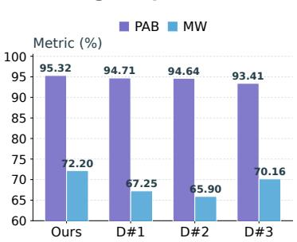

(b) Branch and full-expert removal  
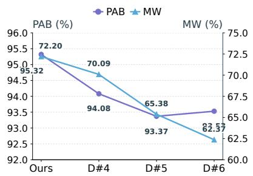  
(c) OOD sensitivity rankin

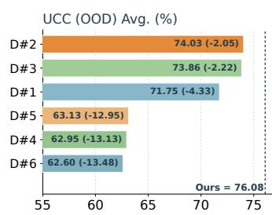  
D#1: w/o e\_app | D#2: w/o e\_norm | D#3: w/o e\_anorm | D#4: w/o e\_image | D#5: w/o e\_text | D#6: w/o expert  
Figure 3. Ablation results for the B-MoE module. (a) Single-expert removal, (b) branch and full-expert removal, and (c) UCC performance ranking across ablation variants. Variant definitions are listed below the panels.

UFine3C, where GradCO reaches 82.01 compared with 74.63 for CFAM. These results show that the appearance–behavior modeling and intentconditioned matching developed for TPAS also improve retrieval under conventional and crossdomain TIPR settings.

## 4.3. Eficiency Evaluation Analysis

To assess eficiency and resource consumption, we compare CMP and GradCO under the same hardware conditions and batch size of 22. Results are reported in Table 5.

GradCO has 247.36M parameters, compared with 226.13M for CMP. This increase mainly comes from B-MoE, which processes appearance, normal behavior, and anomalous behavior through separate expert streams and their subexperts. This design is associated with retrieval scores of 95.32% on PAB and 76.08% on UCC (OOD).

GradCO uses 18,413 MiB of GPU memory, compared with 14,575 MiB for CMP. This higher training memory consumption is partly due to COL, which computes pair-conditioned ofload anchors for expert streams during training to mitigate gradient conflicts caused by “same identity, diferent behavior” hard negatives.

At inference, GradCO takes 2.3 ms per sample, compared with 1.5 ms for CMP, an absolute increase of 0.8 ms (53.3%). This overhead mainly comes from HIA, which uses text-conditioned gating to aggregate expert similarities. Despite the increase, the 2.3 ms per-sample retrieval latency indicates that GradCO can support real-time retrieval in text-based person anomaly search. Meanwhile, Multi-Weather-Avg improves from 67.12% to 72.19%, and UCC (OOD)-Avg from 68.30% to 76.08%. These results show that GradCO improves retrieval performance under weather corruptions and distribution shifts while maintaining low-latency inference, making it suitable for integration into real-time anomaly-search systems.

## 4.4. Ablation Studies

We evaluate the contributions of B-MoE, COL, and HIA under the common training and evaluation settings described in Sec. 4.1. All values are compared with the complete GradCO model.

B-MoE. As shown in Fig. 3, removing the appearance (D#1), normal-behavior (D#2), and anomaly-behavior (D#3) streams reduces PAB-Avg to 94.71, 94.64, and 93.41, respectively, and Multi-Weather-Avg to 67.25, 65.90, and 70.16. Removing the image-side experts (D#4) or textside experts (D#5) lowers UCC-Avg to 62.95 and 63.13; removing B-MoE entirely (D#6) further reduces it to 62.60. These complementary gains indicate that appearance, normal-behavior, and anomaly-behavior information jointly improve retrieval performance.

COL. As shown in Fig. 4(a), removing the directional diversity regularizer (D#7) lowers UCC-Avg to 70.58, while removing the ofload-anchor path (D#8) further reduces it to 55.43. The larger performance drop indicates that the pairconditioned anchor is the primary mechanism for mitigating gradient conflicts between samples with the same identity but diferent behaviors. The directional diversity regularizer helps prevent anchor collapse and maintain efective gradient ofloading.

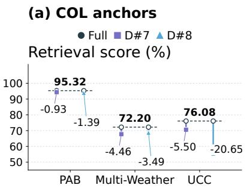

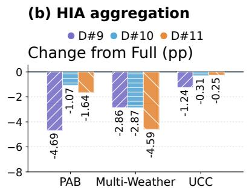

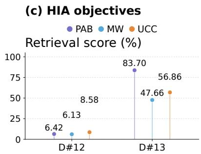  
D#7: w/o dir\_var | D#8: w/o off\_anchor | D#9: w/o HIA\_agg\_sims | D#10: w/o HIA\_intent D#11: w/o HIA\_agg\_feat | D#12: w/o HIA\_align | D#13: w/o matching

Figure 4. Ablation results for COL and HIA. (a) Efects of removing COL components, with arrows indicating score changes relative to Ours. (b) Performance changes after removing HIA aggregation components. (c) Retrieval performance after removing HIA training objectives. Variant definitions are listed below the panels.  
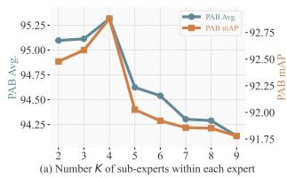

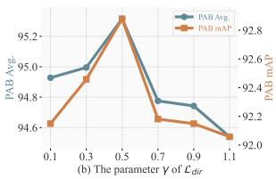  
Figure 5. Sensitivity to the hyper-parameters (a) number of sub-experts �, and (b) � on PAB datasets.

HIA. As shown in Fig. 4(b), removing similarity aggregation (D#9, w/o HIA\_agg\_sims) reduces PAB-Avg by 4.69 points. Removing intent weighting (D#10, w/o HIA\_intent) and feature aggregation (D#11, w/o HIA\_agg\_feat) primarily afects PAB and Multi-Weather, indicating that expert information should be dynamically aggregated according to text intent. Removing the imagetext contrastive objective (D#12, w/o HIA\_align) causes performance to nearly collapse. Removing the matching objective (D#13, w/o matching) reduces PAB-Avg, Multi-Weather-Avg, and UCC-Avg to 83.70, 47.66, and 56.86. These results show that intent aggregation and both training objectives jointly support retrieval performance.

## 4.5. Sensitivity Analysis

To analyze the sensitivity of GradCO to the number of B-MoE sub-experts and the directiondiversity weight �, we vary both hyperparameters and report the results in Figure 5. For both parameters, the performance first increases and then decreases. Setting � = 4 provides suficient perspectives for separating appearance and behavior cues, whereas a larger value (e.g., � ≥ 5) may over-partition features and make experts focus on local details. The best performance is obtained at � = 0.5, which helps prevent anchor collapse. A larger � over-constrains anchor directions, while a smaller value provides insuficient regularization, leading to less reliable ofloading and stronger residual conflicts. We use � = 4 and $\gamma = 0 . 5$ in all experiments.

## 4.6. Mechanism Analysis

## 4.6.1. Performance Analysis on PAB Test Subsets (Normal vs. Anomaly)

To validate the efectiveness of GradCO in addressing the “invariance” versus “sensitivity” conflict inherent in feature learning, we partitioned the PAB test set into two subsets: PAB-Normal (regular behaviors) and PAB-Anomaly (anomalous behaviors). This division aims to separately evaluate the decoupling capability of the model in terms of identity preservation and fine-grained action capture. As shown in Table 6, compared to the baseline model CMP, GradCO achieved performance improvements across all metrics on both subsets, with the specific analysis as follows:

Table 6. Performance comparison between GradCO and the baseline model CMP on the two subsets (normal and anomaly) of PAB. GradCO is highlighted in light purple, and the overall best results are shown in bold.
<table><tr><td rowspan="2">Method</td><td colspan="2">PAB-Normal</td><td colspan="2">PAB-Anomaly</td></tr><tr><td>R@1</td><td>mAP</td><td>R@1</td><td>mAP</td></tr><tr><td>CMP</td><td>85.04</td><td>92.04</td><td>83.22</td><td>90.24</td></tr><tr><td>GradCO (Ours)</td><td>86.55</td><td>92.82</td><td>86.65</td><td>92.94</td></tr></table>

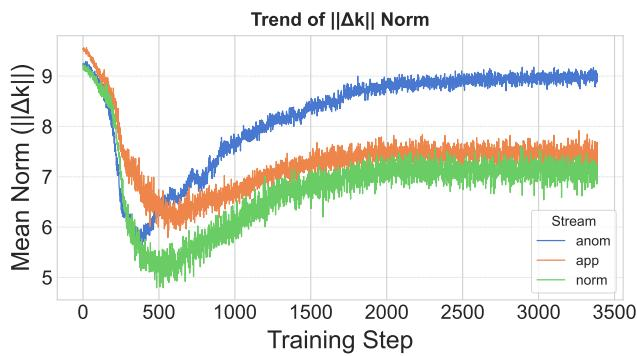  
Figure 6. Evolution of the ofload anchor norm (||Δ�||) in the COL module during training. The curves exhibit a trend of initial decline followed by a rise and stabilization. Notably, the anomaly behavior stream (anom) consistently maintains a higher magnitude compared to the appearance (app) and normal behavior (norm) streams.

1) On the PAB-Normal subset, GradCO elevates the R@1 metric from the baseline of 85.04% to 86.55%. This demonstrates that after the Behavior-Aware Mixture-of-Experts (B-MoE) disentangles highly coupled semantics into independent expert streams, it does not compromise the capability of the model to extract appearance features. Coupled with Conflict Ofload Learning (COL) for the mitigation of gradient conflict among experts, the model maintains robust identity recognition performance when processing regular behaviors.

2) On the PAB-Anomaly subset, the performance of CMP exhibits a decline, with its R@1 being only 83.22% (lower than its performance on PAB-Normal). This is attributed to its traditional “Aggregate-then-Align” paradigm causing “Aggregation Distortion”, which renders subtle anomaly behavior signals susceptible to being overwhelmed by strong appearance features. In contrast, GradCO achieves an R@1 of 86.65% and an mAP of 92.94% on this subset. Benefiting from the intent-guided dynamic aggregation of Hierarchical Intent Alignment (HIA) and the ofload anchors mechanism of COL, the model successfully preserves and precisely aligns crucial evidence of anomaly behavior without the need for additional supervision signals.

## 4.6.2. The Evolution Analysis of Ofload Anchors Δ

To characterize the evolution of COL’s offload anchors during training, we track their norms and their cosine similarity with the textimage semantic diference across the appearance, normal-behavior, and anomalous-behavior streams. These metrics describe the anchors’ magnitude and direction relative to the main alignment signal.

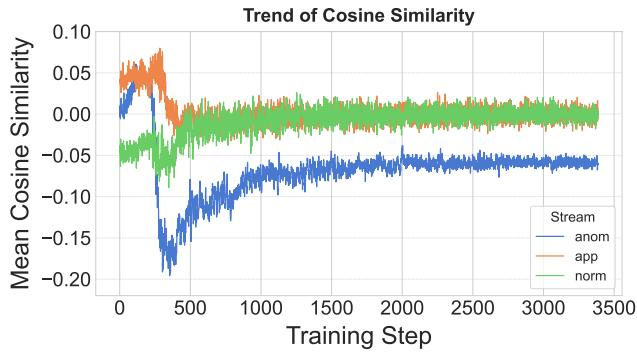  
Figure 7. Trend of cosine similarity between offload anchors $\Delta _ { k }$ and the main feature semantic diference. The similarities for all streams stabilize near 0, indicating that $\Delta _ { k }$ remains approximately orthogonal to the main feature subspace. The anomaly stream (anom) shows a consistent, slight negative deviation (approximately -0.1) compared to the other streams.

Figure 6 shows that anchor norms first decrease, then rise, and finally stabilize. During the first 500 steps, the model builds a coarse global feature space, and the anchors remain small. From steps 500 to 2,000, as training focuses more on hard negatives with the same identity but diferent behaviors, anchor norms increase, consistent with COL adapting its correction strength to fine-grained alignment conflicts. The anomaly stream maintains the largest norm (approximately 9.0), followed by the appearance stream (approximately 7.5) and the normalbehavior stream (approximately 7.0). This pattern is consistent with the greater dificulty of preserving subtle anomaly cues against strong appearance signals.

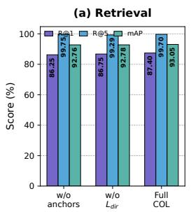

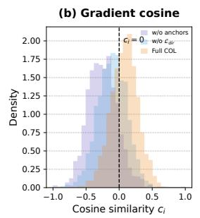

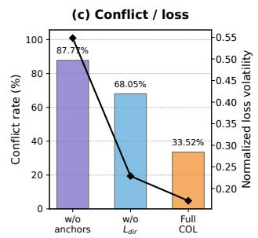

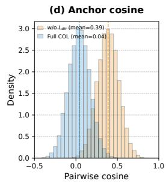  
Figure 8. Mechanistic analysis of how COL resolves identity–behavior conflicts. (a) Retrieval performance comparison among diferent COL variants. (b) Gradient cosine similarity between identitypreserving and behavior-discriminative optimization signals. (c) Optimization stability measured by normalized loss volatility. (d) Directional diversity of learned ofload anchors.

Figure 7 shows that the cosine similarity between the anchors and the text-image semantic diference remains near zero throughout training, indicating that the anchors tend to introduce corrections in directions distinct from the main alignment signal. The anomaly stream has a slight negative ofset (approximately −0.1), suggesting a weak opposing component for this stream. Together, these trends show that COL learns stable, stream-dependent corrections while preserving the main semantic alignment direction. The stable late-stage curves are also consistent with $\mathcal { L } _ { d i r }$ helping prevent anchor-direction collapse.

Table 7. Optimization diagnostics of COL variants. Gradient conflict rate and loss volatility measure optimization interference, while retrieval margin and anchor directional similarity characterize retrieval separation and ofload geometry, respectively.
<table><tr><td>Method</td><td>→  $V _ { \mathcal { L } } \downarrow$   $r _ { \mathrm { c o n f } }$ </td><td>m ↑</td><td> $\mu _ { \Delta } \downarrow$ </td></tr><tr><td>w/o anchors</td><td>87.0% 0.072</td><td>0.18</td><td></td></tr><tr><td>w/o  $\mathcal { L } _ { d i r }$ </td><td>45.4% 0.043</td><td>0.46</td><td>0.681</td></tr><tr><td>Full COL</td><td>12.2% 0.019</td><td>0.78</td><td>0.129</td></tr></table>

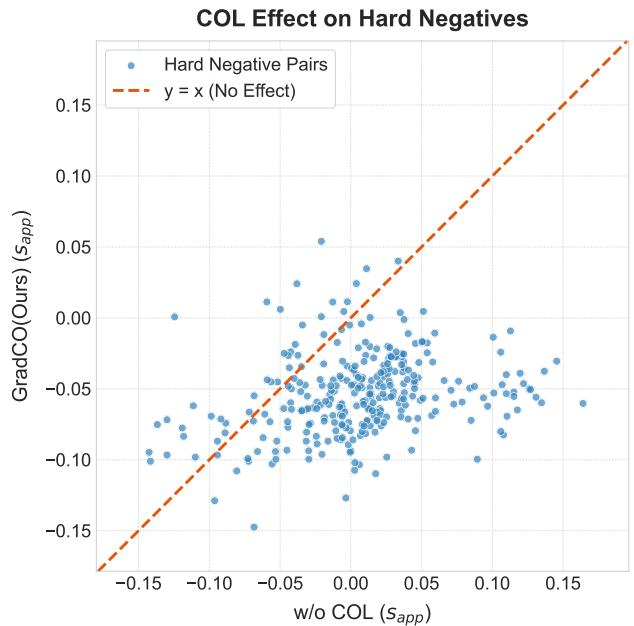  
Figure 9. Instance-level correction of hard negatives by COL. The scatter plot compares appearance-expert similarity scores before and after applying COL on the same hard negative pairs. Most samples fall below the diagonal $y = x ,$ indicating that COL suppresses confusing similarity responses.

## 4.6.3. How COL Resolves Identity–Behavior Conflicts

This section analyzes the optimization mechanism of COL from three perspectives: gradient interaction, optimization stability, and anchor geometry. In TPAS, hard negatives often share similar identity-related appearance information while exhibiting diferent behaviors, creating competing optimization signals between identity preservation and behavior discrimination.

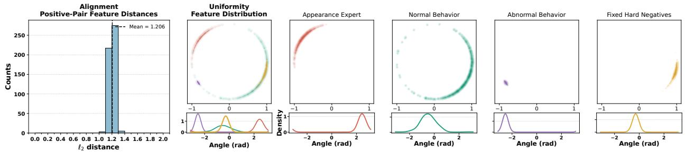  
(a) w/o COL · positive-pair mean = 1.206

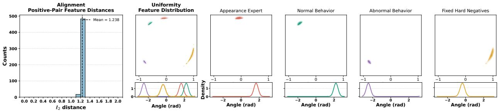  
(b) w/o Ldir · positive-pair mean = 1.238

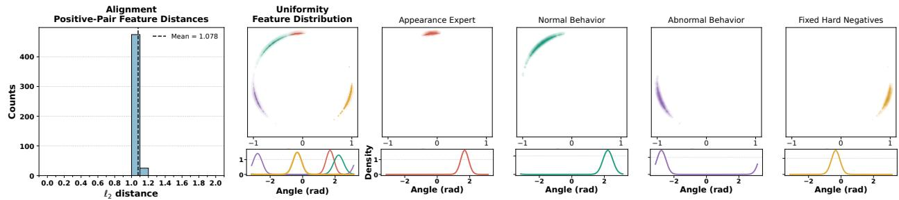  
(c) Full COL · positive-pair mean = 1.078  
Figure 10. Feature alignment and embedding geometry analysis of COL. Each row corresponds to (a) w/o COL, (b) $\mathrm { C O L } \mathrm { w } / { 0 } \mathcal { L } _ { d i r }$ , and (c) Full COL. The left column shows positive-pair text-image feature distances. The middle column presents the global feature distribution and angular density. The right columns show the projected distributions of Appearance Expert, Normal Behavior, Abnormal Behavior, and fixed hard negatives.

COL introduces sample-specific ofload anchors to provide an additional optimization pathway for conflict-sensitive information. For expert branch $k ,$ the anchor is generated as

$$
\Delta _ { i j } ^ { k } = T F _ { k } \big ( Q = f _ { k , i } ^ { T } - f _ { k , j } ^ { I } , K , V = f _ { k , j } ^ { I } \big ) ,\tag{12}
$$

and the similarity is reformulated as

$$
S _ { i j } ^ { k } = \cos ( f _ { k , i } ^ { T } + \Delta _ { i j } ^ { k } , f _ { k , j } ^ { I } ) ,\tag{13}
$$

where ${ \boldsymbol { \Delta } } _ { i j } ^ { k }$ provides a sample-specific correction direction while preserving the original feature pathway for identity-related representation.

Gradient conflict reduction. We quantify the interaction between positive attraction and hardnegative repulsion by measuring their gradient cosine similarity. Let ${ \bf g } _ { i } ^ { + }$ and $\pmb { g } _ { i } ^ { - }$ denote the corresponding gradients propagated to the same textside representation:

$$
c _ { i } = \frac { \langle \mathbf { g } _ { i } ^ { + } , \mathbf { g } _ { i } ^ { - } \rangle } { \| \mathbf { g } _ { i } ^ { + } \| _ { 2 } \| \mathbf { g } _ { i } ^ { - } \| _ { 2 } + \epsilon } .\tag{14}
$$

A negative cosine value indicates conflicting optimization directions. The conflict rate is computed as

$$
r _ { \mathrm { c o n f } } = \frac { 1 } { N } \sum _ { i } \mathbb { 1 } [ c _ { i } < 0 ] .\tag{15}
$$

The hardest negative sample is selected from non-

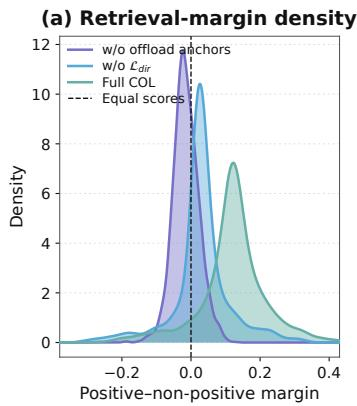

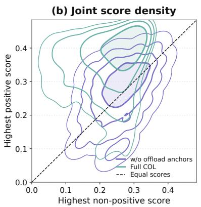

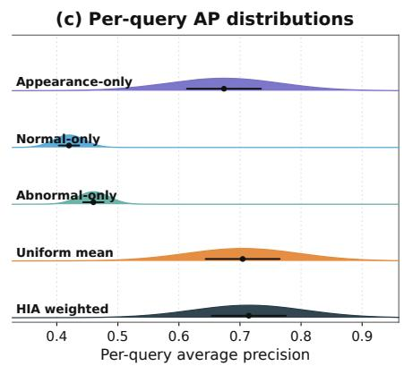  
Figure 11. Retrieval separation and adaptive expert aggregation analysis. (a) KDE of query-level retrieval margins $m _ { i } = s _ { i } ^ { + } - s _ { i } ^ { - }$ under diferent COL variants. (b) Joint density of the highest positive and non-positive scores, illustrating the score redistribution induced by COL. (c) Query-level AP distributions of individual experts, uniform averaging, and HIA-weighted aggregation.

matching candidates within the same mini-batch according to the highest similarity score.

Optimization stability and retrieval separation. To evaluate optimization stability, we measure normalized loss volatility:

$$
V _ { \mathcal { L } } = \frac { { \mathrm { S t d } } ( \{ \mathcal { L } _ { t } \} _ { t \in \mathcal { W } } ) } { \mathrm { M e a n } ( \{ \mathcal { L } _ { t } \} _ { t \in \mathcal { W } } ) + \epsilon } .\tag{16}
$$

Meanwhile, retrieval separation is quantified by the gallery-level margin:

$$
m _ { i } = \operatorname* { m a x } _ { j \in \mathcal { P } _ { i } } S _ { i j } - \operatorname* { m a x } _ { j \notin \mathcal { P } _ { i } } S _ { i j } .\tag{17}
$$

Anchor diversity preservation. To investigate the efect of directional regularization, the normalized anchor direction is defined as

$$
d _ { i j } = \frac { \Delta _ { i j } } { \lVert \Delta _ { i j } \rVert _ { 2 } + \epsilon } .\tag{18}
$$

The average directional similarity is calculated as

$$
\mu _ { \Delta } = \frac { 1 } { | Q | } \sum _ { i } \frac { 1 } { | \mathcal { P } _ { i } ^ { \Delta } | } \sum _ { ( j , k ) } \langle d _ { i j } , d _ { i k } \rangle .\tag{19}
$$

Lower $\mu _ { \Delta }$ indicates more diverse anchor directions.

As shown in Fig. 8 and Table 7, COL reduces gradient conflicts, stabilizes optimization, and improves retrieval separation. Removing anchors results in stronger optimization interference, while removing $\mathcal { L } _ { d i r }$ leads to less diverse anchor directions. These results demonstrate that COL resolves identity–behavior conflicts by introducing adaptive sample-specific ofloading pathways.

Instance-level correction of hard negatives. Beyond optimization-level analysis, we further examine the instance-level efect of COL on confusing hard negative samples. Figure 9 compares the appearance-expert similarity scores of the same hard negative pairs before and after introducing COL. Most samples are distributed below the diagonal line $y = x $ , indicating that COL consistently reduces the similarity assigned to hard negatives. This sample-level correction reduces the tendency of behavior-conflicting samples to compete with true matches in the retrieval space, providing additional evidence that the ofload anchors translate optimization benefits into improved discrimination of dificult cases.

## 4.6.4. How COL Improves Feature Alignment and Embedding Geometry

Beyond optimization dynamics, we further investigate how COL afects the geometry of the learned embedding space. Specifically, we analyze three aspects: cross-modal positive-pair alignment, global feature distribution, and the distribution structure of diferent semantic groups. Figure 10 compares the embedding geometry under three settings: w/o COL, COL w/o $\mathcal { L } _ { d i r }$ , and Full COL. All variants use identical feature extraction, projection, and density estimation procedures.

For each ground-truth text-image pair, let $\mathbf { z } _ { i } ^ { \mathbb { T } }$ and $\mathbf { z } _ { i } ^ { \mathbb { I } + }$ denote the $\ell _ { 2 } .$ -normalized text and image embeddings, respectively. The positive-pair alignment distance is defined as

$$
d _ { i } ^ { + } = \left\| \mathbf { z } _ { i } ^ { \mathbb { T } } - \mathbf { z } _ { i } ^ { \mathbb { I } + } \right\| _ { 2 } , \qquad \bar { d } _ { + } = \frac { 1 } { N _ { + } } \sum _ { i = 1 } ^ { N _ { + } } d _ { i } ^ { + } .\tag{20}
$$

A smaller $\bar { d } .$ + indicates better cross-modal alignment between matched text and image representations.

To characterize the global embedding geometry, we further measure feature uniformity in the original normalized feature space:

$$
\mathcal { U } ( \mathbf { Z } ) = \log \left[ \frac { 1 } { N ( N - 1 ) } \sum _ { i \neq j } \exp ( - 2 \| \mathbf { z } _ { i } - \mathbf { z } _ { j } \| _ { 2 } ^ { 2 } ) \right] .\tag{21}
$$

Following previous analysis, a lower value indicates a more uniformly distributed embedding space with reduced local concentration.

For visualization, a shared projection matrix � is applied to obtain two-dimensional representations:

$$
{ \bf p } _ { i } = { \cal P } { \bf z } _ { i } , \qquad { \bf q } _ { i } = \frac { { \bf p } _ { i } } { \| { \bf p } _ { i } \| _ { 2 } + \epsilon } ,\tag{22}
$$

where the angular distribution is estimated using kernel density estimation. The same projection and KDE configurations are applied to all variants for a fair comparison.

As shown in Fig. 10, Full COL achieves the smallest positive-pair distance, with the mean distance reduced to 1.078 compared with 1.206 for w/o COL and 1.238 for COL w/o $\mathcal { L } _ { d i r }$ . This indicates that COL improves the alignment between matched text-image representations.

Meanwhile, removing $\mathcal { L } _ { d i r }$ leads to a more concentrated embedding distribution, suggesting that unconstrained correction directions may reduce the diversity of learned ofsets and distort the feature geometry. In contrast, Full COL maintains a more balanced angular coverage while preserving the separation among diferent semantic groups, including appearance, normal behavior, abnormal behavior, and hard negatives.

## 4.6.5. How Does HIA Improve Query-level $R e \mathrm { - }$ trieval Consistency?

After analyzing the optimization mechanism and feature geometry of COL, we further investigate how HIA improves query-level retrieval consistency through adaptive expert aggregation. All comparisons use the same oficial query set, complete gallery, ground-truth annotations, and evaluation protocol.

To understand the role of expert aggregation, we first analyze the retrieval behavior of diferent semantic branches. The three expert branches capture complementary information, including appearance identity, normal behavior patterns, and abnormal behavior cues. Since diferent queries may rely on diferent semantic factors, fixed expert weighting may not provide optimal retrieval performance.

For query $q _ { i } ,$ let $S _ { i j } ^ { \mathrm { a p p } } , S _ { i j } ^ { \mathrm { n o r m } }$ , and $S _ { i j } ^ { \mathrm { a n o m } }$ denote the similarity scores produced by the three expert branches. Uniform aggregation and HIA aggregation are defined as

$$
S _ { i j } ^ { \mathrm { u n i } } = \frac { 1 } { 3 } \sum _ { k } S _ { i j } ^ { k } , S _ { i j } ^ { \mathrm { H I A } } = \sum _ { k } w _ { i k } S _ { i j } ^ { k } ,\tag{23}
$$

where � ∈ {app, norm, anom}, $\boldsymbol { w } _ { i k }$ denotes the query-conditioned HIA weight.

For each query, we calculate the average precision (AP) under individual experts, uniform aggregation, and HIA aggregation. Figure 11(c) presents the corresponding query-level AP distributions. Individual experts show diferent strengths across queries, while uniform aggregation provides a fixed combination of semantic cues. HIA further improves retrieval consistency by dynamically adjusting expert contributions according to query characteristics.

We further analyze the resulting ranking behavior through positive-negative score separation. For query $q _ { i } ,$ let $\mathcal { P } _ { i }$ denote the set of ground-truth positive samples. The highest positive and nonpositive scores are defined as

$$
s _ { i } ^ { + } = \operatorname* { m a x } _ { j \in \mathcal { P } _ { i } } S _ { i j } , \qquad s _ { i } ^ { - } = \operatorname* { m a x } _ { j \notin \mathcal { P } _ { i } } S _ { i j } .\tag{24}
$$

The retrieval margin is calculated as

$$
m _ { i } = s _ { i } ^ { + } - s _ { i } ^ { - } .\tag{25}
$$

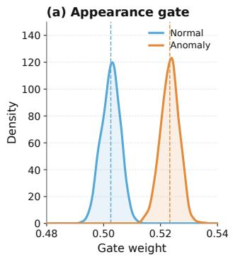

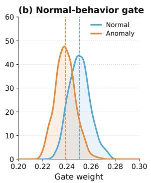

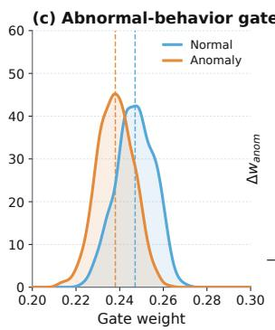

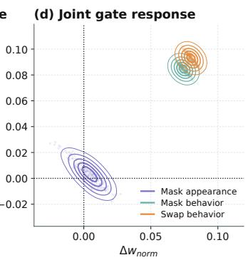  
Figure 12. Query-conditioned expert activation analysis of HIA. (a–c) KDE distributions of appearance, normal-behavior, and abnormal-behavior gate weights for oficial Normal and Anomaly queries. Dashed lines indicate group means. (d) Joint density of paired gate variations under controlled text interventions, including appearance masking, behavior masking, and behavior replacement.

A larger margin indicates a clearer ranking boundary between correct matches and confusing negatives. Figure 11(a) compares the margin distribution under diferent COL settings, while Fig. 11(b) visualizes the joint distribution of $( s _ { i } ^ { - } , s _ { i } ^ { + } )$ . These results characterize how the learned representations translate into final retrieval decisions.

Overall, the analysis demonstrates that HIA improves query-level retrieval consistency by adaptively combining complementary expert representations. Instead of relying on a fixed expert contribution, HIA dynamically adjusts semantic importance according to each query, resulting in more reliable retrieval behavior.

## 4.6.6. How Does HIA Adapt Expert Weights to Query Semantics?

This section analyzes whether HIA performs query-dependent expert adaptation by examining gate distributions and controlled text interventions. For each test query, we extract the three expert weights $\mathbf { w } _ { i } = ( w _ { i , \mathrm { a p p } } , w _ { i , \mathrm { n o r m } } , w _ { i , \mathrm { a n o m } } )$ and analyze their responses under diferent semantic conditions.

The three weights satisfy

$$
w _ { i , \mathrm { a p p } } + w _ { i , \mathrm { n o r m } } + w _ { i , \mathrm { a n o m } } = 1 , \qquad w _ { i , k } \in [ 0 , 1 ] .\tag{26}
$$

Figure 12(a–c) shows the KDE distributions of the three expert weights for oficial Normal and Anomaly queries. The distributions reveal diferent routing preferences between the two query groups: Normal queries assign relatively larger weights to normal-behavior experts, while Anomaly queries increase the contribution of abnormal-behavior experts. Meanwhile, the appearance expert maintains a distinct weighting pattern across the two groups, indicating that HIA considers both identity and behavior-related semantics during aggregation.

To further examine whether the gate responds to explicit semantic changes, we perform controlled text interventions. For each query with deterministic semantic phrases, we construct modified descriptions by masking appearance phrases, masking behavior phrases, or replacing behavior descriptions. All interventions preserve the same gallery and evaluation protocol.

For intervention condition �, the paired gate variation is defined as

$$
\begin{array} { r } { \Delta w _ { i , k } ^ { ( c ) } = w _ { i , k } ^ { ( c ) } - w _ { i , k } ^ { ( \mathrm { f u l l } ) } . } \end{array}\tag{27}
$$

Figure 12(d) presents the joint density of $\Delta w _ { i , \mathrm { n o r m } }$ and $\Delta w _ { i , \mathrm { a n o m } }$ . The intervention results show that changing behavior-related descriptions induces coordinated shifts between normal- and abnormal-behavior expert weights, whereas appearance masking mainly afects the corresponding routing response with limited behavior-gate variation. These observations indicate that HIA dynamically adjusts expert importance according to query semantics rather than relying on fixed expert aggregation.

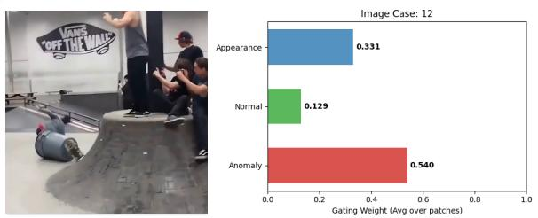  
Caption: The image shows a person wearing a light blue jacket and a dark capin in what appears to be a large, modern indoor space with glass walls and shelves. He is in a gray trash bin, which is on a skateboard. The person is in motion, with his arm extended.

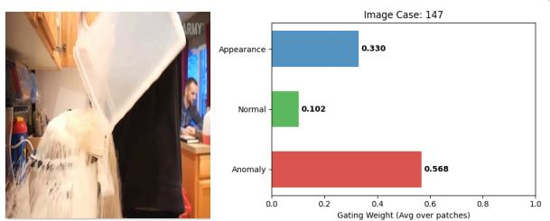  
Caption: In a kitchen setting, A person wearing a black hoodie is pouring rice from a large plastic container into a rice cooker, and the rice is spilling out entirely from the container. The kitchen has wooden cabinets and a red water filter on the countertop. In the background, another person is seated at a table, engaged in an activity.

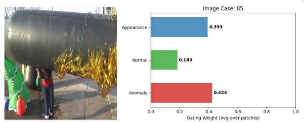  
Caption: A person is standing outdoors, wearing a red sweater and blue jeans, with her head obscured by a large inflatable object. The inflatable has a black base and gold tinsel. To the left, there is a green inflatable Christmas tree with a wrapped gift at its base.

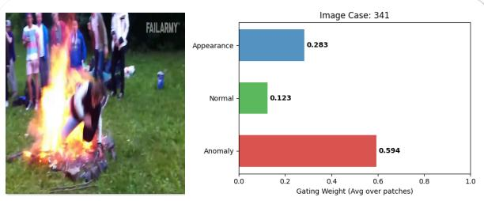

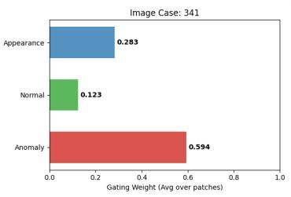  
Caption: The image shows a person in a black and white outfit falling into a large fire in an outdoor setting. The fire is surrounded by a group of onlookers, some of whom are wearing casual clothing.  
Figure 13. Representative visualization of B-MoE gating weights for selected anomaly examples. The anomaly-behavior stream receives relatively higher weights in the shown cases, while the appearance stream remains actively weighted. These examples illustrate input-dependent routing preferences learned by the gating network rather than category-level expert assignment.

Together, these analyses demonstrate that HIA provides adaptive expert routing by responding to query semantics. The learned gate weights reflect the relative importance of appearance and behavior cues, enabling flexible aggregation of complementary expert representations.

## 4.7. Qualitative Results

## 4.7.1. Visualization of B-MoE Expert Gating Weights

To analyze whether B-MoE learns inputdependent routing patterns, we visualize the top-level gating weights $\mathbf { w } _ { t o p } ^ { \mathbb { I } }$ generated by $\mathcal { G } _ { t o p } ^ { \mathbb { I } }$ in Figures 13 and 14. The weights correspond to the relative preferences assigned to the appearance $( \mathbf { U } _ { a p p } ^ { \mathbb { I } } )$ , normal-behavior $( \mathbf { U } _ { n o r m } ^ { \mathbb { I } } )$ and anomaly-behavior $( \mathbf { U } _ { a n o m } ^ { \mathbb { I } } )$ streams. Since all experts receive the same encoder input and no expert-specific labels are provided during training, these visualizations should be interpreted as learned routing preferences rather than explicit semantic categorization.

In the selected anomaly examples, the anomalybehavior stream receives relatively larger weights compared with the other streams. For example, Case 341 assigns a weight of 0.594 to the anomaly stream, indicating that the gate increases its preference for this stream under the shown abnormal visual context. Meanwhile, the appearance stream remains nonzero, suggesting that the routing process preserves contributions from multiple expert streams rather than selecting a single exclusive pathway.

For the selected normal examples, the normalbehavior stream obtains higher relative weights in scenarios involving controlled or skillful activities. For instance, in the Rubik’s cube example, the normal-behavior stream receives a weight of 0.529, while the anomaly-behavior stream receives 0.137. This indicates that B-MoE assigns diferent routing preferences according to the observed visual content, allowing diferent expert streams to contribute diferently across samples.

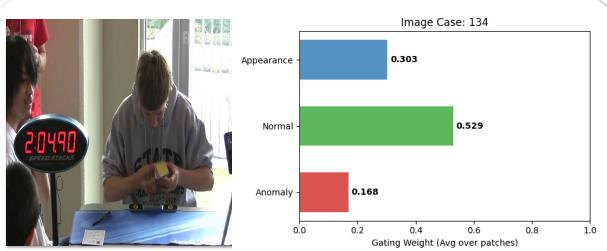  
Caption: The image shows a person solving a Rubik's Cube at a table. The person is wearing a gray hoodie with the word \"STATE\" visible. There is a timer displaying \"2:04.90\" and a blue mat on the table. Another person is standing behind the timer, observing the cube-solving process.

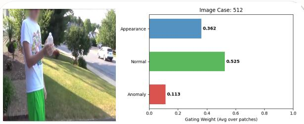  
Caption: A person is standing outdoors, wearing a white tshirt with colorful graphics and green shorts. He is holding a white bottle in his right hand. The background features a suburban setting with green lawns, trees, and a white car driving on the street.

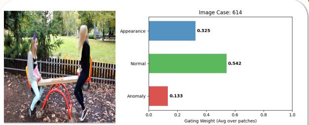  
Caption: Two individuals are playing on a seesaw in a park. One person is wearing a gray sweater, light blue pants, and black shoes, while the other is dressed in a black outfit. The park has green grass, trees, and a wooden fence in the background.

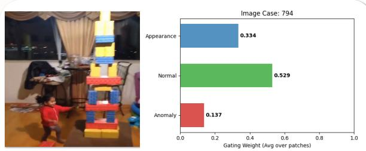  
Caption: A young girl in a red shirt and gray pants is standing in a room with a large, colorful tower of blocks in front of her. The room has a window with curtains, a table with various items, and a chair. The floor is wooden, and there are some toys and a jacket on a chair.  
Figure 14. Representative visualization of B-MoE gating weights for selected normal examples. The normal-behavior stream receives relatively higher weights in the shown controlled or skillful activities, while the anomaly-behavior stream receives lower preferences. The visualization reflects the adaptive routing behavior of B-MoE without implying a predefined semantic boundary among experts.

The appearance stream remains active in the displayed examples, including a weight of 0.393 in Case 85, while behavior-related streams become more prominent when stronger action cues are present. This observation suggests that the learned routing mechanism maintains a balance among diferent expert streams instead of relying exclusively on appearance or behavior information. Overall, these visualizations provide qualitative evidence that the B-MoE gating network learns sample-dependent expert preferences. Together with the quantitative ablation results, they support the motivation of decomposing TPAS representations into multiple specialized streams, illustrating relative expert preferences rather than explicit semantic labels assigned to each expert.

## 4.7.2. Visualization of Hard-negative Feature Separation

To qualitatively analyze the representation structure under challenging identity–behavior conflicts, we visualize the image-to-image cosine similarity matrices of ten selected hard-negative pairs from the PAB test set Yang et al. (2025). The comparison between the X2VLM baseline and GradCO is shown in Figure 15. Both models are evaluated on the same selected samples, and the visualization provides an intuitive comparison of their learned feature organization. Note that this qualitative analysis does not isolate the individual efects of B-MoE and COL, but illustrates the overall representation changes introduced by the proposed framework.

As shown in Figure 15a, the X2VLM baseline exhibits a relatively difuse similarity pattern. Several of-diagonal entries between diferent identities remain highly similar, with values mainly distributed in the range of 0.70–0.80. This indicates that hard-negative samples with similar appearance or behavior-related patterns remain dificult to separate in the learned feature space, leading to ambiguous identity-level representation.

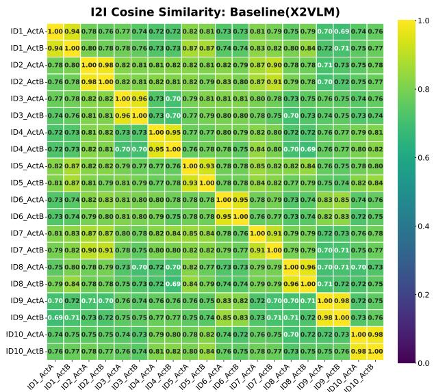  
(a) Image similarity of the baseline X2VLM on ten pairs of positive/hard negative samples.

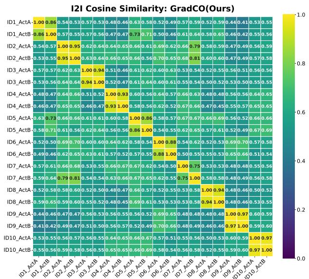  
(b) Image similarity of our GradCO model on ten pairs of positive/hard negative samples.

Figure 15. Visualization of hard-negative feature separation. Image-to-image cosine similarity matrices of ten selected hard-negative pairs from the PAB test set. (a) X2VLM baseline shows a relatively difuse similarity pattern with higher cross-identity similarity. (b) GradCO produces a clearer block-like structure, maintaining higher within-identity similarity while reducing similarity among diferent identities. The visualization qualitatively illustrates improved feature organization under identity–behavior conflicts.  
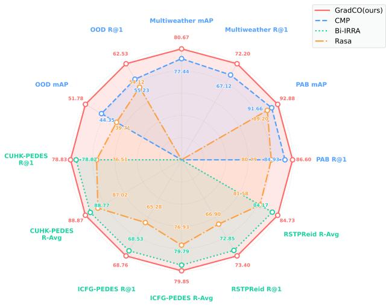  
Figure 16. Radar comparison across the reported TPAS and TIPR metrics. GradCO achieves the strongest performance on the displayed TPAS metrics and obtains competitive results on TIPR benchmarks.

In contrast, Figure 15b shows that GradCO produces a clearer block-like similarity structure. Samples belonging to the same identity maintain higher similarity, while samples from diferent identities show reduced similarity. For example, the similarity between ��1\_���� and ��1\_���� remains high (0.86), whereas some cross-identity pairs, such as ��1 and ��9, are reduced to 0.44. These observations suggest that GradCO learns a more discriminative organization of identityrelated and behavior-related information, improving the separation of confusing hard-negative samples.

## 4.7.3. Multi-dimensional Performance Comparison

As shown in Figure 16, the radar chart summarizes the reported TPAS and TIPR benchmark results to provide an overall view of GradCO’s performance across diferent evaluation settings. Unlike individual metric comparisons, this visualization highlights the relative performance trends among diferent methods, while the detailed numerical comparisons are provided in the main tables.

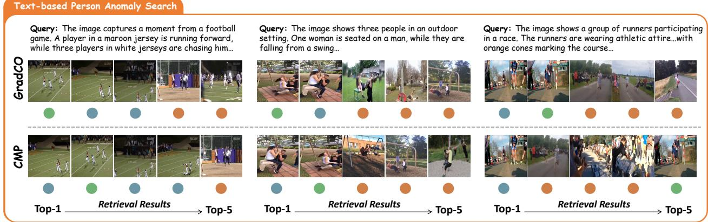  
Figure 17. Case study on PAB. Green dots • represent complete matches, blue dots • represent identical IDs but mismatched behavior, and orange dots • represent complete mismatches.

For TPAS benchmarks, GradCO achieves the strongest performance on the displayed PAB, Multi-Weather, and OOD metrics. In particular, the results on Multi-Weather and UCC indicate improved performance under the tested environmental variations and OOD conditions. These observations demonstrate the efectiveness of GradCO on the evaluated TPAS scenarios, while they do not imply generalization to all possible domain shifts.

For the UCC OOD evaluation, GradCO improves over CMP (1M) by 7.30 and 7.66 percentage points in R@1 and mAP, respectively. These improvements provide empirical evidence of stronger retrieval performance on the tested OOD benchmark. The contribution of individual components is further analyzed through the corresponding ablation studies.

For TIPR benchmarks, GradCO remains competitive across the reported datasets. As summarized in the radar chart and quantitative tables, GradCO achieves the best displayed averages on CUHK-PEDES, ICFG-PEDES, and RSTPReID, leads UFine3C, while Bi-IRRA remains higher on UFine6926 R-Avg. These results indicate that the proposed framework maintains strong crossmodal retrieval capability beyond the TPAS setting.

## 4.8. Case Study

We compare GradCO with the representative baseline CMP on representative queries from the PAB dataset. Figure 17 presents three queries, followed by twelve additional cases in Figure 18. These examples illustrate retrieval under identity– behavior ambiguity, where visually similar candidates may exhibit diferent behaviors.

Results in Figure 17. From left to right, the three queries describe a woman and a man falling from a swing, runners participating in a race, and a football game. GradCO ranks the target first in the first two cases. In the swing example, the query combines appearance cues, such as “woman sitting on a man” and “swing”, with the behavior cue “falling down”. CMP ranks a visually similar image with mismatched behavior first, whereas GradCO retrieves the target at Rank-1. In the third case, GradCO ranks a highly similar hard negative first and the target second, while CMP ranks the target fifth.

Additional successful cases in Figure 18. Reading Figure 18 from left to right and from top to bottom, the first three rows show nine further cases in which GradCO ranks the target at Rank-1. The first row contains the imbalanced-cycling, tilting-gate, and dance-floor cases. In the tiltinggate example, CMP retrieves the same person

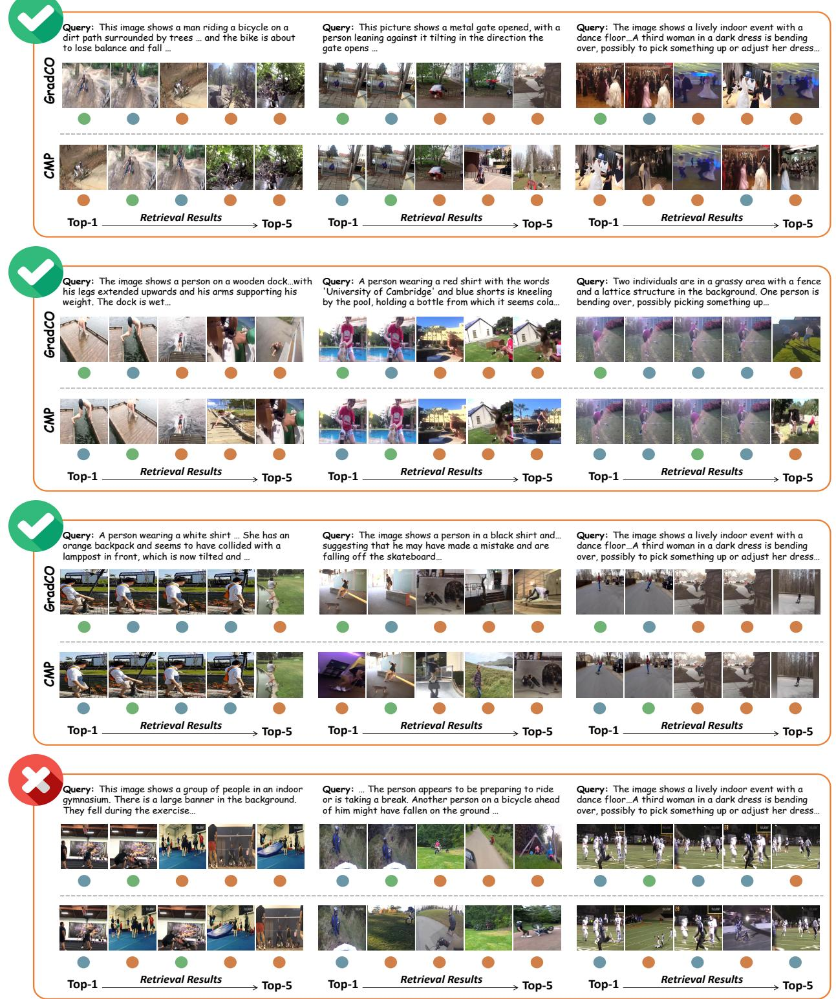  
Figure 18. Qualitative retrieval comparison on PAB. We select twelve representative TPAS cases involving challenging identity–behavior variations. Green dots • indicate complete matches, blue dots • indicate identical identities with mismatched behaviors, and orange dots • indicate complete mismatches.

standing upright in front of the gate, whereas GradCO retrieves the target leaning against it.

The second row contains the handstand-at-thepier, kneeling-with-a-bottle, and bending-overon- grass cases. In the handstand example, CMP retrieves the correct scene and person but mismatches the behavior, while GradCO ranks the handstand target first. The third row contains the lamppost-collision, skateboard-fall, and indoorbending cases. In the lamppost example, GradCO distinguishes the collision moment from a visually similar walking case.

Failure cases. The final row of Figure 18 shows three further queries, including the gymnasium example. In that example, GradCO ranks a sameidentity but behavior-mismatched sample first and the target second, while CMP ranks the target fifth or lower. Thus, in both the football case in Figure 17 and the gymnasium case in Figure 18, GradCO misses Rank-1 but ranks the target above CMP. These cases show that GradCO can provide a more discriminative ordering among dificult candidates, while also indicating that behavior retrieval remains challenging in the presence of highly similar candidates, visual clutter, or complex multi-person interactions.

## 5. Conclusion

In this paper, we investigate the TPAS task and reveal two key challenges of existing decoupling paradigms: gradient conflict and aggregation distortion. To address these challenges, we propose GradCO, a hierarchical Mixture-of-Experts framework that decouples appearance and behavior, alleviates hard-negative-induced optimization conflicts through Conflict Ofload Learning, and enables intent-aware feature aggregation with Hierarchical Intent Alignment. Extensive experiments on five TPAS/TIPR benchmark datasets validate the efectiveness and robustness of our approach.

## References

Xintong Jiang, Yaxiong Wang, Mengjian Li, Yujiao Wu, Bingwen Hu, and Xueming Qian. Cala: Complementary association learning for augmenting comoposed image retrieval. In Proceedings of the 47th International ACM SIGIR

Conference on Research and Development in Information Retrieval, pages 2177–2187, 2024.

Jianyang Gu, Kai Wang, Hao Luo, Chen Chen, Wei Jiang, Yuqiang Fang, Shanghang Zhang, Yang You, and Jian Zhao. Msinet: Twins contrastive search of multi-scale interaction for object reid. In Proceedings of the IEEE/CVF conference on computer vision and pattern recognition, pages 19243–19253, 2023.

Yupeng Hu, Zixu Li, Zhiwei Chen, Qinlei Huang, Zhiheng Fu, Mingzhu Xu, and Liqiang Nie. Refine: Composed video retrieval via shared and diferential semantics enhancement. ACM Transactions on Multimedia Computing, Communications and Applications, 22 (7):1–24, 2026.

Jicheol Park, Dongwon Kim, Boseung Jeong, and Suha Kwak. Plot: Text-based person search with part slot attention for corresponding part discovery. In European Conference on Computer Vision, pages 474–490. Springer, 2024.

Hao Sheng, Shuai Wang, Haobo Chen, Da Yang, Yang Huang, Jiahao Shen, and Wei Ke. Discriminative feature learning with co-occurrence attention network for vehicle reid. IEEE transactions on circuits and systemsfor video technology, 34(5):3510–3522, 2023.

Surbhi Aggarwal, Venkatesh Babu Radhakrishnan, and Anirban Chakraborty. Text-based person search via attribute-aided matching. In Proceedings of the IEEE/CVF winter conference on applications of computer vision, pages 2617–2625, 2020.

Guoshuai Zhao, Chaofeng Zhang, Heng Shang, Yaxiong Wang, Li Zhu, and Xueming Qian. Generative label fused network for image– text matching. Knowledge-Based Systems, 263: 110280, 2023.

Yuhao Chen, Guoqing Zhang, Yujiang Lu, Zhenxing Wang, and Yuhui Zheng. Tipcb: A simple but efective part-based convolutional baseline for text-based person search. Neurocomputing, 494:171–181, 2022.

Ding Jiang and Mang Ye. Cross-modal implicit relation reasoning and aligning for text-to-image

person retrieval. In Proceedings of the IEEE/CVF conference on computer vision and pattern recognition, pages 2787–2797, 2023.

Jinhe Bi, Yifan Wang, Danqi Yan, Xun Xiao, Artur Hecker, Volker Tresp, and Yunpu Ma. Prism: Self-pruning intrinsic selection method for training-free multimodal data selection. ArXiv, abs/2502.12119, 2025a. URL https://api.semanticscholar.org/ CorpusID:276421326.

Wenbing Li, Hang Zhou, Junqing Yu, Zikai Song, and Wei Yang. Coupled mamba: Enhanced multimodal fusion with coupled state space model. Advances in Neural Information Processing Systems, 37:59808–59832, 2024.

Jinhe Bi, Yujun Wang, Haokun Chen, Xun Xiao, Artur Hecker, Volker Tresp, and Yunpu Ma. Llava steering: Visual instruction tuning with 500x fewer parameters through modality linear representation-steering. In Proceedings of the 63rd Annual Meeting of the Associationfor Computational Linguistics (Volume 1: Long Papers), pages 15230–15250, 2025b.

Aniri, Jinhe Bi, Peng Liao, Zengjie Jin, Volker Tresp, Fei Shen, Yunpu Ma, and Tat-Seng Chua. Opd-v: Visual on-policy self-distillation with modality balance, 2026a. URL https: //arxiv.org/abs/2608.05131.

Muhammad Shafique, Faiq Khalid, and Semeen Rehman. Intelligent security measures for smart cyber physical systems. In 2018 21st Euromicro Conference on Digital System Design (DSD), pages 280–287. IEEE, 2018.

Zikai Song, Run Luo, Lintao Ma, Ying Tang, Yi-Ping Phoebe Chen, Junqing Yu, and Wei Yang. Temporal coherent object flow for multi-object tracking. In Proceedings of the AAAI Conference on Artificial Intelligence, volume 39, pages 6978–6986, 2025.

Andrzej Bialas. Intelligent sensors security. Sensors, 10(1):822–859, 2010.

Theodoros Theodoridis and Huosheng Hu. Toward intelligent security robots: A survey. IEEE

Transactions on Systems, Man, and Cybernetics, Part C (Applications and Reviews), 42(6): 1219–1230, 2012.

Yunhuan Yuan, Jian Shao, Mao Zhong, Haoran Wang, Chen Zhang, Jun Wei, Kang Li, Jie Xu, and Weiwei Zhao. Paper information recording and security protection using invisible ink and artificial intelligence. ACS Applied Materials & Interfaces, 13(16):19443–19449, 2021.

Zhiheng Fu, Zixu Li, Zhiwei Chen, Fangxu Liu, Yupeng Hu, Weili Guan, and Liqiang Nie. Egoaction: Egocentric action composition with reliability-aware temporal fusion for the epickitchens action detection challenge at cvpr 2026. arXiv preprint arXiv:2605.24496, 2026a.

Nikos Komninos, Eleni Philippou, and Andreas Pitsillides. Survey in smart grid and smart home security: Issues, challenges and countermeasures. IEEE Communications Surveys & Tutorials, 16(4):1933–1954, 2014.

Antonio Barbalau, Radu Tudor Ionescu, Mariana-Iuliana Georgescu, Jacob Dueholm, Bharathkumar Ramachandra, Kamal Nasrollahi, Fahad Shahbaz Khan, Thomas B Moeslund, and Mubarak Shah. Ssmtl++: Revisiting self-supervised multi-task learning for video anomaly detection. Computer Vision and Image Understanding, 229:103656, 2023.

Shao-Kang Huang, Wei-Yen Wang, and Chen-Chien Hsu. Deploying a skeleton-based video anomaly detection system on edge devices for human activity surveillance. IEEE Embedded Systems Letters, 2025.

Alessio Sampieri, Guido Maria D’Amely di Melendugno, Andrea Avogaro, Federico Cunico, Francesco Setti, Geri Skenderi, Marco Cristani, and Fabio Galasso. Pose forecasting in industrial human-robot collaboration. In European Conference on Computer Vision, pages 51–69. Springer, 2022.

Or Hirschorn and Shai Avidan. Normalizing flows for human pose anomaly detection. In Proceedings ofthe IEEE/CVF International Conference on Computer Vision, pages 13545–13554, 2023.

Alessandro Flaborea, Luca Collorone, Guido Maria D’Amely Di Melendugno, Stefano D’Arrigo, Bardh Prenkaj, and Fabio Galasso. Multimodal motion conditioned difusion model for skeleton-based video anomaly detection. In Proceedings of the IEEE/CVF international conference on computer vision, pages 10318–10329, 2023.

Shuyu Yang, Yaxiong Wang, Li Zhu, and Zhedong Zheng. Beyond walking: A large-scale imagetext benchmark for text-based person anomaly search. In Proceedings of the IEEE/CVF International Conference on Computer Vision, pages 11720–11730, 2025.

Yulun Zhang, Zixu Li, Zhiwei Chen, Zhiheng Fu, Wenbo Wang, Zihang Qiu, Zhilin Wang, Ruxin Wang, and Yupeng Hu. Lightair: Lightweight action inversion and riemannian rectification for text-based person anomaly search. arXiv preprint arXiv:2608.09152, 2026.

Zequn Xie, Guijin Luo, Chuxin Wang, Sihang Cai, Tao Jin, Zhou Zhao, and Yixuan Tang. Bridging the pose-semantic gap: A cascade framework for text-based person anomaly search. In Findings of the Association for Computational Linguistics: ACL 2026, pages 4040–4049, 2026.

Qianyun Yang, Zhiwei Chen, Yupeng Hu, Zixu Li, Zhiheng Fu, and Liqiang Nie. Stable: Eficient hybrid nearest neighbor search via magnitudeuniformity and cardinality-robustness. IEEE Transactions on Knowledge and Data Engineering, 2026.

Zhiwei Chen, Yupeng Hu, Zhiheng Fu, Zixu Li, Jiale Huang, Qinlei Huang, and Yinwei Wei. Intent: Invariance and discrimination-aware noise mitigation for robust composed image retrieval. In AAAI, volume 40, pages 20463– 20471, 2026.

Chenyang Gao, Guanyu Cai, Xinyang Jiang, Feng Zheng, Jun Zhang, Yifei Gong, Pai Peng, Xiaowei Guo, and Xing Sun. Contextual nonlocal alignment over full-scale representation for text-based person search. arXiv preprint arXiv:2101.03036, 2021.

Zikai Song, Junqing Yu, Yi-Ping Phoebe Chen, and Wei Yang. Transformer tracking with cyclic shifting window attention. In Proceedings of the IEEE/CVF conference on computer vision and pattern recognition, pages 8791–8800, 2022.

Shiping Li, Min Cao, and Min Zhang. Learning semantic-aligned feature representation for text-based person search. In ICASSP 2022- 2022 IEEE International Conference on Acoustics, Speech and Signal Processing (ICASSP), pages 2724–2728. IEEE, 2022.

Zikai Song, Run Luo, Junqing Yu, Yi-Ping Phoebe Chen, and Wei Yang. Compact transformer tracker with correlative masked modeling. In Proceedings of the AAAI conference on artificial intelligence, volume 37, pages 2321–2329, 2023.

Kai Niu, Yan Huang, Wanli Ouyang, and Liang Wang. Improving description-based person reidentification by multi-granularity image-text alignments. IEEE Transactions on Image Processing, 29:5542–5556, 2020.

Xueming Qian, Dan Lu, Yaxiong Wang, Li Zhu, Yuan Yan Tang, and Meng Wang. Image reranking based on topic diversity. IEEE Transactions on Image Processing, 26(8):3734–3747, 2017.

Yaxiong Wang, Hao Yang, Xiuxiu Bai, Xueming Qian, Lin Ma, Jing Lu, Biao Li, and Xin Fan. Pfan++: Bi-directional image-text retrieval with position focused attention network. IEEE Transactions on Multimedia, 23:3362–3376, 2020.

Zixu Li, Zhiwei Chen, Haokun Wen, Zhiheng Fu, Yupeng Hu, and Weili Guan. Encoder: Entity mining and modification relation binding for composed image retrieval. In AAAI, volume 39, pages 5101–5109, 2025.

Zikai Song, Junqing Yu, Yi-Ping Phoebe Chen, Wei Yang, and Xinchao Wang. Hypergraphstate collaborative reasoning for multi-object tracking, 2026. URL https://arxiv.org/ abs/2604.12665.

Zhiyin Shao, Xinyu Zhang, Meng Fang, Zhifeng Lin, Jian Wang, and Changxing Ding. Learning

granularity-unified representations for text-toimage person re-identification. In Proceedings of the 30th acm international conference on multimedia, pages 5566–5574, 2022.

Xiujun Shu, Wei Wen, Haoqian Wu, Keyu Chen, Yiran Song, Ruizhi Qiao, Bo Ren, and Xiao Wang. See finer, see more: Implicit modality alignment for text-based person retrieval. In European Conference on Computer Vision, pages 624–641. Springer, 2022.

Zijie Wang, Aichun Zhu, Jingyi Xue, Xili Wan, Chao Liu, Tian Wang, and Yifeng Li. Look before you leap: Improving text-based person retrieval by learning a consistent cross-modal common manifold. In Proceedings of the 30th ACM international conference on multimedia, pages 1984–1992, 2022.

Zixu Li, Yupeng Hu, Zhiwei Chen, Qinlei Huang, Guozhi Qiu, Zhiheng Fu, and Meng Liu. Retrack: Evidence-driven dual-stream directional anchor calibration network for composed video retrieval. In AAAI, volume 40, pages 23373– 23381, 2026a.

Ya Jing, Chenyang Si, Junbo Wang, Wei Wang, Liang Wang, and Tieniu Tan. Pose-guided multigranularity attention network for text-based person search. In Proceedings of the AAAI conference on artificial intelligence, volume 34, pages 11189–11196, 2020.

Zixu Li, Yupeng Hu, Zhiheng Fu, Zhiwei Chen, Yongqi Li, and Liqiang Nie. Tema: Anchor the image, follow the text for multi-modification composed image retrieval. In Proceedings of the 64th Annual Meeting of the Associationfor Computational Linguistics (Volume 1: Long Papers), pages 24421–24442, 2026b.

Nikolaos Sarafianos, Xiang Xu, and Ioannis A Kakadiaris. Adversarial representation learning for text-to-image matching. In Proceedings of the IEEE/CVF international conference on computer vision, pages 5814–5824, 2019.

Jiawei Liu, Zheng-Jun Zha, Richang Hong, Meng Wang, and Yongdong Zhang. Deep adversarial graph attention convolution network for textbased person search. In Proceedings of the 27th

ACM international conference on multimedia, pages 665–673, 2019.

Kecheng Zheng, Wu Liu, Jiawei Liu, Zheng-Jun Zha, and Tao Mei. Hierarchical gumbel attention network for text-based person search. In Proceedings of the 28th ACM international conference on multimedia, pages 3441–3449, 2020.

Jinhe Bi, Danqi Yan, Yifan Wang, Wenke Huang, Haokun Chen, Guancheng Wan, Mang Ye, Xun Xiao, Hinrich Schuetze, Volker Tresp, and Yunpu Ma. The geometry of reasoning: Self-evaluation via layerwise trajectory evolution. In Forty-third International Conference on Machine Learning, 2026a. URL https://openreview.net/ forum?id=WQyrwQwzmK.

Yang Bai, Min Cao, Daming Gao, Ziqiang Cao, Chen Chen, Zhenfeng Fan, Liqiang Nie, and Min Zhang. Rasa: Relation and sensitivity aware representation learning for text-based person search. arXiv preprint arXiv:2305.13653, 2023.

Zikai Song, Ying Tang, Run Luo, Lintao Ma, Junqing Yu, Yi-Ping Phoebe Chen, and Wei Yang. Autogenic language embedding for coherent point tracking. In Proceedings of the 32nd ACM International Conference on Multimedia, pages 2021–2030, 2024.

Aniri, Chen Yilin, Jinhe Bi, Junfei Guo, Donglai Ran, Xu Bian, Zengjie Jin, Yujun Wang, Yijun Tian, Volker Tresp, Fei Shen, Tat-Seng Chua, and Yunpu Ma. Fabrimae i trust myself? self-evaluating vla action generation with markov attention entropy, 2026b. URL https: //arxiv.org/abs/2608.16697.

Xiao Han, Sen He, Li Zhang, and Tao Xiang. Textbased person search with limited data. arXiv preprint arXiv:2110.10807, 2021.

Yangliu Hu, Zikai Song, Na Feng, Yawei Luo, Junqing Yu, Yi-Ping Phoebe Chen, and Wei Yang. Sf2t: Self-supervised fragment finetuning of video-llms for fine-grained understanding. arXiv preprint arXiv:2504.07745, 2025.

Jinhe Bi, Chennan Zhou, Zengjie Jin, Aniri, Shuo Lu, Wenke Huang, Hu Cao, Xun Xiao, Zhihong

Zhu, Volker Tresp, Fei Shen, Yunpu Ma, and Tat-Seng Chua. Reflectrl: Learning from golden negative trajectories via reflective-to-direct reasoning, 2026b. URL https://arxiv.org/ abs/2608.03972.

Shuanglin Yan, Neng Dong, Liyan Zhang, and Jinhui Tang. Clip-driven fine-grained text-image person re-identification. IEEE Transactions on Image Processing, 32:6032–6046, 2023.

Jinhe Bi, Aniri, Minglai Yang, Xingcheng Zhou, Wenke Huang, Sikuan Yan, Yujun Wang, Zixuan Cao, Michael Färber, Xun Xiao, Volker Tresp, and Yunpu Ma. EchoRL: Reinforcement learning via rollout echoing. In Forty-third International Conference on Machine Learning, 2026c. URL https://openreview.net/ forum?id=A6az59SGtF.

Siyuan Li, Li Sun, and Qingli Li. Clip-reid: exploiting vision-language model for image reidentification without concrete text labels. In Proceedings of the AAAI conference on artificial intelligence, volume 37, pages 1405–1413, 2023a.

Zixu Li, Yupeng Hu, Zhiwei Chen, Mingyu Zhang, Zhiheng Fu, and Liqiang Nie. Conesep: Conebased robust noise-unlearning compositional network for composed image retrieval. In Proceedings of the IEEE/CVF Conference on Computer Vision and Pattern Recognition, pages 16897–16909, 2026c.

Zhiheng Fu, Yupeng Hu, Qianyun Yang, Shiqi Zhang, Zhiwei Chen, and Zixu Li. Air-know: Arbiter-calibrated knowledge-internalizing robust network for composed image retrieval. In Proceedings of the IEEE/CVF Conference on Computer Vision and Pattern Recognition, pages 2658–2670, 2026b.

Zhiwei Chen, Yupeng Hu, Zixu Li, Zhiheng Fu, Xuemeng Song, and Liqiang Nie. Ofset: Segmentation-based focus shift revision for composed image retrieval. In ACM MM, page 6113–6122, 2025.

Zixu Li, Yupeng Hu, Zhiheng Fu, Zhiwei Chen, Weili Guan, and Liqiang Nie. R3: Composed video retrieval via reasoning-guided

recalling and re-ranking. arXiv preprint arXiv:2606.01113, 2026d.

Ye Yuan and Kris Kitani. Dlow: Diversifying latent flows for diverse human motion prediction. In European Conference on Computer Vision, pages 346–364. Springer, 2020.

Duc Tam Nguyen, Zhongyu Lou, Michael Klar, and Thomas Brox. Anomaly detection with multiple-hypotheses predictions. In International Conference on Machine Learning, pages 4800–4809. PMLR, 2019.

Ruituo Wu, Yang Chen, Jian Xiao, Bing Li, Jicong Fan, Frédéric Dufaux, Ce Zhu, and Yipeng Liu. Da-flow: Dual attention normalizing flow for skeleton-based video anomaly detection. IEEE Transactions on Multimedia, 2025.

Canhui Tang, Sanping Zhou, Haoyue Shi, and Le Wang. Action hints: Semantic typicality and context uniqueness for generalizable skeletonbased video anomaly detection. arXiv preprint arXiv:2509.11058, 2025.

Dong Gong, Lingqiao Liu, Vuong Le, Budhaditya Saha, Moussa Reda Mansour, Svetha Venkatesh, and Anton van den Hengel. Memorizing normality to detect anomaly: Memory-augmented deep autoencoder for unsupervised anomaly detection. In Proceedings of the IEEE/CVF international conference on computer vision, pages 1705–1714, 2019.

Yong Shean Chong and Yong Haur Tay. Abnormal event detection in videos using spatiotemporal autoencoder. In International symposium on neural networks, pages 189–196. Springer, 2017.

Robert A Jacobs, Michael I Jordan, Steven J Nowlan, and Geofrey E Hinton. Adaptive mixtures of local experts. Neural computation, 3 (1):79–87, 1991.

William Fedus, Barret Zoph, and Noam Shazeer. Switch transformers: Scaling to trillion parameter models with simple and eficient sparsity. Journal ofMachine Learning Research, 23(120): 1–39, 2022.

Tianlong Chen, Xuxi Chen, Xianzhi Du, Abdullah Rashwan, Fan Yang, Huizhong Chen, Zhangyang Wang, and Yeqing Li. Adamv-moe: Adaptive multi-task vision mixture-of-experts. In Proceedings of the IEEE/CVF International Conference on Computer Vision, pages 17346– 17357, 2023.

Barret Zoph, Irwan Bello, Sameer Kumar, Nan Du, Yanping Huang, Jef Dean, Noam Shazeer, and William Fedus. St-moe: Designing stable and transferable sparse expert models. arXiv preprint arXiv:2202.08906, 2022.

Rahul Kumar Jaiswal, Mohamed Elnourani, Siddharth Deshmukh, and Baltasar Beferull-Lozano. Leveraging transfer learning for radio map estimation via mixture of experts. IEEE Transactions on Cognitive Communications and Networking, 2025.

Xiaobao Li, Qingyong Li, Fengjiao Liang, and Wen Wang. Multi-granularity pseudo-label collaboration for unsupervised person re-identification. Computer Vision and Image Understanding, 227: 103616, 2023b.

Wenbing Li, Zikai Song, Hang Zhou, Junqing Yu, Yunyao Zhang, and Wei Yang. Lora-mixer: Coordinate modular lora experts through serial attention routing. In International Conference on Learning Representations, volume 2026, pages 14694–14716, 2026e.

Boqiang Xu, Jian Liang, Lingxiao He, and Zhenan Sun. Mimic embedding via adaptive aggregation: Learning generalizable person reidentification. In European Conference on Computer Vision, pages 372–388. Springer, 2022.

Fangyi Liu, Mang Ye, and Bo Du. Learning a generalizable re-identification model from unlabelled data with domain-agnostic expert. Visual Intelligence, 2(1):28, 2024.

Yingying Feng, Jie Li, Chi Xie, Lei Tan, and Jiayi Ji. Multi-modal object re-identification via sparse mixture-of-experts. In Forty-second International Conference on Machine Learning.

Yiyang Su, Yunping Shi, Feng Liu, and Xiaoming Liu. Hamobe: Hierarchical and adaptive

mixture of biometric experts for video-based person reid. In Proceedings of the IEEE/CVF International Conference on Computer Vision, pages 11525–11536, 2025.

Min Cao, Xinyu Zhou, Ding Jiang, Bo Du, Mang Ye, and Min Zhang. Multilingual text-to-image person retrieval via bidirectional relation reasoning and aligning. IEEE Transactions on Pattern Analysis and Machine Intelligence, 2025.

Shuang Li, Tong Xiao, Hongsheng Li, Bolei Zhou, Dayu Yue, and Xiaogang Wang. Person search with natural language description. In Proceedings of the IEEE conference on computer vision and pattern recognition, pages 1970–1979, 2017.

Zefeng Ding, Changxing Ding, Zhiyin Shao, and Dacheng Tao. Semantically self-aligned network for text-to-image part-aware person reidentification. arXiv preprint arXiv:2107.12666, 2021.

Aichun Zhu, Zijie Wang, Yifeng Li, Xili Wan, Jing Jin, Tian Wang, Fangqiang Hu, and Gang Hua. Dssl: Deep surroundings-person separation learning for text-based person retrieval. In Proceedings of the 29th ACM international conference on multimedia, pages 209–217, 2021.

Jialong Zuo, Hanyu Zhou, Ying Nie, Feng Zhang, Tianyu Guo, Nong Sang, Yunhe Wang, and Changxin Gao. Ufinebench: Towards textbased person retrieval with ultra-fine granularity. In 2024 IEEE/CVF Conference on Computer Vision and Pattern Recognition (CVPR), pages 22010–22019. IEEE, 2024.

Yan Zeng, Xinsong Zhang, Hang Li, Jiawei Wang, Jipeng Zhang, and Wangchunshu Zhou. X2- vlm: All-in-one pre-trained model for visionlanguage tasks. IEEE transactions on pattern analysis and machine intelligence, 46(5):3156– 3168, 2023.