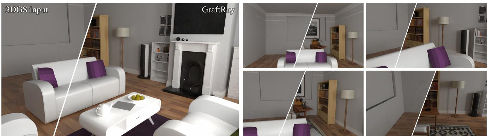
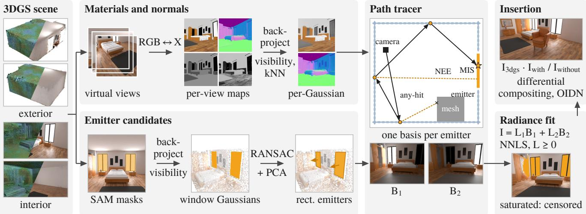
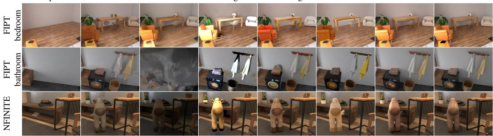
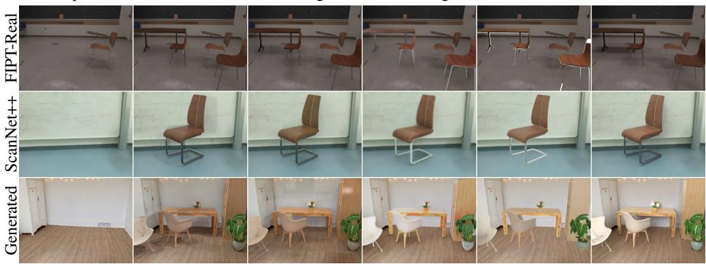
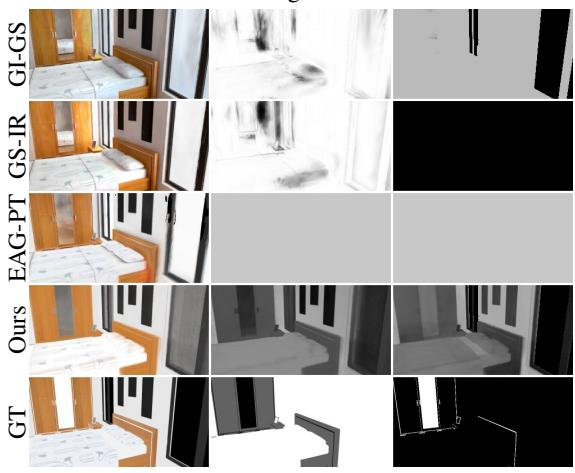
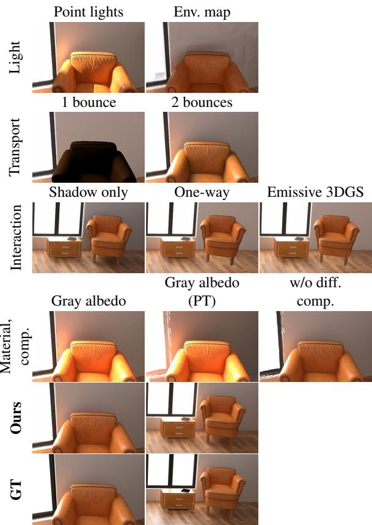

# GraftRay: Physically Based Mesh Insertion into Gaussian Splatting Scenes via Path Tracing

Jinxin Ai Technical University of Munich jinxin.ai@tum.de

Matthias Niessner Technical University of Munich niessner@tum.de

  
Figure 1. GraftRay inserts mesh objects into a 3D Gaussian Splatting scene with physically consistent shading and shadows.

## Abstract

Inserting virtual objects into scenes reconstructed via 2D or 3D Gaussian Splatting (2DGS/3DGS) is a key capability for content creation, AR, and synthetic data generation. However, realistic insertion requires the object to be seamlessly lit by the scene and, conversely, to cast physically plausible shadows onto it. Existing approaches either harmonize appearance in image space, sacrificing multi-view consistency, or approximate scene illumination with an environment map at the insertion point, which cannot represent near-field area lights such as windows and lamps that dominate indoor lighting. To address this, we present GraftRay, a unified method for physically consistent insertion of mesh objects into indoor scenes represented by either 2D or 3D Gaussians. We recover scene materials and surface normals with diffusion-based priors, and explicitly model spatially-extended emitters, solving their radiance in closed form. A hybrid renderer then jointly path-traces the scene Gaussians and inserted meshes, producing viewconsistent shading, interreflections, and soft shadows. On FIPT, GraftRay sets a new state of the art, outperforming recent baselines such as ComGS and EAG-PT in rendering fidelity and shadow accuracy, while maintaining highly competitive rendering efficiency.

## 1. Introduction

3D Gaussian Splatting (3DGS) [21] and its 2D counterpart [15] enable high-quality, real-time rendering of reconstructed scenes. However, inserting a virtual object into such scenes remains challenging. Beyond matching its appearance to the background, the inserted object must respond to the scene’s illumination, cast geometrically consistent shadows, and contribute indirect light to surrounding surfaces. Achieving these effects requires explicit light transport while preserving the visual fidelity of the original reconstruction.

Existing approaches address this problem from three main directions. Environment-map-based methods estimate local illumination from HDR environment maps [2, 16, 26]. Although effective for approximating incident illumination, environment maps do not explicitly represent the spatial positions of local emitters or their interactions with scene geometry, limiting their ability to reproduce spatially varying illumination and geometrically consistent shadows. Inverse-rendering methods jointly recover scene materials and illumination [3, 8, 13, 28, 29, 37, 47]. While physically grounded, these methods introduce additional unknowns beyond those strictly required for object insertion. Moreover, low-dynamic-range (LDR) observations weaken the photometric constraints needed to distinguish emissive sources from highly reflective surfaces. Finally, imagespace harmonization methods use generative models to refine the appearance of composited objects [24, 36, 38, 42]. Despite producing visually plausible results, they do not explicitly model scene-level light transport and therefore cannot guarantee consistent relighting when the object or illumination changes.

We propose GraftRay, a unified framework for physically consistent object insertion into 2D and 3D Gaussian scenes (Fig. 1). Because our pipeline extracts material priors directly from rendered views rather than relying on original capture data, it uniquely supports physically-based insertion even for synthetically generated Gaussian scenes where original training images are unavailable. We first render multi-view images from the Gaussian scene and estimate material properties, including albedo, roughness, metallicity, and normals, using robust 2D estimators such as RGB-X or diffusion-based models. These predictions are then unprojected onto individual 2D/3D Gaussians to provide scene-level material attributes, bypassing the complex joint optimization of traditional inverse rendering. Building on these attributes, we extend an OptiX-accelerated path tracer to support Gaussian primitives with stochastic transparency [9] and 3σ axis-aligned bounding boxes, traced jointly with inserted meshes. The extended path tracer incorporates a Mitsuba-style path integration scheme [17], analytic area emitters, multiple importance sampling (MIS), and explicit shadow rays to enable light transport directly on Gaussian scenes. We further recover scene illumination from LDR observations by treating saturated pixels as lower-bound constraints and using unsaturated surfaces to constrain emitter intensities. Since light transport is linear in emitter intensities with fixed geometry and materials, we precompute unit-radiance basis images and formulate light estimation as a nonnegative least-squares (NNLS) problem. Finally, we use differential rendering [7] to introduce the inserted object’s shadows and indirect illumination while preserving the original background reconstruction.

Our contributions are summarized as follows:

• From LDR images alone, we unproject multi-view 2D material and normal predictions onto individual 2D/3D Gaussians, providing scene-level material attributes for physically based insertion without joint inverse rendering.

• We extend an OptiX path tracer to trace stochastictransparency Gaussians jointly with meshes, computing illumination, shadows, and indirect light between Gaussian scenes and mesh objects, while differential rendering preserves the reconstruction.

• We formulate light-intensity estimation using censored observations and path-traced radiance bases, exploiting unsaturated illumination cues to distinguish true emitters from bright reflectors and efficiently estimate nonnegative emitter intensities.

## 2. Related Work

Lighting estimation for object insertion. Classical object insertion relies on differential rendering [7], which combines a captured scene with an estimate of its illumination; Karsch et al. [20] extended this paradigm to single photographs. Subsequent methods estimate illumination from images using learned HDR environment maps [11], spatially varying lighting [12, 25], or lighting volumes [39]. Diffusion-based approaches further improve illumination estimation and adaptation: DiffusionLight [35] synthesizes environment-map observations through a rendered chrome ball, while DiPIR [26] uses a diffusion model as a critic for lighting optimization. GaSLight [2] lifts ordinary images into HDR Gaussian splats, LightHarmony3D [16] predicts environment maps for hybrid Gaussian–mesh rendering, and LuxRemix [27] decomposes indoor illumination into editable components. Unlike approaches that primarily estimate environment maps or distribute emissive radiance across scene representations, GraftRay explicitly parameterizes local area emitters and uses them in path-traced light transport, allowing their spatial extent and scene occlusion to affect illumination and shadows.

Compositing and harmonization in 3D. Recent methods use generative priors to improve the visual consistency of inserted objects in reconstructed scenes. MV-CoLight [36] generates multi-view-consistent lighting and shadows, while Violante et al. [42] harmonize composite images with diffusion models and consolidate the results into 3DGS. D3DR [38] similarly uses diffusion priors for zero-shot 3DGS harmonization. Other approaches explore alternative scene representations and insertion strategies: ComGS [10] composes objects using surface octahedral probes, and FreeInsert [24] inserts text-specified objects without requiring explicit spatial priors. Related 2D methods include image harmonization [6], diffusion-based object relighting [19], token-space relighting from sparse views [5], and geometry-guided video insertion with GO-Renderer [14]. GaussianEditor [4] explores direct editing of 3DGS scenes. These methods primarily target perceptual consistency or generative scene editing, whereas GraftRay explicitly models light transport to produce view-consistent shadows and indirect illumination for inserted objects.

Inverse rendering on Gaussian splats. Neural inverse rendering initially developed around radiance fields [31], factorizing geometry, reflectance, and illumination [18, 48] with ray tracing for indoor scenes [49]. For Gaussians, GS-IR [28] and GS-ID [8] recover per-Gaussian BRDFs under environment maps or spherical Gaussians. GI-GS [3] and IRGS [13] incorporate global illumination, with IRGS employing differentiable 2D Gaussian ray trac-

  
Figure 2. Overview of GraftRay. From LDR photographs we reconstruct a 3DGS scene (tiles: Gaussians as feature-coloured ellipsoids | render) and lift materials and normals onto it (Sec. 3.1). SAM-marked lights become rectangles (Sec. 3.2); a Gaussian path tracer (Sec. 3.3) renders one basis image per emitter, whose radiances are solved by censored least squares (Sec. 3.5). Objects are inserted by differential compositing (Sec. 3.6).

## 3. Method

ing. NeILF++ [47] couples incident and outgoing light fields, while IRIS [29] addresses indoor LDR reconstruction by estimating camera responses. Intrinsic diffusion priors [23, 46] and factorized inverse path tracing [43] offer alternative material decomposition strategies. Among these, AEGIR [37] is closely related, jointly optimizing area emitters, materials, and geometry via a differentiable deferred renderer. Similarly, EAG-PT [44] reconstructs emissionaware 2DGS with albedo only for path-traced editing. Unlike these joint factorizations, GraftRay targets object insertion with a constrained optimization: we initialize scene materials from priors and optimize emitter radiances while keeping geometry and materials fixed, reducing coupled unknowns and enabling explicit handling of saturated LDR observations.

Ray tracing Gaussian primitives. Recent methods have extended ray tracing to Gaussian and particle-based representations. 3DGRT [32] traces particle scenes using raytracing hardware, bounding individual primitives and evaluating their responses along rays. EVER [30] supports exact ellipsoid rendering for view synthesis, while GHPT [1] combines rasterization and path tracing for real-time relightable Gaussian splats. Building on these efforts, we extend an OptiX-accelerated path tracer to support light transport directly on Gaussian scenes. Our approach shares the peak-response intersection strategy with 3DGRT but targets physical illumination rather than view synthesis. Stochastic hit acceptance [40] accounts for Gaussian transparency during ray traversal, enabling Monte Carlo light-transport estimation with analytic area emitters, multiple importance sampling, and next-event estimation.

Given a reconstructed Gaussian Splatting scene and usermarked light regions, our method estimates scene illumination and inserts objects with consistent direct and indirect lighting. As illustrated in Fig. 2, we first estimate per-Gaussian materials and normals from multi-view intrinsicimage predictions. We then initialize analytic area-light candidates from the marked regions and estimate their radiances using a Gaussian-aware path tracer and unit-radiance basis renders. Finally, differential compositing transfers the lighting changes induced by the inserted objects to the original 3DGS rendering while preserving its view-dependent appearance.

## 3.1. Material and Normal Estimation

A Gaussian Splatting scene consists of N anisotropic Gaussians with means $\pmb { \mu } _ { i }$ , rotations $R _ { i } ,$ scales $S _ { i } = \mathrm { d i a g } ( \mathbf { s } _ { i } )$ opacities $o _ { i } .$ , and view-dependent colours [21]. Physically based light transport additionally requires a surface normal $\mathbf { n } _ { i }$ and BRDF parameters, including albedo ${ \bf { a } } _ { i } ,$ roughness $\rho _ { i } .$ , and metallic $m _ { i } .$ , which are not explicitly provided by the reconstruction. We estimate these attributes by rendering the scene from V virtual views and applying the intrinsicimage diffusion model RGB↔X [46] with S random seeds to each view. The predicted material and normal maps are then back-projected onto the Gaussians.

Visibility. To avoid assigning a pixel’s prediction to occluded Gaussians, we determine the visible surface depth from accumulated transmittance along each camera ray. Specifically, we define the surface depth z as the depth at which the transmittance first falls below ${ \frac { 1 } { 2 } } .$ , corresponding to the median depth of the accumulated opacity. A Gaussian at camera-space depth r is accepted only if

$$
\frac { | r - z | } { z } < \tau _ { z } ,
$$

where $\tau _ { z }$ is a depth tolerance. This test rejects Gaussians that lie in front of or behind the visible surface.

Aggregation. For each Gaussian, we first average predictions from all accepting views separately for each random seed, and then take the per-channel median across seeds. This aggregation reduces stochastic variation in the diffusion predictions and disagreements across views. Predicted normals are transformed to world space before aggregation and renormalized afterwards. We keep the resulting materials and normals fixed during illumination estimation, thereby avoiding joint optimization of lighting and material parameters.

This per-Gaussian back-projection turns predictions that are plausible per image but mutually inconsistent into a single scene-level estimate. A 2D estimator may assign the same surface a different albedo or roughness in different views or seeds; since each Gaussian is visible in many views, the average over its accepting views acts as a multiview consensus that suppresses view-specific errors, and the median over seeds removes outlying samples. Storing the result on the Gaussians also makes materials available wherever a path arrives, including surfaces outside the current view.

## 3.2. Emitter Initialization

Each emitter is manually specified by the user through a 2D mask, while its geometry and radiance are estimated automatically. The user marks light-emitting regions, such as windows, lamps, and ceiling panels, using SAM [22] in one or a few views. We back-project the masked pixels onto the Gaussians using the visibility test in Sec. 3.1, obtaining a 3D point set for each emitter. Each emitter is represented as an analytic, one-sided rectangle $E _ { j }$ , parameterized by its centre, in-plane axes, half-extents, and normal. We fit a plane to each point set using RANSAC weighted towards bright Gaussians, then refine the plane using PCA on the inliers. This weighting favours bright surfaces when estimating the emitter geometry. For wall-mounted emitters, we align the in-plane axes with the horizontal and vertical directions; otherwise, we use the PCA axes. The emitter’s extent is determined from the Gaussians associated with the fitted plane, and its normal is oriented towards the room. The resulting emitter candidates are subsequently refined during radiance estimation in Sec. 3.5, allowing candidates with little contribution to the observed illumination to be suppressed.

## 3.3. Path Tracing on Gaussian Scenes

Gaussians as custom primitives. We represent each Gaussian by an axis-aligned bounding box enclosing its 3σ ellipsoid. For a ray $\mathbf { x } ( t ) = \mathbf { o } + t \mathbf { d }$ , we transform the ray into the Gaussian’s local frame:

$$
{ \bf p } = S _ { i } ^ { - 1 } R _ { i } ^ { \top } ( { \bf o } - { \pmb \mu } _ { i } ) , \qquad { \bf q } = S _ { i } ^ { - 1 } R _ { i } ^ { \top } { \bf d } .\tag{1}
$$

The Gaussian response along the ray reaches its maximum at

$$
t _ { i } ^ { \star } = - \frac { { \bf p } \cdot { \bf q } } { \| { \bf q } \| ^ { 2 } } , \qquad m _ { i } ^ { 2 } = \| { \bf p } \| ^ { 2 } - \frac { ( { \bf p } \cdot { \bf q } ) ^ { 2 } } { \| { \bf q } \| ^ { 2 } } ,\tag{2}
$$

where $m _ { i } ^ { 2 }$ is the squared Mahalanobis distance at the closest point on the ray line. The intersection program reports $t _ { i } ^ { \star }$ when $m _ { i } ^ { 2 } < 9$ and assigns the effective opacity

$$
\alpha _ { i } = o _ { i } \exp \left( - \frac { 1 } { 2 } m _ { i } ^ { 2 } \right) .\tag{3}
$$

The reported intersection must also lie within the valid ray interval.

Stochastic transparency. Alpha compositing requires intersections to be processed in depth order, whereas hardware ray traversal visits primitives in an arbitrary order. Following stochastic transparency [9], the any-hit program accepts an intersection with Gaussian i with probability $\alpha _ { i } .$ OptiX then returns the nearest accepted intersection. Consequently, the probability that Gaussian i is the first accepted primitive is

$$
w _ { i } = \mathrm { P r } ( K = i ) = \alpha _ { i } \prod _ { j \in \mathcal { F } _ { i } } ( 1 - \alpha _ { j } ) ,\tag{4}
$$

where $\mathcal { F } _ { i }$ denotes the primitives in front of i. This probability equals the corresponding alpha-compositing weight. Thus, shading the returned primitive provides a singlesample estimate of its contribution to the composited radiance. The complete estimator must also account for any background contribution when the ray misses all accepted primitives. Compared with collecting and sorting all intersections along a ray, this requires no per-ray intersection buffer: each path segment is a single hardware traversal, and the inserted meshes are traced in the same acceleration structure. The random acceptance is averaged out by the samples per pixel like the other Monte Carlo dimensions.

Shadow rays. Shadow rays use a separate ray type that evaluates transmittance deterministically rather than sampling stochastic intersections. Its any-hit program accumulates transmittance by multiplying it by $( 1 - \alpha _ { i } )$ and terminates when the value falls below $5 \times 1 0 ^ { - 3 }$ . This continuous transmittance estimate supports smooth soft shadows at the sample counts used for basis rendering.

## 3.4. Light Transport

For each pixel, we average radiance estimates over jittered camera rays sampled across the pixel footprint. Along each ray, the outgoing radiance is composited according to

$$
L _ { \mathrm { r a y } } = \sum _ { i } w _ { i } L _ { \mathrm { o } } ( { \bf x } _ { i } , { \bf v } ) ,\tag{5}
$$

where $w _ { i }$ is defined in Eq. (4) and $L _ { \mathrm { o } }$ is evaluated using the rendering equation with a Cook–Torrance BRDF and GGX microfacet model. Emitters are represented as analytic rectangles rather than Gaussians. We estimate direct illumination using next-event estimation on the rectangles and combine it with BSDF sampling through multiple importance sampling with the power heuristic [34, 41]. Indirect illumination is estimated by continuing paths along BSDF-sampled directions, with Russian roulette used for path termination. Our integrator follows Mitsuba’s path integrator [17], replacing mesh intersections with the Gaussian primitives described above.

## 3.5. Emitter Radiance Estimation

Basis renders. With geometry, materials, and emitter placement fixed, the remaining unknowns are the nonnegative emitter radiances $\mathbf { L } = ( L _ { 1 } , \ldots , L _ { J } ) ^ { \top } \ge 0$ . Since emitted radiance enters the rendering equation linearly and the scene transport is linear in the emitter radiances, the linear image can be expressed as

$$
\mathbf { I } ( \mathbf { L } ) = \sum _ { j = 1 } ^ { J } L _ { j } \mathbf { B } _ { j } ,\tag{6}
$$

where $\mathbf { B } _ { j }$ is the path-traced image obtained with emitter $E _ { j }$ at unit radiance and all other emitters disabled. Each basis image includes the direct and indirect transport originating from that emitter. To prevent the reconstructed appearance of an emitter from being counted alongside its analytic representation, we remove the bright Gaussians within a thin slab around $E _ { j }$ when rendering its own basis. In all other basis renders, these Gaussians remain in the scene and act as reconstructed surfaces. This treatment lets each basis represent a distinct emitter hypothesis.

Clipped and unclipped observations. For each fitting view, let y denote the observed image and let $\tau \ : = \ : 0 . 9 8$ be the clipping threshold. Since a saturated colour channel provides only a lower bound on the underlying sensor response, we distinguish unclipped and clipped observations per channel:

$$
\mathcal { U } _ { c } = \{ p : y _ { p , c } < \tau \} , \qquad \mathcal { C } _ { c } = \{ p : y _ { p , c } \geq \tau \} .
$$

Objective. Let $g$ denote the sRGB encoding function or the fitted EMoR response, and let $\mathbf { B } _ { p , c } \in \mathbb { R } ^ { \bar { J } }$ collect the unit-radiance basis values at pixel $p$ and colour channel c. We estimate the emitter radiances independently per channel by solving

$$
\begin{array} { r l } { \underset { \mathbf { L } _ { c } \geq 0 } { \mathrm { m i n } } } & { \displaystyle \sum _ { p \in \mathcal { U } _ { c } } \left[ g ( \mathbf { B } _ { p , c } ^ { \top } \mathbf { L } _ { c } ) - y _ { p , c } \right] ^ { 2 } } \\ & { + \displaystyle \sum _ { p \in \mathcal { C } _ { c } } \left[ \tau - g ( \mathbf { B } _ { p , c } ^ { \top } \mathbf { L } _ { c } ) \right] _ { + } ^ { 2 } , } \end{array}\tag{7}
$$

where $[ x ] _ { + } ~ = ~ \operatorname* { m a x } ( x , 0 )$ Unclipped observations are matched directly, whereas clipped observations impose a one-sided penalty that discourages predictions below the clipping threshold without penalizing predictions above it. This treatment matters because the brightest pixels are precisely those that observe the emitters. Fitting them as equalities would pull the radiances down towards the sensor ceiling, and discarding them would lose the information that the emitters are at least that bright. With the one-sided term, the clipped pixels only bound the solution from below, and its magnitude is set by the unsaturated walls, floor and furniture, whose brightness depends on each emitter through the basis images.

The problem contains J unknowns per channel, typically fewer than twenty, but can involve tens of millions of residuals across all fitting views. We evaluate residuals and Jacobians on the GPU and solve the resulting $J \times J$ normal equations using Levenberg–Marquardt. In linear space, the objective reduces to non-negative least squares; the nonlinear camera response makes the optimization nonlinear while keeping its dimensionality low. In our experiments, the solution is insensitive to initialization.

Suppressing spurious emitter candidates. Pixels directly observing a window or lamp may be saturated and therefore provide only lower-bound constraints on the predicted sensor response. Such observations alone cannot reliably distinguish an emitter from a bright reflector. Instead, the estimated radiances are constrained primarily by how well each candidate explains the illumination of unsaturated regions in the room. Consequently, a candidate that contributes little to the observed room illumination can receive near-zero radiance even if it was included in the initial user annotations.

## 3.6. Differential Compositing

Replacing the original 3DGS rendering with a path-traced image can discard view-dependent appearance and reconstruction details. We therefore transfer the lighting changes induced by the inserted object while retaining the original scene appearance. We trace the scene from the same camera with and without the inserted objects, obtaining ${ \mathbf { I } } _ { \mathrm { w i t h } }$ and $\mathbf { I } _ { \mathrm { w i t h o u t } }$ in linear radiance. Given the object mask M and the original 3DGS rendering $\mathbf { I } _ { \mathrm { 3 d g s } } ,$ , we compute

Input  
EAG-PT  
Ours
<table><tr><td></td><td colspan="10">Synthetic (path-traced ground truth)</td><td colspan="5"></td><td>Generated</td></tr><tr><td></td><td colspan="7">FIPT</td><td colspan="7">NFINITE</td><td colspan="2">FIPT-Real ScanNet++*</td><td>SpAItial*</td></tr><tr><td>Method</td><td>∆PSNR↑</td><td>Mask↑ IoU↑ RMSE↓</td><td></td><td></td><td>PSNR↑</td><td>SSIM↑ LPIPS↓</td><td></td><td></td><td>∆PSNR↑ Mask↑ IoU↑ RMSE↓</td><td></td><td></td><td>PSNR↑</td><td>SSIM↑ LPIPS↓</td><td></td><td>VQA ratio↑</td><td>VQA ratio↑</td><td>VQA ratio↑</td></tr><tr><td>DOT3D [42]</td><td>19.33</td><td>12.27</td><td>0.18</td><td>0.39</td><td>17.40</td><td>0.785</td><td>0.409</td><td>20.75</td><td>11.31</td><td>0.16</td><td>0.33</td><td>20.45</td><td>0.861</td><td>0.217</td><td>0.401</td><td>0.443</td><td>0.464</td></tr><tr><td>MV-CoLight [36]</td><td>25.58</td><td>20.27</td><td>0.46</td><td>0.27</td><td>22.90</td><td>0.824</td><td>0.451</td><td>26.53</td><td>18.16</td><td>0.38</td><td>0.19</td><td>25.27</td><td>0.829</td><td>0.332</td><td>0.392</td><td>0.440</td><td>0.509</td></tr><tr><td>GS-IR [28]</td><td>26.71</td><td>21.18</td><td>0.47</td><td>0.18</td><td>23.81</td><td>0.853</td><td>0.387</td><td>29.10</td><td>21.49</td><td>0.45</td><td>0.17</td><td>27.14</td><td>0.893</td><td>0.210</td><td>0.385</td><td>0.412</td><td>0.478</td></tr><tr><td>GI-GS [3]</td><td>26.62</td><td>21.48</td><td>0.50</td><td>0.17</td><td>24.16</td><td>0.854</td><td>0.387</td><td>28.19</td><td>21.43</td><td>0.38</td><td>0.20</td><td>26.85</td><td>0.892</td><td>0.210</td><td>0.371</td><td>0.416</td><td>0.512</td></tr><tr><td>GaSLight [2]</td><td>18.36</td><td>12.85</td><td>0.13</td><td>0.35</td><td>17.58</td><td>0.763</td><td>0.424</td><td>17.43</td><td>10.50</td><td>0.15</td><td>0.32</td><td>19.68</td><td>0.857</td><td>0.256</td><td>0.369</td><td>0.421</td><td>0.494</td></tr><tr><td>IRGS [13]</td><td>28.40</td><td>22.56</td><td>0.50</td><td>0.15</td><td>25.16</td><td>0.868</td><td>0.380</td><td>29.50</td><td>22.06</td><td>0.52</td><td>0.17</td><td>27.67</td><td>0.897</td><td>0.206</td><td>0.373</td><td>0.413</td><td>0.504</td></tr><tr><td>EAG-PT [44]</td><td>24.26</td><td>21.19</td><td>0.40</td><td>0.29</td><td>21.67</td><td>0.770</td><td>0.519</td><td>15.89</td><td>12.16</td><td>0.13</td><td>0.49</td><td>13.70</td><td>0.642</td><td>0.447</td><td>0.355</td><td></td><td></td></tr><tr><td>ComGS [10]</td><td>13.09 21.27</td><td>8.27 15.98</td><td>0.26</td><td>0.33</td><td>13.93</td><td>0.721</td><td>0.454</td><td>14.86</td><td>7.76</td><td>0.22</td><td>0.39</td><td>16.48</td><td>0.827</td><td>0.250</td><td>0.334</td><td>0.365</td><td>0.435</td></tr><tr><td>LumiTokens [5]</td><td>15.89</td><td>10.58</td><td>0.00 0.02</td><td>0.40</td><td>19.49 15.29</td><td>0.787</td><td>0.429</td><td>24.22</td><td>15.43</td><td>0.00</td><td>0.36</td><td>23.16</td><td>0.866</td><td>0.212</td><td>0.354</td><td>0.395</td><td>0.464</td></tr><tr><td>GO-Renderer [14]</td><td></td><td></td><td></td><td>0.62</td><td></td><td>0.694</td><td>0.497</td><td>21.56</td><td>13.58</td><td>0.01</td><td>0.59</td><td>20.42</td><td>0.788</td><td>0.293</td><td>0.395</td><td>0.415*</td><td>0.488</td></tr><tr><td>Ours (DiffusionRenderer)</td><td>35.17 34.29</td><td>29.14</td><td>0.76</td><td>0.08</td><td>29.81</td><td>0.895</td><td>0.350</td><td>31.30</td><td>23.91</td><td>0.51</td><td>0.18</td><td>28.21</td><td>0.902</td><td>0.182</td><td>0.369</td><td>0.442</td><td>0.516</td></tr><tr><td>Ours (RGB↔X)</td><td></td><td>28.49</td><td>0.77</td><td>0.07</td><td>29.27</td><td>0.895</td><td>0.351</td><td>32.51</td><td>25.11</td><td>0.49</td><td>0.17</td><td>28.66</td><td>0.904</td><td>0.180</td><td>0.368</td><td>0.441</td><td>0.538</td></tr></table>

Table 1. Object insertion. All methods use the same objects, lights and three views per scene. Synthetic scenes are scored against path-traced ground truth (∆PSNR, Mask, IoU and RMSE measure the insertion effect); real and generated scenes, which have none, by the no-reference VQAScore ratio. GS-IR, GI-GS, IRGS: their recovered light in our renderer. –: not run. ∗Three of the twelve real and generated scenes (ScanNet++ 8b5caf3398, a24858e51e; Plant-Wall) use preliminary object placements; GO-Renderer on ScanNet++ is evaluated on a subset of the views.

GS-IR  
GaSLight  
GT  
  
Figure 3. Qualitative comparison on synthetic scenes, cropped around the inserted objects. First column: input; last: ground truth (denoised for display). Ours reproduces object brightness and contact shadows; the baselines miss shadows or misjudge brightness.

$$
\begin{array} { l } { \displaystyle \mathbf { I } _ { \mathrm { o u t } } = M k \mathbf { I } _ { \mathrm { w i t h } } } \\ { \displaystyle \qquad + \left( 1 - M \right) \mathbf { I } _ { \mathrm { 3 d g s } } \odot \mathrm { c l i p } \left( \frac { \mathbf { I } _ { \mathrm { w i t h } } } { \mathbf { I } _ { \mathrm { w i t h o u t } } } , 0 , c \right) , } \end{array}\tag{8}
$$

where ⊙ denotes element-wise multiplication, $c = 3$ limits the ratio, and k is the median of $\mathbf { I } _ { \mathrm { 3 d g s } } / \mathbf { I } _ { \mathrm { w i t h o u t } }$ over background pixels to compensate for exposure differences.

The ratio captures the relative radiance change induced by the inserted object: values below one correspond to attenuation, such as cast shadows, while values above one capture increased illumination, including indirect bounce light. The original 3DGS rendering retains appearance details that the path tracer does not model explicitly, and the ratio modulates these details to incorporate the estimated lighting changes. All compositing operations are performed in linear radiance before applying the fitted camera response. Optionally, we attenuate chromatic changes in the

ratio using

$$
r \mapsto \bar { r } \left( \frac { r } { \bar { r } } \right) ^ { \eta } ,
$$

where r¯ is the channel mean and η controls the strength of the transferred bounce-light colour.

## 4. Experiments

Setup. We evaluate on synthetic scenes with path-traced ground truth (four FIPT [43] rooms and two NFINITE [33] scenes), real captures (two FIPT-Real [43] and five Scan-Net++ [45] scenes) and five 3DGS scenes generated on the SpAItial platform. Objects, placements and lights are identical for every method, with three views per scene. With ground truth we report ∆PSNR, mask PSNR, shadow IoU and shadow RMSE, which isolate the change caused by the inserted objects; without it, the no-reference VQAScore ratio of LightHarmony3D [16]. ∆PSNR compares the change between the render with and without the objects against the corresponding change in the ground truth, mask PSNR scores the object pixels, and the shadow IoU and RMSE score the cast shadow region and its strength. Full-image PSNR, SSIM and LPIPS are dominated by the background, which most methods share.

Input  
GS-IR  
GaSLight  
MV-CoLight  
LumiTokens  
Ours  
  
Figure 4. Qualitative comparison on real and generated scenes (columns as in Fig. 3 without ground truth and EAG-PT, which needs linear HDR inputs).

Albedo  
Roughness  
Metallic  

<table><tr><td rowspan="2"></td><td colspan="2">Albedo</td><td rowspan="2">Rough</td><td rowspan="2">Metal L2↓</td></tr><tr><td>Method PSNR↑</td><td>SSIM↑ LPIPS↓</td></tr><tr><td>GI-GS</td><td>12.44</td><td>0.642 0.418</td><td>L2↓ 0.142</td><td>0.515</td></tr><tr><td>GS-IR</td><td>11.87</td><td>0.615 0.463</td><td>0.140</td><td>0.033</td></tr><tr><td>EAG-PT</td><td>20.17</td><td>0.786 0.258</td><td>一</td><td>一</td></tr><tr><td>Ours</td><td>19.93</td><td>0.814</td><td>0.218 0.155</td><td>0.161</td></tr></table>

Figure 5. Recovered materials on the FIPT bedroom (ours: RGB↔X prior) and scores averaged over the four FIPT rooms (albedo scale-aligned). Grey tiles, –: not produced. GS-IR’s allzero metallic scores well as only 1–6% of the pixels are metal.

Implementation details. All our steps run on a single RTX 3090. For the FIPT bedroom, reconstruction takes 22 min, the DiffusionRenderer prior 1.5 h per seed, backprojection 6 min and the radiance fit 13.5 min. Inserting objects into one 1024×576 view takes 1.6 min: two pathtraced renders at 256 spp (with and without the objects) and the differential composite. EAG-PT, which also path traces the scene, needs 14.4 min per frame at its 1024 spp, about 12× more at equal samples.

<table><tr><td>Variant</td><td>∆PSNR↑</td><td>Mask↑</td><td>IoU↑</td><td>RMSE↓</td></tr><tr><td>Point lights</td><td>26.5</td><td>20.5</td><td>0.51</td><td>0.12</td></tr><tr><td>Env. map (PT/3DGS)</td><td>27.6/27.4</td><td>22.0/20.7</td><td>0.56/0.55</td><td>0.11/0.12</td></tr><tr><td>Bounces 1/2</td><td>25.7/30.8</td><td>14.5/24.9</td><td>0.25/0.63</td><td>0.33/0.12</td></tr><tr><td>Bounces 3/4</td><td>32.9/34.0</td><td>28.4/30.2</td><td>0.68/0.71</td><td>0.10/0.09</td></tr><tr><td>GT window geometry</td><td>35.4</td><td>31.7</td><td>0.80</td><td>0.08</td></tr><tr><td>Size ×0.8/1.25/1.5</td><td>34.2/35.4/35.431.1/31.4/31.3</td><td></td><td>0.80</td><td>0.08</td></tr><tr><td>Shift 5/10/20 cm</td><td>35.4/35.1/34.331.6/31.4/30.7</td><td></td><td>0.80</td><td>0.08</td></tr><tr><td>Shift 10 cm (normal)</td><td>35.3</td><td>30.4</td><td>0.80</td><td>0.08</td></tr><tr><td>Shadow only/one-way</td><td>31.3/27.5</td><td>31.4/30.1</td><td>0.58/0.00</td><td>0.12/0.36</td></tr><tr><td>Emissive 3DGS</td><td>27.5</td><td>30.2</td><td>0.00</td><td>0.36</td></tr><tr><td>Gray albedo</td><td>23.5</td><td>15.6</td><td>0.61</td><td>0.17</td></tr><tr><td>w/o diff. compositing</td><td>24.8</td><td>31.6</td><td>0.49</td><td>0.14</td></tr><tr><td>Ours (full)</td><td>35.4</td><td>31.6</td><td>0.80</td><td>0.08</td></tr></table>

Table 2. Ablations on the bedroom. Shifts are in the window plane unless marked.

## 4.1. Comparison

We compare our method with recent approaches in inverse rendering, illumination estimation, image harmonization, and feed-forward relighting. We use the released implementations of the baselines and follow their respective optimization protocols on our datasets. As shown in Table 1, our method achieves the best overall performance on FIPT and NFINITE, particularly in shadow reconstruction. Compared with inverse rendering methods, our near-field emitter representation yields more accurate shadows under a controlled rendering setup. Illumination estimation methods such as GaSLight struggle to recover accurate insertion shadows, while image harmonization methods such as MV-CoLight cannot reliably reproduce cast shadows through appearance adjustment alone. Similarly, feed-forward relighting methods produce plausible relit appearances but fail to reconstruct spatially accurate shadows. VQAScore barely separates the methods on the real and generated scenes. Qualitative comparisons are shown in Figs. 3 and 4. On the synthetic scenes, ours reproduces the object brightness and the contact shadows, whereas the baselines miss the shadows or misjudge the brightness (Fig. 3).

Material recovery. Figure 5 compares the recovered materials. GS-IR and GI-GS bake shading and window light into the albedo of these texture-poor rooms, 6–8 dB below our aligned albedo (19.9 dB on FIPT). EAG-PT reaches a similar albedo (20.2 dB) but recovers diffuse albedo only. Our prior also provides roughness and metallic, although the metallic channel spills onto diffuse surfaces (Fig. 5).

## 4.2. Ablation

Near-field area lights. Point lights and environment maps lose 8-9 dB ∆PSNR and a third of the shadow IoU (Tab. 2): points ignore a window’s extent, an environment map its falloff (Fig. 6).

Multi-bounce transport. Direct light alone yields far too dark objects and shadows (25.7 dB); every bounce helps, and four bounces are within 1.4 dB of the full tracer.

Two-way interaction. Without the light bounced off the object into the room (shadow only, one-way, emissive 3DGS) the object region stays plausible, but the shadow IoU falls to 0.58 or 0 (Fig. 6).

Materials and compositing. A gray albedo instead of the material prior halves the mask PSNR (15.6 dB), since both the fitted lights and the shading depend on the albedo. Using our full path-traced frame instead of the composite keeps the object but drops ∆PSNR to 24.8 dB: the re-rendered room inherits errors such as the missing mirror reflection, which differential compositing cancels.

Robustness to emitter geometry. Ground-truth windows, sizes ×0.8–1.5 and shifts up to 20 cm cost at most 1.3 dB ∆PSNR and keep the shadow IoU at 0.80 (Tab. 2).

## 4.3. Limitations

Our method has two main limitations. First, the light sources must be marked manually: the user selects windows and lamps with SAM in one or a few views, although only approximate masks are needed. Second, it relies on prior information: albedo, roughness, metallic and normals come from 2D estimators (RGB↔X or DiffusionRenderer), so errors in these priors carry over to the fitted lights and the insertion.

  
Figure 6. Ablations, qualitative (bedroom), one row per ablation; composites unless marked PT. Point lights over-brighten, an environment map darkens; direct light is far too dark; without the object-to-room bounce the wall misses reflected light; a gray albedo distorts the room (PT), compositing hides it. Last rows: ours and GT, two views.

## 5. Conclusion

We recover sampleable area emitters (geometry, orientation and absolute radiance) from ordinary LDR multi-view captures of indoor scenes by treating saturated pixels as censored observations. With a stochastic-transparency path tracer over the Gaussians, inserted objects receive spatially varying shading, contact shadows and bounce light without degrading the reconstruction. With geometry and materials fixed, the light estimate is a low-dimensional fit over pathtraced basis images. We also show that full-image metrics barely reflect lighting, and give a protocol that isolates the insertion effect.

## References

[1] Jinyang Bo, Fan Dou, Wenrui Quan, Shangxun Liu, Yang Xu, Yuhe Zhang, Kang Li, and Guohua Geng. Ghpt: Realtime relightable gaussian splatting using hybrid path tracing. In Proceedings of the IEEE/CVF Conference on Computer Vision and Pattern Recognition, pages 25990–25999, 2026. 3

[2] Christophe Bolduc, Yannick Hold-Geoffroy, and Jean-Franc¸ois Lalonde. Gaslight: Gaussian splats for spatiallyvarying lighting in hdr. In 2025 IEEE/CVF International Conference on Computer Vision (ICCV), pages 29120– 29130. IEEE, 2025. 1, 2, 6

[3] Hongze Chen, Zehong Lin, and Jun Zhang. Gi-gs: Global illumination decomposition on gaussian splatting for inverse rendering. arXiv preprint arXiv:2410.02619, 2024. 1, 2, 6

[4] Yiwen Chen, Zilong Chen, Chi Zhang, Feng Wang, Xiaofeng Yang, Yikai Wang, Zhongang Cai, Lei Yang, Huaping Liu, and Guosheng Lin. Gaussianeditor: Swift and controllable 3d editing with gaussian splatting. In 2024 IEEE/CVF Conference on Computer Vision and Pattern Recognition (CVPR), pages 21476–21485. IEEE, 2024. 2

[5] Yiwen Chen, Matheus Gadelha, and Huaizu Jiang. Lumitokens: 3d relighting via token-space lighting transformation. In European Conference on Computer Vision, pages 528– 545. Springer, 2026. 2, 6

[6] Wenyan Cong, Jianfu Zhang, Li Niu, Liu Liu, Zhixin Ling, Weiyuan Li, and Liqing Zhang. Dovenet: Deep image harmonization via domain verification. In 2020 IEEE/CVF conference on computer vision and pattern recognition (CVPR), pages 8391–8400. IEEE, 2020. 2

[7] Paul Debevec. Rendering synthetic objects into real scenes: Bridging traditional and image-based graphics with global illumination and high dynamic range photography. In Acm siggraph 2008 classes, pages 1–10. 2008. 2

[8] Kang Du, Zhihao Liang, Yulin Shen, and Zeyu Wang. Gs-id: Illumination decomposition on gaussian splatting via adaptive light aggregation and diffusion-guided material priors. In 2025 IEEE/CVF International Conference on Computer Vision (ICCV), pages 26220–26229. IEEE, 2025. 1, 2

[9] Eric Enderton, Erik Sintorn, Peter Shirley, and David Luebke. Stochastic transparency. In Proceedings of the 2010 ACM SIGGRAPH symposium on Interactive 3D Graphics and Games, pages 157–164, 2010. 2, 4

[10] Jian Gao, Mengqi Yuan, Yifei Zeng, Chang Zeng, Zhihao Li, Dave Chen, Weichao Qiu, Xiao-Xiao Long, Hao Zhu, Xun Cao, et al. Comgs: Efficient 3d object-scene composition via surface octahedral probes. In International Conference on Learning Representations, pages 20941–20965, 2026. 2, 6

[11] Marc-Andre Gardner, Kalyan Sunkavalli, Ersin Yumer, Xi-´ aohui Shen, Emiliano Gambaretto, Christian Gagne, and´ Jean-Franc¸ois Lalonde. Learning to predict indoor illumination from a single image. arXiv preprint arXiv:1704.00090, 2017. 2

[12] Mathieu Garon, Kalyan Sunkavalli, Sunil Hadap, Nathan Carr, and Jean-Franc¸ois Lalonde. Fast spatially-varying indoor lighting estimation. In 2019 IEEE/CVF Conference

on Computer Vision and Pattern Recognition (CVPR), pages 6901–6910. IEEE, 2019. 2

[13] Chun Gu, Xiaofei Wei, Zixuan Zeng, Yuxuan Yao, and L Zhang. Irgs: Inter-reflective gaussian splatting with 2d gaussian ray tracing. In 2025 IEEE/CVF Conference on Com puter Vision and Pattern Recognition (CVPR), pages 10943– 10952. IEEE, 2025. 1, 2, 6

[14] Zekai Gu, Shuoxuan Feng, Yansong Wang, Hanzhuo Huang, Zhongshuo Du, Chengfeng Zhao, Chengwei Ren, Peng Wang, and Yuan Liu. Go-renderer: Generative object ren dering with 3d-aware controllable video diffusion models. In European Conference on Computer Vision, pages 615–633. Springer, 2026. 2, 6

[15] Binbin Huang, Zehao Yu, Anpei Chen, Andreas Geiger, and Shenghua Gao. 2d gaussian splatting for geometrically accurate radiance fields. In ACM SIGGRAPH 2024 conference papers, pages 1–11, 2024. 1

[16] Tianyu Huang, Zhenyang Ren, Zhenchen Wan, Jiyang Zheng, Wenjie Wang, Runnan Chen, Mingming Gong, and Tongliang Liu. Lightharmony3d: Harmonizing illumination and shadows for object insertion in 3d gaussian splatting. arXiv preprint arXiv:2603.29209, 2026. 1, 2, 6

[17] Wenzel Jakob, Sebastien Speierer, Nicolas Roussel, Merlin´ Nimier-David, Delio Vicini, Tizian Zeltner, Baptiste Nicolet, Miguel Crespo, Vincent Leroy, and Ziyi Zhang. Mitsuba 3 renderer, 2022. https://mitsuba-renderer.org. 2, 5

[18] Haian Jin, Isabella Liu, Peijia Xu, Xiaoshuai Zhang, Song fang Han, Sai Bi, Xiaowei Zhou, Zexiang Xu, and Hao Su. Tensoir: Tensorial inverse rendering. In 2023 IEEE/CVF Conference on Computer Vision and Pattern Recognition (CVPR), pages 165–174. IEEE, 2023. 2

[19] Haian Jin, Yuan Li, Fujun Luan, Yuanbo Xiangli, Sai Bi, Kai Zhang, Zexiang Xu, Jin Sun, and Noah Snavely. Neural gaffer: Relighting any object via diffusion. In Advances in Neural Information Processing Systems (NeurIPS), 2024. 2

[20] Kevin Karsch, Varsha Hedau, David Forsyth, and Derek Hoiem. Rendering synthetic objects into legacy photographs. ACM Transactions on graphics (TOG), 30(6):1–12, 2011. 2

[21] Bernhard Kerbl, Georgios Kopanas, Thomas Leimkuhler,¨ George Drettakis, et al. 3d gaussian splatting for real-time radiance field rendering. ACM Trans. Graph., 42(4):139–1, 2023. 1, 3

[22] Alexander Kirillov, Eric Mintun, Nikhila Ravi, Hanzi Mao, Chloe Rolland, Laura Gustafson, Tete Xiao, Spencer Whitehead, Alexander C Berg, Wan-Yen Lo, et al. Segment anything. In 2023 IEEE/CVF international conference on computer vision (ICCV), pages 3992–4003. IEEE, 2023. 4

[23] Peter Kocsis, Vincent Sitzmann, and Matthias Nießner. In trinsic image diffusion for indoor single-view material estimation. In Proceedings of the IEEE/CVF conference on Computer Vision and Pattern Recognition, pages 5198– 5208, 2024. 3

[24] Chenxi Li, Weijie Wang, Qiang Li, Nicu Sebe, Bruno Lepri, and Weizhi Nie. Freeinsert: Disentangled text-guided object insertion in 3d gaussian scene without spatial priors. In Proceedings of the 33rd ACM International Conference on Multimedia, pages 10915–10924, 2025. 2

[25] Zhengqin Li, Mohammad Shafiei, Ravi Ramamoorthi, Kalyan Sunkavalli, and Manmohan Chandraker. Inverse rendering for complex indoor scenes: Shape, spatially-varying lighting and svbrdf from a single image. In 2020 IEEE/CVF Conference on Computer Vision and Pattern Recognition (CVPR), pages 2472–2481. IEEE, 2020. 2

[26] Ruofan Liang, Zan Gojcic, Merlin Nimier-David, David Acuna, Nandita Vijaykumar, Sanja Fidler, and Zian Wang. Photorealistic object insertion with diffusion-guided inverse rendering. In European Conference on Computer Vision, pages 446–465. Springer, 2024. 1, 2

[27] Ruofan Liang, Norman Muller, Ethan Weber, Duncan Zauss,¨ Nandita Vijaykumar, Peter Kontschieder, and Christian Richardt. Luxremix: Lighting decomposition and remixing for indoor scenes. arXiv preprint arXiv:2601.15283, 2026. 2

[28] Zhihao Liang, Qi Zhang, Ying Feng, Ying Shan, and Kui Jia. Gs-ir: 3d gaussian splatting for inverse rendering. In 2024 IEEE/CVF Conference on Computer Vision and Pattern Recognition (CVPR), pages 21644–21653. IEEE, 2024. 1, 2, 6

[29] Chih-Hao Lin, Jia-Bin Huang, Zhengqin Li, Zhao Dong, Christian Richardt, Tuotuo Li, Michael Zollhofer, Johannes¨ Kopf, Shenlong Wang, and Changil Kim. Iris: Inverse rendering of indoor scenes from low dynamic range images. In 2025 IEEE/CVF Conference on Computer Vision and Pattern Recognition (CVPR), pages 465–474. IEEE, 2025. 1, 3

[30] Alexander Mai, Peter Hedman, George Kopanas, Dor Verbin, David Futschik, Qiangeng Xu, Falko Kuester, Jonathan T Barron, and Yinda Zhang. Ever: Exact volumetric ellipsoid rendering for real-time view synthesis. In 2025 IEEE/CVF International Conference on Computer Vision (ICCV), pages 4930–4939. IEEE, 2025. 3

[31] Ben Mildenhall, Pratul P. Srinivasan, Matthew Tancik, Jonathan T. Barron, Ravi Ramamoorthi, and Ren Ng. Nerf: Representing scenes as neural radiance fields for view synthesis. In ECCV, 2020. 2

[32] Nicolas Moenne-Loccoz, Ashkan Mirzaei, Or Perel, Riccardo De Lutio, Janick Martinez Esturo, Gavriel State, Sanja Fidler, Nicholas Sharp, and Zan Gojcic. 3d gaussian ray tracing: Fast tracing of particle scenes. ACM Transactions on Graphics (TOG), 43(6):1–19, 2024. 3

[33] Nfinite. NFINITE synthetic interior dataset. https:// www.nfinite.app, 2024. 6

[34] Matt Pharr, Greg Humphreys, Saty Raghavachary, and Pat Hanrahan. Physically based rendering. Elsevier, 2016. 5

[35] Pakkapon Phongthawee, Worameth Chinchuthakun, Nontaphat Sinsunthithet, Varun Jampani, Amit Raj, Pramook Khungurn, and Supasorn Suwajanakorn. Diffusionlight: Light probes for free by painting a chrome ball. In 2024 IEEE/CVF Conference on Computer Vision and Pattern Recognition (CVPR), pages 98–108. IEEE, 2024. 2

[36] Kerui Ren, Jiayang Bai, Linning Xu, Lihan Jiang, Jiangmiao Pang, Mulin Yu, and Bo Dai. Mv-colight: Efficient object compositing with consistent lighting and shadow generation. Advances in Neural Information Processing Systems, 38:170882–170902, 2026. 2, 6

[37] Mohamed Shawky Sabae, Philipp Langsteiner, Jan-Niklas Dihlmann, and Hendrik Lensch. Aegir: Modeling area emit ters for indoor inverse rendering using gaussian splatting. arXiv preprint arXiv:2606.28635, 2026. 1, 3

[38] Vsevolod Skorokhodov, Nikita Durasov, and Pascal Fua. Diffusion models are secretly zero-shot 3dgs harmonizers. arXiv preprint arXiv:2503.06740, 2025. 2

[39] Pratul P Srinivasan, Ben Mildenhall, Matthew Tancik, Jonathan T Barron, Richard Tucker, and Noah Snavely. Lighthouse: Predicting lighting volumes for spatially coherent illumination. In 2020 IEEE/CVF Conference on Computer Vision and Pattern Recognition (CVPR), pages 8077–8086. IEEE, 2020. 2

[40] Xin Sun, Iliyan Georgiev, Yun Fei, and Milos Haˇ san.ˇ Stochastic ray tracing of transparent 3d gaussians. arXiv preprint arXiv:2504.06598, 2025. 3

[41] Eric Veach and Leonidas J. Guibas. Optimally combining sampling techniques for monte carlo rendering. In Proceed ings of the 22nd Annual Conference on Computer Graphics and Interactive Techniques, page 419–428, New York, NY, USA, 1995. Association for Computing Machinery. 5

[42] Nicolas Violante, George Kopanas, Linus Franke, Julien´ Philip, and George Drettakis. Lighting-consistent object transfer across radiance fields. arXiv preprint arXiv:2606.22481, 2026. 2, 6

[43] Liwen Wu, Rui Zhu, Mustafa B Yaldiz, Yinhao Zhu, Hong Cai, Janarbek Matai, Fatih Porikli, Tzu-Mao Li, Manmohan Chandraker, and Ravi Ramamoorthi. Factorized inverse path tracing for efficient and accurate material-lighting estimation. In 2023 IEEE/CVF International Conference on Computer Vision (ICCV), pages 3825–3835. IEEE, 2023. 3, 6

[44] Xijie Yang, Mulin Yu, Changjian Jiang, Kerui Ren, Tao Lu, Jiangmiao Pang, Dahua Lin, Bo Dai, and Linning Xu. Eagpt: Emission-aware gaussians and path tracing for diffuse in door scene reconstruction and editing. In Proceedings of the Special Interest Group on Computer Graphics and Interac tive Techniques Conference Conference Papers, pages 1–12, 2026. 3, 6

[45] Chandan Yeshwanth, Yueh-Cheng Liu, Matthias Nießner, and Angela Dai. Scannet++: A high-fidelity dataset of 3d indoor scenes. In 2023 IEEE/CVF International Conference on Computer Vision (ICCV), pages 12–22. IEEE, 2023. 6

[46] Zheng Zeng, Valentin Deschaintre, Iliyan Georgiev, Yannick Hold-Geoffroy, Yiwei Hu, Fujun Luan, Ling-Qi Yan, and Milos Haˇ san. Rgbˇ ↔ x: Image decomposition and synthesis using material-and lighting-aware diffusion models. In ACM SIGGRAPH 2024 conference papers, pages 1–11, 2024. 3

[47] Jingyang Zhang, Yao Yao, Shiwei Li, Jingbo Liu, Tian Fang, David McKinnon, Yanghai Tsin, and Long Quan. Neilf++: Inter-reflectable light fields for geometry and material estimation. In 2023 IEEE/CVF International Conference on Computer Vision (ICCV), pages 3578–3587. IEEE, 2023. 1, 3

[48] Xiuming Zhang, Pratul P Srinivasan, Boyang Deng, Paul Debevec, William T Freeman, and Jonathan T Barron. Nerfactor: Neural factorization of shape and reflectance under

an unknown illumination. ACM Transactions on Graphics (ToG), 40(6):1–18, 2021. 2

[49] Jingsen Zhu, Yuchi Huo, Qi Ye, Fujun Luan, Jifan Li, Dianbing Xi, Lisha Wang, Rui Tang, Wei Hua, Hujun Bao, et al. I 2-sdf: Intrinsic indoor scene reconstruction and editing via raytracing in neural sdfs. In 2023 IEEE/CVF Conference on Computer Vision and Pattern Recognition (CVPR), pages 12489–12498. IEEE, 2023. 2