Khai Le-Duc<sup>1,2,3⋆</sup>, Nguyen Kim Hai Bui<sup>1,4⋆</sup>, An Ngo<sup>1,5</sup>, Nam D. Hoang<sup>†</sup>, Yueqi Song<sup>6</sup>, Jiarui Liu<sup>6</sup>, Thai Quoc Hoang<sup>7</sup>, Fang Wu<sup>8</sup>, Chris Ngo<sup>1</sup>, Terry Jingchen Zhang<sup>3,9</sup>, Mona T. Diab<sup>6</sup>, Ran Xu<sup>7</sup>, Silvio Savarese<sup>7,8</sup>, Xiao-Ming Wu<sup>4</sup>


Abstract: Vision-language models can get individual judgments right while struggling to recover and consistently use the exact properties of a 3D object. To characterize this gap, we introduce BedBench, a controlled benchmark of thirteen procedurally generated tasks spanning individual judgments and composite answers. Across twelve open-weight and four frontier models, per-color counting exposes a pronounced weakness: humans achieve 93.3% accuracy, compared with 7.2% for the best model. Targeted fine-tuning raises one model’s accuracy from 3.0% to 68.6%, but reveals a further dificulty: its answers about the most common colors remain inconsistent with its own per-color counts. Supplying those counts as text improves its judgments, showing that recovering a property does not mean using it consistently. Reasoning, scaling, and added visual cues each improve individual judgments, but none makes exact answers reliable. To locate the dificulty, we probe Qwen3.5-27B: exact per-color counts remain recoverable at the language model’s input, yet the model’s answers rarely recover them (65.0% for the probe vs. 3.0% for the model). Image-removal controls further show that some apparent successes require no visual evidence. These findings motivate evaluating 3D reasoning by exact correctness, consistent use, and image dependence, rather than accuracy alone.

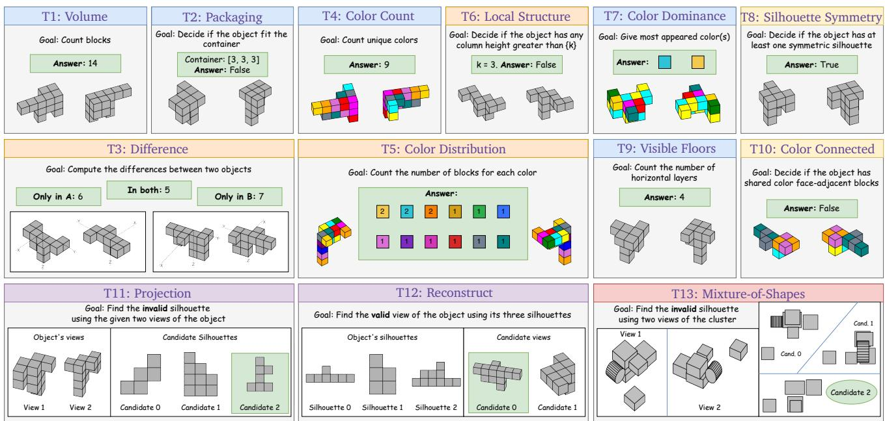  
Figure 1: BedBench tasks, grouped by primary spatial demand: Aggregate quantity and support, Compositional decomposition, Relational structure, Cross-view geometry, Multi-object scene reasoning. More in Appendix D. Takeaway: The tasks span counting, size checks, per-color counts, part relations, and cross-view matching.

## 1 Introduction

Reasoning about a 3D object from images requires relating its visible parts across views: a model may need to count blocks, identify which parts share a color, or predict the object’s appearance from another direction. Vision-language models (VLMs) are increasingly evaluated on such spatial and 3D reasoning tasks (Liu et al., 2023; Ma et al., 2025; Xu et al., 2026; Yang et al., 2025), yet their scores do not always reveal how they reached an answer. A correct answer may depend on visual evidence, but it may also follow from language priors or cues in multiple-choice options (Goyal et al., 2017; Agrawal et al., 2018; Zheng et al., 2024; Balepur et al., 2024). Conversely, a low score may reflect a model limitation, ambiguity in the available views, or a task that is dificult for humans as well.

Building on these works, we ask a more specific question: does success on individual judgments extend to exact answers and consistent use of object properties? Consider a model that can count the distinct colors (T4: Color Count) and estimate the total number of blocks (T1: Volume) in an object. Each is an individual judgment: a single count, comparison, or decision about one property of the object. Such judgments do not establish that the model can report the correct number of blocks of every color (T5: Color Distribution). That requires an exact answer: a structured answer that is correct only when all its quantities, attributes, and their associations are correct together, here every color paired with its correct count. Consistent use adds a further requirement: when asked which colors are most common, the model’s answer should agree with those counts.

We introduce BedBench (short for Blind 3D Benchmark), a benchmark of thirteen procedurally generated tasks using voxel objects (i.e., 3D shapes built from unit cubes) and scenes of geometric primitives. The tasks range from counting blocks (T1) and checking whether an object fits inside a container (T2: Packaging) to reporting per-color counts (T5) and matching an object to its 2D projections (T11: Projection; Figure 1). The generator provides exact ground truth and filters out samples detected as ambiguous at generation time, so individual judgments and exact answers can be compared within one controlled task family. Existing benchmarks include some of these properties (Table 1); BedBench combines exact-answer scoring, consistency checks, imagedependence controls, and frozen-feature probes on the same objects, so it can also locate where a failure arises.

We evaluate twelve open-weight (OW) and four frontier VLMs, with 30 human participants as a reference for task dificulty. We first compare models with humans across tasks to find which exact answers fail most clearly, and test whether simpler queries, a 2D presentation, or task-specific training improve them. Since more reasoning, larger models, and added visual cues are the usual remedies for spatial failures, we then test each of them and probe the frozen visual features to locate where the dificulty arises. Finally, because a high score is meaningful only if it depends on the image, we check whether successful answers require the images. This yields four findings:

1. Exact counting is unreliable, and learning it does not ensure consistent use. Humans reach 93.3% on T5, the best VLM 7.2%. Fine-tuning raises T5 to 68.6%, yet the model identifies the most common colors (T7) only 35.0% of the time from images, versus 74.2% when given its own counts as text (§5.1).

2. Reasoning helps selected tasks but not exact answers. Thinking raises T4 by +13.9 pp on average, yet T5 stays at 0.7–1.0%, larger budgets lower T1 and T11, and visual misreadings often persist through the reasoning (§5.2).

3. Scaling and visual support leave exact answers unreliable, although visual features hold the counts. Gains from scale and visual cues are selective. A probe at Qwen3.5-27B’s language-model input recovers exact counts on 65.0% of objects, against 3.0% for the VLM, pointing to dificulty in using available visual information (§5.3).

4. Accuracy alone does not establish visual reasoning. Without images, models keep some scores through constant answers, and in a fixed-layout MCQ one model reaches 100% by always choosing the third option (§5.4).

Overall, models get individual judgments right while the exact answer stays wrong, and recovering a property does not mean using it consistently.

## 2 Related Work

Benchmarks for spatial and 3D reasoning. Spatial benchmarks evaluate a broad range of skills, including scene understanding (Wang et al., 2025; Jia et al., 2026; Huang et al., 2026), mental rotation (Xu et al., 2025; Wang et al., 2026b; Li et al., 2026b), and geometric reasoning from drawings or assembled objects (Han et al., 2020; Tang et al., 2025). Procedural generation reduces memorization (Zhang et al., 2026a; Wang et al., 2026a; Wu et al., 2025; Cai et al., 2026; Liao et al., 2026b), but accuracy alone cannot show why a model fails. BedBench derives its tasks from the same generated objects, so their answers entail one another: the per-color counts of T5 determine the number of distinct colors (T4) and the most common colors (T7). Prior consistency checks for visual question answering measure whether answers to entailed questions agree (Hudson and Manning, 2019; Ribeiro et al., 2019; Ray et al., 2019); BedBench asks where a failure arises: whether a model fails to recover a property, to use it consistently, or to see it in 3D. These questions require tasks whose answers entail each other on the same object and block-level ground truth for re-rendering, which adding diagnostics to an existing benchmark does not create. Probing frozen features on the same targets, giving a model its own answer as text, and re-rendering the same blocks as 2D tiles answer them in turn. Table 1 summarizes the design diferences; Appendix A reviews individual benchmarks.

Related failure patterns. Prior work reports failures in compositional reasoning, exact counting, reporting every element of an image, and multi-view spatial reasoning (Li et al., 2025b; Pang et al., 2026; Zhang et al., 2026b; Zhan et al., 2026). We extend these findings with diagnostics of exact answers, consistent use, and visual dependence.

Visual representations and probes. Probing studies show that frozen visual features can encode information that a VLM fails to report, including counts and spatial properties (Rahmanzadehgervi et al., 2025; El Banani et al., 2024; Zhan et al., 2026; Zhang et al., 2026b; Pang et al., 2026). The choice of probe also matters: prior work recovers whether two patches belong to the same object, or which color goes

<table><tr><td>Procral No-age Fomat Probe</td></tr><tr><td>Ininite Iikked PPue 3D E Dataset</td></tr><tr><td>Breadth-first aggregators SITE (Wang et al., 2025) △ × × × × △ × × ×</td></tr><tr><td>EASI (Cai et al., 2025) △ × × × × × × ×</td></tr><tr><td>OmniSpatial (Jia et al., 2026) △ × × × × × × × ×</td></tr><tr><td>Spatial-DISE (Huang et al., 2026) √ △ △×× × × × ×</td></tr><tr><td>SRBench (Stogiannidis et al., 2025) △ △ △ × × × × × × SpatiaLab (Wasi et al., 2026) △×××√ ××√×</td></tr><tr><td>MindEdit-Bench (Yu et al., 2026) △××××××××</td></tr><tr><td>Cognitively grounded suites</td></tr><tr><td>SPACE (Ramakrishnan et al., 2025) √ × √ × × △ △ × ×</td></tr><tr><td>11Plus-Bench (Li et al., 2025a) △ √ × × × × × × ×</td></tr><tr><td>Psychometric BSA (Xu et al., 2025) √ √ × × × × × × ×</td></tr><tr><td>SpatialViz-Bench (Wang et al., √√ √ △ △×△××</td></tr><tr><td>2026b) STARE (Li et al., 2026b) △ × √× ×△ △ × ×</td></tr><tr><td>Geometry-native suites</td></tr><tr><td>SPARE3D (Han et al., 2020) √ △ × × ×</td></tr><tr><td>LEGO-Puzzles (Tang et al., 2025) √ △ × × △ × × ×</td></tr><tr><td>Inf-Bench (Zhang et al., 2026a) √√×△△××</td></tr><tr><td>Procedural scene generators</td></tr><tr><td>InfiniBench (Wang et al., 2026a) × √ √ △ × × × ×</td></tr><tr><td>DynaSolidGeo (Wu et al., 2025) △ V √ × × × ×</td></tr><tr><td>IDEAL-Bench (Cai et al., 2026) √ ×√ △△</td></tr><tr><td>× × × × SpatialEval (Wang et al., 2024) × △△ △ ××√ × ×</td></tr><tr><td>SpaMEM (Liao et al., 2026b) × △△ △ △ ××</td></tr><tr><td></td></tr><tr><td>BedBench (ours) V V √ √√ √√ △ V</td></tr></table>

Table 1: Comparison with representative spatial and 3D reasoning benchmarks. ✓ yes, △ partial, × no. 3D: volumetric stimuli throughout; Pure: abstract geometric stimuli; Procedural: programmatically generated items; Infinite: generation not limited to a fixed source pool; OE: open-ended answers; Linked: questions on the same item whose answers entail one another, with their agreement evaluated (partial: linked questions without such an analysis); No-image: image-removal controls (partial: image replaced by a text description); Format: matched answer-format comparisons; Probe: visual-feature probes against ground-truth targets. Takeaway: Several benchmarks share individual properties; BedBench uniquely combines open-ended 3D questions, linked questions checked for agreement, image-removal controls, and probes of frozen visual features, which together locate where a failure arises (Section 2).

with which shape, using quadratic probes or probes that attend to selected patches instead of averaging them (Li et al., 2025c; Michalkiewicz et al., 2026). Building on these studies, we test whether the behavioral gap between aggregate quantities and exact answers also appears in probes on averaged patch features, and whether a readout that attends to selected patches, trained on more objects, recovers exact per-color counts.

Reasoning, scaling, and training. Chain-of-Thought (CoT) prompting can improve reasoning, although its benefits depend on the task (Wei et al., 2022; Kojima et al., 2022; Sprague et al., 2025; Kancheti et al., 2026). Other work questions whether scaling alone is suficient for spatial reasoning (Zhang et al., 2025a), while targeted training, for example on geometry problems or with a staged spatial curriculum, has produced substantial gains (Lian et al., 2026; Li et al., 2026a). We test whether the gap between individual judgments and exact answers persists across reasoning budgets, model scale and architecture, visual cues, and task-specific fine-tuning.

## 3 The BedBench Benchmark

Task coverage. BedBench compares diferent questions about procedurally generated 3D objects and scenes, allowing us to examine both individual judgments and exact answers on the same objects. Figure 1 groups the thirteen tasks by spatial demand and shows example inputs and ground-truth answers (more details in Appendix D).

Task selection. We chose tasks whose answers are meant to be easier to check but harder to produce. Producing answers requires imagining the object(s) from the given inputs and then mentally rotating, decomposing, comparing, or querying.

Generation and ambiguity checks. Each object has 10–15 connected unit blocks, rendered from two opposite views. We reject objects whose two silhouettes match a sampled alternative with diferent orthographic projec tions, or that contain a block whose removal barely changes both silhouettes (IoU ≥ 0.9998). An independent audit after all experiments shows that excluding the one object with a block occluded in both views shifts model accuracies by at most 1.0 pp, changing no findings. T13: Mixture-of-Shapes scenes contain 6–8 collision-free boxes, cubes, and cylinders, each checked for visibility. Details are in Appendix C.1.

Visual conditions. We render matched variants with or without color and coordinate-axis overlays. Colored objects use 4–12 colors from a 12-color palette, organized into six pairs of distinct hues with similar luminance, which are placed on neighboring blocks: red/magenta, blue/purple, green/gold, cyan/yellow, orange/orchid, and teal/slategray. Only task-compatible variants are used. Table 18 (Appendix B.4) lists the default setting and variants for each task.

## 4 Experimental Setup

Models. We evaluate twelve OW models from four families: Qwen3.5 (Qwen Team, 2026), Gemma4 (Google DeepMind, 2026b), GLM-4.6V-Flash (V Team et al., 2025), and Kimi-VL-A3B (Kimi Team et al., 2025). The roster includes dense models and mixture-of-experts (MoE) models, which activate only part of their parameters for each token. We also evaluate four frontier models: GPT-5 (Singh et al., 2025), Grok-4.20 (xAI Team, 2026), Gemini-3-Flash/3.1-Pro (Google DeepMind, 2025, 2026a). Appendix C.3 gives more details about the roster.

Evaluation. Our evaluation uses 100 instances per task, except T11: Projection and T13: Mixture-of-Shapes, which each contain 300 questions covering three projection planes for 100 objects/scenes. Their default setting asks for the invalid candidate; the variant that asks for the valid candidate is reported in Appendix G.11 and Appendix G.13.

Baselines. Our human baseline consists of 30 volunteers, each answering one randomly drawn instance per task under the default visual setting. We report per-task human accuracy with 95% Wilson CIs (Appendix C.4). For binary and MCQ tasks, the random reference is uniform selection among the available answers. We also report a best-constant baseline: the accuracy of always giving the most frequent ground-truth answer for a task.

Metrics. Models are prompted to return answers using task-specific structured-output templates. We parse the answer fields and report exact-match (EM) accuracy against ground truth. We also report secondary metrics: mean absolute error (MAE) and root mean squared error (RMSE) give the size of numerical mistakes, and precision, recall, and F1 give the composition of the errors on binary tasks.

Inference settings. We evaluate OW models using greedy decoding in Non-Thinking and Thinking modes, with a default thinking budget of 1024 tokens. Motivated by CoT prompting (Wei et al., 2022; Kojima et al., 2022), Thinking combines reasoning mode with task-specific decomposition prompts to support multi-step reasoning, whereas Non-Thinking uses concise prompts without decomposition. Both prompts also include a task-specific example response format (Appendix F). Each OW condition is repeated five times; we report mean and standard deviation across runs and paired bootstrap intervals over benchmark items. Frontier models are evaluated once in Thinking mode via provider APIs with provider-dependent reasoning budgets (Appendix C.2).

Diagnostic comparisons. For T5, we add three controls: twelve single-color queries merged into one count vector, a 2D rendering of the same blocks as separate tiles, and LoRA fine-tuning of Qwen3.5-27B on 800 in-distribution examples with its vision encoder frozen. We evaluate the fine-tuned model on T5 and the related color tasks T4, T7, and T10, and also ask it the T7 question with its own T5 counts given as text. Across tasks, we vary the reasoning budget, model scale and architecture, and color and axis overlays, remove the images, and pose T1: Volume as a five-option MCQ (Section 5).

Visual-feature probes. To examine which task targets can be recovered from visual representations, we train probes, small models that predict a target from the features of a frozen vision encoder. We average the patch features of each view and probe 14 encoders. The probes cover T1–T10 and use five-fold cross-validation grouped by object, preventing the same object from appearing in both training and evaluation folds. Probes are compared with shufled-label controls; T11–T13 use training-free candidate comparisons (Appendix B.5). For T5, we also train probes on the 800 generated objects used for fine-tuning and test them on the benchmark objects, using either averaged features or an attention readout over all patch tokens.

## 5 Results and Diagnostic Analysis

Our results repeatedly show that models can get individual judgments right while the exact answer stays wrong. We first examine why exact counting fails and whether training supports consistent related judgments (§5.1). We then test the usual remedies for spatial failures, reasoning (§5.2) and scaling and visual support (§5.3), to see whether any of them makes exact answers reliable and where the dificulty arises. Finally, since a high score is meaningful only if it depends on the image, we test this dependence (§5.4).

## 5.1 Exact Counting and Consistent Use Remain Distinct Challenges

Per-color counting (T5: Color Distribution) exposes a selective model weakness. Averaged over tasks, humans reach 70.0%, the strongest model (Gemini-3-Flash) 51.5%, and the best-constant baseline 36.7% (Table 2, Appendix B). VLMs perform strongly on some geometric decisions: the best models exceed the confidence interval upper bounds of humans on deciding whether the object fits in a given container (T2: Packaging) and whether it has a verti-

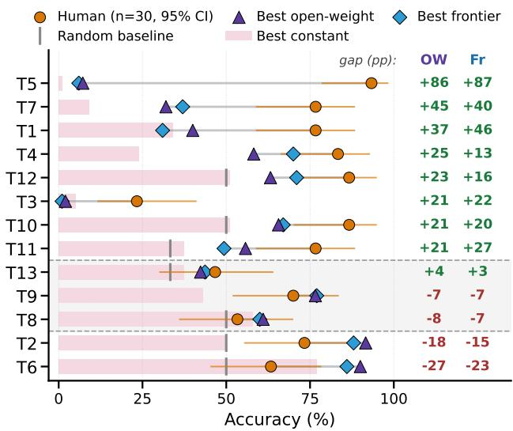  
Figure 2: Human vs. best-model accuracy per task. Shaded bars mark the best-constant baseline (always the most frequent answer); right columns give human−model gaps (pp); dashed lines group tasks by whether the best OW result falls below, within, or above the human 95% CI. Takeaway: T5: Color Distribution shows the largest gap; the best models exceed the human interval only on T2 and T6.

cal column taller than a given threshold (T6: Local Structure; there, the best model’s 90.0% also exceeds the 77.0% obtained by always giving the most frequent answer). Yet on T5: Color Distribution, where every color count must be correct, the best VLM reaches only 7.2% accuracy, compared with 93.3% for humans (Figure 2). The individual counts are already unreliable: across the 12 OW models in Non-Thinking mode, per-color MAE is 0.80 blocks over the full palette, worse than the 0.69 obtained by always predicting each color’s mean count, although five models, including the two strongest, outperform it (Appendix B.1.2). Thus, low exact-match accuracy cannot be attributed solely to a strict metric applied to otherwise reliable counts.

Factorized querying does not consistently improve fine-grained color counting. We first test whether simplifying the requested output improves these estimates. Instead of requesting all color counts in one response, we ask twelve independent single-color questions and merge their predictions. For colors present in the object, average exact-count accuracy remains essentially unchanged, from 32.5% under joint prediction to 33.2% under factorized querying. Expected exact match over subsets of k present-color counts declines rapidly as k grows, with closely aligned curves for joint and factorized predictions (Figure 3). The merged predictions achieve 0.0% full-distribution EM across all 12 OW models (Appendix B.1.3). Thus, simplifying the output does not resolve the per-color counting errors that undermine exact answers.

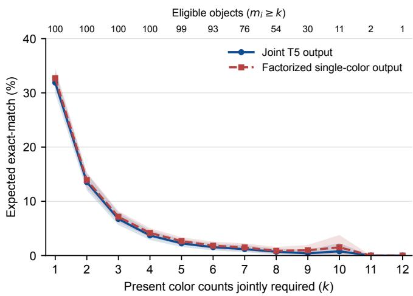  
Figure 3: Present-color subset exact match on T5: Color Distribution. Expected EM over k present-color counts from savedjoint and factorized predictions. Shading: pointwise 95% object-bootstrap intervals. Takeaway: Exact recovery declines rapidly with k, with closely aligned joint and factorized mean curves.

3D presentation amplifies constituent counting errors. Since simplifying the output ofers little benefit, we next ask whether the 3D presentation makes counting dificult. Our matched 2D control displays the same colored blocks as individually visible tiles while retaining the per-color counting task. For Qwen3.5- 27B, exact-match accuracy rises from 3.0% in 3D to 52.4% in 2D (+49.4 pp; 95% CI [+39.8, +59.0]), while per-color MAE drops from 0.50 to 0.11. After merging the frequently confused gold and yellow categories in both predictions and ground truth, EM reaches 89.8% in 2D versus 6.0% in 3D. These results suggest that 3D presentation introduces substantial dificulty beyond counting individually visible colored blocks, although the control does not isolate occlusion, view integration, and layout efects (Table 7, Appendix B.1.4).

Fine-tuning improves counting but does not ensure consistent use. Keeping the original 3D views, we next test whether training improves both exact counting and related judgments. We fine-tune Qwen3.5-

27B on 800 in-distribution T5: Color Distribution examples with LoRA on the language model only; exact match rises from 3.0% to 68.6% (Table 8, Appendix B.1.5). To test consistent use, we ask which colors are most common (T7: Color Dominance), a question a correct set of counts already settles. Accuracy is only 35.0% when answering from images, but rises to 74.2% when given the model’s own T5 counts as text (+39.2 pp; 95% CI [+26.8, +51.4]). When those counts are exactly correct, text-conditioned accuracy reaches 99.4%, versus 40.8% for direct visual questioning on the same objects. Recovering a property therefore does not mean using it consistently: the model derives the judgment from explicit counts but not from images (Table 9, Appendix B.1.5). This inconsistency is not specific to fine-tuning: per object, the direct T7 answers of the 12 OW models match the most frequent colors in their own counts on only 21.6% of objects (chance 2.4%), and their direct T1 answers match the sum of their own counts no more often than chance (Table 11, Appendix B.1.5). We next ask whether reasoning from the images can produce useful intermediate steps.

## 5.2 Test-time Reasoning Leaves Exact Answers Unreliable

Reasoning-oriented prompting improves selected tasks but leaves exact answers unreliable. We first examine whether reasoning helps models recover the exact information needed for subsequent judgments. At the default 1024-token budget, the largest gains are on T2: Packaging (+13.8 pp) and T4: Color Count (+13.9 pp). The qualitative examples show models comparing dimensions or accumulating lists of visible colors, intermediate operations that can be written out explicitly in text, which we call verbalizable steps (Tables 97 and 99, Appendix E.4). Yet T5: Color Distribution remains near floor (0.7% to 1.0%), as does T3: Diference, while accuracy declines on T1: Volume and T9: Visible Floors; the smaller decline on T8: Silhouette Symmetry has a 95% CI including zero (Table 12, Appendix B.2.1). Thus, the tested Thinking configuration helps selected individual judgments while exact answers remain unreliable. We next test larger reasoning budgets.

Increasing the reasoning budget does not consistently improve 3D accuracy. We vary the reasoning budget for Qwen3.5-27B and Gemma4-31B on T4: Color Count and T1: Volume, the largest gain and loss at the default budget, and on the cross-view task T11: Projection (Table 13, Appendix B.2.2). On T4, mean accuracy rises from 49.0% without thinking to 59.2% at 2048 tokens, then levels of. In contrast, every larger budget leaves mean accuracy on T1 below the budget-0 level (37.4% to 19.8% at 4096 tokens), and budgets of 2048 tokens or more do the same on T11 (51.5% to 45.8%). For both tasks, raising the budget from 2048 to 4096 tokens changes accuracy by less than 1 pp. Our qualitative examples illustrate this contrast: a long T4 trace organizes colors within an explicit coordinate lattice, whereas a long T1 trace continues to reconsider the alignment of the two views (Tables 93 and 94, Appendix E.3). Thus, more reasoning can help organize color enumeration but does not reliably correct the geometric estimates needed to recover 3D structure.

Incorrect visual interpretations often persist through subsequent reasoning. To understand why additional reasoning helps some tasks but fails to recover others, we examine whether models revise their visual interpretations as reasoning proceeds. In our exploratory manual audit, models often misinterpret the scene and continue reasoning from that initial misinterpretation without correcting it (Figure 4; full taxonomy in Table 15, Appendix B.2.1). Together with the task-level results, this suggests that reasoning helps some individual judgments but can extend a mistaken scene interpretation, so the exact answer still stays wrong. We next examine whether scaling and visual cues help, and what visual features make available.

5.3 Scaling and Visual Support Leave Exact Answers Unreliable, Although Visual Features Hold the Counts

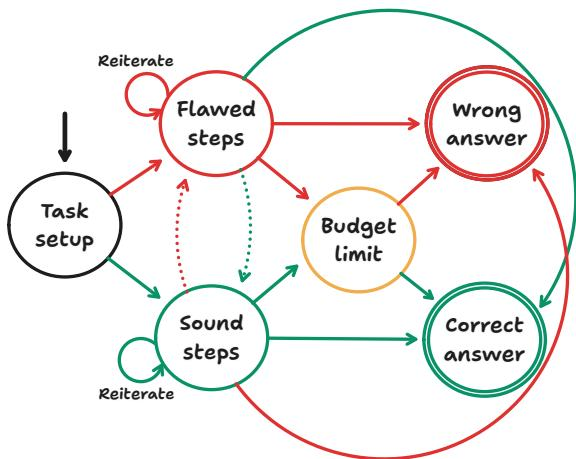  
Figure 4: State-machine summary of annotated reasoning traces. Flawed steps include visual misreads; sound steps include correct perception and valid tactics. Dotted links class switches, and outer arcs trace–answer mismatches (taxonomy: Table 15, Appendix B.2.1). Takeaway: Visual misinterpretations occur in 42 of the 44 annotated traces that end in incorrect answers.

Larger models improve individual judgments but leave exact answers unreliable. We first examine whether increasing model size closes the gap between individual judgments and exact answers. Within Qwen3.5 in Non-Thinking mode, increasing model size from 0.8B to 27B improves T2: Packaging, T4: Color Count, T6: Local Structure, T7: Color Dominance, T9: Visible Floors, and T11: Projection by 18–42 pp, with paired bootstrap intervals that all exclude zero, whereas the remaining seven tasks change by at most 6.4 pp in point estimate (Figure 5; intervals in Appendix B.3.2). This uneven improvement also appears in Gemma4, with a few task-specific exceptions; notably, both families remain near floor on T3: Diference and T5: Color Distribution (more details in Appendix B.3). The mixture-of-experts variants follow the same pattern: Qwen3.5- 35B-A3B and Gemma4-26B-A4B average 43.1% and 38.5% in Non-Thinking mode, below their dense counterparts of similar total size (46.8% and 46.5%), and both remain at 0.0% on T3 and T5 (Table 2, Appendix B). Within the tested families, larger models therefore get more individual judgments right while the exact answer stays wrong. We next ask whether visual cues help.

Additional visual cues leave exact answers unreliable. We add color or coordinate-axis overlays to the input images while keeping the geometry fixed (Appendix E.1). Color helps most on T12: Reconstruct (+6.8 pp), where it can mark corresponding parts across candidate views. On T3: Diference, adding color raises accuracy from 0.2% to 3.7%, but complete structural-diference answers remain overwhelmingly incorrect. On T5: Color Distribution, adding coordinate axes provides no improvement, with accuracy decreasing from 0.7% to 0.5% (Table 18, Appendix B.4). Thus, visual cues help selected individual judgments while the exact answer stays wrong. Since neither scale nor visual cues make exact answers reliable, and Qwen3.5 and Gemma4 both use SigLIP-2-family encoders, we next ask whether the frozen visual features hold the information exact answers require.

Pooled probes recover aggregate quantities but rarely exact counts. Probes on averaged frozen features recover quantitative information about the objects (e.g., volume for T1: Volume, the number of distinct colors for T4: Color Count, and the number of visible floors for T9: Visible Floors) even from the smallest deployed encoders, and this ability is maintained across the encoders used by VLMs of diferent sizes (Figure 9, Appendix B.5.3). Complete per-color counts, however, are rarely recovered by these probes, which are trained on the 100 benchmark objects: EM is at most 3.5% across encoders, including a depth-supervised one (Table 19, Appendix B.5.1). This mirrors the VLM results, so we test whether it reflects the features or the small training set of the probes.

With more training data, frozen features yield exact counts. Using the 800 generated training objects and 100 benchmark test objects, attention probes recover exact counts from frozen Qwen3.5-27B and Gemma4-31B vision-encoder tokens on 61.7% and 44.7% of objects, versus 3.0% and 4.0% for the VLMs. The same probe design reaches 65.0% on Qwen3.5-27B’s connec-

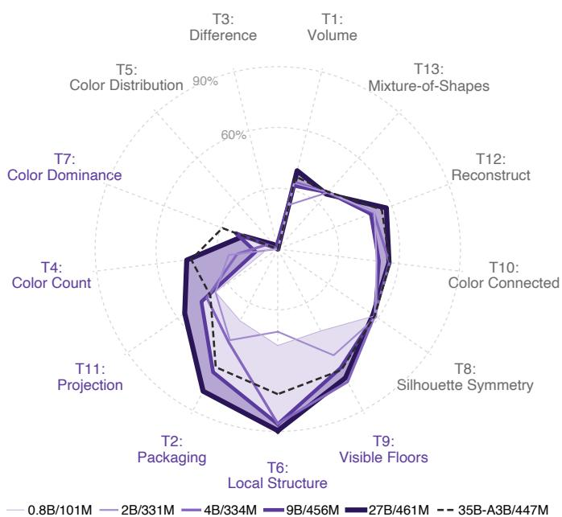  
Figure 5: Accuracy across Qwen3.5 model sizes (Non-Thinking). Legend: LLM/ViT size; line width grows with size. Light band: gain from 0.8B to 9B (LLM and ViT grow); dark band: 9B to 27B (ViT nearly fixed). Dashed: 35B-A3B MoE. Takeaway: Six tasks (purple labels) gain 18–42 pp; the rest change by at most 6.4 pp.

tor output, the image embeddings supplied to its language model (Table 20, Appendix B.5.2). Scores continue rising from 200 to 800 training objects.

The dificulty lies in using the visual features. For Qwen3.5-27B, count information thus reaches the languagemodel input, pointing to dificulty in how the language model uses it. This agrees with prior observation in simpler 2D tasks (Rahmanzadehgervi et al., 2025). Three observations reinforce this interpretation. First, training only the language model raises T5 accuracy to 68.6%, with the encoder and connector frozen. Second, Qwen3.5-27B counts far more accurately when each block is a separate 2D tile (§5.1). Third, aggregate-quantity probe scores stay flat across encoder sizes while VLM accuracy rises (Figure 9, Appendix B.5.3). Recovering a property in the visual features thus does not mean using it consistently.

## 5.4 Shortcut Controls Show Why Score Alone Is Insuficient

Some scores can be reproduced without visual evidence. Interpreting recovery or use of object properties as visual competence also requires checking that successful answers depend on the images, so we remove the images and repeat the evaluation on three models. Removing images substantially reduces accuracy on several tasks, while leaving others nearly unchanged (Table 21, Appendix B.6.1). Inspecting the predictions explains how substantial scores can survive: without images, all three models answer 0 on every T10: Color Connected instance and 3 on every T9: Visible Floors instance, reaching 51% and 43% accuracy, respectively (Table 22, Appendix B.6.1). This raises a further question: can changing the answer format also produce an apparent improvement without requiring visual information?

MCQ accuracy can come from the answer layout alone. The candidate-selection tasks in our benchmark (i.e., T11: Projection, T12: Reconstruct, T13: Mixture-of-Shapes) shufle the position of the correct candidate, so always choosing one position yields at most 37.3% on T11 and T13 and 51.0% on T12 (Appendix B.6.2). As a control, we also pose T1: Volume as a five-option MCQ with a fixed layout, in which the correct volume is always the third, middle option. Under the default visual setting, accuracy rises by +39.0 pp on average across the OW models over open-ended prediction, with gains of up to +57.8 pp per model. Without images, Gemma4-31B reaches 100% by choosing the third option on every instance (Tables 21 and 22, Appendix B.6.1). Together, these controls show why scores must be checked for dependence on the image before they are interpreted as recovery of 3D quantities or structure.

## 6 Conclusion

Across BedBench, we find that models get individual judgments right while the exact answer stays wrong, and recovering a property does not mean using it consistently. For evaluation, 3D benchmarks should report exact answers with error sizes, test whether related answers agree, and check that scores depend on the image, since accuracy on individual judgments can overstate 3D understanding. For modeling, researchers should design training objectives that improve use of visual information and consistency. For instance, models could be trained on exact labels across many tasks, stating intermediate structure before answering, with objectives that penalize disagreement between related answers. We suggest future works to test these approaches, probe language-model layers to explain why the available information is not used reliably, and extend these diagnostics to natural and embodied scenes.

## Limitations

Scene realism and human baseline. BedBench uses procedurally generated voxel objects and geometric primitives under controlled rendering environments, which provides exact ground truth and lets us filter out ambiguous samples. While this controlled setup is essential for isolating fine-grained 3D reasoning failures, extending our findings to complex real-world or embodied environments requires assessing noisy textures, lighting variations, and complex scene geometries. Additionally, our human baseline covers 30 participants; broader and more diverse cohorts could further refine task-dificulty estimates and human variance.

Scope of probes and interventions. To pinpoint failure modes, we conducted extensive probing and behavioral interventions (e.g., targeted fine-tuning, counts-as-text prompting, and reasoning sweeps). However, due to computational and evaluation constraints, certain deeper analyses–such as token-level probing, internal LM hidden-state probing, and extensive fine-tuning–were executed on representative model families (e.g., Qwen3.5- 27B) and selected tasks rather than the entire suite. Future work could generalize these internal state diagnostics across broader model families, training regimes, and embodied settings.

## Ethical Considerations

Human participants. The human baseline involved 30 volunteers recruited through the authors’ networks (Appendix C.4). Participants were informed of the study purpose, approximate duration (20 minutes), voluntary nature, and right to withdraw, and provided informed consent. For participants under 18, we additionally obtained parental or guardian consent and participant assent. Participation was uncompensated. The study used synthetic geometric renderings and involved no sensitive questions.

Participant data. We recorded per-task correctness, session time, and coarse self-reported demographics (age, sex, education), but no names, contact details, IP addresses, or free-text responses. Participants consented to the release of anonymized responses; the released data contain only anonymous task verdicts and coarse demographic fields summarized in Appendix C.4. The sample, aged 16–35, serves as a reference for task solvability rather than a population estimate.

Models and intended use. Open-weight models were evaluated under their published licenses (Table 24, Appendix C.3), and frontier models under applicable API terms. Our proposed benchmark is intended for diagnosing 3D reasoning behavior, not certifying deployment suitability. Image-removal controls (§5.4) demonstrate why accuracy should be considered alongside image dependence. The benchmark uses only synthetic scenes, with no personal imagery or scraped content, and presents no identified dual-use concerns.

## References

Aishwarya Agrawal, Dhruv Batra, Devi Parikh, and Aniruddha Kembhavi. 2018. Don’t just assume; look and answer: Overcoming priors for visual question answering. In Proceedings of the IEEE conference on computer vision and pattern recognition, pages 4971–4980.

Nahid Alam, Leema Krishna Murali, Siddhant Bharadwaj, Patrick Liu, Timothy Chung, Drishti Sharma, Akshata A, Kranthi Kiran, Wesley Tam, and Bala Krishna S Vegesna. 2026a. The spatial blindspot of vision-language models.

Nahid Alam, Leema Krishna Murali, Siddhant Bharadwaj, Patrick Liu, Timothy Chung, Drishti Sharma, Akshata A., Kranthi Kiran, Wesley Tam, and Bala Krishna S Vegesna. 2026b. Spatial reasoning is not a free lunch: A controlled study on LLaVA.

Nobuhiko Asakura and Toshio Inui. 2011. Disambiguation of mental rotation by spatial frames of reference. i-Perception, 2(5):477–485.

Nishant Balepur, Abhilasha Ravichander, and Rachel Rudinger. 2024. Artifacts or abduction: How do llms answer multiple-choice questions without the question? In Proceedings of the 62nd Annual Meeting of the Association for Computational Linguistics (Volume 1: Long Papers), pages 10308–10330.

Ted Branof. 1998. The efects of adding coordinate axes to a mental rotations task in measuring spatial visualization ability in introductory undergraduate technical graphics courses. The Engineering Design Graphics Journal, 62(2).

Theodore Branof and Patrick E Connolly. 1999. The addition of coordinate axes to the purdue spatial visualization test visualization of rotations: A study at two universities. In 1999 Annual Conference, pages 4–506.

Theodore J Branof. 1999. Coordinate axes and mental rotation tasks: A solomon four group design. The Engineering Design Graphics Journal, 63(3).

Camille Breuil, Ben J. Jennings, Simon Barthelmé, Nathalie Guyader, and Frederick A. A. Kingdom. 2019. Color improves edge classification in human vision. PLOS Computational Biology, 15(10):1–15.

Yuening Cai, Junwei Zhou, Youran Qu, and Yu-Wing Tai. 2026. IDEAL-Bench: Indoor dataset and evaluation suite for analyzing 3D layout reasoning.

Zhongang Cai, Yubo Wang, Qingping Sun, Ruisi Wang, Chenyang Gu, Wanqi Yin, Zhiqian Lin, Zhitao Yang, Chen Wei, Oscar Qian, et al. 2025. Holistic evaluation of multimodal llms on spatial intelligence. arXiv preprint arXiv:2508.13142.

Shiqi Chen, Tongyao Zhu, Ruochen Zhou, Jinghan Zhang, Siyang Gao, Juan Carlos Niebles, Mor Geva, Junxian He, Jiajun Wu, and Manling Li. 2025. Why is spatial reasoning hard for VLMs? an attention mechanism perspective on focus areas. In Forty-second International Conference on Machine Learning.

Nouha Dziri, Ximing Lu, Melanie Sclar, Xiang Lorraine Li, Liwei Jiang, Bill Yuchen Lin, Sean Welleck, Peter West, Chandra Bhagavatula, Ronan Le Bras, Jena D. Hwang, Soumya Sanyal, Xiang Ren, Allyson Ettinger, Zaid Harchaoui, and Yejin Choi. 2023. Faith and fate: Limits of transformers on compositionality. In Thirty-seventh Conference on Neural Information Processing Systems.

Mohamed El Banani, Amit Raj, Kevis-Kokitsi Maninis, Abhishek Kar, Yuanzhen Li, Michael Rubinstein, Deqing Sun, Leonidas Guibas, Justin Johnson, and Varun Jampani. 2024. Probing the 3d awareness of visual foundation models. In Proceedings of the IEEE/CVF Conference on Computer Vision and Pattern Recognition, pages 21795–21806.

Xingyu Fu, Yushi Hu, Bangzheng Li, Yu Feng, Haoyu Wang, Xudong Lin, Dan Roth, Noah A Smith, Wei-Chiu Ma, and Ranjay Krishna. 2024. Blink: Multimodal large language models can see but not perceive. In European Conference on Computer Vision, pages 148–166. Springer.

Robert Geirhos, Jörn-Henrik Jacobsen, Claudio Michaelis, Richard Zemel, Wieland Brendel, Matthias Bethge, and Felix A Wichmann. 2020. Shortcut learning in deep neural networks. Nature Machine Intelligence, 2(11):665–673.

Google DeepMind. 2025. Gemini 3 Flash.

Google DeepMind. 2026a. Gemini 3.1 Pro.

Google DeepMind. 2026b. Gemma4.

Yash Goyal, Tejas Khot, Douglas Summers-Stay, Dhruv Batra, and Devi Parikh. 2017. Making the v in vqa matter: Elevating the role of image understanding in visual question answering. In Proceedings of the IEEE conference on computer vision and pattern recognition, pages 6904–6913.

Zhongbin Guo, Zhen Yang, Yushan Li, Xinyue Zhang, Wenyu Gao, Jiacheng Wang, Chengzhi Li, Xiangrui Liu, and Ping Jian. 2026. Can LLMs see without pixels? benchmarking spatial intelligence from textual descriptions. In Findings of the Association for Computational Linguistics: ACL 2026, pages 1852–1897, San Diego, California, United States. Association for Computational Linguistics.

Wenyu Han, Siyuan Xiang, Chenhui Liu, Ruoyu Wang, and Chen Feng. 2020. Spare3d: A dataset for spatial reasoning on three-view line drawings. In Proceedings of the IEEE/CVF Conference on Computer Vision and Pattern Recognition, pages 14690–14699.

Xinmiao Huang, Qisong He, Zhenglin Huang, Boxuan Wang, Zhuoyun Li, Guangliang Cheng, Yi Dong, and Xiaowei Huang. 2026. Spatial-DISE: A unified benchmark for evaluating spatial reasoning in vision-language models. In The Fourteenth International Conference on Learning Representations.

Drew A. Hudson and Christopher D. Manning. 2019. Gqa: A new dataset for real-world visual reasoning and compositional question answering. In 2019 IEEE/CVF Conference on Computer Vision and Pattern Recognition (CVPR), pages 6693–6702.

Mengdi Jia, Zekun Qi, Shaochen Zhang, Wenyao Zhang, XinQiang Yu, Jiawei He, He Wang, and Li Yi. 2026. Omnispatial: Towards comprehensive spatial reasoning benchmark for vision language models. In The Fourteenth International Conference on Learning Representations.

Amita Kamath, Jack Hessel, and Kai-Wei Chang. 2023. What’s “up” with vision-language models? investigating their struggle with spatial reasoning. In Proceedings of the 2023 Conference on Empirical Methods in Natural Language Processing, pages 9161–9175, Singapore. Association for Computational Linguistics.

Sai Srinivas Kancheti, Aditya Sanjiv Kanade, Vineeth N. Balasubramanian, and Tanuja Ganu. 2026. Chain-ofthought degrades visual spatial reasoning capabilities of multimodal LLMs. In Proceedings of the 64th Annual Meeting of the Association for Computational Linguistics (Volume 2: Short Papers), pages 862–876, San Diego, California, United States. Association for Computational Linguistics.

Peter Khooshabeh and Mary Hegarty. 2008a. Diferential efects of color on mental rotation as a function of spatial ability. Spatial Cognition 2008: Poster Presentations, page 21.

Peter Khooshabeh and Mary Hegarty. 2008b. How visual information afects a spatial task. In Proceedings of Cognitive Science Society, pages 2041–2046.

Peter Khooshabeh and Mary Hegarty. 2010. Representations of shape during mental rotation. In AAAI Spring Symposium: Cognitive Shape Processing.

Kimi Team, Angang Du, Bohong Yin, Bowei Xing, Bowen Qu, Bowen Wang, Cheng Chen, Chenlin Zhang, Chenzhuang Du, Chu Wei, Congcong Wang, Dehao Zhang, Dikang Du, Dongliang Wang, Enming Yuan, Enzhe Lu, Fang Li, Flood Sung, Guangda Wei, Guokun Lai, Han Zhu, Hao Ding, Hao Hu, Hao Yang, Hao Zhang, Haoning Wu, Haotian Yao, Haoyu Lu, Heng Wang, Hongcheng Gao, Huabin Zheng, Jiaming Li, Jianlin Su, Jianzhou Wang, Jiaqi Deng, Jiezhong Qiu, Jin Xie, Jinhong Wang, Jingyuan Liu, Junjie Yan, Kun Ouyang,

Liang Chen, Lin Sui, Longhui Yu, Mengfan Dong, Mengnan Dong, Nuo Xu, Pengyu Cheng, Qizheng Gu, Runjie Zhou, Shaowei Liu, Sihan Cao, Tao Yu, Tianhui Song, Tongtong Bai, Wei Song, Weiran He, Weixiao Huang, Weixin Xu, Xiaokun Yuan, Xingcheng Yao, Xingzhe Wu, Xinxing Zu, Xinyu Zhou, Xinyuan Wang, Y. Charles, Yan Zhong, Yang Li, Yangyang Hu, Yanru Chen, Yejie Wang, Yibo Liu, Yibo Miao, Yidao Qin, Yimin Chen, Yiping Bao, Yiqin Wang, Yongsheng Kang, Yuanxin Liu, Yulun Du, Yuxin Wu, Yuzhi Wang, Yuzi Yan, Zaida Zhou, Zhaowei Li, Zhejun Jiang, Zheng Zhang, Zhilin Yang, Zhiqi Huang, Zihao Huang, Zijia Zhao, and Ziwe Chen. 2025. Kimi-VL technical report.

Ming Yi Koh, Gerald Jit Shen Tan, and Sreenivasulu Reddy Mogali. 2023. Spatial ability and 3d model colourcoding afect anatomy performance: a cross-sectional and randomized trial. Scientific Reports, 13(1):7879.

Takeshi Kojima, Shixiang Shane Gu, Machel Reid, Yutaka Matsuo, and Yusuke Iwasawa. 2022. Large language models are zero-shot reasoners. Advances in neural information processing systems, 35:22199–22213.

Sebastian Lapuschkin, Stephan Wäldchen, Alexander Binder, Grégoire Montavon, Wojciech Samek, and Klaus-Robert Müller. 2019. Unmasking clever hans predictors and assessing what machines really learn. Nature communications, 10(1):1096.

Chengzu Li, Wenshan Wu, Huanyu Zhang, Qingtao Li, Zeyu Gao, Yan Xia, José Hernández-Orallo, Ivan Vulić, and Furu Wei. 2025a. 11plus-bench: Demystifying multimodal llm spatial reasoning with cognitive-inspired analysis. arXiv preprint arXiv:2508.20068.

Hongxing Li, Dingming Li, Zixuan Wang, Yuchen Yan, Hang Wu, Wenqi Zhang, Yongliang Shen, Weiming Lu, Jun Xiao, and Yueting Zhuang. 2026a. Spatialladder: Progressive training for spatial reasoning in vision-language models. In The Fourteenth International Conference on Learning Representations.

Linjie Li, Mahtab Bigverdi, Jiawei Gu, Zixian Ma, Yinuo Yang, Ziang Li, Yejin Choi, and Ranjay Krishna. 2026b. Unfolding spatial cognition: Evaluating multimodal models on visual simulations. In The Fourteenth International Conference on Learning Representations.

Tianle Li, Jihai Zhang, Yongming Rao, and Yu Cheng. 2025b. Unveiling the compositional ability gap in vision-language reasoning model. In The Thirty-ninth Annual Conference on Neural Information Processing Systems.

Yihao Li, Saeed Salehi, Lyle Ungar, and Konrad Kording. 2025c. Does object binding naturally emerge in large pretrained vision transformers? In The Thirty-ninth Annual Conference on Neural Information Processing Systems.

Shijie Lian, Changti Wu, Laurence Tianruo Yang, Hang Yuan, Bin Yu, Lei Zhang, and Kai Chen. 2026. Euclid’s gift: Enhancing spatial perception and reasoning in vision-language models via geometric surrogate tasks. In Proceedings of the IEEE/CVF Conference on Computer Vision and Pattern Recognition, pages 9824–9835.

Chih-Ting Liao, Fei Shen, Xin Cao, and Tat-Seng Chua. 2026a. Decodable is not grounded: A vision-ablation arbiter for VLM spatial reasoning.

Chih-Ting Liao, Xi Xiao, Chunlei Meng, Zhangquan Chen, Yitong Qiao, Weilin Zhou, Tianyang Wang, Xu Zheng, and Xin Cao. 2026b. SpaMEM: Benchmarking dynamic spatial reasoning via perception-memory integration in embodied environments.

Fangyu Liu, Guy Emerson, and Nigel Collier. 2023. Visual spatial reasoning. Transactions of the Association for Computational Linguistics, 11:635–651.

Wufei Ma, Haoyu Chen, Guofeng Zhang, Yu-Cheng Chou, Jieneng Chen, Celso de Melo, and Alan Yuille. 2025. 3dsrbench: A comprehensive 3d spatial reasoning benchmark. In Proceedings of the IEEE/CVF International Conference on Computer Vision, pages 6924–6934.

Ian R. McKenzie, Alexander Lyzhov, Michael Martin Pieler, Alicia Parrish, Aaron Mueller, Ameya Prabhu, Euan McLean, Xudong Shen, Joe Cavanagh, Andrew George Gritsevskiy, Derik Kaufman, Aaron T. Kirtland, Zhengping Zhou, Yuhui Zhang, Sicong Huang, Daniel Wurgaft, Max Weiss, Alexis Ross, Gabriel Recchia, Alisa Liu, Jiacheng Liu, Tom Tseng, Tomasz Korbak, Najoung Kim, Samuel R. Bowman, and Ethan Perez. 2023. Inverse scaling: When bigger isn’t better. Transactions on Machine Learning Research. Featured Certification.

Mateusz Michalkiewicz, Mahsa Baktashmotlagh, and Guha Balakrishnan. 2026. Foveated probes recover localized binding information in vision foundation models.

Farhad Nooralahzadeh, Omid Rohanian, Yi Zhang, Jonathan Fürst, and Kurt Stockinger. 2026. Arbitration failure, not perceptual blindness: How vision-language models resolve visual-linguistic conflicts. In Third Conference on Language Modeling.

Maxime Oquab, Timothée Darcet, Théo Moutakanni, Huy V. Vo, Marc Szafraniec, Vasil Khalidov, Pierre Fernandez, Daniel HAZIZA, Francisco Massa, Alaaeldin El-Nouby, Mido Assran, Nicolas Ballas, Wojciech Galuba, Russell Howes, Po-Yao Huang, Shang-Wen Li, Ishan Misra, Michael Rabbat, Vasu Sharma, Gabriel Synnaeve, Hu Xu, Herve Jegou, Julien Mairal, Patrick Labatut, Armand Joulin, and Piotr Bojanowski. 2024. DINOv2: Learning robust visual features without supervision. Transactions on Machine Learning Research. Featured Certification.

Xingzhou Pang, Yifan Hou, Junling Wang, and Mrinmaya Sachan. 2026. Unveiling the visual counting bottleneck in vision-language models. In Forty-third International Conference on Machine Learning.

Lawrence M Parsons. 1995. Inability to reason about an object’s orientation using an axis and angle of rotation. Journal of experimental psychology: Human perception and performance, 21(6):1259.

Jianing Qi, Jiawei Liu, Hao Tang, and Zhigang Zhu. 2026. Beyond semantics: Rediscovering spatial awareness in vision-language models. In Third Conference on Language Modeling.

Qwen Team. 2026. Qwen3.5: Towards native multimodal agents.

Alec Radford, Jong Wook Kim, Chris Hallacy, Aditya Ramesh, Gabriel Goh, Sandhini Agarwal, Girish Sastry, Amanda Askell, Pamela Mishkin, Jack Clark, Gretchen Krueger, and Ilya Sutskever. 2021. Learning transferable visual models from natural language supervision. In Proceedings ofthe 38th International Conference on Machine Learning, volume 139 of Proceedings of Machine Learning Research, pages 8748–8763. PMLR.

Martina Rahe, Matthias Weigelt, and Petra Jansen. 2022. Mental rotation with colored cube figures. Consciousness and Cognition, 102:103350.

Pooyan Rahmanzadehgervi, Logan Bolton, Mohammad Reza Taesiri, and Anh Totti Nguyen. 2025. Vision language models are blind: Failing to translate detailed visual features into words.

Santhosh Kumar Ramakrishnan, Erik Wijmans, Philipp Kraehenbuehl, and Vladlen Koltun. 2025. Does spatial cognition emerge in frontier models? In The Thirteenth International Conference on Learning Representations.

Arijit Ray, Karan Sikka, Ajay Divakaran, Stefan Lee, and Giedrius Burachas. 2019. Sunny and dark outside?! improving answer consistency in VQA through entailed question generation. In Proceedings of the 2019 Conference on Empirical Methods in Natural Language Processing and the 9th International Joint Conference on Natural Language Processing (EMNLP-IJCNLP), pages 5860–5865, Hong Kong, China. Association for Computational Linguistics.

Marco Tulio Ribeiro, Carlos Guestrin, and Sameer Singh. 2019. Are red roses red? evaluating consistency of question-answering models. In Proceedings of the 57th Annual Meeting of the Associationfor Computational Linguistics, pages 6174–6184, Florence, Italy. Association for Computational Linguistics.

Rylan Schaefer, Brando Miranda, and Sanmi Koyejo. 2023. Are emergent abilities of large language models a mirage? Advances in neural information processing systems, 36:55565–55581.

Aaditya Singh, Adam Fry, Adam Perelman, Adam Tart, Adi Ganesh, Ahmed El-Kishky, Aidan McLaughlin, Aiden Low, AJ Ostrow, Akhila Ananthram, Akshay Nathan, Alan Luo, Alec Helyar, Aleksander Madry, Aleksandr Efremov, Aleksandra Spyra, Alex Baker-Whitcomb, Alex Beutel, Alex Karpenko, Alex Makelov, Alex Neitz, Alex Wei, Alexandra Barr, Alexandre Kirchmeyer, Alexey Ivanov, Alexi Christakis, Alistair Gillespie, Allison Tam, Ally Bennett, Alvin Wan, Alyssa Huang, Amy McDonald Sandjideh, Amy Yang, Ananya Kumar, Andre Saraiva, Andrea Vallone, Andrei Gheorghe, Andres Garcia Garcia, Andrew Braunstein, Andrew Liu, Andrew Schmidt, Andrey Mereskin, Andrey Mishchenko, Andy Applebaum, Andy Rogerson, Ann Rajan, Annie Wei, Anoop Kotha, Anubha Srivastava, Anushree Agrawal, Arun Vijayvergiya, Ashley Tyra, Ashvin Nair, Avi Nayak, Ben Eggers, Bessie Ji, Beth Hoover, Bill Chen, Blair Chen, Boaz Barak, Borys Minaiev, Botao Hao, Bowen Baker, Brad Lightcap, Brandon McKinzie, Brandon Wang, Brendan Quinn, Brian Fioca, Brian Hsu, Brian Yang, Brian Yu, Brian Zhang, Brittany Brenner, Callie Riggins Zetino, Cameron Raymond, Camillo Lugaresi, Carolina Paz, Cary Hudson, Cedric Whitney, Chak Li, Charles Chen, Charlotte Cole, Chelsea Voss, Chen Ding, Chen Shen, Chengdu Huang, Chris Colby, Chris Hallacy, Chris Koch, Chris Lu, Christina Kaplan, Christina Kim, CJ Minott-Henriques, Clif Frey, Cody Yu, Coley Czarnecki, Colin Reid, Colin Wei, Cory Decareaux, Cristina Scheau, Cyril Zhang, Cyrus Forbes, Da Tang, Dakota Goldberg, Dan Roberts, Dana Palmie, Daniel Kappler, Daniel Levine, Daniel Wright, Dave Leo, David Lin, David Robinson, Declan Grabb, Derek Chen, Derek Lim, Derek Salama, Dibya Bhattacharjee, Dimitris Tsipras, Dinghua Li, Dingli Yu, DJ Strouse, Drew Williams, Dylan Hunn, Ed Bayes, Edwin Arbus, Ekin Akyurek, Elaine Ya Le, Elana Widmann, Eli Yani, Elizabeth Proehl, Enis Sert. Enoch Cheung, Eri Schwartz. Eric Han, Eric Jiang. Eric Mitchell, Eric Sigler, Eric Wallace, Erik Ritter Erin Kavanaugh, Evan Mays, Evgenii Nikishin, Fangyuan Li, Felipe Petroski Such, Filipe de Avila Belbute Peres, Filippo Raso, Florent Bekerman, Foivos Tsimpourlas, Fotis Chantzis, Francis Song, Francis Zhang, Gaby Raila, Garrett McGrath, Gary Briggs, Gary Yang, Giambattista Parascandolo, Gildas Chabot, Grace Kim, Grace Zhao, Gregory Valiant, Guillaume Leclerc, Hadi Salman, Hanson Wang, Hao Sheng, Haoming Jiang, Haoyu Wang, Haozhun Jin, Harshit Sikchi, Heather Schmidt, Henry Aspegren, Honglin Chen, Huida Qiu, Hunter Lightman, Ian Covert, Ian Kivlichan, Ian Silber, Ian Sohl, Ibrahim Hammoud, Ignasi Clavera, Ikai Lan, Ilge Akkaya, Ilya Kostrikov, Irina Kofman, Isak Etinger, Ishaan Singal, Jackie Hehir, Jacob Huh, Jacqueline Pan, Jake Wilczynski, Jakub Pachocki, James Lee, James Quinn, Jamie Kiros, Janvi Kalra, Jasmyn Samaroo, Jason Wang, Jason Wolfe, Jay Chen, Jay Wang, Jean Harb, Jefrey Han, Jefrey Wang, Jennifer Zhao, Jeremy Chen, Jerene Yang, Jerry Tworek, Jesse Chand, Jessica Landon, Jessica Liang, Ji Lin, Jiancheng Liu, Jianfeng Wang, Jie Tang, Jihan Yin, Joanne Jang, Joel Morris, Joey Flynn, Johannes Ferstad, Johannes Heidecke, John Fishbein, John Hallman, Jonah Grant, Jonathan Chien, Jonathan Gordon, Jongsoo Park, Jordan Liss, Jos Kraaijeveld, Joseph Guay, Joseph Mo, Josh Lawson, Josh McGrath, Joshua Vendrow, Joy Jiao, Julian Lee, Julie Steele, Julie Wang, Junhua Mao, Kai Chen, Kai Hayashi, Kai Xiao, Kamyar Salahi, Kan Wu, Karan Sekhri, Karan Sharma, Karan Singhal, Karen Li, Kenny Nguyen, Keren Gu-Lemberg, Kevin King, Kevin Liu, Kevin Stone, Kevin Yu, Kristen Ying, Kristian Georgiev, Kristie Lim, Kushal Tirumala, Kyle Miller, Lama Ahmad, Larry Lv, Laura Clare, Laurance Fauconnet, Lauren Itow, Lauren Yang, Laurentia Romaniuk, Leah Anise, Lee Byron, Leher Pathak, Leon Maksin, Leyan Lo, Leyton Ho, Li Jing, Liang Wu, Liang Xiong, Lien Mamitsuka, Lin Yang, Lindsay McCallum, Lindsey Held, Liz Bourgeois, Logan Engstrom, Lorenz Kuhn, Louis Feuvrier, Lu Zhang, Lucas Switzer, Lukas Kondraciuk, Lukasz Kaiser, Manas Joglekar, Mandeep Singh, Mandip Shah, Manuka Stratta, Marcus Williams, Mark Chen, Mark Sun, Marselus Cayton, Martin Li, Marvin Zhang, Marwan Aljubeh, Matt Nichols, Matthew Haines, Max Schwarzer, Mayank Gupta, Meghan Shah, Melody Huang, Meng Dong, Mengqing Wang, Mia Glaese, Micah Carroll, Michael Lampe, Michael Malek, Michael Sharman, Michael Zhang, Michele Wang, Michelle Pokrass, Mihai Florian, Mikhail Pavlov, Miles Wang, Ming Chen, Mingxuan Wang, Minnia Feng, Mo Bavarian, Molly Lin, Moose Abdool, Mostafa Rohaninejad, Nacho Soto, Natalie Staudacher, Natan LaFontaine, Nathan Marwell, Nelson Liu, Nick Preston, Nick Turley, Nicklas Ansman, Nicole Blades, Nikil Pancha, Nikita Mikhaylin, Niko Felix, Nikunj Handa, Nishant Rai, Nitish Keskar, Noam Brown, Ofir Nachum, Oleg Boiko, Oleg Murk, Olivia Watkins, Oona Gleeson, Pamela Mishkin, Patryk Lesiewicz, Paul Baltescu, Pavel Belov, Peter Zhokhov, Philip Pronin, Phillip Guo, Phoebe Thacker, Qi Liu, Qiming Yuan, Qinghua Liu, Rachel Dias, Rachel Puckett, Rahul Arora, Ravi Teja Mullapudi, Raz Gaon, Reah Miyara, Rennie Song, Rishabh Aggarwal, RJ Marsan, Robel Yemiru, Robert Xiong, Rohan Kshirsagar, Rohan Nuttall, Roman Tsiupa, Ronen Eldan, Rose Wang, Roshan James, Roy Ziv, Rui Shu, Ruslan Nigmatullin, Saachi Jain, Saam Talaie, Sam Altman, Sam Arnesen, Sam Toizer, Sam Toyer, Samuel Miserendino, Sandhini Agarwal, Sarah Yoo,

Savannah Heon, Scott Ethersmith, Sean Grove, Sean Taylor, Sebastien Bubeck, Sever Banesiu, Shaokyi Amdo, Shengjia Zhao, Sherwin Wu, Shibani Santurkar, Shiyu Zhao, Shraman Ray Chaudhuri, Shreyas Krishnaswamy, Shuaiqi, Xia, Shuyang Cheng, Shyamal Anadkat, Simón Posada Fishman, Simon Tobin, Siyuan Fu, Somay Jain, Song Mei, Sonya Egoian, Spencer Kim, Spug Golden, SQ Mah, Steph Lin, Stephen Imm, Steve Sharpe, Steve Yadlowsky, Sulman Choudhry, Sungwon Eum, Suvansh Sanjeev, Tabarak Khan, Tal Stramer, Tao Wang, Tao Xin, Tarun Gogineni, Taya Christianson, Ted Sanders, Tejal Patwardhan, Thomas Degry, Thomas Shadwell, Tianfu Fu, Tianshi Gao, Timur Garipov, Tina Sriskandarajah, Toki Sherbakov, Tomer Kaftan, Tomo Hiratsuka, Tongzhou Wang, Tony Song, Tony Zhao, Troy Peterson, Val Kharitonov, Victoria Chernova, Vineet Kosaraju, Vishal Kuo, Vitchyr Pong, Vivek Verma, Vlad Petrov, Wanning Jiang, Weixing Zhang, Wenda Zhou, Wenlei Xie, Wenting Zhan, Wes McCabe, Will DePue, Will Ellsworth, Wulfie Bain, Wyatt Thompson, Xiangning Chen, Xiangyu Qi, Xin Xiang, Xinwei Shi, Yann Dubois, Yaodong Yu, Yara Khakbaz, Yifan Wu, Yilei Qian, Yin Tat Lee, Yinbo Chen, Yizhen Zhang, Yizhong Xiong, Yonglong Tian, Young Cha, Yu Bai, Yu Yang, Yuan Yuan, Yuanzhi Li, Yufeng Zhang, Yuguang Yang, Yujia Jin, Yun Jiang, Yunyun Wang, Yushi Wang, Yutian Liu, Zach Stubenvoll, Zehao Dou, Zheng Wu, and Zhigang Wang. 2025. Openai gpt-5 system card.

Zayne Sprague, Fangcong Yin, Juan Rodriguez, Dongwei Jiang, Manya Wadhwa, Prasann Singhal, Xinyu Zhao, Xi Ye, Kyle Mahowald, and Greg Durrett. 2025. To cot or not to cot? chain-of-thought helps mainly on math and symbolic reasoning. In International Conference on Learning Representations, volume 2025, pages 94118–94162.

Ilias Stogiannidis, Steven McDonagh, and Sotirios A. Tsaftaris. 2025. Mind the gap: Benchmarking spatial reasoning in vision-language models. In Greeks in AI Symposium 2025.

Kexian Tang, Junyao Gao, Yanhong Zeng, Haodong Duan, Yanan Sun, Zhening Xing, Wenran Liu, Kaifeng Lyu, and Kai Chen. 2025. Lego-puzzles: How good are mllms at multi-step spatial reasoning? arXiv preprint arXiv:2503.19990.

Shengbang Tong, Zhuang Liu, Yuexiang Zhai, Yi Ma, Yann LeCun, and Saining Xie. 2024. Eyes wide shut? exploring the visual shortcomings of multimodal llms. In Proceedings of the IEEE/CVF conference on computer vision and pattern recognition, pages 9568–9578.

Michael Tschannen, Alexey Gritsenko, Xiao Wang, Muhammad Ferjad Naeem, Ibrahim Alabdulmohsin, Nikhil Parthasarathy, Talfan Evans, Lucas Beyer, Ye Xia, Basil Mustafa, Olivier Hénaf, Jeremiah Harmsen, Andreas Steiner, and Xiaohua Zhai. 2025. Siglip 2: Multilingual vision-language encoders with improved semantic understanding, localization, and dense features.

Miles Turpin, Julian Michael, Ethan Perez, and Samuel Bowman. 2023. Language models don’t always say what they think: Unfaithful explanations in chain-of-thought prompting. Advances in Neural Information Processing Systems, 36:74952–74965.

V Team, Wenyi Hong, Wenmeng Yu, Xiaotao Gu, Guo Wang, Guobing Gan, Haomiao Tang, Jiale Cheng, Ji Qi, Junhui Ji, Lihang Pan, Shuaiqi Duan, Weihan Wang, Yan Wang, Yean Cheng, Zehai He, Zhe Su, Zhen Yang, Ziyang Pan, Aohan Zeng, Baoxu Wang, Bin Chen, Boyan Shi, Changyu Pang, Chenhui Zhang, Da Yin, Fan Yang, Guoqing Chen, Jiazheng Xu, Jiale Zhu, Jiali Chen, Jing Chen, Jinhao Chen, Jinghao Lin, Jinjiang Wang, Junjie Chen, Leqi Lei, Letian Gong, Leyi Pan, Mingdao Liu, Mingde Xu, Mingzhi Zhang, Qinkai Zheng, Sheng Yang, Shi Zhong, Shiyu Huang, Shuyuan Zhao, Siyan Xue, Shangqin Tu, Shengbiao Meng, Tianshu Zhang, Tianwei Luo, Tianxiang Hao, Tianyu Tong, Wenkai Li, Wei Jia, Xiao Liu, Xiaohan Zhang, Xin Lyu, Xinyue Fan, Xuancheng Huang, Yanling Wang, Yadong Xue, Yanfeng Wang, Yanzi Wang, Yifan An, Yifan Du, Yiming Shi, Yiheng Huang, Yilin Niu, Yuan Wang, Yuanchang Yue, Yuchen Li, Yutao Zhang, Yuting Wang, Yu Wang, Yuxuan Zhang, Zhao Xue, Zhenyu Hou, Zhengxiao Du, Zihan Wang, Peng Zhang, Debing Liu, Bin Xu, Juanzi Li, Minlie Huang, Yuxiao Dong, and Jie Tang. 2025. Glm-4.5v and glm-4.1v-thinking: Towards versatile multimodal reasoning with scalable reinforcement learning.

Haoming Wang, Qiyao Xue, and Wei Gao. 2026a. Infinibench: Infinite benchmarking for visual spatial reasoning with customizable scene complexity. In Proceedings of the IEEE/CVF Conference on Computer Vision and Pattern Recognition, pages 21594–21605.

Jiayu Wang, Yifei Ming, Zhenmei Shi, Vibhav Vineet, Xin Wang, Yixuan Li, and Neel Joshi. 2024. Is a picture worth a thousand words? delving into spatial reasoning for vision language models. In The Thirty-eighth Annual Conference on Neural Information Processing Systems.

Siting Wang, Minnan Pei, Luoyang Sun, Cheng Deng, Yuchen Li, Kun Shao, Zheng Tian, Haifeng Zhang, and Jun Wang. 2026b. Spatialviz-bench: A cognitively-grounded benchmark for diagnosing spatial visualization in MLLMs. In The Fourteenth International Conference on Learning Representations.

Wenqi Wang, Reuben Tan, Pengyue Zhu, Jianwei Yang, Zhengyuan Yang, Lijuan Wang, Andrey Kolobov, Jianfeng Gao, and Boqing Gong. 2025. Site: towards spatial intelligence thorough evaluation. In Proceedings of the IEEE/CVF International Conference on Computer Vision, pages 9058–9069.

Azmine Toushik Wasi, Wahid Faisal, Abdur Rahman, Mahfuz Ahmed Anik, Munem Shahriar, Mohsin Mahmud Topu, Sadia Tasnim Meem, Rahatun Nesa Priti, Sabrina Afroz Mitu, Md. Iqramul Hoque, Shahriyar Zaman Ridoy, Mohammed Eunus Ali, Majd Hawasly, Mohammad Raza, and Md Rizwan Parvez. 2026. Spatialab: Can vision–language models perform spatial reasoning in the wild? In The Fourteenth International Conference on Learning Representations.

Jason Wei, Xuezhi Wang, Dale Schuurmans, Maarten Bosma, brian ichter, Fei Xia, Ed H. Chi, Quoc V Le, and Denny Zhou. 2022. Chain of thought prompting elicits reasoning in large language models. In Advances in Neural Information Processing Systems.

Stephen Westland and Maggie Maggio. 2023. Universal Principles of Color: 100 Key Concepts for Understanding, Analyzing, and Working with Color, volume 5. Rockport Publishers.

Maryjane Wraga, Sarah H Creem, and Dennis R Profitt. 1999. The influence of spatial reference frames on imagined object-and viewer rotations. Acta Psychologica, 102(2-3):247–264.

Changti Wu, Shijie Lian, Zihao Liu, Lei Zhang, Laurence Tianruo Yang, and Kai Chen. 2025. DynaSolidGeo: A dynamic benchmark for genuine spatial mathematical reasoning of VLMs in solid geometry.

xAI Team. 2026. Grok 4.20.

Peiran Xu, Sudong Wang, Yao Zhu, Jianing Li, Gege Qi, and Yunjian Zhang. 2026. SpatialBench: Benchmarking multimodal large language models for spatial cognition.

Wenrui Xu, Dalin Lyu, Weihang Wang, Jie Feng, Chen Gao, and Yong Li. 2025. Defining and evaluating visual language models’ basic spatial abilities: A perspective from psychometrics. In Proceedings of the 63rd Annual Meeting of the Association for Computational Linguistics (Volume 1: Long Papers), pages 11571–11590, Vienna, Austria. Association for Computational Linguistics.

Jihan Yang, Shusheng Yang, Anjali W Gupta, Rilyn Han, Li Fei-Fei, and Saining Xie. 2025. Thinking in space: How multimodal large language models see, remember, and recall spaces. In Proceedings of the Computer Vision and Pattern Recognition Conference, pages 10632–10643.

Lihe Yang, Bingyi Kang, Zilong Huang, Zhen Zhao, Xiaogang Xu, Jiashi Feng, and Hengshuang Zhao. 2024. Depth anything v2. Advances in Neural Information Processing Systems, 37:21875–21911.

Sihan Yang, Runsen Xu, Yiman Xie, Sizhe Yang, Mo Li, Jingli Lin, Chenming Zhu, Xiaochen Chen, Haodong Duan, Xiangyu Yue, Dahua Lin, Tai Wang, and Jiangmiao Pang. 2026. MMSI-bench: A benchmark for multi-image spatial intelligence. In The Fourteenth International Conference on Learning Representations.

Leyuan Yu, Xiao Tang, Ming-Hao Liu, Xinyuan Li, Xiaokai Bai, Shengyao Zhou, Qunshu Lin, Weihao Xuan, and Naoto Yokoya. 2026. Mindedit-bench: Benchmarking object-level counterfactual spatial reasoning in vlms from in-the-wild photos. ArXiv, abs/2607.00491.

Mert Yuksekgonul, Federico Bianchi, Pratyusha Kalluri, Dan Jurafsky, and James Zou. 2023. When and why vision-language models behave like bags-of-words, and what to do about it? In The Eleventh International Conference on Learning Representations.

Shaoxiong Zhan, Yanlin Lai, Zheng Liu, Lin Hai, Shen Li, Xiaodong Cai, Zijian Lin, Wen Huang, and Hai-Tao Zheng. 2026. 3viewsense: Spatial and mental perspective reasoning from orthographic views in visionlanguage models. In Forty-third International Conference on Machine Learning.

Huanyu Zhang, Chengzu Li, Wenshan Wu, Shaoguang Mao, Yifan Zhang, Haochen Tian, Ivan Vulić, Zhang Zhang, Liang Wang, Tieniu Tan, and Furu Wei. 2025a. Scaling and beyond: Advancing spatial reasoning in MLLMs requires new recipes.

Jiahuan Zhang, Shunwen Bai, Tianheng Wang, KaiWen Guo, Zijia Song, Hanqing WU, Guozheng Rao, Kai Han, and Kaicheng Yu. 2026a. Ascending the infinite ladder: Benchmarking spatial deformation reasoning in vision-language models. In Proceedings of the 64th Annual Meeting of the Association for Computational Linguistics (Volume 1: Long Papers), pages 24381–24404, San Diego, California, United States. Association for Computational Linguistics.

Wanyue Zhang, Yibin Huang, Yangbin Xu, JingJing Huang, Helu Zhi, Shuo Ren, Wang Xu, and Jiajun Zhang. 2025b. Why do mllms struggle with spatial understanding? a systematic analysis from data to architecture. arXiv preprint arXiv:2509.02359.

Yunkai Zhang, Linda Li, Yingxin Cui, Xiyuan Ruan, Zeyu Zheng, Kezhen Chen, Yi Zhang, and Diji Yang. 2026b. Grid2matrix: Revealing digital agnosia in vision-language models. arXiv preprint arXiv:2604.09687.

Zheyuan Zhang, Fengyuan Hu, Jayjun Lee, Freda Shi, Parisa Kordjamshidi, Joyce Chai, and Ziqiao Ma. 2025c. Do vision-language models represent space and how? evaluating spatial frame of reference under ambiguities. In The Thirteenth International Conference on Learning Representations.

Chujie Zheng, Hao Zhou, Fandong Meng, Jie Zhou, and Minlie Huang. 2024. Large language models are not robust multiple choice selectors. In International Conference on Learning Representations, volume 2024, pages 19426–19454.

## Contents

A Extended Related Work 21   
A.1 Benchmarks and Human References 21   
A.2 Consistency Across Related Questions 22   
A.3 Shortcut Controls and Answer Formats 22   
A.4 Visual Representations and the Choice of Readout 23   
A.5 Reasoning, Scaling, and Training Interventions 23   
B Extended Findings and Detailed Analyses 25   
B.1 Human gap and per-color counting . . 25   
B.1.1 VLM-human gap concentrates on exact structure and cross-view tasks 26   
B.1.2 Floor accuracy hides two failure depths . 26   
B.1.3 Factorized querying does not consistently improve fine-grained color counting 27   
B.1.4 A 2D visibility control separates basic enumeration from 3D presentation 28   
B.1.5 Task-specific fine-tuning substantially improves counting but yields incomplete cross-task   
transfer . 29   
B.2 Thinking helps selected tasks but leaves exact answers unreliable 32   
B.2.1 When thinking helps and what the traces reveal 32   
B.2.2 Larger reasoning budgets do not recover the afected tasks 33   
B.2.3 Thinking shifts decision behavior on binary tasks . 34   
B.3 Failures persist across model families and scale 36   
B.3.1 VLMs fail similarly across independently trained families 36   
B.3.2 Scaling does not make exact answers reliable 37   
B.4 Color and coordinate axes have diferent efects on VLM accuracy 39   
B.4.1 VLMs show modest gains from color add-ons 39   
B.4.2 VLMs do not reliably benefit from axes add-ons . 40   
B.5 Probing the visual front-end on ground truth . 41   
B.5.1 Pooled probes recover quantities but rarely exact decompositions 41   
B.5.2 With more training data, token-level probes recover exact per-color counts 43   
B.5.3 Probe scores stay flat with tower size while VLM use improves 44   
B.6 VLMs exploit answer-format and language-prior shortcuts . 46   
B.6.1 VLMs retain scores without images by collapsing to constant predictions 46   
B.6.2 VLMs may appear stronger under multiple choice 48   
C Implementation Details 49   
C.1 Dataset Generation Details 49   
C.2 General Experiment Setup 53   
C.3 Model Details 54   
C.4 Human Baseline Details 55   
D Dataset Examples 56   
D.1 T1: Volume . 57   
D.2 T2: Packaging 58   
D.3 T3: Diference 59   
D.4 T4: Color Count 60   
D.5 T5: Color Distribution 61   
D.6 T6: Local Structure . 62   
D.7 T7: Color Dominance 63   
D.8 T8: Silhouette Symmetry D.9 T9: Visible Floors . . <sup>64</sup><sub>65</sub>   
D.10 T10: Color Connected 66   
D.11 T11: Projection . 67   
D.12 T12: Reconstruct 68   
D.13 T13: Mixture-of-Shapes 69   
E Qualitative Results 70   
E.1 Visual-Cue Add-Ons: Instance-Level Evidence 70   
E.2 Parameter Scaling: Instance-Level Evidence 80   
E.3 Thinking Budget: Instance-Level Evidence . 87   
E.4 Thinking Mode Flips: Instance-Level Evidence 91   
E.5 Thinking Traces: Instance-Level Evidence 101   
E.5.1 T1 Volume . 102   
E.5.2 T2 Packaging 105   
E.5.3 T3 Diference . 105   
E.5.4 T4 Color Count . 106   
E.5.5 T5 Color Distribution 108   
E.5.6 T6 Local Structure 109   
E.5.7 T7 Color Dominance . 110   
E.5.8 T8 Silhouette Symmetry . 111   
E.5.9 T9 Visible Floors 112   
E.5.10 T10 Color Connected 113   
E.5.11 T11 Projection 114   
E.5.12 T12 Reconstruct . . 115   
E.5.13 T13 Mixture-of-Shapes 116   
F Prompts 118   
F.1 T1: Volume (Open-Ended) 118   
F.2 T1: Volume (MCQ) 119   
F.3 T2: Packaging 120   
F.4 T3: Diference 121   
F.5 T3: Diference – Color-Aware Variant 122   
F.6 T4: Color Count 123   
F.7 T5: Color Distribution 124   
F.8 T5: Color Distribution (Ablation prompts) 125   
F.9 T6: Local Structure . 126   
F.10 T7: Color Dominance 127   
F.11 T8: Silhouette Symmetry 128   
F.12 T9: Visible Floors 129   
F.13 T10: Color Connected 130   
F.14 T11: Projection – Identify Invalid Orthographic Projection 131   
F.15 T11: Projection – Identify Valid Orthographic Projection 132   
F.16 T12: Reconstruct . . 133   
F.17 T13: Mixture-of-Shapes – Identify Invalid Silhouette 134   
F.18 T13: Mixture-of-Shapes – Identify Valid Silhouette 135   
G Comprehensive Visual-Condition Tables 137   
G.1 T1: Volume (Open-Ended) 138   
G.2 T2: Packaging 139   
G.3 T3: Diference 140   
G.4 T4: Color Count 142   
G.5 T5: Color Distribution 143   
G.6 T6: Local Structure . 144   
G.7 T7: Color Dominance 145   
G.8 T8: Silhouette Symmetry 147   
G.9 T9: Visible Floors . . 148   
G.10 T10: Color Connected 149   
G.11 T11: Projection . 150   
G.12 T12: Reconstruct . 154   
G.13 T13: Mixture-of-Shapes 155   
Use of AI Assistants 158

## A Extended Related Work

Prior work motivates four questions that guide BedBench: which spatial tasks remain dificult for VLMs, whether answers to related questions agree, whether correct answers depend on visual evidence, and which task-relevant quantities can be recovered from visual features. This appendix expands Section 2 by connecting benchmark design to these questions, then reviewing the reasoning and training interventions examined in our experiments. The central connection is between task performance and its interpretation: human comparisons establish the size of a gap, consistency checks test whether a recovered property is used, shortcut controls test image dependence, and probes test recovery under a specified readout.

## A.1 Benchmarks and Human References

Controlled geometry makes task demands explicit. The benchmarks closest to BedBench use geometric objects to test specific spatial operations. SPARE3D studies relations between orthographic and isometric drawings (Han et al., 2020); LEGO-Puzzles tests understanding and planning over brick assemblies (Tang et al., 2025); and Inf-Bench varies the number of deformation steps applied to generated shapes (Zhang et al., 2026a). These settings reveal diferent dificulties: SPARE3D’s convolutional baselines perform close to random selection on three-view-to-isometric matching, while LEGO-Puzzles reports declining model accuracy as assembly plans grow longer. Our benchmark builds on this use of explicit geometry, with tasks that distinguish total block count, per-color counts, relations between parts, and cross-view matching (Section 3). This distinction matters for our results: a model can succeed on a height-threshold decision while failing to report every per-color count correctly (Section 5.1).

Broad suites establish the range of spatial dificulties. SITE and EASI bring together existing spatial evaluations, while OmniSpatial, Spatial-DISE, and SRBench cover diverse skills such as orientation, mental rotation, and multi-view reasoning (Wang et al., 2025; Cai et al., 2025; Jia et al., 2026; Huang et al., 2026; Stogiannidis et al., 2025). Their findings provide context for our human–VLM comparisons. For example, OmniSpatial reports 56.3% accuracy for its best evaluated reasoning model, compared with 92.6% for humans; Spatial-DISE reports a mean of 28.4% across 32 models, compared with 76.8% for humans (Jia et al., 2026; Huang et al., 2026). Video and multi-image benchmarks extend this evaluation to scene understanding across observations (Yang et al., 2025, 2026), while spatial-relation benchmarks examine how models interpret positions and viewpoints (Liu et al., 2023; Kamath et al., 2023; Ma et al., 2025; Xu et al., 2026; Fu et al., 2024). These studies establish broad weaknesses; our benchmark complements them by comparing task demands and diagnostic conditions within a controlled family of rendered objects and scenes.

Cognitive tasks help distinguish diferent spatial operations. SPACE, 11Plus-Bench, and psychometric batteries adapt tests of human spatial ability, while SpatialViz-Bench and STARE examine visualization and spatial transformations (Ramakrishnan et al., 2025; Li et al., 2025a; Xu et al., 2025; Wang et al., 2026b; L et al., 2026b). Their task-level analyses show why a single average can be misleading. On STARE, for example, o1 achieves 81.8% on 2D transformations but 51.3% on cube-net folding, where humans achieve 99.0% (Li et al., 2026b). SpatialViz-Bench’s error analysis attributes roughly 60% of failures to perception and spatial transformation (Wang et al., 2026b). These observations motivate examining the structure of errors on BedBench, including the diference between counts with a small average error and a completely correct per-color answer (Section 5.1 and Appendix B.1.2).

Procedural generation supports fresh instances and controlled comparisons. Inf-Bench generates shapedeformation problems, InfiniBench constructs configurable 3D scenes, and DynaSolidGeo regenerates solidgeometry questions from expert-curated seeds (Zhang et al., 2026a; Wang et al., 2026a; Wu et al., 2025). DynaSolidGeo reports lower performance on regenerated questions than on its static source questions, motivating evaluation beyond a fixed collection of examples (Wu et al., 2025). Other generators support diferent diagnostic targets: IDEAL-Bench evaluates structured indoor 3D layouts, while SpaMEM compares reasoning with oracle textual histories against maintaining spatial information from visual streams (Cai et al., 2026; Liao et al., 2026b). MindEdit-Bench instead uses private indoor scenes and counterfactual object edits to test spatial predictions whose answers are not directly visible in the input (Yu et al., 2026). Our benchmark uses procedural geometry to provide both matched visual-cue variants and exact targets for behavioral evaluation and probing. Generation enables these comparisons, but does not by itself eliminate answer priors or establish that a model uses the image; those questions require the controls below.

Human references make low model scores interpretable. Human comparisons are already an important part of spatial evaluation, although their protocols difer. For example, SPARE3D reports results for untrained and trained participants (Han et al., 2020), whereas the psychometric study of Xu et al. (2025) uses published human norms. Scores across these studies are therefore contextual evidence, rather than measurements on a common scale or protocol. We collect responses from 30 participants on the BedBench tasks and report per-task confidence intervals (Section 4). This comparison identifies per-color counting as a particularly large gap, while also showing tasks on which models perform well (Section 5.1). Human accuracy helps distinguish a model weakness from a task that is dificult for both groups; additional controls are needed to explain how the model reaches its answers.

## A.2 Consistency Across Related Questions

Prior consistency checks detect disagreement between related answers. GQA generates questions from scene graphs of real images and uses their functional programs to identify entailed questions, measuring whether a model’s answers to them agree (Hudson and Manning, 2019). Ribeiro et al. (2019) automatically derive implied question–answer pairs for VQA and SQuAD and use them to expose inconsistencies in existing models, and ConVQA pairs entailed questions about visual facts to measure and improve consistency (Ray et al., 2019). Among spatial benchmarks, LEGO-Puzzles checks whether successively generated assembly steps form a valid sequence (Tang et al., 2025), which tests coherence across generated steps rather than agreement between answers to entailed questions, while SITE, SPACE, STARE, SPARE3D, Inf-Bench, and SpaMEM (Wang et al., 2025; Ramakrishnan et al., 2025; Li et al., 2026b; Han et al., 2020; Zhang et al., 2026a; Liao et al., 2026b) pose related tasks on the same items without analyzing whether the answers agree (Table 1). These measures show that related answers disagree, but not which answer is at fault or why.

BedBench locates where a failure arises. Because all tasks share block-level ground truth, the per-color counts of T5 entail the answers to T4 and T7. Probing frozen features on the same targets tests whether the visual representation encodes a property (Appendix B.5); given its own T5 counts as text, the fine-tuned model derives the T7 answer almost perfectly when those counts are correct, while its direct visual answers often disagree (Appendix B.1.5); and re-rendering the same blocks as 2D tiles tests whether the 3D presentation is the obstacle (Appendix B.1.4).

## A.3 Shortcut Controls and Answer Formats

Correct answers do not necessarily require visual evidence. Visual question answering studies show that models can exploit language priors, while analyses of multiple-choice evaluation identify sensitivity to option positions and other answer artifacts (Goyal et al., 2017; Agrawal et al., 2018; Zheng et al., 2024; Balepur et al., 2024). These are examples of shortcut learning, in which a predictive cue supports success without the intended reasoning process (Geirhos et al., 2020; Lapuschkin et al., 2019). The concern extends to spatial tasks: SpatialEval reports settings in which models score higher without images (Wang et al., 2024). Several spatial benchmarks instead replace the image with a text description (Ramakrishnan et al., 2025; Li et al., 2026b; Zhang et al., 2026a; Wang et al., 2026b), which tests reasoning from text rather than reliance on answer priors. We therefore measure accuracy after image removal and inspect the resulting predictions. The constant answers documented in Section 5.4 show how label frequencies can sustain a score even when no visual evidence is available.

Matched answer formats reveal what candidate options contribute. SpatiaLab evaluates spatial questions in both multiple-choice and open-ended formats and reports lower model accuracy in the open-ended setting (Wasi et al., 2026). Its human accuracy also decreases under this change, and its open-ended responses are evaluated by an LLM judge. The comparison therefore demonstrates format sensitivity, while leaving several possible reasons for the score diference. The BedBench volume task (T1) permits an exact-match comparison between a generated integer answer and selection from five candidate answers on the same items. We pair this format comparison with image removal: the no-image MCQ result in Section 5.4 demonstrates that a large apparent improvement can occur without counting the depicted blocks.

Image ablation also tests interpretations of probe results. Liao et al. (2026a) show that decodable spatial information and improved predictions need not reflect visual grounding: an intervention can retain its gain when the image is replaced with a gray blank. Their analysis connects interpretability claims to the same image-dependence question raised by behavioral evaluation. BedBench brings these established diagnostics together with generator-derived targets and matched cue comparisons (Table 1). The experiments have diferent coverage: image removal uses three models, and the open-ended/MCQ comparison is restricted to T1 (Section 4). The contribution is the combined diagnostic setting, with each comparison supporting a specific interpretation of the reported scores.

## A.4 Visual Representations and the Choice of Readout

A VLM can fail to report information that a probe recovers. Probing studies train small predictors on frozen features to test which targets those features make accessible. Prior work finds recoverable information about elementary visual structure and spatial properties despite errors in end-to-end VLM answers (Rahmanzadehgervi et al., 2025; El Banani et al., 2024). Related results cover block counts from orthographic views, stone counts on synthetic boards, and color-grid contents (Zhan et al., 2026; Pang et al., 2026; Zhang et al., 2026b). These findings motivate our comparison between probe predictions and model answers: poor task accuracy alone does not establish that the visual representation lacks useful information.

Diferent analyses examine diferent possible sources of error. Work on embedding norms, attention to image regions, and arbitration between visual and linguistic signals investigates how models use visual information (Qi et al., 2026; Chen et al., 2025; Nooralahzadeh et al., 2026). Other work examines the contribution of positional encoding within the visual encoder (Zhang et al., 2025b). Alam et al. (2026a,b) trace spatial failures to CLIP-style encoder objectives and to flattening images into 1D token sequences; in controlled LLaVA variants, alternative encoder objectives and 2D positional encodings improve spatial reasoning but do not resolve it. SIT-Bench approaches the reasoning component separately by supplying coordinate-aware textual scene descriptions to text-only LLMs, which still exhibit errors in global spatial consistency (Guo et al., 2026). These studies leave several plausible explanations for a spatial error, including feature encoding, access to the relevant features, and subsequent reasoning. Our behavioral comparisons and frozen-feature probes examine complementary parts of this problem.

Pooling limits what a failed probe can establish. Li et al. (2025c) recover whether two patches belong to the same object using a quadratic probe on frozen patch embeddings. Michalkiewicz et al. (2026) hold the encoder fixed and recover localized color–shape binding with an attention-based readout that selects relevant patches before pooling, whereas global average pooling performs poorly under clutter. These results demonstrate that binding information can be accessible through one readout and dificult to recover through another. They directly qualify the interpretation of our probes: poor performance from mean-pooled features does not prove that the original patch tokens lack the target information. On T5, attention and token-sum readouts over patch tokens, trained on more objects, recover exact counts that pooled probes miss (Appendix B.5.2); for the other tasks, such readouts remain untested.

## A.5 Reasoning, Scaling, and Training Interventions

Additional reasoning has task-dependent benefits. Chain-of-thought prompting can improve reasoning, but its benefits vary across tasks, including spatial tasks (Wei et al., 2022; Kojima et al., 2022; Sprague et al., 2025; Kancheti et al., 2026). Moreover, a written reasoning trace need not faithfully describe the computation that produced an answer (Turpin et al., 2023; Dziri et al., 2023). BedBench therefore separates enabling Thinking mode from increasing its token budget and reports the efects by task (Section 5.2). The selective gains and persistent errors motivate this distinction, while the annotated traces provide descriptive evidence about recurring visual misreadings rather than a causal account of the model’s computation.

Visual cues test whether additional spatial information helps. Human mental-rotation studies examine how color, reference axes, and viewpoint afect performance (Khooshabeh and Hegarty, 2008b; Branof, 1998; Parsons, 1995; Wraga et al., 1999). These studies motivate our matched renderings: the geometry stays fixed while color or coordinate-axis overlays change. The model results show modest color benefits and predominantly negative axis efects (Section 5.3).

Training successes elsewhere define the scope of our results. Prior work questions whether scaling current training recipes is suficient for spatial reasoning (Zhang et al., 2025a), while geometric surrogate tasks and the staged SpatialLadder curriculum demonstrate benefits from targeted training (Lian et al., 2026; Li et al., 2026a). Comparisons of reinforcement learning and supervised fine-tuning also report diferences in compositional generalization (Li et al., 2025b). The scaling comparisons and the per-color counting fine-tuning experiment on BedBench examine which errors persist under the configurations we test (Sections 5.1 and 5.3). Fine-tuning on 800 in-distribution examples makes most complete per-color answers correct, but the model’s direct answers about the dominant colors often disagree with those counts, although it derives them correctly when given its own counts as text (Appendix B.1.5); this result applies to one model trained with its vision encoder frozen. Together, the intervention results identify unresolved targets for future methods, while the human references, shortcut controls, and probes provide complementary ways to interpret any improvement.

## B Extended Findings and Detailed Analyses

Throughout, the same pattern recurs: models get individual judgments right while the exact answer stays wrong, and recovering a property does not mean using it consistently. This section extends the main findings in Section 5 with the detailed ablations, figures, and tables that support the paper’s central claims. Table 2 reports the full per-model accuracy matrix summarized in Section 5.1.
<table><tr><td>Model</td><td>Mode</td><td>T1</td><td>T2</td><td>T3</td><td>T4</td><td>T5</td><td>T6</td><td>T7</td><td>T8</td><td>T9</td><td>T10</td><td>T11</td><td>T12</td><td>T13</td><td>Avg</td></tr><tr><td>Random baseline</td><td></td><td></td><td>50.0</td><td></td><td></td><td></td><td>50.0</td><td></td><td>50.0</td><td></td><td>50.0</td><td>33.3</td><td>50</td><td>33.3</td><td>24.4</td></tr><tr><td>Best constant</td><td>–</td><td>34.0</td><td>50.0</td><td>5.0</td><td>24.0</td><td>1.0</td><td>77.0</td><td>9.0</td><td>58.0</td><td>43.0</td><td>51.0</td><td>37.3</td><td>51.0</td><td>37.3</td><td>36.7</td></tr><tr><td>Human baseline</td><td></td><td>76.7</td><td>73.3</td><td>23.3</td><td>83.3</td><td>93.3</td><td>63.3</td><td>76.7</td><td>53.3</td><td>70.0</td><td>86.7</td><td>76.7</td><td>86.7</td><td>46.7</td><td>70.0</td></tr><tr><td>Qwen3.5-0.8B</td><td>NT</td><td>33.4</td><td>40.0</td><td>0.0</td><td>6.0</td><td>0.0</td><td>47.6</td><td>0.0</td><td>58.0</td><td>45.6</td><td>49.0</td><td>37.3</td><td>51.0</td><td>37.3</td><td>31.2</td></tr><tr><td rowspan="2">Qwen3.5-2B</td><td>TH</td><td>20.8</td><td>50.4</td><td>0.2</td><td>19.8</td><td>0.4</td><td>66.4</td><td>0.0</td><td>52.2</td><td>27.0</td><td>46.4</td><td>37.3</td><td>50.6</td><td>37.0</td><td>31.4</td></tr><tr><td>NT</td><td>22.4</td><td>50.8</td><td>0.0</td><td>24.4</td><td>0.0</td><td>40.8</td><td>0.0</td><td>59.0</td><td>59.2</td><td>49.0</td><td>37.3</td><td>51.0</td><td>37.3</td><td>33.2</td></tr><tr><td rowspan="2">Qwen3.5-4B</td><td>TH</td><td>14.6</td><td>57.0</td><td>0.0</td><td>25.8</td><td>0.0</td><td>62.2</td><td>0.0</td><td>54.2</td><td>43.4</td><td>49.0</td><td>39.6</td><td>51.0</td><td>36.7</td><td>33.3</td></tr><tr><td>NT</td><td>34.0</td><td>52.0</td><td>0.0</td><td>20.2</td><td>0.0</td><td>86.2</td><td>6.0</td><td>58.0</td><td>74.0</td><td>55.4</td><td>42.5</td><td>50.6</td><td>37.3</td><td>39.7</td></tr><tr><td rowspan="2">Qwen3.5-9B</td><td>TH</td><td>28.6</td><td>62.4</td><td>0.0</td><td>43.8</td><td>1.0</td><td>78.8</td><td>8.4</td><td>57.8</td><td>65.8</td><td>53.4</td><td>37.1</td><td>50.4</td><td>35.3</td><td>40.2</td></tr><tr><td>NT</td><td>32.2</td><td>68.6</td><td>2.0</td><td>11.0</td><td>0.0</td><td>86.4</td><td>22.2</td><td>58.0</td><td>66.4</td><td>50.2</td><td>45.7</td><td>49.0</td><td>37.3</td><td>40.7</td></tr><tr><td rowspan="2">Qwen3.5-27B</td><td>TH</td><td>33.2</td><td>65.4</td><td>0.2</td><td>45.2</td><td>1.0</td><td>86.8</td><td>21.4</td><td>58.8</td><td>68.0</td><td>56.8</td><td>41.7</td><td>49.6</td><td>36.2</td><td>43.4</td></tr><tr><td>NT</td><td>39.8</td><td>79.2</td><td>0.0</td><td>45.2</td><td>3.0</td><td>89.6</td><td>18.0</td><td>57.0</td><td>71.8</td><td>55.2</td><td>55.7</td><td>57.2</td><td>36.2</td><td>46.8</td></tr><tr><td rowspan="2">Qwen3.5-35B-A3B</td><td>TH</td><td>24.2</td><td>88.2</td><td>0.0</td><td>57.2</td><td>1.4</td><td>87.0</td><td>24.8</td><td>59.8</td><td>76.6</td><td>65.6</td><td>50.5</td><td>57.6</td><td>38.5</td><td>48.6</td></tr><tr><td>NT</td><td>36.8</td><td>65.8</td><td>0.0</td><td>43.0</td><td>0.0</td><td>71.6</td><td>29.2</td><td>58.0</td><td>67.4</td><td>55.6</td><td>40.4</td><td>54.8</td><td>37.6</td><td>43.1</td></tr><tr><td rowspan="2">Gemma4-E2B</td><td>TH</td><td>22.6</td><td>77.0</td><td>0.0</td><td>58.2</td><td>0.6</td><td>82.4</td><td>24.4</td><td>58.2</td><td>69.0</td><td>65.6</td><td>41.5</td><td>53.6</td><td>37.9</td><td>45.5</td></tr><tr><td>NT</td><td>8.2</td><td>59.0</td><td>0.0</td><td>11.8</td><td>0.0</td><td>77.6</td><td>6.4</td><td>57.0</td><td>50.6</td><td>53.0</td><td>36.3</td><td>52.0</td><td>36.9</td><td>34.5</td></tr><tr><td rowspan="2">Gemma4-E4B</td><td>TH</td><td>10.8</td><td>74.8</td><td>0.2</td><td>41.6</td><td>0.0</td><td>74.6</td><td>8.0</td><td>55.4</td><td>22.2</td><td>59.0</td><td>33.2</td><td>49.0</td><td>33.5</td><td>35.6</td></tr><tr><td>NT</td><td>40.0</td><td>55.0</td><td>0.0</td><td>24.8</td><td>1.0</td><td>77.0</td><td>14.0</td><td>58.0</td><td>51.0</td><td>51.0</td><td>41.5</td><td>48.0</td><td>35.3</td><td>38.2</td></tr><tr><td rowspan="2">Gemma4-26B-A4B</td><td>TH</td><td>16.8</td><td>78.6</td><td>0.0</td><td>36.2</td><td>0.0</td><td>75.6</td><td>9.2</td><td>56.6</td><td>46.4</td><td>53.2</td><td>45.5</td><td>47.0</td><td>34.9</td><td>38.5</td></tr><tr><td>NT</td><td>14.0</td><td>58.0</td><td>0.0</td><td>27.4</td><td>0.0</td><td>81.0</td><td>22.2</td><td>61.0</td><td>44.8</td><td>55.0</td><td>46.3</td><td>54.6</td><td>36.3</td><td>38.5</td></tr><tr><td rowspan="2">Gemma4-31B</td><td>TH</td><td>15.2</td><td>85.8</td><td>0.0</td><td>55.0</td><td>0.0</td><td>73.4</td><td>19.8</td><td>50.4</td><td>55.4</td><td>56.8</td><td>45.2</td><td>48.2</td><td>34.3</td><td>41.5</td></tr><tr><td>NT</td><td>35.0</td><td>76.0</td><td>0.0</td><td>52.8</td><td>4.0</td><td>83.0</td><td>32.0</td><td>56.0</td><td>61.0</td><td>61.4</td><td>47.3</td><td>54.0</td><td>42.3</td><td>46.5</td></tr><tr><td rowspan="2">GLM-4.6V-Flash</td><td>TH</td><td>17.2</td><td>91.6</td><td>0.0</td><td>56.2</td><td>7.2</td><td>74.8</td><td>27.0</td><td>58.2</td><td>42.6</td><td>58.2</td><td>48.6</td><td>50.8</td><td>40.3</td><td>44.1</td></tr><tr><td>NT</td><td>22.2</td><td>51.0</td><td>0.0</td><td>38.2</td><td>0.0</td><td>78.0</td><td>17.6</td><td>58.0</td><td>61.2</td><td>53.0</td><td>45.4</td><td>48.0</td><td>37.3</td><td>39.2</td></tr><tr><td rowspan="2">Kimi-VL-A3B</td><td>TH</td><td>38.0</td><td>73.8</td><td>0.0</td><td>47.0</td><td>0.0</td><td>90.0</td><td>17.0</td><td>59.0</td><td>62.2</td><td>59.8</td><td>44.4</td><td>63.2</td><td>37.7</td><td>45.5</td></tr><tr><td>NT TH</td><td>31.8 0.6</td><td>50.0 66.4</td><td>0.0 0.0</td><td>20.2 6.0</td><td>0.0 0.0</td></table>

Table 2: Main results on BedBench. Accuracy (%) across all 13 tasks in their default settings. Each open-weight cell is the 5-run mean for one task×model×inference mode condition; the frontier rows are single-run TH results; the human row aggregates 30 participants (one question per task per participant; see Appendix C.4). The best-constant row gives the accuracy of always outputting the most frequent ground-truth answer (or candidate position) for each task. Bold = best model accuracy per task and highest model average. NT = Non-Thinking, TH = Thinking mode. Takeaway: Humans average 70.0%, while the strongest model reaches 51.5%, 14.8 pp above the best-constant average of 36.7%; the gap is largest on T5, where humans reach 93.3% and no model exceeds 7.2%.

## B.1 Human gap and per-color counting

Overview. This section expands Section 5.1. It asks whether the exact-recovery failures reflect a limitation specific to current VLMs or a dificulty intrinsic to the tasks, characterizes the per-color counting errors on T5: Color Distribution, and reports three controls: factorized querying, a 2D visibility control, and task-specific fine-tuning with tests of consistent use, including a per-object check of whether each model’s direct answers agree with its own counts.

Experimental setup. We combine a human reference, error-magnitude metrics, and three controls on T5: Color Distribution.

• Human baseline. Thirty participants each answer one default-setting question per task (Appendix C.4); we report per-task human accuracy with Wilson 95% CIs alongside the best OW and best frontier cell from Table 2 (Table 3), and compute the Spearman rank correlation between human and best-VLM accuracy across the 13 tasks.

• Error metrics. Error-magnitude metrics (MAE, RMSE) are unweighted averages over the 12 OW models under the default visual setting, computed separately for Non-Thinking (NT) and Thinking (TH) modes; each model × mode cell is a 5-run mean.

• Controls. Factorized querying (Appendix B.1.3), a 2D visibility control (Appendix B.1.4), and task-specific fine-tuning (Appendix B.1.5); each subsection gives its own setup.

## B.1.1 VLM-human gap concentrates on exact structure and cross-view tasks

Table 3 reports per-task human accuracy and its gap to the best OW and best frontier cell.

<table><tr><td>Task</td><td>Random</td><td>Best OW</td><td>Best Frontier</td><td>Human (95% CI)</td></tr><tr><td>T5: Color Distribution</td><td>0.0</td><td>7.2</td><td>6.0</td><td>93.3 [78.7, 98.2]</td></tr><tr><td>T7: Color Dominance</td><td>0.0</td><td>32.0</td><td>37.0</td><td>76.7 [59.1, 88.2]</td></tr><tr><td>T1: Volume</td><td>0.0</td><td>40.0</td><td>31.0</td><td>76.7 [59.1, 88.2]</td></tr><tr><td>T4: Color Count</td><td>0.0</td><td>58.2</td><td>70.0</td><td>83.3 [66.4, 92.7]</td></tr><tr><td>T12: Reconstruct</td><td>50.0</td><td>63.2</td><td>71.0</td><td>86.7 [70.3, 94.7]</td></tr><tr><td>T3: Difference</td><td>0.0</td><td>2.0</td><td>1.0</td><td>23.3 [11.8, 40.9]</td></tr><tr><td>T10: Color Connected</td><td>50.0</td><td>65.6</td><td>67.0</td><td>86.7 [70.3, 94.7]</td></tr><tr><td>T11: Projection</td><td>33.3</td><td>55.7</td><td>49.3</td><td>76.7 [59.1, 88.2]</td></tr><tr><td>T13: Mixture-of-Shapes</td><td>33.3</td><td>42.3</td><td>43.7</td><td>46.7 [30.2, 63.9]</td></tr><tr><td>T9: Visible Floors</td><td>0.0</td><td>76.6</td><td>77.0</td><td>70.0 [52.1, 83.3]</td></tr><tr><td>T8: Silhouette Symmetry</td><td>50.0</td><td>61.0</td><td>60.0</td><td>53.3 [36.1, 69.8]</td></tr><tr><td>T2: Packaging</td><td>50.0</td><td>91.6</td><td>88.0</td><td>73.3 [55.6, 85.8]</td></tr><tr><td>T6: Local Structure</td><td>50.0</td><td>90.0</td><td>86.0</td><td>63.3 [45.5, 78.1]</td></tr><tr><td>Average</td><td>24.4</td><td>52.7</td><td>52.8</td><td>70.0</td></tr></table>

Table 3: Human vs. best-model accuracy per task (%). Best OW selects the highest five-run mean across 12 models and both inference modes; Best Frontier selects the highest single-run score across four systems (full results in Table 2, Appendix B). Human averages 30 responses per task, with 95% Wilson confidence intervals. Horizontal rules group tasks by whether Best OW falls below, within, or above the human interval. Best OW and Best Frontier averages combine pertask bests, which may come from diferent models. Figure 2 plots the gaps. Takeaway: The best OW model falls below the human interval on eight tasks, most on T5 (7.2% vs. 93.3%), and exceeds it only on T2 and T6.

 The gap concentrates on tasks that require reading out a full 3D structure. The largest margins appear where the answer is a full structure rather than a single number. On T5: Color Distribution, humans exceed the best OW cell by +86.1 pp and the best frontier cell by +87.3 pp, the largest separation. Across the two VLM references, humans also lead on T1: Volume and T7: Color Dominance by +37 to +46 pp, on the cross-view tasks T11: Projection and T12: Reconstruct by +16 to +27 pp, and on T3: Difference, although human accuracy there is itself low (23.3%). Both evaluated model families fail on these same tasks (Appendix B.3.1).

 Where VLMs exceed the human interval, the task is a binary decision. The best OW cell exceeds the human mean by +26.7 pp on T6: Local Structure and +18.3 pp on T2: Packaging. T6 belongs to the same Compositional decomposition group as T3 and T5, but it only asks whether one column exceeds a threshold and requires no per-part decomposition.

 The human−VLM gap is concentrated, not spread across a shared dificulty axis. Per-task human and VLM accuracies show no detectable association (Spearman ρ = −0.01 against the best OW cell and ρ = 0.02 against the best frontier cell), but with 13 tasks a boot-

strap 95% CI spans roughly [−0.7, 0.7], so we rely on the distribution of the gap instead. Humans lead on 9 of 13 tasks, yet T5, T7, and T1 account for 59% of the total positive gap, while the best OW cell exceeds the human mean on T9: Visible Floors, T8: Silhouette Symmetry, T2, and T6. A uniformly hard benchmark would give a gap of similar sign and size across tasks, not 93.3% human accuracy on T5 alongside a best-OW score 26.7 pp above humans on T6. The small-gap rows (T9, T8, T13: Mixture-of-Shapes) lie within CI overlap, whereas the T5 lower bound of 78.7% remains far above every VLM cell (best overall 7.2%, Gemma4-31B Thinking), so the selective gap survives the uncertainty of single-trial human estimates.

## B.1.2 Floor accuracy hides two failure depths

 T5: Color Distribution counts are often wrong; T3: Diference errors are larger still. T3 and T5 are the two lowest-accuracy tasks (Table 2), yet their errors difer in size (Table 4). The T5 MAE averages over all 12 palette colors, including absent colors that models mostly predict correctly as zero. On the colors present in the object, MAE is 1.02 blocks (Non-Thinking) against a mean true count of 1.48, and only 32.5% are counted exactly. Over-counts are about 3.6 times as frequent as under-counts (52.7% vs. 14.8% of present colors); one possible explanation is that blocks visible in both views are counted twice, which we do not test directly. Exact match is low because errors occur in many color fields. These errors are positively correlated, so exact match is in fact higher than independence would predict: the observed per-color error rates would give an expected palette-vector EM of only 0.07%, compared with the observed 0.68%. Allowing every color to be of by one block raises exact match only to 20.9%, and the palette MAE (0.80) exceeds that of always predicting each color’s mean count (0.69); only five models do better, led by Gemma4-31B (0.41) and Qwen3.5-27B (0.50). On the aggregate count tasks, by contrast, the best OW cells beat a constant median prediction (MAE 0.82 vs. 1.04 on T1, 0.44 vs. 1.22 on T4, and 0.25 vs. 0.65 on T9). On T3, errors are larger still (MAE 3.70 over its three components): when two objects must be compared across views, the answers are far from the right structure.

## B.1.3 Factorized querying does not consistently improve fine-grained color counting

Experimental setup. We query each of the 12 OW models (Non-Thinking, default setting) with twelve independent single-color questions per T5: Color Distribution instance over five runs (72,000 prompts) and merge the answers into a count vector. Present-color accuracy is the share of the 766 color–instance pairs with a positive count that are counted exactly, pooled over runs without majority voting; a color missing from a joint answer counts as zero, and no parse failures occurred. To measure how exactness degrades as more counts must be correct together, we compute for each instance and run the expected exact match of a random subset of k colors,

<table><tr><td>Task</td><td>Mode Acc (%)</td><td></td><td>RMSE</td><td>MAE</td></tr><tr><td rowspan="2">T3: Difference</td><td>NT</td><td>0.2</td><td>4.14</td><td>3.70</td></tr><tr><td>TH</td><td>0.1</td><td>4.19</td><td>3.58</td></tr><tr><td rowspan="2">T5: Color Distribution</td><td>NT</td><td>0.7</td><td>1.31</td><td>0.80</td></tr><tr><td>TH</td><td>1.0</td><td>1.33</td><td>0.74</td></tr></table>

Table 4: Exact match vs. error magnitude on the numeric floor tasks. Averaged over 12 OW models under the default setting; each cell is a 5-run mean. T3 MAE and RMSE average its three components; T5 MAE and RMSE average all 12 palette colors, including colors absent from the object. Takeaway: Both tasks are near zero under exact match (both $\leq 1 \% )$ , while T3 errors are larger (RMSE 3.2×, MAE 4.6×).

$$
\begin{array} { r } { \mathrm { E M } _ { i } ( k ) = \frac { \binom { c _ { i } } { k } } { \binom { m _ { i } } { k } } , \qquad 1 \leq k \leq m _ { i } , } \end{array}
$$

where $m _ { i }$ is the number of eligible colors (all 12, or only those present) and $c _ { i }$ the number counted correctly (the numerator is zero when $c _ { i } < k )$ , and average over instances, runs, and models. This is a descriptive analysis of saved predictions, not a new prompting experiment. Shaded bands in Figures 3 and 6 are pointwise 95% intervals from $^ { 1 0 , 0 0 0 }$ bootstrap resamples of objects, keeping all models and runs of an object together.

 On average, factorization leaves present-color accuracy nearly unchanged. Present-color accuracy changes from 32.52% under joint prediction to 33.16% under factorized querying (+0.64 pp), but the efect varies by model: five models improve and seven decline, from +26.06 pp (Qwen3.5-0.8B) to −32.58 pp (Gemma4- E4B) (Table 5).

 Subset exact match falls quickly under either strategy. For present colors, subset EM falls from 31.88% (joint) and 32.72% (factorized) at k = 1 to 3.71% and 4.17% at k = 4 (Figure 3). Beyond $k = 4 ,$ fewer objects have enough present colors (54 at k = 8, one at $k = 1 2 )$ , so the tail also reflects object composition. Over the full palette, subset EM falls from 48.98% to 8.35% (joint) and from 39.13% to 3.27% (factorized) between k = 1 and $k = 4 ;$ at $k = 1 2$ , palette-vector EM is 0.683% versus 0.0% (Figure 6).

 Factorization adds positive counts for absent colors. Exact zero-count accuracy on absent colors falls from 78.02% under joint prediction to 49.66% under factorized querying, so positive counts for absent colors rise from 21.98% to 50.34%. Merged factorized vectors therefore reach 0.0% full-distribution EM for every model.

 A benchmark-matched prompt example improves counts but not exact match. With Qwen3.5-27B, an illustrative example matched to the benchmark raises present-color accuracy by +10.6 pp (95% CI $[ + 7 . 6 , + 1 4 . 0 ] )$ and lowers MAE by 0.09 (95% CI [0.07, 0.12]), but full-distribution EM reaches only 5.0% (+2.0 pp, 95% CI including zero; Table 6).

<table><tr><td>Model Joint (%) Factorized (%) ∆(pp)</td></tr><tr><td>Qwen3.5-0.8B 44.49 70.55 +26.06</td></tr><tr><td>Qwen3.5-2B 26.63 26.61 -0.03</td></tr><tr><td>Qwen3.5-4B 35.04 35.74 +0.70</td></tr><tr><td>Qwen3.5-9B 15.35 34.07 +18.72</td></tr><tr><td>Qwen3.5-27B 48.22 47.49 -0.73</td></tr><tr><td>Qwen3.5-35B-A3B 30.13 36.92 +6.79</td></tr><tr><td>Gemma4-E2B 37.02 28.33 -8.69</td></tr><tr><td>Gemma4-E4B 41.85 9.27 -32.58</td></tr><tr><td>Gemma4-26B-A4B 17.65 15.74 -1.91</td></tr><tr><td>Gemma4-31B 53.55 52.53 -1.02</td></tr><tr><td></td></tr><tr><td>GLM-4.6V-Flash 28.85 27.62 -1.23</td></tr><tr><td>Kimi-VL-A3B 11.44 13.05 +1.62 Mean 32.52 33.16 +0.64</td></tr></table>

Table 5: Joint vs. factorized querying on T5: Color Distribution. Present-color exact-count accuracy (%) under Non-Thinking mode with color inputs, microaveraged over color–instance pairs with ground-truth count > 0 across five runs per model. ∆ denotes factorized minus joint accuracy in percentage points. Takeaway: Factorization improves five models and worsens seven, yielding only a +0.64 pp average change across the 12 models.

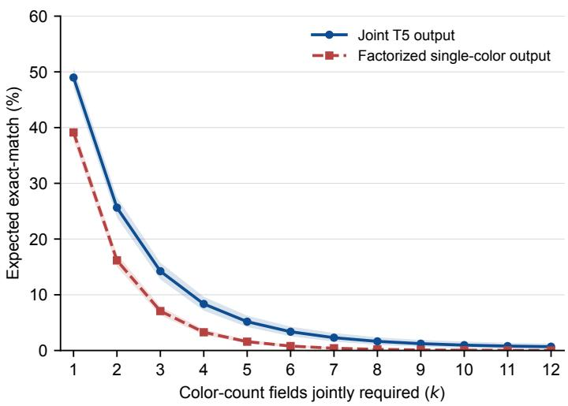  
Figure 6: All-color subset exact match on T5: Color Distribution. Expected EM over k counts from the full 12-color palette, including zero counts for absent colors, using the same 100 objects at every k. Lines average 12 OW models and five runs under Non-Thinking mode; shading gives pointwise 95% object-bootstrap intervals. Present-color curves appear in Figure 3. Takeaway: Joint outputs outperform factorized outputs across the full palette, alongside their higher absent-color accuracy.

B.1.4 A 2D visibility control separates basic enumeration from 3D presentation
<table><tr><td>Prompt</td><td>EM↑</td><td>MAE↓</td><td>Present ↑</td><td>Over ↓</td></tr><tr><td>Original</td><td>3.0</td><td>0.50</td><td>48.2</td><td>40.6</td></tr><tr><td>No example</td><td>1.4</td><td>0.51</td><td>45.5</td><td>43.9</td></tr><tr><td>Benchmark-matched</td><td>5.0</td><td>0.41</td><td>58.9</td><td>29.8</td></tr></table>

Table 6: Prompt-example ablation on T5: Color Distribution. Qwen3.5-27B under Non-Thinking mode with color inputs, mean over five runs on the same 100 instances. The original prompt contains an illustrative 28-block answer; the benchmark-matched example has 11 blocks and 8 colors, matching the benchmark distribution. EM is full-distribution exact match, MAE is the per-color absolute error in blocks over the 12-color palette, Present is exact-count accuracy on colors present in the object, and Over is the share of present colors that are over-counted. Takeaway: Removing the example leaves all metrics within their paired 95% CIs, and a benchmark-matched example improves present-color accuracy by +10.6 pp, while EM stays ≤ 5.0%.

Experimental setup. For each of the 100 T5: Color Distribution objects, we draw one image in which every block appears as a separate square tile with the same color, black edges, and image size as the 3D renders; tile positions are shufled with a fixed seed, no tile touches or covers another, and the image contains no text. The control therefore keeps each object’s color multiset and ground-truth count vector unchanged. The prompt is the T5 prompt with only its first sentence changed to describe an image of separate square tiles; decoding, answer schema, and the illustrative example are unchanged. We evaluate zero-shot Qwen3.5-27B under Non-Thinking mode for five runs and compare it with its saved 3D runs on the default color setting (Table 7). Intervals are paired object-bootstrap 95% intervals (10,000 resamples, runs averaged per object).

##  Separate tiles are counted accurately apart from one color confusion. In 2D, the model counts present

colors exactly 91.0% of the time. Of the 238 incorrect 2D answers (over five runs), 187 difer from the ground truth only by one gold block reported as yellow; on the 34 objects without gold blocks, 2D EM is 100%. Merging gold and yellow is a post-hoc diagnostic and does not replace the original exact-match metric; under it, EM is 89.8% in 2D and 6.0% in 3D, so the 3D gap remains. The mean predicted total is 11.5 blocks in 2D and 14.9 in 3D, against a ground truth of 11.4, so the model over-counts mainly in 3D. The control changes occlusion,

the need to integrate two views, and the visual layout together, so it cannot separate their contributions, and it covers one model.
<table><tr><td>Input</td><td>EM↑</td><td>EM (gold = yellow) ↑</td><td>MAE↓</td><td>Present ↑</td><td>Over ↓</td><td>Total</td></tr><tr><td>3D (two views)</td><td>3.0</td><td>6.0</td><td>0.50</td><td>48.2</td><td>40.6</td><td>14.9</td></tr><tr><td>2D tiles</td><td>52.4</td><td>89.8</td><td>0.11</td><td>91.0</td><td>3.6</td><td>11.5</td></tr><tr><td> $\mathrm { 2 D - 3 D }$ </td><td>+49.4</td><td>+83.8</td><td>-0.39</td><td>+42.8</td><td>-37.0</td><td>-3.4</td></tr><tr><td>95% CI</td><td> $[ + 3 9 . 8 , + 5 9 . 0 ]$ </td><td> $[ + 7 5 . 6 , + 9 1 . 0 ]$ </td><td> $\left[ - 0 . 4 3 , - 0 . 3 4 \right]$ </td><td> $[ + 3 7 . 6 , + 4 7 . 9 ]$ </td><td> $\left[ - 4 1 . 8 , - 3 2 . 2 \right]$ </td><td></td></tr></table>

Table 7: 2D visibility control on T5: Color Distribution. Qwen3.5-27B, Non-Thinking, color setting, mean over five runs on the same 100 objects. Metrics as in Table 6; EM (gold = yellow) merges the two colors in predictions and ground truth as a post-hoc diagnostic, and Total is the mean predicted number of blocks (ground truth 11.4). Takeaway: With every block visible as a separate tile, EM rises by $+ 4 9 . 4 \mathrm { p p }$ , and the gap remains after merging gold and yellow.
<table><tr><td></td><td colspan="3">Zero-shot</td><td colspan="3"> $\operatorname { L o R A } ,$  benchmark palette</td></tr><tr><td>Variant</td><td>Acc</td><td>MAE</td><td>RMSE</td><td>Acc</td><td>MAE</td><td>RMSE</td></tr><tr><td>color (default)</td><td> $3 . 0 \pm 0 . 0$ </td><td> $0 . 5 0 2 { \scriptstyle \pm 0 . 0 0 2 }$ </td><td> $0 . 9 3 7 { \scriptstyle \pm 0 . 0 0 3 }$ </td><td> $6 8 . 6 \pm 0 . 5$ </td><td> $0 . 0 3 3 { \scriptstyle \pm 0 . 0 0 1 }$ </td><td> $0 . 1 8 2 { \scriptstyle \pm 0 . 0 0 3 }$ </td></tr><tr><td>color + axes</td><td> $3 . 0 \pm 0 . 0$ </td><td> $0 . 4 8 1 \pm 0 . 0 0 2$ </td><td> $0 . 9 2 3 \pm 0 . 0 0 4$ </td><td> $6 6 . 8 \pm 1 . 8$ </td><td> $0 . 0 3 6 \pm 0 . 0 0 2$ </td><td> $0 . 1 9 1 { \scriptstyle \pm 0 . 0 0 4 }$ </td></tr></table>

Table 8: LoRA fine-tuning of Qwen3.5-27B on T5: Color Distribution. The adapter is trained on 800 generated T5 instances rendered with the benchmark palette, the 12-color, luminance-paired coloring of BedBench. Each cell is the 5-run $\mathrm { m e a n } \pm s \mathrm { t d }$ on the 100 benchmark instances. Takeaway: Training on the benchmark palette raises exact match from 3.0% to 68.6%.
<table><tr><td>T7 evaluation condition</td><td>Color</td><td> ${ \mathsf { C o l o r } } + { \mathsf { a x e s } }$ </td></tr><tr><td>Direct visual questioning</td><td> $3 5 . 0 \pm 0 . 7$ </td><td> $3 6 . 4 \pm 0 . 5$ </td></tr><tr><td>Self-predicted T5 counts as text</td><td> $7 4 . 2 \pm 0 . 8$ </td><td> $7 3 . 2 \pm 1 . 3$ </td></tr><tr><td>Ground-truth T5 counts as text</td><td> $9 9 . 0 \pm 0 . 0 $ </td><td></td></tr><tr><td>Agreement with the argmax of the input counts</td><td> $9 9 . 6 \pm 0 . 5$ </td><td> $9 9 . 0 \pm 0 . 0 $ </td></tr><tr><td>Dominant colors implied by self-predicted counts</td><td>74.6</td><td>74.2</td></tr><tr><td>Text-conditioned accuracy, T5 answer exactly correct</td><td>99.4</td><td>98.5</td></tr><tr><td>Direct visual accuracy, T5 answer exactly correct</td><td>40.8</td><td>37.4</td></tr></table>

Table 9: T7 answered from block counts given as text. Fine-tuned Qwen3.5-27B, Non-Thinking, accuracy (%) as 5-run mean ± std on the same 100 objects; the last three rows pool 5 runs × 100 objects, and the last two use only the 343 and 334 answers with an exactly correct T5 answer. The implied row scores the argmax of the model’s own T5 counts without querying T7. Ground-truth counts do not depend on the visual setting and are evaluated once $( " - " )$ . Paired object-bootstrap 95% CIs $_ { ( 1 0 , 0 0 0 }$ resamples): self-predicted counts − direct +39.2 pp [+26.8, +51.4] (color) and $+ 3 6 . 8 \mathrm { p p } \left[ + 2 3 . 6 , + 5 0 . 0 \right]$ (color + axes); ground-truth − self-predicted counts +24.8 pp $[ + 1 6 . 4 , + 3 4 . 0 ]$ (color). Takeaway: Given its own counts as text, the model derives the dominant colors almost perfectly whenever those counts are correct, unlike when it answers from the images.

## B.1.5 Task-specific fine-tuning substantially improves counting but yields incomplete cross-task transfer

Experimental setup. We use a TRL-plus-PEFT LoRA pipeline (rank $r { = } 1 6 , \alpha { = } 3 2 .$ , dropout 0.05, applied to the language tower projections q,k,v,o,gate,up,down); the vision encoder and connector are kept frozen and the base weights are loaded in 4-bit NF4 with bf16 compute. The training data are 800 T5 instances, plus 100 for validation, produced by the benchmark generator with a separate random seed, so they follow the benchmark’s object, color, and rendering distribution without sharing any object with it; the test set is the 100 benchmark instances. Each instance provides the same two perspective views and the same prompt template used at evaluation. We train for 3 epochs with AdamW $( \ln 2 \times 1 0 ^ { - 4 }$ , cosine schedule, warmup 0.1, efective batch size 8) on four NVIDIA RTX 3090 GPUs with data parallelism, keep the checkpoint with the lowest validation loss, and evaluate the resulting adapter under the same default-setting protocol as the zero-shot baseline (5-run mean ± std). Table 8 reports T5; Table 10 reports transfer to related color tasks. To test whether the inconsistency we find is specific to fine-tuning, we also measure per-object consistency for every model, before and after fine-tuning. On the same objects, colored renderings, and runs, a model’s direct answer to T4 or T7 is compared with the answer implied by its own T5 counts cˆ, $\left| \left\{ c : \hat { c } _ { c } > 0 \right\} \right|$ and arg max<sub>c</sub> $\hat { c } _ { c } ,$ and its direct T1 answer, where a colored T1 run exists, with $\textstyle \sum _ { c } { \hat { c } } _ { c }$ . Agreement measures consistency with the model’s own counts, not correctness, and leaves the input unchanged; as a chance level, we permute the direct answers across objects within each run (200 permutations).

 In-distribution supervision teaches T5. Fine-tuning raises exact match on T5: Color Distribution from 3.0% to 68.6% on the trained color setting and to 66.8% on color + axes, which was not used in training, while MAE drops 93.4% and RMSE 80.6%. The best fine-tuned cell remains 24.7 pp below the human mean of 93.3% and 10.1 pp below its Wilson lower bound of 78.7%. Training only the language model therefore recovers much of the information already supplied by the frozen visual pathway: a probe on the connector output reaches 65.0% exact match (Appendix B.5.2). Reasoning, scale, and visual cues do not yield comparable recovery in our experiments.

<table><tr><td>Task (variant)</td><td>Zero-shot</td><td>LoRA</td><td>∆</td></tr><tr><td>T4 (color)</td><td> $4 5 . 2 \pm 1 . 3$ </td><td> $6 9 . 6 \pm 0 . 5$ </td><td>+24.4</td></tr><tr><td>T4 (color + axes)</td><td> $4 5 . 8 \pm 0 . 8$ </td><td> $6 1 . 8 \pm 0 . 4$ </td><td> $+ 1 6 . 0$ </td></tr><tr><td>T7 (color)</td><td> $1 8 . 0 \pm 0 . 0$ </td><td> $3 5 . 0 \pm 0 . 7$ </td><td> $+ 1 7 . 0$ </td></tr><tr><td>T7 (color + axes)</td><td> $1 8 . 4 \pm 0 . 5$ </td><td> $3 6 . 4 \pm 0 . 5$ </td><td> $+ 1 8 . 0$ </td></tr><tr><td>T10 (color)</td><td> $5 5 . 2 \pm 0 . 4$ </td><td> $6 2 . 4 \pm 1 . 5$ </td><td> $+ 7 . 2$ </td></tr></table>

Table 10: Transfer of the T5 LoRA adapter (benchmark palette) to related color tasks. Accuracy (%) in Non-Thinking mode, 5-run mean ± std. Table 9 compares direct T7 answers with answers derived from the model’s own T5 counts. Takeaway: Fine-tuning on T5 improves the related color tasks only partially, most on T4 and least on T10.

##  Direct answers about the dominant colors disagree with the model’s own counts. T7: Color Dominance asks

for the most frequent colors, which follow directly from a correct T5 answer. The dominant colors implied by the fine-tuned model’s own T5 answers are correct 74.6% of the time, but the model answers the T7 prompt correctly only 35.0% of the time, and only 40.8% on objects whose T5 answer is exactly correct (Table 9). Gains on the other color tasks are partial (T4: Color Count +24.4 pp, T10: Color Connected +7.2 pp; Table 10).

 Given explicit counts, the model derives the dominant colors. We ask the fine-tuned model the T7 question without images, listing per-color block counts in the prompt: either its own T5 answer for the same object, run, and setting, or the ground truth (Table 9). From its own counts, it answers correctly 74.2% of the time on the color setting, +39.2 pp over direct visual questioning (paired 95% CI [+26.8, +51.4]), and from ground-truth counts 99.0%; all misses come from one object whose ten colors are tied at one block, where the model misspells a color name. Its answer matches the highest stated count in 99.6% of cases, and when its T5 answer is exactly correct, text-conditioned accuracy is 99.4% against 40.8% from the images. The model thus derives the judgment from explicit counts but does not consistently produce it from the images.

##  VLMs also answer inconsistently with their own counts. The counts-as-text test changes the input; the per-object check does not (Table 11). Before fine-

<table><tr><td>Models</td><td>T1 T4</td><td>T7</td></tr><tr><td>OW, Non-Thinking (12) OW, Thinking (12) Frontier (4)</td><td>4.0 (5.4) )32.1 (16.8)21.6 (2.4) 9.6 (7.8) 55.1 (17.7) 21.9 (3.1)</td><td>65.8 (16.7) 39.0 (5.0)</td></tr><tr><td>Qwen3.5-27B, zero-shot 8.8 (11.8)51.8 (17.8)23.8 (1.7) Qwen3.5-27B, fine-tuned</td><td>69.6 (19.9) 36.8 (2.2)</td><td></td></tr></table>

Table 11: Per-object agreement between direct answers and the answer implied by the model’s own T5 counts (%, chance in parentheses): T1 vs. $\textstyle \sum _ { c } \hat { c } _ { c } ,$ T4 vs. $| \{ c : \hat { c } _ { c } > 0 \} | _ { \vphantom { | } }$ , T7 vs. arg max<sub>c</sub> cˆ<sub>c</sub>. Same objects, colored renderings, and runs; group rows average the models, and the Qwen3.5-27B rows are Non-Thinking. Chance permutes the direct answers across objects. “–”: no colored T1 run. With the default uncolored T1 renderings, OW agreement is 5.2% (chance 6.0%) in Non-Thinking and 8.7% (7.3%) in Thinking mode. Takeaway: Direct answers rarely agree with the counts the same model reports, before and after fine-tuning, and for T1 no more often than chance.

tuning, the direct T7 answers of Qwen3.5-27B match the most frequent colors in its own counts on 23.8% of objects (chance 1.7%), and fine-tuning raises this only to 36.8%. Across the 12 OW models, agreement is 21.6% for T7 (chance 2.4%) and 32.1% for T4 (chance 16.8%) in Non-Thinking mode, and frontier models reach 39.0% and 65.8%. Direct T1 answers match the sum of the model’s own counts on only 4.0% of objects, below the 5.4% chance level, yet they are more often correct than that sum (31.8% vs. 3.8%), so the models do not answer T1 by adding up the counts they report. The check also separates the two failure types: when the T5 answer is wrong, T7 agreement stays at 21.3%, so models are rarely wrong but consistent, and even the 41 exactly correct OW T5 answers are followed by a consistent T7 answer only 61.0% of the time.

## B.2 Thinking helps selected tasks but leaves exact answers unreliable

Overview. This section expands Section 5.2: which tasks gain or lose from Thinking mode, what the exposed reasoning traces show, and whether a larger reasoning budget helps.

Experimental setup. We combine a quantitative mode contrast, a controlled budget sweep, a qualitative trace audit, and class-balanced metrics for the binary tasks.

• For the mode contrast, we compare Non-Thinking and Thinking modes under the default visual setting across all 12 OW VLMs (Table 12).

• For the budget sweep, we vary the reasoning budget over {0, 1024, 2048, 4096} tokens on the two largest OW models (Qwen3.5-27B, Gemma4-31B) for three tasks selected to span the win/loss spectrum of the mode contrast: T1: Volume, T4: Color Count, and T11: Projection (Table 13).

• For the trace audit, we read reasoning traces on a seeded random draw of instances (one per task, aligned across the best-performing OW model for that task and the four frontier models on identical inputs) and manually annotate the salient spans in the exposed traces using the span-level behavior taxonomy of Table 15. Per-task trace panels with the highlighted, tagged spans are provided in Appendix E.5. For OW models, we collect the raw thinking traces from model inference. For GPT-5 and the two Gemini models, the OpenRouter and Vertex AI endpoints used in our evaluation did not expose reasoning traces, so we manually collected the available meta-reasoning summaries through their respective chat interfaces for the qualitative audit. For Grok-4.20, we collected the meta-reasoning trace returned through OpenRouter. Because exposed reasoning traces need not faithfully reflect the computation underlying a model’s answer, particularly for frontier models where only summarized reasoning is available, we use these annotations to characterize recurring trace patterns rather than as direct evidence of internal causal mechanisms.

• For the binary tasks, precision, recall, and F1 are macro-averaged over the two classes and then averaged over the 12 OW models under the default visual setting; each model × mode cell is a 5-run mean (Table 14).
<table><tr><td>Task</td><td>Non-Thinking</td><td>Thinking</td><td> $\Delta _ { \mathrm { t h i n k i n g } }$ </td><td>95% CI</td><td>↑</td><td>↓</td><td>≈</td><td>Verdict</td></tr><tr><td>T1: Volume</td><td>29.2</td><td>20.2</td><td>-8.9</td><td>[−11.9,-6.0]</td><td>2</td><td>8</td><td>2</td><td>Non-Thinking wins</td></tr><tr><td>T2: Packaging</td><td>58.8</td><td>72.6</td><td>+13.8</td><td>[+9.3, +18.4]</td><td>11</td><td>1</td><td>0</td><td>Thinking wins</td></tr><tr><td>T3: Difference</td><td>0.2</td><td>0.1</td><td>-0.1</td><td>[−0.4, +0.1]</td><td>0</td><td>0</td><td>12</td><td>Tie</td></tr><tr><td>T4: Color Count</td><td>27.1</td><td>41.0</td><td>+13.9</td><td>[+8.9, +19.1]</td><td>10</td><td>1</td><td>1</td><td>Thinking wins</td></tr><tr><td>T5: Color Distribution</td><td>0.7</td><td>1.0</td><td>+0.3</td><td>[−0.3, +1.0]</td><td>1</td><td>0</td><td>11</td><td>Tie</td></tr><tr><td>T6: Local Structure</td><td>70.2</td><td>72.9</td><td>+2.8</td><td>[+0.4, +5.1]</td><td>4</td><td>5</td><td>3</td><td>Thinking wins</td></tr><tr><td>T7: Color Dominance</td><td>14.0</td><td>13.6</td><td>-0.4</td><td>[−2.2, +1.4]</td><td>3</td><td>4</td><td>5</td><td>Tie</td></tr><tr><td>T8: Silhouette Symmetry</td><td>58.2</td><td>55.4</td><td>-2.9</td><td>[−6.3, +0.5]</td><td>2</td><td>4</td><td>6</td><td>Non-Thinking wins†</td></tr><tr><td>T9: Visible Floors</td><td>55.8</td><td>48.4</td><td>-7.4</td><td>[−10.3, −4.6]</td><td>2</td><td>7</td><td>3</td><td>Non-Thinking wins</td></tr><tr><td>T10: Color Connected</td><td>53.1</td><td>56.1</td><td>+3.0</td><td>[−0.2, +6.2]</td><td>6</td><td>3</td><td>3</td><td>Thinking wins†</td></tr><tr><td>T11: Projection</td><td>43.1</td><td>41.8</td><td>-1.3</td><td>[−2.4, −0.2]</td><td>2</td><td>5</td><td>5</td><td>Tie</td></tr><tr><td>T12: Reconstruct</td><td>52.6</td><td>52.0</td><td>-0.5</td><td>[−3.4, +2.3]</td><td>1</td><td>4</td><td>7</td><td>Tie</td></tr><tr><td>T13: Mixture-of-Shapes</td><td>37.4</td><td>36.6</td><td>-0.7</td><td>[−2.1, +0.6]</td><td>1</td><td>3</td><td>8</td><td>Tie</td></tr><tr><td>Total</td><td></td><td></td><td>+0.9</td><td></td><td>4</td><td>3</td><td>6</td><td></td></tr></table>

Table 12: Per-task efect of Thinking. Comparison at the default 1024-token budget under the default visual setting. Non-Thinking and Thinking report mean accuracy (%) over the 12 OW models. $\uparrow / \downarrow / \approx$ count how many of the 12 models win, lose, or tie under Thinking by the same 2 pp threshold (not per-model significance). Verdict labels each task by its mean $\Delta _ { \mathrm { t h i n k i n g } } \mathrm { : }$ Thinking wins above +2 pp, Non-Thinking wins below $- 2 { \tt p p }$ , and Tie otherwise. The 95% CI is a paired bootstrap interval for the mean $\Delta _ { \mathrm { t h i n k i n g } }$ (10,000 resamples of objects, scenes for T13, and pairs for T3, with models and runs fixed; no multiplicity correction). <sup>†</sup>The interval includes zero. Takeaway: Thinking helps most on T2 and T4 (+13.8 and +13.9 pp), hurts most on T1 and T9 (−8.9 and −7.4 pp), and moves the mean across tasks by only +0.9 pp.

## B.2.1 When thinking helps and what the traces reveal

Table 12 gives the per-task breakdown at the default 1024-token budget. By the 2 pp threshold, 4 tasks show a Thinking win, 3 a Non-Thinking win, and 6 tie; the paired bootstrap intervals exclude zero for all wins and losses except T8: Silhouette Symmetry and T10: Color Connected. Excluding Kimi-VL-A3B, whose Thinking checkpoint collapses on several tasks, changes only T8, which becomes a tie (−1.6 pp), and shrinks the T1: Volume drop from −8.9 to −6.9 pp. The trace audit covers 457 tagged spans across 65 traces.

 Thinking gains concentrate on tasks with perceptually grounded or verbalizable steps. Good Perception is the tag most associated with correct outcomes: it appears in 16 of the 21 correct traces but only 3 of the 44 incorrect ones, mostly in the two Gemini models (30 of its 43 spans). GPT-5 is the only model that uses tools (all 27 Tool Use spans), probing crops and pixel values mostly on T3: Diference and the color tasks; four of its seven tool-using traces end correct. Good Tactic and Good Intuition are rare (3 and 6 spans), with two of the three Good Tactic spans on T2: Packaging. On T2 and T4: Color Count, the clearest Thinking wins, the traces contain grounded intermediate steps such as dimension comparisons or explicit color enumeration, consistent with prior work linking chain-of-thought gains to explicit intermediate steps (Sprague et al., 2025; Wei et al., 2022; Kojima et al., 2022).

##  Perceptual errors frequently persist through subsequent reasoning. Wrong Perception is the most frequent tag (222 of 457 spans, applied to all seven

<table><tr><td>Task</td><td>Model</td><td>0</td><td>1024</td><td>2048</td><td>4096</td></tr><tr><td></td><td>Qwen3.5-27B</td><td>39.8</td><td>24.2</td><td>27.6</td><td>26.2</td></tr><tr><td>T1: Volume</td><td>Gemma4-31B</td><td>35.0</td><td>17.2</td><td>13.0</td><td>13.4</td></tr><tr><td></td><td>Average</td><td>37.4</td><td>20.7</td><td>20.3</td><td>19.8</td></tr><tr><td>T4: Color Count</td><td>Qwen3.5-27B</td><td>45.2</td><td>57.2</td><td>60.8</td><td>57.2</td></tr><tr><td></td><td>Gemma4-31B</td><td>52.8</td><td>56.2</td><td>57.6</td><td>60.0</td></tr><tr><td></td><td>Average</td><td>49.0</td><td>56.7</td><td>59.2</td><td>58.6</td></tr><tr><td></td><td>Qwen3.5-27B</td><td>55.7</td><td>50.5</td><td>45.4</td><td>45.2</td></tr><tr><td>T11: Projection</td><td>Gemma4-31B</td><td>47.3</td><td>48.6</td><td>46.3</td><td>46.5</td></tr><tr><td></td><td>Average</td><td>51.5</td><td>49.6</td><td>45.9</td><td>45.8</td></tr></table>

Table 13: Efect of the reasoning budget. Default-setting accuracy (%) of Qwen3.5-27B and Gemma4-31B at four reasoning-token budgets, on three tasks spanning the win/loss spectrum of Table 12 (Appendix B.2.1): T1 (most hurt by Thinking), T4 (most helped), and T11 (near the middle). Each cell is a 5-run mean; boldface marks the best budget per row. Takeaway: On average, every nonzero budget leaves T1 below budget 0, as do budgets of 2048 tokens or more for T11, while T4 improves at every nonzero budget and levels of after 2048 tokens (paired bootstrap intervals in Appendix B.2.2).

models) and appears in 42 of 44 incorrect traces, especially on T1: Volume, T3: Diference, T5: Color Distribution, T9: Visible Floors, and T11: Projection, where Thinking does not improve or reduces accuracy (Table 15). The OW traces also often repeat earlier steps instead of re-inspecting the image (87 of the 100 Reiterating spans) and end with a Budget Hit on all 13 tasks, so many continue from an incorrect scene interpretation until the budget runs out. Other failures are model-specific: Grok reasons about its own summarization instruction (Harnessing, 27 spans) and anchors on the prompt’s illustrative example (Prior Bias), and Qwen3.5-27B reads a green cube as yellow on T4: Color Count (Color Confusion). A second pass finds traces dominated by Wrong Perception or truncated mid-derivation that are nonetheless scored correct (Correct by Luck), and a Grok T12: Reconstruct trace that states the ground-truth candidate but outputs another (Think–Answer Mismatch; Table 15, rows 12–13). Figure 4 (Section 5) summarizes these paths; the most common failure path runs from flawed steps to the budget limit and a wrong answer. These patterns resemble persistent visual failures in slow-thinking VLMs (Rahmanzadehgervi et al., 2025) and compounding errors in multi-step reasoning (Dziri et al., 2023), but they remain descriptive, since exposed reasoning need not reflect the basis of an answer (Turpin et al., 2023).

## B.2.2 Larger reasoning budgets do not recover the afected tasks

Table 13 reports the budget sweep. Intervals are paired object-level bootstrap intervals over the two-model average (10,000 resamples), with models and runs held fixed.

 Linguistically verbalizable tasks absorb additional reasoning tokens. T4: Color Count is the only task whose accuracy increases with budget. Averaged over the two models, it rises from 49.0% at budget 0 to 56.7% at 1024 and 59.2% at 2048 (+10.2 pp, 95% CI [+3.4, +17.3]), then levels of (58.6% at 4096; −0.6 pp vs. 2048, [−4.6, +3.5]), while Gemma4-31B keeps improving (52.8 → 60.0%). Counting distinct colors decomposes naturally into identifying a color, checking whether it has been seen, and incrementing a counter.

 3D-structural tasks degrade rather than recover with more thinking. On T1: Volume, average accuracy drops from 37.4% at budget 0 to 20.7% at 1024 and stays there (20.3% at 2048 and 19.8% at 4096; −17.6 pp, [−25.7, −9.4]; −0.5 pp from 2048 to 4096, [−4.9, +3.9]), with Gemma4-31B falling from 35.0% to 13.4%. On T11: Projection, Qwen3.5-27B declines monotonically (55.7 → 50.5 → 45.4 → 45.2%), and the average drops −5.7 pp from budget 0 to 4096 ([−9.5, −2.0]), although the change at 1024 (−2.0 pp, [−4.9, +0.9]) is not distinguishable from zero. Unlike T4, these tasks require judgments about latent 3D structure, and the decline is a test-timecompute analogue of the inverse-scaling efects discussed by McKenzie et al. (2023). Even T1, which can in principle be decomposed into per-layer counts, does not recover; together with the trace audit, this suggests that additional tokens do not reliably correct inaccurate scene estimates in the tested models, tasks, and budgets.

## B.2.3 Thinking shifts decision behavior on binary tasks

 Where thinking lowers accuracy on T8: Silhouette Symmetry, the metric pattern is consistent with a shifted decision boundary. On T8, Thinking lowers accuracy by 2.9 pp (95% CI $[ - 6 . 3 , + 0 . 5 ] )$ but raises precision from 0.383 to 0.543 and F1 from 0.398 to 0.430, while recall stays essentially unchanged (0.510 to 0.504), consistent with a shift in the yes/no decision rather than better classification.

 Where thinking raises accuracy, recall rises more than precision. On T2: Packaging, T6: Local Structure, and T10: Color Connected, recall rises more than precision. The largest change is on T2 (recall +0.138, F1 +0.191), and on T6 precision even falls slightly (−0.022) while recall rises by +0.070. Like the T8 pattern, these changes describe output behavior and do not by themselves show that Thinking recovers 3D structure.

<table><tr><td>Task Mode</td><td></td><td>Acc (%)</td><td>Prec</td><td>Recall F1</td></tr><tr><td>T8</td><td>NT TH</td><td>58.2 55.4</td><td>0.383 0.543</td><td>0.510 0.398 0.504 0.430</td></tr><tr><td>T2</td><td>NT TH</td><td>58.8 72.6</td><td>0.685 0.783</td><td>0.588 0.506 0.726 0.697</td></tr><tr><td>T6</td><td>NT TH</td><td>70.2 72.9</td><td>0.692 0.670</td><td>0.664 0.595 0.733 0.675</td></tr><tr><td>T10</td><td>NT TH</td><td>53.1 56.1</td><td>0.546 0.558</td><td>0.531 0.411 0.564 0.509</td></tr></table>

Table 14: Binary tasks under accuracy vs. macro-averaged metrics. Non-Thinking (NT) vs. Thinking (TH), averaged over 12 OW models under the default setting; each cell is a 5-run mean. Thinking lowers accuracy on T8 and raises it on T2, T6, and T10; the T8 and T10 changes have 95% intervals that include zero (Table 12). Takeaway: On T8, Thinking lowers accuracy but raises precision and F1; on T2, T6, and T10, recall rises more than precision.

<table><tr><td>#</td><td>Name</td><td>Description</td><td>Models</td><td>Representative quote (qualitative sample)</td></tr><tr><td colspan="5">Good behavior</td></tr><tr><td>1</td><td>Tool Use</td><td>Invokes external code execution to inspect pixel values or crop the input image.</td><td>GPT</td><td>GPT-5, T5: samples RGB pixel values via numpy to separate look-alike hues (Tab. 113, Appendix E.5)</td></tr><tr><td>2</td><td>Good Perception</td><td>An isolated span where the model&#x27;s stated read of the scene is correct and matches the ground-truth structure.</td><td>All</td><td>Gemini-3-Flash, T7: &quot;we clearly see a diag- onal row of 2 teal blocks forming part of the central structure” (matches GT; Tab. 115, Appendix E.5)</td></tr><tr><td>3</td><td>Good Tactic</td><td>A valid problem-solving strategy or check applied correctly, e.g. comparing sorted dimensions or framing a task as set difference.</td><td>Grok, Gemini</td><td>Gemini-3-Flash, T2: &quot;Comparing the sorted dimensions: 2 ≤ 2 (Fits) ... the orientation is valid&quot; (Tab. 110, Appendix E.5)</td></tr><tr><td>4</td><td>Good Intuition</td><td>A correct-magnitude estimate reached by heuristic guess rather than a completed derivation.</td><td>GPT-5, Grok</td><td>GPT-5, T1: &quot;I estimate a total of around 10 cubes&quot; (GT 10; Tab. 109, Appendix E.5)</td></tr><tr><td colspan="5">Bad behavior</td></tr><tr><td>5</td><td>Reiterating</td><td>Restates or redoes a step already computed, with no new evidence.</td><td>All</td><td>Gemma4-31B, T1: &quot;Wait, let&#x27;s re-examine.&quot; (repeated ~6× in the same box; Tab. 109, Appendix E.5)</td></tr><tr><td>6</td><td>Prior Bias</td><td>Anchors the final answer on the prompt&#x27;s illustrative example or output-format template.</td><td>Grok</td><td>Grok, T11: &quot;But the example is { &#x27;candi- date idx&#x27;: 2, }, so mine is 0&quot; (Tab. 119, Appendix E.5)</td></tr><tr><td>7</td><td>Wrong Perception</td><td>An isolated span where the model&#x27;s stated read of the scene is incorrect relative to the actual image.</td><td>All</td><td>Gemma4-31B, T1: &quot;One block at the back- right. * One block in the middle. * One block at the front-left&quot; (Tab. 109, Appendix E.5)</td></tr><tr><td>8</td><td>Color Confusion</td><td>Misidentifies or conflates two visually adjacent or same-family colors, e.g. yellow vs. gold, magenta vs. purple.</td><td>Open weights</td><td>Qwen3.5-27B, T4: &quot;Next to the green cube (right): Yellow cube&quot; (Tab. 112, Ap- pendix E.5, in this situation, it should be</td></tr><tr><td>9</td><td>Harnessing</td><td>The thinking derails into reasoning about the system&#x27;s own meta instructions instead of the task.</td><td>Grok</td><td>gold, not yellow) Grok, T1: &quot;Since the internal reasoning is truncated, I can&#x27;t get the exact count, but the task is to summarize the thinking trace&quot;</td></tr><tr><td>10</td><td>Misc</td><td>Uninterpretable trace artifacts, e.g. a stray non-English token, that don&#x27;t fit another category.</td><td>Grok</td><td>(Tab. 109, Appendix E.5) Grok, T8/T10/T12: single stray non- English (CJK) tokens interject mid- sentence with no surrounding context.</td></tr><tr><td colspan="5">Trace artifact</td></tr><tr><td></td><td>11 Budget Hit</td><td>Trace is truncated at the hard token limit before reaching a decision, ending on a stock hand-off phrase.</td><td>Open weights</td><td>Gemma4-31B, T1: &quot;I have to give the so- lution based on the reasoning directly now.&quot; (Tab. 109, Appendix E.5)</td></tr><tr><td colspan="5">Process-Outcome Mismatch (whole-trace verdict, assigned in a second pass) 12</td></tr><tr><td></td><td>Correct by Luck</td><td>The trace is dominated by Wrong Perception / Reiterating spans, or truncates on Budget Hit before completing a derivation, yet the parsed answer is scored correct.</td><td>Open weights</td><td>Qwen3.5-27B, T6: loops on Wrong Per- ception column-height reads and hits Bud- get Hit mid-sentence (“Let&#x27;s count the”...), yet ticks correct (GT True; Tab. 114, Ap- pendix E.5)</td></tr><tr><td>13</td><td>Think- Answer Mismatch</td><td>The Thinking field itself reaches a sound, Good-behavior-tagged conclusion, but the scored answer (drawn from a separate field, e.g. Grok&#x27;s Output) contradicts it.</td><td>Grok</td><td>Grok-4.20, T12: Thinking&#x27;s own final line, tagged Good Perception, states &quot;the correct candidate is candidate idx = 1” (matches GT), yet the scored answer is 0 (Tab. 120,</td></tr></table>

Table 15: Annotation taxonomy for reasoning traces. Applied to the qualitative thinking-trace panels (Appendix E.5). Rows 1–11 are tags applied by hand to individual highlighted spans, so a trace can carry several tags and most spans carry none. Rows 12–13 are whole-trace verdicts, assigned in a second pass by comparing a tagged trace with its scored correctness. Takeaway: Wrong Perception is the most frequent tag (222 of 457 spans, all seven models) and appears in 42 of the 44 incorrect traces.

<table><tr><td>Design element</td><td>SigLIP 2</td><td>Qwen3.5</td><td>Gemma4</td></tr><tr><td>Vision encoder</td><td></td><td></td><td></td></tr><tr><td>ViT type</td><td>isotropic, full-attention</td><td>same architecture</td><td>same architecture</td></tr><tr><td>Patch tokenization</td><td>2D, non-overlapping</td><td>same architecture</td><td>same architecture</td></tr><tr><td>Position encoding</td><td>learned absolute</td><td>RoPE</td><td>RoPE</td></tr><tr><td>Block normalization</td><td>LayerNorm</td><td>LayerNorm</td><td>RMSNorm</td></tr><tr><td>QK/V normalization</td><td>none</td><td>none</td><td>yes</td></tr><tr><td>MLP</td><td>plain GELU-tanh</td><td>plain GELU-tanh</td><td>gated</td></tr><tr><td>Connector (VL adapter)</td><td>N/A</td><td>2×2 patch-merge MLP</td><td>pooling + linear</td></tr><tr><td>LLM sequence mixer</td><td>N/A</td><td>gated linear-attn. hybrid</td><td>sliding-window/global softmax</td></tr></table>

Table 17: Architecture of the two model families. Component-level comparison against the SigLIP 2 vision reference, read from the released checkpoints. Both vision encoders are isotropic, full-attention ViTs with 2D patch tokenization: Qwen3.5 stays close to stock SigLIP 2 (difering only in RoPE), while Gemma4 keeps the skeleton but updates block internals (RoPE, RMSNorm, QK/V-norm, gated MLP); in both, a compress-and-project adapter replaces the contrastive MAP pooling head. Takeaway: The families share one vision-encoder design and difer mainly in the connector and, most sharply, in the sequence-mixing primitive of the language backbone.

## B.3 Failures persist across model families and scale

Overview. This section asks whether the failure profile is specific to one model family or recurs across independently trained families and model sizes, which would point to a shared component, such as the visual encoder or the way the models read its features.

Experimental setup. We group 10 of the 12 OW models into two independently trained families: Qwen3.5 (0.8B, 2B, 4B, 9B, 27B dense, plus the 35B MoE variant) and Gemma4 (E2B, E4B, 31B dense, plus the 26B-A4B MoE variant). Table 16 averages each model’s default-setting Non-Thinking accuracy within its family; Table 17 compares the released visual front-ends with the SigLIP 2 reference, an observational comparison rather than a controlled intervention; and Figure 7 plots per-task accuracy against total parameter count in both modes.

## B.3.1 VLMs fail similarly across independently trained families

 The two families share the same failing tasks. Qwen3.5 performs best on volumetric counting (T1: Volume, T9: Visible Floors) and Gemma4 on local structure (T6: Local Structure) and the color tasks (T4: Color Count, T7: Color Dominance), but both remain near floor on T3: Diference and T5: Color Distribution and at the bestconstant level on T8: Silhouette Symmetry (58.0% for both, the accuracy of always answering False) and T13: Mixture-of-Shapes (37.2% and 37.7% vs. 37.3%). Such deficits recur across independently trained VLMs in prior work as well (Rahmanzadehgervi et al., 2025; Tong et al., 2024; Kamath et al., 2023), and relational and compositional failures survive large-scale compositional pretraining (Yuksekgonul et al., 2023).

 The families share a common visual-encoder design. Their language backbones use diferent sequencemixing primitives (Qwen3.5 a gated linear-attention hybrid, Gemma4 a sliding-window/global softmax hybrid), and their vision–language adapters difer (an MLP patchmerger vs. pooling with a linear projection). Both vision encoders, however, are isotropic, full-attention Vision Transformers of the SigLIP 2 family (Tschannen et al., 2025) that represent each view as image-plane patch tokens: Qwen3.5’s is near-stock, and Gemma4’s keeps the same skeleton with modernized normalization, MLP gating, and positional encoding (Table 17). Probes of such backbones find 3D surface structure encoded only weakly and inconsistently across views (El Banani et al., 2024), and contrastive image–text embeddings of this class collapse visually distinct configurations (Tong et al., 2024), so a shared front end could in principle explain the shared failures. For T5, Appendix B.5.2 argues against this explanation: probes recover exact per-color counts from both frozen towers and, for Qwen3.5-27B, from the connector output supplied to the language model.

<table><tr><td>Task</td><td>Qwen3.5</td><td>Gemma4</td></tr><tr><td>T1: Volume</td><td>33.1</td><td>24.3</td></tr><tr><td>T2: Packaging</td><td>59.4</td><td>62.0</td></tr><tr><td>T3: Difference</td><td>0.3</td><td>0.0</td></tr><tr><td>T4: Color Count</td><td>25.0</td><td>29.2</td></tr><tr><td>T5: Color Distribution</td><td>0.5</td><td>1.2</td></tr><tr><td>T6: Local Structure</td><td>70.4</td><td>79.7</td></tr><tr><td>T7: Color Dominance</td><td>12.6</td><td>18.6</td></tr><tr><td>T8: Silhouette Symmetry</td><td>58.0</td><td>58.0</td></tr><tr><td>T9: Visible Floors</td><td>64.1</td><td>51.8</td></tr><tr><td>T10: Color Connected</td><td>52.4</td><td>55.1</td></tr><tr><td>T11: Projection</td><td>43.2</td><td>42.9</td></tr><tr><td>T12: Reconstruct</td><td>52.3</td><td>52.2</td></tr><tr><td>T13: Mixture-of-Shapes</td><td>37.2</td><td>37.7</td></tr></table>

Table 16: Family-level accuracy (%, Non-Thinking). Each entry averages the default-setting 5-run mean accuracy over the models in that family. Takeaway: The families difer by up to 12.3 pp on individual tasks (T1, T6, T9) but share the same floor on T3 and T5 and nearly identical scores on T8 and T11–T13.

## B.3.2 Scaling does not make exact answers reliable

For the Qwen3.5 0.8B→27B comparison in Non-Thinking mode, paired object-level bootstrap intervals (10,000 resamples, runs held fixed) exclude zero for all six scaling-responsive tasks: T6 +42.0 pp [+31.4, +52.2], T2 +39.2 [+29.2, +49.0], T4 +39.2 [+29.0, +49.4], T9 +26.2 [+13.0, +39.4], T11 +18.4 [+12.1, +24.7], and T7 +18.0 [+11.0, +26.0]. Among the seven scaling-resistant tasks, the changes are at most +6.4 pp; T10 (+6.2, [+2.0, +11.2]) is the only clear gain, T1 (+6.4, [−4.0, +16.8]) and T12 (+6.2, [−8.6, +20.4]) have wide intervals, and T3, T5, T8, and T13 stay within 3 pp of zero.

 The scaling split largely generalizes to Gemma4, with one ceiling efect and one reversal. The split extends to Gemma4 and to Thinking mode (Figure 7), with two exceptions. On T6: Local Structure, Qwen3.5 shows the largest gain of any task (+42 pp) while Gemma4 moves only +5.4 pp (E2B→31B), because it is already correct on 77–83% of instances at every size. On T1: Volume, Qwen3.5 is scaling-resistant (+6.4 pp) while Gemma4 is scaling-responsive (+26.8 pp). Instance-level panels are given in Tables 80–92 of Appendix E.2.

 Scaling improves some capabilities but leaves exact answers unreliable. Uneven gains with scale are consistent with prior evidence that scaling is not uniformly beneficial (standard prompting has flat scaling curves on some reasoning tasks (Wei et al., 2022), and some tasks show inverse scaling (McKenzie et al., 2023)), and apparent emergence can depend on task structure and metric choice (Schaefer et al., 2023). The convergence across two families and across scale points to a limitation shared by current VLMs, but it is not a direct probe of any component; Appendix B.5 probes the shared visual encoder and finds that it holds information the VLMs do not use.

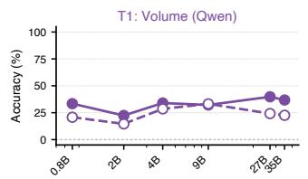

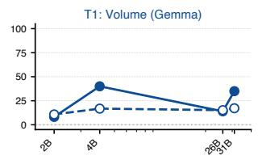

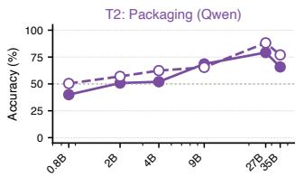

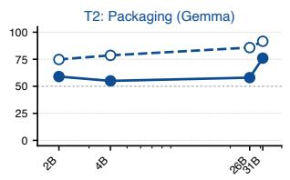

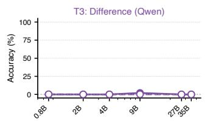

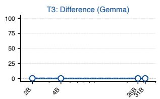

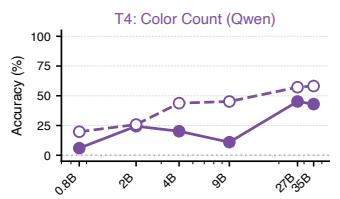

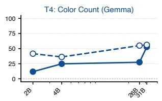

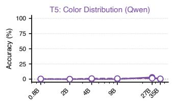

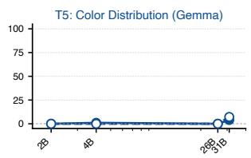

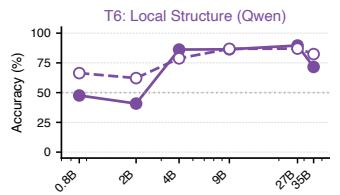

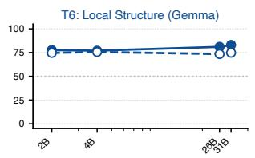

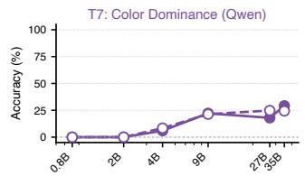

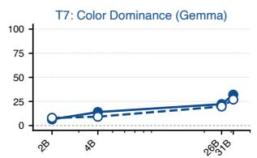

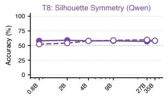

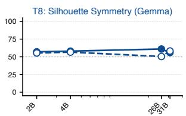

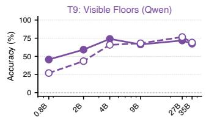

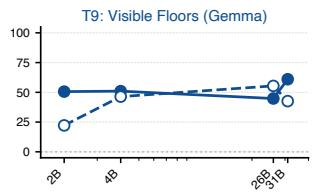

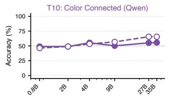

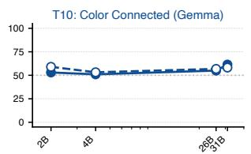

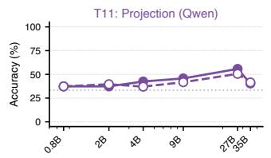

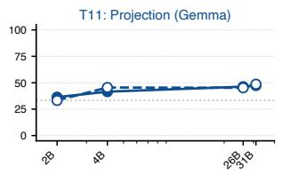

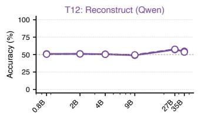

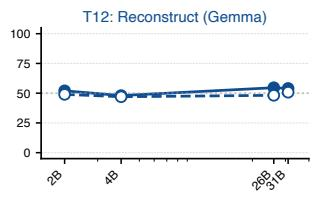

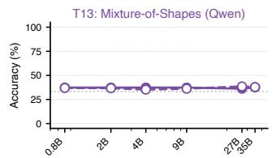

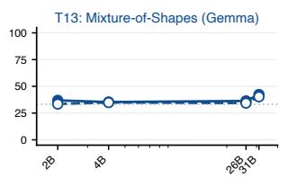  
Non-Thinking (NT) Mode Thinking (TH) Mode Random Baseline  
Figure 7: Scaling curves for all 13 tasks. Non-Thinking and Thinking accuracy for both families, plotted against total parameter count (log scale). Takeaway: The split between scaling-responsive tasks (T2, T4, T6, T7, T9, T11) and the remaining tasks holds across both families and both modes, with T6 and T1 as the two exceptions discussed in the text.

## B.4 Color and coordinate axes have diferent efects on VLM accuracy

Overview. This section tests whether adding color or coordinate axes to the same renderings helps VLMs, as such cues sometimes help humans.

Experimental setup. We add each cue only where it is compatible with the task (Table 18): T3: Diference is axes-native and receives only color; T4: Color Count, T5: Color Distribution, T7: Color Dominance, and T10: Color Connected are color-native and receive only axes; T1, T11, and T12 receive both; T2, T6, T8, and T9, which we consider largely color-invariant, receive only axes; and T13 receives only color, since coloring objects in a multi-object scene is expected to be more informative than axes. For each task, model, and cue $c \in \{ \mathrm { c o l o r } , \mathrm { a x e s } \}$ , the efect of the cue is

$$
\Delta _ { c } = \frac { 1 } { | V _ { c } ^ { + } | } \sum _ { v \in V _ { c } ^ { + } } \operatorname { A c c } ( v ) - \frac { 1 } { | V _ { c } ^ { - } | } \sum _ { v \in V _ { c } ^ { - } } \operatorname { A c c } ( v ) ,\tag{1}
$$

where $V _ { c } ^ { + }$ and $V _ { c } ^ { - }$ are the task variants with and without cue $c ,$ and $\operatorname { A c c } ( v )$ is the 5-run mean accuracy on variant v. We average these efects over the 12 OW models in Non-Thinking mode, and Table 18 reports the efects with 95% CIs from 50,000 paired item resamples (scene-clustered for T11/T13, with models and runs fixed). Instance-level panels are in Appendix E.1.
<table><tr><td></td><td colspan="2">Default</td><td colspan="4">Color add-on</td><td colspan="4">Axes add-on</td></tr><tr><td>Task</td><td>Color Axes</td><td></td><td>Without With</td><td></td><td> $\Delta _ { \mathrm { c o l o r } }$ </td><td>95% CI</td><td>Without With</td><td></td><td> $\Delta _ { \sf a x e s }$ </td><td>95% CI</td></tr><tr><td>T1: Volume</td><td>X</td><td>X</td><td>29.2</td><td>31.8</td><td>+2.6</td><td>[−0.28, +5.65]</td><td>29.1</td><td>27.7</td><td>-1.4</td><td>[−3.98, +1.13]</td></tr><tr><td>T2: Packaging</td><td>X</td><td>X</td><td>一</td><td>一</td><td>一</td><td></td><td>58.8</td><td>54.7</td><td>-4.1</td><td>[−5.85, −2.42]</td></tr><tr><td>T3: Difference</td><td>X</td><td>√</td><td>0.2</td><td>3.7</td><td>+3.5</td><td>[+1.75, +5.58]</td><td></td><td></td><td></td><td></td></tr><tr><td>T4: Color Count</td><td>√</td><td>X</td><td></td><td></td><td>一</td><td></td><td>27.1</td><td>26.4</td><td>-0.7</td><td>[−2.60, +1.30]</td></tr><tr><td>T5: Color Distribution</td><td>√</td><td>X</td><td></td><td></td><td>一</td><td></td><td>0.7</td><td>0.5</td><td>-0.2</td><td>[−0.72, +0.20]</td></tr><tr><td>T6: Local Structure</td><td>X</td><td>X</td><td></td><td></td><td>一</td><td></td><td>70.2</td><td>69.7</td><td>-0.5</td><td>[−2.02, +1.08]</td></tr><tr><td>T7: Color Dominance</td><td>√</td><td>X</td><td></td><td></td><td>一</td><td></td><td>14.0</td><td>13.7</td><td>-0.3</td><td>[−1.67, +0.98]</td></tr><tr><td>T8: Silhouette Symmetry</td><td>X</td><td>X</td><td></td><td></td><td></td><td></td><td>58.2</td><td>57.0</td><td>-1.2</td><td>[−3.00, +0.62]</td></tr><tr><td>T9: Visible Floors</td><td>X</td><td>X</td><td></td><td></td><td></td><td></td><td>55.8</td><td>53.9</td><td>-1.9</td><td>-4.00, +0.27]</td></tr><tr><td>T10: Color Connected</td><td>√</td><td>X</td><td></td><td></td><td></td><td></td><td>53.0</td><td>52.7</td><td>-0.3</td><td>[−1.97, +1.30]</td></tr><tr><td>T11: Projection</td><td>X</td><td>X</td><td>40.9</td><td>43.7</td><td>+2.8</td><td>[+1.36, +4.25]</td><td>40.9</td><td>41.8</td><td>+0.9</td><td>[+0.04, +1.77]</td></tr><tr><td>T12: Reconstruct</td><td>X</td><td>X</td><td>52.6</td><td>59.4</td><td>+6.8</td><td>[+3.03, +10.6]</td><td>52.6</td><td>52.1</td><td>-0.5</td><td>[-2.88, +1.87]</td></tr><tr><td>T13: Mixture-of-Shapes</td><td>X</td><td>X</td><td>36.2</td><td>36.8</td><td>+0.6</td><td>[−0.31, +1.52]</td><td></td><td></td><td></td><td></td></tr></table>

Table 18: Efect of visual cues on accuracy. Mean accuracy (%) over the 12 OW models in Non-Thinking mode without and with each cue, the diference ∆ (pp), and its paired bootstrap 95% interval (pointwise, without multiplicity correction); colored intervals exclude zero, and “–” marks tasks that do not receive the cue. Default marks whether each task’s default rendering is colored and has coordinate axes. Takeaway: Color raises accuracy on all five tasks, most on T12; axes lower it on 10 of 11 tasks, most on T2, and only T11 gains. Only color on T3, T11, and T12 and axes on T2 and T11 have intervals that exclude zero.

## B.4.1 VLMs show modest gains from color add-ons

 VLMs benefit from color add-ons. Color helps most on T12: Reconstruct (+6.8pp), where it can mark corresponding parts across two similar candidate views, followed by T3: Diference (+3.5pp, from a near-zero baseline), T11: Projection (+2.8pp), and T1: Volume (+2.6pp); the change on T13: Mixture-of-Shapes (+0.6pp) has a 95% CI of $[ - 0 . 3 1 , + 1 . 5 2 ] \mathrm { p p }$ that includes zero (Table 18). In humans, color helps distinguish material from illumination edges and provides part-level anchors for mental rotation, particularly for participants with lower spatial ability (Breuil et al., 2019; Khooshabeh and Hegarty, 2008b; Rahe et al., 2022; Khooshabeh and Hegarty, 2010, 2008a); the task-dependent VLM gains are consistent with such roles in local matching (Koh et al., 2023), although accuracy alone does not establish the mechanism.

## B.4.2 VLMs do not reliably benefit from axes add-ons

 VLMs do not benefit from axes add-ons. Axes lower mean accuracy on 10 of 11 tasks, with most 95% CIs spanning zero (Table 18). The clearest decrease is on T2: Packaging (−4.1pp; 95% CI [−5.85, −2.42]pp), followed by T9: Visible Floors (−1.9pp), T1: Volume (−1.4pp), and T8: Silhouette Symmetry (−1.2pp); the remaining tasks change by −0.2pp to −0.7pp. Only T11: Projection, the orthographic-projection task, improves marginally (+0.9pp). In humans, coordinate axes do not uniformly improve mental-rotation accuracy and can increase response time (Branof, 1998, 1999; Branof and Connolly, 1999): an external axis helps when aligned with the required transformation, but people otherwise use an object-intrinsic frame (Asakura and Inui, 2011; Parsons, 1995; Wraga et al., 1999). For VLMs, reported dificulty adopting non-egocentric frames (Zhang et al., 2025c) and added visual clutter are possible explanations, which our comparisons do not isolate.

## B.5 Probing the visual front-end on ground truth

Overview. This section asks whether the information the VLMs miss is present in their frozen visual features. It measures which task targets probes can recover, independently of the language model, across encoder types, the towers deployed in the evaluated VLMs, tower size, and depth supervision, and it tests on T5: Color Distribution whether more training data and token-level readouts recover more. Results near the shufled-label reference indicate limited recovery by our averaged-feature probes, not necessarily absent information (Li et al., 2025c; Michalkiewicz et al., 2026).

Experimental setup. We probe 14 frozen encoders: three pretrained classes (SigLIP-2 so400m (Tschannen et al., 2025), DINOv2-L (Oquab et al., 2024), CLIP-L (Radford et al., 2021)), a 3D-supervised control (Depth-Anything-V2-L (Yang et al., 2024)), and the ten vision towers deployed in the evaluated OW models. Supervised probes predict task targets from the concatenated patch-mean features of the two views, using standardized features with ridge regression for numerical answers and logistic regression for yes/no answers, under five-fold cross-validation grouped by object (by pair for T3). For a shufled-label reference, we retrain each probe 1000 times on shufled answers (seed 42) with the same splits. We report both the error of individual predicted values and how often the complete answer is correct. Three training-free analyses complement the probes: cross-view retrieval between the two query views, the correlation between pair embedding distance and ground-truth structural diference on T3: Diference, and zero-shot candidate ranking for T11: Projection, T12: Reconstruct, and T13: Mixture-of-Shapes (Figure 8D). Appendix B.5.2 describes the larger T5 probes.

<table><tr><td>Task</td><td>SigLIP-2</td><td>DINOv2</td><td>CLIP</td><td>Depth Anything V2-L</td><td>Qwen3.5 27B</td><td>Gemma4 31B</td></tr><tr><td colspan="7">Count estimates: Spearman ρ. Higher is better.</td></tr><tr><td>T1: Volume</td><td>0.70*(0.09)</td><td>0.53* (0.08)</td><td>0.44* (0.09)</td><td>0.65* (0.08)</td><td>0.62* (0.08)</td><td>0.66*(0.09)</td></tr><tr><td>T4: Color Count</td><td>0.77*(0.09)</td><td>0.63*(0.09)</td><td>0.61*(0.09)</td><td>0.62*(0.09)</td><td>0.68* (0.09)</td><td>0.78*(0.09)</td></tr><tr><td>T9: Visible Floors</td><td>0.89* (0.09)</td><td>0.92*(0.09)</td><td>0.87* (0.08)</td><td>0.93*(0.09)</td><td>0.92*(0.10)</td><td>0.88*(0.09)</td></tr><tr><td colspan="7">Decisions: ROC-AUC (mean over colors for T7). Higher is better.</td></tr><tr><td>T2: Packaging</td><td>0.70* (0.59)</td><td>0.76*(0.59)</td><td>0.73* (0.58)</td><td>0.74* (0.58)</td><td>0.80* (0.58)</td><td>0.70* (0.59)</td></tr><tr><td>T6: Local Structure</td><td>0.99* (0.60)</td><td>0.97*(0.60)</td><td>0.97* (0.60)</td><td>0.98*(0.60)</td><td>0.98* (0.60)</td><td>0.97* (0.60)</td></tr><tr><td>T7: Color Dominance</td><td>0.78* (0.53)</td><td>0.61* (0.53)</td><td>0.76* (0.54)</td><td>0.59* (0.54)</td><td>0.76* (0.53)</td><td>0.79* (0.53)</td></tr><tr><td>T8: Silhouette Symmetry</td><td>0.56 (0.58)</td><td>0.53 (0.58)</td><td>0.53 (0.59)</td><td>0.48 (0.58)</td><td>0.60* (0.58)</td><td>0.50 (0.59)</td></tr><tr><td>T10: Color Connected</td><td>0.53 (0.59)</td><td>0.61*(0.58)</td><td>0.59* (0.58)</td><td>0.53 (0.59)</td><td>0.62* (0.58)</td><td>0.54 (0.59)</td></tr><tr><td colspan="7">Complete answers: exact match (%). Higher is better.</td></tr><tr><td>T3: Difference</td><td>1.5 (1.5)</td><td>0.0 (1.5)</td><td>4.4* (1.5)</td><td>2.9* (1.5)</td><td>4.4* (2.9)</td><td>0.0 (1.5)</td></tr><tr><td>T5: Color Distribution</td><td>1.5* (0.0)</td><td>0.0 (0.0)</td><td>1.5* (0.0)</td><td>0.0 (0.0)</td><td>1.5* (0.0)</td><td>3.5*(0.0)</td></tr></table>

Table 19: Probe performance on frozen visual features. Cells report score (shufled-label 95th percentile); <sup>∗</sup> marks scores above this empirical reference (1000 permutations); it is descriptive and not corrected for multiple comparisons. Takeaway: Counts and local-structure decisions are well recovered, while complete T3/T5 answers remain rare.

## B.5.1 Pooled probes recover quantities but rarely exact decompositions

Figure 8 relates, for every task, probe recovery to VLM performance and compares encoder classes and the largest deployed tower of each family; Table 19 gives the per-encoder values against their permutation nulls. Figure panels report null-adjusted decodability, max $\left( 0 , \frac { m - \mathrm { m a x } ( \mathrm { n u l l } , \mathrm { c h a n c e } ) } { 1 - \mathrm { m a x } ( \mathrm { n u l l } , \mathrm { c h a n c e } ) } \right)$ , which puts all metric types on a common 0–1 scale.

 Pooled probes recover the positive-control targets. T1: Volume, T4: Color Count, T6: Local Structure, T7: Color Dominance, and T9: Visible Floors clear their permutation nulls by wide margins in every encoder (Table 19; Figure 8B, top rows); T1 reaches Spearman ρ of 0.44–0.73 against nulls below 0.09, and T6 reaches AUC 0.99 against a null of 0.60.

A. Pooled probes and VLM performance  
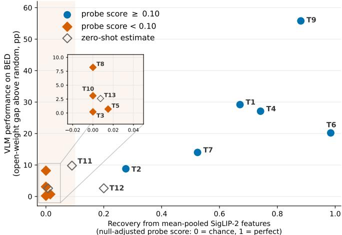

B. Probe scores across encoder families  
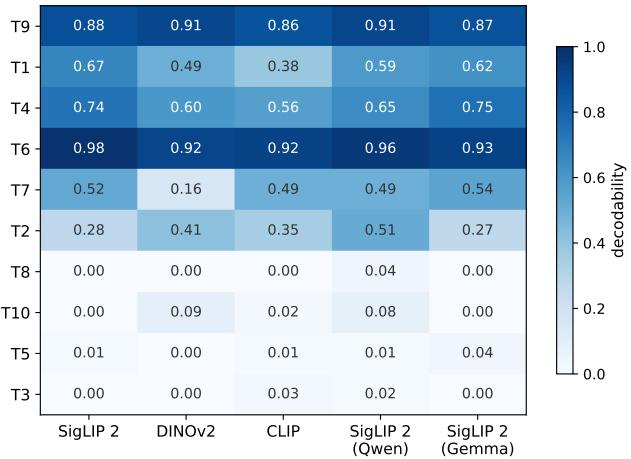

C. Visual cues shift retrieval accuracy  
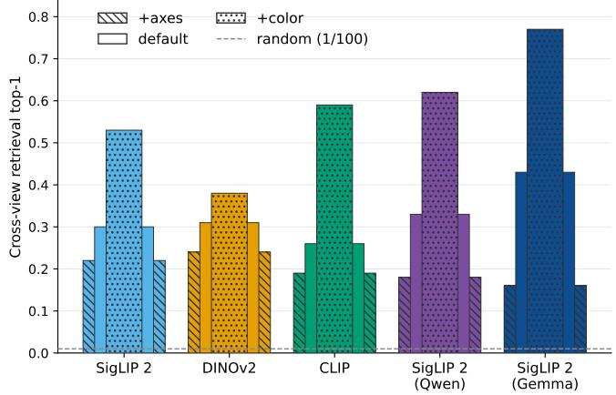

D. Candidate separation varies by encoder  
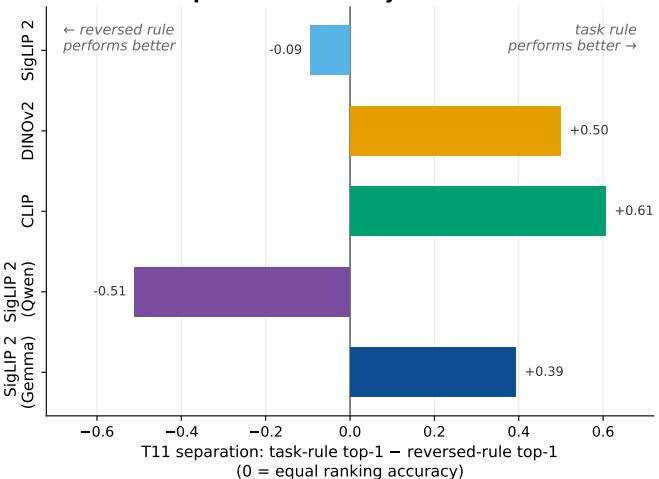  
Figure 8: Probing frozen encoders on ground-truth targets. (A) Null-adjusted probe decodability (SigLIP-2) against the per-task VLM gap above random. (B) Decodability across three encoder classes and the largest deployed tower of each family. (C) Cross-view retrieval from pooled features by cue condition. (D) T11 zero-shot candidate separation (task-rule top-1 minus reversed-rule top-1; positive values favor the task rule, negative values favor its reverse). Values in (C) and (D) depend on the representation (patch-mean features; a CLS-pooled readout of CLIP loses most of its (D) signal), and the Qwen tower is probed before its patch merger. Takeaway: With pooled probes trained on 100 objects, quantity tasks are well recovered, while the per-part and relational tasks (bottom rows of B) have low null-adjusted probe scores.

 Pooled probes trained on 100 objects rarely recover exact decompositions. Most representative encoders score near the permutation threshold on T8: Silhouette Symmetry and T10: Color Connected. On T5: Color Distribution, per-color counts decode above the shufled-label reference (MAE 0.40–0.62 against a null $\mathrm { o f } \approx 0 . 7 1 )$ , yet complete count vectors are rarely recovered (exact match ≤ 3.5%); Appendix B.5.2 shows that this reflects limited training data rather than absent information. On T3: Diference, the pair probe reaches component $\mathrm { M A E } \approx 1 . 3$ against a predict-the-mean baseline of 2.3, but exact triple accuracy is only 0.0–4.4% for the six representative encoders, and pair embedding distance is uncorrelated with structural diference (Spearman $| \rho | \leq 0 . 1 6 )$ . Probes that retain interactions among patch tokens, such as quadratic (Li et al., 2025c) or spatially selective (Michalkiewicz et al., 2026) ones, may recover more, as they do on T5; we did not retest T3, T8, or T10 with more data.

 Depth supervision improves volume readout but not exact decomposition under pooled probes. Depth-Anything-V2-L difers from DINOv2-L only by depth-supervised fine-tuning. It improves volume recovery on

<table><tr><td>Model / feature stage</td><td>Readout</td><td>EM</td><td>MAE</td><td>Pres.</td><td>T1</td><td>T4</td><td>T7</td></tr><tr><td rowspan="4">Qwen3.5-27B / tower</td><td>VLM (zero-shot)</td><td>3.0</td><td>0.50</td><td>48.2</td><td>一</td><td>一</td><td>一</td></tr><tr><td>Constant</td><td>0.0</td><td>0.68</td><td>61.5</td><td>17.0</td><td>1.0</td><td>0.0</td></tr><tr><td>Ridge, averaged</td><td>21.0</td><td>0.27</td><td>82.0</td><td>40.0</td><td>71.0</td><td>43.0</td></tr><tr><td>Attention Token-sum</td><td> $6 1 . 7 \pm 4 . 8$   $7 7 . 0 \pm 2 . 4$ </td><td>0.12 0.12</td><td>94.2 96.6</td><td>63.7 77.0</td><td>88.7 97.0</td><td>76.0 83.3</td></tr><tr><td>Qwen3.5-27B / connector</td><td>Ridge, averaged Attention</td><td>21.0  $6 5 . 0 \pm 0 . 8$ </td><td>0.27</td><td>81.1</td><td>39.0</td><td>65.0</td><td>41.0</td></tr><tr><td rowspan="4">Gemma4-31B / tower</td><td></td><td></td><td>0.12</td><td>94.7</td><td>67.0</td><td>92.3</td><td>76.3</td></tr><tr><td>VLM (zero-shot)</td><td>4.0</td><td>0.41</td><td>一</td><td>一</td><td>一</td><td>一</td></tr><tr><td>Ridge, averaged</td><td>15.0</td><td>0.28</td><td>79.9</td><td>36.0</td><td>61.0</td><td>37.0</td></tr><tr><td>Attention Token-sum</td><td> $4 4 . 7 \pm 0 . 5$   $3 7 . 3 \pm 5 . 6$ </td><td>0.14 0.17</td><td>89.6 88.1</td><td>51.0 41.3</td><td>83.7 87.3</td><td>61.0 52.3</td></tr></table>

Table 20: T5 probes on frozen tower and connector features (%, except MAE), tested on 100 benchmark objects. Neural probes train on 800 objects with 100 for validation; ridge fits on all 900. EM = exact count-vector match; Pres. = present colors counted exactly; $\mathrm { T 1 / T 4 / T 7 = }$ answers derived from predicted counts. Neural rows report three-seed means, with EM standard deviations. Constant predicts the training mean; VLM rows are full-model Non-Thinking default-setting results. Takeaway: Exact counts are recoverable from both towers and remain recoverable at Qwen3.5-27B’s language-model input.

T1: Volume $( \rho 0 . 5 3  0 . 6 5 )$ and gives the strongest T11: Projection candidate separation among the pretrained encoders $( + 0 . 6 2 )$ , but T5: Color Distribution exact match stays at 0.0% and T8: Silhouette Symmetry/T10: Color Connected stay at their nulls. It is also the only encoder whose cross-view retrieval does not improve with color $( 0 . 3 7  0 . 3 6 )$

 Color generally improves cross-view retrieval; axes reduce it. Consistent with the behavioral efects in Section 5.3, color raises two-view retrieval in every other encoder (gains up to +43 pp, reaching 0.77 top-1 for the Gemma4 tower against a 0.01 random baseline), while axes depress it in every encoder (to 0.09–0.26; Figure 8C).

## B.5.2 With more training data, token-level probes recover exact per-color counts

Experimental setup. The pooled probes above use about 80 training objects per fold. Here, neural probes train on the 800 generated T5 objects used for fine-tuning, stop early on its 100 validation objects, and test on the 100 benchmark objects (Appendix B.1.5). We extract both views’ frozen tower tokens: 676 per view before the patch merger for Qwen3.5-27B and 256 for Gemma4-31B, each with 1,152 dimensions. For Qwen3.5-27B, we also extract the connector output, the 169 tokens per view with 5,120 dimensions supplied to the language model. The attention probe projects tokens to 256 dimensions, adds learned view embeddings, pools them with eight learned queries, and maps the result to 12 counts through an MLP. The same design and training procedure apply at both Qwen stages, with input projection sizes adjusted to their feature dimensions. A second readout, token-sum, applies a shared MLP to each tower token with a view embedding and sums nonnegative per-color outputs across both views. Both neural probes use $\mathrm { s m o o t h } { - } L _ { 1 }$ loss, early stopping on validation MAE, and three seeds. Ridge regression on concatenated per-view means provides a pooled reference; unlike the neural probes, it fits on the combined training and validation objects, with regularization selected by RidgeCV. Predicted counts are rounded and clipped at zero for exact match and derived T1, T4, and T7 answers; MAE uses unrounded predictions.

 Frozen features support exact counts far more often than the VLMs report them. On Qwen3.5-27B tower features, ridge reaches 21.0% exact match and attention 61.7%, against 3.0% for the VLM. Gemma4-31B shows the same gap (ridge 15.0%, attention 44.7%, VLM 4.0%; Table 20). Token-sum further raises Qwen’s exact match to 77.0%, but reaches only 37.3% on Gemma, below attention. Thus, the best tested readout difers across towers, and attention accuracy is not a ceiling on recoverable information. Dominant colors derived from Qwen’s token-sum counts are correct on 83.3% of objects, against 18.0% for its direct T7 answers.

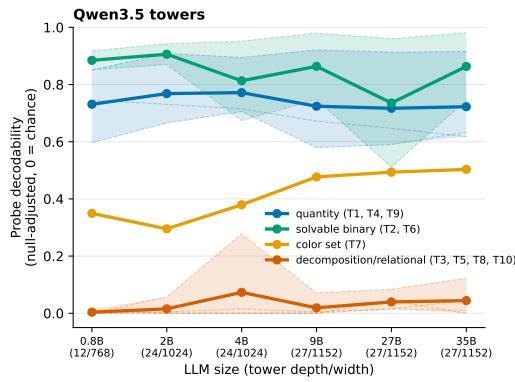

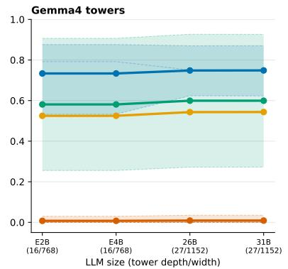

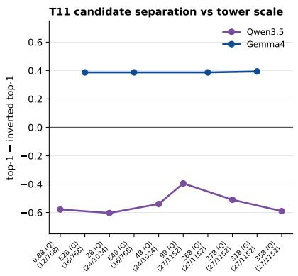  
Figure 9: Deployed vision towers across model scale. Left, middle: probe decodability by task family for every Qwen3.5 and Gemma4 tower (x-axis: LLM size, with tower depth/width). Same-architecture towers attached to diferent LLM sizes give near-identical values: the Gemma4 E2B/E4B pair shares one tower checkpoint, with identical extracted features, and its 26B-A4B/31B pair agrees to within 0.005 on every probe metric. Right: T11 zero-shot candidate separation per tower. Takeaway: Quantity probes are already strong in the smallest towers and change little with size, and the two families order T11 candidates in opposite directions: the task rule wins in Gemma4 and its reverse wins in Qwen3.5.

 Count information remains recoverable at the language-model input. On Qwen3.5-27B’s connector output, the attention probe reaches 65.0% exact match, compared with 61.7% before the connector under the same probe design and training protocol. Counts therefore remain recoverable after the patch merger, despite the reduction from 676 to 169 tokens per view. Together with the 68.6% obtained by training only the language model while freezing the encoder and connector, this points to dificulty in the language model’s use of available information. It does not establish where within that model the failure occurs.

 Small training sets understate what the features support. With 200, 400, and 800 training objects, attention exact match rises from 14.7 to 42.0 to 61.7% on the Qwen tower, from 28.0 to 49.7 to 65.0% at its connector output, and from 10.0 to 29.7 to 44.7% on the Gemma tower. Qwen tower ridge scores also rise, from 12.0 to 17.0 to 21.0%, using the additional 100 validation objects at each size. These learning curves show why low scores from the original 80-object training folds cannot establish that count information is absent. All attention curves are still rising at 800 objects.

## B.5.3 Probe scores stay flat with tower size while VLM use improves

 Larger VLMs make better use of features that smaller towers already provide. Across every deployed tower of both families (Figure 9), the quantity tasks (T1: Volume, T4: Color Count, T9: Visible Floors) decode at approximately 0.73 in the smallest tower of each family and range from 0.72 to 0.77 with no consistent increase, yet Qwen3.5 Non-Thinking accuracy from 0.8B to 27B rises by +6.4 pp on T1, +39.2 pp on T4, and +26.2 pp on T9 (§5.3), consistent with larger models making better use of features already recoverable by the pooled probe. T7: Color Dominance shows a larger endpoint gain in Qwen3.5, from 0.35 at 0.8B to 0.50 at 35B, although not monotonically. Pooled scores for the per-part and relational tasks stay low at every size, paralleling the scaling-resistant tasks of Figure 5; for T5, Appendix B.5.2 shows that such low scores can reflect the small probe training set rather than the features.

 Deployed towers separate T11 candidates that the VLMs fail to select. For T11: Projection, T12: Reconstruct, and T13: Mixture-of-Shapes, we rank candidates zero-shot by cosine similarity to the query views, which avoids classifiers that could exploit low-level statistics of the edit-based negatives (Geirhos et al., 2020); the separation score is the top-1 accuracy of the task rule (maximum similarity for matching candidates, minimum for invalid ones) minus that of its reverse. Stock SigLIP-2 shows weak T11 separation (−0.09), whereas every Gemma4 tower favors the task rule (+0.39 at all four sizes) and every Qwen3.5 tower favors its reverse (−0.40 to −0.60 at all six sizes; Figure 9, right). The signal depends on the readout: CLIP’s mean separation is +0.61 with patch-mean features and +0.12 with CLS-pooled features. These separations coexist with limited end-to-end

T11 accuracy in both families (Table 2). T12 shows weak ranking across encoders (top-1 0.48–0.66 vs. chance 0.5), and T13 stays near chance (top-1 0.31–0.40 vs. chance 0.33).

## B.6 VLMs exploit answer-format and language-prior shortcuts

Overview. This section expands Section 5.4 by separating scores that depend on the image from scores that a shortcut can reproduce: constant answers that match frequent labels when the image is removed, and answer-position cues under multiple choice (Geirhos et al., 2020; Goyal et al., 2017).

Experimental setup. We combine an answer-format comparison with a no-image control. For the answerformat comparison, we compare open-ended (OE) and five-option multiple-choice (MCQ) accuracy on T1: Volume across all 12 OW models under Non-Thinking mode, with a random-guessing baseline of 20% (Figure 10). For the no-image control, we evaluate three models (Qwen3.5-27B, Gemma4-31B, GLM-4.6V-Flash) with all images stripped across the 13 default tasks plus the T1 MCQ control, reporting 5-run means. Table 21 (Appendix B.6.1) gives the per-model visual-vs-no-image accuracies, Table 22 characterizes the collapsed policies behind many surviving no-image scores, and Table 23 tests whether extended thinking converts those policies into grounded inference.
<table><tr><td rowspan="2">Task</td><td colspan="3">Qwen3.5-27B</td><td colspan="3">Gemma4-31B</td><td colspan="3">GLM-4.6V-Flash</td></tr><tr><td>Visual</td><td>No-image</td><td>Δ</td><td></td><td>Visual No-image</td><td>Δ</td><td>Visual</td><td>No-image</td><td>Δ</td></tr><tr><td>T3: Difference</td><td>0.0</td><td>0.0</td><td>0.0</td><td>0.0</td><td>0.0</td><td>0.0</td><td>0.0</td><td>0.0</td><td>0.0</td></tr><tr><td>T8: Silhouette Symmetry</td><td>57.0</td><td>57.0</td><td>0.0</td><td>56.0</td><td>56.0</td><td>0.0</td><td>58.0</td><td>58.0</td><td>0.0</td></tr><tr><td>T13: Mixture-of-Shapes</td><td>36.2</td><td>38.1</td><td>+1.9</td><td>42.3</td><td>40.7</td><td>-1.6</td><td>37.3</td><td>37.3</td><td>0.0</td></tr><tr><td>T5: Color Distribution</td><td>3.0</td><td>0.0</td><td>-3.0</td><td>4.0</td><td>0.0</td><td>-4.0</td><td>0.0</td><td>0.0</td><td>0.0</td></tr><tr><td>T12: Reconstruct</td><td>57.2</td><td>49.0</td><td>-8.2</td><td>54.0</td><td>45.4</td><td>-8.6</td><td>48.0</td><td>51.0</td><td>+3.0</td></tr><tr><td>T10: Color Connected</td><td>55.2</td><td>51.0</td><td>-4.2</td><td>61.4</td><td>51.0</td><td>-10.4</td><td>53.0</td><td>51.0</td><td>-2.0</td></tr><tr><td>T11: Projection</td><td>55.7</td><td>37.3</td><td>-18.4</td><td>47.3</td><td>37.3</td><td>-10.0</td><td>45.4</td><td>33.7</td><td>-11.7</td></tr><tr><td>T2: Packaging</td><td>79.2</td><td>57.2</td><td>-22.0</td><td>76.0</td><td>50.0</td><td>-26.0</td><td>51.0</td><td>50.0</td><td>-1.0</td></tr><tr><td>T1: Volume (OE)</td><td>39.8</td><td>0.0</td><td>-39.8</td><td>35.0</td><td>0.0</td><td>-35.0</td><td>22.2</td><td>34.0</td><td>+11.8</td></tr><tr><td>T9: Visible Floors</td><td>71.8</td><td>43.0</td><td>-28.8</td><td>61.0</td><td>43.0</td><td>-18.0</td><td>61.2</td><td>43.0</td><td>-18.2</td></tr><tr><td>T7: Color Dominance</td><td>18.0</td><td>0.0</td><td>-18.0</td><td>32.0</td><td>2.0</td><td>-30.0</td><td>17.6</td><td>0.0</td><td>-17.6</td></tr><tr><td>T4: Color Count</td><td>45.2</td><td>0.0</td><td>-45.2</td><td>52.8</td><td>0.0</td><td>-52.8</td><td>38.2</td><td>22.0</td><td>-16.2</td></tr><tr><td>T6: Local Structure</td><td>89.6</td><td>77.0</td><td>-12.6</td><td>83.0</td><td>23.0</td><td>-60.0</td><td>78.0</td><td>23.0</td><td>-55.0</td></tr><tr><td>T1: Volume (MCQ)</td><td>91.8</td><td>56.0</td><td>-35.8</td><td>78.0</td><td>100.0</td><td>+22.0</td><td>80.0</td><td>86.8</td><td>+6.8</td></tr></table>

Table 21: Accuracy with and without images (Non-Thinking). Visual vs. no-image accuracy for the three models evaluated without images (5-run means). Rows are grouped into shortcut-sensitive, visually dependent, and artifact tasks; T1 appears twice because open-ended counting and the MCQ artifact probe are interpreted separately. Takeaway: Scores on T3, T8, and T13 barely change without images, visually dependent tasks such as T4 and T6 lose up to 60 pp, and Gemma4-31B reaches 100% on the fixed-layout T1 MCQ without images.

## B.6.1 VLMs retain scores without images by collapsing to constant predictions

 Removing the image leaves some scores nearly intact. In Table 21, T2: Packaging, T4: Color Count, T6: Local Structure, T7: Color Dominance, T9: Visible Floors, and T11: Projection drop by 13–43 pp on average without the image. T8: Silhouette Symmetry is unchanged for all three models, T3: Diference and T5: Color Distribution stay at or near floor, and T13: Mixture-of-Shapes changes by +1.9, −1.6, and 0.0 pp for Qwen3.5-27B, Gemma4-31B, and GLM-4.6V-Flash. Image dependence also varies by model: GLM-4.6V-Flash gains on T1: Volume OE (+11.8 pp) and T12: Reconstruct (+3.0 pp), where the other two models drop.

 Constant answers explain many surviving scores. Most Non-Thinking no-image cells collapse to a single prediction for every sample with zero run-to-run variance (Table 22), an answer-prior behavior also documented in visual question answering (Goyal et al., 2017; Agrawal et al., 2018). All three models output 0 on every T10: Color Connected instance and 3 on every T9: Visible Floors instance; on T3: Diference, T5: Color Distribution, and T7: Color Dominance, they repeat a fixed triple, color-count dictionary, or color list. When the constant answer is the majority label, the score equals the best-constant baseline of Table 2: 51% on T10, 43% on T9, and 77% for Qwen3.5-27B on T6: Local Structure, where Gemma4-31B and GLM-4.6V-Flash instead always predict the minority label and reach 23%. Such scores measure label frequency rather than task competence (Lapuschkin et al., 2019), and which constant a model falls back on difers across checkpoints.

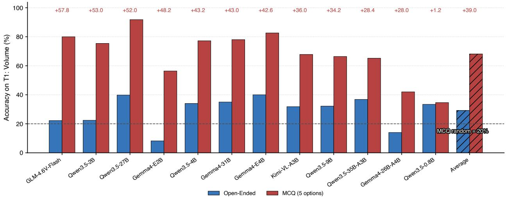

Figure 10: Open-ended vs. multiple-choice accuracy on T1: Volume. Paired bars per model under Non-Thinking mode and the default visual setting; numbers above the bars give the MCQ−OE gain (pp); the dashed line marks the 20% random baseline of the five-option MCQ, whose correct option is always in the third position. Takeaway: The fixed-layout MCQ raises accuracy by +39.0 pp on average (up to +57.8 pp) without adding any visual information.
<table><tr><td></td><td colspan="3">Modal Prediction</td><td></td><td colspan="3">Modal Prediction</td></tr><tr><td>Task</td><td>Qwen3.5</td><td>Gemma4</td><td>GLM</td><td>Task</td><td>Qwen3.5</td><td>Gemma4</td><td>GLM</td></tr><tr><td>T1: Volume (OE)</td><td>0</td><td>0</td><td>10</td><td>T1: Volume (MCQ)</td><td></td><td>MCQ pos. 3</td><td></td></tr><tr><td>T3: Difference</td><td>{0,0,0}</td><td>{3,1,1}</td><td>{4,0,0}</td><td>T8: Silhouette Symmetry</td><td>0</td><td>0</td><td>0</td></tr><tr><td>T4: Color Count</td><td>0</td><td>1</td><td>7</td><td>T6: Local Structure</td><td>0</td><td>1</td><td>1</td></tr><tr><td>T5: Color Distribution</td><td>{}</td><td></td><td>6-color dict 12-color dict</td><td>T11: Projection</td><td>2</td><td>2</td><td>1</td></tr><tr><td>T7: Color Dominance</td><td>[]</td><td>[red]</td><td>12-color list</td><td>T2: Packaging</td><td></td><td>1</td><td>1</td></tr><tr><td>T9: Visible Floors</td><td>3</td><td>3</td><td>3</td><td>T12: Reconstruct</td><td>0</td><td></td><td>1</td></tr><tr><td>T10: Color Connected</td><td>0</td><td>0</td><td>0</td><td>T13: Mixture-of-Shapes</td><td></td><td></td><td>2</td></tr></table>

Table 22: Constant predictions without images (Non-Thinking). Each cell shows the modal prediction; “—” means no collapse observed for that model. Qwen3.5 = Qwen3.5-27B, Gemma4 = Gemma4-31B, GLM = GLM-4.6V-Flash. T3 predictions abbreviated as {i,a,b} (intersection, only-a, only-b). The color abbreviations denote fixed palettes emitted regardless of input: “6-color dict” = {blue, cyan, green, magenta, red, yellow}, each color mapped to count 1; “12- color dict” = the full 12-color palette, each count 1; “12-color list” = the same palette as a list of names without counts. All modal shares are 100% except Qwen3.5 T8 (99.0%), Gemma4 T8 (98.0%), GLM T5 (89.8%). Takeaway: Without images, all three models give one fixed answer on every T9 and T10 instance (3 and 0), which accounts for their no-image scores of 43% and 51% (Table 21, Appendix B.6.1).

 Thinking perturbs the constant answers but does not restore visual grounding. Without images, Thinking breaks the T6: Local Structure collapse (+10.4 pp), but its accuracy (51.4%) stays far below the visual Non-Thinking average of the same three models (83.5%), and it lowers T9: Visible Floors by 11.0 pp by moving of the frequent constant answer (Table 23) (Sprague et al., 2025). On T1: Volume MCQ, it reduces the no-image score by 25.7 pp, weakening the answer-position shortcut (Zheng et al., 2024). It recovers nothing on the structured tasks: T3: Diference and T5: Color Distribution stay at 0.0%, and T7: Color Dominance rises only from 0.7% to 2.5%.

<table><tr><td>Task</td><td>Non-Thinking</td><td>Thinking</td><td>Δ</td><td>Effect</td></tr><tr><td>T1: Volume (OE)</td><td>11.3</td><td>15.0</td><td>+3.7</td><td>small gain, still weak</td></tr><tr><td>T1: Volume (MCQ)</td><td>80.9</td><td>55.3</td><td>-25.7</td><td>disrupts answer-position prior</td></tr><tr><td>T3: Difference</td><td>0.0</td><td>0.0</td><td>0.0</td><td>no recovery</td></tr><tr><td>T4: Color Count</td><td>7.3</td><td>8.7</td><td>+1.4</td><td>minimal gain</td></tr><tr><td>T5: Color Distribution</td><td>0.0</td><td>0.0</td><td>0.0</td><td>no recovery</td></tr><tr><td>T6: Local Structure</td><td>41.0</td><td>51.4</td><td>+10.4</td><td>breaks collapse</td></tr><tr><td>T7: Color Dominance</td><td>0.7</td><td>2.5</td><td>+1.8</td><td>still near floor</td></tr><tr><td>T8: Silhouette Symmetry</td><td>57.0</td><td>61.0</td><td>+4.0</td><td>changes prior, not mechanism</td></tr><tr><td>T9: Visible Floors</td><td>43.0</td><td>32.0</td><td>-11.0</td><td>hurts despite more reasoning</td></tr><tr><td>T10: Color Connected</td><td>51.0</td><td>49.7</td><td>-1.3</td><td>no recovery</td></tr><tr><td>T2: Packaging</td><td>52.4</td><td>56.7</td><td>+4.3</td><td>marginal gain</td></tr><tr><td>T11: Projection</td><td>36.1</td><td>34.5</td><td>-1.6</td><td>no effect</td></tr><tr><td>T12: Reconstruct</td><td>48.5</td><td>49.1</td><td>+0.6</td><td>negligible gain</td></tr><tr><td>T13: Mixture-of-Shapes</td><td>38.7</td><td>39.3</td><td>+0.6</td><td>negligible gain</td></tr></table>

Table 23: Efect of Thinking without images. Non-Thinking and Thinking accuracy (%) averaged over the three models evaluated without images, under matched task and ablation conditions; each model/mode value is a 5-run mean. Takeaway: Without images, Thinking changes most tasks by only a few points, breaks the T6 collapse (+10.4 pp), lowers T9 by 11.0 pp, and lowers the T1 MCQ score by 25.7 pp by disrupting the answer-position prior.

## B.6.2 VLMs may appear stronger under multiple choice

 Reformatting T1: Volume as a fixed-layout multiple choice inflates accuracy without adding 3D competence. In the candidate tasks T11: Projection, T12: Reconstruct, and T13: Mixture-of-Shapes, the position of the correct candidate is shufled (positions 0/1/2 in 87/101/112 of the 300 T11 and T13 questions, and 0/1 in 49/51 of the 100 T12 questions), so always choosing one position yields at most 37.3% and 51.0%, respectively. The T1 MCQ control instead orders the five options by value, with the correct volume always third. With the same images and question, this fixed layout raises accuracy over open-ended answers by +39.0 pp on average (range +1.2 to +57.8 pp; Figure 10), most for GLM-4.6V-Flash (22.2% → 80.0%) and Qwen3.5-2B (22.4% → 75.4%); the largest dense OW models also gain more than 40 pp (Qwen3.5-27B, 39.8% → 91.8%; Gemma4-31B, 35.0% → 78.0%), and only Qwen3.5-0.8B barely benefits (+1.2 pp). The gain reflects option-position cues rather than counting: LLMs show selection biases toward particular option positions (Zheng et al., 2024) and can pick correct answers from the options alone (Balepur et al., 2024), and without images Gemma4-31B reaches 100% on T1 MCQ by always choosing the third option (Table 21).

## C Implementation Details

This appendix describes how we construct inputs and ground truth, run model inference, and collect the human reference used in Section 5.1. The generation pipeline first samples geometry, selects and checks views, and renders the supported visual conditions; task construction then turns these reusable samples into questions. We give the generation procedures below, followed by inference settings, the model roster, and the human-evaluation protocol.

## C.1 Dataset Generation Details

Pseudocode notation. We write O for a voxel object and $\Pi ( { \cal O } ) = \left\{ \pi _ { x y } , \pi _ { y z } , \pi _ { z x } \right\}$ for its canonical projections. For a query view $q = ( a , e ) , d _ { \mathrm { a x i s } } ( q )$ is its angular distance to the nearest canonical direction checked by the sampler. Projection similarity $\mathrm { s i m } ( \pi , \pi ^ { \prime } )$ is the maximum IoU under the filter’s symmetry transforms; $| \pi \triangle \pi ^ { \prime } |$ counts difering cells. The set $\nu$ contains supported render variants, and $\kappa _ { p }$ assigns each cell the color of its frontmost voxel on plane $p .$ For multi-object scenes, $\mu ( G )$ denotes the distribution of scene mutations. The algorithms describe the main generation steps; finite search budgets and fallback outcomes are explicit where they afect the interpretation of an accepted sample.

Connected voxel objects. Each voxel object is built from 10–15 unit blocks on an integer grid. Starting from a block at the origin, the generator proposes additions next to existing blocks and accepts them only if they are unoccupied, connected to the structure, and supported by the ground or a block immediately below. Block coordinates satisfy $| x | , | y | \leq 4$ and $0 \leq z \leq 6$ . This explicit geometry supplies the counts, extents, and spatial relations used by the voxel tasks and visual-feature probes (Sections 3 and 5.3). Algorithm 1 summarizes object construction.

Algorithm 1 Grow a Connected Voxel Object   
Require: block-count bounds $n _ { \mathrm { m i n } } , n _ { \mathrm { m a x } } , \mathrm { X Y }$ radius R, height cap H, attempt budget B, horizontal-growth probability $p _ { \mathrm { x y } }$   
Ensure: connected voxel object O, or failure   
1: Sample n ∼ [n<sub>min</sub>, n<sub>max</sub>]   
2: Initialize $O \xleftarrow { } \{ ( 0 , 0 , 0 ) \} ; t \ x \ y \gets 0$   
3: while $| O | < n \land t < B$ do   
4: Set t ← t + 1   
5: Sample anchor $b = ( x , y , z ) \in O$   
6: Sample $\xi \sim$ Bernoulli $( p _ { \mathrm { x y } } )$   
7: if ξ = 1 then   
8: Sample $( \Delta x , \Delta y ) \in \{ ( \pm 1 , 0 ) , ( 0 , \pm 1 ) \}$   
9: Set c ← (x + ∆x, y + ∆y, z)   
10: else   
11: Set c ← (x, y, z + 1)   
12: end if   
13: if $| c _ { x } | \leq R \land | c _ { y } | \leq R \land 0 \leq c _ { z } \leq H$ then   
14: if $c \notin O \land ( \hat { c _ { z } } = 0 \lor ( c _ { x } , c _ { y } , c _ { z } - 1 ) \in O )$ then   
15: if ∃ o ∈ O: ∥c − o∥<sub>1</sub> = 1 then   
16: $O  O \cup \{ c \}$   
17: end if   
18: end if   
19: end if   
20: end while   
21: if |O| < n then   
22: report failure and stop ▷ caller may resample   
23: end if   
24: Sort O by (z, y, x)   
25: return O

Query-view selection. Two oblique query views show each voxel object from opposite sides. The first view $q _ { 1 } = \left( a _ { 1 } , e _ { 1 } \right)$ is sampled with azimuth in $0 { - } 3 6 0 ^ { \circ }$ and elevation in $1 8 { - } 5 5 ^ { \circ }$ , at least $4 5 ^ { \circ }$ from every canonical viewing direction, which places its elevation between $4 5 ^ { \circ }$ and 55°. The second view is placed at the opposite azimuth, $a _ { 1 } + 1 8 0 ^ { \circ }$ , with elevation min $( e _ { 1 } + 1 2 ^ { \circ } , 5 5 ^ { \circ } )$ . Across the 100 evaluated objects, the two views therefore difer by

180° in azimuth and by 0.3–10.0° in elevation (median 5.5°), and second views lie 35.0–55.0° from the nearest canonical direction. Footprint checks require a projected span of at least 2.2 units in each image dimension, a bounding-box area of at least 6.0 square units, and an aspect ratio no greater than 4.2, so that the object does not appear too narrow or too small. All evaluated view pairs satisfy these checks (Algorithm 2).

Algorithm 2 Select Two Query Views   
Require: voxel object O, azimuth range A, elevation range $\mathcal { E } = [ e _ { \operatorname* { m i n } } , e _ { \operatorname* { m a x } } ] ;$ , axis-separation threshold $\theta _ { \mathrm { a x i s . } }$ , elevation ofset δ , minimum   
footprint span s<sub>min</sub>, minimum footprint area A<sub>min</sub>, maximum aspect ratio ρ<sub>max</sub>, view-attempt budget B<sub>q</sub>   
Ensure: selected query views (q<sub>1</sub>, q<sub>2</sub>)   
1: for t = 1, . . . , B do   
2: Sample $q _ { 1 } = \ d ( a _ { 1 } , e _ { 1 } )$ with $a _ { 1 } \in \mathcal { A } , e _ { 1 } \in \mathcal { E } ,$ , and $d _ { \mathrm { a x i s } } ( q _ { 1 } ) \geq \theta _ { \mathrm { a x i s } }$   
3: Set q ← (a + 180°, min{e + δ<sub>e</sub>, e })   
Project all cube vertices of O under q and q   
5: For each $q \in \{ q _ { 1 } , q _ { 2 } \}$ , compute (s<sub>x</sub>(q), s<sub>y</sub>(q)), A(q) = s<sub>x</sub>(q)s<sub>y</sub>(q), and ρ(q) = max{s<sub>x</sub>/s<sub>y</sub>, s<sub>y</sub>/s<sub>x</sub>}   
6: if min{s<sub>x</sub>(q), s<sub>y</sub>(q)} ≥ s<sub>min</sub> ∧ A(q) ≥ A<sub>min</sub> for both q then   
7: if <sub>ρ</sub>(q) ≤ <sub>ρmax</sub> for both q then   
8: return (q<sub>1</sub>, q<sub>2</sub>)   
9: end if   
10: end if   
11: end for   
12: return the last sampled pair ▷ not reached for the evaluated objects

Sampled ambiguity checks. The generator tests whether alternative geometry can produce nearly identical silhouettes in both query views while changing the orthographic projections. For each candidate, it samples 500 alternative objects and renders their masks using the candidate’s view limits. An alternative constitutes a detected collision if its mask intersection over union (IoU) is at least 0.995 in both views and at least one canonical projection difers. The candidate is then rejected and resampled (Algorithm 3).

Algorithm 3 Reject Two-View Collisions   
Require: voxel object O, query views (q<sub>1</sub>, q<sub>2</sub>), collision-trial budget T, mask-matching threshold <sub>τ</sub>   
Ensure: object with no collision detected in T trials, or rejection   
1: Render base masks (M , M )   
2: Compute Π(O) = {<sub>πxy</sub>(O), <sub>πyz</sub>(O), <sub>πzx</sub>(O)}   
3: for t ← 1 to T do   
4: Sample an alternative voxel object O<sup>′</sup>   
5: Render (M<sup>′</sup> , M<sup>′</sup> ) for O<sup>′</sup> using the fixed limits of O   
6: if IoU $\lceil ( M _ { 1 } , \mathrm { ~ \bar { M } } _ { 1 } ^ { \prime } ) \geq \tau _ { \mathrm { c o l } }$ and IoU $\lceil ( M _ { 2 } , M _ { 2 } ^ { \prime } ) \geq \tau _ { \mathrm { c o l } }$ then   
7: Compute Π(O<sup>′</sup>)   
8: if Π(O<sup>′</sup>) ̸= Π(O) then   
9: reject O and stop   
10: end if   
11: end if   
12: end for   
13: return O

Hidden-block filtering. A visibility check tests whether removing a block changes the rendered masks. The filter rejects an object if any block’s removal changes fewer than 8 pixels in each 256 × 256 view and both ablated masks keep an IoU of at least 0.9998 with the original masks (Algorithm 4).

Multi-object scenes. Each T13: Mixture-of-Shapes scene contains 6–8 boxes, cubes, or cylinders. After the first primitive, each placement proposal attaches to an existing primitive with probability 0.45, either on top or beside it; otherwise, the proposal starts on the floor in $[ - 3 , 3 ] ^ { 2 }$ . Intersecting placements are rejected. The two query views use azimuth/elevation pairs (45°, 30°) and (150°, 40°). A depth-aware rasterizer checks visibility at 220 × 220 resolution: each primitive must have at least 220 visible pixels in each query view and 180 in each canonical view, with at least 8% of its projected area visible in every view. The configured maximum hidden-area ratios are 0.92 for query views and 0.95 for canonical views. Algorithm 7 summarizes scene validation and distractor construction.

Algorithm 4 Filter Hidden-Block Objects   
Require: voxel object O, query views (q , q ), minimum mask-change threshold $\delta _ { \mathrm { m i n } } ,$ , unchanged-mask IoU threshold $\tau _ { \mathrm { v i s } }$   
Ensure: object passing the hidden-block check, or rejection   
1: Render the base silhouette masks $M _ { 1 }$ and M   
2: for each block b ∈ O do   
3: Form the ablated object $O ^ { - }  O \setminus \{ b \}$   
4: Render the ablated masks M<sup>−</sup> and M<sup>−</sup>   
5: Compute $\delta _ { i } \gets | M _ { i } \oplus M _ { i } ^ { - }$ | and $\iota _ { i } \gets \bar { \mathrm { I o U } } ( M _ { i } , M _ { i } ^ { - }$ ) for $i \in \{ 1 , 2 \}$   
6: i $\dot { : } \delta _ { 1 } < \delta _ { \mathrm { m i n } }$ and $\delta _ { 2 } < \delta _ { \mathrm { m i n } }$ and $\iota _ { 1 } \geq \tau _ { \mathrm { v i s } }$ and $\iota _ { 2 } \geq \tau _ { \mathrm { v i s } }$ then   
7: reject O and stop   
8: end if   
9: end for   
10: return O

Matched renderings and color assignment. The visual-cue comparisons cross color (colored or uniform gray) with coordinate axes (present or absent), while preserving the underlying geometry. Only task-compatible variants are exported: color questions retain color, and object comparison retains axes (Table 18, Appendix B.4). An adversarial color-assignment mode pairs neighboring blocks using hand-designed color pairs, motivated by contextual efects in color perception (Westland and Maggio, 2023). The pairs are red/magenta, blue/purple, green/gold, cyan/yellow, orange/orchid, and teal/slategray. They are chosen to combine distinct hues with relatively similar luminance, with the aim of reducing brightness-based boundary cues (Algorithm 5).

Algorithm 5 Assign Adversarial Colors   
Require: voxel object O, color-pair set C   
Ensure: colored object Oe   
1: Build the 6-neighbor graph $G _ { O } = \left( O , E \right)$   
2: Shufle the block order   
3: for each uncolored voxel b ∈ O do   
4: Select an uncolored neighbor b<sup>′</sup> if one exists   
5: Sample $( c _ { 1 } , c _ { 2 } ) \sim \mathcal { C }$ ▷ color-pair set   
6: Randomly swap $\left( c _ { 1 } , c _ { 2 } \right)$   
7: Set $\widetilde { O } ( b )  c _ { 1 }$ and, if present, $\widetilde { O } ( b ^ { \prime } )  c _ { 2 }$   
8: end for   
9: return Oe

Projection distractors. For T11: Projection, the generator edits occupied cells in a correct projection using add, remove, or shift operations. A cross-plane filter rejects proposals whose maximum IoU under symmetry with another positive plane is at least 0.85, or whose symmetric diference from that plane is fewer than 2 cells. The search runs for up to 600 proposals per plane (Algorithm 6). Every distractor for the 100 evaluated objects passes this filter, with a maximum cross-plane similarity of 0.833 and at least 2 difering cells, and no evaluated object has a skipped plane. T12: Reconstruct uses a diferent construction: the anchor object’s three positive silhouettes are paired with candidate query views from the anchor and a diferent object.

Scene distractors. For each T13: Mixture-of-Shapes projection plane, the generator proposes a modified scene by swapping two primitives, deleting one, resizing one, lifting one, or translating one horizontally. Resizing multiplies the X extent by 1.2–1.6 and the Y and Z extents independently by 0.9–1.2; lifting adds 0.8–1.6 units to height, and translation uses ±1.2 or ±1.8 units along X or Y. A proposal is accepted only if it is non-intersecting, both scenes pass visibility checks in shared view limits, and their silhouette IoU on the target plane lies strictly between 0.55 and 0.88. The generator allows 120 attempts per plane and reports failure if none succeeds.

Reusable samples and task construction. Each accepted voxel sample stores its geometry, query images, canonical projections, color assignments, and task metadata (Algorithm 8). Single-object tasks derive their targets from this shared sample; T3: Diference compares two objects, T11: Projection selects among projection candidates, and T12: Reconstruct matches silhouettes to an object view. T13: Mixture-of-Shapes applies projection selection to the separate scene pool. Section 4 specifies the evaluation subset, and Appendix D illustrates the resulting questions.

Algorithm 6 Generate Projection Distractors   
Require: positive projections Π, edit settings, similarity threshold $\tau _ { \mathrm { n e g } } ,$ minimum cell diference $d _ { \mathrm { m i n } } ,$ attempt budget $B _ { \mathrm { n e g } }$   
Ensure: per-plane distractors or skipped-plane markers, with search-status flags   
1: for each plane $p \in \{ x y , y z , z x \}$ do   
2: $\mathbf { i f } \ \pi _ { p }$ meets the enabled thin-bar skip rule then   
3: mark plane p as skipped; continue   
4: end if   
5: accepted ← false   
6: for $\boldsymbol { \dot { t } } = 1 , \dots , \boldsymbol { B } _ { \mathrm { n e g } }$ do   
7: Propose $\pi _ { p } ^ { - }$ using configured add, remove, or shift edits   
8: Apply the configured connectivity, hole, and cell-count constraints   
9: if for every $\boldsymbol { p } ^ { \prime } \neq \boldsymbol { p } ,$ sim $( \pi _ { p } ^ { - } , \pi _ { p ^ { \prime } } ) <$ τ<sub>neg</sub> and $| \pi _ { p } ^ { - } \triangle \pi _ { p ^ { \prime } } | \geq d _ { \mathrm { { m i n } } }$ then   
10: accepted ← true; break   
11: end if   
12: end for   
13: if not accepted then   
14: Retain the last proposal and flag possible cross-plane similarity ▷ not reached for the evaluated objects   
15: end if   
16: end for   
17: return distractors and status flags

Algorithm 7 Sample and Validate a Multi-Object Scene   
Require: primitive and placement settings, visibility thresholds, query views Q, render variants V, attempt budgets   
B<sub>scene</sub>, $B _ { \mathrm { o b j } } ,$ B<sub>neg</sub>   
Ensure: reusable multi-object sample m, or failure   
Scene construction and visibility Projection distractors and export   
1: scene\_valid ← false 20: for each plane $p \in \{ x y , y z , z x \}$ do   
2: for $t = 1 , \ldots , B _ { \mathrm { s c e n e } }$ do 21: accepted ← false   
3: Sample target size $n \in \left[ n _ { \operatorname* { m i n } } , n _ { \operatorname* { m a x } } \right] .$ ; initialize $G  \varnothing$ 22: for $\bar { j } = 1 , \ldots , B _ { \mathrm { n e g } }$ do   
4: for $j = 1 , \ldots , B _ { \mathrm { o b j } }$ do 23: Sample $G _ { p } ^ { - } \sim { \mu ( G ) }$ ▷ swap, delete, move, resize,   
5: Sample a primitive’s type, dimensions, and orienta or lift   
tion 24: if $G _ { p } ^ { - }$ is intersecting then   
6: Propose attachment with probability $p _ { \mathrm { { a t t } } }$ if $G \neq \varnothing ;$ 25: continue   
otherwise propose floor placement 26: end if   
7: Add the proposal to G if non-intersecting 27: Validate both scenes on plane p using shared view   
8: if $| G | = n$ then limits   
9: break 28: Compute silhouette overlap ι<sub>p</sub>   
10: end if 29: if both views pass and $\tau _ { \mathrm { m i n } } ^ { - } < \iota _ { p } < \tau _ { \mathrm { m a x } } ^ { - }$ then   
11: end for 30: accepted ← true; break   
12: if $| G | = n$ and all query and canonical views pass 31: end if   
visibility checks then 32: end for   
13: scene\_valid ← true; break 33: if not accepted then   
14: end if 34: report failure and stop   
15: end for 35: end if   
16: if not scene\_valid then 36: end for   
17: report failure and stop 37: Render query views and positive/negative silhouettes   
18: end if under V   
19: Assign colors consistently across views of G 38: Save geometry, renders, and validation reports as m   
39: return m

Final ambiguity audit. This post-hoc audit, implemented independently of the generator, checks whether any evaluated object has an answer that cannot be recovered from the query views, and measures how much such objects afect the reported results. The hidden-block filter (Algorithm 4) operates on silhouette masks, so a block passes it whenever its removal changes the outline, even if none of its faces are visible. The audit was run after all experiments were completed. It tests every single-block edit of the 100 evaluated objects: recoloring any block, removing any block, and adding a supported block to any empty face-adjacent cell. Each edited object is rendered with the benchmark renderer at the original query cameras and compared with the original object in both views. One object (ID 32) contains a block that is almost entirely occluded in both views: recoloring it leaves both images unchanged, and removing it only thins one outline by about one pixel in one view. In the filter’s silhouette masks, this removal changes 0 pixels in one view and 29 of 18,706 foreground pixels in the other $\left( \mathrm { I o U } 0 . 9 9 8 5 < 0 . 9 9 9 8 \right)$ , so the filter treats the block as visible. No other edit of any object leaves both views unchanged apart from such outline changes. For this object, the per-color counts of T5: Color Distribution cannot be recovered from the images, and the answers to T4: Color Count, T7: Color Dominance, and T10: Color Connected change for 8, 7, and 2 of the 11 alternative colors of the hidden block, respectively. Its volume (T1: Volume) and the projections used in T11: Projection are visible only through the outline change. The other tasks are unafected: no edit changes the T2: Packaging, T6: Local Structure, T8: Silhouette Symmetry, or T9: Visible Floors answer, no evaluated T3: Diference pair contains this object, and T12: Reconstruct does not use these query images.

Algorithm 8 Construct One Single-Object Sample   
Require: voxel object O passing the enabled filters, query views (q , q ), supported visual-variant set V   
Ensure: reusable single-object sample s   
1: Assign standard or adversarial colors to O   
2: Compute block count, object extents, container dimensions and fit label, and per-color counts   
3: Compute positive projections Π(O)   
4: Generate negative projections Π<sup>−</sup>(O)   
5: Derive plane-wise color maps $\kappa _ { p }$ ▷ frontmost voxel wins   
6: Render query views under V   
7: Render Π(O) and Π<sup>−</sup>(O) in the matching variants from V   
8: Save geometry, renders, projection edits, and metadata as sample s   
9: return s

We keep the object in all reported results. Excluding it from every task built on the 100 shared objects changes each of the 768 open-weight accuracy cells (12 models, both inference modes, all tasks and visual-condition variants) by at most 0.97 pp. It changes no verdict or win/loss count in Table 12 (Appendix B.2.1), no sign of a color or axes efect in Table 18 (Appendix B.4), and no task’s position in the ordering of tasks by mean accuracy. Each frontier model answered every instance once, so its accuracy on any afected task changes by at most 1.0 pp. In the human study, no participant received this object on T1, T4, T5, T7, or T11; four of the 30 participants received it on T10, and excluding their responses changes human T10 accuracy from 86.7% to 88.5%.

## C.2 General Experiment Setup

Open-weight inference. We serve the 12 OW models through an OpenAI-compatible vLLM (v0.19.1) endpoint on NVIDIA H100, NVIDIA A40, and NVIDIA GeForce RTX 3090 GPUs, typically using one to four GPUs depending on the model and task. The evaluation requests greedy decoding with temperature= 0 and top\_k= 1. Thinking mode uses the model-specific configuration and a default requested reasoning budget of 1024 tokens, where supported; the budget sweep is described in Appendix B.2.2. Each OW condition in the main evaluation is run five times, and we report the mean and standard deviation across these runs. Although decoding is greedy, the runs are not bit-identical: each run sends up to 100 concurrent requests, so vLLM’s continuous batching (and, for some models, multi-GPU execution) groups requests diferently across runs, and the resulting floating-point diferences can change the selected token when two candidates are nearly tied. No sampling seed is involved. Under the default setting, an average of 90.8% of Non-Thinking and 53.7% of Thinking outputs per model and task are byte-identical across all five runs; longer reasoning traces leave more opportunities for such divergence. The reported standard deviation therefore measures inference nondeterminism, not uncertainty over the benchmark items. For the latter, we report paired item-level bootstrap intervals that resample objects (scenes for T13, object pairs for T3) jointly across models, modes, and runs, with models and runs held fixed: for visual cues (Table 18, Appendix B.4), thinking (Table 12, Appendix B.2.1), the reasoning budget (Appendix B.2.2), and model scale (Appendix B.3.2). Prompts and answer schemas appear in Appendix F, and Section 4 gives the evaluation sizes and coverage of the diagnostic subsets.

<table><tr><td>Model</td><td>Family / Provider</td><td>Open / Proprietary</td><td>Architecture</td><td>Parameters</td><td>Release</td><td>Knowledge cutoff</td><td>Context window</td><td>Modalities</td><td>License / Access</td><td>Official source</td></tr><tr><td>Qwen3.5-0.8B</td><td>Qwen</td><td>Open</td><td>Dense hybrid</td><td>0.87B</td><td>2026-02-28</td><td>Not public</td><td>262k native</td><td>Text, image</td><td>Apache-2.0 HF</td><td></td></tr><tr><td>Qwen3.5-2B</td><td>Qwen</td><td>Open</td><td>Dense hybrid</td><td>2.27B</td><td>2026-02-28 Not public</td><td></td><td>262k native</td><td>Text, image</td><td>Apache-2.0 HF</td><td></td></tr><tr><td>Qwen3.5-4B</td><td>Qwen</td><td>Open</td><td>Dense hybrid</td><td>4.66B</td><td>2026-02-27</td><td>Not public</td><td>262k native, ~1.01M ext.</td><td>Text, image</td><td>Apache-2.0 HF</td><td></td></tr><tr><td>Qwen3.5-9B</td><td>Qwen</td><td>Open</td><td>Dense hybrid</td><td>9.65B</td><td>2026-02-27</td><td>Not public</td><td>262k native, ~1.01M ext.</td><td>Text, image</td><td>Apache-2.0</td><td>HF</td></tr><tr><td>Qwen3.5-27B</td><td>Qwen</td><td>Open</td><td>Dense hybrid</td><td>27.8B</td><td>2026-02-24 Not public</td><td></td><td>262k native, ~1.01M ext.</td><td>Text, image</td><td>Apache-2.0</td><td>HF</td></tr><tr><td>Qwen3.5-35B-A3B</td><td>Qwen</td><td>Open</td><td>MoE hybrid</td><td>35B total (3B act.)</td><td>2026-02-24 Not public</td><td></td><td>262k native, ~1.01M ext.</td><td>Text, image</td><td>Apache-2.0 HF</td><td></td></tr><tr><td>Gemma4-E2B</td><td>Google</td><td>Open</td><td>Dense hybrid attn.</td><td>2.3B eff. (5.1B total)</td><td>2026-03-02</td><td>Not public</td><td>128k</td><td>Text, image, audio</td><td>Apache-2.0</td><td>HF</td></tr><tr><td>Gemma4-E4B</td><td>Google</td><td>Open</td><td>Dense hybrid attn.</td><td>4.5B eff. (8B total)</td><td>2026-03-02</td><td>Not public</td><td>128k</td><td>Text, image, audio</td><td>Apache-2.0 HF</td><td></td></tr><tr><td>Gemma4-26B-A4B</td><td>Google</td><td>Open</td><td>MoE hybrid attn.</td><td>25.2B total (3.8B act.)</td><td>2026-03-11</td><td>Not public</td><td>256k</td><td>Text, image</td><td>Apache-2.0 HF</td><td></td></tr><tr><td>Gemma4-31B</td><td>Google</td><td>Open</td><td>Dense hybrid attn.</td><td>30.7B</td><td>2026-03-11</td><td>Not public</td><td>256k</td><td>Text, image</td><td>Apache-2.0 HF</td><td></td></tr><tr><td>GLM-4.6V-Flash</td><td>Z.ai</td><td>Open</td><td>Dense VLM with tool use MoE VLM</td><td>9B</td><td>2025-12-07</td><td>Not public</td><td>128k</td><td>Text, image</td><td>MIT</td><td>HF</td></tr><tr><td>Kimi-VL-A3B</td><td>Moonshot AI Open</td><td></td><td>(MoonViT)</td><td>16B total (3B act.)</td><td>2025-04-09</td><td>Not public</td><td>128k</td><td>Text, image, video</td><td>MIT</td><td>HF (NT) + HF (TH)</td></tr><tr><td>GPT-5</td><td>OpenAI</td><td>Proprietary</td><td>Unified system</td><td>Not public</td><td>2025-08-07</td><td>2024-09-30</td><td>400k</td><td>Text, image</td><td>Closed API</td><td>Docs + Card</td></tr><tr><td>Grok-4.20</td><td>xAI</td><td>Proprietary</td><td>Reasoning model with tools Preview</td><td>Not public</td><td>2026-03-09</td><td>Not public</td><td>1M</td><td>Text, vision</td><td>Closed API</td><td>Docs</td></tr><tr><td>Gemini-3-Flash</td><td>Google</td><td>Proprietary</td><td>multimodal</td><td>Not public</td><td>2025-12-17</td><td>2025-01</td><td>1M/64k</td><td>Text, image, video, audio, PDF</td><td>Closed API (preview)</td><td>Docs + Blog</td></tr><tr><td>Gemini-3.1-Pro</td><td>Google</td><td>Proprietary</td><td>Preview multimodal</td><td>Not public</td><td>2026-02-19</td><td>2025-01</td><td>1M/64k</td><td>Text, image, video, audio, PDF</td><td>Closed API (preview)</td><td>Docs + Blog</td></tr></table>

Table 24: Evaluated model roster and provider metadata. Parameter counts distinguish total, active (act.), and efective (ef.) counts where reported; context windows are measured in tokens. See the text for date conventions and undisclosed fields.

Frontier inference. The four frontier models use the same task prompts and default visual conditions, with one Thinking-mode evaluation per model. GPT-5 and Grok-4.20 are queried through OpenRouter; Gemini-3-Flash and Gemini-3.1-Pro are queried through Vertex AI. The API requests set temperature= 0; the OpenAI-model requests omit top\_k. Output and reasoning budgets are requested limits whose enforcement depends on the provider.

Answer parsing and scoring. Task-specific parsers extract the answer fields used for exact-match accuracy and the secondary metrics defined in Section 4. Responses that cannot be parsed are scored as incorrect for accuracy; the secondary metrics are computed over the parsed responses. For per-color counting, exact match requires the complete color-to-count mapping to be correct, while numerical-error metrics measure how far the counts deviate. For binary tasks, precision, recall, and F1 are computed separately for each class and then averaged with equal class weights (macro-averaging); undefined class scores are set to zero.

## C.3 Model Details

Table 24 identifies the 12 OW checkpoints and four provider-hosted models evaluated in Section 4. The parameter column distinguishes total and active parameters for mixture-of-experts (MoE) models and retains provider reported efective counts where applicable. Context windows and modalities describe model capabilities; our experiments use the image-and-text inputs specified by each task. Kimi-VL-A3B releases separate checkpoints for the two modes: Non-Thinking results use Kimi-VL-A3B-Instruct and Thinking results use Kimi-VL-A3B-Thinking-2506; all other OW models use one checkpoint for both modes.

Reading the model metadata. “Open” denotes OW models served locally, and “Proprietary” denotes providerhosted models. The release column uses checkpoint-repository creation dates for OW models and public announcement dates for frontier models; these are diferent date conventions. “Not public” marks fields not disclosed in the cited sources.

## C.4 Human Baseline Details

Participants. We recruit 30 volunteers aged 16–35 years (mean 23.2, std. 4.1), comprising 19 male and 11 female participants. Their highest completed education is high school (n = 8), Bachelor’s (n = 16), Master’s (n = 4), or PhD (n = 2).

Questions and response procedure. Each participant answers 13 randomly drawn questions, one per task, under the task’s default visual condition. Participants receive the same task instructions as the VLMs, with the output-format specification removed, and may revisit earlier questions before submitting. This gives 30 responses per task and 390 responses overall.

Accuracy and uncertainty. Each response receives a binary verdict, and per-task accuracy is the fraction of correct responses among the 30 participants. We report 95% Wilson confidence intervals for these proportions; the mean accuracy across the 13 tasks is 70.0%. Table 3 gives the comparison with model performance, and Appendix B.1.1 provides further analysis.

Completion time. We record total session time because participants can move between questions and revise their answers. Mean completion time is 1234.1 seconds (approximately 20.6 minutes). Dividing by 13 gives about 95 seconds per question.

## D Dataset Examples

For each of the thirteen tasks, this appendix shows three instances under the default visual setting: the prompt excerpt, the rendered image inputs, the ground-truth answer, and the parsed answer from each of eight primary models (Qwen3.5-27B, Gemma4-31B, GLM-4.6V-Flash, Kimi-VL-A3B, GPT-5, Grok-4.20, Gemini-3-Flash, Gemini-3.1-Pro), marked ✓/ ×for correct/incorrect.

Shared conventions. For voxel tasks, each block is a unit cube at an integer lattice position, with Z defining the vertical direction. Labels are computed from object coordinates and assigned colors. Each physical block contributes once to an object-level count, even when it appears in both query views. Color categories are the twelve names specified in the prompts, rather than shading variations. The definitions below state each task’s target and label convention; the examples show the default condition.

## D.1 T1: Volume

T1 belongs to the Aggregate quantity and support group (Figure 1). Given two views of one object, the target is the total number of occupied voxel positions, which also gives its volume in cubic block units. Each block counts once, regardless of how many faces or views show it. The hidden-block filter is designed to make each voxel visible in at least one view (Appendix C.1); combining the views therefore requires avoiding duplicate counts while retaining blocks seen in only one. The default response is an integer; the multiple-choice control presents candidate totals for the same target.

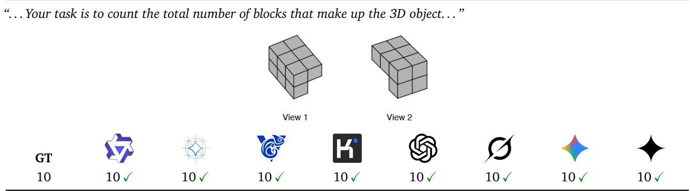  
Table 25: T1 Volume instance where all eight models count correctly.

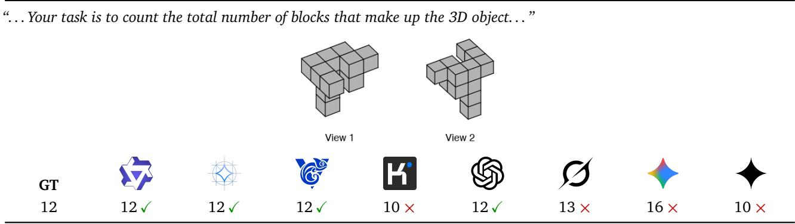  
Table 26: T1 Volume instance with a mixed split.

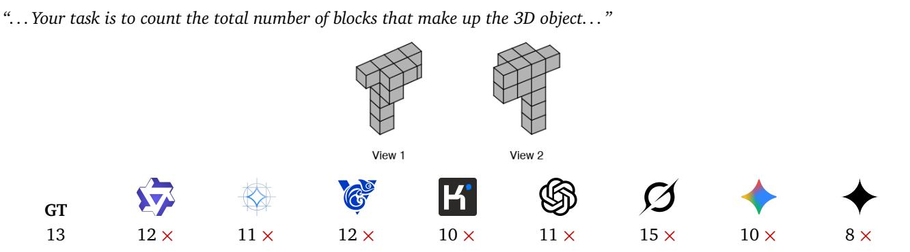  
Table 27: T1 Volume instance where all eight models miscount.

## D.2 T2: Packaging

T2 tests spatial extents within the Aggregate quantity and support group. Given two object views and three container dimensions, the target is whether the object fits under an axis-aligned reorientation. Each object extent is the maximum occupied coordinate minus the minimum plus one. The label is true if any permutation of the three extents is no larger than the corresponding container dimensions, allowing equality. Mental rotation thus changes which object axis aligns with each container axis; the label procedure does not test arbitrary oblique rotations. Unlike T1, this judgment depends on the object’s extents rather than its total block count.

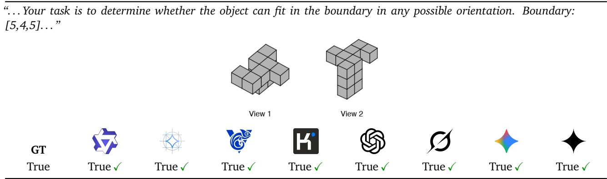  
Table 28: T2 Packaging instance where all eight models answer correctly.

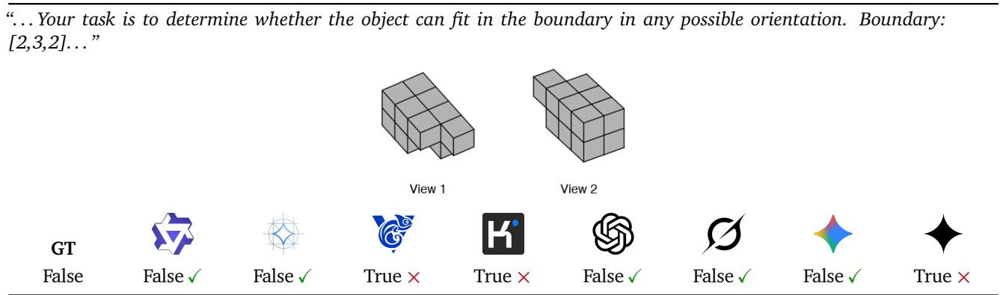  
Table 29: T2 Packaging instance with a mixed split.

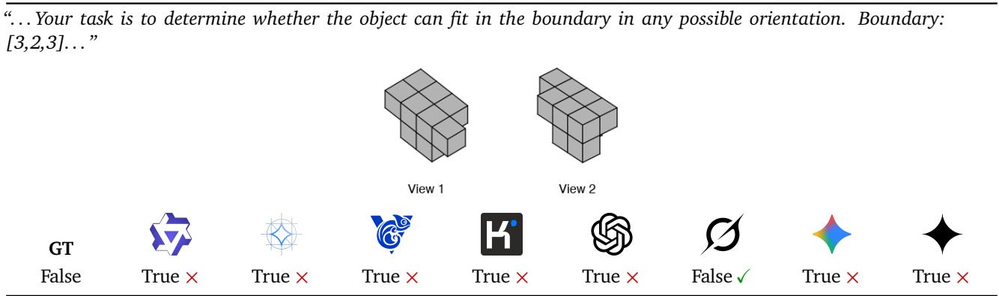  
Table 30: T2 Packaging instance with a mixed split (1/8 correct).

## D.3 T3: Diference

T3 opens the Compositional decomposition group. Given two views each of objects A and B, it requests the numbers of shared blocks and blocks unique to each object. Correspondence uses identical integer positions in the generator coordinate frame, whose axes appear in the images; neither object is independently translated or rotated to maximize overlap. The three labels are the sizes of the intersection and the two set diferences of the occupied-position sets. In the color-aware variant, shared blocks must also match in color. T3 therefore requires a structured partition across objects, rather than a single aggregate count.

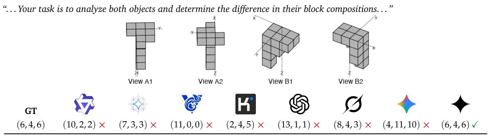  
Table 31: T3 Diference instance with a mixed split.

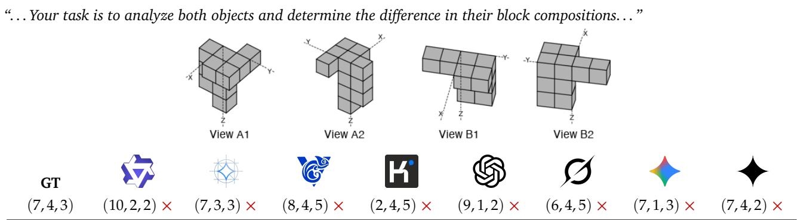

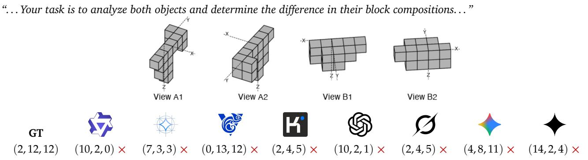  
Table 33: T3 Diference instance where all eight models return an incorrect triple with large per-component error.

## D.4 T4: Color Count

T4 returns to the Aggregate quantity and support group, replacing T1’s occupancy count with a categorical count. Given two colored views, the target is the number of distinct palette categories assigned to at least one block. Repeated occurrences of a color count as one category, including occurrences seen in both views. The label is the cardinality of the set of assigned colors. Unlike T5, T4 requires identifying which colors are present without determining how many blocks belong to each color.

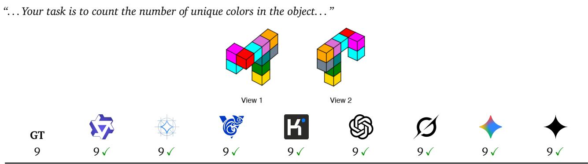  
Table 34: T4 Color Count instance where all eight models answer correctly.

  
Table 35: T4 Color Count instance with a mixed split.

  
Table 36: T4 Color Count instance where all eight models answer incorrectly.

## D.5 T5: Color Distribution

T5 is the compositional-decomposition sibling of T4. Given two colored views, it requests a dictionary mapping every color present in the object to its block count. Each physical block contributes once to its assigned color, requiring both color-to-block association and aggregation within each category. Exact-match accuracy requires the same color keys and counts as the target dictionary; per-color error metrics instead use twelvedimensional vectors with omitted palette categories assigned zero. T5 is the paper’s clearest VLM-specific failure case (Section 5.1), despite the comparatively higher accuracy on T4.

  
Table 37: T5 Color Distribution instance with a mixed split.

  
Table 38: T5 Color Distribution instance with a mixed split.

  
Table 39: T5 Color Distribution instance where all eight models answer incorrectly.

## D.6 T6: Local Structure

T6 completes the Compositional decomposition group with a local binary judgment. Given two object views and a threshold k, the target is whether any vertical column contains more than k blocks. A column contains blocks sharing the same X and Y coordinates, and its height is measured by its block count. The evaluated threshold is k = 3, so exactly three blocks do not satisfy the condition. The label thresholds the largest column count. This tests identifying a qualifying local structure without requiring the full decomposition requested by T3 or T5.

  
Table 40: T6 Local Structure instance where all eight models answer correctly.

  
Table 41: T6 Local Structure instance with a mixed split.

  
Table 42: T6 Local Structure instance with a mixed split.

## D.7 T7: Color Dominance

T7 sits in the Aggregate quantity and support group alongside T4, but asks for a comparison across color counts. Given two colored views, the target is the set of colors with the largest number of blocks, including all colors tied for the maximum. Dominance refers to block count, rather than projected image area. Accuracy requires the exact set, with no missing or additional colors; output order does not matter. The answer follows from the full T5 distribution, making T7 useful for checking whether separately elicited answers agree.

  
Table 43: T7 Color Dominance instance with a mixed split.  
“. . . Your task is to determine the dominant color(s) in the object — the color(s) with the highest block count. . . ”

  
Table 44: T7 Color Dominance instance with a mixed split.

  
Table 45: T7 Color Dominance instance where all eight models answer incorrectly.

## D.8 T8: Silhouette Symmetry

T8 opens the Relational structure group. The two input views provide evidence for inferring the object’s shape and assessing its silhouette symmetry. The label is true if at least one canonical orthographic projection onto XY, YZ, or ZX is horizontally or vertically mirror-symmetric. Each projection is a set of occupied two-dimensional cells obtained by dropping the remaining coordinate; reflection about either corresponding bounding-box midline must leave that set unchanged. This tests a global geometric relation in the object’s projections, independently of its assigned colors.

  
Table 46: T8 Silhouette Symmetry instance where all eight models answer correctly.

  
Table 47: T8 Silhouette Symmetry instance with a mixed split.

  
Table 48: T8 Silhouette Symmetry instance where all eight models answer incorrectly.

## D.9 T9: Visible Floors

T9 returns to the Aggregate quantity and support group, aggregating occupancy along the height axis. Given two object views, the target is the number of distinct occupied Z coordinates. A floor is a horizontal lattice level containing at least one block, regardless of its block count or how many views show it. Labels count these occupied levels from the object coordinates without a separate pixel-visibility threshold. T9 therefore tests aggregation by height, complementing the total-block and color-based judgments in this group.

  
Table 49: T9 Visible Floors instance with a mixed split.

  
Table 50: T9 Visible Floors instance with a mixed split.

  
Table 51: T9 Visible Floors instance where all eight models answer incorrectly.

## D.10 T10: Color Connected

T10 is the second Relational structure task. Given two colored views, the target is whether any pair of face-adjacent blocks shares the same assigned color. Face adjacency requires integer coordinates to difer by one along exactly one axis and agree along the other two; edge or corner contact does not qualify. A single matching pair makes the label true, without requiring all blocks of that color to form a connected component. Together, T8 and T10 test relations at diferent scales: global reflective symmetry and local adjacency.

  
Table 52: T10 Color Connected instance where all eight models answer correctly.

  
Table 53: T10 Color Connected instance with a mixed split.

  
Table 54: T10 Color Connected instance with a mixed split.

## D.11 T11: Projection

T11 opens the Cross-view geometry group. Given two object views and three candidate orthographic projections, it asks for the valid or invalid candidate’s index. Candidates cover the three principal planes in shufled order. Invalid-selection trials contain two original projections and one perturbed projection; valid-selection trials contain one original and two perturbed projections. Distractors are generated by editing occupied two-dimensional cells, and labels record the designated candidate’s index after shufling, from 0 to 2. The task tests consistency between object views and projections; the examples below use invalid selection.

  
Table 55: T11 Projection instance with a mixed split.

  
Table 56: T11 Projection instance with a mixed split.

  
Table 57: T11 Projection instance where all eight models answer incorrectly.

## D.12 T12: Reconstruct

T12 tests Cross-view geometry in the reverse direction. Given three canonical projections of one object and two candidate query views, it asks which candidate was rendered from that object. The other view depicts a diferent generated object whose block count difers by at most two. Projection order and candidate positions are randomized, and the label is the source object’s candidate index, 0 or 1. T12 evaluates selection between supplied views rather than requiring an explicit voxel reconstruction, complementing T11’s selection among projections.

  
Table 58: T12 Reconstruct instance where all eight models answer correctly.

  
Table 59: T12 Reconstruct instance with a mixed split.

  
Table 60: T12 Reconstruct instance with a mixed split.

## D.13 T13: Mixture-of-Shapes

T13 forms the Multi-object scene reasoning group, extending projection selection to scenes with multiple geometric primitives and inter-object occlusion. Given two scene views and three candidate canonical projections in shufled order, the task asks for the valid or invalid candidate. As in T11, trials contain one invalid candidate among two valid ones, or one valid among two invalid ones, with labels indexed from 0 to 2. Here, distractors are projections of modified threedimensional scenes rather than edits to voxel projection cells. The examples below use invalid selection.

  
Table 61: T13 Mixture-of-Shapes instance where all eight models answer correctly.

  
Table 62: T13 Mixture-of-Shapes instance with a mixed split.

  
Table 63: T13 Mixture-of-Shapes instance where all eight models answer incorrectly.

## E Qualitative Results

## E.1 Visual-Cue Add-Ons: Instance-Level Evidence

These panels give the instance-level qualitative counterpart to the aggregate color-efect analysis in Appendix B.4.1 and the aggregate axes-efect analysis in Appendix B.4.2. Each panel below pairs the add-on absent and add-on present renderings of one task instance.

## T1 Volume

“. . . count the total number of blocks that make up the 3D object. . . ”

(a) Color absent.


Table 64: T1 Volume, color add-on qualitative panel. Each block compares the same sample with and without color. Color present is likely to help.

## T3 Diference

“. . . analyze both objects and determine the diference in their block compositions. . .

(a) Color absent.

  
Table 65: T3 Diference, color add-on qualitative panel. Each block compares the same sample with and without color. Color present is likely to help.

## T11 Projection

“. . . identify the invalid projection. . .

(a) Color absent.

  
Table 66: T11 Projection, color add-on qualitative panel. Each block compares the same sample with and without color. Color present is likely to help.

## T12 Reconstruct

“. . . identify the positive view. . . ”

(a) Color absent.

  
Table 67: T12 Reconstruct, color add-on qualitative panel. Each block compares the same sample with and without color. Color present is likely to help.

## T13 Mixture-of-Shapes

“. . . identify the invalid silhouette. . . ”

(a) Color absent.

Table 68: T13 Mixture-of-Shapes, color add-on qualitative panel. Each block compares the same sample with and without color. Color present is likely to help.  


## T1 Volume

“. . . count the total number of blocks that make up the 3D object. . . ”

(a) Axes absent.

  
Table 69: T1 Volume, axes add-on qualitative panel. Each block compares the same sample with and without a coordinateaxis. Axes present is likely to hurt.

## T2 Packaging

“. . . determine whether the object can fit in the boundary in any possible orientation. Boundary: [2,3,2]. . . ” (a) Axes absent.

  
Table 70: T2 Packaging, axes add-on qualitative panel. Each block compares the same sample with and without a coordinateaxis. Axes present is likely to hurt.

## T4 Color Count

“. . . count the number of unique colors in the object. . . ”

(a) Axes absent.

  
Table 71: T4 Color Count, axes add-on qualitative panel. Each block compares the same sample with and without a coordinate-axis. Axes present is likely to hurt.

## T5 Color Distribution

“. . . give the color distribution in the object. . .

(a) Axes absent.

  
Table 72: T5 Color Distribution, axes add-on qualitative panel. Each block compares the same sample with and without a coordinate-axis. Axes present is likely to hurt.

“. . . determine the dominant color(s) in the object — the color(s) with the highest block count. . .

## T6 Local Structure

“. . . determine whether the object has at least one column (vertical stack of blocks) with a height greater than 3. . . ” (a) Axes absent.

  
Table 73: T6 Local Structure, axes add-on qualitative panel. Each block compares the same sample with and without a coordinate-axis. Axes present is likely to hurt.

## T7 Color Dominance

(a) Axes absent.

  
Table 74: T7 Color Dominance, axes add-on qualitative panel. Each block compares the same sample with and without a coordinate-axis. Axes present is likely to hurt.

## T8 Silhouette Symmetry

“. . . determine whether the object’s silhouette is symmetric (vertically or horizontally). . . ”

(a) Axes absent.

  
Table 75: T8 Silhouette Symmetry, axes add-on qualitative panel. Each block compares the same sample with and without a coordinate-axis. Axes present is likely to hurt.

## T9 Visible Floors

“. . . count the number of visible layers (floors/horizontal levels) in the object. . . ”

(a) Axes absent.

  
Table 76: T9 Visible Floors, axes add-on qualitative panel. Each block compares the same sample with and without a coordinate-axis. Axes present is likely to hurt.

## T10 Color Connected

“. . . determine whether there exists at least one pair of adjacent blocks (sharing a face) that share the same color. . . ” (a) Axes absent.


Table 77: T10 Color Connected, axes add-on qualitative panel. Each block compares the same sample with and without a coordinate-axis. Axes present is likely to hurt.

## T11 Projection

“. . . identify the invalid projection. . . ”

(a) Axes absent.

  
Table 78: T11 Projection, axes add-on qualitative panel. Each block compares the same sample with and without a coordinate-axis. Axes present is likely to hurt.

GT 1

## T12 Reconstruct

“. . . identify the positive view. . . ”

(a) Axes absent.


  
1 ✓


  
1 ✓

  
1 ✓

  
1 ✓

(b) Axes present.


  
0 ×


  
0 ×


  
0 ×

  
0 ×

Table 79: T12 Reconstruct, axes add-on qualitative panel. Each block compares the same sample with and without a coordinate-axis. Axes present is likely to hurt.

## E.2 Parameter Scaling: Instance-Level Evidence

These panels give the instance-level qualitative counterpart to the scaling-curve analysis in Appendix B.3.2 and to the Qwen3.5-only split in Figure 5, covering all 13 BedBench tasks in two descriptive groups based on the observed Qwen3.5 scaling curves: scaling-responsive tasks (T2: Packaging, T4: Color Count, T6: Local Structure, T7: Color Dominance, T9: Visible Floors, T11: Projection) and scaling-resistant tasks (T1: Volume, T3: Diference, T5: Color Distribution, T8: Silhouette Symmetry, T10: Color Connected, T12: Reconstruct, T13: Mixture-of-Shapes) across the Qwen3.5 and Gemma4 model ladders.

T2 Packaging – scaling-responsive

“. . . determine whether the object can fit in the boundary in any orientation. Boundary: [2,2,2]. . . ”


<table><tr><td rowspan="2">Model</td><td rowspan="2">GT</td><td rowspan="2">0.8B</td><td>2B</td><td>4B</td><td rowspan="2">9B</td><td>27B</td><td>35B-A3B</td></tr><tr><td>(E2B)</td><td>(E4B)</td><td>(26B-A4B)</td><td>(31B)</td></tr><tr><td>Qwen3.5</td><td>False</td><td>True X</td><td>True ×</td><td>True ×</td><td>True ×</td><td>False √</td><td>False √</td></tr><tr><td>Gemma4</td><td></td><td></td><td>True X</td><td>False√</td><td></td><td>False √</td><td>False √</td></tr></table>

Table 80: T2 Packaging, scaling-responsive instance, across the Qwen3.5 (0.8B–35B-A3B) and Gemma4 (E2B–31B, in parentheses) parameter ladders under Non-Thinking mode. Qwen3.5 flips from wrongly answering True at 0.8B–9B to correctly answering False (the object cannot fit the [2,2,2] boundary in any orientation) at 27B/35B-A3B; Gemma4 flips one step earlier, at E4B and up. Both families converge on the correct answer only at their larger checkpoints, mirroring the coarse-cue scaling gains quantified in Appendix B.3.2.

## T4 Color Count – scaling-responsive

“. . . count the number of unique colors in the object. . . ”


<table><tr><td rowspan="2">Model</td><td rowspan="2">GT</td><td rowspan="2">0.8B</td><td rowspan="2">2B (E2B)</td><td rowspan="2">4B (E4B)</td><td rowspan="2">9B</td><td rowspan="2">27B (26B-A4B)</td><td rowspan="2">35B-A3B (31B)</td></tr><tr><td></td></tr><tr><td>Qwen3.5</td><td>6</td><td>10 ×</td><td>10 ×</td><td>7 ×</td><td>7×</td><td>6√</td><td>6√</td></tr><tr><td>Gemma4</td><td></td><td>7</td><td>11 ×</td><td>8 ×</td><td>一</td><td>6√</td><td>6√</td></tr></table>

Table 81: T4 Color Count, scaling-responsive instance, across the Qwen3.5 (0.8B–35B-A3B) and Gemma4 (E2B–31B, in parentheses) parameter ladders under Non-Thinking mode. Both families only reach the ground truth (6) at their two largest checkpoints, illustrating the scaling-responsive trend quantified in Appendix B.3.2.  
T6 Local Structure – scaling-responsive  
“. . . determine whether any column (vertical stack of blocks) has a height greater than 3. . . ”


<table><tr><td rowspan="2">Model</td><td rowspan="2">GT</td><td rowspan="2">0.8B</td><td>2B</td><td>4B</td><td rowspan="2">9B</td><td>27B</td><td>35B-A3B</td></tr><tr><td>(E2B)</td><td>(E4B)</td><td>(26B-A4B)</td><td>(31B)</td></tr><tr><td>Qwen3.5</td><td>False</td><td>True ×</td><td>True ×</td><td>False √</td><td>False √</td><td>False√</td><td>False√</td></tr><tr><td>Gemma4</td><td></td><td></td><td>False √</td><td>False √</td><td></td><td>False√</td><td>False√</td></tr></table>

<table><tr><td>Table 82 continued.</td></tr><tr><td></td></tr></table>

Table 82: T6 Local Structure, scaling-responsive instance, across the Qwen3.5 (0.8B–35B-A3B) and Gemma4 (E2B–31B, in parentheses) parameter ladders under Non-Thinking mode,. The Qwen3.5 ladder flips from wrongly answering True at 0.8B/2B to correctly answering False from 4B upward, the trend quantified in Appendix B.3.2; Gemma4 is already correct at every checkpoint on this instance, so this row demonstrates the Qwen-side scaling gain rather than a matched two-family transition.

## T7 Color Dominance – scaling-responsive

“. . . determine the dominant color(s) in the object — the color(s) with the highest block count. . .

  
Table 83: T7 Color Dominance, scaling-responsive instance, across the Qwen3.5 (0.8B–35B-A3B) and Gemma4 (E2B–31B, in parentheses) parameter ladders under Non-Thinking mode. The two smallest checkpoints in each family over-list several non-dominant colors alongside the correct pair; every checkpoint at 4B/E4B and above converges exactly on the correct two-color set {cyan, yellow}, mirroring the coarse-cue scaling gains quantified in Appendix B.3.2 (Figure 5).

## T9 Visible Floors – scaling-responsive

“. . . count the number of visible layers (floors) in the object. . . ”


<table><tr><td rowspan="2">Model</td><td rowspan="2">GT</td><td rowspan="2">0.8B</td><td>2B</td><td>4B</td><td rowspan="2">9B</td><td>27B</td><td>35B-A3B</td></tr><tr><td>(E2B)</td><td>(E4B)</td><td>(26B-A4B)</td><td>(31B)</td></tr><tr><td>Qwen3.5</td><td>4</td><td>3×</td><td>3 ×</td><td>4√</td><td>4√</td><td>4√</td><td>4√</td></tr><tr><td>Gemma4</td><td></td><td>一</td><td>3×</td><td>4√</td><td>一</td><td>4√</td><td>4√</td></tr></table>

Table 84: T9 Visible Floors, scaling-responsive instance, across the Qwen3.5 (0.8B–35B-A3B) and Gemma4 (E2B–31B, in parentheses) parameter ladders under Non-Thinking mode. Both families walk from wrongly answering 3 at their two smallest checkpoints to correctly answering 4 (the ground truth) from their third checkpoint upward, the same shape as the T4 instance above; the aggregate T9 curve is noisier in between than T2/T4/T6 (Appendix B.3.2), but this instance isolates the same net small-to-large improvement.

Table 85 continued.


<table><tr><td rowspan="2">Model</td><td rowspan="2">GT</td><td rowspan="2">0.8B</td><td>2B</td><td>4B</td><td rowspan="2">9B</td><td>27B</td><td>35B-A3B</td></tr><tr><td>(E2B)</td><td>(E4B)</td><td>(26B-A4B)</td><td>(31B)</td></tr><tr><td>Qwen3.5</td><td>1</td><td>2×</td><td>2 ×</td><td>1√</td><td>1√</td><td>1√</td><td>1√</td></tr><tr><td>Gemma4</td><td></td><td>一</td><td>2×</td><td>1√</td><td>一</td><td>1√</td><td>1√</td></tr></table>

Table 85: T11 Projection, scaling-responsive instance, across the Qwen3.5 (0.8B–35B-A3B) and Gemma4 (E2B–31B, in parentheses) parameter ladders under Non-Thinking mode. Both families flip from the wrong candidate (2) at their two smallest checkpoints to the correct 1 from their third checkpoint upward, the same shape as the T4/T9/T7 instances above, illustrating the responsive trend quantified in Appendix B.3.2 (Figure 5).

T1 Volume – scaling-resistant for Qwen3.5, scaling-responsive for Gemma4

“. . . count the total number of blocks that make up the 3D object. . . ”


<table><tr><td rowspan="2">Model</td><td rowspan="2">GT</td><td rowspan="2">0.8B</td><td>2B</td><td>4B</td><td rowspan="2">9B</td><td>27B</td><td>35B-A3B</td></tr><tr><td>(E2B)</td><td>(E4B)</td><td>(26B-A4B)</td><td>(31B)</td></tr><tr><td>Qwen3.5</td><td>11</td><td>10 ×</td><td>12 ×</td><td>12 ×</td><td>12 ×</td><td>12 ×</td><td>12 ×</td></tr><tr><td>Gemma4</td><td></td><td>一</td><td>14 ×</td><td>11√</td><td>一</td><td>13 ×</td><td>11√</td></tr></table>

Table 86: T1 Volume, an instance that isolates the family-level asymmetry underlying T1’s aggregate curve in Appendix B.3.2 (Figure 5): across the Qwen3.5 (0.8B–35B-A3B) and Gemma4 (E2B–31B, in parentheses) parameter ladders under Non-Thinking mode. Qwen3.5 is genuinely scaling-resistant on this instance, landing on the same wrong value (12) at 5 of its 6 sizes regardless of scale; Gemma4 is scaling-responsive, flipping from wrong (E2B = 14) to exactly correct (E4B = 11, 31B = 11), with a dip back to wrong at the intervening MoE checkpoint (26B-A4B = 13) consistent with the paper’s broader finding that MoE checkpoints do not reliably help. Aggregated over all 100 rows, Qwen3.5’s 0.8B→27B delta on T1 is only +6.4pp while Gemma4’s E2B→31B delta is +26.8pp, this instance is representative of the two families’ opposite directions.

T3 Diference – scaling-resistant

“. . . determine the diference in the two objects’ block compositions. . . ”


<table><tr><td colspan="6">Table 87 continued.</td></tr><tr><td>Gemma4</td><td>一</td><td>(6,2,2) ×</td><td>(3,3,2) ×</td><td>一</td><td>(10,2,0) × (7,3,2) ×</td></tr></table>

Table 87: T3 Diference, scaling-resistant instance, across the Qwen3.5 (0.8B–35B-A3B) and Gemma4 (E2B–31B, in parentheses) parameter ladders under Non-Thinking mode. Every one of the 10 sizes misses the (intersection, only-A, only-B) triple, and there is no monotonic approach to GT (2, 8, 8) as size grows – e.g. Qwen3.5-27B (10, 4, 2) is not closer than Qwen3.5-4B (10, 2, 2) – illustrating that scale does not recover the cross-object voxel-set alignment this task requires (Appendix B.3.2).

  
Table 88: T5 Color Distribution, scaling-resistant instance, across the Qwen3.5 (0.8B–35B-A3B) and Gemma4 (E2B–31B, in parentheses) parameter ladders under Non-Thinking mode. Every model size in both families misassigns the per-color block counts, including the two largest checkpoints per family that solve T4, illustrating that added scale does not recover exact per-color counts (Appendix B.3.2).  
T8 Silhouette Symmetry – scaling-resistant

“. . . determine whether the object’s silhouette is symmetric (vertically or horizontally). . . ”


<table><tr><td rowspan="2">Model</td><td rowspan="2">GT</td><td rowspan="2">0.8B</td><td>2B</td><td>4B</td><td rowspan="2">9B</td><td>27B</td><td>35B-A3B</td></tr><tr><td>(E2B)</td><td>(E4B)</td><td>(26B-A4B)</td><td>(31B)</td></tr><tr><td>Qwen3.5</td><td>True</td><td>False X</td><td>False X</td><td>False X</td><td>False X</td><td>False X</td><td>False X</td></tr><tr><td>Gemma4</td><td></td><td></td><td>False X</td><td>False X</td><td></td><td>False X</td><td>False X</td></tr></table>

Table 89: T8 Silhouette Symmetry, scaling-resistant instance, across the Qwen3.5 (0.8B–35B-A3B) and Gemma4 (E2B–31B, in parentheses) parameter ladders under Non-Thinking mode. All 10 sizes in both families answer False on a silhouette that is in fact symmetric (GT True), never once pairing the mirrored columns needed to detect it; the modal answer does not shift with scale, illustrating a scale-invariant default-to-False response under uncertainty at every point on the ladder (Appendix B.3.2).

## T10 Color Connected – scaling-resistant

“. . . determine whether there exists at least one pair of adjacent blocks (sharing a face) that share the same color. . . ”


<table><tr><td rowspan="2">Model</td><td rowspan="2">GT</td><td rowspan="2">0.8B</td><td>2B</td><td>4B</td><td rowspan="2">9B</td><td>27B</td><td>35B-A3B</td></tr><tr><td>(E2B)</td><td>(E4B)</td><td>(26B-A4B)</td><td>(31B)</td></tr><tr><td>Qwen3.5</td><td>False</td><td>True X</td><td>True ×</td><td>True X</td><td>True X</td><td>True ×</td><td>True ×</td></tr><tr><td>Gemma4</td><td></td><td>1</td><td>False √</td><td>False√</td><td></td><td>False√</td><td>True ×</td></tr></table>

Table 90: T10 Color Connected, scaling-resistant instance, across the Qwen3.5 (0.8B–35B-A3B) and Gemma4 (E2B–31B, in parentheses) parameter ladders under Non-Thinking mode. The entire Qwen3.5 ladder answers True (wrong) at every size from 0.8B to 35B-A3B, showing no scaling trend; Gemma4 is correct at E2B/E4B/26B-A4B but regresses back to the wrong answer at its largest checkpoint (31B). Neither family shows the monotonic small-to-large convergence seen for the responsive tasks above, illustrating T10’s flat aggregate curve in Appendix B.3.2 (Figure 5).

## T12 Reconstruct – scaling-resistant

“. . . identify the positive view among the two candidates. . . ”


<table><tr><td rowspan="2">Model</td><td rowspan="2">GT</td><td rowspan="2">0.8B</td><td rowspan="2">2B</td><td rowspan="2">4B (E4B)</td><td rowspan="2">9B</td><td rowspan="2">27B (26B-A4B)</td><td rowspan="2">35B-A3B (31B)</td></tr><tr><td>(E2B)</td></tr><tr><td>Qwen3.5</td><td>0</td><td>1 ×</td><td>1 ×</td><td>1 ×</td><td>1 ×</td><td>1 ×</td><td>1 ×</td></tr><tr><td>Gemma4</td><td></td><td>一</td><td>1 ×</td><td>1 ×</td><td>一</td><td>1 ×</td><td>1 ×</td></tr></table>

Table 91: T12 Reconstruct, scaling-resistant instance, across the Qwen3.5 (0.8B–35B-A3B) and Gemma4 (E2B–31B, in parentheses) parameter ladders under Non-Thinking mode. All 10 sizes across both families collapse onto the same wrong candidate (1), never selecting the correct 0: added scale changes nothing about which cross-view silhouette is picked.

## T13 Mixture-of-Shapes – scaling-resistant

“. . . identify the invalid silhouette among the three candidates. . . ”


<table><tr><td rowspan="2">Model</td><td rowspan="2">GT</td><td rowspan="2">0.8B</td><td>2B</td><td>4B</td><td rowspan="2">9B</td><td>27B</td><td>35B-A3B</td></tr><tr><td>(E2B)</td><td>(E4B)</td><td>(26B-A4B)</td><td>(31B)</td></tr><tr><td>Qwen3.5</td><td>2</td><td>2√</td><td>2√</td><td>2√</td><td>2√</td><td>2√</td><td>2√</td></tr><tr><td>Gemma4</td><td></td><td>一</td><td>2√</td><td>2√</td><td>一</td><td>2√</td><td>2√</td></tr></table>

Table 92 continued.

Table 92: T13 Mixture-of-Shapes, scaling-resistant instance, across the Qwen3.5 (0.8B–35B-A3B) and Gemma4 (E2B–31B, in parentheses) parameter ladders under Non-Thinking mode. All 10 sizes across both families collapse onto the same correct candidate (2). This example shows agreement across scales; it is not an instance of persistent failure. The aggregate scaling trends are reported in Appendix B.3.2.

## E.3 Thinking Budget: Instance-Level Evidence

These panels give the instance-level qualitative counterpart to the budget sweep in Table 13 (Appendix B.2.2), covering the three tasks that sweep spans: T1: Volume and T11: Projection, where added reasoning tokens reduce accuracy, and T4: Color Count, where they raise it.

## T1 Volume

budget verdict: correct at budget 0, drifts wrong as the budget grows

“. . . count the total number of blocks that make up the 3D object. . . ”


<table><tr><td rowspan="2">Model 女</td><td>GT</td><td>NT@0</td><td>TH@1024</td><td>TH@2048</td><td>TH@4096</td></tr><tr><td></td><td>12√</td><td>12√</td><td>13 ×</td><td>9×</td></tr><tr><td>大</td><td>12</td><td>12√</td><td>14 ×</td><td>14 ×</td><td>14 ×</td></tr></table>

Qwen3.5-27B, TH@1024: [. . . ] Top block. Let’s re-examine Image 1. In Image 1, the front column has: Top block (part of the main cross). Middle block. Bottom block. So the column is 3 blocks high below the main cross? Or is the top block part of the cross? Let’s look at the junction. In Image 1, the front-most block of the main horizontal layer is connected to a block below it. So, there is [trace cut of at the budget cap]

Qwen3.5-27B, TH@2048: [. . . ] Behind the central junction: A block. This is getting complicated. Let’s try to map the blocks directly. Let’s assume the structure is a “plus” sign with a tail. Let’s look at Image 2 again. It looks like a standard “plus” sign on top, with a vertical stem. Top layer: Center block. Left arm: 2 blocks. Right arm: 2 blocks. Back arm: 1 block. Front arm: This is where the vertical stem is. So the “front” block of the [trace cut of at the budget cap]

Qwen3.5-27B, TH@4096: [. . . ] To its “back” (up-right in image), there is a block. This could be the center block? No, the center block is to the left. Let’s re-orient. In Image 2, the column is on the right. To the left of the column top is a block. Let’s call this C1. To the left of C1 is C2. To the left of C2 is C3. So we have a row of 4 blocks? Column top + 3 to the left. This would mean the “left” arm is very long. Let’s look at Image 1 again. [trace cut of at the budget cap]

Gemma4-31B, TH@1024: [. . . ] Back row: 3 blocks. Middle row: 2 blocks. Wait, let’s look at View 1 again. Top surface: Back row: 3 blocks. Middle row: 2 blocks. Wait, the rightmost block in the back row is (2,0,2). [trace cut of at the budget cap]

Gemma4-31B, TH@2048: [. . . ] Let me re-count the top faces in Image 1. 1 (left), 2 (mid-left), 3 (mid-right), 4 (right), 5 (back-mid-right), 6 (back-right). Yes, 6 blocks on the top layer. Middle layer (z=1): [trace cut of at the budget cap]

Gemma4-31B, TH@4096: [. . . ] They are under (1,0,1) and (2,0,1). So (1,0,0) and (2,0,0). Let’s check Image 2. In Image 2, we see the bottom blocks. They are under (1,0,1) and (2,0,1). Yes, (1,0,0) and (2,0,0). Wait, let me re-examine the middle layer in Image 2. In Image 2, we see: (0,0,1) - leftmost. (1,0,1) - next. (2,0,1) [trace cut of at the budget cap]

Table 93: T1: Volume, thinking-budget qualitative panel. Both models answer correctly without thinking and neither recovers the count once the budget grows: Qwen3.5-27B moves 12 → 12 → 13 → 9 and Gemma4-31B settles on 14 from 1024 tokens onward. The quoted traces show the budget spent re-orienting the two views and relabeling arms rather than fixing a block lattice. Budgets run left to right: 0 (non-thinking), 1024, 2048, and 4096 reasoning tokens; each cell is the 5-run majority vote of that model at that budget on the single default-setting instance shown.

T4 Color Count

budget verdict: wrong at budget 0, recovers the exact count at 4096

“. . . count the number of unique colors in the object. . . ”


<table><tr><td rowspan="2">Model 女</td><td rowspan="2">GT</td><td>NT@0</td><td>TH@1024</td><td>TH@2048</td><td>TH@4096</td></tr><tr><td></td><td>11 ×</td><td>11 ×</td><td>10√</td></tr><tr><td>大</td><td>10</td><td>12 × 11 ×</td><td>10√</td><td>10√</td><td>10√</td></tr></table>

Qwen3.5-27B, TH@1024: [. . . ] In front of Slategray: Orchid. In front of Teal: Magenta. To the right of Teal: Red. To the left of Orchid: Orange. This implies a 2x3 grid on top? Or a cross? Let’s assume a central block. Let’s look at the “cross” shape in View 1. Center: Magenta? No. Let’s look at the connections. The block with the top face “Orchid” (light purple) is connected to “Orange” (left), “Magenta [trace cut of at the budget cap]

Qwen3.5-27B, TH@2048: [. . . ] Wait, let’s look at the colors again. View 1 Top Layer: Back Left: Slategray. Back Right: Teal. Middle Left: Orchid. Middle Right: Magenta. Front Left: Orange. Front Middle Left: Orchid. Front Middle Right: Magenta. Front Right: Red. This seems like too many blocks. Let’s look at the connections. The block labeled “Orchid” in the middle (below Slategray) is connected to the block labeled “Magenta” (below Teal). [trace cut of at the budget cap]

Qwen3.5-27B, TH@4096: [. . . ] The block at (x=1, z=0) is Magenta. Below it is Cyan. So Cyan is at y=1. Below Cyan is Yellow. So Yellow is at y=0. So we have a stack at (x=1, z=0): Yellow (y=0), Cyan (y=1), Magenta (y=2). And a stack at (x=0, z=0): Blue (y=1), Orchid (y=2). Wait, in View 1, the front-most Orchid is at the same level as the Magenta block? Yes, they look adjacent. So at y=2, we have Orchid (front left) and Magenta [trace cut of at the budget cap]

Gemma4-31B, TH@1024: [. . . ] Combined list: 1. Slategray 2. Teal 3. Red 4. Orange 5. Orchid 6. Magenta 7. Cyan 8. Yellow 9. Blue 10. Purple Let’s double-check the colors again. Image 1: Top: slategray, teal, red Middle: orange, orchid, magenta, red (side) Bottom: orchid (side), magenta (side), [trace cut of at the budget cap]

Gemma4-31B, TH@2048: [. . . ] 2. teal 3. red 4. orange 5. magenta 6. orchid 7. blue 8. cyan 9. yellow 10. purple Let me double-check the colors in Image 1 again. Top row: slategray, teal, red. Middle row: orange, magenta, red. Bottom row: orchid, magenta, red. Below orchid: blue. Below magenta: cyan. Below cyan: yellow. Colors: sl [trace cut of at the budget cap]

Gemma4-31B, TH@4096: [. . . ] cyan (below magenta) yellow (below cyan) Image 2: orchid (top left) orange (top right) magenta (middle left) orchid (middle middle) orange (middle right) teal (below magenta) slategray (below orchid) purple (below teal) yellow (below slategray) cyan (below purple) [trace cut of at the budget cap]

Table 94: T4: Color Count, thinking-budget qualitative panel. Both models start wrong and reach the exact count as the budget grows. The budget-4096 trace has committed to an explicit coordinate lattice with one color assigned per cell, which is the grounded intermediate the count is read of; at 1024 the same model is still debating whether the top face is a 2 × 3 grid or a cross. Budgets run left to right: 0 (non-thinking), 1024, 2048, and 4096 reasoning tokens; each cell is the 5-run majority vote of that model at that budget on the single default-setting instance shown.


T11 Projection

budget verdict: Qwen drifts wrong at 4096; Gemma recovers at 2048

“. . . identify the invalid projection. . . ”

Qwen3.5-27B, TH@1024: [. . . ] Fifth layer down: 1 block (col 2). Wait, the stem is clearly visible. Let’s count the vertical stack in the stem. In View 1, the stem is the second column. It has blocks at levels 3, 4, 5 (counting from top). So, column 2 has height 5. Column 1 has height 3. Column 3 has height 3. Column 4 has height 2. Let’s check this against View 1. Col 1: 3 blocks high [trace cut of at the budget cap]

Qwen3.5-27B, TH@2048: [. . . ] 4th row: 1 block (col 3). 5th row: 1 block (col 3). This doesn’t match the “heights” I derived from View 1 if View 2 is a side view. Let’s reconsider the 3D structure. Maybe it’s not just columns of varying height. Maybe there are blocks in the depth (z-axis). Let’s assume the object is a collection of cubes. Let’s try to interpret View 1 as a Front View. We see a grid. [trace cut of at the budget cap]

Qwen3.5-27B, TH@4096: [. . . ] This implies the object is 1 unit deep. Let’s check if the object is 1 unit deep. View 1 and View 2 look like isometric or perspective views of a 2D shape extruded? No, View 2 shows depth. In View 2, we see blocks “behind” the front face. For example, in View 2, top row has blocks at diferent depths? Let’s look at View 2 again. It looks like a “T” shape but with blocks missing. Actually, View 2 looks like the Top View (XY) rotated? [trace cut of at the budget cap]

Gemma4-31B, TH@1024: [. . . ] x: 1 to 4 (columns) y: 1 to 6 (rows, 6 is top) z: depth (1 to ?) Front view (x, y): y=6: x=1, 2, 3, 4 y=5: x=1, 2, 3, 4 y=4: x=1, 2, 3 y=3: x=2 y=2: x=2 y=1: x=2 View 2 (let’s call it Side View): This view is from a diferent angle. Let’s see if it’s a 90-degree rotation. If View 1 is (x, y), View 2 [trace cut of at the budget cap]

Gemma4-31B, TH@2048: [. . . ] Row 6: Blocks at (1,6), (2,6), (3,6), (4,6) Row 5: Blocks at (1,5), (2,5), (3,5), (4,5) Row 4: Blocks at (3,4), (4,4) Row 3: Block at (3,3) Row 2: Block at (3,2) Row 1: Block at (3,1) Wait, this is getting confusing. Let me look at the images again. They are very simple. Let’s try to see them as 3D objects. Image 1: A 4x2 rectangle on top. A 2x3 [trace cut of at the budget cap]

Gemma4-31B, TH@4096: [. . . ] Top face: 4x2 rectangle. View 2: Front face: Row 1: 1 block (col 2) Row 2: 4 blocks (cols 1, 2, 3, 4) Row 3: 4 blocks (cols 1, 2, 3, 4) Row 4: 2 blocks (cols 3, 4) Row 5: 1 block (col 3) Row 6: 1 block (col 3) Top face: It’s a 2D shape. Row 1: 1 block (col 2) Row 2: 4 blocks (cols 1, 2, [trace cut of at the budget cap]

Table 95: T11: Projection, thinking-budget qualitative panel. The two models move in opposite directions: Qwen3.5-27B holds the correct projection through 2048 tokens and drifts wrong at 4096, while Gemma4-31B is wrong at 0 and 1024 and correct from 2048 onward. The instance-level pattern therefore matches the model average for Qwen3.5-27B only. Budgets run left to right: 0 (non-thinking), 1024, 2048, and 4096 reasoning tokens; each cell is the 5-run majority vote of that model at that budget on the single default-setting instance shown.

## E.4 Thinking Mode Flips: Instance-Level Evidence

These panels give the instance-level qualitative counterpart to the per-task thinking deltas in Table 12 (Appendix B.2.1). Reading a column top to bottom shows what thinking changed.

T1 Volume

mode verdict: NT wins

“. . . count the total number of blocks that make up the 3D object. . . ”


Qwen3.5-27B (TH): [. . . ] Actually, let’s look for the longest continuous lines. Hypothesis 1: There is a central vertical column. There is a horizontal row extending to the right. There is a horizontal row extending to the left. There is a vertical column extending up. Let’s look at Image 1 again carefully. Leftmost part: A vertical stack of 3 blocks. Let’s call this Column A. Connected to the middle block of Column A is a block to its right. Let’s call this Block B. Above Block [trace cut of at the budget cap]

Gemma4-31B (TH): [. . . ] Right: (1,0,1), (2,0,1) -> 2 blocks. Left: (-1,0,1), (-1,0,0), (-1,0,-1) -> 3 blocks. Front: (0,1,1), (0,1,0) -> 2 blocks. Total = 3 + 2 + 3 + 2 = 10? Let me check Image 2. Image 2: Looking from a diferent angle. There’s a long arm extending to the left: (-1, 0, 1), (0, 0, 1), (1, 0, 1), (2, [trace cut of at the budget cap]

GLM-4.6V-Flash (TH): [. . . ] Looking at the first image: Left column: 3 blocks (vertical) Central column (front): 2 blocks (vertical) Central column (back? No, the top vertical stack is on the central column, so central column has 3 blocks (bottom, middle, top)? Wait, no, the first [trace cut of at the budget cap]

Table 96: T1: Volume, thinking-mode qualitative panel. Non-Thinking answers 3 of 4 correctly and Thinking 0 of 4; 3 models flip correct to wrong. The task-level verdict is NT wins. Each cell is the 5-run majority vote of that model on the single default-setting instance shown; NT is Non-Thinking and TH is Thinking at the default 1024-token budget. Beneath the outcome rows we quote the tail of each model’s TH trace. Kimi-VL-A3B surfaces no reasoning tokens, so it has no quote.

## T2 Packaging

mode verdict: TH wins

“. . . determine whether the object can fit in the boundary in any possible orientation. . .


Qwen3.5-27B (TH): [. . . ] It shows a vertical stem going down. Let’s count the width again. 1, 2, 3, 4 blocks wide. Let’s count the height. The vertical stem has 3 blocks below the main horizontal section. The main section is 2 blocks high? Let’s look at the grid. Top row: 4 blocks. Second row: 4 blocks. Third row: 2 blocks (under the 3rd and 4th columns). Fourth row: 1 block (under the 3rd column). Fifth row [trace cut of at the budget cap]

Table 97 continued.

Gemma4-31B (TH): [. . . ] Third row: 4 cubes. Fourth row: 2 cubes (at positions 3 and 4). Fifth row: 1 cube (at position 3). Sixth row: 1 cube (at position 3). Dimensions: 4 wide, 6 high, 1 deep. Wait, the prompt says “two perspective images of the same 3D object from diferent viewing angles”. Let’s re-examine Image 1 and Image 2. They are not just 2D projections; they are 3D perspective views. Image 1: [trace cut of at the budget cap]

GLM-4.6V-Flash (TH): [. . . ] Row 5: Col2: square Col3: square Wait no, let’s parse the second image: Top part: A square at (row1, col3) A square at (row1, col4) Then row2: (row2, col1) (row2, col2) (row2, col3) (row2, col4) Row3: (row3, col1) (row3, col2) (row3, col3) (row3, col4) Row4: (row4, col2) (row4, col3) Row5: (row5, col2) (row5, col3) Wait maybe better to count total cubes. Let’s see: Top two squares (row1, col3 and col4) → 2 Row2: 4 → total 6 Row [trace cut of at the budget cap]

Table 97: T2: Packaging, thinking-mode qualitative panel. Non-Thinking answers 0 of 4 correctly and Thinking 4 of 4; 4 models flip wrong to correct. The task-level verdict is TH wins. Each cell is the 5-run majority vote of that model on the single default-setting instance shown; NT is Non-Thinking and TH is Thinking at the default 1024-token budget. Beneath the outcome rows we quote the tail of each model’s TH trace. Kimi-VL-A3B surfaces no reasoning tokens, so it has no quote.

## T3 Diference

mode verdict: tie (∆ ≈ 0, both wrong)

“. . . analyze both objects and determine the diference in their block compositions. . .

  
Qwen3.5-27B (TH): [. . . ] Let’s count top faces. There are 4 top faces visible in a 2x2 arrangement? No. Let’s look at the grid. Top row (back): 2 blocks. Middle row: 2 blocks. Front row: 1 block? Let’s look at the vertical columns. Back-left column: 2 blocks high. Back-right column: 2 blocks high. Front-left column: 2 blocks high. Front-right column: [trace cut of at the budget cap]

Gemma4-31B (TH): [. . . ] Top layer: 3 blocks. Middle layer: 3 blocks (under top) + 1 block to the right. Bottom layer: 2 blocks (under the middle and right blocks of the middle layer). Let’s re-examine the bottom layer. It looks like 2 blocks. Total = 3 + 4 + 2 = 9. Image 3: Top layer: 3 blocks in an L-shape? No, 3 blocks in a row, and one more block to the right. Wait, let’s look [trace cut of at the budget cap]

GLM-4.6V-Flash (TH): [. . . ] Wait, maybe the first two images (Image 1 and 2) are Object A, and the last two (3 and 4) are Object B. Let’s check Image 3 and 4. Image 3: Top layer: X=1, Y=1; X=2, Y=1; X=3, Y=1 Middle layer: X=1, Y=1; X=2, Y=1; X=3, Y=1 Bottom layer: X=1, Y=1; X=2, Y=1; X=3, Y=1; X=3, Y=2? No, Image 3 has a diferent shape. Wait, let’s count blocks for each image: Image 1: Let’s count each cube: 1. Top-left (X1,Y1,Z1) 2. Top-middle (X2,Y1,Z1) 3. Top-right (X3,Y [trace cut of at the budget cap]

Table 98: T3: Diference, thinking-mode qualitative panel. Non-Thinking answers 0 of 4 correctly and Thinking 0 of 4; no model changes its answer. The task-level verdict is tie (∆ ≈ 0, both wrong). Each cell is the 5-run majority vote of that model on the single default-setting instance shown; NT is Non-Thinking and TH is Thinking at the default 1024-token budget. Beneath the outcome rows we quote the tail of each model’s TH trace. Kimi-VL-A3B surfaces no reasoning tokens, so it has no quote.

“. . . count the number of unique colors in the object. . . ”

Table 99 continued.


  
Qwen3.5-27B (TH): [. . . ] Let’s look at the main block face in Image 2. Rightmost column: Red (bottom), Cyan (2nd), Orange (3rd), Orchid (top). This matches the leftmost column of Image 1 (Red, Cyan, Orange, Orchid). Middle column: Cyan (bottom), Yellow (2nd), Orchid (3rd), Orange (top). This matches the middle column of Image 1 (Cyan, Yellow, Orchid, Orange). Leftmost column (of the main block part): Yellow [trace cut of at the budget cap]

Gemma4-31B (TH): [. . . ] Let’s re-examine the tower again: green, teal, slategray. Wait, the slategray block is the top block of the right column. Let’s re-examine the tower again: green, teal, slategray. Wait, the slategray block is the top block of the right column. Let’s re-examine the tower again [trace cut of at the budget cap]

GLM-4.6V-Flash (TH): [. . . ] From first image: purple, orange, gray (slategray), teal, green, cyan, yellow, red. From second image: gray (slategray), teal, green, orange, purple, yellow, cyan, red, plus the green block (green). So all these colors are in the predefined set. Now let’s list them: 1. Yellow 2. Cyan 3 [trace cut of at the budget cap]

Table 99: T4: Color Count, thinking-mode qualitative panel. Non-Thinking answers 0 of 4 correctly and Thinking 3 of 4; 3 models flip wrong to correct. The task-level verdict is TH wins. Each cell is the 5-run majority vote of that model on the single default-setting instance shown; NT is Non-Thinking and TH is Thinking at the default 1024-token budget. Beneath the outcome rows we quote the tail of each model’s TH trace. Kimi-VL-A3B surfaces no reasoning tokens, so it has no quote.

## T5 Color Distribution

“. . . give the color distribution in the object. . . ”

mode verdict: tie (slight TH lead)


  
Qwen3.5-27B (TH): [. . . ] Let’s look at the “Purple” block. In Image 1, Purple is to the right of Blue. In Image 2, Purple is to the left of Orchid. This implies the structure is: Back Row: Yellow/Grey, Cyan/Teal. Middle Row: Orange/Red, Orchid/?. Front Row: Blue/Magenta, Purple/?. Wait, let’s re-examine the adjacency. Image 1: Top layer visible: Yellow, [trace cut of at the budget cap]

Qwen3.5-27B (TH): [. . . ] Back-left column: Height 3. (Visible: top). Back-right column: Height 3. (Visible: top, mid, bot on the far right edge). Wait, let’s look at the “L” shape again. In Image 1, there is a block sticking out to the left. Let’s look at the top surface. It looks like a 2x2 square of blocks. Let’s assume the top layer is a 2x2 block. Underneath the front-left top block, there are two more blocks. So column height is 3. [trace cut of at the budget cap]

Table 100 continued.

Gemma4-31B (TH): [. . . ] Blue and Purple are on a plane below them (z=1). Magenta is on a plane below Blue (z=0). Red is on the same plane as Magenta (z=0). Slategray is on the same plane as Blue (z=1). Let’s re-verify this. View 1: z=2: ( [trace cut of at the budget cap]

GLM-4.6V-Flash (TH): [. . . ] Yellow: In first image, there’s a yellow block (top left front). In second image, there’s a yellow block (middle right). Are there others? Let’s check. First image’s top left is yellow (1). Second image’s middle right is yellow (1). So total yellow: 2. Cyan: First image top right (1), second image middle middle (1). So cyan: 2. Orchid: First image middle right (1), second image middle left (1). So orchid: 2. Orange: First image middle front left (1), second image top right [trace cut of at the budget cap]

Table 100: T5: Color Distribution, thinking-mode qualitative panel. Non-Thinking answers 0 of 4 correctly and Thinking 2 of 4; 2 models flip wrong to correct. The task-level verdict is tie (slight TH lead). Each cell is the 5-run majority vote of that model on the single default-setting instance shown; NT is Non-Thinking and TH is Thinking at the default 1024-token budget. Beneath the outcome rows we quote the tail of each model’s TH trace. Kimi-VL-A3B surfaces no reasoning tokens, so it has no quote.

## T6 Local Structure

“. . . determine whether the object has at least one column (vertical stack of blocks) with a height greater than 3. . . ”


Gemma4-31B (TH): [. . . ] Block below (height 2) Block below (height 1) Wait, let’s look at the column behind it. The column at the back right: Top block (height 3) Block below (height 2) Block below (height 1) Let’s look at the column in the middle: Top block (height 3) Block below (height 2) Block below (height 1) [trace cut of at the budget cap]

GLM-4.6V-Flash (TH): [. . . ] Wait, but wait—maybe I missed a column. Let’s re-examine. Wait, in the first image, is there a column with height 4? Let’s see the first image: the front-left column has 3 blocks. The column to the right of that (the middle column) has 2 blocks. The column to the right of that (the right column) has 2 blocks. So max height is 3. So no column with height >3. Therefore, the answer is False.

Table 101: T6: Local Structure, thinking-mode qualitative panel. Non-Thinking answers 1 of 4 correctly and Thinking 2 of 4; 2 models flip wrong to correct and 1 model correct to wrong. The task-level verdict is TH wins. Each cell is the 5-run majority vote of that model on the single default-setting instance shown; NT is Non-Thinking and TH is Thinking at the default 1024-token budget. Beneath the outcome rows we quote the tail of each model’s TH trace. Kimi-VL-A3B surfaces no reasoning tokens, so it has no quote.

Table 102 continued.


Qwen3.5-27B (TH): [. . . ] This is getting confusing. Let’s count total blocks. Let’s assume the object is a single connected component. Let’s look at Image 2 again. Rightmost: Orange. Left of Orange: Cyan. Under Cyan: Green. Left of Cyan: Yellow. Under Yellow: Yellow (visible underneath). Left of that Yellow: Yellow. Left/Back of that Yellow: Cyan. Front/Left of that Yellow: Cyan. Let’s try to map Image 1 to Image 2. Image 1 shows the object from a [trace cut of at the budget cap]

Gemma4-31B (TH): [. . . ] Green block is on the bottom right. Cyan blocks: one on the far left, one in the middle, one at the top. Yellow blocks: several in the middle. Let’s try to identify the blocks by their colors and positions: Orange block: Only one. Green block: Only one. Cyan blocks: View 1: One at (1,1,0) [relative], one at (3,1,0), one at (2,3,1). View 2: One at (0,0 [trace cut of at the budget cap]

GLM-4.6V-Flash (TH): [. . . ] 4. Rightmost orange’s left cyan (the one adjacent to orange on the right) Wait, no, let’s count each block in second image: Orange: 1 (rightmost) Cyan: Let’s see, top left cyan, middle left cyan (the one below top left), middle right cyan (next to middle right yellow), and the one next to orange on the left. So that’s 4 cyan? Yellow: Let’s count yellow blocks: 1. Top middle yellow (next to top left cyan) 2. Middle middle yellow (next to top middle [trace cut of at the budget cap]

Table 102: T7: Color Dominance, thinking-mode qualitative panel. Non-Thinking answers 0 of 4 correctly and Thinking 2 of 4; 2 models flip wrong to correct. The task-level verdict is tie (slight TH lead on this instance). Each cell is the 5-run majority vote of that model on the single default-setting instance shown; NT is Non-Thinking and TH is Thinking at the default 1024-token budget. Beneath the outcome rows we quote the tail of each model’s TH trace. Kimi-VL-A3B surfaces no reasoning tokens, so it has no quote.

## T8 Silhouette Symmetry

mode verdict: NT wins

“. . . determine whether the object’s silhouette is symmetric (vertically or horizontally). . . ”


  
Qwen3.5-27B (TH): [. . . ] Let’s look at Image 2 again. It’s a “T” shape but the crossbar is uneven. Left side of crossbar: 1 block. Right side of crossbar: 2 blocks. Back side of crossbar: 2 blocks. Front side: The vertical column. This is definitely asymmetric. Wait, let me look really closely at the images to see if I’m misinterpreting the structure. Image 1: Let’s trace the blocks. There is a central block. To its left: 2 blocks [trace cut of at the budget cap]

Table 103 continued.

Gemma4-31B (TH): [. . . ] (1,1,0), (1,1,1) - middle-back column (2,1,0), (2,1,1) - right column Wait, let’s look at the image again. View 1: Front-left: (0,0,0), (0,0,1) Front-middle: (1,0,0), (1,0,1), (1,0,2) Back-middle: (1,1,0), (1,1,1) [trace cut of at the budget cap]

GLM-4.6V-Flash (TH): [. . . ] Wait, but maybe I’m missing. Wait, the question is whether the object’s silhouette is symmetric. So check if either view’s silhouette is symmetric. Since neither view shows vertical or horizontal symmetry, the answer is false.

Table 103: T8: Silhouette Symmetry, thinking-mode qualitative panel. Non-Thinking answers 4 of 4 correctly and Thinking 2 of 4; 2 models flip correct to wrong. The task-level verdict is NT wins. Each cell is the 5-run majority vote of that model on the single default-setting instance shown; NT is Non-Thinking and TH is Thinking at the default 1024-token budget. Beneath the outcome rows we quote the tail of each model’s TH trace. Kimi-VL-A3B surfaces no reasoning tokens, so it has no quote.

T9 Visible Floors

mode verdict: NT wins

“. . . count the number of visible layers (floors/horizontal levels) in the object. . . ”


  
Qwen3.5-27B (TH): [. . . ] Let’s try a diferent hypothesis. Maybe the object is a single layer, just viewed from an angle? If it’s a single layer, all top faces should be on the same plane. In Image 1, look at the top faces. The top face of the leftmost block is at a certain height. The top face of the block next to it is at the same height. The top face of the block in the “middle” row is at the same height. The top face of the block in the “front” row... wait. [trace cut of at the budget cap]

Gemma4-31B (TH): [. . . ] Let me re-read the image. The blocks are cubes. In the first image, the leftmost block has a height of 2. The next few have a height of 2. Then there’s a part that goes down further. Let’s look at the first image again. Top surface: 6 blocks. Below that surface: 6 blocks. Below those: 3 blocks. Wait, the 3 blocks are under the middle ones. [trace cut of at the budget cap]

GLM-4.6V-Flash (TH): [. . . ] mage, all blocks seem to be in the same vertical level? Wait, no—maybe there’s only one layer. But wait, maybe some blocks are in diferent heights. Wait, no, in the first image, all the blocks are at the same height, right? Because it’s a single layer. Then the second image—let’s check. In the second image, is there any block that’s on top of another? Let’s see. The second image has some blocks that might be in a higher layer? Wait, no. Wait, maybe both images show the same object, which is a single layer. So the number of visible layers is 1.

Table 104: T9: Visible Floors, thinking-mode qualitative panel. Non-Thinking answers 3 of 4 correctly and Thinking 0 of 4; 3 models flip correct to wrong. The task-level verdict is NT wins. Each cell is the 5-run majority vote of that model on the single default-setting instance shown; NT is Non-Thinking and TH is Thinking at the default 1024-token budget. Beneath the outcome rows we quote the tail of each model’s TH trace. Kimi-VL-A3B surfaces no reasoning tokens, so it has no quote.

T10 Color Connected

mode verdict: TH wins

“. . . determine whether there exists at least one pair of adjacent blocks (sharing a face) that share the same color. . . ”


  
Qwen3.5-27B (TH): [. . . ] Orange block: Below purple. Green block: Next to yellow (left) and red (below). Wait, let’s look at the second image to confirm the structure. 2. Analyze the second image (View 2): This view is from a diferent angle, seemingly from the “front” or “bottom-right”. Let’s identify blocks. Left stack: Green on top, Red in middle, Red on bottom. This confirms the stack seen in View 1. [trace cut of at the budget cap]

Gemma4-31B (TH): [. . . ] Let’s check View 2 to confirm this. View 2 (Bottom-right image): Looking from a diferent angle. Top layer: Green block (0, 0, 2) - Wait, the coordinates will be diferent. Purple block (1, 0, 2) Blue block (2, 0, 2) Red block (3, 0, 2) Middle layer: Yellow block (1, 0, 1) Yellow block (2, 0, [trace cut of at the budget cap]

GLM-4.6V-Flash (TH): [. . . ] Yellow (middle left, above magenta) Red (bottom left, below green) Magenta (middle left, below yellow) Orange (bottom middle, below magenta) Yellow (middle right, above cyan) Cyan (right, above yellow) Blue (middle right, above red) Red (right, above blue) Purple (top middle, above blue) Yellow (middle middle, below purple) Wait, let’s list the colors in Image 2: 1. Green 2. Yellow 3. Red 4. Magenta 5. Orange 6. Yellow 7. Cyan 8. Blue 9. Red 10. Purple [trace cut of at the budget cap]

Table 105: T10: Color Connected, thinking-mode qualitative panel. Non-Thinking answers 2 of 4 correctly and Thinking 4 of 4; 2 models flip wrong to correct. The task-level verdict is TH wins. Each cell is the 5-run majority vote of that model on the single default-setting instance shown; NT is Non-Thinking and TH is Thinking at the default 1024-token budget. Beneath the outcome rows we quote the tail of each model’s TH trace. Kimi-VL-A3B surfaces no reasoning tokens, so it has no quote.

## T11 Projection

## mode verdict: tie (slight NT lead)

“. . . identify the invalid projection. . . ”

  
Qwen3.5-27B (TH): [. . . ] Fourth row: 1 square (center-left). Fifth row: 1 square (center-left). This seems like a specific arrangement. Let’s assume the object is made of unit cubes. Let’s try to map it to a 3D grid. Let’s assume the “front” face is what we see in View 1. Columns (left to right): Col 1: 3 blocks high. Col 2: 5 blocks high (top 2 + stem 3? No, let [trace cut of at the budget cap]

mode verdict: tie (slight NT lead)

Table 106 continued.

Gemma4-31B (TH): [. . . ] Bottom: A column of 3 blocks extending down from the second column from the left. Wait, the bottom part is 3 blocks high. Let’s re-examine the 3D view (Image 1) again. Top: 4 blocks wide, 2 blocks deep. Bottom: A column of 3 blocks extending down from the second column from the left. Wait, the bottom part is 3 blocks high. Let’s [trace cut of at the budget cap]

GLM-4.6V-Flash (TH): [. . . ] Alternatively, candidate 0: The top view should show the base. Let’s see if the top view matches. The first 3D view’s top would have the footprint. Let’s see image 3’s shape: It’s [trace cut of at the budget cap]

Table 106: T11: Projection, thinking-mode qualitative panel. Non-Thinking answers 3 of 4 correctly and Thinking 0 of 4; 3 models flip correct to wrong. The task-level verdict is tie (slight NT lead). Each cell is the 5-run majority vote of that model on the single default-setting instance shown; NT is Non-Thinking and TH is Thinking at the default 1024-token budget. Beneath the outcome rows we quote the tail of each model’s TH trace. Kimi-VL-A3B surfaces no reasoning tokens, so it has no quote.

## T12 Reconstruct

“. . . identify the positive view. . . ”

  
Qwen3.5-27B (TH): [. . . ] Let’s reconsider the standard set: Top, Front, Right Side. If Image 1 is Top View: It shows a 3x3 grid area. Blocks at: (0,0), (0,1), (0,2), (1,1), (1,2), (2,1). (Using x,y coordinates where x is right, y is up). Wait, let’s map Image 1 to a grid. Row 1 (top): Col 1, Col 2. Row 2 (mid): Col 1, Col 2, Col 3. Row 3 (bot): Col 1. If Image 2 is Front View: It [trace cut of at the budget cap]

Gemma4-31B (TH): [. . . ] Candidate View 0 (Image 4): It’s a 3D isometric view. Let’s count the cubes. Top layer: 3 cubes in a row (along one axis), and 1 cube attached to the side of the middle one? No, let’s look closer. Top layer: (0,0,0), (0,1,0), (0,2,0) - a row of 3. Wait, let’s look at the cubes again. Top layer: (0,0,0), (0,1,0), (0,2,0) - a row of 3. Middle layer: (1,0,0), (1,1,0), (1,2,0) - a row of 3 [trace cut of at the budget cap]

GLM-4.6V-Flash (TH): [. . . ] Wait, the silhouettes are all 2D front views. So the 3D object’s front view is the T-shape. Now, Image 5 is a diferent 2D view (maybe top-down) that doesn’t match the front view. So Image 5 is negative. Image 4 is a 3D view—if the 3D object is as we inferred, then Image 4 should show the correct structure. But wait, [trace cut of at the budget cap]

Table 107: T12: Reconstruct, thinking-mode qualitative panel. Non-Thinking answers 3 of 4 correctly and Thinking 1 of 4; 2 models flip correct to wrong. The task-level verdict is tie (slight NT lead). Each cell is the 5-run majority vote of that model on the single default-setting instance shown; NT is Non-Thinking and TH is Thinking at the default 1024-token budget. Beneath the outcome rows we quote the tail of each model’s TH trace. Kimi-VL-A3B surfaces no reasoning tokens, so it has no quote.

“. . . identify the invalid silhouette. . . ”

Table 108 continued.

  
Qwen3.5-27B (TH): [. . . ] Image 4: Silhouette. Shows a vertical stack on the left, a cylinder in the middle, and two squares at the bottom right. Image 5: Silhouette. Shows a large L-shape on the left, a cylinder section, and blocks on the right. Let’s look at the “Candidate Silhouettes” more carefully. The prompt says “three candidate 2D orthographic silhouettes”. Candidate 0 (Image 3): This looks like a top [trace cut of at the budget cap]

Gemma4-31B (TH): [. . . ] Box 4: (1,1,0) - on top of Box 3 Cylinder: (1,2,0) - on top of Box 4 (lying horizontally along the x-axis? No, it looks like it’s lying along the y-axis or z-axis). Box 5: (3,2,0) - separate Box 6: (3,0,0) - separate Perspective 2: Box 1: (0,0,0) - bottom Box 2: (0,1,0) - on top of Box 1 Box 3: (1,1,0) - to [trace cut of at the budget cap]

GLM-4.6V-Flash (TH): [. . . ] . But the first two 3D views show the cylinder attached to a block, so the orthographic silhouette should include the cylinder’s shape. The third silhouette has a circle, which could be the end view of the cylinder. But let’s check the number of objects. The 3D scene has several blocks: let’s count the blocks in the 3D views. First view: left side has 3 blocks (small, medium, large), base block, then the cylinder. Then two small cubes on right. So total blocks: 3 +1 +2 =6? Wait, no [trace cut of at the budget cap]

Table 108: T13: Mixture-of-Shapes, thinking-mode qualitative panel. Non-Thinking answers 4 of 4 correctly and Thinking 2 of 4; 2 models flip correct to wrong. The task-level verdict is tie (slight NT lead). Each cell is the 5-run majority vote of that model on the single default-setting instance shown; NT is Non-Thinking and TH is Thinking at the default 1024-token budget. Beneath the outcome rows we quote the tail of each model’s TH trace. Kimi-VL-A3B surfaces no reasoning tokens, so it has no quote.

## E.5 Thinking Traces: Instance-Level Evidence

These panels give the instance-level qualitative evidence behind the trace audit in Appendix B.2.1. For one representative sample per task, we show the inputs, each model’s parsed answer, and the collected reasoning trace or meta-reasoning summary. Each answer table reports all eight models on the same input. For space, we show only a subset of the 65 annotated traces: every trace quoted in Table 15 (Appendix B.2.1), and, for tasks without a quoted trace (T3, T9, T13), the trace of the best-performing open-weight model for that task. The open-weight traces are raw token-level thinking rollouts. For GPT-5 and the two Gemini models, we manually collected meta-reasoning summaries through their respective chat interfaces because the OpenRouter and Vertex AI endpoints used in our evaluation did not expose reasoning traces. For Grok-4.20, the meta-reasoning trace was returned through OpenRouter. Within each trace, we manually highlight the spans that drive the outcome and tag each with a bracketed superscript label from the behavior taxonomy of Table 15 (Appendix B.2.1); each label keeps a fixed highlight color across all panels, and spans that carry no tag are left unhighlighted.

## E.5.1 T1 Volume

“. . . Your task is to count the total number of blocks that make up the 3D object. . . ”

  
Table 109: T1 Volume.

Thinking traces.

Gemma4-31B answer: 11 ×   
\* Image 1: A 3D structure of blocks.   
\* Image 2: The same 3D structure from a diferent angle.   
\* Goal: Count the total number of blocks.   
\* Looking from the front-left-top.   
\* Top layer:   
\* One block at the back-right. \* One block in the middle. \* One block at the front-left.<sup>[Wrong</sup> <sup>Perception]</sup>   
Wait, let’s re-examine.<sup>[Reiterating]</sup>   
Topmost block: (1, 1, 3) - let’s use (x, y, z) coordinates where x is left-right, y is front-back, z is height.   
\* Let’s define the coordinate system: ${ \bf { \Psi } } ^ { * } \mathrm { \bf { x } } ; 0 = \mathrm { l e f t , ~ } 1 = \mathrm { m i d d e , ~ } 2 = \mathrm { r i g h t ~ } ^ { \star } \mathrm { \bf { y } } ; 0 = \mathrm { f r o n t , ~ } 1 = \mathrm { m i d d e , ~ } 2 = \mathrm { b a c k ~ } ^ { \star } \mathrm { \bf { z } } ; 0 = \mathrm { b o t t o m , ~ } 1 = \mathrm { a n d d e , ~ } 1 = \mathrm { b a c k ~ } ^ { \star } \mathrm { \bf { z } } ; 1 = \mathrm { b a c k ~ } ^ { \star } \mathrm { \bf { z } } ; 1 = \mathrm { b a c k ~ } ^ { \star } \mathrm { \bf { z } } ; 1 = \mathrm { b a c k ~ } ^ { \star } \mathrm { \bf { z } } ; 1 = \mathrm { b a c k ~ } ^ { \star } \mathrm { \bf { z } } .$   
middle, 2 = top, 3 = topmost<sup>[Wrong</sup> <sup>Perception]</sup>   
\* Looking at Image 1:   
\* Topmost block (z=3): (1, 1, 3) - wait, it looks like it’s at (1, 1, 3) or (2, 1, 3). Let’s re-evaluate.<sup>[Reiterating]</sup>   
\* Let’s look at the top surface. There’s a block at the very top. It’s above another block.   
\* Let’s count the visible blocks in Image 1:   
Top layer (z=3): 1 block. \* Layer z=2: 3 blocks (one under the top block, one to its left, one to its front). \* Layer z=1: 4 blocks (one   
under each of the z=2 blocks, plus one more?). \* Layer z=0: 2 blocks (one under the middle column, one under the front-left   
column).<sup>[Wrong</sup> <sup>Perception]</sup>   
\* Wait, this is confusing. Let’s try again. [Reiterating]   
\* Looking from the front-left-top.   
\* Let’s identify the columns:   
\* Column 1 (front-left): Height = 2 blocks. \* Column 2 (middle): Height = 4 blocks. \* Column 3 (back-right): Height = 3   
blocks.<sup>[Wrong</sup> <sup>Perception]</sup>   
\* Wait, let’s look closer.<sup>[Reiterating]</sup>   
\* In Image 1:   
\* Front-left column: 2 blocks high. \* Middle column: 4 blocks high. \* Back-right column: 3 blocks high. \* Wait, there’s also a block to the   
left of the middle column at height 2.<sup>[Wrong</sup> <sup>Perception]</sup>   
\* Let’s re-examine Image 1:<sup>[Reiterating]</sup>   
Topmost block: (1, 1, 3) - let’s say x=1, y=1, z=3. \* Below it: (1, 1, 2), (1, 1, 1), (1, 1, 0). (4 blocks) \* To the left of (1, 1, 2): (0, 1,   
2). \* Below (0, 1, 2): (0, 1, 1), (0, 1, 0). (3 blocks) \* To the front of (1, 1, 2): (1, 0, 2). \* Below (1, 0, 2): (1, 0, 1), (1, 0, 0). (3 blocks) \*   
To the back of (1, 1, 2): (1, 2, 2). \* Below (1, 2, 2): (1, 2, 1), (1, 2, 0). (3 blocks)<sup>[Wrong</sup> <sup>Perception]</sup>   
Wait, let’s look at the image again.<sup>[Reiterating]</sup>   
\* Image 1:   
\* Top block: 1 \* Layer below top: 3 blocks (forming an L-shape or T-shape?) \* Let’s look at the top surface. There’s one block at the very   
top. Below it is a 2x2 area? No. \* Let’s count the visible faces. \* Top faces: 4 faces are visible. \* One at the very top.<sup>[Wrong</sup> <sup>Perception]</sup>   
I have to give the solution based on the reasoning directly now.<sup>[Budget</sup> <sup>Hit]</sup>   
Grok-4.20 answer: 12 ×

<table><tr><td> Grok-4.20 answer: 12 ×</td></tr><tr><td>The problem asks to count the total number of blocks in a 3D object from two perspective images. I need to count the total number of blocks in this 3D object based on the two perspective views. The object is made up of unit cubes, and I have to reconstruct it mentally to ensure it matches both angles.</td></tr></table>

From the first view, it appears to have a base with multiple layers. There’s a cross-shapedbase at the bottom, then a taller stack on one side.<sup>[Wrong</sup> <sup>Perception]</sup> Counting visible cubes in the first image, I see about 10 or 11 cubes, but some are hidden from this angle.<sup>[Good</sup> <sup>Intuition]</sup> The second image shows a diferent perspective, revealing more about the height and protrusions. It confirms the same structure but from anotherside, with a prominent column of 4 cubes on the left and a 2x2 block on top.<sup>[Wrong</sup> <sup>Perception]</sup>   
To find the total, I reconstruct the grid positions. Assigning coordinates, the object consists of cubes at positions like a central body with extensions.   
After piecing it together, considering overlaps and hidden parts,the total number of blocks is 15.<sup>[Wrong</sup> <sup>Perception]</sup>   
But let’s double-check.<sup>[Reiterating]</sup> If visible in first is 10, second is 12, but with 3 hidden, it fits.   
No, that’s rough.   
Upon closer inspection of the views, the object is composed of a 3x3x3 cube with some missing, but no.   
Let’s count precisely.   
In the first perspective, I count 9 visible cubes, accounting for the protrusions and stacks.   
The first image shows a sort of L-shape with heights varying.   
Counting each distinct cube in the silhouette and internal ones.   
There are 8 cubes in the base layer, 4in the middle, 3 on top, totaling 15.   
Counting each distinct cube in the silhouette and internal ones. There are 8 cubes in the base layer, 4 in the middle, 3 on top, totaling 1 <sup>[Reiterating]</sup>   
But is that accurate? The views don’t show that many in base.   
Thesecond view has a base that’s wider.   
Perhaps it’s 12.   
I think the intended answer is 12.   
Let me see why.   
In the first view, there are 7 cubes visible, but wait   
Since the internal reasoning is truncated, I can’t get the exact count, but the task is to summarize the thinkingtrace.<sup>[Harnessing]</sup> The trace is about trying to visualize and count, considering hidden blocks, and reconstructing the 3D model.   
So, summarizing my thoughts: I examined the two images, counted visible blocks in each, accounted for possible hidden ones, and reconstructed the structure to ensure consistency.   
Based on that, the total number ofblocks is 12.   
I think that’s it.   
But the output format is specific, only the json.   
[[...trimmed output...]]   
So I think the response should be my thoughts in first person, leading to the answer.   
But then "deliver the final answer directly." And "Just deliver the final answer directly." But also "Write the response as if you are the original model directly answering the user"<sup>[Harnessing]</sup>   
So probably justthe json, but since it’s to turn the thinking into clean response, and first person.   
The user query is to summarize the thinking trace, but the system is to turn it into clean response.   
The human message is: Summarize the thinking trace for the user query, but don’t present it in the third person as thetrace of a separate entity. Then the [User’s Question] is the problem about counting blocks. Then [Internal Reasoning] is the thinking.<sup>[Reiterating]</sup> So my job is to summarize the internal reasoning into a clean, natural final response for the end user, in first person, as if I’m the assistant answering the question.   
Thequestion is to output in the format { ’total\_blocks’: int }   
So the final answer should be that, but in first person? No, the policy says "Present the content as your first person thoughts instead of a third person entity’s thoughts."   
But the output format is json.   
Perhaps I need to explain in first personand then give the json.   
But the policy says "Write the response as if you are the original model directly answering the user — not as a summarizer." And "deliver the final answer directly." <sup>[Harnessing]</sup>   
So probably just the json, but since it’s to summarize the thinking, but the user is asking to summarize the thinking,but no, the human message is "Summarize the thinking trace for the user query, but don’t present it in the third person as the trace of a separate entity." Then provides the [User’s Question] and [Internal Reasoning].   
So the task is to summarize the internal reasoning for the user, in first person,as my thoughts.   
But the output format is specified in the user’s question as a json with total\_blocks.   
The user’s question is the problem about counting blocks, and the internal reasoning is the thinking trace.   
But the human is asking me to summarize the thinking trace for the user query.

<table><tr><td> GPT-5</td></tr><tr><td>Analyzing image for cube count</td></tr><tr><td>I need to count the cubes from two different views of the object. It looks like the object could be a puzzle with isometric cubes, rotated for perspective. I&#x27;ll inspect the images and try to determine the total cube count. Maybe zoom in or crop the images for better clarity.</td></tr><tr><td>Analyzed image</td></tr><tr><td>Output image</td></tr><tr><td>Analyzed image</td></tr></table>

Output image   
Counting cubes in 3D perspectives   
I’m thinking in 3D coordinates here. This cube object seems to be a grid of columns with varying heights. In the second image, I see a   
column of 3 cubes stacked on the left (front-left). The top row might show a 2x2 square, and I can spot cubes on the right side   
too.<sup>[Wrong</sup> <sup>Perception]</sup>   
Breaking down cube positions in image II   
In the second image, the top layer seems to have 4 cubes arranged in a 2x2 square.<sup>[Wrong</sup> <sup>Perception]</sup> The left vertical column has 3 cubes,   
including one at the top. The right vertical portion shows two stacked cubes hanging down, with clear visible faces. It seems there   
might be a total of 9 visible cubes.   
Reconstructing coordinates from isometric views   
I need to reconstruct the object’s coordinates by parsing the images systematically. The object seems to be composed of a 2x2 top   
platform with two vertical 3-cube legs at opposite corners and a cube beneath the platform.<sup>[Wrong</sup> <sup>Perception]</sup> I’ll use both views to figure out   
positions and apply geometry to clarify each cube’s location.   
[[...trimmed output...]]   
The right vertical column seems to have two cubes stacked vertically, with a gap between them and the ground. The top face appears at   
height 2<sup>[Wrong</sup> <sup>Perception]</sup>, and there’s a visible overhang at the center. The lower face of the right front stack extends down two cubes,   
making the right vertical column height around 2 instead of 3.<sup>[Wrong</sup> <sup>Perception]</sup>   
Breaking down the cube structure’s arrangement   
In the top layer of height 3, there’s a 2x2 arrangement. Under it, the left column extends down with 2 cubes below, while the right   
column extends with 1 cube below, possibly the front-right as well.<sup>[Wrong</sup> <sup>Perception]</sup> From the visible front faces, I count 4 cubes on top, plus   
a few cubes below the left and right columns, increasing the total to about 8 cubes.   
Considering the object’s overall structure   
It looks like this object could be a combination of a 2x2 slab on top (4 cubes), with three vertical legs extending from the corners and   
possibly an overhanging part in the center.<sup>[Wrong</sup> <sup>Perception]</sup> By counting the visible cubes, I estimate a total of around 10 cubes.<sup>[Good</sup> <sup>Intuition]</sup>   
I’ll use the two images and projections to help predict the full structure and model the 3D geometry.   
Analyzing cube geometry from images   
It seems like the images are isometric views with clear line segments where I can estimate cube positions. The top surface appears as a   
2x2 grid, dividing into four cubes. <sup>[Wrong</sup> <sup>Perception]</sup>I’ve identified key points in the top polygon of image2 and started mapping out the left   
vertical face based on coordinates from the image. This should help capture the object’s geometry.   
Breaking down cube geometry   
It looks like the structure involves a column at a height of 3. The top face of this column aligns with the front-left of the 2x2   
slab.<sup>[Wrong</sup> <sup>Perception]</sup> There’s also a vertical face on the right side, which seems to correspond to a column at the right-front of the slab,   
with height 2.<sup>[Wrong</sup> <sup>Perception]</sup> I’ll focus on identifying the precise column positions from these coordinates.   
Identifying column and hidden cubes   
The structure seems to have a column at the back-right, evidenced by the side vertical face at coordinates (300, 75) to (300, 133). This   
could indicate a height of 2. Additionally   
Estimating visible column heights   
I’m considering the possibility that column C might have a height of 3 and could be mostly hidden behind A and B, with only its   
underside slightly visible. If that’s the case, we can assume a total of 10 cubes.<sup>[Good</sup> <sup>Intuition]</sup> Looking at Image 1 with a 90 deg rotated view   
might help confirm the column heights, especially for columns A, B, C, and D.   
Analyzing column heights from images   
from PIL import Image import matplotlib.pyplot as plt img1=Image.open(’/mnt/data/T1\_sample1\_row62\_query\_image\_1.png’)   
img2=Image.open(’/mnt/data/T1\_sample1\_row62\_query\_image\_2.png’) img1.size, img2.size Matplotlib is building the font cache;   
this may take a moment. ((409, 409), (409, 409))<sup>[Tool</sup> <sup>Use]</sup>   
Evaluating object heights from image analysis   
Output image   
[[...trimmed output...]]   
The right-front face has a height of 2, not reaching the ground. The far-right side face, however, is three cubes high with segments split   
at diferent heights, marking it as taller than expected.   
“‘python   
’total blocks’: 9,   
}   
J u

## E.5.2 T2 Packaging

  
Table 110: T2 Packaging.

Thinking traces.


## E.5.3 T3 Diference

“. . . Your task is to analyze both objects and determine the diference in their block compositions. . . ”

  
Table 111: T3 Diference.  
Thinking traces.

“. . . Your task is to count the number of unique colors in the object. . . ”

```markdown
Gemma4-31B answer: (7,6,6) ×
* Image 1: A 3D block structure. Axes X, Y, Z are indicated.
* Image 2: Another 3D block structure. Axes X, Y, Z are indicated.
* Image 3: Another 3D block structure. Axes X, Y, Z are indicated.
* Image 4: Another 3D block structure. Axes X, Y, Z are indicated.
* Image 1:
* X-axis: horizontal-ish (left to right)
* Y-axis: depth-ish (front to back)
* Z-axis: vertical (top to bottom)
* Structure:
* Top layer (Z=3): 1 block at (X=1, Y=1), 1 block at (X=4, Y=2) - wait, let’s re-examine.<sup>[Reiterating]</sup>
* Let’s use a coordinate system (x, y, z) where x is along X, y is along Y, and z is along Z.
* Looking at Image 1:
* Z=3 (top): (1,1,3), (4,2,3) - No, that’s not right.
* Let’s re-evaluate the axes.<sup>[Reiterating]</sup>
[[...trimmed output...]]
* Wait, the axes are just labels. Let’s define a consistent coordinate system. [Reiterating]
[[...trimmed output...]]
Let’s re-examine Image 1.<sup>[Reiterating]</sup>
Top layer (Z=3): (1,1,3) and (4,1,3) - No, the block on the right is further back.
* Let’s try again.<sup>[Reiterating]</sup>
[[...trimmed output...]]
* Wait, this is confusing. Let’s look at the images again.<sup>[Reiterating]</sup>
[[...trimmed output...]]
* Wait, let’s look at the blocks again.<sup>[Reiterating]</sup>
*I have to give the solution based on the reasoning directly now.<sup>[Budget</sup> <sup>Hit]</sup>
```  
E.5.4 T4 Color Count

  
Table 112: T4 Color Count.

## Thinking traces.


\- Top face: Yellow.

\- Further right/back: A green cube.

\- Top face: Green.

\- Below the green cube: A green cube.<sup>[Wrong</sup> <sup>Perception]</sup>

\- Top face: Green.

\- Front face: Green.

[[...trimmed output...]]

\- Top face: Magenta.

\- Below the red cube: Blue cube.

\- Front face: Blue.

\- Below the magenta cube: Yellow cube.<sup>[Color</sup> <sup>Confusion]</sup>

\- Top face: Yellow.

\- Front face: Yellow.

\- Next to the yellow cube (right): Green cube.<sup>[Color</sup> <sup>Confusion]</sup>

\- Top face: Green.

\- Below the green cube: Purple cube.

\- Front face: Purple.

\- Next to the green cube (right): Yellow cube.<sup>[Color</sup> <sup>Confusion]</sup>

\- Top face: Yellow.

\- Below the yellow cube: Yellow cube (partially visible underneath).

\- To the right of the yellow cube: Purple cube.

\- Top face: Purple.

\- Below the purple cube: Blue cube.<sup>[Wrong</sup> <sup>Perception]</sup>

\- Top face: Blue.

\- Front face: Blue.

[[...trimmed output...]]

Let’s try to map the blocks.

It looks like a 2x4 or similar grid structure, maybe with some height variations.<sup>[Wrong</sup> <sup>Perception]</sup> Let’s look at Image 1 again.<sup>[Reiterating]</sup>

\- Leftmost column: Top is Blue, Bottom is Purple.

\- Next column: Top is Purple. Wait, looking at the connection.

\- The blue/purple stack is connected to a purple block.

\- Then a yellow block.<sup>[Color</sup> <sup>Confusion]</sup>

\- Then a green block.

\- Then a yellow block.

\- Then a red block.

\- Under the red block is a blue block.

\- Under the yellow block (middle right) is a magenta block.<sup>[Wrong</sup> <sup>Perception]</sup>

Under the magenta block is a yellow block. <sup>[Color</sup> <sup>Confusion]</sup>

Let’s look at Image 2 again.<sup>[Reiterating]</sup>

[[...trimmed output...]]

Let’s assume a grid.

Let’s look at the colors again.<sup>[Reiterating]</sup>

I have to give the solution based on the reasoning directly now.<sup>[Budget</sup> <sup>Hit]</sup>

## E.5.5 T5 Color Distribution

“. . . Your task is to give the color distribution in the object. . . ”

  
Table 113: T5 Color Distribution.

Thinking traces.
<table><tr><td> GPT-5 answer:√</td></tr><tr><td>Counting colors in voxel images I need to count the colors from two images of colored cubes on a grid. This might require manually analyzing the images, maybe enhancing them using edge detection or zooming in. Since these images are isometric voxel art, I&#x27;ll focus on reconstructing the cube arrangement to count the blocks by color.</td></tr><tr><td>Reconciling 3D block colors from images from PIL import Image import matplotlib.pyplot as plt img1=Image.open(’/mnt/data/T5_sample1_row90_query_image_1.png’) img2=Image.open(’/mnt/data/T5_sample1_row90_query_image_2.png’) img1.size, img2.size ((409, 409), (409, 409)) [Tool Use] Inspecting and counting colored blocks in images</td></tr><tr><td>Output image Analyzing cube visibility and counting colors [[...trimmed output...]] Analyzing the object arrangement</td></tr><tr><td>In Image 2, the object seems to have a front face with three columns and at least two rows.The colors from top to bottom are: red, magenta, slategray, yellow, green, teal, and cyan. [Wrong Perception]It looks like there&#x27;s a stack arrangement, though I&#x27;ll need to avoid confusing the columns and rows. I&#x27;ll focus on the edges for clarity.</td></tr><tr><td>Analyzed image Output image Extracting cubes using image coordinates I could try using image coordinates to extract the cubes, as the unit cubes are projected to parallelograms in a single render. If I can</td></tr><tr><td>detect visible faces, I might infer positions, though I need to avoid overcounting or missing any cubes. I&#x27;ll inspect the images more closely, adjust with coordinate axes, and sample unique color segments. Extracting visible faces and color segments</td></tr><tr><td>import numpy as np, pandas as pd import PIL.Image as Image for i,img in enumerate([img1,img2],1): arr=np.array(img.convert(&#x27;RGB’)) # count most common colors excluding white/black and anti alias maybe threshold by exact likely colors colors, counts=np.unique(arr.reshape(-1,3), axis=0, return_counts=True) idx=np.argsort(counts)[::-1][:20] print(’img’,i) for c,n</td></tr><tr><td>in zip(colors[idx], counts[idx]): print(tuple(c), n) print() img 1 (np.uint8(255), np.uint8(255), np.uint8(255)) [[...trimmed output...]] [Tool Use] Identifying the gold color and counting cubes [[….trimmed output...]]</td></tr></table>


## E.5.6 T6 Local Structure

“. . . Your task is to determine whether the object has at least one column (vertical stack of blocks) with a height greater than 3. . . ”

  
Table 114: T6 Local Structure.

Thinking traces.
<table><tr><td>女 Qwen3.5-27B answer: True √</td></tr><tr><td>The user wants me to determine if the 3D object has any column with a height greater than 3.</td></tr><tr><td>**Image 1 Analysis:**</td></tr><tr><td>- This view shows a structure made of cubes.</td></tr><tr><td>- Let&#x27;s look at the &quot;front-most&quot; column. It seems to have a stack of blocks.</td></tr><tr><td>- Looking at the bottom left part, there is a vertical stack. Let&#x27;s count the visible blocks in that stack.</td></tr><tr><td>- There is a top block, a middle block, and a bottom block.Wait, let&#x27;s look closer.[Reiterating]</td></tr><tr><td>- In the first image, there is a column extending downwards. Let&#x27;s trace it.</td></tr><tr><td>- There&#x27;s a block at the very bottom. Above it is another block. Above that is another block.That looks like a stack of 3</td></tr><tr><td>blocks.[Wrong Perception] - Let&#x27;s look at the other columns.</td></tr><tr><td>- To the right of the bottom stack, there&#x27;s a column that is 2 blocks high.</td></tr><tr><td>- Behind that, there are single blocks. Let&#x27;s re-examine the first image carefully.</td></tr></table>

```markdown
- There is a central column. Let’s call the grid coordinates (x, y).
- Let’s assume the "front" is towards the bottom left.
There is a column at the front-most position. It has a block on top, one below it, and one below that. That’s a height of 3.
Wait, let’s look at the second image to confirm heights. [Reiterating]
[[...trimmed output...]]
- Top block. - Block below it. - Block below that. - Block below that.<sup>[Wrong</sup> <sup>Perception]</sup>
Let’s count carefully.<sup>[Reiterating]</sup>
[[...trimmed output...]]
- Wait, let’s look at the structure again.<sup>[Reiterating]</sup>
[[...trimmed output...]]
- This looks like a stack of 4 blocks.<sup>[Good</sup> <sup>Perception]</sup> Let’s verify.
- Let’s look at the "T" shape on top.
- In Image 2, there is a horizontal bar of blocks.
- Let’s try to map the blocks.
- Let’s assume a grid.
- Let’s look at the column that is sticking down the most.
In Image 1, the column at the "front" (bottom left) has 3 blocks visible vertically. Top, middle, bottom.<sup>[Wrong</sup> <sup>Perception]</sup>
- In Image 2, the corresponding column seems to be the one in the middle.
- Let’s look at the column in the middle of Image 2.<sup>[Reiterating]</sup>
[[...trimmed output...]]
- Let’s count again.<sup>[Reiterating]</sup>
[[...trimmed output...]]
- Wait, let’s look at the junction.<sup>[Reiterating]</sup>
[[...trimmed output...]]
- Let’s count the vertical segments.<sup>[Reiterating]</sup>
[[...trimmed output...]]
In Image 1, there is a column at the front left. It has 3 blocks.<sup>[Wrong</sup> <sup>Perception]</sup>
- Wait, let’s look at the right side of Image 1. There is a column of height 2.
- Let’s look at the back.
- Let’s try to reconstruct the object.
- It looks like a "plus" sign or "T" shape on top of a pillar.
- Let’s look at Image 2 again.<sup>[Wrong</sup> <sup>Perception]</sup>
There is a central vertical pillar.
Let’s count the<sup>[Wrong</sup> <sup>Perception]</sup> I have to give the solution based on the reasoning directly now.<sup>[Budget</sup> <sup>Hit]</sup>
```  
E.5.7 T7 Color Dominance

“. . . Your task is to determine the dominant color(s) in the object — the color(s) with the highest block count. . . ”  
  
Table 115: T7 Color Dominance.

<table><tr><td>Gemini-3-Flash answer:√</td></tr><tr><td>To find the dominant color(s), let&#x27;s break down the 3D structure by analyzing the arrangement and counting the individual blocks belonging to each color from the predefined set (yellow, cyan, green, magenta, red, orange, orchid, teal, slategray, gold, blue, purple). ### 1. Identify and Count the Blocks by Color * **Teal:** *In Image 1, we clearly see a diagonal row of 2 teal blocks forming part of the central structure.[Good erception]</td></tr></table>


E.5.8 T8 Silhouette Symmetry  
  
Table 116: T8 Silhouette Symmetry.

Thinking traces.
<table><tr><td>Grok-4.20 answer: False ×</td></tr><tr><td>The problem asks to determine if the object&#x27;s silhouette is symmetric. I need to look at the two images and figure out if the silhouette from either view is symmetric. I need to determine if the object&#x27;s silhouette is symmetric based on the two given images of the same 3D block-based object from</td></tr><tr><td>different angles. The silhouette refers to the折线 [Misc] 2D outline as seen from each view, and I have to check if it&#x27;s symmetric—likely along a vertical, horizontal, or otheraxis, where for every part, there&#x27;s a mirrored counterpart.</td></tr><tr><td>The instructions suggest checking if either silhouette from the two views exhibits symmetry, and the output is a simple boolean: true if symmetric, false otherwise. The question says &quot;the object&#x27;s silhouette,&quot; singular, but mentions analyzing both views, so probably if the</td></tr><tr><td>object has asymmetric silhouette in at least one perspective.</td></tr><tr><td></td></tr><tr><td>From analyzing the images, the first one appears irregular, like an L-shape with uneven steps, not symmetric in any obvious way. The</td></tr><tr><td>second image also looks asymmetric, with uneven distributions of blocks, but I couldn&#x27;t find a clear mirror line in either. After careful consideration, considering theblock placements and outlines, neither silhouette seems to exhibit clear-cut symmetry, so the answer is false.‘ [Wrong Perception]</td></tr></table>

  
Table 117: T9 Visible Floors.

Thinking traces.
<table><tr><td>心 GLM-4.6V-Flash answer: 4 × Got it, let&#x27;s try to figure out the number of visible layers. First, I need to look at both images and identify the vertical layers.</td></tr><tr><td>[[….trimmed output...]] Let&#x27;s analyze each image&#x27;s vertical layers: First image: - Bottom layer (lowest height): There&#x27;s a block at the bottom left, and adjacent blocks. Let&#x27;s see the vertical stack on the right side: how</td></tr><tr><td>many blocks? Let&#x27;s count the columns.The rightmost column has 4 blocks?[Wrong Perception]Wait, no. Let&#x27;s look at the first image&#x27;s structure. Wait, maybe better to count the maximum height in each view. [Reiterating] In the first image, the tallest part: The vertical stack on the right (the column going up) has how many blocks? Let&#x27;s see: The rightmost</td></tr><tr><td>column has blocks from bottom to top: let&#x27;s count the rows.The bottom row (layer 1) has some blocks, then layer 2, layer 3, layer 4?[Wrong Perception]Wait, no. Wait, let&#x27;s think of layers as horizontal levels.[ .[Reiterating] So each layer is a horizontal slice. So if we have blocks at different heights, each distinct height is a layer.</td></tr><tr><td>Let&#x27;s look at the first image: - Layer 1 (bottom): The lowest blocks. For example, the bottom-left block, and the adjacent ones. Then layer 2 above that. Let&#x27;s see the vertical stack on the right: how many blocks stacked vertically? Let&#x27;s count the number of blocks in the rightmost column.In the first</td></tr><tr><td>image, the rightmost column has 4 blocks?[Wrong Perception]Wait, no. Let&#x27;s look at the first image&#x27;s right side: there&#x27;s a column with 4 blocks? Or maybe 3? Wait, no. Wait, let&#x27;s look at the second image. e.[Reiterating] In the second image, the leftmost column has blocks stacked vertically. Let&#x27;s count the layers there.The leftmost column in the second image has 4 blocks? Let&#x27;s see: the leftmost column has blocks</td></tr><tr><td>from bottom to top: 4 blocks? So that would be 4 layers?[Wrong Perception] But wait, maybe some layers are shared.</td></tr><tr><td>Wait, let&#x27;s check both images for the number of vertical layers. [Reiterating] First image: - The bottom layer (lowest height) has blocks. Then the next layer up (middle bottom), then next, then top. Let&#x27;s count the vertical</td></tr><tr><td>stacks. In the first image, the rightmost column (the tall one) has 4 blocks? Let&#x27;s see: the bottom block of that column, then above it, etc. So</td></tr><tr><td>that&#x27;s 4 layers?[Wrong Perception] But wait, maybe the topmost block is a separate layer. Wait, no. [Reiterating] Let&#x27;s think of each layer as a horizontal level. So if there&#x27;s a block at height 1, 2, 3, 4, then there are 4 layers.[Wrong Perception]</td></tr><tr><td>But let&#x27;s check the second image. e.[Reiterating] In the second image, the leftmost column has 4 blocks? Let&#x27;s see: the leftmost column in the second image has blocks stacked vertically: 4 blocks. So that&#x27;s 4 layers.[Wrong Perception]</td></tr><tr><td></td></tr><tr><td>Wait, but let&#x27;s confirm. .[Reiterating] Let&#x27;s look at the first image again. The topmost block is a single block on top of the left stack. So that&#x27;s a layer with 1 block. Then the next layer down has 2 blocks, etc. Wait, maybe the number of layers is 4. [Wrong Perception] Let&#x27;s check both images. [Reiterating] In the first image, the vertical stack on the right has 4 blocks (from bottom to top). So that&#x27;s 4 layers. [Wrong Perception] The left stack has 3</td></tr></table>

E.5.10 T10 Color Connected  
  
Table 118: T10 Color Connected.

Thinking traces.


## E.5.11 T11 Projection

“. . . Your task is to identify the invalid projection. . . ”

  
Table 119: T11 Projection.

## Thinking traces.

<table><tr><td> Grok-4.20 answer: 2√</td></tr><tr><td>The problem involves two perspective images of the same 3D object and three candidate 2D orthographic projections. One is incorrect, and I need to find which one.</td></tr><tr><td>I need to identify which of the three candidate 2D orthographic projections is invalid based on the two perspective views of the 3D object. The object appears to be a polycube structure made of unit cubes, and the projections correspond to the XY (top), YZ (side), and ZX (front)planes. The invalid one will contradict the 3D geometry or misalign with the others.</td></tr><tr><td>From the images, candidate 0 is a simple 2x2 grid of squares. Candidate 1 seems complex, like an 'S’ or 'Z’ shape or a cross with varying heights. Candidate 2 isn'tdescribed fully, but they're all 2D arrangements of squares representing the projections. To solve this, reconstruct the 3D shape from the two perspective views. The first view shows an L-shaped base with additional cubes on top, resembling a staircase or hook. The object likely consists of around 10 unit cubes, arrangedin layers:a bottom row of 4 cubes, but actually upon closer inspection, it's a base of 3x2 with extras.[Wrong Perception] The second view complements the first, showing the object from a different angle, revealing more about the depth and height. To find the invalid projection, compare each candidate to what the projectionsshould be. For instance, the XY plane projection should</td></tr><tr><td>show the footprint of the object when viewed from above, combining X and Y axes. Candidate 0, being a simple 2x2, doesn't match the object's extent in any direction—it spans much larger, like 4x3 in some directions. So,candidate 0 seems invalid.[Wrong Perception]</td></tr><tr><td>The other two align with expected projections for YZ and ZX, considering the object's shape. Candidate_idx: 0</td></tr><tr><td>But the example is { 'candidate_idx': 2, }, so mine is 0.[Prir Bias]</td></tr><tr><td>But the internal reasoning is truncated, but focusing on coherence. [Harnessing] The candidates arelabeled 0,1,2, and I think candidate 0 is the 2x2 which is too small.</td></tr><tr><td>Yes, the object is longer, spanning 4 units, so 2x2 can't be a projection. The final answer is candidate 0.[Wrong Perception]</td></tr><tr><td>But in the internal reasoning, it sayscandidate 0 is 2x2, candidate 2 is 2x3, which is 6 squares, and candidate 1 has 5 or 6. [Harnessing] The object has more extent.</td></tr><tr><td>So, the invalid one is the one that doesn't match the size. I think the answer is 0. But the internal reasoning mentions candidate 2 is 2 rows by 3 columns, candidate 0 is 4 squares.t .[Reiterating]</td></tr><tr><td>And the object is larger. Yes. So, the final output should be the JSON with candidate_idx: 0 But the task is to summarize the thinking trace for the user query,but don't present it in the third person. So, I need to present the content as my first person thoughts. The user query is to summarize the thinking trace, but the instruction is to turn detailed internal</td></tr><tr><td>reasoning into a clean, natural final response. The human message is "Summarize the thinking trace for the user query, but don't present it in the third person as the trace of a separate entity." Then the [User's Question] is the problem about the images. Then [Internal Reasoning] is the thinking. So, my job is to summarize the internal reasoning into a clean, natural final response for the end user, speaking directlyas Grok, in first person. The final response should be the answer to the user's question, which is to choose the candidate_idx. The user's question is the problem, and I need to output the JSON. But the human is asking to summarize the thinking</td></tr><tr><td>trace, but according to the system, I should ignore thatand just answer the question. No, the human message is to summarize the thinking trace, but the system says "You are given content labeled [User's Question] and [Internal Reasoning]. " So, the task is to turn the internal reasoning into a clean response for the user's question. The user's question is the problemabout the images, and the internal reasoning is the thinking about it. I need to produce the final answer in the format: { 'candidate_idx': int, } Based on the internal</td></tr><tr><td>reasoning. [Harnessing] From the internal reasoning, it's a polycube, and the projections are 2x2, irregular, 2x3. The irregular one is the top view, and the two rectangular are side and front.</td></tr><tr><td>But to find the invalid one. The internal reasoning is incomplete, but it says "Now look at candidate 1 which is irregular, and candidate 2 rectangular 2x3,</td></tr><tr><td>candidate 0 2x2 rectangular.</td></tr><tr><td>The internal reasoning says candidate 1 spans 3 wide and 4 high. Yes, "candidate 1 spans 3 wide and 4 high." And "if the object height is 2, then the projections that include the height (i.e. front and side) should be 2 in the verticaldimension." "candidate 1 spans 3 wide</td></tr></table>

## E.5.12 T12 Reconstruct

  
Table 120: T12 Reconstruct.

## Thinking traces.

<table><tr><td> Grok-4.20 answer: 0 ×</td></tr><tr><td>The problem involves identifying which candidate view matches the three silhouettes of the same 3D object. I need to pick which candidate view fits the three silhouettes. The three silhouettes are projections of the same 3D object, and one candidate is consistent with all three, the other isn&#x27;t. The silhouettes are unlabeled orthographic projections, possibly showing outlines of polycubes or cube-based structures. The candidates</td></tr><tr><td>are 3D viewsof possible objects. To decide, I&#x27;d compare how each candidate&#x27;s projections from different angles match the silhouettes. For the correct candidate, if I take its 3D structure and project it orthographically from the same directions as the silhouettes, it should match all three silhouettes exactly. The incorrect one will have at least one mismatch.</td></tr><tr><td>Since there are no actual images, [Wrong Perception] the task is to simulate reasoning about counting cubes, analyzing shapes like L-shapes or T-shapes, counting projected areas, or reconstructing the Reasoning about candidate 0 and 1 involves visualizing their structures, counting cubes (e.g., candidate 0 has fewer cubes or asimpler shape), and checking against silhouette features like height variations,</td></tr><tr><td>protrusions, or bar lengths. For example, candidate 0 (image 4) appears to be a simpler cross-like structure with around 10-11 cubes, while candidate 1 (image 5) is more complex with layers and possibly more cubes.Candidate 1 seems to cast a taller silhouette in one direction due to its height,</td></tr><tr><td>matching a silhouette with a tall column of 4 squares. [Good Perception] Candidate O&#x27;s projections don&#x27;t match a silhouette with disconnected components or a specific pattern like an &#x27;E’ shape, whereas candidate 1&#x27;s projections align with all silhouettes&#x27;features, such as a base of 3 squares wide and a tall middle column.</td></tr><tr><td>Candidate O&#x27;s projections don&#x27;t match a silhouette with disconnected components or a 3[Mise] specific pattern like an &#x27;E’ shape,</td></tr><tr><td>whereas candidate 1’s projections align with all silhouettes&#x27; features, such as a base of 3 squares wide anda tall middle column. Candidate 1 fits best because its 3D arrangement allows for the observed silhouettes when projected, accounting for occlusions and</td></tr><tr><td>visible faces. So, the correct candidate is candidate_idx = 1. [Good Perception]</td></tr></table>

## E.5.13 T13 Mixture-of-Shapes

“. . . Your task is to identify the invalid silhouette. . . ”

  
Table 121: T13 Mixture-of-Shapes.

## Thinking traces.

<table><tr><td> Qwen3.5-27B answer: 2 ×</td></tr><tr><td>The user wants me to identify the invalid 2D silhouette from three candidates, based on two perspective views of a 3D scene. **1. Analyze the Perspective Views:**</td></tr><tr><td>* **View 1 (Top Left):**</td></tr><tr><td>* I see a collection of cylindrical objects.</td></tr><tr><td>* There&#x27;s a tall stack of cylinders in the back left. Wait, let&#x27;s look closer. It looks like a stack of two cylinders on top of each other, slightly</td></tr><tr><td>offset. No, actually, looking at the top view, it looks like a stack of cylinders. Let&#x27;s count.</td></tr><tr><td>* Let&#x27;s look at the objects individually. * Object 1: Far left, lying on its side.</td></tr><tr><td>* Object 2: Below Object 1, smaller, lying on its side.</td></tr><tr><td>* Object 3: Center-left, lying on its side.</td></tr><tr><td>* Object 4: Top center, lying on its side.</td></tr><tr><td>* Object 5: Center, standing upright (short cylinder). * Object 6: Bottom right, lying on its side.</td></tr><tr><td>* Object 7: Far right, lying on its side.</td></tr><tr><td>Wait, let&#x27;s re-evaluate the shapes. They all look like cylinders with ridges. [Reiterating]</td></tr></table>

\* Let’s look at the arrangement.

\* There is a cluster in the middle.

\* Let’s look at the second view to clarify.

\* \*\*View 2 (Top Right):\*\*

\* This view shows the same objects from a diferent angle.

\* Top left: A cylinder lying on its side.

\* Bottom left: A cylinder lying on its side.

\* Bottom center: A cylinder lying on its side.

\* Center: A short cylinder standing upright.

\* Top right: A cylinder lying on its side.

\* Bottom right: Two cylinders lying on their sides, stacked or close together.

\* Let’s try to map the objects.

\* It seems there are roughly 7-8 objects.

\* Let’s look at the "standing" object. In View 1, there is a short cylinder standing upright in the center. In View 2, there is a short cylinder standing upright in the center-right.

\* Let’s look at the "lying" objects.<sup>[Reiterating]</sup>

[[...trimmed output...]]

\* Let’s count again.<sup>[Reiterating]</sup>

[[...trimmed output...]]

\* Let’s count the rectangles.

1. Top left (horizontal lines)

2. Below it (vertical lines)

3. Center (vertical lines)

4. TopI have to give the solution based on the reasoning directly now.<sup>[Budget</sup> <sup>Hit]</sup>

## F Prompts

This appendix lists the exact prompt templates used for each task under both inference modes. For Thinking, we use task-specific decomposition instructions that make relevant intermediate reasoning steps explicit, giving models a strong, task-appropriate opportunity to solve each task. Non-Thinking simply uses the concise task prompt. Placeholders in double braces (e.g. {{box\_dims}}) are filled at inference time. In the Thinking prompts, “hidden blocks” primarily refers to blocks occluded in one view but recoverable from the other. The independent ambiguity audit identified one evaluated object containing a nearly fully occluded block (Appendix C.1).

Response-format examples. The examples included in the prompt templates serve only to illustrate the required output structure, including field names, data types, and serialization format. They are not paired with input images and do not constitute worked examples or few-shot demonstrations of the benchmark tasks. Their numerical values are randomly picked by the author for illustrative purposes rather than sampled from the benchmark’s ground-truth distribution, and therefore need not satisfy task-specific constraints. For evaluation, each model prediction is scored against the ground truth computed independently by the procedural generator.

## F.1 T1: Volume (Open-Ended)

× Non-Thinking   
You are given two perspective images of the same 3D object from different viewing angles. Your task is to count the total number   
of blocks that make up the 3D object.   
Please answer in this format:   
ccc   
{   
’total\_blocks’: int,   
}   
  
Example:   
cll   
{   
’total\_blocks’: 10,   
}

You are given two perspective images of the same 3D object from different viewing angles. Your task is to count the total number   
of blocks that make up the 3D object.   
Instructions:   
Analyze the two 3D views: Carefully examine the object’s geometry, including visible cubes/blocks, edges, faces, and overlaps.   
Identify protrusions, stacked structures, and hidden parts that may not be fully visible in one view. Use both perspectives to   
infer depth and layering.   
Reconstruct the 3D structure: Combine information from both views to mentally reconstruct the full 3D arrangement. Determine how   
blocks are stacked along width (X), depth (Y), and height (Z). Pay attention to partially occluded blocks that may only appear in   
one view.   
Account for hidden blocks: Some blocks may be hidden behind others in one or both views. Use consistency between the two   
perspectives to infer missing or occluded blocks. Ensure structural validity (e.g., no floating blocks unless clearly supported).   
Count the blocks: Count all visible and inferred hidden blocks. Avoid double-counting blocks seen in both views. Ensure every   
counted block has a valid position in the reconstructed 3D structure.   
Verify consistency: Double-check that your counted structure matches both given perspectives. Ensure all visible features in both   
images are explained by your reconstruction.   
Output Format:   
Please answer in this format:   
(ll   
{   
’total\_blocks’: int,   
}

(ll   
Example:   
(ll   
{   
’total\_blocks’: 10,   
}   
(ll

## F.2 T1: Volume (MCQ)

× Non-Thinking   
You are given two perspective images of the same 3D object from different viewing angles. Your task is to count the total number   
of blocks that make up the 3D object.   
Choose the correct answer from the options below:   
- {{option\_1\_number}}   
- {{option\_2\_number}}   
{{option\_3\_number}}   
{{option\_4\_number}}   
- {{option\_5\_number}}   
Please answer in this format:   
(ll   
{   
’total\_blocks’: int,   
}   
cc   
Example:   
(ll   
{   
’total\_blocks’: 10,   
}   
cc   
Note: Your answer must be one of the provided options. Do not output the option index, but the number itself.

Thinking   
You are given two perspective images of the same 3D object from different viewing angles. Your task is to count the total number   
of blocks that make up the 3D object.   
Instructions:   
Analyze the two 3D views: Carefully examine the object’s geometry, including visible cubes/blocks, edges, faces, and overlaps.   
Identify protrusions, stacked structures, and hidden parts that may not be fully visible in one view. Use both perspectives to   
infer depth and layering.   
Reconstruct the 3D structure: Combine information from both views to mentally reconstruct the full 3D arrangement. Determine how   
blocks are stacked along width (X), depth (Y), and height (Z). Pay attention to partially occluded blocks that may only appear in   
one view.   
Account for hidden blocks: Some blocks may be hidden behind others in one or both views. Use consistency between the two   
perspectives to infer missing or occluded blocks. Ensure structural validity (e.g., no floating blocks unless clearly supported).   
Count the blocks: Count all visible and inferred hidden blocks. Avoid double-counting blocks seen in both views. Ensure every   
counted block has a valid position in the reconstructed 3D structure.   
Verify consistency: Double-check that your counted structure matches both given perspectives. Ensure all visible features in both   
images are explained by your reconstruction.   
Choose the correct answer from the options below:   
- {{option\_1\_number}}   
- {{option\_2\_number}}   
- {{option\_3\_number}}   
{{option\_4\_number}}   
- {{option\_5\_number}}   
Output Format:   
Please answer in this format:

‘‘‘   
{   
’total\_blocks’: int,   
}   
Cll   
Example:   
  
{   
’total\_blocks’: 10,   
}   
(ll   
Note: Your answer must be one of the provided options. Do not output the option index, but the number itself.

## F.3 T2: Packaging

× Non-Thinking   
You are given two perspective images of the same 3D object from different viewing angles, along with a 3D boundary defined by its   
dimensions. Your task is to determine whether the object can fit in the boundary in any possible orientation.   
Boundary: {{box\_dims}}   
Please answer in this format:   
  
{   
’answer’: boolean,   
}   
  
Example:   
ccc   
{   
’answer’: true,   
}   
ccc

## j Thinking

You are given two perspective images of the same 3D object from different viewing angles, along with a 3D boundary defined by its   
dimensions. Your task is to determine whether the object can fit in the boundary in any possible orientation.   
Instructions:   
Analyze the two 3D views: Carefully examine the object’s geometry, including its overall shape, dimensions, and structure.   
Identify key features such as length, width, height, protrusions, and irregularities. Use both perspectives to understand the   
full extent of the object in 3D space.   
Reconstruct the 3D structure: Mentally reconstruct the object using information from both views. Estimate the object’s dimensions   
along the three axes (X, Y, Z). Consider the maximum extents of the object in each direction.   
Understand the boundary constraints: The boundary is defined by three dimensions (e.g., length, width, height). Treat the   
boundary as a rectangular box. The object must fit entirely in this box without exceeding any dimension.   
Consider all possible orientations: The object can be rotated freely. Check all permutations of the object’s dimensions against   
the boundary dimensions. Determine if there exists at least one orientation where all object dimensions are less than or equal to   
the corresponding boundary dimensions.   
Make the decision: If the object fits within the boundary in at least one orientation -> it is valid. If the object cannot fit in   
any orientation -> it is invalid.   
Boundary: {{box\_dims}}   
Output Format:   
Please answer in this format:   
(ll   
{   
’answer’: boolean,   
}   
‘‘‘

Example:   
  
{   
’answer’: true,   
}   
(ll

## F.4 T3: Diference

Non-Thinking   
You are given four perspective images representing two different 3D objects (two views per object). Your task is to analyze both   
obiects and determine the difference in their block compositions.   
Please answer in this format:   
{   
’answer\_intersection’: int,   
’answer\_only\_a’: int,   
’answer\_only\_b’: int,   
}   
cc   
Example:   
‘‘‘   
{   
’answer\_intersection’: 2,   
’answer\_only\_a’: 4,   
’answer\_only\_b’: 5,   
}   
  
Note: ‘answer\_intersection‘ is the number of shared blocks, ‘answer\_only\_a‘ is the number of blocks that only appears in the   
first two images, ‘answer\_only\_b‘ is the number of blocks that only appears in the last two images.

## j Thinking

You are given four perspective images representing two different 3D objects (two views per object). Your task is to analyze both   
objects and determine the difference in their block compositions.   
Instructions:   
Group the views: The input consists of 4 images include 2 views correspond to Object A and 2 views correspond to Object B.   
Correctly group the images so that each pair represents the same object.   
Analyze each object separately: For each object, examine its two views carefully. Identify visible blocks, structure, stacking,   
and spatial layout. Infer hidden or occluded blocks using both views.   
Reconstruct the 3D structures: Mentally reconstruct Object A and Object B in 3D. Determine the position of each block in terms of   
width (X), depth (Y), and height (Z). Ensure consistency between the two views of each object.   
Count the blocks: Count the total number of blocks in Object A. Count the total number of blocks in Object B. Avoid double  
counting blocks visible in both views.   
Compute the differences: Identify blocks that exist in both objects (shared structure). Identify blocks that exist only in Object   
A. Identify blocks that exist only in Object B.   
Verify consistency: Ensure that all counted blocks are consistent with the given views. Check that differences are logically   
derived from the reconstructed structures.   
Output Format:   
Please answer in this format:   
{   
’answer\_intersection’: int,   
’answer\_only\_a’: int,   
’answer\_only\_b’: int,   
}   
‘‘‘

Example:   
{   
’answer\_intersection’: 2,   
’answer\_only\_a’: 4,   
’answer\_only\_b’: 5,   
}   
(ll   
Note: ‘answer\_intersection‘ is the number of shared blocks, ‘answer\_only\_a‘ is the number of blocks that only appears in the   
first two images, ‘answer\_only\_b‘ is the number of blocks that only appears in the last two images.

## F.5 T3: Diference – Color-Aware Variant

Non-Thinking   
You are given four perspective images representing two different 3D objects (two views per object). Your task is to analyze both   
objects and determine the difference in their block compositions with color-awareness. Color-awareness means that only blocks   
exist in both objects (shared structure and color) count into the ‘answer\_intersection‘.   
Please answer in this format:   
(ll   
{   
’answer\_intersection’: int,   
’answer\_only\_a’: int,   
’answer\_only\_b’: int,   
}   
ccc   
Example:   
(ll   
{   
’answer\_intersection’: 2,   
’answer\_only\_a’: 4,   
’answer\_only\_b’: 5,   
}   
  
Note: ‘answer\_intersection‘ is the number of shared blocks, ‘answer\_only\_a‘ is the number of blocks that only appears in the   
first two images, ‘answer\_only\_b‘ is the number of blocks that only appears in the last two images.

You are given four perspective images representing two different 3D objects (two views per object). Your task is to analyze both   
objects and determine the difference in their block compositions with color-awareness.   
Instructions:   
Group the views: The input consists of 4 images include 2 views correspond to Object A and 2 views correspond to Object B.   
Correctly group the images so that each pair represents the same object.   
Analyze each object separately: For each object, examine its two views carefully. Identify visible blocks, structure, stacking,   
color, and spatial layout. Infer hidden or occluded blocks using both views.   
Reconstruct the 3D structures: Mentally reconstruct Object A and Object B in 3D. Determine the position of each block in terms of   
width (X), depth (Y), and height (Z). Ensure consistency between the two views of each object.   
Count the blocks: Count the total number of blocks in Object A. Count the total number of blocks in Object B. Avoid double  
counting blocks visible in both views.   
Compute the differences: Identify blocks that exist in both objects (shared structure and color). Identify blocks that exist only   
in Object A. Identify blocks that exist only in Object B.   
Verify consistency: Ensure that all counted blocks are consistent with the given views. Check that differences are logically   
derived from the reconstructed structures.   
Output Format:   
Please answer in this format:

(ll   
{   
’answer\_intersection’: int,   
’answer\_only\_a’: int,   
’answer\_only\_b’: int,   
}   
‘‘‘   
Example:   
‘‘‘   
{   
’answer\_intersection’: 2,   
’answer\_only\_a’: 4,   
’answer\_only\_b’: 5,   
(ll   
Note: ‘answer\_intersection‘ is the number of shared blocks, ‘answer\_only\_a‘ is the number of blocks that only appears in the   
first two images, ‘answer\_only\_b‘ is the number of blocks that only appears in the last two images.

## F.6 T4: Color Count

× Non-Thinking   
You are given two perspective images of the same 3D object from different viewing angles. The object is composed of blocks with   
different colors. Your task is to count the number of unique colors in the object. Only consider colors from the predefined set   
of possible colors in this world: yellow, cyan, green, magenta, red, orange, orchid, teal, slategray, gold, blue, purple. Do not   
count shading or lighting variations as separate colors.   
Please answer in this format:   
cll   
{   
’answer’: int,   
}   
  
Example:   
(ll   
{   
’answer’: 6,   
}   
cll

## j Thinking

You are given two perspective images of the same 3D object from different viewing angles. The object is composed of blocks with   
different colors. Your task is to count the number of unique colors in the object.   
Instructions:   
Analyze the two 3D views: Carefully examine both images to identify all visible colors on the blocks. Note that some colors may   
only be visible from one view due to occlusion. Pay attention to shading vs actual color differences.   
Reconstruct the 3D structure: Use both views to infer the full arrangement of blocks. Identify hidden or partially visible blocks   
. Ensure consistency between the two perspectives.   
Identify unique colors: Determine the set of distinct colors present in the object. Only consider colors from the predefined set   
of possible colors in this world: yellow, cyan, green, magenta, red, orange, orchid, teal, slategray, gold, blue, purple. Do not   
count shading or lighting variations as separate colors.   
Verify consistency: Ensure every counted block is accounted for in the reconstructed structure. Confirm that all visible colors   
from both views are included.   
Output Format:   
Please answer in this format:   
‘‘‘   
{

’answer’: int,   
}   
ccc   
Example:   
{   
’answer’: 6,   
}

## F.7 T5: Color Distribution

× Non-Thinking   
You are given two perspective images of the same 3D object from different viewing angles. The object is composed of blocks with   
different colors. Your task is to give the color distribution in the object. Only consider colors from the predefined set of   
possible colors in this world: yellow, cyan, green, magenta, red, orange, orchid, teal, slategray, gold, blue, purple. Do not   
count shading or lighting variations as separate colors.   
Please answer in this format:   
‘‘‘   
{   
’answer’: dict[str, int],   
}   
  
Example:   
{   
’answer’: {"orchid": 10, "orange": 2, "purple": 1, "red": 5, "yellow": 2, "cyan": 8},   
}

You are given two perspective images of the same 3D object from different viewing angles. The object is composed of blocks with   
different colors. Your task is to give the color distribution in the object.   
Instructions:   
Analyze the two 3D views: Carefully examine both images to identify all visible colors on the blocks. Note that some colors may   
only be visible from one view due to occlusion. Pay attention to shading vs actual color differences.   
Reconstruct the 3D structure: Use both views to infer the full arrangement of blocks. Identify hidden or partially visible blocks   
. Ensure consistency between the two perspectives.   
Identify unique colors: Determine the set of distinct colors present in the object. Only consider colors from the predefined set   
of possible colors in this world: yellow, cyan, green, magenta, red, orange, orchid, teal, slategray, gold, blue, purple. Do not   
count shading or lighting variations as separate colors.   
Count blocks per color: Count how many blocks belong to each identified color. Include both visible and inferred hidden blocks.   
Avoid double-counting blocks seen in both views.   
Verify consistency: Ensure every counted block is accounted for in the reconstructed structure. Confirm that all visible colors   
from both views are included.   
Output Format:   
Please answer in this format:   
{   
’answer’: dict[str, int],   
}   
  
Example:   
‘‘‘

```json
{
’answer’: {"orchid": 10, "orange": 2, "purple": 1, "red": 5, "yellow": 2, "cyan": 8},
}
```

## F.8 T5: Color Distribution (Ablation prompts)

```handlebars
× Non-Thinking (Single Color Extraction)
You are given two perspective images of the same 3D object from different viewing angles. The object is composed of blocks with
different colors. Your task is to count the number of {{color}} blocks. All possible colors in this world: yellow, cyan, green,
magenta, red, orange, orchid, teal, slategray, gold, blue, purple. Do not count shading or lighting variations as separate colors
Please answer in this format:
‘‘‘
{
’answer’: int,
}
cc
Example:
{
’answer’: 10,
}
(ll
```

## × Non-Thinking (Benchmark-Matched Example)

You are given two perspective images of the same 3D object from different viewing angles. The object is composed of blocks with   
different colors. Your task is to give the color distribution in the object. Only consider colors from the predefined set of   
possible colors in this world: yellow, cyan, green, magenta, red, orange, orchid, teal, slategray, gold, blue, purple. Do not   
count shading or lighting variations as separate colors.   
Please answer in this format:   
‘‘‘   
{   
’answer’: dict[str, int],   
}   
cc   
Example:   
{   
’answer’: {"orchid": 2, "orange": 1, "purple": 2, "red": 1, "yellow": 2, "cyan": 1, "teal": 1, "gold": 1},   
}

## × Non-Thinking (No Example)

You are given two perspective images of the same 3D object from different viewing angles. The object is composed of blocks with   
different colors. Your task is to give the color distribution in the object. Only consider colors from the predefined set of   
possible colors in this world: yellow, cyan, green, magenta, red, orange, orchid, teal, slategray, gold, blue, purple. Do not   
count shading or lighting variations as separate colors.   
Please answer in this format:   
  
{   
’answer’: dict[str, int],   
}

× Non-Thinking (2D Tiles)   
You are given an image of separate square tiles with different colors. Your task is to give the color distribution of the tiles:   
the number of tiles of each color. Only consider colors from the predefined set of possible colors in this world: yellow, cyan,   
green, magenta, red, orange, orchid, teal, slategray, gold, blue, purple. Do not count shading or lighting variations as separate   
colors.   
Please answer in this format:   
‘‘‘   
{   
’answer’: dict[str, int],   
}   
cll   
Example:   
‘‘‘   
{   
’answer’: {"orchid": 10, "orange": 2, "purple": 1, "red": 5, "yellow": 2, "cyan": 8},   
}

## F.9 T6: Local Structure

× Non-Thinking   
You are given two perspective images of the same 3D object from different viewing angles. The object is composed of blocks. Your   
task is to determine whether the object has at least one column (vertical stack of blocks) with a height greater than {{k}}.   
Please answer in this format:   
(ll   
{   
’answer’: bool,   
}   
cll   
Example:   
‘‘‘   
{   
’answer’: True,   
}

## j Thinking

You are given two perspective images of the same 3D object from different viewing angles. The object is composed of blocks. Your   
task is to determine whether the object has at least one column (vertical stack of blocks) with a height greater than {{k}}.   
Instructions:   
Analyze the two 3D views: Carefully examine both images to identify blocks at different heights. Each column is defined by blocks   
stacked vertically at the same X and Y position.   
Count blocks per column: For each column, count how many blocks are stacked vertically. Use both views to infer the full height   
of each column, accounting for occluded blocks.   
Compare with {{k}}: Determine if any column has a height > {{k}}. A column’s height is the number of blocks stacked in that   
vertical position.   
Verify consistency: Ensure your column height counts are consistent between both views. Check that blocks attributed to the same   
column appear at matching positions in both images.   
Output Format:   
Please answer in this format:   
‘‘‘   
{   
’answer’: bool,   
}

cce   
Example:   
CCC   
’answer’: True,

## F.10 T7: Color Dominance

Non-Thinking   
You are given two perspective images of the same 3D object from different viewing angles. The object is composed of blocks with   
different colors. Your task is to determine the dominant color(s) in the object âĂŤ the color(s) with the highest block count.   
Only consider colors from the predefined set of possible colors in this world: yellow, cyan, green, magenta, red, orange, orchid,   
teal, slategray, gold, blue, purple. Do not count shading or lighting variations as separate colors.   
Please answer in this format:   
‘‘‘   
{   
’answer’: list[str],   
}   
  
Example:   
{   
’answer’: [’red’, ’blue’],   
}   
(ll

## j Thinking

You are given two perspective images of the same 3D object from different viewing angles. The object is composed of blocks with   
different colors. Your task is to determine the dominant color(s) in the object. Only consider colors from the predefined set of   
possible colors in this world: yellow, cyan, green, magenta, red, orange, orchid, teal, slategray, gold, blue, purple. Do not   
count shading or lighting variations as separate colors.   
Instructions:   
Analyze the two 3D views: Carefully examine both images to identify all visible colors on the blocks. Note that some colors may   
only be visible from one view due to occlusion. Pay attention to shading vs actual color differences.   
Reconstruct the 3D structure: Use both views to infer the full arrangement of blocks. Identify hidden or partially visible blocks   
. Ensure consistency between the two perspectives.   
Count blocks per color: Tally the total number of blocks of each color in the reconstructed object. Include both visible and   
inferred hidden blocks. Avoid double-counting blocks seen in both views.   
Identify dominant color(s): Determine which color(s) have the highest count. These are the dominant color(s). If there is a tie   
for the highest count, all colors tied for first are considered dominant.   
Verify consistency: Ensure every counted block is accounted for in the reconstructed structure. Confirm that all visible colors   
from both views are included.   
Output Format:   
Please answer in this format:   
{   
’answer’: list[str],   
}   
  
Example:   
‘‘‘

× Non-Thinking (From Counts, Text Only)   
You are given the block counts of a 3D object, listed by color. The object is composed of blocks with different colors. Your task   
is to determine the dominant color(s) in the object âĂŤ the color(s) with the highest block count.   
Block counts:   
{{counts}}   
Only consider colors from the predefined set of possible colors in this world: yellow, cyan, green, magenta, red, orange, orchid,   
teal, slategray, gold, blue, purple.   
Please answer in this format:   
{   
’answer’: list[str],   
}   
‘‘‘   
Example:   
‘‘‘   
{   
’answer’: [’red’, ’blue’],   
}   
‘‘‘

## F.11 T8: Silhouette Symmetry

Non-Thinking   
You are given two perspective images of the same 3D object from different viewing angles. The object is composed of blocks. Your   
task is to determine whether the object’s silhouette is symmetric (vertically or horizontally).   
Only consider blocks that are physically present in the object. Do not count shading or lighting variations.   
Please answer in this format:   
{   
’answer’: bool,   
}   
  
Example:   
‘‘‘   
{   
’answer’: True,   
}   
cll

j Thinking   
You are given two perspective images of the same 3D object from different viewing angles. The object is composed of blocks. Your   
task is to determine whether the object’s silhouette is symmetric.   
Instructions:   
Analyze the two 3D views: Carefully examine both images to understand the overall outline and shape of the object when viewed   
from each angle.   
Extract silhouettes: Consider the 2D outline/shape of the object as seen from each perspective. The silhouette is the shape   
formed by the outer boundary of the object.   
Check for symmetry: Determine whether either silhouette (from view 1 or view 2) exhibits symmetry. Symmetry can be:

- Vertical symmetry: The left half is a mirror reflection of the right half   
- Horizontal symmetry: The top half is a mirror reflection of the bottom half   
Use block positions to verify: A silhouette is symmetric if, for every block at position (x, y) from the edge, there is a   
corresponding block at the mirrored position.   
Verify consistency: Ensure your symmetry assessment is consistent with the 3D structure visible in both views.   
Output Format:   
Please answer in this format:   
‘‘‘   
{   
’answer’: bool,   
}   
cc   
Example:   
‘‘‘   
{   
’answer’: True,   
}   
cc

## F.12 T9: Visible Floors

× Non-Thinking   
You are given two perspective images of the same 3D object from different viewing angles. The object is composed of blocks. Your   
task is to count the number of visible layers (floors/horizontal levels) in the object.   
Please answer in this format:   
‘‘‘   
{   
’answer’: int,   
cll   
Example:   
{   
’answer’: 4,   
}

## j Thinking

You are given two perspective images of the same 3D object from different viewing angles. The object is composed of blocks. Your   
task is to count the number of visible layers (floors) in the object.   
Instructions:   
Analyze the two 3D views: Carefully examine both images to identify blocks at different vertical levels/heights. Each layer   
represents a distinct floor or horizontal level in the object.   
Identify layer positions: A layer is a horizontal row of blocks at the same height (Z coordinate). Blocks in the same layer share   
the same vertical position but may have different X and Y positions.   
Count distinct layers: Determine how many distinct vertical levels are occupied by blocks in the object. If a layer has at least   
one block, it counts as a visible layer.   
Consider occlusion: Some layers may only be visible from one view due to occlusion. Use both views to build a complete picture of   
all layers present.   
Verify consistency: Ensure your layer count is consistent between both views. Check that any layer visible in one view is also   
consistent with the other view.

Please answer in this format:   
(ll   
5   
’answer’: int,   
1   
  
Example:   
(ll   
{   
’answer’: 4,

## F.13 T10: Color Connected

Non-Thinking   
You are given two perspective images of the same 3D object from different viewing angles. The object is composed of blocks with   
different colors. Your task is to determine whether there exists at least one pair of adjacent blocks (sharing a face) that share   
the same color.   
Only consider colors from the predefined set of possible colors in this world: yellow, cyan, green, magenta, red, orange, orchid,   
teal, slategray, gold, blue, purple. Do not count shading or lighting variations as separate colors.   
Please answer in this format:   
{   
’answer’: bool,   
}   
ccc   
Example:   
‘‘‘   
{   
’answer’: True,   
}

## j Thinking

You are given two perspective images of the same 3D object from different viewing angles. The object is composed of blocks with   
different colors. Your task is to determine whether there exists at least one pair of adjacent blocks that share the same color.   
Only consider colors from the predefined set of possible colors in this world: yellow, cyan, green, magenta, red, orange, orchid,   
teal, slategray, gold, blue, purple. Do not count shading or lighting variations as separate colors.   
Instructions:   
Analyze the two 3D views: Carefully examine both images to identify blocks and their colors. Note that some blocks may only be   
visible from one view due to occlusion.   
Reconstruct the 3D structure: Use both views to infer the full arrangement of blocks in 3D space. Determine the exact position (X   
, Y, Z) of each block. Ensure consistency between the two perspectives.   
Identify adjacency: Two blocks are adjacent if they share a face âĂŤ meaning they are next to each other in the X, Y, or Z   
direction (not just touching at a corner or edge diagonally).   
Find same-color adjacent pairs: Check if any pair of adjacent blocks (sharing a face) also have the same color. This means there   
is at least one location where two blocks of the same color are directly next to each other.   
Verify consistency: Ensure your adjacency assessment is consistent with the 3D structure visible in both views. A same-color   
adjacency found in one view should be confirmed in the other when possible.   
Output Format:   
Please answer in this format:

’answer’: bool,   
Example:   
  
{   
’answer’: True,   
}

F.14 T11: Projection – Identify Invalid Orthographic Projection  
Non-Thinking   
You are given two perspective images of the same 3D object from different viewing angles and three candidate 2D orthographic   
projection images. The projections correspond to the three principal planes: XY (top view), YZ (side view), and ZX (front view)   
in a randomized order. However, only one of the projections is incorrect and does NOT belong to the object. Your task is to   
identify the invalid projection.   
Please answer in this format:   
  
{   
"candidate\_idx": int, // 0, 1, 2   
}   
  
Example:   
Cll   
{   
"candidate\_idx": 2,   
}   
cll

Thinking   
You are given two perspective images of the same 3D object from different viewing angles and three candidate 2D orthographic   
projection images. The projections correspond to the three principal planes: XY (top view), YZ (side view), and ZX (front view)   
in a randomized order. However, one of the projections is incorrect and does NOT belong to the object. Your task is to identify   
the invalid projection.   
Instructions:   
Analyze the two 3D views:   
Carefully examine the object’s geometry, including edges, faces, protrusions, cutouts, holes, and relative dimensions.   
Infer the approximate 3D structure of the object using information from both viewpoints.   
Evaluate each candidate projection:   
Determine whether the projection could correspond to one of the three orthographic planes.   
Check whether the visible edges and features match the geometry inferred from the 3D object.   
Look for inconsistencies such as:   
- missing or extra features   
- impossible edges or shapes   
incorrect relative positions or proportions   
- features that should not be visible from that plane   
Cross-check between projections:   
Valid orthographic projections must be mutually consistent.   
Features appearing in one view should correspond logically to edges or surfaces in the other views.   
Identify the incorrect projection:   
The invalid projection will contradict the reconstructed 3D geometry or fail to align with the other projections.   
Output Format:   
Please answer in this format:   
  
{   
’candidate\_idx’: int, // 0, 1, 2

}   
(ll   
Example:   
cll   
{   
’candidate\_idx’: 2,   
}

## F.15 T11: Projection – Identify Valid Orthographic Projection

Non-Thinking   
You are given two perspective images of the same 3D object from different viewing angles and three candidate 2D orthographic   
projection images. The projections correspond to the three principal planes: XY (top view), YZ (side view), and ZX (front view)   
in a randomized order. However, only one of the projections is correct and actually belong to the object. Your task is to   
identify the valid projection.   
Please answer in this format:   
(ll   
{   
"candidate\_idx": int, // 0, 1, 2   
}   
cll   
Example:   
  
{   
"candidate\_idx": 2,   
}

Thinking   
You are given two perspective images of the same 3D object from different viewing angles and three candidate 2D orthographic   
projection images. The projections correspond to the three principal planes: XY (top view), YZ (side view), and ZX (front view)   
in a randomized order. However, only one of the projections is correct and actually belong to the object. Your task is to   
identify the valid projection.   
Instructions:   
Analyze the two 3D views:   
Carefully examine the object’s geometry, including edges, faces, protrusions, cutouts, holes, and relative dimensions.   
Infer the approximate 3D structure of the object using information from both viewpoints.   
Evaluate each candidate projection:   
Determine whether the projection could correspond to one of the three orthographic planes.   
Check whether the visible edges and features match the geometry inferred from the 3D object.   
Look for inconsistencies such as:   
- missing or extra features   
- impossible edges or shapes   
- incorrect relative positions or proportions   
- features that should not be visible from that plane   
Cross-check between projections:   
Valid orthographic projections must be mutually consistent.   
Features appearing in one view should correspond logically to edges or surfaces in the other views.   
Identify the correct projection:   
The valid projection will follow the reconstructed 3D geometry and align with the other projections.   
Output Format:   
Please answer in this format:   
(ll   
{   
’candidate\_idx’: int, // 0, 1, 2   
}

Example:   
  
{   
’candidate\_idx’: 2,   
}   
(ll

## F.16 T12: Reconstruct

× Non-Thinking   
You are given 5 images in the following order:   
- Image 1, 2, 3: Silhouettes   
- Image 4: Candidate View 0 (candidate\_idx = 0)   
- Image 5: Candidate View 1 (candidate\_idx = 1)   
The three silhouettes all belong to the same 3D object. One of the two candidate views correctly represents that object (positive   
); the other belongs to a different object (negative). Your task is to identify the positive view.   
Please answer in this format:   
(ll   
{   
’candidate\_idx’: int, // 0 or 1   
}   
  
Example:   
  
{   
’candidate\_idx’: 0,   
}   
ccl

## j Thinking

You are given 5 images in the following order:   
- Image 1, 2, 3: Silhouettes   
- Image 4: Candidate View 0 (candidate\_idx = 0)   
- Image 5: Candidate View 1 (candidate\_idx = 1)   
The three silhouettes all belong to the same 3D object. One of the two candidate views correctly represents that object (positive   
); the other belongs to a different object (negative). Your task is to identify the positive view.   
Instructions:   
Analyze the three silhouettes (Images 1-3): Carefully examine the object’s geometry âĂŤ (1) observe outlines, edges, and overall   
shape, (2) identify protrusions, cutouts, holes, and symmetries, (3) infer relative dimensions (width, height, depth). Combine   
all three to reconstruct the 3D structure of the object.   
Evaluate each candidate view (Images 4 and 5): Determine whether each view could correspond to the reconstructed 3D object. Check   
for (1) consistency with all three silhouettes, (2) correct placement of features, (3) valid proportions and geometry, (4) no   
missing or extra structures, (5) proper visibility from the given perspective.   
Cross-check consistency: A valid view must align with all three silhouettes. Any contradiction (impossible geometry, mismatched   
features, incorrect structure) indicates an invalid view.   
Identify the correct view: The positive view will be fully consistent with all three silhouettes. The negative view will contain   
inconsistencies.   
Output Format:   
Please answer in this format:   
  
{   
’candidate\_idx’: int, // 0 or 1   
}   
  
Example:   
  
{   
’candidate\_idx’: 0,   
}

F.17 T13: Mixture-of-Shapes – Identify Invalid Silhouette  
Non-Thinking   
You are given two perspective images of the same 3D scene from different viewing angles and three candidate 2D orthographic   
silhouettes of that scene. Each scene contains multiple 3D objects (boxes, cylinders, etc.) arranged together. Two of the   
silhouettes belong to the scene; one does not. Your task is to identify the invalid silhouette.   
Please answer in this format:   
(ll   
{   
"candidate\_idx": int, // 0, 1, 2   
}   
(ll   
Example:   
Cll   
{   
"candidate\_idx": 2,   
}

Thinking   
You are given two perspective images of the same 3D scene from different viewing angles and three candidate 2D orthographic   
silhouettes of that scene. Each scene contains multiple 3D objects (boxes, cylinders, wedges, etc.) arranged together. Two of the   
silhouettes belong to the scene; one does not âĂŤ it was produced by a slightly mutated version of the scene (e.g. an object   
moved, swapped, deleted, or resized). Your task is to identify the invalid silhouette.   
Instructions:   
Analyze the two perspective views:   
Carefully examine the arrangement of objects in the scene: their shapes, relative positions, sizes, and spatial relationships.   
Identify distinctive features such as tall stacks, overhanging objects, gaps, or asymmetries that distinguish this arrangement   
from similar ones.   
Infer the approximate 3D layout of the scene using both viewpoints together.   
Evaluate each candidate silhouette:   
Determine whether the silhouette is consistent with the 3D layout inferred from the two perspective views.   
Check whether the overall shape, number of visible objects, and their relative projections match.   
Look for inconsistencies such as:   
- a missing or extra projected object   
- a shape that is too large or too small relative to the others   
- an object appearing at a position that contradicts the perspective views   
- an overall outline that would require a different scene arrangement   
Cross-check between silhouettes:   
Valid silhouettes of the same scene must be mutually consistent.   
Spatial relationships visible in one silhouette should be inferable from the perspective views and compatible with the other   
silhouettes.   
Identify the incorrect silhouette:   
The invalid silhouette belongs to a scene that differs from the one in the perspective views âĂŤ one object has been altered.   
Find and report it.   
Output Format:   
Please answer in this format:   
  
{   
’candidate\_idx’: int, // 0, 1, 2   
}   
cc   
Example:   
Cll   
{   
’candidate\_idx’: 2,   
}

‘‘‘

## F.18 T13: Mixture-of-Shapes – Identify Valid Silhouette

Non-Thinking   
You are given two perspective images of the same 3D scene from different viewing angles and three candidate 2D orthographic   
silhouettes of that scene. Each scene contains multiple 3D objects (boxes, cylinders, etc.) arranged together. Only one of the   
silhouettes belongs to the scene; the other two do not. Your task is to identify the valid silhouette.   
Please answer in this format:   
  
{   
"candidate\_idx": int, // 0, 1, 2   
}   
ccc   
Example:   
Cll   
{   
"candidate\_idx": 2,   
}

j Thinking   
You are given two perspective images of the same 3D scene from different viewing angles and three candidate 2D orthographic   
silhouettes of that scene. Each scene contains multiple 3D objects (boxes, cylinders, wedges, etc.) arranged together. Only one   
of the silhouettes belongs to the scene; the other two were produced by slightly mutated versions of the scene (e.g. an object   
moved, swapped, deleted, or resized). Your task is to identify the valid silhouette.   
Instructions:   
Analyze the two perspective views:   
Carefully examine the arrangement of objects in the scene: their shapes, relative positions, sizes, and spatial relationships.   
Identify distinctive features such as tall stacks, overhanging objects, gaps, or asymmetries that distinguish this arrangement   
from similar ones.   
Infer the approximate 3D layout of the scene using both viewpoints together.   
Evaluate each candidate silhouette:   
Determine whether the silhouette is consistent with the 3D layout inferred from the two perspective views.   
Check whether the overall shape, number of visible objects, and their relative projections match.   
Look for inconsistencies such as:   
- a missing or extra projected object   
- a shape that is too large or too small relative to the others   
an object appearing at a position that contradicts the perspective views   
- an overall outline that would require a different scene arrangement   
Cross-check between silhouettes:   
Valid silhouettes of the same scene must be mutually consistent.   
Spatial relationships visible in one silhouette should be inferable from the perspective views and compatible with the other   
silhouettes.   
Identify the correct silhouette:   
The valid silhouette is the orthographic projection of the exact scene shown in the perspective views. The other two come from   
scenes where one object has been altered.   
Output Format:   
Please answer in this format:   
(ll   
{   
’candidate\_idx’: int, // 0, 1, 2   
}   
(ll   
Example:   
  
{   
’candidate\_idx’: 2,   
}

## G Comprehensive Visual-Condition Tables

This section collects the full per-model metric tables. Numeric tasks (i.e. T1: Volume, T3: Diference, T4: Color Count, T5: Color Distribution, T9: Visible Floors) report accuracy, RMSE, and MAE; the remaining classification tasks report accuracy, precision, recall, and F1. The ± values are standard deviations across the five inference runs and reflect nondeterministic batched inference (Appendix C.2); they are not confidence intervals over benchmark items. Paired item-level bootstrap intervals for the comparisons drawn from these tables appear in Tables 18 (Appendix B.4) and 12 (Appendix B.2.1).

G.1 T1: Volume (Open-Ended)
<table><tr><td>Model</td><td>Mode</td><td>Acc (%)</td><td>RMSE</td><td>MAE</td></tr><tr><td>Uncolored</td><td></td><td></td><td></td><td></td></tr><tr><td>Qwen3.5-0.8B</td><td>Non-Thinking</td><td> $3 3 . 4 \pm 0 . 9$ </td><td> $2 . 1 7 \pm 0 . 0 6$ </td><td> $1 . 4 2 \pm 0 . 0 3$ </td></tr><tr><td>Qwen3.5-0.8B</td><td>Thinking</td><td> $2 0 . 8 \pm 4 . 5$ </td><td> $7 . 9 4 \pm 2 . 7 0$ </td><td> $3 . 6 4 \pm 0 . 5 9$ </td></tr><tr><td>Qwen3.5-2B</td><td>Non-Thinking</td><td> $2 2 . 4 \pm 1 . 1$ </td><td> $1 . 8 2 \pm 0 . 0 1$ </td><td> $1 . 3 7 \pm 0 . 0 1$ </td></tr><tr><td>Qwen3.5-2B</td><td>Thinking</td><td> $1 4 . 6 \pm 1 . 1$ </td><td> $2 0 . 4 8 \pm 5 . 8 0$ </td><td> $6 . 1 3 \pm 1 . 5 8$ </td></tr><tr><td>Qwen3.5-4B</td><td>Non-Thinking</td><td> $3 4 . 0 \pm 1 . 0$ </td><td> $1 . 5 8 \pm 0 . 0 5$ </td><td> $1 . 1 4 \pm 0 . 0 2$ </td></tr><tr><td>Qwen3.5-4B</td><td>Thinking</td><td> $2 8 . 6 \pm 3 . 8$ </td><td> $1 . 7 8 \pm 0 . 1 1$ </td><td> $1 . 2 7 \pm 0 . 0 9$ </td></tr><tr><td>Qwen3.5-9B</td><td>Non-Thinking</td><td> $3 2 . 2 \pm 1 . 9$ </td><td> $1 . 3 4 \pm 0 . 0 3$ </td><td> $1 . 0 0 \pm 0 . 0 3$ </td></tr><tr><td>Qwen3.5-9B</td><td>Thinking</td><td> $3 3 . 2 \pm 3 . 2$ </td><td> $1 . 4 2 \pm 0 . 1 2$ </td><td> $1 . 0 1 \pm 0 . 0 8$ </td></tr><tr><td>Qwen3.5-27B</td><td>Non-Thinking</td><td> $3 9 . 8 \pm 1 . 6$ </td><td> $1 . 1 5 \pm 0 . 0 2$ </td><td> $0 . 8 2 \pm 0 . 0 3$ </td></tr><tr><td>Qwen3.5-27B</td><td>Thinking</td><td> $2 4 . 2 \pm 3 . 6$ </td><td> $1 . 5 2 \pm 0 . 0 7$ </td><td>1.19 ± 0.07</td></tr><tr><td>Qwen3.5-35B-A3B</td><td>Non-Thinking</td><td> $3 6 . 8 \pm 1 . 9$ </td><td>1.57 ± 0.04</td><td> $1 . 0 7 \pm 0 . 0 5$ </td></tr><tr><td>Qwen3.5-35B-A3B</td><td>Thinking</td><td> $2 2 . 6 \pm 1 . 8$ </td><td>1.90 ± 0.11</td><td>1.42 ± 0.08</td></tr><tr><td>Gemma4-E2B</td><td>Non-Thinking</td><td> $8 . 2 \pm 0 . 4$ </td><td>3.03 ± 0.08</td><td> $2 . 3 5 \pm 0 . 0 4$ </td></tr><tr><td>Gemma4-E2B</td><td>Thinking</td><td>10.8 ± 2.2</td><td>7.85 ± 0.70</td><td> $4 . 8 4 \pm 0 . 4 7$ </td></tr><tr><td>Gemma4-E4B</td><td>Non-Thinking</td><td> ${ \bf 4 0 . 0 \pm 0 . 7 }$ </td><td>1.68 ± 0.02</td><td> $1 . 0 7 \pm 0 . 0 2$ </td></tr><tr><td>Gemma4-E4B</td><td>Thinking</td><td>16.8 ± 3.6</td><td> $4 . 8 9 \pm 0 . 3 4$ </td><td> $3 . 3 5 \pm 0 . 1 4$ </td></tr><tr><td>Gemma4-26B-A4B</td><td>Non-Thinking</td><td> $1 4 . 0 \pm 0 . 0$ </td><td>3.01 ± 0.02</td><td>2.41 ± 0.02</td></tr><tr><td>Gemma4-26B-A4B</td><td>Thinking</td><td> $1 5 . 2 \pm 3 . 0$ </td><td> $3 . 5 4 \pm 0 . 2 2$ </td><td> $2 . 4 2 \pm 0 . 1 1$ </td></tr><tr><td>Gemma4-31B</td><td>Non-Thinking</td><td> $3 5 . 0 \pm 0 . 0$ </td><td>1.19 ± 0.00</td><td> $0 . 8 8 \pm 0 . 0 0$ </td></tr><tr><td>Gemma4-31B</td><td>Thinking</td><td> $1 7 . 2 \pm 0 . 8$ </td><td>3.19 ± 0.08</td><td> $2 . 3 9 \pm 0 . 0 4$ </td></tr><tr><td>GLM-4.6V-Flash</td><td>Non-Thinking</td><td> $2 2 . 2 \pm 0 . 4$ </td><td>1.99 ± 0.00</td><td> $1 . 4 5 \pm 0 . 0 1$ </td></tr><tr><td>GLM-4.6V-Flash</td><td>Thinking</td><td> ${ \bf 3 8 . 0 \pm 2 . 0 }$ </td><td> $1 . 3 2 \pm 0 . 0 7$ </td><td> $0 . 9 1 \pm 0 . 0 5$ </td></tr><tr><td>Kimi-VL-A3B</td><td>Non-Thinking</td><td> $3 1 . 8 \pm 0 . 4$ </td><td> $2 . 2 1 \pm 0 . 0 2$ </td><td> $1 . 5 7 \pm 0 . 0 1$ </td></tr><tr><td>Kimi-VL-A3B</td><td>Thinking</td><td> $0 . 6 \pm 0 . 5$ </td><td> $7 . 6 5 \pm 0 . 0 5$ </td><td> $7 . 2 4 \pm 0 . 0 8$ </td></tr><tr><td>GPT-5 (High) Grok-4.20 (High)</td><td>Thinking</td><td>14.0</td><td>3.81</td><td>2.58</td></tr><tr><td></td><td>Thinking</td><td>13.0</td><td>2.48</td><td>1.99</td></tr><tr><td>Gemini-3.1-Pro-Preview (High)</td><td>Thinking</td><td>18.0</td><td>2.58</td><td>2.15</td></tr><tr><td>Gemini-3-Flash-Preview (High)</td><td>Thinking</td><td>31.0</td><td>2.36</td><td>1.61</td></tr><tr><td>Uncolored + Axes</td><td></td><td></td><td></td><td></td></tr><tr><td>Qwen3.5-0.8B</td><td>Non-Thinking</td><td> $2 8 . 0 \pm 0 . 7$ </td><td> $3 . 0 6 \pm 0 . 0 2$ </td><td> $2 . 1 4 \pm 0 . 0 2$ </td></tr><tr><td>Qwen3.5-0.8B</td><td>Thinking</td><td>17.8 ± 3.5</td><td>9.51 ± 4.40</td><td> $4 . 1 2 \pm 1 . 1 1$ </td></tr><tr><td>Qwen3.5-2B</td><td>Non-Thinking</td><td> $1 6 . 2 \pm 0 . 8$ </td><td>2.03 ± 0.02</td><td>1.65 ± 0.02</td></tr><tr><td>Qwen3.5-2B</td><td>Thinking</td><td> $1 6 . 8 \pm 4 . 4$ </td><td>10.83 ± 4.22</td><td>4.05 ± 0.92</td></tr><tr><td>Qwen3.5-4B</td><td>Non-Thinking</td><td> $2 6 . 4 \pm 0 . 5$ </td><td>1.94 ± 0.05</td><td>1.43 ± 0.03</td></tr><tr><td>Qwen3.5-4B</td><td>Thinking</td><td>27.0 ± 3.7</td><td>3.58 ± 3.56</td><td>1.57 ± 0.44</td></tr><tr><td>Qwen3.5-9B</td><td>Non-Thinking</td><td>25.8 ± 0.8</td><td>1.81 ± 0.04</td><td>1.40 ± 0.04</td></tr><tr><td>Qwen3.5-9B</td><td>Thinking</td><td>23.8 ± 4.0</td><td>1.86 ± 0.09</td><td>1.40 ± 0.04</td></tr><tr><td>Qwen3.5-27B Qwen3.5-27B</td><td>Non-Thinking</td><td>35.8 ± 0.4</td><td>1.32 ± 0.01</td><td> $0 . 9 5 \pm 0 . 0 1$ </td></tr><tr><td>Qwen3.5-35B-A3B</td><td>Thinking</td><td>27.6 ± 3.9</td><td>1.59 ± 0.06</td><td> $1 . 1 9 \pm 0 . 0 8$ </td></tr><tr><td>Qwen3.5-35B-A3B</td><td>Non-Thinking</td><td>38.8 ± 1.6</td><td>1.47 ± 0.08</td><td>1.01 ± 0.04</td></tr><tr><td>Gemma4-E2B</td><td>Thinking</td><td>25.4 ± 2.4</td><td>1.90 ± 0.14</td><td> $1 . 3 9 \pm 0 . 1 0$ </td></tr><tr><td></td><td>Non-Thinking</td><td>22.6 ± 1.5</td><td>1.71 ± 0.01</td><td>1.37 ± 0.02</td></tr><tr><td>Gemma4-E2B</td><td>Thinking</td><td> $1 3 . 0 \pm 2 . 1$ </td><td>5.84 ± 1.45</td><td> $3 . 6 9 \pm 0 . 6 0$ </td></tr><tr><td>Gemma4-E4B</td><td>Non-Thinking</td><td> $3 3 . 4 \pm 0 . 5$ </td><td>1.65 ± 0.01</td><td> $1 . 2 1 \pm 0 . 0 1$ </td></tr><tr><td>Gemma4-E4B</td><td>Thinking</td><td> $1 2 . 8 \pm 4 . 8$ </td><td>5.25 ± 0.52</td><td> $3 . 7 7 \pm 0 . 3 9$ </td></tr><tr><td>Gemma4-26B-A4B</td><td>Non-Thinking</td><td> $2 4 . 6 \pm 0 . 9$ </td><td> $1 . 9 2 \pm 0 . 0 0$ </td><td> $1 . 4 8 \pm 0 . 0 1$ </td></tr><tr><td>Gemma4-26B-A4B</td><td>Thinking</td><td> $2 2 . 4 \pm 2 . 3$ </td><td> $2 . 5 8 \pm 0 . 0 6$ </td><td> $1 . 9 8 \pm 0 . 0 2$ </td></tr><tr><td>Gemma4-31B</td><td>Non-Thinking</td><td> $3 1 . 0 \pm 0 . 7$ </td><td> $1 . 3 4 \pm 0 . 0 0$ </td><td> $1 . 0 1 \pm 0 . 0 0$ </td></tr><tr><td>Gemma4-31B</td><td>Thinking</td><td> $1 6 . 2 \pm { 1 . 5 }$ </td><td> $2 . 8 7 \pm 0 . 0 5$ </td><td> $2 . 1 4 \pm 0 . 0 2$ </td></tr></table>

Continued on next page

Continued from previous page
<table><tr><td>prevloas page Model</td><td>Mode</td><td> $\operatorname { A c c } \left( { \% } \right)$ </td><td>RMSE</td><td>MAE</td></tr><tr><td>GLM-4.6V-Flash</td><td>Non-Thinking</td><td> $1 6 . 0 \pm 0 . 0$ </td><td> $2 . 0 8 \pm 0 . 0 0$ </td><td> $1 . 5 6 \pm 0 . 0 0$ </td></tr><tr><td>GLM-4.6V-Flash</td><td>Thinking</td><td> ${ \bf 2 9 . 6 \pm 1 . 5 }$ </td><td> $1 . 8 6 \pm 0 . 0 2$ </td><td> $1 . 3 1 \pm 0 . 0 2$ </td></tr><tr><td>Kimi-VL-A3B</td><td>Non-Thinking</td><td> $3 4 . 0 \pm 0 . 0$ </td><td> $1 . 9 2 \pm 0 . 0 0$ </td><td> $1 . 3 6 \pm 0 . 0 0$ </td></tr><tr><td>Kimi-VL-A3B</td><td>Thinking</td><td> $0 . 0 \pm 0 . 0$ </td><td> $7 . 8 9 \pm 0 . 0 9$ </td><td> $7 . 5 3 \pm 0 . 1 0$ </td></tr><tr><td>Colored</td><td></td><td></td><td></td><td></td></tr><tr><td>Qwen3.5-0.8B</td><td>Non-Thinking</td><td> $3 2 . 4 \pm 0 . 9$ </td><td> $2 . 0 4 \pm 0 . 0 3$ </td><td> $1 . 3 9 \pm 0 . 0 3$ </td></tr><tr><td>Qwen3.5-0.8B</td><td>Thinking</td><td> $1 3 . 4 \pm 1 . 5$ </td><td> $1 5 . 7 4 \pm 2 . 6 3$ </td><td> $7 . 2 1 \pm 0 . 8 9$ </td></tr><tr><td>Qwen3.5-2B</td><td>Non-Thinking</td><td> $2 7 . 2 \pm 0 . 4$ </td><td> $1 . 5 1 \pm 0 . 0 2$ </td><td> $1 . 1 4 \pm 0 . 0 2$ </td></tr><tr><td>Qwen3.5-2B</td><td>Thinking</td><td> $2 3 . 0 \pm 3 . 5$ </td><td> $3 . 1 5 \pm 0 . 6 0$ </td><td> $1 . 8 0 \pm 0 . 1 7$ </td></tr><tr><td>Qwen3.5-4B</td><td>Non-Thinking</td><td> $2 9 . 4 \pm 0 . 9$ </td><td> $1 . 6 3 \pm 0 . 0 1$ </td><td> $1 . 2 0 \pm 0 . 0 1$ </td></tr><tr><td>Qwen3.5-4B</td><td>Thinking</td><td> $1 7 . 6 \pm 1 . 9$ </td><td> $2 . 0 1 \pm 0 . 1 6$ </td><td> $1 . 6 2 \pm 0 . 1 2$ </td></tr><tr><td>Qwen3.5-9B</td><td>Non-Thinking</td><td> $3 3 . 4 \pm 1 . 1$ </td><td> $1 . 2 1 \pm 0 . 0 3$ </td><td> $0 . 9 2 \pm 0 . 0 3$ </td></tr><tr><td>Qwen3.5-9B</td><td>Thinking</td><td> $2 2 . 8 \pm 1 . 9$ </td><td> $1 . 4 2 \pm 0 . 0 3$ </td><td> $1 . 1 4 \pm 0 . 0 3$ </td></tr><tr><td>Qwen3.5-27B</td><td>Non-Thinking</td><td> $4 0 . 4 \pm 1 . 3$ </td><td> $1 . 1 7 \pm 0 . 0 2$ </td><td> $0 . 8 0 \pm 0 . 0 2$ </td></tr><tr><td>Qwen3.5-27B</td><td>Thinking</td><td> $2 4 . 8 \pm 1 . 9$ </td><td> $1 . 4 6 \pm 0 . 1 4$ </td><td> $1 . 1 1 \pm 0 . 0 7$ </td></tr><tr><td>Qwen3.5-35B-A3B</td><td>Non-Thinking</td><td> $4 0 . 6 \pm 1 . 1$ </td><td> $1 . 3 4 \pm 0 . 0 2$ </td><td> $0 . 8 8 \pm 0 . 0 2$ </td></tr><tr><td>Qwen3.5-35B-A3B</td><td>Thinking</td><td> $2 9 . 8 \pm 3 . 6$ </td><td> $1 . 5 7 \pm 0 . 1 1$ </td><td> $1 . 1 3 \pm 0 . 0 5$ </td></tr><tr><td>Gemma4-E2B</td><td>Non-Thinking</td><td> $2 8 . 2 \pm 1 . 5$ </td><td> $1 . 4 4 \pm 0 . 0 1$ </td><td> $1 . 0 9 \pm 0 . 0 2$ </td></tr><tr><td>Gemma4-E2B</td><td>Thinking</td><td> $1 8 . 2 \pm 2 . 6$ </td><td> $2 . 8 9 \pm 0 . 4 1$ </td><td> $1 . 9 9 \pm 0 . 1 0$ </td></tr><tr><td>Gemma4-E4B</td><td>Non-Thinking</td><td> $3 1 . 0 \pm 0 . 7$ </td><td> $3 . 2 2 \pm 0 . 0 1$ </td><td> $1 . 5 9 \pm 0 . 0 1$ </td></tr><tr><td>Gemma4-E4B</td><td>Thinking</td><td> $2 0 . 6 \pm 4 . 7$ </td><td> $2 . 6 2 \pm 0 . 1 0$ </td><td> $1 . 8 4 \pm 0 . 1 2$ </td></tr><tr><td>Gemma4-26B-A4B</td><td>Non-Thinking</td><td> $2 5 . 4 \pm 0 . 5$ </td><td> $2 . 1 6 \pm 0 . 0 1$ </td><td> $1 . 6 5 \pm 0 . 0 1$ </td></tr><tr><td>Gemma4-26B-A4B</td><td>Thinking</td><td> $2 4 . 2 \pm 1 . 3$ </td><td> $2 . 0 1 \pm 0 . 1 0$ </td><td> $1 . 4 8 \pm 0 . 0 5$ </td></tr><tr><td>Gemma4-31B</td><td>Non-Thinking</td><td> $3 3 . 0 \pm 0 . 0$ </td><td> $1 . 4 8 \pm 0 . 0 0$ </td><td> $1 . 1 1 \pm 0 . 0 0$ </td></tr><tr><td>Gemma4-31B</td><td>Thinking</td><td> $2 0 . 2 \pm 0 . 4$ </td><td> $2 . 2 7 \pm 0 . 0 8$ </td><td> $1 . 6 7 \pm 0 . 0 5$ </td></tr><tr><td>GLM-4.6V-Flash</td><td>Non-Thinking</td><td> $2 1 . 0 \pm 0 . 0$ </td><td> $1 . 4 3 \pm 0 . 0 0$ </td><td> $1 . 1 8 \pm 0 . 0 0$ </td></tr><tr><td>GLM-4.6V-Flash</td><td>Thinking</td><td> $4 0 . 6 \pm 1 . 1$ </td><td> $1 . 1 5 \pm 0 . 0 4$ </td><td> $0 . 8 0 \pm 0 . 0 3$ </td></tr><tr><td>Kimi-VL-A3B</td><td>Non-Thinking</td><td> $3 9 . 6 \pm 0 . 5$ </td><td> $1 . 5 7 \pm 0 . 0 2$ </td><td> $1 . 0 8 \pm 0 . 0 2$ </td></tr><tr><td>Kimi-VL-A3B</td><td>Thinking</td><td> $4 . 0 \pm 0 . 0$ </td><td> $5 . 1 9 \pm 0 . 0 6$ </td><td> $4 . 3 9 \pm 0 . 0 5$ </td></tr></table>

Table 122: Full per-model metrics for T1: Volume (Open-Ended) across visual variants. Each cell reports the 5-run mean ± std for one visual-condition variant × model × inference mode. Frontier rows appear only for the default visual variant in Thinking mode and report a single run, so no std is shown. Accuracy is reported in percent; RMSE and MAE are in task units. Boldface marks the best mean accuracy within each variant/mode block.

G.2 T2: Packaging
<table><tr><td>Model</td><td>Mode</td><td> $\operatorname { A c c } \left( { \% } \right)$ </td><td>Prec</td><td>Recall</td><td>F1</td></tr><tr><td colspan="6">Uncolored</td></tr><tr><td>Qwen3.5-0.8B</td><td>Non-Thinking</td><td> $4 0 . 0 \pm 1 . 6$ </td><td> $0 . 3 7 9 \pm 0 . 0 1 8$ </td><td> $0 . 4 0 0 \pm 0 . 0 1 6$ </td><td> $0 . 3 7 3 \pm 0 . 0 1 5$ </td></tr><tr><td>Qwen3.5-0.8B</td><td>Thinking</td><td> $5 0 . 4 \pm 2 . 1$ </td><td> $0 . 5 1 0 \pm 0 . 0 5 9$ </td><td> $0 . 5 0 4 \pm 0 . 0 2 1$ </td><td> $0 . 4 0 2 \pm 0 . 0 3 1$ </td></tr><tr><td>Qwen3.5-2B</td><td>Non-Thinking</td><td> $5 0 . 8 \pm 0 . 4$ </td><td> $0 . 6 5 2 \pm 0 . 2 2 5$ </td><td> $0 . 5 0 8 \pm 0 . 0 0 4$ </td><td> $0 . 3 5 1 \pm 0 . 0 1 0$ </td></tr><tr><td>Qwen3.5-2B</td><td>Thinking</td><td> $5 7 . 0 \pm 2 . 0$ </td><td> $0 . 7 3 7 \pm 0 . 0 4 7$ </td><td> $0 . 5 7 0 \pm 0 . 0 2 0$ </td><td> $0 . 4 7 8 \pm 0 . 0 3 4$ </td></tr><tr><td>Qwen3.5-4B</td><td>Non-Thinking</td><td> $5 2 . 0 \pm 0 . 0$ </td><td> $0 . 7 5 5 \pm 0 . 0 0 0$ </td><td> $0 . 5 2 0 \pm 0 . 0 0 0$ </td><td> $0 . 3 7 6 \pm 0 . 0 0 0$ </td></tr><tr><td>Qwen3.5-4B</td><td>Thinking</td><td> $6 2 . 4 \pm 2 . 4$ </td><td> $0 . 7 8 6 \pm 0 . 0 0 8$ </td><td> $0 . 6 2 4 \pm 0 . 0 2 4$ </td><td> $0 . 5 6 1 \pm 0 . 0 3 8$ </td></tr><tr><td>Qwen3.5-9B</td><td>Non-Thinking</td><td> $6 8 . 6 \pm 0 . 5$ </td><td> $0 . 8 0 7 \pm 0 . 0 0 2$ </td><td> $0 . 6 8 6 \pm 0 . 0 0 5$ </td><td> $0 . 6 5 2 \pm 0 . 0 0 7$ </td></tr><tr><td>Qwen3.5-9B</td><td>Thinking</td><td> $6 5 . 4 \pm 2 . 4$ </td><td> $0 . 7 9 0 \pm 0 . 0 1 8$ </td><td> $0 . 6 5 4 \pm 0 . 0 2 4$ </td><td> $0 . 6 0 8 \pm 0 . 0 3 4$ </td></tr><tr><td>Qwen3.5-27B</td><td>Non-Thinking</td><td> ${ \bf 7 9 . 2 \pm 0 . 8 }$ </td><td> $0 . 8 5 3 \pm 0 . 0 0 4$ </td><td> $0 . 7 9 2 \pm 0 . 0 0 8$ </td><td> $0 . 7 8 3 \pm 0 . 0 1 0$ </td></tr><tr><td> $\mathrm { Q w e n 3 . 5 { - 2 7 B } }$ </td><td>Thinking</td><td> $8 8 . 2 \pm 1 . 3 $ </td><td> $0 . 8 9 0 \pm 0 . 0 1 5$ </td><td> $0 . 8 8 2 \pm 0 . 0 1 3$ </td><td> $0 . 8 8 1 \pm 0 . 0 1 3$ </td></tr><tr><td> $\mathrm { Q w e n 3 . 5 \cdot 3 5 B \cdot A 3 B }$ </td><td>Non-Thinking</td><td> $6 5 . 8 \pm 1 . 6$ </td><td> $0 . 7 9 2 \pm 0 . 0 1 0$ </td><td> $0 . 6 5 8 \pm 0 . 0 1 6$ </td><td> $0 . 6 1 3 \pm 0 . 0 2 5$ </td></tr></table>

Continued on next page

Continued from previous page
<table><tr><td>Model</td><td>Mode</td><td>Acc (%)</td><td>Prec</td><td>Recall</td><td>F1</td></tr><tr><td>Qwen3.5-35B-A3B</td><td>Thinking</td><td> $7 7 . 0 \pm 3 . 4$ </td><td> $0 . 8 4 0 \pm 0 . 0 2 0$ </td><td> $0 . 7 7 0 \pm 0 . 0 3 4$ </td><td> $0 . 7 5 7 \pm 0 . 0 3 9$ </td></tr><tr><td>Gemma4-E2B</td><td>Non-Thinking</td><td> $5 9 . 0 \pm 0 . 7$ </td><td> $0 . 6 0 9 \pm 0 . 0 0 7$ </td><td> $0 . 5 9 0 \pm 0 . 0 0 7$ </td><td> $0 . 5 7 1 \pm 0 . 0 0 9$ </td></tr><tr><td>Gemma4-E2B</td><td>Thinking</td><td> $7 4 . 8 \pm 2 . 0$ </td><td>0.773 ± 0.019</td><td>0.748 ± 0.020</td><td> $0 . 7 4 2 \pm 0 . 0 2 3$ </td></tr><tr><td>Gemma4-E4B</td><td>Non-Thinking</td><td> $5 5 . 0 \pm 0 . 0$ </td><td>0.763 ± 0.000</td><td>0.550 ± 0.000</td><td> $0 . 4 3 6 \pm 0 . 0 0 0$ </td></tr><tr><td>Gemma4-E4B</td><td>Thinking</td><td>78.6 ± 1.7</td><td>0.792 ± 0.014</td><td>0.786 ± 0.017</td><td> $0 . 7 8 5 \pm 0 . 0 1 7$ </td></tr><tr><td>Gemma4-26B-A4B</td><td>Non-Thinking</td><td>58.0 ± 0.0</td><td>0.772 ± 0.000</td><td>0.580 ± 0.000</td><td>0.490 ± 0.000</td></tr><tr><td>Gemma4-26B-A4B</td><td>Thinking</td><td>85.8 ± 1.1</td><td>0.889 ± 0.007</td><td>0.858 ± 0.011</td><td> $0 . 8 5 5 \pm 0 . 0 1 2$ </td></tr><tr><td>Gemma4-31B</td><td>Non-Thinking</td><td>76.0 ± 0.0</td><td>0.838 ± 0.000</td><td>0.760 ± 0.000</td><td>0.745 ± 0.000</td></tr><tr><td>Gemma4-31B</td><td>Thinking</td><td>91.6 ± 1.3</td><td>0.922 ± 0.012</td><td>0.916 ± 0.013</td><td> $0 . 9 1 6 \pm 0 . 0 1 4$ </td></tr><tr><td>GLM-4.6V-Flash</td><td>Non-Thinking</td><td>51.0 ± 0.0</td><td>0.753 ± 0.000</td><td>0.510 ± 0.000</td><td>0.355 ± 0.000</td></tr><tr><td>GLM-4.6V-Flash</td><td>Thinking</td><td>73.8 ± 1.6</td><td>0.777 ± 0.020</td><td>0.738 ± 0.016</td><td> $0 . 7 2 9 \pm 0 . 0 1 7$ </td></tr><tr><td>Kimi-VL-A3B</td><td>Non-Thinking</td><td> $5 0 . 0 \pm 0 . 0$ </td><td>0.250 ± 0.000</td><td>0.500 ± 0.000</td><td>0.333 ± 0.000</td></tr><tr><td>Kimi-VL-A3B</td><td>Thinking</td><td> $6 6 . 4 \pm 1 . 3$ </td><td>0.687 ± 0.012</td><td>0.664 ± 0.013</td><td> $0 . 6 5 3 \pm 0 . 0 1 6$ </td></tr><tr><td>GPT-5 (High)</td><td>Thinking</td><td>88.0</td><td>0.882</td><td>0.880</td><td>0.880</td></tr><tr><td>Grok-4.20 (High)</td><td>Thinking</td><td>82.0</td><td>0.857</td><td>0.820</td><td>0.815</td></tr><tr><td>Gemini-3.1-Pro-Preview (High)</td><td>Thinking</td><td>82.0</td><td>0.857</td><td>0.820</td><td>0.815</td></tr><tr><td>Gemini-3-Flash-Preview (High)</td><td>Thinking</td><td>88.0</td><td>0.890</td><td>0.880</td><td>0.879</td></tr><tr><td>Uncolored + Axes</td><td></td><td></td><td></td><td></td><td></td></tr><tr><td>Qwen3.5-0.8B</td><td>Non-Thinking</td><td> $4 4 . 4 \pm 2 . 1$ </td><td>0.388 ± 0.031</td><td>0.444 ± 0.021</td><td>0.363 ± 0.016</td></tr><tr><td>Qwen3.5-0.8B</td><td>Thinking</td><td>49.4 ± 1.1</td><td>0.466 ± 0.051</td><td>0.494 ± 0.011</td><td>0.389 ± 0.036</td></tr><tr><td>Qwen3.5-2B</td><td>Non-Thinking</td><td></td><td> $5 0 . 0 \pm 0 . 0 0 0 . 2 5 0 \pm 0 . 0 0 0 0 0 . 5 0 0 \pm 0 . 0 0 0 0 0 . 3 3 3 \pm 0 . 0 0 0$ </td><td></td><td></td></tr><tr><td>Qwen3.5-2B</td><td>Thinking</td><td>57.4 ± 2.7</td><td>0.761 ± 0.019</td><td>0.574 ± 0.027</td><td>0.480 ± 0.049</td></tr><tr><td>Qwen3.5-4B</td><td>Non-Thinking</td><td>51.0 ± 0.0</td><td>0.753 ± 0.000</td><td>0.510 ± 0.000</td><td>0.355 ± 0.000</td></tr><tr><td>Qwen3.5-4B</td><td>Thinking</td><td>66.0 ± 1.6</td><td>0.798 ± 0.006</td><td>0.660 ± 0.016</td><td>0.615 ± 0.023</td></tr><tr><td>Qwen3.5-9B</td><td>Non-Thinking</td><td>55.2 ± 0.4</td><td>0.764 ± 0.001</td><td>0.552 ± 0.004</td><td>0.439 ± 0.008</td></tr><tr><td>Qwen3.5-9B</td><td>Thinking</td><td>68.4 ± 2.1</td><td>0.801 ± 0.020</td><td>0.684 ± 0.021</td><td>0.650 ± 0.026</td></tr><tr><td>Qwen3.5-27B</td><td>Non-Thinking</td><td>73.2 ± 0.8</td><td>0.826 ± 0.004</td><td>0.732 ± 0.008</td><td>0.711 ± 0.010</td></tr><tr><td>Qwen3.5-27B</td><td>Thinking</td><td>82.2 ± 1.6</td><td>0.834 ± 0.017</td><td>0.822 ± 0.016</td><td>0.820 ± 0.017</td></tr><tr><td>Qwen3.5-35B-A3B</td><td>Non-Thinking</td><td>55.6 ± 0.5</td><td>0.765 ± 0.002</td><td>0.556 ± 0.005</td><td>0.447 ± 0.010</td></tr><tr><td>Qwen3.5-35B-A3B</td><td>Thinking</td><td>75.2 ± 1.1</td><td>0.831 ± 0.009</td><td>0.752 ± 0.011</td><td>0.736 ± 0.013</td></tr><tr><td>Gemma4-E2B</td><td>Non-Thinking</td><td>49.8 ± 0.4</td><td>0.496 ± 0.010</td><td>0.498 ± 0.004</td><td>0.414 ± 0.003</td></tr><tr><td>Gemma4-E2B</td><td>Thinking</td><td>75.6 ± 4.8</td><td>0.779 ± 0.036</td><td>0.756 ± 0.048</td><td>0.750 ± 0.056</td></tr><tr><td>Gemma4-E4B</td><td>Non-Thinking</td><td>52.0 ± 0.0</td><td>0.755 ± 0.000</td><td>0.520 ± 0.000</td><td>0.376 ± 0.000</td></tr><tr><td>Gemma4-E4B</td><td>Thinking</td><td>80.6 ± 2.4</td><td>0.810 ± 0.024</td><td>0.806 ± 0.024</td><td>0.805 ± 0.024</td></tr><tr><td>Gemma4-26B-A4B</td><td>Non-Thinking</td><td>56.0 ± 0.0</td><td>0.766 ± 0.000</td><td>0.560 ± 0.000</td><td>0.454 ± 0.000</td></tr><tr><td>Gemma4-26B-A4B</td><td>Thinking</td><td>85.8 ± 1.5</td><td>0.876 ± 0.013</td><td>0.858 ± 0.015</td><td>0.856 ± 0.015</td></tr><tr><td>Gemma4-31B</td><td>Non-Thinking</td><td> $6 9 . 0 \pm 0 . 0$ </td><td>0.809 ± 0.000</td><td>0.690 ± 0.000</td><td>0.657 ± 0.000</td></tr><tr><td>Gemma4-31B</td><td>Thinking</td><td>90.8 ± 0.8</td><td>0.911 ± 0.008</td><td>0.908 ± 0.008</td><td>0.908 ± 0.008</td></tr><tr><td>GLM-4.6V-Flash</td><td>Non-Thinking</td><td> $5 0 . 0 \pm 0 . 0$ </td><td>0.250 ± 0.000</td><td>0.500 ± 0.000</td><td> $0 . 3 3 3 \pm 0 . 0 0 0$ </td></tr><tr><td>GLM-4.6V-Flash</td><td>Thinking</td><td> $7 3 . 6 \pm 0 . 5$ </td><td>0.791 ± 0.009</td><td>0.736 ± 0.005</td><td> $0 . 7 2 3 \pm 0 . 0 0 9$ </td></tr><tr><td>Kimi-VL-A3B</td><td>Non-Thinking</td><td> $5 0 . 0 \pm 0 . 0$ </td><td> $0 . 2 5 0 \pm 0 . 0 0 0$ </td><td> $0 . 5 0 0 \pm 0 . 0 0 0$ </td><td> $0 . 3 3 3 \pm 0 . 0 0 0$ </td></tr><tr><td>Kimi-VL-A3B</td><td>Thinking</td><td> $6 4 . 0 \pm 2 . 4$ </td><td> $0 . 6 8 1 \pm 0 . 0 3 6$ </td><td>0.640 ± 0.024</td><td> $0 . 6 1 9 \pm 0 . 0 2 4$ </td></tr></table>

Table 123: Full per-model metrics for T2: Packaging across visual variants. Each cell reports the 5-run mean ± std for one visual-condition variant × model × inference mode. Frontier rows appear only for the default visual variant in Thinking mode and report a single run, so no std is shown. Accuracy is reported in percent. Boldface marks the best mean accuracy within each variant/mode block.

## G.3 T3: Diference

<table><tr><td rowspan=1 colspan=5>Model                                                               Mode           Acc (%)     RMSE        MAE</td></tr><tr><td rowspan=1 colspan=3>Uncolored + Axes</td><td rowspan=1 colspan=2></td></tr><tr><td rowspan=1 colspan=3>Qwen3.5-0.8B                                                      Non-Thinking  $0 . 0 \pm 0 .</td><td rowspan=1 colspan=2>0 5 . 3 0 \pm 0 . 0 4 4 . 8 7 \pm 0 . 0 5$ </td></tr><tr><td rowspan=1 colspan=2>Qwen3.5-0.8B                                                      Thinking</td><td rowspan=1 colspan=1> $0 . 2 \pm 0 .</td><td rowspan=1 colspan=1>4 4 . 6 4 \pm 0 . 1 3 3</td><td rowspan=1 colspan=1>. 8 3 \pm 0 . 0 8$ </td></tr><tr><td rowspan=1 colspan=2>Qwen3.5-2B                                                        Non-Thinking</td><td rowspan=1 colspan=1> $0 . 0 \pm 0 .</td><td rowspan=1 colspan=1>0 4 . 1 8 \pm 0 . 0 3 3</td><td rowspan=1 colspan=1>. 7 5 \pm 0 . 0 3$ </td></tr><tr><td rowspan=1 colspan=2>Qwen3.5-2B                                                        Thinking</td><td rowspan=1 colspan=1> $0 . 0 \pm 0 .</td><td rowspan=1 colspan=1>0 4 . 1 8 \pm 0 . 0 9 3</td><td rowspan=1 colspan=1>. 5 3 \pm 0 . 1 0$ </td></tr><tr><td rowspan=1 colspan=2>Qwen3.5-4B                                                        Non-Thinking</td><td rowspan=1 colspan=1> $\begin{array} { r l r } { 0 . 0</td><td rowspan=1 colspan=1>\pm 0 . 0 } & { { } 4 . 2 4 \pm 0 . 0 2 } &am</td><td rowspan=1 colspan=1>p; { 3 . 7 9 \pm 0 . 0 1 } \end{array}$ </td></tr><tr><td rowspan=1 colspan=2>Qwen3.5-4B                                                        Thinking</td><td rowspan=1 colspan=1> $0 . 0 \pm 0 . 0</td><td rowspan=1 colspan=1>4 . 3 5 \pm 0 . 1 1 3</td><td rowspan=1 colspan=1>. 7 6 \pm 0 . 1 2$ </td></tr><tr><td rowspan=1 colspan=2>Qwen3.5-9B                                                        Non-Thinking</td><td rowspan=1 colspan=1> $\begin{array} { l l l } { { 2 . 0</td><td rowspan=1 colspan=1>\pm 0 . 0 } } & { { 2 . 3 9 \pm 0 . 0 3 } } &am</td><td rowspan=1 colspan=1>p; { { 1 . 8 2 \pm 0 . 0 3 } } \end{array}$ </td></tr><tr><td rowspan=1 colspan=2>Qwen3.5-9B                                                        Thinking</td><td rowspan=1 colspan=1> $0 . 2 \pm 0 . 4</td><td rowspan=1 colspan=1>3 . 8 3 \pm 0 . 1 7 3 .</td><td rowspan=1 colspan=1>2 4 \pm 0 . 1 5$ </td></tr><tr><td rowspan=1 colspan=2>Qwen3.5-27B                                                       Non-Thinking</td><td rowspan=1 colspan=1> $\begin{array} { l l l } { 0 .</td><td rowspan=1 colspan=1>0 \pm 0 . 0 } & { 4 . 5 2 \pm 0 . 0 5 } &</td><td rowspan=1 colspan=1>; { 4 . 0 4 \pm 0 . 0 6 } \end{array}$ </td></tr><tr><td rowspan=1 colspan=2>Qwen3.5-27B                                                       Thinking</td><td rowspan=1 colspan=1> $0 . 0 \pm 0 . 0</td><td rowspan=1 colspan=1>4 . 4 5 \pm 0 . 0 7 3 .</td><td rowspan=1 colspan=1>8 8 \pm 0 . 0 5$ </td></tr><tr><td rowspan=1 colspan=2>Qwen3.5-35B-A3B                                                 Non-Thinking</td><td rowspan=1 colspan=1> $0 . 0 \pm 0 . 0</td><td rowspan=1 colspan=1>5 . 0 4 \pm 0 . 0 1 4 .</td><td rowspan=1 colspan=1>7 3 \pm 0 . 0 1$ </td></tr><tr><td rowspan=1 colspan=2>Qwen3.5-35B-A3B                                                 Thinking</td><td rowspan=1 colspan=1> $0 . 0 \pm 0 . 0</td><td rowspan=1 colspan=1>4 . 3 6 \pm 0 . 1 0 3 .</td><td rowspan=1 colspan=1>8 3 \pm 0 . 0 9$ </td></tr><tr><td rowspan=1 colspan=2>Gemma4-E2B                                                       Non-Thinking</td><td rowspan=1 colspan=1> $0 . 0 \pm 0 . 0</td><td rowspan=1 colspan=1>4 . 0 8 \pm 0 . 0 1 3 .</td><td rowspan=1 colspan=1>6 8 \pm 0 . 0 1$ </td></tr><tr><td rowspan=1 colspan=2>Gemma4-E2B                                                       Thinking</td><td rowspan=1 colspan=1> $0 . 2 \pm 0 . 4</td><td rowspan=1 colspan=1>3 . 8 3 \pm 0 . 0 7 3 .</td><td rowspan=1 colspan=1>1 0 \pm 0 . 0 8$ </td></tr><tr><td rowspan=1 colspan=2>Gemma4-E4B                                                       Non-Thinking</td><td rowspan=1 colspan=1> $0 . 0 \pm 0 . 0</td><td rowspan=1 colspan=1>4 . 1 8 \pm 0 . 0 1 3 .</td><td rowspan=1 colspan=1>8 4 \pm 0 . 0 1$ </td></tr><tr><td rowspan=1 colspan=2>Gemma4-E4B                                                       Thinking</td><td rowspan=1 colspan=1> $0 . 0 \pm 0 . 0</td><td rowspan=1 colspan=1>4 . 8 5 \pm 0 . 0 9 3 .</td><td rowspan=1 colspan=1>9 0 \pm 0 . 0 7$ </td></tr><tr><td rowspan=1 colspan=2>Gemma4-26B-A4B                                                 Non-Thinking</td><td rowspan=1 colspan=1> $0 . 0 \pm 0 . 0</td><td rowspan=1 colspan=1>4 . 6 8 \pm 0 . 0 1 4 .</td><td rowspan=1 colspan=1>2 1 \pm 0 . 0 2$ </td></tr><tr><td rowspan=1 colspan=2>Gemma4-26B-A4B                                                 Thinking</td><td rowspan=1 colspan=1> $\begin{array} { l l l } { 0 .</td><td rowspan=1 colspan=1>0 \pm 0 . 0 } & { 4 . 9 8 \pm 0 . 0 2 } &</td><td rowspan=1 colspan=1>; { 4 . 5 9 \pm 0 . 0 3 } \end{array}$ </td></tr><tr><td rowspan=1 colspan=2>Gemma4-31B                                                       Non-Thinking</td><td rowspan=1 colspan=1>0.0 ± 0.0 3</td><td rowspan=1 colspan=1>.72 ± 0.00 3</td><td rowspan=1 colspan=1>.22 ± 0.00</td></tr><tr><td rowspan=1 colspan=2>Gemma4-31B                                                       Thinking</td><td rowspan=1 colspan=1> $0 . 0 \pm 0 . 0</td><td rowspan=1 colspan=1>3 . 4 3 \pm 0 . 0 5 2 .</td><td rowspan=1 colspan=1>7 9 \pm 0 . 0 4$ </td></tr><tr><td rowspan=1 colspan=2>GLM-4.6V-Flash                                                    Non-Thinking</td><td rowspan=1 colspan=1> $0 . 0 \pm 0 . 0</td><td rowspan=1 colspan=1>4 . 3 5 \pm 0 . 0 3 3 .</td><td rowspan=1 colspan=1>8 8 \pm 0 . 0 2$ </td></tr><tr><td rowspan=1 colspan=2>GLM-4.6V-Flash                                                     Thinking</td><td rowspan=1 colspan=1> $\begin{array} { l l l } { 0 .</td><td rowspan=1 colspan=1>0 \pm 0 . 0 } & { 4 . 5 0 \pm 0 . 0 5 } &</td><td rowspan=1 colspan=1>; { 4 . 0 7 \pm 0 . 0 5 } \end{array}$ </td></tr><tr><td rowspan=1 colspan=1>Kimi-VL-A3B</td><td rowspan=1 colspan=1>Non-Thinking</td><td rowspan=1 colspan=1> $0 . 0 \pm 0 .</td><td rowspan=1 colspan=1>0 3 . 0 2 \pm 0 . 0 5 2 .</td><td rowspan=1 colspan=1>5 3 \pm 0 . 0 3$ </td></tr><tr><td rowspan=1 colspan=1>Kimi-VL-A3B</td><td rowspan=1 colspan=1>Thinking</td><td rowspan=1 colspan=1> $\begin{array} { r l r } { 0 . 0</td><td rowspan=1 colspan=1>\pm 0 . 0 } & { { } 2 . 8 9 \pm 0 . 0 3 } &am</td><td rowspan=1 colspan=1>p; { 2 . 4 3 \pm 0 . 0 3 } \end{array}$ </td></tr><tr><td rowspan=1 colspan=1>GPT-5 (High)</td><td rowspan=1 colspan=1>Thinking</td><td rowspan=1 colspan=1>0.0</td><td rowspan=1 colspan=1>4.52</td><td rowspan=1 colspan=1>4.02</td></tr><tr><td rowspan=1 colspan=1>Grok-4.20 (High)</td><td rowspan=1 colspan=1>Thinking</td><td rowspan=1 colspan=1>0.0</td><td rowspan=1 colspan=1>3.10</td><td rowspan=1 colspan=1>2.60</td></tr><tr><td rowspan=1 colspan=2>Gemini-3.1-Pro-Preview (High)                                   Thinking</td><td rowspan=1 colspan=1>1.0</td><td rowspan=1 colspan=1>4.20</td><td rowspan=1 colspan=1>3.52</td></tr><tr><td rowspan=1 colspan=2>Gemini-3-Flash-Preview (High)                                   Thinking</td><td rowspan=1 colspan=1>0.0</td><td rowspan=1 colspan=1>4.04</td><td rowspan=1 colspan=1>3.45</td></tr><tr><td rowspan=1 colspan=2>Colored + Axes</td><td rowspan=1 colspan=1></td><td rowspan=1 colspan=1></td><td rowspan=1 colspan=1></td></tr><tr><td rowspan=1 colspan=2>Qwen3.5-0.8B                                                      Non-Thinking</td><td rowspan=1 colspan=1> $0 . 0 \pm 0 . 0</td><td rowspan=1 colspan=1>6 . 7 3 \pm 0 . 0 3 6 .</td><td rowspan=1 colspan=1>5 7 \pm 0 . 0 4$ </td></tr><tr><td rowspan=1 colspan=2>Qwen3.5-0.8B                                                      Thinking</td><td rowspan=1 colspan=1> $3 . 0 \pm 1 . 2</td><td rowspan=1 colspan=1>4 . 8 1 \pm 0 . 4 2 3 .</td><td rowspan=1 colspan=1>0 9 \pm 0 . 2 6$ </td></tr><tr><td rowspan=1 colspan=2>Qwen3.5-2B                                                        Non-Thinking</td><td rowspan=1 colspan=1> $4 . 0 \pm 0 . 0</td><td rowspan=1 colspan=1>6 . 0 9 \pm 0 . 0 3 4 .</td><td rowspan=1 colspan=1>7 8 \pm 0 . 0 3$ </td></tr><tr><td rowspan=1 colspan=2>Qwen3.5-2B                                                        Thinking</td><td rowspan=1 colspan=1> $0 . 0 \pm 0 . 0</td><td rowspan=1 colspan=1>6 . 9 8 \pm 0 . 1 4 6 .</td><td rowspan=1 colspan=1>2 8 \pm 0 . 1 2$ </td></tr><tr><td rowspan=1 colspan=2>Qwen3.5-4B                                                        Non-Thinking</td><td rowspan=1 colspan=1> $7 . 0 \pm 0 . 0</td><td rowspan=1 colspan=1>1 . 9 8 \pm 0 . 0 3 1 .</td><td rowspan=1 colspan=1>3 1 \pm 0 . 0 3$ </td></tr><tr><td rowspan=1 colspan=2>Qwen3.5-4B                                                        Thinking</td><td rowspan=1 colspan=1> $2 . 8 \pm 1 . 3</td><td rowspan=1 colspan=1>6 . 0 6 \pm 0 . 4 0 4 .</td><td rowspan=1 colspan=1>3 5 \pm 0 . 4 6$ </td></tr><tr><td rowspan=1 colspan=2>Qwen3.5-9B                                                        Non-Thinking</td><td rowspan=1 colspan=1> $9 . 6 \pm { \bf</td><td rowspan=1 colspan=1>0 . 5 } 1 . 3 5 \pm 0 . 0 2</td><td rowspan=1 colspan=1>0 . 9 4 \pm 0 . 0 2$ </td></tr><tr><td rowspan=1 colspan=2>Qwen3.5-9B                                                        Thinking</td><td rowspan=1 colspan=1> $5 . 0 \pm 1 . 0</td><td rowspan=1 colspan=1>4 . 5 7 \pm 0 . 2 0 2 .</td><td rowspan=1 colspan=1>9 8 \pm 0 . 1 7$ </td></tr><tr><td rowspan=1 colspan=2>Qwen3.5-27B                                                       Non-Thinking</td><td rowspan=1 colspan=1> $8 . 0 \pm 0 . 0</td><td rowspan=1 colspan=1>1 . 6 8 \pm 0 . 0 0 1 .</td><td rowspan=1 colspan=1>0 2 \pm 0 . 0 0$ </td></tr><tr><td rowspan=1 colspan=2>Qwen3.5-27B                                                       Thinking</td><td rowspan=1 colspan=1>8.8 ± 2.2</td><td rowspan=1 colspan=1>5.68 ± 0.25</td><td rowspan=1 colspan=1>3.77 ± 0.23</td></tr><tr><td rowspan=1 colspan=2>Qwen3.5-35B-A3B                                                 Non-Thinking</td><td rowspan=1 colspan=1>5.4 ± 0.5</td><td rowspan=1 colspan=1>4.75 ± 0.16</td><td rowspan=1 colspan=1>3.10 ± 0.13</td></tr><tr><td rowspan=1 colspan=2>Qwen3.5-35B-A3B                                                 Thinking</td><td rowspan=1 colspan=1>2.6 ± 1.7</td><td rowspan=1 colspan=1>4.90 ± 0.18</td><td rowspan=1 colspan=1>3.61 ± 0.20</td></tr><tr><td rowspan=1 colspan=2>Gemma4-E2B                                                       Non-Thinking</td><td rowspan=1 colspan=1>0.0 ± 0.0</td><td rowspan=1 colspan=1>6.55 ± 0.01</td><td rowspan=1 colspan=1>6.40 ± 0.02</td></tr><tr><td rowspan=1 colspan=2>Gemma4-E2B                                                       Thinking</td><td rowspan=1 colspan=1>0.0 ± 0.0</td><td rowspan=1 colspan=1>5.23 ± 0.13</td><td rowspan=1 colspan=1>4.60 ± 0.14</td></tr><tr><td rowspan=1 colspan=2>Gemma4-E4B                                                       Non-Thinking</td><td rowspan=1 colspan=1>1.0 ± 0.0</td><td rowspan=1 colspan=1>3.91 ± 0.02</td><td rowspan=1 colspan=1>3.43 ± 0.02</td></tr><tr><td rowspan=1 colspan=2>Gemma4-E4B                                                       Thinking</td><td rowspan=1 colspan=1>0.4 ± 0.5</td><td rowspan=1 colspan=1>4.28 ± 0.12</td><td rowspan=1 colspan=1>3.69 ± 0.10</td></tr><tr><td rowspan=1 colspan=2>Gemma4-26B-A4B                                                 Non-Thinking</td><td rowspan=1 colspan=1> $1 . 8 \pm 0 . 4 \q</td><td rowspan=1 colspan=1>uad 4 . 0 1 \pm 0 . 0 3 \qua</td><td rowspan=1 colspan=1>d 2 . 9 7 \pm 0 . 0 4$ </td></tr><tr><td rowspan=1 colspan=2>Gemma4-26B-A4B                                                 Thinking</td><td rowspan=1 colspan=1> $0 . 0 \pm 0 .</td><td rowspan=1 colspan=1>0 8 . 1 1 \pm 0 . 0 3 7 .</td><td rowspan=1 colspan=1>8 2 \pm 0 . 0 5$ </td></tr><tr><td rowspan=1 colspan=2>Gemma4-31B                                                       Non-Thinking</td><td rowspan=1 colspan=1> $6 . 2 \pm 0 .</td><td rowspan=1 colspan=1>4 3 . 9 9 \pm 0 . 0 1 3 .</td><td rowspan=1 colspan=1>0 3 \pm 0 . 0 1$ </td></tr><tr><td rowspan=1 colspan=2>Gemma4-31B                                                      Thinking</td><td rowspan=1 colspan=1> $2 . 6 \pm 1 .</td><td rowspan=1 colspan=1>1 3 . 8 3 \pm 0 . 1 0 2 .</td><td rowspan=1 colspan=1>9 7 \pm 0 . 1 2$ </td></tr><tr><td rowspan=1 colspan=2>GLM-4.6V-Flash                                                    Non-Thinking</td><td rowspan=1 colspan=1> $1 . 2 \pm 0 .</td><td rowspan=1 colspan=1>4 6 . 3 4 \pm 0 . 0 9 4 .</td><td rowspan=1 colspan=1>5 7 \pm 0 . 1 0$ </td></tr><tr><td rowspan=1 colspan=2>GLM-4.6V-Flash                                                    Thinking</td><td rowspan=1 colspan=1> $2 . 6 \pm 0 .</td><td rowspan=1 colspan=1>9 3 . 6 2 \pm 0 . 2 9 2 .</td><td rowspan=1 colspan=1>0 7 \pm 0 . 2 5$ </td></tr><tr><td rowspan=1 colspan=2>Kimi-VL-A3B                                                        Non-Thinking</td><td rowspan=1 colspan=1>0.0 ± 0.0 4</td><td rowspan=1 colspan=1>.70 ± 0.01 4</td><td rowspan=1 colspan=1>.55 ± 0.01</td></tr></table>

Continued on next page

<table><tr><td colspan="5">Continued from previous page</td></tr><tr><td>Model</td><td>Mode</td><td> $\operatorname { A c c } \left( { \% } \right)$ </td><td>RMSE</td><td>MAE</td></tr><tr><td>Kimi-VL-A3B</td><td>Thinking</td><td> $0 . 0 \pm 0 . 0$ </td><td> $5 . 6 3 \pm 0 . 0 4$ </td><td> $5 . 4 0 \pm 0 . 0 4$ </td></tr></table>

Table 124: Full per-model metrics for T3: Diference across visual variants. Each cell reports the 5-run mean ± std for one visual-condition variant × model × inference mode. Frontier rows appear only for the default visual variant in Thinking mode and report a single run, so no std is shown. Accuracy is reported in percent; RMSE and MAE are in task units. Boldface marks the best mean accuracy within each variant/mode block.

G.4 T4: Color Count
<table><tr><td rowspan=1 colspan=6>Model                                                             Mode            Acc (%)      RMSE</td><td rowspan=1 colspan=2>MAE</td><td></td></tr><tr><td rowspan=1 colspan=8>Colored</td><td></td></tr><tr><td></td><td rowspan=1 colspan=3>Qwen3.5-0.8B                                                     Non-Thinking</td><td rowspan=1 colspan=1> $6 . 0 \pm 0 . 0$ </td><td rowspan=1 colspan=1> $2 . 8 8 \pm 0 . 0 2$ </td><td rowspan=1 colspan=2> $2 . 5 2 \pm 0 . 0 2$ </td><td></td></tr><tr><td></td><td rowspan=1 colspan=3>Qwen3.5-0.8B                                                     Thinking</td><td rowspan=1 colspan=1> $1 9 . 8 \pm 1 . 3$ </td><td rowspan=1 colspan=1> $2 . 5 4 \pm 0 . 0 4$ </td><td rowspan=1 colspan=2> $1 . 9 1 \pm 0 . 0 4$ </td><td></td></tr><tr><td></td><td rowspan=1 colspan=3>Qwen3.5-2B                                                       Non-Thinking</td><td rowspan=1 colspan=1> $2 4 . 4 \pm 0 . 9$ </td><td rowspan=1 colspan=1> $1 . 9 6 \pm 0 . 0 0$ </td><td rowspan=1 colspan=2> $1 . 4 8 \pm 0 . 0 1$ </td><td></td></tr><tr><td></td><td rowspan=1 colspan=3>Qwen3.5-2B                                                       Thinking</td><td rowspan=1 colspan=1> $2 5 . 8 \pm 1 . 6$ </td><td rowspan=1 colspan=1> $1 . 8 1 \pm 0 . 0 3$ </td><td rowspan=1 colspan=2> $1 . 3 7 \pm 0 . 0 2$ </td><td></td></tr><tr><td></td><td rowspan=1 colspan=2>Qwen3.5-4B</td><td rowspan=1 colspan=1>Non-Thinking</td><td rowspan=1 colspan=1> $2 0 . 2 \pm 1 . 8$ </td><td rowspan=1 colspan=1>1.74 ± 0.03</td><td rowspan=1 colspan=2> $1 . 3 8 \pm 0 . 0 4$ </td><td></td></tr><tr><td></td><td rowspan=1 colspan=2>Qwen3.5-4B</td><td rowspan=1 colspan=1>Thinking</td><td rowspan=1 colspan=1> $4 3 . 8 \pm 2 . 2$ </td><td rowspan=1 colspan=1> $0 . 9 3 \pm 0 . 0 4$ </td><td rowspan=1 colspan=2> $0 . 6 6 \pm 0 . 0 3$ </td><td></td></tr><tr><td></td><td rowspan=1 colspan=2>Qwen3.5-9B</td><td rowspan=1 colspan=1>Non-Thinking</td><td rowspan=1 colspan=1> $1 1 . 0 \pm 0 . 0$ </td><td rowspan=1 colspan=1>2.17 ± 0.02</td><td rowspan=1 colspan=2> $1 . 8 5 \pm 0 . 0 1$ </td><td></td></tr><tr><td></td><td rowspan=1 colspan=2>Qwen3.5-9B</td><td rowspan=1 colspan=1>Thinking</td><td rowspan=1 colspan=1> $4 5 . 2 \pm 1 . 8$ </td><td rowspan=1 colspan=1> $0 . 9 8 \pm 0 . 0 7$ </td><td rowspan=1 colspan=2> $0 . 6 7 \pm 0 . 0 4$ </td><td></td></tr><tr><td></td><td rowspan=1 colspan=3>Qwen3.5-27B                                                     Non-Thinking</td><td rowspan=1 colspan=1> $4 5 . 2 \pm 1 . 3$ </td><td rowspan=1 colspan=1>0.83 ± 0.01</td><td rowspan=1 colspan=3>0.60 ± 0.01</td></tr><tr><td></td><td rowspan=1 colspan=2>Qwen3.5-27B</td><td rowspan=1 colspan=1>Thinking</td><td rowspan=1 colspan=1> $5 7 . 2 \pm 5 . 1$ </td><td rowspan=1 colspan=1>0.68 ± 0.04</td><td rowspan=1 colspan=3>0.44 ± 0.05</td></tr><tr><td></td><td rowspan=1 colspan=2>Qwen3.5-35B-A3B</td><td rowspan=1 colspan=1>Non-Thinking</td><td rowspan=1 colspan=1> $4 3 . 0 \pm 0 . 7$ </td><td rowspan=1 colspan=1> $0 . 9 9 \pm 0 . 0 1 0</td><td rowspan=1 colspan=1>. 7 0 \pm 0 . 0</td><td rowspan=1 colspan=2>1$ </td></tr><tr><td></td><td rowspan=1 colspan=2>Qwen3.5-35B-A3B</td><td rowspan=1 colspan=1>Thinking</td><td rowspan=1 colspan=1> $5 8 . 2 \pm 3 . 7$ </td><td rowspan=1 colspan=1>0.70 ± 0.05</td><td rowspan=1 colspan=1>0.44 ± 0</td><td rowspan=1 colspan=2>.04</td></tr><tr><td></td><td rowspan=1 colspan=2>Gemma4-E2B</td><td rowspan=1 colspan=1>Non-Thinking</td><td rowspan=1 colspan=1> $1 1 . 8 \pm 0 . 4$ </td><td rowspan=1 colspan=1>2.84 ± 0.02</td><td rowspan=1 colspan=1>2.41 ± 0</td><td rowspan=1 colspan=2>.02</td></tr><tr><td></td><td rowspan=1 colspan=2>Gemma4-E2B</td><td rowspan=1 colspan=1>Thinking</td><td rowspan=1 colspan=1> $4 1 . 6 \pm 3 . 4$ </td><td rowspan=1 colspan=1> $0 . 9 9 \pm 0 . 0 3 0</td><td rowspan=1 colspan=1>. 7 1 \pm 0 . 0</td><td rowspan=1 colspan=2>4$ </td></tr><tr><td></td><td rowspan=1 colspan=2>Gemma4-E4B</td><td rowspan=1 colspan=1>Non-Thinking</td><td rowspan=1 colspan=1> $2 4 . 8 \pm 0 . 4$ </td><td rowspan=1 colspan=1>1.32 ± 0.02</td><td rowspan=1 colspan=1>1.05 ± 0</td><td rowspan=1 colspan=2>.01</td></tr><tr><td></td><td rowspan=1 colspan=2>Gemma4-E4B</td><td rowspan=1 colspan=1>Thinking</td><td rowspan=1 colspan=1> $3 6 . 2 \pm 1 . 3$ </td><td rowspan=1 colspan=1>1.04 ± 0.02</td><td rowspan=1 colspan=1>0.78 ± 0</td><td rowspan=1 colspan=2>.01</td></tr><tr><td></td><td rowspan=1 colspan=2>Gemma4-26B-A4B</td><td rowspan=1 colspan=1>Non-Thinking</td><td rowspan=1 colspan=1> $2 7 . 4 \pm 0 . 5$ </td><td rowspan=1 colspan=1>1.28 ± 0.00</td><td rowspan=1 colspan=1>1.02 ± 0</td><td rowspan=1 colspan=2>.01</td></tr><tr><td></td><td rowspan=1 colspan=2>Gemma4-26B-A4B</td><td rowspan=1 colspan=1>Thinking</td><td rowspan=1 colspan=1> $5 5 . 0 \pm 1 . 4$ </td><td rowspan=1 colspan=1>0.77 ± 0.02</td><td rowspan=1 colspan=1>0.50 ± 0</td><td rowspan=1 colspan=2>.02</td></tr><tr><td></td><td rowspan=1 colspan=1>Gemma4-31B</td><td rowspan=1 colspan=1></td><td rowspan=1 colspan=1>Non-Thinking</td><td rowspan=1 colspan=1> ${ \pm } 2 . 8 \pm 0 . 4$ </td><td rowspan=1 colspan=1>0.83 ± 0.00</td><td rowspan=1 colspan=2>0.54 ± 0.00</td><td rowspan=1 colspan=1></td></tr><tr><td></td><td rowspan=1 colspan=2>Gemma4-31B</td><td rowspan=1 colspan=1>Thinking</td><td rowspan=1 colspan=1> $5 6 . 2 \pm 0 . 8$ </td><td rowspan=1 colspan=1>0.73 ± 0.04</td><td rowspan=1 colspan=2>0.47 ± 0.02</td><td rowspan=1 colspan=1></td></tr><tr><td></td><td rowspan=1 colspan=2>GLM-4.6V-Flash</td><td rowspan=1 colspan=1>Non-Thinking</td><td rowspan=1 colspan=1> $3 8 . 2 \pm 0 . 8$ </td><td rowspan=1 colspan=1>1.26 ± 0.00</td><td rowspan=1 colspan=2>0.88 ± 0.01</td><td rowspan=1 colspan=1></td></tr><tr><td rowspan=1 colspan=1></td><td rowspan=1 colspan=2>GLM-4.6V-Flash</td><td rowspan=1 colspan=1>Thinking</td><td rowspan=1 colspan=1> $4 7 . 0 \pm 1 . 6$ </td><td rowspan=1 colspan=1>0.78 ± 0.03</td><td rowspan=1 colspan=2>0.56 ± 0.02</td><td></td></tr><tr><td rowspan=1 colspan=1></td><td rowspan=1 colspan=2>Kimi-VL-A3B</td><td rowspan=1 colspan=1>Non-Thinking</td><td rowspan=1 colspan=1> $2 0 . 2 \pm 0 . 8$ </td><td rowspan=1 colspan=1>2.06 ± 0.03</td><td rowspan=1 colspan=2> $1 . 5 9 \pm 0 . 0 2$ </td><td></td></tr><tr><td rowspan=1 colspan=1></td><td rowspan=1 colspan=2>Kimi-VL-A3B</td><td rowspan=1 colspan=1>Thinking</td><td rowspan=1 colspan=1> $6 . 0 \pm 0 . 0$ </td><td rowspan=1 colspan=1> $2 . 6 9 \pm 0 . 0 1$ </td><td rowspan=1 colspan=2> $2 . 3 6 \pm 0 . 0 1$ </td><td></td></tr><tr><td rowspan=1 colspan=1></td><td rowspan=1 colspan=2>GPT-5 (High)</td><td rowspan=1 colspan=1>Thinking</td><td rowspan=1 colspan=1>64.0</td><td rowspan=1 colspan=1>0.65</td><td rowspan=1 colspan=2>0.38</td><td></td></tr><tr><td rowspan=1 colspan=1></td><td rowspan=1 colspan=2>Grok-4.20 (High)</td><td rowspan=1 colspan=1>Thinking</td><td rowspan=1 colspan=1>52.0</td><td rowspan=1 colspan=1>0.71</td><td rowspan=1 colspan=2>0.49</td><td></td></tr><tr><td rowspan=2 colspan=3>Gemini-3.1-Pro-Preview (High)Gemini-3-Flash-Preview (High)</td><td rowspan=1 colspan=1>Thinking</td><td rowspan=1 colspan=1>66.0</td><td rowspan=1 colspan=1>0.69</td><td rowspan=1 colspan=3>0.38</td></tr><tr><td rowspan=1 colspan=1>Thinking</td><td rowspan=1 colspan=1>70.0</td><td rowspan=1 colspan=1>0.55</td><td rowspan=1 colspan=3>0.30</td></tr><tr><td rowspan=1 colspan=4>Colored + Axes</td><td rowspan=1 colspan=1></td><td rowspan=1 colspan=1></td><td rowspan=1 colspan=3></td></tr><tr><td rowspan=1 colspan=4>Qwen3.5-0.8B                                                    Non-Thinking</td><td rowspan=1 colspan=1> $2 . 6 \pm 0 . 5$ </td><td rowspan=1 colspan=1> $3 . 2 2 \pm 0 . 0 2$ </td><td rowspan=1 colspan=2> $2 . 9 2 \pm 0 . 0 3$ </td><td></td></tr><tr><td rowspan=1 colspan=4>Qwen3.5-0.8B                                                     Thinking</td><td rowspan=1 colspan=1> $2 0 . 6 \pm 2 . 4$ </td><td rowspan=1 colspan=1> $2 . 4 9 \pm 0 . 1 3$ </td><td rowspan=1 colspan=2> $1 . 8 6 \pm 0 . 1 0$ </td><td></td></tr><tr><td rowspan=1 colspan=4>Qwen3.5-2B                                                       Non-Thinking</td><td rowspan=1 colspan=1> $2 1 . 8 \pm 0 . 4$ </td><td rowspan=1 colspan=1> $2 . 1 3 \pm 0 . 0 1$ </td><td rowspan=1 colspan=2> $1 . 6 5 \pm 0 . 0 1$ </td><td></td></tr><tr><td rowspan=1 colspan=4>Qwen3.5-2B                                                       Thinking</td><td rowspan=1 colspan=1> $3 1 . 6 \pm 3 . 8$ </td><td rowspan=1 colspan=1> $1 . 5 9 \pm 0 . 1 6$ </td><td rowspan=1 colspan=2> $1 . 1 3 \pm 0 . 1 0$ </td><td></td></tr><tr><td rowspan=1 colspan=4>Qwen3.5-4B                                                       Non-Thinking</td><td rowspan=1 colspan=1> $3 3 . 4 \pm 1 . 7$ </td><td rowspan=1 colspan=1> $1 . 5 2 \pm 0 . 0 1$ </td><td rowspan=1 colspan=2> $1 . 0 8 \pm 0 . 0 1$ </td><td></td></tr><tr><td rowspan=1 colspan=4>Qwen3.5-4B                                                       Thinking</td><td rowspan=1 colspan=1> $4 0 . 8 \pm 4 . 1$ </td><td rowspan=1 colspan=1> $1 . 0 0 \pm 0 . 0 5$ </td><td rowspan=1 colspan=2> $0 . 7 2 \pm 0 . 0 5$ </td><td></td></tr><tr><td rowspan=1 colspan=4>Qwen3.5-9B                                                       Non-Thinking</td><td rowspan=1 colspan=1> $1 4 . 0 \pm 0 . 7$ </td><td rowspan=1 colspan=1> $1 . 9 7 \pm 0 . 0 2$ </td><td rowspan=1 colspan=2> $1 . 6 4 \pm 0 . 0 1$ </td><td></td></tr><tr><td rowspan=1 colspan=1></td><td rowspan=1 colspan=4>Qwen3.5-9B                                                       Thinking        $3 9 . 8 \pm 1 . 9$ </td><td rowspan=1 colspan=1> $1 . 0 0 \pm 0 . 0 4$ </td><td rowspan=1 colspan=2> $0 . 7 2 \pm 0 . 0 4$ </td><td></td></tr><tr><td rowspan=1 colspan=1></td><td rowspan=1 colspan=4>Qwen3.5-27B                                                     Non-Thinking  $4 5 . 8 \pm 0 . 8$ </td><td rowspan=1 colspan=3> $0 . 8 1 \pm 0 . 0 1$    $0 . 5 8 \pm 0 . 0 1$ </td><td></td></tr><tr><td rowspan=1 colspan=1></td><td rowspan=1 colspan=7>Qwen3.5-27B                                                     Thinking        $4 7 . 4 \pm 4 . 0$    $0 . 8 0 \pm 0 . 0 6$   $0 . 5 6 \pm 0 . 0 6$ </td><td></td></tr></table>

Continued on next page

Continued from previous page
<table><tr><td>Model</td><td>Mode</td><td> $\operatorname { A c c } \left( { \% } \right)$ </td><td>RMSE</td><td>MAE</td></tr><tr><td>Qwen3.5-35B-A3B</td><td>Non-Thinking</td><td> $4 7 . 2 \pm 1 . 9$ </td><td> $0 . 8 6 \pm 0 . 0 5$ </td><td> $0 . 5 9 \pm 0 . 0 4$ </td></tr><tr><td>Qwen3.5-35B-A3B</td><td>Thinking</td><td> ${ \pm } 5 . 4 \pm 2 . 3$ </td><td> $0 . 7 2 \pm 0 . 0 3$ </td><td> $0 . 4 7 \pm 0 . 0 3$ </td></tr><tr><td>Gemma4-E2B</td><td>Non-Thinking</td><td> $7 . 8 \pm 0 . 4$ </td><td> $2 . 9 5 \pm 0 . 0 1$ </td><td> $2 . 5 5 \pm 0 . 0 2$ </td></tr><tr><td>Gemma4-E2B</td><td>Thinking</td><td> $3 5 . 2 \pm 1 . 9$ </td><td> $1 . 0 4 \pm 0 . 0 2$ </td><td> $0 . 7 8 \pm 0 . 0 2$ </td></tr><tr><td>Gemma4-E4B</td><td>Non-Thinking</td><td> $2 9 . 4 \pm 0 . 9$ </td><td> $1 . 1 4 \pm 0 . 0 1$ </td><td> $0 . 8 8 \pm 0 . 0 1$ </td></tr><tr><td>Gemma4-E4B</td><td>Thinking</td><td> $3 4 . 6 \pm 1 . 5$ </td><td> $1 . 0 9 \pm 0 . 0 5$ </td><td> $0 . 8 2 \pm 0 . 0 3$ </td></tr><tr><td>Gemma4-26B-A4B</td><td>Non-Thinking</td><td> $2 3 . 0 \pm 0 . 0$ </td><td> $1 . 3 2 \pm 0 . 0 1$ </td><td> $1 . 0 6 \pm 0 . 0 1$ </td></tr><tr><td>Gemma4-26B-A4B</td><td>Thinking</td><td> $5 4 . 6 \pm 1 . 7$ </td><td> $0 . 7 4 \pm 0 . 0 2$ </td><td> $0 . 4 8 \pm 0 . 0 2$ </td></tr><tr><td>Gemma4-31B</td><td>Non-Thinking</td><td> $4 4 . 2 \pm 0 . 4$ </td><td> $0 . 9 1 \pm 0 . 0 0$ </td><td> $0 . 6 5 \pm 0 . 0 0$ </td></tr><tr><td>Gemma4-31B</td><td>Thinking</td><td> ${ \pm } 5 . 4 \pm 1 . 5$ </td><td> $0 . 7 5 \pm 0 . 0 2$ </td><td> $0 . 4 9 \pm 0 . 0 2$ </td></tr><tr><td>GLM-4.6V-Flash</td><td>Non-Thinking</td><td> $3 1 . 0 \pm 0 . 7$ </td><td> $1 . 3 7 \pm 0 . 0 1$ </td><td> $1 . 0 2 \pm 0 . 0 0$ </td></tr><tr><td>GLM-4.6V-Flash</td><td>Thinking</td><td> $4 6 . 4 \pm 2 . 4$ </td><td> $0 . 7 7 \pm 0 . 0 3$ </td><td> $0 . 5 6 \pm 0 . 0 2$ </td></tr><tr><td>Kimi-VL-A3B</td><td>Non-Thinking</td><td> $1 7 . 0 \pm 1 . 0$ </td><td> $2 . 4 2 \pm 0 . 0 3$ </td><td> $1 . 9 3 \pm 0 . 0 3$ </td></tr><tr><td>Kimi-VL-A3B</td><td>Thinking</td><td> $6 . 0 \pm 0 . 0$ </td><td> $2 . 8 2 \pm 0 . 0 3$ </td><td> $2 . 4 8 \pm 0 . 0 2$ </td></tr></table>

Table 125: Full per-model metrics for T4: Color Count across visual variants. Each cell reports the 5-run mean ± std for one visual-condition variant × model × inference mode. Frontier rows appear only for the default visual variant in Thinking mode and report a single run, so no std is shown. Accuracy is reported in percent; RMSE and MAE are in task units. Boldface marks the best mean accuracy within each variant/mode block.

## G.5 T5: Color Distribution

<table><tr><td rowspan=1 colspan=7>Model                                                               Mode           Acc (%)      RMSE         MAE</td></tr><tr><td rowspan=1 colspan=7>Colored</td></tr><tr><td rowspan=1 colspan=3>Qwen3.5-0.8B                                                      Non-Thinking  $0 . 0 \pm 0 . 0$ </td><td rowspan=1 colspan=1> $2 . 1 2 \pm 0 . 1 2$ </td><td rowspan=1 colspan=3> $1 . 1 1 \pm 0 . 0 5$ </td></tr><tr><td rowspan=1 colspan=2>Qwen3.5-0.8B                                                      Thinking</td><td rowspan=1 colspan=1> $0 . 4 \pm 0 . 5$ </td><td rowspan=1 colspan=1> $2 . 5 6 \pm 0 . 1 1$ </td><td rowspan=1 colspan=3> $1 . 2 8 \pm 0 . 0 7$ </td></tr><tr><td rowspan=1 colspan=2>Qwen3.5-2B                                                        Non-Thinking</td><td rowspan=1 colspan=1> $0 . 0 \pm 0 . 0$ </td><td rowspan=1 colspan=1> $1 . 5 4 \pm 0 . 0 3$ </td><td rowspan=1 colspan=3> $0 . 9 2 \pm 0 . 0 1$ </td></tr><tr><td rowspan=1 colspan=2>Qwen3.5-2B                                                        Thinking</td><td rowspan=1 colspan=1> $0 . 0 \pm 0 . 0$ </td><td rowspan=1 colspan=1> $1 . 7 5 \pm 0 . 0 7$ </td><td rowspan=1 colspan=3> $0 . 8 5 \pm 0 . 0 2$ </td></tr><tr><td rowspan=1 colspan=2>Qwen3.5-4B                                                        Non-Thinking</td><td rowspan=1 colspan=1> $0 . 0 \pm 0 . 0$ </td><td rowspan=1 colspan=1> $1 . 1 0 \pm 0 . 0 1$ </td><td rowspan=1 colspan=3> $0 . 6 8 \pm 0 . 0 1$ </td></tr><tr><td rowspan=1 colspan=1>Qwen3.5-4B</td><td rowspan=1 colspan=1>Thinking</td><td rowspan=1 colspan=1> $1 . 0 \pm 1 . 0$ </td><td rowspan=1 colspan=1> $0 . 9 9 \pm 0 . 0 2$ </td><td rowspan=1 colspan=3> $0 . 5 3 \pm 0 . 0 1$ </td></tr><tr><td rowspan=1 colspan=1>Qwen3.5-9B</td><td rowspan=1 colspan=1>Non-Thinking</td><td rowspan=1 colspan=1> $0 . 0 \pm 0 . 0$ </td><td rowspan=1 colspan=1> $1 . 1 4 \pm 0 . 0 1$ </td><td rowspan=1 colspan=3>0.79 ± 0.01</td></tr><tr><td rowspan=1 colspan=1>Qwen3.5-9B</td><td rowspan=1 colspan=1>Thinking</td><td rowspan=1 colspan=1> $1 . 0 \pm 0 . 7$ </td><td rowspan=1 colspan=1> $0 . 9 3 \pm 0 . 0 2$ </td><td rowspan=1 colspan=3>0.50 ± 0.02</td></tr><tr><td rowspan=1 colspan=1>Qwen3.5-27B</td><td rowspan=1 colspan=1>Non-Thinking</td><td rowspan=1 colspan=1> $3 . 0 \pm 0 . 0$ </td><td rowspan=1 colspan=1>0.94 ± 0.00</td><td rowspan=1 colspan=3>0.50 ± 0.00</td></tr><tr><td rowspan=1 colspan=1>Qwen3.5-27B</td><td rowspan=1 colspan=1>Thinking</td><td rowspan=1 colspan=1> $1 . 4 \pm 0 . 9$ </td><td rowspan=1 colspan=1>0.89 ± 0.01</td><td rowspan=1 colspan=3>0.42 ± 0.00</td></tr><tr><td rowspan=1 colspan=1>Qwen3.5-35B-A3B</td><td rowspan=1 colspan=1>Non-Thinking</td><td rowspan=1 colspan=1> $0 . 0 \pm 0 . 0$ </td><td rowspan=1 colspan=1>0.99 ± 0.01</td><td rowspan=1 colspan=1>0.61 ± 0</td><td rowspan=1 colspan=2>.01</td></tr><tr><td rowspan=1 colspan=1>Qwen3.5-35B-A3B</td><td rowspan=1 colspan=1>Thinking</td><td rowspan=1 colspan=1> $0 . 6 \pm 0 . 5$ </td><td rowspan=1 colspan=1>0.88 ± 0.02</td><td rowspan=1 colspan=1>0.45 ± 0</td><td rowspan=1 colspan=2>.01</td></tr><tr><td rowspan=1 colspan=1>Gemma4-E2B</td><td rowspan=1 colspan=1>Non-Thinking</td><td rowspan=1 colspan=1> $0 . 0 \pm 0 . 0$ </td><td rowspan=1 colspan=1>1.10 ± 0.00</td><td rowspan=1 colspan=1>0.71 ± 0</td><td rowspan=1 colspan=1>.00</td><td rowspan=1 colspan=1></td></tr><tr><td rowspan=1 colspan=1>Gemma4-E2B</td><td rowspan=1 colspan=1>Thinking</td><td rowspan=1 colspan=1> $0 . 0 \pm 0 . 0$ </td><td rowspan=1 colspan=1>1.30 ± 0.02</td><td rowspan=1 colspan=1>0.82 ± 0</td><td rowspan=1 colspan=1>.02</td><td rowspan=1 colspan=1></td></tr><tr><td rowspan=1 colspan=1>Gemma4-E4B</td><td rowspan=1 colspan=1>Non-Thinking</td><td rowspan=1 colspan=1> $1 . 0 \pm 0 . 0$ </td><td rowspan=1 colspan=1>1.01 ± 0.00</td><td rowspan=1 colspan=1>0.60 ± 0</td><td rowspan=1 colspan=1>.00</td><td rowspan=1 colspan=1></td></tr><tr><td rowspan=1 colspan=1>Gemma4-E4B</td><td rowspan=1 colspan=1>Thinking</td><td rowspan=1 colspan=1> $0 . 0 \pm 0 . 0$ </td><td rowspan=1 colspan=1>1.22 ± 0.03</td><td rowspan=1 colspan=1>0.74 ± 0</td><td rowspan=1 colspan=1>.01</td><td rowspan=1 colspan=1></td></tr><tr><td rowspan=1 colspan=1>Gemma4-26B-A4B</td><td rowspan=1 colspan=1>Non-Thinking</td><td rowspan=1 colspan=1> $0 . 0 \pm 0 . 0$ </td><td rowspan=1 colspan=1>1.09 ± 0.00</td><td rowspan=1 colspan=1>0.73 ± 0</td><td rowspan=1 colspan=1>.00</td><td rowspan=1 colspan=1></td></tr><tr><td rowspan=1 colspan=1>Gemma4-26B-A4B</td><td rowspan=1 colspan=1>Thinking</td><td rowspan=1 colspan=1> $0 . 0 \pm 0 . 0$ </td><td rowspan=1 colspan=1>1.06 ± 0.00</td><td rowspan=1 colspan=1> $0 . 6 4 \pm 0</td><td rowspan=1 colspan=1>. 0 0$ </td><td rowspan=1 colspan=1></td></tr><tr><td rowspan=1 colspan=1>Gemma4-31B</td><td rowspan=1 colspan=1>Non-Thinking</td><td rowspan=1 colspan=1> ${ \bf 4 . 0 \pm 0 . 0 }$ </td><td rowspan=1 colspan=1> $0 . 7 8 \pm 0 . 0 0$ </td><td rowspan=1 colspan=1> $0 . 4 1 \pm 0</td><td rowspan=1 colspan=1>. 0 0$ </td><td rowspan=1 colspan=1></td></tr><tr><td rowspan=1 colspan=1>Gemma4-31B</td><td rowspan=1 colspan=1>Thinking</td><td rowspan=1 colspan=1> $7 . 2 \pm 1 . 1$ </td><td rowspan=1 colspan=1> $0 . 8 0 \pm 0 . 0 1$ </td><td rowspan=1 colspan=2> $0 . 4 0 \pm 0 . 0 1$ </td><td rowspan=1 colspan=1></td></tr><tr><td rowspan=1 colspan=1>GLM-4.6V-Flash</td><td rowspan=1 colspan=1>Non-Thinking</td><td rowspan=1 colspan=1> $0 . 0 \pm 0 . 0$ </td><td rowspan=1 colspan=1> $1 . 4 5 \pm 0 . 0 0$ </td><td rowspan=1 colspan=2> $0 . 8 6 \pm 0 . 0 0$ </td><td rowspan=1 colspan=1></td></tr><tr><td rowspan=1 colspan=1>GLM-4.6V-Flash</td><td rowspan=1 colspan=1>Thinking</td><td rowspan=1 colspan=1> $0 . 0 \pm 0 . 0$ </td><td rowspan=1 colspan=1> $1 . 3 3 \pm 0 . 0 3$ </td><td rowspan=1 colspan=2> $0 . 8 2 \pm 0 . 0 3$ </td><td rowspan=1 colspan=1></td></tr><tr><td rowspan=1 colspan=1>Kimi-VL-A3B</td><td rowspan=1 colspan=1>Non-Thinking</td><td rowspan=1 colspan=1> $0 . 0 \pm 0 . 0$ </td><td rowspan=1 colspan=1> $2 . 4 7 \pm 0 . 0 2$ </td><td rowspan=1 colspan=2> $1 . 6 8 \pm 0 . 0 1$ </td><td rowspan=1 colspan=1></td></tr><tr><td rowspan=1 colspan=1>Kimi-VL-A3B</td><td rowspan=1 colspan=1>Thinking</td><td rowspan=1 colspan=1> $0 . 0 \pm 0 . 0$ </td><td rowspan=1 colspan=1> $2 . 2 4 \pm 0 . 0 1$ </td><td rowspan=1 colspan=2> $1 . 4 4 \pm 0 . 0 1$ </td><td rowspan=1 colspan=1></td></tr><tr><td rowspan=1 colspan=1>GPT-5 (High)</td><td rowspan=1 colspan=1>Thinking</td><td rowspan=1 colspan=1>3.0</td><td rowspan=1 colspan=1>0.76</td><td rowspan=1 colspan=2>0.36</td><td rowspan=1 colspan=1></td></tr><tr><td rowspan=1 colspan=2>Grok-4.20 (High)                                                   Thinking</td><td rowspan=1 colspan=1>1.0</td><td rowspan=1 colspan=1>0.89</td><td rowspan=1 colspan=3>0.45</td></tr></table>

Continued on next page

Continued from previous page
<table><tr><td rowspan=1 colspan=7></td></tr><tr><td rowspan=1 colspan=7>Model                                                               Mode           Acc (%)     RMSE        MAE</td></tr><tr><td rowspan=1 colspan=7>Gemini-3.1-Pro-Preview (High)                                   Thinking          6.0         0.79         0.36Gemini-3-Flash-Preview (High)                                    Thinking          4.0        0.81         0.35</td></tr><tr><td rowspan=1 colspan=7>Colored + Axes</td></tr><tr><td rowspan=1 colspan=7>Qwen3.5-0.8B                                                      Non-Thinking  $0 . 0 \pm 0 . 0$   $2 . 3 4 \pm 0 . 0 9$    $1 . 2 1 \pm 0 . 0 5$ </td></tr><tr><td rowspan=1 colspan=7>Qwen3.5-0.8B                                                      Thinking       $0 . 0 \pm 0 . 0$    $2 . 3 3 \pm 0 . 1 9$    $1 . 1 9 \pm 0 . 1 0$ </td></tr><tr><td rowspan=1 colspan=3>Qwen3.5-2B                                                        Non-Thinking  $0 . 0 \pm 0 . 0$ </td><td rowspan=1 colspan=1> $1 . 4 1 \pm 0 . 0 1$ </td><td rowspan=1 colspan=3> $0 . 8 4 \pm 0 . 0 1$ </td></tr><tr><td rowspan=1 colspan=3>Qwen3.5-2B                                                        Thinking       $0 . 0 \pm 0 . 0$ </td><td rowspan=1 colspan=1> $1 . 4 9 \pm 0 . 0 9$ </td><td rowspan=1 colspan=3> $0 . 7 8 \pm 0 . 0 3$ </td></tr><tr><td rowspan=1 colspan=2>Qwen3.5-4B                                                        Non-Thinking</td><td rowspan=1 colspan=1> $0 . 0 \pm 0 . 0$ </td><td rowspan=1 colspan=1> $1 . 0 8 \pm 0 . 0 0$ </td><td rowspan=1 colspan=3> $0 . 6 5 \pm 0 . 0 0$ </td></tr><tr><td rowspan=1 colspan=2>Qwen3.5-4B                                                        Thinking</td><td rowspan=1 colspan=1> $0 . 4 \pm 0 . 5$ </td><td rowspan=1 colspan=1> $0 . 9 8 \pm 0 . 0 2$ </td><td rowspan=1 colspan=3> $0 . 5 2 \pm 0 . 0 1$ </td></tr><tr><td rowspan=1 colspan=2>Qwen3.5-9B                                                        Non-Thinking</td><td rowspan=1 colspan=1> $0 . 0 \pm 0 . 0$ </td><td rowspan=1 colspan=1> $1 . 1 3 \pm 0 . 0 0$ </td><td rowspan=1 colspan=3> $0 . 7 6 \pm 0 . 0 1$ </td></tr><tr><td rowspan=1 colspan=2>Qwen3.5-9B                                                        Thinking</td><td rowspan=1 colspan=1> $1 . 4 \pm 0 . 9$ </td><td rowspan=1 colspan=1> $0 . 9 2 \pm 0 . 0 1$ </td><td rowspan=1 colspan=3> $0 . 4 9 \pm 0 . 0 1$ </td></tr><tr><td rowspan=1 colspan=2>Qwen3.5-27B                                                       Non-Thinking</td><td rowspan=1 colspan=1> ${ \bf 3 . 0 \pm 0 . 0 }$ </td><td rowspan=1 colspan=1> $0 . 9 2 \pm 0 . 0 0$ </td><td rowspan=1 colspan=3> $0 . 4 8 \pm 0 . 0 0$ </td></tr><tr><td rowspan=1 colspan=2>Qwen3.5-27B                                                       Thinking</td><td rowspan=1 colspan=1> $1 . 8 \pm 1 . 1$ </td><td rowspan=1 colspan=1> $0 . 8 9 \pm 0 . 0 0$ </td><td rowspan=1 colspan=3> $0 . 4 2 \pm 0 . 0 0$ </td></tr><tr><td rowspan=1 colspan=2>Qwen3.5-35B-A3B                                                 Non-Thinking</td><td rowspan=1 colspan=1> $0 . 0 \pm 0 . 0$ </td><td rowspan=1 colspan=1> $1 . 0 0 \pm 0 . 0 1$ </td><td rowspan=1 colspan=2> $0 . 6 0 \pm 0 . 0 1$ </td><td rowspan=1 colspan=1></td></tr><tr><td rowspan=1 colspan=2>Qwen3.5-35B-A3B                                                 Thinking</td><td rowspan=1 colspan=1> $1 . 4 \pm 0 . 5$ </td><td rowspan=1 colspan=1> $0 . 8 6 \pm 0 . 0 1$ </td><td rowspan=1 colspan=2> $0 . 4 3 \pm 0 . 0 1$ </td><td rowspan=1 colspan=1></td></tr><tr><td rowspan=1 colspan=2>Gemma4-E2B                                                       Non-Thinking</td><td rowspan=1 colspan=1> $0 . 0 \pm 0 . 0$ </td><td rowspan=1 colspan=1>0.98 ± 0.00</td><td rowspan=1 colspan=2> $0 . 6 0 \pm 0 . 0 0$ </td><td rowspan=1 colspan=1></td></tr><tr><td rowspan=1 colspan=1>Gemma4-E2B</td><td rowspan=1 colspan=1>Thinking</td><td rowspan=1 colspan=1> $0 . 0 \pm 0 . 0$ </td><td rowspan=1 colspan=1> $1 . 1 2 \pm 0 . 0 3$ </td><td rowspan=1 colspan=2> $0 . 7 0 \pm 0 . 0 2$ </td><td rowspan=1 colspan=1></td></tr><tr><td rowspan=1 colspan=1>Gemma4-E4B</td><td rowspan=1 colspan=1>Non-Thinking</td><td rowspan=1 colspan=1> $0 . 0 \pm 0 . 0$ </td><td rowspan=1 colspan=1> $1 . 0 0 \pm 0 . 0 0$ </td><td rowspan=1 colspan=2> $0 . 6 0 \pm 0 . 0 0$ </td><td rowspan=1 colspan=1></td></tr><tr><td rowspan=1 colspan=1>Gemma4-E4B</td><td rowspan=1 colspan=1>Thinking</td><td rowspan=1 colspan=1> $0 . 0 \pm 0 . 0$ </td><td rowspan=1 colspan=1> $1 . 1 6 \pm 0 . 0 3$ </td><td rowspan=1 colspan=1> $0 . 6 8 \pm 0 .</td><td rowspan=1 colspan=1>0 1$ </td><td rowspan=1 colspan=1></td></tr><tr><td rowspan=1 colspan=1>Gemma4-26B-A4B</td><td rowspan=1 colspan=1>Non-Thinking</td><td rowspan=1 colspan=1> $0 . 0 \pm 0 . 0$ </td><td rowspan=1 colspan=1> $1 . 1 3 \pm 0 . 0 0$ </td><td rowspan=1 colspan=2> $0 . 7 5 \pm 0 . 0 0$ </td><td rowspan=1 colspan=1></td></tr><tr><td rowspan=1 colspan=1>Gemma4-26B-A4B</td><td rowspan=1 colspan=1>Thinking</td><td rowspan=1 colspan=1> $0 . 2 \pm 0 . 4$ </td><td rowspan=1 colspan=1> $1 . 0 2 \pm 0 . 0 3$ </td><td rowspan=1 colspan=2> $0 . 6 1 \pm 0 . 0 2$ </td><td rowspan=1 colspan=1></td></tr><tr><td rowspan=1 colspan=1>Gemma4-31B</td><td rowspan=1 colspan=1>Non-Thinking</td><td rowspan=1 colspan=1> $2 . 4 \pm 0 . 5$ </td><td rowspan=1 colspan=1> $0 . 8 2 \pm 0 . 0 0$ </td><td rowspan=1 colspan=2> $0 . 4 3 \pm 0 . 0 0$ </td><td rowspan=1 colspan=1></td></tr><tr><td rowspan=1 colspan=1>Gemma4-31B</td><td rowspan=1 colspan=1>Thinking</td><td rowspan=1 colspan=1> $4 . 2 \pm 1 . 3$ </td><td rowspan=1 colspan=1> $0 . 8 1 \pm 0 . 0 2$ </td><td rowspan=1 colspan=1> $0 . 4 1 \pm 0 .</td><td rowspan=1 colspan=1>0 1$ </td><td rowspan=1 colspan=1></td></tr><tr><td rowspan=1 colspan=1>GLM-4.6V-Flash</td><td rowspan=1 colspan=1>Non-Thinking</td><td rowspan=1 colspan=1> $0 . 0 \pm 0 . 0$ </td><td rowspan=1 colspan=1> $1 . 5 2 \pm 0 . 0 0$ </td><td rowspan=1 colspan=1> $0 . 9 0 \pm 0 .</td><td rowspan=1 colspan=1>0 0$ </td><td rowspan=1 colspan=1></td></tr><tr><td rowspan=1 colspan=1>GLM-4.6V-Flash</td><td rowspan=1 colspan=1>Thinking</td><td rowspan=1 colspan=1> $0 . 2 \pm 0 . 4$ </td><td rowspan=1 colspan=1> $1 . 3 1 \pm 0 . 0 2$ </td><td rowspan=1 colspan=2> $0 . 8 0 \pm 0 . 0 2$ </td><td rowspan=1 colspan=1></td></tr><tr><td rowspan=1 colspan=1>Kimi-VL-A3B</td><td rowspan=1 colspan=1>Non-Thinking</td><td rowspan=1 colspan=1> $0 . 0 \pm 0 . 0$ </td><td rowspan=1 colspan=1> $3 . 0 9 \pm 0 . 0 2$ </td><td rowspan=1 colspan=2> $2 . 0 5 \pm 0 . 0 1$ </td><td rowspan=1 colspan=1></td></tr><tr><td rowspan=1 colspan=2>Kimi-VL-A3B                                                        Thinking</td><td rowspan=1 colspan=1> $0 . 0 \pm 0 . 0$ </td><td rowspan=1 colspan=1> $2 . 4 2 \pm 0 . 0 4$ </td><td rowspan=1 colspan=2> $1 . 5 2 \pm 0 . 0 2$ </td><td rowspan=1 colspan=1></td></tr></table>

Table 126: Full per-model metrics for T5: Color Distribution across visual variants. Each cell reports the 5-run mean ± std for one visual-condition variant × model × inference mode. Frontier rows appear only for the default visual variant in Thinking mode and report a single run, so no std is shown. Accuracy is reported in percent; RMSE and MAE are in task units. Boldface marks the best mean accuracy within each variant/mode block.

## G.6 T6: Local Structure

<table><tr><td>Model</td><td>Mode</td><td> $\operatorname { A c c } \left( { \% } \right)$ </td><td>Prec</td><td>Recall</td><td>F1</td></tr><tr><td colspan="6">Uncolored</td></tr><tr><td>Qwen3.5-0.8B</td><td>Non-Thinking</td><td> $4 7 . 6 \pm 1 . 5$ </td><td> $0 . 6 2 7 \pm 0 . 0 1 2$ </td><td> $0 . 6 4 1 \pm 0 . 0 1 5$ </td><td> $0 . 4 7 5 \pm 0 . 0 1 5$ </td></tr><tr><td>Qwen3.5-0.8B</td><td>Thinking</td><td> $6 6 . 4 \pm 3 . 0$ </td><td> $0 . 6 1 4 \pm 0 . 0 2 4$ </td><td> $0 . 6 5 4 \pm 0 . 0 3 2$ </td><td> $0 . 6 1 0 \pm 0 . 0 2 9$ </td></tr><tr><td>Qwen3.5-2B</td><td>Non-Thinking</td><td> $4 0 . 8 \pm 1 . 1$ </td><td> $0 . 6 4 0 \pm 0 . 0 0 2$ </td><td> $0 . 6 1 6 \pm 0 . 0 0 7$ </td><td> $0 . 4 0 6 \pm 0 . 0 1 2$ </td></tr><tr><td>Qwen3.5-2B</td><td>Thinking</td><td> $6 2 . 2 \pm 2 . 6$ </td><td> $0 . 6 5 5 \pm 0 . 0 1 1$ </td><td> $0 . 7 1 5 \pm 0 . 0 1 7$ </td><td> $0 . 6 0 4 \pm 0 . 0 2 2$ </td></tr><tr><td>Qwen3.5-4B</td><td>Non-Thinking</td><td> $8 6 . 2 \pm 1 . 1$ </td><td> $0 . 8 0 3 \pm 0 . 0 1 2$ </td><td> $0 . 8 6 8 \pm 0 . 0 1 4$ </td><td> $0 . 8 2 5 \pm 0 . 0 1 3$ </td></tr><tr><td>Qwen3.5-4B</td><td>Thinking</td><td> $7 8 . 8 \pm 3 . 0$ </td><td> $0 . 7 5 6 \pm 0 . 0 2 1$ </td><td> $0 . 8 5 3 \pm 0 . 0 2 4$ </td><td> $0 . 7 6 1 \pm 0 . 0 3 0$ </td></tr><tr><td>Qwen3.5-9B</td><td>Non-Thinking</td><td> $8 6 . 4 \pm 0 . 5$ </td><td> $0 . 9 2 5 \pm 0 . 0 0 3$ </td><td> $0 . 7 0 4 \pm 0 . 0 1 2$ </td><td> $0 . 7 4 9 \pm 0 . 0 1 3$ </td></tr><tr><td>Qwen3.5-9B</td><td>Thinking</td><td> $8 6 . 8 \pm 0 . 8$ </td><td> $0 . 8 1 4 \pm 0 . 0 1 1$ </td><td> $0 . 8 1 4 \pm 0 . 0 2 1$ </td><td> $0 . 8 1 3 \pm 0 . 0 1 4$ </td></tr><tr><td>Qwen3.5-27B</td><td>Non-Thinking</td><td> ${ \bf 8 9 . 6 \pm 0 . 5 }$ </td><td> $0 . 8 4 9 \pm 0 . 0 0 6$ </td><td> $0 . 8 6 5 \pm 0 . 0 1 2$ </td><td> $0 . 8 5 7 \pm 0 . 0 0 9$ </td></tr><tr><td>Qwen3.5-27B</td><td>Thinking</td><td> $8 7 . 0 \pm 2 . 8$ </td><td> $0 . 8 1 3 \pm 0 . 0 3 4$ </td><td> $0 . 8 7 6 \pm 0 . 0 4 2$ </td><td> $0 . 8 3 5 \pm 0 . 0 3 6$ </td></tr><tr><td>Qwen3.5-35B-A3B</td><td>Non-Thinking</td><td> $7 1 . 6 \pm 0 . 5$ </td><td> $0 . 6 9 5 \pm 0 . 0 0 6$ </td><td> $0 . 7 7 3 \pm 0 . 0 0 9$ </td><td> $0 . 6 8 5 \pm 0 . 0 0 6$ </td></tr><tr><td>Qwen3.5-35B-A3B</td><td>Thinking</td><td> $8 2 . 4 \pm 1 . 9$ </td><td> $0 . 7 6 1 \pm 0 . 0 1 8$ </td><td> $0 . 8 1 6 \pm 0 . 0 0 6$ </td><td> $0 . 7 7 8 \pm 0 . 0 1 7$ </td></tr><tr><td> $\mathrm { G e m m a 4 { - } E { 2 } B }$ </td><td>Non-Thinking</td><td> $7 7 . 6 \pm 0 . 5$ </td><td> $0 . 6 8 7 \pm 0 . 2 7 6$ </td><td> $0 . 5 1 3 \pm 0 . 0 1 2$ </td><td> $0 . 4 6 2 \pm 0 . 0 2 4$ </td></tr></table>

Continued on next page

Continued from previous page
<table><tr><td>Model</td><td>Mode</td><td> $\operatorname { A c c } \left( { \% } \right)$ </td><td>Prec</td><td>Recall</td><td>F1</td></tr><tr><td>Gemma4-E2B</td><td>Thinking</td><td> $7 4 . 6 \pm 5 . 0$ </td><td> $0 . 6 5 4 \pm 0 . 0 6 0$ </td><td> $0 . 6 6 1 \pm 0 . 0 5 5$ </td><td> $0 . 6 5 5 \pm 0 . 0 5 7$ </td></tr><tr><td>Gemma4-E4B</td><td>Non-Thinking</td><td> $7 7 . 0 \pm 0 . 0$ </td><td> $0 . 6 3 8 \pm 0 . 0 0 0$ </td><td> $0 . 5 1 5 \pm 0 . 0 0 0$ </td><td> $0 . 4 7 4 \pm 0 . 0 0 0$ </td></tr><tr><td>Gemma4-E4B</td><td>Thinking</td><td> $7 5 . 6 \pm 4 . 0$ </td><td> $0 . 6 5 9 \pm 0 . 0 5 1$ </td><td> $0 . 6 6 2 \pm 0 . 0 5 0$ </td><td> $0 . 6 6 0 \pm 0 . 0 5 0$ </td></tr><tr><td>Gemma4-26B-A4B</td><td>Non-Thinking</td><td> $8 1 . 0 \pm 0 . 0$ </td><td> $0 . 7 3 5 \pm 0 . 0 0 0$ </td><td> $0 . 6 7 8 \pm 0 . 0 0 0$ </td><td> $0 . 6 9 7 \pm 0 . 0 0 0$ </td></tr><tr><td>Gemma4-26B-A4B</td><td>Thinking</td><td> $7 3 . 4 \pm 1 . 9$ </td><td> $0 . 6 4 0 \pm 0 . 0 2 5$ </td><td> $0 . 6 5 7 \pm 0 . 0 2 9$ </td><td> $0 . 6 4 6 \pm 0 . 0 2 7$ </td></tr><tr><td>Gemma4-31B</td><td>Non-Thinking</td><td> $8 3 . 0 \pm 0 . 0$ </td><td> $0 . 9 1 0 \pm 0 . 0 0 0$ </td><td> $0 . 6 3 0 \pm 0 . 0 0 0$ </td><td> $0 . 6 5 7 \pm 0 . 0 0 0$ </td></tr><tr><td>Gemma4-31B</td><td>Thinking</td><td> $7 4 . 8 \pm 1 . 1$ </td><td> $0 . 6 9 1 \pm 0 . 0 1 4$ </td><td> $0 . 7 5 1 \pm 0 . 0 2 0$ </td><td> $0 . 7 0 0 \pm 0 . 0 1 5$ </td></tr><tr><td>GLM-4.6V-Flash</td><td>Non-Thinking</td><td> $7 8 . 0 \pm 0 . 0$ </td><td> $0 . 6 8 3 \pm 0 . 0 0 0$ </td><td> $0 . 6 5 9 \pm 0 . 0 0 0$ </td><td> $0 . 6 6 8 \pm 0 . 0 0 0$ </td></tr><tr><td>GLM-4.6V-Flash</td><td>Thinking</td><td> ${ \bf 9 0 . 0 \pm 1 . 0 }$ </td><td> $0 . 8 6 7 \pm 0 . 0 1 6$ </td><td> $0 . 8 4 4 \pm 0 . 0 1 6$ </td><td> $0 . 8 5 4 \pm 0 . 0 1 5$ </td></tr><tr><td>Kimi-VL-A3B</td><td>Non-Thinking</td><td> $2 3 . 0 \pm 0 . 0$ </td><td> $0 . 1 1 5 \pm 0 . 0 0 0$ </td><td> $0 . 5 0 0 \pm 0 . 0 0 0$ </td><td> $0 . 1 8 7 \pm 0 . 0 0 0$ </td></tr><tr><td>Kimi-VL-A3B</td><td>Thinking</td><td> $2 3 . 0 \pm 0 . 0$ </td><td> $0 . 1 1 5 \pm 0 . 0 0 0$ </td><td> $0 . 5 0 0 \pm 0 . 0 0 0$ </td><td> $0 . 1 8 7 \pm 0 . 0 0 0$ </td></tr><tr><td>GPT-5 (High)</td><td>Thinking</td><td>80.0</td><td>0.720</td><td>0.733</td><td>0.726</td></tr><tr><td>Grok-4.20 (High)</td><td>Thinking</td><td>67.0</td><td>0.693</td><td>0.770</td><td>0.652</td></tr><tr><td>Gemini-3.1-Pro-Preview (High)</td><td>Thinking</td><td>79.0</td><td>0.727</td><td>0.787</td><td>0.742</td></tr><tr><td>Gemini-3-Flash-Preview (High)</td><td>Thinking</td><td>86.0</td><td>0.800</td><td>0.818</td><td>0.808</td></tr><tr><td>Uncolored + Axes</td><td></td><td></td><td></td><td></td><td></td></tr><tr><td>Qwen3.5-0.8B</td><td>Non-Thinking</td><td> $3 4 . 4 \pm 0 . 5$ </td><td> $0 . 6 3 0 \pm 0 . 0 0 1$ </td><td> $0 . 5 7 4 \pm 0 . 0 0 4$ </td><td></td></tr><tr><td>Qwen3.5-0.8B</td><td>Thinking</td><td> $6 7 . 0 \pm 5 . 3$ </td><td> $0 . 5 9 0 \pm 0 . 0 5 5$ </td><td> $0 . 6 1 2 \pm 0 . 0 6 7$ </td><td> $0 . 3 3 5 \pm 0 . 0 0 6$   $0 . 5 9 2 \pm 0 . 0 6 1$ </td></tr><tr><td>Qwen3.5-2B</td><td>Non-Thinking</td><td> $3 6 . 4 \pm 0 . 5$ </td><td> $0 . 6 3 3 \pm 0 . 0 0 1$ </td><td> $0 . 5 8 7 \pm 0 . 0 0 4$ </td><td> $0 . 3 5 8 \pm 0 . 0 0 6$ </td></tr><tr><td>Qwen3.5-2B</td><td>Thinking</td><td> $6 7 . 8 \pm 4 . 4$ </td><td> $0 . 6 9 7 \pm 0 . 0 1 8$ </td><td> $0 . 7 7 6 \pm 0 . 0 2 9$ </td><td> $0 . 6 5 9 \pm 0 . 0 3 9$ </td></tr><tr><td>Qwen3.5-4B</td><td>Non-Thinking</td><td> $8 5 . 0 \pm 0 . 0$ </td><td> $0 . 7 9 0 \pm 0 . 0 0 0$ </td><td> $0 . 8 5 7 \pm 0 . 0 0 0$ </td><td> $0 . 8 1 2 \pm 0 . 0 0 0$ </td></tr><tr><td>Qwen3.5-4B</td><td>Thinking</td><td> $7 2 . 4 \pm 3 . 8$ </td><td>0.720 ± 0.021</td><td>0.809 ± 0.031</td><td> $0 . 7 0 1 \pm 0 . 0 3 5$ </td></tr><tr><td>Qwen3.5-9B</td><td>Non-Thinking</td><td> ${ \bf 9 2 . 0 \pm 0 . 0 }$ </td><td>0.910 ± 0.000</td><td>0.857 ± 0.000</td><td> $0 . 8 7 9 \pm 0 . 0 0 0$ </td></tr><tr><td>Qwen3.5-9B</td><td>Thinking</td><td> $8 5 . 0 \pm 4 . 3$ </td><td>0.792 ± 0.050</td><td>0.854 ± 0.050</td><td> $0 . 8 1 2 \pm 0 . 0 5 2$ </td></tr><tr><td>Qwen3.5-27B</td><td>Non-Thinking</td><td> $9 1 . 0 \pm 0 . 0$ </td><td>0.864 ± 0.000</td><td>0.896 ± 0.000</td><td> $0 . 8 7 8 \pm 0 . 0 0 0$ </td></tr><tr><td>Qwen3.5-27B</td><td>Thinking</td><td> ${ \bf 8 8 . 6 \pm 2 . 6 }$ </td><td>0.832 ± 0.030</td><td>0.899 ± 0.032</td><td> $0 . 8 5 5 \pm 0 . 0 3 2$ </td></tr><tr><td>Qwen3.5-35B-A3B</td><td>Non-Thinking</td><td> $7 7 . 2 \pm 1 . 5$ </td><td>0.715 ± 0.017</td><td>0.782 ± 0.023</td><td> $0 . 7 2 7 \pm 0 . 0 1 8$ </td></tr><tr><td>Qwen3.5-35B-A3B</td><td>Thinking</td><td> $8 4 . 8 \pm 2 . 4$ </td><td>0.785 ± 0.030</td><td>0.816 ± 0.030</td><td> $0 . 7 9 7 \pm 0 . 0 3 0$ </td></tr><tr><td>Gemma4-E2B</td><td>Non-Thinking</td><td> $7 7 . 0 \pm 0 . 0$ </td><td>0.385 ± 0.000</td><td>0.500 ± 0.000</td><td> $0 . 4 3 5 \pm 0 . 0 0 0$ </td></tr><tr><td>Gemma4-E2B</td><td>Thinking</td><td> $8 0 . 0 \pm 3 . 7$ </td><td>0.722 ± 0.065</td><td> $0 . 6 7 2 \pm 0 . 0 4 7$ </td><td> $0 . 6 8 7 \pm 0 . 0 5 1$ </td></tr><tr><td>Gemma4-E4B</td><td>Non-Thinking</td><td> $7 9 . 8 \pm 0 . 4$ </td><td> $0 . 8 7 2 \pm 0 . 0 5 6$ </td><td> $0 . 5 6 4 \pm 0 . 0 0 3$ </td><td> $0 . 5 5 6 \pm 0 . 0 0 3$ </td></tr><tr><td>Gemma4-E4B</td><td>Thinking</td><td> $8 0 . 4 \pm 3 . 8$ </td><td> $0 . 7 2 6 \pm 0 . 0 5 8$ </td><td> $0 . 7 0 2 \pm 0 . 0 4 3$ </td><td> $0 . 7 1 1 \pm 0 . 0 4 9$ </td></tr><tr><td>Gemma4-26B-A4B</td><td>Non-Thinking</td><td> $8 1 . 2 \pm 0 . 4$ </td><td> $0 . 7 6 9 \pm 0 . 0 1 8$ </td><td> $0 . 6 3 4 \pm 0 . 0 0 3$ </td><td> $0 . 6 5 7 \pm 0 . 0 0 4$ </td></tr><tr><td>Gemma4-26B-A4B</td><td>Thinking</td><td> $8 0 . 8 \pm 0 . 8$ </td><td> $0 . 7 2 9 \pm 0 . 0 1 4$ </td><td> $0 . 6 9 8 \pm 0 . 0 1 1$ </td><td> $0 . 7 1 1 \pm 0 . 0 1 1$ </td></tr><tr><td>Gemma4-31B</td><td>Non-Thinking</td><td> $8 2 . 0 \pm 0 . 0$ </td><td> $0 . 9 0 5 \pm 0 . 0 0 0$ </td><td> $0 . 6 0 9 \pm 0 . 0 0 0$ </td><td> $0 . 6 2 6 \pm 0 . 0 0 0$ </td></tr><tr><td>Gemma4-31B</td><td>Thinking</td><td> $7 9 . 0 \pm 2 . 0$ </td><td> $0 . 7 1 3 \pm 0 . 0 2 3$ </td><td> $0 . 7 4 5 \pm 0 . 0 2 5$ </td><td> $0 . 7 2 5 \pm 0 . 0 2 4$ </td></tr><tr><td>GLM-4.6V-Flash</td><td>Non-Thinking</td><td> $7 7 . 0 \pm 0 . 0$ </td><td> $0 . 7 1 8 \pm 0 . 0 0 0$ </td><td> $0 . 7 9 0 \pm 0 . 0 0 0$ </td><td> $0 . 7 2 9 \pm 0 . 0 0 0$ </td></tr><tr><td></td><td></td><td></td><td></td><td></td><td></td></tr><tr><td>GLM-4.6V-Flash</td><td>Thinking</td><td> $8 6 . 4 \pm 1 . 1$ </td><td> $0 . 8 0 4 \pm 0 . 0 1 4$   $0 . 1 1 5 \pm 0 . 0 0 0$ </td><td> $0 . 8 3 2 \pm 0 . 0 2 0$ </td><td> $0 . 8 1 7 \pm 0 . 0 1 6$ </td></tr><tr><td>Kimi-VL-A3B Kimi-VL-A3B</td><td>Non-Thinking Thinking</td><td> $2 3 . 0 \pm 0 . 0$   $2 3 . 0 \pm 0 . 0$ </td><td> $0 . 1 1 5 \pm 0 . 0 0 0$ </td><td> $0 . 5 0 0 \pm 0 . 0 0 0$   $0 . 5 0 0 \pm 0 . 0 0 0$ </td><td> $0 . 1 8 7 \pm 0 . 0 0 0$   $0 . 1 8 7 \pm 0 . 0 0 0$ </td></tr></table>

Table 127: Full per-model metrics for T6: Local Structure across visual variants. Each cell reports the 5-run mean ± std for one visual-condition variant × model × inference mode. Frontier rows appear only for the default visual variant in Thinking mode and report a single run, so no std is shown. Accuracy is reported in percent. Boldface marks the best mean accuracy within each variant/mode block.

## G.7 T7: Color Dominance

<table><tr><td>Model</td><td>Mode</td><td>Acc (%)</td><td>Prec</td><td>Recall</td><td>F1</td></tr><tr><td>Colored</td><td></td><td></td><td></td><td></td><td></td></tr><tr><td>Qwen3.5-0.8B</td><td>Non-Thinking</td><td>0.0 ± 0.0</td><td>0.297 ± 0.001</td><td>0.778 ± 0.005</td><td>0.430 ± 0.002</td></tr><tr><td>Qwen3.5-0.8B</td><td>Thinking</td><td>0.0 ± 0.0</td><td>0.265 ± 0.005</td><td>0.788 ± 0.021</td><td>0.397 ± 0.006</td></tr><tr><td>Qwen3.5-2B</td><td>Non-Thinking</td><td>0.0 ± 0.0</td><td>0.290 ± 0.001</td><td>0.824 ± 0.005</td><td>0.429 ± 0.002</td></tr><tr><td>Qwen3.5-2B</td><td>Thinking</td><td>0.0 ± 0.0</td><td>0.295 ± 0.003</td><td>0.795 ± 0.006</td><td>0.430 ± 0.003</td></tr><tr><td>Qwen3.5-4B</td><td>Non-Thinking</td><td>6.0 ± 0.7</td><td>0.340 ± 0.003</td><td>0.769 ± 0.004</td><td>0.472 ± 0.002</td></tr><tr><td>Qwen3.5-4B</td><td>Thinking</td><td>8.4 ± 1.7</td><td>0.377 ± 0.009</td><td>0.749 ± 0.016</td><td>0.502 ± 0.007</td></tr><tr><td>Qwen3.5-9B</td><td>Non-Thinking</td><td>22.2 ± 0.8</td><td>0.625 ± 0.011</td><td>0.507 ± 0.009</td><td>0.560 ± 0.004</td></tr><tr><td>Qwen3.5-9B</td><td>Thinking</td><td>21.4 ± 2.4</td><td>0.602 ± 0.027</td><td>0.503 ± 0.015</td><td>0.548 ± 0.018</td></tr><tr><td>Qwen3.5-27B</td><td>Non-Thinking</td><td>18.0 ± 0.0</td><td>0.418 ± 0.003</td><td>0.848 ± 0.004</td><td>0.560 ± 0.003</td></tr><tr><td>Qwen3.5-27B</td><td>Thinking</td><td>24.8 ± 2.3</td><td>0.499 ± 0.011</td><td>0.744 ± 0.008</td><td>0.597 ± 0.008</td></tr><tr><td>Qwen3.5-35B-A3B</td><td>Non-Thinking</td><td>29.2 ± 1.8</td><td>0.627 ± 0.020</td><td>0.646 ± 0.011</td><td>0.636 ± 0.012</td></tr><tr><td>Qwen3.5-35B-A3B</td><td>Thinking</td><td>24.4 ± 1.9</td><td>0.522 ± 0.021</td><td>0.729 ± 0.012</td><td>0.609 ± 0.018</td></tr><tr><td>Gemma4-E2B</td><td>Non-Thinking</td><td>6.4 ± 0.5</td><td>0.382 ± 0.004</td><td>0.628 ± 0.006</td><td>0.475 ± 0.005</td></tr><tr><td>Gemma4-E2B</td><td>Thinking</td><td>8.0 ± 2.1</td><td>0.412 ± 0.034</td><td>0.487 ± 0.055</td><td>0.446 ± 0.042</td></tr><tr><td>Gemma4-E4B</td><td>Non-Thinking</td><td>14.0 ± 0.0</td><td>0.487 ± 0.004</td><td>0.637 ± 0.004</td><td>0.552 ± 0.003</td></tr><tr><td>Gemma4-E4B</td><td>Thinking</td><td>9.2 ± 2.7</td><td>0.446 ± 0.021</td><td>0.630 ± 0.015</td><td>0.522 ± 0.017</td></tr><tr><td>Gemma4-26B-A4B</td><td>Non-Thinking</td><td>22.2 ± 0.4</td><td>0.651 ± 0.002</td><td>0.540 ± 0.004</td><td>0.590 ± 0.003</td></tr><tr><td>Gemma4-26B-A4B</td><td>Thinking</td><td>19.8 ± 0.8</td><td>0.688 ± 0.030</td><td>0.356 ± 0.009</td><td>0.469 ± 0.007</td></tr><tr><td>Gemma4-31B</td><td>Non-Thinking</td><td>32.0 ± 0.0</td><td>0.697 ± 0.000</td><td>0.639 ± 0.000</td><td>0.667 ± 0.000</td></tr><tr><td>Gemma4-31B</td><td>Thinking</td><td>27.0 ± 2.0</td><td>0.702 ± 0.021</td><td>0.515 ± 0.029</td><td>0.593 ± 0.017</td></tr><tr><td>GLM-4.6V-Flash</td><td>Non-Thinking</td><td>17.6 ± 0.5</td><td>0.581 ± 0.003</td><td>0.560 ± 0.005</td><td>0.570 ± 0.003</td></tr><tr><td>GLM-4.6V-Flash</td><td>Thinking</td><td>17.0 ± 2.5</td><td>0.564 ± 0.025</td><td>0.621 ± 0.014</td><td>0.591 ± 0.015</td></tr><tr><td>Kimi-VL-A3B</td><td>Non-Thinking</td><td>0.6 ± 0.5</td><td>0.324 ± 0.003</td><td>0.798 ± 0.003</td><td>0.461 ± 0.004</td></tr><tr><td>Kimi-VL-A3B</td><td>Thinking</td><td>3.6 ± 0.5</td><td>0.319 ± 0.003</td><td>0.787 ± 0.003</td><td>0.454 ± 0.003</td></tr><tr><td>GPT-5 (High)</td><td>Thinking</td><td>24.0</td><td>0.671</td><td>0.472</td><td>0.554</td></tr><tr><td>Grok-4.20 (High)</td><td>Thinking</td><td>29.0</td><td>0.756</td><td>0.498</td><td>0.600</td></tr><tr><td>Gemini-3.1-Pro-Preview (High)</td><td>Thinking</td><td>35.0</td><td>0.769</td><td>0.667</td><td>0.714</td></tr><tr><td>Gemini-3-Flash-Preview (High)</td><td>Thinking</td><td>37.0</td><td>0.745</td><td>0.647</td><td>0.692</td></tr><tr><td colspan="6">Colored + Axes</td></tr><tr><td>Qwen3.5-0.8B</td><td>Non-Thinking</td><td>0.0 ± 0.0</td><td>0.294 ± 0.001</td><td></td><td></td></tr><tr><td>Qwen3.5-0.8B</td><td>Thinking</td><td>0.2 ± 0.4</td><td>0.254 ± 0.005</td><td>0.745 ± 0.007 0.772 ± 0.014</td><td>0.422 ± 0.002 0.383 ± 0.006</td></tr><tr><td>Qwen3.5-2B</td><td>Non-Thinking</td><td>0.0 ± 0.0</td><td>0.294 ± 0.001</td><td>0.817 ± 0.002</td><td></td></tr><tr><td>Qwen3.5-2B</td><td>Thinking</td><td>0.4 ± 0.5</td><td>0.288 ± 0.001</td><td>0.751 ± 0.008</td><td>0.432 ± 0.001 0.417 ± 0.002</td></tr><tr><td>Qwen3.5-4B</td><td>Non-Thinking</td><td>12.0 ± 0.0</td><td>0.379 ± 0.007</td><td>0.757 ± 0.006</td><td>0.505 ± 0.005</td></tr><tr><td>Qwen3.5-4B</td><td>Thinking</td><td>8.0 ± 2.0</td><td>0.378 ± 0.010</td><td>0.758 ± 0.012</td><td>0.505 ± 0.009</td></tr><tr><td>Qwen3.5-9B</td><td>Non-Thinking</td><td>23.4 ± 0.5</td><td>0.700 ± 0.008</td><td>0.428 ± 0.006</td><td>0.531 ± 0.007</td></tr><tr><td>Qwen3.5-9B</td><td>Thinking</td><td>20.8 ± 2.0</td><td>0.604 ± 0.035</td><td>0.523 ± 0.016</td><td>0.560 ± 0.018</td></tr><tr><td>Qwen3.5-27B</td><td>Non-Thinking</td><td>18.4 ± 0.5</td><td>0.400 ± 0.001</td><td>0.847 ± 0.004</td><td>0.543 ± 0.002</td></tr><tr><td>Qwen3.5-27B</td><td>Thinking</td><td>22.8 ± 2.6</td><td>0.471 ± 0.019</td><td>0.768 ± 0.015</td><td>0.584 ± 0.017</td></tr><tr><td>Qwen3.5-35B-A3B</td><td>Non-Thinking</td><td>27.0 ± 2.8</td><td>0.675 ± 0.025</td><td>0.556 ± 0.013</td><td>0.609 ± 0.016</td></tr><tr><td>Qwen3.5-35B-A3B</td><td>Thinking</td><td>23.8 ± 3.4</td><td>0.518 ± 0.011</td><td>0.730 ± 0.010</td><td>0.606 ± 0.009</td></tr><tr><td>Gemma4-E2B</td><td>Non-Thinking</td><td>5.8 ± 0.4</td><td>0.390 ± 0.002</td><td>0.546 ± 0.005</td><td>0.455 ± 0.001</td></tr><tr><td>Gemma4-E2B</td><td>Thinking</td><td>7.2 ± 1.3</td><td>0.390 ± 0.010</td><td>0.473 ± 0.024</td><td>0.427 ± 0.011</td></tr><tr><td>Gemma4-E4B</td><td>Non-Thinking</td><td>9.2 ± 0.8</td><td>0.456 ± 0.004</td><td>0.626 ± 0.003</td><td>0.528 ± 0.003</td></tr><tr><td>Gemma4-E4B</td><td>Thinking</td><td>9.0 ± 1.6</td><td>0.447 ± 0.005</td><td>0.598 ± 0.024</td><td>0.511 ± 0.011</td></tr><tr><td>Gemma4-26B-A4B</td><td>Non-Thinking</td><td>21.2 ± 0.4</td><td>0.663 ± 0.004</td><td>0.557 ± 0.005</td><td>0.606 ± 0.004</td></tr><tr><td>Gemma4-26B-A4B</td><td>Thinking</td><td>22.0 ± 0.7</td><td>0.689 ± 0.013</td><td>0.324 ± 0.011</td><td>0.440 ± 0.013</td></tr><tr><td>Gemma4-31B</td><td>Non-Thinking</td><td>25.2 ± 0.4</td><td>0.701 ± 0.002</td><td>0.547 ± 0.002</td><td>0.614 ± 0.002</td></tr><tr><td></td><td></td><td></td><td></td><td></td><td></td></tr><tr><td>Gemma4-31B GLM-4.6V-Flash</td><td>Thinking</td><td>29.0 ± 1.7 19.0 ± 0.0</td><td>0.695 ± 0.021 0.601 ± 0.002</td><td>0.549 ± 0.002 0.545 ± 0.003</td><td>0.613 ± 0.009</td></tr><tr><td>GLM-4.6V-Flash</td><td>Non-Thinking Thinking</td><td>17.0 ± 1.2</td><td>0.582 ± 0.027</td><td>0.605 ± 0.027</td><td>0.572 ± 0.002 0.593 ± 0.025</td></tr><tr><td></td><td></td><td></td><td></td><td></td><td></td></tr><tr><td>Kimi-VL-A3B</td><td>Non-Thinking</td><td>3.0 ± 0.0</td><td>0.324 ± 0.003</td><td>0.725 ± 0.002</td><td>0.448 ± 0.002</td></tr></table>

Continued on next page

<table><tr><td>Model</td><td>Mode</td><td>Acc (%)</td><td>Prec</td><td>Recall</td><td>F1</td></tr><tr><td>Kimi-VL-A3B</td><td>Thinking</td><td> $3 . 0 \pm 0 . 0$ </td><td> $0 . 3 1 0 \pm 0 . 0 0 5$ </td><td> $0 . 7 5 9 \pm 0 . 0 1 1$ </td><td> $0 . 4 4 0 \pm 0 . 0 0 4$ </td></tr></table>

Table 128: Full per-model metrics for T7: Color Dominance across visual variants. Each cell reports the 5-run mean ± std for one visual-condition variant × model × inference mode. Frontier rows appear only for the default visual variant in Thinking mode and report a single run, so no std is shown. Accuracy is reported in percent. Boldface marks the best mean accuracy within each variant/mode block.

G.8 T8: Silhouette Symmetry
<table><tr><td rowspan=1 colspan=8>Model                                     Mode            Acc (%)         Prec            Recall            F1</td></tr><tr><td rowspan=1 colspan=8>Uncolored</td></tr><tr><td rowspan=1 colspan=8>Qwen3.5-0.8B                            Non-Thinking 58.0 ± 0.0 0.290 ± 0.000 0.500 ± 0.000 0.367 ± 0.000</td></tr><tr><td rowspan=1 colspan=2>Qwen3.5-0.8B                            Thinking</td><td rowspan=1 colspan=1>52.2 ± 1.6</td><td rowspan=1 colspan=3>0.369 ± 0.053 0.456 ± 0.018</td><td rowspan=1 colspan=2>0.374 ± 0.027</td></tr><tr><td rowspan=1 colspan=2>Qwen3.5-2B                              Non-Thinking</td><td rowspan=1 colspan=1> $5 9 . 0 \pm 0 . 0</td><td rowspan=1 colspan=3>0 0 . 7 9 3 \pm 0 . 0 0 0 0 0 . 5 1 2 \pm 0 . 0 0 0 0 0 .</td><td rowspan=1 colspan=2>3 9 3 \pm 0 . 0 0 0$ </td></tr><tr><td rowspan=1 colspan=2>Qwen3.5-2B                              Thinking</td><td rowspan=1 colspan=1> $5 4 . 2 \pm 6 . 9</td><td rowspan=1 colspan=1>0 . 4 9 6 \pm 0 . 0 9 8 0</td><td rowspan=1 colspan=2>. 4 9 7 \pm 0 . 0 7 0 0 0 . 4</td><td rowspan=1 colspan=2>7 2 \pm 0 . 0 7 7$ </td></tr><tr><td rowspan=1 colspan=2>Qwen3.5-4B                              Non-Thinking</td><td rowspan=1 colspan=1>58.0 ± 0.0</td><td rowspan=1 colspan=1>0.290 ± 0.000</td><td rowspan=1 colspan=2>0.500 ± 0.000</td><td rowspan=1 colspan=2>0.367 ± 0.000</td></tr><tr><td rowspan=1 colspan=2>Qwen3.5-4B                              Thinking</td><td rowspan=1 colspan=1> $5 7 . 8 \pm 2 . 3</td><td rowspan=1 colspan=1>0 . 5 3 2 \pm 0 . 1 1 7 0</td><td rowspan=1 colspan=2>. 5 0 7 \pm 0 . 0 2 4 0 . 4</td><td rowspan=1 colspan=2>2 0 \pm 0 . 0 3 4$ </td></tr><tr><td rowspan=1 colspan=1>Qwen3.5-9B</td><td rowspan=1 colspan=1>Non-Thinking</td><td rowspan=1 colspan=1> $5 8 . 0 \pm 0 . 0</td><td rowspan=1 colspan=1>0 0 . 2 9 0 \pm 0 . 0 0 0 0</td><td rowspan=1 colspan=2>0 . 5 0 0 \pm 0 . 0 0 0 0 0 .</td><td rowspan=1 colspan=2>3 6 7 \pm 0 . 0 0 0$ </td></tr><tr><td rowspan=1 colspan=1>Qwen3.5-9B</td><td rowspan=1 colspan=1>Thinking</td><td rowspan=1 colspan=1> $5 8 . 8 \pm 0 . 8</td><td rowspan=1 colspan=1>0 6 0 9 \pm 0 . 2 0 9 0 .</td><td rowspan=1 colspan=2>5 1 1 \pm 0 . 0 1 0 0 0 . 3</td><td rowspan=1 colspan=2>9 5 \pm 0 . 0 2 0$ </td></tr><tr><td rowspan=1 colspan=1>Qwen3.5-27B</td><td rowspan=1 colspan=1>Non-Thinking</td><td rowspan=1 colspan=1>57.0 ± 0.0</td><td rowspan=1 colspan=1>0.288 ± 0.000</td><td rowspan=1 colspan=2>0.491 ± 0.000</td><td rowspan=1 colspan=2>0.363 ± 0.000</td></tr><tr><td rowspan=1 colspan=1>Qwen3.5-27B</td><td rowspan=1 colspan=1>Thinking</td><td rowspan=1 colspan=1>59.8 ± 1.3</td><td rowspan=1 colspan=1>0.617 ± 0.057</td><td rowspan=1 colspan=2>0.530 ± 0.014</td><td rowspan=1 colspan=2>0.456 ± 0.022</td></tr><tr><td rowspan=1 colspan=1>Qwen3.5-35B-A3B</td><td rowspan=1 colspan=1>Non-Thinking</td><td rowspan=1 colspan=1>58.0 ± 0.0</td><td rowspan=1 colspan=1>0.290 ± 0.000</td><td rowspan=1 colspan=2>0.500 ± 0.000</td><td rowspan=1 colspan=2>0.367 ± 0.000</td></tr><tr><td rowspan=1 colspan=1>Qwen3.5-35B-A3B</td><td rowspan=1 colspan=1>Thinking</td><td rowspan=1 colspan=1>58.2 ± 2.7</td><td rowspan=1 colspan=1>0.556 ± 0.126</td><td rowspan=1 colspan=2>0.512 ± 0.027</td><td rowspan=1 colspan=2>0.426 ± 0.035</td></tr><tr><td rowspan=1 colspan=1>Gemma4-E2B</td><td rowspan=1 colspan=1>Non-Thinking</td><td rowspan=1 colspan=1>57.0 ± 0.0</td><td rowspan=1 colspan=1>0.288 ± 0.000</td><td rowspan=1 colspan=2>0.491 ± 0.000</td><td rowspan=1 colspan=2>0.363 ± 0.000</td></tr><tr><td rowspan=1 colspan=1>Gemma4-E2B</td><td rowspan=1 colspan=1>Thinking</td><td rowspan=1 colspan=1>55.4 ± 2.1</td><td rowspan=1 colspan=1>0.489 ± 0.048</td><td rowspan=1 colspan=2>0.495 ± 0.022</td><td rowspan=1 colspan=2>0.443 ± 0.029</td></tr><tr><td rowspan=1 colspan=1>Gemma4-E4B</td><td rowspan=1 colspan=1>Non-Thinking</td><td rowspan=1 colspan=1>58.0 ± 0.0</td><td rowspan=1 colspan=1>0.290 ± 0.000</td><td rowspan=1 colspan=2>0.500 ± 0.000</td><td rowspan=1 colspan=2>0.367 ± 0.000</td></tr><tr><td rowspan=1 colspan=1>Gemma4-E4B</td><td rowspan=1 colspan=1>Thinking</td><td rowspan=1 colspan=1>56.6 ± 1.8</td><td rowspan=1 colspan=1>0.527 ± 0.028</td><td rowspan=1 colspan=2>0.516 ± 0.017</td><td rowspan=1 colspan=2>0.486 ± 0.016</td></tr><tr><td rowspan=1 colspan=1>Gemma4-26B-A4B</td><td rowspan=1 colspan=1>Non-Thinking</td><td rowspan=1 colspan=1>61.0 ± 0.0</td><td rowspan=1 colspan=1>0.612 ± 0.000</td><td rowspan=1 colspan=1>0.552</td><td rowspan=1 colspan=1>± 0.000</td><td rowspan=1 colspan=1>0.511</td><td rowspan=1 colspan=1>± 0.000</td></tr><tr><td rowspan=1 colspan=1>Gemma4-26B-A4B</td><td rowspan=1 colspan=1>Thinking</td><td rowspan=1 colspan=1>50.4 ± 2.3</td><td rowspan=1 colspan=1>0.475 ± 0.029</td><td rowspan=1 colspan=1>0.477</td><td rowspan=1 colspan=1>± 0.026</td><td rowspan=1 colspan=1>0.472</td><td rowspan=1 colspan=1>± 0.029</td></tr><tr><td rowspan=1 colspan=1>Gemma4-31B</td><td rowspan=1 colspan=1>Non-Thinking</td><td rowspan=1 colspan=1>56.0 ± 0.0</td><td rowspan=1 colspan=1>0.286 ± 0.000</td><td rowspan=1 colspan=2>0.483 ± 0.000</td><td rowspan=1 colspan=1>0.359</td><td rowspan=1 colspan=1>± 0.000</td></tr><tr><td rowspan=1 colspan=1>Gemma4-31B</td><td rowspan=1 colspan=1>Thinking</td><td rowspan=1 colspan=1>58.2 ± 2.0</td><td rowspan=1 colspan=1>0.554 ± 0.039</td><td rowspan=1 colspan=2>0.526 ± 0.018</td><td rowspan=1 colspan=1>0.485</td><td rowspan=1 colspan=1>± 0.017</td></tr><tr><td rowspan=1 colspan=1>GLM-4.6V-Flash</td><td rowspan=1 colspan=1>Non-Thinking</td><td rowspan=1 colspan=1>58.0 ± 0.0</td><td rowspan=1 colspan=1>0.290 ± 0.000</td><td rowspan=1 colspan=2>0.500 ± 0.000</td><td rowspan=1 colspan=1>0.367</td><td rowspan=1 colspan=1>± 0.000</td></tr><tr><td rowspan=1 colspan=1>GLM-4.6V-Flash</td><td rowspan=1 colspan=1>Thinking</td><td rowspan=1 colspan=1>59.0 ± 0.0</td><td rowspan=1 colspan=1>0.793 ± 0.000</td><td rowspan=1 colspan=2>0.512 ± 0.000</td><td rowspan=1 colspan=2>0.393 ± 0.000</td></tr><tr><td rowspan=1 colspan=1>Kimi-VL-A3B</td><td rowspan=1 colspan=1>Non-Thinking</td><td rowspan=1 colspan=1>60.8 ± 1.6</td><td rowspan=1 colspan=1>0.592 ± 0.018</td><td rowspan=1 colspan=2>0.585 ± 0.017</td><td rowspan=1 colspan=1>0.585</td><td rowspan=1 colspan=1>± 0.017</td></tr><tr><td rowspan=1 colspan=1>Kimi-VL-A3B</td><td rowspan=1 colspan=1>Thinking</td><td rowspan=1 colspan=1>43.6 ± 1.9</td><td rowspan=1 colspan=1>0.503 ± 0.179</td><td rowspan=1 colspan=2>0.511 ± 0.017</td><td rowspan=1 colspan=1>0.338</td><td rowspan=1 colspan=1>± 0.035</td></tr><tr><td rowspan=1 colspan=1>GPT-5 (High)</td><td rowspan=1 colspan=1>Thinking</td><td rowspan=1 colspan=1>60.0</td><td rowspan=1 colspan=1>0.631</td><td rowspan=1 colspan=2>0.530</td><td rowspan=1 colspan=2>0.452</td></tr><tr><td rowspan=1 colspan=1>Grok-4.20 (High)</td><td rowspan=1 colspan=1>Thinking</td><td rowspan=1 colspan=1>57.0</td><td rowspan=1 colspan=1>0.455</td><td rowspan=1 colspan=2>0.495</td><td rowspan=1 colspan=2>0.384</td></tr><tr><td rowspan=1 colspan=1>Gemini-3.1-Pro-Preview (High)</td><td rowspan=1 colspan=1>Thinking</td><td rowspan=1 colspan=1>51.0</td><td rowspan=1 colspan=1>0.493</td><td rowspan=1 colspan=2>0.493</td><td rowspan=1 colspan=2>0.492</td></tr><tr><td rowspan=1 colspan=1>Gemini-3-Flash-Preview (High)</td><td rowspan=1 colspan=1>Thinking</td><td rowspan=1 colspan=1>60.0</td><td rowspan=1 colspan=1>0.585</td><td rowspan=1 colspan=2>0.547</td><td rowspan=1 colspan=2>0.514</td></tr><tr><td rowspan=1 colspan=2>Uncolored + Axes</td><td rowspan=1 colspan=2></td><td rowspan=1 colspan=2></td><td rowspan=1 colspan=2></td></tr><tr><td rowspan=1 colspan=1>Qwen3.5-0.8B</td><td rowspan=1 colspan=1>Non-Thinking</td><td rowspan=1 colspan=1>58.0 ± 0.0</td><td rowspan=1 colspan=1>0.290 ± 0.000</td><td rowspan=1 colspan=2>0.500 ± 0.000</td><td rowspan=1 colspan=2>0.367 ± 0.000</td></tr><tr><td rowspan=1 colspan=1>Qwen3.5-0.8B</td><td rowspan=1 colspan=1>Thinking</td><td rowspan=1 colspan=1> $5 6 . 6 \pm 1 . 7$ </td><td rowspan=1 colspan=1>0.421 ± 0.131</td><td rowspan=1 colspan=2>0.492 ± 0.018</td><td rowspan=1 colspan=2>0.385 ± 0.031</td></tr><tr><td rowspan=1 colspan=2>Qwen3.5-2B                              Non-Thinking</td><td rowspan=1 colspan=1>57.4 ± 0.5</td><td rowspan=1 colspan=1>0.389 ± 0.139</td><td rowspan=1 colspan=2>0.496 ± 0.007</td><td rowspan=1 colspan=2>0.373 ± 0.014</td></tr><tr><td rowspan=1 colspan=2>Qwen3.5-2B                              Thinking</td><td rowspan=1 colspan=1>51.6 ± 6.2</td><td rowspan=1 colspan=1>0.492 ± 0.067</td><td rowspan=1 colspan=2>0.492 ± 0.063</td><td rowspan=1 colspan=2>0.489 ± 0.064</td></tr><tr><td rowspan=1 colspan=2>Qwen3.5-4B                              Non-Thinking</td><td rowspan=1 colspan=4>58.0 ± 0.0 0.290 ± 0.000 0.500 ± 0.000</td><td rowspan=1 colspan=2>0.367 ± 0.000</td></tr><tr><td rowspan=1 colspan=2>Qwen3.5-4B                              Thinking</td><td rowspan=1 colspan=4>56.0 ± 1.2 0.415 ± 0.095 0.487 ± 0.013</td><td rowspan=1 colspan=2>0.382 ± 0.020</td></tr><tr><td rowspan=1 colspan=6>Qwen3.5-9B                              Non-Thinking   $5 7 . 2 \pm 0 . 4$  0.288 ± 0.001 0.493 ± 0.004</td><td rowspan=1 colspan=2>0.364 ± 0.002</td></tr><tr><td rowspan=1 colspan=8>Qwen3.5-9B                              Thinking        $5 9 . 8 \pm 1 . 6$  0.696 ± 0.228 0.522 ± 0.018  $0 . 4 1 6 \pm 0 . 0 3 2$ </td></tr><tr><td rowspan=1 colspan=1></td><td rowspan=1 colspan=7>Qwen3.5-27B                            Non-Thinking  ${ \bf 6 0 . 2 \pm 0 . 4 }$  0.596 ± 0.010 0.543 ± 0.006  $0 . 4 9 8 \pm 0 . 0 1 2$ </td></tr><tr><td rowspan=1 colspan=1></td><td rowspan=1 colspan=7>Qwen3.5-27B                             Thinking        $5 8 . 0 \pm 2 . 1$  0.546 ± 0.044 0.522 ± 0.022  $0 . 4 7 7 \pm 0 . 0 2 8$ </td></tr></table>

Continued on next page

Continued from previous page
<table><tr><td></td><td rowspan="2">Mode</td><td rowspan="2"> $\operatorname { A c c } \left( { \% } \right)$ </td><td rowspan="2">Prec</td><td rowspan="2">Recall</td><td rowspan="2">F1</td></tr><tr><td>Model</td></tr><tr><td>Qwen3.5-35B-A3B</td><td>Non-Thinking</td><td> ${ \bf 6 0 . 2 \pm 1 . 5 }$ </td><td> $0 . 6 3 7 \pm 0 . 0 6 6$ </td><td> $0 . 5 3 5 \pm 0 . 0 1 4$ </td><td> $0 . 4 6 4 \pm 0 . 0 2 0$ </td></tr><tr><td>Qwen3.5-35B-A3B</td><td>Thinking</td><td> $5 9 . 8 \pm 4 . 7$ </td><td> $0 . 5 8 5 \pm 0 . 0 9 4$ </td><td> $0 . 5 4 6 \pm 0 . 0 4 7$ </td><td> $0 . 5 1 6 \pm 0 . 0 5 5$ </td></tr><tr><td>Gemma4-E2B</td><td>Non-Thinking</td><td> $5 8 . 0 \pm 0 . 0$ </td><td> $0 . 5 4 1 \pm 0 . 0 0 0$ </td><td> $0 . 5 0 3 \pm 0 . 0 0 0$ </td><td> $0 . 3 8 8 \pm 0 . 0 0 0$ </td></tr><tr><td>Gemma4-E2B</td><td>Thinking</td><td> $5 8 . 2 \pm 3 . 1 $ </td><td> $0 . 5 5 4 \pm 0 . 0 8 6$ </td><td> $0 . 5 1 9 \pm 0 . 0 3 1$ </td><td> $0 . 4 6 1 \pm 0 . 0 3 6$ </td></tr><tr><td>Gemma4-E4B</td><td>Non-Thinking</td><td> $5 8 . 0 \pm 0 . 0$ </td><td> $0 . 2 9 0 \pm 0 . 0 0 0$ </td><td> $0 . 5 0 0 \pm 0 . 0 0 0$ </td><td> $0 . 3 6 7 \pm 0 . 0 0 0$ </td></tr><tr><td>Gemma4-E4B</td><td>Thinking</td><td> ${ \bf 6 5 . 4 \pm 3 . 8 }$ </td><td> $0 . 6 7 8 \pm 0 . 0 7 4$ </td><td> $0 . 6 0 6 \pm 0 . 0 3 6$ </td><td> $0 . 5 8 9 \pm 0 . 0 3 9$ </td></tr><tr><td>Gemma4-26B-A4B</td><td>Non-Thinking</td><td> $5 5 . 0 \pm 0 . 0$ </td><td> $0 . 5 1 3 \pm 0 . 0 0 0$ </td><td> $0 . 5 1 0 \pm 0 . 0 0 0$ </td><td> $0 . 4 9 5 \pm 0 . 0 0 0$ </td></tr><tr><td>Gemma4-26B-A4B</td><td>Thinking</td><td> $4 7 . 8 \pm 1 . 3$ </td><td> $0 . 4 5 3 \pm 0 . 0 1 4$ </td><td> $0 . 4 5 5 \pm 0 . 0 1 3$ </td><td> $0 . 4 5 3 \pm 0 . 0 1 4$ </td></tr><tr><td>Gemma4-31B</td><td>Non-Thinking</td><td> $5 4 . 0 \pm 0 . 0$ </td><td> $0 . 3 6 5 \pm 0 . 0 0 0$ </td><td> $0 . 4 6 9 \pm 0 . 0 0 0$ </td><td> $0 . 3 7 0 \pm 0 . 0 0 0$ </td></tr><tr><td>Gemma4-31B</td><td>Thinking</td><td> $5 4 . 8 \pm 2 . 3$ </td><td> $0 . 4 9 9 \pm 0 . 0 3 6$ </td><td> $0 . 4 9 9 \pm 0 . 0 2 4$ </td><td> $0 . 4 7 0 \pm 0 . 0 2 8$ </td></tr><tr><td>GLM-4.6V-Flash</td><td>Non-Thinking</td><td> $5 8 . 0 \pm 0 . 0$ </td><td> $0 . 2 9 0 \pm 0 . 0 0 0$ </td><td> $0 . 5 0 0 \pm 0 . 0 0 0$ </td><td> $0 . 3 6 7 \pm 0 . 0 0 0$ </td></tr><tr><td>GLM-4.6V-Flash</td><td>Thinking</td><td> $5 9 . 0 \pm 0 . 7$ </td><td> $0 . 6 9 3 \pm 0 . 2 2 5$ </td><td> $0 . 5 1 2 \pm 0 . 0 0 8$ </td><td> $0 . 3 9 2 \pm 0 . 0 1 8$ </td></tr><tr><td>Kimi-VL-A3B</td><td>Non-Thinking</td><td> $5 0 . 4 \pm 3 . 6$ </td><td> $0 . 5 3 5 \pm 0 . 0 4 2$ </td><td> $0 . 5 3 2 \pm 0 . 0 3 7$ </td><td> $0 . 5 0 0 \pm 0 . 0 3 6$ </td></tr><tr><td>Kimi-VL-A3B</td><td>Thinking</td><td> $4 2 . 0 \pm 0 . 0$ </td><td> $0 . 2 1 0 \pm 0 . 0 0 0$ </td><td> $0 . 5 0 0 \pm 0 . 0 0 0$ </td><td> $0 . 2 9 6 \pm 0 . 0 0 0$ </td></tr></table>

Table 129: Full per-model metrics for T8: Silhouette Symmetry across visual variants. Each cell reports the 5-run mean ± std for one visual-condition variant × model × inference mode. Frontier rows appear only for the default visual variant in Thinking mode and report a single run, so no std is shown. Accuracy is reported in percent. Boldface marks the best mean accuracy within each variant/mode block.

## G.9 T9: Visible Floors

<table><tr><td rowspan=1 colspan=7>Model                                                             Mode            Acc (%)       RMSE        MAE</td></tr><tr><td rowspan=1 colspan=7>Uncolored</td></tr><tr><td rowspan=1 colspan=3>Qwen3.5-0.8B                                                    Non-Thinking   $4 5 . 6 \pm 1 . 3$ </td><td rowspan=1 colspan=1> $0 . 8 0 \pm 0 . 0 2$ </td><td rowspan=1 colspan=3> $0 . 5 8 \pm 0 . 0 2$ </td></tr><tr><td rowspan=1 colspan=2>Qwen3.5-0.8B                                                     Thinking</td><td rowspan=1 colspan=1> $2 7 . 0 \pm 2 . 6$ </td><td rowspan=1 colspan=1> $3 . 1 4 \pm 0 . 1 8$ </td><td rowspan=1 colspan=3> $2 . 0 1 \pm 0 . 1 4$ </td></tr><tr><td rowspan=1 colspan=2>Qwen3.5-2B                                                       Non-Thinking</td><td rowspan=1 colspan=1> $5 9 . 2 \pm 0 . 8$ </td><td rowspan=1 colspan=1> $0 . 7 8 \pm 0 . 0 1$ </td><td rowspan=1 colspan=3> $0 . 4 7 \pm 0 . 0 1$ </td></tr><tr><td rowspan=1 colspan=2>Qwen3.5-2B                                                       Thinking</td><td rowspan=1 colspan=1> $4 3 . 4 \pm 2 . 7$ </td><td rowspan=1 colspan=1> $3 . 3 3 \pm 1 . 5 5$ </td><td rowspan=1 colspan=3> $1 . 1 5 \pm 0 . 2 2$ </td></tr><tr><td rowspan=1 colspan=2>Qwen3.5-4B                                                      Non-Thinking</td><td rowspan=1 colspan=1> ${ 7 4 . 0 \pm 0 . 7 }$ </td><td rowspan=1 colspan=1> $0 . 5 1 \pm 0 . 0 1$ </td><td rowspan=1 colspan=3> $0 . 2 6 \pm 0 . 0 1$ </td></tr><tr><td rowspan=1 colspan=2>Qwen3.5-4B                                                       Thinking</td><td rowspan=1 colspan=1> $6 5 . 8 \pm 2 . 4$ </td><td rowspan=1 colspan=1> $0 . 7 2 \pm 0 . 0 8$ </td><td rowspan=1 colspan=2> $0 . 3 8 \pm 0 . 0 2$ </td><td></td></tr><tr><td rowspan=1 colspan=1>Qwen3.5-9B</td><td rowspan=1 colspan=1>Non-Thinking</td><td rowspan=1 colspan=1> $6 6 . 4 \pm 0 . 5$ </td><td rowspan=1 colspan=1> $0 . 6 3 \pm 0 . 0 0$ </td><td rowspan=1 colspan=2> $0 . 3 6 \pm 0 . 0 1$ </td><td></td></tr><tr><td rowspan=1 colspan=1>Qwen3.5-9B</td><td rowspan=1 colspan=1>Thinking</td><td rowspan=1 colspan=1> $6 8 . 0 \pm 2 . 5$ </td><td rowspan=1 colspan=1> $0 . 6 3 \pm 0 . 0 2$ </td><td rowspan=1 colspan=2>0.34 ± 0.02</td><td></td></tr><tr><td rowspan=1 colspan=1>Qwen3.5-27B</td><td rowspan=1 colspan=1>Non-Thinking</td><td rowspan=1 colspan=1> $7 1 . 8 \pm 0 . 4$ </td><td rowspan=1 colspan=1> $0 . 5 6 \pm 0 . 0 0$ </td><td rowspan=1 colspan=2>0.29 ± 0.00</td><td></td></tr><tr><td rowspan=1 colspan=1>Qwen3.5-27B</td><td rowspan=1 colspan=1>Thinking</td><td rowspan=1 colspan=1> $7 6 . 6 \pm 2 . 1$ </td><td rowspan=1 colspan=1> $0 . 5 4 \pm 0 . 0 1$ </td><td rowspan=1 colspan=3>0.25 ± 0.02</td></tr><tr><td rowspan=1 colspan=1>Qwen3.5-35B-A3B</td><td rowspan=1 colspan=1>Non-Thinking</td><td rowspan=1 colspan=1> $6 7 . 4 \pm 2 . 1$ </td><td rowspan=1 colspan=1> $0 . 5 7 \pm 0 . 0 2$ </td><td rowspan=1 colspan=1>0.33 ± 0</td><td rowspan=1 colspan=1>.02</td><td rowspan=1 colspan=1></td></tr><tr><td rowspan=1 colspan=2>Qwen3.5-35B-A3B                                                Thinking</td><td rowspan=1 colspan=1> $6 9 . 0 \pm 2 . 1 $ </td><td rowspan=1 colspan=1> $0 . 5 8 \pm 0 . 0 2$ </td><td rowspan=1 colspan=1>0.32 ± 0</td><td rowspan=1 colspan=1>.02</td><td rowspan=1 colspan=1></td></tr><tr><td rowspan=1 colspan=1>Gemma4-E2B                                                     N</td><td rowspan=1 colspan=1>on-Thinking</td><td rowspan=1 colspan=1> $5 0 . 6 \pm 0 . 5$ </td><td rowspan=1 colspan=1> $0 . 7 2 \pm 0 . 0 0$ </td><td rowspan=1 colspan=1>0.50 ± 0</td><td rowspan=1 colspan=1>.01</td><td rowspan=1 colspan=1></td></tr><tr><td rowspan=1 colspan=1>Gemma4-E2B</td><td rowspan=1 colspan=1>Thinking</td><td rowspan=1 colspan=1> $2 2 . 2 \pm 1 . 5$ </td><td rowspan=1 colspan=1>1.25 ± 0.03</td><td rowspan=1 colspan=1>1.02 ± 0</td><td rowspan=1 colspan=1>.03</td><td rowspan=1 colspan=1></td></tr><tr><td rowspan=1 colspan=1>Gemma4-E4B                                                     N</td><td rowspan=1 colspan=1>on-Thinking</td><td rowspan=1 colspan=1> $5 1 . 0 \pm 0 . 0$ </td><td rowspan=1 colspan=1>0.88 ± 0.00</td><td rowspan=1 colspan=1> $0 . 5 8 \pm 0</td><td rowspan=1 colspan=1>. 0 0$ </td><td rowspan=1 colspan=1></td></tr><tr><td rowspan=1 colspan=1>Gemma4-E4B</td><td rowspan=1 colspan=1>Thinking</td><td rowspan=1 colspan=1> $4 6 . 4 \pm 4 . 0$ </td><td rowspan=1 colspan=1> $0 . 9 2 \pm 0 . 0 6$ </td><td rowspan=1 colspan=1> $0 . 6 2 \pm 0</td><td rowspan=1 colspan=1>. 0 5$ </td><td rowspan=1 colspan=1></td></tr><tr><td rowspan=1 colspan=1>Gemma4-26B-A4B</td><td rowspan=1 colspan=1>Non-Thinking</td><td rowspan=1 colspan=1> $4 4 . 8 \pm 0 . 4$ </td><td rowspan=1 colspan=1> $0 . 9 0 \pm 0 . 0 0$ </td><td rowspan=1 colspan=1> $0 . 6 3 \pm 0</td><td rowspan=1 colspan=1>. 0 0$ </td><td rowspan=1 colspan=1></td></tr><tr><td rowspan=1 colspan=1>Gemma4-26B-A4B</td><td rowspan=1 colspan=1>Thinking</td><td rowspan=1 colspan=1> $5 5 . 4 \pm 1 . 1$ </td><td rowspan=1 colspan=1> $0 . 8 0 \pm 0 . 0 2$ </td><td rowspan=1 colspan=1> $0 . 5 1 \pm 0</td><td rowspan=1 colspan=1>. 0 1$ </td><td rowspan=1 colspan=1></td></tr><tr><td rowspan=1 colspan=1>Gemma4-31B</td><td rowspan=1 colspan=1>Non-Thinking</td><td rowspan=1 colspan=1> $6 1 . 0 \pm 0 . 0$ </td><td rowspan=1 colspan=1> $0 . 7 1 \pm 0 . 0 0$ </td><td rowspan=1 colspan=1> $0 . 4 3 \pm 0</td><td rowspan=1 colspan=1>. 0 0$ </td><td rowspan=1 colspan=1></td></tr><tr><td rowspan=1 colspan=1>Gemma4-31B</td><td rowspan=1 colspan=1>Thinking</td><td rowspan=1 colspan=1> $4 2 . 6 \pm 0 . 5$ </td><td rowspan=1 colspan=1> $1 . 0 8 \pm 0 . 0 2$ </td><td rowspan=1 colspan=2> $0 . 7 3 \pm 0 . 0 1$ </td><td rowspan=1 colspan=1></td></tr><tr><td rowspan=1 colspan=1>GLM-4.6V-Flash</td><td rowspan=1 colspan=1>Non-Thinking</td><td rowspan=1 colspan=1> $6 1 . 2 \pm 0 . 4$ </td><td rowspan=1 colspan=1> $0 . 7 9 \pm 0 . 0 0$ </td><td rowspan=1 colspan=2> $0 . 4 6 \pm 0 . 0 0$ </td><td rowspan=1 colspan=1></td></tr><tr><td rowspan=1 colspan=1>GLM-4.6V-Flash</td><td rowspan=1 colspan=1>Thinking</td><td rowspan=1 colspan=1> $6 2 . 2 \pm 1 . 1$ </td><td rowspan=1 colspan=1> $0 . 6 4 \pm 0 . 0 3$ </td><td rowspan=1 colspan=1> $0 . 3 9 \pm 0</td><td rowspan=1 colspan=1>. 0 2$ </td><td rowspan=1 colspan=1></td></tr><tr><td rowspan=1 colspan=1>Kimi-VL-A3B                                                      N</td><td rowspan=1 colspan=1>on-Thinking</td><td rowspan=1 colspan=1> $1 7 . 0 \pm 0 . 0$ </td><td rowspan=1 colspan=1> $1 . 2 6 \pm 0 . 0 0$ </td><td rowspan=1 colspan=1> $1 . 0 8 \pm 0</td><td rowspan=1 colspan=1>. 0 0$ </td><td rowspan=1 colspan=1></td></tr><tr><td rowspan=1 colspan=1>Kimi-VL-A3B</td><td rowspan=1 colspan=1>Thinking</td><td rowspan=1 colspan=1> $2 . 0 \pm 0 . 0$ </td><td rowspan=1 colspan=1> $3 . 0 7 \pm 0 . 0 1$ </td><td rowspan=1 colspan=1> $2 . 9 2 \pm 0</td><td rowspan=1 colspan=1>. 0 1$ </td><td rowspan=1 colspan=1></td></tr><tr><td rowspan=1 colspan=1>GPT-5 (High)</td><td rowspan=1 colspan=1>Thinking</td><td rowspan=1 colspan=1>51.0</td><td rowspan=1 colspan=1>0.80</td><td rowspan=1 colspan=2>0.54</td><td rowspan=1 colspan=1></td></tr><tr><td rowspan=1 colspan=1>Grok-4.20 (High)</td><td rowspan=1 colspan=1>Thinking</td><td rowspan=1 colspan=1>27.0</td><td rowspan=1 colspan=1>1.09</td><td rowspan=1 colspan=3>0.88</td></tr></table>

Continued on next page

Continued from previous page
<table><tr><td rowspan=1 colspan=6>Model                                                             Mode           Acc (%)      RMSE        MAE</td></tr><tr><td rowspan=1 colspan=6>Gemini-3.1-Pro-Preview (High)                                  Thinking          77.0         0.59         0.27Gemini-3-Flash-Preview (High)                                  Thinking          63.0         0.79         0.44</td></tr><tr><td rowspan=1 colspan=6>Uncolored + Axes</td></tr><tr><td rowspan=1 colspan=6>Qwen3.5-0.8B                                                     Non-Thinking   $4 1 . 0 \pm 1 . 2$   $1 . 0 6 \pm 0 . 0 1$    $0 . 7 7 \pm 0 . 0 1$ </td></tr><tr><td rowspan=1 colspan=4>Qwen3.5-0.8B                                                    Thinking        $2 6 . 2 \pm 3 . 6$    $3 . 7 0 \pm 0 . 7 8$ </td><td rowspan=1 colspan=2> $2 . 1 9 \pm 0 . 2 4$ </td></tr><tr><td rowspan=1 colspan=3>Qwen3.5-2B                                                       Non-Thinking   $5 0 . 6 \pm 0 . 5$ </td><td rowspan=1 colspan=1> $0 . 8 3 \pm 0 . 0 0$ </td><td rowspan=1 colspan=2> $0 . 5 5 \pm 0 . 0 1$ </td></tr><tr><td rowspan=1 colspan=3>Qwen3.5-2B                                                       Thinking        $4 7 . 6 \pm 6 . 1$ </td><td rowspan=1 colspan=1> $2 . 4 0 \pm 0 . 7 7$ </td><td rowspan=1 colspan=2> $1 . 0 4 \pm 0 . 1 7$ </td></tr><tr><td rowspan=1 colspan=2>Qwen3.5-4B                                                      Non-Thinking</td><td rowspan=1 colspan=1> $7 4 . 0 \pm 0 . 0$ </td><td rowspan=1 colspan=1> $0 . 5 4 \pm 0 . 0 1$ </td><td rowspan=1 colspan=2> $0 . 2 7 \pm 0 . 0 0$ </td></tr><tr><td rowspan=1 colspan=2>Qwen3.5-4B                                                       Thinking</td><td rowspan=1 colspan=1> $6 7 . 8 \pm 3 . 5$ </td><td rowspan=1 colspan=1> $0 . 6 2 \pm 0 . 0 4$ </td><td rowspan=1 colspan=2> $0 . 3 4 \pm 0 . 0 4$ </td></tr><tr><td rowspan=1 colspan=2>Qwen3.5-9B                                                       Non-Thinking</td><td rowspan=1 colspan=1> $6 3 . 6 \pm 0 . 5$ </td><td rowspan=1 colspan=1> $0 . 6 3 \pm 0 . 0 0$ </td><td rowspan=1 colspan=2> $0 . 3 7 \pm 0 . 0 1$ </td></tr><tr><td rowspan=1 colspan=2>Qwen3.5-9B                                                       Thinking</td><td rowspan=1 colspan=1> $6 8 . 2 \pm 3 . 3$ </td><td rowspan=1 colspan=1> $0 . 6 1 \pm 0 . 0 4$ </td><td rowspan=1 colspan=2> $0 . 3 4 \pm 0 . 0 3$ </td></tr><tr><td rowspan=1 colspan=2>Qwen3.5-27B                                                     Non-Thinking</td><td rowspan=1 colspan=1> ${ \bf 7 9 . 0 \pm 0 . 0 }$ </td><td rowspan=1 colspan=1> $0 . 5 2 \pm 0 . 0 0$ </td><td rowspan=1 colspan=2> $0 . 2 3 \pm 0 . 0 0$ </td></tr><tr><td rowspan=1 colspan=2>Qwen3.5-27B                                                     Thinking</td><td rowspan=1 colspan=1> $7 9 . 4 \pm 1 . 1$ </td><td rowspan=1 colspan=1> $0 . 4 9 \pm 0 . 0 2$ </td><td rowspan=1 colspan=2> $0 . 2 2 \pm 0 . 0 1$ </td></tr><tr><td rowspan=1 colspan=2>Qwen3.5-35B-A3B                                                Non-Thinking</td><td rowspan=1 colspan=1> $5 9 . 6 \pm 0 . 9$ </td><td rowspan=1 colspan=1> $0 . 6 6 \pm 0 . 0 1$ </td><td rowspan=1 colspan=2> $0 . 4 1 \pm 0 . 0 1$ </td></tr><tr><td rowspan=1 colspan=1>Qwen3.5-35B-A3B</td><td rowspan=1 colspan=1>Thinking</td><td rowspan=1 colspan=1> $6 9 . 8 \pm 4 . 0$ </td><td rowspan=1 colspan=1> $0 . 5 6 \pm 0 . 0 5$ </td><td rowspan=1 colspan=2> $0 . 3 1 \pm 0 . 0 4$ </td></tr><tr><td rowspan=1 colspan=1>Gemma4-E2B</td><td rowspan=1 colspan=1>Non-Thinking</td><td rowspan=1 colspan=1> $4 7 . 4 \pm 0 . 5$ </td><td rowspan=1 colspan=1> $0 . 7 7 \pm 0 . 0 0$ </td><td rowspan=1 colspan=1> $0 . 5 5 \pm 0 .</td><td rowspan=1 colspan=1>0 1$ </td></tr><tr><td rowspan=1 colspan=1>Gemma4-E2B</td><td rowspan=1 colspan=1>Thinking</td><td rowspan=1 colspan=1> $3 8 . 8 \pm 2 . 9$ </td><td rowspan=1 colspan=1> $1 . 0 1 \pm 0 . 0 3$ </td><td rowspan=1 colspan=1> $0 . 7 3 \pm 0</td><td rowspan=1 colspan=1>. 0 3$ </td></tr><tr><td rowspan=1 colspan=1>Gemma4-E4B</td><td rowspan=1 colspan=1>Non-Thinking</td><td rowspan=1 colspan=1> $4 7 . 0 \pm 0 . 0$ </td><td rowspan=1 colspan=1> $0 . 8 5 \pm 0 . 0 0$ </td><td rowspan=1 colspan=1> $0 . 5 9 \pm 0</td><td rowspan=1 colspan=1>. 0 0$ </td></tr><tr><td rowspan=1 colspan=1>Gemma4-E4B</td><td rowspan=1 colspan=1>Thinking</td><td rowspan=1 colspan=1> $4 8 . 4 \pm 4 . 3$ </td><td rowspan=1 colspan=1> $0 . 8 2 \pm 0 . 0 5$ </td><td rowspan=1 colspan=1> $0 . 5 6 \pm 0</td><td rowspan=1 colspan=1>. 0 5$ </td></tr><tr><td rowspan=1 colspan=1>Gemma4-26B-A4B</td><td rowspan=1 colspan=1>Non-Thinking</td><td rowspan=1 colspan=1> $5 2 . 4 \pm 0 . 5$ </td><td rowspan=1 colspan=1> $0 . 7 1 \pm 0 . 0 0$ </td><td rowspan=1 colspan=1> $0 . 4 9 \pm 0 .</td><td rowspan=1 colspan=1>0 1$ </td></tr><tr><td rowspan=1 colspan=1>Gemma4-26B-A4B</td><td rowspan=1 colspan=1>Thinking</td><td rowspan=1 colspan=1> $3 9 . 8 \pm 1 . 9$ </td><td rowspan=1 colspan=1> $0 . 9 2 \pm 0 . 0 2$ </td><td rowspan=1 colspan=1> $0 . 6 7 \pm 0</td><td rowspan=1 colspan=1>. 0 2$ </td></tr><tr><td rowspan=1 colspan=1>Gemma4-31B</td><td rowspan=1 colspan=1>Non-Thinking</td><td rowspan=1 colspan=1> $5 6 . 0 \pm 0 . 0$ </td><td rowspan=1 colspan=1> $0 . 6 9 \pm 0 . 0 1$ </td><td rowspan=1 colspan=1> $0 . 4 5 \pm 0</td><td rowspan=1 colspan=1>. 0 0$ </td></tr><tr><td rowspan=1 colspan=1>Gemma4-31B</td><td rowspan=1 colspan=1>Thinking</td><td rowspan=1 colspan=1> $4 8 . 4 \pm 0 . 5$ </td><td rowspan=1 colspan=1> $0 . 9 5 \pm 0 . 0 1$ </td><td rowspan=1 colspan=1> $0 . 6 3 \pm 0</td><td rowspan=1 colspan=1>. 0 1$ </td></tr><tr><td rowspan=1 colspan=1>GLM-4.6V-Flash</td><td rowspan=1 colspan=1>Non-Thinking</td><td rowspan=1 colspan=1> $6 1 . 2 \pm 0 . 4$ </td><td rowspan=1 colspan=1> $0 . 7 3 \pm 0 . 0 0$ </td><td rowspan=1 colspan=1> $0 . 4 4 \pm 0</td><td rowspan=1 colspan=1>. 0 0$ </td></tr><tr><td rowspan=1 colspan=1>GLM-4.6V-Flash</td><td rowspan=1 colspan=1>Thinking</td><td rowspan=1 colspan=1> $6 8 . 0 \pm 1 . 9$ </td><td rowspan=1 colspan=1> $0 . 5 9 \pm 0 . 0 2$ </td><td rowspan=1 colspan=1> $0 . 3 3 \pm 0</td><td rowspan=1 colspan=1>. 0 2$ </td></tr><tr><td rowspan=1 colspan=1>Kimi-VL-A3B</td><td rowspan=1 colspan=1>Non-Thinking</td><td rowspan=1 colspan=1> $1 6 . 0 \pm 0 . 0$ </td><td rowspan=1 colspan=1> $1 . 3 7 \pm 0 . 0 0$ </td><td rowspan=1 colspan=1> $1 . 1 9 \pm 0</td><td rowspan=1 colspan=1>. 0 0$ </td></tr><tr><td rowspan=1 colspan=2>Kimi-VL-A3B                                                      Thinking</td><td rowspan=1 colspan=1> $3 . 0 \pm 0 . 0$ </td><td rowspan=1 colspan=1> $2 . 9 9 \pm 0 . 0 1$ </td><td rowspan=1 colspan=2> $2 . 8 0 \pm 0 . 0 1$ </td></tr></table>

Table 130: Full per-model metrics for T9: Visible Floors across visual variants. Each cell reports the 5-run mean ± std for one visual-condition variant × model × inference mode. Frontier rows appear only for the default visual variant in Thinking mode and report a single run, so no std is shown. Accuracy is reported in percent; RMSE and MAE are in task units. Boldface marks the best mean accuracy within each variant/mode block.

## G.10 T10: Color Connected

<table><tr><td>Model</td><td>Mode</td><td> $\operatorname { A c c } \left( { \% } \right)$ </td><td>Prec</td><td>Recall</td><td>F1</td></tr><tr><td colspan="6">Colored</td></tr><tr><td>Qwen3.5-0.8B</td><td>Non-Thinking</td><td> $4 9 . 0 \pm 0 . 0$ </td><td> $0 . 2 4 5 \pm 0 . 0 0 0$ </td><td> $0 . 5 0 0 \pm 0 . 0 0 0$ </td><td> $0 . 3 2 9 \pm 0 . 0 0 0$ </td></tr><tr><td>Qwen3.5-0.8B</td><td>Thinking</td><td> $4 6 . 4 \pm 3 . 2$ </td><td> $0 . 4 6 3 \pm 0 . 0 3 3$ </td><td> $0 . 4 6 3 \pm 0 . 0 3 2$ </td><td> $0 . 4 6 2 \pm 0 . 0 3 3$ </td></tr><tr><td>Qwen3.5-2B</td><td>Non-Thinking</td><td> $4 9 . 0 \pm 0 . 0$ </td><td> $0 . 2 4 5 \pm 0 . 0 0 0$ </td><td> $0 . 5 0 0 \pm 0 . 0 0 0$ </td><td> $0 . 3 2 9 \pm 0 . 0 0 0$ </td></tr><tr><td>Qwen3.5-2B</td><td>Thinking</td><td> $4 9 . 0 \pm 0 . 0$ </td><td> $0 . 2 4 5 \pm 0 . 0 0 0$ </td><td> $0 . 5 0 0 \pm 0 . 0 0 0$ </td><td> $0 . 3 2 9 \pm 0 . 0 0 0$ </td></tr><tr><td>Qwen3.5-4B</td><td>Non-Thinking</td><td> $5 5 . 4 \pm 1 . 3$ </td><td> $0 . 5 5 4 \pm 0 . 0 1 4$ </td><td> $0 . 5 5 2 \pm 0 . 0 1 4$ </td><td> $0 . 5 4 7 \pm 0 . 0 1 6$ </td></tr><tr><td>Qwen3.5-4B</td><td>Thinking</td><td> $5 3 . 4 \pm 1 . 1$ </td><td> $0 . 7 0 6 \pm 0 . 0 6 9$ </td><td> $0 . 5 4 3 \pm 0 . 0 1 1$ </td><td> $0 . 4 2 8 \pm 0 . 0 2 2$ </td></tr><tr><td>Qwen3.5-9B</td><td>Non-Thinking</td><td> $5 0 . 2 \pm 0 . 4$ </td><td> $0 . 7 4 8 \pm 0 . 0 0 1$ </td><td> $0 . 5 1 2 \pm 0 . 0 0 4$ </td><td> $0 . 3 5 4 \pm 0 . 0 0 9$ </td></tr><tr><td>Qwen3.5-9B</td><td>Thinking</td><td> $5 6 . 8 \pm 2 . 2$ </td><td> $0 . 7 2 3 \pm 0 . 0 5 2$ </td><td> $0 . 5 7 6 \pm 0 . 0 2 2$ </td><td> $0 . 4 8 7 \pm 0 . 0 2 9$ </td></tr><tr><td>Qwen3.5-27B</td><td>Non-Thinking</td><td> $5 5 . 2 \pm 0 . 4$ </td><td> $0 . 7 6 1 \pm 0 . 0 0 1$ </td><td> $0 . 5 6 1 \pm 0 . 0 0 4$ </td><td> $0 . 4 5 1 \pm 0 . 0 0 8$ </td></tr><tr><td>Qwen3.5-27B</td><td>Thinking</td><td> $6 5 . 6 \pm 2 . 3$ </td><td> $0 . 7 4 4 \pm 0 . 0 2 9$ </td><td> $0 . 6 6 2 \pm 0 . 0 2 3$ </td><td> $0 . 6 2 6 \pm 0 . 0 2 7$ </td></tr><tr><td>Qwen3.5-35B-A3B</td><td>Non-Thinking</td><td> $5 5 . 6 \pm 0 . 5$ </td><td> $0 . 6 6 3 \pm 0 . 0 1 6$ </td><td> $0 . 5 6 4 \pm 0 . 0 0 5$ </td><td> $0 . 4 8 1 \pm 0 . 0 0 7$ </td></tr><tr><td>Qwen3.5-35B-A3B</td><td>Thinking</td><td> $6 5 . 6 \pm 2 . 3$ </td><td> $0 . 6 7 4 \pm 0 . 0 3 0$ </td><td> $0 . 6 5 9 \pm 0 . 0 2 3$ </td><td> $0 . 6 5 0 \pm 0 . 0 2 2$ </td></tr><tr><td> $\mathrm { G e m m a 4 { - } E { 2 } B }$ </td><td>Non-Thinking</td><td> $5 3 . 0 \pm 0 . 0$ </td><td> $0 . 7 6 0 \pm 0 . 0 0 0$ </td><td> $0 . 5 2 0 \pm 0 . 0 0 0$ </td><td> $0 . 3 8 1 \pm 0 . 0 0 0$ </td></tr></table>

Continued on next page

Continued from previous page
<table><tr><td>Model</td><td>Mode</td><td> $\operatorname { A c c } \left( { \% } \right)$ </td><td>Prec</td><td>Recall</td><td>F1</td></tr><tr><td>Gemma4-E2B</td><td>Thinking</td><td> $5 9 . 0 \pm 3 . 2$ </td><td> $0 . 5 9 0 \pm 0 . 0 3 2$ </td><td> $0 . 5 8 9 \pm 0 . 0 3 2$ </td><td> $0 . 5 8 9 \pm 0 . 0 3 2$ </td></tr><tr><td>Gemma4-E4B</td><td>Non-Thinking</td><td> $5 1 . 0 \pm 0 . 0$ </td><td> $0 . 2 5 5 \pm 0 . 0 0 0$ </td><td> $0 . 5 0 0 \pm 0 . 0 0 0$ </td><td> $0 . 3 3 8 \pm 0 . 0 0 0$ </td></tr><tr><td>Gemma4-E4B</td><td>Thinking</td><td> $5 3 . 2 \pm 4 . 2$ </td><td> $0 . 5 3 5 \pm 0 . 0 5 9$ </td><td> $0 . 5 2 6 \pm 0 . 0 4 3$ </td><td> $0 . 4 8 9 \pm 0 . 0 5 3$ </td></tr><tr><td>Gemma4-26B-A4B</td><td>Non-Thinking</td><td> $5 5 . 0 \pm 0 . 0$ </td><td> $0 . 7 6 6 \pm 0 . 0 0 0$ </td><td> $0 . 5 4 1 \pm 0 . 0 0 0$ </td><td> $0 . 4 2 2 \pm 0 . 0 0 0$ </td></tr><tr><td>Gemma4-26B-A4B</td><td>Thinking</td><td> $5 6 . 8 \pm 1 . 6$ </td><td> $0 . 5 7 6 \pm 0 . 0 1 8$ </td><td> $0 . 5 6 4 \pm 0 . 0 1 7$ </td><td> $0 . 5 4 7 \pm 0 . 0 2 0$ </td></tr><tr><td>Gemma4-31B</td><td>Non-Thinking</td><td> ${ \bf 6 1 . 4 \pm 0 . 5 }$ </td><td> $0 . 6 7 9 \pm 0 . 0 0 5$ </td><td> $0 . 6 0 8 \pm 0 . 0 0 6$ </td><td> $0 . 5 6 8 \pm 0 . 0 0 8$ </td></tr><tr><td>Gemma4-31B</td><td>Thinking</td><td> $5 8 . 2 \pm 1 . 5$ </td><td> $0 . 5 9 6 \pm 0 . 0 1 5$ </td><td> $0 . 5 8 5 \pm 0 . 0 1 5$ </td><td> $0 . 5 7 1 \pm 0 . 0 1 6$ </td></tr><tr><td>GLM-4.6V-Flash</td><td>Non-Thinking</td><td> $5 3 . 0 \pm 0 . 0$ </td><td> $0 . 6 3 5 \pm 0 . 0 0 0$ </td><td> $0 . 5 2 1 \pm 0 . 0 0 0$ </td><td> $0 . 3 9 7 \pm 0 . 0 0 0$ </td></tr><tr><td>GLM-4.6V-Flash</td><td>Thinking</td><td> $5 9 . 8 \pm 2 . 5$ </td><td> $0 . 5 9 8 \pm 0 . 0 2 5$ </td><td> $0 . 5 9 8 \pm 0 . 0 2 5$ </td><td> $0 . 5 9 8 \pm 0 . 0 2 5$ </td></tr><tr><td>Kimi-VL-A3B</td><td>Non-Thinking</td><td> $4 9 . 0 \pm 0 . 0$ </td><td> $0 . 2 4 5 \pm 0 . 0 0 0$ </td><td> $0 . 5 0 0 \pm 0 . 0 0 0$ </td><td> $0 . 3 2 9 \pm 0 . 0 0 0$ </td></tr><tr><td>Kimi-VL-A3B</td><td>Thinking</td><td> $4 9 . 0 \pm 0 . 0$ </td><td> $0 . 2 4 5 \pm 0 . 0 0 0$ </td><td> $0 . 5 0 0 \pm 0 . 0 0 0$ </td><td> $0 . 3 2 9 \pm 0 . 0 0 0$ </td></tr><tr><td>GPT-5 (High)</td><td>Thinking</td><td>65.0</td><td>0.682</td><td>0.662</td><td>0.648</td></tr><tr><td>Grok-4.20 (High)</td><td>Thinking</td><td>62.0</td><td>0.658</td><td>0.625</td><td>0.601</td></tr><tr><td>Gemini-3.1-Pro-Preview (High)</td><td>Thinking</td><td>57.0</td><td>0.629</td><td>0.576</td><td>0.524</td></tr><tr><td>Gemini-3-Flash-Preview (High)</td><td>Thinking</td><td>67.0</td><td>0.756</td><td>0.676</td><td>0.644</td></tr><tr><td>Colored + Axes</td><td></td><td></td><td></td><td></td><td></td></tr><tr><td>Qwen3.5-0.8B</td><td>Non-Thinking</td><td> $4 9 . 0 \pm 0 . 0$ </td><td> $0 . 2 4 5 \pm 0 . 0 0 0$ </td><td>0.500 ± 0.000</td><td> $0 . 3 2 9 \pm 0 . 0 0 0$ </td></tr><tr><td>Qwen3.5-0.8B</td><td>Thinking</td><td> $4 8 . 4 \pm 2 . 7$ </td><td> $0 . 4 7 5 \pm 0 . 0 3 3$ </td><td>0.479 ± 0.026</td><td> $0 . 4 4 8 \pm 0 . 0 2 2$ </td></tr><tr><td>Qwen3.5-2B</td><td>Non-Thinking</td><td> $4 9 . 0 \pm 0 . 0$ </td><td>0.245 ± 0.000</td><td>0.500 ± 0.000</td><td> $0 . 3 2 9 \pm 0 . 0 0 0$ </td></tr><tr><td>Qwen3.5-2B</td><td>Thinking</td><td> $4 9 . 0 \pm 0 . 0$ </td><td>0.245 ± 0.000</td><td>0.500 ± 0.000</td><td> $0 . 3 2 9 \pm 0 . 0 0 0$ </td></tr><tr><td>Qwen3.5-4B</td><td>Non-Thinking</td><td> $5 8 . 6 \pm 1 . 5$ </td><td>0.614 ± 0.018</td><td>0.591 ± 0.015</td><td> $0 . 5 6 5 \pm 0 . 0 1 7$ </td></tr><tr><td>Qwen3.5-4B</td><td>Thinking</td><td> $5 4 . 0 \pm 2 . 0$ </td><td>0.729 ± 0.041</td><td>0.549 ± 0.020</td><td> $0 . 4 3 3 \pm 0 . 0 3 7$ </td></tr><tr><td>Qwen3.5-9B</td><td>Non-Thinking</td><td> $4 9 . 0 \pm 0 . 0$ </td><td>0.245 ± 0.000</td><td>0.500 ± 0.000</td><td> $0 . 3 2 9 \pm 0 . 0 0 0$ </td></tr><tr><td>Qwen3.5-9B</td><td>Thinking</td><td> $5 1 . 0 \pm 0 . 7$ </td><td>0.692 ± 0.083</td><td>0.519 ± 0.007</td><td> $0 . 3 7 7 \pm 0 . 0 1 1$ </td></tr><tr><td>Qwen3.5-27B</td><td>Non-Thinking</td><td> $5 3 . 4 \pm 1 . 3$ </td><td>0.716 ± 0.058</td><td>0.543 ± 0.013</td><td></td></tr><tr><td>Qwen3.5-27B</td><td>Thinking</td><td> ${ \bf 6 7 . 0 \pm 1 . 6 }$ </td><td>0.738 ± 0.024</td><td>0.675 ± 0.016</td><td> $0 . 4 2 3 \pm 0 . 0 1 9$ </td></tr><tr><td>Qwen3.5-35B-A3B</td><td>Non-Thinking</td><td> $5 2 . 0 \pm 1 . 0$ </td><td>0.620 ± 0.046</td><td>0.529 ± 0.010</td><td> $0 . 6 4 9 \pm 0 . 0 1 6$ </td></tr><tr><td>Qwen3.5-35B-A3B</td><td>Thinking</td><td> $6 4 . 4 \pm 3 . 4$ </td><td>0.685 ± 0.047</td><td>0.648 ± 0.034</td><td>0.415 ± 0.015</td></tr><tr><td>Gemma4-E2B</td><td>Non-Thinking</td><td> $5 1 . 0 \pm 0 . 0$ </td><td>0.505 ± 0.000</td><td>0.500 ± 0.000</td><td> $0 . 6 2 8 \pm 0 . 0 3 4$  0.355 ± 0.000</td></tr><tr><td>Gemma4-E2B</td><td>Thinking</td><td> $5 6 . 0 \pm 3 . 7$ </td><td>0.560 ± 0.037</td><td>0.559 ± 0.037</td><td> $0 . 5 5 9 \pm 0 . 0 3 7$ </td></tr><tr><td>Gemma4-E4B</td><td>Non-Thinking</td><td> $5 1 . 0 \pm 0 . 0$ </td><td>0.255 ± 0.000</td><td>0.500 ± 0.000</td><td> $0 . 3 3 8 \pm 0 . 0 0 0$ </td></tr><tr><td>Gemma4-E4B</td><td>Thinking</td><td> $5 3 . 8 \pm 1 . 9$ </td><td>0.564 ± 0.037</td><td>0.531 ± 0.019</td><td> $0 . 4 6 6 \pm 0 . 0 2 4$ </td></tr><tr><td>Gemma4-26B-A4B</td><td>Non-Thinking</td><td> $5 2 . 0 \pm 0 . 0$ </td><td>0.758 ± 0.000</td><td>0.510 ± 0.000</td><td> $0 . 3 6 0 \pm 0 . 0 0 0$ </td></tr><tr><td>Gemma4-26B-A4B</td><td>Thinking</td><td> $5 8 . 8 \pm 1 . 8$ </td><td>0.612 ± 0.021</td><td>0.583 ± 0.018</td><td> $0 . 5 5 6 \pm 0 . 0 2 3$ </td></tr><tr><td>Gemma4-31B</td><td>Non-Thinking</td><td> ${ \bf 6 5 . 4 \pm 0 . 5 }$ </td><td>0.706 ± 0.011</td><td> $0 . 6 4 9 \pm 0 . 0 0 5$ </td><td> $0 . 6 2 6 \pm 0 . 0 0 5$ </td></tr><tr><td>Gemma4-31B</td><td>Thinking</td><td> $5 6 . 8 \pm 3 . 1$ </td><td> $0 . 5 7 7 \pm 0 . 0 3 1$ </td><td>0.571 ± 0.031</td><td> $0 . 5 6 0 \pm 0 . 0 3 4$ </td></tr><tr><td>GLM-4.6V-Flash</td><td></td><td></td><td></td><td></td><td></td></tr><tr><td></td><td>Non-Thinking</td><td> $5 3 . 4 \pm 0 . 5$ </td><td> $0 . 5 4 3 \pm 0 . 0 0 8$ </td><td> $0 . 5 2 8 \pm 0 . 0 0 6$ </td><td> $0 . 4 8 7 \pm 0 . 0 0 7$ </td></tr><tr><td>GLM-4.6V-Flash</td><td>Thinking</td><td> $5 7 . 2 \pm 3 . 2$ </td><td> $0 . 5 7 7 \pm 0 . 0 3 5$ </td><td> $0 . 5 7 4 \pm 0 . 0 3 2$ </td><td> $0 . 5 6 8 \pm 0 . 0 3 2$ </td></tr><tr><td>Kimi-VL-A3B</td><td>Non-Thinking</td><td> $4 9 . 0 \pm 0 . 0$ </td><td> $0 . 2 4 5 \pm 0 . 0 0 0$ </td><td> $0 . 5 0 0 \pm 0 . 0 0 0$ </td><td> $0 . 3 2 9 \pm 0 . 0 0 0$ </td></tr><tr><td>Kimi-VL-A3B</td><td>Thinking</td><td> $4 9 . 0 \pm 0 . 0$ </td><td> $0 . 2 4 5 \pm 0 . 0 0 0$ </td><td> $0 . 5 0 0 \pm 0 . 0 0 0$ </td><td> $0 . 3 2 9 \pm 0 . 0 0 0$ </td></tr></table>

Table 131: Full per-model metrics for T10: Color Connected across visual variants. Each cell reports the 5-run mean ± std for one visual-condition variant × model × inference mode. Frontier rows appear only for the default visual variant in Thinking mode and report a single run, so no std is shown. Accuracy is reported in percent. Boldface marks the best mean accuracy within each variant/mode block.

## G.11 T11: Projection

<table><tr><td>Model</td><td>Mode</td><td>Acc (%)</td><td>Prec</td><td>Recall</td><td>F1</td></tr><tr><td>Negative / Uncolored</td><td></td><td></td><td></td><td></td><td></td></tr><tr><td>Qwen3.5-0.8B</td><td>Non-Thinking</td><td>37.3 ± 0.0</td><td>0.124 ± 0.000</td><td>0.333 ± 0.000</td><td>0.181 ± 0.000</td></tr><tr><td>Qwen3.5-0.8B</td><td>Thinking</td><td>37.3 ± 0.6</td><td>0.393 ± 0.057</td><td>0.336 ± 0.006</td><td>0.213 ± 0.009</td></tr><tr><td>Qwen3.5-2B</td><td>Non-Thinking</td><td>37.3 ± 0.0</td><td>0.124 ± 0.000</td><td>0.333 ± 0.000</td><td>0.181 ± 0.000</td></tr><tr><td>Qwen3.5-2B</td><td>Thinking</td><td>39.6 ± 1.8</td><td>0.373 ± 0.141</td><td>0.364 ± 0.016</td><td>0.295 ± 0.013</td></tr><tr><td>Qwen3.5-4B</td><td>Non-Thinking</td><td>42.5 ± 0.5</td><td>0.379 ± 0.077</td><td>0.388 ± 0.005</td><td>0.310 ± 0.007</td></tr><tr><td>Qwen3.5-4B</td><td>Thinking</td><td>37.1 ± 2.5</td><td>0.368 ± 0.071</td><td>0.339 ± 0.026</td><td>0.254 ± 0.038</td></tr><tr><td>Qwen3.5-9B</td><td>Non-Thinking</td><td>45.7 ± 0.3</td><td>0.412 ± 0.006</td><td>0.418 ± 0.003</td><td>0.333 ± 0.003</td></tr><tr><td>Qwen3.5-9B</td><td>Thinking</td><td>41.7 ± 0.7</td><td>0.489 ± 0.198</td><td>0.379 ± 0.007</td><td>0.281 ± 0.013</td></tr><tr><td>Qwen3.5-27B</td><td>Non-Thinking</td><td>55.7 ± 0.5</td><td>0.577 ± 0.008</td><td>0.537 ± 0.005</td><td>0.530 ± 0.005</td></tr><tr><td>Qwen3.5-27B</td><td>Thinking</td><td>50.5 ± 1.3</td><td>0.584 ± 0.016</td><td>0.478 ± 0.013</td><td>0.453 ± 0.016</td></tr><tr><td>Qwen3.5-35B-A3B</td><td>Non-Thinking</td><td>40.4 ± 0.5</td><td>0.375 ± 0.033</td><td>0.364 ± 0.005</td><td>0.246 ± 0.007</td></tr><tr><td>Qwen3.5-35B-A3B</td><td>Thinking</td><td>41.5 ± 1.6</td><td>0.464 ± 0.043</td><td>0.382 ± 0.016</td><td>0.318 ± 0.022</td></tr><tr><td>Gemma4-E2B</td><td>Non-Thinking</td><td>36.3 ± 0.0</td><td>0.189 ± 0.000</td><td>0.325 ± 0.000</td><td>0.184 ± 0.000</td></tr><tr><td>Gemma4-E2B</td><td>Thinking</td><td>33.2 ± 1.1</td><td>0.325 ± 0.009</td><td>0.331 ± 0.012</td><td>0.323 ± 0.010</td></tr><tr><td>Gemma4-E4B</td><td>Non-Thinking</td><td>41.5 ± 0.2</td><td>0.447 ± 0.002</td><td>0.427 ± 0.002</td><td>0.389 ± 0.002</td></tr><tr><td>Gemma4-E4B</td><td>Thinking</td><td>45.5 ± 0.7</td><td>0.487 ± 0.006</td><td>0.464 ± 0.007</td><td>0.447 ± 0.006</td></tr><tr><td>Gemma4-26B-A4B</td><td>Non-Thinking</td><td>46.3 ± 0.3</td><td>0.497 ± 0.003</td><td>0.463 ± 0.003</td><td>0.451 ± 0.004</td></tr><tr><td>Gemma4-26B-A4B</td><td>Thinking</td><td>45.2 ± 2.3</td><td>0.483 ± 0.023</td><td>0.457 ± 0.021</td><td>0.447 ± 0.026</td></tr><tr><td>Gemma4-31B</td><td>Non-Thinking</td><td>47.3 ± 0.0</td><td>0.491 ± 0.000</td><td>0.483 ± 0.000</td><td>0.471 ± 0.000</td></tr><tr><td>Gemma4-31B</td><td>Thinking</td><td>48.6 ± 2.3</td><td>0.514 ± 0.017</td><td>0.500 ± 0.023</td><td>0.482 ± 0.024</td></tr><tr><td>GLM-4.6V-Flash</td><td>Non-Thinking</td><td>45.4 ± 0.4</td><td>0.430 ± 0.003</td><td>0.425 ± 0.004</td><td>0.370 ± 0.004</td></tr><tr><td>GLM-4.6V-Flash</td><td>Thinking</td><td>44.4 ± 1.8</td><td>0.360 ± 0.070</td><td>0.349 ± 0.076</td><td>0.325 ± 0.067</td></tr><tr><td>Kimi-VL-A3B</td><td>Non-Thinking</td><td>41.3 ± 1.0</td><td>0.431 ± 0.011</td><td>0.409 ± 0.008</td><td>0.396 ± 0.007</td></tr><tr><td>Kimi-VL-A3B</td><td>Thinking</td><td>37.3 ± 0.0</td><td>0.124 ± 0.000</td><td>0.333 ± 0.000</td><td>0.181 ± 0.000</td></tr><tr><td>GPT-5 (High)</td><td>Thinking</td><td>33.0</td><td>0.378</td><td>0.381</td><td>0.379</td></tr><tr><td>Grok-4.20 (High)</td><td>Thinking</td><td>44.0</td><td>0.440</td><td>0.436</td><td>0.436</td></tr><tr><td>Gemini-3.1-Pro-Preview (High)</td><td>Thinking</td><td>39.3</td><td>0.396</td><td>0.381</td><td>0.372</td></tr><tr><td>Gemini-3-Flash-Preview (High)</td><td>Thinking</td><td>49.3</td><td>0.499</td><td>0.501</td><td>0.499</td></tr><tr><td colspan="6">Negative / Uncolored + Axes</td></tr><tr><td>Qwen3.5-0.8B</td><td>Non-Thinking</td><td>37.3 ± 0.0</td><td>0.124 ± 0.000</td><td></td><td></td></tr><tr><td>Qwen3.5-0.8B</td><td>Thinking</td><td>37.5 ± 0.6</td><td>0.406 ± 0.069</td><td>0.333 ± 0.000 0.338 ± 0.007</td><td>0.181 ± 0.000</td></tr><tr><td>Qwen3.5-2B</td><td>Non-Thinking</td><td>37.3 ± 0.0</td><td>0.124 ± 0.000</td><td>0.333 ± 0.000</td><td>0.216 ± 0.017 0.181 ± 0.000</td></tr><tr><td>Qwen3.5-2B</td><td>Thinking</td><td>39.8 ± 2.1</td><td>0.329 ± 0.066</td><td>0.367 ± 0.019</td><td>0.304 ± 0.016</td></tr><tr><td>Qwen3.5-4B</td><td>Non-Thinking</td><td>43.9 ± 0.4</td><td>0.300 ± 0.003</td><td>0.410 ± 0.003</td><td>0.344 ± 0.003</td></tr><tr><td>Qwen3.5-4B</td><td>Thinking</td><td>41.5 ± 1.6</td><td>0.436 ± 0.028</td><td>0.384 ± 0.017</td><td>0.332 ± 0.024</td></tr><tr><td>Qwen3.5-9B</td><td>Non-Thinking</td><td>46.4 ± 0.3</td><td>0.329 ± 0.003</td><td>0.430 ± 0.003</td><td>0.357 ± 0.003</td></tr><tr><td>Qwen3.5-9B</td><td>Thinking</td><td>48.0 ± 0.9</td><td>0.571 ± 0.188</td><td>0.442 ± 0.009</td><td>0.369 ± 0.013</td></tr><tr><td>Qwen3.5-27B</td><td>Non-Thinking</td><td>57.7 ± 0.9</td><td>0.579 ± 0.009</td><td>0.570 ± 0.008</td><td>0.571 ± 0.009</td></tr><tr><td>Qwen3.5-27B</td><td>Thinking</td><td>55.9 ± 1.1</td><td>0.577 ± 0.015</td><td>0.539 ± 0.010</td><td>0.533 ± 0.009</td></tr><tr><td>Qwen3.5-35B-A3B</td><td>Non-Thinking</td><td>44.6 ± 0.7</td><td>0.661 ± 0.004</td><td>0.409 ± 0.007</td><td>0.331 ± 0.011</td></tr><tr><td>Qwen3.5-35B-A3B</td><td>Thinking</td><td>42.7 ± 1.5</td><td>0.424 ± 0.024</td><td>0.396 ± 0.014</td><td>0.342 ± 0.014</td></tr><tr><td>Gemma4-E2B</td><td>Non-Thinking</td><td>38.0 ± 0.0</td><td>0.316 ± 0.000</td><td>0.343 ± 0.000</td><td>0.209 ± 0.000</td></tr><tr><td>Gemma4-E2B</td><td>Thinking</td><td>35.9 ± 2.1</td><td>0.359 ± 0.020</td><td>0.357 ± 0.021</td><td>0.342 ± 0.021</td></tr><tr><td>Gemma4-E4B</td><td>Non-Thinking</td><td>39.7 ± 0.3</td><td>0.405 ± 0.005</td><td>0.404 ± 0.003</td><td>0.380 ± 0.004</td></tr><tr><td>Gemma4-E4B</td><td>Thinking</td><td>43.3 ± 1.3</td><td>0.453 ± 0.015</td><td>0.442 ± 0.014</td><td>0.428 ± 0.013</td></tr><tr><td>Gemma4-26B-A4B</td><td>Non-Thinking</td><td>49.4 ± 0.6</td><td>0.520 ± 0.007</td><td>0.494 ± 0.007</td><td>0.487 ± 0.007</td></tr><tr><td>Gemma4-26B-A4B</td><td>Thinking</td><td>42.4 ± 1.5</td><td>0.443 ± 0.014</td><td>0.426 ± 0.015</td><td>0.418 ± 0.016</td></tr><tr><td>Gemma4-31B</td><td>Non-Thinking</td><td></td><td></td><td></td><td></td></tr><tr><td></td><td></td><td>48.7 ± 0.0</td><td>0.497 ± 0.000</td><td>0.494 ± 0.000</td><td>0.484 ± 0.000</td></tr><tr><td>Gemma4-31B GLM-4.6V-Flash</td><td>Thinking Non-Thinking</td><td>48.7 ± 1.8 43.0 ± 0.0</td><td>0.514 ± 0.012 0.388 ± 0.000</td><td>0.499 ± 0.018 0.406 ± 0.000</td><td>0.485 ± 0.018</td></tr><tr><td>GLM-4.6V-Flash</td><td>Thinking</td><td>41.9 ± 1.7</td><td>0.329 ± 0.074</td><td>0.330 ± 0.073</td><td>0.368 ± 0.000 0.309 ± 0.070</td></tr><tr><td></td><td></td><td></td><td></td><td></td><td></td></tr><tr><td>Kimi-VL-A3B</td><td>Non-Thinking</td><td>41.3 ± 1.4</td><td>0.428 ± 0.017</td><td>0.411 ± 0.014</td><td>0.413 ± 0.015</td></tr></table>

Continued on next page

Continued from previous page
<table><tr><td>Model</td><td>Mode</td><td>Acc (%)</td><td>Prec</td><td>Recall</td><td>F1</td></tr><tr><td>Kimi-VL-A3B</td><td>Thinking</td><td>37.3 ± 0.0</td><td>0.124 ± 0.000</td><td>0.333 ± 0.000</td><td>0.181 ± 0.000</td></tr><tr><td colspan="6">Negative / Colored</td></tr><tr><td>Qwen3.5-0.8B</td><td>Non-Thinking</td><td>37.3 ± 0.0</td><td>0.124 ± 0.000</td><td>0.333 ± 0.000</td><td>0.181 ± 0.000</td></tr><tr><td>Qwen3.5-0.8B</td><td>Thinking</td><td>37.5 ± 1.1</td><td>0.348 ± 0.089</td><td>0.337 ± 0.012</td><td>0.216 ± 0.019</td></tr><tr><td>Qwen3.5-2B</td><td>Non-Thinking</td><td>37.3 ± 0.0</td><td>0.124 ± 0.000</td><td>0.333 ± 0.000</td><td>0.181 ± 0.000</td></tr><tr><td>Qwen3.5-2B</td><td>Thinking</td><td>36.8 ± 1.9</td><td>0.330 ± 0.077</td><td>0.334 ± 0.017</td><td>0.236 ± 0.021</td></tr><tr><td>Qwen3.5-4B</td><td>Non-Thinking</td><td>39.1 ± 0.7</td><td>0.309 ± 0.014</td><td>0.354 ± 0.007</td><td>0.255 ± 0.008</td></tr><tr><td>Qwen3.5-4B</td><td>Thinking</td><td>37.4 ± 2.7</td><td>0.397 ± 0.091</td><td>0.342 ± 0.026</td><td>0.251 ± 0.035</td></tr><tr><td>Qwen3.5-9B</td><td>Non-Thinking</td><td>44.4 ± 0.4</td><td>0.430 ± 0.009</td><td>0.404 ± 0.004</td><td>0.314 ± 0.005</td></tr><tr><td>Qwen3.5-9B</td><td>Thinking</td><td>43.1 ± 0.9</td><td>0.515 ± 0.146</td><td>0.393 ± 0.009</td><td>0.303 ± 0.012</td></tr><tr><td>Qwen3.5-27B</td><td>Non-Thinking</td><td>57.3 ± 0.1</td><td>0.696 ± 0.002</td><td>0.541 ± 0.001</td><td>0.513 ± 0.001</td></tr><tr><td>Qwen3.5-27B</td><td>Thinking</td><td>54.0 ± 0.6</td><td>0.661 ± 0.034</td><td>0.507 ± 0.007</td><td>0.470 ± 0.012</td></tr><tr><td>Qwen3.5-35B-A3B</td><td>Non-Thinking</td><td>41.2 ± 0.8</td><td>0.505 ± 0.152</td><td>0.372 ± 0.008</td><td>0.255 ± 0.015</td></tr><tr><td>Qwen3.5-35B-A3B</td><td>Thinking</td><td>41.7 ± 1.3</td><td>0.457 ± 0.054</td><td>0.382 ± 0.013</td><td>0.302 ± 0.019</td></tr><tr><td>Gemma4-E2B</td><td>Non-Thinking</td><td>37.3 ± 0.0</td><td>0.258 ± 0.000</td><td>0.335 ± 0.000</td><td>0.195 ± 0.000</td></tr><tr><td>Gemma4-E2B</td><td>Thinking</td><td>40.5 ± 2.2</td><td>0.408 ± 0.032</td><td>0.406 ± 0.024</td><td>0.387 ± 0.027</td></tr><tr><td>Gemma4-E4B</td><td>Non-Thinking</td><td>51.9 ± 0.3</td><td>0.637 ± 0.002</td><td>0.535 ± 0.003</td><td>0.485 ± 0.002</td></tr><tr><td>Gemma4-E4B</td><td>Thinking</td><td>53.9 ± 1.0</td><td>0.630 ± 0.006</td><td>0.563 ± 0.011</td><td>0.522 ± 0.010</td></tr><tr><td>Gemma4-26B-A4B</td><td>Non-Thinking</td><td>44.6 ± 0.4</td><td>0.480 ± 0.003</td><td>0.453 ± 0.004</td><td>0.441 ± 0.005</td></tr><tr><td>Gemma4-26B-A4B</td><td>Thinking</td><td>40.7 ± 2.4</td><td>0.432 ± 0.028</td><td>0.414 ± 0.026</td><td>0.403 ± 0.022</td></tr><tr><td>Gemma4-31B</td><td>Non-Thinking</td><td>45.7 ± 0.0</td><td>0.465 ± 0.000</td><td>0.477 ± 0.000</td><td>0.440 ± 0.000</td></tr><tr><td>Gemma4-31B</td><td>Thinking</td><td>50.3 ± 1.6</td><td>0.500 ± 0.056</td><td>0.496 ± 0.051</td><td>0.465 ± 0.045</td></tr><tr><td>GLM-4.6V-Flash</td><td>Non-Thinking</td><td>54.0 ± 0.0</td><td>0.688 ± 0.000</td><td>0.510 ± 0.000</td><td>0.448 ± 0.000</td></tr><tr><td>GLM-4.6V-Flash</td><td>Thinking</td><td>48.8 ± 2.0</td><td>0.299 ± 0.059</td><td>0.288 ± 0.055</td><td>0.269 ± 0.052</td></tr><tr><td>Kimi-VL-A3B</td><td>Non-Thinking</td><td>38.9 ± 0.8</td><td>0.422 ± 0.011</td><td>0.372 ± 0.008</td><td>0.342 ± 0.010</td></tr><tr><td>Kimi-VL-A3B</td><td>Thinking</td><td>37.3 ± 0.0</td><td>0.124 ± 0.000</td><td>0.333 ± 0.000</td><td>0.181 ± 0.000</td></tr><tr><td colspan="6">Positive / Uncolored</td></tr><tr><td>Qwen3.5-0.8B</td><td>Non-Thinking</td><td>35.0 ± 0.0</td><td>0.117 ± 0.000</td><td>0.333 ± 0.000</td><td>0.173 ± 0.000</td></tr><tr><td>Qwen3.5-0.8B</td><td>Thinking</td><td>33.7 ± 0.8</td><td>0.309 ± 0.037</td><td>0.323 ± 0.009</td><td>0.213 ± 0.013</td></tr><tr><td>Qwen3.5-2B</td><td>Non-Thinking</td><td>35.0 ± 0.0</td><td>0.117 ± 0.000</td><td>0.333 ± 0.000</td><td>0.173 ± 0.000</td></tr><tr><td>Qwen3.5-2B</td><td>Thinking</td><td>35.7 ± 0.7</td><td>0.302 ± 0.109</td><td>0.345 ± 0.007</td><td>0.256 ± 0.011</td></tr><tr><td>Qwen3.5-4B</td><td>Non-Thinking</td><td>36.5 ± 1.0</td><td>0.375 ± 0.010</td><td>0.365 ± 0.010</td><td>0.366 ± 0.010</td></tr><tr><td>Qwen3.5-4B</td><td>Thinking</td><td>37.5 ± 1.8</td><td>0.373 ± 0.018</td><td>0.372 ± 0.018</td><td>0.367 ± 0.018</td></tr><tr><td>Qwen3.5-9B</td><td>Non-Thinking</td><td>35.7 ± 0.4</td><td>0.247 ± 0.007</td><td>0.344 ± 0.004</td><td>0.238 ± 0.004</td></tr><tr><td>Qwen3.5-9B</td><td>Thinking</td><td>35.8 ± 0.6</td><td>0.483 ± 0.125</td><td>0.342 ± 0.007</td><td>0.199 ± 0.011</td></tr><tr><td>Qwen3.5-27B</td><td>Non-Thinking</td><td>35.1 ± 0.5</td><td>0.338 ± 0.011</td><td>0.340 ± 0.005</td><td>0.276 ± 0.005</td></tr><tr><td>Qwen3.5-27B</td><td>Thinking</td><td>41.8 ± 0.7</td><td>0.446 ± 0.021</td><td>0.407 ± 0.007</td><td>0.349 ± 0.009</td></tr><tr><td>Qwen3.5-35B-A3B</td><td>Non-Thinking</td><td>41.3 ± 0.5</td><td>0.480 ± 0.026</td><td>0.413 ± 0.004</td><td>0.360 ± 0.003</td></tr><tr><td>Qwen3.5-35B-A3B</td><td>Thinking</td><td>42.5 ± 1.5</td><td>0.462 ± 0.025</td><td>0.420 ± 0.015</td><td>0.377 ± 0.017</td></tr><tr><td>Gemma4-E2B</td><td>Non-Thinking</td><td>34.8 ± 0.5</td><td>0.316 ± 0.150</td><td>0.333 ± 0.005</td><td>0.216 ± 0.006</td></tr><tr><td>Gemma4-E2B</td><td>Thinking</td><td>35.5 ± 0.3</td><td>0.346 ± 0.008</td><td>0.351 ± 0.004</td><td>0.344 ± 0.006</td></tr><tr><td>Gemma4-E4B</td><td>Non-Thinking</td><td>49.6 ± 0.4</td><td>0.517 ± 0.004</td><td>0.502 ± 0.004</td><td>0.487 ± 0.004</td></tr><tr><td>Gemma4-E4B</td><td>Thinking</td><td>48.3 ± 0.8</td><td>0.523 ± 0.007</td><td>0.489 ± 0.008</td><td>0.468 ± 0.007</td></tr><tr><td>Gemma4-26B-A4B</td><td>Non-Thinking</td><td>37.3 ± 0.3</td><td>0.397 ± 0.004</td><td>0.376 ± 0.003</td><td>0.349 ± 0.003</td></tr><tr><td>Gemma4-26B-A4B</td><td>Thinking</td><td>38.9 ± 1.2</td><td>0.494 ± 0.054</td><td>0.394 ± 0.012</td><td>0.326 ± 0.015</td></tr><tr><td>Gemma4-31B</td><td>Non-Thinking</td><td>44.1 ± 0.2</td><td>0.475 ± 0.003</td><td>0.448 ± 0.002</td><td>0.425 ± 0.003</td></tr><tr><td>Gemma4-31B</td><td>Thinking</td><td>41.5 ± 1.7</td><td>0.418 ± 0.057</td><td>0.401 ± 0.059</td><td>0.384 ± 0.059</td></tr><tr><td>GLM-4.6V-Flash</td><td>Non-Thinking</td><td>43.9 ± 0.4</td><td>0.517 ± 0.004</td><td>0.438 ± 0.004</td><td>0.411 ± 0.004</td></tr><tr><td>GLM-4.6V-Flash</td><td>Thinking</td><td>46.9 ± 1.6</td><td>0.277 ± 0.024</td><td>0.262 ± 0.023</td><td>0.262 ± 0.022</td></tr><tr><td>Kimi-VL-A3B</td><td>Non-Thinking</td><td>35.5 ± 1.3</td><td>0.437 ± 0.041</td><td>0.357 ± 0.012</td><td>0.251 ± 0.018</td></tr><tr><td>Kimi-VL-A3B</td><td>Thinking</td><td>35.0 ± 0.0</td><td>0.117 ± 0.000</td><td>0.333 ± 0.000</td><td>0.173 ± 0.000</td></tr></table>

Continued on next page

Continued from previous page
<table><tr><td rowspan=1 colspan=3>Model                                    Mode           Acc (%)</td><td rowspan=1 colspan=6>Prec           Recall            F1</td></tr><tr><td rowspan=1 colspan=9>Positive / Uncolored + Axes</td></tr><tr><td rowspan=1 colspan=2>Qwen3.5-0.8B                            Non-Thinking</td><td rowspan=1 colspan=1>35.0 ± 0.0</td><td rowspan=1 colspan=2>0.117 ± 0.000</td><td rowspan=1 colspan=2>0.333 ± 0.000</td><td rowspan=1 colspan=2>0.173 ± 0.000</td></tr><tr><td rowspan=1 colspan=2>Qwen3.5-0.8B                            Thinking</td><td rowspan=1 colspan=1>35.3 ± 1.5</td><td rowspan=1 colspan=2>0.371 ± 0.056</td><td rowspan=1 colspan=2>0.340 ± 0.015</td><td rowspan=1 colspan=2>0.249 ± 0.019</td></tr><tr><td rowspan=1 colspan=2>Qwen3.5-2B                              Non-Thinking</td><td rowspan=1 colspan=1>35.0 ± 0.0</td><td rowspan=1 colspan=2>0.117 ± 0.000</td><td rowspan=1 colspan=2>0.333 ± 0.000</td><td rowspan=1 colspan=2>0.173 ± 0.000</td></tr><tr><td rowspan=1 colspan=2>Qwen3.5-2B                              Thinking</td><td rowspan=1 colspan=1>36.3 ± 2.3</td><td rowspan=1 colspan=2>0.307 ± 0.048</td><td rowspan=1 colspan=2>0.354 ± 0.023</td><td rowspan=1 colspan=2>0.274 ± 0.019</td></tr><tr><td rowspan=1 colspan=2>Qwen3.5-4B                              Non-Thinking</td><td rowspan=1 colspan=1>41.9 ± 1.0</td><td rowspan=1 colspan=2>0.429 ± 0.010</td><td rowspan=1 colspan=2>0.422 ± 0.010</td><td rowspan=1 colspan=2>0.418 ± 0.011</td></tr><tr><td rowspan=1 colspan=2>Qwen3.5-4B                              Thinking</td><td rowspan=1 colspan=1>36.7 ± 1.1</td><td rowspan=1 colspan=2>0.360 ± 0.012</td><td rowspan=1 colspan=2>0.366 ± 0.011</td><td rowspan=1 colspan=2>0.353 ± 0.011</td></tr><tr><td rowspan=1 colspan=2>Qwen3.5-9B                              Non-Thinking</td><td rowspan=1 colspan=1>36.4 ± 0.3</td><td rowspan=1 colspan=2>0.327 ± 0.146</td><td rowspan=1 colspan=2>0.350 ± 0.003</td><td rowspan=1 colspan=2>0.234 ± 0.003</td></tr><tr><td rowspan=1 colspan=2>Qwen3.5-9B                              Thinking</td><td rowspan=1 colspan=1>37.2 ± 1.1</td><td rowspan=1 colspan=2>0.537 ± 0.106</td><td rowspan=1 colspan=2>0.356 ± 0.012</td><td rowspan=1 colspan=2>0.229 ± 0.019</td></tr><tr><td rowspan=1 colspan=2>Qwen3.5-27B                            Non-Thinking</td><td rowspan=1 colspan=1>39.5 ± 0.6</td><td rowspan=1 colspan=2>0.416 ± 0.011</td><td rowspan=1 colspan=2>0.386 ± 0.005</td><td rowspan=1 colspan=2>0.339 ± 0.005</td></tr><tr><td rowspan=1 colspan=2>Qwen3.5-27B                             Thinking</td><td rowspan=1 colspan=1>44.9 ± 0.6</td><td rowspan=1 colspan=2>0.477 ± 0.014</td><td rowspan=1 colspan=2>0.439 ± 0.006</td><td rowspan=1 colspan=2>0.400 ± 0.009</td></tr><tr><td rowspan=1 colspan=2>Qwen3.5-35B-A3B                       Non-Thinking</td><td rowspan=1 colspan=1>41.1 ± 1.1</td><td rowspan=1 colspan=2>0.445 ± 0.023</td><td rowspan=1 colspan=2>0.412 ± 0.010</td><td rowspan=1 colspan=2>0.373 ± 0.014</td></tr><tr><td rowspan=1 colspan=2>Qwen3.5-35B-A3B                       Thinking</td><td rowspan=1 colspan=1>46.7 ± 1.0</td><td rowspan=1 colspan=2>0.475 ± 0.008</td><td rowspan=1 colspan=2>0.465 ± 0.010</td><td rowspan=1 colspan=2>0.421 ± 0.005</td></tr><tr><td rowspan=1 colspan=2>Gemma4-E2B                            Non-Thinking</td><td rowspan=1 colspan=1>36.5 ± 0.5</td><td rowspan=1 colspan=2>0.469 ± 0.003</td><td rowspan=1 colspan=2>0.357 ± 0.005</td><td rowspan=1 colspan=2>0.299 ± 0.004</td></tr><tr><td rowspan=1 colspan=2>Gemma4-E2B                            Thinking</td><td rowspan=1 colspan=1>40.3 ± 2.4</td><td rowspan=1 colspan=2>0.398 ± 0.025</td><td rowspan=1 colspan=2>0.403 ± 0.024</td><td rowspan=1 colspan=2>0.398 ± 0.025</td></tr><tr><td rowspan=1 colspan=2>Gemma4-E4B                            Non-Thinking</td><td rowspan=1 colspan=1>48.4 ± 0.3</td><td rowspan=1 colspan=2>0.512 ± 0.003</td><td rowspan=1 colspan=2>0.490 ± 0.003</td><td rowspan=1 colspan=2>0.471 ± 0.003</td></tr><tr><td rowspan=1 colspan=2>Gemma4-E4B                             Thinking</td><td rowspan=1 colspan=1>47.3 ± 1.4</td><td rowspan=1 colspan=1>0.520</td><td rowspan=1 colspan=1>± 0.019</td><td rowspan=1 colspan=2>0.480 ± 0.015</td><td rowspan=1 colspan=2>0.452 ± 0.013</td></tr><tr><td rowspan=1 colspan=2>Gemma4-26B-A4B                       Non-Thinking</td><td rowspan=1 colspan=1>38.3 ± 0.1</td><td rowspan=1 colspan=1>0.445</td><td rowspan=1 colspan=1>± 0.002</td><td rowspan=1 colspan=2>0.387 ± 0.002</td><td rowspan=1 colspan=2>0.334 ± 0.001</td></tr><tr><td rowspan=1 colspan=2>Gemma4-26B-A4B                       Thinking</td><td rowspan=1 colspan=1>37.3 ± 1.5</td><td rowspan=1 colspan=1>0.453</td><td rowspan=1 colspan=1>± 0.028</td><td rowspan=1 colspan=2>0.378 ± 0.015</td><td rowspan=1 colspan=2>0.310 ± 0.017</td></tr><tr><td rowspan=1 colspan=2>Gemma4-31B                            Non-Thinking</td><td rowspan=1 colspan=1>46.3 ± 0.0</td><td rowspan=1 colspan=1>0.522</td><td rowspan=1 colspan=1>± 0.000</td><td rowspan=1 colspan=2>0.471 ± 0.000</td><td rowspan=1 colspan=2>0.439 ± 0.000</td></tr><tr><td rowspan=1 colspan=1>Gemma4-31B</td><td rowspan=1 colspan=1>Thinking</td><td rowspan=1 colspan=1>41.4 ± 1.6</td><td rowspan=1 colspan=1>0.451</td><td rowspan=1 colspan=1>± 0.018</td><td rowspan=1 colspan=2>0.420 ± 0.017</td><td rowspan=1 colspan=2>0.394 ± 0.017</td></tr><tr><td rowspan=1 colspan=1>GLM-4.6V-Flash</td><td rowspan=1 colspan=1>Non-Thinking</td><td rowspan=1 colspan=1>41.6 ± 0.1</td><td rowspan=1 colspan=1>0.441</td><td rowspan=1 colspan=1>± 0.001</td><td rowspan=1 colspan=2>0.415 ± 0.001</td><td rowspan=1 colspan=1>0.402</td><td rowspan=1 colspan=1>± 0.001</td></tr><tr><td rowspan=1 colspan=1>GLM-4.6V-Flash</td><td rowspan=1 colspan=1>Thinking</td><td rowspan=1 colspan=1>47.7 ± 0.6</td><td rowspan=1 colspan=1>0.354</td><td rowspan=1 colspan=1>± 0.127</td><td rowspan=1 colspan=2>0.342 ± 0.124</td><td rowspan=1 colspan=1>0.339</td><td rowspan=1 colspan=1>± 0.120</td></tr><tr><td rowspan=1 colspan=1>Kimi-VL-A3B</td><td rowspan=1 colspan=1>Non-Thinking</td><td rowspan=1 colspan=1>35.3 ± 0.1</td><td rowspan=1 colspan=1>0.560</td><td rowspan=1 colspan=1>± 0.047</td><td rowspan=1 colspan=2>0.356 ± 0.001</td><td rowspan=1 colspan=1>0.216</td><td rowspan=1 colspan=1>± 0.003</td></tr><tr><td rowspan=1 colspan=2>Kimi-VL-A3B                              Thinking</td><td rowspan=1 colspan=1>35.0 ± 0.0</td><td rowspan=1 colspan=1>0.117</td><td rowspan=1 colspan=1>± 0.000</td><td rowspan=1 colspan=2>0.333 ± 0.000</td><td rowspan=1 colspan=2>0.173 ± 0.000</td></tr><tr><td rowspan=1 colspan=1>Positive / Colored</td><td rowspan=1 colspan=1></td><td rowspan=1 colspan=1></td><td rowspan=1 colspan=1></td><td rowspan=1 colspan=1></td><td rowspan=1 colspan=2></td><td rowspan=1 colspan=2></td></tr><tr><td rowspan=1 colspan=1>Qwen3.5-0.8B</td><td rowspan=1 colspan=1>Non-Thinking</td><td rowspan=1 colspan=1>35.0 ± 0.0</td><td rowspan=1 colspan=1>0.117</td><td rowspan=1 colspan=1>± 0.000</td><td rowspan=1 colspan=2>0.333 ± 0.000</td><td rowspan=1 colspan=2>0.173 ± 0.000</td></tr><tr><td rowspan=1 colspan=1>Qwen3.5-0.8B</td><td rowspan=1 colspan=1>Thinking</td><td rowspan=1 colspan=1>34.3 ± 1.2</td><td rowspan=1 colspan=1>0.303</td><td rowspan=1 colspan=1>± 0.033</td><td rowspan=1 colspan=2>0.330 ± 0.011</td><td rowspan=1 colspan=2>0.228 ± 0.013</td></tr><tr><td rowspan=1 colspan=1>Qwen3.5-2B</td><td rowspan=1 colspan=1>Non-Thinking</td><td rowspan=1 colspan=1>35.0 ± 0.0</td><td rowspan=1 colspan=1>0.117</td><td rowspan=1 colspan=1>± 0.000</td><td rowspan=1 colspan=2>0.333 ± 0.000</td><td rowspan=1 colspan=2>0.173 ± 0.000</td></tr><tr><td rowspan=1 colspan=1>Qwen3.5-2B</td><td rowspan=1 colspan=1>Thinking</td><td rowspan=1 colspan=1>35.9 ± 0.9</td><td rowspan=1 colspan=1>0.414</td><td rowspan=1 colspan=1>± 0.086</td><td rowspan=1 colspan=2>0.346 ± 0.009</td><td rowspan=1 colspan=2>0.242 ± 0.017</td></tr><tr><td rowspan=1 colspan=1>Qwen3.5-4B</td><td rowspan=1 colspan=1>Non-Thinking</td><td rowspan=1 colspan=1>34.1 ± 0.3</td><td rowspan=1 colspan=1>0.331</td><td rowspan=1 colspan=1>± 0.032</td><td rowspan=1 colspan=2>0.337 ± 0.003</td><td rowspan=1 colspan=2>0.282 ± 0.005</td></tr><tr><td rowspan=1 colspan=1>Qwen3.5-4B</td><td rowspan=1 colspan=1>Thinking</td><td rowspan=1 colspan=1>37.4 ± 0.8</td><td rowspan=1 colspan=1>0.425</td><td rowspan=1 colspan=1>± 0.026</td><td rowspan=1 colspan=2>0.363 ± 0.007</td><td rowspan=1 colspan=2>0.301 ± 0.005</td></tr><tr><td rowspan=1 colspan=1>Qwen3.5-9B</td><td rowspan=1 colspan=1>Non-Thinking</td><td rowspan=1 colspan=1>40.7 ± 0.7</td><td rowspan=1 colspan=1>0.295</td><td rowspan=1 colspan=1>± 0.008</td><td rowspan=1 colspan=2>0.396 ± 0.007</td><td rowspan=1 colspan=2>0.298 ± 0.008</td></tr><tr><td rowspan=1 colspan=1>Qwen3.5-9B</td><td rowspan=1 colspan=1>Thinking</td><td rowspan=1 colspan=1>36.4 ± 0.6</td><td rowspan=1 colspan=1>0.379</td><td rowspan=1 colspan=1>± 0.157</td><td rowspan=1 colspan=2>0.348 ± 0.006</td><td rowspan=1 colspan=2>0.206 ± 0.013</td></tr><tr><td rowspan=1 colspan=1>Qwen3.5-27B</td><td rowspan=1 colspan=1>Non-Thinking</td><td rowspan=1 colspan=1>44.5 ± 0.4</td><td rowspan=1 colspan=1>0.473</td><td rowspan=1 colspan=1>± 0.009</td><td rowspan=1 colspan=2>0.437 ± 0.004</td><td rowspan=1 colspan=2>0.382 ± 0.002</td></tr><tr><td rowspan=1 colspan=1>Qwen3.5-27B</td><td rowspan=1 colspan=1>Thinking</td><td rowspan=1 colspan=1>50.8 ± 0.5</td><td rowspan=1 colspan=1>0.577</td><td rowspan=1 colspan=1>± 0.016</td><td rowspan=1 colspan=1>0.500 ± 0</td><td rowspan=1 colspan=1>.005</td><td rowspan=1 colspan=2>0.465 ± 0.009</td></tr><tr><td rowspan=1 colspan=2>Qwen3.5-35B-A3B                       Non-Thinking</td><td rowspan=1 colspan=1>51.2 ± 1.4</td><td rowspan=1 colspan=1>0.601</td><td rowspan=1 colspan=1>± 0.026</td><td rowspan=1 colspan=2>0.508 ± 0.014</td><td rowspan=1 colspan=2>0.442 ± 0.012</td></tr><tr><td rowspan=1 colspan=2>Qwen3.5-35B-A3B                       Thinking</td><td rowspan=1 colspan=1>48.3 ± 3.0</td><td rowspan=1 colspan=1>0.595</td><td rowspan=1 colspan=1>± 0.045</td><td rowspan=1 colspan=2>0.473 ± 0.030</td><td rowspan=1 colspan=2>0.430 ± 0.040</td></tr><tr><td rowspan=1 colspan=2>Gemma4-E2B                             Non-Thinking</td><td rowspan=1 colspan=1>34.7 ± 0.0</td><td rowspan=1 colspan=1>0.505</td><td rowspan=1 colspan=1>± 0.000</td><td rowspan=1 colspan=2>0.331 ± 0.000</td><td rowspan=1 colspan=1>0.184</td><td rowspan=1 colspan=1>± 0.000</td></tr><tr><td rowspan=1 colspan=2>Gemma4-E2B                             Thinking</td><td rowspan=1 colspan=1>38.4 ± 1.3</td><td rowspan=1 colspan=1>0.376</td><td rowspan=1 colspan=1>± 0.017</td><td rowspan=1 colspan=2>0.379 ± 0.013</td><td rowspan=1 colspan=1>0.368</td><td rowspan=1 colspan=1>± 0.015</td></tr><tr><td rowspan=1 colspan=2>Gemma4-E4B                             Non-Thinking</td><td rowspan=1 colspan=1>61.9 ± 0.2</td><td rowspan=1 colspan=1>0.634</td><td rowspan=1 colspan=1>± 0.002</td><td rowspan=1 colspan=1>0.619 ± 0</td><td rowspan=1 colspan=1>.002</td><td rowspan=1 colspan=2>0.612 ± 0.002</td></tr><tr><td rowspan=1 colspan=2>Gemma4-E4B                             Thinking</td><td rowspan=1 colspan=1>62.1 ± 0.8</td><td rowspan=1 colspan=1>0.634</td><td rowspan=1 colspan=1>± 0.009</td><td rowspan=1 colspan=1>0.625 ± 0</td><td rowspan=1 colspan=1>.008</td><td rowspan=1 colspan=2>0.620 ± 0.008</td></tr><tr><td rowspan=1 colspan=2>Gemma4-26B-A4B                       Non-Thinking</td><td rowspan=1 colspan=1>45.7 ± 0.0</td><td rowspan=1 colspan=1>0.528</td><td rowspan=1 colspan=1>± 0.004</td><td rowspan=1 colspan=1>0.462 ± 0</td><td rowspan=1 colspan=1>.000</td><td rowspan=1 colspan=2>0.442 ± 0.001</td></tr><tr><td rowspan=1 colspan=2>Gemma4-26B-A4B                       Thinking</td><td rowspan=1 colspan=1>44.9 ± 1.1</td><td rowspan=1 colspan=1>0.577</td><td rowspan=1 colspan=1>± 0.022</td><td rowspan=1 colspan=1>0.456 ± 0</td><td rowspan=1 colspan=1>.011</td><td rowspan=1 colspan=2>0.398 ± 0.016</td></tr><tr><td rowspan=1 colspan=2>Gemma4-31B                            Non-Thinking</td><td rowspan=1 colspan=1>52.0 ± 0.0</td><td rowspan=1 colspan=1>0.578</td><td rowspan=1 colspan=1>± 0.000</td><td rowspan=1 colspan=1>0.525 ± 0</td><td rowspan=1 colspan=1>.000</td><td rowspan=1 colspan=2>0.517 ± 0.000</td></tr><tr><td rowspan=1 colspan=2>Gemma4-31B                            Thinking</td><td rowspan=1 colspan=1>52.3 ± 1.5</td><td rowspan=1 colspan=1>0.532</td><td rowspan=1 colspan=1>± 0.077</td><td rowspan=1 colspan=1>0.502 ± 0</td><td rowspan=1 colspan=1>.071</td><td rowspan=1 colspan=2>0.495 ± 0.069</td></tr><tr><td rowspan=1 colspan=2>GLM-4.6V-Flash                          Non-Thinking</td><td rowspan=1 colspan=1>48.7 ± 0.0</td><td rowspan=1 colspan=1>0.548</td><td rowspan=1 colspan=1>± 0.000</td><td rowspan=1 colspan=1>0.486 ± 0</td><td rowspan=1 colspan=1>.000</td><td rowspan=1 colspan=2>0.469 ± 0.000</td></tr><tr><td rowspan=1 colspan=2>GLM-4.6V-Flash                          Thinking</td><td rowspan=1 colspan=1>56.7 ± 2.0</td><td rowspan=1 colspan=1>0.335</td><td rowspan=1 colspan=1>± 0.071</td><td rowspan=1 colspan=1>0.323 ± 0</td><td rowspan=1 colspan=1>.070</td><td rowspan=1 colspan=2>0.326 ± 0.071</td></tr><tr><td rowspan=1 colspan=2>Kimi-VL-A3B                              Non-Thinking</td><td rowspan=1 colspan=1>35.7 ± 0.3</td><td rowspan=1 colspan=2>0.554 ± 0.005</td><td rowspan=1 colspan=2>0.360 ± 0.003</td><td rowspan=1 colspan=2>0.231 ± 0.003</td></tr></table>

Table 132: Full per-model metrics for T11: Projection across visual variants. Each cell reports the 5-run mean ± std for one visual-condition variant × model × inference mode. Frontier rows appear only for the default visual variant in Thinking mode and report a single run, so no std is shown. Accuracy is reported in percent. Boldface marks the best mean accuracy within each variant/mode block.

## G.12 T12: Reconstruct

<table><tr><td rowspan=1 colspan=9>Model                                    Mode            Acc (%)         Prec           Recall             F1</td></tr><tr><td rowspan=1 colspan=9>Uncolored</td></tr><tr><td rowspan=1 colspan=2>Qwen3.5-0.8B                            Non-Thinking</td><td rowspan=1 colspan=1>51.0 ± 0.0</td><td rowspan=1 colspan=2>0.255 ± 0.000</td><td rowspan=1 colspan=2>0.500 ± 0.000</td><td rowspan=1 colspan=2>0.338 ± 0.000</td></tr><tr><td rowspan=1 colspan=2>Qwen3.5-0.8B                            Thinking</td><td rowspan=1 colspan=1>50.6 ± 1.1</td><td rowspan=1 colspan=2>0.437 ± 0.210</td><td rowspan=1 colspan=2>0.496 ± 0.011</td><td rowspan=1 colspan=1>0.346 ± 0</td><td rowspan=1 colspan=1>.013</td></tr><tr><td rowspan=1 colspan=2>Qwen3.5-2B                              Non-Thinking</td><td rowspan=1 colspan=1>51.0 ± 0.0</td><td rowspan=1 colspan=2>0.255 ± 0.000</td><td rowspan=1 colspan=2>0.500 ± 0.000</td><td rowspan=1 colspan=2>0.338 ± 0.000</td></tr><tr><td rowspan=1 colspan=2>Qwen3.5-2B                              Thinking</td><td rowspan=1 colspan=1>51.0 ± 0.0</td><td rowspan=1 colspan=2>0.305 ± 0.112</td><td rowspan=1 colspan=2>0.500 ± 0.000</td><td rowspan=1 colspan=2>0.341 ± 0.008</td></tr><tr><td rowspan=1 colspan=2>Qwen3.5-4B                              Non-Thinking</td><td rowspan=1 colspan=1>50.6 ± 1.7</td><td rowspan=1 colspan=2>0.488 ± 0.063</td><td rowspan=1 colspan=2>0.498 ± 0.017</td><td rowspan=1 colspan=2>0.391 ± 0.024</td></tr><tr><td rowspan=1 colspan=2>Qwen3.5-4B                              Thinking</td><td rowspan=1 colspan=1>50.4 ± 2.3</td><td rowspan=1 colspan=2>0.491 ± 0.049</td><td rowspan=1 colspan=2>0.496 ± 0.023</td><td rowspan=1 colspan=2>0.416 ± 0.030</td></tr><tr><td rowspan=1 colspan=1>Qwen3.5-9B</td><td rowspan=1 colspan=1>Non-Thinking</td><td rowspan=1 colspan=1>49.0 ± 0.7</td><td rowspan=1 colspan=2>0.492 ± 0.008</td><td rowspan=1 colspan=2>0.493 ± 0.007</td><td rowspan=1 colspan=1>0.478 ± 0</td><td rowspan=1 colspan=1>.009</td></tr><tr><td rowspan=1 colspan=1>Qwen3.5-9B</td><td rowspan=1 colspan=1>Thinking</td><td rowspan=1 colspan=1>49.6 ± 2.6</td><td rowspan=1 colspan=2>0.503 ± 0.047</td><td rowspan=1 colspan=2>0.503 ± 0.026</td><td rowspan=1 colspan=1>0.432 ± 0</td><td rowspan=1 colspan=1>.038</td></tr><tr><td rowspan=1 colspan=1>Qwen3.5-27B</td><td rowspan=1 colspan=1>Non-Thinking</td><td rowspan=1 colspan=1>57.2 ± 1.5</td><td rowspan=1 colspan=2>0.574 ± 0.015</td><td rowspan=1 colspan=2>0.573 ± 0.015</td><td rowspan=1 colspan=1>0.571 ± 0</td><td rowspan=1 colspan=1>.015</td></tr><tr><td rowspan=1 colspan=1>Qwen3.5-27B</td><td rowspan=1 colspan=1>Thinking</td><td rowspan=1 colspan=1>57.6 ± 2.1</td><td rowspan=1 colspan=2>0.604 ± 0.028</td><td rowspan=1 colspan=2>0.581 ± 0.021</td><td rowspan=1 colspan=1>0.553 ± 0</td><td rowspan=1 colspan=1>.021</td></tr><tr><td rowspan=1 colspan=1>Qwen3.5-35B-A3B</td><td rowspan=1 colspan=1>Non-Thinking</td><td rowspan=1 colspan=1>54.8 ± 0.8</td><td rowspan=1 colspan=2>0.584 ± 0.015</td><td rowspan=1 colspan=1>0.541</td><td rowspan=1 colspan=1>± 0.008</td><td rowspan=1 colspan=1>0.477 ± 0</td><td rowspan=1 colspan=1>.012</td></tr><tr><td rowspan=1 colspan=1>Qwen3.5-35B-A3B</td><td rowspan=1 colspan=1>Thinking</td><td rowspan=1 colspan=1>53.6 ± 1.3</td><td rowspan=1 colspan=2>0.545 ± 0.021</td><td rowspan=1 colspan=1>0.530</td><td rowspan=1 colspan=1>± 0.013</td><td rowspan=1 colspan=1>0.493 ± 0</td><td rowspan=1 colspan=1>.012</td></tr><tr><td rowspan=1 colspan=1>Gemma4-E2B</td><td rowspan=1 colspan=1>Non-Thinking</td><td rowspan=1 colspan=1>52.0 ± 0.0</td><td rowspan=1 colspan=2>0.758 ± 0.000</td><td rowspan=1 colspan=1>0.510</td><td rowspan=1 colspan=1>± 0.000</td><td rowspan=1 colspan=1>0.360 ± 0</td><td rowspan=1 colspan=1>.000</td></tr><tr><td rowspan=1 colspan=1>Gemma4-E2B</td><td rowspan=1 colspan=1>Thinking</td><td rowspan=1 colspan=1>49.0 ± 4.4</td><td rowspan=1 colspan=2>0.491 ± 0.046</td><td rowspan=1 colspan=1>0.491</td><td rowspan=1 colspan=1>± 0.044</td><td rowspan=1 colspan=1>0.488 ± 0</td><td rowspan=1 colspan=1>.045</td></tr><tr><td rowspan=1 colspan=1>Gemma4-E4B</td><td rowspan=1 colspan=1>Non-Thinking</td><td rowspan=1 colspan=1>48.0 ± 0.0</td><td rowspan=1 colspan=2>0.409 ± 0.000</td><td rowspan=1 colspan=1>0.489</td><td rowspan=1 colspan=1>± 0.000</td><td rowspan=1 colspan=1>0.340 ± 0</td><td rowspan=1 colspan=1>.000</td></tr><tr><td rowspan=1 colspan=1>Gemma4-E4B</td><td rowspan=1 colspan=1>Thinking</td><td rowspan=1 colspan=1>47.0 ± 1.0</td><td rowspan=1 colspan=1>0.384</td><td rowspan=1 colspan=1>± 0.054</td><td rowspan=1 colspan=1>0.479</td><td rowspan=1 colspan=1>± 0.010</td><td rowspan=1 colspan=1>0.341 ± 0</td><td rowspan=1 colspan=1>.013</td></tr><tr><td rowspan=1 colspan=1>Gemma4-26B-A4B</td><td rowspan=1 colspan=1>Non-Thinking</td><td rowspan=1 colspan=1>54.6 ± 1.1</td><td rowspan=1 colspan=1>0.577</td><td rowspan=1 colspan=1>± 0.016</td><td rowspan=1 colspan=1>0.552</td><td rowspan=1 colspan=1>± 0.011</td><td rowspan=1 colspan=1>0.508 ± 0</td><td rowspan=1 colspan=1>.014</td></tr><tr><td rowspan=1 colspan=1>Gemma4-26B-A4B</td><td rowspan=1 colspan=1>Thinking</td><td rowspan=1 colspan=1>48.2 ± 1.6</td><td rowspan=1 colspan=1>0.480</td><td rowspan=1 colspan=1>± 0.031</td><td rowspan=1 colspan=1>0.488</td><td rowspan=1 colspan=1>± 0.017</td><td rowspan=1 colspan=1>0.425 ± 0</td><td rowspan=1 colspan=1>.020</td></tr><tr><td rowspan=1 colspan=1>Gemma4-31B</td><td rowspan=1 colspan=1>Non-Thinking</td><td rowspan=1 colspan=1>54.0 ± 0.0</td><td rowspan=1 colspan=1>0.560</td><td rowspan=1 colspan=1>± 0.000</td><td rowspan=1 colspan=1>0.545</td><td rowspan=1 colspan=1>± 0.000</td><td rowspan=1 colspan=1>0.512 ± 0</td><td rowspan=1 colspan=1>.000</td></tr><tr><td rowspan=1 colspan=1>Gemma4-31B</td><td rowspan=1 colspan=1>Thinking</td><td rowspan=1 colspan=1>50.8 ± 1.5</td><td rowspan=1 colspan=2>0.532 ± 0.028</td><td rowspan=1 colspan=2>0.515 ± 0.015</td><td rowspan=1 colspan=1>0.436 ± 0</td><td rowspan=1 colspan=1>.021</td></tr><tr><td rowspan=1 colspan=1>GLM-4.6V-Flash</td><td rowspan=1 colspan=1>Non-Thinking</td><td rowspan=1 colspan=1>48.0 ± 0.0</td><td rowspan=1 colspan=2>0.461 ± 0.000</td><td rowspan=1 colspan=2>0.474 ± 0.000</td><td rowspan=1 colspan=1>0.429 ± 0</td><td rowspan=1 colspan=1>.000</td></tr><tr><td rowspan=1 colspan=1>GLM-4.6V-Flash</td><td rowspan=1 colspan=1>Thinking</td><td rowspan=1 colspan=1>63.2 ± 1.9</td><td rowspan=1 colspan=2>0.654 ± 0.025</td><td rowspan=1 colspan=2>0.628 ± 0.019</td><td rowspan=1 colspan=1>0.614 ± 0</td><td rowspan=1 colspan=1>.020</td></tr><tr><td rowspan=1 colspan=1>Kimi-VL-A3B</td><td rowspan=1 colspan=1>Non-Thinking</td><td rowspan=1 colspan=1>60.4 ± 0.9</td><td rowspan=1 colspan=2>0.653 ± 0.017</td><td rowspan=1 colspan=2>0.598 ± 0.009</td><td rowspan=1 colspan=1>0.562 ± 0</td><td rowspan=1 colspan=1>.010</td></tr><tr><td rowspan=1 colspan=1>Kimi-VL-A3B</td><td rowspan=1 colspan=1>Thinking</td><td rowspan=1 colspan=1>53.4 ± 0.5</td><td rowspan=1 colspan=2>0.553 ± 0.010</td><td rowspan=1 colspan=2>0.527 ± 0.006</td><td rowspan=1 colspan=2>0.464 ± 0.008</td></tr><tr><td rowspan=1 colspan=1>GPT-5 (High)</td><td rowspan=1 colspan=1>Thinking</td><td rowspan=1 colspan=1>61.0</td><td rowspan=1 colspan=2>0.663</td><td rowspan=1 colspan=2>0.663</td><td rowspan=1 colspan=2>0.663</td></tr><tr><td rowspan=1 colspan=1>Grok-4.20 (High)</td><td rowspan=1 colspan=1>Thinking</td><td rowspan=1 colspan=1>69.0</td><td rowspan=1 colspan=2>0.700</td><td rowspan=1 colspan=2>0.692</td><td rowspan=1 colspan=2>0.687</td></tr><tr><td rowspan=1 colspan=1>Gemini-3.1-Pro-Preview (High)</td><td rowspan=1 colspan=1>Thinking</td><td rowspan=1 colspan=1>57.0</td><td rowspan=1 colspan=2>0.575</td><td rowspan=1 colspan=2>0.574</td><td rowspan=1 colspan=2>0.572</td></tr><tr><td rowspan=1 colspan=2>Gemini-3-Flash-Preview (High)         Thinking</td><td rowspan=1 colspan=1>71.0</td><td rowspan=1 colspan=2>0.711</td><td rowspan=1 colspan=2>0.709</td><td rowspan=1 colspan=2>0.709</td></tr><tr><td rowspan=1 colspan=2>Uncolored + Axes</td><td rowspan=1 colspan=1></td><td rowspan=1 colspan=2></td><td rowspan=1 colspan=2></td><td rowspan=1 colspan=2></td></tr><tr><td rowspan=1 colspan=2>Qwen3.5-0.8B                            Non-Thinking</td><td rowspan=1 colspan=1>51.0 ± 0.0</td><td rowspan=1 colspan=2>0.255 ± 0.000</td><td rowspan=1 colspan=2>0.500 ± 0.000</td><td rowspan=1 colspan=2>0.338 ± 0.000</td></tr><tr><td rowspan=1 colspan=1>Qwen3.5-0.8B</td><td rowspan=1 colspan=1>Thinking</td><td rowspan=1 colspan=1>51.2 ± 1.1</td><td rowspan=1 colspan=2>0.539 ± 0.129</td><td rowspan=1 colspan=2>0.502 ± 0.011</td><td rowspan=1 colspan=2>0.359 ± 0.012</td></tr><tr><td rowspan=1 colspan=2>Qwen3.5-2B                              Non-Thinking</td><td rowspan=1 colspan=1>51.0 ± 0.0</td><td rowspan=1 colspan=2>0.255 ± 0.000</td><td rowspan=1 colspan=2>0.500 ± 0.000</td><td rowspan=1 colspan=2>0.338 ± 0.000</td></tr><tr><td rowspan=1 colspan=2>Qwen3.5-2B                              Thinking</td><td rowspan=1 colspan=1>50.8 ± 0.8</td><td rowspan=1 colspan=2>0.355 ± 0.225</td><td rowspan=1 colspan=2>0.498 ± 0.008</td><td rowspan=1 colspan=2>0.340 ± 0.011</td></tr><tr><td rowspan=1 colspan=2>Qwen3.5-4B                              Non-Thinking</td><td rowspan=1 colspan=1>49.2 ± 0.4</td><td rowspan=1 colspan=2>0.251 ± 0.001</td><td rowspan=1 colspan=2>0.482 ± 0.004</td><td rowspan=1 colspan=2>0.330 ± 0.002</td></tr><tr><td rowspan=1 colspan=2>Qwen3.5-4B                              Thinking</td><td rowspan=1 colspan=1>50.4 ± 1.8</td><td rowspan=1 colspan=2>0.470 ± 0.222</td><td rowspan=1 colspan=2>0.495 ± 0.018</td><td rowspan=1 colspan=2>0.352 ± 0.024</td></tr><tr><td rowspan=1 colspan=2>Qwen3.5-9B                              Non-Thinking</td><td rowspan=1 colspan=1>51.6 ± 1.1</td><td rowspan=1 colspan=2>0.542 ± 0.021</td><td rowspan=1 colspan=2>0.523 ± 0.011</td><td rowspan=1 colspan=2>0.458 ± 0.014</td></tr><tr><td rowspan=1 colspan=2>Qwen3.5-9B                              Thinking</td><td rowspan=1 colspan=1>49.2 ± 1.8</td><td rowspan=1 colspan=2>0.497 ± 0.051</td><td rowspan=1 colspan=2>0.500 ± 0.018</td><td rowspan=1 colspan=2>0.404 ± 0.027</td></tr><tr><td rowspan=1 colspan=2>Qwen3.5-27B                            Non-Thinking</td><td rowspan=1 colspan=1>58.6 ± 1.1</td><td rowspan=1 colspan=2>0.596 ± 0.012</td><td rowspan=1 colspan=2>0.589 ± 0.011</td><td rowspan=1 colspan=2>0.579 ± 0.012</td></tr><tr><td rowspan=1 colspan=2>Qwen3.5-27B                             Thinking</td><td rowspan=1 colspan=1>54.0 ± 1.9</td><td rowspan=1 colspan=6>0.588 ± 0.034 0.547 ± 0.019 0.483 ± 0.025</td></tr><tr><td rowspan=1 colspan=2>Qwen3.5-35B-A3B                       Non-Thinking</td><td rowspan=1 colspan=7>53.2 ± 1.1 0.535 ± 0.014 0.527 ± 0.011 0.503 ± 0.010</td></tr><tr><td rowspan=1 colspan=9>Qwen3.5-35B-A3B                       Thinking       54.4 ± 1.8 0.544 ± 0.019 0.542 ± 0.019 0.537 ± 0.020</td></tr></table>

Continued on next page

Continued from previous page
<table><tr><td rowspan=1 colspan=7>Model                                     Mode             $\operatorname { A c c } \left( { \% } \right)$          Prec            Recall             F1</td><td></td></tr><tr><td rowspan=1 colspan=7>Gemma4-E2B                             Non-Thinking   $5 2 . 0 \pm 0 . 0$   $0 . 5 3 6 \pm 0 . 0 0 0$   $0 . 5 1 2 \pm 0 . 0 0 0$   $0 . 4 1 7 \pm 0 . 0 0 0$ </td><td></td></tr><tr><td rowspan=1 colspan=3>Gemma4-E2B                             Thinking        $4 5 . 0 \pm 3 . 0$ </td><td rowspan=1 colspan=2> $0 . 4 5 0 \pm 0 . 0 3 0$ </td><td rowspan=1 colspan=1> $0 . 4 5 1 \pm 0 . 0 3 0$ </td><td rowspan=1 colspan=1> $0 . 4 4 8 \pm 0 . 0 3 0$ </td><td></td></tr><tr><td rowspan=1 colspan=2>Gemma4-E4B                             Non-Thinking</td><td rowspan=1 colspan=1> $5 0 . 0 \pm 0 . 0$ </td><td rowspan=1 colspan=2> $0 . 5 3 3 \pm 0 . 0 0 0$ </td><td rowspan=1 colspan=1> $0 . 5 0 9 \pm 0 . 0 0 0$ </td><td rowspan=1 colspan=1> $0 . 3 9 3 \pm 0 . 0 0 0$ </td><td></td></tr><tr><td rowspan=1 colspan=2>Gemma4-E4B                             Thinking</td><td rowspan=1 colspan=1> $4 7 . 0 \pm 1 . 9$ </td><td rowspan=1 colspan=2> $0 . 4 0 2 \pm 0 . 0 8 2$ </td><td rowspan=1 colspan=1> $0 . 4 7 9 \pm 0 . 0 1 8$ </td><td rowspan=1 colspan=1> $0 . 3 5 5 \pm 0 . 0 3 2$ </td><td></td></tr><tr><td rowspan=1 colspan=2>Gemma4-26B-A4B                       Non-Thinking</td><td rowspan=1 colspan=1> $5 1 . 6 \pm 1 . 7$ </td><td rowspan=1 colspan=2> $0 . 5 1 8 \pm 0 . 0 1 7$ </td><td rowspan=1 colspan=1> $0 . 5 1 8 \pm 0 . 0 1 7$ </td><td rowspan=1 colspan=1> $0 . 5 1 4 \pm 0 . 0 1 7$ </td><td></td></tr><tr><td rowspan=1 colspan=2>Gemma4-26B-A4B                       Thinking</td><td rowspan=1 colspan=1> $5 2 . 4 \pm 4 . 0$ </td><td rowspan=1 colspan=2> $0 . 5 4 9 \pm 0 . 0 7 0$ </td><td rowspan=1 colspan=1> $0 . 5 3 1 \pm 0 . 0 4 0$ </td><td rowspan=1 colspan=1> $0 . 4 6 7 \pm 0 . 0 5 6$ </td><td></td></tr><tr><td rowspan=1 colspan=2>Gemma4-31B                             Non-Thinking</td><td rowspan=1 colspan=1> $4 8 . 0 \pm 0 . 0$ </td><td rowspan=1 colspan=2> $0 . 4 7 5 \pm 0 . 0 0 0$ </td><td rowspan=1 colspan=1> $0 . 4 8 7 \pm 0 . 0 0 0$ </td><td rowspan=1 colspan=1> $0 . 4 1 2 \pm 0 . 0 0 0$ </td><td></td></tr><tr><td rowspan=1 colspan=2>Gemma4-31B                             Thinking</td><td rowspan=1 colspan=1> $5 0 . 2 \pm 2 . 0$ </td><td rowspan=1 colspan=2> $0 . 5 1 8 \pm 0 . 0 4 8$ </td><td rowspan=1 colspan=1> $0 . 5 1 0 \pm 0 . 0 2 0$ </td><td rowspan=1 colspan=1> $0 . 4 2 2 \pm 0 . 0 3 3$ </td><td></td></tr><tr><td rowspan=1 colspan=2>GLM-4.6V-Flash                          Non-Thinking</td><td rowspan=1 colspan=1> $5 0 . 0 \pm 0 . 0$ </td><td rowspan=1 colspan=2> $0 . 4 9 8 \pm 0 . 0 0 0$ </td><td rowspan=1 colspan=1> $0 . 4 9 8 \pm 0 . 0 0 0$ </td><td rowspan=1 colspan=1> $0 . 4 9 5 \pm 0 . 0 0 0$ </td><td></td></tr><tr><td rowspan=1 colspan=2>GLM-4.6V-Flash                          Thinking</td><td rowspan=1 colspan=1> ${ \bf 6 5 . 4 \pm 2 . 7 }$ </td><td rowspan=1 colspan=2> $0 . 6 6 2 \pm 0 . 0 3 4$ </td><td rowspan=1 colspan=1> $0 . 6 5 2 \pm 0 . 0 2 7$ </td><td rowspan=1 colspan=1> $0 . 6 4 8 \pm 0 . 0 2 6$ </td><td></td></tr><tr><td rowspan=1 colspan=2>Kimi-VL-A3B                              Non-Thinking</td><td rowspan=1 colspan=1> ${ \bf 5 8 . 6 \pm 2 . 1 }$ </td><td rowspan=1 colspan=2> $0 . 5 8 7 \pm 0 . 0 2 1$ </td><td rowspan=1 colspan=1> $0 . 5 8 4 \pm 0 . 0 2 1$ </td><td rowspan=1 colspan=1> $0 . 5 8 2 \pm 0 . 0 2 1$ </td><td></td></tr><tr><td rowspan=1 colspan=2>Kimi-VL-A3B                              Thinking</td><td rowspan=1 colspan=1> $5 5 . 0 \pm 1 . 0$ </td><td rowspan=1 colspan=2> $0 . 5 7 6 \pm 0 . 0 1 8$ </td><td rowspan=1 colspan=1> $0 . 5 4 3 \pm 0 . 0 1 0$ </td><td rowspan=1 colspan=1> $0 . 4 9 2 \pm 0 . 0 1 1$ </td><td></td></tr><tr><td rowspan=1 colspan=3>Colored</td><td rowspan=1 colspan=2></td><td rowspan=1 colspan=1></td><td rowspan=1 colspan=1></td><td></td></tr><tr><td rowspan=1 colspan=2>Qwen3.5-0.8B                            Non-Thinking</td><td rowspan=1 colspan=1> $5 1 . 0 \pm 0 . 0$ </td><td rowspan=1 colspan=2>0.255 ± 0.000</td><td rowspan=1 colspan=1>0.500 ± 0.000</td><td rowspan=1 colspan=1> $0 . 3 3 8 \pm 0 . 0 0 0$ </td><td></td></tr><tr><td rowspan=1 colspan=2>Qwen3.5-0.8B                            Thinking</td><td rowspan=1 colspan=1> $5 1 . 8 \pm 1 . 5$ </td><td rowspan=1 colspan=2> $0 . 5 7 4 \pm 0 . 1 1 8$ </td><td rowspan=1 colspan=1>0.509 ± 0.015</td><td rowspan=1 colspan=1> $0 . 3 7 8 \pm 0 . 0 1 9$ </td><td></td></tr><tr><td rowspan=1 colspan=2>Qwen3.5-2B                              Non-Thinking</td><td rowspan=1 colspan=1> $5 0 . 6 \pm 0 . 5$ </td><td rowspan=1 colspan=2>0.254 ± 0.001</td><td rowspan=1 colspan=1>0.496 ± 0.005</td><td rowspan=1 colspan=1> $0 . 3 3 6 \pm 0 . 0 0 2$ </td><td></td></tr><tr><td rowspan=1 colspan=1>Qwen3.5-2B</td><td rowspan=1 colspan=1>Thinking</td><td rowspan=1 colspan=1> $5 1 . 0 \pm 0 . 0$ </td><td rowspan=1 colspan=2>0.255 ± 0.000</td><td rowspan=1 colspan=1>0.500 ± 0.000</td><td rowspan=1 colspan=1> $0 . 3 3 8 \pm 0 . 0 0 0$ </td><td></td></tr><tr><td rowspan=1 colspan=1>Qwen3.5-4B</td><td rowspan=1 colspan=1>Non-Thinking</td><td rowspan=1 colspan=1> $5 6 . 0 \pm 0 . 7$ </td><td rowspan=1 colspan=2>0.607 ± 0.014</td><td rowspan=1 colspan=1>0.553 ± 0.007</td><td rowspan=1 colspan=1> $0 . 4 9 3 \pm 0 . 0 1 3$ </td><td></td></tr><tr><td rowspan=1 colspan=1>Qwen3.5-4B</td><td rowspan=1 colspan=1>Thinking</td><td rowspan=1 colspan=1> $5 9 . 6 \pm 4 . 3$ </td><td rowspan=1 colspan=2>0.621 ± 0.054</td><td rowspan=1 colspan=1>0.591 ± 0.044</td><td rowspan=1 colspan=1> $0 . 5 6 5 \pm 0 . 0 5 2$ </td><td></td></tr><tr><td rowspan=1 colspan=1>Qwen3.5-9B</td><td rowspan=1 colspan=1>Non-Thinking</td><td rowspan=1 colspan=1> $6 7 . 6 \pm 0 . 5$ </td><td rowspan=1 colspan=2>0.676 ± 0.005</td><td rowspan=1 colspan=1>0.676 ± 0.006</td><td rowspan=1 colspan=1> $0 . 6 7 6 \pm 0 . 0 0 6$ </td><td></td></tr><tr><td rowspan=1 colspan=1>Qwen3.5-9B</td><td rowspan=1 colspan=1>Thinking</td><td rowspan=1 colspan=1> $6 1 . 4 \pm 3 . 2$ </td><td rowspan=1 colspan=2>0.646 ± 0.039</td><td rowspan=1 colspan=1>0.618 ± 0.032</td><td rowspan=1 colspan=1> $0 . 5 9 6 \pm 0 . 0 3 5$ </td><td></td></tr><tr><td rowspan=1 colspan=1>Qwen3.5-27B</td><td rowspan=1 colspan=1>Non-Thinking</td><td rowspan=1 colspan=1> $6 7 . 4 \pm 0 . 5$ </td><td rowspan=1 colspan=2>0.675 ± 0.006</td><td rowspan=1 colspan=1>0.674 ± 0.005</td><td rowspan=1 colspan=1> $0 . 6 7 4 \pm 0 . 0 0 5$ </td><td></td></tr><tr><td rowspan=1 colspan=1>Qwen3.5-27B</td><td rowspan=1 colspan=1>Thinking</td><td rowspan=1 colspan=1> $6 7 . 4 \pm 0 . 5$ </td><td rowspan=1 colspan=2>0.686 ± 0.005</td><td rowspan=1 colspan=1>0.676 ± 0.005</td><td rowspan=1 colspan=1> $0 . 6 7 0 \pm 0 . 0 0 6$ </td><td></td></tr><tr><td rowspan=1 colspan=1>Qwen3.5-35B-A3B</td><td rowspan=1 colspan=1>Non-Thinking</td><td rowspan=1 colspan=1> $6 3 . 6 \pm 1 . 7$ </td><td rowspan=1 colspan=2>0.652 ± 0.017</td><td rowspan=1 colspan=1>0.632 ± 0.017</td><td rowspan=1 colspan=1> $0 . 6 2 2 \pm 0 . 0 1 9$ </td><td></td></tr><tr><td rowspan=1 colspan=1>Qwen3.5-35B-A3B</td><td rowspan=1 colspan=1>Thinking</td><td rowspan=1 colspan=1> $6 6 . 2 \pm 1 . 6$ </td><td rowspan=1 colspan=2>0.664 ± 0.016</td><td rowspan=1 colspan=1>0.661 ± 0.017</td><td rowspan=1 colspan=1>0.660 ± 0.017</td><td></td></tr><tr><td rowspan=1 colspan=1>Gemma4-E2B</td><td rowspan=1 colspan=1>Non-Thinking</td><td rowspan=1 colspan=1> $4 8 . 0 \pm 0 . 0$ </td><td rowspan=1 colspan=2>0.347 ± 0.000</td><td rowspan=1 colspan=1>0.471 ± 0.000</td><td rowspan=1 colspan=1>0.340 ± 0.000</td><td></td></tr><tr><td rowspan=1 colspan=1>Gemma4-E2B</td><td rowspan=1 colspan=1>Thinking</td><td rowspan=1 colspan=1> $4 6 . 8 \pm 6 . 2$ </td><td rowspan=1 colspan=2>0.468 ± 0.062</td><td rowspan=1 colspan=1>0.468 ± 0.062</td><td rowspan=1 colspan=1> $0 . 4 6 8 \pm 0 . 0 6 2$ </td><td></td></tr><tr><td rowspan=1 colspan=1>Gemma4-E4B</td><td rowspan=1 colspan=1>Non-Thinking</td><td rowspan=1 colspan=1> $4 7 . 0 \pm 0 . 0$ </td><td rowspan=1 colspan=2>0.240 ± 0.000</td><td rowspan=1 colspan=1>0.480 ± 0.000</td><td rowspan=1 colspan=1> $0 . 3 2 0 \pm 0 . 0 0 0$ </td><td></td></tr><tr><td rowspan=1 colspan=1>Gemma4-E4B</td><td rowspan=1 colspan=1>Thinking</td><td rowspan=1 colspan=1> $4 8 . 4 \pm 0 . 5$ </td><td rowspan=1 colspan=2>0.457 ± 0.038</td><td rowspan=1 colspan=1>0.493 ± 0.006</td><td rowspan=1 colspan=1> $0 . 3 4 8 \pm 0 . 0 0 7$ </td><td></td></tr><tr><td rowspan=1 colspan=1>Gemma4-26B-A4B</td><td rowspan=1 colspan=1>Non-Thinking</td><td rowspan=1 colspan=1> $6 0 . 0 \pm 0 . 0$ </td><td rowspan=1 colspan=2>0.621 ± 0.000</td><td rowspan=1 colspan=1>0.604 ± 0.000</td><td rowspan=1 colspan=1> $0 . 5 8 7 \pm 0 . 0 0 0$ </td><td></td></tr><tr><td rowspan=1 colspan=1>Gemma4-26B-A4B</td><td rowspan=1 colspan=1>Thinking</td><td rowspan=1 colspan=1> $5 6 . 6 \pm 2 . 1$ </td><td rowspan=1 colspan=1> $0 . 6 0 7</td><td rowspan=1 colspan=1>\pm 0 . 0 2 5$ </td><td rowspan=1 colspan=1>0.572 ± 0.020</td><td rowspan=1 colspan=1> $0 . 5 2 9 \pm 0 . 0 2 6$ </td><td rowspan=1 colspan=1></td></tr><tr><td rowspan=1 colspan=1>Gemma4-31B</td><td rowspan=1 colspan=1>Non-Thinking</td><td rowspan=1 colspan=1> ${ \bf 6 9 . 0 \pm 0 . 0 }$ </td><td rowspan=1 colspan=1>0.697</td><td rowspan=1 colspan=1>± 0.000</td><td rowspan=1 colspan=1>0.692 ± 0.000</td><td rowspan=1 colspan=1> $0 . 6 8 8 \pm 0 . 0 0 0$ </td><td rowspan=1 colspan=1></td></tr><tr><td rowspan=1 colspan=1>Gemma4-31B</td><td rowspan=1 colspan=1>Thinking</td><td rowspan=1 colspan=1> $6 8 . 6 \pm 0 . 5$ </td><td rowspan=1 colspan=1> $0 . 6 9 5</td><td rowspan=1 colspan=1>\pm 0 . 0 0 7$ </td><td rowspan=1 colspan=1> $0 . 6 8 8 \pm 0 . 0 0 6$ </td><td rowspan=1 colspan=1> $0 . 6 8 4 \pm 0 . 0 0 5$ </td><td rowspan=1 colspan=1></td></tr><tr><td rowspan=1 colspan=1>GLM-4.6V-Flash</td><td rowspan=1 colspan=1>Non-Thinking</td><td rowspan=1 colspan=1> $6 7 . 0 \pm 0 . 0$ </td><td rowspan=1 colspan=2> $0 . 6 7 5 \pm 0 . 0 0 0$ </td><td rowspan=1 colspan=1> $0 . 6 6 8 \pm 0 . 0 0 0$ </td><td rowspan=1 colspan=1> $0 . 6 6 6 \pm 0 . 0 0 0$ </td><td rowspan=1 colspan=1></td></tr><tr><td rowspan=1 colspan=1>GLM-4.6V-Flash</td><td rowspan=1 colspan=1>Thinking</td><td rowspan=1 colspan=1> ${ \bf 9 2 . 2 \pm 0 . 8 }$ </td><td rowspan=1 colspan=2> $0 . 9 2 6 \pm 0 . 0 0 5$ </td><td rowspan=1 colspan=1> $0 . 9 2 1 \pm 0 . 0 0 9$ </td><td rowspan=1 colspan=1> $0 . 9 2 2 \pm 0 . 0 0 9$ </td><td rowspan=1 colspan=1></td></tr><tr><td rowspan=1 colspan=1>Kimi-VL-A3B</td><td rowspan=1 colspan=1>Non-Thinking</td><td rowspan=1 colspan=1> $6 5 . 4 \pm 1 . 8$ </td><td rowspan=1 colspan=2> $0 . 6 6 1 \pm 0 . 0 1 6$ </td><td rowspan=1 colspan=1> $0 . 6 5 2 \pm 0 . 0 1 9$ </td><td rowspan=1 colspan=1> $0 . 6 4 8 \pm 0 . 0 2 1$ </td><td rowspan=1 colspan=1></td></tr><tr><td rowspan=1 colspan=2>Kimi-VL-A3B                             Thinking</td><td rowspan=1 colspan=1> $6 5 . 0 \pm 0 . 0$ </td><td rowspan=1 colspan=2> $0 . 6 5 0 \pm 0 . 0 0 0$ </td><td rowspan=1 colspan=1> $0 . 6 5 0 \pm 0 . 0 0 0$ </td><td rowspan=1 colspan=2> $0 . 6 5 0 \pm 0 . 0 0 0$ </td></tr></table>

Table 133: Full per-model metrics for T12: Reconstruct across visual variants. Each cell reports the 5-run mean ± std for one visual-condition variant × model × inference mode. Frontier rows appear only for the default visual variant in Thinking mode and report a single run, so no std is shown. Accuracy is reported in percent. Boldface marks the best mean accuracy within each variant/mode block.

## G.13 T13: Mixture-of-Shapes

<table><tr><td>Model</td><td>Mode</td><td>Acc (%)</td><td>Prec</td><td>Recall</td><td>F1</td></tr><tr><td>Negative / Uncolored</td><td></td><td></td><td></td><td></td><td></td></tr><tr><td>Qwen3.5-0.8B</td><td>Non-Thinking</td><td> $3 7 . 3 \pm 0 . 0$ </td><td> $0 . 1 2 4 \pm 0 . 0 0 0$ </td><td> $0 . 3 3 3 \pm 0 . 0 0 0$ </td><td> $0 . 1 8 1 \pm 0 . 0 0 0$ </td></tr><tr><td>Qwen3.5-0.8B</td><td>Thinking</td><td> $3 7 . 0 \pm 1 . 5$ </td><td> $0 . 3 4 3 \pm 0 . 0 2 3$ </td><td> $0 . 3 4 3 \pm 0 . 0 1 5$ </td><td> $0 . 2 6 9 \pm 0 . 0 1 5$ </td></tr><tr><td>Qwen3.5-2B</td><td>Non-Thinking</td><td> $3 7 . 3 \pm 0 . 0$ </td><td> $0 . 1 2 4 \pm 0 . 0 0 0$ </td><td> $0 . 3 3 3 \pm 0 . 0 0 0$ </td><td> $0 . 1 8 1 \pm 0 . 0 0 0$ </td></tr></table>

Continued on next page

Continued from previous page
<table><tr><td>Model</td><td>Mode</td><td>Acc (%)</td><td>Prec</td><td>Recall</td><td>F1</td></tr><tr><td>Qwen3.5-2B</td><td>Thinking</td><td>36.7 ± 1.0</td><td>0.381 ± 0.112</td><td>0.335 ± 0.009</td><td>0.231 ± 0.009</td></tr><tr><td>Qwen3.5-4B</td><td>Non-Thinking</td><td>37.3 ± 0.0</td><td>0.124 ± 0.000</td><td>0.333 ± 0.000</td><td>0.181 ± 0.000</td></tr><tr><td>Qwen3.5-4B</td><td>Thinking</td><td>35.3 ± 1.1</td><td>0.278 ± 0.067</td><td>0.322 ± 0.010</td><td>0.220 ± 0.007</td></tr><tr><td>Qwen3.5-9B</td><td>Non-Thinking</td><td>37.3 ± 0.0</td><td>0.124 ± 0.000</td><td>0.333 ± 0.000</td><td>0.181 ± 0.000</td></tr><tr><td>Qwen3.5-9B</td><td>Thinking</td><td>36.2 ± 1.6</td><td>0.274 ± 0.138</td><td>0.326 ± 0.016</td><td>0.203 ± 0.028</td></tr><tr><td>Qwen3.5-27B</td><td>Non-Thinking</td><td>36.2 ± 0.5</td><td>0.227 ± 0.016</td><td>0.325 ± 0.005</td><td>0.208 ± 0.007</td></tr><tr><td>Qwen3.5-27B</td><td>Thinking</td><td>38.5 ± 0.5</td><td>0.395 ± 0.041</td><td>0.351 ± 0.006</td><td>0.263 ± 0.013</td></tr><tr><td>Qwen3.5-35B-A3B</td><td>Non-Thinking</td><td>37.6 ± 0.3</td><td>0.391 ± 0.092</td><td>0.336 ± 0.003</td><td>0.189 ± 0.003</td></tr><tr><td>Qwen3.5-35B-A3B</td><td>Thinking</td><td>37.9 ± 1.9</td><td>0.394 ± 0.070</td><td>0.345 ± 0.019</td><td>0.240 ± 0.025</td></tr><tr><td>Gemma4-E2B</td><td>Non-Thinking</td><td>36.9 ± 0.2</td><td>0.124 ± 0.000</td><td>0.329 ± 0.002</td><td>0.180 ± 0.001</td></tr><tr><td>Gemma4-E2B</td><td>Thinking</td><td>33.5 ± 2.4</td><td>0.339 ± 0.031</td><td>0.325 ± 0.024</td><td>0.311 ± 0.021</td></tr><tr><td>Gemma4-E4B</td><td>Non-Thinking</td><td>35.3 ± 0.6</td><td>0.360 ± 0.009</td><td>0.347 ± 0.006</td><td>0.338 ± 0.008</td></tr><tr><td>Gemma4-E4B</td><td>Thinking</td><td>34.9 ± 2.2</td><td>0.359 ± 0.025</td><td>0.360 ± 0.023</td><td>0.342 ± 0.022</td></tr><tr><td>Gemma4-26B-A4B</td><td>Non-Thinking</td><td>36.3 ± 0.0</td><td>0.242 ± 0.000</td><td>0.337 ± 0.000</td><td>0.280 ± 0.000</td></tr><tr><td>Gemma4-26B-A4B</td><td>Thinking</td><td>34.3 ± 0.9</td><td>0.318 ± 0.015</td><td>0.326 ± 0.009</td><td>0.310 ± 0.010</td></tr><tr><td>Gemma4-31B</td><td>Non-Thinking</td><td>42.3 ± 0.2</td><td>0.427 ± 0.007</td><td>0.412 ± 0.003</td><td>0.365 ± 0.004</td></tr><tr><td>Gemma4-31B</td><td>Thinking</td><td>40.3 ± 0.9</td><td>0.393 ± 0.012</td><td>0.394 ± 0.009</td><td>0.389 ± 0.009</td></tr><tr><td>GLM-4.6V-Flash</td><td>Non-Thinking</td><td>37.3 ± 0.0</td><td>0.124 ± 0.000</td><td>0.333 ± 0.000</td><td>0.181 ± 0.000</td></tr><tr><td>GLM-4.6V-Flash</td><td>Thinking</td><td>37.7 ± 0.5</td><td>0.354 ± 0.074</td><td>0.340 ± 0.005</td><td>0.236 ± 0.013</td></tr><tr><td>Kimi-VL-A3B</td><td>Non-Thinking</td><td></td><td></td><td> $3 7 . 1 \pm 0 . 2 0 1 2 4 \pm 0 . 0 0 1 0 . 3 3 2 \pm 0 . 0 0 2 0 . 1 8 1 \pm 0 . 0 0 1$ </td><td></td></tr><tr><td>Kimi-VL-A3B</td><td>Thinking</td><td>37.3 ± 0.0</td><td>0.125 ± 0.000</td><td>0.333 ± 0.000</td><td>0.181 ± 0.000</td></tr><tr><td>GPT-5 (High)</td><td>Thinking</td><td>40.3</td><td>0.405</td><td>0.404</td><td>0.404</td></tr><tr><td>Grok-4.20 (High)</td><td>Thinking</td><td>41.0</td><td>0.409</td><td>0.405</td><td>0.405</td></tr><tr><td>Gemini-3.1-Pro-Preview (High)</td><td>Thinking</td><td>42.0</td><td>0.424</td><td>0.416</td><td>0.415</td></tr><tr><td>Gemini-3-Flash-Preview (High)</td><td>Thinking</td><td>43.7</td><td>0.431</td><td>0.431</td><td>0.431</td></tr><tr><td colspan="6">Negative / Colored</td></tr><tr><td>Qwen3.5-0.8B</td><td>Non-Thinking</td><td>37.3 ± 0.0</td><td>0.124 ± 0.000</td><td>0.333 ± 0.000</td><td>0.181 ± 0.000</td></tr><tr><td>Qwen3.5-0.8B</td><td>Thinking</td><td>35.2 ± 1.7</td><td>0.323 ± 0.038</td><td>0.331 ± 0.016</td><td>0.275 ± 0.014</td></tr><tr><td>Qwen3.5-2B</td><td>Non-Thinking</td><td>37.3 ± 0.0</td><td>0.124 ± 0.000</td><td>0.333 ± 0.000</td><td>0.181 ± 0.000</td></tr><tr><td>Qwen3.5-2B</td><td>Thinking</td><td>34.6 ± 1.2</td><td>0.287 ± 0.020</td><td>0.317 ± 0.012</td><td>0.230 ± 0.010</td></tr><tr><td>Qwen3.5-4B</td><td>Non-Thinking</td><td>37.3 ± 0.0</td><td>0.124 ± 0.000</td><td>0.333 ± 0.000</td><td>0.181 ± 0.000</td></tr><tr><td>Qwen3.5-4B</td><td>Thinking</td><td>36.5 ± 1.2</td><td>0.328 ± 0.050</td><td>0.336 ± 0.013</td><td>0.250 ± 0.021</td></tr><tr><td>Qwen3.5-9B</td><td>Non-Thinking</td><td>37.3 ± 0.0</td><td>0.124 ± 0.000</td><td>0.333 ± 0.000</td><td>0.181 ± 0.000</td></tr><tr><td>Qwen3.5-9B</td><td>Thinking</td><td>37.9 ± 1.2</td><td>0.367 ± 0.033</td><td>0.344 ± 0.012</td><td>0.238 ± 0.015</td></tr><tr><td>Qwen3.5-27B</td><td>Non-Thinking</td><td>37.9 ± 0.3</td><td>0.318 ± 0.013</td><td>0.340 ± 0.003</td><td>0.213 ± 0.005</td></tr><tr><td>Qwen3.5-27B</td><td>Thinking</td><td>38.7 ± 1.2</td><td>0.426 ± 0.043</td><td>0.357 ± 0.012</td><td>0.289 ± 0.018</td></tr><tr><td>Qwen3.5-35B-A3B</td><td>Non-Thinking</td><td>37.5 ± 0.2</td><td>0.325 ± 0.183</td><td>0.335 ± 0.002</td><td>0.185 ± 0.004</td></tr><tr><td>Qwen3.5-35B-A3B</td><td>Thinking</td><td>37.3 ± 1.1</td><td>0.346 ± 0.027</td><td>0.345 ± 0.012</td><td>0.270 ± 0.018</td></tr><tr><td>Gemma4-E2B</td><td>Non-Thinking</td><td>35.3 ± 0.1</td><td>0.185 ± 0.001</td><td>0.320 ± 0.001</td><td>0.209 ± 0.001</td></tr><tr><td>Gemma4-E2B</td><td>Thinking</td><td>35.5 ± 1.1</td><td>0.341 ± 0.011</td><td>0.340 ± 0.010</td><td>0.315 ± 0.010</td></tr><tr><td>Gemma4-E4B</td><td>Non-Thinking</td><td>37.7 ± 0.4</td><td>0.387 ± 0.004</td><td>0.368 ± 0.005</td><td>0.350 ± 0.005</td></tr><tr><td>Gemma4-E4B</td><td>Thinking</td><td>30.5 ± 1.3</td><td>0.306 ± 0.014</td><td>0.314 ± 0.013</td><td>0.292 ± 0.014</td></tr><tr><td>Gemma4-26B-A4B</td><td>Non-Thinking</td><td>38.5 ± 0.4</td><td>0.362 ± 0.015</td><td>0.358 ± 0.004</td><td>0.311 ± 0.005</td></tr><tr><td>Gemma4-26B-A4B</td><td>Thinking</td><td>37.4 ± 2.3</td><td>0.365 ± 0.025</td><td>0.357 ± 0.023</td><td>0.343 ± 0.024</td></tr><tr><td>Gemma4-31B</td><td>Non-Thinking</td><td>40.8 ± 0.2</td><td>0.440 ± 0.004</td><td>0.405 ± 0.002</td><td>0.357 ± 0.003</td></tr><tr><td>Gemma4-31B</td><td>Thinking</td><td>44.1 ± 1.1</td><td>0.445 ± 0.013</td><td>0.436 ± 0.012</td><td>0.437 ± 0.012</td></tr><tr><td>GLM-4.6V-Flash</td><td>Non-Thinking</td><td>37.3 ± 0.0</td><td>0.124 ± 0.000</td><td>0.333 ± 0.000</td><td>0.181 ± 0.000</td></tr><tr><td>GLM-4.6V-Flash</td><td>Thinking</td><td>36.9 ± 1.4</td><td>0.330 ± 0.092</td><td>0.333 ± 0.013</td><td>0.227 ± 0.016</td></tr><tr><td>Kimi-VL-A3B</td><td>Non-Thinking</td><td>37.0 ± 0.0</td><td>0.124 ± 0.000</td><td>0.330 ± 0.000</td><td>0.180 ± 0.000</td></tr><tr><td>Kimi-VL-A3B</td><td>Thinking</td><td>37.5 ± 0.2</td><td>0.247 ± 0.073</td><td>0.335 ± 0.002</td><td>0.187 ± 0.003</td></tr><tr><td colspan="6">Positive / Uncolored</td></tr><tr><td colspan="5">Qwen3.5-0.8B Non-Thinking 35.0 ± 0.0 0.117 ± 0.000</td><td>0.333 ± 0.000 0.173 ± 0.000</td></tr></table>

Continued on next page

Continued from previous page

<table><tr><td rowspan=1 colspan=7></td></tr><tr><td rowspan=1 colspan=7>Model                                     Mode            Acc (%)         Prec            Recall             F1</td></tr><tr><td rowspan=1 colspan=2>Qwen3.5-0.8B                            Thinking</td><td rowspan=1 colspan=3> $3 4 . 7 \pm 2 . 7$   $0 . 3 2 9 \pm 0 . 0 5 7$   $0 . 3 3 7 \pm 0 . 0 2 7$ </td><td rowspan=1 colspan=2> $0 . 2 9 1 \pm 0 . 0 3 0$ </td></tr><tr><td rowspan=1 colspan=2>Qwen3.5-2B                              Non-Thinking</td><td rowspan=1 colspan=1> $3 5 . 0 \pm 0 . 0$ </td><td rowspan=1 colspan=1> $0 . 1 1 7 \pm 0 . 0 0 0$ </td><td rowspan=1 colspan=1> $0 . 3 3 3 \pm 0 . 0 0 0$ </td><td rowspan=1 colspan=2> $0 . 1 7 3 \pm 0 . 0 0 0$ </td></tr><tr><td rowspan=1 colspan=2>Qwen3.5-2B                              Thinking</td><td rowspan=1 colspan=1> $3 4 . 0 \pm 1 . 4$ </td><td rowspan=1 colspan=1> $0 . 3 5 1 \pm 0 . 0 4 3$ </td><td rowspan=1 colspan=1> $0 . 3 2 8 \pm 0 . 0 1 3$ </td><td rowspan=1 colspan=2> $0 . 2 6 0 \pm 0 . 0 1 6$ </td></tr><tr><td rowspan=1 colspan=2>Qwen3.5-4B                              Non-Thinking</td><td rowspan=1 colspan=1> $3 3 . 3 \pm 0 . 2$ </td><td rowspan=1 colspan=1> $0 . 3 9 2 \pm 0 . 0 2 7$ </td><td rowspan=1 colspan=1> $0 . 3 4 0 \pm 0 . 0 0 2$ </td><td rowspan=1 colspan=2> $0 . 2 7 8 \pm 0 . 0 0 6$ </td></tr><tr><td rowspan=1 colspan=2>Qwen3.5-4B                              Thinking</td><td rowspan=1 colspan=1> $3 3 . 5 \pm 2 . 6$ </td><td rowspan=1 colspan=1>0.334 ± 0.034</td><td rowspan=1 colspan=1> $0 . 3 3 1 \pm 0 . 0 2 6$ </td><td rowspan=1 colspan=2> $0 . 3 1 6 \pm 0 . 0 2 7$ </td></tr><tr><td rowspan=1 colspan=2>Qwen3.5-9B                              Non-Thinking</td><td rowspan=1 colspan=1> $3 4 . 3 \pm 1 . 0$ </td><td rowspan=1 colspan=1>0.430 ± 0.181</td><td rowspan=1 colspan=1>0.349 ± 0.010</td><td rowspan=1 colspan=2>0.263 ± 0.010</td></tr><tr><td rowspan=1 colspan=2>Qwen3.5-9B                              Thinking</td><td rowspan=1 colspan=1> $3 4 . 6 \pm 1 . 6$ </td><td rowspan=1 colspan=1>0.333 ± 0.024</td><td rowspan=1 colspan=1>0.335 ± 0.015</td><td rowspan=1 colspan=2> $0 . 2 7 8 \pm 0 . 0 1 9$ </td></tr><tr><td rowspan=1 colspan=2>Qwen3.5-27B                             Non-Thinking</td><td rowspan=1 colspan=1>34.3 ± 0.6</td><td rowspan=1 colspan=1>0.324 ± 0.012</td><td rowspan=1 colspan=1>0.330 ± 0.006</td><td rowspan=1 colspan=2>0.230 ± 0.005</td></tr><tr><td rowspan=1 colspan=2>Qwen3.5-27B                             Thinking</td><td rowspan=1 colspan=1> $3 7 . 9 \pm 2 . 3$ </td><td rowspan=1 colspan=1>0.411 ± 0.039</td><td rowspan=1 colspan=1>0.379 ± 0.024</td><td rowspan=1 colspan=2> $0 . 3 5 2 \pm 0 . 0 2 4$ </td></tr><tr><td rowspan=1 colspan=2>Qwen3.5-35B-A3B                       Non-Thinking</td><td rowspan=1 colspan=1> $3 4 . 9 \pm 1 . 7$ </td><td rowspan=1 colspan=1>0.381 ± 0.045</td><td rowspan=1 colspan=1>0.360 ± 0.017</td><td rowspan=1 colspan=2>0.288 ± 0.022</td></tr><tr><td rowspan=1 colspan=2>Qwen3.5-35B-A3B                       Thinking</td><td rowspan=1 colspan=1> $3 4 . 3 \pm 1 . 8$ </td><td rowspan=1 colspan=1>0.366 ± 0.036</td><td rowspan=1 colspan=1>0.336 ± 0.018</td><td rowspan=1 colspan=2>0.305 ± 0.023</td></tr><tr><td rowspan=1 colspan=2>Gemma4-E2B                            Non-Thinking</td><td rowspan=1 colspan=1> $3 4 . 1 \pm 0 . 5$ </td><td rowspan=1 colspan=1>0.348 ± 0.005</td><td rowspan=1 colspan=1>0.342 ± 0.006</td><td rowspan=1 colspan=2>0.332 ± 0.004</td></tr><tr><td rowspan=1 colspan=2>Gemma4-E2B                             Thinking</td><td rowspan=1 colspan=1>35.6 ± 2.8</td><td rowspan=1 colspan=1>0.367 ± 0.033</td><td rowspan=1 colspan=1>0.361 ± 0.029</td><td rowspan=1 colspan=2>0.338 ± 0.028</td></tr><tr><td rowspan=1 colspan=2>Gemma4-E4B                             Non-Thinking</td><td rowspan=1 colspan=1> $3 4 . 4 \pm 0 . 4$ </td><td rowspan=1 colspan=1>0.393 ± 0.003</td><td rowspan=1 colspan=1>0.351 ± 0.004</td><td rowspan=1 colspan=2>0.299 ± 0.004</td></tr><tr><td rowspan=1 colspan=1>Gemma4-E4B</td><td rowspan=1 colspan=1>Thinking</td><td rowspan=1 colspan=1> $3 4 . 7 \pm 2 .</td><td rowspan=1 colspan=1>9 0 . 3 4 7 \pm 0 . 0 3 6 0</td><td rowspan=1 colspan=1>. 3 5 3 \pm 0 . 0 2 9 0 . 3</td><td rowspan=1 colspan=2>2 9 \pm 0 . 0 2 8$ </td></tr><tr><td rowspan=1 colspan=1>Gemma4-26B-A4B</td><td rowspan=1 colspan=1>Non-Thinking</td><td rowspan=1 colspan=1> $3 7 . 2 \pm 0 . 2$ </td><td rowspan=1 colspan=1>0.494 ± 0.001</td><td rowspan=1 colspan=1>0.380 ± 0.002</td><td rowspan=1 colspan=2>0.312 ± 0.002</td></tr><tr><td rowspan=1 colspan=1>Gemma4-26B-A4B</td><td rowspan=1 colspan=1>Thinking</td><td rowspan=1 colspan=1> $3 5 . 6 \pm 0 .</td><td rowspan=1 colspan=1>5 0 . 3 6 3 \pm 0 . 0 0 9 0</td><td rowspan=1 colspan=1>. 3 5 8 \pm 0 . 0 0 5$ </td><td rowspan=1 colspan=2>0.335 ± 0.006</td></tr><tr><td rowspan=1 colspan=1>Gemma4-31B</td><td rowspan=1 colspan=1>Non-Thinking</td><td rowspan=1 colspan=1>39.3 ± 0.0</td><td rowspan=1 colspan=1>0.394 ± 0.000</td><td rowspan=1 colspan=1>0.395 ± 0.000</td><td rowspan=1 colspan=2>0.392 ± 0.000</td></tr><tr><td rowspan=1 colspan=1>Gemma4-31B</td><td rowspan=1 colspan=1>Thinking</td><td rowspan=1 colspan=1>38.7 ± 0.5</td><td rowspan=1 colspan=1>0.387 ± 0.006</td><td rowspan=1 colspan=1>0.386 ± 0.006</td><td rowspan=1 colspan=2>0.385 ± 0.006</td></tr><tr><td rowspan=1 colspan=1>GLM-4.6V-Flash</td><td rowspan=1 colspan=1>Non-Thinking</td><td rowspan=1 colspan=1> $3 6 . 7 \pm 0 .</td><td rowspan=1 colspan=1>4 0 0 . 4 5 4 \pm 0 . 0 0 3</td><td rowspan=1 colspan=1>0 . 3 7 1 \pm 0 . 0 0 4 0 .</td><td rowspan=1 colspan=2>3 3 9 \pm 0 . 0 0 3$ </td></tr><tr><td rowspan=1 colspan=1>GLM-4.6V-Flash</td><td rowspan=1 colspan=1>Thinking</td><td rowspan=1 colspan=1> $3 4 . 1 \pm 3 . 0$ </td><td rowspan=1 colspan=1>0.343 ± 0.031</td><td rowspan=1 colspan=1>0.340 ± 0.031</td><td rowspan=1 colspan=2>0.340 ± 0.031</td></tr><tr><td rowspan=1 colspan=1>Kimi-VL-A3B</td><td rowspan=1 colspan=1>Non-Thinking</td><td rowspan=1 colspan=1> $3 2 . 7 \pm 0 .</td><td rowspan=1 colspan=1>3 0 . 2 8 2 \pm 0 . 0 4 3</td><td rowspan=1 colspan=1>0 . 3 3 1 \pm 0 . 0 0 3 0 . 2</td><td rowspan=1 colspan=2>1 2 \pm 0 . 0 0 5$ </td></tr><tr><td rowspan=1 colspan=1>Kimi-VL-A3B</td><td rowspan=1 colspan=1>Thinking</td><td rowspan=1 colspan=1>29.6 ± 0.9</td><td rowspan=1 colspan=1>0.378 ± 0.019</td><td rowspan=1 colspan=1>0.301 ± 0.009</td><td rowspan=1 colspan=2> $0 . 2 3 6 \pm 0 . 0 1 0$ </td></tr><tr><td rowspan=1 colspan=2>Positive / Colored</td><td rowspan=1 colspan=1></td><td rowspan=1 colspan=1></td><td rowspan=1 colspan=1></td><td rowspan=1 colspan=2></td></tr><tr><td rowspan=1 colspan=1>Qwen3.5-0.8B</td><td rowspan=1 colspan=1>Non-Thinking</td><td rowspan=1 colspan=1>35.0 ± 0.0</td><td rowspan=1 colspan=1>0.117 ± 0.000</td><td rowspan=1 colspan=1>0.333 ± 0.000</td><td rowspan=1 colspan=2>0.173 ± 0.000</td></tr><tr><td rowspan=1 colspan=1>Qwen3.5-0.8B</td><td rowspan=1 colspan=1>Thinking</td><td rowspan=1 colspan=1>33.9 ± 2.0</td><td rowspan=1 colspan=1>0.317 ± 0.040</td><td rowspan=1 colspan=1>0.329 ± 0.020</td><td rowspan=1 colspan=2>0.285 ± 0.026</td></tr><tr><td rowspan=1 colspan=1>Qwen3.5-2B</td><td rowspan=1 colspan=1>Non-Thinking</td><td rowspan=1 colspan=1> $3 5 . 0 \pm 0 .</td><td rowspan=1 colspan=1>0 0 0 1 1 7 \pm 0 . 0 0 0 0</td><td rowspan=1 colspan=1>0 . 3 3 3 \pm 0 . 0 0 0 0 0 .</td><td rowspan=1 colspan=2>1 7 3 \pm 0 . 0 0 0$ </td></tr><tr><td rowspan=1 colspan=1>Qwen3.5-2B</td><td rowspan=1 colspan=1>Thinking</td><td rowspan=1 colspan=1>35.2 ± 2.9</td><td rowspan=1 colspan=1>0.337 ± 0.057</td><td rowspan=1 colspan=1>0.341 ± 0.029</td><td rowspan=1 colspan=2>0.287 ± 0.036</td></tr><tr><td rowspan=1 colspan=1>Qwen3.5-4B</td><td rowspan=1 colspan=1>Non-Thinking</td><td rowspan=1 colspan=1>35.7 ± 0.9</td><td rowspan=1 colspan=1>0.357 ± 0.005</td><td rowspan=1 colspan=1>0.361 ± 0.009</td><td rowspan=1 colspan=2>0.344 ± 0.008</td></tr><tr><td rowspan=1 colspan=1>Qwen3.5-4B</td><td rowspan=1 colspan=1>Thinking</td><td rowspan=1 colspan=1> $\begin{array} { l l l l } { {</td><td rowspan=1 colspan=1>3 3 . 8 \pm 1 . 6 } } & { { 0 . 3 5 3 \pm 0 . 0 2</td><td rowspan=1 colspan=1>5 } } & { { 0 . 3 3 3 \pm 0 . 0 1 5 } } & {</td><td rowspan=1 colspan=2>{ 0 . 3 1 2 \pm 0 . 0 1 5 } } \end{array}$ </td></tr><tr><td rowspan=1 colspan=1>Qwen3.5-9B</td><td rowspan=1 colspan=1>Non-Thinking</td><td rowspan=1 colspan=1>34.1 ± 0.8</td><td rowspan=1 colspan=1>0.418 ± 0.106</td><td rowspan=1 colspan=1>0.349 ± 0.008</td><td rowspan=1 colspan=2>0.257 ± 0.012</td></tr><tr><td rowspan=1 colspan=1>Qwen3.5-9B</td><td rowspan=1 colspan=1>Thinking</td><td rowspan=1 colspan=1> $3 5 . 4 \pm 1 . 6$ </td><td rowspan=1 colspan=1>0.360 ± 0.027</td><td rowspan=1 colspan=1>0.348 ± 0.017</td><td rowspan=1 colspan=2>0.333 ± 0.021</td></tr><tr><td rowspan=1 colspan=1>Qwen3.5-27B</td><td rowspan=1 colspan=1>Non-Thinking</td><td rowspan=1 colspan=1>39.5 ± 0.4</td><td rowspan=1 colspan=1>0.479 ± 0.019</td><td rowspan=1 colspan=1>0.384 ± 0.004</td><td rowspan=1 colspan=2>0.313 ± 0.005</td></tr><tr><td rowspan=1 colspan=1>Qwen3.5-27B</td><td rowspan=1 colspan=1>Thinking</td><td rowspan=1 colspan=1>41.7 ± 1.8</td><td rowspan=1 colspan=1>0.436 ± 0.022</td><td rowspan=1 colspan=1>0.415 ± 0.018</td><td rowspan=1 colspan=2>0.405 ± 0.020</td></tr><tr><td rowspan=1 colspan=1>Qwen3.5-35B-A3B</td><td rowspan=1 colspan=1>Non-Thinking</td><td rowspan=1 colspan=1>33.7 ± 0.9</td><td rowspan=1 colspan=1>0.349 ± 0.020</td><td rowspan=1 colspan=1>0.346 ± 0.009</td><td rowspan=1 colspan=2>0.282 ± 0.010</td></tr><tr><td rowspan=1 colspan=2>Qwen3.5-35B-A3B                       Thinking</td><td rowspan=1 colspan=1>36.7 ± 1.6</td><td rowspan=1 colspan=1>0.373 ± 0.015</td><td rowspan=1 colspan=1>0.361 ± 0.016</td><td rowspan=1 colspan=2>0.340 ± 0.019</td></tr><tr><td rowspan=1 colspan=2>Gemma4-E2B                             Non-Thinking</td><td rowspan=1 colspan=1> $3 6 . 3 \pm 0 . 2$ </td><td rowspan=1 colspan=1>0.370 ± 0.002</td><td rowspan=1 colspan=1>0.365 ± 0.002</td><td rowspan=1 colspan=2>0.362 ± 0.002</td></tr><tr><td rowspan=1 colspan=2>Gemma4-E2B                             Thinking</td><td rowspan=1 colspan=1>32.1 ± 3.0</td><td rowspan=1 colspan=1>0.340 ± 0.035</td><td rowspan=1 colspan=1>0.328 ± 0.030</td><td rowspan=1 colspan=2>0.295 ± 0.029</td></tr><tr><td rowspan=1 colspan=2>Gemma4-E4B                             Non-Thinking</td><td rowspan=1 colspan=1> $3 6 . 0 \pm 0 . 4$ </td><td rowspan=1 colspan=1>0.428 ± 0.010</td><td rowspan=1 colspan=1>0.367 ± 0.004</td><td rowspan=1 colspan=2>0.313 ± 0.005</td></tr><tr><td rowspan=1 colspan=2>Gemma4-E4B                             Thinking</td><td rowspan=1 colspan=1>38.6 ± 2.3</td><td rowspan=1 colspan=1>0.403 ± 0.031</td><td rowspan=1 colspan=1>0.393 ± 0.024</td><td rowspan=1 colspan=2>0.366 ± 0.022</td></tr><tr><td rowspan=1 colspan=2>Gemma4-26B-A4B                       Non-Thinking</td><td rowspan=1 colspan=1> $3 6 . 9 \pm 0 . 3$ </td><td rowspan=1 colspan=1>0.413 ± 0.002</td><td rowspan=1 colspan=1>0.378 ± 0.003</td><td rowspan=1 colspan=2>0.307 ± 0.002</td></tr><tr><td rowspan=1 colspan=1>Gemma4-26B-A4B</td><td rowspan=1 colspan=1>Thinking</td><td rowspan=1 colspan=1> $3 7 . 2 \pm 1 . 2$ </td><td rowspan=1 colspan=1>0.369 ± 0.012</td><td rowspan=1 colspan=1>0.373 ± 0.012</td><td rowspan=1 colspan=2>0.339 ± 0.016</td></tr><tr><td rowspan=1 colspan=1>Gemma4-31B</td><td rowspan=1 colspan=1>Non-Thinking</td><td rowspan=1 colspan=1> ${ \bf 4 2 . 0 \pm 0 . 0 }$ </td><td rowspan=1 colspan=1>0.423 ± 0.000</td><td rowspan=1 colspan=1>0.420 ± 0.000</td><td rowspan=1 colspan=2>0.421 ± 0.000</td></tr><tr><td rowspan=1 colspan=1>Gemma4-31B</td><td rowspan=1 colspan=1>Thinking</td><td rowspan=1 colspan=1> $4 1 . 7 \pm 1 . 4$ </td><td rowspan=1 colspan=1>0.424 ± 0.014</td><td rowspan=1 colspan=1>0.415 ± 0.014</td><td rowspan=1 colspan=1>0.417</td><td rowspan=1 colspan=1>± 0.014</td></tr><tr><td rowspan=1 colspan=1>GLM-4.6V-Flash</td><td rowspan=1 colspan=1>Non-Thinking</td><td rowspan=1 colspan=1> $3 4 . 9 \pm 0 . 4$ </td><td rowspan=1 colspan=1>0.370 ± 0.006</td><td rowspan=1 colspan=1>0.357 ± 0.004</td><td rowspan=1 colspan=1> $0 . 3 1 9</td><td rowspan=1 colspan=1>\pm 0 . 0 0 4$ </td></tr><tr><td rowspan=1 colspan=1>GLM-4.6V-Flash</td><td rowspan=1 colspan=1>Thinking</td><td rowspan=1 colspan=1> $3 5 . 5 \pm 2 . 4$ </td><td rowspan=1 colspan=1>0.355 ± 0.029</td><td rowspan=1 colspan=1> $0 . 3 5 5 \pm 0 . 0 2 4$ </td><td rowspan=1 colspan=2> $0 . 3 4 9 \pm 0 . 0 2 7$ </td></tr><tr><td rowspan=1 colspan=1>Kimi-VL-A3B</td><td rowspan=1 colspan=1>Non-Thinking</td><td rowspan=1 colspan=1> $3 3 . 7 \pm 0 . 7$ </td><td rowspan=1 colspan=1>0.222 ± 0.018</td><td rowspan=1 colspan=1>0.342 ± 0.007</td><td rowspan=1 colspan=2> $0 . 2 2 2 \pm 0 . 0 1 0$ </td></tr><tr><td rowspan=1 colspan=2>Kimi-VL-A3B                              Thinking</td><td rowspan=1 colspan=1> $3 0 . 5 \pm 0 . 9$ </td><td rowspan=1 colspan=1>0.341 ± 0.048</td><td rowspan=1 colspan=1>0.309 ± 0.009</td><td rowspan=1 colspan=2> $0 . 2 3 3 \pm 0 . 0 0 9$ </td></tr></table>

Table 134: Full per-model metrics for T13: Mixture-of-Shapes across visual variants. Each cell reports the 5-run mean ± std for one visual-condition variant × model × inference mode. Frontier rows appear only for the default visual variant in Thinking mode and report a single run, so no std is shown. Accuracy is reported in percent. Boldface marks the best mean accuracy within each variant/mode block.

## H Use of AI Assistants

We used AI coding and writing assistants (Claude Code and ChatGPT/Codex) in three ways.

• For coding, they helped write and refactor the data generator, evaluation harness, probing code, analysis and plotting scripts, and the release package.

• For writing, they helped revise the wording and structure of drafts written by the authors and check that numbers in the text, tables, and figures were consistent.

• For literature search, they helped locate candidate related papers.

The authors designed the study and experiments, read every cited paper, and checked all generated code and text. Every number in the paper was recomputed by scripts from the saved model outputs, and the authors take full responsibility for the content. The models evaluated in this paper are research objects and were not used as assistants.