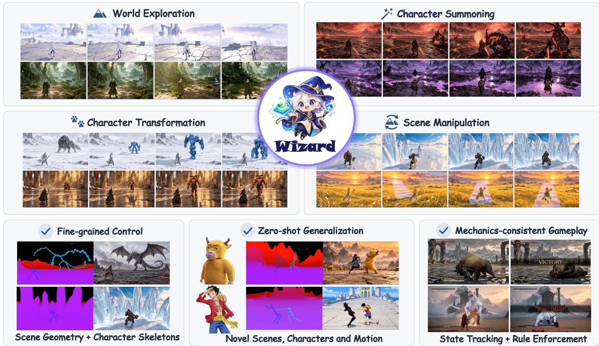
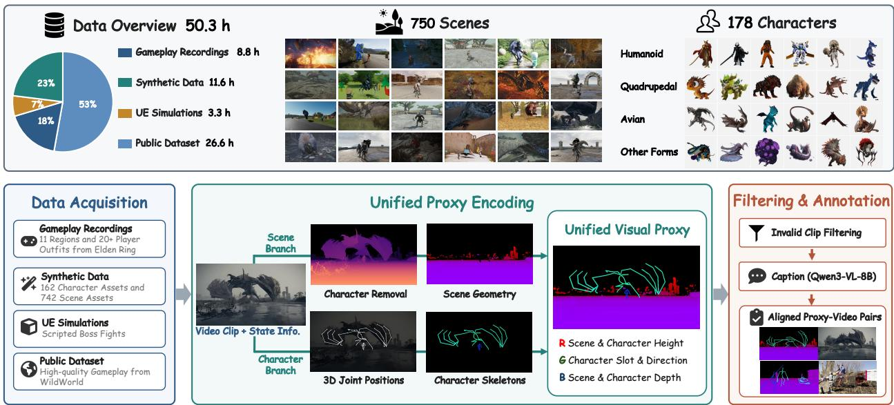
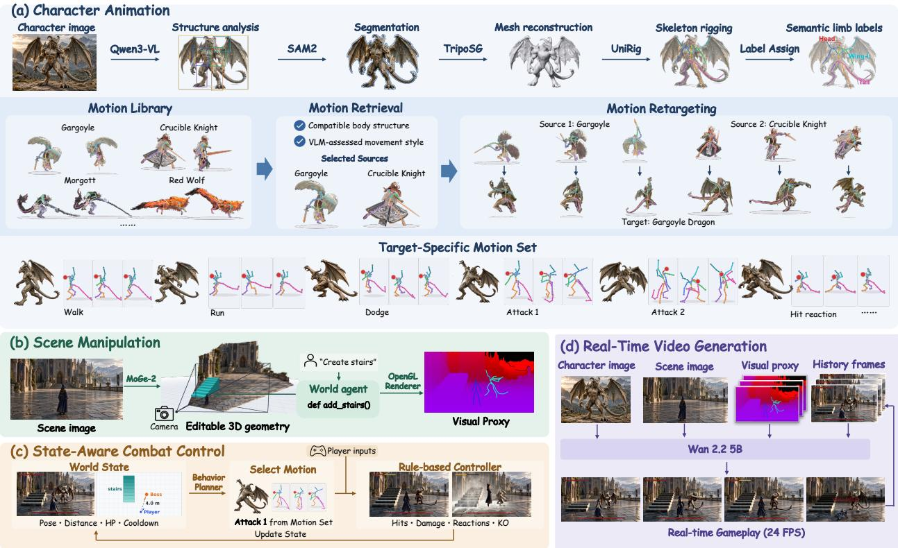
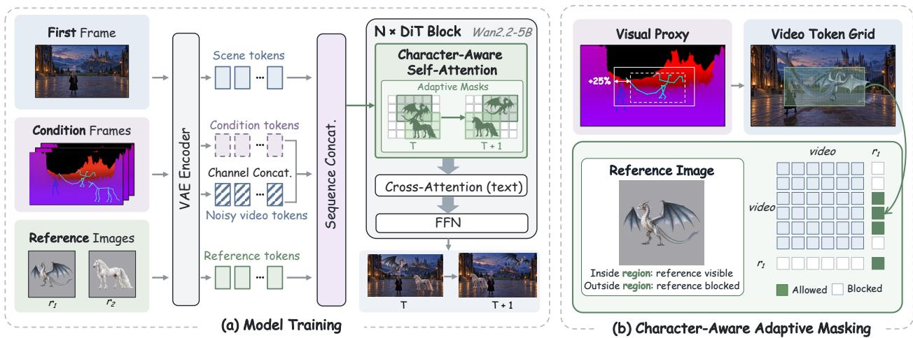
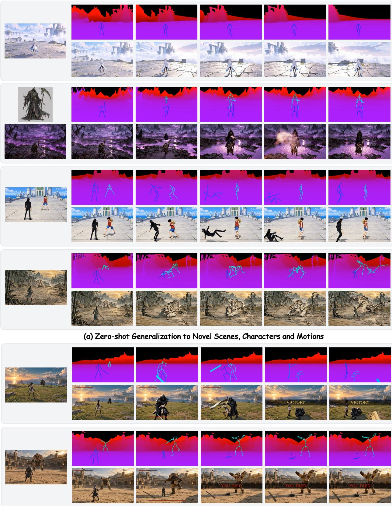
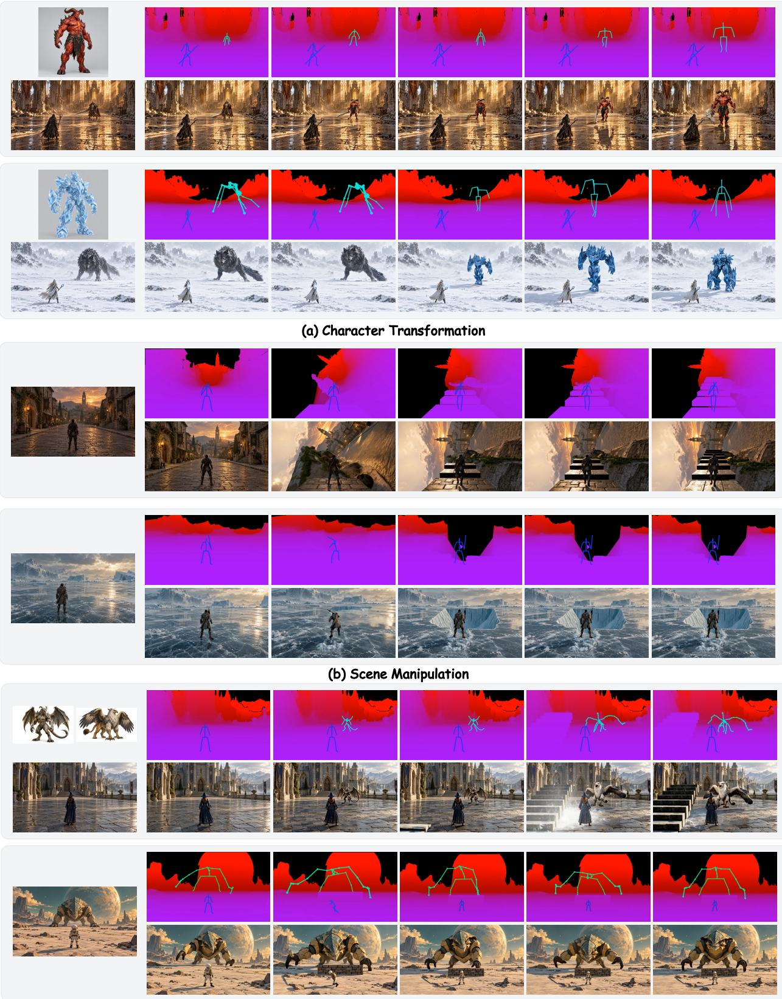

Yuzhe Wu1,2,∗ Zijun Lin1,3,∗ Yeying Jin1,2,♢

1 Tencent 2 NUS 3 NTU

Recent advances in video world models have enabled the generation of increasingly realistic and interactive virtual environments, opening new possibilities for player-customizable gameplay. Agentic frameworks further advance this direction by decoupling explicit game logic and controllable world representations from visual generation. However, existing approaches support only simple game settings and predefined motion patterns, generalize poorly to unseen environments and characters, and offer limited real-time interactivity. In this paper, we introduce Wizard, an agentic game world model that enables real-time, precise control over character motions while generalizing zero-shot across novel scenes, characters, and actions. To achieve this, we construct a diverse dataset spanning 750 scenes and 178 characters, incorporating skeleton and geometry information as structured representations. We leverage these representations as intermediate proxies to condition a video generation model, together with an adaptive masking mechanism that improves alignment between the conditioning signals and generated video rollouts. Furthermore, we introduce an agentic framework that explicitly maintains and updates game states, allowing players to freely configure their virtual worlds and exercise fine-grained control over character motions while preserving visual quality and gameplay consistency. By combining agentic control with structured proxy-based generation, our framework unlocks new possibilities for player-driven game creation with real-time, generalizable, and mechanically consistent world simulation.

Project: https://wyzardwu.github.io/wizard/

## 1 Introduction

World models aim to predict future observations from visual histories and current actions, attracting growing interest in gaming applications [1–5]. By conditioning video generation on players’ mouse and keyboard inputs, video world models offer a natural foundation for interactive and personalized gameplay [6–10].

Despite recent progress, existing game world models face limitations in control flexibility, generalization, and real-time interaction. Action-conditioned models [11–13] typically restrict players to predefined action sets, while prompt-conditioned models [14–16] often depend on motion and skill patterns seen during training, limiting their ability to follow unseen instructions. To improve state consistency and spatial controllability, recent agentic frameworks maintain explicit world states [15, 17] and translate them into structured proxies, such as depth maps [18], semantic maps [19], blockouts [20] or oriented 3D bounding boxes [21], to guide video generation. However, their demonstrations largely focus on basic movement, such as vehicle driving [22, 23] and character locomotion [24, 25], with limited support for articulated character actions. Engine-based approaches [26, 27] offer another route to structured control, but their reliance on predefined scenes and extra processing introduces constraints on scene flexibility and interaction latency.

To address this gap, we introduce Wizard (Fig. 1), an agentic game world model that combines finegrained character control, zero-shot generalization, real-time interaction and mechanically consistent gameplay, enabling players to customize their game worlds with novel scenes, characters, and motions specified through reference images or free-form language. At its core, Wizard employs an agentic framework to decouple scene construction, character animation, and gameplay logic from visual generation through structured spatial conditioning.

  
Figure 1. Overview of Wizard. Our method supports diverse gameplay experiences, including world exploration, character summoning, character transformation, and scene manipulation. By combining agentic control with geometric scene proxies and articulated character skeletons, Wizard achieves fine-grained control, zero-shot generalization, and mechanics-consistent gameplay with real-time interaction at 24 FPS.

For fine-grained control over camera movement and character animation, our method represents scenes with geometric proxies encoding depth and height, and characters with articulated skeletons. Given any user-provided scene image, we estimate monocular geometry to construct an approximate traversable 2.5D environment and render view-dependent geometric control maps. Character references are converted into 3D meshes and automatically rigged into controllable skeletons, with channel coding distinguishing character instances and their camera-relative orientations. These representations form a unified visual proxy.

Building on the unified visual proxy shown in Fig. 1, the agentic framework then updates scene geometry according to camera inputs and animates character skeletons according to action inputs, providing precise spatial and motion control for the causal video generator. To enable diverse motions for novel characters, a vision-language model retrieves compatible skeletons and animations from a motion library based on character morphology and intended motion style. The selected motions are retargeted to the character’s skeleton, enabling natural movement and player-defined actions. Beyond visual control, the agent further maintains explicit combat states, including health, relative distance, and orientation, to enforce gameplay rules and adapt boss behavior to evolving combat situations.

To train the video model to faithfully follow these structured proxies and generalize across scenes, characters, and motions, we construct 50.3 hours of aligned proxy–video pairs from diverse sources, including data specifically designed for skeletal control. We further introduce an adaptive masking mechanism that restricts reference-image attention to the corresponding character regions, strengthening appearance alignment and preserving character identity during motion. Finally, we apply causal adaptation and few-step distillation [28] to enable real-time video generation, bringing detailed proxy control and consistent visual rendering into an interactive gameplay loop.

In summary, our contributions are as follows.

• We propose Wizard, an agentic game world model that enables real-time, zero-shot generalization across unseen scenes, characters, and motions with precise control, substantially expanding the possibilities for

player-driven game creation.

• We build a diverse dataset covering 750 scenes and 178 characters from public videos, game footage, and synthetic sources, with aligned character skeleton and scene geometry to enhance model generalization.

• We introduce an agentic video-to-video framework that leverages structured proxies to enable fine-grained player control and mechanics-consistent gameplay.

• We leverage the character positions provided by visual proxies during both training and inference to construct adaptive attention masks, improving character identity preservation and alignment between reference images and generated videos.

## 2 Related Work

## 2.1 Video World Model

Recent advances in video generation have enabled action-conditioned world models that allow users to interactively explore generated environments. In games, these models translate keyboard and mouse inputs into dynamic gameplay, with emerging capabilities including NPC control in ReactiveGWM [11], fine-grained FPS interactions in SCOPE [12], and multiplayer experiences in WorldCast [9] and Multics [6]. However, relying primarily on pixel-level supervision makes it difficult to maintain persistent game states, retain long-term history, and preserve spatial consistency [21]. To address these limitations, agentic frameworks such as WorldMind [15] and Marionette [18] decouple explicit state management and gameplay logic from visual generation. Despite these advances, existing methods often remain constrained to the game settings seen during training. In contrast, Wizard combines fine-grained skeletal control with a diverse training dataset to enable zero-shot generalization to unseen scenes, characters, and motions.

## 2.2 Agentic World Model

Agentic world models decouple world-state management and action planning from visual generation, enabling explicit control over world dynamics while video models focus on rendering. Related simulationguided approaches, such as PhysDreamer [29], RealWonder [30], and RoboRender [31], leverage explicit physical dynamics to guide video generation. Moving beyond simulator-defined dynamics, GameDirector [17] maintains combat states and enforces gameplay rules to support player-configurable game settings, while Code World Model [19] and Programmable World Model [21] employ agent-generated programs to maintain persistent world states and guide visual generation through structured proxies. However, these methods primarily emphasize state consistency and entity-level control [24, 25], leaving fine-grained character animation underexplored. Concurrent work, SolarRenderer [32], enables real-time video rendering from diverse proxies, yet seamlessly integrating this capability into a closed-loop gameplay experience remains a challenge. To bridge this gap, Wizard extends agentic control to scene geometry and articulated skeletons, enabling flexible scene manipulation and precise character animation. A diverse, multi-source training dataset enhances generalization, while causal adaptation and few-step distillation enable real-time video generation for responsive gameplay.

## 3 Data

Training a video world model with fine-grained control and zero-shot generalization requires diverse visual data paired with complementary proxies tailored to characters and backgrounds, namely articulated skeletons for character motion and geometry maps for scene structure. Existing public datasets for video world models either lack these complementary conditions [33, 34] or provide them within a single game with limited gameplay diversity [35].

To this end, we construct 50.3 hours of aligned proxy–video pairs, covering 750 scenes and 178 characters across diverse environments, character morphologies, and motion patterns. Our dataset combines real gameplay recordings, synthetic data, Unreal Engine simulations, and public datasets to achieve broad coverage of scenes, characters, and motions while supporting scalable data production and high visual quality (Sec. 3.1). All sources are converted into a unified representation of scene geometry and articulated character skeletons, enabling the video generator to learn consistent control across different scenes and characters (Sec. 3.2). Fig. 2 illustrates the dataset composition, diversity and processing pipeline.

  
Figure 2. Dataset Overview and Processing Pipeline. We construct 50.3 hours of data spanning 750 scenes and 178 characters from four complementary sources. Scene geometry and character skeletons are jointly encoded into unified visual proxies, followed by filtering and captioning to produce aligned proxy–video training pairs.

## 3.1 Diverse Data Sources

Gameplay Recordings. We collect 8.8 hours of third-person combat and exploration footage from Elden Ring [36] to capture authentic AAA-game appearance, combat dynamics, and visual effects. Combat sequences feature six bosses with diverse body structures, capturing articulated attacks, hit reactions, and combat effects. Exploration sequences span 11 regions and more than 20 player outfits, covering varied environments, camera trajectories, and character locomotion. We record RGB frames alongside camera parameters, scene depth, and character skeletons directly from the game, ensuring accurate temporal alignment between visual observations and control signals.

Synthetic Data. While gameplay recordings provide realistic visual dynamics, their character appearances, motion patterns, and interactions remain constrained by the original games. To broaden this coverage, we develop a procedural rendering pipeline that generates 11.6 hours of data using 133 boss and 29 player assets from Sketchfab [37], Quaternius [38], and KayKit [39], with diverse skeletons and animation libraries. We construct varied environments using 842 Poly Haven [40] assets, populate each scene with 15–30 randomly placed props, and randomize character colors, enabling scalable generation of diverse character–scene combinations. Beyond appearance diversity, we design four scenarios to strengthen control robustness: (i) novel-character entry; (ii) multi-character coexistence; (iii) camera-induced disappearance and reappearance; and (iv) rapid turns under a following camera. These scenarios encourage the model to associate each character with its corresponding skeleton and reference image, rather than a fixed appearance or screen position. Camera motion is applied to 95% of generated samples to further diversify viewpoints. Finally, we use a vision-language model to filter out invalid renders and physically implausible placements to ensure data quality.

Unreal Engine Simulations. Furthermore, we use Unreal Engine to generate 3.3 hours of gameplay footage featuring reconstructed characters and weapons [41], scripted opponents, and bot-controlled players. Rendering RGB frames and geometric proxies from the same simulated state ensures precise alignment, while configurable scenes enable scalable collection of varied combat interactions and camera viewpoints.

Public Datasets. We incorporate 26.6 hours of high-quality gameplay footage from WildWorld [35], complementing our collected data with diverse creature morphologies and motion patterns. Its synchronized camera, skeletal, and depth annotations are converted into our unified proxy representation, preserving control–video alignment while broadening the coverage of articulated interactions.

## 3.2 Dataset Processing Pipeline

Data Acquisition. We first obtain camera parameters, character skeletons, and scene depth for each video to construct proxies aligned with the video frames. For real gameplay, we extract camera poses, intrinsics, and skeletal states directly from the game process. We also capture scene depth at one frame per second and use it to reconstruct scene geometry, from which depth maps are rendered at each frame’s camera pose. For synthetic and Unreal Engine data, we obtain these quantities directly from the underlying assets and simulation states. For public datasets, we use the provided annotations.

Unified Proxy Encoding. We construct a unified geometric conditioning video that represents character poses and scene structure under a shared camera. At each frame, character skeletons and scene geometry are jointly rendered to preserve their spatial relationships and mutual occlusion. For the scene branch, we remove characters and sky from depth maps, fuse temporally neighboring observations into 3D scene geometry, and re-render it under each frame’s camera pose. For the character branch, we project 3D joints into the camera view and render bones as rounded segments with joint markers, adapting their thickness to character scale and camera distance. Following the geometric channel encoding of Marionette [18], the RGB channels represent geometric attributes rather than appearance colors. R encodes height, with character and scene values mapped to [0, 0.2] and [0.5, 1], respectively, while B encodes camera-forward depth, with brighter values indicating closer surfaces. At each pixel, the renderer retains the surface closest to the camera.

To support reference-conditioned character control, we use G to jointly encode a character’s slot and facing direction, while assigning scene geometry G = 0. All parts of a character share the same value within each frame, and the facing component helps distinguish otherwise similar front- and back-facing skeletal configurations. Slots are assigned to the player and bosses present in the current scene, with each slot linked to its corresponding reference image. This scene-specific assignment decouples slot codes from fixed character appearances, encouraging the generator to recover appearance from the associated references and supporting generalization to unseen characters.

Filtering and Annotation. We filter out synthetic samples with implausible configurations, such as floating players, or rendering failures. For each training sample, we use Qwen3-VL-8B [42] to generate structured captions from the first frame and character references, describing the conditioning signals, player, boss, and background. Each training sample consists of an aligned proxy video, an RGB clip, character reference images, and a textual description.

## 4 Method

As illustrated in Fig. 3, Wizard combines an agentic framework for explicit world-state control with a video generator that renders the evolving state through structured visual proxies. Before each gameplay session, an initialization stage taking less than five minutes reconstructs the scene and characters, rigs character skeletons, and builds a target-specific motion set through motion retrieval and retargeting. Once initialized, the framework supports real-time gameplay by updating character motions, scene geometry, and combat states in response to player inputs and boss decisions, while the video generator renders the corresponding visual observations. We first describe the agentic framework for character animation, scene manipulation, boss control and mechanics-consistent combat (Sec. 4.1), then introduce character-aware adaptive masking and the training pipeline for real-time video generation (Sec. 4.2).

  
Figure 3. Inference Pipeline of Wizard. (a) Character animation is driven by motions retrieved from a high-quality library and retargeted from compatible source skeletons to the target character’s skeleton. (b) Scene manipulation is performed by a world agent that edits 3D scene geometry and renders visual proxies using OpenGL. (c) State-aware combat control adapts boss behavior to the current game state and enforces rule-based combat mechanics. (d) Real-time video generation is conditioned on visual proxies, reference images, and previously generated frames.

## 4.1 Agentic Framework

Character Animation via Skeletal Control. Given a user-provided character image, Qwen3-VL [42] detects characters and infers their body structures, including posture (upright or horizontal), the number and arrangement of legs, arms, wings, tails, and heads, and their anatomical left–right assignments. We use the predicted bounding boxes to guide SAM2 [43] in segmenting each character, then reconstruct its mesh with TripoSG [44]. UniRig [45] and our medial-axis fitting procedure generate candidate skeletons, from which we select the one that best matches the inferred body structure. We assign semantic labels to its joints and limb chains, identifying body parts such as the left arm or right leg. These labels allow corresponding body parts to be matched across characters with different joint counts and proportions, providing a shared interface for motion retargeting and control.

To enable realistic combat movements for novel characters, we build a reference motion library from CombatMotion [46], WildWorld [35], and animation assets from Elden Ring [36]. For each target character, we retrieve motions from source skeletons with compatible body structures and use a VLM to assess whether the source characters’ movement styles, such as aggression, grace, or power, suit the target’s appearance. The selected motions can come from multiple sources, allowing each target to inherit a varied moveset. We retarget these motions by matching corresponding limb chains, adapting motion to the target’s limb lengths, and applying inverse kinematics to maintain ground contact. We then filter out clips with poor ground contact, body penetration, or unnatural limb crossing. The remaining clips form a motion library tailored to the target character, enabling the controller to retrieve and execute motions in real time without custom animation scripts.

Scene Manipulation via Geometry Control. As with character control, users can customize and manipulate scenes according to their preferences. Given a scene image, we use MoGe-2 [47] to recover a 3D point map and camera parameters, remove character regions, and construct a background mesh supplemented by a height field. An OpenGL-based offscreen renderer, implemented with ModernGL and EGL, renders this geometry from the current camera viewpoint using the same proxy encoding as in training: the R and B channels encode world height and inverse depth, respectively, while the G channel is set to zero. As the camera moves, the world agent re-renders the persistent scene geometry to produce a spatially consistent visual proxy. To support exploration beyond the input view, the agent extends the height field with smoothly blended terrain variations based on the observed scene’s roughness.

During gameplay, the world agent, powered by Qwen3-VL-8B, translates users’ natural-language instructions into executable programs that compose predefined geometric operators and specify their locations, scales, and deformation parameters. These programs modify the underlying scene geometry, enabling transformations such as raising a platform from the ground or turning the world upside down. The modified geometry is then re-rendered into the proxy video, supporting creative, interactive scene manipulation while maintaining consistent camera projection and spatial structure.

State-Aware Combat Control. Our framework maintains a shared world state that tracks both characters positions, poses, health, action phases, and skill cooldowns. Based on this state, a behavior planner selects movements and attacks from the previously constructed target-specific motion set. When the player is out of reach, the planner selects a motion that moves the boss toward the player. Within attack range, it evaluates candidate attacks by simulating their swings against the player’s current geometry and prioritizes those likely to connect, subject to action-phase and cooldown constraints. This state-aware planning enables the boss to respond to the player’s movements and the evolving combat situation.

The selected motion is then executed in the simulation, where a rule-based controller enforces gameplay constraints and resolves combat outcomes for both characters. It detects hits by checking each attack’s swept hitbox against the target’s geometry while accounting for invulnerability windows. Valid hits reduce the target’s health, update its health bar, and trigger hit reactions. Skills become available only after their cooldowns expire, and combat ends when either character’s health reaches zero. The updated world state informs the planner’s next decision and is rendered into visual proxies that condition the video generator. Together, state-aware planning and rule-based execution support responsive, mechanics-consistent combat independently of video generation.

## 4.2 Model Training

We build our video generator on Wan2.2-TI2V-5B [48], which renders the evolving visual proxies into video conditioned on the initial scene image and character references:

$$
\begin{array} { r } { \hat { \mathbf { X } } _ { t : t + L - 1 } = G _ { \theta } \left( \mathbf { P } _ { t : t + L - 1 } , \mathbf { I } _ { 0 } , \{ \mathbf { R } ^ { k } \} _ { k = 1 } ^ { K } ; \mathbf { H } _ { < t } \right) , } \end{array}\tag{1}
$$

where $\mathbf { P } _ { t : t + L - 1 } , \ \mathbf { I } _ { 0 } ,$ and $\mathbf { R } ^ { k }$ denote the visual proxy sequence, the initial scene image, and the reference image for character $k ,$ respectively. $\mathbf { H } _ { < t }$ denotes the context retained from previously generated frames. $G _ { \theta }$ represents the complete video generation pipeline, including VAE encoding, latent sampling, and decoding; sampling noise is omitted for brevity.

As shown in Fig. 4, the first frame is encoded as a clean latent prefix to establish scene appearance. Proxy frames are encoded by the same VAE and concatenated with noisy video latents along channels, using a zero-initialized condition embedding to introduce spatial control while preserving the pretrained model’s initial behavior. Character references are appended as additional tokens to specify appearance. We bind these references to their corresponding characters through adaptive attention masking, then distill the conditioned generator for real-time autoregressive inference

  
Figure 4. Video Generator Architecture and Character-Aware Adaptive Masking. (a) Visual proxy latents are concatenated with noisy video latents along channels, then combined with first-frame and character-reference tokens along the sequence dimension for DiT processing. (b) Skeleton-derived spatial masks restrict reference attention to the corresponding character regions, binding appearance guidance to character locations.

Character-Aware Adaptive Masking. Character skeletons provide explicit spatial information during both training and inference: training data include ground-truth skeletons, while our agentic framework maintains and updates them at runtime. We leverage this shared structure to bind each reference image to its intended character. Each character reference image is VAE-encoded and appended as tokens with a distinct temporal positional offset. For each frame, we derive a bounding region from each character’s skeleton and expand it by 25% to include the character and its surrounding context. In every DiT self-attention layer, we gate attention from video token i to reference token j using an additive mask:

$$
A _ { i j } = { \mathrm { S o f t m a x } } _ { j } \left( { \frac { \mathbf { q } _ { i } ^ { \top } \mathbf { k } _ { j } } { \sqrt { d } } } + M _ { i j } \right) , \qquad M _ { i j } = \left\{ { \begin{array} { l l } { 0 , } & { \mathbf { u } _ { i } \in \Omega _ { k ( j ) , \tau ( i ) } , } \\ { - \infty , } & { { \mathrm { o t h e r w i s e } } , } \end{array} } \right.\tag{2}
$$

where $k ( j )$ identifies the character associated with reference token $j , \mathbf { u } _ { i }$ and $\tau ( i )$ denote the spatial position and frame index of video token $i ,$ and $\Omega _ { k , \tau }$ is character $k ^ { \prime } s$ expanded region on the token grid at frame τ. The softmax also includes video keys permitted by the temporal attention mask, allowing tokens outside character regions to attend to these keys.

These spatial masks are updated from the explicit character states maintained by our agentic framework, allowing players to control when and where bosses appear or disappear while directing reference guidance to the corresponding regions. As characters move, the masks follow their positions, reducing cross-character appearance leakage. During character transformation, we additionally block attention to cached tokens associated with the previous identity while preserving access to background history and the first-frame sink. By linking appearance guidance to agent-controlled character states, this strategy supports flexible summoning, removal, transformation, and multi-character gameplay while maintaining scene continuity.

Causal Adaptation and Few-Step Distillation. Following Causal Forcing++ [28], we adopt a three-stage training pipeline for real-time autoregressive generation. First, we adapt the bidirectional model to autoregressive generation through teacher forcing. Second, we perform consistency distillation with a guided causal teacher and an exponential moving average (EMA) target, training the student with a sliding window of 20 latent frames and the first frame as a persistent attention sink. Third, we apply distribution matching distillation (DMD) to the student’s own autoregressive rollouts, using the frozen bidirectional model as the target score network and a learned critic to estimate the student’s score. Our visual proxy conditions and character-gated reference attention remain active throughout all three stages, preserving spatial and appearance control during adaptation and distillation. The resulting model generates real-time rollouts at 24 FPS with only 2 denoising steps.

## 5 Experiments

## 5.1 Experimental Setup

Data. We partition the aligned RGB and proxy sequences into non-overlapping windows of 121 frames at 30 fps, each spanning approximately four seconds. Frames are resized to a height of 480 pixels and center-cropped to 832 × 480, with identical transformations applied to both modalities to preserve spatial alignment. Character reference images are resized to 480 × 480. For efficient training, we pre-encode the RGB and proxy clips using the Wan2.2 VAE, yielding latent representations with 31 temporal steps and a spatial resolution of $3 0 \times 5 2$

Implementation Details. We initialize our model from Wan2.2-TI2V-5B [48], keeping its VAE and UMT5 text encoder [49] frozen. We train on 44,075 clips, paired with geometry-and-skeleton conditions, a text description, and up to two character appearance references. Training comprises 30K steps of bidirectional fine-tuning, 10K steps of causal adaptation, and subsequent distillation for efficient inference. We deploy the student’s exponential moving average (EMA) checkpoint after 500 distillation steps. At inference, the model uses two denoising steps and a KV cache that retains 20 recent latent frames and one persistent sink frame, enabling continuous, bounded-memory streaming for real-time interaction.

Evaluation Setup. We qualitatively evaluate Wizard’s zero-shot generalization in Fig. 5 and its support for open-ended creative gameplay in Fig. 6. Each example presents user-provided scene or character references on the left, followed by paired agent-controlled visual proxies and generated gameplay frames on the right. The references are unseen during training, and all examples use the same trained model without additional fine-tuning. This presentation allows direct inspection of how user inputs are translated into structured controls and reflected in the generated videos.

## 5.2 Zero-shot Generalization

As shown in Fig. 5(a), Wizard generalizes to novel scenes, characters, and motions. Given user-provided inputs, the agent controls visual proxies to generate real-time combat rollouts that follow the specified scene structure and character motions. The paired visualizations show how character poses and spatial arrangements in the proxies are reflected in the generated frames, while reference images specify the desired appearance. These examples illustrate the model’s ability to accommodate new combinations of environments, character appearances, and motion controls without additional training. Diverse training data and character-aware adaptive masking support visual consistency throughout the rollouts.

Furthermore, Fig. 5(b) illustrates how Wizard’s agentic framework maintains and updates game states and enforces combat rules. We showcase a core rule: when either character’s health reaches zero, the controller resolves the character’s death, ends combat, and displays the outcome. The framework also allows additional gameplay rules to be flexibly incorporated.

## 5.3 Open-ended Creative Gameplay

Wizard’s generalization capabilities enable diverse, open-ended gameplay, giving players control over both characters and their surroundings. As shown in Fig. 6(a), players can transform characters during gameplay by providing a reference image of the desired appearance. This allows character appearance to become an interactive part of the gameplay experience rather than a fixed initial choice.

Fig. 6(b) demonstrates scene manipulation, including inverting the environment and introducing new scene elements through agent-controlled visual proxies. These examples extend user control from character animation to the geometry and layout of the game world. Character transformation and scene manipulation can also be combined within a single gameplay scenario, as illustrated in Fig. 6(c). Together, these capabilities allow players to create scenarios by composing character and environment changes, extending the range of experiences supported by the same underlying framework.

  
(b) Mechanics-Consistent Gameplay  
Figure 5. Visualization of Zero-Shot Generalization and Mechanics-Consistent Gameplay Enabled by Wizard. For each example, reference images are shown on the left, with visual proxies in the top row and the corresponding video rollouts in the bottom row.

  
(c) Free-form Game Composition  
Figure 6. Visualization of Open-Ended Creative Gameplay Enabled by Wizard. For each example, reference images are shown on the left, with visual proxies in the top row and the corresponding video rollouts in the bottom row.

## 6 Conclusions and Discussions

In this paper, we introduce Wizard, the first agentic game world model to enable fine-grained control of characters and scenes through articulated skeletons and geometry maps, respectively, while maintaining mechanics-consistent, real-time interaction. Trained on our constructed diverse dataset1, Wizard demonstrates strong zero-shot generalization to unseen characters, scenes, and motions, enabling players to create and manipulate customized game worlds.

However, Wizard still has some limitations. First, its reliance on a motion library makes it difficult to find compatible motions for characters with uncommon body structures. Second, consistency between the scene proxies and the generated video may decline over longer rollouts. Future work will focus on supporting more flexible, realistic character motions that better reflect actual gameplay and maintaining consistent scene appearance over long rollouts. These improvements will bring agentic video generation closer to fully playable, closed-loop game worlds with greater player freedom and more precise, nuanced control.

## Acknowledgements

We would like to express our sincere gratitude to Ruidong Wang and Murphy Zhao for their invaluable support throughout this project.

## References

[1] Wenqiang Sun, Haiyu Zhang, Haoyuan Wang, Junta Wu, Zehan Wang, Zhenwei Wang, Yunhong Wang, Jun Zhang, Tengfei Wang, and Chunchao Guo. Worldplay: Towards long-term geometric consistency for real-time interactive world modeling. arXiv preprint arXiv:2512.14614, 2025.

[2] Jake Bruce, Michael D Dennis, Ashley Edwards, Jack Parker-Holder, Yuge Shi, Edward Hughes, Matthew Lai, Aditi Mavalankar, Richie Steigerwald, Chris Apps, et al. Genie: Generative interactive environments. In Forty-first International Conference on Machine Learning, 2024.

[3] Xianglong He, Chunli Peng, Zexiang Liu, Boyang Wang, Yifan Zhang, Qi Cui, Fei Kang, Biao Jiang, Mengyin An, Yangyang Ren, et al. Matrix-game 2.0: An open-source real-time and streaming interactive world model. arXiv preprint arXiv:2508.13009, 2025.

[4] Xiaofeng Mao, Zhen Li, Chuanhao Li, Xiaojie Xu, Kaining Ying, and Kaipeng Zhang. Yume1.5: A textcontrolled interactive world generation model. In Proceedings of the IEEE/CVF Conference on Computer Vision and Pattern Recognition, pages 7752–7761, 2026.

[5] Zelin Gao, Qiuyu Wang, Jiapeng Zhu, Jingye Chen, Zichen Liu, Qingyan Bai, Jiahao Wang, Yufeng Yuan, Hanlin Wang, Yichong Lu, et al. Infinite worlds with versatile interactions. arXiv preprint arXiv:2607.07534, 2026.

[6] Kaiyi Huang, Wangbo Yu, Yukun Huang, Jiwen Yu, Kunhao Liu, Donglin Yang, Wenbo Hu, Ying Shan, and Xihui Liu. Multics: Generative multi-player world model with hierarchical communication. arXiv preprint arXiv:2610.17201, 2026. URL https://arxiv.org/abs/2610.17201.

[7] Wangbo Yu, Kunhao Liu, Wenbo Hu, Shenghai Yuan, Chaoran Feng, Haiyang Zhou, Yukun Huang, Yiran Wang, Wang Zhao, Yingmin Luo, et al. Worldcrafter: Consistent video world model with implicit 3d-aware memory. arXiv preprint arXiv:2609.24984, 2026.

[8] Haoyi Zhu, Haozhe Liu, Yuyang Zhao, Tian Ye, Junsong Chen, Jincheng Yu, Tong He, Song Han, and Enze Xie. Sana-wm: Efficient minute-scale world modeling with hybrid linear diffusion transformer. arXiv preprint arXiv:2605.15178, 2026.

1WildWorld is used under its non-commercial research license; no WildWorld-derived data is redistributed. Elden Ring footage was recorded by the authors and is used solely for research.

[9] Ziyang Ye, Junchao Huang, Evelyn Zhang, Zhihao Xie, Ruicheng Zhang, Boyao Han, Litao Ban, Ziye Wang, Xinting Hu, Shaoshuai Shi, et al. Worldcast: Distributed multiplayer world models. arXiv preprint arXiv:2610.12412, 2026.

[10] Zijun Lin, Zeqing Wang, Cheston Tan, Bihan Wen, and Yeying Jin. Stateplay: State-aware game world models for mechanics-consistent generation. arXiv preprint arXiv:2607.26754, 2026.

[11] Zeqing Wang, Danze Chen, Zhaohu Xing, Zizhao Tong, Yinhan Zhang, Xingyi Yang, and Yeying Jin. Reactivegwm: Steering npc in reactive game world models. arXiv preprint arXiv:2605.15256, 2026.

[12] Zizhao Tong, Yeying Jin, Hongfeng Lai, Zeqing Wang, Zhaohu Xing, Kexu Cheng, Haoran Xu, Zhao Pu, Shangwen Zhu, Ruili Feng, et al. Scope: Simulating cross-game operations in playable environments for fps world models. arXiv preprint arXiv:2605.23345, 2026.

[13] Junchao Huang, Guian Fang, Shengju Qian, Xianghao Kong, Zhuoran Zhao, Wei Huang, Yihua Du, Zixin Zhang, Justin Cui, Yuchao Gu, et al. Solarwm: Open data and scalable training for long-horizon video world models. arXiv preprint arXiv:2609.02886, 2026.

[14] Shangwen Zhu, Qianyu Peng, Zhao Pu, Zhilei Shu, Xiangrui Ke, Zhaohu Xing, Zizhao Tong, Zeqing Wang, Xinyu Cui, Zian Zheng, et al. Incantation: Natural language as the action interface for multi-entity video world models. arXiv preprint arXiv:2605.18601, 2026.

[15] Zhiyang Deng, Boran Zhang, Danze Chen, and Yeying Jin. Worldmind: Decoupled game world model for state-aware npc behavior. arXiv preprint arXiv:2608.21439, 2026.

[16] Danze Chen, Zeqing Wang, Ziyue Lin, Xingyi Yang, and Yeying Jin. H3-world: Turning language understanding into world control. arXiv preprint arXiv:2609.01560, 2026.

[17] Zijun Lin, Zhiyang Deng, Yuzhe Wu, Bihan Wen, and Yeying Jin. Gamedirector: Decoupling gameplay logic from rendering for player-configurable game world models. arXiv preprint arXiv:2609.25652, 2026.

[18] Zian Meng, Zhen Li, Chuanhao Li, Qiang Li, and Kaipeng Zhang. Marionette: Predicting world states, rendering geometry, painting appearance. arXiv preprint arXiv:2608.14530, 2026.

[19] Yiwen Chen, Guosheng Lin, and Chi Zhang. Code world model: Coding agent as world brain. arXiv preprint arXiv:2608.25927, 2026.

[20] Ruicong Liu, Liangyang Ouyang, Fengbo Lan, Zhixiang Wang, and Kaipeng Zhang. Anygamerenderer: Entity-consistent generative rendering across games and an entity-level benchmark. arXiv preprint arXiv:2610.31466, 2026.

[21] Zheng-Hui Huang, Guixu Lin, Jiacheng Lin, Yi-Chuan Huang, Ruihan Yu, Muyao Niu, Siqi Yang, Yu-Lun Liu, Yung-Yu Chuang, Kaipeng Zhang, et al. Programmable world model. arXiv preprint arXiv:2609.10540, 2026.

[22] Yanzuo Lu, Tian Ye, Yitong Li, Shuchen Xue, Haozhe Liu, Song Han, and Enze Xie. Streamrender-h3: Interactive coding worlds with real-time streaming diffusion render. https://nvlabs.github.io/Sana/ Sol-Engine/StreamRender-H3/, 2026. Project page.

[23] Yitong Li, Junsong Chen, Haopeng Li, Haozhe Liu, Jincheng Yu, Ligeng Zhu, Ping Luo, Song Han, and Enze Xie. Sol video inference engine: Agent-native full-stack acceleration framework for efficient video generation, 2026. URL https://arxiv.org/abs/2606.23743.

[24] Xindi Yang, Baolu Li, Liam Lee, Zhenfei Yin, Songxin Zhang, Zhuoyang Song, Xu Jia, Jianfei Cai, Tien-Tsin Wong, Bingyi Jing, and Mengyue Yang. Oneira: From open-ended generation to open-world interaction in video world models. arXiv preprint arXiv:2610.01614, 2026.

[25] Jihai Zhang, Runjia Qian, Kaiqin Kong, Biao Jiang, Puyi Wang, Siru Chen, Tianle Li, Guanjie Chen, Junyi Wu, Chubin Chen, et al. Matrix-game 4.0: Harnessing video models for real-time playable game worlds. arXiv preprint arXiv:2610.27999, 2026.

[26] Zheng-Hui Huang, Zhixiang Wang, Jiaming Tan, Ruihan Yu, Yidan Zhang, Bo Zheng, Yu-Lun Liu, Yung-Yu Chuang, and Kaipeng Zhang. Generative world renderer. arXiv preprint arXiv:2604.02329, 2026.

[27] Xiaoyu Zhan, Xinyu Wang, Xiaohong Zhang, Huanjie Zhu, Tengjiao Sun, Pengcheng Fang, Jiaxing Yu, Yanwen Guo, and Dongjie Fu. Magpie: Real-time world renderer for interactive games. arXiv preprint arXiv:2608.27168, 2026.

[28] Min Zhao, Hongzhou Zhu, Kaiwen Zheng, Zihan Zhou, Bokai Yan, Xinyuan Li, Xiao Yang, Chongxuan Li, and Jun Zhu. Causal forcing++: Scalable few-step autoregressive diffusion distillation for real-time interactive video generation. arXiv preprint arXiv:2605.15141, 2026.

[29] Tianyuan Zhang, Hong-Xing Yu, Rundi Wu, Brandon Y Feng, Changxi Zheng, Noah Snavely, Jiajun Wu, and William T Freeman. Physdreamer: Physics-based interaction with 3d objects via video generation. In European Conference on Computer Vision, pages 388–406. Springer, 2024.

[30] Wei Liu, Ziyu Chen, Zizhang Li, Yue Wang, Hong-Xing Yu, and Jiajun Wu. Realwonder: Real-time physical action-conditioned video generation. arXiv preprint arXiv:2603.05449, 2026.

[31] Huang Huang, Wensi Ai, Ziyu Chen, Youhui Wang, Zijian Du, Yang Liu, Jiaolong Yang, Li Fei-Fei, and Jiajun Wu. Roborender: Robot-oriented video generation for visual sim-to-real transfer. arXiv preprint arXiv:2610.09254, 2026.

[32] Guian Fang, Shengju Qian, Dongyue Lu, Junchao Huang, Lutao Jiang, Xin Wang, Yiren Song, Li Jiang, and Mike Zheng Shou. Solarrenderer: Few-step generative reference rendering. arXiv preprint arXiv:2610.28630, 2026.

[33] Haoxuan Che, Xuanhua He, Quande Liu, Cheng Jin, and Hao Chen. Gamegen-x: Interactive openworld game video generation. In International Conference on Learning Representations, volume 2025, pages 37546–37593, 2025.

[34] Jiwen Yu, Yiran Qin, Xintao Wang, Pengfei Wan, Di Zhang, and Xihui Liu. Gamefactorly: Creating new games with generative interactive videos. In 2025 IEEE/CVF International Conference on Computer Vision (ICCV), pages 11590–11599. IEEE, 2025.

[35] Zhen Li, Zian Meng, Shuwei Shi, Wenshuo Peng, Yuwei Wu, Bo Zheng, Chuanhao Li, and Kaipeng Zhang. Wildworld: A large-scale dataset for dynamic world modeling with actions and explicit state toward generative arpg. arXiv preprint arXiv:2603.23497, 2026.

[36] FromSoftware. Elden Ring. Video game. Bandai Namco Entertainment, 2022. URL https://www. bandainamcoent.com/games/elden-ring.

[37] Sketchfab. Sketchfab. https://sketchfab.com/. Accessed: 2026-10-16.

[38] Quaternius. Quaternius: Free game assets. https://quaternius.com/. Accessed: 2026-10-16.

[39] Kay Lousberg. KayKit: Game assets. https://kaylousberg.com/game-assets. Accessed: 2026-10-16.

[40] Poly Haven. Poly Haven: The public 3d asset library. https://polyhaven.com/. Accessed: 2026-10-16.

[41] Dmitry Tochilkin, David Pankratz, Zexiang Liu, Zixuan Huang, Adam Letts, Yangguang Li, Ding Liang, Christian Laforte, Varun Jampani, and Yan-Pei Cao. Triposr: Fast 3d object reconstruction from a single image, 2024. URL https://arxiv.org/abs/2403.02151.

[42] Shuai Bai, Yuxuan Cai, Ruizhe Chen, Keqin Chen, Xionghui Chen, Zesen Cheng, Lianghao Deng, Wei Ding, Chang Gao, Chunjiang Ge, et al. Qwen3-vl technical report. arXiv preprint arXiv:2511.21631, 2025.

[43] Nikhila Ravi, Valentin Gabeur, Yuan-Ting Hu, Ronghang Hu, Chaitanya Ryali, Tengyu Ma, Haitham Khedr, Roman Rädle, Chloe Rolland, Laura Gustafson, et al. Sam 2: Segment anything in images and videos. In International Conference on Learning Representations, volume 2025, pages 28085–28128, 2025.

[44] Yangguang Li, Zi-Xin Zou, Zexiang Liu, Dehu Wang, Yuan Liang, Zhipeng Yu, Xingchao Liu, Yuan-Chen Guo, Ding Liang, Wanli Ouyang, et al. Triposg: High-fidelity 3d shape synthesis using large-scale rectified flow models. IEEE Transactions on Pattern Analysis and Machine Intelligence, 2025.

[45] Jia-Peng Zhang, Cheng-Feng Pu, Meng-Hao Guo, Yan-Pei Cao, and Shi-Min Hu. One model to rig them all: Diverse skeleton rigging with unirig. ACM Transactions on Graphics (ToG), 44(4):1–18, 2025.

[46] Yihao Liao, Yiyu Fu, Ziming Cheng, and Jiangfeiyang Wang. Animationgpt: An aigc tool for generating game combat motion assets. https://github.com/fyyakaxyy/AnimationGPT, 2024.

[47] Ruicheng Wang, Sicheng Xu, Yue Dong, Yu Deng, Jianfeng Xiang, Zelong Lv, Guangzhong Sun, Xin Tong, and Jiaolong Yang. Moge-2: Accurate monocular geometry with metric scale and sharp details. Advances in Neural Information Processing Systems, 38:35928–35959, 2026.

[48] Team Wan, Ang Wang, Baole Ai, Bin Wen, Chaojie Mao, Chen-Wei Xie, Di Chen, Feiwu Yu, Haiming Zhao, Jianxiao Yang, et al. Wan: Open and advanced large-scale video generative models. arXiv preprint arXiv:2503.20314, 2025.

[49] Hyung Won Chung, Noah Constant, Xavier Garcia, Adam Roberts, Yi Tay, Sharan Narang, and Orhan Firat. Unimax: Fairer and more effective language sampling for large-scale multilingual pretraining. arXiv preprint arXiv:2304.09151, 2023.