# A Unified Benchmark for Aerial-Enhanced Autonomous Driving: The KITScenes Aerial Dataset

Daniel Lengerer1\* Richard Schwarzkopf2,3 Jonas Merkert3 Fabian Immel2,3 Rupert Polley2 Frank Bieder2,3 Jan-Hendrik Pauls3,5 J. Marius Zollner¨ 2,3 Klaus Bogenberger4 Christoph Stiller2,3 Carsten Markgraf1

1Technical University of Applied Sciences Augsburg 2FZI Research Center for Information Technology 3Karlsruhe Institute of Technology (KIT) 4Technical University of Munich 5Parallel Domain

## Abstract

Aerial imagery provides complementary spatial contextfor autonomous driving by exposing road structure beyond the immediate perception range of onboard sensors. Yet map constructionfrom aerial imagery, aerial-assisted online HD mapping, and cross-view localization are typically studied on separate data and benchmarks. We introduce KITScenes Aerial, an extension of the KITScenes Multimodal dataset that augments synchronized onboard sensor data, vehicle poses, and rich Lanelet2 map annotations with spatially associated aerial imagery and higher-resolution neural representations, providing a common basis for a variety of research tasks. Our mapping evaluation focuses on all 53 KITScenes map classes across different model designs, spatial ranges, and aerial resolutions, while retaining compatibility with the widely used three-class setting. Representative baselines show that aerial context is particularly beneficial for fine-grained and extended-range mapping, more than doubling 53-class mAP at the larger mapping extent. Higher-resolution aerial imagery yields a further 4.3 mAP (+24%) improvement, with gains extending to challenging map elements such as traffic lights. We additionally evaluate cross-view localization under geographically disjoint conditions, where an adapted fine-grained feature-matching baseline achieves a mean translation error of 5.13 m. KITScenes Aerial thus enables unified study of aerial and ground-level information across complementary mapping and localization tasks. Project page: https://kitscenes.com/aerial

## 1. Introduction

Onboard sensors of autonomous vehicles are limited by occlusions, field of view, and perception range. Aerial imagery provides a complementary view of road environments and has become relevant across three closely related research directions: (i) aerial-only map construction, where high-definition (HD) maps are constructed directly from aerial observations [2, 44]; (ii) aerial-assisted online map construction, where aerial context complements onboard sensors [8, 19, 20]; and (iii) cross-view localization, where ground-level observations are related to geo-referenced aerial imagery for vehicle pose estimation [7, 41]. Although these directions pursue different objectives, they rely on overlapping combinations of aerial imagery, ground-level sensor data, vehicle poses, and map annotations.

Early datasets including aerial imagery were typically designed around individual research settings, such as aerialto-map reconstruction [2, 11] or ground-to-aerial localization [26, 40]. More recent datasets increasingly connect these previously separate domains by associating aerial imagery with autonomous vehicle (AV) recordings [8, 18, 44] or jointly providing ground-level and aerial modalities [5]. However, these extensions remain constrained by the properties of their underlying data, including map representation, geographic coverage, and the accuracy of the ground– aerial association. Previous work further reports pose-toaerial misalignment and scene changes caused by temporal differences between ground and aerial acquisitions [7, 18, 31, 35, 38] as challenges for the field.

We introduce KITScenes Aerial, an aerial extension of the KITScenes Multimodal dataset [34]. KITScenes Multimodal provides synchronized multimodal sensor data, vehicle poses, and detailed Lanelet2 [32] maps, including full topological connectivity and regulatory information exposed through a 53-class online mapping benchmark. KITScenes Aerial augments the dataset with freely available digital orthophotos at a ground sampling distance (GSD) of 20 cm/px, corresponding to the German DOP20 product specification [12, 16], while retaining the original sensor data, vehicle poses, map annotations, and dataset splits. In addition, we provide precomputed neural features extracted from higher-resolution imagery up to 8 cm/px.

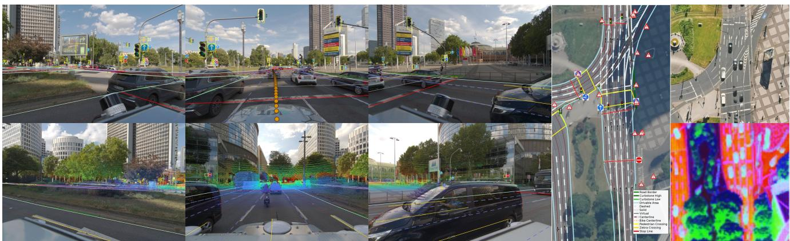  
Figure 1. KITScenes Aerial: We extend KITScenes Multimodal with aligned aerial imagery with 20 cm/px ground surface resolution (overlayed by the KITScenes HD map) and neural feature embeddings (bottom right, visualized as 3-channel PCA) for municipal high resolution imagery with 8 cm/px ground surface resolution (top right). Extending KITScenes Multimodal with these different aerial imagery sources enables multiple research directions currently underrepresented in autonomous driving datasets as shown in Tab. 1.

By combining aerial imagery with ground-level sensor data, vehicle poses, and rich map annotations within the same recorded environments, KITScenes Aerial provides a common basis for a variety of research directions. For map construction, we distinguish onboard-only, aerial-only, aerial-guided approaches using aerial imagery only during training [20], and aerial-fused approaches combining aerial and onboard features [19]. We additionally evaluate finegrained cross-view localization with a representative baseline [41]. The mapping experiments cover two settings: all 53 KITScenes map element classes derived from its Lanelet2 annotations and the widely used three-class HD map construction setting [23, 27, 43], both evaluated across different spatial ranges and aerial imagery resolutions.

## Our main contributions are:

• We present KITScenes Aerial as a benchmark for aerialonly map construction, aerial-ground map construction, and cross-view localization by complementing the sensor data, vehicle poses, and rich Lanelet2 maps of KITScenes Multimodal with spatially associated aerial imagery.

• We provide a multi-resolution aerial representation combining open 20 cm/px RGB imagery with precomputed neural features extracted from high-quality 8 cm/px orthophotos, making otherwise difficult-to-access highresolution aerial information available for a broad range of aerial and cross-view research.

• We instantiate this benchmark with representative baselines across the three research settings and systematically compare different ways of exploiting aerial information for map construction during training and inference.

• We demonstrate substantial benefits of aerial information, particularly for 53 map element classes and at extended spatial range, considering both semantic and topological reconstruction quality, and characterize the influence of aerial resolution.

## 2. Related Work

Aerial imagery is used as a geospatial information source across several research directions concerned with road environments. We distinguish three directions with overlapping data requirements: map construction from aerial imagery, the combination of aerial and ground-level data for map construction, and cross-view localization. Table 1 provides a high-level overview of representative datasets and the research settings supported by their data.

## 2.1. Map Construction from Aerial Imagery

The top-down perspective of aerial imagery provides direct observations of road geometry and infrastructure over large spatial areas. LaneExtraction [11] reconstructs routable lane-level street maps from aerial imagery, while Urban-LaneGraph [2] predicts and aggregates connected lane graphs for urban automated driving. OpenSatMap [44] extends aerial map construction toward fine-grained vectorized road representations over large geographic areas. The levelX drone dataset family [1, 6, 15, 21, 28] further associates overhead observations with Lanelet2 or OpenDRIVE map representations at local recording sites.

Across datasets providing aerial imagery and map supervision, Table 2 compares map representations, content, and structure as well as aerial imagery provisioning.

Table 1. Overview of representative datasets and the research settings supported by their released data. Support is graded rather than binary: the released data supports the setting at full fidelity, support is limited, ≁ all required data components are present but the aerial-to-ground alignment error exceeds the requirement of the setting, and – the setting is not supported. Pos.: georeferenced positions or poses. KITScenes Aerial is the only dataset that supports all four research settings at full fidelity.
<table><tr><td></td><td></td><td></td><td colspan="4">Data Components</td><td colspan="4">Research Setting</td></tr><tr><td>Dataset</td><td>Year</td><td>Location</td><td>Aerial</td><td>Ground</td><td>Pos.</td><td>Map</td><td>Ground Map</td><td>Aerial Map</td><td>Aerial- Ground</td><td>Cross-View Loc.</td></tr><tr><td>CVUSA [40]</td><td>2015</td><td>US</td><td>√</td><td>√</td><td>√</td><td></td><td></td><td></td><td></td><td></td></tr><tr><td>CVACT [26]</td><td>2019</td><td>AUS</td><td>√</td><td>√</td><td>√</td><td></td><td></td><td></td><td></td><td></td></tr><tr><td>nuScenes [3]</td><td>2020</td><td>US, Asia</td><td>一</td><td>√</td><td>√</td><td>√</td><td>0</td><td></td><td></td><td></td></tr><tr><td>VIGOR [46]</td><td>2021</td><td>US</td><td>√</td><td>√</td><td>√</td><td></td><td></td><td></td><td></td><td></td></tr><tr><td>nuPlan [4]</td><td>2021</td><td>US, Asia</td><td></td><td>√</td><td>√</td><td>√</td><td>0</td><td></td><td></td><td></td></tr><tr><td>Argoverse 2 [39]</td><td>2021</td><td>US</td><td>一</td><td>√</td><td>√</td><td>√</td><td>0</td><td></td><td></td><td></td></tr><tr><td>LaneExtraction [11]</td><td>2022</td><td>US</td><td>√</td><td>一</td><td>一</td><td>√</td><td></td><td>0</td><td></td><td></td></tr><tr><td>UrbanLaneGraph [2]</td><td>2023</td><td>US</td><td>√</td><td>一</td><td>一</td><td>√</td><td></td><td>0</td><td></td><td></td></tr><tr><td>KITTI-360 [25]</td><td>2023</td><td>EU</td><td>一</td><td>√</td><td>√</td><td>√</td><td>0</td><td></td><td></td><td></td></tr><tr><td>leveLX family¹</td><td>2018-24</td><td>EU</td><td>√</td><td>一</td><td>√</td><td>√</td><td></td><td></td><td></td><td></td></tr><tr><td>OpenSatMap [44]</td><td>2024</td><td>Global</td><td>√</td><td>(√)²</td><td>√</td><td>√</td><td>0</td><td>0</td><td>0</td><td>x</td></tr><tr><td>SatForHDMap [8]</td><td>2024</td><td>US, Asia</td><td>√</td><td>√</td><td>V</td><td>√</td><td>0</td><td>0</td><td>03</td><td>x</td></tr><tr><td>AID4AD [18]</td><td>2025</td><td>US, Asia</td><td>√</td><td>√</td><td>√</td><td>√</td><td>0</td><td>0</td><td></td><td></td></tr><tr><td>NVIDIA Physical AI AV [29]</td><td>2025</td><td>US</td><td>一</td><td>√</td><td>一</td><td>_4</td><td></td><td>一</td><td></td><td></td></tr><tr><td>KITScenes [34]</td><td>2026</td><td>EU</td><td>一</td><td>√</td><td>√</td><td>√</td><td>C</td><td></td><td></td><td></td></tr><tr><td>HRDX [5]</td><td>2026</td><td>US</td><td>√</td><td>√</td><td>√</td><td>√</td><td>0</td><td>0</td><td>03</td><td>0</td></tr><tr><td>KITScenes Aerial</td><td></td><td>EU</td><td>√</td><td>√</td><td>√</td><td>√</td><td></td><td></td><td></td><td></td></tr></table>

Grading. Ground Map and Aerial Map: driving-ready HD maps with lane connectivity and regulatory relations, coarse or geometry-only supervision. Aerial–Ground Map: georeferenced aerial imagery at a freely selectable region of interest, fixed ego crops. Cross-View Localization: quantified aerial-to-local alignment, unreported alignment.  
Notes. 1inD, rounD, exiD, uniD and HetroD; locally recorded drone imagery at fixed sites rather than large-scale orthophotos. 2Ground data only available in US and Asia (nuScenes and Argoverse 2 coverage). 3Aerial imagery released only as fixed 60 m × 30 m ego crops; a freely selectable region of interest, and therefore extended-range mapping, is not supported. 4 Not released yet.

## 2.2. Aerial and Ground-Level Data for Map Construction

A separate line of research combines aerial imagery with ego-centric sensor observations for online HD map construction. SatForHDMap [8] complements the onboard sensors of nuScenes [3] with satellite imagery and combines both modalities during inference. AerialFusionMap-Net [19] fuses aerial and camera features in a shared bird’s-eye-view representation, whereas Cross-View Supervision [20] uses aerial information only during training. HRDX [5] jointly provides surround-camera and LiDAR recordings, vehicle localization, aerial orthoimagery, and attributed vector HD maps for aerial-assisted map learning.

Combining both views requires an accurate spatial association between ground-level observations and aerial imagery. AID4AD [18] explicitly addresses this aspect by spatially aligning aerial imagery with nuScenes and quantifying the remaining aerial-to-local registration error.

## 2.3. Cross-View Localization

Cross-view localization addresses geographic localization by matching ground-level observations against georeferenced aerial or satellite imagery. Early datasets such as CVUSA [40] and CVACT [26] established largescale ground-to-aerial image retrieval as a common evaluation setting. VIGOR [46] moved beyond the commonly assumed one-to-one correspondence between centered ground and aerial views and additionally evaluates localization by geographic distance.

More recent work has progressed from image retrieval toward direct pose estimation. Fervers et al. [7] transfer cross-view localization to autonomous-vehicle data and estimate a vehicle’s 3-DoF geo-pose from ground-based camera observations and aerial imagery. They augment multiple existing driving datasets with orthophotos and refine the vehicle poses with respect to the aerial reference. FG2 [41] further addresses fine-grained cross-view localization by explicitly matching local features between groundlevel and aerial views and estimating the relative 3-DoF pose from sparse correspondences. Subsequent approaches address cross-view pose estimation with different model designs and sensor modalities, including CCVPE [42], RGB– LiDAR-based PIDLoc [17], and VIRD [30].

Table 2. Map annotations and aerial provision of the datasets that combine map supervision with aerial imagery. Map content is reported over the six semantic categories used throughout our experiments: Lane Markings (LM), Lane Centerlines (LC), Road Infrastructure (RI), Traffic Lights (TL), Traffic Signs (TS) and Road Markings (RM). ✓ the category is part of the released map and of the mapping benchmark; (✓) present in the underlying map but outside the released benchmark; – not annotated; ? not documented. Cls: number of benchmark label classes. Topo: lane connectivity. Reg: regulatory relations between traffic-control elements and lanes. ROI: form of the aerial region of interest (tile freely selectable, fix fixed ego crop, site static per-site view). Feat: precomputed aerial features released. KITScenes Aeria is the only dataset whose benchmark covers all six categories, with topology and regulatory relations, on freely selectable aerial imagery.
<table><tr><td></td><td></td><td></td><td colspan="6">Map Content</td><td colspan="2">Structure</td><td colspan="2">Aerial</td></tr><tr><td>Dataset</td><td>Map Representation</td><td>Cls</td><td>LM</td><td>LC</td><td>RI</td><td>TL</td><td>TS</td><td>RM</td><td>Topo</td><td>Reg</td><td>ROI</td><td>Feat</td></tr><tr><td>LaneExtraction [11]</td><td>Routable lane graph</td><td></td><td></td><td>√</td><td></td><td></td><td></td><td></td><td>√</td><td></td><td>tile</td><td></td></tr><tr><td>UrbanLaneGraph [2]</td><td>Directed centerline graph</td><td></td><td></td><td>√</td><td></td><td></td><td></td><td></td><td>√</td><td></td><td>tile</td><td></td></tr><tr><td>OpenSatMap [44]</td><td>Attributed vector primitives</td><td>3</td><td>√</td><td>一</td><td>(√)</td><td></td><td></td><td></td><td>一</td><td></td><td>tile</td><td></td></tr><tr><td>leveLX family1</td><td>Lanelet2 / OpenDRIVE</td><td>n/r</td><td>√</td><td>√</td><td>√</td><td>√</td><td>√</td><td>√</td><td>√</td><td>L</td><td>site</td><td>√</td></tr><tr><td>SatForHDMap [8]</td><td>nuScenes vector map</td><td>3</td><td>√</td><td>(√)²</td><td>7</td><td>(√)²</td><td></td><td>√</td><td>(√)²</td><td></td><td>fix</td><td></td></tr><tr><td>AID4AD [18]</td><td>nuScenes vector map</td><td>3</td><td>√</td><td>(√)²</td><td>√</td><td>(√)²</td><td></td><td>√</td><td>(√)²</td><td></td><td>tile</td><td></td></tr><tr><td>HRDX [5]</td><td>Attributed vector HD map</td><td>10</td><td>√</td><td>√</td><td>√</td><td></td><td></td><td>√</td><td>√</td><td></td><td>fix</td><td></td></tr><tr><td>KITScenes Aerial</td><td>Full Lanelet2 HD map³</td><td>53</td><td>√</td><td>√</td><td>√</td><td>√</td><td>5</td><td>√</td><td>√</td><td></td><td>tile</td><td>V4</td></tr></table>

1inD [1], rounD [15], exiD [28], uniD [21] and HetroD [6]; map content varies across recording sites. 2Present as a layer of the nuScenes map expansion, but not part of the three-class online mapping benchmark evaluated on these datasets. 3Inherited unchanged from KITScenes Multimodal, including full topological connectivity and 3D regulatory elements. 4DINOv3 feature tiles and frame-aligned UNet++ feature crops derived from up to 8 cm/px imagery.

## 2.4. Positioning of KITScenes Aerial

Although these research directions pursue different objectives, their data requirements substantially overlap. Aerial map construction relates overhead imagery to map annotations, aerial-ground map construction additionally incorporates ground-level sensor observations, while crossview localization relies on the spatial correspondence between ground-level observations, aerial imagery, and vehicle poses. KITScenes Aerial brings these components together with the rich Lanelet2 annotations of KITScenes, providing a common data basis for at least three research directions that have largely been studied independently.

## 3. KITScenes Aerial

KITScenes Aerial extends the original KITScenes Multimodal dataset [34] with georeferenced aerial imagery covering its recorded driving areas. The aerial modality is spatially associated with the original vehicle poses while retaining the KITScenes sensor data, annotations, coordinate conventions, and dataset splits unchanged. This combination brings together ground-level sensor data, georeferenced vehicle poses, aerial imagery, and the detailed, standardized, and deployment-ready Lanelet2 map representation of KITScenes Multimodal, providing a common basis for aerial map construction, aerial-ground map construction, and cross-view localization.

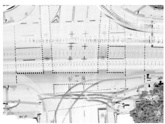  
(a)

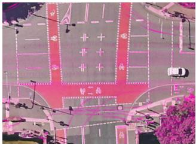  
(b)

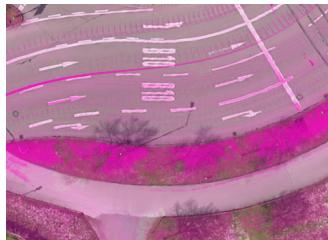  
(c)

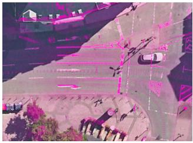  
(d)  
Figure 2. Qualitative ground–aerial correspondence in KITScenes Aerial. (a) LiDAR reflectivity basemap and (b) corresponding aerial overlay; (c,d) additional scenes. All ego-centered crops are extracted directly from the associated vehicle poses using identical spatial extents.

## 3.1. Aerial Imagery Sources and Acquisition

The KITScenes recording areas are covered with digital orthophotos obtained from official state geodata services [12, 16]. The public KITScenes Aerial release uses freely available digital orthophotos with a ground sampling distance of 20 cm/px (DOP20). KITScenes Multimodal provides vehicle poses in EPSG:25832, matching the coordinate reference system of the orthophotos and enabling their direct spatial association. The resulting ground–aerial correspondence is qualitatively illustrated in Fig. 2 using LiDAR reflectivity from the onboard sensors.

For controlled resolution experiments, we additionally use higher-resolution municipal orthophotos available under a commercial license at a ground sampling distance of 8 cm/px. As illustrated in Fig. 1, the municipal imagery provides higher visual quality than the freely available DOP20 imagery, with sharper structures and improved local contrast even at matched ground sampling distance. Since the high-resolution RGB imagery itself is not redistributable, we release precomputed feature representations described in Sec. 3.2 and visualized in Fig. 1 and Fig. 4. The higher-resolution imagery is used for the aerial image resolution ablation in Tab. 6.

## 3.2. Data Representation and Release

The aerial coverage is derived from the vehicle trajectories with sufficient spatial margin to support large regions of interest. The imagery is provided on a north-up tile grid rather than as ego-centered, heading-aligned per-frame crops with a fixed region of interest. This allows ego-centered and egoaligned crops with configurable spatial extent to be generated for each frame, including extended mapping regions of up to 240 m × 60 m as recently explored in long-range map construction [14].

In addition to the RGB tiles, we provide two feature representations derived from the higher-quality imagery. DI-NOv3 SAT ViT-L/16 [36] features are released as tiled neural feature maps, preserving the continuous spatial organization of the aerial imagery rather than being cropped or aligned to individual ego frames. UNet++ [45] features from the ablation in Table 6 are provided as ego-centered 60 m×30 m crops aligned with the onboard coordinate system. Their layout follows aerial inputs used in recent mapping approaches [8, 13, 18–20], enabling integration with minimal adaptation.

The release therefore comprises 20 cm/px RGB imagery, spatially continuous DINOv3 feature tiles, and frame-aligned UNet++ feature crops, complemented by tools for flexible aerial crop extraction. Together, these representations provide a common basis for the three research directions considered in this work.

## 4. Experimental Results

We demonstrate the versatility of the KITScenes Aerial dataset by showing experiments and state-of-the-art results across three distinct research questions. The first and main application is to construct HD maps from a combination of aerial imagery and onboard vehicle sensor data. Additionally, we benchmark how to construct HD maps from aerial imagery alone, a task that suffers from occlusions. The third application powered by KITScenes Aerial is cross-view localization, i.e., the task to match onboard sensor and aerial imagery data. All reported experiments use the KITScenes early release, with updated evaluations on the full dataset planned.

Table 3. For reporting, we aggregate the 53 KITScenes mapelement classes into six categories, listed with representative entries.
<table><tr><td>Lane Markings (LM)</td><td>Lane Centerlines (LC)</td><td>Road Infrastructure (RI)</td></tr><tr><td>road_border</td><td>centerline</td><td>fence</td></tr><tr><td>dashed</td><td>bike_centerline</td><td>building</td></tr><tr><td>Traffic Lights (TL)</td><td>Traffic Signs (TS)</td><td>Road Markings (RM)</td></tr><tr><td>tl_car</td><td></td><td></td></tr><tr><td>tl_bike</td><td>ts_stop ts-yield</td><td>bike_symbol bus_symbol</td></tr><tr><td></td><td></td><td></td></tr><tr><td></td><td></td><td></td></tr></table>

## 4.1. Aerial–Ground HD Map Construction

Evaluation Protocol. We evaluate KITScenes Aerial for online vectorized HD map construction using two settings. Our primary benchmark evaluates all 53 KITScenes map element classes within a 60 m × 30 m region of interest. Following KITScenes, the 53 classes are grouped into six semantic categories for compact reporting, with example class assignments shown in Table 3. We additionally evaluate an extended 100 m × 50 m region to study performance at increased mapping range.

For comparison with established online mapping benchmarks, we further evaluate the three-class setting established by a series of previous works [3, 23, 24, 39, 43], consisting of pedestrian crossings, lane dividers, and road boundaries for both regions of interest.

We report class-wise average precision (AP) and mean Average Precision (mAP) using the type or number of classes as indicator for the evaluated setting. For the 60 m × 30 m Region of Interest (RoI), we use thresholds of {0.5, 1.0, 1.5} m. For the 100 m × 50 m RoI, thresholds of {1.0, 1.5, 2.0} m are used.

For the full 53-class setting, we additionally report the KITScenes topology (TOP) score [37] to evaluate structural consistency of the reconstructed map.

Implementation Details. We evaluate StreamMap-Net [43] as the onboard camera-only reference, StreamMapNet-CVS [20] which uses aerial imagery only during training, and AerialFusionMapNet [19] with camera–aerial fusion during training and inference. Unless stated otherwise, we use DOP20 aerial imagery.

Results for Rich HD Map Construction. In Tab. 4, we report the performance of three state-of-the-art approaches. While some semantic groups, like lane and road markings (LM/RM) benefit from distilling aerial information during training, groups that are hardly observable from above, like traffic lights and signs (TL/TS) even get detected less reliably. In contrast, using aerial imagery during training and inference can yield a significant boost across nearly all classes, boosting overall mAP by approximately 62%.

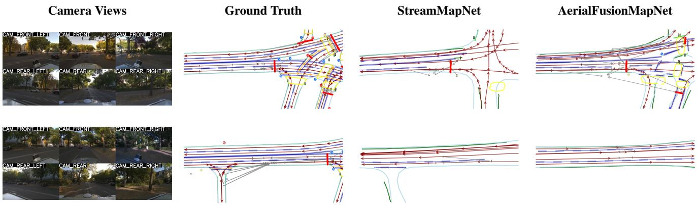  
Figure 3. Qualitative comparison of online HD map construction on KITScenes Aerial. Camera views provide the corresponding ground level context. Predictions from the onboard-only StreamMapNet baseline are compared with the aerial-fused AerialFusionMapNet.

Table 4. Online HD map construction performance on the full 53-class KITScenes label space, evaluated within a 60 m × 30 m region of interest. For readability, class-wise AP is grouped into six semantic categories: Lane Markings (LM), Lane Centerlines (LC), Road Infrastructure (RI), Traffic Lights (TL), Traffic Signs (TS), and Road Markings (RM). We additionally report the KITScenes topology score (Topo). C: camera images, AID: aerial image data.
<table><tr><td>Method</td><td>Training</td><td>Inference</td><td> $\mathsf { A P } _ { L M }$ </td><td> $\mathrm { A P } _ { L C }$ </td><td> $\mathrm { A P } _ { R I }$ </td><td> $\mathrm { A P } _ { T L }$ </td><td> $\mathsf { A P } _ { T S }$ </td><td> $\mathbf { A P } _ { R M }$ </td><td> $\mathrm { \ m A P _ { 5 3 } }$ </td><td> $\mathrm { A P _ { T o p o } }$ </td></tr><tr><td>StreamMapNet [43]</td><td>C</td><td>C</td><td>14.0</td><td>23.2</td><td>16.7</td><td>17.5</td><td>4.3</td><td>14.6</td><td>11.1</td><td>48.2</td></tr><tr><td>StreamMapNet-CVS [20]</td><td> $\mathrm { C } + \mathrm { A I D }$ </td><td>C</td><td>16.2</td><td>23.3</td><td>16.8</td><td>12.9</td><td>2.5</td><td>19.5</td><td>11.3</td><td>48.7</td></tr><tr><td>AerialFusionMapNet [19]</td><td> $\mathrm { C } + \mathrm { A I D }$ </td><td> $\mathrm { C } + \mathrm { A I D }$ </td><td>27.5</td><td>29.2</td><td>22.1</td><td>18.4</td><td>3.9</td><td>34.8</td><td>18.0</td><td>43.5</td></tr><tr><td>AerialFusionMapNet</td><td>AID</td><td>AID</td><td>8.1</td><td>3.8</td><td>4.3</td><td>4.4</td><td>0.3</td><td>9.5</td><td>4.3</td><td>0.4</td></tr></table>

Table 5. Extended-range online HD map construction performance on the full 53-class KITScenes label space using a 100 m× 50 m region of interest. We report mean average precision and the KITScenes topology score. C: camera images, AID: aerial image data. \*AID only used during training.
<table><tr><td>Method</td><td>Input</td><td> $\mathrm { \ m A P _ { 5 3 } }$ </td><td> $\mathrm { A P _ { T o p o } }$ </td></tr><tr><td>StreamMapNet [43]</td><td>C</td><td>4.2</td><td>17.7</td></tr><tr><td>StreamMapNet-CVS [20]</td><td> $\mathbf { C } + \mathbf { A } \mathbf { I } \mathbf { D } ^ { * }$ </td><td>4.9</td><td>23.7</td></tr><tr><td>AerialFusionMapNet [19]</td><td> $\mathrm { C } + \mathrm { A I D }$ </td><td>10.4</td><td>32.2</td></tr></table>

Effects of Increased Mapping Range. Comparing these numbers with Tab. 5, the same evaluation at an extended $1 0 0 \mathrm { m } \times 5 0$ m range, the relative benefit of using aerial imagery for both distillation and during inference grows significantly. mAP more than doubles and topology score is now monotonically increasing, both underlining the potential benefit of using aerial imagery as additional priors for long-range HD map construction.

Table 6. Impact of aerial image resolution on AerialFusionMapNet in the 53-class KITScenes setting across two regions of interest. We report m $\mathrm { \ A P _ { 5 3 } }$ and the KITScenes topology metric $\mathrm { A P _ { T o p o } . }$
<table><tr><td rowspan="2">Aerial GSD</td><td colspan="2"> $6 0 \mathrm { m } \times 3 0 \mathrm { m }$ </td><td colspan="2"> $1 0 0 \mathrm { m } \times 5 0 \mathrm { m }$ </td></tr><tr><td> $\mathrm { \ m A P _ { 5 3 } }$ </td><td> $\mathrm { A P _ { T o p o } }$ </td><td> $\mathrm { \ m A P _ { 5 3 } }$ </td><td> $\mathrm { A P _ { T o p o } }$ </td></tr><tr><td>20 cm/px</td><td>18.0</td><td>43.5</td><td>10.4</td><td>32.2</td></tr><tr><td> $8 \mathrm { c m } / \mathrm { p x }$ </td><td>22.3</td><td>44.2</td><td>17.2</td><td>28.8</td></tr></table>

Effects of Higher Resolution. Additionally, to examine the influence of aerial imagery resolution, in Tab. 6, we compare UNet++-based AerialFusionMapNet using imagery at ground sampling distances of 20 cm/px and 8 cm/px each. The higher resolution can indeed improve rich HD map construction performance, demonstrating the possibilities of the published UNet++ features.

Results for three-Class HD Map Construction. Finally, to make results on KITScenes Aerial, featuring rich production-ready HD maps, comparable with those on previous datasets, in Tab. 7, we report the same three methods but evaluate only the three established classes of map elements. The findings from the rich 53-class setup are confirmed: While distillation only yields significant benefits at long perception ranges, utilizing aerial imagery during training and inference improves HD map perception performance across the board.

Table 7. Online HD map construction results for the previously established three-class protocol. C: camera images, AID: aerial image data.
<table><tr><td rowspan="2">Method</td><td rowspan="2">Training</td><td rowspan="2">Inference</td><td colspan="4"> $6 0 \mathrm { m } \times 3 0 \mathrm { m }$ </td><td colspan="4"> $1 0 0 \mathrm { m } \times 5 0 \mathrm { m }$ </td></tr><tr><td> $\mathrm { \sf A P _ { p e d } }$ </td><td> $\mathrm { A P _ { d i v } }$ </td><td> $\mathrm { A P _ { b n d } }$ </td><td>mAP</td><td> $\mathrm { \sf A P _ { p e d } }$ </td><td> $\mathrm { A P _ { d i v } }$ </td><td> $\mathrm { A P _ { b n d } }$ </td><td>mAP</td></tr><tr><td>StreamMapNet [43]</td><td>C</td><td>C</td><td>10.8</td><td>30.3</td><td>31.1</td><td>24.1</td><td>7.2</td><td>15.5</td><td>12.5</td><td>11.7</td></tr><tr><td>StreamMapNet-CVS [20]</td><td> $\mathrm { C } + \mathrm { A I D }$ </td><td>C</td><td>11.8</td><td>30.3</td><td>30.1</td><td>24.1</td><td>8.1</td><td>17.6</td><td>13.1</td><td>12.9</td></tr><tr><td>AerialFusionMapNet [19]</td><td> $\mathrm { C } + \mathrm { A I D }$ </td><td> $\mathrm { C } + \mathrm { A I D }$ </td><td>27.3</td><td>45.4</td><td>36.6</td><td>36.5</td><td>29.5</td><td>33.2</td><td>22.8</td><td>28.5</td></tr></table>

## 4.2. Aerial HD Map Construction

With its rich HD map designed and ready for autonomous driving, KITScenes Aerial is a challenging benchmark for aerial-only vector map construction and rasterized HD map segmentation.

This is underlined by the results in Tab. 4, which report results from an AerialFusionMapNet variant using only aerial imagery. It achieves 4.3 mAP on the 53-class KITScenes benchmark, with the strongest performance on Road Markings (9.5 AP) and Lane Markings (8.1 AP). The gap to onboard and fused variants, particularly in topology, highlights the difficulty of direct fine-grained vector map construction from aerial imagery alone.

In Fig. 4, we demonstrate the suitability of the released high-resolution DINOv3 encoded imagery features for finegrained mapping related tasks. For this, city-scale maps are rasterized onto 8 cm/px tiles. Tiles that intersect a KITScenes Multimodal validation scene map element are validation tiles, the rest of the tiles are training tiles, so the evaluation stays geographically split and aligned with the KITScenes Multimodal split. For evaluation, the computed DINOv3 SAT ViT-L/16 [36] features are frozen as published. Only a dense DPT [33] segmentation head is trained on the task of global rasterized HD map segmentation similar to HDMapNet [22] using the 53 map element classes. Tab. 8 reports the segmentation results (mIoU) in the native fine-grained class label space and provides the Open-SatMap [44] segmentation results as a proxy comparative value, when the KITScenes Aerial labelspace is remapped to the OpenSatMap [44] label convention. Fig. 4 and Fig. 5 provide a visual representation of these metric results in the respective validation split data.

In Fig. 5, we provide qualitative examples of Open-SatMap [44]. In comparison with Fig. 4, they demonstrate the level of detail and completeness of the KITScenes Lanelet2 maps. As shown in Tab. 8, this makes KITScenes

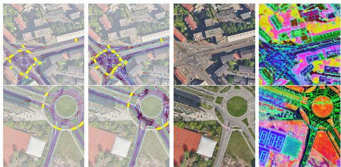  
Figure 4. Rasterized HD map segmentation results by a DPT [33] decoder trained and inferred directly on the released DINOv3 features. Left to right: ground truth, prediction, higher-resolution aerial imagery (DINOv3 input), PCA of DINOv3 features.

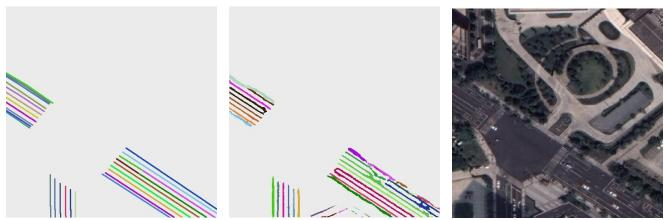  
Figure 5. OpenSatMap [44] HD map segmentation representation and qualitative segmentation results. Although OpenSatMap closely relates to our aerial HD map construction task, the map representation, aerial image quality, and benchmark task drastically differ from ours. Left to right: ground truth, prediction, aerial image. Plots and image from [44].

Aerial a significantly more challenging task for holistic aerial HD map segmentation. Specifically, we compare SegNeXt-tiny [10] on 8 lane classes against our frozen DI-NOv3 SAT ViT-L backbone with a DPT segmentation head trained on 53 classes. Additionally, we remap a part of the classes to the OpenSatMap ontology. This equalizes the metric, but not the imagery (German DOP vs. Google satellite), GSD (8 cm/px DINOv3 features vs. 15–30 cm/px), or label method and format (Lanelet2 vs. custom Open-SatMap). Despite using a vastly more capable model, segmentation performance is almost identical between both datasets.

Table 8. Comparison of semantic HD map segmentation (mIoU in %) on KITScenes Aerial versus OpenSatMap. We compare a SegNeXt tiny on the OpenSatMap val split (8 line classes: background, curb, virtual, and five painted line types) against a frozen DINOv3 SAT ViT-L with a DPT head trained on 53 Lanelet2 classes. On KITScenes, we report all native 53 classes as well as classes remapped\* to the 8-class OpenSatMap ontology.
<table><tr><td>Method</td><td>Evaluation Data</td><td>Semantic Classes</td><td>mIoU</td></tr><tr><td>SegNeXt-T [10]</td><td>OpenSatMap19 [44]</td><td>8 line classes</td><td>28.71</td></tr><tr><td>SegNeXt-T [10]</td><td>OpenSatMap20 [44]</td><td>8 line classes</td><td>33.69</td></tr><tr><td>DINOv3 SAT ViT-L [36] + DPT [33]</td><td>KITScenes Aerial DINOv3 val</td><td>native 53 HD map classes</td><td>8.39</td></tr><tr><td>DINOv3 SAT ViT-L [36] + DPT [33]</td><td>KITScenes Aerial DINOv3 val</td><td>8 line classes (remapped* to [44])</td><td>35.01</td></tr></table>

\*Remapping: Dashed/DashedSolid → dashed, Solid/SolidSolid → solid, StopLine and remaining paint variants → others, RoadBorder and Curbstones → curb, Virtual → virtual, all other HD-map classes (centerlines, areas, signs, arrows) → background; unused types (ThickSolid, ShortDashed) are excluded from mIoU.

Table 9. FG2 [41] cross-view localization results under crossarea evaluation, reporting translational and orientation error on the val split. KITTI denotes the reported result from [41]. For KITScenes Aerial, zero-shot uses the KITTI-trained model without adaptation, while fine-tuned denotes the model adapted on the KITScenes training split.
<table><tr><td>Setting</td><td>Trans. [m] ↓ Orient. [°] ↓ Mean Median Mean Median</td></tr><tr><td>KITTI 7.45</td><td>4.03 3.33 1.88</td></tr><tr><td>KITScenes (zero-shot) 11.03</td><td>8.87 4.85 3.39</td></tr><tr><td></td><td>3.11 2.81 2.03</td></tr><tr><td>KITScenes (fine-tuned) 5.13</td><td></td></tr></table>

## 4.3. Cross-View Localization

The third downstream application enabled by KITScenes Aerial is fine-grained cross-view localization [35, 41, 46]. Following established cross-area evaluation protocols [35, 46], Table 9 reports $\mathrm { F G ^ { 2 } }$ [41] localization performance using the geographically disjoint KITScenes training and validation splits. We additionally evaluate the original KITTI [9]-trained model zero-shot on KITScenes Aerial to assess cross-dataset transfer.

Despite the additional cross-dataset domain shift, the KITTI-trained model already transfers to KITScenes Aerial without adaptation. Fine-tuning on KITScenes Aerial substantially improves localization performance under the geographically separated cross-area evaluation.

## 5. Limitations

Temporal Consistency. The effect of temporal differences between ground-level and aerial observations cannot be isolated. To minimize such discrepancies, KITScenes Aerial provides a fixed snapshot of the raw aerial tiles selected to be as temporally close as possible to the KITScenes recordings. Nevertheless, changes in road infrastructure between the respective acquisition times may remain.

Higher-Resolution Imagery. The higher-resolution orthophotos used in this work cannot be redistributed as raw RGB imagery due to licensing restrictions. We therefore release precomputed neural representations that make this information available for learning-based experiments, while limiting methods that require direct access to the underlying imagery or alternative feature extractors.

Benchmark Extensibility. KITScenes Aerial provides representative baselines and standardized interfaces for the three research directions considered in this work, facilitating the integration of KITScenes into existing aerial and cross-view methods. The presented experiments establish initial reference points for these settings and provide a foundation for broader benchmarking in future work.

## 6. Conclusion

We introduced KITScenes Aerial as an aerial extension of KITScenes Multimodal that combines spatially associated aerial imagery with synchronized onboard sensing, vehicle poses, and detailed Lanelet2 maps. Together, KITScenes Aerial is the first dataset that covers both high-resolution aerial imagery and driving-ready HD maps. This provides a common data basis for aerial-only map construction, aerialassisted online HD mapping, and cross-view localization. Our experiments show that aerial context becomes particularly valuable for fine-grained and extended-range map construction, while higher-resolution aerial imagery provides further gains for detailed map elements. Cross-view localization experiments additionally demonstrate the applicability of the dataset under geographically disjoint conditions. Beyond the evaluated settings, the joint availability of aerial and ground-level observations opens further directions for annotation-efficient learning, such as using aerial predictions as pseudo-labels for semi-supervised map learning in otherwise unlabeled driving regions or exploiting cross-modal agreement to improve pseudo-label quality. These findings establish KITScenes Aerial as a foundation for studying previously largely separate ground–aerial research directions and for developing new forms of crossmodal supervision.

## Acknowledgments

The authors gratefully acknowledge the scientific support and HPC resources provided by the Erlangen National High Performance Computing Center (NHR@FAU) of the Friedrich-Alexander-Universitat Erlangen-N¨ urnberg (FAU)¨ under the BayernKI project v153eb. BayernKI funding is provided by Bavarian state authorities.

The research leading to these results is partially funded by the German Federal Ministry for Economic Affairs and Energy within the project NXT GEN AI METHODS (Grant Agreement No. 19A23014), and by the Shift2SDV project (Grant Agreement No. 101194245), co-funded by the European Union through the Chips Joint Undertaking and its members. The authors gratefully acknowledge the computing time provided on the high-performance computer HoreKa by the National High-Performance Computing Center at KIT (NHR@KIT). This center is jointly supported by the Federal Ministry of Education and Research and the Ministry of Science, Research and the Arts of Baden-Wurttemberg, as part of the National High-¨ Performance Computing (NHR) joint funding program. HoreKa is partly funded by the German Research Foundation (DFG). The authors also gratefully acknowledge the support of the Large Scale Data Facility (LSDF) at the Karlsruhe Institute of Technology, funded by the Ministry of Science, Research and the Arts of Baden-Wurttemberg ¨ and by the Federal Ministry of Education and Research.

## References

[1] Julian Bock, Robert Krajewski, Tobias Moers, Steffen Runde, Lennart Vater, and Lutz Eckstein. The ind dataset: A drone dataset of naturalistic road user trajectories at german intersections. In 2020 IEEE Intelligent Vehicles Symposium (IV), pages 1929–1934, 2020. 2, 4

[2] Martin Buchner, Jannik Z¨ urn, Ion-George Todoran, Abhinav¨ Valada, and Wolfram Burgard. Learning and aggregating lane graphs for urban automated driving. In Proceedings of the IEEE/CVF Conference on Computer Vision and Pattern Recognition (CVPR), 2023. 1, 2, 3, 4

[3] Holger Caesar, Varun Bankiti, Alex H. Lang, Sourabh Vora, Venice Erin Liong, Qiang Xu, Anush Krishnan, Yu Pan, Giancarlo Baldan, and Oscar Beijbom. nuScenes: A multimodal dataset for autonomous driving. In Proceedings of the IEEE/CVF Conference on Computer Vision and Pattern Recognition (CVPR), 2020. 3, 5

[4] Holger Caesar, Juraj Kabzan, Kok Seang Tan, Whye Kit Fong, Eric Wolff, Alex Lang, Luke Fletcher, Oscar Beijbom, and Sammy Omari. Nuplan: A closed-loop ml-based planning benchmark for autonomous vehicles. In CVPR ADP3 Workshop, 2021. 3

[5] Sahith Reddy Chada, Isht Dwivedi, and Nirav Savaliya. HRDX: A large-scale vector HD-map dataset. arXiv preprint arXiv:2606.17080, 2026. Honda Research Institute US. 1, 3, 4

[6] Yu-Hsiang Chen, Wei-Jer Chang, Christian Kotulla, Thomas

Keutgens, Steffen Runde, Tobias Moers, Christoph Klas, Wei Zhan, Masayoshi Tomizuka, and Yi-Ting Chen. Hetrod: A high-fidelity drone dataset and benchmark for autonomous driving in heterogeneous traffic. In Proceedings of the IEEE International Conference on Robotics and Au tomation (ICRA), 2026. 2, 4

[7] Florian Fervers, Sebastian Bullinger, Christoph Bodensteiner, Michael Arens, and Rainer Stiefelhagen. Uncertainty-aware vision-based metric cross-view geolocalization. In Proceedings of the IEEE/CVF Conference on Computer Vision and Pattern Recognition (CVPR), pages 21621–21631, 2023. 1, 3

[8] Wenjie Gao, Jiawei Fu, Yanqing Shen, Haodong Jing, Shitao Chen, and Nanning Zheng. Complementing onboard sensors with satellite map: A new perspective for hd map construction. In IEEE International Conference on Robotics and Au tomation, 2024. 1, 3, 4, 5

[9] Andreas Geiger, Philip Lenz, Christoph Stiller, and Raquel Urtasun. Vision meets robotics: The kitti dataset. International Journal ofRobotics Research (IJRR), 2013. 8

[10] Meng-Hao Guo, Cheng-Ze Lu, Qibin Hou, Zhengning Liu, Ming-Ming Cheng, and Shi-Min Hu. Segnext: Rethink ing convolutional attention design for semantic segmentation. Advances in neural information processing systems, 35:1140–1156, 2022. 7, 8

[11] Songtao He and Hari Balakrishnan. Lane-level street map extraction from aerial imagery. In Proceedings of the IEEE/CVF Winter Conference on Applications of Computer Vision (WACV), pages 2080–2089, 2022. 1, 2, 3, 4

[12] Hessische Verwaltung fur Bodenmanagement und ¨ Geoinformation. Digitale orthophotos (ATKIS-DOPs) und true orthophoto. https : / / hvbg . hessen . de / landesvermessung / geotopographie / luftbilder / digitale - orthophotos - true - orthophoto, 2026. Accessed: 2026-08-12. 1, 4

[13] Bingyuan Huang, Guanyi Zhao, Qian Xu, Yang Lou, Yung-Hui Li, and Jianping Wang. Satmaptr: Satellite image enhanced online hd map construction. IEEE Robotics and Au tomation Letters, pages 1–8, 2026. 5

[14] Zhou Jiang, Zhenxin Zhu, Pengfei Li, Huan-ang Gao, Tianyuan Yuan, Yongliang Shi, Hang Zhao, and Hao Zhao. P-MapNet: Far-seeing map generator enhanced by both SDMap and HDMap priors. IEEE Robotics and Automation Letters, 9(10):8539–8546, 2024. 5

[15] Robert Krajewski, Tobias Moers, Julian Bock, Lennart Vater, and Lutz Eckstein. The round dataset: A drone dataset of road user trajectories at roundabouts in germany. In 2020 IEEE 23rd International Conference on Intelligent Transportation Systems (ITSC), pages 1–6, 2020. 2, 4

[16] Landesamt fur Geoinformation und Landentwick-¨ lung Baden-Wurttemberg.¨ Digitale orthophotos DOP20. https://www.lgl-bw.de/Produkte/ Luftbildprodukte / DOP20 / index . html, 2026. Accessed: 2026-08-12. 1, 4

[17] Wooju Lee, Juhye Park, Dasol Hong, Changki Sung, Young woo Seo, DongWan Kang, and Hyun Myung. PIDLoc: Cross-view pose optimization network inspired by PID con trollers. In Proceedings of the IEEE/CVF Conference on

Computer Vision and Pattern Recognition (CVPR), pages 21981–21990, 2025. 4

[18] Daniel Lengerer, Mathias Pechinger, Klaus Bogenberger, and Carsten Markgraf. AID4AD: Aerial image data for automated driving perception. arXiv preprint arXiv:2508.02140, 2025. 1, 3, 4, 5

[19] Daniel Lengerer, Mathias Pechinger, Klaus Bogenberger, and Carsten Markgraf. AerialFusionMapNet: Online hd map construction with aerial-onboard bev fusion. arXiv preprint arXiv:2606.24784, 2026. 1, 2, 3, 5, 6, 7

[20] Daniel Lengerer, Mathias Pechinger, Klaus Bogenberger, and Carsten Markgraf. Learning ego-centric BEV representations from a perspective-privileged view: Cross-view supervision for online HD map construction. In Proceedings of the European Conference on Computer Vision (ECCV), 2026. 1, 2, 3, 5, 6, 7

[21] leveLXData by fka GmbH. uniD: The university drone dataset. https://levelxdata.com/uniddataset/, 2021. 2, 4

[22] Qi Li, Yue Wang, Yilun Wang, and Hang Zhao. HDMapNet: An online hd map construction and evaluation framework. In 2022 International Conference on Robotics and Automation, pages 4628–4634, 2022. 7

[23] Bencheng Liao, Shaoyu Chen, Xinggang Wang, Tianheng Cheng, Qian Zhang, Wenyu Liu, and Chang Huang. MapTR: Structured modeling and learning for online vectorized HD map construction. In International Conference on Learning Representations (ICLR), 2023. Spotlight. 2, 5

[24] Bencheng Liao, Shaoyu Chen, Yunchi Zhang, Bo Jiang, Qian Zhang, Wenyu Liu, Chang Huang, and Xinggang Wang. MapTRv2: An end-to-end framework for online vectorized HD map construction. International Journal of Computer Vision, 2024. 5

[25] Yiyi Liao, Jun Xie, and Andreas Geiger. KITTI-360: A novel dataset and benchmarks for urban scene understanding in 2d and 3d. IEEE Transactions on Pattern Analysis and Machine Intelligence, 45(3):3292–3310, 2023. 3

[26] Liu Liu and Hongdong Li. Lending orientation to neural networks for cross-view geo-localization. In Proceedings of the IEEE/CVF Conference on Computer Vision and Pattern Recognition (CVPR), pages 5624–5633, 2019. 1, 3

[27] Yicheng Liu, Tianyuan Yuan, Yue Wang, Yilun Wang, and Hang Zhao. VectorMapNet: End-to-end vectorized hd map learning. In Proceedings of the 40th International Conference on Machine Learning (ICML), 2023. 2

[28] Tobias Moers, Lennart Vater, Robert Krajewski, Julian Bock, Adrian Zlocki, and Lutz Eckstein. The exid dataset: A realworld trajectory dataset of highly interactive highway scenarios in germany. In 2022 IEEE Intelligent Vehicles Symposium (IV), pages 958–964, 2022. 2, 4

[29] NVIDIA Corporation. Physicalai-autonomous-vehicles. Hugging Face Dataset, 2025. 3

[30] Juhye Park, Wooju Lee, Dasol Hong, Changki Sung, Youngwoo Seo, Dongwan Kang, and Hyun Myung. VIRD: Viewinvariant representation through dual-axis transformation for cross-view pose estimation. In Proceedings ofthe IEEE/CVF Conference on Computer Vision and Pattern Recognition (CVPR), pages 33693–33702, 2026. 4

[31] Jan-Hendrik Pauls, Tobias Strauss, Carsten Hasberg, Martin Lauer, and Christoph Stiller. Can we trust our maps? an evaluation of road changes and a dataset for map validation. In 2018 21st International Conference on Intelligent Transportation Systems (ITSC), pages 2639–2644, 2018. 1

[32] Fabian Poggenhans, Jan-Hendrik Pauls, Johannes Janosovits, Stefan Orf, Maximilian Naumann, Florian Kuhnt, and Matthias Mayr. Lanelet2: A high-definition map framework for the future of automated driving. In Proc. IEEE Intell. Trans. Syst. Conf., Hawaii, USA, 2018. 1

[33] Rene Ranftl, Alexey Bochkovskiy, and Vladlen Koltun. Vi-´ sion transformers for dense prediction. In 2021 IEEE/CVF International Conference on Computer Vision (ICCV), pages 12159–12168. IEEE, 2021. 7, 8

[34] Richard Schwarzkopf, Fabian Immel, Alexander Blumberg, Jonas Merkert, Nils Rack, Kaiwen Wang, Fabian Konstan tinidis, Julian Truetsch, Carlos Fernandez, Annika Batz,¨ Kevin Rosch, Marlon Steiner, Willi Poh, Yinzhe Shen, Roy-¨ den Wagner, Felix Hauser, Dominik Strutz, Jaime Villa, Gleb Stepanov, Holger Caesar, Omer S¸ahin Tas¸, Frank Bieder,¨ Jan-Hendrik Pauls, and Christoph Stiller. The road ahead in autonomous driving: The KITScenes multimodal dataset. arXiv preprint arXiv:2606.02956, 2026. 1, 3, 4

[35] Yujiao Shi and Hongdong Li. Beyond cross-view image retrieval: Highly accurate vehicle localization using satellite image. In Proceedings of the IEEE Conference on Computer Vision and Pattern Recognition, 2022. 1, 8

[36] Oriane Simeoni, Huy V. Vo, Maximilian Seitzer, Federico´ Baldassarre, Maxime Oquab, Cijo Jose, Vasil Khalidov, Marc Szafraniec, Seungeun Yi, Michael Ramamonjisoa,¨ Francisco Massa, Daniel Haziza, Luca Wehrstedt, Jianyuan Wang, Timothee Darcet, Th´ eo Moutakanni, Leonel Sentana,´ Claire Roberts, Andrea Vedaldi, Jamie Tolan, John Brandt, Camille Couprie, Julien Mairal, Herve J´ egou, Patrick La-´ batut, and Piotr Bojanowski. DINOv3, 2025. 5, 7, 8

[37] Huijie Wang, Tianyu Li, Yang Li, Li Chen, Chonghao Sima, Zhenbo Liu, Bangjun Wang, Peijin Jia, Yuting Wang, Shengyin Jiang, Feng Wen, Hang Xu, Ping Luo, Junchi Yan, Wei Zhang, and Hongyang Li. OpenLane-V2: A topology reasoning benchmark for unified 3d HD mapping. In Ad vances in Neural Information Processing Systems (NeurIPS), Datasets and Benchmarks Track, 2023. 5

[38] Shan Wang, Yanhao Zhang, Ankit Vora, Akhil Perincherry, and Hengdong Li. Satellite image based cross-view lo calization for autonomous vehicle. In 2023 IEEE International Conference on Robotics and Automation (ICRA), pages 3592–3599. IEEE, 2023. 1

[39] Benjamin Wilson, William Qi, Tanmay Agarwal, John Lambert, Jagjeet Singh, Siddhesh Khandelwal, Bowen Pan, Ratnesh Kumar, Andrew Hartnett, Jhony Kaesemodel Pontes, Deva Ramanan, Peter Carr, and James Hays. Argoverse 2: Next generation datasets for self-driving perception and forecasting. In Advances in Neural Information Processing Systems (NeurIPS), Datasets and Benchmarks Track, 2021. 3, 5

[40] Scott Workman, Richard Souvenir, and Nathan Jacobs. Wide-area image geolocalization with aerial reference im-

agery. In Proceedings of the IEEE International Conference on Computer Vision (ICCV), pages 3961–3969, 2015. 1, 3

[41] Zimin Xia and Alexandre Alahi. Fgˆ 2: Fine-grained crossview localization by fine-grained feature matching. In Proceedings of the Computer Vision and Pattern Recognition Conference, pages 6362–6372, 2025. 1, 2, 3, 8

[42] Zimin Xia, Olaf Booij, and Julian F. P. Kooij. Convolutional cross-view pose estimation. IEEE Transactions on Pattern Analysis and Machine Intelligence, 46(5):3813–3831, 2024. 4

[43] Tianyuan Yuan, Yicheng Liu, Yue Wang, Yilun Wang, and Hang Zhao. StreamMapNet: Streaming mapping network for vectorized online hd map construction. In Proceedings of the IEEE/CVF Winter Conference on Applications of Computer Vision (WACV), 2024. 2, 5, 6, 7

[44] Hongbo Zhao, Lue Fan, Yuntao Chen, Haochen Wang, Yuran Yang, Xiaojuan Jin, Yixin Zhang, Gaofeng Meng, and Zhaoxiang Zhang. OpenSatMap: A fine-grained highresolution satellite dataset for large-scale map construction. In Advances in Neural Information Processing Systems (NeurIPS), Datasets and Benchmarks Track, 2024. 1, 2, 3, 4, 7, 8

[45] Zongwei Zhou, Md Mahfuzur Rahman Siddiquee, Nima Tajbakhsh, and Jianming Liang. Unet++: Redesigning skip connections to exploit multiscale features in image segmentation. IEEE Transactions on Medical Imaging, 39(6):1856– 1867, 2020. 5

[46] Sijie Zhu, Taojiannan Yang, and Chen Chen. VIGOR: Crossview image geo-localization beyond one-to-one retrieval. In Proceedings of the IEEE/CVF Conference on Computer Vision and Pattern Recognition (CVPR), pages 3640–3649, 2021. 3, 8

# KITScenes Aerial Appendix

A. Additional KITScenes Aerial Examples

Figures A.1 and A.2 show additional KITScenes Aerial samples across diverse driving scenes.

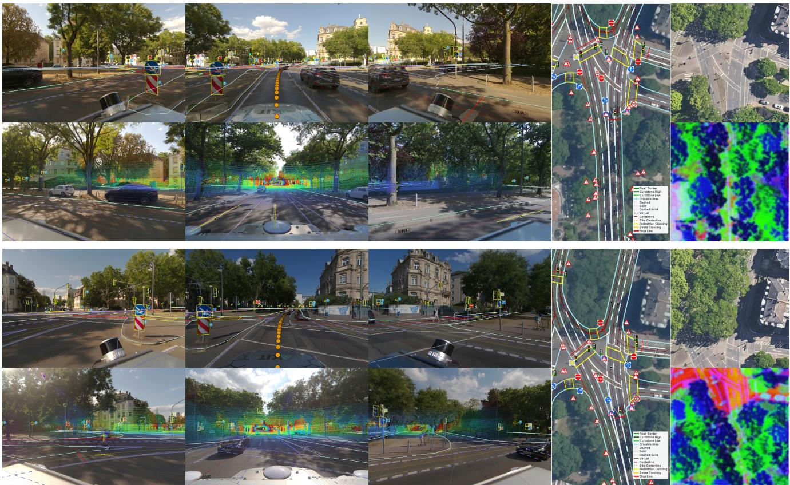  
Figure A.1. Additional KITScenes Aerial examples showing synchronized multimodal observations, HD map annotations, and correspond ing aerial representations.

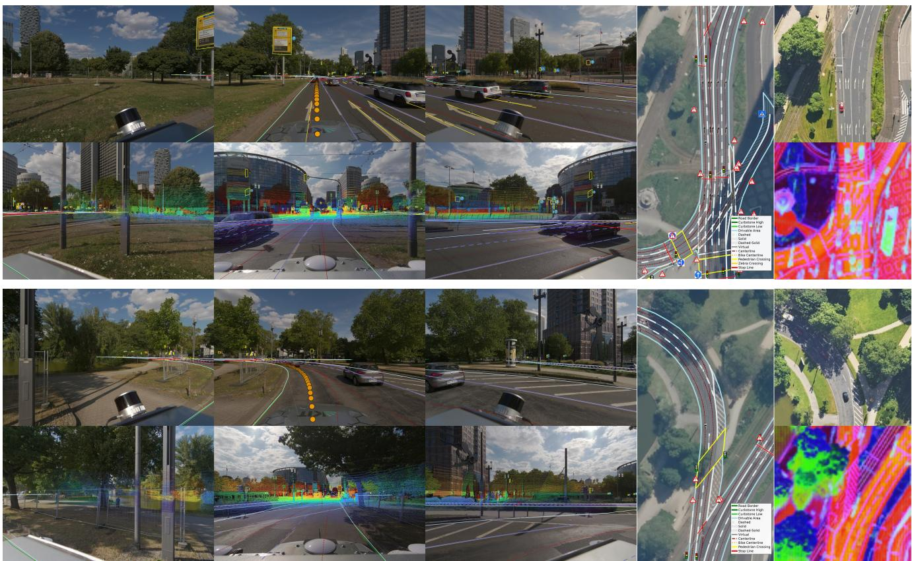  
Figure A.2. Additional KITScenes Aerial examples across further scene configurations.

## B. Additional Dataset Details

Figure B.3 compares the publicly available DOP20 imagery with higher-resolution licensed orthophotos. Table B.1 lists the 53 map elements used for map construction and their aggregation into six semantic categories for reporting.

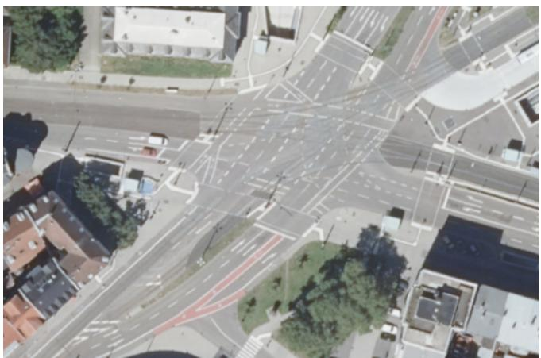

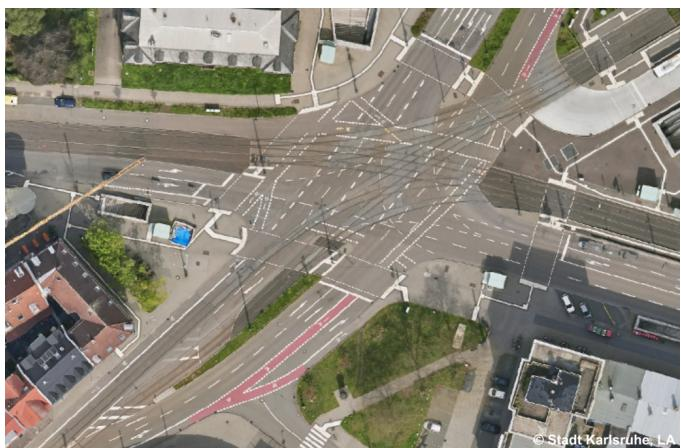  
Figure B.3. Qualitative comparison of country-level open aerial imagery (left) and high-quality municipal aerial imagery (right). We provide encoded neural features for higher-resolution aerial images of municipal quality. Both images shown here are at a resolution of 20 cm/px due to privacy regulations.

Table B.1. Taxonomy of map elements used in the Lanelet2 map, grouped into six categories: Lane Markings (LM), Lane Centerlines (LC), Road Infrastructure (RI), Traffic Lights (TL), Traffic Signs (TS), and Road Markings (RM).
<table><tr><td>Lane Markings (LM)</td><td>Lane Centerlines (LC)</td><td>Road Infrastructure (RI)</td></tr><tr><td>Road border Dashed Solid Solid Solid Solid dashed Dashed solid Bike dashed Bike solid Pedestrian crossing</td><td>Centerline Bike centerline</td><td>Curbstone high Curbstone low Fence Building Wall Guardrail Drivable area Divider</td></tr><tr><td>Zebra crossing Stop line</td><td></td><td></td></tr><tr><td>Traffic Lights (TL)</td><td>Traffic Signs (TS)</td><td>Road Markings (RM)</td></tr><tr><td>Car Bike Pedestrian Misc</td><td>Stop Yield No entry Right of way Priority road One way street Roundabout Speed limit Pedestrian crossing Turn right Turn left</td><td>Arrow go straight Arrow turn left Arrow turn right Arrow go straight or left Arrow go straight or right Arrow turn left or right Bike symbol Bus symbol Symbol 30 Symbol 50 Symbol 70</td></tr></table>

## C. Additional Experimental Results

Table C.2 compares the 20 cm and 8 cm GSD settings across the six KITScenes reporting categories and individual AP distance thresholds. Higher-resolution imagery improves all categories at all thresholds, with by far the largest absolute gains for Road Markings (+13.7–14.4 pp). For most other categories, the improvement is most pronounced at the strictest matching threshold, particularly for Traffic Lights (+6.0 pp at AP@0.5) and Lane Markings (+4.2 pp at AP@0.5), indicating that the higher aerial resolution primarily benefits precise localization of fine-grained map elements. Table C.3 further reports the 8 cm/px results for both evaluated regions of interest.

Table C.2. AP comparison between 20 cm and 8 cm GSD across the six KITScenes reporting categories and different distance thresholds for the $6 0 \mathrm { m } \times 3 0$ m region of interest. Values are reported in %. ∆ denotes the absolute gain of 8 cm over 20 cm GSD in percentag points. The category grouping follows KITScenes; class assignments are shown in Table B.1.
<table><tr><td rowspan="2">Subgroup</td><td colspan="3">AP@0.5</td><td colspan="3">AP@1.0</td><td colspan="3">AP@1.5</td></tr><tr><td>20 cm</td><td>8 cm</td><td>∆</td><td>20 cm</td><td>8 cm</td><td>∆</td><td>20 cm</td><td>8 cm</td><td>Δ</td></tr><tr><td>Lane Markings (LM)</td><td>17.8</td><td>22.0</td><td>+4.2</td><td>29.2</td><td>32.0</td><td>+2.7</td><td>35.6</td><td>37.9</td><td>+2.4</td></tr><tr><td>Lane Centerlines (LC)</td><td>19.6</td><td>23.3</td><td>+3.6</td><td>31.5</td><td>32.2</td><td>+0.8</td><td>36.4</td><td>36.9</td><td>+0.5</td></tr><tr><td>Road Infrastructure (RI)</td><td>13.0</td><td>16.0</td><td>+3.0</td><td>23.6</td><td>26.5</td><td>+2.9</td><td>29.8</td><td>32.2</td><td>+2.5</td></tr><tr><td>Traffic Lights (TL)</td><td>8.7</td><td>14.8</td><td>+6.0</td><td>20.3</td><td>23.0</td><td>+2.7</td><td>26.2</td><td>26.9</td><td>+0.7</td></tr><tr><td>Traffic Signs (TS)</td><td>2.6</td><td>3.2</td><td>+0.6</td><td>4.1</td><td>5.1</td><td>+1.0</td><td>4.9</td><td>6.2</td><td>+1.2</td></tr><tr><td>Road Markings (RM)</td><td>32.7</td><td>46.4</td><td>+13.7</td><td>35.3</td><td>49.8</td><td>+14.4</td><td>36.3</td><td>50.5</td><td>+14.2</td></tr></table>

Table C.3. Detailed results for AerialFusionMapNet using the higher-resolution 8 cm/px aerial imagery across the six KITScenes reporting categories and two regions of interest.
<table><tr><td>ROI</td><td>一  $\mathsf { A P } _ { L M }$ </td><td> $\mathrm { A P } _ { L C }$ </td><td> $\mathrm { A P } _ { R I }$ </td><td> $\mathsf { A P } _ { T L }$ </td><td> $\mathsf { A P } _ { T S }$ </td><td> $\mathsf { A P } _ { R M }$ </td><td> $\mathrm { \ m A P _ { 5 3 } }$ </td><td> $\mathrm { { A P } _ { \mathrm { { T o p o } } } }$ </td></tr><tr><td> $6 0 \mathrm { m } \times 3 0 \mathrm { m }$ </td><td>30.6</td><td>30.8</td><td>24.9</td><td>21.5</td><td>4.8</td><td>48.9</td><td>22.3</td><td>44.2</td></tr><tr><td> $1 0 0 \mathrm { m } \times 5 0 \mathrm { m }$ </td><td>24.0</td><td>22.8</td><td>20.3</td><td>16.8</td><td>2.4</td><td>39.3</td><td>17.2</td><td>28.8</td></tr></table>

## D. Large-Scale Map Visualizations

Figures D.5 and D.7 show two large-scale examples of rasterized HD map segmentation predictions, each paired with its corresponding ground truth visualization.

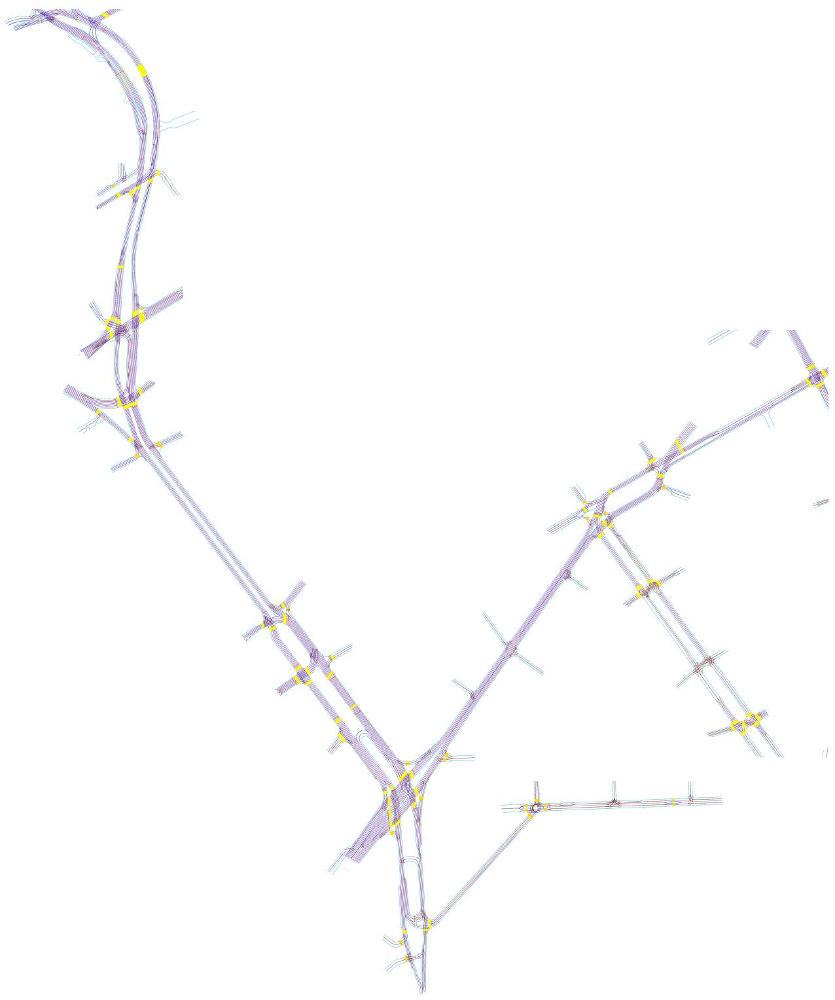  
Figure D.4. Frankfurt KITScenes rasterized HD Maps, GT Stitched

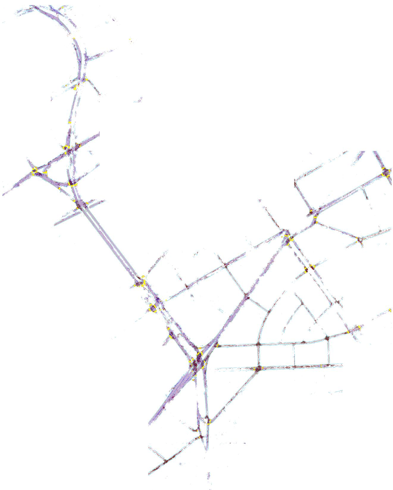  
Figure D.5. Frankfurt Validation DINOv3 Features + DPT Head Predictions Stitched

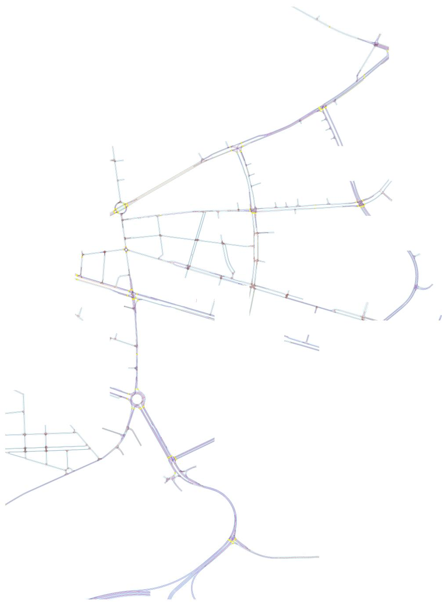  
Figure D.6. Karlsruhe KITScenes rasterized HD Maps, GT Stitched

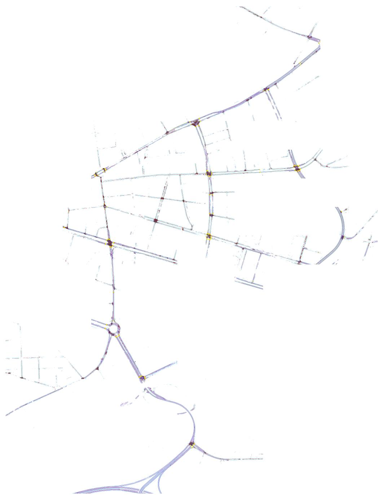  
Figure D.7. Karlsruhe Validation DINOv3 Features + DPT Head Predictions Stitched