# AB-Attention: Accurate Block Attention for Accelerating Video Difusion Transformers

Bin Xu1,2 Mo Zhang3 Zhengfeiyang Zhang1,4 Xinfeng Yang5 Yixing Ma1,6 Wei Wang7 HeXin Wang1 Pengfei Zhou1,8† Wangbo Zhao7†

1InfRec 2The Chinese University of Hong Kong, Shenzhen 3Shandong University

4The University of Tokyo 5Fudan University 6University of California, Berkeley

7The Hong Kong University of Science and Technology 8National University of Singapore †Corresponding authors

Abstract Video difusion transformers generate high-quality videos, but the quadratic cost of 3D full attention dominates their inference. Dynamic block-sparse attention reduces this cost by computing exact attention only on key/value blocks selected from current activations. However, its fidelity degrades under aggressive sparsity: blocks are scored from coarse summaries or formed by costly global clustering, pruned blocks vanish from the softmax, and whole tiles are kept or dropped even when only a few of their keys matter. To address these limitations, we propose Accurate Block Attention (AB-Attention), a training-free method that accurately approximates dense attention at high sparsity. Its Intra-Block Clustering Selector (IBCS) estimates block importance faithfully yet cheaply by clustering queries only within each query block, without permuting tokens. Sampling with Inclusion-Probability Weighting (SIP) then samples blocks in proportion to these estimates and reweights them by inverse inclusion probability, so that one pass estimates dense attention rather than truncating it. Finally, its kernel gathers key/value blocks much smaller than a tile into full tensor-core tiles, refining selection at no extra tensor-core cost. On Wan2.1 and HunyuanVideo, AB-Attention skips 89–92% of attention, whereas the baselines compute 1.8–3.6× as much, yet it still improves PSNR by up to 4.4 dB over the strongest baseline and achieves up to 2.23× end-to-end speedup. Our code is available at https: //github.com/InfRec-Cardinal/AB-Attention.

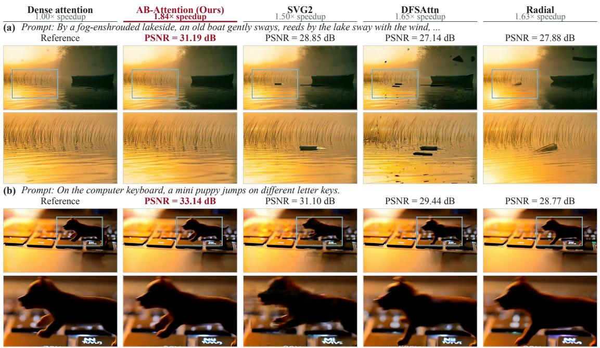  
Figure 1 | Examples on Wan2.1-T2V-14B, with one frame and an enlarged region per method. AB-Attention is closest to dense attention in full-video PSNR while achieving the highest speedup.

## Contents

1 Introduction 3   
2 Preliminaries 4   
3 Methodology 4   
3.1 Intra-Block Clustering Selector (IBCS) 5   
3.2 Sampling with Inclusion-Probability Weighting (SIP) 6   
3.3 Fine-Grained Selection with Tiled Execution 7   
Experiments 7   
4.1 Experimental Setup . 7   
4.2 Main Results 8   
4.3 Ablation Study 10   
5 Related Work 11   
6 Conclusion 11   
References 13   
A Sampling and Estimation Details 19   
A.1 Query Centroids and Pooled Keys . 19   
A.2 Systematic Sampling Without Replacement . 19   
A.3 Weighted Attention Estimation . 19   
B Implementation Details 19   
B.1 AB-Attention 19   
B.2 Baselines 20   
C Evaluation Protocol 20   
D Additional Ablation Results 20

## 1. Introduction

Video difusion transformers [1, 2] primarily rely on 3D full attention to capture spatial and temporal dependencies, enabling high-quality generation. However, the computational cost of full attention grows quadratically with the sequence length. As the video resolution and number of frames increase, attention becomes increasingly expensive. Since this computation is repeated across transformer layers and denoising steps, attention has long been a major inference bottleneck [3, 4]. Reducing the cost of attention while preserving generation quality is therefore essential for generating longer and higher-resolution videos.

Sparse attention reduces this cost by computing only a subset of query–key pairs. Early methods apply predefined spatial or temporal patterns, such as local 3D windows [4], energy-decay masks [5], or per-head spatial and temporal masks [3]. These predefined layouts reduce the need for online block scoring, but their limited adaptability to attention variations across prompts, heads, and denoising steps can require retaining many unimportant pairs to preserve important interactions. Dynamic methods instead select key/value blocks from the current activations, adapting the sparsity pattern to the in ut at the cost of online scorin . Since block-s arse kernels execute attention in fixed-size tiles, they partition queries and keys into tile-aligned blocks, estimate block importance cheaply from mean-pooled tokens [6] or antidiagonal attention samples [7], and compute exact attention only on the most important blocks. SVG2 [8] instead forms the blocks by clustering and permuting tokens.

Despite this progress, dynamic methods remain limited by three design choices: 1) Importance estimates are coarse or costly. Pooling a block into one representative mixes tokens with diferent attention patterns and can misrank blocks, whereas clustering yields faithful representatives only through sequence-wide �-means and token permutation [8]. 2) Top-� selection truncates attention. Discarding a block removes its contribution from both the attention numerator and the softmax normalizer, which better scores cannot recover. Correction-based methods [9–11] approximate the discarded remainder, but add a separate approximation branch to the exact sparse computation. 3) The selection unit is the execution tile. A tile-sized key block is kept or discarded as a whole even when only a few of its keys matter, and reordering tokens makes blocks more coherent without changing this unit. Finer units need not slow execution, as a kernel can gather them into full tiles, but they multiply the candidates to score.

We therefore propose Accurate Block Attention (AB-Attention), a training-free method that directly addresses these limitations. The Intra-Block Clustering Selector (IBCS) scores key/value blocks with lightweight query clusters formed only within each query block, avoiding costly global clustering and token permutation. Sampling with Inclusion-Probability Weighting (SIP) samples blocks in proportion to these scores and reweights them by inverse inclusion probability. Every block can thus contribute, and a single sparse attention pass yields unbiased estimates of both the attention numerator and the softmax normalizer. AB-Attention further performs fine-grained selection with tiled execution: it selects key/value blocks much smaller than an execution tile and gathers them into full tensor-core tiles in its kernel, without reordering any tokens. The sampling plans are reused across a few nearby denoising steps, while attention is recomputed at every step [12].

Extensive experiments on representative video difusion transformers, including Wan2.1 [1] and HunyuanVideo [2], demonstrate that AB-Attention significantly advances the quality–eficiency frontier of training-free sparse attention. It skips 89–92% of attention computation, whereas the competing baselines compute 1.8–3.6× as much, and delivers 1.84–2.23× end-to-end speedups on a single H20 GPU, while achieving the highest fidelity to dense attention and improving PSNR by 1.6–4.4 dB over the strongest baselines, including SVG2 [8] and DFSAttn [13]. The examples in Figure 1 visually illustrate these fidelity gains.

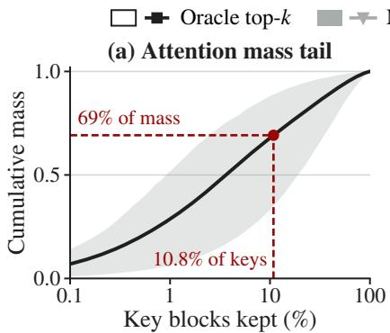

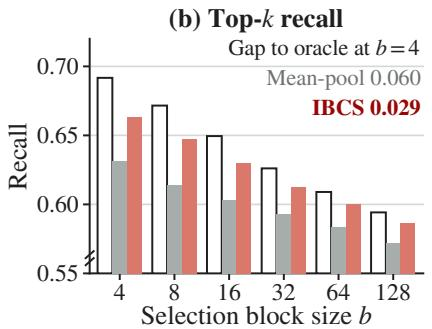

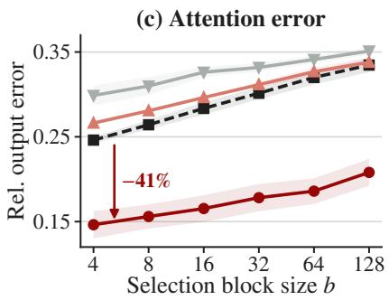  
Figure 2 | Attention mass, recall, and error on Wan2.1-T2V-14B at 89.16% sparsity. (a) Sorted cumulative attention mass of 4-token key blocks; the band spans the 10th–90th percentiles of query blocks. (b) Top-� recall: the fraction of each query block’s dense attention mass covered by the selected key blocks. Finer blocks keep more mass, and IBCS halves the gap of mean-pool to the oracle at �=4. (c) Relative $\ell _ { 2 }$ error of the attention output against dense attention. Sampling with SIP on IBCS scores lowers the error 41% below oracle top-� at �=4.

## 2. Preliminaries

Dense attention. Video difusion transformers apply self-attention to tokens across space and time. Given � tokens, let $Q , K , V \in \mathbb { R } ^ { n \times d }$ denote the query, key, and value matrices for one attention head. Dense attention computes

$$
O = \operatorname { s o f t m a x } \left( { \frac { Q K ^ { \top } } { \sqrt { d } } } \right) V .\tag{1}
$$

Its $O ( n ^ { 2 } d )$ complexity makes dense attention costly for high-resolution videos. FlashAttention [14] accelerates exact attention by reducing data movement and intermediate storage, but still computes all query–key interactions, leaving the arithmetic cost quadratic in sequence length.

Sparse attention. Sparse attention reduces this arithmetic by computing only selected query–key pairs. Conceptually, it adds a mask $\mathcal { M } \in \{ - \infty , 0 \} ^ { n \times n }$ to the attention logits:

$$
O _ { \mathrm { s p a r s e } } = { \mathrm { s o f t m a x } } \left( { \frac { Q K ^ { \top } } { \sqrt { d } } } + M \right) V .\tag{2}
$$

An entry $\mathcal { M } _ { u \nu } = 0$ keeps the interaction between query � and key �, while $\mathcal { M } _ { u \nu } = - \infty$ skips it. Block- sparse attention makes this pattern hardware-friendly by partitioning the queries, keys, and values into blocks of � tokens. It keeps or skips each query–key block pair as a whole, so every retained pair can be evaluated using dense matrix operations. The block size determines a trade-of: larger blocks improve hardware utilization but select more coarsely, whereas smaller blocks provide finer selection but may reduce execution eficiency.

## 3. Methodology

As illustrated in Fi ure 3, AB-Attention selects ke /value blocks much smaller than an execution tile and estimates the dense attention of each query block from a weighted sample of them. Section 3.1 introduces the Intra-Block Clustering Selector (IBCS), which scores these blocks with query clusters formed within each query block. Section 3.2 introduces Sampling with Inclusion-Probability Weighting (SIP), which samples blocks in proportion to these scores and reweights them by inverse inclusion probability, so that one block-sparse pass estimates dense attention rather than truncating it.

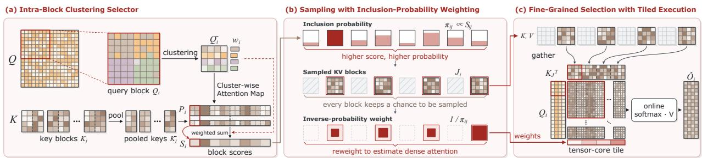  
Figure 3 | Overview of AB-Attention. (a) IBCS clusters each query block $Q _ { i }$ into centroids $\bar { Q } _ { i }$ with weights $w _ { i } ,$ and scores every key/value block by the weighted attention of the centroids to its pooled keys. (b) SIP samples each block with probability $\pi _ { i j }$ proportional to its score $S _ { i j } .$ so no block is excluded, and weights it by $1 / \pi _ { i j }$ to estimate full attention. (c) The kernel gathers the sampled blocks into full tensor-core tiles and attends to them with logits shifted by $- \log \pi _ { i j }$

Section 3.3 introduces fine-grained selection with tiled execution: its kernels run these small blocks on full tensor-core tiles without reordering tokens, preserving the eficiency of block-sparse attention. Algorithm 1 summarizes the method for one attention head at one denoising step.

## 3.1. Intra-Block Clustering Selector (IBCS)

We divide the ueries into blocks $Q _ { i } \in \mathbb { R } ^ { B _ { q } \times d }$ of $B _ { q }$ tokens, and the keys and values into smaller blocks $K _ { j } , V _ { j } \in \mathbb { R } ^ { b \times d }$ of � tokens. This asymmetry is deliberate: smaller key/value blocks make selection finer, while query blocks remain aligned with execution tiles. As Figure 2(b) shows, shrinking the key/value blocks from 128 to 4 tokens raises the attention mass retained by oracle top-� from 59% to 69%. Section 3.3 explains how the kernel packs sampled blocks into full execution tiles, allowing finer selection without increasing attention computation at a fixed budget. Smaller query blocks ofer a diferent trade-of: query blocks sharing an execution tile must compute the union of their selected key/value blocks, while running them in smaller tiles can underutilize tensor cores. We therefore keep each query block aligned with the execution-tile height and shrink only the key/value blocks.

To score the key/value blocks for $Q _ { i } ,$ IBCS needs a compact summary of its $B _ { q }$ queries. Mean-pooling the queries across the full block [6] or its positional sub-blocks [13] is inexpensive, but can blur the distinct attention preferences of diferent queries. Clustering tokens over the whole sequence [8] can keep such queries apart, but requires �-means over all tokens and reorders them, which is costly for long, high-resolution videos. IBCS instead clusters queries within each query block and uses the clusters only for scoring; attention itself still runs in the original token order.

Intra-block query clustering. IBCS partitions the queries of $Q _ { i }$ into � clusters $C _ { i 1 } , \ldots , C _ { i R }$ with a single �-means iteration: starting from � well-separated queries as initial centers, it assigns each query to its nearest center. Each cluster $C _ { i r }$ is summarized by its centroid $\bar { q } _ { i r . }$ , the mean of its member queries, and its weight $w _ { i r }$ , the fraction of the queries of $Q _ { i }$ that it contains. Stacking them over all � clusters gives the full centroid matrix $\bar { Q } _ { i } \in \mathbb { R } ^ { R \times \bar { d } }$ and the corresponding weight vector $w _ { i } \in { \mathbb { R } } ^ { R }$

Block scores. For each query block, IBCS scores all $M = n / b$ key/value blocks of the sequence. Each block holds only � tokens, so the keys need far less summarization than the queries: IBCS only mean-pools small groups of adjacent keys, as detailed in Appendix $\mathsf { A } . 1 . \bar { K } _ { j }$ denotes the pooled keys of block $K _ { j } ,$ , and $\hat { K } = \big [ \hat { K } _ { 1 } ; \dots ; \hat { K } _ { M } \big ]$ stacks those of all blocks. The score of block � is the attention mass on its pooled keys, averaged over the centroids with the cluster weights:

$$
S _ { i j } = \sum _ { r = 1 } ^ { R } w _ { i r } \frac { \sum _ { \bar { k } \in \bar { K } _ { j } } \exp \Bigl ( \bar { q } _ { i r } \bar { k } ^ { \top } / \sqrt { d } \Bigr ) } { \sum _ { \bar { k } \in \bar { K } } \exp \Bigl ( \bar { q } _ { i r } \bar { k } ^ { \top } / \sqrt { d } \Bigr ) } ,\tag{3}
$$

where the fraction is the softmax attention that centroid ${ \bar { q } } _ { i r }$ assigns to the pooled keys of block �. A block that only one cluster attends to thus still keeps a score in proportion to that cluster’s weight, whereas a single mean query of the whole block would average it away with the other clusters. As Figure 2(b) shows, IBCS thereby halves the recall gap of mean pooling to the oracle top-�.

## 3.2. Sampling with Inclusion-Probability Weighting (SIP)

Top-�, threshold, and static-mask methods compute a fixed set of blocks and simply drop all the rest from both the attention numerator and the softmax normalizer, a loss that better scores can shrink but never fully remove. Attention mass, however, has a long tail: as Figure 2(a) shows, even the oracle top-� keeps only about 69% of it with 10.8% of the keys. Recent correction methods [9–11] approximate the contribution of dropped blocks with an additional correction path. SIP instead uses the block scores only to construct inclusion probabilities, computes every sampled block exactly in a single sparse attention pass, and reweights these contributions by inverse inclusion probability. Thus, beyond selection and sampling, SIP requires no additional attention computation.

Score-proportional sampling. For each query block $Q _ { i }$ , SIP samples � of the � key/value blocks, with � set by the compute budget. Block � is included with probability

$$
\begin{array} { r } { \pi _ { i j } = \operatorname* { m i n } ( 1 , \lambda _ { i } S _ { i j } ) , \qquad \sum _ { j = 1 } ^ { M } \pi _ { i j } = s , } \end{array}\tag{4}
$$

where $\lambda _ { i }$ scales the scores to the budget. High-scoring blocks with $\pi _ { i j } = 1$ are always kept, as in top-�, while every other block has a nonzero inclusion probability required by the estimator below. SIP thus approaches top-� when the scores are concentrated and uniform sampling when they are flat. It draws the sample $J _ { i }$ by systematic sampling [15], which includes each block with probability $\pi _ { i j }$ and returns exactly � distinct blocks, so the sample fills whole tiles. All query tokens of $Q _ { i }$ share $J _ { i , }$ so the sample executes as block-sparse attention. Appendix A.2 details both steps.

Inverse-inclusion-probability weighting. Let $A _ { i j } = \exp ( { Q _ { i } K _ { i } ^ { \top } / \sqrt { d } } )$ . Block $j$ contributes $N _ { i j } = A _ { i j } V _ { j }$ to the attention numerator and the row sums $D _ { i j }$ of $A _ { i j }$ to the softmax normalizer. Dense attention sums both over all blocks, $\begin{array} { r } { N _ { i } = \sum _ { j = 1 } ^ { M } N _ { i j } } \end{array}$ and $\begin{array} { r } { D _ { i } = \sum _ { j = 1 } ^ { M } D _ { i j } . } \end{array}$ , and computes $O _ { i } = N _ { i } / D _ { i }$ with row-wise division. Attending only to the sampled blocks would drop every unsampled block from both sums, so the sample would again prune attention rather than estimate it. SIP therefore weights each sampled block by $1 / \pi _ { i j } .$ , so that it also stands in for the blocks left out:

$$
\widehat { O } _ { i } = \frac { \widehat { N } _ { i } } { \widehat { D } _ { i } } = \frac { \sum _ { j \in J _ { i } } N _ { i j } / \pi _ { i j } } { \sum _ { j \in J _ { i } } D _ { i j } / \pi _ { i j } } = \mathrm { s o f t m a x } \Big ( \frac { Q _ { i } K _ { J _ { i } } ^ { \top } } { \sqrt { d } } - \log { \pi _ { i J _ { i } } } \Big ) V _ { J _ { i } } ,\tag{5}
$$

where $K _ { J _ { i } }$ and $V _ { J _ { i } }$ stack the sampled blocks. A block with $\pi _ { i j } = 1$ keeps weight one, while a block sampled with probability $1 / 4$ counts four times. Since $\Pr ( j \in J _ { i } ) = \pi _ { i j }$ , �b� and $\widehat { D } _ { i }$ are unbiased Horvitz–Thompson estimates [16] of $N _ { i }$ and $D _ { i }$ for fixed activations, and their variance shrinks as the scores become proportional to the attention mass of the blocks. The ratio $\widehat { O } _ { i }$ itself is biased in general, but as the last form shows, it is ordinary softmax attention over the sampled blocks with the logits of block � shifted by $- \log \pi _ { i j } ,$ so it runs in a single standard attention pass. Appendix A.3 gives the derivation. As Fi ure 2(c) shows, ex licitl accountin for the tail brin s the attention error of SIP 41% below that of the oracle top-� at the same block size.

Algorithm 1 AB-Attention for one attention head at denoising step �   
Require: $Q , K , V \in \mathbb { R } ^ { n \times d }$ ; block sizes $B _ { q }$ and $b ;$ clusters $R ;$ budget �; plan cycle �   
1: if � is a plan-rebuild step then ⊲ every � steps   
2: $\bar { K } _ { j }$ ← MeanPool $( K _ { j } )$ for $j = 1 , \dots , M$   
3: for each query block $Q _ { i }$ do   
4: $( \bar { Q } _ { i } , w _ { i } ) \gets \mathrm { C L U S T E R } ( Q _ { i } , R )$ ⊲ IBCS   
5: $S _ { i j }$ ← score of block $K _ { j } \ ( \mathrm { E q . } \ 3 ) , \ j = 1 , \ldots , M$   
6: $\pi _ { i j }$ ← inclusion probability of $K _ { j } \ ( \mathrm { E q . ~ } 4 ) , \ j = 1 , \ldots , M$ ⊲ SIP   
7: $J _ { i }$ ← sample � distinct blocks with $\operatorname* { P r } ( j \in J _ { i } ) = \pi _ { i j }$ ⊲ systematic sampling   
8: end for   
9: end if   
10: for each query block $Q _ { i }$ do ⊲ recomputed at every step   
11: gather $K _ { J _ { i } } , V _ { J _ { i } }$ and pack them into full tiles   
12: $\widehat { O } _ { i } \gets \mathrm { s o f t m a x } \big ( Q _ { i } K _ { J _ { i } } ^ { \top } / \sqrt { d } - \log \pi _ { i J _ { i } } \big ) V _ { J _ { i } }$   
13: end for   
14: return $\widehat { o }$

## 3.3. Fine-Grained Selection with Tiled Execution

Selection granularity and execution eficiency favor diferent block sizes. Large key/value blocks align naturally with execution tiles and use tensor cores eficiently, but make selection coarse. Small blocks select important keys more precisely, but are too small to serve as eficient matrix-multiply tiles on their own. AB-Attention co-designs these two levels: it selects small key/value blocks and packs the sampled blocks into full execution tiles. At a fixed sampling budget, this preserves the number of tensor-core tile computations while allowing finer-grained selection.

For each query block, a fused attention kernel gathers its sampled key/value blocks directly into full tiles, applies the inverse-inclusion-probability logit shifts, and performs the usual online softmax and value accumulation in one pass. The kernel gathers sampled blocks by index and packs them on the fly, so noncontiguous blocks require neither token reordering nor a materialized reordered sequence.

The selector follows the same tiled design. It scores multiple query and key/value blocks in batched matrix operations and aggregates their partial results, avoiding a separate operation for every small candidate block. Sampling plans are rebuilt every � denoising steps and reused between rebuilds, while attention is recomputed from the current activations at every step.

## 4. Experiments

## 4.1. Experimental Setup

Models and datasets. We evaluate three text-to-video difusion transformers: Wan2.1-T2V-1.3B and Wan2.1-T2V-14B [1], and HunyuanVideo-T2V-13B [2]. Every generated video is sampled at 720p resolution and contains 81 frames on Wan2.1 or 129 frames on HunyuanVideo. Text prompts are the 600 prompts of the Penguin Benchmark [2].

Metrics. We compare each sparse video with the corresponding full-attention video from the same prompt and seed and report PSNR, SSIM [17], and LPIPS [18]. To evaluate the videos themselves, independent of the reference, we further report five VBench [19] dimensions: aesthetic quality (AQ), background consistency (BC), imaging quality (IQ), motion smoothness (MS), and subject consistency (SC). For eficiency, sparsity is the share of video-attention computation skipped in the sparse denoising steps, and speedup is the ratio of dense to sparse end-to-end latency.

Table 1 | Quality and eficiency comparison of AB-Attention and baselines on Wan2.1-T2V-1.3B, Wan2.1-T2V-14B, and HunyuanVideo-T2V-13B. Shaded rows report the full-attention reference.
<table><tr><td rowspan="2">Method</td><td colspan="3">Perceptual Metrics</td><td colspan="4">VBench</td><td colspan="3">Efficiency</td></tr><tr><td>PSNR ↑</td><td>SSIM ↑</td><td>LPIPS</td><td>AQ↑</td><td>BC↑ IQ↑</td><td>MS↑</td><td>SC↑</td><td>Sparsity ↑</td><td>Latency (s) ↓</td><td>Speedup ↑</td></tr><tr><td>Wan2.1 1.3B</td><td>∞</td><td>1.0000</td><td>0.0000</td><td>59.11</td><td>95.96</td><td>65.48</td><td>98.99 95.96</td><td>0%</td><td>962.39</td><td>1.00×</td></tr><tr><td>Radial</td><td>27.856</td><td>0.8672</td><td>0.1704</td><td>59.65 95.97</td><td>66.56</td><td>99.02</td><td>95.63</td><td>73.63%</td><td>549.91</td><td>1.75×</td></tr><tr><td>DFSAttn</td><td>27.734</td><td>0.8508</td><td>0.2193</td><td>57.83</td><td>95.78 67.30</td><td>98.93</td><td>95.45</td><td>81.03%</td><td>548.75</td><td>1.75×</td></tr><tr><td>SVG2</td><td>30.021</td><td>0.8858</td><td>0.1576</td><td>54.59</td><td>94.82</td><td>58.25</td><td>98.90 93.84</td><td>80.12%</td><td>536.47</td><td>1.79×</td></tr><tr><td>AB-Attention</td><td>34.436</td><td>0.9328</td><td>0.0734</td><td>58.02</td><td>95.75</td><td>63.92</td><td>98.96 95.84</td><td>89.16%</td><td>479.11</td><td>2.01×</td></tr><tr><td>Wan2.1 14B</td><td>∞</td><td>1.0000</td><td>0.0000</td><td>59.39</td><td>96.32</td><td>66.84</td><td>99.16 96.18</td><td>0%</td><td>4743.52</td><td>1.00×</td></tr><tr><td>Radial</td><td>26.696</td><td>0.8595</td><td>0.1708</td><td>59.43</td><td>96.19</td><td>66.56</td><td>99.14 95.90</td><td>73.63%</td><td>2907.31</td><td>1.63×</td></tr><tr><td>DFSAttn</td><td>27.708</td><td>0.8784</td><td>0.1464</td><td>58.50</td><td>96.12</td><td>67.04 99.15</td><td>95.82</td><td>81.03%</td><td>2866.46</td><td>1.65×</td></tr><tr><td>SVG2</td><td>29.236</td><td>0.8950</td><td>0.1274</td><td>58.08</td><td>95.90</td><td>65.27</td><td>99.09 95.66</td><td>67.89%</td><td>3169.10</td><td>1.50x</td></tr><tr><td>AB-Attention</td><td>30.788</td><td>0.9169</td><td>0.0964</td><td>58.92</td><td>96.23</td><td>66.09</td><td>99.14 96.11</td><td>89.16%</td><td>2571.52</td><td>1.84×</td></tr><tr><td>HunyuanVideo 13B</td><td>∞</td><td>1.0000</td><td>0.0000</td><td>57.45</td><td>96.12</td><td>66.13</td><td>99.16 95.39</td><td>0%</td><td>4399.03</td><td>1.00×</td></tr><tr><td>Radial</td><td>27.686</td><td>0.8802</td><td>0.1655</td><td>57.21</td><td>96.04</td><td>65.89</td><td>99.16 95.07</td><td>73.03%</td><td>2412.27</td><td>1.82×</td></tr><tr><td>DFSAttn</td><td>30.251</td><td>0.9141</td><td>0.1151</td><td>57.22</td><td>96.04 65.90</td><td>99.14</td><td>95.27</td><td>81.29%</td><td>2129.13</td><td>2.07×</td></tr><tr><td>SVG2</td><td>30.230</td><td>0.8967</td><td>0.1529</td><td>54.97</td><td>95.66</td><td>62.18</td><td>99.07 94.84</td><td>72.37%</td><td>2464.84</td><td>1.78×</td></tr><tr><td>AB-Attention</td><td>34.347</td><td>0.9480</td><td>0.0700</td><td>57.03</td><td>96.07</td><td>65.29</td><td>99.15 95.36</td><td>92.35%</td><td>1974.61</td><td>2.23×</td></tr></table>

Baselines. We compare against three recent state-of-the-art training-free sparse attention methods. RadialAttention [5] applies a static energy-decay mask, whereas SVG2 [8] and DFSAttn [13] build their masks dynamically from the current queries and keys. We use the oficial released code and the default hyperparameters of each baseline, as detailed in Appendix B.2. The released DFSAttn implementation executes its masks with a FlashAttention-2-based block-sparse kernel [20]. For a common backend, we execute the masks of all three baselines with FlashInfer’s FlashAttention-3 block-sparse backend [21]; this is also the backend used by the released RadialAttention and SVG2 implementations.

Implementation details. Each video is generated on NVIDIA H20 GPUs in BF16 precision with PyTorch 2.6 and CUDA 12.4. Dense attention, including the dense steps of every method, uses FlashAttention-3 [22]. Following prior work [5, 13], all methods keep attention dense in the first transformer block and during the first 10 of the 50 denoising steps. AB-Attention uses a key/value block size of 4, a query block size of 128, and eight query clusters per query block, and rebuilds its sampling plan every four denoising steps. Its sampling budget is kept fixed for each model, resulting in an 89.16% sparsity on both Wan2.1 models and 92.35% on HunyuanVideo. End-to-end latency is measured following the protocol in Appendix C.

## 4.2. Main Results

Table 1 reports the quality and eficiency of every method on all three models. AB-Attention attains the best PSNR, SSIM, and LPIPS of any method on every model and consistently improves PSNR over the strongest baseline by 1.6–4.4 dB. It does so while skipping 89–92% of attention computation, more than any baseline: every competing baseline computes 1.8–3.6 times as much attention. Figures 1 and 4 show the same efect visually: AB-Attention stays close to the dense reference where the baselines lose fine detail. On VBench, AB-Attention remains close to dense attention on all five dimensions, showing that the videos it generates retain their overall visual quality.

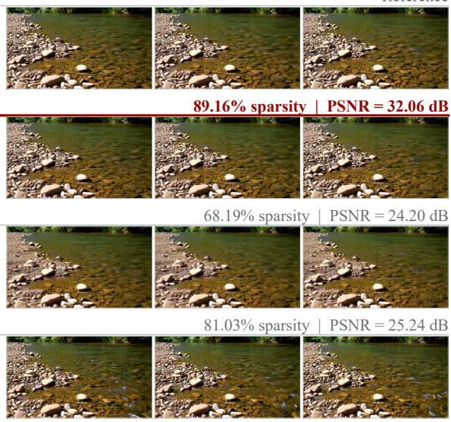

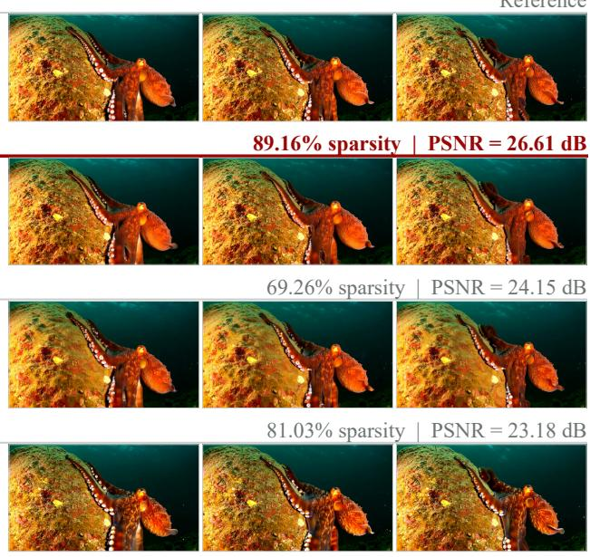

Dense  
  
Reference  
Reference

AB-Attention  

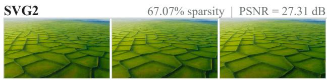

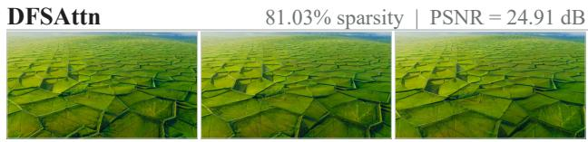  
(a) A vast grassland where every blade of grass is made up of geometric shapes ...  
(b) The stream flows gently, with pebbles scattered along its bed.

Dense  
Reference  
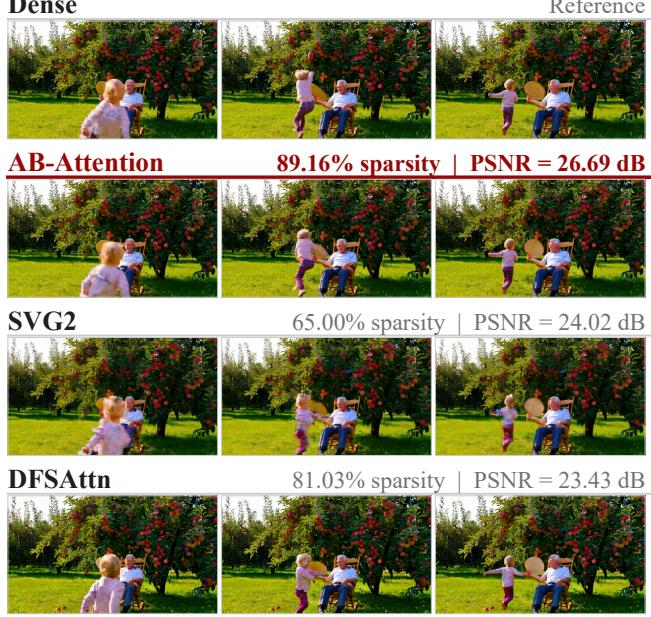  
Reference  
(c) In the yard, there is an apple tree ... A child is running and playing around the apple tree.  
(d) In the deep sea, there is a large rock ... To the right of the rock is a large octopus ...  
Figure 4 | Qualitative comparison on Wan2.1-T2V-14B. Panels (a)–(d) are four Penguin Benchmark prompts, abbreviated with ellipses. Within a panel, rows are methods and columns are frames 12, 40, and 68 of the same video. Headers show sparsity and full-video PSNR relative to the dense reference.

Table 2 | Ablation of the AB-Attention components on Wan2.1-T2V-14B. Each variant replaces one component at the same 89.16% sparsity.
<table><tr><td>Variant</td><td>PSNR ↑ SSIM↑ LPIPS ↓</td></tr><tr><td>AB-Attention</td><td>29.705 0.9154</td></tr><tr><td>IBCS Query pooling</td><td>28.793 -0.91 0.9024 0.1112</td></tr><tr><td>w/o weights SIP</td><td>25.706 -4.00 0.8427 Uniform w/o weights</td></tr><tr><td>Top-k selection</td><td>22.452 -7.25 0.7437 0.4749 25.711 -3.99 0.8420 0.1996</td></tr></table>

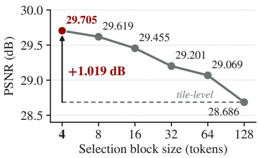  
Figure 5 | PSNR versus selection block size on Wan2.1-T2V-14B.

Eficiency follows the same ordering. AB-Attention reaches end-to-end speedups of 1.84–2.23×, ahead of every baseline on every model, and cuts the generation time of a HunyuanVideo video from 4399 s to 1975 s. Its closest competitor, DFSAttn on HunyuanVideo, reaches 2.07× only while computing 2.4 times as much attention, 18.71% versus 7.65% of dense attention. AB-Attention is thus at once the sparsest, the most faithful, and the fastest method on every model in Table 1.

## 4.3. Ablation Study

Table 2 ablates the three core designs of AB-Attention one at a time, keeping the other two fixed: the query clusters of IBCS, the sampling and weighting of SIP, and the fine-grained key/value selection unit. All variants use Wan2.1-T2V-14B with 100 prompts randomly sampled from the 600 Penguin Benchmark prompts and run at the same 89.16% sparsity as the main results.

Query clustering. IBCS summarizes each query block with its eight query clusters. To test whether grouping queries by feature similarity matters, we instead average eight consecutive 16-query intervals, as in positional sub-block pooling [13], keeping the number of representatives and hence the overall scoring cost unchanged. This query pooling variant lowers PSNR by 0.91 dB, with SSIM and LPIPS degrading accordingly. A positional interval mixes queries that attend to diferent keys, so its single mean can underrate a key block that only some of them attend to, whereas a cluster gathers queries with similar features, which tend to attend to similar keys.

Sampling and weighting. We compare SIP with three simpler alternatives at the same budget: score-proportional sampling without the inverse-inclusion weights, uniform sampling without weights, and deterministic top-� selection. Removing the weights lowers PSNR by 4.00 dB, to the level of top-� selection: without them, the blocks outside the sample are simply dropped, and sampling becomes another form of pruning. Discarding the scores as well then costs a further 3.25 dB and more than doubles LPIPS, because uniform sampling spends most of its fixed budget on the many blocks that receive little attention, as Figure 2(a) shows. The scores thus decide where to spend the limited budget, and the weights account for the blocks it leaves out; SIP needs both.

Selection granularity. Tile-level selection, which scores and samples whole execution tiles as conventional block-s arse attention does lowers PSNR b 1.02 dB. As Fi ure 5 shows PSNR rises steadil as the selection block shrinks from a full tile toward the 4-token blocks of AB-Attention, and Appendix D shows the same trend for SSIM and LPIPS. Smaller key/value blocks let the sample keep the few important keys in a region without spending any budget on their neighbors, and since the kernel of Section 3.3 packs them into full tiles, this gain costs no extra tensor-core work.

Overall, replacing SIP costs by far the most, 3.99–7.25 dB of PSNR, followed by tile-level selection at 1.02 dB and query pooling at 0.91 dB. Every variant is worse than AB-Attention on all three metrics, so at the same budget each component of AB-Attention contributes to its fidelity.

## 5. Related Work

Sparse Attention. Sparse attention accelerates video difusion transformers [23–25] by restricting query–key interactions to a subset that can be computed eficiently [26–31]. Static methods exploit video geometry with fixed sparsity patterns [32]: Sliding Tile Attention [4] uses tiled local 3D windows, Radial Attention [5] constructs a static multiscale mask from spatiotemporal energy decay, and Sparse VideoGen [3] profiles attention heads online to assign each head a predefined spatial or temporal pattern. Dynamic methods instead infer sparsity from the current activations. XAttention [7] estimates block importance by summing attention scores along strided antidiagonals, and SpargeAttention [6] combines coarse prediction from mean-compressed self-similar blocks with softmax-aware filtering. To improve block representations, SVG2 [8] clusters tokens by semantic similarity with �-means and permutes each cluster into contiguous blocks, and DFSAttn [13] combines 3D Hilbert-curve reordering with hierarchical sub-block scoring. SPADE [33] adapts block summaries and sparsity policies to each input. AdaSpa [12] and RAPID [34] amortize sparsity search by reusing and adapting masks across denoising steps. Across these designs, selection granularity, grouping overhead, and hardware-friendly execution remain coupled.

Correction-Based Sparse Attention. Pruning removes the skipped interactions from the attention numerator and the softmax normalizer. Training-free correction methods approximate these missing contributions: Rectified SpaAttn [9] rectifies the amplified weights of retained blocks and recovers those of pruned blocks from pooled attention, PISA [10] approximates the remaining blocks with a block-wise Taylor expansion, and SVG-EAR [11] compensates pruned blocks with cluster centroids and routes exact computation to the blocks with the largest error. All three compute selected blocks exactly and approximate the rest, whereas AB-Attention estimates both the numerator and the normalizer from one weighted sample of all blocks.

Other Acceleration Methods. Difusion inference can also be accelerated by reducing denoising steps [35–39], reusing intermediate computation [40–42], or reducing the sequence length processed per step [43, 44]. Fast solvers such as DPM-Solver [45] reduce the number of model evaluations, while progressive distillation [46] repeatedly trains a student to halve the number of sampling steps. TeaCache [47] reuses cached model outputs across denoising steps while the accumulated diference of timestep-modulated inputs stays below a threshold. DyDiT [48] dynamically adjusts model width across denoising timesteps and skips computation for less important spatial tokens; DyDiT++ [49] extends this approach to video generation and other visual-generation settings. RAPID3 [50] jointly learns policies for denoising-step skipping, feature-cache reuse, and sparseattention selection. FlashAttention [14] reduces memory trafic by computing exact attention tile by tile in on-chip memory, and SageAttention [51] accelerates attention by quantizing queries and keys to INT8. These approaches are complementary to sparse attention and can be combined with it [22, 52].

## 6. Conclusion

We presented AB-Attention, a training-free sparse attention method for video difusion transformers that directly estimates dense attention rather than truncating it. IBCS scores key/value blocks with lightweight query clusters formed only within each query block, and SIP samples blocks in proportion to these scores and reweights them by their inverse inclusion probabilities, so that a single block- sparse pass yields unbiased estimates of the attention numerator and normalizer. AB-Attention further decouples selection from execution: it selects key/value blocks much smaller than a tile and packs them into full tensor-core tiles in its kernel. On both Wan2.1 and HunyuanVideo, AB-Attention skips 89–92% of attention, whereas the baselines compute 1.8–3.6× as much, yet it stays closest to dense attention and reaches the highest end-to-end speedups of 1.84–2.23×.

Limitations and future work. Despite these encouraging results, AB-Attention remains limited in both its current implementation and application scope. Our kernel is built for the H20 GPUs used in our experiments and currently supports only forward inference, while our evaluation covers three text-to-video difusion transformers. Future work will address these limitations through kernel support for further hardware, evaluation on a broader range of models, and a trainable implementation with backward support that enables fine-tuning under AB-Attention.

## References

[1] Team Wan, Ang Wang, Baole Ai, Bin Wen, Chaojie Mao, Chen-Wei Xie, Di Chen, Feiwu Yu, Haiming Zhao, Jianxiao Yang, Jianyuan Zeng, Jiayu Wang, Jingfeng Zhang, Jingren Zhou, Jinkai Wang, Jixuan Chen, Kai Zhu, Kang Zhao, Keyu Yan, Lianghua Huang, Mengyang Feng, Ningyi Zhang, Pandeng Li, Pingyu Wu, Ruihang Chu, Ruili Feng, Shiwei Zhang, Siyang Sun, Tao Fang, Tianxing Wang, Tianyi Gui, Tingyu Weng, Tong Shen, Wei Lin, Wei Wang, Wei Wang, Wenmeng Zhou, Wente Wang, Wenting Shen, Wenyuan Yu, Xianzhong Shi, Xiaoming Huang, Xin Xu, Yan Kou, Yangyu Lv, Yifei Li, Yijing Liu, Yiming Wang, Yingya Zhang, Yitong Huang, Yong Li, You Wu, Yu Liu, Yulin Pan, Yun Zheng, Yuntao Hong, Yupeng Shi, Yutong Feng, Zeyinzi Jiang, Zhen Han, Zhi-Fan Wu, and Ziyu Liu. Wan: Open and advanced large-scale video generative models. arXiv preprint arXiv:2503.20314, 2025. doi: 10.48550/arXiv.2503.20314. URL https://arxiv.org/abs/2503.20314.

[2] Weijie Kong, Qi Tian, Zijian Zhang, Rox Min, Zuozhuo Dai, Jin Zhou, Jiangfeng Xiong, Xin Li, Bo Wu, Jianwei Zhang, Kathrina Wu, Qin Lin, Junkun Yuan, Yanxin Long, Aladdin Wang, Andong Wang, Changlin Li, Duojun Huang, Fang Yang, Hao Tan, Hongmei Wang, Jacob Song, Jiawang Bai, Jianbing Wu, Jinbao Xue, Joey Wang, Kai Wang, Mengyang Liu, Pengyu Li, Shuai Li, Weiyan Wang, Wenqing Yu, Xinchi Deng, Yang Li, Yi Chen, Yutao Cui, Yuanbo Peng, Zhentao Yu, Zhiyu He, Zhiyong Xu, Zixiang Zhou, Zunnan Xu, Yangyu Tao, Qinglin Lu, Songtao Liu, Dax Zhou, Hongfa Wang, Yong Yang, Di Wang, Yuhong Liu, Jie Jiang, and Caesar Zhong. HunyuanVideo: A systematic framework for large video generative models. arXiv preprint arXiv:2412.03603, 2024. doi: 10.48550/arXiv.2412.03603. URL https://arxiv.org/abs/2412.03603.

[3] Haocheng Xi, Shuo Yang, Yilong Zhao, Chenfeng Xu, Muyang Li, Xiuyu Li, Yujun Lin, Han Cai, Jintao Zhang, Dacheng Li, Jianfei Chen, Ion Stoica, Kurt Keutzer, and Song Han. Sparse video-gen: Accelerating video difusion transformers with spatial-temporal sparsity. In Aarti Singh, Maryam Fazel, Daniel Hsu, Simon Lacoste-Julien, Felix Berkenkamp, Tegan Maharaj, Kiri Wagstaf, and Jerry Zhu, editors, Proceedings of the 42nd International Conference on Machine Learning, volume 267 of Proceedings of Machine Learning Research, pages 68208–68224. PMLR, 13–19 Jul 2025. URL https://proceedings.mlr.press/v267/xi25c.html.

[4] Peiyuan Zhang, Yongqi Chen, Runlong Su, Hangliang Ding, Ion Stoica, Zhengzhong Liu, and Hao Zhang. Fast video generation with sliding tile attention. In Proceedings of the 42nd International Conference on Machine Learning, volume 267 of Proceedings of Machine Learning Research, pages 74714–74731. PMLR, 2025. URL https://proceedings.mlr.press/v267/zhang25m. html.

[5] Xingyang Li, Muyang Li, Tianle Cai, Haocheng Xi, Shuo Yang, Yujun Lin, Lvmin Zhang, Songlin Yang, Jinbo Hu, Kelly Peng, Maneesh Agrawala, Ion Stoica, Kurt Keutzer, and Song Han. Radial attention: O(� log �) sparse attention with energy decay for long video generation. In Advances in Neural Information Processing Systems, volume 38, pages 16822–16852. Curran Associates, Inc., 2025. doi: 10.52202/085713-0568. URL https://papers.neurips.cc/paper\_fi les/paper/2025/hash/18a367688479c1b08b001584218a4443-Abstract-Confere nce.html.

[6] Jintao Zhang, Chendong Xiang, Haofeng Huang, Jia Wei, Haocheng Xi, Jun Zhu, and Jianfei Chen. Spargeattention: Accurate and training-free sparse attention accelerating any model inference. In Proceedings of the 42nd International Conference on Machine Learning, volume 267 of Proceedings of Machine Learning Research, pages 76397–76413. PMLR, 2025. URL https://proceedings.mlr.press/v267/zhang25ch.html.

[7] Ruyi Xu, Guangxuan Xiao, Haofeng Huang, Junxian Guo, and Song Han. Xattention: Block sparse attention with antidiagonal scoring, 2025. URL https://arxiv.org/abs/2503.164 28.

[8] Shuo Yang, Haocheng Xi, Yilong Zhao, Muyang Li, Jintao Zhang, Han Cai, Yujun Lin, Xiuyu Li, Chenfeng Xu, Kelly Peng, Jianfei Chen, Song Han, Kurt Keutzer, and Ion Stoica. Sparse videogen2: Accelerate video generation with sparse attention via semantic-aware permutation. In D. Belgrave, C. Zhang, H. Lin, R. Pascanu, P. Koniusz, M. Ghassemi, and N. Chen, editors, Advances in Neural Information Processing Systems, volume 38, Main Conference, pages 96965– 96991. Curran Associates, Inc., 2025. doi: 10.52202/085713-3243. URL https://proceedi ngs.neurips.cc/paper\_files/paper/2025/file/8bd5148caced2d73cea7b6961a8 74a49-Paper-Conference.pdf.

[9] Xuewen Liu, Zhikai Li, Jing Zhang, Mengjuan Chen, and Qingyi Gu. Rectified spaattn: Revisiting attention sparsity for eficient video generation, 2025. URL https://arxiv.org/abs/2511 .19835.

[10] Haopeng Li, Shitong Shao, Wenliang Zhong, Zikai Zhou, Lichen Bai, Hui Xiong, and Zeke Xie. Pisa: Piecewise sparse attention is wiser for eficient difusion transformers, 2026. URL https://arxiv.org/abs/2602.01077.

[11] Xuanyi Zhou, Qiuyang Mang, Shuo Yang, Haocheng Xi, Jintao Zhang, Huanzhi Mao, Joseph E. Gonzalez, Kurt Keutzer, Ion Stoica, and Alvin Cheung. Svg-ear: Parameter-free linear compensation for sparse video generation via error-aware routing, 2026. URL https://arxiv.org/ abs/2603.08982.

[12] Yifei Xia, Suhan Ling, Fangcheng Fu, Yujie Wang, Huixia Li, Xuefeng Xiao, and Bin Cui. Training- free and adaptive sparse attention for eficient long video generation. In Proceedings of the IEEE/CVF International Conference on Computer Vision (ICCV), pages 15982–15993, October 2025.

[13] Jie Hu, Zixiang Gao, Yutong He, and Kun Yuan. DFSAttn: Dynamic fine-grained sparse attention for eficient video generation. In Forty-third International Conference on Machine Learning, 2026. URL https://openreview.net/forum?id=GO0G6bo9UO.

[14] Tri Dao, Dan Fu, Stefano Ermon, Atri Rudra, and Christopher Ré. Flashattention: Fast and memory-eficient exact attention with io-awareness. In S. Koyejo, S. Mohamed, A. Agarwal, D. Belgrave, K. Cho, and A. Oh, editors, Advances in Neural Information Processing Systems, volume 35, pages 16344–16359. Curran Associates, Inc., 2022. doi: 10.52202/068431-1189. URL https://proceedings.neurips.cc/paper\_files/paper/2022/file/67d57c3 2e20fd0a7a302cb81d36e40d5-Paper-Conference.pdf.

[15] William G. Madow. On the theory of systematic sampling, ii. The Annals of Mathematical Statistics, 20(3):333–354, 1949. doi: 10.1214/aoms/1177729988.

[16] Daniel G. Horvitz and Donovan J. Thompson. A generalization of sampling without replacement from a finite universe. Journal of the American Statistical Association, 47(260):663–685, 1952. doi: 10.1080/01621459.1952.10483446.

[17] Zhou Wang, Alan C. Bovik, Hamid R. Sheikh, and Eero P. Simoncelli. Image quality assessment: From error visibility to structural similarity. IEEE Transactions on Image Processing, 13(4): 600–612, 2004. doi: 10.1109/TIP.2003.819861.

[18] Richard Zhang, Phillip Isola, Alexei A. Efros, Eli Shechtman, and Oliver Wang. The unreasonable efectiveness of deep features as a perceptual metric. In Proceedings of the IEEE Conference on Computer Vision and Pattern Recognition, pages 586–595, 2018. URL https://openaccess .thecvf.com/content\_cvpr\_2018/html/Zhang\_The\_Unreasonable\_Effectivenes s\_CVPR\_2018\_paper.html.

[19] Ziqi Huang, Yinan He, Jiashuo Yu, Fan Zhang, Chenyang Si, Yuming Jiang, Yuanhan Zhang, Tianxing Wu, Qingyang Jin, Nattapol Chanpaisit, Yaohui Wang, Xinyuan Chen, Limin Wang, Dahua Lin, Yu Qiao, and Ziwei Liu. VBench: Comprehensive benchmark suite for video generative models. In Proceedings of the IEEE/CVF Conference on Computer Vision and Pattern Recognition, pages 21807–21818, 2024.

[20] Junxian Guo, Haotian Tang, Shang Yang, Zhekai Zhang, Zhijian Liu, and Song Han. Block Sparse Attention. https://github.com/mit-han-lab/Block-Sparse-Attention, 2024.

[21] Zihao Ye, Lequn Chen, Ruihang Lai, Wuwei Lin, Yineng Zhang, Stephanie Wang, Tianqi Chen, Baris Kasikci, Vinod Grover, Arvind Krishnamurthy, and Luis Ceze. Flashinfer: Eficient and customizable attention engine for LLM inference serving. In Eighth Conference on Machine Learning and Systems, 2025. URL https://openreview.net/forum?id=RXPofAsL8F.

[22] Jay Shah, Ganesh Bikshandi, Ying Zhang, Vijay Thakkar, Pradeep Ramani, and Tri Dao. Flashattention-3: Fast and accurate attention with as nchron and low- recision. In A. Globerson, L. Mackey, D. Belgrave, A. Fan, U. Paquet, J. Tomczak, and C. Zhang, editors, Advances in Neural Information Processing Systems, volume 37, pages 68658–68685. Curran Associates, Inc., 2024. doi: 10.52202/079017-2193. URL https://proceedings.neurips.cc/paper\_files/p aper/2024/file/7ede97c3e082c6df10a8d6103a2eebd2-Paper-Conference.pdf.

[23] William Peebles and Saining Xie. Scalable difusion models with transformers. In 2023 IEEE/CVF International Conference on Computer Vision (ICCV), pages 4172–4182, 2023. doi: 10.1109/IC CV51070.2023.00387.

[24] Xin Ma, Yaohui Wan , Xin uan Chen, Gen un Jia, Ziwei Liu, Yuan-Fan Li, Cunjian Chen, and Yu Qiao. Latte: Latent difusion transformer for video generation. Transactions on Machine Learning Research, 2025. ISSN 2835-8856. URL https://openreview.net/forum?id=nt GPYNUF3t.

[25] Zhuoyi Yang, Jiayan Teng, Wendi Zheng, Ming Ding, Shiyu Huang, Jiazheng Xu, Yuanming Yang, Wenyi Hong, Xiaohan Zhang, Guanyu Feng, Da Yin, Yuxuan Zhang, Weihan Wang, Yean Cheng, Xu Bin, Xiaotao Gu, Yuxiao Dong, and Jie Tang. Cogvideox: Text-to-video difusion models with an expert transformer. In Y. Yue, A. Garg, N. Peng, F. Sha, and R. Yu, editors, International Conference on Learning Representations, volume 2025, pages 83048–83077, 2025. URL https://proceedings.iclr.cc/paper\_files/paper/2025/file/ce31378e9f 41d8907e97dab172b6c559-Paper-Conference.pdf.

[26] Rewon Child, Scott Gray, Alec Radford, and Ilya Sutskever. Generating long sequences with sparse transformers, 2019. URL https://arxiv.org/abs/1904.10509.

[27] Iz Beltagy, Matthew E. Peters, and Arman Cohan. Longformer: The long-document transformer, 2020. URL https://arxiv.org/abs/2004.05150.

[28] Manzil Zaheer, Guru Guruganesh, Kumar Avinava Dubey, Joshua Ainslie, Chris Alberti, Santiago Ontanon, Philip Pham, Anirudh Ravula, Qifan Wang, Li Yang, and Amr Ahmed. Big bird:

Transformers for longer sequences. In H. Larochelle, M. Ranzato, R. Hadsell, M.F. Balcan, and H. Lin, editors, Advances in Neural Information Processing Systems, volume 33, pages 17283– 17297. Curran Associates, Inc., 2020. URL https://proceedings.neurips.cc/paper\_f iles/paper/2020/file/c8512d142a2d849725f31a9a7a361ab9-Paper.pdf.

[29] Aurko Roy, Mohammad Safar, Ashish Vaswani, and David Grangier. Eficient content-based sparse attention with routing transformers. Transactions of the Association for Computational Linguistics, 9:53–68, 2021. doi: 10.1162/tacl\_a\_00353. URL https://aclanthology.org /2021.tacl-1.4/.

[30] Krzysztof Marcin Choromanski, Valerii Likhosherstov, David Dohan, Xingyou Song, Andreea Gane, Tamas Sarlos, Peter Hawkins, Jared Quincy Davis, Afroz Mohiuddin, Lukasz Kaiser, David Benjamin Belanger, Lucy J Colwell, and Adrian Weller. Rethinking attention with performers. In International Conference on Learning Representations, 2021. URL https: //openreview.net/forum?id=Ua6zuk0WRH.

[31] Yunyang Xiong, Zhanpeng Zeng, Rudrasis Chakraborty, Mingxing Tan, Glenn Fung, Yin Li, and Vikas Singh. Nyströmformer: A nyström-based algorithm for approximating self-attention. 2021.

[32] Pengtao Chen, Xianfang Zeng, Maosen Zhao, Mingzhu Shen, Wei Cheng, Gang Yu, and Tao Chen. Sparse-vdit: Unleashing the power of sparse attention to accelerate video difusion transformers. In Proceedings of the AAAI Conference on Artificial Intelligence, volume 40, pages 2957–2965, 2026. doi: 10.1609/aaai.v40i4.37287. URL https://ojs.aaai.org/index.p hp/AAAI/article/view/37287.

[33] Shanghao Liu, Renze Chen, Size Zheng, Yuanqiang Liu, Yun Liang, and Hailong Yang. SPADE: An input-adaptive sparse attention engine for fast video difusion models inference. In Proceedings of the 63rd ACM/IEEE Design Automation Conference, 2026. doi: 10.1145/3770743.3804015. URL https://arxiv.org/abs/2608.03335.

[34] Shangran Lin, Lu Lu, Jian Chen, and Qiang Liu. Rapid: Reusing attention sparsity with inter-step adaptation for eficient video difusion. In Proceedings of the IEEE/CVF Conference on Computer Vision and Pattern Recognition (CVPR), pages 36147–36156, June 2026.

[35] Jiaming Song, Chenlin Meng, and Stefano Ermon. Denoising difusion implicit models. In International Conference on Learning Representations, 2021. URL https://openreview.net /forum?id=St1giarCHLP.

[36] Chen Lu, Yuhao Zhou, Fan Bao, Jianfei Chen, Chon xuan Li, and Jun Zhu. DPM-solver++: Fast solver for guided sampling of difusion probabilistic models, 2023. URL https://openre view.net/forum?id=4vGwQqviud5.

[37] Wenliang Zhao, Lujia Bai, Yongming Rao, Jie Zhou, and Jiwen Lu. Unipc: A unified predictor-corrector framework for fast sampling of difusion models. In A. Oh, T. Naumann, A. Globerson, K. Saenko, M. Hardt, and S. Levine, editors, Advances in Neural Information Processing Systems, volume 36, pages 49842–49869. Curran Associates, Inc., 2023. doi: 10.52202/075280-2170. URL https://proceedings.neurips.cc/paper\_files/paper/2023/file/9c2aa1e 456ea543997f6927295196381-Paper-Conference.pdf.

[38] Yang Song, Prafulla Dhariwal, Mark Chen, and Ilya Sutskever. Consistency models. In Andreas Krause, Emma Brunskill, Kyunghyun Cho, Barbara Engelhardt, Sivan Sabato, and Jonathan Scarlett, editors, Proceedings of the 40th International Conference on Machine Learning, volume

202 of Proceedings of Machine Learning Research, pages 32211–32252. PMLR, 23–29 Jul 2023. URL https://proceedings.mlr.press/v202/song23a.html.

[39] Simian Luo, Yiqin Tan, Longbo Huang, Jian Li, and Hang Zhao. Latent consistency models: Synthesizing high-resolution images with few-step inference, 2024. URL https://openrevi ew.net/forum?id=duBCwjb68o.

[40] Xinyin Ma, Gongfan Fang, and Xinchao Wang. Deepcache: Accelerating difusion models for free. In Proceedings of the IEEE/CVF Conference on Computer Vision and Pattern Recognition (CVPR), pages 15762–15772, June 2024.

[41] Xuanlei Zhao, Xiaolong Jin, Kai Wang, and Yang You. Real-time video generation with pyramid attention broadcast. In Y. Yue, A. Garg, N. Peng, F. Sha, and R. Yu, editors, International Conference on Learning Representations, volume 2025, pages 3296–3319, 2025. URL https: //proceedings.iclr.cc/paper\_files/paper/2025/file/092c2d45005ea2db40fc 24c470663416-Paper-Conference.pdf.

[42] Zhengyao Lyu, Chenyang Si, Junhao Song, Zhenyu Yang, Yu Qiao, Ziwei Liu, and Kwan-Yee K Wong. Fastercache: Training-free video difusion model acceleration with high quality. In Y. Yue, A. Garg, N. Peng, F. Sha, and R. Yu, editors, International Conference on Learning Representations, volume 2025, pages 33132–33156, 2025. URL https://proceedings.iclr.cc/paper\_ files/paper/2025/file/518046d86bbc41a0707727c38301ad8e-Paper-Conferenc e.pdf.

[43] Daniel Bolya, Cheng-Yang Fu, Xiaoliang Dai, Peizhao Zhang, Christoph Feichtenhofer, and Judy Hofman. Token merging: Your vit but faster. In The Eleventh International Conference on Learning Representations, 2023. URL https://openreview.net/forum?id=JroZRaRw7Eu.

[44] Daniel Bolya and Judy Hofman. Token merging for fast stable difusion. CVPR Workshop on Eficient Deep Learning for Computer Vision, 2023.

[45] Chen Lu, Yuhao Zhou, Fan Bao, Jianfei Chen, Chon xuan LI, and Jun Zhu. D m-solver: A fast ode solver for difusion probabilistic model sampling in around 10 steps. In S. Koyejo, S. Mohamed, A. Agarwal, D. Belgrave, K. Cho, and A. Oh, editors, Advances in Neural Information Processing Systems, volume 35, pages 5775–5787. Curran Associates, Inc., 2022. doi: 10.52202 /068431-0418. URL https://proceedings.neurips.cc/paper\_files/paper/2022/ file/260a14acce2a89dad36adc8eefe7c59e-Paper-Conference.pdf.

[46] Tim Salimans and Jonathan Ho. Progressive distillation for fast sampling of difusion models. In International Conference on Learning Representations, 2022. URL https://openreview.n et/forum?id=TIdIXIpzhoI.

[47] Feng Liu, Shiwei Zhang, Xiaofeng Wang, Yujie Wei, Haonan Qiu, Yuzhong Zhao, Yingya Zhang, Qixiang Ye, and Fang Wan. Timestep embedding tells: It’s time to cache for video difusion model. In Proceedings of the IEEE/CVF Conference on Computer Vision and Pattern Recognition (CVPR), pages 7353–7363, June 2025.

[48] Wangbo Zhao, Yizeng Han, Jiasheng Tang, Kai Wang, Yibing Song, Gao Huang, Fan Wang, and Yang You. Dynamic difusion transformer. In International Conference on Learning Representations, pages 65520–65552, 2025. URL https://proceedings.iclr.cc/paper\_files/paper/ 2025/file/a44a70acd5d0abc1a252ada9719dd06d-Paper-Conference.pdf.

[49] Wangbo Zhao, Yizeng Han, Jiasheng Tang, Kai Wang, Hao Luo, Yibing Song, Gao Huang, Fan Wang, and Yang You. Dydit++: Difusion transformers with timestep and spatial dynamics for eficient visual generation. IEEE Transactions on Pattern Analysis and Machine Intelligence, 48 (5):5755–5773, 2026. doi: 10.1109/TPAMI.2026.3654201. URL https://doi.org/10.110 9/TPAMI.2026.3654201.

[50] Wangbo Zhao, Yizeng Han, Zhiwei Tang, Jiasheng Tang, Pengfei Zhou, Kai Wang, Bohan Zhuang, Zhangyang Wang, Fan Wang, and Yang You. Rapid3: Tri-level reinforced acceleration policies for difusion transformer. In International Conference on Learning Representations, pages 149423–149446, 2026. URL https://proceedings.iclr.cc/paper\_files/paper/20 26/file/f1cf02ce09757f57c3b93c0db83181e0-Paper-Conference.pdf.

[51] Jintao Zhang, Jia wei, Pengle Zhang, Jun Zhu, and Jianfei Chen. Sageattention: Accurate 8-bit attention for plug-and-play inference acceleration. In Y. Yue, A. Garg, N. Peng, F. Sha, and R. Yu, editors, International Conference on Learning Representations, volume 2025, pages 71566–71585, 2025. URL https://proceedings.iclr.cc/paper\_files/paper/2025 /file/b286c344d38e10d2466c0514b78e2f36-Paper-Conference.pdf.

[52] Tri Dao. Flashattention-2: Faster attention with better parallelism and work partitioning. In The Twelfth International Conference on Learning Representations, 2024. URL https://openre view.net/forum?id=mZn2Xyh9Ec.

[53] Teofilo F. Gonzalez. Clustering to minimize the maximum intercluster distance. Theoretical Computer Science, 38:293–306, 1985. ISSN 0304-3975. doi: https://doi.org/10.1016/0304-3 975(85)90224-5. URL https://www.sciencedirect.com/science/article/pii/03 04397585902245.

## A. Sampling and Estimation Details

## A.1. Query Centroids and Pooled Keys

The single �-means iteration of IBCS starts from � centers chosen in each query block by farthest-first traversal [53]. For the four-token key blocks, the first two and the last two keys are mean-pooled into the two pooled keys of ${ \bar { K } } _ { j }$ in Equation 3. Pooling halves the scoring cost, and since every pooled key stands for two keys, key-side size weights cancel in the softmax.

## A.2. Systematic Sampling Without Replacement

Inclusion probabilities. The scale $\lambda _ { i }$ in Equation 4 is found iteratively: scale the remaining scores to the remaining budget, set $\pi _ { i j } = 1$ for blocks whose scaled scores reach one, deduct them from the budget, and repeat. Scores are floored at $1 0 ^ { - 3 0 }$ , so every $\pi _ { i j }$ stays positive, as Appendix A.3 requires. The budget � is a multiple of 32, so the sample fills whole 128-token tiles.

Systematic draw. Let $H _ { i } = \{ j : \pi _ { i j } = 1 \}$ and $s ^ { \prime } = s - \left| H _ { i } \right|$ . Order the remaining blocks as $j _ { 1 } , \ldots , j _ { L }$ by index, let $F _ { 0 } = 0$ and $\begin{array} { r } { F _ { t } = \sum _ { h = 1 } ^ { t } \pi _ { i j _ { h } } . } \end{array}$ , so $F _ { L } = s ^ { \prime }$ , draw $\xi \sim \operatorname { U n i f o r m } [ 0 , 1 )$ , and include $j _ { t }$ if

$$
F _ { t - 1 } \leq \xi + r < F _ { t } \quad { \mathrm { f o r ~ s o m e ~ } } r \in \{ 0 , \ldots , s ^ { \prime } - 1 \} .\tag{6}
$$

The intervals $[ F _ { t - 1 } , F _ { t } )$ tile $[ 0 , s ^ { \prime } )$ , which contains the $s ^ { \prime }$ thresholds $\xi + r$ spaced one apart. An interval of length $\pi _ { i j _ { t } } < 1$ contains at most one threshold, and does so with probability $\pi _ { i j _ { t } }$ [15]. With $H _ { i } ,$ the draw returns exactly � distinct blocks with inclusion probabilities $\pi _ { i j }$ . Independent per-block draws would make the sample size random, and sampling with replacement could repeat blocks, leaving tiles partly empty or wasting tensor-core work on duplicates.

## A.3. Weighted Attention Estimation

With the block contributions $N _ { i j }$ and $D _ { i j }$ defined before Equation $5 ,$ let $I _ { i j }$ indicate whether block � is sampled for query block �. The Horvitz–Thompson estimates

$$
\widehat { N } _ { i } = \sum _ { j = 1 } ^ { M } \frac { I _ { i j } N _ { i j } } { \pi _ { i j } } , \qquad \widehat { D } _ { i } = \sum _ { j = 1 } ^ { M } \frac { I _ { i j } D _ { i j } } { \pi _ { i j } }\tag{7}
$$

satisfy $\mathbb { E } [ \widehat { N } _ { i } ] = N _ { i }$ and $\mathbb { E } [ \widehat { D } _ { i } ] = D _ { i }$ for fixed activations, since $\mathbb { E } [ I _ { i j } ] = \pi _ { i j } ;$ this needs no independence between blocks, which systematic sampling lacks. The ratio $\widehat { O } _ { i } = \widehat { N } _ { i } / \widehat { D } _ { i }$ is biased in general. Since $A _ { i j } / \pi _ { i j } = \exp ( { Q _ { i } K _ { i } ^ { \top } / \sqrt { d } - \log \pi _ { i j } } )$ , it is softmax attention over sampled blocks with the logits of block � shifted by $- \log { \pi } _ { i j }$ , the last form of Equation 5. Tiling the sampled blocks changes neither their indices nor weights, so the online-softmax kernel of Algorithm 1 computes $\widehat { O } _ { i }$ exactly.

## B. Implementation Details

## B.1. AB-Attention

On Wan2.1, AB-Attention replaces the self-attention among video tokens, and cross-attention to the text remains dense. HunyuanVideo attends jointly over video and prompt tokens; AB-Attention samples only the video keys of video queries, while attention to prompt keys and all attention from prompt queries remain exact.

Both Wan2.1 models share one configuration. Queries are divided into blocks of $B _ { q } = 1 2 8$ tokens and keys and values into blocks of $b = 4$ tokens. IBCS forms $R = 8$ query clusters per query block with one �-means iteration from farthest-first centers, and pools each key block into two keys, as described in Appendix A.1. SIP samples � = 2048 key/value blocks (8192 keys) per query block on Wan2.1 and � = 2272 (9088 keys) on HunyuanVideo, 10.84% and 7.65% of the 18,900 and 29,700 blocks of a video, which gives the sparsity of 89.16% and 92.35%. Attention stays dense in the first transformer block and in denoising steps 1–10. From step 11, the sampling plan is rebuilt every � = 4 steps, at steps 11, 15, . . . , 47, and reused for the steps in between. Sampling uses seed 42.

## B.2. Baselines

RadialAttention [5] uses a decay factor of 0.2 on Wan2.1 and 0.95 on HunyuanVideo, with the 720p video tokens zero-padded to a multiple of its 128-token mask block. SVG2 [8] groups queries and keys into 100 and 500 clusters and keeps key clusters up to a cumulative attention of 0.9, with a minimum key ratio of 0.1. DFSAttn [13] reorders tokens along a 3D Hilbert curve, scores blocks with 16-token sub-blocks, and refreshes its mask every 12 steps; the retained block fraction starts at 0.3 and drops by 0.1 per refresh down to 0.1.

## C. Evaluation Protocol

Quality metrics. PSNR, SSIM, and LPIPS with the VGG backbone are computed on RGB frames in [0, 1], averaged over the frames of each video, and then averaged over prompts. The five VBench dimensions are evaluated per video and averaged over prompts.

Sparsity. Sparsity counts only the sparse denoising steps. It comes from the static mask for Radi-alAttention, from the allocated top-� budget for DFSAttn, from the token pairs kept by the recorded cluster masks for SVG2, and from the recorded block selections for AB-Attention.

Table 3 | Fidelity to dense attention for each selection block size on Wan2.1-T2V-14B (100 prompts). Every row executes 8192 key tokens per query block in 128-token tiles (89.16% sparsity). Block size 4 is the full AB-Attention, and block size 128 is tile-level selection.

<table><tr><td>Block size</td><td>PSNR ↑</td><td>SSIM ↑</td><td>LPIPS ↓</td></tr><tr><td>4</td><td>29.705</td><td>0.9154</td><td>0.0956</td></tr><tr><td>8</td><td>29.619</td><td>0.9150</td><td>0.0956</td></tr><tr><td>16</td><td>29.455</td><td>0.9108</td><td>0.0985</td></tr><tr><td>32</td><td>29.201</td><td>0.9092</td><td>0.1015</td></tr><tr><td>64</td><td>29.069</td><td>0.9072</td><td>0.1032</td></tr><tr><td>128</td><td>28.686</td><td>0.9006</td><td>0.1113</td></tr></table>

Latency. Latency is measured end to end for one video on NVIDIA H20 GPUs. The timed region covers text encoding, all 50 denoising steps, and VAE decoding, and excludes model loading, initial-noise loading, and video export. For AB-Attention, plan construction and sampling fall inside the denoising steps and are therefore timed.

## D. Additional Ablation Results

Table 3 reports PSNR, SSIM, and LPIPS for the block-size sweep of Figure 5; none of them degrades as the selection block shrinks from 128 to 4 tokens.