# ACD-GS: Asymmetric Curvature-aware Densification for 3D Gaussian Splatting

Houqiang Zhong1∗ Tianchi Zhu1,3∗ Qiang Hu2† Xiaoyun Zhang2 Li Song1† Wenjun Zhang1

1 School of Information Science and Electronic Engineering

2 Cooperative Medianet Innovation Center

3 SJTU Paris Elite Institute of Technology

Shanghai Jiao Tong University, Shanghai, China

{zhonghouqiang,zhutianchi,qiang.hu,xiaoyun.zhang}@sjtu.edu.cn {song\_li,zhangwenjun}@sjtu.edu.cn

## Abstract

3D Gaussian Splatting (3DGS) has emerged as a powerful paradigm for real-time photorealistic novel view synthesis. However, its training-time densification remains largely heuristic, often resulting in redundant Gaussian proliferation and inaccurate geometric reconstruction. Existing methods predominantly rely on firstorder screen-space gradients to trigger cloning and splitting, which fail to distinguish true geometric discontinuities from high-frequency textures or noisy residuals. To address this limitation, we propose ACD-GS, an Asymmetric Curvatureaware Densification framework for compact and geometry-aware 3D Gaussian optimization. Our key insight is that second-order depth responses provide a more reliable structural prior for density control, enabling asymmetric regulation of cloning and splitting to better capture geometric discontinuities. Building on this, we introduce a multi-view photometric consistency constraint to suppress transient single-view errors, together with a capacity-aware adaptive regulation strategy that balances densification and pruning during training. Unlike post-hoc compression or quantization-based approaches, ACD-GS directly prevents redundant Gaussian generation during training, yielding inherently compact representations. Extensive experiments demonstrate that our method reduces nearly 60% of Gaussian count and storage while maintaining competitive rendering fidelity, consistently outperforming existing methods across multiple datasets. Our code is available in https://waveviewer.github.io/ACD-GS/.

## 1 Introduction

3D Gaussian Splatting (3DGS) [1] has rapidly emerged as a powerful paradigm for real-time photorealistic novel view synthesis. Unlike implicit neural radiance fields, 3DGS represents a scene as an explicit collection of anisotropic Gaussian primitives and renders them through differentiable rasterization, achieving both high rendering fidelity and remarkable efficiency. Benefiting from its explicit representation and fast optimization, 3DGS has inspired extensive advances in anti-aliasing [2–4], surface reconstruction [5–9], dynamic scene modeling [10–14], compression [15–19], and hybrid implicit-explicit representations [20–25]. Despite these advances, the efficiency and scalability of 3DGS still critically depend on how Gaussian primitives are created and evolved during optimization.

In standard 3DGS, densification is mainly driven by accumulated screen-space positional gradients, where Gaussians are cloned or split once the gradient magnitude exceeds predefined thresholds.

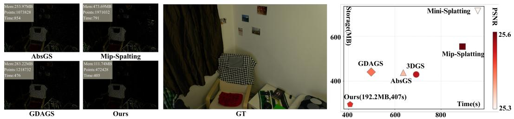

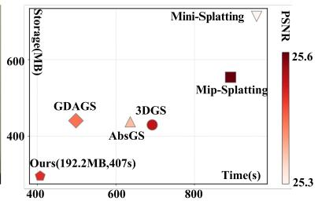  
Figure 1: The point-cloud visualizations show our ACD-GS produces sparser Gaussians while preserving scene structure. The right plot (training time vs. storage, color-coded by PSNR) confirms that we achieve lower storage and faster training without sacrificing rendering quality.

While simple and effective in practice, this mechanism remains largely geometry-agnostic, as firstorder gradients primarily reflect local optimization pressure rather than underlying scene structure. Consequently, regions with high-frequency textures, smoothly varying surfaces, and sharp geometric boundaries may all produce similarly large gradients despite requiring fundamentally different density-control behaviors. A flat textured wall, for example, should avoid excessive Gaussian proliferation, whereas thin structures and depth discontinuities require localized geometric refinement. This reveals an intrinsic ambiguity in gradient-driven densification, where first-order photometric signals alone are insufficient for reliable density control.

This ambiguity leads to a persistent trade-off in existing densification strategies [26–30]. Aggressive thresholds tend to trigger excessive Gaussian growth in textured regions, resulting in redundant primitives, increased storage overhead, unstable optimization, and floating artifacts near foregroundbackground transitions. Conversely, conservative thresholds often fail to reconstruct fine structures and sharp depth discontinuities. Recent approaches attempt to improve densification stability by incorporating pixel-aware gradients [27], absolute gradient magnitudes [28], or gradient-direction statistics [29, 30]. Although these methods alleviate optimization instability to some extent, they still rely primarily on first-order, single-view photometric signals and therefore remain insufficient for disentangling true geometric complexity from texture-induced residuals. As a result, existing methods struggle to simultaneously achieve compact representations, geometric fidelity, and stable optimization. These limitations motivate the need for a geometry-aware density-control prior that directly reflects scene structure rather than relying solely on photometric optimization cues.

In this work, we propose ACD-GS, an Asymmetric Curvature-aware Densification framework that reformulates Gaussian densification as a geometry-aware optimization process. Our key insight is that second-order depth responses provide a more reliable structural cue for identifying geometric discontinuities than first-order screen-space gradients. Compared with gradient magnitude alone, depth curvature is more sensitive to local geometric changes such as occlusion boundaries, thin structures, and high-curvature regions, while remaining less responsive to purely planar textured areas. Based on this observation, ACD-GS introduces an asymmetric densification mechanism that explicitly decouples cloning and splitting behaviors according to curvature-aware structural priors. Specifically, cloning is suppressed near depth discontinuities to avoid ambiguous foreground-background duplication and floating artifacts, whereas splitting is promoted to refine boundary-crossing Gaussians into finer geometric primitives.

To further resolve the ambiguity between geometry and appearance, we introduce a multi-view photometric error gating strategy that enforces cross-view consistency instead of relying on volatile single-view residuals. Furthermore, we design a capacity-constrained adaptive optimization scheme that dynamically regulates primitive growth and lifecycle-aware pruning throughout training. Together, these designs establish a unified geometry-aware density-control framework that enables native sparsification, where redundant Gaussian primitives are prevented during training rather than removed through post-hoc compression or quantization pipelines. Extensive experiments demonstrate that ACD-GS reduces nearly 60% of Gaussian primitives and storage while maintaining competitive rendering fidelity across multiple datasets, consistently achieving a favorable quality and compactness trade-off compared with existing methods.

Our contributions are summarized as follows:

• We propose ACD-GS, an asymmetric curvature-aware densification framework that leverages second-order depth priors to explicitly decouple cloning and splitting behaviors for geometry-aware Gaussian evolution.

• We introduce a multi-view photometric error gating strategy and a capacity-constrained adaptive optimization scheme to suppress transient photometric noise, regulate primitive growth, and encourage compact yet high-fidelity representations.

• Extensive experiments demonstrate that ACD-GS significantly reduces Gaussian count and model storage natively during training while maintaining competitive rendering quality across multiple datasets.

## 2 Related Work

## 2.1 3D Gaussian Splatting Representation

3D Gaussian Splatting (3DGS) [1] represents a scene as anisotropic Gaussian primitives and renders them through differentiable rasterization. Its explicit formulation has inspired extensions for antialiasing $[ 2 - 4 ]$ , surface reconstruction [5–9], dynamic scenes [10–14], and appearance modeling [31– 34]. Hybrid representations such as Scaffold-GS [20], SplatNet [23], and Octree-GS [21] further organize primitives with learned features or hierarchical structures, while implicit fields [35–38] provide complementary scene parameterizations. These methods mainly change representation or rendering; the number and placement of Gaussians still depend on training-time density control, which is the focus of this work. Because all of them retain a primitive-based rendering pipeline, their efficiency and fidelity are also affected by how many Gaussians remain after optimization.

## 2.2 Gradient-Driven Density Control

Standard 3DGS [1] densifies Gaussians using accumulated screen-space positional gradients. Pixel-GS [27] accounts for pixel coverage, AbsGS [28] uses absolute gradients to reduce cancellation, and GDAGS [29] incorporates gradient-direction information; other methods add external constraints [26, 30]. FastGS [39] instead estimates Gaussian importance from multi-view reconstruction errors inside projected footprints and uses this score for both densification and pruning. ACD-GS shares the use of multi-view evidence but assigns it a different role: rendered-depth curvature modulates cloning and splitting, while center-projected RGB residuals only verify whether a candidate is consistently under-reconstructed across views. This separates structural guidance from photometric verification and avoids using a footprint error score as the direct densification criterion.

## 2.3 3DGS Compression

Post-hoc compression reduces Gaussian storage through significance-based pruning and vector quantization [40, 41, 15, 42–44], while context models and entropy coding target rate–distortion efficiency [17, 18, 45–47]. Mini-Splatting [48] studies compact representations under constrained primitive budgets. These approaches mainly operate after or around training and may require codebooks or fine-tuning. ACD-GS instead reduces redundant primitive generation during optimization, without a post-hoc quantization stage. Because it changes where capacity is allocated rather than how parameters are encoded, it can be combined with downstream compression; this combination is not evaluated here. This distinction also delimits the scope of our experiments, which measure training-time sparsification rather than gains from entropy coding or quantization.

## 3 Method

## 3.1 Problem Formulation and Overview

3D Gaussian Splatting (3DGS) represents a scene as a set of anisotropic Gaussian primitives $\mathcal { G } =$ $\{ G _ { i } \} _ { i = 1 } ^ { N }$ optimized through differentiable alpha blending. During training, standard 3DGS densifies visible Gaussians according to their accumulated view-space positional gradients:

$$
g _ { i } = \sum \left\| \frac { \partial \mathcal { L } } { \partial \pmb { \mu } _ { i } ^ { 2 D } } \right\| ,\tag{1}
$$

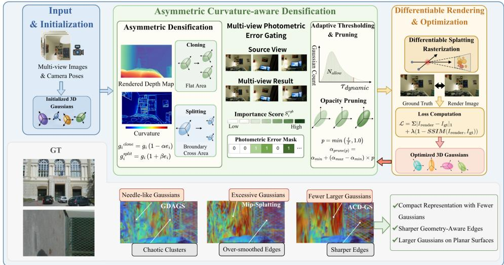  
Figure 2: Overview of ACD-GS. Curvature-guided asymmetric densification suppresses cloning and promotes splitting near depth boundaries; multi-view photometric gating verifies candidates; capacity-aware thresholding and opacity pruning regulate growth. Depth is rendered from the current Gaussians rather than input.

where $\mu _ { i } ^ { 2 D }$ is the projected 2D center of $G _ { i } .$ . A Gaussian is cloned or split once $g _ { i }$ exceeds a fixed threshold $\tau _ { \mathrm { g r a d } }$ , with the operation determined by scale-based heuristics. However, such first-order gradient-driven densification is geometry-agnostic. Large photometric gradients may be caused by flat textures, smooth slopes, or true depth discontinuities, although these cases require different density-control behaviors. This ambiguity often leads to redundant primitives on planar or textured regions, while sharp boundaries and thin structures may remain under-refined.

We propose Asymmetric Curvature-aware Densification for 3D Gaussian Splatting (ACD-GS), a plug-and-play density-control module that replaces the heuristic densification step in 3DGS to prevent redundant primitive generation at its source (Fig. 2). At its core, ACD-GS utilizes a secondorder depth curvature prior, which is highly responsive to structural discontinuities but robust to planar textures, to asymmetrically suppress cloning near geometric edges while actively promoting the splitting of boundary-crossing Gaussians. To further resolve the geometry-texture trade-off, a multiview photometric gate restricts growth to candidates exhibiting consistent cross-view RGB residuals, effectively filtering transient noise. Finally, capacity-constrained adaptive thresholding and lifecycle-aware opacity pruning dynamically regulate the global primitive scale under a scene-aware quota. By fundamentally curbing proliferation during optimization, ACD-GS yields highly compact representations without the need to compress an already overgrown Gaussian set post-training.

## 3.2 Curvature-Guided Asymmetric Densification

To distinguish geometric structures from texture-induced photometric variations, we introduce a curvature-guided structural prior. Given a rendered depth map $D ,$ we compute a curvature proxy using the magnitude of the discrete Laplacian:

$$
D ^ { ( 2 ) } = \left| \nabla ^ { 2 } D \right| .\tag{2}
$$

This second-order response is less sensitive to high-frequency textures on locally planar surfaces, while producing strong responses at depth discontinuities and high-curvature regions.

To improve robustness against isolated depth spikes, we clip and normalize the curvature response:

$$
\tilde { D } ^ { ( 2 ) } = \mathrm { c l i p } \left( D ^ { ( 2 ) } , 0 , \mu _ { D ^ { ( 2 ) } } + 3 \sigma _ { D ^ { ( 2 ) } } \right) ,\tag{3}
$$

$$
\hat { D } ^ { ( 2 ) } = \frac { \tilde { D } ^ { ( 2 ) } } { \operatorname* { m a x } ( \tilde { D } ^ { ( 2 ) } ) + \epsilon } .\tag{4}
$$

Weak responses are further suppressed by soft thresholding:

$$
E = \frac { \operatorname* { m a x } ( { \hat { D } } ^ { ( 2 ) } - \tau , 0 ) } { 1 - \tau } ,\tag{5}
$$

yielding a depth-edge confidence map $E \in [ 0 , 1 ]$ . We use $\tau = 0 . 1 5$ . For each visible Gaussian, we sample this confidence at its projected center:

$$
e _ { i } = E ( \pmb { \mu } _ { i } ^ { 2 D } ) , \quad e _ { i } \in [ 0 , 1 ] .\tag{6}
$$

Standard 3DGS uses the same gradient statistic for both cloning and splitting, despite their different geometric effects. Cloning increases local representation capacity and is useful for texture-rich smooth regions, but may duplicate ambiguous primitives near foreground-background transitions. Splitting, instead, decomposes large Gaussians and is more suitable for refining primitives that span multiple depth layers.

We therefore introduce operation-specific asymmetric gradient modulation:

$$
\begin{array} { r } { g _ { i } ^ { \mathrm { c l o n e } } = g _ { i } ( 1 - \alpha e _ { i } ) , \quad g _ { i } ^ { \mathrm { s p l i t } } = g _ { i } ( 1 + \beta e _ { i } ) , } \end{array}\tag{7}
$$

where $\alpha = 0 . 8$ and $\beta = 1 . 5$ control the suppression and enhancement strengths. Near structural boundaries, cloning is suppressed to avoid duplicating ambiguous primitives, while splitting is amplified to encourage fine-grained boundary refinement. In smooth regions, the modulated gradients reduce to the original $g _ { i } ,$ preserving the baseline capacity for appearance modeling.

## 3.3 Multi-view Photometric Error Gating

Although curvature provides a useful structural prior, photometric signals remain necessary for densifying texture-rich flat regions. However, single-view residuals may be unstable due to occlusion, view-dependent effects, or transient optimization noise. We therefore verify photometric necessity across multiple views.

Before each densification step, we sample $K = 8$ auxiliary cameras from the training set. For each view $k ,$ , we render an image $I _ { \mathrm { r e n d e r } } ^ { ( k ) }$ and compare it with the ground-truth image $I _ { \mathrm { g t } } ^ { ( k ) }$ using the mean absolute RGB residual:

$$
E _ { \mathrm { r g b } } ^ { ( k ) } = \frac { 1 } { 3 } \sum _ { c = 1 } ^ { 3 } \left| I _ { \mathrm { r e n d e r } , c } ^ { ( k ) } - I _ { \mathrm { g t } , c } ^ { ( k ) } \right| \odot M _ { \mathrm { v a l i d } } ^ { ( k ) } ,\tag{8}
$$

where $M _ { \mathrm { v a l i d } } ^ { ( k ) }$ is the valid image mask. The residual map is binarized as

$$
\mathcal { B } _ { \mathrm { r g b } } ^ { ( k ) } = \mathbb { I } \left( E _ { \mathrm { r g b } } ^ { ( k ) } > \tau _ { \mathrm { r g b } } \right) \odot M _ { \mathrm { v a l i d } } ^ { ( k ) } .\tag{9}
$$

For each Gaussian $G _ { i } ,$ , we project its 3D center $\pmb { \mu } _ { i }$ to view k and sample the binary residual map:

$$
e _ { i , k } ^ { \mathrm { r g b } } = { \cal B } _ { \mathrm { r g b } } ^ { ( k ) } \left( { \bf p } _ { i , k } \right) ,\tag{10}
$$

where $\mathbf { p } _ { i , k }$ is the projected screen-space coordinate. Let $v _ { i , k } \in \{ 0 , 1 \}$ indicate whether the projection lies in the valid image region. The multi-view RGB error score is then

$$
S _ { i } ^ { \mathrm { r g b } } = \frac { \sum _ { k = 1 } ^ { K } v _ { i , k } e _ { i , k } ^ { \mathrm { r g b } } } { \operatorname* { m a x } \left( \sum _ { k = 1 } ^ { K } v _ { i , k } , 1 \right) } .\tag{11}
$$

We define the photometric gate as

$$
\mathcal { M } _ { i } ^ { \mathrm { r g b } } = \mathbb { I } \left( S _ { i } ^ { \mathrm { r g b } } \geq \tau _ { \mathrm { m v } } \right) .\tag{12}
$$

Only Gaussians satisfying $\mathcal { M } _ { i } ^ { \mathrm { r g b } } = 1$ are admitted into the densification candidate pool. This crossview verification suppresses transient single-view residuals while preserving under-reconstructed appearance details. The valid-projection indicator checks image support and should not be interpreted as an explicit geometric occlusion test.

## 3.4 Capacity-Constrained Adaptive Optimization

Fixed densification and pruning thresholds are suboptimal because gradient distributions and primitive scales vary across scenes and training stages. We therefore regulate both primitive growth and removal according to the current optimization state.

Capacity-Adaptive Densification. At each densification interval, we estimate an adaptive threshold from the valid gradient distribution. Let $N _ { \mathrm { t o t a l } }$ denote the current number of Gaussians, and let $\mathcal { G } _ { \mathrm { v a l i d } } = \{ g _ { i } \ | \ \bar { g _ { i } } > 0 \}$ contains the positive accumulated position gradients used for threshold estimation. We impose a scene-dependent growth quota:

$$
N _ { \mathrm { a l l o w } } = \lfloor \mu N _ { \mathrm { t o t a l } } \rfloor ,\tag{13}
$$

where $\mu = 0 . 0 0 8 ( 0 . 8 \% )$ is the default quota ratio. Let $M = | \mathcal { G } _ { \mathrm { v a l i d } } |$ , and sort the candidate gradients as $g _ { ( 1 ) } \geq g _ { ( 2 ) } \geq \cdot \cdot \cdot \geq g _ { ( M ) }$ . The base adaptive threshold is

$$
\begin{array} { r } { \hat { \tau } _ { \mathrm { d y n } } = \left\{ \begin{array} { l l } { g _ { ( N _ { \mathrm { a l l o w } } ) } , } & { M > N _ { \mathrm { a l l o w } } , } \\ { g _ { ( k _ { \mathrm { t o p } } ) } , } & { M \leq N _ { \mathrm { a l l o w } } , } \end{array} \right. \quad k _ { \mathrm { t o p } } = \operatorname* { m a x } ( 1 , \lceil 0 . 1 M \rceil ) . } \end{array}\tag{14}
$$

When the number of candidates exceeds the quota, this threshold directly bounds the number of densification operations. Otherwise, the top-10% fallback avoids selecting marginal gradients. The final threshold is lower-bounded by a relaxed baseline threshold:

$$
\tau _ { \mathrm { d y n } } = \operatorname* { m a x } \left( 0 . 8 \tau _ { \mathrm { b a s e } } , \hat { \tau } _ { \mathrm { d y n } } \right) .\tag{15}
$$

Lifecycle-Aware Opacity Pruning. We further adapt opacity pruning according to training progress. Let

$$
p = \operatorname* { m i n } \left( \frac { t } { T } , 1 \right) ,\tag{16}
$$

where t and $T$ are the current and total training iterations. The opacity pruning threshold is annealed as

$$
\alpha _ { \mathrm { p r u n e } } ( p ) = \alpha _ { \mathrm { m i n } } + ( \alpha _ { \mathrm { m a x } } - \alpha _ { \mathrm { m i n } } ) p .\tag{17}
$$

This preserves exploratory low-opacity primitives in early training, while enforcing stricter removal of redundant primitives near convergence.

Overall, ACD-GS couples structural densification, cross-view photometric verification, and capacityaware optimization. The resulting training process produces compact Gaussian representations without relying on post-hoc compression.

## 4 Experiments

Experimental Setup. We evaluate ACD-GS on the Mip-NeRF 360 [49], Tanks & Temples [50], and Deep Blending [51] datasets against vanilla 3DGS [1] and representative baselines including Mip-Splatting [2], Mini-Splatting [48], AbsGS [28], GDAGS [29], and Pixel-GS [27]. All models are trained for 30K iterations on a single NVIDIA RTX 5090 GPU. Our curvature-aware density control operates every 100 steps from iteration 600 until training completion to strictly regulate primitive proliferation. We report rendering metrics (PSNR, SSIM, LPIPS) and efficiency statistics (storage size, Gaussian count, training time). Further implementation details are provided in the Appendix.

## 4.1 Quantitative Comparison

Rendering Fidelity. On the Deep Blending dataset (Tab. 1), ACD-GS achieves the best overall rendering quality among all evaluated methods, obtaining the highest PSNR (25.12) and SSIM (0.834). This demonstrates that our compact representation does not compromise the reconstruction of visually important structures. Compared with vanilla 3DGS, ACD-GS consistently produces sharper reconstructions while avoiding representation size bloat caused by unconstrained densification. For the large-scale indoor and outdoor scenes in Mip-NeRF 360 and Tanks & Temples (Tab. 2), ACD-GS maintains highly competitive visual quality and matches or exceeds strong gradient-based baselines such as AbsGS and GDAGS. These results suggest that the proposed curvature-aware prior effectively preserves essential structural and textural details, enabling compactness without sacrificing rendering fidelity.

Table 1: Quantitative Comparison on Deep Blending
<table><tr><td rowspan="2"></td><td colspan="4">Aquarium</td><td colspan="4">Bedroom</td></tr><tr><td>Method SSIM↑</td><td>PSNR↑</td><td>LPIPS↓</td><td>Size(MB)↓</td><td>SSIM↑</td><td>PSNR↑</td><td>LPIPS↓</td><td>Size(MB)↓</td></tr><tr><td>3DGS Mip-Splatting Mini-Splatting</td><td>0.869 0.851 0.851</td><td>22.66 22.52 23.81</td><td>0.161 0.176 0.166</td><td>177.44 272.31 810.17</td><td>0.907 0.904 0.901</td><td>28.86 28.68 28.28</td><td>0.274 0.274 0.295</td><td>316.93 473.69 981.14 253.97</td></tr><tr><td>AbsGS GDAGS</td><td>0.806 0.842 0.865</td><td>21.82 22.18 25.77 26.42</td><td>0.229 0.186 0.158 0.166</td><td>183.16 159.86 268.57 41.76</td><td>0.901 0.907 0.904</td><td>28.85 29.05</td><td>0.275 0.270 0.275 0.290</td><td>283.22 719.19 111.74</td></tr><tr><td>Pixel-GS ACD-GS</td><td colspan="4">0.874</td><td colspan="4">28.82 0.907 29.04</td></tr><tr><td>Method</td><td colspan="4">CreepyAttic SSIM↑ PSNR↑ LPIPS↓</td><td colspan="4">Hugo</td></tr><tr><td>3DGS Mip-Splatting Mini-Splatting AbsGS</td><td>0.892 0.886 0.868 0.882</td><td>30.52 30.16 29.41 30.16</td><td>0.225 0.221 0.280 0.220 0.214</td><td>Size(MB)↓ 758.95 1142.25 1172.18 704.01 711.70</td><td>SSIM↑ 0.843 0.830 0.841 0.789</td><td>23.85 22.80 23.24 22.58</td><td>PSNR↑ LPIPS↓ 0.139 0.149 0.143 0.180</td><td>Size(MB)↓ 321.95 494.73 873.89 344.76</td></tr><tr><td>GDAGS Pixel-GS ACD-GS</td><td colspan="4">0.889 30.43 0.884 30.24 0.891 30.70</td><td colspan="4">0.821 23.39 0.836 23.43</td></tr><tr><td>Method</td><td colspan="4">Library</td><td colspan="4">0.847 24.45 Museum-1</td></tr><tr><td>3DGS Mip-Splatting</td><td>SSIM↑ 0.781 23.87 0.763 23.32</td><td>PSNR↑ LPIPS↓</td><td>0.352 0.358 0.394</td><td>Size(MB)↓ 501.54 829.34 1129.81</td><td>SSIM↑ 0.836 0.836 23.28</td><td>PSNR↑ LPIPS↓ 23.32</td><td>0.135 0.135</td><td>Size(MB)↓ 567.26 807.78</td></tr><tr><td>Mini-Splatting AbsGS</td><td colspan="4">0.762 23.33 0.731 23.49 0.768 23.72</td><td colspan="4">0.845 23.20 0.793 21.73</td></tr><tr><td>GDAGS Pixel-GS ACD-GS</td><td>0.777 0.780</td><td>23.73 24.10</td><td>0.416 0.357 0.358 0.359</td><td>738.66 568.79 998.51 245.24</td><td>0.834 0.835 0.845</td><td>22.69 23.15 23.49</td><td>0.169 0.138 0.134 0.145</td><td>568.56 554.20 841.11 223.28</td></tr><tr><td>Method SSIM↑</td><td colspan="4">Museum-2</td><td colspan="4">Tree</td></tr><tr><td>3DGS Mip-Splatting</td><td>0.897 0.896</td><td>PSNR↑ 25.34 25.81</td><td>LPIPS↓ 0.099 0.098</td><td>Size(MB)↓ 333.72 477.92</td><td>SSIM↑ 0.797 0.789</td><td>PSNR↑ 20.75 21.06</td><td>LPIPS↓ 0.170 0.176</td><td>Size(MB)↓ 223.22 289.15</td></tr><tr><td>Mini-Splatting AbsGS GDAGS</td><td>0.905 0.880 0.899</td><td>27.50 25.48 25.64 0.093</td><td>0.089 0.111 0.095</td><td>877.42 310.55 299.60 561.85</td><td>0.804 0.746 0.770 0.796</td><td>21.98 21.03 21.26</td><td>0.171 0.210 0.205 0.167</td><td>798.00 216.07 192.28 327.29</td></tr><tr><td>Pixel-GS ACD-GS</td><td colspan="4">0.898 26.58 0.900 27.61 0.106</td><td colspan="4">21.76 0.805 22.22</td></tr><tr><td></td><td></td><td></td><td>Yellowhouse</td><td>121.68</td><td></td><td></td><td>0.165 Mean</td><td>84.78</td></tr><tr><td>Method</td><td>SSIM↑</td><td>PSNR↑ LPIPS↓</td><td></td><td>Size(MB)↓</td><td>SSIM↑</td><td>PSNR↑ LPIPS↓</td><td></td><td>Size(MB)↓</td></tr><tr><td>3DGS</td><td></td><td></td><td></td><td></td><td></td><td></td><td></td><td></td></tr><tr><td>Mip-Splatting</td><td>0.655</td><td>17.11</td><td>0.295</td><td>176.08</td><td>0.831</td><td>24.03</td><td>0.205</td><td>375.23</td></tr><tr><td></td><td>0.641</td><td>16.75</td><td>0.316</td><td>238.22</td><td>0.822</td><td>23.82</td><td>0.211</td><td>558.38</td></tr><tr><td>Mini-Splatting</td><td>0.639</td><td>16.27</td><td></td><td></td><td>0.824</td><td></td><td>0.221</td><td></td></tr><tr><td></td><td></td><td></td><td>0.316</td><td>749.61</td><td></td><td>24.11</td><td></td><td>925.68</td></tr><tr><td></td><td>0.581</td><td></td><td></td><td></td><td></td><td></td><td>0.240</td><td></td></tr><tr><td>AbsGS</td><td></td><td>16.29</td><td>0.352</td><td>236.54</td><td>0.790</td><td>23.49</td><td></td><td>395.14</td></tr><tr><td></td><td></td><td></td><td></td><td></td><td></td><td></td><td></td><td></td></tr><tr><td></td><td></td><td></td><td></td><td></td><td>0.819</td><td></td><td></td><td></td></tr><tr><td>GDAGS</td><td></td><td></td><td></td><td></td><td></td><td></td><td></td><td></td></tr><tr><td></td><td>0.637</td><td>16.63</td><td>0.308</td><td></td><td></td><td>23.89</td><td></td><td></td></tr><tr><td></td><td></td><td></td><td></td><td>180.94</td><td></td><td></td><td>0.215</td><td></td></tr><tr><td>Pixel-GS ACD-GS</td><td>0.667</td><td>17.61 18.09</td><td>0.282 0.297</td><td>267.99</td><td>0.829 0.834</td><td>24.56 25.12</td><td>0.203</td><td>363.26 671.01</td></tr></table>

Model Compactness and Training Efficiency. Tab. 3 reports the efficiency comparison in terms of storage footprint, Gaussian count, and training time. Across all three dataset groups, ACD-GS consistently achieves the smallest model size and the fastest training among the compared methods. This indicates that our native sparsification strategy controls redundancy during optimization rather than relying on post-hoc compression. Compared with GDAGS, ACD-GS reduces average storage from 360.6 MB to 151.9 MB on Deep Blending, corresponding to a 57.8% reduction; from 707.1 MB to 274.3 MB on Mip-NeRF 360, corresponding to a 61.2% reduction; and from 319.5 MB to 150.4 MB on Tanks & Temples, corresponding to a 52.9% reduction. The Gaussian count is reduced by roughly 60% across the datasets, which further lowers memory usage and computational cost during training.

Table 2: Quantitative Comparison on Tanks & Temples and Mip-NeRF 360
<table><tr><td rowspan="2">Method</td><td colspan="4">Train</td><td colspan="4">Truck</td></tr><tr><td>SSIM↑</td><td>PSNR↑</td><td>LPIPS↓</td><td>Size(MB)↓</td><td>SSIM↑</td><td>PSNR↑</td><td>LPIPS↓</td><td>Size(MB)↓</td></tr><tr><td>3DGS</td><td>0.8202</td><td>22.04</td><td>0.1963</td><td>258.35</td><td>0.8851</td><td>25.47</td><td>0.1418</td><td>487.82</td></tr><tr><td>Mip-Splatting</td><td>0.8266</td><td>21.87</td><td>0.1893</td><td>354.45</td><td>0.8930</td><td>25.74</td><td>0.1231</td><td>784.70</td></tr><tr><td>Mini-Śplatting</td><td>0.7099</td><td>18.77</td><td>0.3234</td><td>937.32</td><td>0.8573</td><td>23.66</td><td>0.1583</td><td>1084.63</td></tr><tr><td>AbsGS</td><td>0.8166</td><td>21.64</td><td>0.1942</td><td>230.86</td><td>0.8874</td><td>25.71</td><td>0.1314</td><td>388.02</td></tr><tr><td>GDAGS</td><td>0.8129</td><td>21.53</td><td>0.2068</td><td>223.96</td><td>0.8858</td><td>25.49</td><td>0.1380</td><td>415.07</td></tr><tr><td>Pixel-GS</td><td>0.8279</td><td>22.13</td><td>0.1780</td><td>906.22</td><td>0.8868</td><td>25.48</td><td>0.1203</td><td>1228.62</td></tr><tr><td>ACD-GS</td><td>0.8103</td><td>22.01</td><td>0.2298</td><td>123.27</td><td>0.8813</td><td>25.51</td><td>0.1434</td><td>177.46</td></tr><tr><td colspan="5">Bicycle</td><td colspan="4">Stump</td></tr><tr><td>Method</td><td>SSIM↑</td><td>PSNR↑</td><td>LPIPS↓</td><td>Size(MB)↓</td><td>SSIM↑</td><td>PSNR↑</td><td>LPIPS↓</td><td>Size(MB)↓</td></tr><tr><td>3DGS</td><td>0.7666</td><td>25.28</td><td>0.2081</td><td>1154.55</td><td>0.7714</td><td>26.66</td><td>0.2163</td><td>1026.20</td></tr><tr><td>Mip-Splatting</td><td>0.7924</td><td>25.55</td><td>0.1669</td><td>1977.66</td><td>0.7902</td><td>26.89</td><td>0.1883</td><td>1440.26</td></tr><tr><td>Mini-Śplatting</td><td>0.7165</td><td>23.57</td><td>0.2508</td><td>1425.72</td><td>0.7601</td><td>26.03</td><td>0.2282</td><td>1274.58</td></tr><tr><td>AbsGS</td><td>0.7817</td><td>25.26</td><td>0.1720</td><td>1411.36</td><td>0.7768</td><td>26.66</td><td>0.1967</td><td>1106.18</td></tr><tr><td>GDAGS</td><td>0.7899</td><td>25.42</td><td>0.1696</td><td>1437.29</td><td>0.7743</td><td>26.96</td><td>0.1874</td><td>949.72</td></tr><tr><td>Pixel-GS</td><td>0.7617</td><td>25.26</td><td>0.1720</td><td>2142.21</td><td>0.7768</td><td>26.66</td><td>0.1967</td><td>1618.47</td></tr><tr><td>ACD-GS</td><td>0.7861</td><td>25.47</td><td>0.1799</td><td>543.99</td><td>0.7856</td><td>26.83</td><td>0.2051</td><td>318.65</td></tr><tr><td></td><td colspan="4">Treehill</td><td colspan="4">Mean</td></tr><tr><td>Method</td><td>SSIM↑</td><td>PSNR↑</td><td>LPIPS↓</td><td>Size(MB)↓</td><td>SSIM↑</td><td>PSNR↑</td><td>LPIPS↓</td><td>Size(MB)↓</td></tr><tr><td>3DGS</td><td>0.6335</td><td>22.49</td><td>0.3251</td><td>770.88</td><td>0.7754</td><td>24.39</td><td>0.2175</td><td>739.56</td></tr><tr><td>Mip-Splatting</td><td>0.6387</td><td>22.34</td><td>0.2744</td><td>1223.14</td><td>0.7882</td><td>24.48</td><td>0.1884</td><td>1156.04</td></tr><tr><td>Mini-Šplatting</td><td>0.6244</td><td>22.06</td><td>0.3254</td><td>135.32</td><td>0.7336</td><td>22.82</td><td>0.2572</td><td>971.51</td></tr><tr><td>AbsGS</td><td>0.6139</td><td>21.96</td><td>0.2795</td><td>1221.96</td><td>0.7753</td><td>24.25</td><td>0.1948</td><td>871.68</td></tr><tr><td>GDAGS</td><td>0.6246</td><td>22.06</td><td>0.2786</td><td>1171.14</td><td>0.7775</td><td>24.29</td><td>0.1961</td><td>839.44</td></tr><tr><td>Pixel-GS</td><td>0.6139</td><td>21.96</td><td>0.2795</td><td>1868.62</td><td>0.7734</td><td>24.30</td><td>0.1893</td><td>1552.83</td></tr><tr><td>ACD-GS</td><td>0.6457</td><td>22.36</td><td>0.2936</td><td>472.37</td><td>0.7818</td><td>24.44</td><td>0.2104</td><td>327.15</td></tr></table>

Table 3: Efficiency Metrics Comparison
<table><tr><td></td><td colspan="3">Deep Blending</td><td colspan="3">Mip-NeRF 360</td><td colspan="3">Tanks &amp; Temples</td></tr><tr><td>Method</td><td></td><td>Time(s)↓ Size(MB)↓ Points(M)↓ Time(s)↓ Size(MB)↓ Points(M)↓ Time(s)↓ Size(MB)↓ Points(M)↓</td><td></td><td></td><td></td><td></td><td></td><td></td><td></td></tr><tr><td>3DGS</td><td>842</td><td>367.30</td><td>1.5500</td><td>683</td><td>638.40</td><td>2.7000</td><td>552</td><td>373.10</td><td>1.5800</td></tr><tr><td>Mip-Splatting</td><td>1007</td><td>563.20</td><td>2.3400</td><td>956</td><td>991.10</td><td>4.1200</td><td>716</td><td>569.60</td><td>2.3700</td></tr><tr><td>Mini-Śplatting</td><td>1125</td><td>959.10</td><td>4.1300</td><td>893</td><td>1108.60</td><td>4.6900</td><td>857</td><td>1011.00</td><td>4.2700</td></tr><tr><td>AbsGS</td><td>795</td><td>400.40</td><td>1.6900</td><td>683</td><td>716.40</td><td>3.0300</td><td>433</td><td>309.40</td><td>1.3100</td></tr><tr><td>GDAGS</td><td>628</td><td>360.60</td><td>1.5800</td><td>517</td><td>707.10</td><td>2.9900</td><td>350</td><td>319.50</td><td>1.3500</td></tr><tr><td>Pixel-GS</td><td>978</td><td>694.80</td><td>2.9400</td><td>1083</td><td>1315.10</td><td>5.5600</td><td>946</td><td>1067.40</td><td>4.5100</td></tr><tr><td>ACD-GS</td><td>545</td><td>151.90</td><td>0.6420</td><td>345</td><td>274.30</td><td>1.1600</td><td>333</td><td>150.40</td><td>0.6357</td></tr></table>

Trade-off Advantage. The key advantage of ACD-GS lies in its favorable quality and compactness trade-off. Recent density-control methods, such as Pixel-GS, often improve rendering quality by introducing excessive numbers of primitives, reaching 5.56M Gaussians on Mip-NeRF 360. In contrast, ACD-GS suppresses redundant Gaussian generation at its optimization source through curvature-aware asymmetric clone and split modulation and multi-view gating. As confirmed by the storage–quality plot in Fig. 1, ACD-GS occupies the most favorable region of the trade-off space, achieving competitive fidelity with substantially lower storage. This demonstrates that our method effectively separates geometrically necessary densification from texture-induced or view-specific noise, leading to a compact yet expressive Gaussian representation.

## 4.2 Qualitative Comparison

Visual Rendering Fidelity. As shown in Fig. 3, ACD-GS achieves novel view synthesis quality that is highly comparable to, and occasionally surpasses, the unconstrained vanilla 3DGS model. Gradient-based baselines like AbsGS and GDAGS frequently suffer from texture degradation to maintain a lower point count, our method consistently preserves high-frequency details. Crucially, vanilla 3DGS is notoriously prone to generating severe floating artifacts in empty spaces (visibly evident in the sky region of the Tree scene) due to its geometric blindness. In contrast, by rigorously suppressing redundant densification at its source, ACD-GS effectively eliminates these floaters and reconstructs remarkably clean backgrounds and sharp object boundaries.

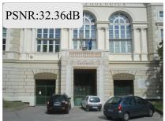

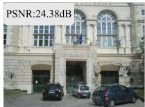

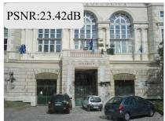

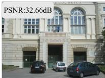

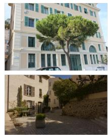  
GT

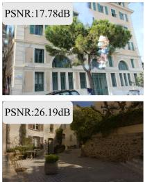  
3DGS

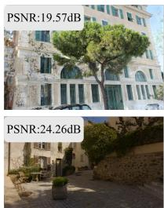  
AbsGS

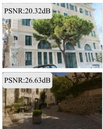  
GDAGS

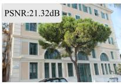

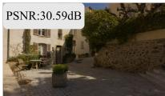  
ACD-GS

Figure 3: Qualitative comparison of novel view synthesis on the Deep Blending dataset.  
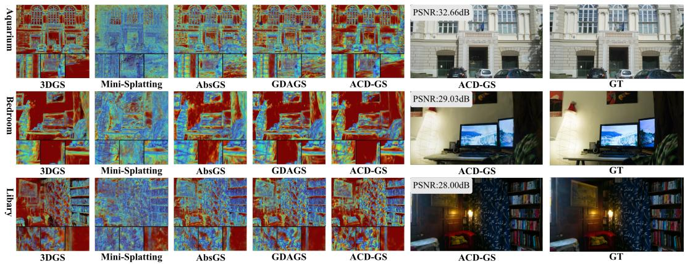  
Figure 4: Visualization of Gaussians distribution

Primitive Distribution Analysis. To uncover the structural rationale behind our efficiency and rendering quality, we visualize the spatial density of Gaussian primitives in Fig. 4. Vanilla 3DGS exhibits extreme redundancy, indiscriminately populating flat homogeneous surfaces with overly dense primitives. Other density-control baselines often fail to cleanly separate textures from geometry, leading to either noisy distributions or over-pruned structures. Conversely, the primitive allocation in ACD-GS strongly aligns with the underlying scene geometry. Guided by our secondorder curvature prior, ACD-GS allocates dense and highly precise Gaussians strictly along structural edges and complex details. Meanwhile, it elegantly covers planar regions (such as the building facades in the Aquarium scene and the walls in the Bedroom scene) with much larger and highly sparse primitives. This structurally aware evolution precisely explains why ACD-GS achieves extreme model compactness and fewer floating artifacts without compromising visual fidelity. More results are shown in Appendix.

## 4.3 Parameter Sensitivity Analysis

Tab. 4 analyzes the sensitivity of ACD-GS to α and β. We vary one parameter at a time: α with $\beta = 1 . 5$ fixed, and β with $\alpha = 0 . 8$ fixed. Increasing α from 0.5 to 0.8 improves PSNR and SSIM while reducing LPIPS and storage. Setting $\alpha = 1 . 0$ yields the highest PSNR and SSIM, but also a larger LPIPS and model size. For β, the default $\beta = 1 . 5$ gives the best PSNR, SSIM, LPIPS, and storage among the tested values. Overall, $( \alpha , \beta ) = ( 0 . 8 , 1 . { \bar { 5 } } )$ provides the best quality–compactness balance, while $\alpha = 1 . 0$ offers higher PSNR and SSIM at a larger model size.

## 4.4 Ablation Studies

We conduct an incremental ablation study integrating our three core modules: Curvature-Guided Asymmetric Densification (CAD), Multi-view Photometric Error Gating (MPG), and Capacity-

Table 4: Comparison of different settings for α and β, varying one parameter at a time.
<table><tr><td>α β PSNR↑ SSIM↑</td><td>LPIPS↓ Size(MB)↓</td></tr><tr><td>0.5 1.5 25.5890 0.8 1.5 25.5913</td><td>0.8424 0.2387 161.37 0.8450 0.2363</td></tr><tr><td>1.0 1.5 25.8259 0.8469 0.2520</td><td>151.85 162.54</td></tr><tr><td>0.8 1.0 25.4263 0.8412 25.4441 0.2436</td><td>0.2451 157.35</td></tr></table>

Table 5: Quantitative ablation on DeepBlending. CAD, MPG, and CAO denote the three components.
<table><tr><td colspan="6">CAD MPG CAO Size(MB)↓ PSNR↑ SSIM↑ LPIPS↓</td></tr><tr><td>× ×</td><td>×</td><td>360.60</td><td>25.22</td><td>0.838</td><td>0.225</td></tr><tr><td>√ ×</td><td>×</td><td>302.40</td><td>25.38</td><td>0.840</td><td>0.223</td></tr><tr><td>√ √</td><td>×</td><td>159.70</td><td>25.38</td><td>0.841</td><td>0.221</td></tr><tr><td>√</td><td>√ √</td><td>151.90</td><td>25.59</td><td>0.845</td><td>0.236</td></tr></table>

Table 6: Sensitivity to the number of auxiliary views K and quota ratio $\mu .$
<table><tr><td>Setting</td><td>PSNR↑</td><td>SSIM↑</td><td>LPIPS↓</td><td>Points↓</td><td>Size(MB)↓</td></tr><tr><td> $K = 4$ </td><td>25.3380</td><td>0.8432</td><td>0.2393</td><td>550,173</td><td>136.44</td></tr><tr><td> $K = 8$ </td><td>25.5914</td><td>0.8450</td><td>0.2363</td><td>642,045</td><td>151.85</td></tr><tr><td> $K = 1 2$ </td><td>25.3605</td><td>0.8440</td><td>0.2390</td><td>661,947</td><td>156.88</td></tr><tr><td> $\mu = 0 . 0 0 4$ </td><td>25.5145</td><td>0.8444</td><td>0.2363</td><td>641,737</td><td>151.78</td></tr><tr><td> $\mu = 0 . 0 0 8$ </td><td>25.5913</td><td>0.8450</td><td>0.2363</td><td>642,044</td><td>151.85</td></tr><tr><td> $\dot { \mu } = 0 . 0 1 2$ </td><td>25.4211</td><td>0.8432</td><td>0.2372</td><td>642,241</td><td>151.90</td></tr></table>

Constrained Adaptive Optimization (CAO). We evaluate the model storage requirements and rendering fidelity on the DeepBlending dataset. As shown in Tab. 5, the baseline 3DGS suffers from severe memory bloat (360.6 MB) due to unconstrained primitive proliferation. Integrating the CAD module effectively addresses this by penalizing redundant cloning in flat regions and promoting boundary-aware splitting, which immediately reduces storage to 302.4 MB while improving PSNR. Subsequently, incorporating MPG further slashes the memory footprint to 159.7 MB. By demanding cross-view residual consensus, MPG prevents the model from blindly overfitting to transient singleview photometric noise, concurrently yielding strict improvements in SSIM and LPIPS. Through dynamic growth quotas and lifecycle-aware pruning, CAO curtails floating artifacts and reduces the final model size to a remarkable 151.9 MB, representing a 58% reduction from the baseline.

## 4.5 Sensitivity Analysis

We additionally evaluate the number of auxiliary views K and the candidate quota ratio µ on the complete Deep Blending dataset. Increasing K from 4 to 8 improves PSNR, SSIM, and LPIPS, but retains more Gaussians; increasing K to 12 provides no consistent quality benefit and increases the model size, so we use $K = 8$ . For the quota ratio, $\mu = 0 . 0 0 4$ yields a marginally smaller model, whereas $\mu = 0 . 0 0 8$ achieves higher PSNR and SSIM with the same LPIPS; $\mu = 0 . 0 1 2$ provides no additional quality improvement. We therefore use $\mu = 0 . 0 0 8$ as the default.

## 5 Discussion and Limitations

While ACD-GS achieves significant native sparsification, extreme compression inevitably degrades high-frequency texture fidelity due to the inherent capacity limits of pure explicit representations. To address this bottleneck, future work could explore hybrid architectures, replacing explicit spherical harmonics with lightweight Multi-Layer Perceptrons (MLPs) to maintain rendering quality under stricter point budgets. Furthermore, because ACD-GS operates orthogonally to post-hoc compression pipelines, seamlessly integrating it with downstream quantization and entropy coding frameworks presents a promising direction to unlock ultra-compact assets for low-bandwidth streaming.

## 6 Conclusion

We present ACD-GS, an Asymmetric Curvature-aware Densification framework for compact 3D Gaussian Splatting. Second-order depth priors decouple cloning and splitting, suppressing unnecessary cloning in planar regions while promoting splitting along geometric boundaries. A multi-view photometric gate filters transient noise, and adaptive thresholding with lifecycle-aware pruning regulates capacity. Experiments show that ACD-GS reduces Gaussian count and storage by nearly 60% across benchmarks while preserving competitive rendering fidelity. By directly preventing redundancy during training, ACD-GS offers a practical, memory-efficient foundation for scalable 3D Gaussian representations.

## Acknowledgments and Disclosure of Funding

This work is supported by National Natural Science Foundation of China(62431015, 62571322, 62571317),STCSM ( 24ZR1432000, 22DZ2229005), 111 plan (BP0719010), and State Key Laboratory of UHD Video and Audio Production and Presentation.

## References

[1] B. Kerbl, G. Kopanas, T. Leimkuehler, and G. Drettakis, “3d gaussian splatting for real-time radiance field rendering,” ACM Trans. Graph., vol. 42, no. 4, July 2023.

[2] Z. Yu, A. Chen, B. Huang, T. Sattler, and A. Geiger, “Mip-splatting: Alias-free 3d gaussian splatting,” in 2024 IEEE/CVF Conference on Computer Vision and Pattern Recognition (CVPR), 2024, pp. 19 447– 19 456.

[3] H. Zhong, Z. Wu, S. Fu, Z. Zheng, X. Jin, X. Zhang, L. Song, and Q. Hu, “Prismgs: Physically-grounded anti-aliasing for high-fidelity large-scale 3d gaussian splatting,” in 2025 International Conference on Visual Communications and Image Processing (VCIP), 2025, pp. 1–5.

[4] Z. Liang, Q. Zhang, W. Hu, L. Zhu, Y. Feng, and K. Jia, “Analytic-splatting: Anti-aliased 3d gaussian splatting via analytic integration,” in Computer Vision ECCV 2024: 18th European Conference, Milan, Italy, September 29October 4, 2024, Proceedings, Part XVII. Berlin, Heidelberg: Springer-Verlag, 2024, p. 281297.

[5] Y. Gao, H. Zhong, T. Zhu, Z. Cheng, Q. Hu, and L. Song, “Aligngs: Aligning geometry and semantics for robust indoor reconstruction from sparse views,” in 2025 International Conference on Visual Communications and Image Processing (VCIP), 2025, pp. 1–5.

[6] A. Guédon and V. Lepetit, “Sugar: Surface-aligned gaussian splatting for efficient 3d mesh reconstruction and high-quality mesh rendering,” in Proceedings ofthe IEEE/CVF Conference on Computer Vision and Pattern Recognition (CVPR), June 2024, pp. 5354–5363.

[7] B. Huang, Z. Yu, A. Chen, A. Geiger, and S. Gao, “2d gaussian splatting for geometrically accurate radiance fields,” in ACM SIGGRAPH 2024 Conference Papers, ser. SIGGRAPH ’24. New York, NY, USA: Association for Computing Machinery, 2024.

[8] Y. Wolf, A. Bracha, and R. Kimmel, “GS2Mesh: Surface reconstruction from Gaussian splatting via novel stereo views,” in European Conference on Computer Vision (ECCV), 2024.

[9] D. Chen, H. Li, W. Ye, Y. Wang, W. Xie, S. Zhai, N. Wang, H. Liu, H. Bao, and G. Zhang, “Pgsr: Planar-based gaussian splatting for efficient and high-fidelity surface reconstruction,” IEEE Transactions on Visualization and Computer Graphics, pp. 1–12, 2024.

[10] Q. Hu, Z. Zheng, H. Zhong, S. Fu, L. Song, XiaoyunZhang, G. Zhai, and Y. Wang, “4dgc: Rate-aware 4d gaussian compression for efficient streamable free-viewpoint video,” in 2025 IEEE/CVF Conference on Computer Vision and Pattern Recognition (CVPR), 2025.

[11] Z. Zheng, Z. Wu, H. Zhong, Y. Tian, N. Cao, L. Xu, J. Yao, X. Zhang, Q. Hu, and W. Zhang, “4DGCPro: Efficient hierarchical 4d gaussian compression for progressive volumetric video streaming,” in The Thirty-ninth Annual Conference on Neural Information Processing Systems, 2026. [Online]. Available: https://openreview.net/forum?id=MbqPKsVe1d

[12] Z. Li, Z. Chen, Z. Li, and Y. Xu, “Spacetime gaussian feature splatting for real-time dynamic view synthesis,” in Proceedings of the IEEE/CVF Conference on Computer Vision and Pattern Recognition (CVPR), June 2024, pp. 8508–8520.

[13] G. Wu, T. Yi, J. Fang, L. Xie, X. Zhang, W. Wei, W. Liu, Q. Tian, and X. Wang, “4d gaussian splatting for real-time dynamic scene rendering,” in Proceedings of the IEEE/CVF Conference on Computer Vision and Pattern Recognition (CVPR), June 2024, pp. 20 310–20 320.

[14] J. Luiten, G. Kopanas, B. Leibe, and D. Ramanan, “Dynamic 3d gaussians: Tracking by persistent dynamic view synthesis,” in 3DV, 2024.

[15] J. C. Lee, D. Rho, X. Sun, J. H. Ko, and E. Park, “Compact 3d gaussian representation for radiance field,” in Proceedings ofthe IEEE/CVF Conference on Computer Vision and Pattern Recognition (CVPR), June 2024, pp. 21 719–21 728.

[16] M. T. Bagdasarian, P. Knoll, Y. Li, F. Barthel, A. Hilsmann, P. Eisert, and W. Morgenstern, “3dgs.zip: A survey on 3d gaussian splatting compression methods,” Computer Graphics Forum, p. e70078, 2025.

[17] Y. Chen, Q. Wu, W. Lin, M. Harandi, and J. Cai, “Hac: Hash-grid assisted context for 3d gaussian splatting compression,” in European Conference on Computer Vision, 2024.

[18] Y. Wang, Z. Li, L. Guo, W. Yang, A. Kot, and B. Wen, “ContextGS : Compact 3d gaussian splatting with anchor level context model,” in The Thirty-eighth Annual Conference on Neural Information Processing Systems, 2024. [Online]. Available: https://openreview.net/forum?id=W2qGSMl2Uu

[19] Y. Chen, Q. Wu, W. Lin, M. Harandi, and J. Cai, “Hac++: Towards 100x compression of 3d gaussian splatting,” IEEE Transactions on Pattern Analysis and Machine Intelligence, vol. 47, no. 11, pp. 10 210– 10 226, 2025.

[20] T. Lu, M. Yu, L. Xu, Y. Xiangli, L. Wang, D. Lin, and B. Dai, “Scaffold-gs: Structured 3d gaussians for view-adaptive rendering,” in Proceedings of the IEEE/CVF Conference on Computer Vision and Pattern Recognition (CVPR), June 2024, pp. 20 654–20 664.

[21] K. Ren, L. Jiang, T. Lu, M. Yu, L. Xu, Z. Ni, and B. Dai, “Octree-gs: Towards consistent real-time rendering with lod-structured 3d gaussians,” IEEE Transactions on Pattern Analysis and Machine Intelligence, 2025.

[22] Y. Xin, Y. Liu, X. Xie, and X. Li, “Learning unified representation of 3d gaussian splatting,” in International Conference on Learning Representations, 2026.

[23] xilong zhou, B.-H. Nguyen, L. Magne, V. Golyanik, T. Leimkuehler, and C. Theobalt, “Splat the net: Radiance fields with splattable neural primitives,” in The Fourteenth International Conference on Learning Representations, 2026. [Online]. Available: https://openreview.net/forum?id=v3ejhJxT1W

[24] A. Bouzidi, H. Laga, H. Wannous, and F. Sohel, “Gnf: Gaussian neural fields for multidimensional signal representation and reconstruction,” in Computer Graphics Forum, vol. 44, no. 7. Wiley Online Library, 2025, p. e70232.

[25] Z. Tang, C. Feng, X. Cheng, W. Yu, J. Zhang, Y. Liu, X.-X. Long, W. Wang, and L. Yuan, “Neuralgs: Bridging neural fields and 3d gaussian splatting for compact 3d representations,” in Proceedings of the AAAI Conference on Artificial Intelligence, vol. 40, no. 11, 2026, pp. 9493–9501.

[26] G. Grubert, F. Barthel, A. Hilsmann, and P. Eisert, “Improving adaptive density control for 3d gaussian splatting,” in Proceedings of the 20th International Joint Conference on Computer Vision, Imaging and Computer Graphics Theory and Applications. SCITEPRESS - Science and Technology Publications, 2025, p. 610621. [Online]. Available: http://dx.doi.org/10.5220/0013308500003912

[27] Z. Zhang, W. Hu, Y. Lao, T. He, and H. Zhao, “Pixel-gs: Density control with pixel-aware gradient for 3d gaussian splatting,” in Computer Vision ECCV 2024: 18th European Conference, Milan, Italy, September 29October 4, 2024, Proceedings, Part XIX. Berlin, Heidelberg: Springer-Verlag, 2024, p. 326342. [Online]. Available: https://doi.org/10.1007/978-3-031-72655-2\_19

[28] Z. Ye, W. Li, S. Liu, P. Qiao, and Y. Dou, “Absgs: Recovering fine details in 3d gaussian splatting,” in Proceedings of the 32nd ACM International Conference on Multimedia, ser. MM ’24. New York, NY, USA: Association for Computing Machinery, 2024, p. 10531061. [Online]. Available: https://doi.org/10.1145/3664647.3681361

[29] Z. Zhou, Y.-J. Xiong, J.-C. Zhang, C.-M. Xia, X. Qiu, and H. Zhan, “Gradient-direction-aware density control for 3d gaussian splatting,” in The Fourteenth International Conference on Learning Representations, 2026. [Online]. Available: https://openreview.net/forum?id=6qDxK4Gz7F

[30] P. Wang, Y. Wang, D. Wang, S. Mohan, Z. Fan, L. Wu, R. Cai, Y.-Y. Yeh, Z. Wang, Q. Liu, and R. Ranjan, “Steepest descent density control for compact 3d gaussian splatting,” in Proceedings of the Computer Vision and Pattern Recognition Conference (CVPR), June 2025, pp. 26 663–26 672.

[31] G. Serifi and M. C. Buehler, “Hypergaussians: High-dimensional gaussian splatting for high-fidelity animatable face avatars,” in Proceedings of the IEEE/CVF Conference on Computer Vision and Pattern Recognition (CVPR), 2026.

[32] C. Thirgood, O. Mendez, E. Ling, J. Storey, and S. Hadfield, “Hypergs: Hyperspectral 3d gaussian splatting,” in Proceedings of the Computer Vision and Pattern Recognition Conference (CVPR), June 2025, pp. 5970–5979.

[33] R. Lu, H. Chen, Z. Zhu, Y. Qin, M. Lu, L. zhang, C. Yan, and anke xue, “Thermalgaussian: Thermal 3d gaussian splatting,” in The Thirteenth International Conference on Learning Representations, 2025. [Online]. Available: https://openreview.net/forum?id=ybFRoGxZjs

[34] Z. Gao, B. Planche, M. Zheng, A. Choudhuri, T. Chen, and Z. Wu, “7dgs: Unified spatial-temporalangular gaussian splatting,” in 2025 IEEE/CVF International Conference on Computer Vision (ICCV), 2025, pp. 26 316–26 325.

[35] B. Mildenhall, P. P. Srinivasan, M. Tancik, J. T. Barron, R. Ramamoorthi, and R. Ng, “Nerf: representing scenes as neural radiance fields for view synthesis,” Commun. ACM, vol. 65, no. 1, p. 99106, December 2021.

[36] T. Müller, A. Evans, C. Schied, and A. Keller, “Instant neural graphics primitives with a multiresolution hash encoding,” ACM Trans. Graph., vol. 41, no. 4, pp. 102:1–102:15, Jul. 2022.

[37] Z. Chen, T. Funkhouser, P. Hedman, and A. Tagliasacchi, “Mobilenerf: Exploiting the polygon rasterization pipeline for efficient neural field rendering on mobile architectures,” in Proceedings ofthe IEEE/CVF Conference on Computer Vision and Pattern Recognition (CVPR), 2023, pp. 16 569–16 578.

[38] P. Hedman, P. P. Srinivasan, B. Mildenhall, J. T. Barron, and P. Debevec, “Baking neural radiance fields for real-time view synthesis,” in IEEE/CVF International Conference on Computer Vision (ICCV), 2021, pp. 5875–5884.

[39] S. Ren, T. Wen, Y. Fang, and B. Lu, “FastGS: Training 3D Gaussian Splatting in 100 seconds,” in Proceedings of the IEEE/CVF Conference on Computer Vision and Pattern Recognition (CVPR), 2026, pp. 26 094–26 103. [Online]. Available: https://openaccess.thecvf.com/content/CVPR2026/html/Ren\_ FastGS\_Training\_3D\_Gaussian\_Splatting\_in\_100\_Seconds\_CVPR\_2026\_paper.html

[40] Z. Fan, K. Wang, K. Wen, Z. Zhu, D. Xu, Z. Wang et al., “Lightgaussian: Unbounded 3d gaussian compression with 15x reduction and 200+ fps,” Advances in neural information processing systems, vol. 37, pp. 140 138–140 158, 2024.

[41] S. Girish, K. Gupta, and A. Shrivastava, “Eagles: Efficient accelerated 3d gaussians with lightweight encodings,” in Computer Vision ECCV 2024: 18th European Conference, Milan, Italy, September 29October 4, 2024, Proceedings, Part LXIII. Berlin, Heidelberg: Springer-Verlag, 2024, p. 5471. [Online]. Available: https://doi.org/10.1007/978-3-031-73036-8\_4

[42] S. Almuhammad Alali, M. Qamar, S.-H. Bae, and E. Tartaglione, “Trimming the Fat: Efficient Compression of 3D Gaussian Splats through Pruning,” in British Machine Vision Conference 2024, Glasgow (Ecosse), United Kingdom, Nov. 2024. [Online]. Available: https://telecom-paris.hal.science hal-05208876

[43] S. Liu, X. Tang, Z. Li, Y. He, C. Ye, J. Liu, B. Huang, S. Zhou, and X. Wu, “Occlugaussian: Occlusionaware gaussian splatting for large scene reconstruction and rendering,” in Proceedings of the IEEE/CVF International Conference on Computer Vision (ICCV), October 2025, pp. 26 643–26 652.

[44] A. Hanson, A. Tu, V. Singla, M. Jayawardhana, M. Zwicker, and T. Goldstein, “Pup 3d-gs: Principled uncertainty pruning for 3d gaussian splatting,” in Proceedings ofthe IEEE/CVF Conference on Computer Vision and Pattern Recognition (CVPR), June 2025, pp. 5949–5958.

[45] H. Wang, H. Zhu, T. He, R. Feng, J. Deng, J. Bian, and Z. Chen, “End-to-end rate-distortion optimized 3d gaussian representation,” in European Conference on Computer Vision, 2024.

[46] Y. Chen, M. Li, Q. Wu, W. Lin, M. Harandi, and J. Cai, “Pcgs: Progressive compression of 3d gaussian splatting,” in The 40th Annual AAAI Conference on Artificial Intelligence, 2026.

[47] Y.-T. Zhan, C.-Y. Ho, H. Yang, Y.-H. Chen, J. C. Chiang, Y.-L. Liu, and W.-H. Peng, “CAT-3DGS: A context-adaptive triplane approach to rate-distortion-optimized 3DGS compression,” in Proceedings of the Thirteenth International Conference on Learning Representations (ICLR), 2025.

[48] G. Fang and B. Wang, “Mini-splatting: Representing scenes with a constrained number of gaussians,” in European Conference on Computer Vision. Springer, 2024, pp. 173–190.

[49] B. Mildenhall, D. Verbin, P. P. Srinivasan, P. Hedman, R. Martin-Brualla, and J. T. Barron, “MultiNeRF: A Code Release for Mip-NeRF 360, Ref-NeRF, and RawNeRF,” 2022. [Online]. Available: https://github.com/google-research/multinerf

[50] A. Knapitsch, J. Park, Q.-Y. Zhou, and V. Koltun, “Tanks and temples: Benchmarking large-scale scene reconstruction,” ACM Transactions on Graphics, vol. 36, no. 4, 2017.

[51] P. Hedman, J. Philip, T. Price, J.-M. Frahm, G. Drettakis, and G. Brostow, “Deep blending for freeviewpoint image-based rendering,” in ACM Transactions on Graphics (Proc. SIGGRAPH Asia), vol. 37, no. 6. ACM, 2018, pp. 257:1–257:15.

## A Hyperparameter Sensitivity Analysis

We further evaluate the sensitivity of ACD-GS to three key hyperparameters, including the soft threshold τ, the capacity-control parameters $( \alpha , \beta )$ , and the rate of lifecycle-aware opacity pruning. As shown in Tables A1–A3, ACD-GS exhibits stable rendering quality across different hyperparameter settings, while the representation size and the number of Gaussians vary more noticeably. For the soft threshold τ, all tested settings achieve comparable average PSNR, SSIM, and LPIPS, indicating that the proposed soft modulation is not overly sensitive to the exact threshold value. The default setting $\tau = 0 . 1 5$ provides a balanced trade-off, maintaining competitive rendering quality while yielding fewer Gaussians on average than the alternatives.

For the capacity-control parameters $( \alpha , \beta )$ , the default configuration (0.8, 1.5) consistently produces the most compact representations across almost all scenes. Compared with both smaller and larger parameter settings, it substantially reduces the average storage and Gaussian count while preserving the best average PSNR and SSIM. This suggests that moderate capacity regulation is important: overly conservative control may retain redundant primitives, whereas overly aggressive densification-pruning schedules can increase representation size without clear quality gains.

Finally, varying the lifecycle-aware pruning rate leads to only minor changes in reconstruction quality. The average metrics remain very close across different rates, demonstrating that the pruning schedule is robust within a reasonable range. Although a smaller rate can slightly reduce the average model size, the default rate achieves the best overall PSNR, SSIM, and LPIPS, indicating a favorable balance between compactness and fidelity. Overall, these results show that ACD-GS is robust to hyperparameter variations and that the chosen default configuration provides a stable quality-efficiency trade-off across diverse scenes.

Table A1: Quality and efficiency under different depth soft thresholds.
<table><tr><td>Scene</td><td>Setting</td><td>SSIM↑</td><td>PSNR↑</td><td>LPIPS↓</td><td>Size(MB)↓</td><td>Points(M)↓</td></tr><tr><td>Aquarium-20</td><td>τ = 0.05</td><td>0.8722</td><td>26.16</td><td>0.1673</td><td>52.04</td><td>0.2777</td></tr><tr><td></td><td>τ = 0.15</td><td>0.8738</td><td>26.42</td><td>0.1655</td><td>41.76</td><td>0.1766</td></tr><tr><td></td><td>τ = 0.25</td><td>0.8726</td><td>26.03</td><td>0.1656</td><td>51.73</td><td>0.2764</td></tr><tr><td>Bedroom</td><td>τ = 0.05</td><td>0.9070</td><td>29.00</td><td>0.2897</td><td>121.89</td><td>0.5731</td></tr><tr><td></td><td>τ = 0.15</td><td>0.9073</td><td>29.04</td><td>0.2899</td><td>111.74</td><td>0.4724</td></tr><tr><td></td><td>τ = 0.25</td><td>0.9076</td><td>29.04</td><td>0.2903</td><td>121.59</td><td>0.5718</td></tr><tr><td>Boats</td><td>τ = 0.05</td><td>0.9101</td><td>26.41</td><td>0.2209</td><td>167.23</td><td>0.7648</td></tr><tr><td></td><td>τ = 0.15</td><td>0.9087</td><td>26.15</td><td>0.2213</td><td>158.20</td><td>0.6689</td></tr><tr><td></td><td>τ = 0.25</td><td>0.9102</td><td>26.47</td><td>0.2197</td><td>163.70</td><td>0.7499</td></tr><tr><td>Bridge</td><td>τ = 0.05</td><td>0.7873</td><td>24.09</td><td>0.3102</td><td>163.37</td><td>0.7484</td></tr><tr><td></td><td>τ = 0.15</td><td>0.7904</td><td>24.18</td><td>0.3104</td><td>149.19</td><td>0.6308</td></tr><tr><td></td><td>τ = 0.25</td><td>0.7897</td><td>23.91</td><td>0.3103</td><td>161.57</td><td>0.7409</td></tr><tr><td>CreepyAttic</td><td>τ = 0.05</td><td>0.8903</td><td>30.62</td><td>0.2457</td><td>177.24</td><td>0.8071</td></tr><tr><td></td><td>τ = 0.15</td><td>0.8908</td><td>30.70</td><td>0.2442</td><td>165.98</td><td>0.7018</td></tr><tr><td></td><td>τ = 0.25</td><td>0.8904</td><td>30.65</td><td>0.2453</td><td>175.90</td><td>0.8014</td></tr><tr><td>Hugo-1</td><td>τ = 0.05</td><td>0.8464</td><td>24.53</td><td>0.1613</td><td>124.61</td><td>0.5846</td></tr><tr><td></td><td>τ = 0.15</td><td>0.8468</td><td>24.45</td><td>0.1608</td><td>110.88</td><td>0.4688</td></tr><tr><td></td><td>τ = 0.25</td><td>0.8423</td><td>23.92</td><td>0.1637</td><td>122.62</td><td>0.5762</td></tr><tr><td>Library</td><td>τ = 0.05</td><td>0.7814</td><td>23.98</td><td>0.3597</td><td>254.96</td><td>1.1357</td></tr><tr><td></td><td>τ = 0.15</td><td>0.7798</td><td>24.10</td><td>0.3592</td><td>245.24</td><td>1.0369</td></tr><tr><td></td><td>τ = 0.25</td><td>0.7820</td><td>24.10</td><td>0.3592</td><td>256.48</td><td>1.1421</td></tr><tr><td>Lumber</td><td>τ = 0.05</td><td>0.7842</td><td>22.28</td><td>0.2653</td><td>508.99</td><td>2.2098</td></tr><tr><td></td><td>τ = 0.15</td><td>0.7867</td><td>22.46</td><td>0.2634</td><td>495.92</td><td>2.0968</td></tr><tr><td></td><td>τ = 0.25</td><td>0.7843</td><td>22.34</td><td>0.2661</td><td>466.31</td><td>2.0293</td></tr><tr><td>Museum-1</td><td>τ = 0.05</td><td>0.8445</td><td>23.64</td><td>0.1469</td><td>198.21</td><td>0.8958</td></tr><tr><td></td><td>τ = 0.15</td><td>0.8450</td><td>23.49</td><td>0.1452</td><td>223.28</td><td>0.9440</td></tr><tr><td></td><td>τ = 0.25</td><td>0.8442</td><td>23.45</td><td>0.1456</td><td>234.51</td><td>1.0493</td></tr><tr><td>Museum-2</td><td>τ = 0.05</td><td>0.9013</td><td>28.07</td><td>0.1065</td><td>108.91</td><td>0.5182</td></tr><tr><td></td><td>τ = 0.15</td><td>0.9002</td><td>27.61</td><td>0.1056</td><td>121.68</td><td>0.5145</td></tr><tr><td></td><td>τ = 0.25</td><td>0.8987</td><td>27.55</td><td>0.1066</td><td>132.65</td><td>0.6186</td></tr></table>

Continued on next page

Table A1 (continued)
<table><tr><td>Scene</td><td>Setting</td><td></td><td>SSIM↑</td><td>PSNR↑</td><td>LPIPS↓</td><td>Size(MB)↓</td><td>Points(M)↓</td></tr><tr><td>NightSnow</td><td></td><td>τ = 0.05</td><td>0.9055</td><td>30.16</td><td>0.2242</td><td>61.68</td><td>0.3185</td></tr><tr><td></td><td></td><td>τ = 0.15</td><td>0.9054</td><td>30.22</td><td>0.2200</td><td>64.62</td><td>0.2732</td></tr><tr><td></td><td></td><td>τ = 0.25</td><td>0.9062</td><td>30.33</td><td>0.2199</td><td>73.96</td><td>0.3704</td></tr><tr><td>Playroom</td><td></td><td>τ = 0.05</td><td>0.8949</td><td>29.67</td><td>0.2921</td><td>112.51</td><td>0.5334</td></tr><tr><td></td><td></td><td>τ = 0.15</td><td>0.8960</td><td>30.07</td><td>0.2883</td><td>129.12</td><td>0.5459</td></tr><tr><td></td><td></td><td>τ = 0.25</td><td>0.8952</td><td>29.92</td><td>0.2888</td><td>137.39</td><td>0.6386</td></tr><tr><td>Ponche</td><td></td><td>τ = 0.05</td><td>0.8211</td><td>23.11</td><td>0.2558</td><td>103.84</td><td>0.4968</td></tr><tr><td></td><td></td><td>τ = 0.15</td><td>0.8191</td><td>23.07</td><td>0.2537</td><td>114.83</td><td>0.4855</td></tr><tr><td></td><td></td><td>τ = 0.25</td><td>0.8234</td><td>23.24</td><td>0.2494</td><td>123.42</td><td>0.5796</td></tr><tr><td>SaintAnne</td><td></td><td>τ = 0.05</td><td>0.8195</td><td>25.60</td><td>0.3372</td><td>135.70</td><td>0.6315</td></tr><tr><td></td><td></td><td>τ = 0.15</td><td>0.8203</td><td>25.51</td><td>0.3309</td><td>160.94</td><td>0.6805</td></tr><tr><td></td><td></td><td>τ = 0.25</td><td>0.8189</td><td>25.34</td><td>0.3309</td><td>171.86</td><td>0.7844</td></tr><tr><td>Shed</td><td></td><td>τ = 0.05</td><td>0.9338</td><td>28.32</td><td>0.1956</td><td>96.72</td><td>0.4666</td></tr><tr><td></td><td></td><td>τ = 0.15</td><td>0.9295</td><td>27.28</td><td>0.1963</td><td>107.75</td><td>0.4556</td></tr><tr><td></td><td></td><td>τ = 0.25</td><td>0.9347</td><td>28.39</td><td>0.1912</td><td>117.14</td><td>0.5530</td></tr><tr><td>Tree-18</td><td></td><td>τ = 0.05</td><td>0.8027</td><td>22.18</td><td>0.1747</td><td>81.61</td><td>0.4028</td></tr><tr><td></td><td></td><td>τ = 0.15</td><td>0.8052</td><td>22.22</td><td>0.1650</td><td>84.78</td><td>0.3584</td></tr><tr><td></td><td></td><td>τ = 0.25</td><td>0.8044</td><td>22.33</td><td>0.1658</td><td>95.18</td><td>0.4602</td></tr><tr><td>Yellowhouse-12</td><td></td><td>τ = 0.05</td><td>0.6536</td><td>17.58</td><td>0.3066</td><td>90.42</td><td>0.4400</td></tr><tr><td></td><td></td><td>τ = 0.15</td><td>0.6608</td><td>18.09</td><td>0.2975</td><td>95.58</td><td>0.4041</td></tr><tr><td></td><td></td><td>τ = 0.25</td><td>0.6485</td><td>17.06</td><td>0.2972</td><td>109.54</td><td>0.5209</td></tr><tr><td>Mean</td><td></td><td>τ = 0.05</td><td>0.8445</td><td>25.61</td><td>0.2388</td><td>150.58</td><td>0.6944</td></tr><tr><td></td><td></td><td>τ = 0.15</td><td>0.8451</td><td>25.59</td><td>0.2363</td><td>151.85</td><td>0.6420</td></tr><tr><td></td><td></td><td>τ = 0.25</td><td>0.8113</td><td>25.53</td><td>0.2362</td><td>151.43</td><td>0.7331</td></tr></table>

Table A2: Quality and efficiency under different settings of α and β.
<table><tr><td>Scene</td><td>Setting</td><td>SSIM↑</td><td>PSNR↑</td><td>LPIPS↓</td><td>Size(MB)↓</td><td>Points(M)↓</td></tr><tr><td rowspan="3">Aquarium-20</td><td>(0.5, 1.0)</td><td>0.8517</td><td>23.38</td><td>0.1751</td><td>132.12</td><td>0.5586</td></tr><tr><td>(0.8, 1.5)</td><td>0.8738</td><td>26.42</td><td>0.1655</td><td>41.76</td><td>0.1766</td></tr><tr><td>(1.0, 2.5)</td><td>0.8486</td><td>24.40</td><td>0.1760</td><td>140.75</td><td>0.5951</td></tr><tr><td rowspan="3">Bedroom</td><td>(0.5, 1.0)</td><td>0.9068</td><td>28.87</td><td>0.2729</td><td>185.58</td><td>0.7847</td></tr><tr><td>(0.8, 1.5)</td><td>0.9073</td><td>29.04</td><td>0.2899</td><td>111.74</td><td>0.4724</td></tr><tr><td>(1.0, 2.5)</td><td>0.9072</td><td>28.92</td><td>0.2719</td><td>197.59</td><td>0.8355</td></tr><tr><td rowspan="3">Boats</td><td>(0.5, 1.0)</td><td>0.9122</td><td>26.57</td><td>0.2074</td><td>224.80</td><td>0.9505</td></tr><tr><td>(0.8, 1.5)</td><td>0.9087</td><td>26.15</td><td>0.2213</td><td>158.20</td><td>0.6689</td></tr><tr><td>(1.0, 2.5)</td><td>0.9136</td><td>26.72</td><td>0.2020</td><td>238.70</td><td>1.0092</td></tr><tr><td rowspan="3">Bridge</td><td>(0.5, 1.0)</td><td>0.7830</td><td>23.86</td><td>0.3175</td><td>152.05</td><td>0.6429</td></tr><tr><td>(0.8, 1.5)</td><td>0.7904</td><td>24.18</td><td>0.3104</td><td>149.19</td><td>0.6308</td></tr><tr><td>(1.0, 2.5)</td><td>0.7823</td><td>23.41</td><td>0.3147</td><td>168.09</td><td>0.7107</td></tr><tr><td rowspan="3">CreepyAttic</td><td>(0.5, 1.0)</td><td>0.8910</td><td>30.64</td><td>0.2176</td><td>463.91</td><td>1.9615</td></tr><tr><td>(0.8, 1.5)</td><td>0.8908</td><td>30.70</td><td>0.2442</td><td>165.98</td><td>0.7018</td></tr><tr><td>(1.0, 2.5)</td><td>0.8910</td><td>30.55</td><td>0.2166</td><td>483.30</td><td>2.0435</td></tr><tr><td rowspan="3">Hugo-1</td><td>(0.5, 1.0)</td><td>0.8319</td><td>23.87</td><td>0.1498</td><td>256.77</td><td>1.0857</td></tr><tr><td>(0.8, 1.5)</td><td>0.8468</td><td>24.45</td><td>0.1608</td><td>110.88</td><td>0.4688</td></tr><tr><td>(1.0, 2.5)</td><td>0.8276</td><td>23.61</td><td>0.1504</td><td>312.31</td><td>1.3205</td></tr><tr><td rowspan="3">Library</td><td>(0.5, 1.0)</td><td>0.7722</td><td>23.84</td><td>0.3580</td><td>371.66</td><td>1.5714</td></tr><tr><td>(0.8, 1.5)</td><td>0.7798</td><td>24.10</td><td>0.3592</td><td>245.24</td><td>1.0369</td></tr><tr><td>(1.0, 2.5)</td><td>0.7705</td><td>23.86</td><td>0.3566</td><td>405.50</td><td>1.7145</td></tr><tr><td rowspan="3">Lumber</td><td>(0.5, 1.0)</td><td>0.7899</td><td>22.63</td><td>0.2479</td><td>560.72</td><td>2.3708</td></tr><tr><td>(0.8, 1.5)</td><td>0.7867</td><td>22.46</td><td>0.2634</td><td>495.92</td><td>2.0968</td></tr><tr><td>(1.0, 2.5)</td><td>0.7924</td><td>22.56</td><td>0.2364</td><td>681.21</td><td>2.8802</td></tr><tr><td rowspan="3">Museum-1</td><td>(0.5, 1.0)</td><td>0.8348</td><td>22.81</td><td>0.1373</td><td>395.33</td><td>1.6715</td></tr><tr><td>(0.8, 1.5)</td><td>0.8450</td><td>23.49</td><td>0.1452</td><td>223.28</td><td>0.9440</td></tr><tr><td>(1.0, 2.5)</td><td>0.8354</td><td>22.82</td><td>0.1359</td><td>414.99</td><td>1.7546</td></tr><tr><td rowspan="3">Museum-2</td><td>(0.5, 1.0)</td><td>0.9016</td><td>26.62</td><td>0.0925</td><td>212.18</td><td>0.8971</td></tr><tr><td>(0.8, 1.5)</td><td>0.9002</td><td>27.61</td><td>0.1056</td><td>121.68</td><td>0.5145</td></tr><tr><td>(1.0, 2.5)</td><td>0.9022</td><td>27.15</td><td>0.0909</td><td>228.20</td><td>0.9648</td></tr><tr><td rowspan="3">NightSnow</td><td>(0.5, 1.0)</td><td>0.9147</td><td>30.49</td><td>0.1912</td><td>94.44</td><td>0.3993</td></tr><tr><td>(0.8, 1.5)</td><td>0.9054</td><td>30.22</td><td>0.2200</td><td>64.62</td><td>0.2732</td></tr><tr><td>(1.0, 2.5)</td><td>0.9151</td><td>30.51</td><td>0.1888</td><td>101.40</td><td>0.4287</td></tr><tr><td rowspan="3">Playroom</td><td>(0.5, 1.0)</td><td>0.8960</td><td>30.18</td><td>0.2675</td><td>287.29</td><td>1.2147</td></tr><tr><td>(0.8, 1.5)</td><td>0.8960</td><td>30.07</td><td>0.2883</td><td>129.12</td><td>0.5459</td></tr><tr><td>(1.0, 2.5)</td><td>0.8954</td><td>30.07</td><td>0.2671</td><td>300.31</td><td>1.2697</td></tr><tr><td rowspan="3">Ponche</td><td>(0.5, 1.0)</td><td>0.8194</td><td>22.54</td><td>0.2289</td><td>181.75</td><td>0.7684</td></tr><tr><td>(0.8, 1.5)</td><td>0.8191</td><td>23.07</td><td>0.2537</td><td>114.83</td><td>0.4855</td></tr><tr><td>(1.0, 2.5)</td><td>0.8148</td><td>21.89</td><td>0.2291</td><td>196.96</td><td>0.8328</td></tr><tr><td rowspan="3">SaintAnne</td><td>(0.5, 1.0)</td><td>0.8225</td><td>25.61</td><td>0.3109</td><td>199.34</td><td>0.8428</td></tr><tr><td>(0.8, 1.5)</td><td>0.8203</td><td>25.51</td><td>0.3309</td><td>160.94</td><td>0.6805</td></tr><tr><td>(1.0, 2.5)</td><td>0.8236</td><td>25.68</td><td>0.2955</td><td>238.51</td><td>1.0084</td></tr><tr><td rowspan="3">Shed</td><td>(0.5, 1.0)</td><td>0.9484</td><td>32.21</td><td>0.1536</td><td>168.72</td><td>0.7134</td></tr><tr><td>(0.8, 1.5)</td><td>0.9295</td><td>27.28</td><td>0.1963</td><td>107.75</td><td>0.4556</td></tr><tr><td>(1.0, 2.5)</td><td>0.9489</td><td>32.37</td><td>0.1510</td><td>174.77</td><td>0.7389</td></tr><tr><td rowspan="3">Tree-18</td><td>(0.5, 1.0)</td><td>0.7722</td><td>20.85</td><td>0.2055</td><td>164.06</td><td>0.6937</td></tr><tr><td>(0.8, 1.5)</td><td>0.8052</td><td>22.22</td><td>0.1650</td><td>84.78</td><td>0.3584</td></tr><tr><td>(1.0, 2.5)</td><td>0.7873</td><td>22.28</td><td>0.1778</td><td>200.11</td><td>0.8461</td></tr><tr><td rowspan="3">Yellowhouse-12</td><td>(0.5, 1.0)</td><td>0.6240</td><td>15.33</td><td>0.3198</td><td>154.89</td><td>0.6549</td></tr><tr><td>(0.8, 1.5)</td><td>0.6608</td><td>18.09</td><td>0.2975</td><td>95.58</td><td>0.4041</td></tr><tr><td>(1.0, 2.5)</td><td>0.6397</td><td>17.16</td><td>0.3077</td><td>145.98</td><td>0.6172</td></tr><tr><td rowspan="3">Mean</td><td>(0.5, 1.0)</td><td>0.8395</td><td>25.31</td><td>0.2267</td><td>247.39</td><td>1.0460</td></tr><tr><td>(0.8, 1.5)</td><td>0.8451</td><td>25.59</td><td>0.2363</td><td>151.85</td><td>0.6420</td></tr><tr><td>(1.0, 2.5)</td><td>0.8409</td><td>25.53</td><td>0.2217</td><td>272.28</td><td>1.1512</td></tr></table>

Table A3: Quality and efficiency under different opacity-pruning rates.
<table><tr><td>Scene</td><td>Setting</td><td>SSIM↑</td><td>PSNR↑</td><td>LPIPS↓</td><td>Size(MB)↓</td><td>Points(M)↓</td></tr><tr><td rowspan="3">Aquarium-20</td><td> $\mathrm { R a t e } = 0 . 5$ </td><td>0.8739</td><td>26.20</td><td>0.1652</td><td>40.21</td><td>0.1700</td></tr><tr><td> $\mathrm { O u r s } \ ( \mathrm { R a t e } = 1 . 0 )$ </td><td>0.8738</td><td>26.42</td><td>0.1655</td><td>41.76</td><td>0.1766</td></tr><tr><td>Rate = 1.5</td><td>0.8729</td><td>26.28</td><td>0.1647</td><td>42.01</td><td>0.1776</td></tr><tr><td rowspan="3">Bedroom</td><td>Rate = 0.5</td><td>0.9078</td><td>29.10</td><td>0.2898</td><td>111.66</td><td>0.4721</td></tr><tr><td>Ours (Rate = 1.0)</td><td>0.9073</td><td>29.04</td><td>0.2899</td><td>111.74</td><td>0.4724</td></tr><tr><td>Rate = 1.5</td><td>0.9084</td><td>29.07</td><td>0.2891</td><td>111.76</td><td>0.4725</td></tr><tr><td rowspan="3">Boats</td><td>Rate = 0.5</td><td>0.9105</td><td>26.37</td><td>0.2207</td><td>158.79</td><td>0.6714</td></tr><tr><td>Ours (Rate = 1.0)</td><td>0.9087</td><td>26.15</td><td>0.2213</td><td>158.20</td><td>0.6689</td></tr><tr><td>Rate = 1.5</td><td>0.9093</td><td>26.25</td><td>0.2222</td><td>153.99</td><td>0.6511</td></tr><tr><td rowspan="3">Bridge</td><td>Rate = 0.5</td><td>0.7887</td><td>24.16</td><td>0.3110</td><td>153.40</td><td>0.6486</td></tr><tr><td>Ours (Rate = 1.0)</td><td>0.7904</td><td>24.18</td><td>0.3104</td><td>149.19</td><td>0.6308</td></tr><tr><td>Rate = 1.5</td><td>0.7888</td><td>23.89</td><td>0.3107</td><td>150.39</td><td>0.6358</td></tr><tr><td rowspan="3">CreepyAttic</td><td>Rate = 0.5</td><td>0.8902</td><td>30.60</td><td>0.2449</td><td>167.08</td><td>0.7064</td></tr><tr><td>Ours (Rate = 1.0)</td><td>0.8908</td><td>30.70</td><td>0.2442</td><td>165.98</td><td>0.7018</td></tr><tr><td>Rate = 1.5</td><td>0.8902</td><td>30.71</td><td>0.2455</td><td>167.41</td><td>0.7078</td></tr><tr><td rowspan="3">Hugo-1</td><td>Rate = 0.5</td><td>0.8454</td><td>24.51</td><td>0.1621</td><td>111.38</td><td>0.4709</td></tr><tr><td>Ours (Rate = 1.0)</td><td>0.8468</td><td>24.45</td><td>0.1608</td><td>110.88</td><td>0.4688</td></tr><tr><td>Rate = 1.5</td><td>0.8451</td><td>24.65</td><td>0.1620</td><td>114.41</td><td>0.4837</td></tr></table>

Continued on next page

Table A3 (continued)
<table><tr><td>Scene</td><td>Setting</td><td>SSIM↑</td><td>PSNR↑</td><td>LPIPS↓</td><td>Size(MB)↓</td><td>Points(M)↓</td></tr><tr><td rowspan="3">Library</td><td>Rate = 0.5</td><td></td><td>0.7775</td><td>23.98</td><td>0.3600</td><td>244.56</td><td>1.0340</td></tr><tr><td>Ours (Rate = 1.0)</td><td></td><td>0.7798</td><td>24.10</td><td>0.3592</td><td>245.24</td><td>1.0369</td></tr><tr><td>Rate = 1.5</td><td></td><td>0.7818</td><td>23.96</td><td>0.3601</td><td>247.66</td><td>1.0471</td></tr><tr><td rowspan="3">Lumber</td><td>Rate = 0.5</td><td></td><td>0.7775</td><td>21.81</td><td>0.2704</td><td>469.24</td><td>1.9840</td></tr><tr><td>Ours (Rate = 1.0)</td><td></td><td>0.7867</td><td>22.46</td><td>0.2634</td><td>495.92</td><td>2.0968</td></tr><tr><td>Rate = 1.5</td><td></td><td>0.7808</td><td>21.99</td><td>0.2670</td><td>480.98</td><td>2.0336</td></tr><tr><td rowspan="3">Museum-1</td><td>Rate = 0.5</td><td></td><td>0.8435</td><td>23.41</td><td>0.1469</td><td>223.95</td><td>0.9469</td></tr><tr><td>Ours (Rate = 1.0)</td><td></td><td>0.8450</td><td>23.49</td><td>0.1452</td><td>223.28</td><td>0.9440</td></tr><tr><td>Rate = 1.5</td><td></td><td>0.8443</td><td>23.55</td><td>0.1457</td><td>223.91</td><td>0.9467</td></tr><tr><td rowspan="3">Museum-2</td><td>Rate = 0.5</td><td></td><td>0.8996</td><td>27.56</td><td>0.1061</td><td>120.31</td><td>0.5087</td></tr><tr><td>Ours (Rate = 1.0)</td><td></td><td>0.9002</td><td>27.61</td><td>0.1056</td><td>121.68</td><td>0.5145</td></tr><tr><td>Rate = 1.5</td><td></td><td>0.8978</td><td>27.58</td><td>0.1082</td><td>120.43</td><td>0.5092</td></tr><tr><td rowspan="3">NightSnow</td><td>Rate = 0.5</td><td></td><td>0.9034</td><td>29.98</td><td>0.2216</td><td>63.16</td><td>0.2671</td></tr><tr><td>Ours (Rate = 1.0)</td><td></td><td>0.9054</td><td>30.22</td><td>0.2200</td><td>64.62</td><td>0.2732</td></tr><tr><td>Rate = 1.5</td><td></td><td>0.9053</td><td>30.45</td><td>0.2199</td><td>65.45</td><td>0.2767</td></tr><tr><td rowspan="3">Playroom</td><td>Rate = 0.5</td><td></td><td>0.8962</td><td>30.12</td><td>0.2888</td><td>127.31</td><td>0.5383</td></tr><tr><td>Ours (Rate = 1.0)</td><td></td><td>0.8960</td><td>30.07</td><td>0.2883</td><td>129.12</td><td>0.5459</td></tr><tr><td>Rate = 1.5</td><td></td><td>0.8957</td><td>29.93</td><td>0.2891</td><td>129.34</td><td>0.5469</td></tr><tr><td rowspan="3">Ponche</td><td>Rate = 0.5</td><td></td><td>0.8236</td><td>23.22</td><td>0.2491</td><td>114.69</td><td>0.4849</td></tr><tr><td>Ours (Rate = 1.0)</td><td></td><td>0.8191</td><td>23.07</td><td>0.2537</td><td>114.83</td><td>0.4855</td></tr><tr><td>Rate = 1.5</td><td></td><td>0.8223</td><td>23.09</td><td>0.2505</td><td>116.27</td><td>0.4916</td></tr><tr><td rowspan="3">SaintAnne</td><td>Rate = 0.5</td><td></td><td>0.8209</td><td>25.74</td><td>0.3277</td><td>168.31</td><td>0.7116</td></tr><tr><td>Ours (Rate = 1.0)</td><td></td><td>0.8203</td><td>25.51</td><td>0.3309</td><td>160.94</td><td>0.6805</td></tr><tr><td>Rate = 1.5</td><td></td><td>0.8216</td><td>25.66</td><td>0.3284</td><td>161.27</td><td>0.6819</td></tr><tr><td rowspan="3">Shed</td><td>Rate = 0.5</td><td></td><td>0.9320</td><td>27.67</td><td>0.1943</td><td>106.29</td><td>0.4494</td></tr><tr><td>Ours (Rate = 1.0)</td><td></td><td>0.9295</td><td>27.28</td><td>0.1963</td><td>107.75</td><td>0.4556</td></tr><tr><td>Rate = 1.5</td><td></td><td>0.9273</td><td>27.41</td><td>0.1999</td><td>104.45</td><td>0.4416</td></tr><tr><td rowspan="3">Tree-18</td><td>Rate = 0.5</td><td></td><td>0.8056</td><td>22.28</td><td>0.1656</td><td>87.19</td><td>0.3686</td></tr><tr><td>Ours (Rate = 1.0)</td><td></td><td>0.8052</td><td>22.22</td><td>0.1650</td><td>84.78</td><td>0.3584</td></tr><tr><td>Rate = 1.5</td><td></td><td>0.8028</td><td>22.24</td><td>0.1678</td><td>92.55</td><td>0.3913</td></tr><tr><td rowspan="3">Yellowhouse-12</td><td>Rate = 0.5</td><td></td><td>0.6540</td><td>17.82</td><td>0.3058</td><td>96.52</td><td>0.4081</td></tr><tr><td>Ours (Rate = 1.0) Rate = 1.5</td><td></td><td>0.6608</td><td>18.09</td><td>0.2975</td><td>95.58</td><td>0.4041 0.4139</td></tr><tr><td></td><td></td><td>0.6537</td><td>17.65</td><td>0.3009</td><td>97.89</td><td></td></tr><tr><td rowspan="3">Mean</td><td>Rate = 0.5</td><td></td><td>0.8441</td><td>25.56</td><td>0.2371</td><td>150.83</td><td>0.6377</td></tr><tr><td>Ours (Rate = 1.0)</td><td></td><td>0.8451</td><td>25.59</td><td>0.2363</td><td>151.85</td><td>0.6420</td></tr><tr><td>Rate = 1.5</td><td></td><td>0.8440</td><td>25.55</td><td>0.2372</td><td>151.77</td><td>0.6417</td></tr></table>

## B Detailed Results

We provide detailed per-scene results on three benchmark datasets in the appendix. Specifically, Tables A4, A5, and A6 report per-scene rendering quality together with model size, Gaussian count, and training time for Deep Blending, Mip-NeRF 360, and Tanks & Temples, respectively.

Table A4: Per-scene quality and efficiency on Deep Blending.
<table><tr><td>Scene</td><td>Method</td><td>SSIM↑</td><td>PSNR↑</td><td>LPIPS↓</td><td>Size(MB)↓</td><td>Points(M)↓</td><td>Time(s)↓</td></tr><tr><td rowspan="7">Aquarium-20</td><td>AbsGS</td><td>0.8060</td><td>21.82</td><td>0.2288</td><td>183.16</td><td>0.7700</td><td>828</td></tr><tr><td>3DGS</td><td>0.8692</td><td>22.66</td><td>0.1607</td><td>177.44</td><td>0.7500</td><td>942</td></tr><tr><td>Mip-Splatting</td><td>0.8507</td><td>22.52</td><td>0.1764</td><td>272.31</td><td>1.1300</td><td>1034</td></tr><tr><td>Pixel-GS</td><td>0.8653</td><td>25.77</td><td>0.1582</td><td>268.57</td><td>1.1400</td><td>900</td></tr><tr><td>GDAGS</td><td>0.8418</td><td>22.18</td><td>0.1865</td><td>159.86</td><td>0.7900</td><td>743</td></tr><tr><td>Mini-Splatting</td><td>0.8509</td><td>23.81</td><td>0.1659</td><td>810.17</td><td>3.4300</td><td>1329</td></tr><tr><td>ACD-ĠS</td><td>0.8738</td><td>26.42</td><td>0.1655</td><td>41.76</td><td>0.1800</td><td>649</td></tr><tr><td>Scene</td><td>Method</td><td>SSIM↑</td><td>PSNR↑ LPIPS↓ 28.85 0.2751</td><td></td><td>Size(MB)↓ 253.97</td><td>Points(M)↓ 1.0700</td><td>Time(s)↓ 854</td></tr><tr><td>Bedroom Boats</td><td>AbsGS 3DGS Mip-Splatting Pixel-GS GDAGS Mini-Splatting ACD-GS AbsGS</td><td>0.9012 0.9072 0.9045 0.9041 0.9070 0.9007 0.9073 0.9036</td><td>28.86 28.68 28.82 29.05 28.28 29.04 26.61</td><td>0.2743 0.2744 0.2748 0.2701 0.2955 0.2899 0.2162</td><td>316.93 473.69 719.19 283.22 981.14 111.74 399.18</td><td>1.3400 1.9700 3.0400 1.2200 4.1500 0.4700 1.6900</td><td>691 791 834 476 976 405 737</td></tr><tr><td>Bridge</td><td>3DGS Mip-Splatting Pixel-GS GDAGS Mini-Splatting ACD-GS AbsGS</td><td>0.9122 0.9159 0.9145 0.9137 0.9054 0.9087</td><td>26.68 26.75 26.98 26.67 25.73 26.15 22.65</td><td>0.2099 0.1934 0.1967 0.2018 0.2133 0.2213</td><td>389.69 629.55 846.92 344.09 1063.13 158.20</td><td>1.6500 2.6200 3.5800 1.4800 4.5000 0.6700 1.0400</td><td>766 930 975 568 1111 509 701</td></tr><tr><td>CreepyAttic</td><td>3DGS Mip-Splatting Pixel-GS GDAGS Mini-Splatting ACD-ĠS AbsGS</td><td>0.7694 0.8103 0.8062 0.8056 0.7834 0.7301 0.7904 0.8821</td><td>25.13 24.41 25.77 23.59 21.32 24.18 30.16</td><td>0.3123 0.2884 0.2848 0.3049 0.3078 0.4274 0.3104 0.2199</td><td>245.33 259.22 332.83 305.77 232.13 952.32 149.19</td><td>1.1000 1.3800 1.2900 0.9900 4.0300 0.6300</td><td>817 921 780 593 1269 586 829</td></tr><tr><td>Hugo-1</td><td>3DGS Mip-Splatting Pixel-GS GDAGS Mini-Splatting ACD-GS AbsGS</td><td>0.8924 0.8860 0.8841 0.8890 0.8682 0.8908 0.7891</td><td>30.52 30.16 30.24 30.43 29.41 30.70 22.58</td><td>0.2245 0.2208 0.2216 0.2138 0.2800 0.2442 0.1804</td><td>704.01 758.95 1142.25 1558.26 711.70 1172.18 165.98</td><td>2.9800 3.2100 4.7500 6.5900 2.9400 4.9600 0.7000</td><td>968 1235 1329 596 1005 422 811</td></tr><tr><td></td><td>3DGS Mip-Splatting Pixel-GS GDAGS Mini-Splatting ACD-GS</td><td>0.8429 0.8304 0.8355 0.8208 0.8412 0.8468</td><td>23.85 22.80 23.43 23.39 23.24 24.45</td><td>0.1394 0.1486 0.1393 0.1597 0.1433 0.1608</td><td>344.76 321.95 494.73 496.32 318.72 873.89 110.88</td><td>1.4600 1.3600 2.0600 2.1000 1.4800 3.6900 0.4700</td><td>830 1030 923 699 1075 574 991</td></tr><tr><td>Library Lumber</td><td>AbsGS 3DGS Mip-Splatting Pixel-GS GDAGS Mini-Splatting ACD-GS AbsGS</td><td>0.7311 0.7806 0.7629 0.7767 0.7682 0.7616 0.7798</td><td>23.49 23.87 23.32 23.73 23.72 23.33 24.10 22.04</td><td>0.4162 0.3520 0.3576 0.3577 0.3570 0.3941 0.3592</td><td>738.66 501.54 829.34 998.51 568.79 1129.81 245.24</td><td>3.1200 2.1200 3.4500 4.2200 2.5100 4.7800 1.0400</td><td>900 1144 1099 682 1216 570 1188</td></tr><tr><td>Museum-1</td><td>3DGS Mip-Splatting Pixel-GS GDAGS Mini-Splatting ACD-GS AbsGS</td><td>0.7691 0.7705 0.7947 0.7777 0.7907 0.7576 0.7867</td><td>22.03 22.61 22.24 22.67 21.77 22.46</td><td>0.2559 0.2787 0.2381 0.2638 0.2445 0.2694 0.2634</td><td>1163.96 861.48 1411.98 1549.63 921.82 1275.84 495.92</td><td>4.9200 3.6400 5.8800 6.5500 3.9700 5.3900 2.1000</td><td>1042 1442 1414 755 1208 623 1005</td></tr><tr><td>Museum-2</td><td>3DGS Mip-Splatting Pixel-GS GDAGS Mini-Splatting ACD-GS</td><td>0.7931 0.8364 0.8363 0.8346 0.8339 0.8451 0.8450</td><td>21.73 23.32 23.28 23.15 22.69 23.20 23.49</td><td>0.1689 0.1346 0.1354 0.1340 0.1384 0.1351 0.1452</td><td>568.56 567.26 807.78 841.11 554.20 938.93 223.28</td><td>2.4000 2.4000 3.3600 3.5600 2.6700 3.9700 0.9400</td><td>1272 1451 1321 829 1207 691</td></tr><tr><td></td><td>AbsGS 3DGS Mip-Splatting Pixel-GS GDAGS Mini-Splatting ACD-GS</td><td>0.8798 0.8970 0.8964 0.8982 0.8988 0.9053 0.9002</td><td>25.48 25.34 25.81 26.58 25.64 27.50 27.61</td><td>0.1109 0.0985 0.0976 0.0932 0.0951 0.0891 0.1056</td><td>310.55 333.72 477.92 561.85 299.60 877.42 121.68</td><td>1.3100 1.4100 1.9900 2.3800 1.2900 3.9700 0.5100</td><td>782 904 1045 1006 676 1140 557</td></tr></table>

Continued on next page

Table A4 (continued)
<table><tr><td rowspan=1 colspan=7>Scene            Method         SSIM↑  PSNR↑  LPIPS↓  Size(MB)↓  Points(M)↓  Time(s)↓</td></tr><tr><td rowspan=1 colspan=7>NightSnow       AbsGS         0.9033   30.09   0.2016     145.95       0.6200       6013DGS          0.9095   30.53   0.1962     166.04      0.7000       625Mip-Splatting   0.9160   30.37   0.1765    251.49      1.0500       747Pixel-GS        0.9119   30.13   0.1925    285.68      1.2100       658GDAGS        0.9153   30.63   0.1857     131.93      0.5400       517Mini-Splatting  0.9080   29.56   0.1901     877.21      3.7100      1113ACD-GS       0.9054   30.22   0.2200     64.62       0.2700       465</td></tr><tr><td rowspan=1 colspan=7>Playroom        AbsGS          0.8893   30.00   0.2644     405.12      1.7100       6793DGS          0.8919   29.99   0.2763     499.96      2.1100       856Mip-Splatting   0.8906   29.68   0.2688     797.40      3.3200       1044Pixel-GS       0.8892   29.62   0.2763     959.15      4.0600       995GDAGS        0.8949   30.22   0.2634     444.93      1.9200       544Mini-Splatting  0.8858   29.59   0.2979    1080.89      4.5700       962ACD-GS       0.8960   30.07   0.2883    129.12      0.5500       432</td></tr><tr><td rowspan=1 colspan=7>Ponche           AbsGS          0.8000   22.31   0.2376     254.42      1.0800       690</td></tr><tr><td rowspan=2 colspan=2>3DGSMip-Splatting</td><td rowspan=1 colspan=5>0.8204   22.25   0.2464     205.92      0.8700       672</td></tr><tr><td rowspan=2 colspan=5>0.8201   21.80   0.2250    337.44      1.4000       8420.8123   21.57   0.2360     404.74      1.7100       834</td></tr><tr><td rowspan=1 colspan=2>Pixel-GS</td></tr><tr><td rowspan=1 colspan=7>GDAGSMini-Splatting  0.8341   22.86   0.2067     848.29      3.5900       1094ACD-GS        0.8191   23.07   0.2537     114.83      0.4900       543</td></tr><tr><td rowspan=1 colspan=3>SaintAnne        AbsGS          0.8054</td><td rowspan=1 colspan=4>25.09   0.3259     286.99       1.2100       704</td></tr><tr><td rowspan=1 colspan=2>3DGS</td><td rowspan=1 colspan=1>0.8208</td><td rowspan=1 colspan=2>25.60   0.3398</td><td rowspan=1 colspan=2>171.70      0.7300       814</td></tr><tr><td rowspan=5 colspan=3>Mip-SplattingPixel-ĠS        0.8251GDAGS        0.8232Mini-SplattingACD-GS       0.8203</td><td rowspan=1 colspan=1>0.8216</td><td rowspan=1 colspan=2>25.27   0.3238</td><td rowspan=1 colspan=1>261.31       1.0900       819</td></tr><tr><td rowspan=1 colspan=1>0.8251</td><td rowspan=1 colspan=2>25.67   0.3082</td><td rowspan=2 colspan=2>757.02      3.2000       1055252.59      1.2100       593</td></tr><tr><td rowspan=1 colspan=1>0.8232</td><td rowspan=1 colspan=2>25.58   0.3078</td></tr><tr><td rowspan=1 colspan=1>0.8177</td><td rowspan=1 colspan=2>25.44   0.3163</td><td rowspan=1 colspan=2>893.32      3.7800       1160</td></tr><tr><td rowspan=1 colspan=4>25.51   0.3309     160.94      0.6800       576</td></tr><tr><td rowspan=1 colspan=3>Shed             AbsGS          0.9420</td><td rowspan=1 colspan=4>32.32   0.1593     349.88      1.4800       713</td></tr><tr><td rowspan=1 colspan=2>3DGS</td><td rowspan=1 colspan=1>0.9474</td><td rowspan=1 colspan=1>32.22</td><td rowspan=1 colspan=1>0.1657</td><td rowspan=1 colspan=1>312.16</td><td rowspan=1 colspan=1>1.3200       735</td></tr><tr><td rowspan=1 colspan=2>Mip-Splatting</td><td rowspan=1 colspan=1>0.9489</td><td rowspan=1 colspan=1>32.32</td><td rowspan=1 colspan=1>0.1452</td><td rowspan=1 colspan=1>526.94</td><td rowspan=3 colspan=1>2.1900       9122.8100       9061.1800       563</td></tr><tr><td rowspan=1 colspan=2>Pixel-GS</td><td rowspan=1 colspan=1>0.9507</td><td rowspan=1 colspan=1>32.58</td><td rowspan=1 colspan=1>0.1487</td><td rowspan=1 colspan=1>664.38</td></tr><tr><td rowspan=1 colspan=2>GDAGS</td><td rowspan=1 colspan=1>0.9501</td><td rowspan=1 colspan=1>32.34</td><td rowspan=1 colspan=1>0.1474</td><td rowspan=1 colspan=1>307.70</td></tr><tr><td rowspan=1 colspan=5>Mini-SplattingACD-GS       0.9295   27.28   0.1963</td><td rowspan=1 colspan=2>0.938430.760.1547</td></tr><tr><td rowspan=1 colspan=1>Tree-18</td><td rowspan=1 colspan=1>AbsGS</td><td rowspan=1 colspan=3>0.7458   21.03   0.2105</td><td rowspan=1 colspan=2>216.07      0.9100       751</td></tr><tr><td rowspan=1 colspan=1></td><td rowspan=1 colspan=1>3DGS</td><td rowspan=1 colspan=1>0.7974</td><td rowspan=1 colspan=1>20.75</td><td rowspan=1 colspan=1>0.1695</td><td rowspan=1 colspan=1>223.22</td><td rowspan=1 colspan=1>0.9400       838</td></tr><tr><td rowspan=1 colspan=1></td><td rowspan=1 colspan=1>Mip-Splatting</td><td rowspan=1 colspan=1>0.7887</td><td rowspan=1 colspan=1>21.06</td><td rowspan=1 colspan=1>0.1765</td><td rowspan=3 colspan=2>1.2000       946327.29      1.3800       884192.28      0.8800       679</td></tr><tr><td rowspan=2 colspan=2>GDAGS</td><td rowspan=1 colspan=2>Pixel-GS</td><td rowspan=1 colspan=1>0.7958</td><td rowspan=1 colspan=1>21.76</td><td rowspan=1 colspan=1>0.1668</td></tr><tr><td rowspan=1 colspan=1>0.7705</td><td rowspan=1 colspan=1>21.26</td><td rowspan=1 colspan=1>0.2049</td></tr><tr><td rowspan=1 colspan=7>Mini-Splatting                                    798.00      3.3700      1167ACD-GS       0.8052   22.22   0.1650     84.78       0.3600       639</td></tr><tr><td rowspan=1 colspan=7>Yellowhouse-12  AbsGS          0.5812   16.29   0.3517     236.54      1.0000       655</td></tr><tr><td rowspan=3 colspan=2>3DGSMip-SplattingPixel-GS</td><td rowspan=1 colspan=3>0.6554   17.11   0.2949</td><td rowspan=1 colspan=1>176.08</td><td rowspan=1 colspan=1>0.7400       642</td></tr><tr><td rowspan=1 colspan=3>0.6414   16.75   0.3157</td><td rowspan=1 colspan=1>238.22</td><td rowspan=1 colspan=1>0.9900       780</td></tr><tr><td rowspan=1 colspan=4>0.6670   17.61   0.2816    267.99</td><td rowspan=1 colspan=1>1.1300       709</td></tr><tr><td rowspan=1 colspan=7>GDAGS        0.6371   16.63   0.3081     180.94      0.8500       575Mini-Splatting  0.6394   16.27   0.3155     749.61       4.1600       970ACD-GS       0.6608   18.09   0.2975     95.58       0.4000       537</td></tr><tr><td rowspan=1 colspan=7>Mean             AbsGS          0.8171   24.86   0.2433     400.42      1.6900       795</td></tr><tr><td rowspan=3 colspan=2>3DGSMip-SplattingPixel-GS</td><td rowspan=1 colspan=1>0.8448</td><td rowspan=1 colspan=2>25.34   0.2265</td><td rowspan=1 colspan=1>367.25</td><td rowspan=1 colspan=1>1.5500       842</td></tr><tr><td rowspan=1 colspan=1>0.8418</td><td rowspan=1 colspan=2>25.15   0.2211</td><td rowspan=1 colspan=1>563.20</td><td rowspan=1 colspan=1>2.3400      1006</td></tr><tr><td rowspan=1 colspan=1>0.8440</td><td rowspan=1 colspan=2>25.63   0.2208</td><td rowspan=1 colspan=1>694.85</td><td rowspan=1 colspan=1>2.9400       977</td></tr><tr><td rowspan=2 colspan=7>GDAGS        0.8384   25.22   0.2250Mini-Splatting  0.8349   24.94   0.2392     959.15      3.3700       1125ACD-GS       0.8451   25.59   0.2363    151.85      0.6400       545</td></tr><tr><td rowspan=1 colspan=2>959.153.37001125</td></tr></table>

Table A5: Per-scene quality and efficiency on Mip-NeRF 360.
<table><tr><td rowspan=1 colspan=9>Scene    Method         SSIM↑  PSNR↑  LPIPS↓  Size(MB)↓  Points(M)↓  Time(s)↓</td></tr><tr><td rowspan=1 colspan=9>Bicycle  AbsGS         0.7817   25.26   0.1720    1411.36     5.9700      10843DGS          0.7666   25.28   0.2081    1154.55     4.8800      1084Mip-Splatting   0.7924   25.55   0.1669    1977.66      8.2300      1674Pixel-GS       0.7817   25.26   0.1720    2142.21      9.0600      1639GDAGS        0.7899  25.42   0.1696    1437.29     6.0800      807Mini-Splatting  0.7165   23.57   0.2508    1425.72      6.0300      1031ACD-GS       0.7861   25.36   0.1799    543.99      2.3000       597</td></tr><tr><td rowspan=1 colspan=9>Bonsai   AbsGS         0.9575   32.67   0.0847     198.66      0.8400       360</td></tr><tr><td rowspan=1 colspan=9>3DGS          0.9434   31.54   0.0964    253.60      1.0700       360</td></tr><tr><td rowspan=1 colspan=9>Mip-Splatting   0.9588   32.95   0.0819    385.98      1.6100       485Pixel-GS       0.9575   32.67   0.0847    481.79      2.0400       499GDAGS         0.9552   32.22   0.0901     184.95      0.7800       261</td></tr><tr><td rowspan=1 colspan=9>Mini-Splatting  0.9353   29.05   0.1055    882.88      3.7300       715ACD-GS       0.9455   31.07   0.1143     76.09       0.3200       249</td></tr><tr><td rowspan=1 colspan=1>Counter</td><td rowspan=1 colspan=8>AbsGS         0.9216   29.35   0.1073    190.66      0.8100       411</td></tr><tr><td rowspan=1 colspan=1></td><td rowspan=1 colspan=8>3DGS          0.9212   28.43   0.1121    235.90      1.0000       411</td></tr><tr><td rowspan=1 colspan=1></td><td rowspan=1 colspan=3>Mip-Splatting</td><td rowspan=1 colspan=5>0.9249   29.62   0.1042    343.31      1.4300       494</td></tr><tr><td rowspan=1 colspan=1></td><td rowspan=1 colspan=3>Pixel-GS</td><td rowspan=1 colspan=4>0.9216   29.35   0.1073    574.00      2.4300</td><td rowspan=1 colspan=1>613</td></tr><tr><td rowspan=1 colspan=1></td><td rowspan=1 colspan=3>GDAGS</td><td rowspan=1 colspan=4>0.9174   28.95   0.1136    188.99      0.8000</td><td rowspan=1 colspan=1>283</td></tr><tr><td rowspan=1 colspan=1></td><td rowspan=2 colspan=8>Mini-SplattingACD-GS       0.9127   28.83   0.1251     69.44       0.2900       254</td></tr><tr><td rowspan=1 colspan=1></td></tr><tr><td rowspan=1 colspan=1>Flowers</td><td rowspan=1 colspan=8>AbsGS         0.6210   21.26   0.2706    907.98      3.8400       732</td></tr><tr><td rowspan=1 colspan=1></td><td rowspan=1 colspan=8>3DGS          0.6044   21.50   0.3366    686.30      2.9000       732</td></tr><tr><td rowspan=1 colspan=1></td><td rowspan=1 colspan=3>Mip-Splatting</td><td rowspan=1 colspan=2>0.6404   21.68   0.2732</td><td rowspan=1 colspan=2>1104.81      4.6000</td><td rowspan=1 colspan=1>1044</td></tr><tr><td rowspan=1 colspan=1></td><td rowspan=1 colspan=3>Pixel-GS</td><td rowspan=1 colspan=2>0.6210   21.26   0.2706    1</td><td rowspan=1 colspan=2>774.43      7.5000</td><td rowspan=1 colspan=1>1433</td></tr><tr><td rowspan=1 colspan=1></td><td rowspan=1 colspan=3>GDAGS</td><td rowspan=1 colspan=2>0.6224   21.34   0.2746</td><td rowspan=1 colspan=2>878.11      3.7100</td><td rowspan=1 colspan=1>622</td></tr><tr><td rowspan=2 colspan=1></td><td rowspan=1 colspan=3>Mini-Splatting</td><td rowspan=1 colspan=2>0.5724   20.85   0.3516    1</td><td rowspan=1 colspan=2>152.61      4.8700</td><td rowspan=1 colspan=1>967</td></tr><tr><td rowspan=1 colspan=5>ACD-GS       0.6199   21.32   0.2811</td><td rowspan=1 colspan=3>379.47      1.6000       530</td></tr><tr><td rowspan=1 colspan=1>Garden</td><td rowspan=1 colspan=3>AbsGS</td><td rowspan=1 colspan=2>0.8716   27.55   0.0991</td><td rowspan=1 colspan=2>896.76      3.7900</td><td rowspan=1 colspan=1>1003</td></tr><tr><td rowspan=1 colspan=1></td><td rowspan=1 colspan=3>3DGS</td><td rowspan=1 colspan=2>0.8680   27.45   0.1063</td><td rowspan=1 colspan=1>981.85</td><td rowspan=1 colspan=1>4.1500</td><td rowspan=1 colspan=1>1003</td></tr><tr><td rowspan=1 colspan=1></td><td rowspan=1 colspan=3>Mip-Splatting</td><td rowspan=1 colspan=1>0.8772</td><td rowspan=1 colspan=1>27.66   0.0945</td><td rowspan=1 colspan=1>1499.50</td><td rowspan=1 colspan=1>6.2400</td><td rowspan=1 colspan=1>1472</td></tr><tr><td rowspan=1 colspan=1></td><td rowspan=1 colspan=3>Pixel-ĠS</td><td rowspan=1 colspan=1>0.8716</td><td rowspan=1 colspan=1>27.55   0.0991    2</td><td rowspan=1 colspan=1>075.27</td><td rowspan=1 colspan=1>8.7700</td><td rowspan=1 colspan=1>1654</td></tr><tr><td rowspan=1 colspan=1></td><td rowspan=1 colspan=3>GDAGS</td><td rowspan=1 colspan=1>0.8715</td><td rowspan=1 colspan=1>27.44   0.1006</td><td rowspan=1 colspan=1>1042.35</td><td rowspan=2 colspan=1>4.41005.8200</td><td rowspan=2 colspan=1>7671136</td></tr><tr><td rowspan=1 colspan=1></td><td rowspan=1 colspan=3>Mini-Splatting</td><td rowspan=1 colspan=2>0.8300   25.73   0.1476</td><td rowspan=1 colspan=1>1375.65</td></tr><tr><td rowspan=1 colspan=1></td><td rowspan=1 colspan=3>ACD-GS</td><td rowspan=1 colspan=2>0.8689   27.49   0.1056</td><td rowspan=1 colspan=2>461.87      1.9500</td><td rowspan=1 colspan=1>613</td></tr><tr><td rowspan=1 colspan=1>Kitchen</td><td rowspan=1 colspan=3>AbsGS</td><td rowspan=1 colspan=2>0.9495   32.58   0.0652</td><td rowspan=1 colspan=2>245.16      1.0400</td><td rowspan=1 colspan=1>483</td></tr><tr><td rowspan=1 colspan=1></td><td rowspan=1 colspan=3>3DGS</td><td rowspan=1 colspan=1>0.9488</td><td rowspan=1 colspan=1>32.25   0.0667</td><td rowspan=1 colspan=2>363.99      1.5400</td><td rowspan=1 colspan=1>483</td></tr><tr><td rowspan=1 colspan=1></td><td rowspan=1 colspan=3>Mip-Splatting</td><td rowspan=1 colspan=1>0.9498</td><td rowspan=1 colspan=1>32.26   0.0638</td><td rowspan=1 colspan=2>492.76      2.0500</td><td rowspan=1 colspan=1>589</td></tr><tr><td rowspan=2 colspan=1></td><td rowspan=2 colspan=3>Pixel-GSGDAGS</td><td rowspan=1 colspan=1>0.9495</td><td rowspan=1 colspan=1>32.58   0.0652</td><td rowspan=2 colspan=2>720.13      3.0400249.48      1.0500</td><td rowspan=2 colspan=1>710321</td></tr><tr><td rowspan=1 colspan=1>0.9483</td><td rowspan=1 colspan=1>32.12   0.0676</td></tr><tr><td rowspan=1 colspan=1></td><td rowspan=1 colspan=3>Mini-Splatting</td><td rowspan=1 colspan=1>0.9208</td><td rowspan=1 colspan=3>28.93   0.0969    864.55      3.6600</td><td rowspan=1 colspan=1>791</td></tr><tr><td rowspan=1 colspan=1></td><td rowspan=1 colspan=3>ACD-GS</td><td rowspan=1 colspan=4>0.9359   30.59   0.0843     84.22       0.3600</td><td rowspan=1 colspan=1>258</td></tr><tr><td rowspan=1 colspan=1>Room</td><td rowspan=1 colspan=3>AbsGS</td><td rowspan=1 colspan=4>0.9448   32.23   0.1068    268.59      1.1400</td><td rowspan=1 colspan=1>400</td></tr><tr><td rowspan=1 colspan=1></td><td rowspan=1 colspan=3>3DGS</td><td rowspan=1 colspan=1>0.9343</td><td rowspan=1 colspan=1>32.40   0.1118</td><td rowspan=1 colspan=2>272.45      1.1500</td><td rowspan=1 colspan=1>400</td></tr><tr><td rowspan=2 colspan=1></td><td rowspan=2 colspan=3>Mip-SplattingPixel-GS</td><td rowspan=1 colspan=1>0.9464</td><td rowspan=1 colspan=1>32.49   0.1040</td><td rowspan=1 colspan=2>452.25      1.8800</td><td rowspan=2 colspan=1>509542</td></tr><tr><td rowspan=1 colspan=1>0.9448</td><td rowspan=1 colspan=1>32.23   0.1068</td><td rowspan=1 colspan=2>581.21      2.4600</td></tr><tr><td rowspan=1 colspan=1></td><td rowspan=1 colspan=3>GDAGS</td><td rowspan=1 colspan=1>0.9431</td><td rowspan=1 colspan=1>31.97   0.1097</td><td rowspan=1 colspan=2>262.01       1.1100</td><td rowspan=1 colspan=1>275</td></tr><tr><td rowspan=1 colspan=1></td><td rowspan=1 colspan=3>Mini-Splatting</td><td rowspan=1 colspan=4>0.9238   29.64   0.1347    966.48      4.0900</td><td rowspan=1 colspan=1>730</td></tr><tr><td rowspan=1 colspan=1></td><td rowspan=1 colspan=8>ACD-GS       0.9385   31.87   0.1230     62.42       0.2600       227</td></tr><tr><td rowspan=1 colspan=1>Stump</td><td rowspan=1 colspan=8>AbsGS         0.7768   26.66   0.1967    1106.18      4.6800       869</td></tr><tr><td rowspan=1 colspan=1></td><td rowspan=1 colspan=3>3DGS</td><td rowspan=1 colspan=2>0.7714   26.66   0.2163    1</td><td rowspan=3 colspan=3>026.20      4.3400       8691440.26      5.9900      12181618.47      6.8400      1262</td></tr><tr><td rowspan=1 colspan=1></td><td rowspan=1 colspan=3>Mip-Splatting</td><td rowspan=1 colspan=2>0.7902   26.89   0.1883</td><td rowspan=1 colspan=2>1440.265.9900</td></tr><tr><td rowspan=1 colspan=1></td><td rowspan=1 colspan=3>Pixel-GS</td><td rowspan=1 colspan=2>0.7768   26.66   0.1967</td><td rowspan=1 colspan=2>1618.476.8400</td></tr><tr><td rowspan=1 colspan=1></td><td rowspan=1 colspan=3>GDAGS</td><td rowspan=1 colspan=2>0.7943   26.96   0.1874</td><td rowspan=1 colspan=2>949.72      4.0200</td><td rowspan=1 colspan=1>613</td></tr><tr><td rowspan=1 colspan=1></td><td rowspan=1 colspan=3>Mini-Splatting</td><td rowspan=2 colspan=5>949-GS       0.7830   26.83   0.2051    318.65      1.3500      455</td></tr><tr><td rowspan=1 colspan=3>ACD</td><td></td></tr><tr><td rowspan=1 colspan=1>Treehill</td><td rowspan=2 colspan=8>AbsGS         0.6139   21.96   0.2795    1221.96      5.1700       8073DGS          0.6335   22.49   0.3251    770.88      3.2600      807</td></tr><tr><td rowspan=1 colspan=1></td><td rowspan=1 colspan=5></td><td rowspan=1 colspan=2>770.883.2600</td></tr><tr><td rowspan=1 colspan=1></td><td rowspan=1 colspan=3>Mip-Splatting</td><td rowspan=1 colspan=2>0.6387   22.34   0.2744    1</td><td rowspan=1 colspan=2>223.14      5.0900</td><td rowspan=1 colspan=1>1118</td></tr><tr><td rowspan=1 colspan=1></td><td rowspan=1 colspan=3>Pixel-GS</td><td rowspan=1 colspan=2>0.6139   21.96   0.2795</td><td rowspan=1 colspan=2>1868.62      7.9000</td><td rowspan=2 colspan=1>1396700</td></tr><tr><td rowspan=1 colspan=1></td><td rowspan=1 colspan=3>GDAGS</td><td rowspan=1 colspan=2>0.6246   22.06   0.2786    1</td><td rowspan=1 colspan=2>171.14      4.9500</td></tr><tr><td rowspan=1 colspan=9>944ACD-GS       0.6253   21.79   0.2936    472.37      2.0000       552</td></tr></table>

Continued on next page

Table A5 (continued)
<table><tr><td>Scene</td><td>Method</td><td>SSIM↑</td><td>PSNR↑</td><td>LPIPS↓</td><td>Size(MB)↓</td><td>Points(M)↓</td><td>Time(s)↓</td></tr><tr><td rowspan="7">Mean</td><td>AbsGS</td><td>0.8265</td><td>27.72</td><td>0.1535</td><td>716.37</td><td>3.0300</td><td>683</td></tr><tr><td>3DGS</td><td>0.8213</td><td>27.56</td><td>0.1755</td><td>638.41</td><td>2.7000</td><td>683</td></tr><tr><td>Mip-Splatting</td><td>0.8354</td><td>27.94</td><td>0.1501</td><td>991.07</td><td>4.1200</td><td>955</td></tr><tr><td>Pixel-ĠS</td><td>0.8265</td><td>27.72</td><td>0.1535</td><td>1315.13</td><td>5.5600</td><td>1083</td></tr><tr><td>GDAGS</td><td>0.8296</td><td>27.61</td><td>0.1546</td><td>764.32</td><td>2.9900</td><td>516</td></tr><tr><td>Mini-Splatting</td><td>0.7960</td><td>25.80</td><td>0.1986</td><td>1108.55</td><td>4.6900</td><td>892</td></tr><tr><td>ACD-ĠS</td><td>0.8240</td><td>27.24</td><td>0.1680</td><td>274.28</td><td>1.1600</td><td>415</td></tr></table>

Table A6: Per-scene quality and efficiency on Tanks & Temples.
<table><tr><td>Scene</td><td>Method</td><td>SSIM↑</td><td>PSNR↑</td><td>LPIPS↓</td><td>Size(MB)↓</td><td>Points(M)↓</td><td>Time(s)↓</td></tr><tr><td>Train</td><td>AbsGS 3DGS</td><td>0.8166 0.8202</td><td>21.64 22.04</td><td>0.1942 0.1963</td><td>230.86 258.35</td><td>0.9800 1.0900</td><td>401 510</td></tr><tr><td></td><td>Mip-Splatting Pixel-GS GDAGS</td><td>0.8266 0.8279 0.8129</td><td>21.87 22.13 21.53</td><td>0.1893 0.1780</td><td>354.45 906.22</td><td>1.4700 3.8300</td><td>611 838</td></tr><tr><td></td><td>Mini-Splatting</td><td>0.7099</td><td>18.77</td><td>0.2068 0.3234</td><td>223.96 937.32</td><td>0.9500 3.9600</td><td>326 855</td></tr><tr><td></td><td>ACD-ĠS</td><td>0.8103</td><td>21.54</td><td></td><td></td><td></td><td></td></tr><tr><td></td><td></td><td></td><td></td><td>0.2298</td><td>123.27</td><td>0.5200</td><td>335</td></tr><tr><td>Truck</td><td></td><td></td><td></td><td></td><td></td><td></td><td></td></tr><tr><td></td><td>AbsGS</td><td>0.8874</td><td>25.71</td><td>0.1314</td><td>388.02</td><td>1.6400</td><td>464</td></tr><tr><td></td><td>3DGS</td><td>0.8851</td><td>25.47</td><td>0.1418</td><td>487.82</td><td>2.0600</td><td>593</td></tr><tr><td></td><td>Mip-Splatting</td><td></td><td></td><td></td><td></td><td></td><td></td></tr><tr><td></td><td></td><td>0.8930</td><td>25.74</td><td>0.1231</td><td>784.70</td><td>3.2700</td><td>820</td></tr><tr><td></td><td>Pixel-ĠS</td><td>0.8868</td><td>25.48</td><td>0.1203</td><td>1228.62</td><td>5.1900</td><td>1053</td></tr><tr><td></td><td>GDAGS</td><td>0.8858</td><td>25.49</td><td>0.1380</td><td>415.07</td><td>1.7500</td><td>374</td></tr><tr><td></td><td>Mini-Splatting</td><td>0.8573</td><td>23.66</td><td>0.1583</td><td>1084.63</td><td>4.5900</td><td>859</td></tr><tr><td></td><td>ACD-ĠS</td><td>0.8813</td><td>25.21</td><td>0.1434</td><td>177.46</td><td>0.7500</td><td>331</td></tr><tr><td>Mean</td><td>AbsGS</td><td>0.8520</td><td>23.68</td><td>0.1628</td><td>309.44</td><td>1.3100</td><td>432</td></tr><tr><td></td><td>3DGS</td><td>0.8527</td><td>23.76</td><td>0.1691</td><td>373.09</td><td>1.5800</td><td>551</td></tr><tr><td></td><td>Mip-Splatting</td><td>0.8598</td><td>23.80</td><td>0.1562</td><td>569.58</td><td>2.3700</td><td>715</td></tr><tr><td></td><td>Pixel-GS</td><td>0.8574</td><td>23.81</td><td>0.1492</td><td>1067.42</td><td>4.5100</td><td>945</td></tr><tr><td></td><td>GDAGS</td><td></td><td>23.51</td><td></td><td></td><td></td><td></td></tr><tr><td></td><td></td><td>0.8494</td><td></td><td>0.1724</td><td>319.51</td><td>1.3500</td><td>350</td></tr><tr><td></td><td>Mini-Splatting ACD-ĠS</td><td>0.7836 0.8458</td><td>21.22 23.37</td><td>0.2409 0.1866</td><td>1010.98 150.37</td><td>4.2700 0.6400</td><td>857 333</td></tr></table>

## C More Visual comparison

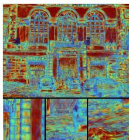  
GDAGS

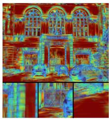  
ACD-GS

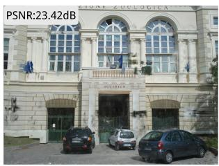  
GDAGS

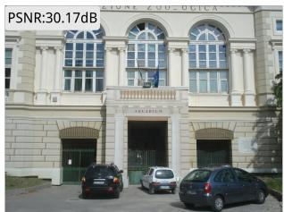  
ACD-GS  
Figure 5: Qualitative comparison of Gaussian distributions. Our curvature-aware strategy allocates sparse and elongated Gaussians to smooth surfaces, while preserving sharp boundaries with compact fine-scale primitives.

## D Geometric Reconstruction

To verify whether the proposed geometry-aware densification preserves reconstructed geometry, we conduct an additional surface reconstruction evaluation. Specifically, we extract meshes from the reconstructed Gaussian representations and evaluate them using Precision, Recall, and F-score. The results are reported in Table A7.

Our method primarily aims to obtain a more compact Gaussian representation while maintaining comparable novel-view synthesis quality, without introducing additional geometric supervision or explicit constraints on reconstruction accuracy. ACD-GS uses only approximately 38% and 41% of the Gaussian primitives required by AbsGS and GDAGS, respectively. Moreover, because ACD-GS tends to represent planar regions with fewer and larger Gaussians, TSDF-based surface extraction may be more susceptible to holes and local reconstruction errors. Nevertheless, ACD-GS still achieves competitive geometric reconstruction quality, indicating that curvature-aware densification preserves essential scene structures despite the substantially reduced Gaussian budget.

Table A7: Geometric reconstruction evaluation using Precision, Recall, and F-score.
<table><tr><td>Method</td><td>Precision(%)↑</td><td>Recall(%)↑</td><td>F-score(%)↑</td><td>Points↓</td></tr><tr><td>ACD-GS</td><td>66.34</td><td>91.21</td><td>76.81</td><td>642,044</td></tr><tr><td>AbsGS</td><td>69.58</td><td>93.33</td><td>79.72</td><td>1,693,016</td></tr><tr><td>3DGS</td><td>60.52</td><td>79.08</td><td>68.57</td><td>1,552,777</td></tr><tr><td>GDAGS</td><td>66.13</td><td>88.80</td><td>75.81</td><td>1,582,823</td></tr><tr><td>Mini-Splatting</td><td>56.04</td><td>85.58</td><td>67.72</td><td>4,495,856</td></tr><tr><td>Mip-Splatting</td><td>66.02</td><td>88.60</td><td>78.03</td><td>2,343,461</td></tr><tr><td>Pixel-ĠS</td><td>68.16</td><td>86.41</td><td>76.21</td><td>2,937,890</td></tr></table>

## NeurIPS Paper Checklist

## 1. Claims

Question: Do the main claims made in the abstract and introduction accurately reflect the paper’s contributions and scope?

Answer: [Yes]

Justification: The abstract and introduction reflect the papers contributions and scope.

Guidelines:

• The answer [N/A] means that the abstract and introduction do not include the claims made in the paper.

• The abstract and/or introduction should clearly state the claims made, including the contributions made in the paper and important assumptions and limitations. A [No] or [N/A] answer to this question will not be perceived well by the reviewers.

• The claims made should match theoretical and experimental results, and reflect how much the results can be expected to generalize to other settings.

• It is fine to include aspirational goals as motivation as long as it is clear that these goals are not attained by the paper.

## 2. Limitations

Question: Does the paper discuss the limitations of the work performed by the authors?

Answer: [Yes]

Justification: We discuss the limitations of this work in a single section.

Guidelines:

• The answer [N/A] means that the paper has no limitation while the answer [No] means that the paper has limitations, but those are not discussed in the paper.

• The authors are encouraged to create a separate “Limitations” section in their paper.

• The paper should point out any strong assumptions and how robust the results are to violations of these assumptions (e.g., independence assumptions, noiseless settings, model well-specification, asymptotic approximations only holding locally). The authors should reflect on how these assumptions might be violated in practice and what the implications would be.

• The authors should reflect on the scope of the claims made, e.g., if the approach was only tested on a few datasets or with a few runs. In general, empirical results often depend on implicit assumptions, which should be articulated.

• The authors should reflect on the factors that influence the performance of the approach. For example, a facial recognition algorithm may perform poorly when image resolution is low or images are taken in low lighting. Or a speech-to-text system might not be used reliably to provide closed captions for online lectures because it fails to handle technical jargon.

• The authors should discuss the computational efficiency of the proposed algorithms and how they scale with dataset size.

• If applicable, the authors should discuss possible limitations of their approach to address problems of privacy and fairness.

• While the authors might fear that complete honesty about limitations might be used by reviewers as grounds for rejection, a worse outcome might be that reviewers discover limitations that aren’t acknowledged in the paper. The authors should use their best judgment and recognize that individual actions in favor of transparency play an important role in developing norms that preserve the integrity of the community. Reviewers will be specifically instructed to not penalize honesty concerning limitations.

## 3. Theory assumptions and proofs

Question: For each theoretical result, does the paper provide the full set of assumptions and a complete (and correct) proof?

Answer: [Yes]

Justification: The assumptions for each theoretical result are clearly stated.

Guidelines:

• The answer [N/A] means that the paper does not include theoretical results.

• All the theorems, formulas, and proofs in the paper should be numbered and crossreferenced.

• All assumptions should be clearly stated or referenced in the statement of any theorems.

• The proofs can either appear in the main paper or the supplemental material, but if they appear in the supplemental material, the authors are encouraged to provide a short proof sketch to provide intuition.

• Inversely, any informal proof provided in the core of the paper should be complemented by formal proofs provided in appendix or supplemental material.

• Theorems and Lemmas that the proof relies upon should be properly referenced.

## 4. Experimental result reproducibility

Question: Does the paper fully disclose all the information needed to reproduce the main experimental results of the paper to the extent that it affects the main claims and/or conclusions of the paper (regardless of whether the code and data are provided or not)?

Answer: [Yes]

Justification: We provide sufficient information to reproduce the main experimental results and the code will be released.

Guidelines:

• The answer [N/A] means that the paper does not include experiments.

• If the paper includes experiments, a [No] answer to this question will not be perceived well by the reviewers: Making the paper reproducible is important, regardless of whether the code and data are provided or not.

• If the contribution is a dataset and/or model, the authors should describe the steps taken to make their results reproducible or verifiable.

• Depending on the contribution, reproducibility can be accomplished in various ways. For example, if the contribution is a novel architecture, describing the architecture fully might suffice, or if the contribution is a specific model and empirical evaluation, it may be necessary to either make it possible for others to replicate the model with the same dataset, or provide access to the model. In general. releasing code and data is often one good way to accomplish this, but reproducibility can also be provided via detailed instructions for how to replicate the results, access to a hosted model (e.g., in the case of a large language model), releasing of a model checkpoint, or other means that are appropriate to the research performed.

• While NeurIPS does not require releasing code, the conference does require all submissions to provide some reasonable avenue for reproducibility, which may depend on the nature of the contribution. For example

(a) If the contribution is primarily a new algorithm, the paper should make it clear how to reproduce that algorithm.

(b) If the contribution is primarily a new model architecture, the paper should describe the architecture clearly and fully.

(c) If the contribution is a new model (e.g., a large language model), then there should either be a way to access this model for reproducing the results or a way to reproduce the model (e.g., with an open-source dataset or instructions for how to construct the dataset).

(d) We recognize that reproducibility may be tricky in some cases, in which case authors are welcome to describe the particular way they provide for reproducibility. In the case of closed-source models, it may be that access to the model is limited in some way (e.g., to registered users), but it should be possible for other researchers to have some path to reproducing or verifying the results.

## 5. Open access to data and code

Question: Does the paper provide open access to the data and code, with sufficient instructions to faithfully reproduce the main experimental results, as described in supplemental material?

Answer: [Yes]

Justification: We provide the implementation code of our method and model checkpoints. Guidelines:

• The answer [N/A] means that paper does not include experiments requiring code.

• Please see the NeurIPS code and data submission guidelines (https://neurips.cc/ public/guides/CodeSubmissionPolicy) for more details.

• While we encourage the release of code and data, we understand that this might not be possible, so [No] is an acceptable answer. Papers cannot be rejected simply for not including code, unless this is central to the contribution (e.g., for a new open-source benchmark).

• The instructions should contain the exact command and environment needed to run to reproduce the results. See the NeurIPS code and data submission guidelines (https: //neurips.cc/public/guides/CodeSubmissionPolicy) for more details.

• The authors should provide instructions on data access and preparation, including how to access the raw data, preprocessed data, intermediate data, and generated data, etc.

• The authors should provide scripts to reproduce all experimental results for the new proposed method and baselines. If only a subset of experiments are reproducible, they should state which ones are omitted from the script and why.

• At submission time, to preserve anonymity, the authors should release anonymized versions (if applicable).

• Providing as much information as possible in supplemental material (appended to the paper) is recommended, but including URLs to data and code is permitted.

## 6. Experimental setting/details

Question: Does the paper specify all the training and test details (e.g., data splits, hyperparameters, how they were chosen, type of optimizer) necessary to understand the results?

Answer: [Yes]

Justification: We specify all the training and test details.

Guidelines:

• The answer [N/A] means that the paper does not include experiments.

• The experimental setting should be presented in the core of the paper to a level of detail that is necessary to appreciate the results and make sense of them.

• The full details can be provided either with the code, in appendix, or as supplemental material.

## 7. Experiment statistical significance

Question: Does the paper report error bars suitably and correctly defined or other appropriate information about the statistical significance of the experiments?

Answer: [No]

Justification: The paper does not include hypothesis testing or statistical significance analysis, and error bars are not a focus of the experiments.

Guidelines:

• The answer [N/A] means that the paper does not include experiments.

• The authors should answer [Yes] if the results are accompanied by error bars, confidence intervals, or statistical significance tests, at least for the experiments that support the main claims of the paper.

• The factors of variability that the error bars are capturing should be clearly stated (for example, train/test split, initialization, random drawing of some parameter, or overall run with given experimental conditions).

• The method for calculating the error bars should be explained (closed form formula, call to a library function, bootstrap, etc.)

• The assumptions made should be given (e.g., Normally distributed errors).

• It should be clear whether the error bar is the standard deviation or the standard error of the mean.

• It is OK to report 1-sigma error bars, but one should state it. The authors should preferably report a 2-sigma error bar than state that they have a 96% CI, if the hypothesis of Normality of errors is not verified.

• For asymmetric distributions, the authors should be careful not to show in tables or figures symmetric error bars that would yield results that are out of range (e.g., negative error rates).

• If error bars are reported in tables or plots, the authors should explain in the text how they were calculated and reference the corresponding figures or tables in the text.

## 8. Experiments compute resources

Question: For each experiment, does the paper provide sufficient information on the computer resources (type of compute workers, memory, time of execution) needed to reproduce the experiments?

Answer: [Yes]

Justification: The computational resources are discussed in the Implementation section, providing sufficient information to reproduce the experiments.

Guidelines:

• The answer [N/A] means that the paper does not include experiments.

• The paper should indicate the type of compute workers CPU or GPU, internal cluster, or cloud provider, including relevant memory and storage.

• The paper should provide the amount of compute required for each of the individual experimental runs as well as estimate the total compute.

• The paper should disclose whether the full research project required more compute than the experiments reported in the paper (e.g., preliminary or failed experiments that didn’t make it into the paper).

## 9. Code of ethics

Question: Does the research conducted in the paper conform, in every respect, with the NeurIPS Code of Ethics https://neurips.cc/public/EthicsGuidelines?

Answer: [Yes]

Justification: The research conducted in the paper confirms the NeurIPS code of Ethics.

Guidelines:

• The answer [N/A] means that the authors have not reviewed the NeurIPS Code of Ethics.

• If the authors answer [No], they should explain the special circumstances that require a deviation from the Code of Ethics.

• The authors should make sure to preserve anonymity (e.g., if there is a special consideration due to laws or regulations in their jurisdiction).

## 10. Broader impacts

Question: Does the paper discuss both potential positive societal impacts and negative societal impacts of the work performed?

Answer: [N/A]

Justification: Our work mainly focuses on the improvement of algorithms and models, rather than areas directly related to social or ethical issues.

Guidelines:

• The answer [N/A] means that there is no societal impact of the work performed.

• If the authors answer $[ \mathrm { N } / \mathrm { A } ] \ \mathrm { o r } \ [ \mathrm { N o } ] ,$ they should explain why their work has no societal impact or why the paper does not address societal impact.

• Examples of negative societal impacts include potential malicious or unintended uses (e.g., disinformation, generating fake profiles, surveillance), fairness considerations (e.g., deployment of technologies that could make decisions that unfairly impact specific groups), privacy considerations, and security considerations.

• The conference expects that many papers will be foundational research and not tied to particular applications, let alone deployments. However, if there is a direct path to any negative applications, the authors should point it out. For example, it is legitimate to point out that an improvement in the quality of generative models could be used to generate Deepfakes for disinformation. On the other hand, it is not needed to point out that a generic algorithm for optimizing neural networks could enable people to train models that generate Deepfakes faster.

• The authors should consider possible harms that could arise when the technology is being used as intended and functioning correctly, harms that could arise when the technology is being used as intended but gives incorrect results, and harms following from (intentional or unintentional) misuse of the technology.

• If there are negative societal impacts, the authors could also discuss possible mitigation strategies (e.g., gated release of models, providing defenses in addition to attacks, mechanisms for monitoring misuse, mechanisms to monitor how a system learns from feedback over time, improving the efficiency and accessibility of ML).

## 11. Safeguards

Question: Does the paper describe safeguards that have been put in place for responsible release of data or models that have a high risk for misuse (e.g., pre-trained language models, image generators, or scraped datasets)?

Answer: [N/A]

Justification: The paper poses no such risks.

Guidelines:

• The answer [N/A] means that the paper poses no such risks.

• Released models that have a high risk for misuse or dual-use should be released with necessary safeguards to allow for controlled use of the model, for example by requiring that users adhere to usage guidelines or restrictions to access the model or implementing safety filters.

• Datasets that have been scraped from the Internet could pose safety risks. The authors should describe how they avoided releasing unsafe images.

• We recognize that providing effective safeguards is challenging, and many papers do not require this, but we encourage authors to take this into account and make a best faith effort.

## 12. Licenses for existing assets

Question: Are the creators or original owners of assets (e.g., code, data, models), used in the paper, properly credited and are the license and terms of use explicitly mentioned and properly respected?

Answer: [Yes]

Justification: All resources used in our paper, including code, data, and models, strictly adhere to appropriate licenses and terms of use, and have been appropriately authored by the original owner

Guidelines:

• The answer [N/A] means that the paper does not use existing assets.

• The authors should cite the original paper that produced the code package or dataset.

• The authors should state which version of the asset is used and, if possible, include a URL.

• The name of the license (e.g., CC-BY 4.0) should be included for each asset.

• For scraped data from a particular source (e.g., website), the copyright and terms of service of that source should be provided.

• If assets are released, the license, copyright information, and terms of use in the package should be provided. For popular datasets, paperswithcode.com/datasets has curated licenses for some datasets. Their licensing guide can help determine the license of a dataset.

• For existing datasets that are re-packaged, both the original license and the license of the derived asset (if it has changed) should be provided.

• If this information is not available online, the authors are encouraged to reach out to the asset’s creators.

## 13. New assets

Question: Are new assets introduced in the paper well documented and is the documentation provided alongside the assets?

Answer: [Yes]

Justification: The code is provided and includes accompanying documentation.

Guidelines:

• The answer [N/A] means that the paper does not release new assets.

• Researchers should communicate the details of the dataset/code/model as part of their submissions via structured templates. This includes details about training, license, limitations, etc.

• The paper should discuss whether and how consent was obtained from people whose asset is used.

• At submission time, remember to anonymize your assets (if applicable). You can either create an anonymized URL or include an anonymized zip file.

## 14. Crowdsourcing and research with human subjects

Question: For crowdsourcing experiments and research with human subjects, does the paper include the full text of instructions given to participants and screenshots, if applicable, as well as details about compensation (if any)?

Answer: [N/A]

Justification: This work does not involve crowdsourcing nor research with human subjects. Guidelines:

• The answer [N/A] means that the paper does not involve crowdsourcing nor research with human subjects.

• Including this information in the supplemental material is fine, but if the main contribution of the paper involves human subjects, then as much detail as possible should be included in the main paper.

• According to the NeurIPS Code of Ethics, workers involved in data collection, curation, or other labor should be paid at least the minimum wage in the country of the data collector.

## 15. Institutional review board (IRB) approvals or equivalent for research with human subjects

Question: Does the paper describe potential risks incurred by study participants, whether such risks were disclosed to the subjects, and whether Institutional Review Board (IRB) approvals (or an equivalent approval/review based on the requirements of your country or institution) were obtained?

Answer: [N/A]

Justification: the paper does not involve crowdsourcing nor research with human subjects. Guidelines:

• The answer [N/A] means that the paper does not involve crowdsourcing nor research with human subjects.

• Depending on the country in which research is conducted, IRB approval (or equivalent) may be required for any human subjects research. If you obtained IRB approval, you should clearly state this in the paper.

• We recognize that the procedures for this may vary significantly between institutions and locations, and we expect authors to adhere to the NeurIPS Code of Ethics and the guidelines for their institution.

• For initial submissions, do not include any information that would break anonymity (if applicable), such as the institution conducting the review.

## 16. Declaration of LLM usage

Question: Does the paper describe the usage of LLMs if it is an important, original, or non-standard component of the core methods in this research? Note that if the LLM is used only for writing, editing, or formatting purposes and does not impact the core methodology, scientific rigor, or originality of the research, declaration is not required.

## Answer:[N/A]

Justification: We use LLM for writing, editing, and formatting purposes. Coding Agents are only used to manage training tasks.

## Guidelines:

• The answer [N/A] means that the core method development in this research does not involve LLMs as any important, original, or non-standard components.

• Please refer to our LLM policy in the NeurIPS handbook for what should or should not be described.