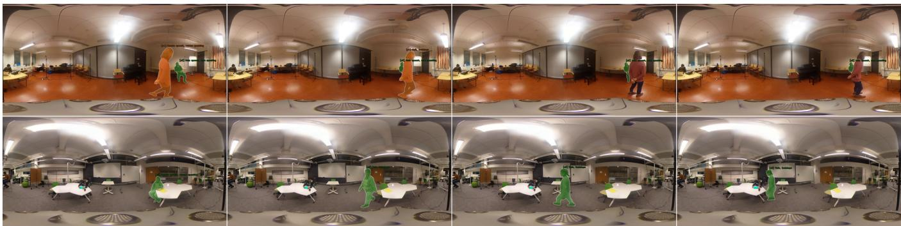
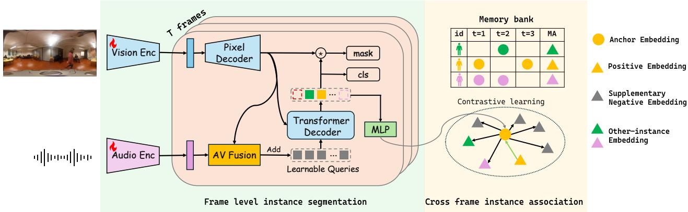
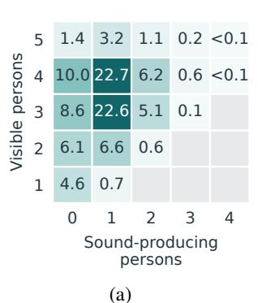
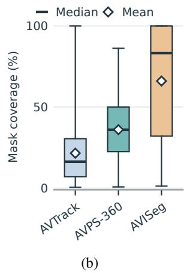

# AVPS-360: A SPATIAL AUDIO-VISUAL BENCHMARK FOR INSTANCE SEGMENTATION AND TRACKING OF SOUND-PRODUCING PERSONS

Yifu Sun∗, Parthasaarathy Sudarsanam, Tuomas Virtanen, Archontis Politis

Audio Research Group, Tampere University, Tampere, Finland

## ABSTRACT

Audio-visual instance segmentation (AVIS) segments and tracks individual sound-producing objects in videos. Existing benchmarks predominantly use monaural audio, which lacks inter-channel cues for spatially distinguishing concurrent sound sources. We introduce AVPS-360 (Audio-Visual Person Segmentation 360), a spatial audiovisual benchmark bridging AVIS and sound event localisation and detection (SELD). Built upon STARSS23, it pairs first-order Ambisonics audio with synchronised 360◦ video across 230 recordings totalling 10.5 hours. Recordings average 164.0 seconds. The dataset captures intermittent sound production in real-world interactions dominated by speech, alongside laughter, clapping, and footsteps. It provides 31,678 manually reviewed instance masks linked to source identities and sound-event labels. We also present a baseline that integrates spatial audio with visual features for frame-level segmentation and identity association across frames. Experiments on AVPS-360 show that existing AVIS methods struggle with detection and identity association in long recordings with intermittent sound production, while our baseline substantially improves performance in both aspects.

Index Terms— Audio-visual instance segmentation, spatial audio, first-order Ambisonics, sound-producing person segmentation, dataset

## 1. INTRODUCTION

Vision and hearing help us associate sounds with the people around us and follow their activities as they move and take turns speaking. For embodied agents and assistive robots, similar awareness of the surrounding physical environment could support interaction beyond a forward-facing camera’s view, such as responding to someone calling from behind or alerting users to activity outside their current view.

Audio-visual instance segmentation (AVIS) has established a foundation for segmenting and tracking individual sound-producing objects through AVISeg [4], while AVTrack [5] extends evaluation to complex human-centric scenes. However, these benchmarks primarily pair perspective video with monaural audio and therefore do not jointly provide panoramic visual context and inter-channel directional cues. General-purpose audio-visual models such as Qwen3-Omni [6] likewise use monaural audio in their standard input pipeline, without retaining inter-channel directional cues. Panoramic video offers visual coverage beyond a single viewing direction, while spatial audio provides directional evidence for determining which of several visible persons are producing sound.

Audio-visual sound event localisation and detection (SELD) datasets such as STARSS23 [7] provide multichannel audio and panoramic video, but their direction-of-arrival (DOA) annotations specify source directions rather than person masks. Standard SELD evaluation also does not require persistent identities across overlapping or intermittent events [8]. Linking spatial sound-event annotations to person masks and recording-level identities would connect acoustic scene analysis with instance-level visual grounding and tracking.

To connect these capabilities, we introduce AVPS-360, built upon STARSS23. It pairs four-channel first-order Ambisonics (FOA) audio with synchronised 360◦ video across 230 recordings of average duration 164.0 seconds, totalling 10.5 hours. We provide 31,678 manually reviewed person masks linked to recording-level identities and sound-event labels. The indoor interactions are dominated by speech, alongside laughter, clapping, and footsteps. Models must segment visible persons while they produce sound, suppress their masks during silence even when they remain visible, and preserve their identities when sound production resumes.

We further establish a simple baseline that uses spatial audio to guide frame-level instance segmentation and a memory of instance embeddings for cross-frame identity association. Experiments demonstrate the benefits of spatial audio and reveal substantial detection and association challenges for existing AVIS methods on AVPS-360.

Our contributions are: (i) a spatial audio-visual dataset linking first-order Ambisonics and panoramic video to person masks, source identities, and sound-event labels; (ii) a benchmark for segmenting and tracking intermittently sound-producing persons in long recordings; and (iii) a baseline and comparative evaluation demonstrating the value of spatial audio and the challenges faced by existing AVIS methods. The dataset is publicly available through the project page1. Code will be released upon acceptance.

## 2. RELATED WORK

Audio-visual segmentation and instance tracking. Visual sound localisation identifies audible sources in images through response heatmaps [9, 10]. Audio-visual segmentation (AVS) predicts pixellevel masks, with AVSBench supporting binary and semantic segmentation [1, 2] and RefAVS-Bench adding language-guided targets [3]. For instance-level modelling, AVISM [4] combines framelevel sound-source localisation with video-level object-token association. Subsequent work investigates sound-source association [11] and sound-enhanced online instance association [12]. SAMOT [13] combines adaptive Mamba step modulation with optimal transport for instance-level cross-modal matching.

Sound event localisation and detection. SELD jointly identifies sound classes and estimates source directions from multichannel audio [14, 15], including simultaneously active sources of the same class [16]. Source locations are represented by azimuth and elevation. Audio-visual SELD incorporates visual cues into event detection and localisation through audio-visual embedding fusion [17] and video-attention mechanisms [18].

Table 1. Comparison of audio-visual segmentation datasets. Len. denotes average recording duration; #Frames counts annotated frames; Cls denotes the number of object classes; Track indicates persistent instance identities across frames.
<table><tr><td>Dataset</td><td>Domain</td><td>Video</td><td>Audio</td><td>#Videos</td><td>Len.</td><td>Total</td><td>#Frames</td><td>Masks</td><td>Cls</td><td>Track</td></tr><tr><td>AVSBench-O [1]</td><td>Common</td><td>perspective</td><td>mono</td><td>5,356</td><td>5.0s</td><td>7.4h</td><td>12,972</td><td>12,972</td><td>23</td><td>X</td></tr><tr><td>AVSBench-S [2]</td><td>Common</td><td>perspective</td><td>mono</td><td>12,356</td><td>7.8s</td><td>26.8 h</td><td>82,972</td><td></td><td>70</td><td>X</td></tr><tr><td>RefAVS-Bench [3]</td><td>Common</td><td>perspective</td><td>mono</td><td>4,002</td><td>10.0s</td><td>11.1 h</td><td>40,020</td><td></td><td>51</td><td>X</td></tr><tr><td>AVISeg [4]</td><td>Common</td><td>perspective</td><td>mono</td><td>926</td><td>61.4s</td><td>15.8 h</td><td>56,871</td><td>94,074</td><td>26</td><td>√</td></tr><tr><td>AVTrack [5]</td><td>Human</td><td>perspective</td><td>mono†</td><td>871</td><td>54.0s</td><td>13.1 h</td><td>47,202</td><td>36,216</td><td>1</td><td>V</td></tr><tr><td>AVPS-360 (ours)</td><td>Human</td><td>panoramic</td><td>FOA</td><td>230</td><td>164.0 s</td><td>10.5 h</td><td>37,718</td><td>31,678</td><td>1</td><td>V</td></tr></table>

† Audio is converted to mono by the published pipeline. ‡ Counts derived from the released data.

  
Fig. 1. Annotation examples from AVPS-360. Coloured masks denote sound-producing persons, illustrating occlusion (top) and sound-source movement (bottom). Colours indicate consistent person identities within each recording.

## 3. THE AVPS-360 DATASET

AVPS-360 is built on STARSS23 [7], a dataset of indoor sound scenes improvised by participants following general instructions and recorded in 23 rooms with a spherical microphone array and a co-located 360◦ camera. It provides synchronised four-channel first-order Ambisonics, equirectangular video at 1920 × 960 pixels and 29.97 frames per second, and spatiotemporal sound-event annotations. Visible faces are blurred in the released STARSS23 videos for participant privacy [7]. We keep the STARSS23 partition: its development set becomes our training split and its evaluation set our test split, so no room or recording session is shared between the two. A person track links the annotated masks of the same person throughout one recording. The training split contains 156 recordings (7.06 h), 20,734 masks, and 340 person tracks; the test split contains 74 recordings (3.42 h), 10,944 masks, and 168 person tracks. No separate validation split is used.

## 3.1. Annotation

We annotate one video frame per second, yielding 37,718 annotated frames. Each visible sound-producing person receives one mask per timestamp and retains the same identity across sound-event classes; simultaneous event labels are allowed. Regions of the same person split across the panoramic seam are annotated as a single instance mask. For heavily occluded persons whose visible regions cannot be reliably annotated, we retain sound-event labels and source identities but omit masks. These persons are treated as non-targets at those timestamps. Fig. 1 shows sample frames.

We use SAM 3 [19] to segment visible persons and retain five human-produced sound classes from STARSS23: female speech, male speech, clapping, laughter, and footsteps. Projected DOA locations are matched to the nearest mask centroids to assign source identities and sound-event labels. Non-human sounds remain as acoustic distractors. All annotated frames undergo multiple rounds of manual review, correction, and verification using ISAT2 to resolve segmentation errors and identity mismatches caused by source-location offsets, movement, and occlusion. Event categories are provided as metadata but are neither used for event-class supervision nor predicted by the baseline.

## 3.2. Dataset statistics

Table 1 compares dataset scale, recording duration, sensing modalities, and annotation coverage. AVPS-360 recordings average 164.0 s, compared with 61.4 s for AVISeg and 54.0 s for AVTrack, providing longer sequences for evaluating instance association. Its annotations comprise 508 recording-level person tracks, with persons appearing in different recordings counted separately.

Fig. 3(a) shows the joint distribution of visible-person and soundproducing-person counts, with the latter counted from nonempty annotated masks. Each cell reports a percentage of all annotated frames in both splits. In 67.9% of frames, visible persons include both targets and non-targets; in 30.7%, persons are visible but none has a target mask. These cases illustrate target selection among coexisting persons rather than segmentation of everyone visible.

  
Fig. 2. Baseline architecture. Audio guides frame-level segmentation, and the resulting instance queries are mapped to embeddings for cross-frame association. A memory bank provides historical embeddings for contrastive learning. T denotes the number of sampled frames per training clip, and MA denotes momentum-averaged embeddings.

  
Fig. 3. Illustrations of AVPS-360 dataset statistics.

Fig. 3(b) compares per-track temporal mask coverage, defined as the proportion of a recording’s annotated frames with a nonempty mask for that track. Averaged over tracks across all splits, coverage is 36.1% in AVPS-360, 66.1% in AVISeg [4] (all object categories), and 21.6% in AVTrack [5]. Boxes show interquartile ranges and whiskers indicate minima and maxima. Coverage describes annotated target presence rather than acoustic activity alone; missing masks may reflect silence, severe occlusion, or absence from view.

## 4. BASELINE MODEL

To address long recordings with intermittent sound production, our baseline combines audio-conditioned frame-level segmentation with memory-based identity association (Fig. 2).

## 4.1. Frame-level Instance Segmentation

We build on Mask2Former [20], using a visual backbone and pixel decoder to extract multi-scale features $\bar { F } _ { t } ^ { \ell }$ and mask features for frame $t ,$ with $\ell \in \{ 1 , 2 , 3 \}$ indexing the visual scales. We use the CNN– Conformer audio encoder from [17], pretrained for SELD on spatial sound scenes synthesised with the DCASE 2022 generator $[ 2 1 ] . ^ { 3 }$ It maps seven feature channels—four FOA log-mel spectrograms and three cross-channel acoustic intensity-vector components—to an audio embedding a for each video frame t.

Following AVIS [4], a learned projection $W _ { b }$ maps audio to $b _ { t } = W _ { b } a _ { t } \in \mathbb { R } ^ { D }$ , where D is the query feature dimension. Let N be the number of instance queries and $\mathbf { \bar { \boldsymbol { P } } } \in \mathbb { R } ^ { N \times D }$ their learnable positional embeddings. Audio-visual fusion initialises the decoder queries as

$$
\begin{array} { r l } & { U _ { t } ^ { \ell } = \mathrm { C A } _ { \ell } ( b _ { t } , F _ { t } ^ { \ell } ; P ) , } \\ & { Q _ { t } ^ { 0 } = Q _ { \mathrm { l e a r n } } + W _ { f } [ U _ { t } ^ { 1 } ; U _ { t } ^ { 2 } ; U _ { t } ^ { 3 } ] , } \end{array}\tag{1}
$$

where each cross-attention block $\mathrm { C A } _ { \ell }$ broadcasts b to N queries, adds $P ,$ and uses $F _ { t } ^ { \ell }$ as keys and values, producing $U _ { t } ^ { \ell } \in \dot { \mathbb { R } } ^ { N \times D }$ $Q _ { \mathrm { l e a r n } } \in \mathbb { R } ^ { N \times D }$ is learnable query content; brackets denote feature concatenation, and $W _ { f }$ projects from 3D to D dimensions. The decoder attends to visual features to refine $Q _ { t } ^ { 0 }$ into $q _ { t , i } \in \mathbb { R } ^ { D } , i \in$ $\{ 1 , \ldots , N \}$ . Classification and mask heads predict sound-producingperson labels and instance masks, with Hungarian matching used during training.

## 4.2. Cross-frame Instance Association

Following CTVIS [22], we map audio-conditioned queries $q _ { t , i }$ to association embeddings $\boldsymbol { e } _ { t , i } \doteq \mathrm { M L P } ( \boldsymbol { q } _ { t , i } ) \in \mathbb { R } ^ { D }$ using a threelayer multilayer perceptron (MLP). Contrastive learning aligns sameperson embeddings across frames and separates different identities.

The memory bank stores momentum-averaged embeddings for each identity. For a current-frame anchor $e ,$ the contrastive loss is

$$
\mathcal { L } _ { \mathrm { e m b } } ( e ) = - \log \frac { \exp ( e ^ { \top } e ^ { + } ) } { \exp ( e ^ { \top } e ^ { + } ) + \sum _ { e ^ { - } \in \mathcal { N } _ { e } } \exp ( e ^ { \top } e ^ { - } ) } ,\tag{2}
$$

where $e ^ { + }$ is the same identity’s memory embedding. The negative set $\mathcal { N } _ { e }$ contains other-instance memory embeddings and supplementary negative embeddings sampled from other queries in the current frame. Equation (2) uses unnormalised embeddings without temperature scaling. Averaging over eligible anchors gives $\mathcal { L } _ { \mathrm { e m b } }$ . The auxiliary loss $\mathcal { L } _ { \mathrm { a u x } }$ regresses anchor–positive and anchor–negative cosine sim ilarities to one and zero, respectively, using mean squared error. The overall training objective is

$$
\begin{array} { r l } & { \mathcal { L } _ { \mathrm { s e g } } = \lambda _ { \mathrm { c l s } } \mathcal { L } _ { \mathrm { c l s } } + \lambda _ { \mathrm { b c e } } \mathcal { L } _ { \mathrm { b c e } } + \lambda _ { \mathrm { d i c e } } \mathcal { L } _ { \mathrm { d i c e } } , } \\ & { \quad \mathcal { L } = \mathcal { L } _ { \mathrm { s e g } } + \lambda _ { \mathrm { e m b } } \mathcal { L } _ { \mathrm { e m b } } + \lambda _ { \mathrm { a u x } } \mathcal { L } _ { \mathrm { a u x } } , } \end{array}\tag{3}
$$

where ${ \mathcal { L } } _ { \mathrm { c l s } }$ is query cross-entropy against matched class labels (noobject for unmatched queries), and $\mathcal { L } _ { \mathrm { b c e } }$ and ${ \mathcal { L } } _ { \mathrm { d i c e } }$ are mask binary cross-entropy and Dice losses. These segmentation losses and intermediate decoder supervision follow Mask2Former. Loss weights follow CTVIS.

At inference, full recordings are processed sequentially at 1 fps, with cosine similarity associating current embeddings with identities stored in memory. Frame-wise confidence filtering selects output masks, while memory preserves identities across temporary silence.

## 5. EXPERIMENTS AND RESULTS

Evaluation metrics. Following AVIS and AVTrack [4, 5], we report Track AP, HOTA, DetA, AssA, and IDF1. Track AP evaluates instance mask trajectories using spatio-temporal IoU. HOTA [23] combines detection (DetA) and association (AssA), while IDF1 [24] measures identity consistency.

Implementation details. We train our baseline for 24,000 iterations with AdamW on two NVIDIA GH200 GPUs, using a batch of two clips with ten frames sampled from a 20-second window per clip. The initial learning rate is $\mathrm { ^ { 1 0 ^ { - 4 } } } ( 1 0 ^ { - 5 }$ for both encoders), reduced by a factor of 0.1 at 16,000 iterations. During training, we apply clip-consistent panoramic shifts, horizontal flips, and visual colour jitter. The FOA audio undergoes matching rotations and reflections.

## 5.1. Main Results

Table 2 compares our baseline with AVISM [4] and ACVIS [11]. SeaVIS [12] and SAMOT [13] are not included because we could not find public implementations during this study. All compared models use visual weights pretrained on ImageNet [25] and COCO [26], and are trained on the training split of AVPS-360. The VGGish variants follow the audio pipelines of their released implementations. For the spatial-audio variants, we replace VGGish with the same pretrained CNN–Conformer used in our baseline and fine-tune it jointly with the segmentation and tracking model, retaining each method’s fusion and tracking architecture.

Replacing VGGish with the CNN–Conformer increases AVISM’s HOTA from 29.85 to 31.42, whereas ACVIS changes from 26.50 to 25.63. Our baseline achieves 17.92 Track AP and 60.57 HOTA, outperforming all evaluated configurations across the reported metrics (Table 2). We next examine which advantages remain without audio and the additional benefit of spatial cues.

## 5.2. Ablation Studies

Audio input. Table 3 compares a visual-only variant (None) with W-zero, W-repeat, and FOA inputs. The visual-only variant bypasses the audio encoder and audio-visual fusion while retaining the visual segmentation and association pipeline. All audio variants share the CNN–Conformer architecture and pretrained weights. W-zero and Wrepeat use [W, 0, 0, 0] and [W, W, W, W] waveforms during training and inference, with all seven feature channels recomputed. Even without audio, our baseline exceeds all evaluated AVISM/ACVIS variants in HOTA, DetA, AssA and IDF1 (Tables 2–3), although Track AP remains low (0.51). This advantage is not attributable to spatial audio and is consistent with a benefit of the frame-wise, memory-based design. FOA further improves all metrics, raising Track AP from at most 2.30 among the controls to 17.92.

Table 2. Comparison of different AVIS methods on AVPS-360.
<table><tr><td>Method</td><td>Audio Enc</td><td>AP HOTA DetA AssA IDF1</td></tr><tr><td>AVISM [4]</td><td>VGGish</td><td>0.46 29.8526.11 34.2539.51</td></tr><tr><td>AVISM [4] CNN-Conf.</td><td></td><td>0.72 31.4227.8435.5540.72</td></tr><tr><td>ACVIS [11] VGGish</td><td></td><td>0.68 26.5019.9835.2931.42</td></tr><tr><td>ACVIS [11] CNN-Conf.</td><td></td><td>1.58 25.63 19.5933.67 29.87</td></tr><tr><td>Ours</td><td>CNN-Conf. 17.92</td><td>60.5759.34 62.0073.43</td></tr></table>

Table 3. Audio input ablation.
<table><tr><td>Audio input AP</td><td>HOTA DetA AssA IDF1</td></tr><tr><td>None</td><td>0.51 34.9831.2839.1747.33</td></tr><tr><td>W-zero</td><td>0.29 34.1630.8537.8846.61</td></tr><tr><td>W-repeat</td><td>2.30 42.9940.5645.6857.69</td></tr><tr><td>FOA</td><td>17.92 60.57 59.34 62.00 73.43</td></tr></table>

Visual backbone and pre-training. We examine the effects of the visual backbone and pre-training dataset while keeping the spatial audio encoder unchanged (Table 4). ImageNet+COCO models are initialised from Mask2Former, while ImageNet+COCO+OVIS uses CTVIS weights further fine-tuned on OVIS [27]. With ResNet-50, OVIS pre-training improves Track AP and HOTA. Swin-L achieves the best overall performance.

Table 4. Visual backbone and pre-training.
<table><tr><td>Backbone Initialisation</td><td></td><td>AP HOTA DetA AssA IDF1</td></tr><tr><td>ResNet-50 IN+COCO</td><td></td><td>17.92 60.5759.3462.0073.43</td></tr><tr><td></td><td>ResNet-50 IN+COCO+OVIS 19.03</td><td>61.1460.0862.3872.00</td></tr><tr><td>Swin-L</td><td>IN+COCO</td><td>21.94 63.16 63.53 62.89 74.00</td></tr></table>

## 6. CONCLUSION

We introduced AVPS-360, linking spatial audio and panoramic video to sound-producing person masks, recording-level identities, and sound-event labels. The benchmark supports segmentation and tracking during extended interactions with intermittent target activity. Our baseline combines audio-conditioned frame-level prediction with identity memory and outperforms the evaluated AVIS methods on AVPS-360. Under the same encoder architecture and initialisation, FOA substantially outperforms W-only controls, supporting the contribution of spatial acoustic information.

## 7. COMPLIANCE WITH ETHICAL STANDARDS

This study adds annotations to publicly released STARSS23 recordings [7], without new participant recruitment or data collection. The original study reports ethics approval and informed consent for public release. We retain the face blurring in the released videos.

## 8. REFERENCES

[1] J. Zhou, J. Wang, J. Zhang, W. Sun, J. Zhang, S. Birchfield, D. Guo, L. Kong, M. Wang, and Y. Zhong, “Audio-visual segmentation,” in Proc. Eur. Conf. Comput. Vis. (ECCV), 2022, pp. 386–403.

[2] J. Zhou, X. Shen, J. Wang, J. Zhang, W. Sun, J. Zhang, S. Birch field, D. Guo, L. Kong, M. Wang, and Y. Zhong, “Audio-visual segmentation with semantics,” Int. J. Comput. Vis., vol. 133, no. 4, pp. 1644–1664, 2025.

[3] Y. Wang, P. Sun, D. Zhou, G. Li, H. Zhang, and D. Hu, “Ref-AVS: Refer and segment objects in audio-visual scenes,” in Proc. Eur. Conf. Comput. Vis. (ECCV), 2024, pp. 196–213.

[4] R. Guo, X. Ying, Y. Chen, D. Niu, G. Li, L. Qu, Y. Qi, J. Zhou, B. Xing, W. Yue, J. Shi, Q. Wang, P. Zhang, and B. Liang, “Audio-visual instance segmentation,” in Proc. IEEE/CVF Conf. Comput. Vis. Pattern Recognit. (CVPR), 2025, pp. 13550– 13560.

[5] Y. Wang, Y. Zhou, Z. Zhang, and H. Ding, “AVTrack: Audiovisual tracking in human-centric complex scenes,” in Proc. Int. Conf. Mach. Learn. (ICML), 2026.

[6] J. Xu, Z. Guo, H. Hu, et al., “Qwen3-Omni technical report,” arXiv:2509.17765, 2025.

[7] K. Shimada, A. Politis, P. Sudarsanam, D. A. Krause, K. Uchida, S. Adavanne, A. Hakala, Y. Koyama, N. Takahashi, S. Takahashi, T. Virtanen, and Y. Mitsufuji, “STARSS23: An audiovisual dataset of spatial recordings of real scenes with spatiotemporal annotations of sound events,” in Adv. Neural Inf. Process. Syst., 2023, vol. 36, pp. 72931–72957.

[8] D. Diaz-Guerra, A. Politis, P. Sudarsanam, K. Shimada, D. A. Krause, K. Uchida, Y. Koyama, N. Takahashi, S. Takahashi, T. Shibuya, Y. Mitsufuji, and T. Virtanen, “Baseline models and evaluation of sound event localization and detection with distance estimation in DCASE2024 challenge,” in Proc. Detect. Classif. Acoust. Scenes Events Workshop (DCASE), 2024, pp. 41–45.

[9] A. Senocak, T.-H. Oh, J. Kim, M.-H. Yang, and I. S. Kweon, “Learning to localize sound source in visual scenes,” in Proc. IEEE/CVF Conf. Comput. Vis. Pattern Recognit. (CVPR), 2018, pp. 4358–4366.

[10] H. Chen, W. Xie, T. Afouras, A. Nagrani, A. Vedaldi, and A. Zisserman, “Localizing visual sounds the hard way,” in Proc. IEEE/CVF Conf. Comput. Vis. Pattern Recognit. (CVPR), 2021, pp. 16867–16876.

[11] J. Seo, H. Kwon, K. Kim, J. Lee, and K. Sohn, “Learning what to hear: Boosting sound-source association for robust audiovisual instance segmentation,” in Proc. IEEE Int. Conf. Acoust., Speech Signal Process. (ICASSP), 2026, pp. 16032– 16036.

[12] Y. Zhu, Y. Wang, Y. Hong, R. Guo, K. Ding, X. Gu, B. Fan, and S. Xiang, “SeaVIS: Sound-enhanced association for online audio-visual instance segmentation,” arXiv:2603.01431, 2026.

[13] K. Peng, Y. Shen, M. Zhang, L. Liu, W. Ji, J. Li, Y. Piao, and H. Lu, “SAMOT: State-aware step modulation and optimal transport matching for audio-visual instance segmentation,” in Proc. ACM Int. Conf. Multimedia (MM), 2026.

[14] S. Adavanne, A. Politis, J. Nikunen, and T. Virtanen, “Sound event localization and detection of overlapping sources using

convolutional recurrent neural networks,” IEEE J. Sel. Topics Signal Process., vol. 13, no. 1, pp. 34–48, 2019.

[15] A. Politis, A. Mesaros, S. Adavanne, T. Heittola, and T. Virtanen, “Overview and evaluation of sound event localization and detection in DCASE 2019,” IEEE/ACM Trans. Audio, Speech, Lang. Process., vol. 29, pp. 684–698, 2021.

[16] K. Shimada, Y. Koyama, S. Takahashi, N. Takahashi, E. Tsunoo, and Y. Mitsufuji, “Multi-ACCDOA: Localizing and detecting overlapping sounds from the same class with auxiliary duplicating permutation invariant training,” in Proc. IEEE Int. Conf. Acoust., Speech Signal Process. (ICASSP), 2022, pp. 316–320.

[17] D. Berghi, P. Wu, J. Zhao, W. Wang, and P. J. B. Jackson, “Fusion of audio and visual embeddings for sound event localization and detection,” in Proc. IEEE Int. Conf. Acoust., Speech Signal Process. (ICASSP), 2024, pp. 8816–8820.

[18] H. Hong, Q. Wang, R. Wei, M. Cai, and X. Fang, “MVANet: Multi-stage video attention network for sound event localization and detection with source distance estimation,” in Proc. IEEE Int. Conf. Acoust., Speech Signal Process. (ICASSP), 2025, pp. 1–5.

[19] N. Carion, L. Gustafson, Y.-T. Hu, S. Debnath, R. Hu, D. Suris, C. Ryali, K. V. Alwala, H. Khedr, A. Huang, et al., “SAM 3: Segment anything with concepts,” in Proc. Int. Conf. Learn. Represent. (ICLR), 2026.

[20] B. Cheng, I. Misra, A. G. Schwing, A. Kirillov, and R. Girdhar, “Masked-attention mask transformer for universal image segmentation,” in Proc. IEEE/CVF Conf. Comput. Vis. Pattern Recognit. (CVPR), 2022, pp. 1290–1299.

[21] A. Politis, K. Shimada, P. Sudarsanam, S. Adavanne, D. Krause, Y. Koyama, N. Takahashi, S. Takahashi, Y. Mitsufuji, and T. Virtanen, “STARSS22: A dataset of spatial recordings of real scenes with spatiotemporal annotations of sound events,” in Proc. Detect. Classif. Acoust. Scenes Events Workshop (DCASE), 2022, pp. 125–129.

[22] K. Ying, Q. Zhong, W. Mao, Z. Wang, H. Chen, L. Y. Wu, Y. Liu, C. Fan, Y. Zhuge, and C. Shen, “CTVIS: Consistent training for online video instance segmentation,” in Proc. IEEE/CVF Int. Conf. Comput. Vis. (ICCV), 2023, pp. 899–908.

[23] J. Luiten, A. Osep, P. Dendorfer, P. Torr, A. Geiger, L. Leal-Taixe, and B. Leibe, “HOTA: A higher order metric for evaluat-´ ing multi-object tracking,” Int. J. Comput. Vis., vol. 129, no. 2, pp. 548–578, 2021.

[24] E. Ristani, F. Solera, R. Zou, R. Cucchiara, and C. Tomasi, “Performance measures and a data set for multi-target, multicamera tracking,” in Proc. Eur. Conf. Comput. Vis. Workshops (ECCVW), 2016, pp. 17–35.

[25] J. Deng, W. Dong, R. Socher, L.-J. Li, K. Li, and L. Fei-Fei, “ImageNet: A large-scale hierarchical image database,” in Proc. IEEE Conf. Comput. Vis. Pattern Recognit. (CVPR), 2009, pp. 248–255.

[26] T.-Y. Lin, M. Maire, S. Belongie, J. Hays, P. Perona, D. Ramanan, P. Dollar, and C. L. Zitnick, “Microsoft COCO: Com-´ mon objects in context,” in Proc. Eur. Conf. Comput. Vis. (ECCV), 2014, pp. 740–755.

[27] J. Qi, Y. Gao, Y. Hu, X. Wang, X. Liu, X. Bai, S. Belongie, A. Yuille, P. H. S. Torr, and S. Bai, “Occluded video instance segmentation: A benchmark,” Int. J. Comput. Vis., vol. 130, no. 8, pp. 2022–2039, 2022.