# Accurate MRI-free PET Quantification and Reliability Assessment via CT-to-MRI Synthesis and Conformal Prediction

Jungwoo Seoa, Seung Yun Choia, Kun Ho Leeb, Seun Jeonc,∗, Byoung Seok Yec,∗, Jiook Chaa,∗

aSeoul National University, Seoul, Republic ofKorea bChosun University, Gwangju, Republic of Korea cYonsei University, Seoul, Republic of Korea

## Abstract

Standardized uptake value ratio (SUVR) quantification of amyloid PET commonly relies on a subject-specific T1-weighted MRI, yet a usable MRI is not always available. We therefore combined CT-to-MRI synthesis with conformal prediction for MRI-free PET0 quantification with reliability assessment. A slice-consistent Brownian Bridge Difusion Model was strengthened with multi-dataset training and data-source conditioning to enrich the anatomical prior learned from MRI, and with expanded multi-slice CT context tot exploit the through-plane continuity of subject-specific anatomy in CT. Synthetic MRI was used for FreeSurfer-based anatomical parcellation and PET quantification, while deep-ensemble uncertainty was calibrated with conformal prediction to estimate a plausible range for the corresponding real MRI-based SUVR. On 11C-PiB PET from OASIS-3, the proposed method achieved the9 highest synthesis and parcellation fidelity among the compared methods. Mean cortical SUVR from the proposed synthetic MRI agreed closely with the real MRI-based reference (MAE 0 016 ± 0 015, Pearson r = 0 9987) and yielded the same amyloid-positivity classification as the real MRI in all 87 test subjects at the prespecified cut-of. Conformal prediction achieved empirical coverage close to the prespecified levels, and at 90% target coverage, 85 of 87 subjects had prediction intervals that supported an unambiguous amyloid-positivity decision. Zero-shot evaluation on an independent external cohort showed that the proposed CT-to-MRI model could support PET quantification without retraining, although conformal calibration required target-cohort recalibration to recovers the intended coverage. These findings support CT-to-MRI-based MRI-free PET quantification as a promising approach for providing[ accurate SUVR measurements and an explicit assessment of their reliability.

Keywords: amyloid PET, MRI-free PET quantification, CT-to-MRI synthesis, difusion models, conformal prediction, uncertaintyv quantification8

## 1. Introduction

Amyloid-β deposition is one of the earliest detectable pathological changes in Alzheimer’s disease and may begin years before measurable cognitive decline [1, 2]. Positron emission tomography (PET) enables this molecular pathology to be visualized and quantified in vivo [3]. As Alzheimer’s disease is increasingly defined and staged according to its underlying biological pathology, biomarker-based assessment has becomer increasingly important [2]. Quantitative amyloid PET can characterize overall pathological burden, regional deposition patterns relevant to disease staging [4], and longitudinal changes in amyloid accumulation [5].

Amyloid PET is commonly quantified using the standardized uptake value ratio (SUVR), which normalizes tracer uptake in cortical target regions to uptake in a relatively amyloid-sparse reference region. Accurate SUVR estimation requires the target and reference regions to be defined according to each subject’s anatomy. Because PET has limited spatial resolution and weak anatomical contrast, conventional quantification pipelines typically rely on a subject-specific T1-weighted MRI for anatomical parcellation [6, 7].

A usable MRI, however, is not always available because of implanted devices, claustrophobia, patient motion, acquisition burden, or additional cost [8]. This has motivated MRI-free PET quantification methods based on PET spatial normalization [9, 10, 11], low-dose attenuation CT [12, 13, 14], or CT-to-MRI synthesis [15]. PET-only methods provide limited subjectspecific anatomy, whereas CT ofers insuficient soft-tissue contrast for fine cortical parcellation. CT-to-MRI synthesis is therefore particularly promising: it can complement the anatomical evidence available in CT with structural knowledge learned from MRI while retaining established MRI-based segmentation and quantification pipelines.

Despite this promise, CT-to-MRI synthesis remains intrinsically ill-posed because CT provides substantially less information than T1-weighted MRI about gray–white matter boundaries and cortical folding. Multiple anatomically plausible MR images may therefore be consistent with the same CT observation, making faithful recovery of subject-specific fine anatomy inherently challenging. More generally, medical image translation models can produce visually plausible outputs without necessarily preserving all subject-specific anatomical features [16]. This ambiguity is particularly important for MRI-free PET quantification because anatomical errors in the synthesized MRI can propagate through brain parcellation and ultimately afect regional SUVR estimates.

Conceptually, CT-to-MRI synthesis can be viewed as estimating the conditional distribution of possible MR images given the observed CT:

$$
p ( \mathbf { M R I } \mid \mathbf { C T } ) \propto p ( \mathbf { C T } \mid \mathbf { M R I } ) p ( \mathbf { M R I } ) .
$$

Here, p(MRI) represents anatomical prior knowledge learned from MRI data, whereas p(CT | MRI) reflects compatibility with the subject-specific anatomical information available in CT. Faithful synthesis therefore requires both a suficiently rich anatomical prior and suficient subject-specific evidence from the input CT to identify the anatomy most consistent with the individual subject.

Previous work demonstrated that CT-derived synthetic MRI can be incorporated into an MRI-based PET quantification pipeline, establishing the feasibility of CT-to-MRI-based MRI-free PET quantification [15]. Separately, slice-consistent Brownian Bridge difusion improved CT-to-MRI synthesis by jointly modeling adjacent slices and promoting through-plane consistency [17, 18]. Nevertheless, the anatomical prior learned from limited training data and the subject-specific information extracted from a narrow CT input may still be insuficient for recovering complex individual cortical anatomy.

In this study, we strengthen both sources of information. We use multi-dataset CT–MRI training to learn from a broader distribution of brain anatomy and introduce data-source conditioning so that this broader prior can be learned without conflating dataset-specific image characteristics. We also provide a wider multi-slice CT context to make greater use of subject-specific anatomical information available across adjacent slices. We hypothesize that a richer anatomical prior together with stronger subject-specific CT constraints will produce more faithful synthetic MRI and, in turn, improve anatomical parcellation and MRI-free PET quantification.

Existing MRI-free PET quantification methods, including CT-to-MRI-based quantification [15], are typically evaluated by their overall agreement with the real MRI-based reference but do not provide, for each subject, a plausible range for the SUVR that would have been obtained with that subject’s real MRI. High overall agreement, however, does not indicate how reliable an MRI-free SUVR estimate is for an individual subject. In the intended MRI-free setting, the real MRI is unavailable, so the discrepancy between an MRI-free SUVR estimate and the corresponding real MRI-based value cannot be directly measured. This is particularly important near an amyloid-positivity decision cut-of, where even a small quantification error may afect the resulting classification.

To address this limitation, we combine deep-ensemble uncertainty with split conformal prediction [19, 20, 21, 22]. Modelderived uncertainty has been used to characterize output reliability in medical image segmentation [23] and neuroimage enhancement [24], while conformal prediction has been applied to assess the reliability of diagnostic predictions in AI-assisted pathology [25]. In our setting, these ideas are used to assess the reliability of CT-to-MRI-based PET quantification by estimating a plausible range for the corresponding real MRI-based SUVR. Comparing this range with the amyloid-positivity decision cut-of allows cases to be identified as confidently negative, confidently positive, or indeterminate, providing a way to assess decision reliability when the real MRI is unavailable.

For clinical applicability, the proposed approach should remain reliable beyond the datasets used for model development. We therefore evaluated zero-shot generalization on an independent external cohort and examined whether the conformal calibration could also be transferred to this new setting.

Accordingly, this study makes four main contributions:

1. Improved CT-to-MRI synthesis. We strengthen sliceconsistent CT-to-MRI synthesis by enriching the anatomical prior learned from MRI through multi-dataset training with data-source conditioning, and by exploiting the through-plane continuity of subject-specific anatomy in CT through an expanded multi-slice CT context.

2. More accurate MRI-free PET quantification. We show that the improved anatomical inference yields more faithful anatomical parcellation and closer agreement with real MRI-based composite and regional SUVR quantification than PET-only and CT-based baselines and existing CTto-MRI-based approaches.

3. Reliability assessment using conformal prediction. We construct calibrated prediction intervals for composite and regional SUVR estimates and use these intervals to identify cases in which the reliability of an MRI-free amyloidpositivity decision is uncertain.

4. Zero-shot external validation. We evaluate CT-to-MRI synthesis, PET quantification, and conformal reliability assessment on an independent external cohort never used for training, demonstrating the feasibility of using the synthesis model for PET quantification without retraining and showing that conformal calibration requires targetcohort recalibration.

The complete approach is evaluated using 11C-PiB amyloid PET from OASIS-3 [26] and, zero-shot, using 18F-florbetaben PET from the independent Gwangju Alzheimer’s & Related Dementias (GARD) cohort [27], with PET quantification based on each subject’s real MRI serving as the reference in both cohorts.

## 2. Materials and Methods

## 2.1. Overview

The proposed pipeline replaces the unavailable T1-weighted MRI with a synthesized MRI from a brain CT and then applies the same PET quantification procedure used in the conventional MRI-based pipeline (Fig. 1). The framework consists of four stages. First, a CT-to-MRI synthesis model generates a subjectspecific T1-weighted MRI from the input CT. Second, the synthetic MRI is processed with FreeSurfer recon-all [28] to obtain subject-specific anatomical parcellations. Third, amyloid PET uptake is quantified as standardized uptake value ratios (SUVRs) using subject-specific anatomical regions and the cerebellar cortex as the reference region [7]. Fourth, uncertainty in the MRI-free SUVR estimate is quantified using a deep ensemble [19] and calibrated with conformal prediction [22] to construct a prediction interval for the corresponding real MRI-based SUVR. The interval is then used to distinguish confident from indeterminate amyloid-positivity decisions. The downstream parcellation and PET quantification procedures are identical to those used with the real MRI, with only the anatomical image replaced.

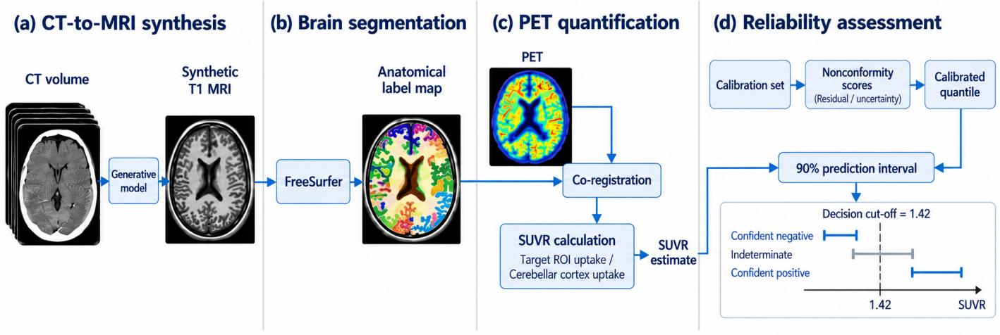  
Figure 1: Overview of the MRI-free PET quantification and reliability assessment framework. The framework consists of four stages: CT-to-MRI synthesis, anatomical parcellation of the synthesized MRI, SUVR quantification, and conformal prediction for reliability-aware decision assessment with respect to the prespecified decision cut-of. This schematic was generated with OpenAI’s gpt-image model (version 2.0) based on the authors’ design and checked by the authors. The brain images are illustrative and do not depict study data.

Building on the slice-consistent BBDM framework [17, 18], we introduce multi-dataset training, data-source conditioning, and expanded multi-slice CT context to better capture anatomical variation and subject-specific information from CT. The resulting CT-to-MRI-based PET quantification pipeline is evaluated zeroshot on a fully independent external cohort without retraining or adaptation of the synthesis model. We additionally examine the transferability of conformal calibration to the external cohort and the efect of target-cohort recalibration on external coverage.

## 2.2. Datasets

To develop a CT-to-MRI generative model that captures diverse anatomical and acquisition characteristics and to evaluate its generalization to a cohort independent of the datasets used for model training, we used two publicly available datasets, one in-house clinical cohort, and one independent external cohort. OASIS-3 [26] served as the primary dataset for CT-to-MRI model development and evaluation of the CT-to-MRI-based MRI-free PET quantification pipeline. SynthRAD2023 [29] provided additional paired CT–MRI data for synthesis training. The internal Severance Hospital cohort was used for CT-to-MRI synthesis training and evaluation, providing an additional clinically acquired CT–MRI dataset with potential applicability to downstream PET quantification. The Gwangju Alzheimer’s & Related Dementias (GARD) cohort [27] was reserved as a fully independent external cohort to evaluate zero-shot generalization to an unseen cohort without retraining or fine-tuning.

OASIS-3. OASIS-3 is a publicly available longitudinal multimodal neuroimaging dataset spanning normal aging and Alzheimer’s disease [26]. We used low-dose CT acquired as part of PET/CT examinations together with T1-weighted MRI for CT-to-MRI model development and evaluation.

CT–MRI pairs were constructed by matching each CT session to the temporally closest T1-weighted MRI from the same subject within 365 days, yielding 1,441 candidate pairs from 879 subjects. Subjects were assigned at the subject level to a training set, a validation set for model selection, a calibration set for conformal prediction, and a test set for final evaluation. All available CT–MRI pairs from training subjects were retained, whereas one pair per subject, selected by the smallest CT–MRI acquisition interval, was used for the validation, calibration, and test sets. This resulted in 1,052 CT–MRI pairs before quality control. After excluding 22 pairs because of data or preprocessing abnormalities, including registration failure, corrupted volumes, or incomplete brain coverage, 1,030 usable pairs remained.

For PET quantification, we used 11C-PiB PET and selected subjects whose PiB PET and paired T1-weighted MRI were acquired on the same day. This yielded 93 subjects for conformal calibration and 87 test subjects for the primary MRI-free PET quantification analysis.

SynthRAD2023. SynthRAD2023 is a publicly available multiinstitutional dataset developed for synthetic CT generation in radiotherapy and provides paired CT and MRI data from multiple contributing centers [29]. We used the brain subset of Task 1, which provides paired MRI–CT data for MRI-to-CT synthesis, comprising 180 paired CT–MRI cases. Three cases were excluded because of CT or preprocessing failures, leaving 177 usable pairs for CT-to-MRI synthesis training.

Severance Hospital cohort. The Severance Hospital cohort is an in-house clinical dataset comprising paired CT and T1-weighted MRI acquired at Severance Hospital, Seoul, Republic of Korea. CT and MRI examinations were paired when acquired within one year. The initial cohort included 230 CT-MRI pairs. After excluding 18 pairs because of incomplete brain coverage, image abnormalities, or preprocessing failure, 212 usable pairs remained. CT images were acquired using a GE Discovery 600 PET/CT scanner (GE Healthcare, Milwaukee, WI, USA) with the following parameters: tube voltage, 120 kVp; tube current, 200 mA; gantry rotation time, 0.5 s; total collimation width, 10 mm; reconstruction field of view, 250 mm; and reconstructed matrix, 512 × 512 with 151 slices; voxel size, 0.488 × 0.488 × 1 mm³. T1-weighted MRI was acquired using a Philips 3.0-T MRI scanner (Philips Achieva; Philips Medical Systems, Best, The Netherlands) with a SENSE head coil (SENSE factor = 2) and a three-dimensional T1-weighted turbo-field echo sequence with the following parameters: axial acquisition matrix, 224 × 224; reconstructed matrix, 256 × 256 with 170 slices; voxel size, 0.859 × 0.859 × 1 mm³; field of view, 220 mm; echo time, 4.6 ms; repetition time, 9.8 ms; and flip angle, 8°.

GARD cohort. The Gwangju Alzheimer’s & Related Dementias (GARD) cohort is a longitudinal, community-based South Korean cohort established for multimodal investigation of aging and Alzheimer’s disease [27]. GARD served as a fully independent external evaluation cohort and was not used for CT-to-MRI model training, validation, or model selection, or for the primary conformal calibration performed using OASIS-3.

For the present study, we identified subjects with 18F-florbetaben amyloid PET/CT and T1-weighted MRI acquired within 90 days. The CT was obtained from the same PET/CT examination as the amyloid PET, and the temporally closest T1-weighted MRI was paired with each PET/CT examination. For subjects with multiple eligible examinations, the pair with the smallest PET/CT–MRI acquisition interval was retained, yielding one CT–MRI–PET set per subject and a final external cohort of 84 subjects.

PET/CT examinations were acquired at two centers using GE Discovery ST and Discovery STE systems. CT acquisition characteristics difered between the two sites, with predominant slice thicknesses of 3.75 and 2.5 mm and in-plane pixel spacings of approximately 0.98 and 0.49 mm, respectively. All T1-weighted MRI scans were acquired on a 3-T Siemens Skyra system at Chosun University Hospital. The trained CT-to-MRI models were applied to GARD without retraining or adaptation.

Data splits. All data splits were defined at the subject level to prevent information leakage. OASIS-3 was divided into training (773 pairs from 620 subjects), validation (20 subjects), calibration (120 subjects), and test (117 subjects) sets, with multiple longitudinal pairs from the same subject retained only in the training set. The Severance Hospital cohort was divided into training (180), validation (10), and test (22) sets, and all 177 SynthRAD2023 pairs were used for training.

For CT-to-MRI synthesis, the model was trained on the resulting 1,130 CT–MRI pairs, model selection used the 30 validation pairs, and synthesis performance was evaluated on the OASIS-3 and Severance test sets.

For PET quantification and reliability assessment, the OASIS-3 calibration and test sets were both restricted to subjects whose PiB PET and paired T1-weighted MRI were acquired on the same day. This yielded 93 subjects for conformal calibration and 87 subjects for the primary MRI-free PET quantification analysis. The independent GARD cohort was used only for external evaluation and was not involved in model training, model selection, or the primary conformal calibration.

## 2.3. Image preprocessing

For model development and retrospective evaluation, paired CT and T1-weighted MRI volumes were processed in a common space before CT-to-MRI synthesis. Both modalities were first resampled to 1-mm isotropic resolution. To reduce unnecessary spatial mismatch between the paired CT and MRI volumes and to enable voxel-wise evaluation against the real MRI, both modalities were then rigidly aligned to a common MNI152 space. Specifically, the CT was first rigidly registered to the corresponding T1-weighted MRI using elastix [30]. A brain mask was then extracted from the T1-weighted MRI using SynthStrip [31] and applied to both the T1-weighted MRI and the registered CT. The T1-weighted MRI was subsequently rigidly aligned to MNI152 space, and the same transformation was applied to the paired CT. In a practical MRI-free setting where a T1-weighted MRI is unavailable, the CT can instead be rigidly aligned directly to MNI152 space, with a brain mask derived from the CT, before model inference.

Following Kim et al. [15], CT intensities were clipped to the range of [−100 +200] HU, whereas T1-weighted MRI intensities were clipped to the 0.01th–99.99th percentile range. Each modality was then min–max normalized. N4 bias-field correction was not applied in this study, following the preprocessing conventions of [29] and Kim et al. [15].

## 2.4. CT-to-MRI synthesis

We developed the CT-to-MRI synthesis model based on the slice-consistent Brownian Bridge Difusion Model (BBDM) of Choo et al. [17], which builds on the Brownian Bridge difusion framework of Li et al. [18]. BBDM formulates paired imageto-image translation as a difusion process between the source and target modalities. The original framework jointly generates three consecutive T1-weighted MRI slices from the corresponding three axial CT slices and uses MRI histogram-based style conditioning together with ISTA-style sampling across overlapping slice groups. We retained these components as the base synthesis framework.

Building on this framework, we evaluated four design strategies intended to compensate for the limited anatomical information available in CT.

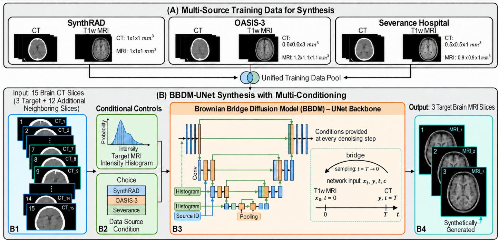  
Figure 2: Overview of the proposed CT-to-MRI generative model for faithful CT-to-MRI translation, which integrates multi-dataset training, data-source conditioning, and wider anatomical context within a Brownian Bridge Difusion Model. Paired CT and T1-weighted MRI from three datasets are combined into a unified training pool. (B1) 15 consecutive brain CT slices are used to predict the central three T1-weighted MRI slices, providing broader anatomical context for anatomically faithful synthesis. (B2) Two conditioning signals are provided: the target MRI intensity histogram, which promotes slice-consistent synthesis following Choo et al. (2024) [17], and the data-source condition, which accounts for inter-dataset heterogeneity. (B3) CT-to-MRI synthesis is performed using a Brownian Bridge Difusion Mode with a U-Net backbone, where both conditioning signals are injected into every denoising step. (B4) The model generates three consecutive T1-weighted MRI slices The segmentation-guided training module explored during model development is omitted because it is not part of the final model. This schematic was generated with OpenAI’s gpt-image model (version 2.0) based on the authors’ design and checked by the authors. The brain images are illustrative and do not depict study data.

Multi-dataset training (H1) jointly used paired CT–MRI data from OASIS-3, SynthRAD2023, and the Severance Hospital cohort. Training on a larger and more diverse set of subjects was expected to expose the model to a broader range of brain anatomy and acquisition characteristics, thereby strengthening the anatomical prior learned for CT-to-MRI synthesis.

Data-source conditioning (H2) was introduced to account for heterogeneity across the training datasets. Although multidataset training broadens the available anatomical information, systematic diferences in scanner characteristics, acquisition protocols, and image appearance across datasets may also interfere with learning a consistent CT-to-MRI mapping. We therefore provided the source dataset of each training sample as an additional conditioning variable alongside the MRI histogram condition at each denoising step, allowing the model to account for dataset-specific variation during training.

Expanded multi-slice anatomical context (H3) increased the through-plane CT context available for each prediction. Because gray–white matter boundaries and complex cortical folding are only weakly represented within an individual CT slice, we hypothesized that incorporating adjacent slices would provide complementary subject-specific anatomical information through the spatial continuity of brain structures across slices. Accordingly, within a practical computational budget, we evaluated progressively wider input contexts ranging from 3 to 15 consecutive axial CT slices. We selected 15 slices for the final model based on validation performance (Section Appendix A.6).

Segmentation-teacher feedback (H4) was explored as an auxiliary anatomical regularization strategy. We hypothesized that explicitly encouraging agreement in gray–white matter and other anatomical boundaries could promote anatomically faithful synthesis beyond image-level appearance alone. A frozen pretrained segmentation model was therefore used to provide an additional anatomical training signal. The teacher was used only during training and introduced no additional requirement at inference. Details of the segmentation-teacher model, auxiliary loss formulation, and weight selection are provided in Supplementary Section Appendix A.4.

Final model (Fig. 2) combined multi-dataset training (H1), data-source conditioning (H2), and the 15-slice CT context (H3), based on the validation analyses (Supplementary Sections Appendix A.5 and Appendix A.6). Segmentation-teacher feedback (H4) was excluded because it did not provide a significant additional improvement.

Training and inference. During training, MRI histogram conditioning was obtained from the paired target T1-weighted MRI, and the source dataset label was additionally provided for datasource conditioning. The final model used 15 consecutive axial CT slices to generate the corresponding central three T1- weighted MRI slices.

At inference, where the target MRI is unavailable, the mean MRI histogram estimated from the training data was used as the style condition. No subject-specific MRI image or histogram was used as a model input at inference. The source dataset label corresponding to the input CT was also provided to the model. For GARD, whose CT acquisition characteristics were most similar to those of OASIS-3 among the training datasets, the OASIS-3 source label was used for zero-shot inference. Full three-dimensional synthetic MRI volumes were reconstructed using the slice-consistent ISTA-style sampling procedure of Choo et al. [17]. The same inference procedure was applied to all test cohorts, including GARD, without retraining or finetuning. Detailed optimization and implementation settings are provided in the Supplementary Material (Appendix A.1).

Baseline models. We compared the proposed model with four CT-to-MRI synthesis baselines spanning representative imageto-image translation approaches: a least-squares GAN (LS-GAN; 32), an adaptive latent difusion model (ALDM; 33), the CT-to-MRI synthesis method developed for MRI-free PET quantification by Kim et al. [15], and the slice-consistent BBDM of Choo et al. [17].

Each baseline was trained and evaluated separately on each dataset, following the conventional single-dataset setting used in the corresponding prior methods. Thus, models evaluated on OASIS-3 were trained using only the OASIS-3 training set, whereas those evaluated on Severance were trained using only the Severance training set. To evaluate the efect of multi-dataset training (H1), the proposed model was instead trained jointly on OASIS-3, SynthRAD2023, and Severance. The contribution of H1, together with the subsequent efects of H2 and H3, was examined in the cumulative ablation analysis on the validation sets (Section Appendix A.5).

Model-specific training settings followed the corresponding original publications where applicable, with any modifications or additional tuning reported in the Supplementary Material (Section Appendix A.2).

Evaluation ofsynthesisfidelity. Image-level synthesis fidelity was evaluated using peak signal-to-noise ratio (PSNR), which reflects voxel-wise intensity fidelity, and three-dimensional structural similarity (SSIM3D), computed between the synthetic and real T1-weighted MRI volumes within the brain mask.

To assess preservation of anatomically meaningful structures, each synthetic MRI and its paired real MRI were processed independently with FreeSurfer recon-all. The resulting anatomical parcellations were compared using the Dice similarity coeficient (DSC), which measures regional overlap, and the 95th-percentile Hausdorf distance (HD95), which measures boundary agreement. Higher PSNR, SSIM3D, and DSC and lower HD95 indicate better agreement with the real MRI.

For PSNR and SSIM , paired subject-level comparisons were performed using the Wilcoxon signed-rank test. One-sided tests were used for prespecified comparisons evaluating improvement of the proposed model or successive model components, with statistical significance defined as $p < 0 . 0 5$

For the parcellation metrics, the proposed method was compared with each baseline for DSC and HD95 in each of the six anatomical regions using paired two-sided Wilcoxon signed-rank tests. Holm correction was applied across the 48 region–metric– baseline comparisons, with statistical significance defined as an adjusted $p < 0 . 0 5$

## 2.5. PET quantification

Real MRI-based PET quantification was used as the reference against which the MRI-free PET quantification pipelines were evaluated. Each real or synthetic T1-weighted MRI was processed independently with FreeSurfer recon-all [28] to obtain subject-specific anatomical parcellations. Amyloid PET uptake was then quantified using these parcellations, with the cerebellar cortex used as the reference region [7]. When a synthetic MRI was used, the downstream FreeSurfer and PET quantification procedures were kept identical to those of the real MRI-based pipeline, with only the anatomical image replaced.

For OASIS-3, 11C-PiB PET frames acquired 40–60 min after injection were averaged to obtain a static PET volume. For each real- or synthetic-MRI-based pipeline, the PET volume was rigidly registered to the corresponding T1-weighted image, and the resulting anatomical parcellation was mapped to the native PET space using the inverse transformation and nearestneighbor interpolation. Regional SUVRs were calculated by normalizing the mean tracer uptake in each target region to the volume-weighted mean uptake in the bilateral cerebellar cortex [7].

Following Su et al. [7], the mean cortical SUVR (MCSUVR) was calculated as the arithmetic mean of SUVRs in the precuneus, prefrontal cortex, gyrus rectus, and lateral temporal regions. Following Kim et al. [15], regional agreement was additionally evaluated in six cortical regions: frontal, parietal, lateral temporal, precuneus, anterior cingulate, and posterior cingulate.

In addition to the CT-to-MRI synthesis methods, we evaluated two families of non-synthesis MRI-free PET quantification baselines, with two implementations per family: PETonly template-based normalization and CT-based anatomical normalization. The PET-only implementations used populationtemplate-based spatial normalization [9, 10]. Each PET image was nonlinearly normalized to MNI152 space using either a PiB PET template constructed from the publicly available GAAIN Centiloid calibration datasets [34] or a PiB PET template constructed from OASIS-3 subjects outside the evaluation sets. These implementations are referred to as PET-template (GAAINderived) and PET-template (OASIS-derived), respectively. The CT-based implementations were adapted from Presotto et al. [12] and Matsuda et al. [13] and difered in CT preprocessing and segmentation settings. In both implementations, PET was rigidly co-registered to the same-day CT, the CT was normalized to MNI152 space using SPM unified segmentation [35], and the resulting deformation was applied to PET. Target regions were defined using Desikan–Killiany-based atlases in MNI152 space [36]. All four implementations used the same static PET image as the real MRI-based pipeline. Template and atlas construction, reference-region definitions, and implementation-specific settings are described in Section Appendix A.3.

Agreement with the real MRI-based reference was assessed using mean absolute error (MAE), Pearson correlation, and Bland–Altman analysis for systematic bias and limits of agreement. Paired subject-level absolute SUVR errors were compared between the proposed method and the CT-to-MRI baselines using two-sided Wilcoxon signed-rank tests, with Holm correction for multiple comparisons. Statistical significance was defined as an adjusted $p < 0 . 0 5$

Amyloid-positivity decision concordance was evaluated at a prespecified MCSUVR cut-of of 1.42, selected with reference to the PiB PET threshold reported by Jack Jr et al. [37]. Decision concordance was defined as the proportion of subjects for whom the MRI-free and real MRI-based pipelines yielded the same amyloid-positivity classification, with false-positive and falsenegative cases reported relative to the real MRI-based decision.

## 2.6. Reliability assessment with conformal prediction

Conformal prediction. Even if a CT-to-MRI-based MRI-free PET quantification pipeline achieves good overall agreement with quantification based on the real MRI, this does not ensure that the quantification error is small for every individual subject. In a practical MRI-free setting, the real MRI is unavailable, so the discrepancy between an MRI-free SUVR estimate and the corresponding real MRI-based SUVR cannot be known for a given subject. We therefore aimed to estimate, for each subject, a range of plausible SUVR values within which the corresponding real MRI-based SUVR would be expected to fall at a prespecified coverage level.

Because brain CT only partially captures the anatomical information needed for PET quantification, the dificulty of inferring the missing anatomical information can vary across subjects. For more dificult cases, independently trained models may converge to diferent plausible solutions, leading to greater variation in the resulting SUVR estimates. We therefore used model-to-model variation as a subject-specific uncertainty scale, with larger variation indicating a less stable MRI-free SUVR estimate.

To quantify this uncertainty, we employed a deep ensemble [19] consisting of five independently trained instances of the proposed CT-to-MRI model, initialized diferently and trained with diferent mini-batch orders. Each model generated a synthetic MRI that was independently processed through the same FreeSurfer-based PET quantification pipeline, yielding five SUVR estimates for each subject. The ensemble mean,

$$
\hat { \mu } ( x ) = \frac { 1 } { M } \sum _ { m = 1 } ^ { M } f _ { m } ( x ) , \qquad M = 5 ,\tag{1}
$$

was used as the SUVR estimate for the conformal analysis, and the standard deviation across ensemble members, $\hat { \sigma } ( x )$ , was used as the subject-specific uncertainty scale. (For the main synthesis and PET quantification comparisons, the proposed method was evaluated using a single model rather than the ensemble mean to avoid any performance gain from ensemble averaging.)

We then calibrated this uncertainty scale using conformal prediction [20, 21]. For each subject i in the OASIS-3 calibration set, the normalized nonconformity score was defined as

$$
E _ { i } = \frac { | \hat { \mu } ( x _ { i } ) - y _ { i } | } { \hat { \sigma } ( x _ { i } ) } ,\tag{2}
$$

where $y _ { i }$ denotes the corresponding real MRI-based SUVR. The score therefore measures how large the observed MRI-free quantification error is relative to the subject-specific ensemble variability. The distribution of these scores in the calibration set was used to determine how much the uncertainty scale should be expanded to achieve a desired coverage level.

For a target miscoverage level $\alpha ,$ the conformal scaling factor was defined as the finite-sample-corrected empirical quantile of the calibration scores:

$$
\hat { q } _ { 1 - \alpha } = \mathrm { Q u a n t i l e } _ { \lceil ( n _ { \mathrm { c a l } } + 1 ) ( 1 - \alpha ) \rceil / n _ { \mathrm { c a l } } } \left( \{ E _ { i } \} _ { i = 1 } ^ { n _ { \mathrm { c a l } } } \right) ,\tag{3}
$$

with $n _ { \mathrm { c a l } } = 9 3$ . For a test subject, the resulting prediction interval for the corresponding real MRI-based SUVR was defined as

$$
C _ { \alpha } ( x ) = [ \hat { \mu } ( x ) - \hat { q } _ { 1 - \alpha } \hat { \sigma } ( x ) , \hat { \mu } ( x ) + \hat { q } _ { 1 - \alpha } \hat { \sigma } ( x ) ] .\tag{4}
$$

Under exchangeability between the calibration and test subjects, this procedure provides marginal coverage of at least 1 − α for the corresponding real MRI-based SUVR. Conformal calibration was performed separately for MCSUVR and for each regional SUVR measure, so the coverage guarantee applies to each measure individually rather than jointly across all measures.

Empirical coverage was defined as the proportion of test subjects whose real MRI-based SUVR fell within the corresponding prediction interval. We evaluated whether the empirical coverage was consistent with the prespecified target coverage and also measured the resulting interval width in SUVR units. Two-sided 95% Wilson confidence intervals were calculated for empirical coverage on the fixed test sets.

Reliability assessment ofamyloid-positivity decisions. We further used the conformal prediction interval to assess the reliability of amyloid-positivity decisions based on CT-to-MRI-derived MCSUVR estimates. Because the prediction interval represents a plausible range for the corresponding real MRI-based MC-SUVR, its position relative to the prespecified decision cut-of τ = 1 42 indicates whether the decision remains unambiguous despite uncertainty in the MRI-free estimate.

If the entire interval lay below the cut-of, the interval supported a confidently negative decision. If the entire interval lay above the cut-of, the interval supported a confidently positive decision. When the interval spanned the cut-of, the corresponding real MRI-based MCSUVR could lie on either side of the decision boundary, and the case was therefore classified as indeterminate. Under this rule, a confident decision can disagree with the real MRI-based classification only if the reference MC-SUVR falls outside the prediction interval.

We additionally examined the robustness of this decision rule to the choice of MCSUVR cut-of by repeating the analysis across a range of cut-of values while keeping the conformal intervals fixed. At each cut-of, we assessed whether disagreements between the MRI-free and real MRI-based decisions were identified as indeterminate by the conformal decision rule.

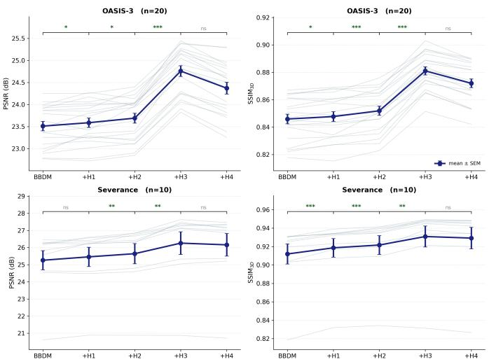  
Figure 3: Cumulative ablation of the proposed design choices on the validation sets. Thin lines show paired per-subject performance, and the dark line with error bars denotes the mean ± SEM. H1 denotes multi-dataset training, H2 data-source conditioning, H3 expanded multi-slice anatomical context, and H4 segmentation-teacher feedback. Statistical significance was assessed between consecutive models using one-sided paired Wilcoxon signed-rank tests $( ^ { * } p <$ $0 . 0 5 , ^ { * * } p < 0 . 0 1 , ^ { * * * } p < 0 . 0 0 1 , ^ { \mathrm { n s } }$ not significant). Because H1–H3 progressively improved synthesis performance whereas H4 provided no significant additional benefit, the final model includes H1–H3 only.

## 2.7. Zero-shot external evaluation

To evaluate zero-shot generalization, the trained CT-to-MRI models were applied to the independent GARD cohort [27], which was not used for model training or model selection, without any retraining, fine-tuning, or adaptation. The same preprocessing, CT-to-MRI synthesis, FreeSurfer parcellation, and PET quantification procedures used for the internal evaluation were applied to GARD.

CT-to-MRI synthesis and the resulting anatomical parcellations were evaluated against the paired real T1-weighted MRI. We then evaluated MRI-free PET quantification by comparing synthetic-MRI-based SUVR estimates with the corresponding real MRI-based SUVR values.

We further evaluated the transferability of the conformal calibration to the external cohort. The OASIS-3 conformal calibration was first applied directly to GARD without recalibration, and the resulting empirical coverage was compared with the prespecified target coverage. We additionally examined whether target-cohort recalibration could recover the intended coverage without retraining or fine-tuning the CT-to-MRI synthesis model. For this analysis, the synthesis models were kept fixed, and only the conformal scaling was recalibrated using subjects from GARD. GARD subjects were repeatedly divided into calibration and test subsets, with the conformal scaling factor estimated from the calibration subset and coverage and interval width evaluated in the held-out test subset.

## 3. Results

## 3.1. Compensating for limited anatomical information in CT

We first examined which design strategies could compensate for the limited anatomical information available in CT. The cumulative ablation analysis shows progressive improvement over the BBDM baseline as multi-dataset training (H1), datasource conditioning (H2), and expanded multi-slice anatomical context (H3) are introduced (Fig. 3; Section Appendix A.5). Among these design choices, H3 provides the largest marginal performance gain, while H1 and H2 provide smaller incremental improvements. In contrast, segmentation-teacher feedback (H4) provides no significant additional improvement.

We further evaluated the extent of the multi-slice CT context by varying the number of input CT slices from 3 to 15 on the validation sets. Using a wider context than the three-slice baseline generally improves synthesis fidelity, with particularly consistent gains on OASIS-3 and performance approaching a plateau on Severance. We therefore use 15 input CT slices in the final model. Detailed results across all evaluated context sizes are provided in Appendix A.6. Based on these analyses, the final proposed model incorporates multi-dataset training, data-source conditioning, and expanded multi-slice anatomical context.

## 3.2. Anatomicalfidelity ofCT-to-MRI synthesis

Having identified the final model configuration, we next evaluated its ability to reconstruct subject-specific anatomy on the Severance and OASIS-3 test sets. The proposed model achieves the highest synthesis fidelity among the competing methods (Table 1). On the Severance cohort it attains $2 6 . 0 2 \pm 2 . 0 4$ dB PSNR and $0 . 9 3 7 \pm 0 . 0 1 8 \mathrm { S S I M _ { 3 D } }$ , and on $\mathrm { O A S I S - 3 } 2 4 . 6 9 \pm 0 . 9 6$ dB and $0 . 8 7 7 \pm 0 . 0 1 8$ , the best on both cohorts and both metrics. Choo2024 is the second-best method, and a one-sided Wilcoxon signed-rank test confirms that our model outperforms it with high significance $( p < 0 . 0 0 1 )$ for both metrics on both cohorts. The remaining baselines show substantially lower performance.

Qualitatively (Fig. 4), our method and Choo2024 recover the overall cortical anatomy more faithfully than the remaining baselines, including the cerebellar folding that defines the SUVR reference region despite its weak contrast in CT. Kim2025 and LSGAN produce overly smooth cortical boundaries with substantial loss of anatomical detail. ALDM generates visually detailed MRIs, but the images contain noticeable high-frequency noise and frequently deviate from the ground truth in cortical folding patterns and other subject-specific anatomical structures. Consequently, the apparent realism of its texture does not necessarily correspond to faithful reconstruction of the individual’s anatomy. Although the synthesized MRIs produced by our method and Choo2024 appear similarly realistic, the cortical error maps reveal consistently smaller residual errors for the proposed method. The remaining errors are largely confined to boundary regions around complex cortical folds.

A subject-level paired comparison against the strongest baseline, Choo2024, shows that the improvement is consistent across individual subjects. Our model outperforms Choo2024 for all subjects in $\mathrm { S S I M } _ { 3 \mathrm { D } }$ in both cohorts and in PSNR on OASIS-3. For Severance PSNR, it outperforms Choo2024 in 21 of 22 subjects. All four one-sided Wilcoxon signed-rank tests are significant $( p < 0 . 0 0 1$ ; Fig. A.2).

Table 1: Quantitative evaluation of CT-to-MRI synthesis. PSNR (dB, ↑) and SSIM3D (↑), mean ± SD over subjects. Significance by a one-sided Wilcoxon signed-rank test against Choo2024. Best in bold, second-best underlined. Our method achieves the highest fidelity on both datasets and metrics.
<table><tr><td rowspan="2">Method</td><td colspan="2">Severance  $( N = 2 2 )$ </td><td colspan="2">OASIS-3  $( N = 1 1 7 )$ </td></tr><tr><td>PSNR</td><td> $\mathrm { S S I M } _ { 3 \mathrm { D } }$ </td><td>PSNR</td><td> $\mathrm { S S I M } _ { 3 \mathrm { D } }$ </td></tr><tr><td>Kim2025</td><td> $2 3 . 4 2 \pm 0 . 8 3$ </td><td> $0 . 8 7 4 \pm 0 . 0 1 3$ </td><td> $2 3 . 2 4 \pm 0 . 6 8$ </td><td> $0 . 8 0 7 \pm 0 . 0 1 8$ </td></tr><tr><td>LSGAN</td><td> $2 2 . 6 2 \pm 1 . 1 9$ </td><td> $0 . 8 5 6 \pm 0 . 0 2 1$ </td><td> $2 3 . 6 0 \pm 0 . 9 9$ </td><td> $0 . 8 4 0 \pm 0 . 0 2 0$ </td></tr><tr><td>ALDM</td><td> $2 1 . 1 6 \pm 1 . 0 6$ </td><td> $0 . 8 3 0 \pm 0 . 0 2 1$ </td><td> $2 0 . 9 5 \pm 0 . 8 9$ </td><td> $0 . 7 7 1 \pm 0 . 0 2 1$ </td></tr><tr><td>Choo2024</td><td> $2 5 . 1 4 \pm 1 . 8 6$ </td><td> $\underline { { 0 . 9 2 0 \pm 0 . 0 1 9 } }$ </td><td> $2 3 . 4 8 \pm 0 . 8 2$ </td><td> $\underline { { 0 . 8 4 3 \pm 0 . 0 1 9 } }$ </td></tr><tr><td>Ours</td><td> $\mathbf { 2 6 . 0 2 } \pm 2 . \mathbf { 0 4 }$ </td><td> $\mathbf { 0 . 9 3 7 \pm 0 . 0 1 8 }$ </td><td> ${ \pm \mathbf { 4 . 6 9 \pm 0 . 9 6 } }$ </td><td> $\mathbf { 0 . 8 7 7 \pm 0 . 0 1 8 }$ </td></tr><tr><td>p vs. Choo2024</td><td> $< 0 . 0 0 1$ </td><td>&lt; 0.001</td><td> $< 0 . 0 0 1$ </td><td> $< 0 . 0 0 1$ </td></tr></table>

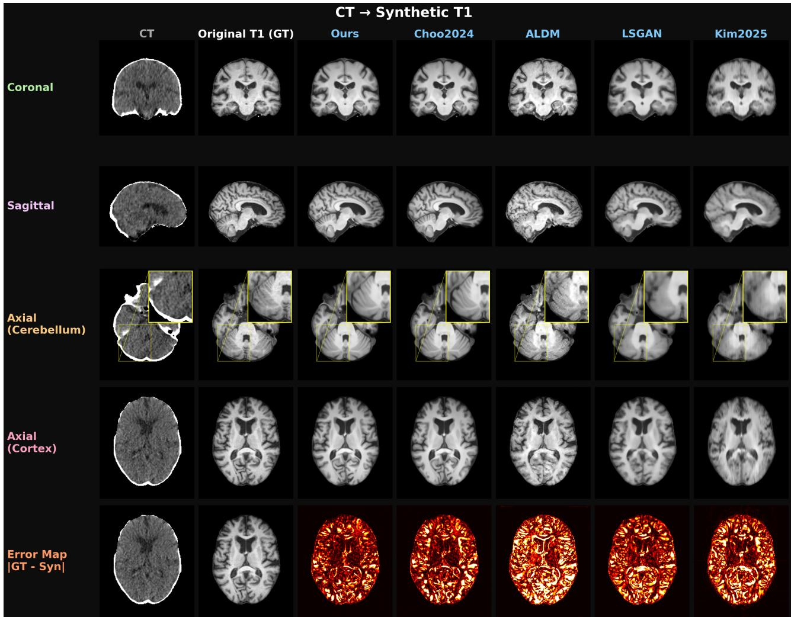  
Figure 4: Qualitative comparison of CT-to-MRI synthesis methods on a representative OASIS-3 subject. The columns show the CT input, ground-truth T1-weighted MRI, proposed method, and four comparison methods. The bottom row shows voxel-wise absolute error on the corresponding axial cortical slice. The proposed method shows close anatomical agreement with the ground truth, with residual errors largely localized around cortical boundaries.

Image-level fidelity alone does not establish whether a synthesized MRI preserves the anatomical information required for PET quantification. We therefore compared FreeSurfer parcellations derived from each synthesized MRI with those obtained from the ground-truth MRI. In the voxel-wise disagreement maps (Fig. 5), the proposed method shows disagreement that is largely localized around cortical boundaries and sulci. In contrast, ALDM, LSGAN, and Kim2025 exhibit more extensive disagreement across the cortical ribbon and adjacent white matter. Choo2024 shows a qualitatively similar pattern to the proposed method, but with broader disagreement in several cortical regions. Quantitatively, the proposed method achieves the highest Dice similarity coeficient (DSC) and the lowest HD95 across all six evaluated anatomical regions (Table 2), indicating improved regional overlap and boundary agreement. Paired subject-level comparisons show significantly better DSC and HD95 for the proposed method than for each of the four baselines in every region, with all 48 comparisons remaining significant after Holm correction (adjusted $p < 1 0 ^ { - 9 } )$ ).

Table 2: Anatomical agreement of FreeSurfer parcellations derived from synthesized MRI with those derived from the ground-truth MRI. Results are reported as mean ± SD over OASIS-3 test subjects (N = 117 for Ours and Choo2024; N = 116 for Kim2025, LSGAN, and ALDM, each excluding one subject whose FreeSurfer parcellation failed). Dice similarity coeficient (DSC, ↑) measures regional overlap, and HD95 (mm, ↓) measures boundary agreement. Best results for each region and metric are shown in bold, and second-best results are underlined.
<table><tr><td>Region</td><td>Metric</td><td>Kim2025</td><td>LSGAN</td><td>ALDM</td><td>Choo2024</td><td>Ours</td></tr><tr><td rowspan="2">Cerebral cortex</td><td>DSC ↑</td><td> $0 . 5 6 6 \pm 0 . 0 2 0$ </td><td> $0 . 6 2 0 \pm 0 . 0 2 7$ </td><td> $0 . 5 8 8 \pm 0 . 0 2 0$ </td><td> $0 . 6 5 5 \pm 0 . 0 2 5$ </td><td> $\mathbf { 0 . 7 0 6 \pm 0 . 0 2 4 }$ </td></tr><tr><td>HD95 (mm) ↓</td><td> $3 . 9 7 2 \pm 0 . 6 9 3$ </td><td> $2 . 3 7 9 \pm 0 . 3 8 2$ </td><td> $\underline { { 2 . 1 4 1 } } \pm 0 . 1 2 3$ </td><td> $2 . 3 1 7 \pm 0 . 2 1 1$ </td><td> $\mathbf { 1 . 6 7 7 \pm 0 . 2 2 8 }$ </td></tr><tr><td rowspan="2">Cerebral WM</td><td>DSC ↑</td><td> $0 . 7 6 7 \pm 0 . 0 1 3$ </td><td> $0 . 8 0 9 \pm 0 . 0 1 5$ </td><td> $0 . 7 7 4 \pm 0 . 0 1 5$ </td><td> $0 . 8 1 7 \pm 0 . 0 1 6$ </td><td> $\mathbf { 0 . 8 4 9 \pm 0 . 0 1 5 }$ </td></tr><tr><td>HD95 (mm) ↓</td><td> $3 . 7 5 5 \pm 0 . 3 5 8$ </td><td> $3 . 3 6 2 \pm 0 . 4 3 3$ </td><td> $\underline { { 2 . 7 6 1 \pm 0 . 2 1 2 } }$ </td><td> $2 . 8 0 4 \pm 0 . 2 4 4$ </td><td> $\mathbf { 2 . 1 2 5 \pm 0 . 1 5 3 }$ </td></tr><tr><td rowspan="2">Cerebellar GM (ref.)</td><td>DSC ↑</td><td> $0 . 8 6 7 \pm 0 . 0 2 0$ </td><td> $0 . 8 7 8 \pm 0 . 0 1 8$ </td><td> $0 . 8 7 3 \pm 0 . 0 2 3$ </td><td> $0 . 8 9 1 \pm 0 . 0 1 9$ </td><td> $\mathbf { 0 . 9 0 4 \pm 0 . 0 1 4 }$ </td></tr><tr><td>HD95 (mm) ↓</td><td> $2 . 7 5 5 \pm 0 . 4 7 8$ </td><td> $2 . 5 3 8 \pm 0 . 3 7 1$ </td><td> $2 . 4 8 1 \pm 0 . 6 9 5$ </td><td> $\underline { { 2 . 0 8 3 \pm 0 . 3 3 2 } }$ </td><td> $\mathbf { 1 . 8 7 3 \pm 0 . 3 0 2 }$ </td></tr><tr><td rowspan="2">Cerebellar WM</td><td>DSC ↑</td><td> $0 . 7 9 3 \pm 0 . 0 2 8$ </td><td> $0 . 8 1 8 \pm 0 . 0 2 8$ </td><td> $0 . 8 0 7 \pm 0 . 0 2 9$ </td><td> $\underline { { 0 . 8 2 5 \pm 0 . 0 3 4 } }$ </td><td> $\mathbf { 0 . 8 4 7 \pm 0 . 0 2 7 }$ </td></tr><tr><td>HD95 (mm) ↓</td><td> $3 . 1 5 4 \pm 0 . 6 6 3$ </td><td> $2 . 9 7 5 \pm 0 . 5 2 8$ </td><td> $2 . 7 8 4 \pm 0 . 7 3 1$ </td><td> $2 . 3 6 4 \pm 0 . 5 7 4$ </td><td> $\mathbf { 2 . 0 4 7 \pm 0 . 4 7 5 }$ </td></tr><tr><td rowspan="2">Subcortical GM</td><td>DSC ↑</td><td> $0 . 8 4 8 \pm 0 . 0 2 1$ </td><td> $0 . 8 5 4 \pm 0 . 0 2 0$ </td><td> $0 . 8 5 8 \pm 0 . 0 2 5$ </td><td> $\underline { { 0 . 8 6 8 \pm 0 . 0 1 9 } }$ </td><td> $\mathbf { 0 . 8 8 6 \pm 0 . 0 1 7 }$ </td></tr><tr><td>HD95 (mm) ↓</td><td> $2 . 0 3 2 \pm 0 . 5 1 4$ </td><td> $2 . 0 0 9 \pm 0 . 3 3 7$ </td><td> $1 . 7 9 4 \pm 0 . 3 5 9$ </td><td> $\underline { { 1 . 7 8 7 \pm 0 . 3 4 2 } }$ </td><td> ${ \bf 1 . 5 1 7 \pm 0 . 2 9 2 }$ </td></tr><tr><td rowspan="2">Medial temporal</td><td>DSC ↑</td><td> $0 . 7 9 6 \pm 0 . 0 3 2$ </td><td> $0 . 8 0 6 \pm 0 . 0 3 4$ </td><td> $0 . 7 9 7 \pm 0 . 0 3 3$ </td><td> $0 . 8 2 7 \pm 0 . 0 3 1$ </td><td> $\mathbf { 0 . 8 4 6 \pm 0 . 0 2 6 }$ </td></tr><tr><td>HD95 (mm) ↓</td><td> $2 . 2 4 7 \pm 0 . 3 5 8$ </td><td> $2 . 2 6 8 \pm 0 . 4 9 8$ </td><td> $2 . 2 1 1 \pm 0 . 3 8 4$ </td><td> $1 . 9 1 4 \pm 0 . 4 1 0$ </td><td> $\mathbf { 1 . 7 1 4 \pm 0 . 4 5 7 }$ </td></tr></table>

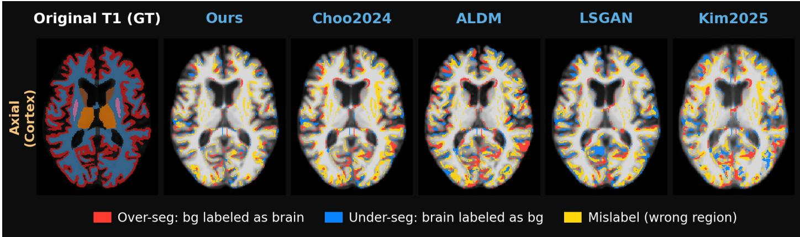  
Figure 5: Voxel-wise parcellation disagreement relative to the ground-truth MRI parcellation for the representative OASIS-3 subject shown in Fig. 4. The leftmost panel shows the reference aparc+aseg parcellation derived from the ground-truth T1-weighted MRI. The remaining panels show disagreement for each CT-to-MRI synthesis method. Red indicates over-segmentation, blue under-segmentation, and yellow assignment to an incorrect anatomical region.

The improvement is particularly relevant in regions directly involved in PET quantification. In the cerebral cortex, which shows the lowest DSC among the evaluated regions, the proposed method achieves a DSC of 0 706 and an HD95 of 1 677 mm, compared with 0 655 and 2 317 mm for Choo2024, respectively. For cerebellar gray matter, which serves as the SUVR reference region, the proposed method achieves the highest DSC of 0 904 and the lowest HD95 of 1 873 mm. Together, these results show that the improved image-level fidelity is retained in the anatomical parcellations used for downstream PET quantification.

## 3.3. MRI-free PET quantification

We next examined whether the improved anatomical fidelity of the synthesized MRI translates into more accurate PET quantification on the OASIS-3 test set (Table 3; Fig. 6). Accuracy was evaluated against the real MRI-based SUVR from the same subject using the identical quantification pipeline, with only the anatomical information used for PET processing replaced. This analysis therefore measures agreement with the MRI-based reference under MRI substitution rather than diagnostic accuracy against an independent biological standard.

Among the evaluated pipelines, agreement with the MRIbased reference was lowest for the PET-only pipelines, intermediate for the CT-based pipelines, and highest for the CT-to-MRIbased pipelines. The two PET-only pipelines show the weakest agreement (GAAIN-derived template: MAE $0 . 1 6 2 \pm 0 . 0 9 5$ r = 0 952; OASIS-derived template: MAE $0 . 1 3 1 \pm 0 . 0 8 0 .$ $r = 0 . 9 7 3 )$ . Their estimates are compressed toward the cohort mean (slopes 0.75 and 0.69), overestimating amyloid-negative subjects, with amyloid-positivity concordances of 89.7% and 96.6%. Incorporating subject-specific CT anatomy further reduces the error (Presotto2018: MAE 0 055 ± 0 051, r = 0 989; Matsuda2021: MAE 0 053 ± 0 062, r = 0 982).

Table 3: Agreement between MRI-free MCSUVR estimates and the real MRI-based reference across pipelines $( N = 8 7 )$ . MAE is reported in SUVR units as mean ± SD, and r denotes the Pearson correlation coeficient. Mean bias and 95% limits of agreement (LoA) are derived from Bland–Altman analysis. Subject-level diferences (MRI-free minus real MRI-based MCSUVR) were tested against zero using a two-sided one-sample Wilcoxon signed-rank test with Bonferroni correction, and the resulting significance is marked on the mean bias (∗∗adjusted $p < 0 . 0 1 , { ^ { * * * } }$ adjusted $p < 0 . 0 0 1 )$ . Amyloid-positivity concordance is evaluated at the MCSUVR cut-of of 1.42, with FN and FP denoting false-negative and false-positive classifications. Best values are shown in bold and second-best values are underlined. The proposed method shows the closest overall agreement with the MRI-based reference.
<table><tr><td>Pipeline</td><td>MAE↓</td><td>r↑</td><td>Mean bias</td><td> $9 5 \% \mathrm { L o A }$ </td><td>Conc. ↑</td><td>FN/FP↓</td></tr><tr><td>PET-only</td><td></td><td></td><td></td><td></td><td></td><td></td></tr><tr><td>PET-template (GAAIN-derived)</td><td> $0 . 1 6 2 \pm 0 . 0 9 5$ </td><td>0.952</td><td> $0 . 1 1 9 ^ { * * * }$ </td><td>[-0.168,0.406]</td><td>89.7%</td><td>0/9</td></tr><tr><td>PET-template (OASIS-derived)</td><td> $0 . 1 3 1 \pm 0 . 0 8 0$ </td><td>0.973</td><td> $0 . 0 4 9 ^ { * * }$ </td><td>[-0.238,0.336]</td><td>96.6%</td><td>0/3</td></tr><tr><td>CT-based Presotto2018</td><td> $0 . 0 5 5 \pm 0 . 0 5 1$ </td><td>0.989</td><td> $- 0 . 0 3 2 ^ { \ast \ast \ast }$ </td><td>[-0.165,0.101]</td><td>97.7%</td><td>1/1</td></tr><tr><td>Matsuda2021</td><td> $0 . 0 5 3 \pm 0 . 0 6 2$ </td><td>0.982</td><td>-0.006</td><td>[-0.166,0.155]</td><td>98.9%</td><td>0/1</td></tr><tr><td>CT-to-MRI</td><td></td><td></td><td></td><td></td><td></td><td></td></tr><tr><td>Kim2025</td><td> $0 . 0 4 4 \pm 0 . 0 3 3$ </td><td>0.9955</td><td> $0 . 0 3 8 ^ { * * * }$ </td><td></td><td></td><td></td></tr><tr><td>LSGAN</td><td> $0 . 0 3 4 \pm 0 . 0 2 5$ </td><td>0.9974</td><td> $0 . 0 2 9 ^ { * * * }$ </td><td>[-0.038,0.115] [-0.030, 0.088]</td><td>98.9%</td><td>0/1</td></tr><tr><td>ALDM</td><td> $0 . 0 3 8 \pm 0 . 0 9 1$ </td><td>0.9721</td><td> $0 . 0 0 9 ^ { * * }$ </td><td>[-0.184,0.202]</td><td>98.9%</td><td>0/1</td></tr><tr><td>Choo2024</td><td> $\underline { { 0 . 0 2 1 \pm 0 . 0 1 7 } }$ </td><td>0.9983</td><td> $- 0 . 0 1 3 ^ { \ast \ast \ast }$ </td><td></td><td>94.3%</td><td>2/3</td></tr><tr><td></td><td></td><td></td><td></td><td>[-0.060,0.034]</td><td>98.9%</td><td>0/1</td></tr><tr><td>Ours</td><td> $\mathbf { 0 . 0 1 6 \pm 0 . 0 1 5 }$ </td><td>0.9987</td><td>-0.002</td><td>[-0.045, 0.040]</td><td>100%</td><td>0/0</td></tr></table>

## MCSUVR: GT vs Estimated

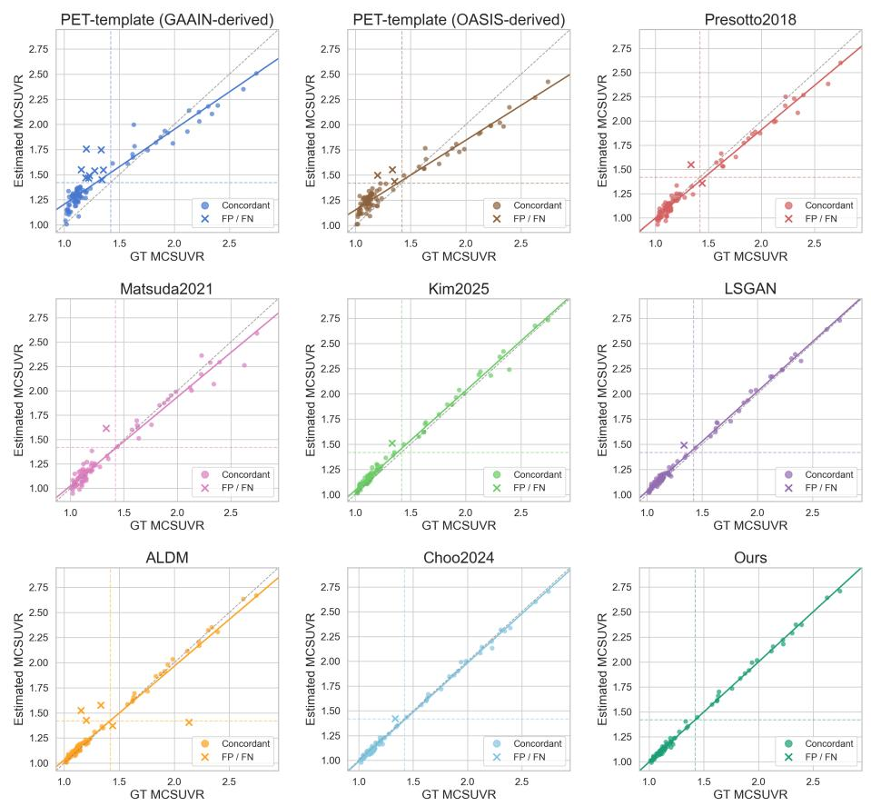  
Figure 6: Agreement between real MRI-based and MRI-free MCSUVR estimates for PiB PET in the OASIS-3 test set $( N = 8 7 )$ . Results are shown for two PET-only pipelines, two CT-based pipelines (Presotto2018 and Matsuda2021), and five CT-to-MRI-based pipelines. Each point represents one subject. Crosses indicate amyloid-positivity classification disagreements with the MRI-based reference. The gray dashed line denotes the identity line, the solid line represents the least-squares fit, and the colored dashed lines mark the amyloid-positivity cut-of of 1.42. The CT-to-MRI-based pipelines, particularly the proposed method, show the closest agreement with the real MRI-based reference, whereas the PET-only pipelines show regression toward the cohort mean and the CT-based pipelines show greater scatter than the CT-to-MRI-based pipelines.

Table 4: Mean absolute error (MAE) of regional SUVR estimates across six amyloid-relevant cortical regions. Results are reported as mean ± SD over subjects $( N = 8 7 ) .$ Lower values indicate better agreement with the real MRI-based reference. Best values are shown in bold.
<table><tr><td>Model</td><td>Frontal</td><td>Parietal</td><td>Lateral Temporal</td><td>Precuneus</td><td></td><td>Anterior Cingulate Posterior Cingulate</td></tr><tr><td>Kim2025</td><td> $0 . 0 6 7 1 \pm 0 . 0 3 8 1$ </td><td> $0 . 0 3 2 9 \pm 0 . 0 3 4 0$ </td><td> $0 . 0 3 5 2 \pm 0 . 0 3 4 5$ </td><td> $0 . 0 4 0 2 \pm 0 . 0 4 3 2$ </td><td> $0 . 0 8 1 0 \pm 0 . 0 6 1 6$ </td><td> $0 . 0 4 5 8 \pm 0 . 0 4 5 4$ </td></tr><tr><td>LSGAN</td><td> $0 . 0 4 3 2 \pm 0 . 0 2 5 6$ </td><td> $0 . 0 3 2 1 \pm 0 . 0 2 4 2$ </td><td> $0 . 0 5 8 2 \pm 0 . 0 2 9 6$ </td><td> $0 . 0 3 2 8 \pm 0 . 0 3 4 4$ </td><td> $0 . 0 4 6 6 \pm 0 . 0 3 9 8$ </td><td> $0 . 0 3 8 8 \pm 0 . 0 3 1 9$ </td></tr><tr><td>ALDM</td><td> $0 . 0 3 6 6 \pm 0 . 0 7 2 7$ </td><td> $0 . 0 4 9 5 \pm 0 . 1 3 2 6$ </td><td> $0 . 0 4 2 1 \pm 0 . 0 8 0 1$ </td><td> $0 . 0 5 7 4 \pm 0 . 1 1 8 4$ </td><td> $0 . 0 5 1 3 \pm 0 . 1 1 2 6$ </td><td> $0 . 0 5 2 6 \pm 0 . 0 8 2 8$ </td></tr><tr><td>Choo2024</td><td> $0 . 0 2 1 8 \pm 0 . 0 1 5 4$ </td><td> $0 . 0 2 4 9 \pm 0 . 0 2 0 4$ </td><td> $0 . 0 2 4 8 \pm 0 . 0 2 0 2$ </td><td> $0 . 0 3 1 3 \pm 0 . 0 2 5 4$ </td><td> $0 . 0 3 8 8 \pm 0 . 0 3 0 9$ </td><td> $0 . 0 2 8 4 \pm 0 . 0 2 5 3$ </td></tr><tr><td>Ours</td><td> $\mathbf { 0 . 0 1 7 3 \pm 0 . 0 1 4 8 }$ </td><td> $\mathbf { 0 . 0 1 5 9 \pm 0 . 0 1 4 8 }$ </td><td> $\mathbf { 0 . 0 1 6 9 \pm 0 . 0 1 7 2 }$ </td><td> $\mathbf { 0 . 0 2 0 7 \pm 0 . 0 2 2 9 }$ </td><td> $\mathbf { 0 . 0 2 5 8 \pm 0 . 0 2 0 0 }$ </td><td> $\mathbf { 0 . 0 2 3 4 \pm 0 . 0 2 1 5 }$ </td></tr></table>

The CT-to-MRI-based pipelines improve further, with the proposed method achieving the closest agreement with the MRIbased reference. It attains an MAE of $0 . 0 1 6 \pm 0 . 0 1 5$ and a Pearson correlation of $r = 0 . 9 9 8 7$ , together with a mean bias of −0 002 and 95% limits of agreement of $[ - 0 . 0 4 5 , 0 . 0 4 0 ]$ . Its subject-level absolute MCSUVR errors are significantly lower than those of all four CT-to-MRI baselines after Holm correction (Choo2024, $p = 4 . 5 \times 1 0 ^ { - 5 } ;$ ALDM, $p = 1 . 4 \times 1 0 ^ { - 4 } ;$ LSGAN, $p = 2 . 4 \times 1 0 ^ { - 8 }$ ; Kim2025, $p = 4 . 5 \times 1 0 ^ { - 1 0 } )$ . Choo2024 is the second-best method with an MAE of $0 . 0 2 1 \pm 0 . 0 1 7$ and $r = 0 . 9 9 8 3$ . At the prespecified MCSUVR cut-of of 1.42, the proposed pipeline reproduces the MRI-based amyloid-positivity classification for all 87 subjects, with no false-positive or falsenegative cases.

The improved agreement with the MRI-based reference is also observed across the six amyloid-relevant cortical regions (Table 4). The proposed method achieves the lowest MAE in every region, ranging from 0.0159 in the parietal cortex to 0.0258 in the anterior cingulate cortex. Regional errors are relatively larger in the precuneus and cingulate regions than in the lateral cortical regions, but remain lower than those of all competing CTto-MRI methods. Regional errors of the non-synthesis pipelines were larger still in every region (Supplementary Table A.5).

## 3.4. External generalization on the GARD cohort

We next evaluated zero-shot external generalization on the independent GARD cohort, which was not used for CT-to-MRI model development. All synthesis models were applied without retraining or fine-tuning. Despite this zero-shot setting, the proposed method maintained the highest structural similarity to the real T1-weighted MRI among the compared methods (Fig. 7). Among the 84 subjects with complete synthesis results, the proposed method achieved the highest $\mathrm { S S I M } _ { 3 \mathrm { D } }$ in 62 subjects, whereas LSGAN achieved the highest value in the remaining 22 subjects. Overall, the proposed method achieved an SSIM3D of $0 . 7 9 4 \pm 0 . 0 3 4$ , compared with $0 . 7 8 0 \pm 0 . 0 2 9$ for LSGAN, which was the strongest baseline.

The improved synthesis fidelity was also reflected in the anatomical parcellations derived from the synthetic MRIs (Fig. 7). Among the 80 subjects with valid FreeSurfer results for the real MRI and all compared methods, the proposed method achieved the best result in 11 of the 12 region–metric comparisons across DSC and HD95. The largest advantage was observed in the cerebral cortex, whereas performance in cerebellar white matter was comparable to Choo2024. Notably, although LSGAN ranked second in $\mathrm { S S I M } _ { 3 \mathrm { D } } ,$ , this did not translate into comparable FreeSurfer parcellation accuracy.

We finally examined whether the zero-shot generalization observed in CT-to-MRI synthesis translated into MRI-free PET quantification on the external GARD cohort (Table 5). Among the 80 subjects with valid PET quantification results for the real MRI and all compared methods, the proposed pipeline maintained strong agreement with the real MRI-based reference across MCSUVR and the same six regional SUVR measures evaluated in the primary OASIS-3 analysis. The proposed method achieved the lowest MAE in four of the six regional SUVR measures and the highest Pearson correlation for MC-SUVR and all six regional measures. ALDM and LSGAN yielded a slightly lower MAE for MCSUVR, and ALDM also for the lateral temporal region, whereas LSGAN yielded the lowest MAE in the frontal region. Overall, the proposed method showed the most consistent agreement across the evaluated regional measures. Together, these results show that the proposed method achieved favorable performance across CT-to-MRI synthesis, anatomical parcellation, and MRI-free PET quantification when applied zero-shot to an independent cohort.

## 3.5. Reliability assessment ofMRI-free PET quantification

We next evaluated whether the conformal prediction intervals achieved the prespecified coverage for the corresponding real MRI-based SUVR (Table 6). For MCSUVR, empirical coverage closely matched the target coverage across the evaluated settings. Target coverages of 80%, 90%, and 95% yielded empirical coverages of 80.5%, 92.0%, and 96.6%, respectively, while mean prediction interval width increased from 0.0524 to 0.1050 SUVR units with increasing target coverage.

At the 90% target coverage, empirical coverage across the six regional SUVR measures ranged from 88.5% to 96.6%. Mean prediction interval width varied across regions, from 0.0693 SUVR units in the parietal cortex to 0.1847 in the anterior cingulate cortex (Table 6). The posterior cingulate also showed relatively wide intervals, whereas the parietal and lateral temporal regions showed the narrowest intervals. Regional empirical coverage and prediction interval width at the 80% and 95% target coverage levels are provided in Appendix A.9.

We next examined whether the prediction intervals could support confident amyloid-positivity decisions in the absence of the real MRI (Fig. 8). For this decision analysis, we used the 90% target coverage as the primary setting and the prespecified MCSUVR cut-of of 1.42 as the decision boundary.

a  
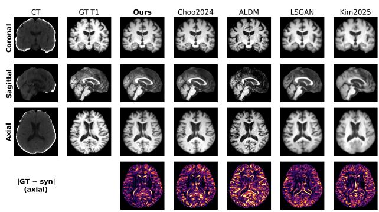  
b

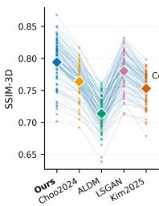

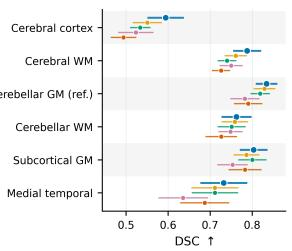

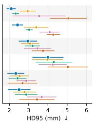  
Figure 7: Zero-shot external evaluation of CT-to-MRI synthesis and anatomical parcellation on the GARD cohort. (a) Representative CT input, paired real T1-weighted MRI, and synthetic MRIs generated by the compared methods in the coronal, sagittal, and axial planes. The bottom row shows voxel-wise absolute error relative to the real MRI for the corresponding axial slice. (b) Subject-level $\mathrm { S S I M } _ { 3 \mathrm { D } }$ among subjects with complete synthesis results $( N = 8 4 )$ Thin lines connect measurements from the same subject across methods, and diamonds indicate the cohort mean. The proposed method achieves the highest SSIM in 62 of 84 subjects, while LSGAN achieves the highest value in the remaining 22 subjects. (c) Agreement between FreeSurfer parcellations derived from synthetic and real MRIs among subjects with valid results for all compared methods $( N = 8 0 )$ . Points and horizontal error bars indicate mean ± SD for the Dice similarity coeficient (DSC, ↑) and the 95th-percentile Hausdorf distance (HD95, mm, ↓) across six anatomical regions.

Table 5: External validation of MRI-free PET quantification on the GARD cohort $( N ~ = ~ 8 0 )$ . SUVR estimates derived using each synthetic MRI are compared with those obtained using the paired real MRI among subjects with valid results for all compared methods. Results are reported for MCSUVR and the same six amyloid-relevant regional SUVR measures evaluated in the primary OASIS-3 analysis. MAE is reported in SUVR units, and r denotes the Pearson correlation coeficient. GARD was not used for model training or adaptation. Best results for each measure are shown in bold, and second-best results are underlined.
<table><tr><td>Measure</td><td>Metric</td><td>Ours</td><td>Choo</td><td>ALDM</td><td>LSGAN</td><td>Kim</td></tr><tr><td rowspan="2">MCSUVR</td><td>MAE↓</td><td>0.044</td><td>0.061</td><td>0.043</td><td>0.043</td><td>0.052</td></tr><tr><td>r↑</td><td>0.993</td><td>0.989</td><td>0.980</td><td>0.972</td><td>0.973</td></tr><tr><td rowspan="2">Frontal</td><td>MAE↓</td><td>0.047</td><td>0.068</td><td>0.054</td><td>0.042</td><td>0.050</td></tr><tr><td>r↑</td><td>0.993</td><td>0.991</td><td>0.971</td><td>0.977</td><td>0.974</td></tr><tr><td rowspan="2">Parietal</td><td>MAE↓</td><td>0.040</td><td>0.071</td><td>0.053</td><td>0.053</td><td>0.108</td></tr><tr><td>r↑</td><td>0.996</td><td>0.992</td><td>0.985</td><td>0.983</td><td>0.975</td></tr><tr><td rowspan="2">Lat. temporal</td><td>MAE↓</td><td>0.033</td><td>0.043</td><td>0.032</td><td>0.067</td><td>0.048</td></tr><tr><td>r↑</td><td>0.986</td><td>0.973</td><td>0.983</td><td>0.950</td><td>0.954</td></tr><tr><td rowspan="2">Precuneus</td><td>MAE↓</td><td>0.053</td><td>0.087</td><td>0.068</td><td>0.081</td><td>0.111</td></tr><tr><td>r↑</td><td>0.996</td><td>0.993</td><td>0.987</td><td>0.980</td><td>0.980</td></tr><tr><td rowspan="2">Ant. cingulate</td><td>MAE↓</td><td>0.052</td><td>0.073</td><td>0.064</td><td>0.074</td><td>0.095</td></tr><tr><td>r↑</td><td>0.994</td><td>0.987</td><td>0.983</td><td>0.983</td><td>0.973</td></tr><tr><td rowspan="2">Post. cingulate</td><td>MAE↓</td><td>0.047</td><td>0.066</td><td>0.075</td><td>0.066</td><td>0.078</td></tr><tr><td>r↑</td><td>0.993</td><td>0.985</td><td>0.977</td><td>0.982</td><td>0.976</td></tr></table>

Table 6: Empirical coverage and prediction interval width for MRI-free PET quantification using deep-ensemble-based conformal prediction. MCSUVR results are reported at target coverage levels of 80%, 90%, and 95%, and regional SUVR results at the 90% target coverage. Empirical coverage denotes the proportion of test subjects whose MRI-based reference SUVR falls within the prediction interval, with counts shown in parentheses as covered subjects/total subjects. The 95% CI column reports two-sided Wilson confidence intervals for coverage in percentage units. Interval width is reported in SUVR units as mean ± SD across test subjects $( N = 8 7 )$
<table><tr><td>Measure</td><td>Target</td><td>Empirical</td><td>95% CI</td><td>Width</td></tr><tr><td>Composite MCSUVR</td><td></td><td></td><td></td><td></td></tr><tr><td>MCSUVR</td><td>80%</td><td>80.5% (70/87)</td><td>[70.9, 87.4]</td><td> $0 . 0 5 2 { \scriptstyle \pm 0 . 0 3 0 }$   $0 . 0 8 3 { \scriptstyle \pm 0 . 0 4 7 }$ </td></tr><tr><td></td><td>90% 95%</td><td>92.0% (80/87) 96.6% (84/87)</td><td>[84.3, 96.0] [90.3, 98.8]</td><td> $0 . 1 0 5 { \pm } 0 . 0 5 9$ </td></tr><tr><td>Regional SUVR at 90% target</td><td></td><td></td><td></td><td></td></tr><tr><td></td><td></td><td></td><td></td><td></td></tr><tr><td>Frontal Parietal</td><td>90% 90%</td><td>88.5% (77/87)</td><td>[80.1, 93.6]</td><td> $0 . 0 9 4 \pm 0 . 0 4 9$ </td></tr><tr><td>Lateral</td><td></td><td>88.5% (77/87)</td><td>[80.1, 93.6]</td><td> $0 . 0 6 9 { \scriptstyle \pm 0 . 0 3 6 }$ </td></tr><tr><td>temporal</td><td>90%</td><td>90.8% (79/87)</td><td>[82.9, 95.3]</td><td> $0 . 0 7 4 \pm 0 . 0 3 9$ </td></tr><tr><td>Precuneus Anterior</td><td>90%</td><td>92.0% (80/87)</td><td>[84.3, 96.0]</td><td> $0 . 1 0 1 { \scriptstyle \pm 0 . 0 4 6 }$ </td></tr><tr><td>cingulate</td><td>90%</td><td>96.6% (84/87)</td><td>[90.3, 98.8]</td><td> $0 . 1 8 5 { \pm } 0 . 0 8 2$ </td></tr><tr><td>Posterior cingulate</td><td>90%</td><td>96.6% (84/87)</td><td>[90.3, 98.8]</td><td> $0 . 1 3 2 { \scriptstyle \pm 0 . 0 7 5 }$ </td></tr></table>

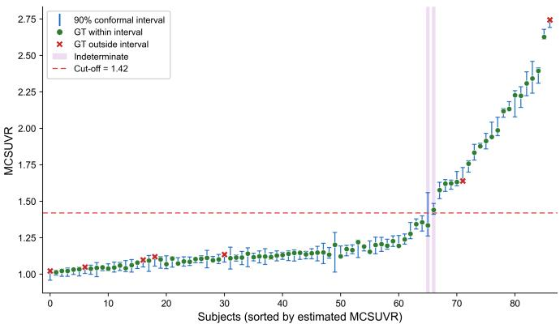  
Figure 8: Subject-level MCSUVR conformal prediction intervals at the 90% target coverage. Subjects are ordered by the ensemble-mean MRI-free MCSUVR estimate. Green circles and red crosses indicate whether the MRI-based reference MCSUVR falls inside or outside the interval, respectively. The dashed line marks the prespecified PiB PET amyloid positivity cut-of of 1.42, and shaded regions indicate indeterminate subjects whose intervals span the cut-of. Empirical coverage was 92.0% (80/87), with two indeterminate subjects.

At the 90% target coverage, 85 of 87 subjects received a confident decision, including 65 confident negatives and 20 confident positives, while two subjects were designated indeterminate. These two subjects had ensemble-mean MCSUVR estimates of 1.4103 and 1.4473, both close to the 1.42 cut-of. In both cases, the corresponding prediction intervals crossed the decision boundary, indicating that the unknown real MRI-based SUVR could plausibly fall on either side. Both point estimates were nevertheless concordant with the amyloid- positivity classification based on the real MRI.

At the prespecified MCSUVR cut-of of 1.42, the amyloidpositivity decisions obtained from our synthetic-MRI-based MRI-free pipeline reproduced the real MRI-based decisions for all 87 test subjects, with no false-positive or false-negative cases. We further examined whether this agreement was sensitive to the choice of MCSUVR cut-of and whether conformal prediction could identify unreliable decisions when disagreements emerged. In a supplementary sensitivity analysis, the cut-of was varied from 1.30 to 1.50 while the 90% conformal prediction intervals were held fixed. Disagreements between the MRI-free and real MRI-based decisions occurred only at cut-ofs from 1.34 to 1.41. All such cases were designated indeterminate because their prediction intervals spanned the cut-of. Conversely, all decisions retained as confident remained concordant with the real MRI-based reference across the evaluated cut-of range (Appendix A.10). These results indicate that the conformal intervals can distinguish cases requiring caution from those for which the MRI-free amyloid-positivity decision remains stable with respect to the real MRI-based reference.

Finally, we examined whether conformal calibration performed on OASIS-3 transferred to the independent GARD cohort. Although MRI-free SUVR estimates retained strong zeroshot agreement with the MRI-based reference on GARD, prediction intervals calibrated on OASIS-3 substantially undercovered the GARD reference values. For MCSUVR, empirical coverage at the 90% target level decreased to 62.2%. In contrast, when the same conformal procedure was recalibrated within GARD using repeated random split-half calibration/test partitions, empirical coverage returned close to the target level (90 7 ± 6 2% across 1,000 splits). Similar patterns were observed across the six regional SUVR measures (Appendix A.11). These results indicate that conformal calibration did not transfer directly across cohorts, but could be restored using a calibration subset from the target cohort without retraining or fine-tuning the CT-to-MRI synthesis model.

## 4. Discussion

In this study, we addressed three questions central to CTto-MRI-based MRI-free PET quantification. First, how can subject-specific T1-weighted MRI anatomy be inferred more faithfully from the limited anatomical information available in brain CT? Second, does improving this anatomical inference translate into more accurate MRI-free PET quantification? Third, in a practical setting where the real MRI is unavailable, how can the reliability of an individual MRI-free SUVR estimate be assessed?

To address the first question, we strengthened the anatomical information available to the synthesis model through multidataset training, data-source conditioning, and expanded multislice CT context. The resulting improvements in CT-to-MRI synthesis were accompanied by more accurate anatomical parcellation and closer agreement with real MRI-based PET quantification. To address the third question, we combined deep-ensemble uncertainty with conformal prediction to estimate a plausible range for the corresponding real MRI-based SUVR and used this range to assess the reliability of amyloid-positivity decisions. Finally, we evaluated whether these improvements generalized to an independent external cohort without retraining or adaptation of the CT-to-MRI synthesis model.

Improving MRI-free PET quantification through better anatomical inference. Previous work [15] showed that CT-to-MRI synthesis can be incorporated into MRI-based PET quantification pipelines, establishing its feasibility for MRI-free PET quantification. Separately, Choo et al. [17] improved CT-to-MRI synthesis using a slice-consistent Brownian Bridge difusion framework [18]. Against this background, we examined whether richer anatomical information available to the synthesis model could further improve CT-to-MRI synthesis and, in turn, MRIfree PET quantification. Multi-dataset training and data-source conditioning provided incremental improvements, whereas expanded multi-slice CT context contributed the largest gain in the ablation analysis. These findings suggest that improving CT-to-MRI synthesis depends not only on the generative formulation, but also on the anatomical prior learned from the training data and the amount of subject-specific anatomical information available from the input CT.

These improvements were reflected in downstream PET quantification. Among the evaluated pipelines, agreement with the real MRI-based reference was lowest for the PET-only pipelines, intermediate for the CT-based pipelines, and highest for the CTto-MRI-based pipelines. The proposed method achieved the closest agreement with the MRI-based reference on OASIS-3 across both composite and regional SUVR measures. This is particularly relevant because accurate SUVR quantification depends on anatomical localization of both cortical target regions and the cerebellar reference region [7].

The FreeSurfer parcellation analysis further showed that the improvement was not limited to image-level similarity. Although visually plausible synthetic images do not necessarily preserve all subject-specific anatomical features [16], the proposed method also improved regional overlap and boundary agreement of the derived anatomical parcellations. This supports the interpretation that the improved PET quantification was associated with better preservation of anatomy relevant to regional PET sampling rather than image appearance alone.

Residual errors nevertheless varied across cortical regions. Errors were relatively larger in the precuneus and anterior and posterior cingulate cortices than in the lateral cortical regions. These medial regions contain complex cortical folding and narrow gray–white matter boundaries that are only weakly represented in CT, making their individual anatomy more dificult to infer. Small boundary diferences in these structures can also alter regional PET quantification. The persistence of larger errors in these regions therefore indicates that recovery of fine medial cortical anatomy remains an important challenge for CT-based MRI inference.

Although the present study focused on amyloid PET, the overall framework is not inherently tracer-specific. MRI-derived anatomical information is also used for regional quantification of other brain PET tracers, including 18F-FDG PET and tau PET [38, 39]. Accordingly, the same principle could potentially be extended to these applications by replacing the unavailable MRI with CT-derived synthetic MRI while retaining the tracerspecific PET quantification pipeline. Validation across additional tracers and clinical applications will be necessary to establish this broader applicability.

Estimating the plausible range of the real MRI-based SUVR. Accurate MRI-free PET quantification does not by itself indicate how close an individual SUVR estimate is to the value that would have been obtained using the real MRI. In a practical MRI-free setting, the real MRI is unavailable, so this discrepancy cannot be directly measured for a given subject. Therefore, even when MRI-free SUVR estimates show high overall agreement with the real MRI-based reference, it remains important to estimate a plausible range for the corresponding real MRI-based SUVR for each subject.

We addressed this problem by constructing calibrated prediction intervals for the corresponding real MRI-based SUVR using deep-ensemble uncertainty and conformal prediction [19, 20, 21, 22]. Across the evaluated target coverage levels, empirical coverage closely followed the intended coverage for MCSUVR, with greater variation across regional SUVR measures. The coverage confidence intervals reflect the limited precision of these estimates from 87 test subjects. These results support the feasibility of estimating a plausible range for the corresponding real MRI-based SUVR within OASIS-3, where the calibration and test subjects were drawn from the same cohort, even when the real MRI itself is unavailable.

The width of this interval adds information that is not available from the MRI-free SUVR value alone. A narrow interval constrains the possible real MRI-based SUVR to a relatively small range around the MRI-free estimate, whereas a wider interval indicates that a broader range of real MRI-based SUVR values remains compatible with the MRI-free result. Such information may help determine whether an MRI-free quantification result is suficiently reliable for its intended use or whether further evaluation, such as acquisition of an MRI, should be considered.

This becomes particularly relevant when the SUVR is interpreted relative to an amyloid-positivity decision cut-of. At the primary 90% target coverage, 85 of 87 subjects (97.7%) had prediction intervals that remained entirely on one side of the prespecified cut-of, whereas only two subjects were classified as indeterminate. In this retrospective cohort, this suggests that the large majority of subjects could have received an unambiguous amyloid-positivity decision from the MRI-free pipeline, while additional assessment could have been reserved for the small subset whose prediction intervals crossed the decision boundary. The sensitivity analysis further supported this interpretation, as all observed disagreements between the MRI-free and real MRI-based decisions were captured by the indeterminate category across the evaluated cut-ofs. In interpreting these results, the nominal coverage level applies to the prediction intervals and does not directly specify the classification accuracy among subjects receiving a confident decision.

If confirmed prospectively, such an accept-or-defer strategy could have practical implications for the use of MRI in PET quantification. Rather than requiring an additional MRI for every subject, MRI or another confirmatory assessment could potentially be prioritized for cases in which the MRI-free SUVR remains insuficiently constrained or its prediction interval overlaps a clinically relevant decision boundary. This could reduce additional imaging burden and potentially lower the resources required for quantitative PET assessment, while preserving a mechanism for referring uncertain cases for further evaluation. A formal cost-efectiveness analysis would, however, be required before drawing conclusions regarding economic benefit.

This selective strategy may also be relevant for patients in whom MRI is dificult or unavailable because of contraindications, claustrophobia, motion, acquisition burden, or other practical limitations [8]. Previous MRI-free approaches have similarly sought to reduce dependence on structural MRI for PET quantification [9, 12, 13, 15]. Providing both an MRI-free SUVR and an estimate of its plausible range may extend this goal by allowing quantitative PET assessment even when MRI cannot readily be obtained, while explicitly identifying subjects for whom the MRI-free result remains too uncertain to rely on without further evaluation.

Zero-shot external generalization and conformal calibration transfer. The independent GARD evaluation examined whether the proposed approach could be applied beyond the datasets used for model training. Despite diferences in CT acquisition characteristics and amyloid tracer, the proposed model largely preserved its relative ranking across CT-to-MRI synthesis, anatomical parcellation, and MRI-free PET quantification without retraining or fine-tuning of model parameters, although its absolute errors were larger than in OASIS-3. These findings provide preliminary evidence that the learned CT-to-MRI mapping may generalize across cohorts and acquisition settings.

In contrast, direct transfer of the conformal calibration from OASIS-3 to GARD resulted in substantial undercoverage, suggesting a shift in the distribution of ensemble-normalized prediction errors between cohorts. Because standard conformal prediction relies on exchangeability between calibration and test samples, such distributional diferences can invalidate the nominal coverage guarantee [40, 22]. Diferences in cohort characteristics, imaging acquisition, and amyloid tracer may all have contributed to this shift.

Notably, empirical coverage returned close to the target level after recalibrating the conformal scaling using a subset of GARD subjects, while the CT-to-MRI synthesis models themselves were left unchanged. In a new cohort, it may therefore not be necessary to retrain the synthesis model solely to recover the intended prediction-interval coverage. Instead, conformal calibration can be updated using a target-cohort calibration set while retaining the existing synthesis model. In the GARD analysis, this required paired CT, real T1-weighted MRI, and amyloid PET data from 41 subjects per split. At the 90% target coverage, mean MCSUVR interval width on GARD increased from 0.119 with OASIS-3 calibration to 0.203 with GARD-specific recalibration. This suggests the possibility that, after local recalibration with a limited number of paired cases, the approach could be applied to a new imaging environment and still provide a plausible range for the corresponding real MRI-based SUVR in subsequent subjects for whom MRI is not available.

Limitations and future directions. Several challenges remain before the proposed approach can be made more generalizable and clinically robust. First, the anatomical information available in CT is fundamentally limited, particularly for fine gray–white matter boundaries and complex cortical folding. The relatively larger errors observed in the precuneus and cingulate regions suggest that subject-specific anatomy cannot always be recovered accurately from CT alone. Further work is therefore needed to improve the recovery of fine individual anatomy from the limited structural information available in CT.

Second, the current data-source conditioning strategy limits straightforward application to previously unseen imaging environments. The model was trained using discrete source labels corresponding to the datasets included during training, whereas a new external dataset does not have a predefined source label. For GARD, the OASIS-3 label was used as a surrogate because its CT characteristics were most similar, but this is not a general solution. More generalizable conditioning strategies that can infer acquisition or image characteristics directly from the input CT, rather than relying on predefined dataset identities, will therefore be needed for broader deployment.

Third, the present training data were not designed to systematically represent focal or atypical brain abnormalities, such as brain tumors or substantial white matter lesions. Medical image translation models can alter or fail to preserve pathological features that are uncommon in the training distribution [16]. In the present pipeline, such errors could propagate beyond the synthesized image, because inaccurate representation of abnormal anatomy may afect anatomical parcellation and regional PET sampling, and consequently alter the resulting SUVR. Future work should therefore develop synthesis models that can more reliably preserve such structural abnormalities and prevent their errors from propagating to anatomical parcellation and PET quantification.

Fourth, the PET analyses were restricted to subjects with same-day PiB PET and T1-weighted MRI and to scans passing quality control, which may favor higher-quality acquisitions. In addition, diferences in synthesis or quantification performance across age, sex, or ethnic groups were not assessed, although the development (OASIS-3) and external (GARD) cohorts difer in population.

Finally, this study was retrospective and external validation was performed in a single additional cohort. Prospective multicenter validation across broader scanners, acquisition protocols, populations, and PET tracers will be needed to establish the robustness and generalizability of the proposed approach.

## 5. Conclusion

In conclusion, this study improved the accuracy of CT-to-MRI-based MRI-free PET quantification and showed that, when conformal prediction is calibrated for the target cohort, the reliability of individual SUVR estimates can be assessed when the real MRI is unavailable. By strengthening the anatomical prior learned during training and incorporating richer subject-specific information from the input CT, the proposed approach improved CT-to-MRI synthesis, anatomical parcellation, and downstream PET quantification relative to the other approaches evaluated here. The resulting MRI-free SUVR estimates showed close agreement with the corresponding real MRI-based reference in OASIS-3 and favorable performance when applied zero-shot to an independent external cohort.

Beyond improving quantification accuracy, the proposed reliability framework used deep-ensemble uncertainty and conformal prediction to estimate a plausible range for the corresponding real MRI-based SUVR. In OASIS-3, this made it possible to distinguish cases in which an MRI-free amyloid-positivity decision was well separated from the decision cut-of from those in which additional evaluation may be warranted. The external evaluation further showed that conformal calibration may not transfer directly across cohorts, but that target-cohort recalibration can restore the intended coverage without retraining the CT-to-MRI synthesis model. Together, these findings support the potential of CT-to-MRI-based MRI-free PET quantification to provide both accurate SUVR measurements and an explicit assessment of their reliability, while highlighting the importance of robust anatomical inference and local calibration for broader clinical deployment.

## CRediT authorship contribution statement

Jungwoo Seo: Conceptualization, Methodology, Software, Formal analysis, Investigation, Data curation, Writing – original draft, Visualization. Seung Yun Choi: Software, Validation, Data curation, Writing – review & editing. Kun Ho Lee: Resources, Data curation. Seun Jeon: Conceptualization, Methodology, Resources, Data curation, Writing – review & editing, Supervision. Byoung Seok Ye: Conceptualization, Resources, Data curation, Writing – review & editing, Supervision, Funding acquisition. Jiook Cha: Conceptualization, Methodology, Resources, Writing – review & editing, Supervision, Project administration, Funding acquisition.

## Declaration of competing interest

The authors declare no competing interests.

## Data and code availability

Code will be made publicly available upon acceptance of this manuscript at https://github.com/Transconnecto me/CT-to-MRI-PETQ-UQ. Key implementation settings are summarized in Table A.1. OASIS-3 data are available through https://www.oasis-brains.org, subject to the OASIS Data Use Agreement. SynthRAD2023 data are available at https://doi.org/10.5281/zenodo.7260705 under the CC BY-NC 4.0 license. The Severance Hospital imaging data used in this study are not publicly available due to patient privacy protections and institutional data-use restrictions prohibiting third-party sharing. The GARD imaging data used in this study are not publicly available and cannot be redistributed by the authors. Inquiries regarding potential access should be directed to the GARD Cohort Research Center (GARD@chosun.ac.kr).

## Ethics

The retrospective analysis of the Severance Hospital clinical and imaging data was approved by the Institutional Review Board of Yonsei University Health System, Severance Hospital (approval no. 4-2025-1362). The requirement for informed consent was waived by the Institutional Review Board. The published GARD cohort description reports approval by the Institutional Review Boards of Chosun University Hospital and Chonnam National University Hospital. It also reports that participants or their legal guardians provided written informed consent before cohort enrollment [27]. OASIS-3 and SynthRAD2023 data were used in accordance with their respective data-use agreement and license.

## Acknowledgements

This work was supported by the National Research Foundation of Korea (NRF) grants funded by the Korea government (MSIT) (Nos. 2021R1C1C1006503, RS-2023-00266787, RS-2023-00265406, RS-2024-00342301, RS-2026-25490183, RS-2026-25524667, RS-2026-25518389, RS-2021-NR061370, NRF-2021M3E5D2A01022515, NRF-2021S1A3A2A02090597, RS-2025-18362970, and RS-2026-25554718), and by the Researchers Program through Seoul National University (Nos. 200- 20250071, 200-20250049, 200-20240057, 0670-20260027, 200- 20260009, 200-20250116, 200-20260081, 200-20250115, 200- 20250113, and 0670-20250039).

Additional support was provided by the Institute of Information & Communications Technology Planning & Evaluation (IITP) grant funded by the Korea government (MSIT) [No. RS-2021-II211343, Artificial Intelligence Graduate School Program, Seoul National University], by the Global Research Support Program in the Digital Field (RS-2024-00421268), and by the Artificial Intelligence Industrial Convergence Cluster Development Project funded by the Ministry of Science and ICT and Gwangju Metropolitan City.

This work was also supported by the Korea Brain Research Institute (KBRI) Basic Research Program funded by the Ministry of Science and ICT (Nos. 25-BR-05-01 and 26-BR-05-01); by the Korea Health Industry Development Institute (KHIDI) and the Ministry of Health and Welfare, Republic of Korea (HR22C1605); by a grant for the Korea Health Technology R&D Project through KHIDI, funded by the Ministry of Health & Welfare, Republic of Korea (RS-2022-KH129543); by a grant of the Korean ARPA-H Project through KHIDI, funded by the Ministry of Health & Welfare, Republic of Korea (RS-2025-25457239); by the Korea Basic Science Institute (National Research Facilities and Equipment Center) grant funded by the Ministry of Education (RS-2024-00435727); and by the Technology Innovation Program (Industrial Strategic Technology Development Program) (RS-2024-00433283, Development of an AI-Driven

Platform for Clinical Validation in Senior Healthcare Focused on Degenerative Brain Diseases), funded by the Ministry of Trade, Industry & Resources (MOTIR), Republic of Korea.

We acknowledge the National Supercomputing Center for providing supercomputing resources and technical support (KSC-2023-CRE-0568, KSC-2024-CRE-0198, and KSC-2025-CRE-0340). An award for computer time was provided by the Advanced GPU Utilization Support Program funded by the Government of the Republic of Korea (Ministry of Science and ICT) and by the U.S. Department of Energy’s (DOE) ASCR Leadership Computing Challenge (ALCC). This research used resources of the National Energy Research Scientific Computing Center (NERSC), a DOE Ofice of Science User Facility, under ALCC award m4750-2024, as well as supporting resources at the Argonne and Oak Ridge Leadership Computing Facilities, U.S. DOE Ofice of Science user facilities at Argonne National Laboratory and Oak Ridge National Laboratory.

## Declaration of generative AI and AI-assisted technologies in the manuscript preparation process

During the preparation of this work, the authors used Claude (Anthropic) and ChatGPT (OpenAI) to assist with drafting and revising the manuscript text, and OpenAI’s gpt-image model (version 2.0) to generate the schematic conceptual illustrations in Figs. 1 and 2. After using these tools, the authors reviewed and edited the content as needed and take full responsibility for the content of the published article. The authors verified the scientific content, numerical results, and cited references, and no image representing study data was generated or altered using these tools.

## References

[1] R. J. Bateman, C. Xiong, T. L. Benzinger, A. M. Fagan, A. Goate, N. C. Fox, D. S. Marcus, N. J. Cairns, X. Xie, T. M. Blazey, et al., Clinical and biomarker changes in dominantly inherited alzheimer’s disease, New England Journal of Medicine 367 (2012) 795–804.

[2] J. Jack, Cliford R., S. J. Andrews, T. G. Beach, T. Buracchio, B. Dunn, A. Graf, O. Hansson, C. Ho, W. Jagust, E. McDade, J. L. Molinuevo, O. C. Okonkwo, L. Pani, M. S. Rafii, P. Scheltens, E. Siemers, H. M. Snyder, R. Sperling, C. E. Teunissen, M. C. Carrillo, Revised criteria for diagnosis and staging of alzheimer’s disease: Alzheimer’s association workgroup, Alzheimer’s & Dementia 20 (2024) 5143–5169. doi:10.1002/alz.13859.

[3] W. E. Klunk, H. Engler, A. Nordberg, Y. Wang, G. Blomqvist, D. P. Holt, M. Bergström, I. Savitcheva, G.-F. Huang, S. Estrada, et al., Imaging brain amyloid in Alzheimer’s disease with Pittsburgh compound-B, Annals of Neurology 55 (2004) 306–319. doi:10.1002/ana.20 009.

[4] M. J. Grothe, H. Barthel, J. Sepúlcre, M. Dyrba, O. Sabri, S. J. Teipel, In vivo staging of regional amyloid deposition, Neurology 89 (2017) 2031–2038. doi:10.1212/WNL.00 00000000004643.

[5] N. Villain, G. Chételat, B. Grassiot, P. Bourgeat, G. Jones, K. A. Ellis, D. Ames, R. N. Martins, F. Eustache, O. Salvado, C. L. Masters, C. C. Rowe, V. L. Villemagne, AIBL Research Group, Regional dynamics of amyloid-β deposition in healthy elderly, mild cognitive impairment and alzheimer’s disease: a voxelwise PiB–PET longitudinal study, Brain 135 (2012) 2126–2139. doi:10.1093/brai n/aws125.

[6] B. J. Lopresti, W. E. Klunk, C. A. Mathis, J. A. Hoge, S. K. Ziolko, X. Lu, C. C. Meltzer, K. Schimmel, N. D. Tsopelas, S. T. DeKosky, et al., Simplified quantification of pittsburgh compound b amyloid imaging pet studies: a comparative analysis, Journal of Nuclear Medicine 46 (2005) 1959–1972.

[7] Y. Su, G. M. D’Angelo, A. G. Vlassenko, G. Zhou, A. Z. Snyder, D. S. Marcus, T. M. Blazey, J. J. Christensen, S. Vora, J. C. Morris, M. A. Mintun, T. L. S. Benzinger, Quantitative analysis of PiB-PET with FreeSurfer ROIs, PLoS ONE 8 (2013) e73377. doi:10.1371/journal.po ne.0073377.

[8] X. V. Nguyen, S. Tahir, B. W. Bresnahan, J. B. Andre, E. V. Lang, M. Mossa-Basha, N. A. Mayr, E. C. Bourekas, Prevalence and financial impact of claustrophobia, anxiety, patient motion, and other patient events in magnetic resonance imaging, Topics in Magnetic Resonance Imaging 29 (2020) 125–130.

[9] P. Edison, S. F. Carter, J. O. Rinne, G. Gelosa, K. Herholz, A. Nordberg, D. J. Brooks, R. Hinz, Comparison of MRI based and PET template based approaches in the quantitative analysis of amyloid imaging with PIB-PET, NeuroImage 70 (2013) 423–433.

[10] S. M. Landau, T. J. Ward, A. Murphy, L. Iaccarino, T. M. Harrison, R. La Joie, S. Baker, R. A. Koeppe, W. J. Jagust, A. D. N. Initiative, Quantification of amyloid beta and tau pet without a structural mri, Alzheimer’s & Dementia 19 (2023) 444–455.

[11] S. K. Kang, D. Kim, S. A. Shin, Y. K. Kim, H. Choi, J. S. Lee, Fast and accurate amyloid brain pet quantification without mri using deep neural networks, Journal of Nuclear Medicine 64 (2023) 659–666.

[12] L. Presotto, L. Iaccarino, A. Sala, E. G. Vanoli, C. Muscio, A. Nigri, M. G. Bruzzone, F. Tagliavini, L. Gianolli, D. Perani, V. Bettinardi, Low-dose CT for the spatial normalization of PET images: A validation procedure for amyloid-PET semi-quantification, NeuroImage: Clinical 20 (2018) 153–160. doi:10.1016/j.nicl.2018.07.0 13.

[13] H. Matsuda, T. Yamao, M. Shakado, Y. Shigemoto, K. Okita, N. Sato, Amyloid pet quantification using lowdose ct-guided anatomic standardization, EJNMMI research 11 (2021) 125.

[14] K. Choo, J. Joo, S. Lee, D. Kim, H. Lim, D. Kim, S. Kang, S. J. Hwang, M. Yun, Deep learning–based precontrast ct parcellation for mri-free brain amyloid pet quantification, Clinical Nuclear Medicine 50 (2025) e262–e270.

[15] D. Kim, K. Choo, S. Lee, S. Kang, M. Yun, J. Yang, Automated quantification of brain pet in pet/ct using deep learning-based ct-to-mr translation: a feasibility study, European Journal of Nuclear Medicine and Molecular Imaging 52 (2025) 2959–2967.

[16] J. P. Cohen, M. Luck, S. Honari, Distribution matching losses can hallucinate features in medical image translation, in: Medical Image Computing and Computer Assisted Intervention (MICCAI), volume 11070 of LNCS, 2018, pp. 529–536. doi:10.1007/978-3-030-00928-1\_60.

[17] K. Choo, Y. Jun, M. Yun, S. J. Hwang, Slice-consistent 3d volumetric brain ct-to-mri translation with 2d brownian bridge difusion model, in: International Conference on Medical Image Computing and Computer-Assisted Intervention, Springer, 2024, pp. 657–667.

[18] B. Li, K. Xue, B. Liu, Y.-K. Lai, Bbdm: Image-to-image translation with brownian bridge difusion models, in: Proceedings of the IEEE/CVF conference on computer vision and pattern Recognition, 2023, pp. 1952–1961.

[19] B. Lakshminarayanan, A. Pritzel, C. Blundell, Simple and scalable predictive uncertainty estimation using deep ensembles, in: Advances in Neural Information Processing Systems (NeurIPS), volume 30, 2017, pp. 6402–6413.

[20] V. Vovk, A. Gammerman, G. Shafer, Algorithmic Learning in a Random World, Springer, 2005.

[21] J. Lei, M. G’Sell, A. Rinaldo, R. J. Tibshirani, L. Wasserman, Distribution-free predictive inference for regression, Journal of the American Statistical Association 113 (2018) 1094–1111. doi:10.1080/01621459.2017.1307116.

[22] A. N. Angelopoulos, S. Bates, Conformal prediction: A gentle introduction, Foundations and Trends in Machine Learning 16 (2023) 494–591. doi:10.1561/2200000101.

[23] A. Mehrtash, W. M. Wells, C. M. Tempany, P. Abolmaesumi, T. Kapur, Confidence calibration and predictive uncertainty estimation for deep medical image segmentation, IEEE transactions on medical imaging 39 (2020) 3868–3878.

[24] R. Tanno, D. E. Worrall, E. Kaden, A. Ghosh, F. Grussu, A. Bizzi, S. N. Sotiropoulos, A. Criminisi, D. C. Alexander, Uncertainty modelling in deep learning for safer neuroimage enhancement: Demonstration in difusion mri, NeuroImage 225 (2021) 117366.

[25] H. Olsson, K. Kartasalo, N. Mulliqi, M. Capuccini, P. Ruusuvuori, H. Samaratunga, B. Delahunt, C. Lindskog, E. A. Janssen, A. Blilie, et al., Estimating diagnostic uncertainty in artificial intelligence assisted pathology using conformal prediction, Nature communications 13 (2022) 7761.

[26] P. J. LaMontagne, T. L. S. Benzinger, J. C. Morris, S. Keefe, R. Hornbeck, C. Xiong, E. Grant, J. Hassenstab, K. Moulder, A. G. Vlassenko, M. E. Raichle, C. Cruchaga, D. Marcus, OASIS-3: Longitudinal neuroimaging, clinical, and cognitive dataset for normal aging and Alzheimer disease, medRxiv (2019). doi:10.1101/2019.12.13.19014902.

[27] K. Y. Choi, S. Kang, S. Cook, D. Li, Y. Y. Choi, E. H. Seo, X. Han, J. E. Park, S. Lee, S. Lee, et al., The gwangju alzheimer’s & related dementias (gard) cohort: Over a decade of asia’s largest longitudinal multimodal study, Alzheimer’s & Dementia 22 (2026) e70981.

[28] B. Fischl, Freesurfer, Neuroimage 62 (2012) 774–781.

[29] A. Thummerer, E. van der Bijl, A. Galapon, J. J. C. Verhoef, J. A. Langendijk, S. Both, C. A. T. van den Berg, M. Maspero, SynthRAD2023 Grand Challenge dataset: Generating synthetic CT for radiotherapy, Medical Physics 50 (2023) 4664–4674. doi:10.1002/mp.16529.

[30] S. Klein, M. Staring, K. Murphy, M. A. Viergever, J. P. W. Pluim, elastix: a toolbox for intensity-based medical image registration, IEEE Transactions on Medical Imaging 29 (2010) 196–205. doi:10.1109/TMI.2009.2035616.

[31] A. Hoopes, J. S. Mora, A. V. Dalca, B. Fischl, M. Hofmann, SynthStrip: skull-stripping for any brain image, NeuroImage 260 (2022) 119474. doi:10.1016/j.neuroi mage.2022.119474.

[32] X. Mao, Q. Li, H. Xie, R. Y. Lau, Z. Wang, S. Paul Smolley, Least squares generative adversarial networks, in: Proceedings of the IEEE international conference on computer vision, 2017, pp. 2794–2802.

[33] J. Kim, H. Park, Adaptive latent difusion model for 3d medical image to image translation: Multi-modal magnetic resonance imaging study, in: Proceedings of the IEEE/CVF Winter conference on applications of computer Vision, 2024, pp. 7604–7613.

[34] W. E. Klunk, R. A. Koeppe, J. C. Price, T. L. S. Benzinger, M. D. Devous, W. J. Jagust, K. A. Johnson, C. A. Mathis, D. Minhas, M. J. Pontecorvo, C. C. Rowe, D. M. Skovronsky, M. A. Mintun, The Centiloid project: Standardizing quantitative amyloid plaque estimation by PET, Alzheimer’s & Dementia 11 (2015) 1–15.e4. doi:10.101 6/j.jalz.2014.07.003.

[35] J. Ashburner, K. J. Friston, Unified segmentation, NeuroImage 26 (2005) 839–851. doi:10.1016/j.neuroima ge.2005.02.018.

[36] R. S. Desikan, F. Ségonne, B. Fischl, B. T. Quinn, B. C. Dickerson, D. Blacker, R. L. Buckner, A. M. Dale, R. P. Maguire, B. T. Hyman, M. S. Albert, R. J. Killiany, An automated labeling system for subdividing the human cerebral cortex on MRI scans into gyral based regions of interest, NeuroImage 31 (2006) 968–980. doi:10.1016/j.ne uroimage.2006.01.021.

[37] C. R. Jack Jr, H. J. Wiste, S. D. Weigand, T. M. Therneau, V. J. Lowe, D. S. Knopman, J. L. Gunter, M. L. Senjem, D. T. Jones, K. Kantarci, et al., Defining imaging biomarker cut points for brain aging and alzheimer’s disease, Alzheimer’s & Dementia 13 (2017) 205–216.

[38] M. Bailly, C. Destrieux, C. Hommet, K. Mondon, J.-P. Cottier, E. Beaufils, E. Vierron, J. Vercouillie, M. Ibazizene, T. Voisin, et al., Precuneus and cingulate cortex atrophy and hypometabolism in patients with alzheimer’s disease and mild cognitive impairment: Mri and 18f-fdg pet quantitative analysis using freesurfer, BioMed research international 2015 (2015) 583931.

[39] S. Mishra, B. A. Gordon, Y. Su, J. Christensen, K. Friedrichsen, K. Jackson, R. Hornbeck, D. A. Balota, N. J. Cairns, J. C. Morris, et al., Av-1451 pet imaging of tau pathology in preclinical alzheimer disease: defining a summary measure, Neuroimage 161 (2017) 171–178.

[40] R. J. Tibshirani, R. Foygel Barber, E. Candes, A. Ramdas, Conformal prediction under covariate shift, Advances in neural information processing systems 32 (2019).

## Appendix A. Supplementary material

## Appendix A.1. Implementation details

Table A.1 lists the settings needed to situate the results. The complete configuration will be released with the code so that the pipeline can be reproduced.

Table A.1: Key implementation settings of the proposed pipeline.
<table><tr><td>Item</td><td>Setting</td></tr><tr><td>Framework</td><td>PyTorch  $2 . 6$ </td></tr><tr><td>Optimizer</td><td>Adam, lr  $1 0 ^ { - 4 }$  , bfloat16 autocast; EMA decay 0.995</td></tr><tr><td>Effective batch size</td><td>16 (a mini-batch of 2 with 8-step gradient accumulation on a single A100 GPU)</td></tr><tr><td>Synthesis input/output</td><td>15 axial CT slices → central 3 MRI slices (H3)</td></tr><tr><td>Diffusion backbone</td><td>BBDM, U-Net score network</td></tr><tr><td>Diffusion process</td><td>Brownian bridge with T = 1000 steps, linear  $m _ { t } ,$  maximum variance 1, the network is trained to predict  $m _ { t } ( y - x _ { 0 } ) + \sqrt { \delta _ { t } } \epsilon$  with an  $\ell _ { 1 }$  loss</td></tr><tr><td>Training length</td><td>Up to 150,000 optimizer steps; the checkpoint with the best validation-set  $\mathrm { P S N R } / \mathrm { S S I M } _ { 3 \mathrm { D } }$  was retained (125,000 steps for the final model)</td></tr><tr><td>Conditioning</td><td>Target-MRI intensity histogram + categorical data-source label (H2)</td></tr><tr><td>Inference</td><td>Deterministic  $( \eta = 0 )$  sampling with 50 steps and the ISTA-style slice-consistent procedure of Choo et al. (one correction step, step size 0.5), using EMA weights; the histogram condition</td></tr><tr><td>Ensemble</td><td>is the mean histogram of the training subjects of the source dataset matching the input CT, and the data-source label is that of the input CT (OASIS-3 for GARD) M = 5 members: the primary model (seed 1337) and four replicas trained with seeds 42, 123, 456, and 789; identical data, architecture, and hyperparameters, differing only in the random</td></tr><tr><td>Segmentation Conformal quantile</td><td>seed (initialization, mini-batch order, and diffusion noise) FreeSurfer recon-al1 7.2.0 (aparc+aseg)</td></tr><tr><td></td><td>finite-sample-corrected  $\lceil ( n _ { \mathrm { c a l } } + 1 ) ( 1 - \alpha ) \rceil / n _ { \mathrm { c a l } } , n _ { \mathrm { c a l } } = 9 3$ </td></tr></table>

## Appendix A.2. CT-to-MRI synthesis baseline implementation details

The implementation settings of the four CT-to-MRI synthesis baselines are summarized in Table A.2. The following paragraphs describe how the published methods or released code were adapted to the present task.

Common protocol. All four CT-to-MRI synthesis baselines used the paired CT–MRI preprocessing described in Section 2.3, including CT-to-T1 registration, brain extraction, MNI152 alignment, and the same intensity normalization and 176 × 208 × 176 crop. Inputs were rescaled to [−1 1] for model training. Each baseline was trained separately on the OASIS-3 (N = 773) and Severance (N = 180) training sets; the OASIS-3 models were also applied to GARD without retraining. A fixed random seed of 1337 was used for the baseline data splits and initialization. All methods were evaluated using the same brain-masked PSNR and $\mathrm { S S I M } _ { 3 \mathrm { D } }$ metrics, FreeSurfer parcellation, and PET quantification procedures.

Choo2024 (slice-consistent BBDM). We adapted the authors’ released implementation (https://github.com/MICV-yonsei/CT 2MRI) [S1], retaining its three-slice architecture, histogram conditioning, and slice-consistent ISTA-style sampling. The released 160 × 160 slices were replaced by the 208 × 176 slices from our MNI-space preprocessing. Training used the released optimizer settings, an efective batch size of 16, and 100,000 optimizer steps. At inference, the MRI histogram condition was the training-set mean rather than a histogram from the test subject’s MRI. We used bfloat16 autocast, clipped the predicted clean image to [−1 1] during sampling, and selected the checkpoint on the validation set rather than using the final checkpoint.

ALDM (adaptive latent difusion model). We used the network modules from the authors’ released code (https://github.com /jongdory/ALDM) [S2] and wrote a PyTorch training loop for paired CT-to-T1 synthesis. The first stage followed the released VQ-GAN architecture with an $\ell _ { 1 }$ training objective; its discriminator and codebook loss weights were set to zero. It was trained on CT–T1 pairs and then frozen. We used a single MS-SPADE target branch and disabled modality-label conditioning because the task has one target modality. Compared with the publication, our implementation used a higher learning rate $( 1 0 ^ { - 4 }$ rather than $2 \times 1 0 ^ { - 6 } )$ , a plain linear rather than scaled-linear noise schedule, and an efective batch size of four on a single 40 GB A100. The latent difusion stage was trained for approximately 100,000 optimizer steps per dataset, and inference used deterministic 100-step DDIM sampling rather than the released code’s 200-step stochastic sampling.

Table A.2: Implementation settings of the four CT-to-MRI synthesis baselines in this study. Training length and checkpoint selection are reported separately for OASIS-3 and Severance where applicable. EMA: exponential moving average; ISTA: iterative shrinkage-thresholding-style sampling.
<table><tr><td>Setting</td><td>Choo2024</td><td>ALDM</td><td>Kim2025</td><td>LSGAN</td></tr><tr><td>Implementation source</td><td>Released CT2MRI code [S1]</td><td>Released network modules [S2]</td><td>Re-implemented from the publication [S3]</td><td>3D pix2pix with least-squares loss [S4,S5]</td></tr><tr><td>Input → output</td><td>3 CT slices → 3 MRI slices</td><td>3D CT → 3D MRI</td><td>3 CT slices → central MRI slice</td><td>3D CT → 3D MRI</td></tr><tr><td>Network</td><td>2D BBDM U-Net; MRI histogram condition</td><td>3D first-stage encoder/decoder with MS-SPADE; latent diffusion U-Net</td><td>2.5D residual U-Net (16/32/64 encoder channels; six residual blocks)</td><td>3D U-Net generator and 3D PatchGAN discriminator</td></tr><tr><td>Training objective</td><td>Brownian bridge,  $\ell _ { 1 } ; T = 1 0 0 0$ </td><td>First stage l1; second-stage €-prediction MSE, T = 1000</td><td></td><td>Least-squares adversarial +100l1</td></tr><tr><td>Optimizer</td><td>Adam,  $1 0 ^ { - 4 } , \beta = ( 0 . 9 , 0 . 9 9 9 ) ;$  EMA 0.995</td><td>AdamW, 10−4, weight decay 10−4; EMA 0.9999</td><td> $\mathrm { { A d a m , 1 0 ^ { - 4 } , } }$   $\beta = ( 0 . 5 , 0 . 9 9 9 )$ </td><td>Adam, 2 × 10−4,</td></tr><tr><td>Effective batch</td><td>16 (2 × 8 accumulation)</td><td>4 (1 × 4 accumulation)</td><td>16</td><td> $\beta = ( 0 . 5 , 0 . 9 9 9 )$  4 (1 × 4 accumulation)</td></tr><tr><td>Training length</td><td>100,000 optimizer steps</td><td>500 / 2,200 epochs (≈96.5k / 99k optimizer steps)</td><td>Up to 300 epochs</td><td>200 epochs</td></tr><tr><td>Checkpoint</td><td>Best validation performance</td><td>Best validation performance</td><td>Validation-selected; epoch 15 /20</td><td>Lowest validation MAE,</td></tr><tr><td>Inference</td><td>50-step ISTA, η = 0; training-set mean MRI histogram</td><td>100-step DDIM, η = 0</td><td>Independent slice prediction</td><td>assessed every 20 epochs Deterministic</td></tr><tr><td>Precision</td><td>bfloat16 autocast</td><td>bfloat16 autocast</td><td>bfloat16 autocast</td><td>FP32</td></tr></table>

Kim2025 (CT-to-MRI U-Netfor PET quantification). No public implementation was available for Kim et al. [S3]. We re-implemented the CT-to-MRI translation network using the architecture depicted in its Supplementary Fig. 1: three encoder and decoder blocks, six residual blocks, and a linear output layer. Where the publication did not specify layer details, we used bias-free convolutions before instance normalization. Training followed the reported $\ell _ { 2 }$ objective and Adam settings. Instead of a fixed 250 epochs, we trained for up to 300 epochs and selected validation checkpoints at epoch 15 on OASIS-3 and epoch 20 on Severance. At inference, independently predicted slices were stacked into a volume. For all synthesis methods, including this baseline, the generated image was parcellated with FreeSurfer rather than the separate segmentation network of Kim et al.

LSGAN (3D conditional GAN with least-squares loss). This baseline extended the pix2pix generator and discriminator to 3D [S4], using the least-squares adversarial objective [S5] and an $\ell _ { 1 }$ reconstruction weight of 100. The generator was a 3D U-Net and the discriminator a 3D PatchGAN, each with a base width of 64 channels. The oficial pix2pix implementation supplied the layer and loss definitions (https://github.com/junyanz/pytorch-CycleGAN-and-pix2pix). Paired CT–MRI volumes were augmented with TorchIO flips $( p = 0 . 5 )$ and afine transforms (scaling ±5%, rotation ±10◦, translation ±5 voxels). The model was trained for 200 epochs; the checkpoint with the lowest validation MAE within the brain bounding box, assessed every 20 epochs, was retained. Unlike the pix2pix defaults, we did not apply generator dropout, explicit Gaussian weight initialization, or learning-rate decay.

## Appendix A.3. Non-synthesis MRI-free baseline implementation details

Common protocol. We evaluated two PET-only and two CT-based implementations on the same OASIS-3 test set, using the same static PiB images as the real MRI-based reference. Processing used the SPM12 batch modules in the SPM25 standalone release. Anatomical target-region definitions matched the reference pipeline. Atlas and reference-region sources are listed in Table A.3. The OASIS-derived and CT-based implementations used a 1-mm isotropic grid with a bounding box from (−90 −126 −72) to (90 90 108) mm in MNI152 space. The GAAIN-derived implementation used the SPM default bounding box and a 2-mm isotropic grid.

The GAAIN-derived implementation recentered the image origin and rigidly coregistered PET to the template before normalization. The OASIS-derived implementation used the intensity-weighted image center for its initial translation. No separate initia alignment was applied in Presotto2018. Matsuda2021 used the skull-based alignment described below.

PET-only implementations. These implementations adapted the template-based approaches of Edison et al. [S6] and Landau et al. [S7]. Both templates were averages of PiB images spatially normalized using the corresponding MRIs. Evaluation required PET only. The GAAIN-derived template used the publicly available AD-100 and YC-0 PiB calibration datasets [S8]. The public release comprises 45 Alzheimer’s disease patients and 34 young controls and provides PET images with corresponding MRIs. For template construction, each PET was rigidly coregistered to its MRI before MRI-based spatial normalization. PET images were scaled by the mean uptake in the cerebellar GM reference region before averaging. The OASIS-derived template used cerebellar-cortex-scaled PET from 197 subjects (47 A+/CI, 49 A+/CU, 16 A−/CI, and 85 A−/CU), where A+ denotes Centiloid > 20 and CI denotes CDR > 0. Its atlas used 200 separate cognitively unimpaired subjects. OASIS-3 template and atlas subjects were excluded from the validation, calibration, and test sets. Atlas construction involved warping binary FreeSurfer masks to MNI152 space, smoothing at 1.5-mm FWHM, averaging and scaling each regional map to [0 1], and assigning the highest-ranking label to each voxel. The two pipelines difer in template, atlas, and reference definition, rather than template source alone.

Table A.3: Main diferences between the non-synthesis implementations. Both PET-only implementations use SPM Old Normalise. Both CT-based implementations apply CT-derived unified-segmentation deformations to PET. DK denotes Desikan–Killiany, and GM denotes grey matter.
<table><tr><td>Implementation</td><td>Template or normalization settings</td><td>Target atlas / reference region</td></tr><tr><td colspan="3">PET-only template-based normalization</td></tr><tr><td>PET-template (GAAIN-derived)</td><td>PiB template constructed from the public GAAIN AD-100 and YC-0 calibration PET/MRI datasets</td><td>FreeSurfer DK parcellation of the MNI152 template / GAAIN cerebellar GM</td></tr><tr><td>PET-template (OASIS-derived)</td><td>PiB template from 197 OASIS-3 subjects. Normalization used 8-mm source smoothing and default regularization.</td><td>Population atlas from 200 OASIS-3 FreeSurfer parcellations / cerebellar cortex</td></tr><tr><td colspan="3">CT-based anatomical normalization</td></tr><tr><td>Presotto2018</td><td>HU &lt; -300 set to -1024. Bias correction disabled. Gaussians per tissue class were 1/1/2/2/2/2.</td><td>DK atlas from atlasreader (cvs_avg35 in MNI152) / cerebellar cortex</td></tr><tr><td>Matsuda2021</td><td>Skull-based initialization and CT coregistration to avg152T1. Default segmentation settings without HU thresholding.</td><td>DK atlas from atlasreader (cvs_avg35 in MNI152) / cerebellar cortex</td></tr></table>

CT-based implementations. In both implementations, PET was rigidly coregistered to the same-day CT. CT was normalized to MNI152 space using SPM unified segmentation [S9]. The resulting deformation was applied to PET. The implementations adapted the preprocessing and segmentation approaches of Presotto et al. [S10] and Matsuda et al. [S11] to PiB and the present target/reference definitions. For Matsuda2021, we added automatic orientation. The largest skull component above 300 HU within 170 mm of the vertex was aligned to the SPM bone probability map using rigid alignment with isotropic scaling and multiple starting rotations. PET and CT received the same initialization transform. Unspecified settings used the SPM defaults.

## Appendix A.4. Segmentation-teacherfeedback

As an additional anatomical regularization strategy, we explored a segmentation-teacher module that provided an auxiliary training signal to the CT-to-MRI synthesis model. The motivation was to encourage the generated MRI to preserve tissue boundaries and anatomical structures that may not be fully captured by the original image-level synthesis objective alone.

The teacher was a pretrained 2.5D depthwise-separable U-Net with approximately 2.2 million parameters. It received three adjacent T1-weighted MRI slices as input and predicted seven tissue classes, including background. The model was pretrained using FreeSurfer-derived segmentation labels from 773 OASIS-3 training pairs (620 subjects). Gaussian intensity noise and spatia augmentation were applied during teacher pretraining to improve robustness to variation in image appearance.

During CT-to-MRI training, the pretrained teacher network was frozen and used only to provide an auxiliary anatomical loss. Both the generated MRI and the corresponding real MRI were passed through the teacher network, and their predicted tissue probabilities were compared using a Dice-based loss. The loss was computed within the brain mask and averaged over the six foreground tissue classes:

$$
\mathcal { L } _ { \mathrm { s e g } } = 1 - \frac { 1 } { C } \sum _ { c = 1 } ^ { C } \frac { 2 \sum _ { \nu } p _ { \nu , c } ^ { \mathrm { s y n } } p _ { \nu , c } ^ { \mathrm { r e a l } } + \epsilon } { \sum _ { \nu } p _ { \nu , c } ^ { \mathrm { s y n } } + \sum _ { \nu } p _ { \nu , c } ^ { \mathrm { r e a l } } + \epsilon } ,\tag{A.1}
$$

where $C = 6 , p _ { \nu , c } ^ { \mathrm { s y n } }$ and $p _ { \nu , c } ^ { \mathrm { r e a l } }$ denote the teacher-predicted tissue probabilities for class c at voxel v from the synthetic and real MRI, respectively, and ϵ is a small constant for numerical stability.

The segmentation-teacher loss was added to the original synthesis objective as

$$
\mathcal { L } _ { \mathrm { t o t a l } } = \mathcal { L } _ { \mathrm { B B D M } } + \lambda _ { \mathrm { s e g } } \mathcal { L } _ { \mathrm { s e g } } ,\tag{A.2}
$$

where $\mathcal { L } _ { \mathrm { B B D M } }$ denotes the original CT-to-MRI synthesis objective and $\lambda _ { \mathrm { s e g } }$ controls the contribution of the segmentation-teacher regularization. We selected $\lambda _ { \mathrm { s e g } }$ based on validation-set performance by evaluating $\{ 1 , 0 . 1 , 0 . 0 3 , 0 . 0 1 , 0 . 0 0 3 , 0 . 0 0 1 , 3 \times 1 0 ^ { - 4 } , 1 0 ^ { - 4 } \}$ The final setting used $\lambda _ { \mathrm { s e g } } = 0 . 0 0 1$

The teacher network was used only during training and introduced no additional input or computation at inference. In the cumulative ablation analysis, segmentation-teacher feedback (H4) did not provide a statistically significant additional improvemen beyond H1–H3 and was therefore excluded from the final model.

## Appendix A.5. Ablation study of the proposed design choices

We provide the detailed results of the cumulative ablation analysis summarized in Section 3.1. Starting from the Choo2024 BBDM backbone, the proposed design choices were introduced sequentially as BBDM → +H1 → +H2 → +H3 → +H4. H1 denotes multi-dataset training, H2 data-source conditioning, H3 expanded multi-slice anatomical context using the 15-slice inpu selected in Section Appendix A.6, and H4 segmentation-teacher feedback. All configurations were evaluated on held-out validation sets from $\mathrm { O A S I S } { - } 3 \ ( N = 2 0 )$ and Severance $( N = 1 0 )$ , which are disjoint from the test cohorts used for the main synthesis evaluation. PSNR and $\mathrm { S S I M } _ { 3 \mathrm { D } }$ were computed within the brain mask.

Because every subject was evaluated using all model configurations, comparisons were performed in a paired manner. Each newly added component was compared with the immediately preceding configuration using a one-sided Wilcoxon signed-rank test. The reported significance therefore reflects the marginal efect of adding each component to the cumulative model rather than its standalone efect. One-sided tests were used because the component ablation evaluates prespecified directional hypotheses that each added design choice improves synthesis performance.

Detailed results are reported in Table A.4. H1 and H2 provide smaller incremental improvements within the cumulative sequence, although the H1 improvement in Severance PSNR does not reach statistical significance. H3 provides the largest marginal performance gain among the evaluated design choices. H4 provides no significant additional improvement in either cohort or metric and is excluded from the final model.

Table A.4: Cumulative ablation analysis on the validation sets (Severance N = 10 and OASIS-3 N = 20). Results are reported as mean ± SD for masked PSNR and SSIM . Superscripts indicate one-sided paired Wilcoxon significance relative to the preceding configuration $( ^ { * } p < 0 . 0 5 , ^ { * * } p < 0 . 0 1 , ^ { * * * } p < 0 . 0 0 1 , ^ { \mathrm { n s } }$ not significant).
<table><tr><td colspan="3">Severance  $( N = 1 0 )$ </td><td colspan="2">OASIS-3 (N = 20)</td></tr><tr><td>Model</td><td>PSNR ↑</td><td> $\mathrm { S S I M } _ { 3 \mathrm { D } } \uparrow$ </td><td>PSNR ↑</td><td> $\mathrm { S S I M } _ { 3 \mathrm { D } } \uparrow$ </td></tr><tr><td>BBDM [S1]</td><td> $2 5 . 2 6 \pm 1 . 7 7$ </td><td> $0 . 9 1 2 \pm 0 . 0 3 4$ </td><td> $2 3 . 5 1 \pm 0 . 4 8$ </td><td> $0 . 8 4 6 \pm 0 . 0 1 6$ </td></tr><tr><td>+H1</td><td> $2 5 . 4 6 \pm 1 . 7 8 ^ { \mathrm { n s } }$ </td><td> $0 . 9 1 9 \pm 0 . 0 3 2 ^ { \ast \ast \ast }$ </td><td> $2 3 . 5 9 \pm 0 . 4 8 ^ { \ast }$ </td><td> $0 . 8 4 8 \pm 0 . 0 1 6 ^ { \ast }$ </td></tr><tr><td> $+ \mathrm { H } 1 { + } \mathrm { H } 2$ </td><td> $2 5 . 6 4 \pm 1 . 8 6 ^ { \ast \ast }$ </td><td> $0 . 9 2 2 \pm 0 . 0 3 2 ^ { \ast \ast \ast }$ </td><td> $2 3 . 6 9 \pm 0 . 5 0 ^ { * }$ </td><td> $0 . 8 5 2 \pm 0 . 0 1 5 ^ { * * * }$ </td></tr><tr><td> $+ \mathrm { H } 1 { + } \mathrm { H } 2 { + } \mathrm { H } 3$  (proposed)</td><td> ${ \bf 2 6 . 2 6 \pm 1 . 9 9 ^ { \ast \ast } }$ </td><td> $\mathbf { 0 . 9 3 1 \pm 0 . 0 3 4 } ^ { \ast \ast }$ </td><td> $2 4 . 7 6 \pm 0 . 5 3 ^ { \ast \ast \ast }$ </td><td> $\mathbf { 0 . 8 8 1 \pm 0 . 0 1 3 ^ { \ast \ast \ast } }$ </td></tr><tr><td>+H4 (explored)</td><td> $2 6 . 1 6 \pm 2 . 0 8 ^ { \mathrm { n s } }$ </td><td> $0 . 9 2 9 \pm 0 . 0 3 7 ^ { \mathrm { n s } }$ </td><td> $2 4 . 3 7 \pm 0 . 6 0 ^ { \mathrm { n s } }$ </td><td> $0 . 8 7 2 \pm 0 . 0 1 4 ^ { \mathrm { n s } }$ </td></tr></table>

## Appendix A.6. Efect ofmulti-slice CT context

To determine the extent of through-plane CT context used in H3, we evaluated progressively wider input contexts from the original three-slice configuration up to 15 consecutive axial CT slices within a practical computational budget. All other model components were kept fixed across context sizes. Performance was evaluated on the same held-out validation sets used for the cumulative ablation analysis.

On OASIS-3, synthesis fidelity generally improved as the CT context was expanded, with both PSNR and $\mathrm { S S I M } _ { 3 \mathrm { D } }$ increasing over the three-slice baseline (Fig. A.1). On Severance, most of the improvement was obtained with a smaller increase in context, after which performance approached a plateau. Given the continued improvement on OASIS-3 and the plateauing performance on Severance, we selected 15 input CT slices for the final model among the evaluated settings.

Figure A.1 shows the paired subject-level trajectories across all evaluated context sizes. Statistical comparisons between consecutive context sizes were performed using two-sided Wilcoxon signed-rank tests with Holm correction for multiple comparisons.

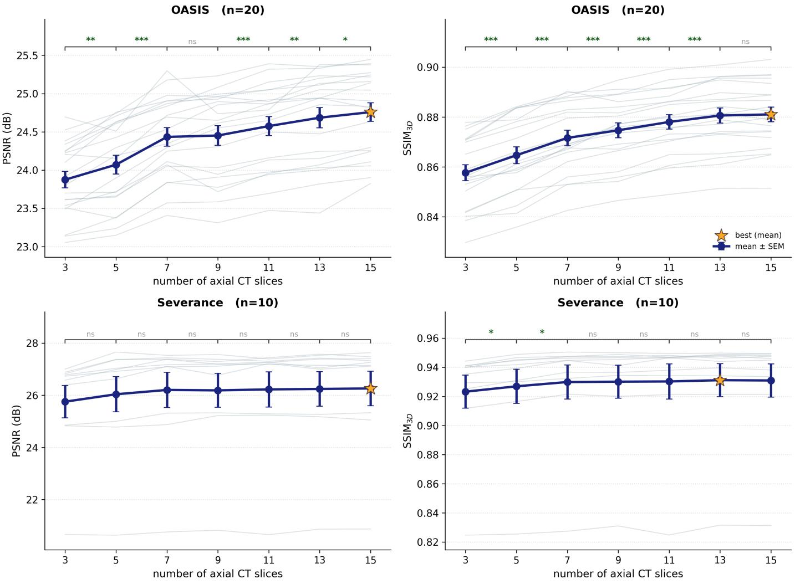  
Figure A.1: Efect of through-plane CT context on synthesis performance on the validation sets. The number of input axial CT slices was varied from 3 to 15 while all other model components were fixed. Thin lines show paired subject-level performance, and the dark line with error bars denotes the mean ± SEM. Statistical significance was assessed between consecutive context sizes using two-sided Wilcoxon signed-rank tests with Holm correction for multiple comparisons $( ^ { * } p < 0 . 0 5$ $\mathrm { ~ \mp * * } \^ { \mathrm { } } p < 0 . 0 1 , \mathrm { ~ \mp * * } ^ { \mathrm { } * } p < 0 . 0 0 1 , \mathrm { ~ \ " { } s } ^ { \mathrm { } }$ not significant).

## Appendix A.7. Per-subject paired comparison against Choo2024

Figure A.2 provides the subject-level paired comparison between the proposed method and Choo2024, the strongest baseline, for both cohorts and evaluation metrics. The proposed method outperforms Choo2024 for all subjects in $\mathrm { S S I M } _ { 3 \mathrm { D } }$ in both cohorts and in PSNR on OASIS-3. For Severance PSNR, it performs better in 21 of 22 subjects. All four one-sided Wilcoxon signed-rank tests on the paired subject-level diferences are significant at $p < 0 . 0 0 1$

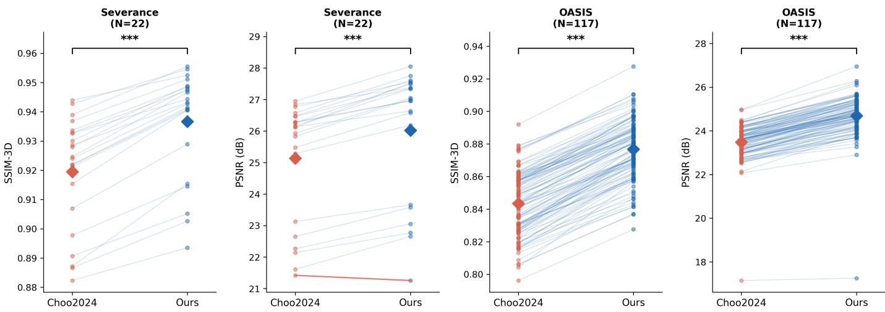  
Figure A.2: Per-subject paired comparison between the proposed method and Choo2024, the strongest baseline, across both cohorts and evaluation metrics. Each thin line connects paired values from a single subject. Blue lines indicate better performance of the proposed method, whereas red lines indicate the opposite. Diamonds denote group means. Statistical significance was assessed using one-sided Wilcoxon signed-rank tests on the paired subject-level diferences $( ^ { \ast \ast \ast } p < 0 . 0 0 1 )$ ).

## Appendix A.8. Regional SUVR performance of non-synthesis MRI-free baselines

Regional SUVRs of the non-synthesis pipelines were computed for the six regions reported in Table 4, using the same regional definitions and the atlas and reference region of each pipeline (Table A.3).

Table A.5: MAE of regional SUVR estimates for the non-synthesis MRI-free baselines $( N = 8 7 )$ , reported as mean ± SD in SUVR units. The proposed method is shown for reference using the results from Table 4. Target regions of the non-synthesis pipelines were defined in MNI152 space and therefore do not coincide exactly with the native-space FreeSurfer regions of the reference.
<table><tr><td>Pipeline</td><td>Frontal</td><td>Parietal</td><td>Lat. temporal</td><td>Precuneus</td><td>Ant. cingulate</td><td>Post. cingulate</td></tr><tr><td>PET-template (GAAIN-derived)</td><td> $0 . 1 7 3 \pm 0 . 1 0 3$ </td><td> $0 . 1 6 0 \pm 0 . 0 9 6$ </td><td> $0 . 1 5 7 \pm 0 . 0 9 4$ </td><td> $0 . 1 5 1 \pm 0 . 1 0 1$ </td><td> $0 . 2 5 1 \pm 0 . 1 4 9$ </td><td> $0 . 1 7 0 \pm 0 . 1 1 6$ </td></tr><tr><td>PET-template (OASIS-derived)</td><td> $0 . 1 4 0 \pm 0 . 0 8 2$ </td><td> $0 . 1 4 6 \pm 0 . 0 7 3$ </td><td> $0 . 1 3 2 \pm 0 . 0 7 4$ </td><td> $0 . 1 2 2 \pm 0 . 0 7 5$ </td><td> $0 . 1 5 4 \pm 0 . 1 0 5$ </td><td> $0 . 1 4 0 \pm 0 . 0 9 9$ </td></tr><tr><td>Presotto2018</td><td> $0 . 0 9 8 \pm 0 . 0 7 5$ </td><td> $0 . 1 4 2 \pm 0 . 0 8 2$ </td><td> $0 . 0 4 1 \pm 0 . 0 4 1$ </td><td> $0 . 0 7 2 \pm 0 . 0 7 2$ </td><td> $0 . 1 3 9 \pm 0 . 1 0 4$ </td><td> $0 . 1 2 8 \pm 0 . 1 2 6$ </td></tr><tr><td>Matsuda2021</td><td> $0 . 0 8 7 \pm 0 . 0 8 2$ </td><td> $0 . 1 5 4 \pm 0 . 0 8 4$ </td><td> $0 . 0 5 2 \pm 0 . 0 5 0$ </td><td> $0 . 0 9 0 \pm 0 . 0 8 1$ </td><td> $0 . 1 9 1 \pm 0 . 1 2 2$ </td><td> $0 . 1 6 8 \pm 0 . 1 3 3$ </td></tr><tr><td>Ours</td><td> $\mathbf { 0 . 0 1 7 \pm 0 . 0 1 5 }$ </td><td> $\mathbf { 0 . 0 1 6 \pm 0 . 0 1 5 }$ </td><td> $\mathbf { 0 . 0 1 7 \pm 0 . 0 1 7 }$ </td><td> $\mathbf { 0 . 0 2 1 \pm 0 . 0 2 3 }$ </td><td> $\mathbf { 0 . 0 2 6 \pm 0 . 0 2 0 }$ </td><td> $\mathbf { 0 . 0 2 3 \pm 0 . 0 2 1 }$ </td></tr></table>

## Appendix A.9. Regional conformal prediction across target coverage levels

We further evaluated regional SUVR conformal prediction across target coverage levels of 80%, 90%, and 95% (Table A.6). Across all six regions, prediction intervals widened as the target coverage increased. Empirical coverage generally varied around the corresponding target levels, although the degree of under- or overcoverage difered across regions.

At the 80% target, empirical coverage ranged from 77.0% to 86.2%. At the 90% target, coverage ranged from 88.5% to 96.6%, as reported in the main analysis. Figure A.3 shows the corresponding subject-level prediction intervals at this 90% target coverage. At the 95% target, empirical coverage ranged from 89.7% in the parietal cortex to 100.0% in the posterior cingulate cortex. Mean prediction interval width increased with the target coverage in every region.

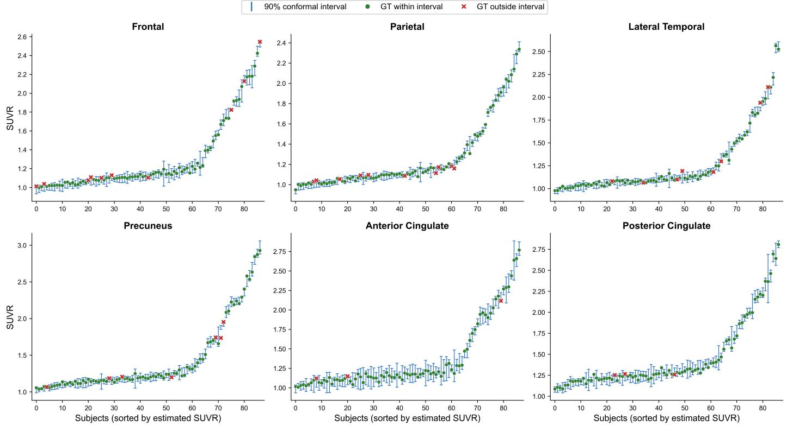

Table A.6: Regional conformal prediction performance across target coverage levels. Empirical coverage and prediction interval width are reported for each regional SUVR at target coverage levels of 80%, 90%, and 95%. Empirical coverage denotes the proportion of test subjects whose real MRI-based SUVR falls within the corresponding prediction interval, with counts shown in parentheses as covered subjects/total subjects. Two-sided 95% Wilson confidence intervals for coverage are shown in brackets below each coverage value, in percentage units. Interval width is reported in SUVR units as mean ± SD across test subjects $( N = 8 7 )$
<table><tr><td rowspan="2">Region</td><td colspan="2">80% target</td><td colspan="2">90% target</td><td colspan="2">95% target</td></tr><tr><td>Coverage</td><td>Width</td><td>Coverage</td><td>Width</td><td>Coverage</td><td>Width</td></tr><tr><td>Frontal</td><td>77.0% (67/87) [67.1, 84.6]</td><td> $0 . 0 7 0 { \scriptstyle \pm 0 . 0 3 7 }$ </td><td>88.5% (77/87) [80.1, 93.6]</td><td> $0 . 0 9 4 \pm 0 . 0 4 9$ </td><td>95.4% (83/87) [88.8, 98.2]</td><td> $0 . 1 2 0 { \scriptstyle \pm 0 . 0 6 3 }$ </td></tr><tr><td>Parietal</td><td>83.9% (73/87) [74.8, 90.2]</td><td> $0 . 0 6 1 \pm 0 . 0 3 2$ </td><td>88.5% (77/87) [80.1, 93.6]</td><td> $0 . 0 6 9 { \scriptstyle \pm 0 . 0 3 6 }$ </td><td>89.7% (78/87) [81.5, 94.5]</td><td> $0 . 0 7 4 \pm 0 . 0 3 9$ </td></tr><tr><td>Lateral temporal</td><td>77.0% (67/87) [67.1, 84.6]</td><td> $0 . 0 5 6 { \pm } 0 . 0 2 9$ </td><td>90.8% (79/87) [82.9, 95.3]</td><td> $0 . 0 7 4 { \scriptstyle \pm 0 . 0 3 9 }$ </td><td>93.1% (81/87) [85.8, 96.8]</td><td> $0 . 0 8 6 \pm 0 . 0 4 5$ </td></tr><tr><td>Precuneus</td><td>85.1% (74/87) [76.1, 91.1]</td><td> $0 . 0 7 5 { \scriptstyle \pm 0 . 0 3 5 }$ </td><td>92.0% (80/87) [84.3, 96.0]</td><td> $0 . 1 0 1 { \scriptstyle \pm 0 . 0 4 6 }$ </td><td>94.3% (82/87) [87.2, 97.5]</td><td> $0 . 1 1 6 { \pm } 0 . 0 5 3$ </td></tr><tr><td>Anterior cingulate</td><td>82.8% (72/87) [73.5, 89.3]</td><td> $0 . 0 9 4 { \scriptstyle \pm 0 . 0 4 2 }$ </td><td>96.6% (84/87) [90.3, 98.8]</td><td> $0 . 1 8 5 { \pm } 0 . 0 8 2$ </td><td>96.6% (84/87) [90.3, 98.8]</td><td> $0 . 1 9 3 { \pm } 0 . 0 8 6$ </td></tr><tr><td>Posterior cingulate</td><td>86.2% (75/87) [77.4, 91.9]</td><td> $0 . 0 8 8 { \pm } 0 . 0 5 0$ </td><td>96.6% (84/87) [90.3, 98.8]</td><td> $0 . 1 3 2 { \scriptstyle \pm 0 . 0 7 5 }$ </td><td>100.0% (87/87) [95.8, 100.0]</td><td> $0 . 1 8 0 { \scriptstyle \pm 0 . 1 0 2 }$ </td></tr></table>

Figure A.3: Subject-level conformal prediction intervals for the six regional SUVR measures at the 90% target coverage. Within each region, subjects are ordered by the ensemble-mean MRI-free SUVR estimate. Green circles and red crosses indicate whether the corresponding MRI-based reference SUVR falls inside or outside the conformal prediction interval, respectively. Empirical coverage and mean prediction interval width for each region, including results at the 80% and 95% targe coverage levels, are reported in Table A.6.

## Appendix A.10. Sensitivity ofamyloid-positivity decision reliability to the MCSUVR cut-of

At the prespecified MCSUVR cut-of of 1.42, the amyloid-positivity decisions obtained from our synthetic-MRI-based MRI-free pipeline reproduced the real MRI-based decisions for all 87 test subjects. We therefore examined whether this agreement was sensitive to the choice of MCSUVR cut-of and whether conformal prediction could identify unreliable decisions when disagreements emerged. The cut-of was varied from 1.30 to 1.50 in increments of 0.01, while the 90% conformal prediction intervals were held fixed. At each cut-of, MRI-free point-estimate decisions were compared with the corresponding real MRI-based reference decisions, and cases whose prediction intervals spanned the cut-of were designated indeterminate.

Point-estimate disagreement with the real MRI-based reference decision was rare and occurred only at cut-ofs from 1.34 to 1.41 (Fig. A.4). The maximum disagreement involved two subjects at a cut-of of 1.35. At every cut-of at which a disagreement occurred, all discordant point-estimate decisions were designated indeterminate. This shows that cases in which the MRI-free decision difered from the real MRI-based reference were consistently flagged by the conformal decision rule. Conversely, no discordant case remained among subjects receiving a confident decision, and all confident decisions matched the real MRI-based reference decision across the evaluated cut-of range.

The proportion of subjects designated indeterminate remained low throughout the sweep, ranging from 1.1% to 4.6% (1–4 of 87 subjects). Accordingly, 83–86 subjects retained a confident decision depending on the cut-of. Representative cut-ofs are summarized in Table A.7. Within this test set and evaluated cut-of range, all observed point-estimate disagreements were therefore deferred as indeterminate, while decisions retained as confident remained concordant with the real MRI-based reference decision.

A  
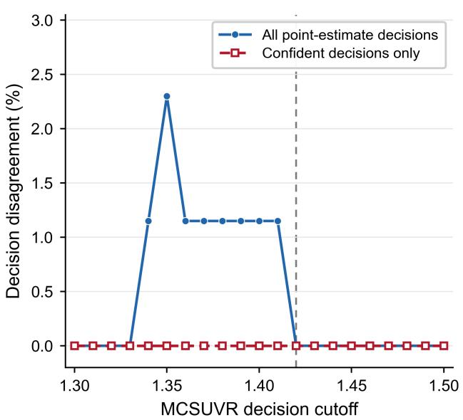

B  
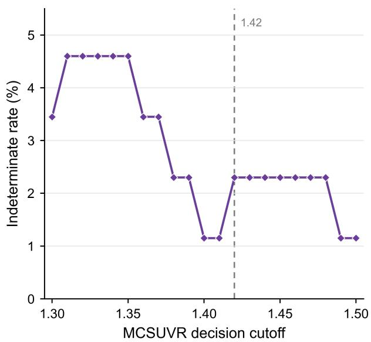  
Figure A.4: Sensitivity of amyloid-positivity decision reliability to the MCSUVR cut-of using fixed 90% conformal prediction intervals. The MCSUVR cut-of was varied from 1.30 to 1.50 while the conformal prediction intervals were held fixed. (A) Disagreement rate between the MRI-free point-estimate amyloid-positivity decision and the real MRI-based reference decision for all subjects and for subjects retaining a confident conformal decision. (B) Proportion of subjects designated indeterminate because their conformal prediction interval spanned the decision cut-of. The vertical dashed line marks the prespecified PiB PET MCSUVR cut-of of 1.42 used in the main analysis.

Table A.7: Amyloid-positivity decision reliability across representative MCSUVR cut-ofs using fixed 90% conformal prediction intervals. MRI-free point-estimate decisions are compared with the corresponding real MRI-based reference decisions. Captured disagreements denote discordant point-estimate decisions that were designated indeterminate by the conformal decision rule. Confident disagreement denotes discordant cases remaining among subjects assigned a confident decision.
<table><tr><td>Cut-off</td><td>Ref. +/-</td><td>FP/FN</td><td>Confident</td><td>Indet.</td><td>Captured</td><td>Conf. disag.</td></tr><tr><td>1.30</td><td>24/63</td><td>0/0</td><td>84/87</td><td>3/87</td><td>一</td><td>0/84</td></tr><tr><td>1.35</td><td>22/65</td><td>1/1</td><td>83/87</td><td>4/87</td><td>2/2</td><td>0/83</td></tr><tr><td>1.40</td><td>21/66</td><td>1/0</td><td>86/87</td><td>1/87</td><td>1/1</td><td>0/86</td></tr><tr><td>1.42</td><td>21/66</td><td>0/0</td><td>85/87</td><td>2/87</td><td>一</td><td>0/85</td></tr><tr><td>1.45</td><td>20/67</td><td>0/0</td><td>85/87</td><td>2/87</td><td>一</td><td>0/85</td></tr><tr><td>1.50</td><td>20/67</td><td>0/0</td><td>86/87</td><td>1/87</td><td>一</td><td>0/86</td></tr></table>

## Appendix A.11. External transfer of conformal calibration to GARD

We further examined whether conformal calibration derived from OASIS-3 transferred to the independent GARD cohort. The same nonconformity score used in the main analysis, defined as the absolute MRI-free quantification error normalized by the subject-specific ensemble standard deviation, was used throughout this analysis. For the conformal analysis, we included 82 GARD subjects with successful FreeSurfer processing and valid PET quantification results for all ensemble members of the proposed model.

For cross-cohort transfer, conformal quantiles were estimated from the OASIS-3 calibration set and applied directly to GARD without recalibration.

Direct transfer of the OASIS-3 calibration resulted in substantial undercoverage on GARD (Table A.8). For MCSUVR, target coverage levels of 80%, 90%, and 95% resulted in empirical coverages of 42.7%, 62.2%, and 78.0%, respectively. Undercoverage was also observed across all six regional SUVR measures at the 90% target level, with empirical coverage ranging from 57.3% in the precuneus to 86.6% in the anterior cingulate cortex.

We therefore evaluated whether coverage could be recovered using calibration data drawn from the GARD cohort. The 82 eligible GARD subjects were randomly divided into equal calibration and test sets (N = 41 each), and this split-half procedure was repeated 1,000 times to reduce dependence on a particular random partition. With GARD-specific calibration, empirical MCSUVR coverage returned close to the requested levels, reaching $8 1 . 4 \pm 8 . 8 \% , 9 0 . 7 \pm 6 . 2 \%$ , and $9 5 . 2 \pm 4 . 6 \%$ at target coverage levels of 80%, 90%, and 95%, respectively. At the 90% target level, mean regional coverage across the repeated splits ranged from 90.2% to 90.7%. Prediction intervals were correspondingly wider than those obtained by directly transferring the OASIS-3 calibration. These results show that GARD-specific recalibration yielded empirical coverage close to the target marginal coverage, whereas calibration derived from OASIS-3 did not transfer directly to the external cohort.

Table A.8: External transfer and target-cohort recalibration of conformal prediction on GARD using the ensemble-normalized nonconformity score. For OASIS-3 calibration → GARD, conformal quantiles estimated from the OASIS-3 calibration set were applied directly to the GARD cohort. For GARD-specific calibration, coverage is reported as mean ± SD across 1,000 random split-half partitions, and width denotes the corresponding mean prediction interval width averaged across splits.
<table><tr><td>Measure</td><td>Target</td><td colspan="2">OASIS-3 cal. → GARD</td><td colspan="2">GARD-specific calibration</td></tr><tr><td></td><td></td><td>Coverage</td><td>Width</td><td>Coverage</td><td>Width</td></tr><tr><td colspan="6">Composite MCSUVR</td></tr><tr><td>MCSUVR</td><td>80%</td><td>42.7%</td><td>0.075</td><td> $8 1 . 4 \pm 8 . 8 \%$ </td><td>0.160</td></tr><tr><td></td><td>90%</td><td>62.2%</td><td>0.119</td><td> $9 0 . 7 \pm 6 . 2 \%$ </td><td>0.203</td></tr><tr><td></td><td>95%</td><td>78.0%</td><td>0.151</td><td> $9 5 . 2 \pm 4 . 6 \%$ </td><td>0.252</td></tr><tr><td colspan="6">Regional SUVR at 90% target</td></tr><tr><td>Frontal</td><td>90%</td><td>70.7%</td><td>0.139</td><td> $9 0 . 5 \pm 6 . 3 \%$ </td><td>0.208</td></tr><tr><td>Parietal</td><td>90%</td><td>65.9%</td><td>0.108</td><td> $9 0 . 6 \pm 6 . 4 \%$ </td><td>0.200</td></tr><tr><td>Lateral temporal</td><td>90%</td><td>69.5%</td><td>0.098</td><td> $9 0 . 7 \pm 6 . 1 \%$ </td><td>0.186</td></tr><tr><td>Precuneus</td><td>90%</td><td>57.3%</td><td>0.141</td><td> $9 0 . 6 \pm 6 . 4 \%$ </td><td>0.369</td></tr><tr><td>Anterior cingulate</td><td>90%</td><td>86.6%</td><td>0.250</td><td> $9 0 . 4 \pm 6 . 2 \%$ </td><td>0.280</td></tr><tr><td>Posterior cingulate</td><td>90%</td><td>79.3%</td><td>0.184</td><td> $9 0 . 2 \pm 6 . 4 \%$ </td><td>0.278</td></tr></table>

## Supplementary references

[S1] K. Choo, Y. Jun, M. Yun, S. J. Hwang, Slice-consistent 3d volumetric brain ct-to-mri translation with 2d brownian bridge difusion model, in: International Conference on Medical Image Computing and Computer-Assisted Intervention, Springer, 2024, pp. 657–667.

[S2] J. Kim, H. Park, Adaptive latent difusion model for 3D medical image to image translation: Multi-modal magnetic resonance imaging study, in: WACV, 2024, pp. 7604–7613.

[S3] D. Kim, K. Choo, S. Lee, S. Kang, M. Yun, J. Yang, Automated quantification of brain PET in PET/CT using deep learning-based CT-to-MR translation: a feasibility study, Eur. J. Nucl. Med. Mol. Imaging 52 (2025) 2959–2967.

[S4] P. Isola, J.-Y. Zhu, T. Zhou, A. A. Efros, Image-to-image translation with conditional adversarial networks, in: CVPR, 2017, pp. 1125–1134.

[S5] X. Mao, Q. Li, H. Xie, R. Y. K. Lau, Z. Wang, S. P. Smolley, Least squares generative adversarial networks, in: ICCV, 2017, pp. 2794–2802.

[S6] P. Edison, S. F. Carter, J. O. Rinne, G. Gelosa, K. Herholz, A. Nordberg, D. J. Brooks, R. Hinz, Comparison of MRI based and PET template based approaches in the quantitative analysis of amyloid imaging with PIB-PET, NeuroImage 70 (2013) 423–433.

[S7] S. M. Landau, T. J. Ward, A. Murphy, L. Iaccarino, T. M. Harrison, R. La Joie, S. Baker, R. A. Koeppe, W. J. Jagust, Alzheimer’s Disease Neuroimaging Initiative, Quantification of amyloid beta and tau PET without a structural MRI, Alzheimer’s & Dementia 19 (2023) 444–455.

[S8] W. E. Klunk, R. A. Koeppe, J. C. Price, T. L. S. Benzinger, M. D. Devous, W. J. Jagust, K. A. Johnson, C. A. Mathis, D. Minhas, M. J. Pontecorvo, C. C. Rowe, D. M. Skovronsky, M. A. Mintun, The Centiloid project: Standardizing quantitative amyloid plaque estimation by PET, Alzheimer’s & Dementia 11 (2015) 1–15.e4.

[S9] J. Ashburner, K. J. Friston, Unified segmentation, NeuroImage 26 (2005) 839–851.

[S10] L. Presotto, L. Iaccarino, A. Sala, E. G. Vanoli, C. Muscio, A. Nigri, M. G. Bruzzone, F. Tagliavini, L. Gianolli, D. Perani, V. Bettinardi, Low-dose CT for the spatial normalization of PET images: A validation procedure for amyloid-PET semi-quantification, NeuroImage: Clinical 20 (2018) 153–160.

[S11] H. Matsuda, T. Yamao, M. Shakado, Y. Shigemoto, K. Okita, N. Sato, Amyloid PET quantification using low-dose CT-guided anatomic standardization, EJNMMI Research 11 (2021) 125.