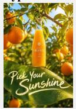
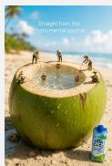
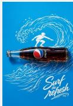
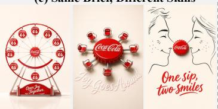
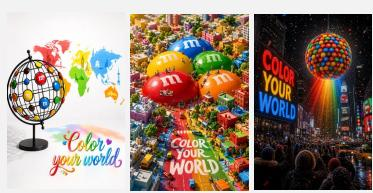
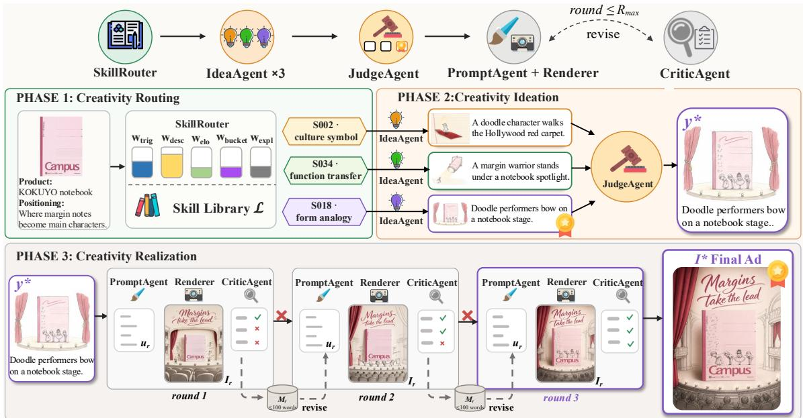
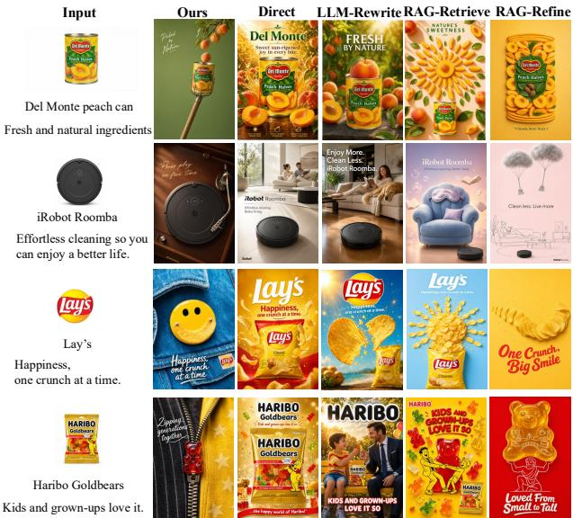

(c) Same Brief, Different Skills

# AdMuse: Skill-Guided Creative Advertising Image Generation

Minyan Luo   
MAIS, Institute of Automation, CAS   
Beijing, China   
School of Artificial Intelligence, UCAS   
Beijing, China   
luominyan2025@ia.ac.cn   
Xincan Wang   
Shanghai Theatre Academy   
Shanghai, China   
wangxincan@sta.edu.cn

Oliver Deussen University of Konstanz Konstanz, Germany oliver.deussen@uni-konstanz.de

Yuxin Zhang   
MAIS, Institute of Automation, CAS   
Beijing, China   
School of Artificial Intelligence, UCAS   
Beijing, China   
yuxin.zhazel@gmail.com   
Fuzhang Wu   
Institute of Software, CAS   
Beijing, China   
fuzhang@iscas.ac.cn   
Fan Tang   
ICT, CAS   
Beijing, China   
tfan.108@gmail.com

Meng Zhao School of Artificial Intelligence, UCAS Beijing, China zhaomeng24@mails.ucas.ac.cn

Tong-Yee Lee National Cheng Kung University Tainan, Taiwan tonylee@mail.ncku.edu.tw

Weiming Dong∗ MAIS, Institute of Automation, CAS Beijing, China weiming.dong@ia.ac.cn

## (a) Skill Library Showcase: 8 Bridge Types

  
form analogy  
function transfer

  
material texture

  
process causation

  
origin environment

  
culture symbol

  
scale contrast sensory amplification

## (b) Same Skill, Different Products

  
product-substitution-in-scene

  
product-transforms-into-tool

  
Airbnb: Belong anywhere.

  
Coca-Cola: Share the joy.

  
M&M‘s: Color your world.

Figure 1: Creative advertising images generated by AdMuse. (a) One representative ad per bridge type from skill library. (b) A single skill applied across diverse products. (c) A single brief routed through diferent skills yields visually distinct ads.

## Abstract

∗Corresponding author

This work is licensed under a Creative Commons Attribution 4.0 International License. SA Technical Communications ’26, Kuala Lumpur, Malaysia   
© 2026 Copyright held by the owner/author(s).   
ACM ISBN 979-8-4007-2841-9/2026/12   
https://doi.org/10.1145/3829339.3847841

An outstanding creative advertising image should both attract attention and communicate a product’s positioning. How to choose a persuasive conceptual bridge before rendering begins is challeng- ing for advertising generation. We present AdMuse, a skill-guided multi-agent framework that distills high-quality advertisements into reusable creative skills for cross-domain advertising strategy. Rather than retrieving isolated exemplars, AdMuse abstracts recurring bridge patterns into a skill library that can guide new product briefs. At generation time, AdMuse coordinates skill routing, multi-candidate ideation and selection, and VLM-guided visual refine- ment: diverse skills propose alternative concepts, relative judgment selects the most promising direction, and vision-language feedback helps realize the selected intent in the final image. This design treats advertising creativity as a structured decision process rather than a single prompt-writing step. Experiments across diverse product and brand positionings show that AdMuse produces visually compelling advertisements that faithfully communicate product positioning.

## CCS Concepts

• Computing methodologies → Image processing.

## Keywords

Creative Advertising Image, Skills, Agentic Image Generation

## ACM Reference Format:

Minyan Luo, Yuxin Zhang, Meng Zhao, Xincan Wang, Fuzhang Wu, Tong- Yee Lee, Oliver Deussen, Fan Tang, and Weiming Dong. 2026. AdMuse: Skill-Guided Creative Advertising Image Generation. In SIGGRAPH Asia 2026 Technical Communications (SA Technical Communications ’26), December 01–04, 2026, Kuala Lumpur, Malaysia. ACM, New York, NY, USA, 4 pages. https://doi.org/10.1145/3829339.3847841

## 1 Introduction

Creativity plays a vital role in advertising. Creative advertisements are more memorable than regular ones [Jin et al. 2019; Till and Baack 2005]. Although modern image generators [OpenAI 2026] and agentic visual pipelines [Chen et al. 2026] can render high quality images, they still largely rely on the user to provide the core creative idea. For advertising, however, the main dificulty often lies not in rendering an image, but in deciding what visual concept to use. A key challenge is that a product can support many creative directions, each producing distinct visual and communicative effects. Advertising generation therefore needs a creative-strategy representation that reveals, compares, and instantiates viable directions [Koushik et al. 2025]. It should generalize across products while guiding visual synthesis, often through cross-domain associations that make desired qualities perceptible.

We frame this problem through the notion of a creative bridge: a cross-domain association that links a product to a distant con- cept through an interpretable visual chain. High-quality creative ads repeatedly reuse a limited set of such bridge patterns [Sun et al. 2025]. We therefore distill them into reusable creative skills that specify when a strategy applies, what associative chain it con-structs, and how it can be instantiated for a new product brief. Based on this representation, we propose AdMuse, a skill-guided multi-agent framework for creative advertising image generation. AdMuse routes bridge-diverse skills for a brief, lets multiple skillconditioned concepts compete through relative judgment, and then refines the selected concept with VLM feedback. Our contributions are summarized as:

• We formalize the creative bridge and distill recurring bridge pat terns from advertisements into a reusable skill library.

• We propose a skill-guided multi-agent pipeline that combines routing, multi-candidate ideation and selection, and VLM-guided visual refinement.

• We show that AdMuse produces visually compelling and messagefaithful advertisements across diverse briefs, products, and posi- tionings (see Fig. 1).

## 2 Related Work

Recent agentic image-generation systems improve synthesis through multi-agent coordination [Shen et al. 2026] and VLM-guided critique [Yao et al. 2026]. In parallel, skill- and memory- based agents show how reusable procedures can guide complex tasks [Zhong et al. 2026]. Our work connects these directions by treating advertising ideation itself as a reusable, skill-based strat- egy before rendering. Creative advertising also relates to visual metaphor and conceptual blending [Koushik et al. 2025; Sun et al. 2025], where a product is linked to a remote concept through a meaningful visual association. Prior methods typically generate one metaphor per query or rely on direct reference transfer [Xu et al. 2026]. By contrast, we distill recurring bridge patterns from high-quality ads into reusable skills that can be routed and com- pared for a new brief. In e-commerce and marketing AIGC, existing systems focus on product staging [Wang et al. 2025], poster composition [Gao et al. 2025], or marketing copy generation [Quan et al. 2025]. These approaches usually assume the core idea is already given. We instead address the upstream problem of selecting a persuasive visual concept that communicates product positioning.

## 3 Method

## 3.1 Creative Bridges and Skill Distillation

The overall framework of AdMuse is shown in Fig. 2. We build the skill library from 1,129 creative advertising images spanning 13 product categories. We use Gemini-3.1-Pro to analyze each ad-vertisement and extract a structured record of its product identity, associative space, creative bridge, visual structure, and creative reasoning. Details of the corpus and distillation procedure are provided in Supplementary Sec. 1.

Creative advertising often expresses an abstract product attribute by connecting the product to a remote visual domain, a process closely related to conceptual blending theory [Fauconnier and Turner 2008]. We operationalize this mechanism as a creative bridge: a cross-domain mapping from the product source to the target attribute specified by the positioning. A bridge records the intermediate concepts that carry the mapping, together with the order in which they are visually interpreted. Formally,

$$
b r i d g e : \mathrm { p r o d u c t ~ s o u r c e } \frac { n _ { 1 }  n _ { 2 }  \cdots  n _ { K } } { b r i d g e ~ t y p e } \mathrm { t a r g e t } ,\tag{1}
$$

where target denotes the attribute to be communicated, $n _ { 1 } , . . . , n _ { K }$ $\left( K \geq 1 \right)$ denotes an ordered chain of source-domain concepts, and the bridge type specifies the relation that makes the mapping plau-sible.

We derive the bridge taxonomy from the annotated corpus rather than prescribing categories manually: recurring map- ping relations are consolidated into eight bridge types, after which every advertisement is re-labeled with the taxonomy fixed and assigned to exactly one type: B = {form\_analogy, function\_transfer, material\_texture, origin\_environment, cultural\_symbol, scale\_contrast, process\_causation, sensory\_amplification}.

  
Figure 2: AdMuse combines a creative skill library with a three-phase generation pipeline.

Bridge types provide a coarse organization of creative relations, but they are not suficiently specific to guide generation directly. We therefore cluster normalized embeddings of each record’s asso- ciative chain, rationale, and creative reasoning within each bridge family using K-Means, and summarize each cluster as a reusable skill. A skill packages a reusable creative procedure: a strategy description, bridge type, applicability triggers and anti-triggers, a parameterized associative-chain template, and a playbook specify- ing construction steps, visual structure, constraints, anti-patterns, and canonical examples. The complete schema and the S018 skill are provided in Supplementary Sec. 1.3.

## 3.2 Skill-Guided Generation Pipeline

At inference, AdMuse maps a brief � = (�, �, I0), i.e., product name, positioning statement, and optional product image, to a creative advertising image I∗ through routing, ideation, and realization:

$$
S _ { x } = \mathcal { F } _ { \mathrm { r o u t e } } ( x , \mathcal { L } ) , \quad y ^ { * } = \mathcal { F } _ { \mathrm { i d e a } } ( x , S _ { x } ) , \quad \Gamma ^ { * } = \mathcal { F } _ { \mathrm { r e a l i z e } } ( y ^ { * } , x ) ,\tag{2}
$$

where $\mathcal { L }$ is the skill library, $S _ { x }$ denotes the selected skills, and $y ^ { * }$ denotes the winning creative concept (see Fig. 2).

Phase 1: Creativity Routing. For the input brief $\boldsymbol { x } = \left( n , z , \mathbf { I } _ { 0 } \right)$ , the SkillRouter considers trigger match $( w _ { \mathrm { t r i g } } )$ , description similar-ity $\left( { \boldsymbol { w } } _ { \mathrm { d e s c } } \right)$ , global skill evidence $( w _ { \mathrm { E l o } } )$ , category-specific evidence $( w _ { \mathrm { b u c k e t } } )$ , and an exploration bonus $( w _ { \mathrm { e x p l } } )$ . It greedily selects three skills with distinct bridge types to expose the subsequent ideation phase to diferent creative mechanisms. The scoring and selection details are provided in Supplementary Sec. 2.1.

Phase 2: Creativity Ideation. For each selected skill $s _ { i } ,$ the IdeaA- gent $\mathcal { G } _ { \mathrm { i d e a } }$ generates a structured concept $y _ { i }$ conditioned on the shared brief �. Each concept specifies the metaphor core, visual composition, and tagline. The JudgeAgent $\mathcal { G } _ { \mathrm { j u d g e } }$ then compares the three concepts and selects the winning idea,

$$
y _ { i } = \mathcal { G } _ { \mathrm { i d e a } } ( x , s _ { i } ) , \qquad y ^ { * } = \mathcal { G } _ { \mathrm { j u d g e } } ( y _ { 1 } , y _ { 2 } , y _ { 3 } ) ,\tag{3}
$$

using positioning alignment, creative novelty, and visual executability as criteria. Since no image is rendered in this phase, AdMuse separates strategic concept selection from visual realization.

Phase 3: Creativity Realization. The PromptAgent converts the winning concept $y ^ { * }$ into an image prompt, which the renderer uses to generate an advertising image. The CriticAgent inspects the rendered image against the selected concept and either approves it or provides feedback for prompt revision. Rejected attempts are summarized into a compact memory to prevent repeated failures, and the loop terminates upon approval or after $R _ { \mathrm { m a x } }$ rounds.

## 4 Experiments

## 4.1 Experimental Setup

Implementation Details. Our pipeline uses GPT-5.5 for the IdeaAgent and PromptAgent, Gemini-3.1-Pro for in-loop judging and critique, and GPT-Image-2 for image synthesis. Claude Sonnet 4.6 and Qwen3.7-Plus independently evaluate the same final outputs using a shared prompt and rubrics, reducing dependence on a single VLM evaluator [Li et al. 2025]. Further implementation details and hyperparameters are provided in Supplementary Sec. 2.3–2.4.

Benchmark and Baselines. We evaluate on 500 briefs covering 420 product images across 13 categories, held out from the 1,129-ad dis- tillation corpus to prevent leakage. We compare AdMuse with four baselines: Direct sends the briefdirectly to the image renderer (GPT-Image-2); LLM-Rewrite expands the brief into a detailed imagegeneration prompt; RAG-Retrieve retrieves one visual sketch from the reference corpus as inspiration; and RAG-Refine, feeds the top-3 retrieved ad records into the same idea–judge–prompt–critic loop as our system, but without skill routing or templates. Detailed implementations are provided in Supplementary Sec. 3.2.

Table 1: Quantitative evaluation results.
<table><tr><td></td><td colspan="3">Claude Sonnet 4.6</td><td colspan="3">Qwen3.7-Plus</td></tr><tr><td>Method</td><td>CS↑</td><td>AS↑</td><td>Avg↑</td><td>CS↑</td><td>AS↑</td><td>Avg↑</td></tr><tr><td>Direct</td><td>5.046</td><td>6.168</td><td>5.607</td><td>5.115</td><td>6.916</td><td>6.016</td></tr><tr><td>LLM-Rewrite</td><td>5.623</td><td>6.782</td><td>6.202</td><td>5.743</td><td>7.566</td><td>6.655</td></tr><tr><td>RAG-Retrieve</td><td>6.633</td><td>7.262</td><td>6.948</td><td>6.704</td><td>7.752</td><td>7.228</td></tr><tr><td>RAG-Refine</td><td>7.192</td><td>7.317</td><td>7.255</td><td>6.619</td><td>6.902</td><td>6.760</td></tr><tr><td>AdMuse</td><td>7.295</td><td>7.618</td><td>7.457</td><td>7.482</td><td>8.232</td><td>7.857</td></tr></table>

## 4.2 Quantitative Evaluation

We report two evaluation metrics: Creativity Score (CS), which measures the novelty and conceptual impact of the advertisement, and Alignment Score (AS), which measures how clearly the image communicates the intended positioning while preserving product identity. Both scores are assigned by two independent out-of-loop VLM judges under the same protocol. Full rubrics and prompt details are deferred to Supplementary Sec. 3.3. As shown in Table 1, AdMuse achieves the highest average, CS, and AS scores on the 500-brief benchmark, outperforming all four baselines.

## 4.3 Qualitative Evaluation

As shown in Fig. 3, the baselines tend to either render the brief liter- ally or add visual polish without forming a cross-domain mapping. In contrast, AdMuse more consistently translates the positioning into a concrete cross-domain visual concept while maintaining prod uct visibility: the Del Monte can appears as fruit freshly “picked by nature” among peach branches, returning packaged product to its origin environment; the Roomba becomes a vinyl record, recasting efortless cleaning as pressing play on free time; a Lay’s chip turns into a smiling button on a denim jacket by form analogy; and a gummy bear serves as a zipper pull that zips generations together. In each case, the product assumes a role in the target domain rather than merely appearing in a themed scene.

## 5 Conclusion

This paper introduced AdMuse, a skill-guided multi-agent framework for creative advertising image generation. We distill recurring cross-domain creative bridges from high-quality ads into reusable creative skills. AdMuse uses these skills for strategy routing, multi-candidate ideation and selection, and VLM-guided refinement. Fu- ture work can explore more explicit controls over creativity, align-ment, and brand preference in advertising workflows.

## Acknowledgments

This work was supported in part by the National Natural Science Foundation of China under no. 62572458, in part by the Beijing Natural Science Foundation under no. 26QY0538, and in part by the National Science and Technology Council, Taiwan under no. 113-2221-E006-161-MY3.

  
Figure 3: Qualitative evaluation results.

## References

Ping Chen, Daoxuan Zhang, Xiangming Wang, Yungeng Liu, Haijin Zeng, and Yongyong Chen. 2026. Agentic Flow Steering and Parallel Rollout Search for Spatially Grounded Text-to-Image Generation. arXiv preprint arXiv:2603.18627 (2026).

Gilles Fauconnier and Mark Turner. 2008. The Way We Think: Conceptual Blending And The Mind’s Hidden Complexities. Basic Books.

Yifan Gao, Zihang Lin, Chuanbin Liu, Min Zhou, Tiezheng Ge, Bo Zheng, and Hongtao Xie. 2025. PosterMaker: Towards High-Quality Product Poster Generation with Accurate Text Rendering. In IEEE/CVF Conference on Computer Vision and Pattern Recognition (CVPR). 8083–8093.

Hyun Seung Jin, Gayle Kerr, and Jaebeom Suh. 2019. Impairment efects of creative ads on brand recall for other ads. European Journal ofMarketing 53, 7 (2019), 1466–1483.

Girish A Koushik, Fatemeh Nazarieh, Katherine Birch, Shenbin Qian, and Diptesh Kanojia. 2025. The Mind’s Eye: A Multi-Faceted Reward Framework for Guiding Visual Metaphor Generation. In NeurIPS Workshop on Generative and Protective AI for Content Creation (GenProCC).

Dawei Li, Renliang Sun, Yue Huang, Ming Zhong, Bohan Jiang, Jiawei Han, Xiangliang Zhang, Wei Wang, and Huan Liu. 2025. Preference Leakage: A Contamination Prob lem in LLM-as-a-judge. In International Conference on Machine Learning (ICML).

OpenAI. 2026. Introducing ChatGPT Images 2.0. https://openai.com/index/introducing- chatgpt-images-2-0/. Online; accessed 2026-04.

Yinzhu Quan, Xinrui Li, and Ying Chen. 2025. CRMAgent: A Multi-Agent LLM System for E-Commerce CRM Message Template Generation. In NeurIPS Workshop on Generative AI in Finance.

Shaocheng Shen, Jianfeng Liang, Chunlei Cai, Cong Geng, Huiyu Duan, Xiaoyun Zhang, Qiang Hu, and Guangtao Zhai. 2026. Agentic Retoucher for Text-To-Image Generation. In IEEE/CVF Conference on Computer Vision and Pattern Recognition (CVPR). 29114–29125.

Zhida Sun, Zhenyao Zhang, Yue Zhang, Min Lu, Dani Lischinski, Daniel Cohen-Or, and Hui Huang. 2025. Creative Blends of Visual Concepts. In CHI Conference on Human Factors in Computing Systems (CHI). Article 542, 17 pages.

Brian D Till and Daniel W Baack. 2005. Recall and Persuasion: Does Creative Adver tising Matter? Journal of Advertising 34, 3 (2005), 47–57.

Haohan Wang, Wei Feng, Yaoyu Li, Zheng Zhang, Jingjing Lv, Junjie Shen, Zhangang Lin, and Jingping Shao. 2025. Generate E-commerce Product Background by Integrating Category Commonality and Personalized Style. In IEEE International Conference on Acoustics, Speech and Signal Processing (ICASSP). IEEE.

Yu Xu, Yuxin Zhang, Juan Cao, Lin Gao, Chunyu Wang, Oliver Deussen, Tong-Yee Lee, and Fan Tang. 2026. Beyond Pixels: Visual Metaphor Transfer via Schema-Driven Agentic Reasoning. In ACM SIGGRAPH Asia Conference. 12 pages.

Mingde Yao, Zhiyuan You, King Man Tam, Menglu Wang, and Tianfan Xue. 2026. PhotoAgent: Exploratory Visual Aesthetic Planning with Large Vision Models. In International Conference on Machine Learning (ICML).

Shanshan Zhong, Yi Lu, Jingjie Ning, Yibing Wan, Lihan Feng, Yuyi Ao, Leonardo FR Ribeiro, Markus Dreyer, Sean Ammirati, and Chenyan Xiong. 2026. SkillLearnBench: Benchmarking Continual Learning Methods for Agent Skill Generation on Real World Tasks. In Third Conference on Language Modeling (COLM).