# Agent-Wise Test-Time Normalization for Camera-Based Cooperative Perception with Corrupted Collaborators

Yu Wang, Shaohua Wang, Yicheng Li, and Kecheng Sun

Abstract—Intermediate-fusion cooperative perception lets a vehicle detect objects beyond its own field of view by fusing features shared by nearby agents. When only a collaborator’s cameras are degraded by fog, motion blur or exposure errors, the features it shares drift away from the training distribution while the ego input stays clean, and cooperation can become worse than not cooperating at all. Test-time batch-normalization adaptation, the standard training-free remedy, estimates statistics over the pooled batch of all agents and therefore normalizes both the clean ego and the corrupted collaborator with a mixture of two distributions. We show that this mixing harms even the clean ego: when the ego shares BN statistics with a corrupted collaborator, its detection from its own features drops by 3.58 to 6.68 AP@0.5 points although its cameras are untouched. We propose AgentNorm, an agent-wise test-time normalization that i) estimates the normalization statistics of every collaborator from its own current observation and ii) anchors the ego to its source statistics, so that the ego path remains exactly the original model. AgentNorm has no learnable parameters, needs no gradients or labels, is independent of the order of test frames, and runs locally on each agent without changing the transmitted features. On camera-based OPV2V with four fusion checkpoints and collaborator-only corruptions, AgentNorm raises AP@0.5 under severity-5 fog from 29.42–37.25 to 43.32–58.86 and outperforms pooled normalization by 5.53–12.94 points under fog and motion blur, at an extra latency of 2.3 ms per frame. On the real-world DAIR-V2X-C dataset, it outperforms pooled normalization in all ten infrastructure-corruption settings. We also report the cases it does not fix: occlusion, which removes image content rather than shifting feature statistics, and the case in which all agents share the same shift.

Index Terms—Cooperative perception, vehicle-to-everything (V2X), test-time adaptation, batch normalization, image corruption, 3D object detection.

## I. INTRODUCTION

ego vehicle can detect objects that are occluded or out of range of its own sensors [1]–[3]. Among the fusion strategies, intermediate fusion, in which every agent encodes its own sensor data into a bird’s-eye-view (BEV) feature map and transmits it to the ego, gives the best trade-off between accuracy and bandwidth and is the default in recent frameworks [4]. Camera-only cooperative perception is attractive for largescale deployment because cameras are cheap and already installed on most vehicles and many intersections. Cameras, however, are also the sensor most exposed to adverse weather, dirt, glare and vibration [5], [6]. In a cooperative system these degradations rarely hit all agents at once: a roadside camera may face the sun while the ego does not, or a collaborator may drive through a fog bank that the ego has already left. The distribution shift is agent-specific.

Agent-specific corruption breaks an assumption that most cooperative perception methods make implicitly: that every received feature map comes from the training distribution. When a collaborator’s cameras are corrupted, its BEV feature drifts away from what the fusion module expects, and the fused prediction degrades. On the camera-based OPV2V benchmark, an attention-fusion detector receiving a collaborator under severity-5 fog reaches 37.25 AP@0.5, which is below the 38.31 obtained by simply discarding the collaborator (Section IV). RCP-Bench [5] documents large accuracy drops of camera-based cooperative detectors under a wide range of image corruptions.

Several remedies are available, but each has a cost in this setting. Training with corruption augmentation [5] or with domain-generalization objectives [7], [8] requires retraining every deployed model and covering every corruption in advance. Discarding a collaborator that looks unreliable gives up the benefit of cooperation. Gradient-based test-time adaptation (TTA) [9], [10] updates parameters online without labels, but a Tent-style entropy objective on the dense detection map of a camera BEV detector collapsed in our runs: AP@0.5 under collaborator fog falls from 37.25 to 3.94 or lower, and the collapse propagates to the ego through fusion even when only the collaborator’s parameters are updated (Section IV). The remaining training-free option is to re-estimate batchnormalization (BN) statistics on the test data [11], [12], which RCP-Bench uses as its test-time baseline [5]. Applied to a cooperative model, this computes BN statistics over the pooled batch formed by all agents of a frame. Under agent-specific corruption, the pooled statistics are a mixture of a clean and a corrupted distribution and match neither. We find that this mixing contaminates the clean ego: detecting from the ego’s own features alone, its AP@0.5 drops from 38.31 to between 31.63 and 34.73 once it shares statistics with a corrupted collaborator (Section V-A).

Our key observation is that the collaborator’s corruption is visible in its own feature statistics. As the severity increases, the deviation of the collaborator’s BEV features from the source statistics grows monotonically and their local variance shrinks, for all four corruption types we tested (Fig. 1). The ego’s features are unaffected. The statistics needed to correct the collaborator are therefore available in the collaborator’s own observation, and they should not be mixed with the ego’s. Based on this observation, we propose AgentNorm, an agentwise test-time normalization with two components. Agentwise statistics split every BN input by agent and normalize each collaborator with the mean and variance of its own current observation. Ego anchoring keeps the ego on its source statistics, so that the ego path is the unmodified pre-trained model. AgentNorm adds no parameters, takes no gradient steps, uses no labels, and gives the same result regardless of the order of test frames. Because each agent normalizes its own features before transmission, it also changes neither the message format nor the bandwidth.

We evaluate AgentNorm on camera-based OPV2V [1] with four public fusion checkpoints and on the real-world DAIR-V2X-C dataset [13]. Under severity-5 fog and motion blur of the collaborator, AgentNorm improves AP@0.5 over pooled normalization by 5.53 to 12.94 points on every checkpoint, and it recovers 74% of the gap between the unadapted model and an oracle that adapts the collaborator with ground-truth supervision. The extra latency is 2.3 ms per frame on top of 254 ms.

The contributions of this paper are as follows.

We identify agent-specific corruption as a distinct testtime setting for cooperative perception and show that pooled test-time BN, the standard training-free baseline, contaminates the clean ego with the statistics of a corrupted collaborator. We quantify this contamination and locate it in the image encoder. We also show that regionlevel gating and entropy-based TTA fail in this setting.

• We propose AgentNorm, which combines agent-wise statistics with ego anchoring. It is training-free, gradientfree and communication-free, and it can be dropped into any intermediate-fusion model whose per-agent encoder uses BN.

• We conduct experiments on four fusion checkpoints, four corruption types at two severities, and a real-world dataset, and we report the conditions under which Agent-Norm does not help, including occlusion and agenthomogeneous shift.

## II. RELATED WORK

## A. Cooperative Perception

Cooperative perception datasets such as OPV2V [1], DAIR-V2X [13] and V2V4Real [14] have made intermediate fusion the dominant paradigm. F-Cooper [15] fuses voxel features by max pooling, AttFuse [1] applies per-location self-attention across agents, V2X-ViT [2] models heterogeneous vehicle and infrastructure agents with a vision transformer, DiscoNet [16] distills a collaboration graph from an early-fusion teacher, and Where2comm [3] reduces bandwidth by transmitting only spatially confident regions. HEAL [4] provides an extensible framework and public camera and LiDAR checkpoints for these fusion methods, which we use in our experiments. Later work has addressed practical non-idealities, including communication latency [17], lossy channels [18], and the domain gap between agents running different models [19]. These methods assume that the sensor input of every agent is drawn from the training distribution. We study the case in which this assumption fails for some agents only, and we leave the fusion architecture unchanged.

## B. Robustness of Cooperative Perception to Corruptions

Corruption benchmarks for single-agent 3D detection [6], [20], [21] have been extended to the cooperative setting by RCP-Bench [5], which evaluates camera-based cooperative models under diverse image corruptions and proposes training strategies to improve robustness. Adver-City [22] provides cooperative data under adverse weather. Trainingtime remedies include domain generalization under adverse weather [7], density-insensitive and semantic-aware representations [8], and diffusion-guided feature restoration [23]. Simto-real adaptation of cooperative perception has been studied with unsupervised domain adaptation [24], [25] and with testtime adaptation [26], and CoPEFT [27] adapts cooperative models with parameter-efficient fine-tuning. All of these either change the training procedure or treat the domain shift as shared by all agents. AgentNorm requires no retraining and is designed for shifts that differ between agents.

## C. Test-Time Adaptation and Test-Time Normalization

Fully test-time adaptation updates a source model on unlabeled test data [28], [29]. Tent [9] minimizes prediction entropy with respect to the BN affine parameters, EATA [30] filters unreliable samples to avoid forgetting, CoTTA [10] and RoTTA [31] target continually changing test streams, and testtime training adds a self-supervised auxiliary task [32]. For 3D detection, MonoTTA [33] and DUO [34] adapt monocular detectors, and V2X-TTA [26] adapts cooperative detectors from simulation to real data. A lighter family only re-estimates normalization statistics: replacing the BN statistics with those of the test batch already removes much of the error under common corruptions [11], DUA [12] updates them with a running average, ActMAD [35] aligns activation statistics with those of the training data, and domain-aware BN [36] learns how to combine the two. Test-time BN has also been applied to object detection for driving [37]. All these methods treat the test batch as a sample from a single target distribution. In a cooperative model the batch of a BN layer contains features of several agents whose distributions can differ, and AgentNorm differs from prior test-time normalization in computing the statistics per agent and keeping the ego at its source statistics.

Table I summarizes how our setting relates to existing adaptation settings. It keeps the constraints of test-time BN (no source data, no labels, no retraining, no gradients) and differs in one column only: the shift may affect a subset of the agents that are processed together.

## III. PRELIMINARIES AND PROBLEM SETTING

## A. Camera-Based Intermediate Fusion

We consider a frame with N agents indexed by $i \in$ $\{ 0 , 1 , \ldots , N - 1 \}$ , where $i ~ = ~ 0$ denotes the ego. Agent i captures C images ${ \mathcal { T } } _ { i } = \{ I _ { i } ^ { c } \} _ { c = 1 } ^ { C }$ . A per-agent encoder $E _ { \theta }$ shared by all agents, lifts the images into a BEV feature map

$$
F _ { i } = E _ { \theta } ( { \cal T } _ { i } ) \in \mathbb { R } ^ { D \times H \times W } .\tag{1}
$$

TABLE I  
ADAPTATION SETTINGS. OUR SETTING KEEPS THE CONSTRAINTS OF TEST-TIME BN AND ADDS THAT THE SHIFT MAY AFFECT ONLY A SUBSET OF THE AGENTS PROCESSED BY THE SAME NETWORK.
<table><tr><td>Setting</td><td>data</td><td>Source Target labels training </td><td>Re-</td><td>Test-time gradients specific shift</td><td>Agent-</td></tr><tr><td>Fine-tuning</td><td></td><td>√</td><td>√</td><td></td><td></td></tr><tr><td>Domain adaptation</td><td>√</td><td>一</td><td>√</td><td></td><td></td></tr><tr><td>Domain generalization</td><td>√</td><td>一</td><td>√</td><td></td><td></td></tr><tr><td>Test-time training</td><td>√</td><td>1</td><td>√</td><td>√</td><td></td></tr><tr><td>Fully TTA (e.g., Tent)</td><td></td><td></td><td></td><td>√</td><td></td></tr><tr><td>Test-time BN</td><td></td><td></td><td></td><td></td><td></td></tr><tr><td>Ours</td><td></td><td></td><td></td><td></td><td>√</td></tr></table>

In the camera models studied here, $E _ { \theta }$ consists of an image backbone, a Lift-Splat-Shoot view transformer [38] and a BEV backbone. Collaborators transmit $F _ { i }$ to the ego, where it is warped into the ego coordinate frame by $\mathcal { T } _ { i \to 0 }$ . A fusion module Φ and a detection head H produce the prediction

$$
\begin{array} { r } { \hat { Y } = H \big ( \Phi ( F _ { 0 } , \{ \mathcal { T } _ { i  0 } ( F _ { i } ) \} _ { i = 1 } ^ { N - 1 } ) \big ) . } \end{array}\tag{2}
$$

## B. Batch Normalization in the Per-Agent Encoder

Each BN layer of $E _ { \theta }$ receives a tensor $X \in \mathbb { R } ^ { B \times K \times h \times }$ w with K channels. During training, a BN layer normalizes X with the statistics of the current mini-batch and accumulates running estimates $( \mu _ { \mathrm { s } } , \sigma _ { \mathrm { s } } ^ { 2 } )$ . At inference, the source statistics are used:

$$
\operatorname { B N } ( x ; \pmb { \mu } , \pmb { \sigma } ^ { 2 } ) = \gamma \frac { x - \pmb { \mu } } { \sqrt { \pmb { \sigma } ^ { 2 } + \epsilon } } + \beta , \qquad ( \pmb { \mu } , \pmb { \sigma } ^ { 2 } ) = ( \pmb { \mu } _ { \mathrm { s } } , \pmb { \sigma } _ { \mathrm { s } } ^ { 2 } ) ,\tag{3}
$$

where $\gamma$ and $\beta$ are learned affine parameters and all operations are channel-wise. In a cooperative model, the encoder processes the agents of a frame together, so the batch dimension B contains the slices of several agents: the C images of each agent in the image backbone and one BEV map per agent in the BEV backbone. We write $X = [ X _ { 0 } ; X _ { 1 } ; \ldots ; X _ { N - 1 } ]$ for this agent-major layout. In the AttFuse checkpoint used in Section IV, all 75 BN layers lie in $E _ { \theta } ;$ the fusion module and the detection head contain no normalization layer.

## C. Agent-Specific Corruption at Test Time

The model is trained on clean data from a source distribution $P _ { \mathrm { s } } .$ . At test time, frames arrive one by one. The ego’s images follow $P _ { \mathrm { s } } .$ , whereas the images of collaborator i follow a corrupted distribution $Q _ { i }$ that may differ from $P _ { \mathrm { { s } } }$ and from the other collaborators. The ego must output detections for each frame under the following constraints: i) no labels and no source data are available; ii) the model is not retrained; iii) every frame is processed once, with a latency close to that of the original model; and iv) the message transmitted between agents keeps its format and size. We additionally prefer methods without gradient updates, since we show in Section IV that gradient-based adaptation is unstable for the detectors considered. The goal is to maximize the ego’s detection accuracy.

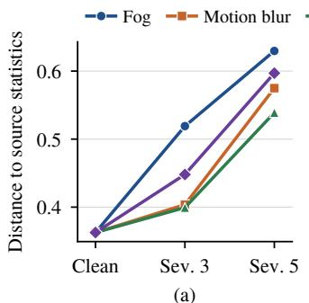

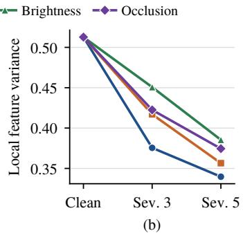  
Fig. 1. Statistics of the collaborator’s BEV features versus the severity of its camera corruption (AttFuse, OPV2V test, ego clean). (a) Mean normalized distance to the source statistics. (b) Mean local variance. Both change monotonically for all corruption types.

## IV. EMPIRICAL ANALYSIS

Before introducing the method, we examine what goes wrong when only a collaborator is corrupted and why the obvious remedies do not fix it. All experiments in this section use the public camera AttFuse checkpoint of HEAL [4] on the OPV2V test split; the setup is detailed in Section VI-A.

## A. A Corrupted Collaborator Can Be Worse Than None

Table II lists the AP@0.5 of cooperative detection when only the collaborators’ cameras are corrupted (column “No adapt.”) and when the collaborators are discarded (“Ego only”). With clean collaborators, the model reaches 56.81 AP@0.5. Under severity-5 fog and motion blur, cooperation drops to 37.25 and 36.48, below the 38.31 of the ego alone. For the other six settings cooperation still helps, but the gain over the ego alone shrinks from 18.50 points with clean collaborators to between 0.54 and 14.69 points. The attention fusion therefore absorbs part of the damage but not all of it.

## B. Corruption Shifts the Collaborator’s Feature Statistics

We measure, on every BEV cell covered by a collaborator’s cameras, two statistics of the collaborator’s pre-fusion feature $F _ { i } \mathbf { : }$ : the normalized distance to per-cell source statistics computed on clean training frames, and the local variance in a $3 \times 3$ neighborhood across all channels. Fig. 1 shows their means over the 3,445 collaborator instances of the test split. For all four corruptions, the distance to the source statistics increases monotonically with the severity (from 0.36 on clean data to between 0.54 and 0.63 at severity 5), and the local variance decreases monotonically (from 0.51 to between 0.34 and 0.39). The corruption thus appears as a systematic change of the first- and second-order statistics of the collaborator’s features, which is precisely what normalization layers control.

## C. Why Not Gate Corrupted Regions?

Since the shift is visible per BEV cell, a natural idea is to suppress the cells of the collaborator that deviate most from the source statistics before fusion. We score each covered cell by the distance above and set the top-k% cells to zero, which is a value the fusion module has seen during training for cells outside the cameras’ view. Table II reports the result. The score does locate the cells whose features changed most: its AUROC against a reference label obtained from the paired clean frame is between 0.65 and 0.84. Yet gating by this score is worse than gating random cells of the same number in all 24 combinations of setting and k, and in only three of them, all under fog, is it better than both no gating and discarding the collaborator, by at most 0.24 points. Even oracle gating, which removes the cells that changed most according to the clean reference, improves over the better of no gating and ego-only by at most 2.31 points. Removing features cannot restore information, and cells whose statistics shifted most are not necessarily harmful to detection. This motivates repairing the collaborator’s features as a whole rather than masking them locally.

GATING COLUMNS REPORT THE BEST OF k ∈ {10, 30, 50}%.  
TABLE II  
REGION-LEVEL GATING OF THE COLLABORATOR (ATTFUSE, OPV2V, AP@0.5). ONLY THE COLLABORATORS’ CAMERAS ARE CORRUPTED. AUROC: LOCALIZATION OF SHIFTED CELLS BY THE GATING SCORE.  
UNDERLINED: COOPERATION BELOW EGO-ONLY. ORACLE USES THEPAIRED CLEAN FRAME AND IS NOT A FEASIBLE METHOD.
<table><tr><td>Corruption</td><td>Sev. AUROC</td><td></td><td> $\mathrm { N o }$  adapt.</td><td> $\mathrm { E g o }$  only</td><td>Score gating</td><td>Random gating</td><td>Oracle gating</td></tr><tr><td>Fog</td><td>3</td><td>0.719</td><td>38.85</td><td>38.31</td><td>39.09</td><td>39.50</td><td>41.16</td></tr><tr><td>Fog</td><td>5</td><td>0.743</td><td>37.25</td><td>38.31</td><td>38.45</td><td>38.80</td><td>40.02</td></tr><tr><td>Motion blur</td><td>3</td><td>0.708</td><td>42.53</td><td>38.31</td><td>40.36</td><td>42.06</td><td>44.16</td></tr><tr><td>Motion blur</td><td>5</td><td>0.752</td><td>36.48</td><td>38.31</td><td>38.14</td><td>38.25</td><td>39.91</td></tr><tr><td>Brightness</td><td>3</td><td>0.650</td><td>53.00</td><td>38.31</td><td>44.35</td><td>50.78</td><td>51.78</td></tr><tr><td>Brightness</td><td>5</td><td>0.719</td><td>42.37</td><td>38.31</td><td>41.01</td><td>41.69</td><td>42.28</td></tr><tr><td>Occlusion</td><td>3</td><td>0.777</td><td>46.99</td><td>38.31</td><td>42.42</td><td>45.83</td><td>47.56</td></tr><tr><td>Occlusion</td><td>5</td><td>0.835</td><td>39.92</td><td>38.31</td><td>39.16</td><td>39.65</td><td>40.36</td></tr></table>

## D. A Tent-Style Entropy Baseline

We next adapt the BN affine parameters online with a Tentstyle objective [9]: the binary entropy of the anchors whose confidence exceeds a threshold is minimized, with one frame per step and Adam as the optimizer. Unlike the original Tent, the BN statistics stay at their source values, so only the affine parameters are adapted. We consider updating all BN layers and updating only a separate copy of the encoder used for the collaborators. Under severity-5 fog, AP@0.5 drops from 37.25 to 1.59 when all BN layers are updated and to 3.94 when only the collaborator’s encoder is updated (learning rate $1 0 ^ { - 4 }$ , threshold 0.2); fog, motion blur and brightness behave the same, with AP@0.5 between 0.17 and 4.54 in all twelve runs at this threshold (two learning rates, $1 0 ^ { - 4 }$ and $1 0 ^ { - 3 }$ ). The collapse goes in either direction depending on the threshold. At threshold 0.2, entropy minimization pushes the many lowconfidence anchors towards zero until no anchor exceeds the threshold. At threshold 0.5 (tested under fog), it pushes them towards one, and the all-BN model outputs on average 12,208 anchors per frame above 0.5, reaching 0.17 AP@0.5. The run that adapts only the collaborator’s encoder shows that a failure of the collaborator’s adaptation is passed to the ego through fusion: the ego’s own path is untouched, yet the fused output collapses. We do not claim that no gradient-based method can work here: we tested this objective with two thresholds, two learning rates and one seed, and did not test sample selection [30] or periodic resets. The failure shows that a plain entropy objective on the dense binary map is unreliable in this setting, which motivates a method that is stable by construction.

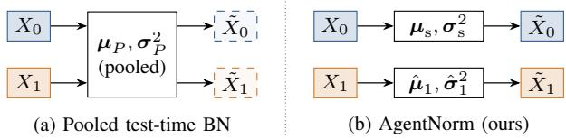  
Fig. 2. One BN layer of the per-agent encoder with a clean ego $( X _ { 0 } ,$ blue) and a corrupted collaborator $( X _ { 1 } .$ , orange). (a) Pooled test-time BN normalizes both agents with the mixture statistics $( \mu _ { P } , \sigma _ { P } ^ { 2 } )$ , which shifts the clean ego (dashed) and under-corrects the collaborator. (b) AgentNorm keeps the ego on the source statistics (ego anchoring) and normalizes the collaborator with the statistics of its own current observation (agent-wise statistics).

## V. AGENT-WISE TEST-TIME NORMALIZATION

Section IV showed that collaborator corruption shifts the first- and second-order statistics of the collaborator’s features, that removing features locally does not help, and that gradientbased adaptation is unstable. AgentNorm corrects the statistics of each collaborator in closed form inside the existing BN layers. Fig. 2 contrasts it with pooled test-time BN. We first show why pooling is the wrong estimator under agent-specific shift (Section V-A) and then describe the two components of AgentNorm: agent-wise statistics (Section V-B) and ego anchoring (Section V-C).

## A. Pooled Test-Time Normalization Is Mis-Specified

Test-time BN [11] replaces $( \mu _ { \mathrm { s } } , \sigma _ { \mathrm { s } } ^ { 2 } )$ in (3) by the statistics of the current test batch. In a cooperative model, the batch of a BN layer is $X = [ X _ { 0 } ; \ldots ; X _ { N - 1 } ]$ when the encoder runs all agents of a frame together, as simulators and the RCP-Bench baseline do. Let $\pmb { \mu } _ { i }$ and $\pmb { \sigma } _ { i } ^ { 2 }$ be the channel-wise mean and variance of the slice $X _ { i } ,$ , and $\pi _ { i }$ its share of the elements of X. The pooled statistics are

$$
\pmb { \mu } _ { P } = \sum _ { i } \pi _ { i } \pmb { \mu } _ { i } ,\tag{4}
$$

$$
{ \pmb \sigma } _ { P } ^ { 2 } = \sum _ { i } \pi _ { i } { \pmb \sigma } _ { i } ^ { 2 } + \sum _ { i } \pi _ { i } ( { \pmb \mu } _ { i } - { \pmb \mu } _ { P } ) ^ { 2 } .\tag{5}
$$

Normalizing agent $j$ with them gives

$$
\frac { x - \pmb { \mu } _ { P } } { \pmb { \sigma } _ { P } } = \frac { \pmb { \sigma } _ { j } } { \pmb { \sigma } _ { P } } z _ { j } + \frac { \pmb { \mu } _ { j } - \pmb { \mu } _ { P } } { \pmb { \sigma } _ { P } } , \qquad z _ { j } = \frac { x - \pmb { \mu } _ { j } } { \pmb { \sigma } _ { j } } ,\tag{6}
$$

so every agent keeps a residual offset $( \pmb { \mu } _ { j } - \pmb { \mu } _ { P } ) / \pmb { \sigma } _ { P }$ and a scale error ${ \sigma } _ { j } / { \sigma } _ { P }$ unless all agents share the same statistics. Note that i) the clean ego is affected as well: with one collaborator and equal shares, the ego is offset by $( \pmb { \mu } _ { 0 } - \pmb { \mu } _ { 1 } ) / ( 2 \pmb { \sigma } _ { P } )$ half of the collaborator’s deviation; ii) the between-agent term in (5) inflates $\sigma _ { P }$ , so the collaborator’s features are also shrunk; and iii) when all agents undergo the same shift, $\pmb { \mu } _ { i } = \pmb { \mu } _ { P }$ and the residuals vanish, so pooling becomes the right estimator. Point iii) predicts that the advantage of peragent statistics should disappear when the shift is shared, which we verify in Section VI-G.

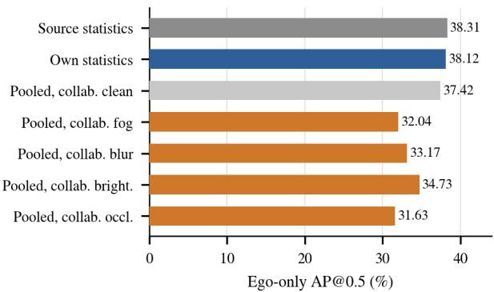  
(a) Clean ego, detected from its own feature

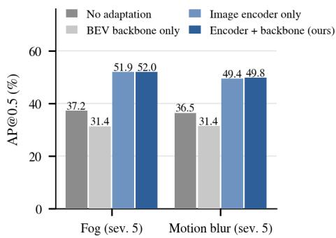  
(b) Where agent-wise statistics are applied  
Fig. 3. Mechanism analysis on AttFuse (OPV2V, severity 5). (a) AP@0.5 of the clean ego detected from its own feature alone, under source statistics, its own statistics, and statistics pooled with a clean or corrupted collaborator. Pooling with a corrupted collaborator lowers the ego’s own detection by 3.58–6.68 points (b) AP@0.5 of cooperative detection when agent-wise statistics are applied only in the BEV backbone, only in the image encoder, or in both (AgentNorm).

Pooling contaminates the clean ego. Point i) can be measured directly. We run AttFuse with a clean ego and severity-5 corrupted collaborators, apply a given normalization, and then detect from the ego’s own feature alone, discarding the collaborators before fusion. Any change in this ego-only accuracy can only come from the normalization of the ego’s features. Fig. 3(a) shows the result. With source statistics, the ego alone reaches 38.31 AP@0.5, and with statistics computed from its own clean images it reaches 38.12. Once the ego shares pooled statistics with a corrupted collaborator, its own detection falls to 32.04 (fog), 33.17 (motion blur), 34.73 (brightness) and 31.63 (occlusion), that is, by 3.58 to 6.68 points, although its cameras are untouched. Pooling with a clean collaborator costs only 0.89 points. The corrupted collaborator therefore degrades the ego twice: through its own shifted features in fusion, and through the ego’s normalization.

Fig. 4 illustrates these effects on an OPV2V test frame whose collaborator is under severity-5 fog. Fog lowers the magnitude of the collaborator’s BEV feature (Fig. 4(b); map average 0.090 versus 0.100 with clean input in (a)), consistent with the variance reduction in Fig. 1(b). Agent-wise statistics restore the magnitude (0.104) and the spatial structure seen with the clean input (c). Pooled statistics, in contrast, change the features of the clean ego over the whole map (d), as predicted by point i). Under AgentNorm the ego keeps its source statistics, and the measured change of its features averages $7 . 3 \times 1 0 ^ { - 5 }$ , about 220 times smaller than the 0.016 under Pooled BN and attributable to floating-point differences of batched computation.

## B. Agent-Wise Statistics

AgentNorm estimates the statistics of each collaborator from its own slice. For every BN layer of $E _ { \theta }$ and every collaborator $i \geq 1$

$$
\hat { \pmb { \mu } } _ { i } = \frac { 1 } { | X _ { i } | } \sum _ { x \in X _ { i } } \ b { x } , \qquad \hat { \pmb { \sigma } } _ { i } ^ { 2 } = \frac { 1 } { | X _ { i } | } \sum _ { x \in X _ { i } } ( \pmb { x } - \hat { \pmb { \mu } } _ { i } ) ^ { 2 } ,\tag{7}
$$

where the sums run over the batch and spatial positions of the slice, separately for each channel. The collaborator’s slice is then normalized as $\mathrm { B N } ( x ; \hat { \pmb { \mu } } _ { i } , \hat { \pmb { \sigma } } _ { i } ^ { 2 } )$ with the original γ and β. In the image backbone, $X _ { i }$ holds the C camera images of agent i, so the statistics are pooled over the views of one agent, which share the same corruption. In the BEV backbone, $X _ { i }$ is the agent’s BEV map and the statistics are taken over its spatial positions. Layers whose input cannot be split into per-agent slices keep the source statistics.

We use the statistics of the current frame rather than a running average over the test stream for two reasons. First, the set of collaborators and their conditions change from frame to frame, and a running average would carry statistics of one collaborator over to another. Second, frame-wise statistics make the output of a frame independent of the frames processed before it, so the method has no state that can drift. Section VI-G compares the two choices.

## C. Ego Anchoring

For the ego, AgentNorm keeps the source statistics, $\mathrm { B N } ( x ; \mu _ { \mathrm { s } } , \sigma _ { \mathrm { s } } ^ { 2 } )$ . Under the setting of Section III the ego’s input follows $P _ { \mathrm { s } } ,$ so the source statistics are the correct ones, and the ego’s own features are then exactly those of the pre-trained model. This guarantees that the adaptation of collaborators cannot alter the ego’s own evidence, which is the failure mode observed for Tent in Section IV. When the ego itself may be corrupted, the ego can use its own statistics as well; we call this the symmetric variant and evaluate it in Section VI-G.

## D. Properties and Deployment

Algorithm 1 summarizes the procedure. AgentNorm has no learnable parameters and performs no backward pass, so it cannot diverge in the way observed for entropy minimization. It requires no labels, no source data and no information about the corruption. The per-agent mean and variance in (7) are the same quantities that a BN layer computes in training mode, so the overhead is a few reductions per layer and no additional memory. Because each slice $X _ { i }$ belongs to one agent, the computation for collaborator i can run on that agent’s own processor before transmission: the collaborator simply switches its encoder’s BN layers to its own statistics, the transmitted feature keeps its shape and size, and the ego needs no extra message. The same module wraps any intermediate-fusion model whose per-agent encoder uses BN, without changing its weights.

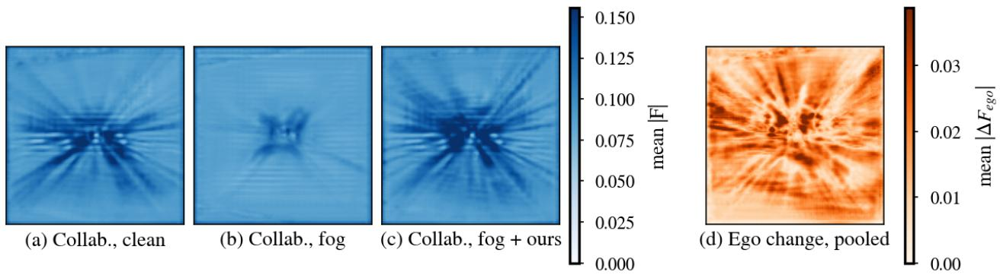  
Fig. 4. BEV features on an OPV2V test frame (AttFuse) with the collaborator under severity-5 fog and a clean ego. (a)–(c) Channel-averaged magnitude of the collaborator’s feature with clean cameras, with fog, and with fog after AgentNorm. (d) Channel-averaged absolute change of the ego’s feature relative to the source model under Pooled BN. Under AgentNorm the same change averages $7 . 3 \times \mathrm { 1 0 ^ { - 5 } }$ (floating-point level, against 0.016 for Pooled BN) because the ego keeps its source statistics, so it is not plotted.

Algorithm 1 AgentNorm for one frame   
Require: pre-trained encoder $E _ { \theta }$ with source statistics   
$( \mu _ { \mathrm { s } } , \sigma _ { \mathrm { s } } ^ { 2 } )$ in every BN layer; images $\{ \mathcal { I } _ { i } \} _ { i = 0 } ^ { N - 1 }$   
1: run $E _ { \theta }$ on all agents, with every BN layer computed as   
follows:   
2: for each BN layer of $E _ { \theta }$ with input $X = [ X _ { 0 } ; \ldots ; X _ { N - 1 } ]$   
do   
3: $\tilde { X } _ { 0 } \gets \mathrm { B N } ( X _ { 0 } ; \mu _ { \mathrm { s } } , \pmb { \sigma } _ { \mathrm { s } } ^ { 2 } )$ (ego anchoring)   
4: for $i = 1$ to $N - 1$ do   
5: compute $( \hat { \mu } _ { i } , \hat { \sigma } _ { i } ^ { 2 } )$ on $X _ { i }$ by (7)   
6: $\tilde { X } _ { i } \gets \mathrm { B N } ( \bar { X } _ { i } ; \hat { \pmb { \mu } } _ { i } , \hat { \pmb { \sigma } } _ { i } ^ { 2 } )$ (agent-wise statistics)   
7: end for   
8: end for   
9: collect $F _ { i }$ from the encoder; $\hat { Y } \left. H ( \Phi ( F _ { 0 } , \{ { \mathcal { T } } _ { i \right. 0 } ( F _ { i } ) \} ) )$   
Ensure: detections ${ \hat { Y } } ;$ no parameter or statistic is stored

## VI. EXPERIMENTS

## A. Experimental Setup

Datasets and models. Our main benchmark is the camera track of OPV2V [1], a simulated vehicle-to-vehicle dataset in which every vehicle carries four cameras. We use the full test split of 2,170 frames, 2,051 of which contain at least one collaborator. We evaluate four public camera checkpoints released with HEAL [4]: AttFuse [1], V2X-ViT [2], DiscoNet [16], and a checkpoint released under the F-Cooper name whose configuration uses attention fusion. We denote the last one AttFuse-B and treat it as a second, independently trained attention-fusion model rather than as evidence about max-pooling fusion. All four share a Lift-Splat-Shoot encoder with an EfficientNet-B0 image backbone, so their BN layers are all in the per-agent encoder. To test real-world data, we use the cooperative part of DAIR-V2X-C [13], in which a vehicle cooperates with a roadside unit, each with one camera. No camera checkpoint is released for it, so we trained the cameraonly CoAlign [39] configuration of HEAL for 30 epochs and kept the epoch with the best validation loss; evaluation uses the 1,789 validation frames.

Corruptions. Following RCP-Bench [5], we apply image corruptions from the common-corruption suite [20] to the cameras of the collaborators only; the ego’s cameras stay clean unless stated otherwise. On OPV2V we use fog, motion blur and brightness, and an occlusion corruption that pastes a black rectangle at a random position covering one quarter (severity 3) or one half (severity 5) of each image. On DAIR-V2X-C we corrupt the roadside camera with fog, snow, frost, brightness and motion blur. All corruptions are applied at severities 3 and 5, and the random seed of each image is fixed by the frame, agent, camera, corruption type and severity, so every method sees identical inputs. Fig. 5 shows one camera image under each corruption at severity 5.

Metrics. We report average precision at IoU thresholds 0.5 and 0.7 (AP@0.5 and AP@0.7, in %) computed with the HEAL evaluation code within ±51.2 m of the ego on OPV2V and ±102.4 m on DAIR-V2X-C. Differences in AP are given in points. Our evaluation of the clean AttFuse checkpoint gives 56.81 AP@0.5, whereas the evaluation file distributed with the checkpoint reports 52.91; we therefore compare only numbers produced by our own pipeline and never mix them with published values.

Compared methods. No adaptation runs the source model. Ego only discards all collaborators. Pooled BN uses test-batch statistics over all agents of a frame, the test-time baseline of RCP-Bench [5]. Feature-statistics alignment updates the collaborator’s BN affine parameters online so that the perchannel mean and standard deviation of its lifted and pre fusion BEV features match those of clean training frames, in the spirit of ActMAD [35]. Tent-style entropy minimization [9] and region gating are described in Section IV. As a reference that is not a valid test-time method, the oracle trains the collaborator’s BN affine parameters online with the detection loss on the ground-truth labels of each frame.

Implementation details. AgentNorm and Pooled BN are inference-time changes of the BN layers and use the released weights unchanged. On OPV2V, the ego and the collaborators are encoded by two copies of the encoder with identical weights: the ego copy keeps the source statistics, and the collaborator copy normalizes the collaborators of a frame with their own statistics. When a frame has several collaborators, they are normalized as one group; since all collaborators of a frame receive the same corruption in our protocol, this matches the per-agent computation in that case. On DAIR-V2X-C, where there is a single collaborator, we use a generic module that replaces every BN layer of the model and splits its input by agent. No adaptation, Pooled BN and AgentNorm are deterministic and independent of the frame order, so each is evaluated once. The gradient-based methods use seed 0 for the frame order. All experiments run on a single NVIDIA RTX 3090 GPU.

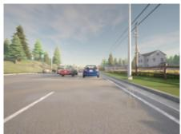  
(a) Clean

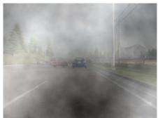  
(b) Fog

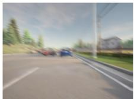  
(c) Motion blur

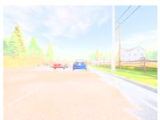  
(d) Brightness

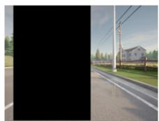  
(e) Occlusion  
Fig. 5. One collaborator camera image of OPV2V under the four corruptions at severity 5. Only the collaborators’ cameras are corrupted; the ego’s cameras stay clean.

TABLE III  
COLLABORATOR-ONLY CORRUPTION AT SEVERITY 5 ON OPV2V(CAMERA). AP@0.5 AND AP@0.7 IN %. ∆: AGENTNORM MINUSPOOLED BN IN AP@0.5 POINTS. BEST PER ROW IN BOLD.
<table><tr><td rowspan="2"></td><td rowspan="2">Corruption</td><td colspan="4">AP@0.5</td><td colspan="3">AP@0.7</td></tr><tr><td>No adapt.</td><td>Pooled BN</td><td>Ours</td><td>∆</td><td>No adapt.</td><td>Pooled BN</td><td>Ours</td></tr><tr><td rowspan="4">AttFuse</td><td>Fog</td><td>37.25</td><td>40.65</td><td>51.98</td><td>+11.34</td><td>19.04</td><td>18.08</td><td>24.35</td></tr><tr><td>Motion blur</td><td>36.48</td><td>42.90</td><td>49.83</td><td>+6.93</td><td>18.59</td><td>18.94</td><td>22.88</td></tr><tr><td>Brightness</td><td>42.37</td><td>53.87</td><td>55.59</td><td>+1.72</td><td>21.46</td><td>23.47</td><td>25.70</td></tr><tr><td>Occlusion</td><td>39.92</td><td>35.17</td><td>35.63</td><td>+0.46</td><td>19.87</td><td>14.83</td><td>17.95</td></tr><tr><td rowspan="4">V2X-ViT</td><td>Fog</td><td>29.69</td><td>45.92</td><td>58.86</td><td>+12.94</td><td>13.14</td><td>20.16</td><td>27.98</td></tr><tr><td>Motion blur</td><td>33.51</td><td>46.36</td><td>55.45</td><td>+9.10</td><td>15.32</td><td>21.01</td><td>26.61</td></tr><tr><td>Brightness</td><td>53.75</td><td>63.75</td><td>62.93</td><td>-0.82</td><td>25.43</td><td>30.01</td><td>29.90</td></tr><tr><td>Occlusion</td><td>32.86</td><td>37.85</td><td>37.51</td><td>-0.34</td><td>15.25</td><td>15.21</td><td>18.22</td></tr><tr><td rowspan="4">DiscoNet</td><td>Fog</td><td>33.33</td><td>43.73</td><td>51.57</td><td>+7.85</td><td>15.11</td><td>20.80</td><td>23.63</td></tr><tr><td>Motion blur</td><td>31.56</td><td>42.89</td><td>48.42</td><td>+5.53</td><td>14.84</td><td>19.47</td><td>21.18</td></tr><tr><td>Brightness</td><td>44.11</td><td>56.43</td><td>54.03</td><td>-2.40</td><td>19.21</td><td>25.95</td><td>25.16</td></tr><tr><td>Occlusion</td><td>35.30</td><td>37.52</td><td>33.55</td><td>-3.96</td><td>15.59</td><td>16.79</td><td>15.27</td></tr><tr><td rowspan="4">AttFuse-B</td><td>Fog</td><td>29.42</td><td>30.79</td><td>43.32</td><td>+12.53</td><td>14.98</td><td>10.64</td><td>19.09</td></tr><tr><td>Motion blur</td><td>31.31</td><td>32.36</td><td>42.80</td><td>+10.45</td><td>15.13</td><td>10.93</td><td>18.07</td></tr><tr><td>Brightness</td><td>38.92</td><td>45.54</td><td>48.01</td><td>+2.47</td><td>18.07</td><td>16.85</td><td>20.89</td></tr><tr><td>Occlusion</td><td>33.71</td><td>19.24</td><td>27.93</td><td>+8.69</td><td>15.58</td><td>7.72</td><td>13.10</td></tr></table>

## B. Main Results

Table III reports the four checkpoints under the four corruptions at severity 5. Three patterns emerge.

Fog and motion blur. AgentNorm is best on all eight combinations of checkpoint and corruption, by 5.53 to 12.94 AP@0.5 points over Pooled BN and by 11.50 to 29.17 points over no adaptation. The largest gain is on V2X-ViT under fog, where AgentNorm raises AP@0.5 from 29.69 to 58.86 while Pooled BN reaches 45.92. On AttFuse-B, pooling barely helps AP@0.5 (30.79 versus 29.42 under fog) and lowers AP@0.7 from 14.98 to 10.64, whereas AgentNorm reaches 43.32 and 19.09. This is the behavior predicted by (6): the pooled statistics move the clean ego and under-correct the collaborator.

Brightness. AgentNorm improves over no adaptation by 9.09 to 13.22 AP@0.5 points, and AgentNorm and Pooled BN are within 2.47 points of each other, each winning on two checkpoints. Brightness shifts the collaborator’s feature statistics less than fog (Fig. 1(a)), so the mixture in (4)–(5) is closer to the collaborator’s own statistics.

Occlusion. Neither method is reliable. AgentNorm is below no adaptation on three of the four checkpoints, and Pooled BN on two. A black rectangle removes image content instead of changing its statistics, and normalization cannot restore missing content. We return to this case in Section VII.

Averaged over fog, motion blur and brightness, AgentNorm reaches 52.47, 59.08, 51.34 and 44.71 AP@0.5 on AttFuse, V2X-ViT, DiscoNet and AttFuse-B, compared with 45.81, 52.01, 47.68 and 36.23 for Pooled BN and 38.70, 38.98, 36.33 and 33.22 without adaptation. On AttFuse under fog, the oracle that adapts the collaborator with ground-truth supervision reaches 57.13 AP@0.5; AgentNorm closes 74% of the gap between no adaptation (37.25) and this oracle without using any label.

Clean collaborators. Applying AgentNorm when nothing is corrupted does not reduce accuracy relative to the source model: AP@0.5 changes from 56.81 to 57.85 on AttFuse and from 66.46 to 68.50 on V2X-ViT (the latter source value is the run of Section VI-G in which the switching rule never triggers, which is identical to no adaptation). Pooled BN is higher on clean data (59.17 and 71.12), and also on DiscoNet and AttFuse-B (60.68 versus 57.17, and 51.00 versus 50.27). We discuss this in Section VII.

## C. Robustness to Corruption Severity

Fig. 6 sweeps the severity on AttFuse. From clean collaborators to severity 5, AP@0.5 falls by 19.56 points under fog without adaptation and by 18.52 points with Pooled BN, but by 5.87 points with AgentNorm. Under motion blur, the drops are 20.33, 16.27 and 8.02 points. Without adaptation, cooperation falls below the ego-only model at severity 5 for both corruptions, while AgentNorm stays more than 11 points above it. Under brightness, AgentNorm and Pooled BN remain close at both severities.

## D. Real-World Data

Table IV reports DAIR-V2X-C with the roadside camera corrupted. The absolute accuracy of camera-only detection on this dataset is low for the model we trained (10.83 AP@0.5 with clean inputs and 1.65 for the vehicle alone), so the results should be read as a check of direction rather than of magnitude. The direction agrees with OPV2V: AgentNorm is above Pooled BN in all ten corrupted settings and above no adaptation in nine of them, the exception being motion blur at severity 3 (8.93 versus 8.97). Under fog, snow and frost at severity 5, roadside corruption pulls cooperative detection to 1.16–1.50 AP@0.5, below the vehicle-only model, and Agent-Norm restores it to 5.17–5.88. With clean inputs, AgentNorm is 0.85 points below the source model and 1.12 points above Pooled BN.

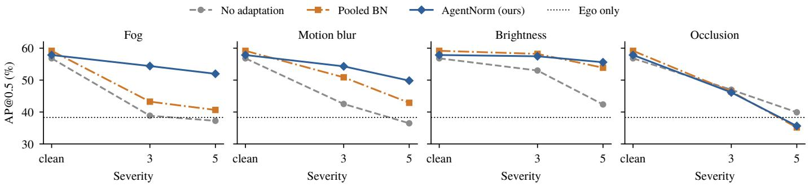  
Fig. 6. AP@0.5 of AttFuse on OPV2V as the severity of the collaborator’s corruption increases (ego clean). The dotted line is the ego-only model. Under fog and motion blur, AgentNorm degrades much more slowly than Pooled BN and stays above the ego-only model; under occlusion, no method helps.

TABLE IV  
ROADSIDE-ONLY CORRUPTION ON DAIR-V2X-C (CAMERA COALIGN,AP@0.5 IN %). FOR EACH SEVERITY: NO ADAPTATION / POOLED BN /AGENTNORM. BEST PER SEVERITY IN BOLD. THE VEHICLE-ONLY MODELREACHES 1.65.
<table><tr><td></td><td colspan="3">Severity 3</td><td colspan="3">Severity 5</td></tr><tr><td>Corruption</td><td>None</td><td>Pooled</td><td>Ours</td><td>None</td><td>Pooled</td><td>Ours</td></tr><tr><td>Fog</td><td>1.65</td><td>2.78</td><td>6.75</td><td>1.50</td><td>2.07</td><td>5.88</td></tr><tr><td>Snow</td><td>1.57</td><td>4.82</td><td>7.35</td><td>1.16</td><td>2.44</td><td>5.17</td></tr><tr><td>Frost</td><td>1.41</td><td>3.42</td><td>6.00</td><td>1.30</td><td>2.71</td><td>5.40</td></tr><tr><td>Brightness</td><td>5.61</td><td>7.25</td><td>8.82</td><td>1.17</td><td>3.79</td><td>6.08</td></tr><tr><td>Motion blur</td><td>8.97</td><td>7.55</td><td>8.93</td><td>6.86</td><td>6.01</td><td>7.46</td></tr></table>

Clean 10.83 / 8.86 / 9.98 (no adapt. / pooled / ours)

## E. Comparison with Alternative Remedies

Fig. 7 places AgentNorm among the remedies discussed so far on the hardest AttFuse setting. Discarding the collaborator, region gating and feature-statistics alignment stay within 1.2 points of no adaptation, the Tent-style baseline collapses, and Pooled BN gains 3.40 points. AgentNorm gains 14.73 points, and only the label-supervised oracle is higher. Featurestatistics alignment uses the same signal as AgentNorm, the mismatch between test and source statistics, but tries to remove it by gradient steps on a shared affine transform; AgentNorm removes it directly by renormalizing each agent.

## F. Qualitative Results

Fig. 8 shows the detections of the three methods on one test frame in which both collaborators are under severity-5 fog.

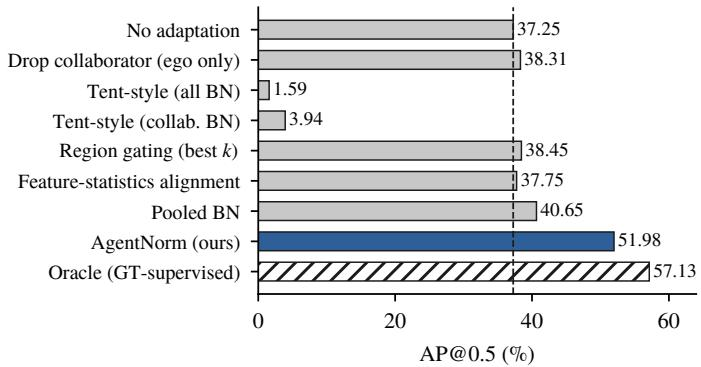  
Fig. 7. Remedies for a corrupted collaborator (AttFuse, OPV2V, collaborator fog at severity 5). The dashed line marks no adaptation. The oracle uses ground-truth labels and is shown only as a reference.

Since a camera-only detector has no natural BEV background, we draw the LiDAR scan that OPV2V provides for the same frame as a map of the scene; it is not an input to any of the compared models. Without adaptation, the model detects 6 of the 21 objects at IoU 0.5, and several of its predictions are displaced from the ground truth. Pooled BN detects 8. AgentNorm detects 13, and most of its remaining misses lie on the right side of the scene. This frame was chosen as the most favorable of 115 candidate frames (every 18th test frame), so it shows the best case rather than the typical one. Over all 115 candidates, the three methods detect 555, 621 and 747 of 1,390 objects at IoU 0.5 (39.9%, 44.7% and 53.7%), and AgentNorm detects more objects than no adaptation in 84 frames and fewer in 8.

## G. Ablation and Analysis

Is ego anchoring necessary? Table V compares Agent-Norm with the symmetric variant, in which the ego also uses its own statistics. The symmetric variant is 0.86 to 1.43 AP@0.5 points higher on all five columns, but AgentNorm is 0.47 to 0.80 AP@0.7 points higher on all five. Both are far above Pooled BN under fog and motion blur. The choice is therefore a trade-off between recall at loose overlap and localization quality, not a large effect; we keep ego anchoring as the default because it leaves the ego’s own features identical to the source model, which is the property that protects the ego from a failing collaborator (Section IV).

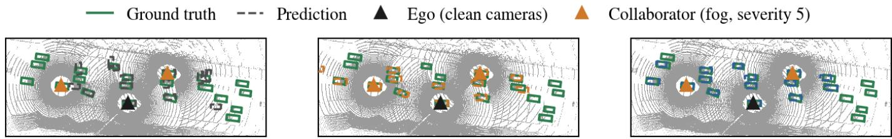  
Fig. 8. Detections on an OPV2V test frame (AttFuse) with two collaborators (orange triangles) under severity-5 fog and a clean ego (black triangle). From left to right: no adaptation, Pooled BN and AgentNorm. Solid green boxes: ground truth; dashed boxes: predictions. Gray points are the LiDAR scan provided by OPV2V, drawn only to show the road layout and the agents’ surroundings; no model in this paper uses LiDAR. True positives at IoU 0.5: 6, 8 and 13 of 21 objects. The frame was selected as the one with the largest gain of AgentNorm over no adaptation among 115 candidate frames (every 18th test frame); statistics over all candidates are given in the text.

TABLE V  
ABLATION ON ATTFUSE (OPV2V). ONLY THE COLLABORATORS ARE CORRUPTED (SEVERITY 5) OR NOTHING IS CORRUPTED (CLEAN). ENTRIES ARE AP@0.5 / AP@0.7 IN %. †USES GROUND-TRUTH LABELS; REFERENCE ONLY.
<table><tr><td>Variant</td><td>Fog</td><td>Motion blur</td><td>Brightness</td><td>Occlusion</td><td>Clean</td></tr><tr><td>No adaptation</td><td>37.25 /  19.04</td><td>36.48 /  18.59</td><td>42.37 /  21.46</td><td>39.92 /  19.87</td><td>56.81 / 27.03</td></tr><tr><td>Pooled BN</td><td>40.65 /  18.08</td><td>42.90 /  18.94</td><td>53.87 / 23.47</td><td>35.17 /  14.83</td><td>59.17 / 27.25</td></tr><tr><td>Agent-wise, symmetric</td><td>53.11 / 23.55</td><td>50.69 / 22.24</td><td>56.60 / 25.20</td><td>37.06 /  17.48</td><td>58.76 / 26.69</td></tr><tr><td>Agent-wise, ego-anchored (AgentNorm)</td><td>51.98 / 24.35</td><td>49.83 / 22.88</td><td>55.59 / 25.70</td><td>35.63 / 17.95</td><td>57.85 / 27.18</td></tr><tr><td>AgentNorm, EMA statistics (m=0.05)</td><td>51.12 / 24.17</td><td></td><td></td><td>1</td><td></td></tr><tr><td>Oracle: GT-supervised collab. BN†</td><td>57.13 / 26.75</td><td></td><td></td><td>1</td><td></td></tr></table>

Where should agent-wise statistics be applied? The peragent encoder has BN layers in the image backbone and in the BEV backbone. Fig. 3(b) applies agent-wise statistics to only one of them. Applying them only in the image encoder gives 51.92 AP@0.5 under fog and 49.39 under motion blur, within 0.44 points of applying them everywhere (51.98 and 49.83). Applying them only in the BEV backbone gives 31.37 and 31.43, which is 5.88 and 5.05 points below no adaptation. The gain thus comes from the image encoder, where the corruption acts on image appearance; renormalizing only the BEV features, which are computed from images that were normalized with mismatched statistics, does not correct the shift and makes the features worse.

Frame-wise or running statistics? Replacing the framewise collaborator statistics by an exponential moving average over the test stream (momentum 0.05, in the style of DUA [12]) gives 51.12 AP@0.5 under fog, 0.86 points below the frame-wise version, and makes the result depend on the order of frames.

Where does the gain over pooling come from? Section V-A predicts that per-agent statistics help only when the agents’ distributions differ. Table VI tests this by corrupting the ego and the collaborators with the same corruption. Without adaptation, cooperation collapses (0.66 to 11.45 AP@0.5). Agent-wise statistics (symmetric variant) and Pooled BN now perform within 1.01 AP@0.5 points of each other on all four corruptions. Together with Table III, this shows that the advantage of AgentNorm comes from the heterogeneity of the shift across agents.

Should normalization be switched on only under shift? Since AgentNorm is applied to every collaborator, we also tested a rule that switches a collaborator to its own statistics only if the Gaussian KL divergence between its first-layer statistics and the source statistics exceeds the 99th percentile measured on clean validation frames. The rule is unreliable. Under motion blur it triggers for only 5% (AttFuse) and 4.2% (V2X-ViT) of collaborator frames, giving 36.99 and 34.13 AP@0.5 instead of 49.83 and 55.45 with AgentNorm. Under fog on V2X-ViT it triggers for 98.6% of frames and matches AgentNorm (58.89 versus 58.86). Because AgentNorm does not reduce accuracy on clean collaborators, applying it unconditionally is both simpler and more accurate than gating it with a shift detector.

TABLE VI  
EGO AND COLLABORATORS CORRUPTED WITH THE SAME CORRUPTION (ATTFUSE, OPV2V, SEVERITY 5). AP@0.5 / AP@0.7 IN %.
<table><tr><td>Corruption</td><td>No adapt.</td><td>Pooled BN</td><td>Agent-wise (sym.)</td></tr><tr><td>Fog</td><td>2.44 / 1.63</td><td>41.74 / 15.39</td><td>41.71 /  15.54</td></tr><tr><td>Motion blur</td><td>0.66 / 0.33</td><td>32.50 / 10.31</td><td>33.34 / 10.11</td></tr><tr><td>Brightness</td><td>11.45 / 5.26</td><td>47.98 / 20.12</td><td>46.97  /  19.16</td></tr><tr><td>Occlusion</td><td>2.31  / 0.83</td><td>6.25 / 3.00</td><td>6.07 / 3.11</td></tr></table>

TABLE VII

PER-FRAME LATENCY (MS) AND PEAK GPU MEMORY (MB) OF ATTFUSE ON OPV2V, COLLABORATOR FOG AT SEVERITY 5, INCLUDING POST-PROCESSING. 200 FRAMES, THE FIRST 20 DISCARDED, ONE RTX 3090.
<table><tr><td>Method</td><td>Mean</td><td>Median</td><td>P95</td><td>Memory</td></tr><tr><td>No adaptation</td><td>254.32</td><td>184.38</td><td>495.70</td><td>2669</td></tr><tr><td>No adaptation (repeat)</td><td>255.19</td><td>185.33</td><td>496.40</td><td>2669</td></tr><tr><td>Pooled BN</td><td>255.28</td><td>184.73</td><td>497.33</td><td>2669</td></tr><tr><td>AgentNorm (ours)</td><td>256.65</td><td>186.16</td><td>501.99</td><td>2669</td></tr></table>

## H. Efficiency

Table VII reports the runtime. AgentNorm adds 2.33 ms to the mean latency of 254.32 ms (0.9%), comparable to the 0.87 ms difference between two repeated runs of the unmodified model, and peak memory is unchanged. It adds no parameter, no gradient computation and no transmitted data. For comparison, the Tent-style baseline with all BN layers trainable required up to 20.2 GB of GPU memory in our runs, against 3.6 GB for the unadapted model in the same evaluation harness.

## VII. DISCUSSION AND LIMITATIONS

Content loss is not a statistics shift. AgentNorm corrects shifts in the first- and second-order statistics of a collaborator’s features. Occlusion also shifts these statistics (Fig. 1), but its main effect is that half of each image carries no information, and renormalizing the remaining features cannot recover it. On three of four checkpoints, AgentNorm is below no adaptation under occlusion at severity 5. A deployment that expects lens blockage or heavy dirt should combine AgentNorm with a mechanism that detects missing content and lowers the weight of the affected collaborator in fusion.

Homogeneous shift. When all agents undergo the same corruption, the per-agent and pooled statistics coincide in expectation, and Table VI confirms that AgentNorm then brings no gain over Pooled BN. Its benefit is specific to shifts that differ between agents, which is the common case for roadside units and for vehicles that see different weather or lighting, but not the only one.

Clean data. On clean OPV2V data, Pooled BN is 0.73 to 3.51 AP@0.5 points above AgentNorm on the four checkpoints, while AgentNorm stays at or above the source model where we measured it. One possible explanation is a mild shift between the OPV2V training and test splits that affects all agents alike, for which pooled statistics, estimated from more samples, are the better estimator. We have not verified this explanation. In practice, the choice between the two estimators would require knowing whether the shift is shared, which is exactly the information that is unavailable at test time; under the shifts we consider, the loss of AgentNorm on clean data is small compared with its gain under fog and motion blur.

Scope of the evaluation. We evaluated camera-based models only and make no claim about LiDAR encoders, whose BN statistics depend on point density and may respond differently to test-batch statistics. AgentNorm applies to encoders with BN layers, which covers the camera models of the HEAL model zoo but not encoders that use only layer or group normalization; extending it to such encoders would require a different estimator of per-agent statistics. Our real-world experiment uses a camera-only DAIR-V2X-C model with low absolute accuracy, which limits how much its numbers can say about deployed systems. We evaluated synthetic corruptions with fixed severity for whole sequences, and the per-agent statistics rely on one frame of a few images per agent; very small inputs, such as a single low-resolution camera, would give noisier statistics. Finally, the gradient-based baselines were run with a single seed. Their collapse is far larger than seed variation, but their exact values should not be overinterpreted.

## VIII. CONCLUSION

We studied camera-based cooperative perception when only some agents are corrupted. In this setting, a corrupted collaborator can pull cooperative detection below the ego-only model, region-level gating and a Tent-style entropy baseline do not help, and pooled test-time normalization mixes the statistics of clean and corrupted agents, lowering even the clean ego’s own detection by up to 6.68 AP@0.5 points; this contamination arises in the image encoder. AgentNorm normalizes each collaborator with the statistics of its own current observation and keeps the ego on its source statistics. It requires no training, gradients, labels or extra communication, adds about 2 ms per frame, and improves all four OPV2V checkpoints by large margins under fog and motion blur, with consistent gains over pooled normalization on real-world DAIR-V2X-C. It does not address occlusion-type content loss and offers no advantage when all agents share the same shift. Future work includes combining agent-wise normalization with fusion weights that account for missing content, extending it to encoders without BN, and validating it on cooperative data recorded in real adverse weather.

## REFERENCES

[1] R. Xu, H. Xiang, X. Xia, X. Han, J. Li, and J. Ma, “OPV2V: An Open Benchmark Dataset and Fusion Pipeline for Perception with Vehicle-to-Vehicle Communication,” in 2022 International Conference on Robotics and Automation (ICRA), 2022, pp. 2583–2589.

[2] R. Xu, H. Xiang, Z. Tu, X. Xia, M.-H. Yang, and J. Ma, “V2X-ViT: Vehicle-to-Everything Cooperative Perception with Vision Transformer,” in Computer Vision – ECCV 2022, 2022, pp. 107–124.

[3] Y. Hu, S. Fang, Z. Lei, Y. Zhong, and S. Chen, “Where2comm: Communication-Efficient Collaborative Perception Via Spatial Confidence Maps,” in Advances in Neural Information Processing Systems 35, 2022, pp. 4874–4886.

[4] Y. Lu, Y. Hu, Y. Zhong, D. Wang, Y. Wang, and S. Chen, “An extensible framework for open heterogeneous collaborative perception,” in The Twelfth International Conference on Learning Representations, ICLR 2024, Vienna, Austria, May 7-11, 2024, 2024.

[5] S. Du, S. Qu, T. Wang, X. Zhang, Y. Zhu, J. Mao, F. Lu, Q. Lin, and G. Chen, “RCP-Bench: Benchmarking Robustness for Collaborative Perception Under Diverse Corruptions,” in 2025 IEEE/CVF Conference on Computer Vision and Pattern Recognition (CVPR), 2025, pp. 11 908– 11 918.

[6] S. Xie, L. Kong, W. Zhang, J. Ren, L. Pan, K. Chen, and Z. Liu, “RoboBEV: Towards Robust Bird’s Eye View Perception under Corruptions,” arXiv:2304.06719, 2023.

[7] B. Li, J. Li, X. Liu, R. Xu, Z. Tu, J. Guo, Q. Zou, X. Li, and H. Yu, “V2X-DGW: Domain Generalization for Multi-Agent Perception Under Adverse Weather Conditions,” in 2025 IEEE International Conference on Robotics and Automation (ICRA), 2025, pp. 974–980.

[8] J. Zhang, Y. Wang, L. Qian, P. Sun, Z. Li, S. Jiang, M. Liu, and L. Song, “DSRC: Learning Density-Insensitive and Semantic-Aware Collaborative Representation Against Corruptions,” Proceedings of the AAAI Conference on Artificial Intelligence, vol. 39, no. 9, pp. 9942– 9950, 2025.

[9] D. Wang, E. Shelhamer, S. Liu, B. A. Olshausen, and T. Darrell, “Tent: Fully test-time adaptation by entropy minimization,” in 9th International Conference on Learning Representations, ICLR 2021, Virtual Event, Austria, May 3-7, 2021, 2021.

[10] Q. Wang, O. Fink, L. Van Gool, and D. Dai, “Continual Test-Time Domain Adaptation,” in 2022 IEEE/CVF Conference on Computer Vision and Pattern Recognition (CVPR), 2022, pp. 7191–7201.

[11] S. Schneider, E. Rusak, L. Eck, O. Bringmann, W. Brendel, and M. Bethge, “Improving robustness against common corruptions by covariate shift adaptation,” in Advances in Neural Information Processing Systems (NeurIPS), 2020.

[12] M. J. Mirza, J. Micorek, H. Possegger, and H. Bischof, “The norm must go on: Dynamic unsupervised domain adaptation by normalization,” in 2022 IEEE/CVF Conference on Computer Vision and Pattern Recognition (CVPR), 2022, pp. 14 745–14 755.

[13] H. Yu, Y. Luo, M. Shu, Y. Huo, Z. Yang, Y. Shi, Z. Guo, H. Li, X. Hu, J. Yuan, and Z. Nie, “DAIR-V2X: A Large-Scale Dataset for Vehicle-Infrastructure Cooperative 3D Object Detection,” in 2022 IEEE/CVF Conference on Computer Vision and Pattern Recognition (CVPR), 2022, pp. 21 329–21 338.

[14] R. Xu, X. Xia, J. Li, H. Li, S. Zhang, Z. Tu, Z. Meng, H. Xiang, X. Dong, R. Song, H. Yu, B. Zhou, and J. Ma, “V2V4Real: A Real-World Large-Scale Dataset for Vehicle-to-Vehicle Cooperative Perception,” in 2023 IEEE/CVF Conference on Computer Vision and Pattern Recognition (CVPR), 2023, pp. 13 712–13 722.

[15] Q. Chen, X. Ma, S. Tang, J. Guo, Q. Yang, and S. Fu, “F-Cooper: Feature based cooperative perception for autonomous vehicle edge computing system using 3D point clouds,” in Proceedings of the 4th ACM/IEEE Symposium on Edge Computing, 2019.

[16] Y. Li, S. Ren, P. Wu, S. Chen, C. Feng, and W. Zhang, “Learning distilled collaboration graph for multi-agent perception,” in Advances in Neural Information Processing Systems, vol. 34, 2021, pp. 29 541–29 552.

[17] Z. Lei, S. Ren, Y. Hu, W. Zhang, and S. Chen, “Latency-Aware Collaborative Perception,” in Computer Vision – ECCV 2022, 2022, pp. 316–332.

[18] J. Li, R. Xu, X. Liu, J. Ma, Z. Chi, J. Ma, and H. Yu, “Learning for Vehicle-to-Vehicle Cooperative Perception Under Lossy Communication,” IEEE Transactions on Intelligent Vehicles, vol. 8, no. 4, pp. 2650–2660, 2023.

[19] R. Xu, J. Li, X. Dong, H. Yu, and J. Ma, “Bridging the Domain Gap for Multi-Agent Perception,” in 2023 IEEE International Conference on Robotics and Automation (ICRA), 2023, pp. 6035–6042.

[20] D. Hendrycks and T. Dietterich, “Benchmarking neural network robustness to common corruptions and perturbations,” in Proc. International Conference on Learning Representations (ICLR), 2019.

[21] Y. Dong, C. Kang, J. Zhang, Z. Zhu, Y. Wang, X. Yang, H. Su, X. Wei, and J. Zhu, “Benchmarking Robustness of 3D Object Detection to Common Corruptions in Autonomous Driving,” in 2023 IEEE/CVF Conference on Computer Vision and Pattern Recognition (CVPR), 2023, pp. 1022–1032.

[22] M. Karvat and S. Givigi, “Adver-City: Open-Source Multi-Modal Dataset for Collaborative Perception Under Adverse Weather Conditions,” in 2025 IEEE 28th International Conference on Intelligent Transportation Systems (ITSC), 2025, pp. 740–746.

[23] G. Chen, C. Zhang, and P. Lv, “Coopdiff: A diffusion-guided approach for cooperation under corruptions,” in IEEE/CVF Conference on Computer Vision and Pattern Recognition, CVPR 2026, Denver, CO, USA, June 3-7, 2026, 2026, pp. 11 546–11 555.

[24] J. Li, R. Xu, X. Liu, B. Li, Q. Zou, J. Ma, and H. Yu, “S2R-ViT for Multi-Agent Cooperative Perception: Bridging the Gap from Simulation to Reality,” in 2024 IEEE International Conference on Robotics and Automation (ICRA), 2024, pp. 16 374–16 380.

[25] X. Kong, W. Jiang, J. Jia, Y. Shi, R. Xu, and S. Liu, “DUSA: Decoupled Unsupervised Sim2Real Adaptation for Vehicle-to-Everything Collaborative Perception,” in Proceedings of the 31st ACM International Conference on Multimedia, 2023, pp. 1943–1954.

[26] Y. Wang, S. Wang, Y. Li, K. Sun, X. Zuo, and Y. Wang, “V2X-TTA: Meta-Auxiliary Test-Time Adaptation for Sim2Real V2X Cooperative Perception,” IEEE Internet of Things Journal, vol. 13, no. 18, pp. 42 244–42 254, 2026.

[27] Q. Wei, P. Dai, W. Li, B. Liu, and X. Wu, “CoPEFT: Fast Adaptation Framework for Multi-Agent Collaborative Perception with Parameter-Efficient Fine-Tuning,” Proceedings ofthe AAAI Conference on Artificial Intelligence, vol. 39, no. 22, pp. 23 351–23 359, 2025.

[28] J. Liang, R. He, and T. Tan, “A Comprehensive Survey on Test-Time Adaptation Under Distribution Shifts,” International Journal of Computer Vision, vol. 133, no. 1, pp. 31–64, 2024.

[29] Z. Wang, Y. Luo, L. Zheng, Z. Chen, S. Wang, and Z. Huang, “In Search of Lost Online Test-Time Adaptation: A Survey,” International Journal of Computer Vision, vol. 133, no. 3, pp. 1106–1139, 2024.

[30] S. Niu, J. Wu, Y. Zhang, Y. Chen, S. Zheng, P. Zhao, and M. Tan, “Efficient test-time model adaptation without forgetting,” in International Conference on Machine Learning, ICML 2022, 17-23 July 2022, Baltimore, Maryland, USA, vol. 162, 2022, pp. 16 888–16 905.

[31] L. Yuan, B. Xie, and S. Li, “Robust Test-Time Adaptation in Dynamic Scenarios,” in 2023 IEEE/CVF Conference on Computer Vision and Pattern Recognition (CVPR), 2023, pp. 15 922–15 932.

[32] Y. Sun, X. Wang, Z. Liu, J. Miller, A. A. Efros, and M. Hardt, “Testtime training with self-supervision for generalization under distribution shifts,” in Proceedings of the 37th International Conference on Machine Learning, ICML 2020, 13-18 July 2020, Virtual Event, vol. 119, 2020, pp. 9229–9248.

[33] H. Lin, Y. Zhang, S. Niu, S. Cui, and Z. Li, “Monotta: Fully test-time adaptation for monocular 3d object detection,” in Computer Vision - ECCV 2024 - 18th European Conference, Milan, Italy, September 29- October 4, 2024, Proceedings, Part XLIV, vol. 15102, 2024, pp. 96–114.

[34] Z. Hu, D. Li, X. Ma, S. Tang, X. Li, W. Yang, and L.-Y. Duan, “Adaptive Dual Uncertainty Optimization: Boosting Monocular 3D Object Detection under Test-Time Shifts,” in 2025 IEEE/CVF International Conference on Computer Vision (ICCV), 2025, pp. 7273–7283.

[35] M. J. Mirza, P. J. Soneira, W. Lin, M. Kozinski, H. Possegger, and H. Bischof, “ActMAD: Activation matching to align distributions for test-time-training,” in 2023 IEEE/CVF Conference on Computer Vision and Pattern Recognition (CVPR), 2023, pp. 24 152–24 161.

[36] Y. Wu, Z. Chi, Y. Wang, K. N. Plataniotis, and S. Feng, “Test-time domain adaptation by learning domain-aware batch normalization,” in Proc. AAAI Conference on Artificial Intelligence, vol. 38, no. 14, 2024, pp. 15 961–15 969.

[37] D. Liao, M. Qi, L. Liu, and H. Ma, “Improving Batch Normalization with TTA for Robust Object Detection in Self-Driving,” arXiv:2411.18860, 2024.

[38] J. Philion and S. Fidler, “Lift, splat, shoot: Encoding images from arbitrary camera rigs by implicitly unprojecting to 3D,” in Computer Vision – ECCV 2020, 2020, pp. 194–210.

[39] Y. Lu, Q. Li, B. Liu, M. Dianati, C. Feng, S. Chen, and Y. Wang, “Robust collaborative 3D object detection in presence of pose errors,” in 2023 IEEE International Conference on Robotics and Automation (ICRA), 2023, pp. 4812–4818.