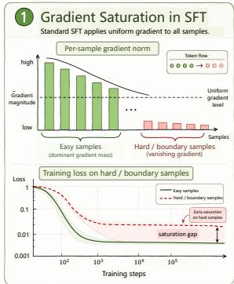
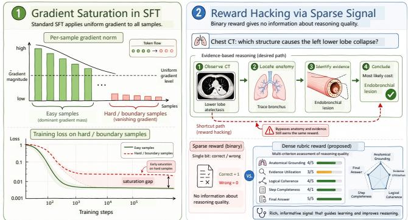
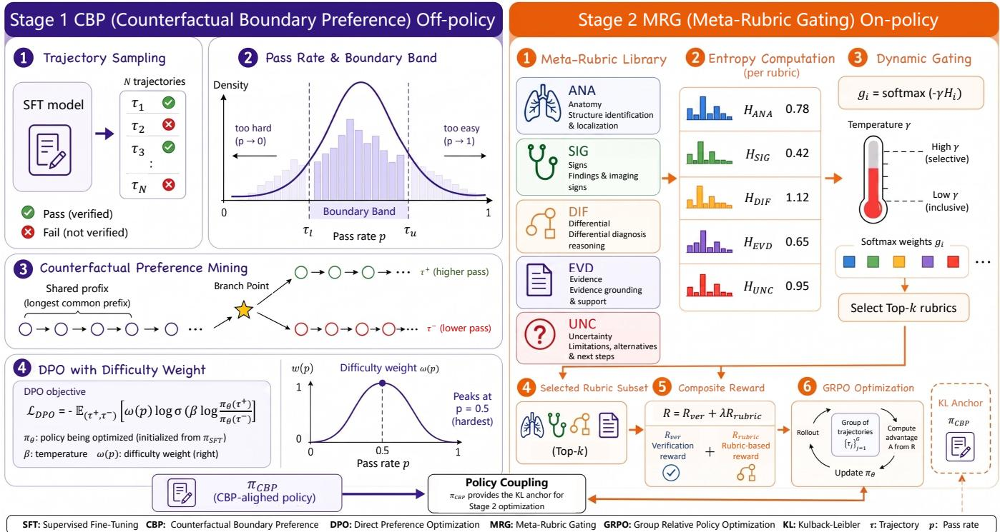
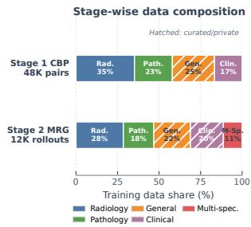
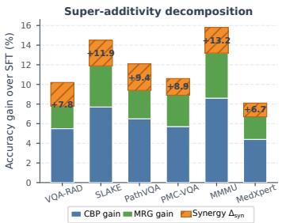
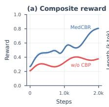
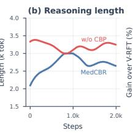
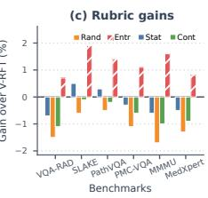

# Aligning Medical Vision Language Models at the Capability Boundary with Entropy Adaptive Rubric Grounding

Hongyu Bai Shanghai Jiao Tong University Shanghai, China baihongy@sjtu.edu.cn

## Abstract

Jiaqi Zeng Hunan University Changsha, China zjqxxl@hnu.edu.cn

Medical diagnostic reasoning requires establishing verifiable links between visual evidence and clinical knowledge, yet current medical vision language models are aligned with objectives that reward the wrong behavior. We identify two coupled failure modes. First, conventional supervised fine tuning distributes gradient uniformly across tokens, so easy majority cases dominate the update while clinically critical boundary cases, the ones where a single diagnostic decision flips the outcome, saturate prematurely and remain under trained. Second, sparse verifiable rewards supervise only whether the final answer is correct, a single bit that cannot express whether the reasoning is anatomically grounded or whether diferentials follow valid clinical logic, which invites reward hacking through answer shortcuts. We propose MedCBR, a two stage alignment framework that couples boundary aware preference optimization with rubric grounded reinforcement learning. We first construct counterfactual boundary preferences at the model’s capability fron tier by estimating sample dificulty from empirical pass rates and mining preference pairs that share reasoning prefixes but diverge at decisive diagnostic branch points, and introduce Dificulty Weighted Boundary Preference Optimization (DBPO) to concentrate learning on this calibrated boundary region. We then distill reusable clini cal rubrics from boundary trajectories and activate them accord ing to prediction entropy, yielding Entropy Gated Grounded Policy Optimization (EGPO), a reinforcement objective that rewards not only answer correctness but also anatomical grounding and reason ing fidelity, while suppressing rubric noise on samples the model already handles reliably. By coupling population level boundary priors with instance level uncertainty signals through a reference policy anchored to the boundary aligned model rather than the raw base model, MedCBR makes diagnostic reasoning both more accurate and more clinically grounded. Experiments on six medical benchmarks show consistent improvements over strong general, specialized, and reinforcement learning baselines, reaching 61.2% average accuracy with the largest gains on challenging diferential diagnosis tasks, and ablations confirm the two stages are super additive: their combination exceeds the sum of the individual stage gains.

## CCS Concepts

• Computing methodologies → Computer vision tasks; Machine learning; Image processing.

Chunzheng Zhu Hunan University Changsha, China zhuchzh@hnu.edu.cn

  
Figure 1: Motivation of MedCBR. Standard SFT distributes gradient uniformly across all tokens, causing loss satura- tion on clinically critical hard samples (left). Sparse binary rewards in conventional RL provide no signal on whether reasoning is grounded in correct anatomical evidence, enabling reward hacking via answer shortcuts (right). MedCBR addresses both via boundary aware preference alignment and entropy adaptive rubric grounding.

## Keywords

Medical Vision Language Models, Preference Optimization, Reinforcement Learning, Diagnostic Reasoning, Reward Grounding

## 1 Introduction

Medical vision language models (VLMs) have achieved remarkable progress in diagnostic assistance across radiology, pathology, and clinical imaging [2, 55]. Recent advances in reinforcement learning from verifiable rewards [18, 48] and chain of thought reasoning [16, 74] further enable models to articulate diagnostic logic. However, medical reasoning requires establishing verifiable causal chains between visual evidence and pathological knowledge, a requirement current paradigms inadequately address.

We identify two structural deficiencies. First, standard Supervised Fine-Tuning (SFT) treats all tokens uniformly without modeling sample dificulty, causing gradients to be dominated by easy samples while loss on clinically critical boundary cases saturates prematurely. Second, verifiable rewards defined solely by answer correctness are informationally impoverished: a single binary bit cannot characterize whether reasoning is grounded in correct anatomical localization or whether diferentials follow valid logic, readily inviting reward hacking with potentially catastrophic clinical consequences.

These observations motivate focusing learning on the model’s capability boundary, where decisions are most uncertain, and providing dense clinically grounded process feedback instead ofsparse outcome signals.

We propose MedCBR (Counterfactual Boundary preference with meta Rubric grounded reinforcement), a two stage framework combining of policy and on policy optimization. Counterfactual Boundary Preference (CBP; §3.2) mines trajectories sharing extended reasoning prefixes but diverging at critical decision points, and applies Dificulty Weighted Boundary Preference Optimization (DBPO), a dificulty reweighted DPO [53] objective concentrated on the capability frontier. Meta Rubric Grounded optimization (MRG; §3.3) distills reusable clinical evaluation rubrics from stage one trajectories and deploys entropy driven dynamic selection to compose structured process rewards, instantiated as Entropy Gated Grounded Policy Optimization (EGPO) on top of GRPO [56]. The stages are coupled through KL regularization anchored to � rather than �sft, ensuring boundary discrimination provides both sharper initialization and tighter exploration constraints.

Our contributions are as follows. (1) We propose MedCBR, the first framework that explicitly constructs alignment signal at the medical VLM’s own capability boundary, addressing the gradient saturation of uniform SFT through dificulty calibrated counterfactual preference mining. (2) We introduce entropy driven dynamic rubric selection that composes sample adaptive structured rewards from a distilled meta rubric library, giving process level supervision beyond sparse binary verification while avoiding reward noise on reliable samples. (3) We establish a principled coupling between of policy boundary alignment and on policy grounded optimization, yielding super additive gains that validate the complementary roles of population level boundary priors and instance level uncertainty signals. (4) Experiments on six medical VQA benchmarks spanning radiology, pathology, and general medical knowledge show Med-CBR consistently surpasses state of the art methods, with the largest gains on the most challenging fine grained diferential diagnosis datasets.

## 2 Related Work

Medical Vision Language Models and Visual Evidence. Medical VLMs combine instruction tuning [22, 63], radiology pretraining [73], curated knowledge [2, 28], and retrieval [76]. Evidence representation spans image and metadata fusion [79], spatial or knowledge guided pathology aggregation [24–27], and topological contrastive learning or automated topology learning [44, 45]. Plane wise retrieval memory and structural evidence fusion additionally support cardiac video diagnosis [41]. General knowledge graph reasoning also filters irrelevant evidence through question guided rescoring [93]. Connecting evidence to diagnosis motivates reasoning supervision [16, 71, 74] and interactive grounding [105, 107]. Studies of modality arbitration [95], misleading visual inputs [1], and audiovisual source confusion [96] expose complementary grounding problems. Interventions use semantic stage decoding rewards [94], counterfactual visual confidence [77], or image and caption consistency [62]. MedCBR instead aligns diagnostic branch points and adaptively evaluates clinical reasoning.

Reinforcement Learning and Reusable Process Feedback. Alignment builds on policy and preference optimization [47, 53, 54], group relative objectives [10, 56], and trajectory importance correction [50]; representation residual distillation ofers another route to transferring RL behavior [23]. Medical approaches use verifiable rewards [18, 48], preference or process supervision [74, 86, 108], anatomy or rubric criteria [15, 57, 106], and role specialized clinical consensus [89]. Group Cognition Learning audits selective modality interactions before contribution aware consensus, reducing modality dominance and spurious coupling through governed two stage collaboration [43]. Beyond medicine, agentic reasoning [72], localized errors [37], user reactions [97], quality driven scanpath rewards [70], coupled environment adaptation [14], and hybrid reward models [42] enrich feedback. Agreement among search agents can diverge from external evidence [5]. Reusable resources include structured, compressed, or attributable memory [64, 65, 90], evolving atomic recommendation memory [13], visual skills [66, 67], interaction anchors [59], and synthesized skill libraries [61, 104]; counterfactual contexts intervene at tool decisions [36]. Second Order Response Laws for LLM Judges derives unbiased prompt instability estimators from within and across prompt agreement, separating systematic prompt variation from finite call noise [9]. Leaderboard auditing tests contamination and scorer validity [85]; passing self generated tests may still miss semantic correctness [84]. Multidimensional evaluation also separates reasoning from visual quality in image generation [3], fidelity from instruction compliance in remote sensing extrapolation [39], correctness from eficiency in service agents [87], and evidence based recall from interpretation [75]. These are diferent task settings for structured evaluation. MedCBR extracts clinical rubrics from boundary trajectories and gates their reward contribution.

Dificulty, Reliability, and Selective Intervention. Hard but trustworthy sample selection [31] and psychology based dynamic curriculum learning [46] difer from noise transition estimation [30, 32] and the counterintuitive loss variance behavior of noisy label learning [29]. Broader developmental accounts of learning organize cognitive growth [7], while hierarchical latent reasoning explores recommendation [12]; neither establishes our clinical boundary criterion. Sample weighting also difers from optimizer dynamics studied through Adam versus SGD [17, 49] and decoupled weight decay [38, 103]. These optimizer analyses do not establish guarantees for our alignment objectives. Agent failure diagnosis [68], dificulty aware workflow orchestration [60], and clinical uncertainty estimation [51] provide complementary reliability perspectives. MedCBR assumes verified answers, uses population level pass rates to select boundary preferences, and applies instance level entropy to control process rewards.

Deployment and Scope. Operational studies address clinician facing system integration [78] and potential losses in spatial capability during video adaptation [91]. Related visual settings include human attention modeling in panoramic environments [69] and test time domain generalization through multi graph matching for medical segmentation [40]. Resource eficient inference additionally studies weight and activation quantization [99–102], shared hardware circuits [98], and, for mixture of experts backbones, expert quantization or skipping [80, 81]. Agent orchestration further trades parallel critical paths against repeated exploration and coordination overhead [34]; batched contextual reinforcement shares context across reasoning tasks to reduce per problem token usage [82]. Adjacent generative settings study flow matching [33], inference time textual guidance tailoring [20], and personalized fashion design with sewing pattern generation [52]. Other deployment settings study decentralized UAV cooperation under restricted communication [8] and privacy, utility, and safety tradeofs in preference alignment [83]. These directions concern operating conditions beyond our current medical QA evaluation; their compatibility with boundary alignment and clinical fidelity requires separate validation.

## 3 Method

## 3.1 Problem Formulation

Given a medical image $I \in \mathbb { R } ^ { H \times W \times 3 }$ and a clinical query �, the objective is to produce a diagnostic reasoning trajectory $o = \left( o _ { 1 } , \ldots , o _ { T } \right)$ that arrives at the correct answer through evidence grounded reasoning. Let $\pi _ { \theta }$ denote the medical VLM policy parameterized by $\theta ,$ $\pi _ { \mathrm { { S F T } } }$ the supervised fine tuned base policy, and $\mathcal { \bar { D } } = \{ ( I _ { k } , q _ { k } , a _ { k } ^ { \star } ) \} _ { k = 1 } ^ { K }$ the training set with verified ground truth answers $a _ { k } ^ { \star }$ . The alignment objective seeks a policy �� that simultaneously maximizes diagnostic accuracy and ensures that the reasoning process is grounded in clinically valid evidence chains, formalized as:

$$
\begin{array} { r l r } { \pi ^ { \star } = \arg \underset { \pi _ { \theta } } { \operatorname* { m a x } } \mathbb { E } _ { ( I , q ) \sim \mathcal { D } } \Big [ } & { \underbrace { R _ { \mathit { \nu e r } } ( o , a ^ { \star } ) } _ { \mathrm { a n s w e r ~ c o r r e c t n e s s } } + \lambda } & { \underbrace { R _ { \mathit { p r o c } } ( o ; \mathcal { R } ) } _ { \mathrm { p r o c e s s ~ g r o u n d i n g } } \Big ] } \\ & { - \ : \beta D _ { K L } ( \pi _ { \theta } \| \pi _ { r e f } ) , } & \end{array}\tag{1}
$$

where $R _ { \nu e r }$ is the verifiable answer reward, $R _ { p r o c }$ denotes process level rubric rewards parameterized by criteria set R, � balances outcome versus process supervision, and the KL penalty constrains deviation from a reference policy $\pi _ { \mathit { r e f } } .$ The key insight of MedCBR is that $\pi _ { r e f }$ should not be the raw $\pi _ { \mathrm { { S F T } } }$ but an intermediate policy $\pi _ { \mathrm { C B P } }$ that has already acquired boundary discriminative capability through of policy preference alignment. In other words, we decompose alignment into a where to learn problem, locating samples near the current capability frontier, and a how to refine problem, applying uncertainty aware process supervision once the policy has reached that frontier.

## 3.2 Stage 1: Counterfactual Boundary Preference Alignment

The core intuition of CBP is that the most informative learning signal resides not in samples the model consistently solves or consistently fails, but in those lying at its capability boundary, where the outcome is genuinely uncertain and a single diagnostic decision can flip the result. By constructing preference pairs that isolate these critical decision points, we concentrate the optimization budget on samples with the highest potential for meaningful behavioral change, instead of allowing easy majority cases to dominate the gradient.

Dificulty Estimation and Boundary Band. For each sample $( I , q ) \in \mathcal { D }$ , we draw � independent reasoning trajectories $\{ o ^ { ( n ) } \} _ { n = 1 } ^ { N }$ from $\pi _ { \mathrm { { S F T } } }$ and compute the empirical pass rate $\textstyle p ( I , q ) =$ $\begin{array} { r } { \frac { 1 } { N } \sum _ { n = 1 } ^ { N } \mathbb { 1 } \left[ \mathsf { a n s } ( o ^ { ( n ) } ) = a ^ { \star } \right] } \end{array}$ , which estimates the probability that the current policy produces a correct answer on this sample. We define the capability boundary band as the set of samples whose pass rates fall within calibrated thresholds:

$$
\mathcal { B } = \{ ( I , q ) \in \mathcal { D } \mid \tau _ { l } \leq p ( I , q ) \leq \tau _ { u } \} ,\tag{2}
$$

where $\tau _ { l }$ and $\tau _ { u }$ (set to 0.2 and 0.8) delimit the region where the model is neither deterministically correct nor deterministically wrong. Samples with $p  1$ provide negligible gradient because the model has already mastered them, while samples with $ { p } \to 0$ are often beyond the model’s current reach and yield noisy signal; the boundary band B therefore captures the regime with the highest value density. This estimate is computationally stable: with $N { = } 1 6$ theJaccard overlap with a high budget reference set $\left( N { = } 1 2 8 \right)$ already exceeds 0.92.

Counterfactual Preference Mining. Within ${ \mathcal { B } } ,$ we mine counterfactual preference pairs designed to isolate the causal decision points that determine diagnostic success or failure. For a given sample, let $o ^ { + } \in \{ o ^ { ( n ) } : \mathsf { a n s } ( o ^ { ( n ) } ) = a ^ { \star } \}$ and $o ^ { - } \in \{ o ^ { ( n ) } : \mathsf { a n s } ( o ^ { ( n ) } ) \neq a ^ { \star } \}$ denote correct and incorrect trajectories respectively. We select the pair $( o ^ { + } , o ^ { - } )$ that maximizes the shared prefix length:

$$
( o ^ { + } , o ^ { - } ) = \arg \operatorname* { m a x } _ { o ^ { + } \in O ^ { + } , o ^ { - } \in O ^ { - } } \mathsf { L C P } ( o ^ { + } , o ^ { - } ) ,\tag{3}
$$

where $\mathsf { L C P } ( \cdot , \cdot )$ computes the longest common prefix at the token level. This ensures positive and negative trajectories share nearly the entire reasoning chain and diverge only at the critical diagnostic branch point, localizing the signal to the causally relevant divergence and preventing the optimizer from learning spurious stylistic preferences.

Dificulty Weighted Boundary Preference Optimization (DBPO). The preference loss is computed within the DPO framework [53], augmented with a dificulty aware weighting function that allocates greater optimization pressure to samples nearest the decision boundary:

$$
\begin{array} { r l } & { \mathcal { L } _ { \mathrm { c a p } } ( \theta ) = - \mathbb { E } _ { ( o ^ { + } , o ^ { - } ) \sim \mathcal { B } } \Big [ w ( \boldsymbol { p } ) \cdot \log o \Big ( \beta \Big ( \log \frac { \pi _ { \theta } ( o ^ { + } \vert I , q ) } { \pi _ { \mathrm { s r r } } ( o ^ { + } \vert I , q ) } } \\ & { \quad \quad \quad - \log \frac { \pi _ { \theta } ( o ^ { - } \vert I , q ) } { \pi _ { \mathrm { s r r } } ( o ^ { - } \vert I , q ) } \Big ) \Big ) \Big ] , } \end{array}\tag{4}
$$

where $\sigma ( \cdot )$ is the sigmoid function, $\beta$ is the DPO temperature, and $w ( p ) = 1 - 2 | p - 0 . 5$ | peaks at $p = 0 . 5$ , where the model is maximally uncertain and directly on the decision boundary, and decays toward either extreme. This reallocates the optimization budget from saturated easy samples to the critical boundary minority, directly counteracting the gradient dominance problem that motivated CBP. Because this operates on a one time ofline sampling set without further rollouts, CBP constitutes an of policy stage.

## 3.3 Stage 2: Meta Rubric Grounded Policy Optimization

While CBP improves boundary discrimination, it relies on fixed ofline data and cannot track the evolving policy’s error distribution. We therefore perform on-policy RL with clinically grounded structured rewards that provide richer supervision than sparse binary verification.

  
Figure 2: Overview of MedCBR. Stage 1 (CBP, of policy): from the SFT model, � trajectories are sampled per query, empirical pass rates define the capability boundary band, and counterfactual preference pairs diverging at critical diagnostic branch points are mined for dificulty weighted DPO. Stage 2 (MRG, on policy): meta rubrics distilled from stage one trajectories are dynamically selected via entropy gating, composing structured process rewards for GRPO optimization anchored to $\pi _ { \mathbf { C B P } } .$

Meta-Rubric Library. We construct a meta-rubric library $\mathcal { R } =$ $\{ r _ { 1 } , . . . , r _ { M } \}$ from stage-one preference trajectories. Divergence points between preferred and rejected trajectories reveal recurring diagnostic errors, which are distilled into reusable criteria covering anatomical localization, sign description, diferential reasoning, evidence consistency, and uncertainty calibration. Each rubric $r _ { m }$ is implemented as a scoring function $s _ { m } : O \to [ 0 , 1 ]$ using a frozen judge model restricted to evaluating the corresponding clinical dimension.

Entropy Driven Dynamic Rubric Selection. A critical design choice is determining which rubrics to activate per sample, as uniformly applying all criteria introduces reward noise on reliable samples and can destabilize optimization. We resolve this via an entropy driven gating mechanism that adapts rubric intensity to instance level uncertainty.

For each sample (�, �), we compute the length normalized prediction entropy of the current policy:

$$
u ( I , q ) = - \frac { 1 } { T } \sum _ { t = 1 } ^ { T } \sum _ { v \in \mathcal { N } } \pi _ { \theta } ( v \mid I , q , o _ { < t } ) \log \pi _ { \theta } ( v \mid I , q , o _ { < t } ) ,\tag{5}
$$

where $_ \mathrm { c } { } _ { V }$ is the vocabulary and � the trajectory length. High � indicates uncertain reasoning and potentially weak grounding, while low � suggests confident, well calibrated predictions. We map � to a gating temperature $\gamma = f ( u )$ , implemented as a calibrated sigmoid, controlling both the number and weight of activated rubrics:

$$
\mathcal { R } _ { a c t i v e } ( I , q ) = \{ r _ { m } \in \mathcal { R } \mid \gamma \cdot \alpha _ { m } > \tau _ { r } \} , \quad \vert \mathcal { R } _ { a c t i v e } \vert \propto \gamma ,\tag{6}
$$

where $\alpha _ { m }$ is the base priority of rubric $r _ { m }$ estimated from stage one divergence frequency and $\tau _ { r }$ is the activation threshold. When the model is unreliable (� high), more rubrics activate with larger weights, providing dense process supervision. When the model is reliable (� low), the active set contracts to a minimal subset, avoiding unnecessary evaluation noise on already well handled cases.

Structured Composite Reward. The final reward for trajectory � combines the verifiable answer signal with the entropy adaptive rubric evaluation:

$$
R ( o ; I , q ) = \underbrace { \mathbb { 1 } \left[ \mathsf { a n s } ( o ) = a ^ { \star } \right] } _ { R _ { v e r } } + \lambda \cdot \underbrace { \gamma ( I , q ) \cdot \frac { 1 } { | \mathcal { R } _ { a c t i v e } | } \sum _ { r _ { m } \in \mathcal { R } _ { a c t i v e } } s _ { m } ( o ) } _ { R _ { r u b r i c } } ,\tag{7}
$$

where � balances outcome and process supervision. The gating � amplifies process rewards precisely when the model most needs guidance and suppresses them within the competence zone, so the rubric signal acts as targeted correction rather than a constant source of extra reward variance.

Entropy Gated Grounded Policy Optimization (EGPO). We optimize the model with group normalized advantages [56] and no learned value function, which suits our setting because reward quality is heterogeneous across samples while the relative ranking within a small group of contemporaneous rollouts stays informative. For each sample, � trajectories are sampled and advantages are computed relative to group statistics:

$$
\hat { A } _ { i } = \frac { R ( o _ { i } ; I , q ) - \mu _ { G } } { \sigma _ { G } + \varepsilon } , \mu _ { G } = \frac { 1 } { G } \sum _ { j = 1 } ^ { G } R ( o _ { j } ) , \sigma _ { G } = \sqrt { \frac { 1 } { G } \sum _ { j = 1 } ^ { G } ( R ( o _ { j } ) - \mu _ { G } ) ^ { 2 } } .\tag{8}
$$

The policy is updated via the clipped surrogate objective with KL regularization anchored to the CBP policy:

$$
\begin{array} { l l l } { \displaystyle \mathcal { T } _ { \mathrm { M R G } } ( \theta ) = \frac { 1 } { G } \sum _ { i = 1 } ^ { G } \frac { 1 } { | o _ { i } | } \sum _ { t = 1 } ^ { | o _ { i } | } \operatorname* { m i n } \Bigl ( \rho _ { i , t } \hat { A } _ { i } , } \\ { \displaystyle \mathrm { c l } \operatorname { i p } ( \rho _ { i , t } , 1 - \varepsilon , 1 + \varepsilon ) \hat { A } _ { i } \Bigr ) - \beta _ { k l } D _ { K L } ( \pi _ { \theta } \| \pi _ { \mathrm { c B P } } ) , } \end{array}\tag{9}
$$

where $\rho _ { i , t } = \pi _ { \theta } ( o _ { i , t } \vert I , q , o _ { i , < t } ) / \pi _ { \theta _ { o l d } } ( o _ { i , t } \vert I , q , o _ { i , < t } )$ is the importance ratio.

From Boundary Priors to Grounded Exploration. The two stages are deeply coupled rather than merely sequential. The KL regularization in Eq. 9 anchors exploration to $\pi _ { \mathrm { C B P } }$ instead of $\pi _ { \mathrm { { S F T } } } :$ since CBP has already established discriminative margins on boundary samples, it ofers a sharper initialization that lets RL refine these patterns rather than rediscover them, while the tighter trust region curbs drift into reward hacking shortcuts. The two thus contribute complementary signals, CBP captures population level boundary priors indicating where to look, and MRG provides instance level uncertainty signals indicating how strongly to intervene, and their integration yields the super additive gains confirmed by our ablation.

## 4 Experiments

## 4.1 Experimental Setup

Datasets. We evaluate on six benchmarks spanning radiology, pathology, and cross-domain reasoning: VQA-RAD [19], SLAKE [35], PathVQA [11], PMC-VQA [92], MMMU-Med [88], and MedXpertQA [109], the last two most challenging as they require multi-step evidence aggregation, diferential exclusion, and uncertainty-aware reasoning. We follow oficial train/test splits, reserve 5% of training data for validation, and report accuracy on the untouched test sets.

Training data construction. The alignment corpus is drawn from the training splits of the six benchmarks, augmented with a curated pool of de-identified teaching cases (Radiopaedia, MIMIC-CXR reports) and expert-written diferential diagnosis questions under permissive research licenses, with strict image level dedupli cation against every test set. For Stage 1, boundary mining over ∼210K candidate queries retains the ∼62% whose pass rate falls in [��, ��], yielding ∼48K counterfactual preference pairs; Stage 2 draws ∼12K on policy rollout prompts, over sampling hard diferential diagnosis and multi specialty questions so entropy gating triggers richer rubric activation (full composition in §4).

Implementation. We adopt Qwen2.5 VL 7B [58] with LoRA (rank 64, �=128, dropout 0.05), resizing inputs to 448×448 with dynamic scaling to 896×896 for pathology. Stage 1 (CBP) samples �=16 trajectories per query (temperature 1.0, top � 0.95), keeps the band $\tau _ { l } = 0 . 2 , \tau _ { u } = 0 . 8 ,$ and trains DBPO with $\beta { = } 0 . 1 , \mathrm { l r } 2 { \times } 1 0 ^ { - 5 }$ , batch size 32, 3 epochs. Stage 2 (MRG) runs EGPO with $G = 8 , \ \varepsilon = 0 . 2 , \lambda = 0 . 5 .$ $\beta _ { k l } { = } 0 . 0 4 ,$ , lr $1 \times 1 0 ^ { - 5 }$ , 2 epochs over ∼12K rollouts. The five rubrics are scored by a frozen Qwen2.5 72B judge (temperature 0). Training uses 8×A100 80GB with DeepSpeed ZeRO-2 and bf16, costing 18 and 24 GPU hours for the two stages.

Table 1: Comprehensive comparison on six medical multimodal benchmarks (accuracy %). Columns: VQA-RAD (RAD), SLAKE (SLK), PathVQA (Path), PMC-VQA (PMC), MMMU-Med (MMU), MedXpertQA (MedX). Bold best, underlined sec-ond best.
<table><tr><td rowspan=1 colspan=1>Method             RAD SLK Path PMC MMU MedX Avg</td></tr><tr><td rowspan=1 colspan=1>General Vision Language Models</td></tr><tr><td rowspan=1 colspan=1>LLaVA Med [22]      61.5 64.252.1 41.3  38.6  18.7 46.1</td></tr><tr><td rowspan=1 colspan=1>Qwen2.5 VL 7B [58]   66.8 70.4 56.3 47.9  45.2  22.4 51.5</td></tr><tr><td rowspan=1 colspan=1>InternVL2.5 8B [6]    68.1 72.0 57.8 49.5  47.0  23.6 53.0</td></tr><tr><td rowspan=1 colspan=1>Medical Specialized Models</td></tr><tr><td rowspan=1 colspan=1>RadFM [73]           63.9 68.754.6 44.0  40.1  19.9 48.5</td></tr><tr><td rowspan=1 colspan=1>HuatuoGPT Vision [2]70.3 74.8 60.2 51.7  49.8  25.1 55.3</td></tr><tr><td rowspan=1 colspan=1>MMed RAG [76]      71.6 76.1 61.0 52.9 51.3  26.0 56.5</td></tr><tr><td rowspan=1 colspan=1>Reinforcement Learning Methods</td></tr><tr><td rowspan=1 colspan=1>GRPO (vanilla) [56]    71.9 76.661.8 53.4 52.0  26.7 57.1</td></tr><tr><td rowspan=1 colspan=1>Med R1 [18]          72.4 77.1 62.2 53.9 53.1  26.9 57.6</td></tr><tr><td rowspan=1 colspan=1>MedVLM R1 [48]      73.2 78.0 63.1 54.6  55.1  27.5 58.6</td></tr><tr><td rowspan=1 colspan=1>ViTAR [4]            73.6 79.263.6 55.1  56.0  27.9 59.2</td></tr><tr><td rowspan=1 colspan=1>V RFT PRA [86]       73.980.464.3 55.7 56.8  28.3 59.9</td></tr><tr><td rowspan=1 colspan=1>MEDCBR (Ours)     74.682.365.7 56.8 58.4  29.1 61.2</td></tr></table>

Baselines and Evaluation. We compare against general and medical VLMs (LLaVA Med [22], Qwen2.5 VL 7B [58], InternVL2.5 8B [6], RadFM [73], HuatuoGPT Vision [2], MMed RAG [76]) and RL baselines (GRPO [56], Med R1 [18], MedVLM R1 [48], ViTAR [4], V RFT PRA [86]), all sharing the Qwen2.5 VL 7B backbone and LoRA setup. We report accuracy (%): open ended answers matched with GPT-4 following [88], closed form via regex, averaged over 3 seeds with paired bootstrap testing $( p < 0 . 0 1 )$ .

## 4.2 Main Results

Table 1 shows that MedCBR achieves the best performance on all six benchmarks, reaching 61.2% average accuracy and outperforming V-RFT-PRA by +1.3 points, with larger gains on the more challenging SLAKE (+1.9) and MMMU-Med (+1.6), indicating the alignment strategy is particularly efective when multi-step reasoning and evidence grounding are required. It also surpasses domain-specialized models that rely on large-scale medical pretraining or retrieval augmentation, suggesting that at the 7B scale reasoning alignment, rather than domain knowledge acquisition, is the primary bottleneck.

## 4.3 Ablation study

Component ablations. Table 2 confirms super additive coupling: CBP alone yields +6.4 over SFT and MRG alone +5.5, yet their combination reaches $+ 9 . 7$ with $\Delta _ { s y n } = + 2 . 8 ,$ exceeding the sum by 29%. Anchoring KL to $\pi _ { \mathrm { { S F T } } }$ instead of $\pi _ { \mathrm { C B P } }$ drops the synergy to +1.7 (a 39% reduction), showing the reference policy must encode boundary knowledge; the synergy peaks on the hardest benchmarks $( \Delta _ { s y n } = + 4 . 6$ on MMMU-Med, +3.0 on MedXpertQA). CBP and MRG breakdown. Boundaryfiltering is the dominant CBP ingredient: removing it costs 1.6 points by diluting gradient over mastered samples, while dropping counterfactual mining costs 1.2 and dificulty weighting 0.5, the three acting non redundantly (which samples / what signal / how much pressure). For MRG entropy driven rubric selection consistently beats static, random, and content based variants; static all rubric application reaches only 59.7% and even drops below V RFT PRA on VQA-RAD (73.2 vs. 73.9), confirming indiscriminate process supervision injects reward noise on reliable samples.

Table 2: Component ablation of MedCBR on the 7B backbone (accuracy %). Column abbreviations follow Table 1. $^ { \ast } \Delta _ { s y n } \stackrel { n } { }$ denotes the synergy gain confirming super-additivity.
<table><tr><td>Configuration</td><td>RAD</td><td>SLK</td><td>Path</td><td>PMC</td><td>MMU</td><td>MedX</td><td>Avg</td><td> $\Delta _ { s y n }$ </td></tr><tr><td>SFT Baseline (Qwen2.5 VL 7B)</td><td>66.8</td><td>70.4</td><td>56.3</td><td>47.9</td><td>45.2</td><td>22.4</td><td>51.5</td><td>1</td></tr><tr><td>+ CBP only</td><td>72.3</td><td>78.1</td><td>62.8</td><td>53.6</td><td>53.8</td><td>26.8</td><td>57.9</td><td>一</td></tr><tr><td>+ MRG only (anchor  $\pi _ { \mathrm { { s F T } } } )$ </td><td>71.5</td><td>77.2</td><td>61.9</td><td>52.8</td><td>52.4</td><td>26.1</td><td>57.0</td><td>1</td></tr><tr><td>+ CBP → MRG (anchor πCBp)</td><td>74.6</td><td>82.3</td><td>65.7</td><td>56.8</td><td>58.4</td><td>29.1</td><td></td><td>61.2 +2.8</td></tr><tr><td>+ CBP → MRG (anchor  $\pi _ { \mathrm { s F T } } )$ </td><td>73.8</td><td>80.9</td><td>64.8</td><td>55.9</td><td>56.9</td><td>28.4</td><td></td><td> $6 0 . 1 \quad + 1 . 7 \phantom { 0 }$ </td></tr><tr><td>CBP component ablation:</td><td></td><td></td><td></td><td></td><td></td><td></td><td></td><td></td></tr><tr><td>w/o boundary filtering (all samples)</td><td>70.8</td><td>76.4</td><td>61.2</td><td>52.1</td><td>51.6</td><td>25.4</td><td>56.3</td><td>1</td></tr><tr><td>w/o counterfactual mining (random pairs)</td><td>71.4</td><td>77.0</td><td>61.5</td><td>52.5</td><td>52.0</td><td>25.8</td><td>56.7</td><td>-</td></tr><tr><td>w/o difficulty weight (w=1)</td><td>71.9</td><td>77.6</td><td>62.3</td><td>53.1</td><td>53.2</td><td>26.3</td><td>57.4</td><td>一</td></tr><tr><td>MRG rubric selection ablation:</td><td></td><td></td><td></td><td></td><td></td><td></td><td></td><td></td></tr><tr><td>Static (all rubrics, y=1)</td><td>73.2</td><td>80.9</td><td>64.6</td><td>55.4</td><td>56.2</td><td>27.8</td><td>59.7</td><td></td></tr><tr><td>Random rubric subset</td><td>72.4</td><td>79.8</td><td>63.8</td><td>54.6</td><td>55.1</td><td>27.0</td><td>58.8</td><td>1</td></tr><tr><td>Content based selection</td><td>72.8</td><td>80.3</td><td>64.1</td><td>55.1</td><td>55.8</td><td>27.4</td><td>59.3</td><td></td></tr><tr><td>Entropy driven (ours)</td><td>74.6</td><td>82.3</td><td>65.7</td><td>56.8</td><td>58.4</td><td>29.1</td><td>61.2</td><td></td></tr></table>

## 4.4 Training data composition.

Stage specific data roles. The two stages play diferent data roles (Fig. 3). Stage 1 processes ∼48K preference pairs after boundary filtering, skewed toward radiology (35.2%) because chest X-rays and CT scans frequently yield pass rates in the 0.3–0.7 range that stabilize boundary estimation, while Stage 2 shifts its ∼12K rollouts toward harder cases (over sampled to 19.8% from 16.6%) that trigger the most rubric activations. Roughly 68% of Stage 1 and 52% of Stage 2 data come from public benchmarks, the curated remainder covering diferential diagnosis scenarios public data underrepresent; the gain decomposition confirms CBP contributes the larger base lift while MRG adds consistent increments.

## 4.5 Qualitative case study

We contrast MedCBR with two baselines on three cases (CT, MRI, ultrasound) where the diagnosis hinges on a single decisive sign. The baselines share a failure mode: long traces (185 to 238 tokens) that survey irrelevant structures and commit to unsupported evidence (e.g., asserting pleural thickening on a right lower lobe nodule, or reading an extra-axial meningioma as an intra-axial glioblastoma), the reward-hacking pattern where length substitutes for grounding. MedCBR instead resolves each case in 34–44 tokens by naming the location and discriminative sign, exactly the diferential-reasoning and uncertainty dimensions where the baselines collapse.

  
Figure 3: Stage-wise data composition and super-additive gain decomposition. Left: specialty distribution shifts from radiology-dominated boundary pairs in Stage 1 toward oversampled diferential-diagnosis cases in Stage 2. Right: the combined CBP→MRG pipeline exceeds the sum ofindividual stage gains, with surplus $\Delta _ { s y n }$ largest on the hardest bench- marks.

  
Figure 4: Training dynamics of MedCBR. Left: the full model’s composite reward climbs to ∼0.80 while the no-CBP ablation saturates near 0.38, a 2× gap. Middle: trajectory length peaks early then compresses as reasoning sharpens, whereas the ablation stays verbose. Right: per-benchmark rubric-gain of entropy-driven selection, largest on MMMU-Med.

## 4.6 Training dynamics and rubric selection.

The training signals corroborate the coupling story (Fig. 4). CBP gives a markedly better RL start: the full model’s composite reward rises to about 0.80, whereas the no-CBP variant saturates near 0.38 and never recovers, a 2× reward gap reflecting the margins $\pi _ { \mathrm { C B P } }$ carries into Stage 2. MedCBR also explores longer trajectories early (∼3.0K tokens) then compresses to ∼2.6K, while the ablation stays verbose $\mathrm { a t } \sim 3 . 2 \mathrm { K }$ , a hallmark of reward hacking. Prediction entropy shifts leftward across stages $( u { \approx } 2 . 2  1 . 6  1 . 1 )$ , mean activated rubrics fall from 4.2 to 2.8, and entropy driven selection is the only policy positive on all six benchmarks, with the largest margin on MMMU-Med (+2.2 over static) where complex reasoning triggers more activation (4.3 of 5 rubrics, versus 2.1 on VQA-RAD).

Table 3: Computational comparison with RL baselines on 8×A100 GPUs (Time in GPU hours, Mem in GB).
<table><tr><td>Method</td><td>Time</td><td>Mem</td><td>Trainable</td><td>Avg.</td></tr><tr><td>Vanilla GRPO [56]</td><td>28</td><td>62</td><td>42M</td><td>57.1</td></tr><tr><td>Med R1 [18]</td><td>32</td><td>64</td><td>42M</td><td>57.6</td></tr><tr><td>MedVLM R1 [48]</td><td>36</td><td>68</td><td>42M</td><td>58.6</td></tr><tr><td>V RFT PRA [86]</td><td>40</td><td>72</td><td>42M</td><td>59.9</td></tr><tr><td>MEDCBR Stage 1</td><td>18</td><td>58</td><td>42M</td><td>57.9</td></tr><tr><td>MEDCBR Stage 2</td><td>24</td><td>66</td><td>42M</td><td></td></tr><tr><td>MEDCBR Total</td><td>42</td><td>66</td><td>42M</td><td>61.2</td></tr></table>

## 4.7 Eficiency and qualitative analysis.

Table 3 summarizes the practical tradeof. MedCBR needs 42 total hours (18h CBP + 24h MRG), only 5% above V RFT PRA, while delivering the highestfinal accuracy; because CBP is of policy and boundary filtering cuts the efective sample count to 62%, it yields 2.7× accuracy improvement per additional GPU hour versus V RFT PRA’s 2.0×, at 66 GB peak memory and zero inference overhead. Three board certified radiologists rated 200 MMMU-Med cases on the five rubric dimensions (�=0.78): MedCBR improves all of them over Qwen2.5 VL 7B (anatomy 2.8→4.1, sign 2.4→3.8, diferential 2.1→3.5, evidence 2.6→3.9, uncertainty 1.9→3.4), with the largest margins on diferential exclusion and uncertainty calibration.

## 4.8 Cross architecture generalization.

Backbone agnostic gains. To verify the framework is not tied to one backbone, we apply the complete MedCBR pipeline with identical hyperparameters to three diverse VLMs: Qwen2.5 VL 7B [58] (51.5→61.2, Δ=+9.7), InternVL2.5 8B [6] (53.0→62.4, Δ=+9.4), and LLaVA OneVision $7 \mathrm { B } [ 2 1 ] ( 5 0 . 8 \mathrm {  } 5 9 . 9 , \Delta \mathrm { = } + 9 . 1 )$ . Gains are remarkably consistent (standard deviation 0.3) and exceed the overall averages on the hardest benchmarks $( \Delta _ { h a r d } { = } + 9 . 9 , + 1 0 . 2 , + 9 . 5 )$ . This generality is architecture independent: boundary estimation depends only on empirical pass rates and rubric evaluation uses an external frozen judge, so MedCBR is a plug and play recipe for any medical VLM supporting standard RL fine tuning.

## 5 Conclusion

We presented MedCBR, an alignment framework for medical reasoning that couples capability boundary preference alignment with entropy adaptive rubric grounding. Across six benchmarks it improves both diagnostic accuracy and reasoning quality, especially on harder diferential reasoning, suggesting that clinically reliable multimodal alignment should jointly optimize boundary sensitivity and process grounded supervision.

## References

[1] Huiyi Chen, Jiawei Peng, Dehai Min, Changchang Sun, Kaijie Chen, Yan Yan, Xu Yang, and Lu Cheng. 2026. MVI-Bench: A Comprehensive Benchmark for Evaluating Robustness to Misleading Visual Inputs in LVLMs. In Proceedings of the 43rd International Conference on Machine Learning.

[2] Junying Chen, Chi Gui, Ruyi Ouyang, Anningzhe Gao, Shunian Chen, Guiming Hardy Chen, Xidong Wang, Ruifei Zhang, Zhenyang Cai, Ke Ji, et al. 2024. Huatuogpt-vision, towards injecting medical visual knowledge into multimodal

llms at scale. In Findings of the Association for Computational Linguistics: EMNLP 2024. 7346–7370.

[3] Kaijie Chen, Zihao Lin, Zhiyang Xu, Ying Shen, Yuguang Yao, Joy Rimchala, Ji axin Zhang, and Lifu Huang. 2025. R2I-Bench: Benchmarking Reasoning-Driven Text-to-Image Generation. In Proceedings of the 2025 Conference on Empirical Methods in Natural Language Processing. Association for Computational Linguistics, 12595–12630. doi:10.18653/v1/2025.emnlp-main.636

[4] Kaiwen Chen, Sicheng Rui, Yongchang Jiang, Wenkang Wang, Mingxuan Li, and Zhe Xu. 2025. Think twice to see more: Iterative visual reasoning in medical vlms. arXiv preprint arXiv:2510.10052 (2025).

[5] Meijia Chen, Hao Li, Zheng Lu, Hongshan Lin, Junbai Tian, Yichen Liu, Zijun Tian, Yufan Zou, Shuhan Sun, Hanxin Chen, et al. 2026. False Frontiers: Diagnosing and Mitigating Co-Cheating in Self-Evolving Search Agents. arXiv preprint arXiv:2609.39102 (2026).

[6] Zhe Chen, Weiyun Wang, Yue Cao, Yangzhou Liu, Zhangwei Gao, Erfei Cui, Jinguo Zhu, Shenglong Ye, Hao Tian, Zhaoyang Liu, et al. 2024. Expanding performance boundaries of open-source multimodal models with model, data, and test-time scaling. arXiv preprint arXiv:2412.05271 (2024).

[7] Andreas Demetriou, George Spanoudis, and Antigoni Mouyi. 2011. Educating the developing mind: Towards an overarching paradigm. Educational psychology review 23, 4 (2011), 601–663.

[8] Enguang Fan, Yifan Chen, Zihan Shan, Klara Nahrstedt, Matthew Caesar, and Jae Kim. 2026. Communication-Aware Multi-Agent Reinforcement Learning for Decentralized Cooperative UAV Deployment. arXiv preprint arXiv:2603.16141 (2026).

[9] Pengbin Feng, Chunlei Meng, Daozheng Qu, Zhilin Zhang, Haoran Liu, and Jiekai Wu. 2026. Second-order response laws for LLM judges: Debiased estimation of prompt instability. arXiv preprint arXiv:2608.16253 (2026).

[10] Daya Guo, Dejian Yang, Haowei Zhang, Junxiao Song, Peiyi Wang, Qihao Zhu, Runxin Xu, Ruoyu Zhang, Shirong Ma, Xiao Bi, et al. 2025. Deepseek-r1: Incentivizing reasoning capability in llms via reinforcement learning. arXiv preprint arXiv:2501.12948 (2025).

[11] Xuehai He, Yichen Zhang, Luntian Mou, Eric Xing, and Pengtao Xie. 2020. Pathvqa: 30000+ questions for medical visual question answering. arXiv preprint arXiv:2003.10286 (2020).

[12] Peiyu Hu, Siying Gu, Weihai Lu, Zhuodong Liu, Yuntian Tang, Jiahao Liang, Yiying Xie, Jiang Rong, Zhaokai Luo, Zhiyong Wang, et al. 2026. Hierarchical Latent Reasoning for LLM-based Recommendation. arXiv preprint arXiv:2607.27760 (2026).

[13] Peiyu Hu, Weihai Lu, Siying Gu, Zhuodong Liu, Zhaokai Luo, Yuean Niu, Zhiyong Wang, and Jia Wang. 2026. AtomRec: Evolving Atomic Memory for Agentic Recommendation. arXiv preprint arXiv:2609.04882 (2026).

[14] Yihao Hu, Zhihao Wen, Xiujin Liu, Pan Wang, Xin Zhang, and Wei Wu. 2026. Seal: Synergistic co-evolution of agents and learning environments. arXiv preprint arXiv:2605.24426 (2026).

[15] Cheng Jiang, Chunzheng Zhu, Hongbo Guo, Guanghua Tan, Chubo Liu, and Kenli Li. 2025. MCBL-UNet: A Hybrid Mamba-CNN Boundary Enhanced Lightweight UNet for Placenta Ultrasound Image Segmentation. IEEE Journal of Biomedical and Health Informatics (2025).

[16] Yue Jiang, Jiawei Chen, Dingkang Yang, Mingcheng Li, Shunli Wang, Tong Wu, Ke Li, and Lihua Zhang. 2024. Medthink: Inducing medical large-scale visual language models to hallucinate less by thinking more. arXiv preprint arXiv:2406.11451 (2024).

[17] Ruinan Jin, Yingbin Liang, and Shaofeng Zou. 2026. Why adam can beat sgd: Second-moment normalization yields sharper tails. arXiv preprint arXiv:2603.03099 (2026).

[18] Yuxiang Lai, Jike Zhong, Ming Li, Shitian Zhao, Yuheng Li, Konstantinos Psounis, and Xiaofeng Yang. 2026. Med-r1: Reinforcement learning for generalizable medical reasoning in vision-language models. IEEE transactions on medical imaging (2026).

[19] Jason J Lau, Soumya Gayen, Asma Ben Abacha, and Dina Demner-Fushman. 2018. A dataset of clinically generated visual questions and answers about radiology images. Scientific data 5, 1 (2018), 180251.

[20] Binglei Li, Mengping Yang, Zhiyu Tan, Junping Zhang, and Hao Li. 2026. Tex-Tailor: Inference-Time Textual Guidance Tailoring for Multimodal Difusion Transformers. In European Conference on Computer Vision. Springer, 575–593.

[21] Bo Li, Yuanhan Zhang, Dong Guo, Renrui Zhang, Feng Li, Hao Zhang, Kaichen Zhang, Peiyuan Zhang, Yanwei Li, Ziwei Liu, et al. 2024. Llava-onevision: Easy visual task transfer. arXiv preprint arXiv:2408.03326 (2024)

[22] Chunyuan Li, Clif Wong, Sheng Zhang, Naoto Usuyama, Haotian Liu, Jianwei Yang, Tristan Naumann, Hoifung Poon, and Jianfeng Gao. 2023. Llava-med: Training a large language-and-vision assistant for biomedicine in one day. Advances in Neural Information Processing Systems 36 (2023), 28541–28564.

[23] Hao Li, MeiJia Chen, Weijie Ren, Donghan Li, Zijun Tian, Jingchun Huang, and Naibo Wang. 2026. The Teacher Is a Direction, Not a Destination: Extrapolating RL-Induced Representation Residuals in On-Policy Distillation. arXiv preprint arXiv:2609.36484 (2026).

[24] Junjian Li, Hulin Kuang, Jin Liu, Mengshen He, Hailin Yue, and Jianxin Wang. 2026. Dispersion-to-Consolidation: Consolidating Dispersed Semantics via Context-Aware Clustering for Whole Slide Image Analysis. Medical Image Analysis (2026), 104278.

[25] Junjian Li, Hulin Kuang, Jin Liu, Hailin Yue, Mengshen He, Xinyu Li, and Jianxin Wang. 2026. ConVL: Interpretable Concept-Guided Vision-Language MIL for Survival Analysis in Whole Slide Images. In International Conference on Medical Image Computing and Computer-Assisted Intervention. Springer, 76–86.

[26] Junjian Li, Hulin Kuang, Jin Liu, Hailin Yue, Mengshen He, and Jianxin Wang. 2026. Universal-to-Specific: Dynamic Knowledge-Guided Multiple Instance Learning for Few-Shot Whole Slide Image Classification. In Proceedings of the IEEE/CVF Conference on Computer Vision and Pattern Recognition. 26614–26623.

[27] Junjian Li, Jin Liu, Hulin Kuang, Hailin Yue, Mengshen He, and Jianxin Wang. 2025. MiCo: Multiple Instance Learning with Context-Aware Clustering for Whole Slide Image Analysis. In International Conference on Medical Image Computing and Computer-Assisted Intervention. Springer, 376–385.

[28] Tianbin Li, Yanzhou Su, Wei Li, Bin Fu, Zhe Chen, Ziyan Huang, Guoan Wang, Chenglong Ma, Ying Chen, Ming Hu, et al. 2026. Gmai-vl & gmai-vl-5.5 m: A large vision-language model and a comprehensive multimodal dataset towards general medical ai. In Proceedings ofthe AAAIConference on Artificial Intelligence, Vol. 40. 23177–23185.

[29] Yexiong Lin, Yu Yao, Yuxuan Du, Jun Yu, Bo Han, Mingming Gong, and Tongliang Liu. 2026. Do We Need to Penalize Variance of Losses for Learning with Label Noise? Journal ofMachine Learning Research 27, 57 (2026), 1–38. https://www.jmlr.org/papers/v27/23-1102.html

[30] Yexiong Lin, Yu Yao, and Tongliang Liu. 2024. Learning the latent causal structure for modeling label noise. Advances in Neural Information Processing Systems 37 (2024), 120549–120577.

[31] Yexiong Lin, Yu Yao, Xiaolong Shi, Mingming Gong, Xu Shen, Dong Xu, and Tongliang Liu. 2023. Cs-isolate: Extracting hard confident examples by content and style isolation. Advances in Neural Information Processing Systems 36 (2023), 58556–58576.

[32] Yexiong Lin, Yu Yao, Zhaoqing Wang, Xu Shen, Jun Yu, Bo Han, and Tongliang Liu. 2025. Improving the instance-dependent transition matrix estimation by exploiting self-supervised learning. IEEE Transactions on Pattern Analysis and Machine Intelligence 47, 11 (2025), 10848–10861. doi:10.1109/TPAMI.2025. 3595613

[33] Yexiong Lin, Yu Yao, Yang Zhou, and Tongliang Liu. 2026. Beyond Optimal Transport: Model-Aligned Coupling for Flow Matching. In Proceedings of the IEEE/CVF Conference on Computer Vision and Pattern Recognition. 3955–3964.

[34] Yexiong Lin, Shanshan Ye, Yu Yao, Zhen Fang, Bo Han, and Tongliang Liu. 2026. SquidAgent: Parallelize Wisely, Coordinate Eficiently. arXiv preprint arXiv:2610.08647 (2026). https://arxiv.org/abs/2610.08647 Accepted at NeurIPS 2026.

[35] Bo Liu, Li-Ming Zhan, Li Xu, Lin Ma, Yan Yang, and Xiao-Ming Wu. 2021. Slake: A semantically-labeled knowledge-enhanced dataset for medical visual question answering. In 2021 IEEE 18th international symposium on biomedical imaging (ISBI). IEEE, 1650–1654.

[36] Weiting Liu, Jieyi Bi, Wanqi Zhou, Jianfeng Feng, Yining Ma, Ai Han, and Wenlian Lu. 2026. ToolAnchor: Anchoring Counterfactual Context to Boost Agentic Tool-use Capability. arXiv preprint arXiv:2607.14145 (2026).

[37] Weiting Liu, Han Wu, Yufei Kuang, Xiongwei Han, Tao Zhong, Jianfeng Feng, and Wenlian Lu. 2026. Automated optimization modeling via a localizable error-driven perspective. arXiv preprint arXiv:2602.11164 (2026).

[38] Ilya Loshchilov and Frank Hutter. 2017. Decoupled weight decay regularization. arXiv preprint arXiv:1711.05101 (2017).

[39] Yuxi Lu, Biao Wu, Zhidong Li, Kunqi Li, Chenya Huang, Huacan Wang, Qizhen Lan, Ronghao Chen, Ling Chen, and Bin Liang. 2025. Remote sensing-oriented world model. arXiv preprint arXiv:2509.17808 (2025).

[40] Xingguo Lv, Xingbo Dong, Liwen Wang, Jiewen Yang, Lei Zhao, Bin Pu, Zhe Jin, and Xuejun Li. 2025. Test-time domain generalization via universe learning: A multi-graph matching approach for medical image segmentation. In 2025 IEEE/CVF Conference on Computer Vision and Pattern Recognition (CVPR). IEEE, 15621–15631.

[41] Xingguo Lv, Kai Xu, Bocheng Liang, Zilang Qiu, Jintao Wu, Lei Zhao, Guannan He, Chaoning Huang, Yuanhao Liang, Pengchen Liang, et al. 2026. Plane-Wise Retrieval Memory and Structural Evidence Fusion for Tetralogy of Fallot Video Diagnosis. In International Conference on Medical Image Computing and Computer-Assisted Intervention. Springer, 528–538.

[42] Junzhuo Ma, Chenghuang Shen, Yi Yu, Xingyan Liu, Jing Gu, Hangyi Sun, Guangquan Hu, Jianfeng Liu, Weiting Liu, Mingyue Pu, Yu Wang, Zhengdong Xiao, Rui Xie, Longjiu Luo, Qianrong Wang, Gurong Cui, Honglin Qiao, and Wenlian Lu. 2026. Adapting Technical-Service LLM Agents with Latent Logic Augmentation, Robust Noise Reduction, and Hybrid Reward Modeling. arXiv preprint arXiv:2603.18074 (2026). https://arxiv.org/abs/2603.18074v2

[43] Chunlei Meng, Pengbin Feng, Rong Fu, Hoi Leong Lee, Xiaojing Du, Zhaolu Kang, Zeyu Zhang, Weilin Zhou, Chun Ouyang, and Zhongxue Gan. 2026.

Group Cognition Learning: Making Everything Better Through Governed Two-Stage Agents Collaboration. arXiv preprint arXiv:2605.00370 (2026). https: //arxiv.org/abs/2605.00370

[44] Guangyu Meng, Pengfei Gu, Xueyang Li, Yiyu Shi, Erin Wolf Chambers, and Danny Z Chen. 2026. TopoAgent: An Agentic Framework for Automated Topology Learning in Medical Imaging. In European Conference on Computer Vision. Springer, 303–321.

[45] Guangyu Meng, Pengfei Gu, Peixian Liang, John P. Lalor, Erin Wolf Chambers, and Danny Z. Chen. 2026. TopoCL: Topological Contrastive Learning for Medical Imaging. In Proceedings of the IEEE/CVF Conference on Computer Vision and Pattern Recognition (CVPR). 42681–42690.

[46] Guangyu Meng, Qingkai Zeng, John P. Lalor, and Hong Yu. 2026. A Psychologybased Unified Dynamic Framework for Curriculum Learning. Computational Linguistics 52, 3 (2026), 1001–1049. doi:10.1162/COLI.a.584

[47] Long Ouyang,Jefrey Wu, XuJiang, Diogo Almeida, Carroll Wainwright, Pamela Mishkin, Chong Zhang, Sandhini Agarwal, Katarina Slama, Alex Ray, et al. 2022. Training language models to follow instructions with human feedback. Advances in neural information processing systems 35 (2022), 27730–27744.

[48] Jiazhen Pan, Che Liu, Junde Wu, Fenglin Liu, Jiayuan Zhu, Hongwei Bran Li, Chen Chen, Cheng Ouyang, and Daniel Rueckert. 2025. Medvlm-r1: Incentivizing medical reasoning capability of vision-language models (vlms) via reinforcement learning. In International Conference on Medical Image Computing and Computer-Assisted Intervention. Springer, 337–347.

[49] Yan Pan and Yuanzhi Li. 2023. Toward understanding why adam converges faster than sgd for transformers. arXiv preprint arXiv:2306.00204 (2023).

[50] Lei Pang, Jun Luo, and Ruinan Jin. 2025. Tic-grpo: Provable and eficient optimization for reinforcement learning from human feedback. arXiv preprint arXiv:2508.02833 (2025)

[51] Chen Qiu, Kun Huang, Zhibo Xie, Xiaohu Liu, and Wei Zhang. 2025. Explainable medical visual question answering via chain of evidence. Knowledge-Based Systems 324 (2025), 113672.

[52] Hong Qu, Zhaoxiang Xu, Jinbo Luo, Yujie Zhao, Jie Zhang, and Yadie Yang. 2026. EasyFashion: A Human-AI Co-Creation System for Personalized Fashion Design and Sewing Pattern Generation. arXiv preprint arXiv:2609.18483 (2026).

[53] Rafael Rafailov, Archit Sharma, Eric Mitchell, Christopher D Manning, Stefano Ermon, and Chelsea Finn. 2023. Direct preference optimization: Your language model is secretly a reward model. Advances in neural information processing systems 36 (2023), 53728–53741.

[54] John Schulman, Filip Wolski, Prafulla Dhariwal, Alec Radford, and Oleg Klimov. 2017. Proximal policy optimization algorithms. arXiv preprint arXiv:1707.06347 (2017).

[55] Andrew Sellergren, Sahar Kazemzadeh, Tiam Jaroensri, Atilla Kiraly, Madeleine Traverse, Timo Kohlberger, Shawn Xu, Fayaz Jamil, Cían Hughes, Charles Lau, et al. 2025. Medgemma technical report. arXiv preprint arXiv:2507.05201 (2025).

[56] Zhihong Shao, Peiyi Wang, Qihao Zhu, Runxin Xu, Junxiao Song, Xiao Bi, Haowei Zhang, Mingchuan Zhang, YK Li, Yang Wu, et al. 2024. Deepseekmath: Pushing the limits of mathematical reasoning in open language models. arXiv preprint arXiv:2402.03300 (2024).

[57] Khushi Sharma, Srishti Srivastava, Shruti Sahrawat, and Abhishek Singhal. 2026. An Evidence-Grounded Multi-Stage Retrieval-Augmented Framework for Multimodal Medical Question Answering. In 2026 IEEE International Conference on AI Engineering and Innovations (AIEI). IEEE, 1–7.

[58] Haozhan Shen, Peng Liu, Jingcheng Li, Chunxin Fang, Yibo Ma, Jiajia Liao, Qiaoli Shen, Zilun Zhang, Kangjia Zhao, Qianqian Zhang, et al. 2025. Vlm-r1: A stable and generalizable r1-style large vision-language model. arXiv preprint arXiv:2504.07615 (2025).

[59] Yibo Shi, Jungang Li, Linghao Zhang, Zihao Dongfang, Biao Wu, Sicheng Tao, Yibo Yan, Chenxi Qin, Weiting Liu, Zhixin Lin, et al. 2026. AndroTMem: From Interaction Trajectories to Anchored Memory in Long-Horizon GUI Agents. arXiv preprint arXiv:2603.18429 (2026).

[60] Jinwei Su, Qizhen Lan, Yinghui Xia, Lifan Sun, Weiyou Tian, Tianyu Shi, and Lewei He. 2026. Dificulty-Aware Agentic Orchestration for Query-Specific Multi-Agent Workflows. In Proceedings of the ACM Web Conference 2026. 2060– 2070.

[61] Yongqi Tong, Pan Wang, Hang Wang, Jianshe Li, Xin Zhang, Jiang-Ming Yang, and Wei Wu. 2026. Grounded Skill Synthesis from Code at Scale for Agentic Intelligence. arXiv preprint arXiv:2609.05571 (2026).

[62] Songjun Tu, Qichao Zhang, Jingbo Sun, Yuqian Fu, Linjing Li, Xiangyuan Lan, Dongmei Jiang, Yaowei Wang, and Dongbin Zhao. 2025. Perception-Consistency Multimodal Large Language Models Reasoning via Caption-Regularized Policy Optimization. arXiv preprint arXiv:2509.21854 (2025).

[63] Tao Tu, Shekoofeh Azizi, Danny Driess, Mike Schaekermann, Mohamed Amin, Pi-Chuan Chang, Andrew Carroll, Charles Lau, Ryutaro Tanno, Ira Ktena, et al. 2024. Towards generalist biomedical AI. Nejm Ai 1, 3 (2024), AIoa2300138.

[64] Junxi Wang, Te Sun, Jiayi Zhu, Junxian Li, Haowen Xu, Zichen Wen, Xuming Hu, Zhiyu Li, and Linfeng Zhang. 2026. Streammeco: Long-term agent memory compression for eficient streaming video understanding. In Findings ofthe Association for Computational Linguistics: ACL 2026. Association for Computational

Linguistics, 13234–13251. doi:10.18653/v1/2026.findings-acl.647

[65] Junxi Wang, Te Sun, Jiayi Zhu, Chen Zhang, Siyuan Li, Xuyang Liu, Zichen Wen, Xiaobing Tu, Jinkui Ren, Xiantao Zhang, et al. 2026. MemForest: Eficient Agent Memory Management via EventTree Partitioning and Progressive Merging. arXiv preprint arXiv:2609.08273 (2026)

[66] Pan Wang. 2026. REFLEX: Reflective Evolution from LLM Experience. arXiv preprint arXiv:2606.16496 (2026).

[67] Pan Wang, Yihao Hu, Xiujin Liu, Jingchu Yang, Hang Wang, and Zhihao Wen. 2026. AtlasVA: Self-Evolving Visual Skill Memory for Teacher-Free VLM Agents. arXiv preprint arXiv:2605.17933 (2026).

[68] Pan Wang, Yihao Hu, Hang Wang, Zirui Lv, Xin Zhang, Jianshe Li, Jiang-Ming Yang, Wei Wu, and Yongqi Tong. 2026. Diagnosis before recovery: Turning agent failures into selective self-correction. arXiv preprint arXiv:2608.11772 (2026).

[69] Yujia Wang. 2026. Human Visual Attention Modeling and Content Understanding for 360◦ Environment. Ph. D. Dissertation. Open Access Te Herenga Waka Victoria University of Wellington.

[70] Yujia Wang, Yuyan Li, Jiuming Liu, Fang-Lue Zhang, Xinhu Zheng, and Neil A. Dodgson. 2026. RL-ScanIQA: Reinforcement-Learned Scanpaths for Blind 360° Image Quality Assessment. In Proceedings of the IEEE/CVF Conference on Computer Vision and Pattern Recognition. 37401–37412. https: //arxiv.org/abs/2603.14297

[71] Jason Wei, Xuezhi Wang, Dale Schuurmans, Maarten Bosma, Fei Xia, Ed Chi, Quoc V Le, Denny Zhou, et al. 2022. Chain-of-thought prompting elicits reasoning in large language models. Advances in neural information processing systems 35 (2022), 24824–24837.

[72] Tianxin Wei, Ting-Wei Li, Zhining Liu, Xuying Ning, Ze Yang, Jiaru Zou, Zhichen Zeng, Ruizhong Qiu, Xiao Lin, Dongqi Fu, et al. 2026. Agentic reasoning for large language models. arXiv preprint arXiv:2601.12538 (2026).

[73] Chaoyi Wu, Xiaoman Zhang, Ya Zhang, Hui Hui, Yanfeng Wang, and Weidi Xie. 2025. Towards generalist foundation model for radiology by leveraging web-scale 2d&3d medical data. Nature Communications 16, 1 (2025), 7866.

[74] Juncheng Wu, Wenlong Deng, Xingxuan Li, Sheng Liu, Taomian Mi, Yifan Peng, Ziyang Xu, Yi Liu, Hyunjin Cho, Chang-In Choi, et al. 2025. Medreason: Eliciting factual medical reasoning steps in llms via knowledge graphs. arXiv preprint arXiv:2504.00993 (2025).

[75] Tingyu Wu, Zhisheng Chen, Ziyan Weng, Shuhe Wang, Shuo Zhang, Sen Hu, Silin Wu, Qizhen Lan, Huacan Wang, and Ronghao Chen. 2026. KnowMe-Bench: Benchmarking Person Understanding for Lifelong Digital Companions. In Proceedings of the 64th Annual Meeting of the Association for Computational Linguistics (Volume 1: Long Papers). 30214–30238.

[76] Peng Xia, Kangyu Zhu, Haoran Li, Tianze Wang, Weijia Shi, Sheng Wang, Linjun Zhang, James Y Zou, and Huaxiu Yao. 2025. Mmed-rag: Versatile multimoda rag system for medical vision language models. In International Conference on Learning Representations, Vol. 2025. 66188–66217.

[77] Xi Xiao, Chen Liu, Chih-Ting Liao, Yunbei Zhang, Qizhen Lan, Yuxiang Wei, Lin Zhao, Janet Wang, Jianyang Gu, Muchao Ye, Tianyang Wang, and Hao Xu. 2026. Staying VIGILant: Mitigating Visual Laziness via Counterfactual Visual Alignment in MLLMs. arXiv:2606.26387 [cs.CV] https://arxiv.org/abs/2606. 26387

[78] Yingfan Xu, Tieming Liu, and Ye Liang. 2026. DR-LabStack: Design and Implementation of a Clinician-Facing Web System for Diabetic Retinopa thy Prediction. arXiv preprint arXiv:2609.10796 (2026). arXiv:2609.10796 https://arxiv.org/abs/2609.10796

[79] Yingfan Xu, Tieming Liu, Ye Liang, and Taiping Liu. 2026. RiVaT-Fuse: Reliability-Calibrated Variational Tensor Fusion for Multimodal Predic tion under Modality Uncertainty. arXiv preprint arXiv:2609.10798 (2026). arXiv:2609.10798 https://arxiv.org/abs/2609.10798

[80] Zukang Xu, Zhixiong Zhao, Xing Hu, Zhixuan Chen, and Dawei Yang. 2026. Kbvq-moe: Klt-guided svd with bias-corrected vector quantization for moe large language models. arXiv preprint arXiv:2602.11184 (2026).

[81] Zukang Xu, Zhixiong Zhao, Xing Hu, Jiangyong Yu, Houji Wen, Jun Li, Zhe Jiang, and Dawei Yang. 2026. ACE: Adaptive Calibration-Free Expert Skipping for MoE-based LLMs. arXiv preprint arXiv:2609.05228 (2026).

[82] Bangji Yang, Hongbo Ma, Jiajun Fan, and Ge Liu. 2026. Batched Contextual Reinforcement: A Task-Scaling Law for Eficient Reasoning. arXiv preprint arXiv:2604.02322 (2026).

[83] Dishu Yang, Jingjing Liu, and Jize Li. 2026. Balancing privacy, utility, and safety in LLM alignment through preference optimization. arXiv preprint arXiv:2608.30141 (2026).

[84] Dishu Yang, Hongbo Qin, Hansong Zhang, et al. 2026. Passing Tests, Missing Semantics: Evidence of Interpretive Lock-In in Plan-Based DataFrame Code Generation. arXiv preprint arXiv:2610.15797 (2026).

[85] Dishu Yang, Qi Su, Hongbo Qin, and Hansong Zhang. 2026. Measurement-First Auditing of Agentic Leaderboards: Contamination Susceptibility, Matched-Control Re-evaluation, and Scorer Validation. arXiv preprint arXiv:2610.05830 (2026).

[86] Guangjing Yang, ZhangYuan Yu, Ziyuan Qin, Xinyuan Song, Huahui Yi, Qingbo Kang, Jun Gao, Yiyue Li, Chenlin Du, and Qicheng Lao. 2026. Improving Medical Visual Reinforcement Fine-Tuning via Perception and Reasoning Augmentation. arXiv preprint arXiv:2602.10619 (2026).

[87] Yi Yu, Guangquan Hu, Chenghuang Shen, Xingyan Liu, Jing Gu, Hangyi Sun, Junzhuo Ma, Weiting Liu, Jianfeng Liu, Mingyue Pu, et al. 2026. CirrusBench: Evaluating LLM-based Agents Beyond Correctness in Real-World Cloud Service Environments. arXiv preprint arXiv:2603.28569 (2026).

[88] Xiang Yue, Yuansheng Ni, Kai Zhang, Tianyu Zheng, Ruoqi Liu, Ge Zhang, Samuel Stevens, Dongfu Jiang, Weiming Ren, Yuxuan Sun, et al. 2024. Mmmu: A massive multi-discipline multimodal understanding and reasoning benchmark for expert agi. In Proceedings of the IEEE/CVF conference on computer vision and pattern recognition. 9556–9567.

[89] Bingli Zhang, Xinyu Wang, Hsiang Kao, Guozhong Zhang, Chenkai Gao, Yifan Wang, Zhengda Da, Zhen Tian, Ning Lyu, and Kaijie Chen. 2026. Consensus Matrix: A Role-Specialized Multi-Agent Framework for Structured Collaborative Decision-Making in Agentic Visual Media Workflows. In Proceedings ofthe IEEE/CVF Conference on Computer Vision and Pattern Recognition Workshops. 4613–4622.

[90] Haobo Zhang, Xutao Mao, Guangyuan Dong, Ziwei Li, Xuanbo Su, Kaijie Chen, Jing Yang, and Zheng Lin. 2026. MemMark: State-Evolution Attribution Watermarking for Agent Long-Term Memory Systems. arXiv preprint arXiv:2605.25002 (2026). https://arxiv.org/abs/2605.25002

[91] Linghao Zhang, Jungang Li, Yonghua Hei, Sicheng Tao, Song Dai, Yibo Yan, Zihao Dongfang, Weiting Liu, Chenxi Qin, Hanqian Li, et al. 2026. Temporal Gains, Spatial Costs: Revisiting Video Fine-Tuning in Multimodal Large Language Models. arXiv preprint arXiv:2603.17541 (2026)

[92] Xiaoman Zhang, Chaoyi Wu, Ziheng Zhao, Weixiong Lin, Ya Zhang, Yanfeng Wang, and Weidi Xie. 2023. Pmc-vqa: Visual instruction tuning for medical visual question answering. arXiv preprint arXiv:2305.10415 (2023).

[93] Yu Zhang, Kehai Chen, Xuefeng Bai, Zhao Kang, Quanjiang Guo, and Min Zhang. 2024. Question-guided knowledge graph re-scoring and injection for knowledge graph question answering. In Findings of the Association for Computational Linguistics: EMNLP 2024. Association for Computational Linguistics, 8972–8985. doi:10.18653/v1/2024.findings-emnlp.524

[94] Yu Zhang, Chuyang Sun, Kehai Chen, Xuefeng Bai, Yang Xiang, and Min Zhang. 2026. Mitigating Multimodal Hallucination via Phase-wise Self-reward. arXiv preprint arXiv:2604.17982 (2026).

[95] Yu Zhang, Mufan Xu, Xuefeng Bai, Kehai Chen, Pengfei Zhang, Yang Xiang, and Min Zhang. 2026. Instruction Anchor: Dissecting the Mechanistic Dynamics of Modality Arbitration. arXiv preprint arXiv:2602.03677 (2026).

[96] Yu Zhang, Pingrui Zhang, Xuefeng Bai, Pengfei Zhang, Yang Xiang, and Kehai Chen. 2026. Devils in Question Relay: Source-Conditioned Relay Steering to Mitigate Hallucinations in Audio-visual Large Language Models. arXiv preprint arXiv:2609.37568 (2026)

[97] Yiwen Zhao, Zhihao Wen, Yuchen Mao, Mingxuan Jiang, Yihao Hu, Pan Wang, Xin Zhang, and Wei Wu. 2026. Towards Better Agents for Multi-Turn User Interaction: The Next User Turn Is More Than Context. arXiv preprint arXiv:2608.17499 (2026).

[98] Zhixiong Zhao, Haomin Li, Fangxin Liu, Yuncheng Lu, Zongwu Wang, Tao Yang, Li Jiang, and Haibing Guan. 2025. QUARK: Quantization-enabled circuit sharing for transformer acceleration by exploiting common patterns in nonlinear operations. In 2025 IEEE/ACM International Conference On Computer Aided Design (ICCAD). IEEE, 1–9.

[99] Zhixiong Zhao, Fangxin Liu, Junjie Wang, Chenyang Guan, Zongwu Wang, Li Jiang, and Haibing Guan. 2026. Specquant: Spectral decomposition and adaptive truncation for ultra-low-bit llms quantization. In Proceedings ofthe AAAI Conference on Artificial Intelligence, Vol. 40. 28786–28794.

[100] Zhixiong Zhao, Zukang Xu, Zhixuan Chen, Xing Hu, Zhe Jiang, and Dawei Yang. 2026. TWLA: Achieving Ternary Weights and Low-Bit Activations for LLMs via Post-Training Quantization. arXiv preprint arXiv:2606.13054 (2026)

[101] Zhixiong Zhao, Zukang Xu, Guangyu Sun, Lifeng Liu, and Dawei Yang. 2026. All for 1-Bit: Towards Genuine 1-Bit Post-Training Quantization for LLMs. arXiv preprint arXiv:2609.06161 (2026).

[102] Zhixiong Zhao, Zukang Xu, and Dawei Yang. 2026. Bwla: Breaking the barrier of w1ax post-training quantization for llms. In Proceedings of the 64th Annual Meeting of the Association for Computational Linguistics (Volume 1: Long Papers). 19264–19290.

[103] Pan Zhou, Xingyu Xie, Zhouchen Lin, and Shuicheng Yan. 2024. Towards understanding convergence and generalization of AdamW. IEEE transactions on pattern analysis and machine intelligence 46, 9 (2024), 6486–6493. doi:10.1109/ TPAMI.2024.3382294

[104] Yifan Zhou, Zhentao Zhang, Ziming Cheng, Shuo Zhang, Qizhen Lan, Zhangquan Chen, Zhi Yang, Ronghao Chen, Huacan Wang, Sen Hu, et al. 2026. Skillgenbench: Benchmarking skill generation pipelines for llm agents. arXiv preprint arXiv:2605.18693 (2026).

[105] Chunzheng Zhu, Yangfang Lin, Shen Chen, Yijun Wang, and Jianxin Lin. 2026. Medeyes: Learning dynamic visual focus for medical progressive diagnosis.

In Proceedings ofthe AAAI Conference on Artificial Intelligence, Vol. 40. 13916– 13924.

[106] Chunzheng Zhu, Yijun Wang, Jianxin Lin, Feng Wang, Hongwei Wang, Lei Zhao, Shengli Li, and Kenli Li. 2026. Anatomy-Anchored Self-Supervision: Distilling Vision Foundation Models for Invariant Ultrasound Representation. arXiv preprint arXiv:2605.25402 (2026).

[107] Chunzheng Zhu, Jiaqi Zeng, Junyu Jiang, Jianxin Lin, and Yijun Wang. 2026. Medsynapse-v: Bridging visual perception and clinical intuition via latent memory evolution. arXiv preprint arXiv:2604.26283 (2026).

[108] Kangyu Zhu, Peng Xia, Yun Li, Hongtu Zhu, Sheng Wang, and Huaxiu Yao. 2024. Mmedpo: Aligning medical vision-language models with clinical-aware multimodal preference optimization. arXiv preprint arXiv:2412.06141 (2024).

[109] Yuxin Zuo, Shang Qu, Yifei Li, Zhangren Chen, Xuekai Zhu, Ermo Hua, Kaiyan Zhang, Ning Ding, and Bowen Zhou. 2025. Medxpertqa: Benchmarking expertlevel medical reasoning and understanding. arXiv preprint arXiv:2501.18362 (2025).