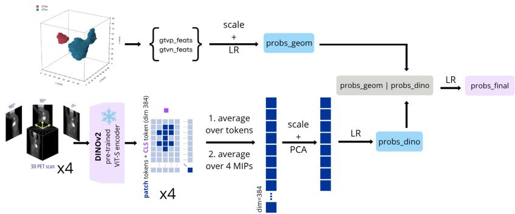
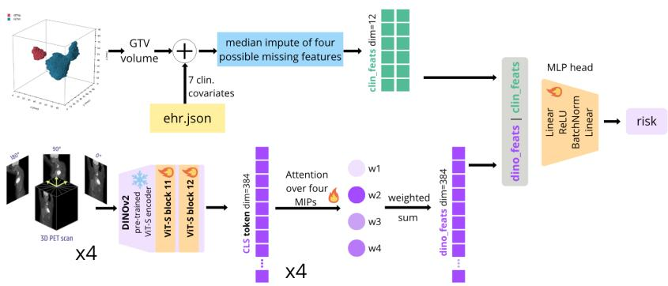

# BRACHIO: Broad Representations Across Centres for Head-and-neck Imaging Oncology

Roxanne De Maeyer1,2,3[0009−0001−7438−1235], Ine Dirks2,3[0000−0002−1648−0358], Yannick Brackenier1[0000−0002−9210−5939], Simon   
DeKeyser1[0000−0002−1322−7621], Jef Vandemeulebroucke2,3[0000−0001−5714−3254], and Vicky De Ridder1[0009−0003−9080−0676]

1 Nuclivision bv, Edward Pynaertkaai 87, 9000 Gent, Belgium 2 Vrije Universiteit Brussel (VUB), Pleinlaan 2, 1050 Brussel, Belgium 3 imec, Kapeldreef 75, 3001 Leuven, Belgium

Abstract. The HECKTOR 2026 challenge benchmarks machine learning for head and neck cancer, where teams delineate primary and nodal tumour volumes, perform TN staging, and predict recurrence-free survival (RFS). This report describes the submissions for the HECKTOR challenge of team nucli.

As the three tasks span both dense and global information from multicentric PET/CT scans, we utilise self-supervised pre-trained encoders, training a 2D DINOv2 encoder (PET-DINOv2-MIPs) on HECKTOR 2026’s PET scans. Our final test submission ensembles a DynUNet trained from scratch with a SwinUNETR whose Swin trunk was initialised from a SimMIM-pre-trained checkpoint for segmentation, reaching a mean Dice of 0.5409. For TN staging, GTVp/GTVn geometric features from the segmentation masks are fit to stage probabilities by logistic regression (LR) and fused with PET-DINOv2-MIPs deep features (PCA + LR) via a second-level LR, reaching balanced accuracies of 0.3962 (T-stage) and 0.6432 (N-stage). For the RFS prognosis task, we fine-tune the last two blocks of the PET-DINOv2-MIPs ViT-S encoder jointly with an MLP head under a CoxPH loss, concatenating clinical covariates with the imaging features, reaching a test Harrell’s C-index of 0.6577 and a weighted challenge score of 0.5802. The prognosis result is comparable to the best entry of the previous edition and consistent with our internal cross-validation, while our segmentation result is well below it and limits the staging results that depend on it.

Keywords: HECKTOR 2026 · DINOv2 · Segmentation · TN staging · Recurrence-free survival prognosis

## 1 Introduction

Treatment options in head and neck (H&N) cancer considerably impact patient quality of life, even with positive survival outcomes. Selection of a treatment regime that is curative yet minimises impact on later quality of life is therefore essential [6], which requires an estimate of the patient’s recurrence risk. Estimating this risk consistently is dificult: current risk profiling combines noisy factors (self-reported smoking and alcohol history, performance status, comorbidity, treatment history, and scanner-dependent PET markers [2]) via clinical judgement rather than a fitted estimator, and not all factors are available in every hospital. Machine learning ofers reproducible risk estimates fitted directly to observed outcomes [16], but whether these transfer beyond their development cohort is a separate question that single-centre studies cannot answer.

The HECKTOR 2026 challenge addresses this directly, providing ≈700 training cases from 8 sites, ≈50 validation patients from unseen centres, and ≈400 test subjects from three centres (only one overlapping with training), spanning scanner generations and protocols. It consists of an automated tumour segmentation task and two image-level tasks, TN staging and recurrence-free survival (RFS) prognosis. Segmentation provides a label for every voxel of every case. Prognosis provides one time-to-event label per patient, of which only 148 of 727 in the 2026 training cohort are uncensored events. From this limited data volume a model must learn both a prognostic representation and robustness to scanners it has not seen before. The 2025 edition shows the consequence: one RFS entry reached cross-validation C-index near 0.71, yet fell to 0.53 on the multi-centre test cohort, while segmentation performance from the same pipeline held [14].

Self-supervised pre-training (SSL) is a natural response, as it consumes no label information and can exploit the full imaging distribution rather than only the labelled subset. We therefore decouple representation learning from the downstream objectives. Because the three tasks difer in what they require of a representation, we pre-train two encoders: a DINOv2 encoder on 2D maximumintensity projections (MIPs) of PET, used for the image-level staging and prognosis tasks, and a Swin transformer masked image model on 3D PET/CT, to retain the spatial detail for dense segmentation. Our goal is to evaluate how well these HECKTOR-only representations transfer to the three tasks, and whether they hold up across centres between internal cross-validation and the held-out test cohort. We do not claim a controlled measurement of the benefit of pretraining itself; the reported experiments do not isolate it (Section 3.4).

## 2 Methods

## 2.1 Data

All models are trained on HECKTOR 2026 data only, as no external training data was allowed. The dataset is described in detail in the accompanying data descriptor [13], and the preceding edition of the benchmark in [14]; further task and split details are on the challenge website: https://hecktor26. grand-challenge.org/.

## 2.2 Self-supervised pre-training methods

DINOv2 is an SSL method known to transfer well to both global and dense downstream tasks [1]. It trains a student Vision Transformer (ViT) against an

EMA teacher on CLS tokens only [3], giving strong image-level but weaker dense features. DINOv2 [12] adds an iBOT [21] loss on masked patch tokens, creating features better suited to dense tasks. We build on DINOv2, as the newer DI-NOv3 [15] is designed for a billion-image, billion-parameter regime less suited to the smaller datasets common in medical imaging. We pre-train on 2D MIPs of the provided 3D PET data, since whole 3D PET volumes tend to be largely sparse. The value of MIPs for global tasks has been shown in earlier work [11].

Each PET volume is processed into 4 MIPs from oblique angles $( 0 ^ { \circ } , 4 5 ^ { \circ } , 9 0 ^ { \circ }$ $1 3 5 ^ { \circ } )$ , resampled to 2.0 mm isotropic pixel spacing, rendered at $4 8 0 \times 4 8 0$ and pre-processed with log1p. The backbone is a standard ViT-S/16 [5] (dim=384, blocks=12, heads=6, head dim=64, MLP hidden=1536, ≈ 21.5M parameters), trained on a single NVIDIA A100-80GB for 1600 epochs at batch size 128, with hyperparameters similar to [12]. This encoder is used in Tasks 2 and 3 and is further referred to as $P E T { \mathrm { - } } { \bar { D } } I { \bar { N } } O v { \mathcal { Q } } { \mathrm { - } } M I P s .$

SimMIM Masked Autoencoders [9] transfer exceptionally well to dense tasks such as segmentation, but appear to be outperformed by contrastively pretrained encoders on global tasks [18], so we use masked image modelling for the segmentation task only. We pre-train the Swin transformer encoder of SwinUNETR [8] (feature\_size = 48, depths (2, 2, 2, 2), heads (3, 6, 12, 24)) on two-channel (PET, CT) 1283 volumes under the SimMIM formulation [20], following [17]: 323 patches are masked at a ratio of 0.6 and reconstructed under an $\ell _ { 2 }$ loss, with all-background patches excluded from the loss. Both modalities are resampled to 1.5 mm isotropic spacing; PET is transformed with log1p, CT is windowed to (−200, 200) HU and rescaled to [0, 1]. Training runs for 800 epochs with Adam (base learning rate $1 0 ^ { - 4 }$ , efective batch 8).

## 2.3 Task 1: Segmentation

During the validation phase, leaderboard performance and performance on our in-house held-out set of 61 patients (random centre-stratified split, seed 42) diverged substantially across evaluated models, so we adopted an ensembling strategy. Both submitted ensembles build on a single-stage DynUNet, trained from scratch on the three-class task (background, $\mathrm { G T V } _ { p } , \mathrm { G T V } _ { n } \ )$ from PET and CT, resampled to 2 mm isotropic spacing, PET clipped to [0, 15] SUV, CT windowed to (−200, 200) HU, both rescaled to [0, 1]. Architecture followed nnU-Net configuration rules [10] (MONAI 1.4.0 DynUNet): six resolution levels, $3 \times 3 \times 3$ kernels, five stride-2 downsamplings, instance normalisation, residual blocks, deep supervision with three auxiliary decoder outputs. Training: random $1 2 8 ^ { 3 }$ patches, 4 per volume, batch size 2 (efective 8), Adam (lr 0.01, no weight decay, polynomial decay power 0.9), 1000 epochs, augmented with random afine transforms, axis flips, Gaussian noise, Gaussian smoothing and intensity scaling; objective softmax Dice over both foreground classes plus voxelwise cross-entropy over all three. The validation-phase submission paired it with a two-stage variant of identical configuration (binary lesion mask, 1000 epochs; refined to three classes, 700 epochs, binary prediction as third input channel).

For the test phase we bundled this DynUNet with one additional model each: test\_sub\_nnU with a from-scratch residual-encoder nnU-Net, and test\_sub\_Swin with a SwinUNETR whose Swin trunk was initialised from the SimMIM checkpoint. Both were trained in a separate framework sharing one data pipeline, five-fold split and objective; only network and optimizer schedule difered. PET, CT and reference segmentations were cropped to the superior 400 mm and resampled to 1.5 mm isotropic resolution; preprocessing matched the DynUNet apart from SUV clipping (20 for nnU-Net, 50 for SwinUNETR). Training used $1 2 8 ^ { 3 }$ patches, 500 per epoch with one third lesion-centred, the nnU-Net augmentation set, the same objective, efective batch size two and 500 epochs. The nnU-Net (six resolution levels, [32, 64, 96, 128, 128, 128] features, [1, 3, 4, 6, 6, 6] residual blocks, deep supervision at every decoder scale, 22.3M parameters) used SGD (Nesterov momentum 0.99, lr 0.01, weight decay $3 \times 1 0 ^ { - 5 } )$ under the same polynomial schedule; the SwinUNETR (62.2M parameters, Swin trunk 8.06M) was fine-tuned end to end with AdamW (lr 10−4, weight decay $1 0 ^ { - 5 } )$ , a ten-epoch warm-up and cosine annealing, without deep supervision.

At inference each member predicts on its own grid with sliding-window inference $( 1 2 8 ^ { 3 }$ windows, 50% overlap, Gaussian weighting, no test-time augmentation); per-class probability volumes are resampled onto a shared grid, averaged with equal weight, argmaxed once and cropped to the superior 400 mm. Due to time constraints, each member is a single-fold model.

## 2.4 Task 2: Staging

TN staging is a multi-class classification problem, evaluated with balanced accuracy, i.e. recall averaged over the classes of each stage. We combine two classifiers, one on geometric features from the Task-1 masks and one on PET-DINOv2-MIPs embeddings, the final classification fused by a second-level logistic regression.

Geometric features (classifier 0a) N-stage labels were corrected by the organising team using AJCC 7th edition criteria [7] on the ground-truth masks; T-stage labels were not, and remain unreliable: geometric derivation from groundtruth masks reassigns 151 of 189 provided T1 cases and recovers none of the 118 T4 cases (defined by local invasion rather than $\mathrm { G T V _ { p } }$ characteristics), while shifting N-stage counts by at most 16 of 782 patients. We therefore do not derive stage directly from mask geometry, but extract 12 mask features covering the AJCC size, count and laterality criteria and fit a logistic regression onto stage probabilities: three for the primary (presence, greatest diameter of its largest connected component, total volume), four for node burden (presence, largest node diameter, number of node components, total volume), and five for criteria a single size threshold misses (second-largest node diameter, bilaterality flag, number of ipsi- and contralateral nodes, largest contralateral node diameter). Diameters are maximum Feret diameters, laterality is relative to the primary’s side of the midline, and no minimum-size filtering of nodal components was applied (threshold of one voxel). On ground-truth masks this gives 0.964 N-staging balanced accuracy but only 0.399 for T.

SSL encoder features (classifier 0b) To avoid relying solely on the Task-1 masks, a second, mask-independent classifier uses the frozen PET-DINOv2- MIPs encoder (Section 2.2), with PET pre-processed as during pre-training. Each MIP is encoded separately, yielding 30 × 30 = 900 patch tokens and one CLS token, averaged into one 384-dim token per MIP; the four per-patient tokens are averaged into a final 384-dim vector, reduced by PCA to 8 components and mapped to per-class T/N probabilities by a logistic regression.

  
Fig. 1. Graphic visualisation of the proposed methodology for Task 2, using a fusion of geometric features and extracted PET-DINOv2-MIPs features. LR = logistic regression, PCA = principal component analysis feature reduction.

Fusion Direct concatenation would let the dense 384-dim imaging block dominate the regularisation path of the 12 geometric features, so we use late fusion (stacked generalisation [19], Fig. 1): each view is fitted independently as a level-0 classifier and a level-1 logistic regression learns how much to trust each view per class, 5 fold cross-validated. To avoid leaking in-sample confidence, the level-1 model is fitted exclusively on out-of-fold level-0 probabilities, with standardisation, PCA and the level-0 classifiers refitted per fold on patients they never saw. For deployment the level-0 models are refitted on the full training set, while the level-1 model is kept as trained on the out-of-fold matrix. All three are multinomial logistic regressions (L-BFGS, ℓ2 regularisation, class-balanced weights against the strong imbalance, in particular N2), with min(5, mink nk) folds: 5 for N, 3 for T, the latter limited by the rarity of T0.

Provenance of the segmentation masks The out-of-fold protocol applies to the staging classifiers only, not to the masks they consume: geometric features were computed from masks inferred for all training patients. Mask quality underlying Table 2 is therefore optimistic relative to deployment. The submitted pipeline uses the mask of its own Task-1 stage, so the geometric features difer between submissions.

  
Fig. 2. Graphic visualisation of the proposed methodology for Task 3. The submitted method was method 2, with a partially fine-tuned DINOv2 encoder, CLS-token features and MIP-attention pooling.

## 2.5 Task 3: Prognosis

The prognosis cohort consisted of 727 patients with RFS labels, of which 148 patients had events $/$ were not censored. Because of the low event count, the batch size was set at the maximum for compute capacity $\textstyle { \left( { \frac { 1 } { 4 } } \right. }$ of the training fold), stratified by centre and event.

SSL encoder features The prognosis task uses the PET-DINOv2-MIPs encoder (Section 2.2) and attaches a Cox survival head. The submitted model uses only the CLS token of each of the four MIPs; patch tokens and the GTV masks are not used to pool image features. CLS tokens gave better generalisation than GTV-masked patch tokens (Table 3) and decouple the prognosis branch from segmentation quality, which was the weakest component of our pipeline. The Task-1 mask therefore enters the prognosis model only through the derived $\mathrm { G T V } _ { p }$ volume covariate.

Clinical covariates Clinical covariates per patient are age, gender, tobacco consumption, alcohol consumption, HPV status, performance status, treatment status and $\mathrm { G T V } _ { p }$ volume (from the Task-1 segmentation mask). Age and $\mathrm { G T V } _ { p }$ volume are continuous, the remaining six are binary. Age was standardised to zero mean and unit variance using training-fold statistics. Four covariates are only partially observed (tobacco consumption, alcohol consumption, HPV status and performance status); these were median-imputed (training-fold only) with a binary missingness indicator appended per covariate, giving $8 + 4 = 1 2$ clinical features and a 384 + 12 = 396-dim input to the survival head.

Architecture of the Cox survival head The four per-MIP CLS tokens are combined by MIP-attention pooling: an attention MLP with tanh activation computes a normalised weight per MIP, and the weighted sum gives a single 384-dim patient vector. The survival head maps the fused 396-dim vector through Linear(396 → 128), ReLU, BatchNorm, Dropout(0.3), then a bias-free Linear(128 → 1) outputting a scalar risk (higher risk = shorter RFS). The

Table 1. Test-phase leaderboard results. Weighted is the challenge’s combined score over the three tasks. Both submissions use the same prognosis model and therefore have the same C-index.
<table><tr><td>Submission</td><td>Weighted</td><td>Mean Dice</td><td>RFS C-index</td><td>T bal. acc.</td><td>N bal. acc.</td></tr><tr><td>test_sub_Swin (final)</td><td>0.5802</td><td>0.5409</td><td>0.6577</td><td>0.3962</td><td>0.6432</td></tr><tr><td>test_sub_nnU</td><td>0.5447</td><td>0.4677</td><td>0.6577</td><td>0.4214</td><td>0.5195</td></tr></table>

Cox PH loss sorts patients by descending time. We tested two paradigms; the complete flow of the second (submitted) methodology is shown in Fig. 2.

1. Frozen encoder. Features pooled by masked mean over in-GTV patch tokens, standardised and reduced by PCA to 16 components, concatenated with the clinical covariates (PCA applied to the imaging block only), and fitted with an ℓ2-penalised CoxPH model [4] (λ = 0.1, penalised partial-likelihood maximisation). Standardisation, PCA and the Cox model are fitted on the training fold only and applied unchanged to the validation fold.

2. Fine-tuned encoder tail. The last two blocks and final norm of the ViT-S/16 DINOv2 encoder are fine-tuned jointly with the MIP-attention pooler, fusion MLP and a bias-free linear Cox head for 140 epochs. Trainable parameters: 3,650,562 total, of which 3,549,696 come from unfreezing the last encoder blocks; the remaining 17,921,280 encoder parameters stay frozen.

Both paradigms are evaluated under the same five-fold cross-validation, split randomly and stratified by event, so all rows of Table 3 are directly comparable. No prognosis configuration was cross-validated with centre-grouped folds, so these internal estimates do not measure cross-centre generalisation (Section 3.4).

## 3 Results & Discussion

Table 1 reports both submissions on the held-out test cohort. They difer in the second segmentation ensemble member and in the masks feeding the geometric staging classifier. test\_sub\_Swin was our final submission and scored higher on the weighted metric.

## 3.1 Task 1: Segmentation

Both test ensembles perform similarly on the 61-patient in-house set. For test\_sub\_nnU the $\mathrm { G T V } _ { p }$ Dice is 0.722 (false-positive volume 1.37 ml, false-negative volume 3.54 ml) and the $\mathrm { G T V } _ { n }$ Dice is 0.684 (3.22 ml, 3.94 ml); for test\_sub\_Swin these are 0.736 (1.65 ml, 3.19 ml) and 0.661 (3.91 ml, 4.03 ml). The validationphase ensemble reached 0.724 and 0.672 on the same set. This in-house ordering does not predict the test ordering, which is expected as the set shares centres with the training data and was used during model selection.

The mean Dice of 0.5409 on the test cohort is well below the 0.75 of the best 2025 entries, and the 0.073 diference between the two test ensembles is larger than the in-house diferences above. The SimMIM-initialised SwinUNETR ensemble generalised better than the from-scratch nnU-Net ensemble, but the two difer in architecture and optimizer schedule as well as in initialisation, so this is not evidence for pre-training. Individual ensemble members are not reported: they were trained by diferent authors in two separate frameworks and were not all evaluated on a common held-out split, so their Dice values are not comparable.

## 3.2 Task 2: Staging

Table 2 shows in-house staging results via 3- and 5-fold cross-validation for Tand N-staging respectively, per segmentation source and per method. Adding DINO features improved T-staging and slightly degraded N-staging, both inhouse and on the validation leaderboard: with masks from the validation-phase ensemble, fusion reached 0.418 (T) and 0.679 (N) against 0.385 and 0.686 for geometric features alone. We therefore continued with late fusion for the test phase, assuming its added value lies mainly in generalisability towards unseen centres and in the harder T-staging task.

Table 2. Balanced accuracy for T-stage (3-fold) and N-stage (5-fold), comparing geometric features only (0a), DINO features only (0b) and fusion (level-1). The dino row is identical across sources by construction, as classifier 0b is mask-independent. Results are on held-out folds of the training dataset; the masks feeding the geometric features were not generated out-of-fold (Section 2.4). Best value per segmentation source and task in bold.
<table><tr><td rowspan="2">Model</td><td colspan="2">ground-truth</td><td colspan="2">test_sub_nnU</td><td colspan="2">test_sub_Swin</td></tr><tr><td>T</td><td>N</td><td>T</td><td>N</td><td>T</td><td>N</td></tr><tr><td>dino</td><td>0.251</td><td>0.278</td><td>0.251</td><td>0.278</td><td>0.251</td><td>0.278</td></tr><tr><td>geom</td><td>0.399</td><td>0.964</td><td>0.410</td><td>0.676</td><td>0.417</td><td>0.694</td></tr><tr><td>fusion</td><td>0.366</td><td>0.963</td><td>0.395</td><td>0.663</td><td>0.403</td><td>0.675</td></tr></table>

On the test cohort, T-staging reached 0.3962 (test\_sub\_Swin) and 0.4214 (test\_sub\_nnU), close to the ≈ 0.40 that the geometric classifier reaches on ground-truth masks. T-staging is therefore limited by the label definition rather than by segmentation quality: T4 is defined by local invasion and is not recoverable from a mask, and the provided T labels were not corrected against the masks. N-staging follows mask quality more closely: 0.6432 for the ensemble with the higher test Dice against 0.5195 for the other, a diference of 0.124 balanced accuracy for a 0.073 diference in mean Dice. Compared to the 0.964 reached on ground-truth masks, N-staging is limited almost entirely by Task-1 performance rather than by the classifier.

Table 3. Recurrence-free survival, internal cross-validation. All variants use the same PET-DINOv2-MIPs encoder followed by MIP-attention pooling, clinical fusion and a Cox head, and are evaluated under the same event-stratified five-fold cross-validation with random splits, so all rows are directly comparable. Values are mean ± standard deviation over five folds. The prognostic signal in the DINOv2 features is not well captured by a linear readout.
<table><tr><td>Model</td><td>Harrell&#x27;s C ↑</td></tr><tr><td>Clinical-only CoxPH (reference)</td><td> $0 . 6 0 9 \pm 0 . 0 0 8$ </td></tr><tr><td>Frozen encoder, deep Cox probe</td><td></td></tr><tr><td>GTV latent cross-attention, MLP head</td><td> $\mathbf { 0 . 6 8 8 \pm 0 . 0 4 2 }$ </td></tr><tr><td>GTV masked mean pool, MLP head</td><td> $0 . 6 7 5 \pm 0 . 0 4 4$ </td></tr><tr><td>Fine-tuned encoder tail (last 2 blocks + norm)</td><td></td></tr><tr><td>CLS tokens, MIP attention (submitted) GTV latent cross-attention, MLP head</td><td> $0 . 6 4 6 \pm 0 . 0 2 8$   $0 . 5 5 3 \pm 0 . 1 0 0$ </td></tr><tr><td>Validation leaderboard (submitted)</td><td> $0 . 8 8 9 3 ^ { \ S }$ </td></tr><tr><td>Test leaderboard (submitted)</td><td>0.6577</td></tr></table>

§ Computed on 50 validation patients with an undisclosed number of events.

## 3.3 Task 3: Prognosis

Table 3 shows the internal cross-validation results of the deep Cox head. Method 1 (frozen DINOv2 features, PCA, linear Cox model) reached maximum Harrell’s C-indices of 0.609 ± 0.008 (clinical only), $0 . 6 2 8 \pm 0 . 0 2 6$ (DINOv2 only) and $0 . 6 2 9 \pm 0 . 0 2 2$ (clinical + DINOv2) at 16 PCA components. Replacing the linear model by a deep Cox head on the same frozen features raised this to 0.688±0.042, indicating that the prognostic signal in the DINOv2 features is not well captured by a linear readout. he prognostic signal in the DINOv2 features is not well captured by a linear readout. Fine-tuning the encoder tail did not improve on the frozen encoder: at $0 . 6 4 6 \pm 0 . 0 2 8$ it falls below the best frozen configuration $( 0 . 6 8 8 \pm 0 . 0 4 2 )$ under the same folds. We nonetheless submitted the fine-tuned model, as it gave the highest validation-phase leaderboard score at the time of submission, and the shipped checkpoint was fold 0 at 0.710. On the test cohort it reached 0.6577, close to the cross-validation mean and within the fold-to-fold spread, while the validation-leaderboard C-index of 0.8893 overestimated test performance by 0.23. Internal cross-validation was therefore a better predictor of test performance than the 50-patient validation leaderboard, which is also the basis on which the submitted configuration was chosen over the better-scoring frozen probe. The test C-index is comparable to the best RFS entry of the 2025 edition (0.66) [14], obtained here from PET MIPs and clinical covariates only, without dose maps, without CT, and without using the segmentation masks to pool image features.

## 3.4 Limitations

Most of our development efort went to the self-supervised pre-training pipeline and the prognosis task, and comparatively little to the segmentation methodology. The test Dice of 0.5409, against 0.75 for the best 2025 entries, reflects this. Each ensemble member was submitted as a single-fold checkpoint instead of a 5-fold ensemble, only two members were combined per submission, and no test-time augmentation was used. Previous editions have been won by more extensively ensembled pipelines, so ensembling across folds and architectures would likely recover part of this gap.

Four choices limit the internal evidence. The 61-patient in-house set was split randomly with centre stratification rather than by centre, and was used during ensemble selection, so it is a development set. The masks used to fit classifier 0a were inferred for all training patients, including patients the segmentation models had seen during training. The submitted prognosis checkpoint is fold 0, selected as the best of five folds; retraining on all patients or ensembling the folds would have been a possible improvement. Finally, no prognosis configuration was cross-validated with centre-grouped folds, so none of our internal estimates measures cross-centre generalisation, despite that being a stated motivation of this work; that the test C-index landed close to the cross-validation mean is therefore reassuring but not something the internal protocol was designed to predict.

The experiments also do not isolate the contribution of pre-training itself, which would require the same architecture, schedule and CV regime with and without SSL initialisation. The SimMIM-initialised SwinUNETR difers from the from-scratch models in architecture and optimizer, the DINOv2 staging features are compared against geometric features rather than against a randomly initialised encoder, and the prognosis comparisons vary the head as well. Finally, the provided T-stage labels were not cleaned, and CT was not used for staging or prognosis despite being available.

## 4 Conclusion

We evaluated self-supervised pre-training for three head and neck oncology tasks in HECKTOR 2026. A PET-DINOv2-MIPs encoder, pre-trained exclusively on HECKTOR data, contributed features to both TN staging and RFS prognosis, while a SimMIM-pre-trained Swin transformer supported segmentation. Our final submission reached a weighted score of 0.5802, with a mean Dice of 0.5409, balanced accuracies of 0.3962 (T) and 0.6432 (N), and an RFS C-index of 0.6577. The prognosis result lies within the spread of our internal cross-validation and is comparable to the best entry of the previous edition, obtained from PET MIPs and clinical covariates alone. Segmentation was below the state of the art and limited N-staging, while T-staging is bounded by the label definition rather than by our models.

Future work includes ensembling segmentation predictions across all folds and architectures, incorporating CT into the staging and prognosis pipelines alongside PET, a matched pre-trained versus randomly initialised comparison to isolate the contribution of pre-training, centre-grouped cross-validation for the prognosis branch, and extending self-supervised pre-training to 3D DINOstyle models on PET/CT to better exploit volumetric context. Overall, the selfsupervised pre-trained encoders showed promising transfer performance on the image-level tasks, with the prognosis branch generalising from internal crossvalidation to the multi-centre test cohort.

Acknowledgments. This study was funded with a Baekeland mandate from VLAIO, grant number HBC.2025.0912.

Disclosure of Interests. Y. Brackenier, V. De Ridder and S. DeKeyser are employed by the company Nuclivision. R. De Maeyer is a PhD candidate co-funded by Nuclivision.

## References

1. Baharoon, M., Qureshi, W., Ouyang, J., Xu, Y., Aljouie, A., Peng, W.: Evaluating General Purpose Vision Foundation Models for Medical Image Analysis: An Experimental Study of DINOv2 on Radiology Benchmarks (Sep 2024). https://doi.org/10.48550/arXiv.2312.02366

2. Boellaard, R.: Standards for PET image acquisition and quantitative data analysis. Journal of Nuclear Medicine: Oficial Publication, Society of Nuclear Medicine 50 Suppl 1, 11S–20S (May 2009). https://doi.org/10.2967/jnumed.108.057182

3. Caron, M., Touvron, H., Misra, I., Jégou, H., Mairal, J., Bojanowski, P., Joulin, A.: Emerging Properties in Self-Supervised Vision Transformers (May 2021). https://doi.org/10.48550/arXiv.2104.14294

4. Cox, D.R.: Regression Models and Life-Tables. Journal of the Royal Statistical Society Series B: Statistical Methodology 34(2), 187–202 (Jan 1972). https://doi.org/10.1111/j.2517-6161.1972.tb00899.x

5. Dosovitskiy, A., Beyer, L., Kolesnikov, A., Weissenborn, D., Zhai, X., Unterthiner, T., Dehghani, M., Minderer, M., Heigold, G., Gelly, S., Uszkoreit, J., Houlsby, N.: An Image is Worth 16x16 Words: Transformers for Image Recognition at Scale (Jun 2021). https://doi.org/10.48550/arXiv.2010.11929

6. Duprez, F., Daisne, J.F., Longton, E., Nuyts, S.: De-escalation of head-and-neck cancer radiotherapy: Balancing cure and side efects. Frontiers in Oncology 16, 1798321 (2026). https://doi.org/10.3389/fonc.2026.1798321

7. Edge, S.B., Compton, C.C.: The American Joint Committee on Cancer: The 7th edition of the AJCC cancer staging manual and the future of TNM. Annals of Surgical Oncology 17(6), 1471–1474 (Jun 2010). https://doi.org/10.1245/s10434- 010-0985-4

8. Hatamizadeh, A., Nath, V., Tang, Y., Yang, D., Roth, H., Xu, D.: Swin UNETR: Swin Transformers for Semantic Segmentation of Brain Tumors in MRI Images (Jan 2022). https://doi.org/10.48550/arXiv.2201.01266

9. He, K., Chen, X., Xie, S., Li, Y., Dollár, P., Girshick, R.: Masked Autoencoders Are Scalable Vision Learners (Dec 2021). https://doi.org/10.48550/arXiv.2111.06377

10. Isensee, F., Jaeger, P.F., Kohl, S.A.A., Petersen, J., Maier-Hein, K.H.: nnU-Net: A self-configuring method for deep learning-based biomedical image segmentation. Nature Methods 18(2), 203–211 (Feb 2021). https://doi.org/10.1038/s41592-020- 01008-z

11. Li, D., Li, R., Ma, Y., Huang, S., Han, M., Gao, Y., Liang, Y.: Multi-view deep learning for automated lymphoma staging from 18F-FDG PET/CT: Physicianlevel accuracy with high-throughput workflow. EJNMMI Research 16(1), 48 (Feb 2026). https://doi.org/10.1186/s13550-025-01357-w

12. Oquab, M., Darcet, T., Moutakanni, T., Vo, H., Szafraniec, M., Khalidov, V., Fernandez, P., Haziza, D., Massa, F., El-Nouby, A., Assran, M., Ballas, N., Galuba, W., Howes, R., Huang, P.Y., Li, S.W., Misra, I., Rabbat, M., Sharma, V., Synnaeve, G., Xu, H., Jegou, H., Mairal, J., Labatut, P., Joulin, A., Bojanowski, P.: DINOv2: Learning Robust Visual Features without Supervision (Feb 2024). https://doi.org/10.48550/arXiv.2304.07193

13. Saeed, N., Hassan, S., Hardan, S., Aly, A., Taratynova, D., Nawaz, U., Khan, U., Ridzuan, M., Andrearczyk, V., Depeursinge, A., Xie, Y., Eugene, T., Metz, R., Dore, M., Delpon, G., Papineni, V.R.K., Wahid, K., Dede, C., Ali, A.M.S., Sjogreen, C., Naser, M., Fuller, C.D., Oreiller, V., Jreige, M., Prior, J.O., Rest, C.C.L., Tankyevych, O., Decazes, P., Ruan, S., Tanadini-Lang, S., Vallières, M., Elhalawani, H., Abgral, R., Floch, R., Kerleguer, K., Schick, U., Mauguen, M., Bourhis, D., Leclere, J.C., Sambourg, A., Rahmim, A., Hatt, M., Yaqub, M.: A Multimodal and Multi-centric Head and Neck Cancer Dataset for Segmentation, Diagnosis and Outcome Prediction (Sep 2025). https://doi.org/10.48550/arXiv.2509.00367

14. Saeed, N., Hassan, S., Hardan, S., Cai, L., Liang, X., Mazher, M., Qayyum, A., Bu, Y., Lyu, M., Lin, Y., Meng, M., Huang, C., Wang, L., Chamseddine, D., Ahrari, S., Wu, B., Chen, Y., Mao, F., Zhang, H., Zhao, B., Ray, S., Guo, M., Xiang, L., Dexl, J., Ingrisch, M., Depeursinge, A., Rahmim, A., Hatt, M., Andrearczyk, V., Yaqub, M.: HEad and neCK TumOR (HECKTOR) 2025: Benchmark of Segmentation, Diagnosis, and Prognosis in Multimodal PET/CT (Jun 2026). https://doi.org/10.48550/arXiv.2606.20143

15. Siméoni, O., Vo, H.V., Seitzer, M., Baldassarre, F., Oquab, M., Jose, C., Khalidov, V., Szafraniec, M., Yi, S., Ramamonjisoa, M., Massa, F., Haziza, D., Wehrstedt, L., Wang, J., Darcet, T., Moutakanni, T., Sentana, L., Roberts, C., Vedaldi, A., Tolan, J., Brandt, J., Couprie, C., Mairal, J., Jégou, H., Labatut, P., Bojanowski, P.: DINOv3 (Aug 2025). https://doi.org/10.48550/arXiv.2508.10104

16. Swanson, K., Wu, E., Zhang, A., Alizadeh, A.A., Zou, J.: From patterns to patients: Advances in clinical machine learning for cancer diagnosis, prognosis, and treatment. Cell 186(8), 1772–1791 (Apr 2023). https://doi.org/10.1016/j.cell.2023.01.035

17. Tang, Y., Yang, D., Li, W., Roth, H., Landman, B., Xu, D., Nath, V., Hatamizadeh, A.: Self-Supervised Pre-Training of Swin Transformers for 3D Medical Image Analysis (Mar 2022). https://doi.org/10.48550/arXiv.2111.14791

18. Wald, T., Ulrich, C., Suprijadi, J., Ziegler, S., Nohel, M., Peretzke, R., Köhler, G., Maier-Hein, K.H.: An OpenMind for 3D medical vision self-supervised learning (Apr 2025). https://doi.org/10.48550/arXiv.2412.17041

19. Wolpert, D.H.: Stacked generalization. Neural Networks 5(2), 241–259 (Jan 1992). https://doi.org/10.1016/S0893-6080(05)80023-1

20. Xie, Z., Zhang, Z., Cao, Y., Lin, Y., Bao, J., Yao, Z., Dai, Q., Hu, H.: SimMIM: A Simple Framework for Masked Image Modeling. In: 2022 IEEE/CVF Conference on Computer Vision and Pattern Recognition (CVPR). pp. 9643–9653 (Jun 2022). https://doi.org/10.1109/CVPR52688.2022.00943

21. Zhou, J., Wei, C., Wang, H., Shen, W., Xie, C., Yuille, A., Kong, T.: iBOT: Image BERT Pre-Training with Online Tokenizer (Jan 2022). https://doi.org/10.48550/arXiv.2111.07832