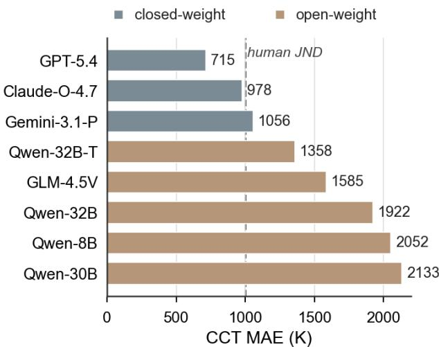
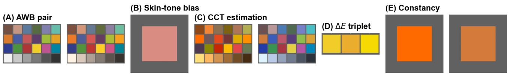
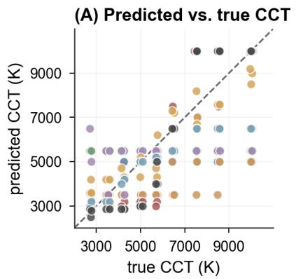
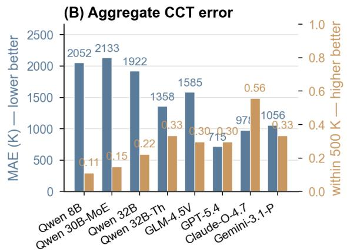
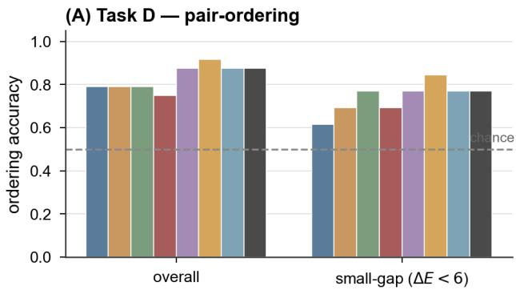
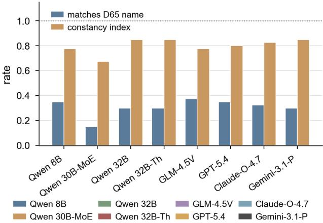

# Benchmarking color judgment in multimodal LLMs with CIEcomputable ground truth

Shuwei Yue1,, Kaida Xiao2, Zhihua Wang3, and Qiao Chen1

1Shenzhen Polytechnic University, Shenzhen, China

2University of Leeds, Leeds, United Kingdom

3Sun Yat-sen University, Guangzhou, China

Corresponding author: shuwei.yue@connect.polyu.hk

## Abstract

Multimodal large language models (MLLMs) are now used as zero-shot judges of image quality, but their color judgments are rarely tested with colorimetric ground truth. We present a fivetask benchmark based on the CIE colorimetric framework: AWB pair judgment, skin-tone bias direction, CCT estimation, ∆E2000 pair ordering, and color naming under changing illuminants. We test eight MLLM endpoints, including four Qwen3-VL variants, GLM-4.5V, GPT-5.4, Claude-Opus-4.7, and Gemini-3.1-Pro. The models often solve coarse binary AWB judgments, but they remain weak on numeric CCT estimation and on some fine colordifference judgments. On ColorChecker-24 stimuli, the three closed-weight frontier models reach CCT MAE of 715–1056 K, compared with 1358–2133 Kfor the five open-weight models. A non-ColorChecker control shows that this advantage is partly template-dependent. The results suggest that current MLLMs have useful color words and coarse visual priors, but their color judgments are not reliably calibrated to CIE-computable color differences.

## Introduction

Color is a core concern of any imaging pipeline. Cameras, displays, and printers all spend large compute budgets on white balance, color correction, and tone mapping, and all of these are tuned against physical color measurements. Multimodal large language models (MLLMs) are now being used in this pipeline as zero-shot quality judges [1, 2], but few benchmarks isolate color judgment against colorimetrically computable ground truth.

Recent MLLM-as-judge work matches human raters on aesthetic and document-quality tasks [1, 2]. However, these benchmarks use human-annotated ground truth, which mixes the model’s output with rater preference. This is a real drawback for color, where a ∆E around one is often treated as a just-noticeable difference under controlled viewing conditions — a precision that human raters cannot reliably deliver.

Color is one of the few visual attributes with a computable ground truth. Unlike object recognition or counting, color has standardized chromatic-adaptation transforms, correlated color temperature (CCT) loci, CIELab, and ∆E formulas, which together let us quantify errors in colorimetric units without human annotation. This is the property our benchmark uses.

We build on two recent lines of work. The MLLM-IQA work [1–3] shows that MLLMs can be prompted as visual judges, but its stimuli mix many low-level cues (sharpness, noise, exposure) and do not isolate color as a single variable. The generativecolor work [4,5] shows that even flagship T2I models miss named colors, but it tests generation, not perception. Our benchmark targets the perception side and uses the standard ColorChecker-24 stimulus design from classical color-constancy research [7, 8].

  
Figure 1. Headline CCT result. Closed-weight frontier endpoints reach lower CCT MAE on ColorChecker-24 than the tested open-weight endpoints. The dashed 1000 K line is a visual reference only; Kelvin is not perceptually uniform [11].

Contributions In this paper, we (1) introduce a five-task color benchmark whose ground truth is computed from the CIE colorimetric framework [9], not from human annotation; (2) evaluate eight MLLM endpoints across four vendors and show that coarse AWB judgments, numeric CCT estimation, perceptual ∆E2000 ordering, and grounded color naming fail in different ways; and (3) separate the observed failures into endpoint-family effects (warmbias and ∆E ordering plateau within Qwen), a daylight-band CCT central-tendency prior shared by the open-weight cluster, a D65- grounded naming bottleneck on Task E, and a model-specific pick-vs-name asymmetry in Claude-Opus-4.7. The benchmark, raw responses, and analysis scripts are released.

## Related work

Recent MLLM-as-judge benchmarks evaluate aesthetic, document, and low-level image quality with human labels [1–3], but their stimuli mix sharpness, exposure, noise, layout, and semantics, and do not isolate color against computable ground truth. A parallel line on generative color fidelity reports that text-to-image models often miss named colors or over-saturate them [4, 5], but it tests generation rather than perception. Classical color-constancy benchmarks such as Gehler–Shi and SFU automatic white balance (AWB) [7, 8] provide the ColorChecker stimulus convention and illuminant-estimation context, to which recent learning-based methods add pure-color and cross-sensor priors [13]. We reuse that stimulus convention to evaluate promptbased MLLMs rather than specialised AWB networks. Languageonly color-cognition work [6] motivates our interpretation of vocabulary-driven naming failures.

## Method

The benchmark contains five tasks that test different parts of MLLM color judgment: pair-wise discrimination (Tasks A and D), direction naming (Task B), numeric regression (Task C), and cross-illuminant naming consistency (Task E). All stimuli are generated with CIE colorimetric formulas. Tasks A–D have colorimetric ground truth, and Task E uses a fixed Lab-nearestneighbor color-name reference. All prompts return single-line JSON, so the benchmark can run on any OpenAI-compatible endpoint without model-specific code. Fig. 2 shows one representative stimulus per task.

Task A — AWB pair judgment The model sees two ColorChecker24 charts in random order, differing only in white balance: one adapted to D65, the other multiplied by a fixed R/B/G/M cast gain in linear sRGB. The model picks the correctlybalanced image and names the cast direction. 24 pairs: 4 cast types × 6 CCTs. Prompts are zero-shot with a fixed JSON schema; the cast label refers to the incorrect image (full prompts in the released repo).

Task B — skin-tone bias A single dark-skin or light-skin ColorChecker patch is shifted in CIELab by a known $( \Delta a ^ { * } , \Delta b ^ { * } )$ offset along one of 8 hue-clock directions, at three sizes (∆E ≈ 4,8,14). 48 stimuli. The model returns direction and size.

Task C — CCT estimation The chart is rendered as if captured under a target white point at CCT $T ~ \in ~ \{ 2 7 0 0 , 3 5 0 0 , 4 2 0 0 , 5 0 0 0 , 5 7 0 0 , 6 5 0 0 , 7 5 0 0 , 8 5 0 0 , 1 0 0 0 0 \}$ K with no white-balance correction. The white point is taken from the Planckian locus for $T \le 3 5 0 0 \mathrm { K }$ and from the CIE D-illuminant locus for $T \geq 4 2 0 0 \mathrm { K }$ (the CIE D polynomial is undefined below 4000 K). The model returns an integer CCT in Kelvin. 27 stimuli (9 CCTs × 3 noise seeds).

Task D — ∆E2000 pair ordering Three patches A, B, C are shown side by side. The model picks which pair, (A, B) or (A,C), has a larger color difference. Ground-truth $\Delta E _ { 2 0 0 0 }$ is computed from the underlying Lab values using the reference implementation [10]; pair gaps are kept at $\geq 4$ units to avoid forced ties. 24 stimuli.

Task E — color naming under illuminant The same underlying ColorChecker patch value is rendered with no chromatic adaptation under $T \in \{ 2 7 0 0 , 4 2 0 0 , 6 5 0 0 , 7 5 0 0 , 9 0 0 0 \} \mathrm { K } .$ The model names the color from the 11 basic-color terms of Berlin & Kay (red, orange, yellow, green, blue, purple, pink, brown, black, gray, white). The D65 reference name is assigned by $\Delta E _ { a b }$ nearest-neighbour to ISCC-NBS centroids in CIELab; there is no human annotation in the evaluation loop. 40 stimuli (8 patches × 5 illuminants). The raw constancy index is the per-patch fraction of renderings that get the same dominant name; FM4 reports the conditional variant.

Stimulus generation All stimuli follow four design rules. First, every correct answer can be computed from CIE 015:2018 colorimetric formulas [9], so no annotator is needed. Second, each stimulus varies along a single color dimension while luminance, layout, and image content are held fixed. Third, prompts are zeroshot with a single fixed template per task, temperature = 0, and no in-context examples, so reported scores reflect the model’s prior rather than prompt engineering. Fourth, stimuli are 480×320 PNGs and prompts return single-line JSON, so the benchmark runs against any OpenAI-compatible endpoint with no changes.

The 24 ColorChecker patches are stored as sRGB-encoded values under D65 (a colorimetric shortcut — they are not full reflectance spectra; v2 will use measured BabelColor CC spectra) and decoded to linear sRGB. The scene white at the target CCT is taken from the Planckian locus for $T \le 3 5 0 0 \mathrm { K }$ (where the CIE D polynomial is undefined) and from the CIE D locus above. A Bradford CAT then maps patches from D65 to the scene white; σ=0.01 Gaussian gain noise is added; values are clipped from below at zero (no upper clip), re-encoded to sRGB, and rasterised as a 480 × 320 PNG.

Models and protocol We evaluate eight MLLMs from four vendors. The Qwen3-VL family gives the primary axis: four variants on a single training stack isolate parameter scale and reasoning mode — Qwen3-VL-8B-Instruct (small dense), 30B-A3B-Instruct (Mixture-of-Experts, MoE; 3B active), 32B-Instruct (dense flagship), and 32B-Thinking (chain-of-thought). GLM-4.5V (Zhipu, 106B) is a cross-family probe trained on an independent corpus and visual encoder. The April 2026 closedweight frontier models — GPT-5.4 (OpenAI), Claude-Opus-4.7 (Anthropic), and Gemini-3.1-Pro-preview (Google) — serve as a contrastive control. A failure that survives the Qwen→GLM probe but breaks here points to a shared-prior origin rather than a single-stack artifact. Qwen and GLM are accessed via SiliconFlow; the three frontier models via OpenRouter (model IDs openai/gpt-5.4, anthropic/claude-opus-4.7, google/gemini-3.1-pro-preview). All calls use temperature = 0 and max tokens= 512; the larger cap accommodates the Thinking variant’s chain-of-thought. Because closed-weight endpoints can change without notice, all raw responses (including the call timestamps) are released with the benchmark.

## Experiments and results

We report headline accuracy on each of the five tasks (Table 1), then examine five repeated failure patterns (FM1–FM5) followed by a non-ColorChecker robustness check. Statistical intervals throughout are 1000-resample bootstrap 95% CIs unless noted otherwise.

Headline accuracy Table 1 gives the per-(model, task) headline metric. Five repeated failure patterns emerge from this matrix — each isolated to a particular vendor cluster, model family, or task axis. We describe FM1–FM5 , then report a non-CC robustness check that tests how much of the headline split is templatedependent.

Failure mode 1: warm-bias collapse (Qwen-specific) Qwen-8B and Qwen-30B-MoE both collapse to the “warm” label and achieve chance-level A-bias accuracy (0.25), while Qwen-32B, GLM-4.5V, and the three frontier models reach 0.92–1.00. Because the two failing variants are also the two with the fewest active parameters per token (Qwen-30B-MoE has only 3B active), the benchmark cannot separate a Qwen-family prior from a low-active-parameter effect; the cleanest reading is the conjunction. Warm-color vocabulary is over-represented in language-corpus statistics [6], consistent with a vocabularydriven rather than perceptual origin for the collapse.

  
Figure 2. Representative stimuli for the five tasks. (A) Task A AWB pair (correct vs. wrong). (B) Task B skin-tone bias direction. (C) Task C ColorChecker rendered at 2700 and 10000K. (D) Task D ∆E ordering triplet. (E) Task E color constancy — the same patch under 2700 and 9000K. All stimuli are 480×320 PNGs.

Table 1. Headline accuracy on the five color tasks for eight MLLMs, grouped by access mode. Each cell: mean with 95% bootstrap CI (1000 resamples). Bold = best, underline = 2nd-best per column. Chance: A which = 0.50, A bias = 0.25 (4-way), B dir±1 = 0.375 (3 of 8 clock positions), D order = 0.50. “1.00 [.86,1]” uses the Clopper-Pearson 95% lower bound for 24/24 successes (vs. the zero-variance bootstrap [1,1]). Task E “raw constancy” rewards stable-but-wrong names; read together with the conditional analysis (FM4).
<table><tr><td>Model</td><td>A which n=24, ↑</td><td>A bias n=24, ↑</td><td>B dir±1 n=48, ↑</td><td>CMAEK n=27, ↓</td><td>C ≤500K n=27,↑</td><td>D order n=24,↑</td><td>E raw const. n=8 patch, ↑</td></tr><tr><td colspan="8">Qwen3-VL family — open-weight, scale + reasoning axis</td></tr><tr><td>8B-Instruct</td><td>0.58 [.38,.79]</td><td>0.25 [.08,.46]</td><td>0.60 [.48,.73]</td><td>2052 [1522,2537]</td><td>0.11 [.00,.26]</td><td>0.79 [.62,.92]</td><td>0.78 [.65,.90]</td></tr><tr><td>30B-A3B-Instruct</td><td>0.67 [.46,.83]</td><td>0.25 [.08,.46]</td><td>0.52 [.39,.67]</td><td>2133 [1511,2774]</td><td>0.15 [.04,.30]</td><td>0.79 [.62,.92]</td><td>0.68 [.55,.80]</td></tr><tr><td>32B-Instruct</td><td>1.00 [.86,1]</td><td>1.00 [.86,1]</td><td>0.60 [.48,.75]</td><td>1922 [1459,2411]</td><td>0.22 [.07,.41]</td><td>0.79 [.62,.92]</td><td>0.85 [.73,.95]</td></tr><tr><td>32B-Thinking</td><td>1.00 [.86,1]</td><td>1.00 [.86,1]</td><td>0.67 [.54,.81]</td><td>1358[ 950,1808]</td><td>0.33 [.17,.54]</td><td>0.75 [.58,.92]</td><td>0.85 [.73,.95]</td></tr><tr><td colspan="8">GLM-4.5V — open-weight cross-family probe (independent stack)</td></tr><tr><td>GLM-4.5V</td><td>1.00 [.86,1]</td><td>0.92 [.79,1.0]</td><td>0.60 [.46,.75]</td><td>1585 [1115,2048]</td><td>0.30 [.15,.48]</td><td>0.88 [.71,1.0]</td><td>0.78 [.65,.90]</td></tr><tr><td colspan="8">Closed-weight frontier (April 2026)</td></tr><tr><td>GPT-5.4</td><td>1.00 [.86,1]</td><td>1.00 [.86,1]</td><td>0.79 [.67,.90]</td><td>715 [ 563, 863]</td><td>0.30 [.11,.48]</td><td>0.92 [.79,1.0]</td><td>0.80 [.68,.90]</td></tr><tr><td>Claude-Opus-4.7</td><td>0.67 [.50,.88]</td><td>1.00 [.86,1]</td><td>0.56 [.44,.71]</td><td>978 [ 589,1411]</td><td>0.56 [.37,.74]</td><td>0.88 [.75,1.0]</td><td>0.83 [.70,.95]</td></tr><tr><td>Gemini-3.1-Pro</td><td>1.00 [.86,1]</td><td>1.00 [.86,1]</td><td>0.75 [.63,.88]</td><td>1056 [722,1418]</td><td>0.33 [.15,.52]</td><td>0.88 [.75,1.0]</td><td>0.85 [.73,.95]</td></tr></table>

Failure mode 2: 5500 K central-tendency anchor (sharedprior cluster) Five of eight models return CCT values in a narrow daylight band regardless of the true illuminant (Fig. 3A). The most extreme case is Qwen-32B-Instruct, which returns 5500 K for all 27 of 27 stimuli — a single-value predictor whose response is independent of the input. The other four anchored models cluster in the daylight band but with model-specific anchors (e.g. Qwen-30B-MoE collapses to 3500 K and 5000 K but never 5500 K; Qwen-8B is bimodal at 5500/5000 K). The shared property is therefore a daylight-band central-tendency regression, not a literal 5500 K collapse. Note that 5500 K is closer to D55 (∼5503 K) than to D65 (6504 K) and lies below the K-space midpoint (∼6350 K) and median (5700 K) of our GT — more consistent with an sRGB-encoding prior than a D65-illuminant prior. Mean absolute error (Fig. 3B, blue bars) splits into two clusters: 1358–2133 K for the five anchored models and 715–1056 K for the three frontier closed-weight models, a 2–3× reduction (permodel values in Table 1). Within-500 K rate (orange bars) tells the same story: Claude reaches 0.556 (∼ 5× the Qwen-8B baseline), and the only anchored model that gets within striking distance is Qwen-32B-Thinking at 0.333.

The cross-family test rules out a single-model-family effect: GLM-4.5V, trained on an independent corpus and visual encoder, also clusters its 27 predictions in the 5500–6500 K band. But the three frontier closed-weight models break the anchor: GPT-5.4 tracks identity within ∼700 K on average, Claude-Opus-4.7 reaches the highest within-500 K rate, and Gemini-3.1-Pro spreads its predictions across the full 2700–10000 K range. The shared anchor across Qwen and GLM points to a common prior inside the open-weight cluster, but our experiments do not identify the source: candidate explanations include over- representation of daylight-balanced sRGB photography in the open-weight pretraining ecosystem and reinforcement learning from human feedback (RLHF) preference tuning that shapes numeric outputs in the closed-weight models. Neither is testable from the benchmark alone.

Failure mode 3: ∆E ordering plateau (Qwen-specific) All four Qwen variants plateau at 0.75–0.79 ∆E ordering accuracy; GLM-4.5V, Claude-Opus-4.7, and Gemini-3.1-Pro reach 0.875 and GPT-5.4 reaches 0.917 (Fig. 4A). Among the 4 of 24 triplets where linear-sRGB distance and ∆E2000 rank pairs differently, no model consistently follows the RGB ranking. The plateau is therefore better described as weak perceptual calibration on small

  
Figure 3. Task C — CCT estimation across the full 9-CCT, 27-stimulus task. (A) Predicted vs. true CCT scatter. Five models (the four Qwen variants + GLM-4.5V) cluster around a dashed 5500 K daylight-band anchor (closer to D55 than to D65) regardless of the true illuminant; GPT-5.4, Claude-Opus-4.7, and Gemini-3.1-Pro track the identity line. (B) Aggregate mean absolute error (lower is better, blue, left axis) and within-500K rate (higher is better, orange, right axis). GPT-5.4 cuts MAE by 2.9× over Qwen-8B; Claude-Opus-4.7 reaches the highest within-500Krate ofany model.

## ∆E than as a simple RGB-distance rule.

Failure mode 4: D65-grounded naming bottleneck on Task E The raw constancy index is misleading because a model that locks onto any stable name — correct or not — scores high (Fig. 4B; Qwen-8B’s 0.775 includes “brown” answered for nearly every warm-toned patch). Under conditional constancy — consistency computed only on patches whose 6500 K baseline name matches D65 ground truth — the apparent 0.68–0.85 spread collapses: 7 of 8 models tie at 0.733, only Qwen-30B-MoE drops to 0.500, and the frontier advantage disappears. Only 2–3 of 8 patches qualify per model (yellow, purple, brown are mis-named at D65 by nearly every model). The bottleneck is D65-grounded naming, not cross-illuminant stability. Task B shows the same vocabulary bias on a different stimulus: under the adjacent-clock chance of 0.375 (n=48), only GPT-5.4 (0.79) and Gemini-3.1-Pro (0.75) are clearly above chance, and cool skin-tone shifts are consistently mis-named as red or yellow.

Failure mode 5: Claude-Opus-4.7 pick-vs-name asymmetry Claude names the cast direction perfectly on Task A (bias = 1.000) but picks the correctly-white-balanced image only 0.667 of the time. The 8 wrong-which trials split 4-A/4-B (matching the ground-truth A/B distribution), ruling out a position bias. We report this only as an observation to be tested in future work; possible explanations include prompt effects and sensitivity to the red–green axis near D65.

Robustness check: non-ColorChecker control As ColorChecker-24 is heavily seen in training data, we re-rendered Task C with 24 random sRGB-cube patches (identical pipeline otherwise) and re-ran all 8 models. GPT-5.4 (715 K → 1417 K), Gemini-3.1-Pro (1056 K → 1793 K), and Qwen-32B-Thinking (1358 K → 2189 K, the largest degradation in the panel) all lose substantial accuracy without the CC template, indicating that the frontier and chain-of-thought advantages come partly from template-recognition priors. Qwen-32B-Instruct holds at 1922 K, confirming its daylight-band anchor is a model property and not a template artifact. Claude-Opus-4.7 is the only model that improves on template removal (978 K → 752 K).

(B) Task E — naming under illuminant  
  
Figure 4. Tasks D and E, eight models. (A) ∆E pair-ordering accuracy (chance = 0.5). The four Qwen variants cluster in a tight 0.75–0.79 plateau; GLM-4.5V, Claude-Opus-4.7, Gemini-3.1-Pro all reach 0.875 and GPT-5.4 reaches 0.917. The plateau is Qwen-specific. (B) Matches-D65-name accuracy (blue) and cross-illuminant constancy index (orange) per model. Constancyclusters in a 0.675–0.850 bandacross all eightmodels; GLM-4.5Vtops matches-D65 at 0.375.

## Discussion

The eight-model set lets us group the findings by what changes across models: model family, vendor access tier, or single-model identity. We discuss practical use, failure grouping, and limitations in turn.

Use in color-aware pipelines Today’s MLLMs cannot replace classical camera-characterisation tools for fine color judgments. That said, GPT-5.4 and Gemini-3.1-Pro both score 1.000 on both halves of Task A. Flagship MLLMs can therefore serve as coarse screening checks in pipelines where no physical ground truth is on hand. As order-of-magnitude calibration points: human chromatic illumination-discrimination thresholds reported by Pearce et al. [11] are on the order of ∼3–7 perceptual $u ^ { \prime } \nu ^ { \prime }$ steps near a 6700 K daylight reference; we do not project this onto Kelvin because Kelvin is not perceptually uniform. On the engineering side, classical learning-based AWB on Gehler– Shi reaches mean angular error ∼ 1.78◦ [12], well below the chromatic-discrimination range of any MLLM in our evaluation. The frontier MLLM CCT MAE of 715–1056 K therefore falls in a range comparable in magnitude to reported human illuminationdiscrimination thresholds near daylight, while remaining far from specialised AWB systems. The open-weight cluster sits well above this floor on CCT but matches frontier on binary AWB, so the pipeline choice depends on whether the downstream task asks for a binary judgment or a numeric Kelvin reading.

A failure-mode taxonomy The matrix sorts FM1–FM5 into four classes that a single-family study cannot tell apart: Qwenfamily-specific (FM1, FM3 — warm-bias and ∆E plateau, source unidentified by the benchmark); shared-prior cluster (FM2 — daylight-band anchor that survives the Qwen→GLM probe but breaks at the open-weight→frontier boundary); D65-grounded naming bottleneck (FM4 — across all eight models, read as a possible ceiling under this stimulus/prompt protocol, not architectural); and model-specific (FM5 Claude pick-vs-name, kept as one hypothesis among several).

Limitations Stimuli are synthetic charts, not natural scenes; a future version will use SFU AWB and Gehler–Shi photographs. Three caveats: (a) pipeline confounds — the metameric shortcut (sRGB values treated as reflectance under D65) and the different visual-encoder tokenisation across the eight models may both contribute to cross-model differences, especially on Task A; v2 will use measured BabelColor spectra and report tokenisation statistics. (b) prompt sensitivity — a single fixed prompt per task cannot separate prompt effects from chromatic perception; a 3- prompt ablation is deferred to v2. (c) numeric output confound — CCT-in-Kelvin may test calibrated numeric output as much as chromatic estimation; a CCT-bin classification variant will accompany the regression in v2. Without a human baseline we cannot claim MLLMs are worse than humans, only that they do not match colorimetric ground truth; a 30-participant study on Tasks A and B is underway.

## Conclusion

We introduced a five-task, CIE-computable benchmark for evaluating MLLM color judgment. Across eight endpoints, coarse AWB decisions are often solved, but CCT estimation, ∆E2000 ordering, and grounded color naming remain poorly calibrated. The strongest split appears in Task C: tested openweight endpoints show daylight-band central-tendency anchors, while frontier endpoints reduce CCT error — partly through ColorChecker-template priors, as the non-CC control reveals. The benchmark is limited to synthetic chart stimuli, a single prompt per task, and sRGB-based rather than spectral rendering; we plan to address these in the next benchmark version.

## References

[1] J. Huang et al., Q-Doc: Benchmarking document image quality as sessment capabilities in multi-modal large language models, arXiv preprint arXiv:2511.11410 (2025).

[2] X. Li et al., Q-Probe: Scaling image quality assessment to high resolution via context-aware agentic probing, arXiv preprint arXiv:2601.15356 (2026).

[3] Y. Li et al., Investigate the low-level visual perception in vision-language based image quality assessment, arXiv preprint arXiv:2512.09573 (2025).

[4] Z. Fang et al., Too vivid to be real? Benchmarking and calibrating generative color fidelity, arXiv preprint arXiv:2603.10990 (2026).

[5] S.-L. Tsai et al., Color me correctly: Bridging perceptual color spaces and text embeddings for improved diffusion generation, arXiv preprint arXiv:2509.10058 (2025).

[6] M. Abdou et al., Can language models encode perceptual structure without grounding? A case study in color, arXiv preprint arXiv:2109.06129 (2021).

[7] P. V. Gehler, C. Rother, A. Blake, T. Sharp, and T. Minka, Bayesian color constancy revisited, In Proc. CVPR, (2008).

[8] F. Ciurea and B. Funt, A large image database for color constancy research, In Proc. Color and Imaging Conference, pg. 160 (2003).

[9] CIE, Colorimetry, 4th edition, CIE 015:2018 (2018).

[10] G. Sharma, W. Wu, and E. N. Dalal, The CIEDE2000 colordifference formula: Implementation notes, supplementary test data, and mathematical observations, Color Res. Appl., 30, 21 (2005).

[11] B. Pearce, S. Crichton, M. Mackiewicz, G. D. Finlayson, and A. Hurlbert, Chromatic illumination discrimination ability reveals that human colour constancy is optimised for blue daylight illuminations, PLOS ONE, 9, e87989 (2014).

[12] J. T. Barron and Y.-T. Tsai, Fast Fourier color constancy, In Proc. CVPR, pg. 886 (2017).

[13] S. Yue and M. Wei, Effective cross-sensor color constancy using a dual-mapping strategy, J. Opt. Soc. Am. A, vol. 41 (2024).