  
Figure 1: Gallery for V-protocol.

# CAN IMAGE AGENTS COMPLETE VISUAL COMMIS-SIONS? A BENCHMARK AND MODULAR FRAMEWORK

Tong Li1, Lishuai Gao1,‡, Qi Zeng1, Yifan Li1,2, Cong Wei1, Zhuoliang Kang1, Xiaoming Wei1,   
1Meituan 2University of Science and Technology of China   
‡Project lead   
lt.litong@qq.com

## ABSTRACT

Visual commissions require image agents to integrate heterogeneous source materials, preserve requirements across dependent stages, and produce coordinated deliverables. Existing evaluations examine specific capabilities and execution settings, leaving end-to-end commission completion less understood. We introduce Visual Commission Bench (VCB), comprising 600 tasks across 12 categories and three complementary tiers, from capability-focused tasks to complete commissions. VCB uses 5,039 requirement checks and separate visual quality ratings to assess content correctness, visual realization, constraint preservation, and delivery completeness without prescribing an internal workflow. We present V-Protocol, a reference agent that dynamically composes reusable task, cognitive, and expression modules at inference time. Task modules organize delivery, cognitive modules derive content, and expression modules guide visual realization. The modules exchange structured intermediate artifacts, while a shared execution harness tracks artifact revisions and dependencies, manages tool execution, and checks completion. With the same controller and image generator as the agent baselines, V-Protocol achieves 69.0% strict task success on VCB, compared with 42.0% for SCOPE. On Mind-Bench, strict accuracy increases from 39.2% to 45.4%. The gallery for V-protocol could be found in Figure 1.

## 1 INTRODUCTION

Modern image models follow detailed instructions Wu et al. (2025) to produce high-quality visuals, with growing use in visual production tasks. A visual commission, however, may begin with incomplete requirements and heterogeneous source materials and involve multiple dependent stages before final delivery. For example, preparing promotional materials for a tea house may require identifying valid content, deciding how to present it across different assets, preserving relevant constraints through generation and revision, and producing a complete and coherent set of deliverables. Much of this process is still coordinated manually, while text-to-image generation serves as only one part of the workflow. We study whether image agents can carry out such visual commissions, from interpreting source materials through to producing the required deliverables, within a given execution budget. Figure 2 illustrates representative tasks and deliverables.

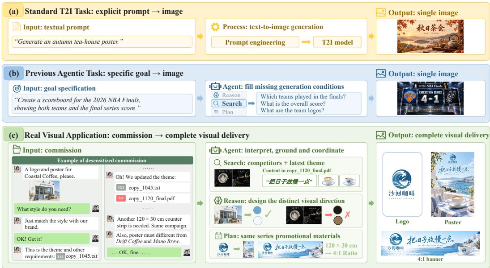  
Figure 2: From image generation to visual commission completion. (a). An explicit prompt guides image synthesis. (b). A specified generation goal is supplemented with missing information through reasoning, search, and planning. (c). A commission and its source materials require the agent to determine content and design, preserve active constraints, and coordinate the requested deliverables. VCB evaluates content correctness, visual realization, constraint preservation, and delivery completeness. The panels illustrate task settings rather than mutually exclusive method categories.

Existing evaluations have extended image generation beyond direct prompt following by introducing tasks that require reasoning, search, or planning Zhang et al. (2026); Ren et al. (2026); Tang et al. (2026); Ki et al. (2025). These settings provide valuable tests of capabilities and execution demands involved in visual production. A further question is whether success in these settings translates into reliable completion of visual commissions, where agents must integrate requirements and evidence distributed across source materials, carry intermediate decisions and constraints through dependent subtasks, and coordinate multiple deliverables. Evaluating these demands together allows us to examine how constituent capabilities support completion of the overall commission.

To address this question, we introduce Visual Commission Bench (VCB), comprising 600 tasks across 12 categories and three complementary tiers: Specific-Capability (S), Multi-Stage (M), and Commission-Level (C). S tasks isolate capabilities relevant to visual task completion, such as reasoning, planning, information extraction, and retrieval. M tasks examine how intermediate results, decisions, and constraints are carried across dependent stages. C tasks evaluate complete visual commissions from source materials to coordinated delivery. The three tiers distinguish evaluation scope and task dependencies rather than intrinsic difficulty or tool-call counts, allowing us to study both individual capabilities and how they contribute to end-to-end task completion. All tasks are evaluated through their delivered artifacts without prescribing an internal workflow. 5,039 carefully designed requirement checks are used to measure requirement-level fulfillment and derive task-level success.

VCB further reveals execution challenges that become salient at the commission level. Some trajectories make little observable task progress despite substantial interaction, with agents repeatedly revisiting guidance and source materials, checking unchanged states, or recovering from similar interface errors. These behaviors suggest that commission-level execution depends not only on the capabilities available to the agent, but also on how appropriate task procedures are selected, reused, and coordinated throughout execution Li et al. (2026c); Liu et al. (2026); Dong et al. (2026); Tan et al. (2026). This motivates us to examine structured support for both task guidance and execution management. Preliminary runs on VCB reveal execution difficulties in carrying visual commissions through to completion.

We present V-Protocol as a reference agent for end-to-end visual commission completion. V-Protocol organizes reusable task knowledge into task, cognitive, and expression modules, and dynamically selects compatible combinations based on the request. Task modules specify deliverable and execution dependencies, cognitive modules derive content from the inputs, and expression mod ules produce layout and rendering specifications. Selected modules exchange structured intermediate artifacts, while a shared harness Pan et al. (2026); Dantanarayana et al. (2026); Lu et al. (2026); Xia et al. (2026) manages stage transitions, tool execution, and completion checks. Together, these components support controlled study of visual commission completion while keeping the underlying foundation models fixed.

## 2 RELATED WORK

Benchmarks for image agents. WISE evaluates world knowledge integration Niu et al. (2026), while Mind-Bench and KnowGen assess reasoning and search in image generation He et al. (2026a); Feng et al. (2026). Gen-Arena measures entity and constraint satisfaction Ren et al. (2026), and IA-Bench covers planning, reasoning, search, and memory Zhang et al. (2026). GraphicBench and IGenBench examine graphic design and infographic reliability, respectively Ki et al. (2025); Tang et al. (2026). VCB evaluates complete visual commissions that require agents to integrate distributed source materials, preserve requirements across dependent stages, and coordinate multiple deliverables. It assesses the delivered artifacts without prescribing an internal workflow.

Agentic image generation. Gen-Searcher and Mind-Brush integrate retrieval and reasoning into generation Feng et al. (2026); He et al. (2026a). GenEvolve learns tool use from visual experi ence Chen et al. (2026b), and GEMS integrates memory and on-demand skills He et al. (2026b). SCOPE maintains evolving semantic specifications for conditional skill orchestration Ren et al. (2026), while Qwen-Image-Agent constructs generation context through planning and grounding Zhang et al. (2026). Other approaches use executable sketches Ye et al. (2026), adaptive work flow routing Chen et al. (2026a), or evolving skill harnesses Li et al. (2026d). V-Protocol coordinates reusable task, cognitive, and expression modules through structured intermediate artifacts, linking content derived from source materials to its use across visual deliverables.

Skills and execution management. AgentSkillOS and SkillSelect-Serve address skill organization and budget-aware selection Li et al. (2026a); Zheng et al. (2026); SkillSmith models comple mentarity and conflict among skills Wei et al. (2026). GraSP composes skills into typed dependency graphs with verification and local repair Xia et al. (2026). Natural-language harnesses expose reusable execution policies Pan et al. (2026), while SIGIL and ContractSkill make procedural guidance executable and checkable Dantanarayana et al. (2026); Lu et al. (2026). V-Protocol builds on these mechanisms to track artifact dependencies and completion conditions, leaving content and design decisions to the model. Visual checks assess requirement satisfaction alongside the harness’s checks on execution state.

## 3 VISUAL COMMISSION BENCHMARK

Visual Commission Benchmark (VCB) evaluates the capabilities required for visual commission completion at different levels. Tasks require agents to identify valid content from source materials, decide how to present it across different assets, preserve relevant constraints through generation and revision, and produce a complete and coherent set of deliverables. Evaluation is based on the submitted artifacts, covering content correctness, visual realization, constraint preservation, and delivery completeness without prescribing an internal workflow. Table 1 summarizes how VCB relates to existing evaluation settings. Figure 5 in the appendix provides an overview of V-Protocol, including adaptive module composition, protocol execution, and artifact revision management.

Table 1: Comparison of benchmark scale and evaluation focus. Checks denote task-specific verification items, while rating dimensions denote graded evaluation criteria. VCB broadens the evaluation toward end-to-end visual commission completion.
<table><tr><td>Benchmark</td><td># Tasks</td><td>Checks / Ratings</td><td>Primary focus</td></tr><tr><td>WISE</td><td>1,000</td><td>3-dim ratings</td><td>World-knowledge reasoning</td></tr><tr><td>Mind-Bench</td><td>500</td><td>1,633 checks</td><td>Reasoning and search</td></tr><tr><td>KnowGen</td><td>630</td><td>4-dim ratings</td><td>Search-grounded generation</td></tr><tr><td>Gen-Arena</td><td>300</td><td>2,533 checks</td><td>Entity and constraint satisfaction</td></tr><tr><td>IA-Bench¹</td><td>730</td><td>1,801 checks</td><td>Planning, reasoning, search, and memory</td></tr><tr><td>VCB (Ours)</td><td>600</td><td>5,039 checks + 4-dim ratings</td><td>Distributed-source integration, dependent subtask execution, and coordinated multi-artifact delivery</td></tr></table>

1 IA-Bench is a closed source internal evaluation benchmark.

## 3.1 TASK SCOPE AND PUBLIC INPUTS

As shown in Figure 3, VCB comprises 600 tasks across 12 categories, with 50 tasks per category, organized into three complementary tiers: Specific-Capability (S), Multi-Stage (M), and Commission-Level (C). S tasks emphasize a focal capability: reasoning, planning, long-context information extraction, or retrieval. M tasks examine how capabilities work together through iterative editing, visual goal interpretation, diagnosis and repair, and evidence synthesis. C tasks involve visual argu mentation, example-driven transfer, scientific visualization, and workspace-based design, requiring agents to make content and presentation decisions and organize the work needed for a complete delivery. The tiers provide a progression in evaluation scope and capability coordination without prescribing a fixed workflow or number of model and tool calls.

Each task provides a user request, access to its source materials, and designated output locations. Materials may include documents, tables, reference images, demonstrations, interaction histories, and workspace files. Task-relevant information and constraints may be distributed across the source materials, requiring agents to identify and integrate them. A task may require a single image, a sequence of edited images, or a coordinated set of visual artifacts. Private evaluation annotations specify how to assess requirements grounded in the request and materials, without adding undisclosed task goals or prescribing a unique valid solution. All tasks are self-contained evaluation packages and do not require additional user clarification during execution.

## 3.2 CONSTRUCTION AND ANNOTATION

Task sources and diversity. VCB draws on hard cases from existing text-to-image Li et al. (2026b) and image-agent benchmarks Niu et al. (2026); He et al. (2026a); Feng et al. (2026), newly constructed tasks, everyday user requests, and completed design commissions. Real-world cases are anonymized and adapted into evaluation tasks while preserving their information dependencies, requirement changes, and delivery constraints. Diversity spans both content domains and task structures, including information selection, dependent operations, constraint preservation, and multiartifact coordination. The resulting benchmark contains 600 tasks across 12 taskcategories and 45 subcategories, with 50 tasks per category and an equal split of 300 Chinese and 300 English tasks.

Task construction. Source cases are organized into evaluation tasks comprising a user request, source materials, and delivery requirements. Relevant information may be distributed across docu ments, images, demonstrations, and interaction histories, requiring agents to identify and integrate it. In total, VCB provides 4,288 source files containing approximately 9.81 million tokens of machinereadable text across task-specific materials and shared corpora. Token counts use cl100k base and exclude text embedded in images. Existing design outcomes can inform task construction and review. For tasks that permit alternative designs, they serve as references rather than the only acceptable solutions.

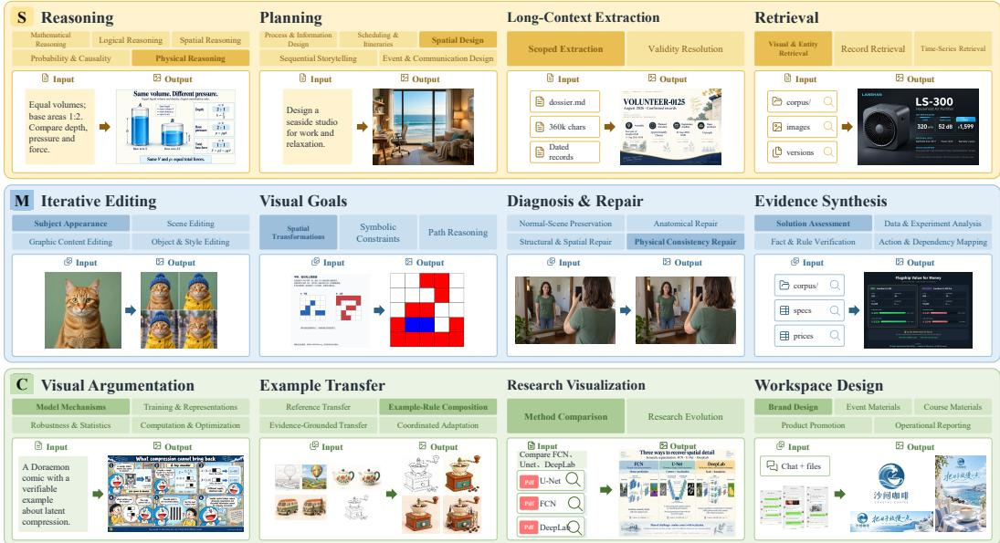  
Figure 3: Overview of Visual Commission Benchmark (VCB). VCB contains 600 tasks across three tiers, 12 categories, and 45 subcategories. The S tier focuses on reasoning, planning, longcontext extraction, and retrieval. The M tier combines capabilities through iterative editing, visual goal interpretation, diagnosis and repair, and evidence synthesis. The C tier evaluates integrated visual commissions through visual argumentation, example transfer, research visualization, and workspace design. Each panel presents an example input and output, with darker labels indicating the represented subcategories. Documents and workspaces are shown schematically, and the displayed outputs are illustrative rather than experimental results.

Checklist construction and review. For each task, multiple models independently construct candidate checklists from its request and source materials. The participating models include GPT5.6- Sol, GPT6-Astra, GLM-5.3-Flash, and DeepSeek-v4.1-Flash. The candidate checklists are consolidated by merging overlapping checks, retaining complementary requirements, and resolving conflicting criteria. Each resulting check expresses a concrete judgment question and specifies the supporting evidence and images needed for evaluation. The models then assess the consolidated checks individually for correctness, grounding, and clarity, and examine the checklists for unsupported requirements, redundancy, and omissions. Human reviewers examine the proposed checks and model judgments to identify necessary revisions. The checklists are refined through repeated rounds of model assessment, human review, and revision.

## 3.3 EXTERNAL EVALUATION

ReqPass and TaskPass. Evaluation is based on the artifacts saved at the designated output locations. Let $\mathcal { Q } _ { n }$ denote the applicable checklist items for task n, and let $r _ { n j } ~ \in ~ \{ 0 , 1 \}$ indicate whether item j passes. Let $v _ { n } \in \{ 0 , 1 \}$ denote the task-level delivery check, which verifies that all required artifacts are saved as specified and satisfy the applicable file-level requirements. We report requirement pass rate and strict task pass rate:

$$
\begin{array} { r l } & { \mathrm { R e q P a s s } = 1 0 0 \displaystyle \frac { \sum _ { n = 1 } ^ { N } \left( v _ { n } + \sum _ { j \in \mathcal { Q } _ { n } } r _ { n j } \right) } { N + \sum _ { n = 1 } ^ { N } | \mathcal { Q } _ { n } | } , } \\ & { \mathrm { T a s k P a s s } = \displaystyle \frac { 1 0 0 } { N } \sum _ { n = 1 } ^ { N } v _ { n } \prod _ { j \in \mathcal { Q } _ { n } } r _ { n j } . } \end{array}\tag{1}
$$

ReqPass pools applicable checklist items and one delivery check per task, while TaskPass requires all of them to pass. Checks that depend on a missing or invalid artifact fail; checks on other available artifacts remain eligible for partial credit. Conditional checks are included only when applicable, and revision checks follow the requirements active at the corresponding checkpoint.

Visual quality. Visual quality (VQ) assesses readability, layout, visual coherence, and aesthetic appeal separately from factual correctness. Each assessable output image receives a rating from 1 to 5 on each dimension. Let ${ \mathcal { O } } _ { n }$ be the set of required output images for task n, and let $s _ { n k d }$ be the rating of image k on dimension d. We report

$$
\mathrm { V Q } = \frac { 1 } { N } \sum _ { n = 1 } ^ { N } \frac { 1 } { \left| \mathcal { O } _ { n } \right| } \sum _ { k \in \mathcal { O } _ { n } } \frac { 1 } { 4 } \sum _ { d = 1 } ^ { 4 } s _ { n k d } .\tag{2}
$$

Missing or undecodable required images receive zero on all four dimensions. Ratings are averaged within each task before being averaged across tasks, giving each task equal weight.

Judgment protocol. File-level properties, such as existence, decodability, and specified dimensions, are checked programmatically. Qwen3.8-Flash-Next serves as the evaluator for both requirement satisfaction and visual quality, with separate inputs and criteria. For requirement evaluation, it receives the checklist question, its supporting criteria, and the images needed for that judgment. Source facts are incorporated into the criteria, while reference images are supplied when visual comparison is necessary. For VQ evaluation, it receives only the output image and the fixed quality rubric. Both evaluations are blinded to the identity of the evaluated system and exclude its execution trace. Evaluator failures or unresolved judgments are recorded separately and retried rather than treated as task failures or assigned zero VQ. Final scores are reported once all required judgments have been resolved.

## 4 V-PROTOCOL

V-Protocol composes reusable modules into executable programs for visual commissions. The model selects procedures and determines content and design; a shared harness manages artifact dependencies, tool execution, and completion checks.

## 4.1 MODULE REPRESENTATION

Task modules specify commission procedures and optional program templates; cognitive modules guide material interpretation, retrieval, reasoning, and synthesis; expression modules provide layout, style, and rendering guidance. Each module declares its family, capabilities, input and output types, applicability conditions, and procedural guidance. Registry metadata supports selection, with full guidance loaded on activation. Declared interfaces identify possible handoffs, while the model assesses their suitability for the current task.

## 4.2 ADAPTIVE MODULE COMPOSITION

The agent derives a task specification from the public request and inspected materials, recording the goal, inputs, active requirements, and deliverables. A suitable task template initializes the program; otherwise, the model constructs it directly. At step t, the program is

$$
\mathcal { P } _ { t } = ( G _ { t } , \mu _ { t } ) , \qquad G _ { t } = ( \mathcal { V } _ { t } , \mathcal { E } _ { t } ) ,\tag{3}
$$

where nodes represent operations, edges record declared artifact dependencies, and $\mu _ { t }$ records mod ule assignments. Each operation specifies its objective, input and output artifacts, capability needs, and permitted actions. Source materials can supply inputs directly. Operations may use several modules, and modules may be reused across operations.

For each operation, the registry retrieves modules whose capabilities overlap its needs and orders candidates by configured priority and capability coverage. The model selects applicable guidance for the current objective and inputs, revising the program as inspection and generation reveal additional needs. Simple requests can use a minimal program. M

## 4.3 PROTOCOL EXECUTION

The harness validates the operation graph and artifact references. Before each action, it checks input availability, dependency freshness, permissions, and remaining budget. The model supplies content and tool arguments; the harness mediates calls and registers outputs. Node completion requires recorded artifacts and valid tool results. Program updates retain execution history and valid completed outputs while allowing future operations to change. Retries and repairs consume the same task budget.

Artifacts carry identifiers, revisions, and declared source dependencies. Dependency snapshots record the source versions and content hashes used by downstream operations. A change to a declared source makes the corresponding snapshot stale, preventing affected artifacts from being reused as current evidence until the dependency is resolved. Image edits record their source revision, and replacing an image at the same path creates a new revision.

Online verification compares the current image with active requirements and content checkpoints. Reports bind to the image identity, revision, content hash, and verification criteria; changes to the image or relevant criteria invalidate prior reports. The model uses feedback to choose edits, regeneration, or program revisions. Before delivery, the harness checks that required artifacts exist at their designated locations and satisfy runtime completion conditions. These checks concern recorded requirements and dependencies; semantic judgments remain the model’s responsibility. Private benchmark annotations are unavailable during planning, verification, and repair, and final artifacts are assessed through the external evaluation protocol.

## 5 EXPERIMENTS

## 5.1 EXPERIMENTAL SETUP

We evaluate V-Protocol on VCB, WISE-Verified, and Mind-Bench. We follow each benchmark’s evaluation protocol. For VCB, we report REQPASS, TASKPASS, and visual quality (VQ), both overall and across the S, M, and C tiers. WISE-Verified uses binary WiScore, and Mind-Bench uses checklist-based strict accuracy (CSA).

We compare against direct Qwen-Image2.1 generation, Mind-Brush, GEMS, and SCOPE. Agentbased methods share a Qwen3.8-27B controller with medium thinking and a Qwen-Image2.1 image backend. Where web search is permitted, they use DuckDuckGo. Each method retains its own planning, generation, and revision procedure. Qwen3.8-Flash-Next evaluates VCB requirement satisfaction and visual quality using separate prompts. Published reference results are presented separately from experiments with shared backends. Additional adaptation, evaluation, and recovery details are provided in Appendix B.

## 5.2 RESULTS AND ANALYSIS

VCB. Table 2 shows that V-Protocol achieves the highest overall scores, with 94.48% REQPASS, 69.00% TASKPASS, and 4.200 VQ. Compared with SCOPE, the strongest baseline overall, V-Protocol improves REQPASS by 12.70 percentage points and TASKPASS by 27.00 percentage points. Direct generation, Mind-Brush, and GEMS complete substantially fewer tasks.

Completion remains challenging as task scope expands. V-Protocol’s TASKPASS decreases from 82.00% on S to 67.00% on M and 58.00% on C. SCOPE follows the same trend. V-Protocol’s C-tier REQPASS of 94.15% also contrasts with its 58.00% TASKPASS, highlighting the remaining challenge of satisfying all requirements within a commission. Figure 4 complements the quantitative results with a qualitative comparison of visual outputs on selected VCB tasks.

Public benchmark for image agents. Table 3 shows that V-Protocol also achieves the highest overall scores among the compared systems on WISE-Verified and Mind-Bench. WISE-Verified has a more focused task scope than VCB, and leading systems already perform well. V-Protocol scores 0.9090, narrowly ahead of SCOPE’s 0.9010.

Table 2: Commission completion on VCB. Each tier reports REQPASS (RP), TASKPASS (TP), and visual quality (VQ). RP and TP are percentages. VQ averages 1–5 ratings, with missing or undecodable required images assigned zero. Overall reports benchmark-wide results. V-Protocol achieves the highest scores, while complete commissions remain challenging even when visual quality is high.
<table><tr><td></td><td colspan="3">S</td><td colspan="3">M</td><td colspan="3">C</td><td colspan="3">Overall</td></tr><tr><td>System</td><td>RP↑</td><td>TP↑</td><td>VQ↑</td><td>RP↑</td><td>TP↑</td><td>VQ↑</td><td>RP↑</td><td>TP↑</td><td>VQ↑</td><td>RP↑</td><td>TP↑</td><td>VQ↑</td></tr><tr><td>Direct</td><td>8.33</td><td>0.50</td><td>2.396</td><td>12.15</td><td>0.00</td><td>2.039</td><td>12.81</td><td>0.00</td><td>2.091</td><td>11.14</td><td>0.17</td><td>2.175</td></tr><tr><td>Mind-Brush</td><td>13.83</td><td>1.00</td><td>2.794</td><td>6.71</td><td>0.00</td><td>2.010</td><td>15.32</td><td>0.00</td><td>2.121</td><td>12.69</td><td>0.33</td><td>2.308</td></tr><tr><td>GEMS</td><td>41.20</td><td>16.00</td><td>3.639</td><td>10.49</td><td>0.00</td><td>2.236</td><td>34.69</td><td>8.00</td><td>2.337</td><td>30.92</td><td>8.00</td><td>2.737</td></tr><tr><td>SCOPE</td><td>84.36</td><td>55.00</td><td>3.658</td><td>77.74</td><td>39.50</td><td>4.097</td><td>82.10</td><td>31.50</td><td>4.192</td><td>81.78</td><td>42.00</td><td>3.982</td></tr><tr><td>V-Protocol</td><td>96.95</td><td>82.00</td><td>4.250</td><td>91.78</td><td>67.00</td><td>4.157</td><td>94.15</td><td>58.00</td><td>4.195</td><td>94.48</td><td>69.00</td><td>4.200</td></tr></table>

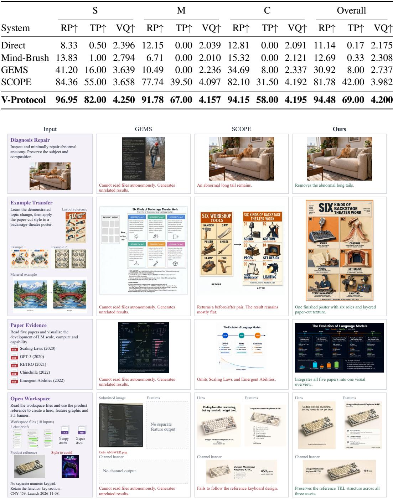  
Figure 4: Qualitative comparison. V-Protocol achives better visual commissions completion.

The difference is larger on Mind-Bench, where V-Protocol achieves 0.454 CSA compared with 0.392 for SCOPE. Their knowledge-driven averages are identical at 0.368, while V-Protocol improves the reasoning-driven average from 0.416 to 0.540. Its advantage on Mind-Bench is therefore

Table 3: Results on WISE-Verified and Mind-Bench. V-Protocol achieves the highest overall scores among the compared systems, with a larger advantage over SCOPE on reasoning-driven Mind-Bench tasks. WISE-Verified reports binary WiScore, and Mind-Bench reports CSA. Knowledge and Reasoning denote the corresponding category averages. The first three rows report pub lished references; the remaining rows use shared backends. Bold marks the best results within the shared-backend group.
<table><tr><td rowspan="2">System</td><td colspan="7">WISE-Verified</td><td colspan="3">Mind-Bench</td></tr><tr><td>Culture</td><td>Time</td><td>Space</td><td>Biology</td><td>Physics</td><td>Chemistry</td><td>Overall</td><td>Knowledge</td><td>Reasoning</td><td>Overall</td></tr><tr><td>GPT-Image-1.5</td><td>0.8900</td><td>0.6917</td><td>0.8833</td><td>0.8000</td><td>0.7583</td><td>0.7750</td><td>0.8250</td><td>0.220</td><td>0.180</td><td>0.210</td></tr><tr><td>Nano Banana Pro</td><td>0.8975</td><td>0.8167</td><td>0.9333</td><td>0.8167</td><td>0.8667</td><td>0.8750</td><td>0.8760</td><td>0.400</td><td>0.440</td><td>0.410</td></tr><tr><td>Qwen-Image-Agent</td><td>0.9200</td><td>0.9167</td><td>0.9333</td><td>0.8333</td><td>0.8667</td><td>0.9000</td><td>0.9020</td><td>0.404</td><td>0.436</td><td>0.420</td></tr><tr><td>Direct</td><td>0.4800</td><td>0.4667</td><td>0.5583</td><td>0.3417</td><td>0.5417</td><td>0.3083</td><td>0.4580</td><td>0.032</td><td>0.052</td><td>0.042</td></tr><tr><td>Mind-Brush</td><td>0.6550</td><td>0.6417</td><td>0.6750</td><td>0.3750</td><td>0.5583</td><td>0.3500</td><td>0.5740</td><td>0.136</td><td>0.060</td><td>0.098</td></tr><tr><td>GEMS</td><td>0.8625</td><td>0.7833</td><td>0.9000</td><td>0.7667</td><td>0.7917</td><td>0.7167</td><td>0.8200</td><td>0.228</td><td>0.336</td><td>0.282</td></tr><tr><td>SCOPE</td><td>0.9175</td><td>0.9333</td><td>0.9083</td><td>0.8583</td><td>0.8500</td><td>0.9000</td><td>0.9010</td><td>0.368</td><td>0.416</td><td>0.392</td></tr><tr><td>V-Protocol</td><td>0.9100</td><td>0.9083</td><td>0.9000</td><td>0.8750</td><td>0.9417</td><td>0.9167</td><td>0.9090</td><td>0.368</td><td>0.540</td><td>0.454</td></tr></table>

Component analysis. We examine runtime enforcement and adaptive module selection on VCB. The runtime variant disables execution gates while retaining module selection and tool access. The selection variant replaces task-adaptive module choices with a predefined module set.

As shown in Table 4, the two variants achieve 60.17% and 60.83% TASKPASS, respectively, compared with 69.00% for the Full reference. Both also obtain lower REQPASS and VQ. These comparisons are exploratory because Full reuses historical outputs, including recovery runs, whereas the variants use a later frozen runtime. Detailed controls and additional results are provided in Appendix C.

Table 4: Component analysis on VCB.
<table><tr><td>Configuration</td><td>RP↑</td><td>TP↑</td><td>VQ↑</td></tr><tr><td>w/o Runtime Enforcement</td><td>82.14 60.17 3.800</td><td></td><td rowspan="4"></td></tr><tr><td>w/o Adaptive</td><td></td><td></td></tr><tr><td>Module Selection</td><td>82.20</td><td>60.83 33.862</td></tr><tr><td>Full V-Protocol</td><td>94.48 69.00</td><td>4.200</td></tr></table>

concentrated in tasks requiring reasoning to determine the visual content. Together with the larger completion gap on VCB, these results show that comparable performance on knowledge-oriented generation does not necessarily imply comparable ability to complete visual commissions.

## 6 CONCLUSION

We introduced Visual Commission Bench (VCB) to evaluate image agents on complete visual commissions, from interpreting distributed source materials to delivering coordinated artifacts. V-Protocol supports these tasks by composing reusable task, cognitive, and expression modules through structured intermediate artifacts, while an execution harness tracks dependencies, revisions, and completion. With shared model backbones, V-Protocol achieves higher task success than the evaluated baselines. The commission-level results reveal substantial differences in completion despite comparable visual quality, demonstrating the importance of evaluating fulfillment of the entire request. Complete commissions remain challenging even with explicit execution support. Reliable use of intermediate results and preservation of requirements across revisions and deliverables remain priorities for further work.

## REFERENCES

Harold Haodong Chen, Zhiyu Hou, Wen-Jie Shu, Weilin Ruan, Yingjie Xu, Litao Guo, and Ying-Cong Chen. Genrouter: Unified workflow routing for agentic image generation. arXiv preprint arXiv:2608.16721, 2026a.

Sixiang Chen, Zhaohu Xing, Tian Ye, Xinyu Geng, Yunlong Lin, Jianyu Lai, Xuanhua He, Fuxiang Zhai, Jialin Gao, and Lei Zhu. Genevolve: Self-evolving image generation agents via toolorchestrated visual experience distillation. arXiv preprint arXiv:2605.21605, 2026b.

Jayanaka Dantanarayana, Savini Kashmira, Lingjia Tang, and Jason Mars. Sigil: Compiling agent skills into typed harnesses. arXiv preprint arXiv:2607.27309, 2026.

Gen Dong, Yanjie Gao, Liqun Li, Tianyin Xu, Yu Hua, and Fan Yang. Agent skills can be harmful: An empirical study of skill-induced failures in llm agents. arXiv preprint arXiv:2608.11888, 2026.

Kaituo Feng, Manyuan Zhang, Shuang Chen, Yunlong Lin, Kaixuan Fan, Yilei Jiang, Hongyu Li, Dian Zheng, Chenyang Wang, and Xiangyu Yue. Gen-searcher: Reinforcing agentic search for image generation. arXiv preprint arXiv:2603.28767, 2026.

Jun He, Junyan Ye, Zilong Huang, Dongzhi Jiang, Chenjue Zhang, Leqi Zhu, Renrui Zhang, Xiang Zhang, and Weijia Li. Mind-brush: Integrating agentic cognitive search and reasoning into image generation. arXiv preprint arXiv:2602.01756, 2026a.

Zefeng He, Siyuan Huang, Xiaoye Qu, Yafu Li, Tong Zhu, Yu Cheng, and Yang Yang. Gems: Agent-native multimodal generation with memory and skills. arXiv preprint arXiv:2603.28088, 2026b.

Dayeon Ki, Tianyi Zhou, Marine Carpuat, Gang Wu, Puneet Mathur, and Viswanathan Swaminathan. Graphicbench: A planning benchmark for graphic design with language agents. arXiv preprint arXiv:2504.11571, 2025.

Hao Li, Chunjiang Mu, Jianhao Chen, Siyue Ren, Zhiyao Cui, Yiqun Zhang, Lei Bai, and Shuyue Hu. Organizing, orchestrating, and benchmarking agent skills at ecosystem scale. arXiv preprint arXiv:2603.02176, 2026a.

Niantong Li, Guangzheng Hu, Weixu Qiao, Ying Ba, Qichen Hong, Shijun Shen, Jinlin Wang, Fan Zhou, Jianye Kang, Xin Shang, Ziyi He, Wei Wang, Dalin Li, Jiahao Li, Jie Zhang, Kaiyuan Gao, Kun Yan, Lihan Jiang, Ningyuan Tang, Shengming Yin, Tianhe Wu, Xiao Xu, Xiaoyue Chen, Yuxiang Chen, Yan Shu, Yanran Zhang, Yilei Chen, Yixian Xu, Zekai Zhang, Zhendong Wang, Zihao Liu, Zikai Zhou, Hongzhu Shi, Yi Wang, Bing Zhao, Hu Wei, Lin Qu, and Chenfei Wu. Qwen-image-bench: From generation to creation in text-to-image evaluation. arXiv preprint arXiv:2605.28091, 2026b.

Xiangyi Li, Yimin Liu, Wenbo Chen, Bingran You, Zonglin Di, Yifeng He, Shenghan Zheng, Kyoung Whan Choe, Jiankai Sun, Shuyi Wang, et al. Skillsbench: Benchmarking how well agent skills work across diverse tasks. arXiv preprint arXiv:2602.12670, 2026c.

Zongxia Li, Dawei Liu, Fuxiao Liu, Yuhang Zhou, Xiyang Wu, Jingxi Chen, Jing Xie, Xiaomin Wu, and Lichao Sun. Comfyclaw: Self-evolving skill harnesses for image generation workflows. arXiv preprint arXiv:2607.01709, 2026d.

Yujian Liu, Jiabao Ji, Li An, Tommi Jaakkola, Yang Zhang, and Shiyu Chang. How well do agentic skills work in the wild: Benchmarking llm skill usage in realistic settings. arXiv preprint arXiv:2604.04323, 2026.

Zijian Lu, Yiping Zuo, Yupeng Nie, Xin He, Weibei Fan, Lianyong Qi, and Shi Jin. Contractskill: Repairable contract-based skills for multimodal web agents. arXiv preprint arXiv:2603.20340, 2026.

Yuwei Niu, Munan Ning, Mengren Zheng, Weiyang Jin, Bin Lin, Peng Jin, Jiaqi Liao, Chaoran Feng, Fanqing Meng, Kun-Peng Ning, Bin Zhu, and Li Yuan. WISE: World knowledge-informed semantic evaluation for text-to-image generation. 2026.

Linyue Pan, Lexiao Zou, Shuo Guo, Jingchen Ni, and Hai-Tao Zheng. Natural-language agent harnesses. arXiv preprint arXiv:2603.25723, 2026.

Tianfei Ren, Zhipeng Yan, Yiming Zhao, Zhen Fang, Yu Zeng, Guohui Zhang, Hang Xu, Xiaoxiao Ma, Shiting Huang, Ke Xu, et al. Scope: Structured decomposition and conditional skill orchestration for complex image generation. arXiv preprint arXiv:2605.08043, 2026.

Boyin Tan, Xiaowei Huang, and Youcheng Sun. Skill coverage: A test adequacy metric for agent skills. arXiv preprint arXiv:2606.20659, 2026.

Yinghao Tang, Xueding Liu, Boyuan Zhang, Tingfeng Lan, Yupeng Xie, Jiale Lao, Yiyao Wang, Haoxuan Li, Tingting Gao, Bo Pan, et al. Igenbench: Benchmarking the reliability of text-toinfographic generation. arXiv preprint arXiv:2601.04498, 2026.

Yangbo Wei, Zhen Huang, Shaoqiang Lu, Junhong Qian, Qifan Wang, Chen Wu, and Lei He. Skillsmith: Co-evolving skills and tools for self-improving agent systems. arXiv preprint arXiv:2606.01314, 2026.

Chenfei Wu, Jiahao Li, Jingren Zhou, Junyang Lin, Kaiyuan Gao, Kun Yan, Sheng-ming Yin, Shuai Bai, Xiao Xu, Yilei Chen, et al. Qwen-image technical report. arXiv preprint arXiv:2508.02324, 2025.

Tianle Xia, Lingxiang Hu, Yiding Sun, Ming Xu, Lan Xu, Siying Wang, Wei Xu, and Jie Jiang. Grasp: Graph-structured skill compositions for llm agents. arXiv preprint arXiv:2604.17870, 2026.

Junyan Ye, Jun He, Zilong Huang, Dongzhi Jiang, Xuan Yang, Rui Chen, and Weijia Li. Genclaw: Code-driven agentic image generation. arXiv preprint arXiv:2605.30248, 2026.

Zekai Zhang, Jiahao Li, Jie Zhang, Kaiyuan Gao, Kun Yan, Lihan Jiang, Ningyuan Tang, Shengming Yin, Tianhe Wu, Xiaoyue Chen, et al. Qwen-image-agent: Bridging the context gap in real-world image generation. arXiv preprint arXiv:2606.26907, 2026.

Jingyuan Zheng, Dongjing Wang, Xin Zhang, Butian Huang, Haiping Zhang, Dongjin Yu, and Shuguang Deng. Skillselect-serve: Budget-controllable and qos-aware skill service recommendation and composition for small llm agents. arXiv preprint arXiv:2607.00011, 2026.

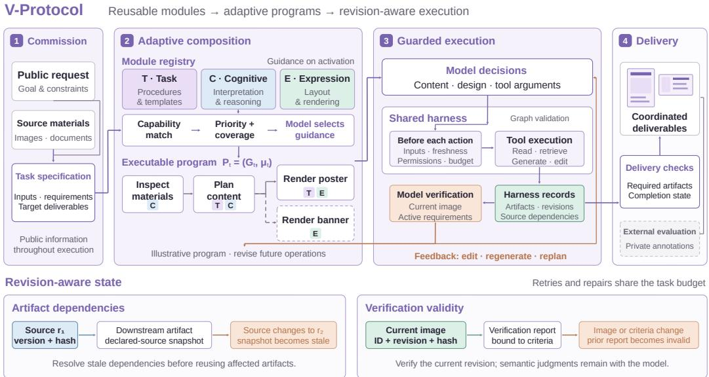  
Figure 5: Overview of V-Protocol. Public requests and source materials define a task specification, from which the agent composes an executable program using task (T), cognitive (C), and expression (E) modules. Colored tags indicate module assignments; the dashed branch illustrates a revisable future operation. The model determines content, design, and tool arguments, while the harness checks runtime conditions and records artifacts. Verification feedback informs edits, regeneration, or program revision. The bottom panels illustrate how changes to declared sources make dependency snapshots stale, while changes to an image or relevant criteria invalidate its verification reports. Private benchmark annotations are used only for external evaluation.

## Supplementary Material

## A V-PROTOCOL

V-Protocol composes reusable modules into executable programs for visual commissions (Figure 5). The model selects applicable guidance, determines content and design, and revises future operations using inspected materials and verification feedback. A shared harness mediates tool execution, tracks declared artifact dependencies and revisions, and checks runtime completion conditions. Semantic judgments remain with the model.

## B EXPERIMENTAL SETUP AND EVALUATION METRICS

## B.1 BENCHMARKS AND EVALUATION METRICS

VCB contains 600 tasks across three tiers, with 200 tasks per tier and 50 tasks in each of the 12 categories. REQPASS pools applicable checklist items and one delivery check per task. TASKPASS measures the fraction of tasks satisfying all applicable checks and the delivery check. VQ averages four ratings within each required image, then averages images within a task and tasks within the benchmark. Thus, TASKPASS and VQ weight tasks equally, whereas REQPASS weights applicable checks equally. Overall REQPASS is computed from pooled counts rather than the arithmetic mean of the tier scores.

WISE-Verified contains 1,000 requests across Culture, Time, Space, Biology, Physics, and Chemistry. Its overall binary WiScore weights Culture by 0.40 and each remaining category by 0.12. Mind-Bench contains 500 requests across ten equally sized categories. A task passes checklistbased strict accuracy (CSA) only when all applicable checklist conditions pass. Overall CSA is computed across the 500 requests, while the knowledge-driven and reasoning-driven averages each cover five categories. Results are reported separately for the three benchmarks.

Table 5: Selected module-budget results. K caps the number of distinct modules loaded through out a task across all three axes. RP and TP are percentages; VQ is measured on a 0–5 scale.
<table><tr><td>Configuration</td><td>RP↑</td><td>TP↑</td><td>VQ↑</td></tr><tr><td>Adaptive selection, K = 1 Adaptive selection, K = 2</td><td>82.35 84.24</td><td>60.17 59.83</td><td>3.769 3.853</td></tr><tr><td>Adaptive selection, K = 3 Full V-Protocol (reference)</td><td>84.83 94.48</td><td>59.83 69.00</td><td>3.872 4.200</td></tr></table>

## B.2 BACKENDS AND EXECUTION SETTINGS

The agent controller is Qwen3.8-27B with medium thinking, and the image backend is Qwen-Image2.1. Web-search calls use DuckDuckGo where permitted. VCB retrieval uses the benchmarkprovided local corpora. Direct generation uses the image backend without an agent controller. The agent methods retain their own procedures for planning, tool use, generation, and revision. Shared backends do not imply equal numbers of model calls, image generations, or execution time. Published reference results retain their original configurations and are distinguished from the sharedbackend comparisons. For dated requests, the target is the time specified by the benchmark.

## C COMPONENT ANALYSIS AND MODULE BUDGETS

Runtime enforcement. The runtime variant retains module selection, generation and editing tools, artifact registration, input validation, access restrictions, and resource limits. It disables specified execution gates, including node-action authorization, generation prerequisites, dependency-freshness checks, node-completion enforcement, and final-delivery enforcement. The intervention therefore removes selected execution constraints rather than the entire runtime. The agent may declare completion, but task success is determined independently from its delivered artifacts.

Adaptive module selection. The fixed-selection variant uses the same predefined module set for every request: task-deliverable-bundle, cognitive-evidence-synthesis, expression-basic, and expression-hybrid-composition.

Execution and evaluation. The new variants use the same controller and image backend, with limits of 256 steps, eight generation calls, and eight editing calls per task. Their source code and module definitions are frozen. Each task receives one execution, which may include generation and revision steps within these limits. No output-driven recovery run or task replacement is added afterward. Evaluation-service failures are retried separately. Missing or invalid deliverables remain subject to the benchmark’s failure and zero-VQ rules.

Module-budget setting. We examine restricted module budgets with $K \in \{ 1 , 2 , 3 \}$ . The budget counts distinct module identifiers loaded throughout a task across the task, cognitive, and expression axes, including default expression guidance. Reusing a module does not consume another slot, whereas loading a new module at a later stage does. The budget is an upper bound, not a requirement to load exactly K modules, and no minimum allocation is imposed on any axis.

When the budget leaves no room for an expression module, the agent may use the base instructions and tool schemas without satisfying the expression-module prerequisite. Other artifact and execution constraints remain active. Table 5 compares these selected budget configurations with the historical Full reference.

Table 6: Observed controller-issued shell operations. Each method has one retained log per task. Sleep counts records containing an explicit shell sleep; repeated commands count occurrences beyond the first identical command within a task after whitespace normalization. These are execution-pattern statistics, not counts of all wasted work. Tool-internal waits are excluded.
<table><tr><td>Benchmark</td><td>Method</td><td>Tasks</td><td>Tasks with sleep</td><td>Sleep records</td><td>Repeated commands</td></tr><tr><td rowspan="2">VCB</td><td>SCOPE</td><td>600</td><td>361</td><td>5,386</td><td>2,652</td></tr><tr><td>V-Protocol</td><td>600</td><td>0</td><td>0</td><td>31</td></tr><tr><td rowspan="2">WISE-Verified</td><td>SCOPE</td><td>1,000</td><td>519</td><td>5,136</td><td>1,325</td></tr><tr><td>V-Protocol</td><td>1,000</td><td>0</td><td>0</td><td>0</td></tr><tr><td rowspan="2">Mind-Bench</td><td>SCOPE</td><td>500</td><td>358</td><td>8,970</td><td>3,829</td></tr><tr><td>V-Protocol</td><td>500</td><td>0</td><td>0</td><td>0</td></tr></table>

## D EXECUTION OBSERVATIONS FROM SCOPE AND V-PROTOCOL

We examine retained execution traces of SCOPE Ren et al. (2026) and V-Protocol on VCB (600 tasks), WISE-Verified (1,000 tasks), and Mind-Bench (500 tasks). The analysis documents cases in which repeated controller actions do not directly inspect task state or advance a visual artifact. It provides evidence for execution difficulties in visual tasks rather than isolating algorithmic causes.

Coverage and deployment. Shell-event counts use one retained log per task and method, rather than a complete history of all attempts. Earlier overwritten attempts and later manual recovery are not included in these trace statistics. The observations characterize the evaluated executions and their controller–tool interfaces; they do not by themselves identify limitations intrinsic to the original SCOPE algorithm.

Controller-issued waiting and repetition. Table 6 reports explicit shell waiting and repeated shell commands, using one retained log per task for each method. SCOPE’s VCB logs contain 5,386 sleep-containing shell records across 361 tasks and 2,652 repeated command records. V-Protocol’s corresponding logs contain no explicit shell sleep and 31 repeated commands across 28 tasks. Neither method is assumed to have zero backend waiting: the table captures controller-issued shell operations, not waits within tools. Both methods use the same sleep-detection pattern, \bsleep\s+\d, on recorded shell command strings. This lexical rule does not capture every possible waiting construct. Repeated commands are counted within each task after whitespace normalization, starting with the second occurrence. In particular, V-Protocol’s WISE-Verified and Mind-Bench traces con tain no shell calls; their zeros describe the execution interface, not an absence of service latency.

Repeated polling can be useful, so repetition alone is not evidence of waste. A clearer example is VCB task 0378 M4: the SCOPE controller submits sleep 1; echo ok 80 times, with 78 successful executions and two argument-parsing failures. This command neither checks task state nor produces a deliverable. The retained session contains 344 tool requests over 63.91 minutes. In 0120 S3, 212 of 453 tool requests contain sleep, and two wait-and-check commands each recur 12 times. These examples establish the existence of low-progress interaction, not its prevalence across all repeated calls. The first session’s duration is not attributed entirely to the repeated command.

Runtime intervention. V-Protocol’s retained VCB logs include 82 rejections tagged as noprogress submissions and four consecutive-identical-call guard rejections. These events show that progress checks intervene during execution. They do not establish that every rejected action is followed by successful recovery. Argument and format errors also occur in both systems, but their different controller–tool interfaces do not provide a common basis for comparing raw error counts.

Controller usage and session duration. Table 7 summarizes recorded controller usage and session duration on VCB. The analysis uses tasks with recoverable controller usage and session timestamps for both methods, paired by task identifier without filtering by task success. Tasks without complete paired records are excluded from this analysis but remain in the benchmark evaluation.

Table 7: Recorded controller usage on VCB. Token counts are per-task means in thousands, with cached input included. Time measures the retained session’s event span. V-Protocol records lower token volumes and shorter median and P90 session durations in these historical runs.
<table><tr><td>Method</td><td>Input (k)</td><td>Output (k)</td><td>Total (k)</td><td>Median time (min)</td><td>P90 time (min)</td></tr><tr><td>SCOPE</td><td>4,895.7</td><td>54.7</td><td>4,950.4</td><td>18.45</td><td>57.01</td></tr><tr><td>V-Protocol</td><td>594.7</td><td>22.1</td><td>616.8</td><td>11.01</td><td>18.88</td></tr></table>

Token counts accumulate input and output across calls within the retained primary-controller session, including repeated context and cached input. Session duration measures the interval between the first and last recorded events, including tool waits. It does not include elapsed time across earlier attempts or subsequent manual recovery.

Cached input accounts for 96.2% of SCOPE’s recorded input tokens, while V-Protocol’s retained logs do not preserve the cache split. Token volumes therefore do not directly measure differences in uncached computation or monetary cost. The accounting covers the primary controller and excludes separate image-model computation, external evaluation, and auxiliary model calls not recorded in its usage. Because concurrency, service load, and recovery history were not matched, session durations are descriptive observations rather than a controlled latency comparison.

Implication. The concrete cases show that substantial controller interaction can occur without directly advancing a visual artifact. These observations motivate support for execution progress and artifact completion alongside reasoning about image content. They do not establish that the repeated shell operations alone explain the observed resource differences.

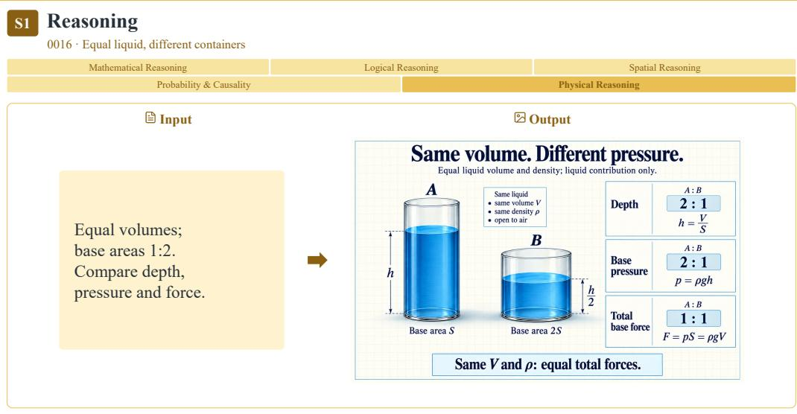  
Tests: Solve the content before drawing

Figure 6: S1: Reasoning. The example compares liquid depth, base pressure, and total force for equal liquid volumes in containers with different base areas.  
  
Figure 7: S2: Planning. The example translates a request for a seaside studio into a spatial arrangement supporting both work and relaxation.

## E QUALITATIVE EXAMPLES

## E.1 TASK INPUTS AND OUTPUTS

The following figures illustrate inputs and visual outputs for the twelve task categories. Long materials are summarized by excerpts or file representations for presentation. These illustrations explain the task settings rather than estimate benchmark performance.

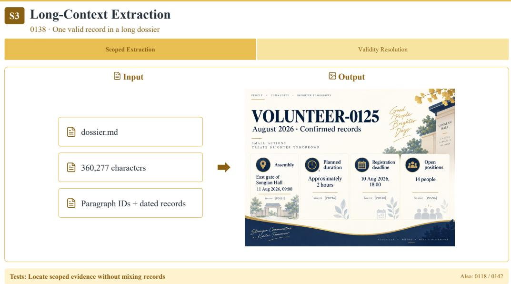  
Figure 8: S3: Long-Context Extraction. The example extracts the requested record from a long dossier and presents the relevant fields in a visual summary.

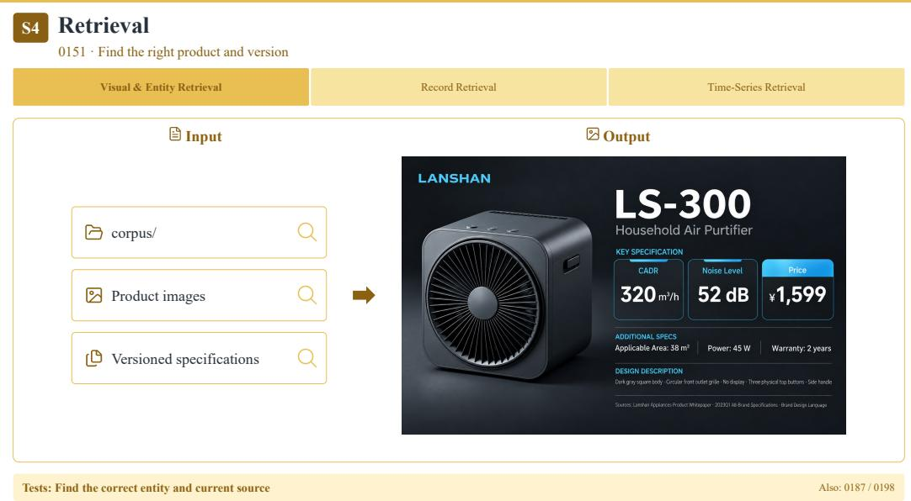  
Figure 9: S4: Retrieval. The example requires locating the correct product image and current specifications before constructing the visual output.

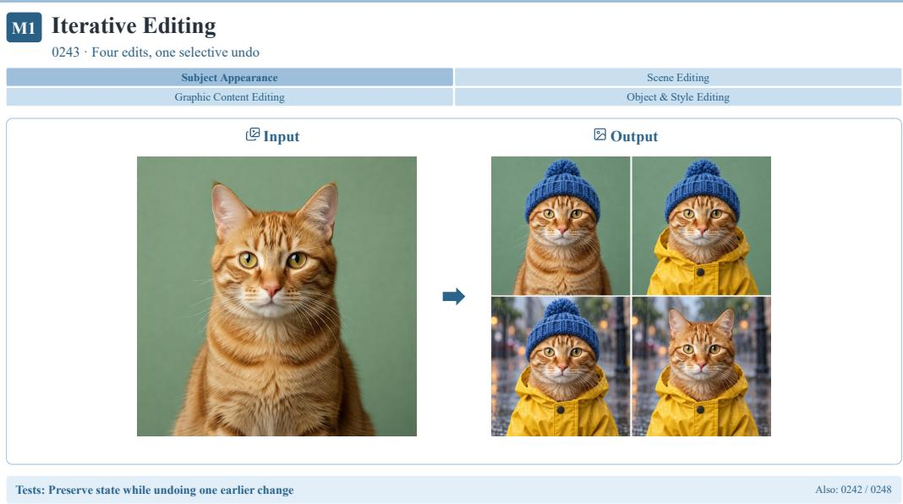  
Figure 10: M1: Iterative Editing. Successive edits modify the subject and scene. A later instruction reverses one earlier change while retaining the other active edits.

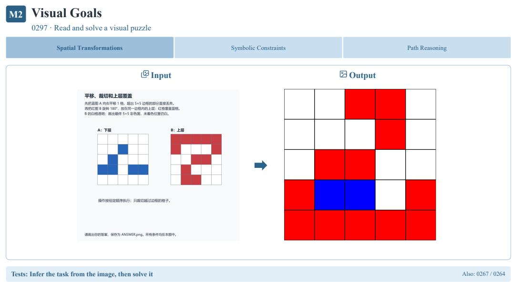  
Figure 11: M2: Visual Goals. The task instructions and spatial constraints are embedded in the input image. The output visualizes the inferred solution.

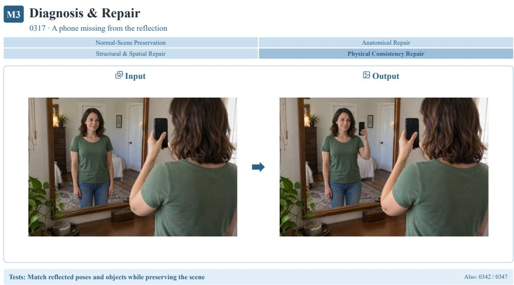  
Figure 12: M3: Diagnosis and Repair. The example concerns an inconsistent mirror reflection. Repair must address the reflected object while preserving the surrounding scene.

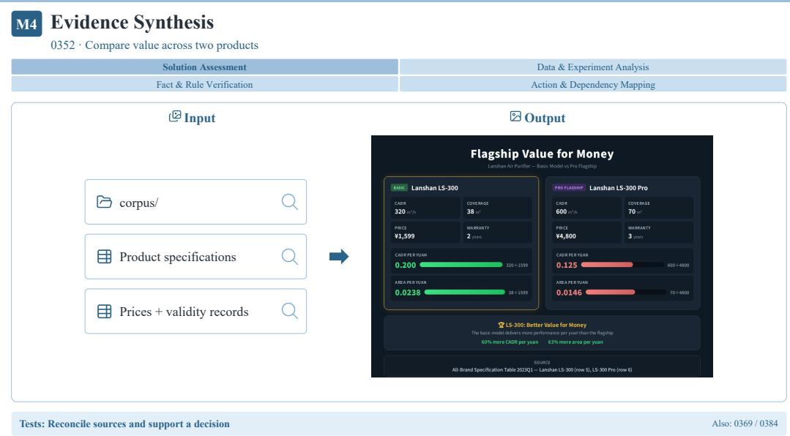  
Figure 13: M4: Evidence Synthesis. The example combines product specifications, prices, and validity records to construct an evidence-grounded comparison.

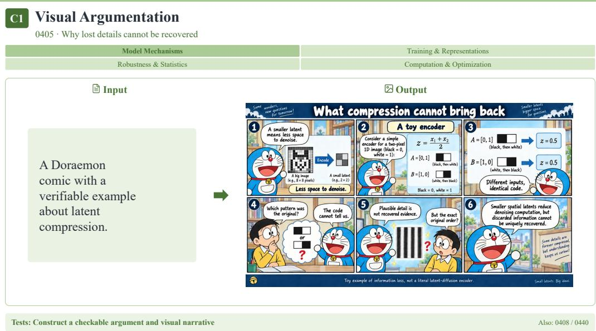  
Figure 14: C1: Visual Argumentation. The example uses a constructed case and a comic narrative to explain why compression can prevent recovery of the original information.

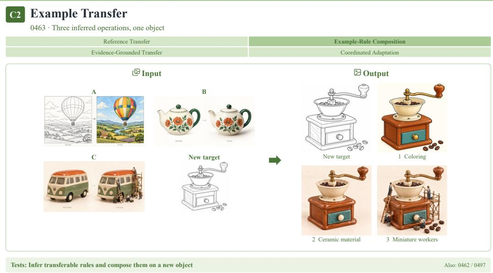  
Figure 15: C2: Example Transfer. Three paired demonstrations define coloring, ceramic material conversion, and miniature-worker composition. The illustrated sequence applies these operations to a new object.

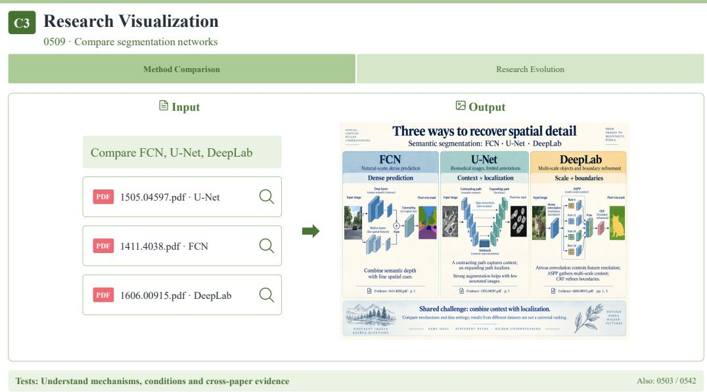  
Figure 16: C3: Scientific Visualization. The example integrates supplied papers into a visual comparison of FCN, U-Net, and DeepLab, including their approaches to recovering spatial detail.

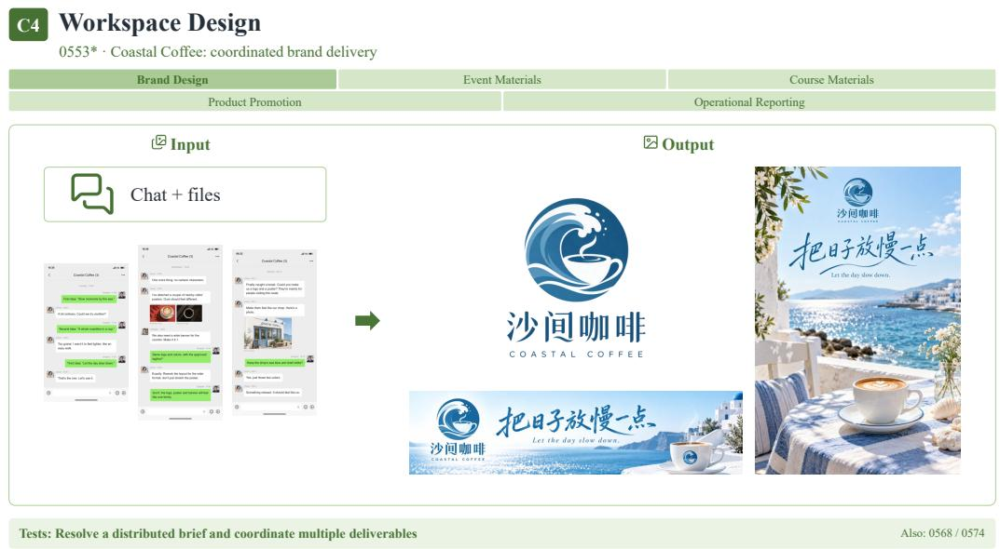  
Figure 17: C4: Workspace Design. The example combines conversation history and source files into a coordinated coffee-shop identity, poster, and banner.

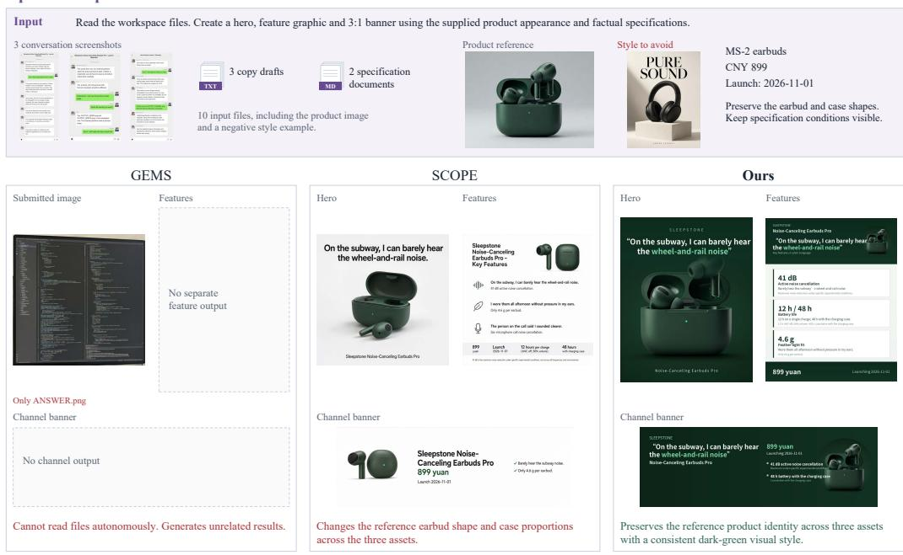  
Figure 18: Open workspace: earbuds. Inputs are shown above; outputs from GEMS, SCOPE, and V-Protocol (Ours) are shown below. Empty slots indicate missing deliverables.

## E.2 COMPARISON WITH EXISTING SYSTEMS

Figures 18–21 present selected outputs from GEMS, SCOPE, and V-Protocol on the same tasks. These qualitative cases illustrate differences in transformation realization, evidence coverage, and coordinated delivery.

Example Transfer: Bus-depot renewal  
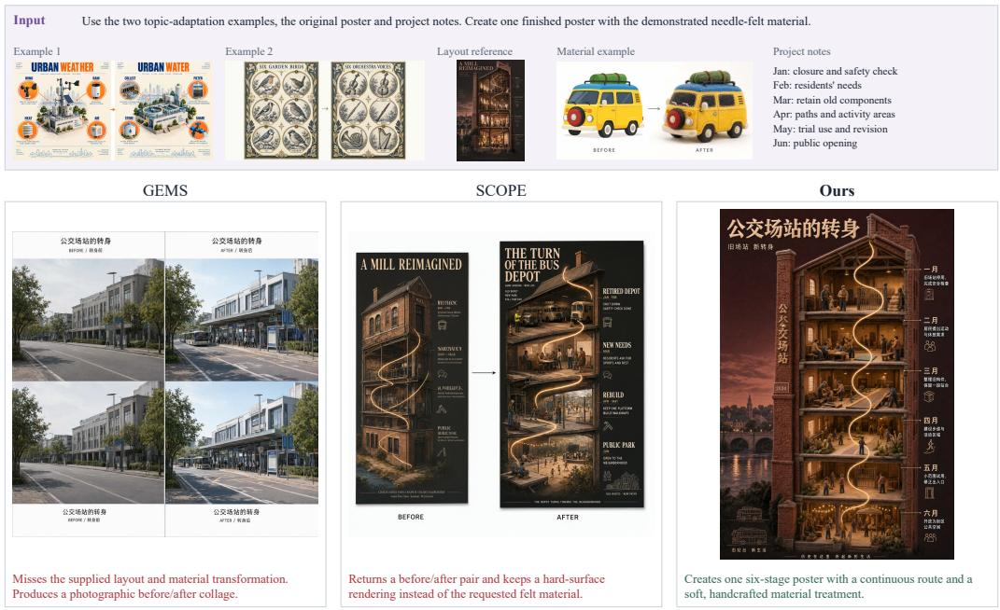  
Figure 19: Example transfer: bus-depot renewal. Comparison of topic adaptation and material transformation.

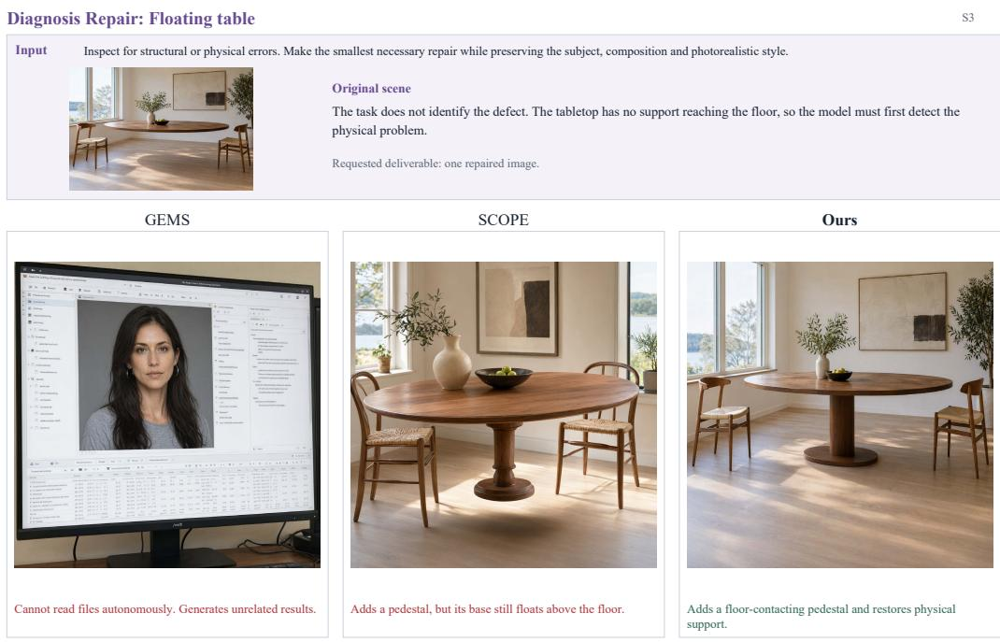  
Figure 20: Diagnosis and repair: floating table. Comparison of physical-error detection and repair.

Paper Evidence: Video understanding  

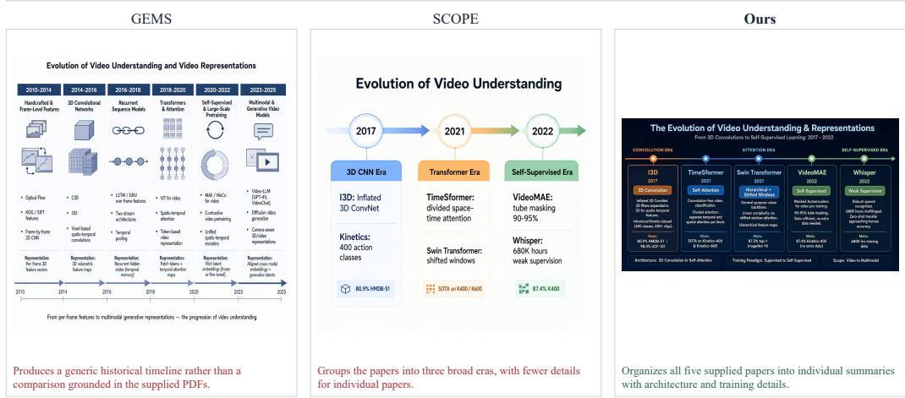  
Figure 21: Paper evidence: video understanding. Comparison of evidence coverage and information organization across the supplied papers.

Figure 22: Qualitative gallery: visual identity. Typography, material, and composition in the V-Protocol identity illustration.  
  
Figure 23: Qualitative gallery: brand and layout adaptation. Coordinated brand presentation across different page formats.

## E.3 ADDITIONAL VISUAL GALLERY

The gallery presents selected visual examples grouped by theme, including identity, layout, illustration, and scene composition. These examples provide visual context and are mainly from the quantitative benchmark comparisons.

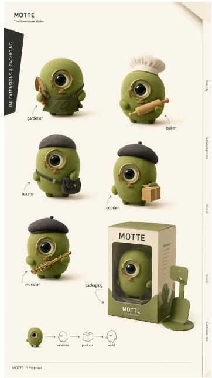

  
Figure 24: Qualitative gallery: character design. Character appearance, multiple views, and related presentation materials.

  
Figure 25: Qualitative gallery: poster design. Examples combining imagery, typography, and promotional composition.

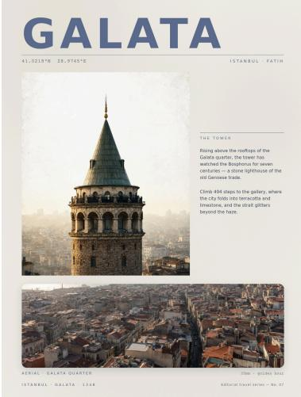

## 红烧排骨

  
小贴士: Use rock sugar for better color and gloss

  
Figure 26: Qualitative gallery: visual information. Examples organizing explanatory and promotional content through text and imagery.

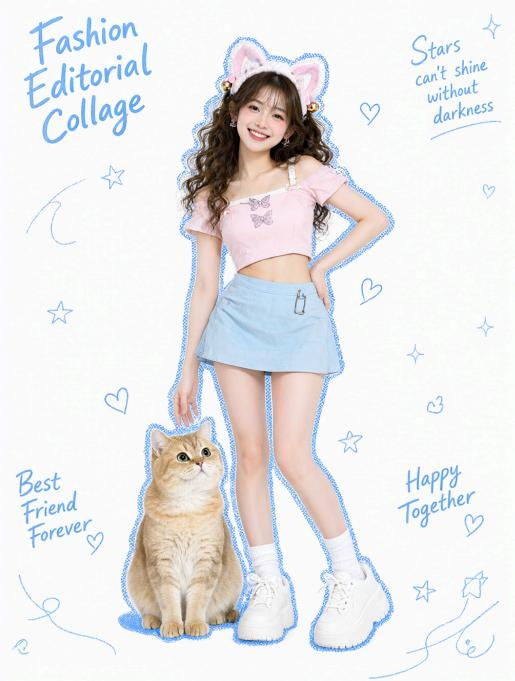

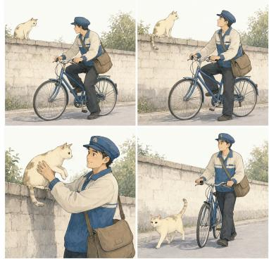  
Figure 27: Qualitative gallery: illustration and visual storytelling. Examples of stylized depiction and narrative composition.

  
Figure 28: Qualitative gallery: fashion and portraits. Examples of portrait treatment, styling, and editorial composition.

  
Figure 29: Qualitative gallery: landscapes and atmosphere. Examples varying scene composition, lighting, and environmental detail

  
Figure 30: Qualitative gallery: imagined scenes. Examples combining familiar subjects with constructed visual settings.

  
Figure 31: Qualitative gallery: material and detail. Examples emphasizing surface appearance, texture, and object composition.

  
Figure 32: Qualitative gallery: motion and fantasy. Examples of dynamic poses and imaginative visual composition.

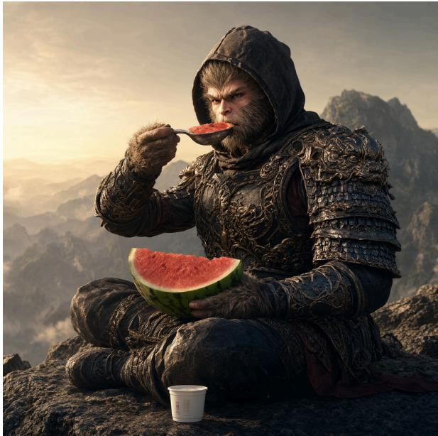

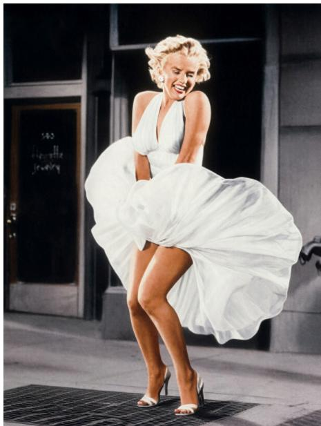  
Figure 33: Qualitative gallery: people and characters. Examples of human and character depiction across different visual settings.

  
Figure 34: Qualitative gallery: culture and events. Examples drawing on cultural themes, seasonal imagery, and public events.