# DIFFICULTY CALIBRATION ACROSS TIME FORMEMBERSHIP INFERENCE IN DIFFUSION MODELS

Michael Joseph & Yedid Hoshen The Hebrew University of Jerusalem

## ABSTRACT

Modern diffusion models are trained on massive datasets that often include copyrighted or private images. Membership inference attacks (MIAs) address this by testing whether a given image was in a model’s training set. The standard approach scores an image by its reconstruction loss and flags low-loss images as members. This often fails because some images are simply easier to reconstruct than others, so a simple unseen image can score a lower loss than a complex training image. Difficulty calibration separates memorization from how difficult an image is to begin with. We show how to calibrate along two axes of time: training time and diffusion time. First, across training time, we introduce Reference-Model Calibration (RMC), which compares a fine-tuned model’s loss against an earlier checkpoint. This cleanly isolates newly memorized data and gives nearperfect auditing, even without text captions. Since earlier checkpoints are not always available, we next present Temporal Self-Calibration (TSC), which calibrates across diffusion time using only a single model. Our key observation is that an image’s difficulty persists across noise levels, whereas memorization is localized in time. By comparing the loss at a target timestep against neighboring timesteps from the same model, TSC attenuates image difficulty using the model’s own trajectory. Empirically, our methods beat the state of the art by a wide margin, and unlike most existing attacks, generalize across different model parameterizations such as x-, v-, and ϵ-prediction models. Code is available at https://github.com/MichaelJoseph777/TSC.

## 1 INTRODUCTION

Diffusion Models (DMs) (Song & Ermon, 2019; Ho et al., 2020; Song et al., 2020) are currently the method of choice for high-fidelity image generation (Rombach et al., 2022; Ramesh et al., 2022). As their success relies heavily on massive, uncurated web-scale datasets, these models often inadvertently absorb personal photographs, copyrighted artworks, and proprietary content. This indiscriminate data collection creates privacy and copyright risks, with recent studies (Carlini et al., 2023; Somepalli et al., 2023) demonstrating that DMs can memorize and reproduce specific training examples during generation. Consequently, it has become increasingly important to reliably audit the underlying training corpora of these generative models.

Membership Inference Attacks (MIAs) (Shokri et al., 2017) audit this risk by predicting whether a specific sample was part of the training set. While typically framed as a security vulnerability, MIAs can also enable creators to verify whether their proprietary content was used for training. These attacks exploit statistical differences in model behavior on members versus non-members (Yeom et al., 2018). Although well-studied for earlier generative models such as GANs (Goodfellow et al., 2020) and VAEs (Kingma & Welling, 2013), with several attacks developed for these settings (Hayes et al., 2017; Hilprecht et al., 2019; Chen et al., 2020), the iterative denoising process of diffusion models makes traditional MIAs considerably less effective (Duan et al., 2023), motivating approaches tailored specifically to the diffusion process.

Probably the most standard approach to MIAs is evaluating the models loss on the target examples, and predicting the low loss examples as members. Early approaches applied this to DMs by directly measuring the reconstruction error at a single, isolated timestep (Matsumoto et al., 2023). While followup work improved upon this (Duan et al., 2023; Kong et al., 2024), a fundamental obstacle limits the accuracy of all these approaches: There are images that are intrinsically easy that achieve low loss regardless of membership and vice versa. This difficulty factor confounds membership making the loss an unreliable membership metric.

To overcome this confound, we propose difficulty calibration across two time axes: training time and diffusion time. First, across training time, we introduce Reference-Model Calibration (RMC) to audit fine-tuned models. By comparing a sample’s fine-tuned loss against the base checkpoint loss, RMC cleanly isolates newly memorized data from general reconstruction difficult. Note that this strategy is known for Large Language Models (Wang et al., 2024) but is under-explored in DMs. Its limitation is that prior checkpoints are frequently unavailable, and the approach is irrelevant for pretraining corpora. To provide an unconstrained alternative, we propose Temporal Self-Calibration (TSC), which calibrates across diffusion time using only a single model. TSC leverages the insight that image difficulty persists across nearby noise levels, whereas the membership signal is highly localized in time. By evaluating the relative loss differences between a target timestep and its temporal neighbors, TSC uses the local trajectory as an internal baseline to suppress difficulty-induced variance. This internal calibration isolates the structural deviation of membership, successfully identify ing a ”difficult” member even when its absolute loss strictly exceeds that of an ”easy” non-member.

We evaluate our methods across multiple model architectures, datasets, and training targets. While RMC provides state-of-the-art auditing for fine-tuned Stable Diffusion models, TSC serves as a highly powerful alternative for unconstrained settings. Across DDPM and Stable Diffusion evaluation settings, TSC consistently outperforms prior baselines. On CIFAR-10 (Krizhevsky et al., 2009), it doubles the performance of existing attacks to reach a 62.3% TPR@1%FPR. Furthermore, we emphasize TSC’s robustness across diverse training objectives. While existing attacks are rigidly tailored to standard noise-prediction models and severely degrade on alternative parameterizations, TSC maintains highly accurate extraction capabilities. Finally, we analyze where the membership signal physically appears along the denoising trajectory, demonstrating that the effective leakage window is intrinsically tied to the underlying training objective.

Our contributions are:

• We propose TSC, a generalized method for robust membership inference. By evaluating relative loss differences across adjacent timesteps, TSC uses the local trajectory as an internal baseline to mitigate image difficulty and isolate membership signal.

• We introduce RMC for auditing fine-tuned models. To the best of our knowledge, we are the first to systematically analyze and demonstrate the effectiveness of prior-checkpoint calibration of single-timestep losses for membership inference in diffusion models.

• We comprehensively evaluate both methods, achieving state-of-the-art performance across diverse architectures and datasets. Notably, TSC consistently yields massive improvements over prior trajectory-based baselines, frequently doubling the true positive rate at strict false-positive thresholds.

• We provide a detailed analysis of how the effective denoising timesteps for membership inference shift across different training objectives, extending robust membership inference beyond the standard ϵ-prediction, ϵ-loss paradigm.

## 2 RELATED WORK

Membership inference attacks. Membership inference attacks (MIAs), originally formalized by Shokri et al. (2017), aim to determine whether a specific data record was included in a target model’s training set. MIAs are traditionally categorized by the adversary’s capabilities: white-box attacks assume access to model parameters, activations, or gradients (Nasr et al., 2019), whereas black-box attacks operate under a more restrictive setting, relying exclusively on the model’s observable outputs (Choquette-Choo et al., 2021). Gray-box attacks occupy an intermediate threat model, granting access to quantities such as loss values or intermediate model states without requiring gradientlevel information. In diffusion-model auditing, this distinction is often methodological: attacks that query intermediate denoising states generally assume local access to the model while avoiding the substantially greater computational cost of full white-box analysis. Most such query-based MIAs are threshold-based attacks: they define a continuous membership score $S _ { \theta } ( x )$ , such as reconstruction loss or prediction error, for a target model θ and candidate sample x, and classify the sample as a member when $S _ { \theta } ( x ) < \tau$ (Yeom et al., 2018; Carlini et al., 2022). The threshold $\tau$ can be empirically calibrated to optimize attack performance, often subject to a desired False Positive Rate (FPR). More sophisticated attacks additionally use shadow models to calibrate the score distribution (Shokri et al., 2017; Carlini et al., 2022).

MIAs on diffusion models. Auditing diffusion models requires analyzing the iterative denoising trajectory. While Carlini et al. (2022) achieved high precision with the Likelihood Ratio Attack (LiRA), their approach requires training numerous shadow models, making it computationally prohibitive. Consequently, efficient threshold-based attacks have become the standard. Matsumoto et al. (2023) introduced the Naive loss attack, which utilizes the diffusion training loss at specific timesteps as the membership score. To extract a more robust signal, Duan et al. (2023) proposed SecMI, which evaluates the reconstruction error along a deterministic trajectory via DDIM inversion, effectively isolating the membership signal from the high variance of stochastic forward noise. Kong et al. (2024) introduced the Proximal Initialization Attack (PIA), which initializes the forward process with a known deterministic noise vector near the clean data sample. PIA infers membership by evaluating the model’s noise estimation against this explicit ground-truth trajectory, achieving competitive accuracy with a reduced query budget. Finally, for conditional text-to-image models, Zhai et al. (2024) proposed CLiD, which measures the discrepancy between conditional and unconditional diffusion losses to expose memorization specific to the text-image pair.

## 3 METHODOLOGY

## 3.1 PRELIMINARIES

Generative trajectories and log-SNR. Both diffusion (Ho et al., 2020; Song et al., 2020) and flow-matching (Lipman et al., 2022) models corrupt a clean sample $x$ with Gaussian noise $\epsilon \sim$ $\mathcal { N } ( 0 , I )$ into noisy states $z _ { t } = \alpha _ { t } x + \sigma _ { t } \epsilon$ over continuous time t. Diffusion defines $\left( \alpha _ { t } , \sigma _ { t } \right)$ via a variance schedule, whereas linear flow matching introduced by Liu et al. (2022) sets $\alpha _ { t } = t$ and $\sigma _ { t } = 1 - t \mathrm { f o r } t \in [ 0 , 1 ]$ , yielding $z _ { t } = t x + ( 1 - t ) { \mathrm { , } }$ ϵ with target velocity $v = x - \epsilon .$ . Because native time variables differ across model families, we align all trajectories using the log-signal-to-noise ratio (log-SNR):

$$
\lambda ( t ) = \log ( \alpha _ { t } ^ { 2 } / \sigma _ { t } ^ { 2 } )\tag{1}
$$

which simplifies to $\lambda ( t ) = 2 \log ( t / ( 1 - t ) )$ for linear flow, mapping noise-dominated $( \lambda \to - \infty )$ to data-dominated $( \lambda \to \infty )$ states.

Prediction and loss parameterizations. A denoising network $f _ { \theta } ( z _ { t } , t , c )$ (with optional conditioning $c )$ predicts a native target $p \in \{ x , v , \epsilon \}$ . Because $x , \epsilon ,$ , and v are deterministically linked via $z _ { t } ,$ , any native prediction ${ \widehat { p } } _ { \theta }$ can be algebraically converted to evaluate the squared denoising error:

$$
L _ { \theta } ( x , \lambda ) = \| q - { \widehat { q } } _ { \theta } ( z _ { t } , t , c ) \| _ { 2 } ^ { 2 } , \quad q \in \{ x , v , \epsilon \}\tag{2}
$$

all nine $( p , q )$ combinations (Li & He, 2026) are detailed in Appendix A. Evaluating $L _ { \theta } ( x , \lambda )$ across λ for a fixed sample x yields its denoising-loss trajectory.

## 3.2 MOTIVATION

Most diffusion MIAs rely on a standard premise: models denoise training data more accurately than unseen data. However, absolute denoising loss varies wildly due to image difficulty factors like high-frequency details (Lian et al., 2025), complex layouts, or rare semantic concepts that make reconstruction harder. Consequently, an ”easy” non-member often incurs a lower loss than a ”difficult” member, deeply entangling the two populations (Fig. 1). Disentangling membership from this sample difficulty requires evaluating candidates against an image-specific reference rather than relying on absolute loss.

Calibration across training time. For models fine-tuned from a foundational base checkpoint, the original model provides a natural reference across training time. It establishes an accurate baseline of each image’s difficulty before the audited fine-tuning stage. As shown for Stable Diffusion on MS-COCO (Lin et al., 2014) (Fig. 2), the losses produced by the two checkpoints are highly correlated. However, subtracting the pretrained loss to compute the fine-tuning residual reveals a stark separation: members systematically shift toward lower fine-tuned loss, while non-members remain concentrated near zero.

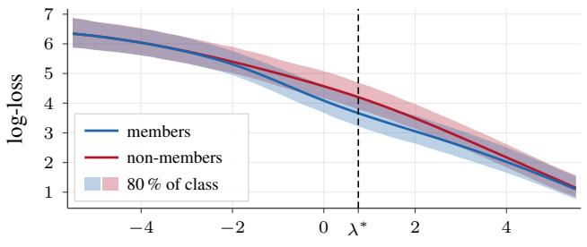  
log-SNR λ

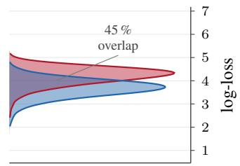  
all images at λ

Figure 1: Image difficulty confounds absolute-loss thresholds. Left: CIFAR-10 DDPM log-loss trajectories for members (blue) and non-members (red) showing class means and 80% intervals. Right: Loss density at the optimal log-SNR $( \lambda ^ { \star } )$ . Even at maximal separability, the populations exhibit a massive 45% overlap, rendering absolute-loss thresholds ineffective.  
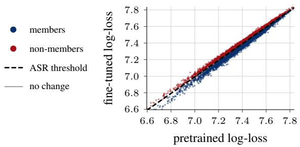

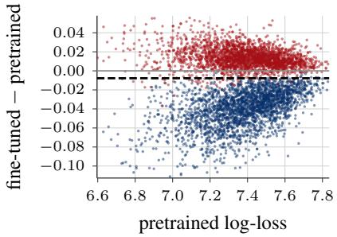  
Figure 2: RMC on MS-COCO. Stable Diffusion fine-tuned on MS-COCO in realistic settings, uncaptioned. $L e f t { \mathrm { : } }$ Pretrained and fine-tuned log-losses are almost perfectly correlated (Pearson correlation $r = 0 . 9 8 9 )$ . Right: Subtracting the pretrained loss removes this shared difficulty. Members shift below the ASR threshold (dashed ASR 98.6%), while non-members stay concentrated near 0.

Table 1 demonstrates the empirical strength of this baseline against CLiD. By isolating the loss residual and thereby neutralizing image difficulty, a minimal two-query, uncaptioned reference evaluation heavily outperforms a 15-query, fully captioned, CLiD attack. Expanding to a comparable 20-query budget yields near-perfect auditing across all datasets. These results demonstrate that separating the membership signal from baseline difficulty is crucial for strict low-FPR auditing, directly motivating our reference-free temporal approach. Appendix E.5 reports the noise-level sweep.

Calibration across diffusion time. While a pretrained checkpoint provides an exceptionally strong baseline, assuming access to one is often unrealistic and irrelevant for auditing pretraining corpus. To achieve difficulty calibration without privileged external models, our primary method instead calibrates across diffusion time, leveraging the denoising trajectory itself as a self-contained internal reference. Because image difficulty generally evolves smoothly across nearby noise levels, adjacent timesteps provide an image-specific estimate of the local loss baseline. Membership, however, often manifests as a localized deviation from this baseline. As illustrated in Figure 3, comparing each loss against its local temporal reference largely cancels out overall image difficulty, successfully separating members from non-members based purely on trajectory shape.

## 3.3 DIFFICULTY CALIBRATION ACROSS TIME

To mitigate the difficulty confound observed in Section 3.2, we compare a candidate’s loss against an image-specific reference. We hypothesize that a significant component of difficulty acts as a persistent multiplicative factor $H ( x )$ . If two loss evaluations satisfy $L _ { a } ( x ) = H ( x ) { \widetilde L } _ { a } ( x )$ and $L _ { b } ( x ) = H ( x ) \widetilde { L } _ { b } ( x )$ , where $\widetilde { L }$ represents the intrinsic loss, their ratio cleanly isolates Le by can-

member (a)   
non-member (a)   
member (b)   
non-member (b)   
chord   
evaluated timestep   
reference timesteps

Table 1: RMC on realistic Stable Diffusion fine-tunes. Reference calibration is evaluated without captions at λ = 1 log-SNR using either one or 10 paired noise draws. CLiD uses the ground-truth caption. Parentheses provide the number of model queries per candidate.
<table><tr><td colspan="2"></td><td colspan="3">Pokémon</td><td colspan="3">MS COCO</td><td colspan="3">Flickr</td></tr><tr><td colspan="2">Method</td><td>AUC</td><td>ASR</td><td>TPR@1%FPR</td><td>AUC</td><td>ASR</td><td>TPR@1%FPR</td><td>AUC</td><td>ASR</td><td>TPR@1%FPR</td></tr><tr><td>CLiD</td><td>(q = 15)</td><td></td><td>96.98</td><td>91.83</td><td>64.75</td><td>95.55</td><td>88.72</td><td>44.04</td><td>95.22</td><td>88.16</td><td>47.14</td></tr><tr><td rowspan="2">RMC</td><td> $( q = 2 )$ </td><td></td><td>99.44</td><td>96.51</td><td>90.63</td><td>99.88</td><td>98.52</td><td>96.60</td><td>99.80</td><td>98.14</td><td>96.86</td></tr><tr><td> $( q = 2 0 )$ </td><td></td><td>99.73 97.84</td><td></td><td>96.64</td><td>99.94</td><td>99.04</td><td>98.52</td><td>99.96</td><td>99.50</td><td>99.82</td></tr></table>

(a)  
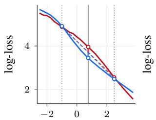  
log-SNR λ

(b)  
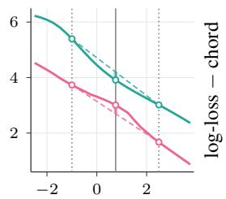  
log-SNR λ

(c)  
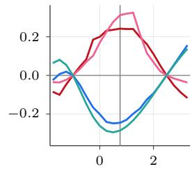  
log-SNR λ  
Figure 3: Temporal self-calibration. (a) A member/non-member pair where absolute loss correctly identifies the member. (b) A pair where absolute loss fails because the member is harder, yet a localized ”dip” is still visible. (c) Subtracting the local temporal reference (the chord between the reference timesteps) removes the absolute difficulty offset. Both pairs collapse into a shared calibrated view, distinctly separating members from non-members by their trajectory shape.

celing $H ( x )$ . While idealized, Section 4.4 demonstrates this effectively reduces difficulty-induced variance in practice.

We perform this comparison in the logarithmic domain. Given a model $\theta ,$ image $x ,$ log-SNR $\lambda ,$ and raw loss $L _ { \theta } ( x , \lambda )$ as described in Eq. 2, we define the stabilized log-loss:

$$
\ell _ { \theta } ( x , \lambda ) = \log ( L _ { \theta } ( x , \lambda ) + \delta ) ,\tag{3}
$$

where $\delta > 0$ is a small stability constant. Subtracting two such log-losses effectively computes their log-ratio, canceling $H ( x )$ . We instantiate this relative calibration across two time axes: training time (using a pretrained base checkpoint) and diffusion time (using the image’s own trajectory).

## 3.3.1 REFERENCE-MODEL CALIBRATION

For audited fine-tuned models $( \theta _ { \mathrm { F T } } )$ with an available pretrained checkpoint $( \theta _ { \mathrm { p r e } } )$ , the base model provides a natural estimate of an image’s intrinsic difficulty prior to membership exposure. Subtracting this baseline cleanly isolates the behavioral shift caused by fine-tuning. For a fixed log-SNR λ, we define the reference-calibrated residual:

$$
r _ { \mathrm { r e f } } ( x , \lambda ) = \ell _ { \theta _ { \mathrm { F T } } } ( x , \lambda ) - \ell _ { \theta _ { \mathrm { p r e } } } ( x , \lambda ) .\tag{4}
$$

As fine-tuned members incur a lower loss on $\theta _ { \mathrm { F T } }$ relative to the pretrained baseline, they systematically produce a more negative residual. We therefore use $r _ { \mathrm { r e f } } ( x , \lambda )$ directly as our membership score.

## 3.3.2 TEMPORAL SELF-CALIBRATION

To calibrate across diffusion time, TSC uses a candidate’s own loss trajectory as an internal reference. Image difficulty tends to persist across noise levels, affecting the overall position of an image’s log-loss trajectory. However, membership advantage varies along the trajectory. As illustrated in Figure 4, members tend to exhibit a greater reduction in log-loss along a certain window in the process, relative to the surrounding trajectory, than non-members.

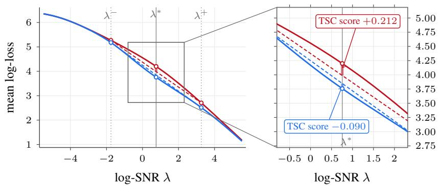  
Figure 4: TSC on STL-10-U. Mean member and non-member log-loss trajectories (left) and a closeup of the selected window (right). The chords connect the two context points for each population, and the vertical bars at $\lambda ^ { * }$ show the residual measured by the temporal score.

Let $\lambda ^ { * }$ denote a selected query point (e.g., the region of maximum separation), and let $\lambda ^ { - } = \lambda ^ { * } - \Delta$ and $\lambda ^ { + } = \lambda ^ { * } + \Delta$ denote two symmetric context points. We define the temporal residual as

$$
r _ { \mathrm { t e m p } } ( x ) = \ell _ { \theta } ( x , \lambda ^ { * } ) - { \frac { 1 } { 2 } } \left( \ell _ { \theta } ( x , \lambda ^ { - } ) + \ell _ { \theta } ( x , \lambda ^ { + } ) \right) .\tag{5}
$$

Geometrically, this three-point symmetric stencil measures the deviation of the log-loss at $\lambda ^ { * }$ relative to the linear chord that connects its two neighbors.

Under the multiplicative difficulty model, the stencil weights in Eq. 5 sum to zero, canceling the shared additive offset log $H ( x )$ . Moreover, placing the context points symmetrically around $\lambda ^ { * }$ cancels linear trends and any trajectory components antisymmetric about $\bar { \lambda } ^ { * }$ even at large window widths $\Delta ,$ , eliminating residual slope variations that a single reference would retain (see Appendix C and Section 4.4).

Crucially, because membership leakage is a macro-scale phenomenon, we avoid narrow windows that merely measure local curvature. Instead, we position $\bar { \lambda } ^ { * }$ at the intermediate memorization peak and set a wide span $2 \Delta$ so $\lambda ^ { - }$ and $\lambda ^ { + }$ fall in lower-signal regions that anchor the image’s baseline trajectory. For members, memorization at $\lambda ^ { * }$ pulls the log-loss further downward relative to the linear chord connecting $\lambda ^ { - }$ and $\lambda ^ { + }$ , yielding a systematically more negative residual $r _ { \mathrm { t e m p } } ( x )$ than for non-members.

## 4 EXPERIMENTS

## 4.1 EXPERIMENT SETUP

Models and datasets. For standard image synthesis, we evaluate DDPMs (Ho et al., 2020) on CIFAR-10, CIFAR-100 (Krizhevsky et al., 2009), STL-10-U (Coates et al., 2011), and Tiny ImageNet (Deng et al., 2009), as well as DDPM++ backbone (Song et al., 2020) on CIFAR-100. For text-to-image generation, we evaluate Stable Diffusion v1.4 (Rombach et al., 2022) fine-tuned on the Pokemon (Pinkney, 2022), MS-COCO (Lin et al., 2014), and Flickr30k (Young et al., 2014)´ datasets. Complete model configurations and dataset splits are detailed in Appendix B.

Baselines and evaluation metrics. We compare TSC against established MIAs for DMs: Naive (Matsumoto et al., 2023), SecMI (Duan et al., 2023), PIA, and PIAN (Kong et al., 2024). We measure performance across all methods using Attack Success Rate (ASR), AUC, and True Positive Rate at 1% False Positive Rate (TPR@1%FPR).

Implementation details. Hyperparameters for both TSC (the optimal center λ⋆) and timestepdependent baselines (Naive, PIA) are tuned by maximizing AUC on a disjoint shadow data split. As analyzed in our results, these optimal coordinates naturally shift depending on the model’s loss weighting. For TSC, we fix the temporal window at $2 \Delta = 5 \bar { \mathrm { l o g } } – \mathrm { S N R } . \bar { \lambda ^ { * } }$ is fixed at 0.75 for DDPM benchmarks and 0.25 for SD trained models. To balance efficiency, we allocate a proportionate query budget that ensures stable evaluation. However, as shown in Fig.5, the attack performance can improve further with higher query budget.

Table 2: Membership inference on DDPM benchmarks. Results reported as percentages. Parentheses give the number of model queries per candidate. SecMI follows its official protocol.
<table><tr><td colspan="2"></td><td colspan="3">CIFAR-10</td><td colspan="3">Tiny ImageNet</td><td colspan="3">STL-10-U</td></tr><tr><td>Method</td><td></td><td>AUC</td><td>ASR</td><td>TPR@1%FPR</td><td>AUC</td><td>ASR</td><td>TPR@1%FPR</td><td>AUC</td><td>ASR</td><td>TPR@1%FPR</td></tr><tr><td>Naive</td><td>(q = 20)</td><td>85.39</td><td>78.21</td><td>7.35</td><td>64.37</td><td>60.52</td><td>2.93</td><td>64.15</td><td>60.50</td><td>2.51</td></tr><tr><td>SecMI</td><td>(q = 12)</td><td>88.24</td><td>80.91</td><td>10.20</td><td>66.37</td><td>61.88</td><td>2.91</td><td>68.12</td><td>63.33</td><td>3.03</td></tr><tr><td>PIA</td><td>(q = 2)</td><td>91.90</td><td>84.88</td><td>25.80</td><td>68.99</td><td>64.25</td><td>4.43</td><td>69.46</td><td>64.51</td><td>4.08</td></tr><tr><td>PIAN</td><td>(q = 2)</td><td>89.26</td><td>83.32</td><td>30.90</td><td>67.04</td><td>63.44</td><td>6.10</td><td>66.72</td><td>63.36</td><td>4.32</td></tr><tr><td>TSC</td><td>(q = 15)</td><td>95.91</td><td>90.15</td><td>62.31</td><td>78.63</td><td>72.18</td><td>12.27</td><td>77.84</td><td>71.29</td><td>9.57</td></tr></table>

Table 3: Membership inference on Stable Diffusion fine-tunes (uncaptioned). SecMI denotes its LDM variant. PIA, is evaluated both over the original paper’s default timestep (t = 500) and an average optimal timestep over shadow models.
<table><tr><td></td><td></td><td colspan="3">Pokémon</td><td colspan="3">MS COCO</td><td colspan="3">Flickr</td></tr><tr><td>Method</td><td></td><td>AUC</td><td>ASR</td><td>TPR@1%FPR</td><td>AUC</td><td>ASR</td><td>TPR@1%FPR</td><td>AUC</td><td>ASR</td><td>TPR@1%FPR</td></tr><tr><td>Naive</td><td>(q = 10)</td><td>84.84</td><td>77.43</td><td>28.37</td><td></td><td>76.61 69.92</td><td>7.16</td><td>77.96</td><td>71.66</td><td>10.08</td></tr><tr><td>SecMI</td><td>(q = 12)</td><td>83.59</td><td>76.47</td><td></td><td>15.14</td><td>78.33 71.46</td><td>6.84</td><td>81.14</td><td>74.24</td><td>7.40</td></tr><tr><td>PIA (t = 500)</td><td>(q = 2)</td><td>69.86</td><td>66.13</td><td>19.71</td><td>54.08</td><td>53.96</td><td>2.76</td><td>54.73</td><td>53.24</td><td>1.96</td></tr><tr><td>PIA (optimal t)</td><td>(q = 2)</td><td></td><td>94.50 87.88</td><td>61.30</td><td></td><td>75.61 70.90</td><td>17.36</td><td>74.18</td><td>69.58</td><td>17.12</td></tr><tr><td>PIAN</td><td>(q = 2)</td><td></td><td>53.34 54.15</td><td>1.92</td><td></td><td>69.20 64.08</td><td>13.88</td><td>69.15</td><td>65.10</td><td>12.40</td></tr><tr><td>TSC</td><td>(q = 15)</td><td>91.37</td><td>84.03</td><td></td><td>55.77</td><td>85.55 78.42</td><td>29.16</td><td></td><td>84.60 77.98</td><td>30.28</td></tr></table>

## 4.2 TEMPORAL SELF-CALIBRATION EVALUATIONS AND ANALYSIS

Table 2 presents the performance of our method TSC against the baselines on standard image synthesis models. TSC consistently achieves state-of-the-art performance across all datasets. While it provides solid improvements in overall AUC and ASR, its most significant advantage emerges in the high-confidence regime. On CIFAR-10, TSC achieves a TPR@1%FPR of 62.31%, doubling the performance of the strongest baseline (PIAN at 30.90%). This trend persists across the more complex Tiny ImageNet and STL-10-U datasets, demonstrating that our geometric measurement of the loss trajectory effectively isolates members while bounding false positives.

For text-to-image models (Table 3), we evaluate Stable Diffusion under a realistic uncaptioned threat model. Because training prompts are typically unknown to an auditor, omitting ground-truth captions prevents artificially inflating attack success via prompt-specific overfitting, directly isolating the inherent image-level membership signal.

Under this setting, TSC outperforms all baselines across every metric on MS-COCO and Flickr30k. The exception is the Pokemon fine-tune, where PIA prevails. We attribute this to the dataset’s´ limited scale and visual uniformity. Such low diversity naturally minimizes the variance in image difficulty, allowing PIA’s proximal measurement to perform exceptionally well without requiring relative calibration. Furthermore, our shadow-model tuning shifts PIA’s optimal timestep from its official default of t = 500 (Kong et al., 2024) down to t ≈ 250-300. By evaluating PIA at these tuned coordinates, our reported baselines are notably stronger than standard static evaluations.

## 4.3 IMPACT OF PREDICTION PARAMETERIZATION AND TRAINING TARGET

Membership leakage varies along the trajectory, making timestep selection crucial. To understand how the training objective influences the informative region, we express the losses in a common velocity coordinate.

Table 4: Robustness across prediction and loss parameterizations. TPR@1%FPR (%) for unaugmented CIFAR-100 DDPM++ FM models. The selected-λ⋆ tuple lists the shared operating log-SNR under x-, v-, and ϵ-losses. SecMI follows its default protocol.
<table><tr><td rowspan="2">Method</td><td rowspan="2">Selected λ*  $( x / v / \epsilon \mathrm { l o s s } )$ </td><td colspan="3">x-loss</td><td colspan="3">v-loss</td><td colspan="3">€-loss</td></tr><tr><td></td><td>x-pred v-pred e-pred x-pred</td><td></td><td></td><td>v-pred</td><td>1 €-pred</td><td>x-pred</td><td></td><td>v-pred e-pred</td></tr><tr><td>Naive</td><td> $( q = 2 0 ) \ : - 0 . 7 5 / 0 . 2 5 / 1 . 5 0$ </td><td>6.48</td><td>6.05</td><td>6.74</td><td>34.54</td><td>34.28</td><td>34.56</td><td>27.52</td><td>29.78</td><td>28.29</td></tr><tr><td>PIA</td><td> $\begin{array} { r l } { ( q = 2 ) } & { { } - 0 . 7 5 / 0 . 2 5 / 1 . 7 5 } \end{array}$ </td><td>2.27</td><td>4.07</td><td>6.22</td><td>1.01</td><td>52.48</td><td>54.84</td><td>31.69</td><td>74.61</td><td>75.85</td></tr><tr><td>PIAN (q = 2)</td><td>-0.50/0.50/1.75</td><td>2.41</td><td>6.00</td><td>5.69</td><td>1.06</td><td>56.68</td><td>58.36</td><td>72.11</td><td>77.77</td><td>76.73</td></tr><tr><td>SecMI (q = 12)</td><td>default</td><td>0.94</td><td>1.10</td><td>1.19</td><td>5.55</td><td>5.57</td><td>5.26</td><td>29.25</td><td>35.40</td><td>30.82</td></tr><tr><td>TSC</td><td> $( q = 1 5 ) \ : \ : - 0 . 5 0 / 0 . 5 0 / 1 . 7 5$ </td><td>30.28</td><td>28.74</td><td>31.26</td><td>81.31</td><td>80.56</td><td>80.68</td><td>91.22</td><td>93.22</td><td>92.75</td></tr></table>

Under linear flow, $x = z _ { t } + ( 1 - t ) v$ and $\epsilon = z _ { t } - t v$ . For a fixed native head $p \in \{ x , v , \epsilon \}$ and $t \in ( 0 , 1 )$ , a converted velocity error $\delta _ { v } = \widehat { v } _ { \theta } ^ { ( p ) } - v$ induces the errors

$$
\delta _ { x } = ( 1 - t ) \delta _ { v } , \qquad \delta _ { \epsilon } = - t \delta _ { v } .
$$

Squaring these residuals gives $\mathcal { L } _ { p , s } ( t ) = w _ { s } ( t ) \| \delta _ { v } \| _ { 2 } ^ { 2 }$ , where $( w _ { x } , w _ { v } , w _ { \epsilon } ) = ( ( 1 - t ) ^ { 2 } , 1 , t ^ { 2 } )$ depends only on the training-loss target $s \in \{ x , v , \epsilon \}$

Lemma 1 (Temporal Weight Ordering). For a common non-degenerate timestep distribution $\rho$ on (0, 1), the explicit-weight barycenters $c _ { s } \triangleq \mathbb { E } _ { \rho } [ T w _ { s } ( T ) ] / \mathbb { E } _ { \rho } [ w _ { s } ( T ) ]$ satisfy $c _ { x } < c _ { v } < c _ { \epsilon }$ . Under uniform sampling, $( c _ { x } , c _ { v } , c _ { \epsilon } ) = ( 1 / 4 , 1 / 2 , 3 / \dot { 4 } )$ . Proof in Appendix D.2.

In this coordinate, x-loss emphasizes noisy timesteps and ϵ-loss emphasizes cleaner timesteps, while v-loss adds no temporal weighting beyond $\rho .$ This ordering concerns explicit weights, it does not determine leakage peaks, which also depends on learned errors and optimization dynamics.

We examine whether the measured leakage follows the same ordering across nine separately trained CIFAR-100 models spanning all $( p , s )$ combinations. Single-timestep AUC sweeps (Fig. 6, Appendix D.3) show that peak leakage shifts toward higher log-SNR as the training target changes from x to v to $\epsilon ,$ whereas changing the native head $p$ has little effect on the peak location.

Table 4 evaluates attacks across all nine models. Consistent with the observed ordering, TSC’s center increases from ${ { \lambda ^ { \star } } = - 0 . 5 0 \ ( x { - } \mathrm { l o s s } ) \mathrm { t o } \ 0 . 5 0 \ ( v { - } \mathrm { l o s s } ) }$ and 1.75 (ϵ-loss). TSC achieves the highest TPR@1%FPR in every configuration, improving over the strongest baseline by 23.84 percentage points on average. Under x-loss, baselines remain below 7% TPR while TSC reaches 29–31%. These results support adapting the operating region to the training objective and demonstrate TSC’s effectiveness across the tested parameterizations.

## 4.4 ABLATIONS

Score domain and query budget. We ablate the loss domain and query budget q (Fig. 5). Evaluating TSC on logarithmic rather than raw loss reveals a stark contrast: log-loss TSC reaches nearly 26% TPR@1%FPR, while raw-loss TSC falls below the Naive baseline. This strengthens our hypothesis that sample difficulty acts as a multiplicative confounder. The log transformation converts this into an additive constant, allowing TSC to effectively cancel it out.

Furthermore, as queries increase from $q \ = \ 3$ to $q = 4 5$ , log-loss TSC scales efficiently. Additional noise draws at the same three query levels improve estimation of the temporal contrast. In this experiment, the Naive attack remains near 4%, gaining little from the additional loss evaluations.

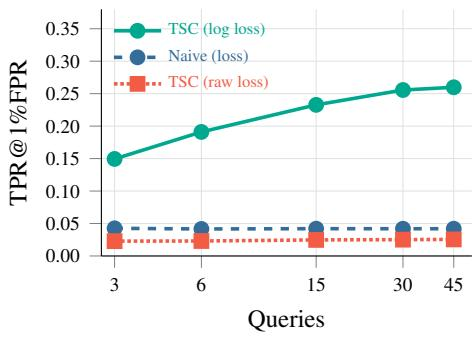  
Figure 5: Score domain and query budget. Mean TPR@1%FPR over 8 DDPM checkpoints at matched query budgets. Both TSC scores use the same temporal stencil.

Filter selection. At $\begin{array} { r l r } { \lambda ^ { \star } } & { { } = } & { 0 . 7 5 } \end{array}$ we compare endpoint references with evenly spaced, Gaussian, and reversewindow filters, the latter assigning greater weight to distant levels. Here, k denotes the number of sampled levels on each side of the center, giving 2k + 1 queried levels in total. TSC uses $k = 1$ , with references at $\lambda ^ { \star } \pm \Delta$ . Definitions and search grids appear in Appendix B.1.

Endpoints achieve the highest mean AUC and TPR@1%FPR at both query budgets (Table 5). The reverse window

Table 5: Temporal reference filters. Mean AUC and TPR@1%FPR across four datasets trained over DDPM settings. The full Gaussian uses 45 levels and is unavailable at $q = 1 5$
<table><tr><td rowspan="2">Filter Setting</td><td colspan="2"> $q = 1 5$   $q = 4 5$ </td></tr><tr><td>AUC TPR</td><td>AUC TPR</td></tr><tr><td>TSC (endpoints)</td><td>∆ = 2.5, k = 1 87.06 35.30 88.11 39.26</td><td></td></tr><tr><td>Even</td><td>∆ = 2.5, k = 2 83.96 26.43 86.84 34.84</td><td></td></tr><tr><td>Gaussian (full)</td><td>σ = 3</td><td>81.21 20.57</td></tr><tr><td>Gaussian (window) k = 7, σ = 3</td><td>71.84</td><td>5.72 79.5311.28</td></tr><tr><td>Reverse window</td><td> $k = 7 , \sigma = 0 . 5$ </td><td>80.5816.26 85.65 27.95</td></tr></table>

improves over the center-weighted Gaussian window but remains below endpoints. At $q = 4 5 ,$ , repeated noise draws at fixed endpoints outperform the tested alternatives using additional temporal levels, supporting concentrating queries on the outer references.

Reference symmetry. At ${ { \lambda } ^ { \star } } ~ = ~ 0 . 7 5$ and $q \ = \ 1 5 ,$ , we compare our symmetric stencil against single-sided references and unequal windows spanning $a + b \ = \ 5 .$ To maintain a fixed query budget, single-reference scores receive proportionally more draws per evaluated point. As shown in Table 6, symmetry achieves the highest mean TPR@1%FPR, outperforming all one-sided and asymmetric baselines. While an equal-weight (1.5, 3.5) window yields a slightly higher overall AUC, the symmetric contrast strictly dominates in the low-FPR regime - the critical operating requirement for practical auditing. Furthermore, interpolation weighting fails to consistently improve asymmetric windows, empirically validating our symmetric default. Full theoretical diagnostics and per-dataset results are provided in Appendix C.1.

Table 6: Temporal reference symmetry. $\mathrm { ~ A t ~ } q \ = \ 1 5 .$ , mean AUC and TPR@1%FPR across four datasets trained over DDPM settings. (a, b) denotes nominal log-SNR offsets.
<table><tr><td>Reference</td><td> $( a , b )$ </td><td>AUC</td><td>TPR</td></tr><tr><td>Symmetric</td><td>(2.5, 2.5)</td><td>87.06</td><td>35.30</td></tr><tr><td>Left only</td><td>(2.5, −)</td><td>78.15</td><td>23.52</td></tr><tr><td>Right only</td><td>(−, 2.5)</td><td>82.13</td><td>6.47</td></tr><tr><td>Unequal</td><td>(1.5, 3.5)</td><td>88.77</td><td>30.94</td></tr><tr><td>Unequal</td><td>(3.5, 1.5)</td><td>80.64</td><td>26.56</td></tr><tr><td>Weighted</td><td>(1.5, 3.5)</td><td>86.24</td><td>29.11</td></tr><tr><td>Weighted</td><td>(3.5, 1.5)</td><td>83.62</td><td>26.58</td></tr></table>

## 5 CONCLUSION

We introduced difficulty calibration across two time axes to mitigate the image-difficulty confound in diffusion MIAs. Reference-Model Calibration (RMC) calibrates across training time using a pretrained checkpoint, while Temporal Self-Calibration (TSC) calibrates across diffusion time using the image’s own denoising trajectory. Experiments across diverse datasets, architectures, and training objectives demonstrate substantial gains in strict low-FPR membership detection. RMC enables near-perfect uncaptioned auditing of fine-tuned data, and TSC frequently doubles the TPR@1%FPR of the strongest trajectory-based baselines in fully unconstrained settings.

Limitations and future work. Although our methods use only forward predictions and do not require gradients, they assume access to denoising outputs for candidate images at selected noise levels. This access may be unavailable through APIs that expose only final generated images, limiting direct application in such settings.

RMC additionally assumes access to the checkpoint from which the audited model was fine-tuned. Its applicability is therefore restricted when this checkpoint is unavailable or the model’s training lineage is unknown. Future work could investigate whether related public checkpoints or ensembles of reference models can provide effective difficulty calibration in these cases.

RMC measures loss changes between checkpoints and does not separately identify membership in the reference model’s pretraining corpus. Studying overlap between pretraining and fine-tuning data, and extending calibration across successive checkpoints, could clarify how membership evidence evolves across training stages.

## ETHICS STATEMENT

Membership inference has both privacy risks and legitimate auditing uses. Improved attacks could be misused to infer an individual’s participation in sensitive training data. At the same time, these methods can help individuals investigate whether their personal data were used to train or fine-tune diffusion models, and can support audits of candidate training-data sources for publicly released models, including those distributed through platforms such as Hugging Face. Such audits can help assess claims about dataset use and improve transparency around model provenance. Membership scores provide statistical evidence about candidate examples: a negative result does not prove that an example was excluded from training, and an audit does not identify a model’s complete training dataset. We advocate using these methods for authorized privacy auditing and accountability, with conclusions that account for false positives and false negatives.

## REFERENCES

Nicholas Carlini, Steve Chien, Milad Nasr, Shuang Song, Andreas Terzis, and Florian Tramer. Membership inference attacks from first principles. In 2022 IEEE symposium on security and privacy (SP), pp. 1897–1914. IEEE, 2022.

Nicolas Carlini, Jamie Hayes, Milad Nasr, Matthew Jagielski, Vikash Sehwag, Florian Tramer, Borja Balle, Daphne Ippolito, and Eric Wallace. Extracting training data from diffusion models. In 32nd USENIX security symposium (USENIX Security 23), pp. 5253–5270, 2023.

Dingfan Chen, Ning Yu, Yang Zhang, and Mario Fritz. Gan-leaks: A taxonomy of membership inference attacks against generative models. In Proceedings ofthe 2020 ACM SIGSAC conference on computer and communications security, pp. 343–362, 2020.

Christopher A Choquette-Choo, Florian Tramer, Nicholas Carlini, and Nicolas Papernot. Label-only membership inference attacks. In International conference on machine learning, pp. 1964–1974. PMLR, 2021.

Adam Coates, Andrew Ng, and Honglak Lee. An analysis of single-layer networks in unsupervised feature learning. In Proceedings of the fourteenth international conference on artificial intelligence and statistics, pp. 215–223. JMLR Workshop and Conference Proceedings, 2011.

Jia Deng, Wei Dong, Richard Socher, Li-Jia Li, Kai Li, and Li Fei-Fei. Imagenet: A large-scale hierarchical image database. In 2009 IEEE conference on computer vision and pattern recognition, pp. 248–255. Ieee, 2009.

Jinhao Duan, Fei Kong, Shiqi Wang, Xiaoshuang Shi, and Kaidi Xu. Are diffusion models vulnerable to membership inference attacks? In International Conference on Machine Learning, pp. 8717–8730. PMLR, 2023.

Ian Goodfellow, Jean Pouget-Abadie, Mehdi Mirza, Bing Xu, David Warde-Farley, Sherjil Ozair, Aaron Courville, and Yoshua Bengio. Generative adversarial networks. Communications of the ACM, 63(11):139–144, 2020.

Jamie Hayes, Luca Melis, George Danezis, and Emiliano De Cristofaro. Logan: Membership infer ence attacks against generative models. arXiv preprint arXiv:1705.07663, 2017.

Benjamin Hilprecht, Martin Harterich, and Daniel Bernau. Monte carlo and reconstruction member-¨ ship inference attacks against generative models. Proceedings on Privacy Enhancing Technologies, 2019.

Jonathan Ho, Ajay Jain, and Pieter Abbeel. Denoising diffusion probabilistic models. Advances in neural information processing systems, 33:6840–6851, 2020.

Tero Karras, Miika Aittala, Timo Aila, and Samuli Laine. Elucidating the design space of diffusionbased generative models. Advances in neural information processing systems, 35:26565–26577, 2022.

Diederik P Kingma and Max Welling. Auto-encoding variational bayes. arXiv preprint arXiv:1312.6114, 2013.

Fei Kong, Jinhao Duan, Heng Tao Shen, Xiaoshuang Shi, Xiaofeng Zhu, Kaidi Xu, et al. An efficient membership inference attack for the diffusion model by proximal initialization. In International Conference on Learning Representations, volume 2024, pp. 57876–57896, 2024.

Alex Krizhevsky, Geoffrey Hinton, et al. Learning multiple layers of features from tiny images. 2009.

Tianhong Li and Kaiming He. Back to basics: Let denoising generative models denoise. In Proceedings of the IEEE/CVF Conference on Computer Vision and Pattern Recognition, pp. 36115– 36125, 2026.

Puwei Lian, Yujun Cai, Songze Li, and Bingkun Bao. Enhancing membership inference attacks on diffusion models from a frequency-domain perspective. arXiv preprint arXiv:2505.20955, 2025.

Tsung-Yi Lin, Michael Maire, Serge Belongie, James Hays, Pietro Perona, Deva Ramanan, Piotr Dollar, and C Lawrence Zitnick. Microsoft coco: Common objects in context. In ´ European conference on computer vision, pp. 740–755. Springer, 2014.

Yaron Lipman, Ricky TQ Chen, Heli Ben-Hamu, Maximilian Nickel, and Matt Le. Flow matching for generative modeling. arXiv preprint arXiv:2210.02747, 2022.

Xingchao Liu, Chengyue Gong, and Qiang Liu. Flow straight and fast: Learning to generate and transfer data with rectified flow. arXiv preprint arXiv:2209.03003, 2022.

Tomoya Matsumoto, Takayuki Miura, and Naoto Yanai. Membership inference attacks against diffusion models. In 2023 IEEE Security and Privacy Workshops (SPW), pp. 77–83. IEEE, 2023.

Milad Nasr, Reza Shokri, and Amir Houmansadr. Comprehensive privacy analysis of deep learning: Passive and active white-box inference attacks against centralized and federated learning. In 2019 IEEE symposium on security and privacy (SP), pp. 739–753. IEEE, 2019.

Justin N. M. Pinkney. Pokemon blip captions. https://huggingface.co/datasets/ lambdalabs/pokemon-blip-captions/, 2022.

Aditya Ramesh, Prafulla Dhariwal, Alex Nichol, Casey Chu, and Mark Chen. Hierarchical textconditional image generation with clip latents. arXiv preprint arXiv:2204.06125, 1(2):3, 2022.

Robin Rombach, Andreas Blattmann, Dominik Lorenz, Patrick Esser, and Bjorn Ommer. High-¨ resolution image synthesis with latent diffusion models. In 2022 IEEE/CVF conference on computer vision and pattern recognition (CVPR), pp. 10674–10685. ieee, 2022.

Reza Shokri, Marco Stronati, Congzheng Song, and Vitaly Shmatikov. Membership inference attacks against machine learning models. In 2017 IEEE symposium on security and privacy (SP), pp. 3–18. IEEE, 2017.

Gowthami Somepalli, Vasu Singla, Micah Goldblum, Jonas Geiping, and Tom Goldstein. Diffusion art or digital forgery? investigating data replication in diffusion models. In 2023 IEEE/CVF Conference on Computer Vision and Pattern Recognition (CVPR), pp. 6048–6058. IEEE, 2023.

Yang Song and Stefano Ermon. Generative modeling by estimating gradients of the data distribution. Advances in neural information processing systems, 32, 2019.

Yang Song, Jascha Sohl-Dickstein, Diederik P Kingma, Abhishek Kumar, Stefano Ermon, and Ben Poole. Score-based generative modeling through stochastic differential equations. arXiv preprint arXiv:2011.13456, 2020.

Jeffrey G Wang, Jason Wang, Marvin Li, and Seth Neel. Pandora’s white-box: Precise training data detection and extraction in large language models. arXiv preprint arXiv:2402.17012, 2024.

Samuel Yeom, Irene Giacomelli, Matt Fredrikson, and Somesh Jha. Privacy risk in machine learning: Analyzing the connection to overfitting. In 2018 IEEE 31st computer security foundations symposium (CSF), pp. 268–282. IEEE, 2018.

Peter Young, Alice Lai, Micah Hodosh, and Julia Hockenmaier. From image descriptions to visual denotations: New similarity metrics for semantic inference over event descriptions. Transactions ofthe associationfor computational linguistics, 2:67–78, 2014.

Shengfang Zhai, Huanran Chen, Yinpeng Dong, Jiajun Li, Qingni Shen, Yansong Gao, Hang Su, and Yang Liu. Membership inference on text-to-image diffusion models via conditional likelihood discrepancy. Advances in Neural Information Processing Systems, 37:74122–74146, 2024.

## A PREDICTION AND LOSS PARAMETERIZATIONS

As discussed in Section 3.1, a diffusion or flow-matching model can be parameterized to predict the clean data x, the noise ϵ, or the velocity v, and its training objective can be evaluated in any of these three spaces. Because these quantities are deterministically linked by the forward process, a prediction in one space can be algebraically converted to any other space before computing the loss. Table 7 details the exact conversion equations for all nine combinations under the linear interpolation schedule $z _ { t } = ( 1 - t ) \epsilon +$ tx, following Li & He (2026).

Table 7: Prediction and loss parameterizations for the linear flow schedule. Columns specify the direct network prediction space, while rows specify the space in which its squared error is measured.
<table><tr><td></td><td>x-prediction  $x _ { \theta } : = f _ { \theta } ( z _ { t } , t , c )$ </td><td>€-prediction  $\epsilon _ { \theta } : = f _ { \theta } ( z _ { t } , t , c )$ </td><td>v-prediction  $v _ { \theta } : = f _ { \theta } ( z _ { t } , t , c )$ </td></tr><tr><td>x-loss:  $\mathbb { E } \| x _ { \theta } - x \| _ { 2 } ^ { 2 }$ </td><td>xθ</td><td> $\begin{array} { r } { x _ { \theta } = \frac { z _ { t } - ( 1 - t ) \epsilon _ { \theta } } { t } } \end{array}$ </td><td> $x _ { \theta } = z _ { t } + ( 1 - t ) v _ { \theta }$ </td></tr><tr><td>€-loss:  $\mathbb { E } \| \epsilon _ { \theta } - \epsilon \| _ { 2 } ^ { 2 }$ </td><td> $\textstyle \epsilon _ { \theta } = { \frac { z _ { t } - t x _ { \theta } } { 1 - t } }$ </td><td>€θ</td><td> $\epsilon _ { \theta } = z _ { t } - t v _ { \theta }$ </td></tr><tr><td>v-loss:  $\mathbb { E } \| v _ { \theta } - v \| _ { 2 } ^ { 2 }$ </td><td> $\begin{array} { r } { v _ { \theta } = \frac { x _ { \theta } - z _ { t } } { 1 - t } } \end{array}$ </td><td> $\textstyle v _ { \theta } = { \frac { z _ { t } - \epsilon _ { \theta } } { t } }$ </td><td>vθ</td></tr></table>

## B EXPERIMENTAL DETAILS

Common protocol. For all membership-inference experiments, each target model is trained only on a designated member split, and attacks are evaluated by distinguishing this member split from a disjoint hold-out split. Unless stated otherwise, images are normalized to $[ - 1 , 1 ]$ , models are trained with Adam, and we evaluate the final EMA checkpoint.

DDPM training. For the unconditional DDPM experiments, we use a UNet backbone with base width 128, channel multipliers (1, 2, 2, 2), two residual blocks per resolution, dropout 0.1, and attention at the $1 6 \times 1 6$ resolution. We train ϵ-prediction DDPMs with $T = 1 0 0 0$ diffusion steps, a linear noise schedule from $\beta _ { 1 } = 1 0 ^ { - 4 } \mathrm { t o } \beta _ { T } \dot { = } 0 . 0 2$ , fixed-large variance, learning rate $2 \cdot 1 0 ^ { - 4 }$ gradient clipping at 1.0, EMA decay 0.9999, and batch size 128. All four datasets below use random horizontal flips.

Table 8: DDPM training settings. All runs use $3 2 \times 3 2$ resolution, batch size 128, linear noise schedule, ϵ-prediction, and random horizontal flips.
<table><tr><td>Dataset</td><td>Resolution</td><td>Member</td><td>Hold-out</td><td>Aug.</td><td>Steps</td><td>Epochs</td></tr><tr><td>CIFAR-10</td><td> $3 2 \times 3 2$ </td><td>25k</td><td>25k</td><td>HFlip</td><td>800k</td><td>≈4k</td></tr><tr><td>CIFAR-100</td><td> $3 2 \times 3 2$ </td><td>25k</td><td>25k</td><td>HFlip</td><td>800k</td><td>≈4k</td></tr><tr><td>STL-10-U</td><td> $3 2 \times 3 2$ </td><td>50k</td><td>50k</td><td>HFlip</td><td>1.6M</td><td>≈4k</td></tr><tr><td>Tiny ImageNet</td><td> $3 2 \times 3 2$ </td><td>50k</td><td>50k</td><td>HFlip</td><td>1.6M</td><td>≈4k</td></tr></table>

Stable Diffusion fine-tuning. For text-to-image experiments, we fine-tune Stable Diffusion v1.4 at $5 1 2 \times 5 1 2$ resolution. We fine-tune the UNet while keeping the VAE and text encoder fixed, use mixed precision, gradient checkpointing, EMA, a constant learning-rate schedule, no warmup, gradient clipping at 1.0, batch size 1, gradient accumulation 4, and learning rate $1 0 ^ { - 5 }$ . Unless stated otherwise, all runs use random cropping.

Caption data. For Pokemon, we use image–caption pairs from the Pok ´ emon BLIP-caption ´ dataset. For MS-COCO and Flickr30k, we use the corresponding image-caption annotations from the constructed train/hold-out splits. Unless stated otherwise, each image is paired with its staged caption metadata and no caption dropout is applied.

Table 9: Stable Diffusion v1.4 overfitting-setting fine-tuning details (Table 3) settings.
<table><tr><td>Dataset</td><td>Train</td><td>Hold-out</td><td>Steps</td><td>Aug.</td></tr><tr><td>Pokémon</td><td>416</td><td>417</td><td>7.5k</td><td>Crop</td></tr><tr><td>MS-COCO</td><td>2.5k</td><td>2.5k</td><td>150k</td><td>Crop</td></tr><tr><td>Flickr30k</td><td>2.5k</td><td>2.5k</td><td>150k</td><td>Crop</td></tr></table>

Table 10: Stable Diffusion v1.4 real-world-setting fine-tuning details (Table 1) settings.
<table><tr><td>Dataset</td><td>Train</td><td>Hold-out</td><td>Steps</td><td>Aug.</td></tr><tr><td>Pokémon</td><td>416</td><td>417</td><td>7.5k</td><td>Crop+HFlip</td></tr><tr><td>MS-COCO</td><td>2.5k</td><td>2.5k</td><td>50k</td><td>Crop+HFlip</td></tr><tr><td>Flickr30k</td><td>10k</td><td>10k</td><td>200k</td><td>Crop+HFlip</td></tr></table>

DDPM++ In addition to the DDPM models, we evaluate a DDPM++ backbone implemented with EDM (Karras et al., 2022) base code ddpmpp over CIFAR-100 and switching the loss for the 9 different linear flow matching prediction/loss pairs. This model is trained over the same settings as stated in Table 8 except no data augmentation and for 2000 epochs. We use this setting to isolate the effect of the native prediction head and the training-loss target. Specifically, the architecture, data split, optimizer, and training budget are fixed, while we vary the prediction/loss variants reported in the corresponding tables.

## B.1 TEMPORAL-FILTER SELECTION

The filter ablation evaluates 45 log-SNR levels from −5.5 to 5.5 at intervals of 0.25, with the center fixed at ${ { \lambda } ^ { \star } } = 0 . 7 5$ . The endpoint stencil is fixed at $\Delta = 2 . 5 , k = 1$ , matching the main DDPM experiments. Even filters search $\Delta \in \{ 0 . 5 , 1 . 0 , \ldots , 4 . 0 \}$ and use $k \in \{ 2 , \ldots , 7 \}$ . Gaussian bandwidths are selected from $\sigma \in \{ 0 . 5 , 1 . 0 , 1 . 5 , 2 . 0 , 3 . 0 \}$ . Windowed Gaussian filters use $k \in \{ 1 , \ldots , 7 \}$ nearest levels per side. Reverse windows use the same support construction with weights increasing away from the center, and search $k \in \{ 2 , \ldots , 7 \}$

All restricted supports include the central level and therefore contain $m = 2 k + 1$ levels. Each support level is evaluated using $\lfloor q / m \rfloor$ independent noise draws. The even and windowed Gaussian families are selected under a budget of $q = 1 5$ The full Gaussian necessarily uses all 45 levels and is selected at $q = 4 5$ . For each non-TSC family, one configuration is selected by mean AUC across the four first-half shadow models. The membership-score direction is fixed so lower temporal residuals are member-like. Selected supports and weights are reused on the matching held-out 4K checkpoints at both query budgets. Results are macro-averaged over CIFAR-10, CIFAR-100, STL-10-U, and Tiny ImageNet with horizontal flips.

## C TEMPORAL REFERENCE SYMMETRY

We distinguish the removal of a shared loss level from the additional effect of symmetric reference points. The identities below hold over any finite window. They require neither a narrow-window approximation nor the interpretation of the membership feature as pointwise curvature. We define

$$
\ell _ { x } ( u ) = \ell _ { \theta } ( x , \lambda ^ { \star } + u )\tag{6}
$$

with the stabilized log-loss defined in Eq. equation 3.

Shared difficulty and reflection symmetry. Under the idealized factorization $L _ { \theta } ( x , \lambda ) \ =$ $H ( x ) \widetilde { L } _ { \theta } ( x , \lambda )$ , the unstabilized log-loss contains the additive offset log $H ( x )$ . Every contrast whose coefficients sum to zero removes this offset, including one-sided and asymmetric contrasts. With the numerical stabilizer $\delta > 0 .$ , this correspondence to multiplicative cancellation is approximate when δ is negligible relative to all evaluated losses. Scalar difficulty alone therefore does not single out symmetry.

For any profile, define its even and odd components about the query point:

$$
E _ { x } ( u ) = \frac { \ell _ { x } ( u ) + \ell _ { x } ( - u ) } { 2 } , \qquad O _ { x } ( u ) = \frac { \ell _ { x } ( u ) - \ell _ { x } ( - u ) } { 2 } .\tag{7}
$$

The symmetric temporal score is exactly

$$
S _ { x } = \ell _ { x } ( 0 ) - E _ { x } ( \Delta ) .\tag{8}
$$

Consequently, adding any sample-dependent offset $a _ { x }$ or odd function $q _ { x } ( - u ) = - q _ { x } ( u )$ to $\ell _ { x } ( u )$ leaves $S _ { x }$ unchanged. This removes antisymmetric profile variation over the entire window, including nonlinear variation. A deterministic trajectory component shared by all images contributes only a common score offset and does not affect rankings. The relevant nuisance is variation between images.

Relation to one-sided references. Define $S _ { x , + } = \ell _ { x } ( 0 ) - \ell _ { x } ( \Delta )$ and $S _ { x , - } = \ell _ { x } ( 0 ) - \ell _ { x } ( - \Delta )$ Then

$$
S _ { x , + } = S _ { x } - O _ { x } ( \Delta ) , \qquad S _ { x , - } = S _ { x } + O _ { x } ( \Delta ) .\tag{9}
$$

Thus each one-sided contrast includes the same centered deviation and an additional odd component with opposite signs. Let $M \in \{ 0 , 1 \}$ denote membership, abbreviate $S = S _ { x } , S _ { \pm } = S _ { x , \pm } .$ , and $O \ = \ \bar { O } _ { x } ( \Delta )$ , and write $\mathrm { V a r } _ { m }$ and $\operatorname { C o v } _ { m }$ for variance and covariance conditional on $M = m$ Assuming finite second moments,

$$
\operatorname { V a r } _ { m } ( S _ { \pm } ) = \operatorname { V a r } _ { m } ( S ) + \operatorname { V a r } _ { m } ( O ) \mp 2 \operatorname { C o v } _ { m } ( S , O ) ,\tag{10}
$$

$$
\frac { \operatorname { V a r } _ { m } ( S _ { + } ) + \operatorname { V a r } _ { m } ( S _ { - } ) } { 2 } = \operatorname { V a r } _ { m } ( S ) + \operatorname { V a r } _ { m } ( O ) .\tag{11}
$$

If O has equal conditional means for members and non-members, both one-sided contrasts have the same mean membership gap as S, while their average conditional variance is larger whenever O varies. Both individual variances exceed that of S when $\mathrm { V a r } _ { m } ( O ) > 2 | \mathrm { C o v } _ { m } ( \bar { S } , O )$ |. These identities explain a possible stability advantage, they do not by themselves establish an ordering of ROC curves or low-FPR detection. The identities compare the same per-coordinate loss estimates: since a one-sided score can use more draws per level under a fixed total query budget, variance diagnostics require a common number of draws per level, separately from the comparison at matched total query budgets.

Unequal reference distances. Consider references at offsets −a and b, with $a , b > 0$ . The equalweight contrast $U _ { x , a , b } = \ell _ { x } ( 0 ) - [ \ell _ { x } ( - a ) + \ell _ { x } ( b ) ] / 2$ retains $\beta _ { x } ( a - b ) / 2$ from an affine sampledependent component $\alpha _ { x } + \beta _ { x } u$ . Interpolation at the query point instead gives

$$
T _ { x , a , b } = \ell _ { x } ( 0 ) - \frac { b } { a + b } \ell _ { x } ( - a ) - \frac { a } { a + b } \ell _ { x } ( b ) ,\tag{12}
$$

which cancels every such affine component exactly. Applying Eq. equation 7 gives the finite-window identity

$$
\begin{array} { l } { T _ { x , a , b } = \ell _ { x } ( 0 ) - \frac { b E _ { x } ( a ) + a E _ { x } ( b ) } { a + b } + R _ { x , a , b } , } \\ { R _ { x , a , b } = \frac { b O _ { x } ( a ) - a O _ { x } ( b ) } { a + b } = \frac { a b } { a + b } \left[ \frac { O _ { x } ( a ) } { a } - \frac { O _ { x } ( b ) } { b } \right] } \end{array}\tag{13}
$$

Weighting therefore removes a linear odd component but generally retains nonlinear odd variation. For example, $O _ { x } ( u ) = \beta _ { x } u + c _ { x } u ^ { 3 }$ contributes $R _ { x , a , b } = c _ { x } a b ( a - b )$ , whereas $a = b$ cancels every odd component. Unequal distances also sample the even component at different radii, which can change the retained membership contrast. Conversely, for an exactly quadratic profile $\ell _ { x } ( u ) =$ $A _ { x } + B _ { x } \mathrm { { } } \mathbf { \bar { u } } + C _ { x } u ^ { 2 } , T _ { x , a , b } = - a b C _ { x } ^ { \mathbf { \bar { \alpha } } }$ and $S _ { x } = - \Delta ^ { 2 } C _ { x }$ , so these two scores have identical rankings for fixed positive $a , b , \Delta .$

Scope of the explanation. The benefit of symmetry depends on the removed odd variation being primarily nuisance and on the centered contrast retaining membership information. An odd membership component would also be removed, and sample-dependent even variation remains. Symmetry is therefore a useful invariance, not a universal optimality claim or a guarantee that all image difficulty is eliminated. In particular, smoothness of difficulty alone does not ensure its cancellation over a wide window. This account is compatible with a broad membership feature and does not identify a unique latent difficulty factor from observed losses.

These statements refer to symmetry in the evaluated log-SNR coordinates. Mapping requested levels to a discrete diffusion schedule can yield slightly unequal realized distances. In that case, a and b in Eq. equation 12 should be computed from the realized coordinate. Nominally equal spacing alone does not imply exact odd-component cancellation.

## C.1 SYMMETRY ABLATION PROTOCOL

We use the same four held-out DDPM checkpoints at 4K epochs as the filter-selection ablation: CIFAR-10, CIFAR-100, STL-10-U, and Tiny ImageNet with horizontal flips. The query center is fixed at the deployed ${ { \lambda } ^ { \star } } \ = \ 0 . 7 5$ The symmetric references have nominal distances $( a , b ) = ( 2 . 5 , 2 . 5 )$ . We compare each single reference separately and two predeclared unequal placements, $( a , b ) = ( 1 . 5 , 3 . 5 )$ and (3.5, 1.5), using either equal weights or the interpolation weights in Eq. equation 12. Thus all two-reference contrasts have the same nominal span $a + b = 5$ . Neither the placement nor the score direction is selected using held-out membership labels, smaller residuals are always member-like.

At each noise level, we compute

$$
\widehat { \ell } _ { x , K } ( \lambda ) = \log \left( \frac { 1 } { K } \sum _ { j = 1 } ^ { K } L _ { \theta } ( x , \lambda , \epsilon _ { j } ) + 1 0 ^ { - 1 2 } \right) .\tag{14}
$$

At budgets $q \in \{ 1 5 , 4 5 \}$ , three-point contrasts use $K = q / 3$ draws at each level. One-reference contrasts use $\lceil q / \bar { 2 } \rceil$ draws at the center and $\lfloor q / 2 \rfloor$ at the reference, assigning the remaining query to the center. Every configuration therefore uses exactly q model queries. The odd-component diagnostics instead use $q / 3$ draws at all three levels, so the identities in Eq. equation 9 compare the same loss estimates.

Requested log-SNR levels are mapped to the nearest available DDPM timesteps. The nominal symmetric triple (−1.75, 0.75, 3.25) is realized as approximately (−1.752006, 0.755986, 3.264399). Its midpoint differs from the query level by approximately $2 . \dot { 1 } \dot { 1 } \times 1 0 ^ { - 4 }$ . We retain equal weights for this deployed TSC baseline and use the realized distances for the unequal interpolation weights. We compute AUC and TPR@1%FPR separately for each checkpoint and then take their unweighted mean, rather than pooling scores across models.

Results by checkpoint. Table 11 reports the individual results underlying the main-text averages. Symmetry has the highest mean TPR@1%FPR across these four checkpoints at both budgets, but does not dominate every checkpoint or metric. The equal-weight (1.5, 3.5) layout has higher AUC on all four checkpoints. The effect of interpolation weighting depends on the orientation and metric, consistent with its changing both nuisance variation and the membership contrast retained by the references.

Variation removed by the symmetric contrast. Table 12 compares the center log-loss, the symmetric contrast S, the endpoint difference O, and the two one-sided contrasts, using the same $K = 5$ draws at every point. For each checkpoint we compute the non-member minus member mean gap and the pooled within-class standard deviation $\sqrt { [ \mathrm { V a r } ( S \mid M = 0 ) + \mathrm { V a r } ( S \mid M = 1 ) ] / 2 } .$ , with analogous definitions for the other components, and then average over checkpoints. The left-only contrast retains a larger mean gap than S but has substantially greater spread. The smaller separation of O relative to its spread is consistent with suppression of difficulty-related variation, without establishing that O is pure nuisance. Its mean AUC is above chance, and covariance with S need not vanish. These are descriptive diagnostics at common per-point precision. The one-sided rows here use ten queries, whereas the symmetric contrast uses fifteen. They are distinct from the matched budget comparisons in Table 6.

Table 11: Reference symmetry by checkpoint. All checkpoints are held-out DDPMs at 4K epochs. AUC and TPR@1%FPR are percentages. C100 denotes CIFAR-100 with horizontal flips. Bold and underlined values denote the best and second-best results within each query budget.
<table><tr><td></td><td></td><td colspan="2">CIFAR-10</td><td colspan="2">C100 hflip</td><td colspan="2">STL-10-U</td><td colspan="2">Tiny ImageNet</td></tr><tr><td>q</td><td>Reference  $( a , b )$ </td><td>AUC</td><td>TPR</td><td>AUC</td><td>TPR</td><td>AUC</td><td>TPR</td><td>AUC</td><td>TPR</td></tr><tr><td>15</td><td>Symmetric (2.5, 2.5)</td><td>95.91</td><td>62.31</td><td>95.85</td><td>57.06</td><td>77.84</td><td>9.57</td><td>78.63</td><td>12.27</td></tr><tr><td>15</td><td>Left only (2.5, −)</td><td>88.78</td><td>42.48</td><td>88.95</td><td>38.22</td><td>67.39</td><td>6.42</td><td>67.48</td><td>6.97</td></tr><tr><td>15</td><td>Right only (−, 2.5)</td><td>91.70</td><td>9.76</td><td>92.11</td><td>12.09</td><td>71.34</td><td>1.62</td><td>73.37</td><td>2.41</td></tr><tr><td>15</td><td>Unequal (1.5, 3.5)</td><td>97.27</td><td>55.60</td><td>97.32</td><td>54.35</td><td>80.12</td><td>6.79</td><td>80.38</td><td>7.02</td></tr><tr><td>15</td><td>Unequal (3.5, 1.5)</td><td>90.18</td><td>44.90</td><td>90.24</td><td>40.80</td><td>70.74</td><td>8.63</td><td>71.42</td><td>11.91</td></tr><tr><td>15</td><td>Weighted (1.5, 3.5)</td><td>95.71</td><td>52.60</td><td>95.95</td><td>48.96</td><td>77.26</td><td>7.67</td><td>76.04</td><td>7.21</td></tr><tr><td>15</td><td>Weighted (3.5, 1.5)</td><td>92.13</td><td>45.10</td><td>92.00</td><td>40.31</td><td>74.32</td><td>8.62</td><td>76.05</td><td>12.31</td></tr><tr><td>45</td><td>Symmetric (2.5, 2.5)</td><td>96.45</td><td>67.80</td><td>96.43</td><td>62.60</td><td>79.60</td><td>12.40</td><td>79.96</td><td>14.26</td></tr><tr><td>45</td><td>Left only (2.5, −)</td><td>89.35</td><td>44.31</td><td>89.47</td><td>40.82</td><td>68.05</td><td>6.61</td><td>68.04</td><td>7.53</td></tr><tr><td>45</td><td>Right only (−, 2.5)</td><td>91.99</td><td>10.29</td><td>92.51</td><td>11.96</td><td>71.76</td><td>1.64</td><td>73.78</td><td>2.32</td></tr><tr><td>45</td><td>Unequal (1.5, 3.5)</td><td>97.96</td><td>65.65</td><td>97.93</td><td>62.88</td><td>81.16</td><td>7.01</td><td>82.04</td><td>7.72</td></tr><tr><td>45</td><td>Unequal (3.5, 1.5)</td><td>91.03</td><td>48.08</td><td>91.03</td><td>45.22</td><td>71.72</td><td>10.05</td><td>71.90</td><td>13.02</td></tr><tr><td>45</td><td>Weighted (1.5, 3.5)</td><td>96.89</td><td>64.97</td><td>97.06</td><td>61.85</td><td>78.59</td><td>8.79</td><td>78.08</td><td>8.68</td></tr><tr><td>45</td><td>Weighted (3.5, 1.5)</td><td>93.39</td><td>51.12</td><td>93.06</td><td>46.58</td><td>76.03</td><td>10.18</td><td>76.73</td><td>13.90</td></tr></table>

Table 12: Components of the temporal contrast. Four-checkpoint means at $K = 5$ shared draws per point. Gaps and standard deviations are in log-loss units.
<table><tr><td>Component</td><td>Mean gap</td><td>Pooled SD</td><td>AUC</td></tr><tr><td>Center  $\ell _ { x } ( 0 )$ </td><td>0.3885</td><td>0.4119</td><td>74.26</td></tr><tr><td>Symmetric S</td><td>0.2566</td><td>0.1366</td><td>87.06</td></tr><tr><td>Endpoint difference O</td><td>0.0371</td><td>0.1552</td><td>57.14</td></tr><tr><td>Left reference  $S + O$ </td><td>0.2937</td><td>0.2464</td><td>77.80</td></tr><tr><td>Right reference  $S - O$ </td><td>0.2195</td><td>0.1580</td><td>81.84</td></tr></table>

## D PREDICTION-LOSS ANALYSIS

This section expands the analysis in Section 4.3. We use $p \in \{ x , v , \epsilon \}$ for the native prediction head and $s \in \{ x , v , \epsilon \}$ for the training-loss target. The symbol $\mathcal { L }$ denotes squared error, while the calibration method uses ℓ for log-loss. q remains the number of model queries per candidate.

## D.1 CONVERSIONS AND OBJECTIVE WEIGHTING

For the linear flow $z _ { t } = t x + ( 1 - t ) \epsilon$ , with $v = x - \epsilon$ and $t \in ( 0 , 1 )$ , the identities

$$
x = z _ { t } + ( 1 - t ) v , \qquad \epsilon = z _ { t } - t v\tag{15}
$$

give the conversions in Table 7. In particular, each native prediction induces a velocity prediction:

$$
\widehat { v } _ { \theta } ^ { ( x ) } = \frac { \widehat { x } _ { \theta } - z _ { t } } { 1 - t } , \qquad \widehat { v } _ { \theta } ^ { ( v ) } = \widehat { v } _ { \theta } , \qquad \widehat { v } _ { \theta } ^ { ( \epsilon ) } = \frac { z _ { t } - \widehat { \epsilon } _ { \theta } } { t } .\tag{16}
$$

Fix one model θ with native head $p ,$ and convert its output to each loss space. The resulting residuals satisfy

$$
\delta _ { v } ^ { ( p ) } = \widehat { v } _ { \theta } ^ { ( p ) } - v , \qquad \delta _ { x } ^ { ( p ) } = ( 1 - t ) \delta _ { v } ^ { ( p ) } , \qquad \delta _ { \epsilon } ^ { ( p ) } = - t \delta _ { v } ^ { ( p ) } .\tag{17}
$$

All three residuals here come from the same model output. This identity makes no assertion that separately trained prediction heads produce the same errors. For example, the expanded x-loss is

$$
\begin{array} { r l } & { \mathcal { L } _ { p , x } ( x , \epsilon , t , \theta ) = \Big \| \big ( z _ { t } + ( 1 - t ) \widehat { v } _ { \theta } ^ { ( p ) } \big ) - \big ( z _ { t } + ( 1 - t ) v \big ) \Big \| _ { 2 } ^ { 2 } } \\ & { \quad \quad \quad = ( 1 - t ) ^ { 2 } \left\| \delta _ { v } ^ { ( p ) } \right\| _ { 2 } ^ { 2 } . } \end{array}\tag{18}
$$

Squaring the other residuals gives the common-coordinate factorization used in Section 4.3:

$$
\mathcal { L } _ { p , s } ( x , \epsilon , t , \theta ) = w _ { s } ( t ) \left\| \delta _ { v } ^ { ( p ) } \right\| _ { 2 } ^ { 2 } , \qquad ( w _ { x } ( t ) , w _ { v } ( t ) , w _ { \epsilon } ( t ) ) = ( ( 1 - t ) ^ { 2 } , 1 , t ^ { 2 } ) .\tag{19}
$$

For timestep sampling density $\rho ( t )$ , the population objective is therefore

$$
\mathcal { R } _ { p , s } ( \theta ) = \int _ { 0 } ^ { 1 } \rho ( t ) w _ { s } ( t ) \mathbb { E } _ { x , \epsilon } \left[ \left\| \delta _ { v } ^ { ( p ) } \right\| _ { 2 } ^ { 2 } \right] d t .\tag{20}
$$

The weight $w _ { s }$ is determined by the loss target, but the residual depends on the fitted model. Native prediction heads also have different output coordinates and parameter Jacobians. Thus, the common-coordinate factorization does not imply identical optimization or learned models. The analysis concerns interior timesteps, where the conversions are well-defined, before any numerical clamping at the endpoints.

For a fixed model and fixed interior timestep, evaluating its output in different loss spaces multiplies the squared error by a positive factor shared by all images. Averaging over the same noise draws preserves this relation, so the single-timestep rankings, ROC curves, and AUC are unchanged. This invariance concerns changing the evaluation space of one model. The nine configurations in Table 4 are separately trained models with different prediction/loss choices.

## D.2 TEMPORAL-WEIGHT BARYCENTERS AND THEIR ORDERING

For a common timestep sampling distribution $\rho ,$ define the barycenter of the explicit temporal weights as

$$
c _ { s } = \frac { \mathbb { E } _ { T \sim \rho } [ T w _ { s } ( T ) ] } { \mathbb { E } _ { T \sim \rho } [ w _ { s } ( T ) ] } .\tag{21}
$$

This quantity summarizes the explicit weights $\rho ( t ) w _ { s } ( t )$ , independently of the model-dependent residual in Eq. (20). For a sampling density $\rho ( t )$ , the corresponding normalized density is

$$
\pi _ { s } ( t ) = { \frac { \rho ( t ) w _ { s } ( t ) } { \int _ { 0 } ^ { 1 } \rho ( u ) w _ { s } ( u ) d u } } , \qquad c _ { s } = \int _ { 0 } ^ { 1 } t \pi _ { s } ( t ) d t .\tag{22}
$$

Uniform timestep sampling. For $\rho ( t ) = 1$ , the normalization constants are $\begin{array} { r } { \int _ { 0 } ^ { 1 } ( 1 - t ) ^ { 2 } d t \ = } \end{array}$ $\begin{array} { r } { \int _ { 0 } ^ { 1 } t ^ { 2 } d t = 1 / 3 , \mathrm { g i v i n g } \pi _ { x } ( t ) = 3 ( 1 - t ) ^ { 2 } , \pi _ { v } ( t ) = 1 } \end{array}$ , and $\pi _ { \epsilon } ( t ) = 3 t ^ { 2 }$ . Their barycenters are

$$
\begin{array} { l } { \displaystyle c _ { x } = \frac { \int _ { 0 } ^ { 1 } t ( 1 - t ) ^ { 2 } d t } { \int _ { 0 } ^ { 1 } ( 1 - t ) ^ { 2 } d t } = \frac { 1 / 1 2 } { 1 / 3 } = \frac 1 4 , } \\ { \displaystyle c _ { v } = \int _ { 0 } ^ { 1 } t d t = \frac 1 2 , } \\ { \displaystyle c _ { \epsilon } = \frac { \int _ { 0 } ^ { 1 } t ^ { 3 } d t } { \int _ { 0 } ^ { 1 } t ^ { 2 } d t } = \frac { 1 / 4 } { 1 / 3 } = \frac 3 4 . } \end{array}\tag{23}
$$

Thus the centers of the explicit weights move from the noisy toward the clean end as the training loss changes from x to v to ϵ. The factor t in these integrals measures the location of each weight, it is not an additional factor in the training objective.

General timestep sampling. Let $T \sim \rho$ have nonzero variance and take values in (0, 1). Since $w _ { v } = 1 , c _ { v } = \mathbb { E } [ T ]$ , and

$$
c _ { s } - c _ { v } = \frac { \operatorname { C o v } ( T , w _ { s } ( T ) ) } { \mathbb { E } [ w _ { s } ( T ) ] } .\tag{24}
$$

For an independent copy $T ^ { \prime }$ of T and any function $g$ used below,

$$
2 \operatorname { C o v } ( T , g ( T ) ) = \operatorname { \mathbb { E } } \big [ ( T - T ^ { \prime } ) \big ( g ( T ) - g ( T ^ { \prime } ) \big ) \big ] .\tag{25}
$$

For $g ( t ) ~ = ~ ( 1 - t ) ^ { 2 }$ , which is strictly decreasing on (0, 1), the integrand is negative whenever $T \neq T ^ { \prime }$ . Conversely, for $g ( t ) = t ^ { 2 }$ , which is strictly increasing, the integrand is positive. Hence

$$
c _ { x } < c _ { v } < c _ { \epsilon } .\tag{26}
$$

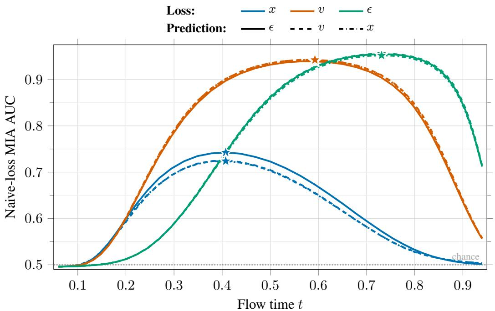  
Figure 6: Membership localization across training losses. Single-timestep absolute-loss AUC on the nine first-half CIFAR-100 DDPM++ models without augmentation at epoch 2000. Color denotes training-loss target s and line style denotes native prediction $p .$ Losses are averaged over 50 noise draws per image, shared across noise levels. Lower loss indicates membership at every level. Stars mark single-timestep AUC maxima. The peaks occur at $\lambda = - 0 . 7 5 , 0 . 7 5$ , and 2.00 for $x \cdot , v \cdot ,$ and ϵ-loss, respectively.

For discrete sampling, replacing the integrals by sums gives the same proof. A distribution concentrated at one interior timestep instead gives equality throughout.

These centers describe only the explicit objective weighting. They are neither the centers of the actual training-error contribution nor the maxima of a membership-inference curve. The latter also depend on the learned errors, optimization, and sample information at each noise level. The ordering above is therefore a statement about explicit objective weights, not a theorem about membership peaks. It provides an interpretation of the empirical shifts examined below.

## D.3 EMPIRICAL LOCALIZATION OF MEMBERSHIP LEAKAGE

Figure 6 uses the nine CIFAR-100 DDPM++ models trained without augmentation for 2000 epochs. For each model, we evaluate the single-timestep absolute reconstruction loss in its training loss space on the grid $\mathcal { G } = \{ - 5 . 5 , - 5 . 2 5 , . . . , 5 . 5 \}$ of 45 log-SNR values. Each curve uses 25,000 members and 25,000 non-members, with $K = 5 0$ deterministic Gaussian noise draws per image reused across noise levels. Losses are averaged over draws before taking the logarithm, this monotone transformation leaves single-timestep rankings unchanged.

Writing $\theta _ { p , s }$ for the model trained with head p and loss target s, the underlying lower-loss membership score is

$$
S _ { p , s } ( x , \lambda ) = - \frac { 1 } { K } \sum _ { k = 1 } ^ { K } \mathcal { L } _ { p , s } \big ( x , \epsilon _ { k } , t ( \lambda ) , \theta _ { p , s } \big ) , \qquad t ( \lambda ) = \frac { 1 } { 1 + e ^ { - \lambda / 2 } } .\tag{27}
$$

Let $A _ { p , s } ( \lambda )$ denote the ROC AUC of $S _ { p , s }$ , with members as the positive class. This fixes lower reconstruction loss as member-like at every noise level. The empirical leakage peak is

$$
\lambda _ { p , s } ^ { \mathrm { p e a k } } \in \underset { \lambda \in \mathcal { G } } { \arg \operatorname* { m a x } } A _ { p , s } ( \lambda ) .\tag{28}
$$

All three native heads attain the same discrete peak within each training loss: $\lambda ^ { \mathrm { p e a k } } = - 0 . 7 5 ,$ 0.75, and 2.00 for $x \ , v - ,$ , and ϵ-loss, respectively. These correspond to flow times 0.407, 0.593, and 0.731. In this experiment, the membership signal therefore shifts toward higher log-SNR as the training loss changes from x to v to ϵ, consistent with the explicit-weight ordering. The observed peaks remain interior and differ from the barycenters. Their locations are empirical properties of the trained models and evaluation.

The empirical peak $\lambda _ { p , s } ^ { \mathrm { p e a k } }$ is measured separately for each model using the single-timestep score, it is distinct from the shadow-selected TSC center, which optimizes a three-point contrast. Appendix E.4 reports the full attack results across all nine prediction/loss configurations, with and without augmentation.

## E ADDITIONAL EXPERIMENTS

Unless stated otherwise, all results in this section use the held-out second evaluation split, with operating points selected on the corresponding first-half shadow checkpoints. TSC uses the endpoint stencil with $\Delta = 2 . 5$ and five noise draws per trajectory point $( q = 1 5 )$ . We do not apply frequency filtering to any attack. AUC, ASR, and TPR@1%FPR are reported as percentages. ASR uses the oracle threshold on the target evaluation split.

## E.1 EARLIER DDPM CHECKPOINTS

Tables 13 and 14 complement the 4K-checkpoint results in the main paper with the corresponding 2K checkpoints. The shorter training horizon weakens membership leakage for every attack, particularly on STL-10-U and Tiny ImageNet, yet TSC remains the strongest method under every metric and dataset.

Table 13: Membership inference at 2K DDPM checkpoints: CIFAR datasets. Standard training setting, parentheses give model queries per candidate.
<table><tr><td colspan="2"></td><td colspan="3">CIFAR-10</td><td colspan="3">CIFAR-100</td></tr><tr><td>Method</td><td></td><td>AUC</td><td>ASR</td><td>TPR</td><td>AUC</td><td>ASR</td><td>TPR</td></tr><tr><td>Naive</td><td>(q = 20)</td><td>70.70</td><td>65.44</td><td>2.75</td><td>69.31</td><td>64.18</td><td>4.19</td></tr><tr><td>SecMI</td><td>(q = 12)</td><td>74.15</td><td>68.14</td><td>3.61</td><td>72.74</td><td>66.89</td><td>4.00</td></tr><tr><td>PIA</td><td>(q = 2)</td><td>77.09</td><td>70.75</td><td>6.07</td><td>75.82</td><td>69.48</td><td>6.55</td></tr><tr><td>PIAN</td><td>(q = 2)</td><td>74.24</td><td>69.18</td><td>8.08</td><td>72.75</td><td>68.07</td><td>7.74</td></tr><tr><td>TSC</td><td>(q = 15)</td><td>85.34</td><td>78.12</td><td>20.61</td><td>84.97</td><td>77.72</td><td>18.24</td></tr></table>

Table 14: Membership inference at 2K DDPM checkpoints: STL-10-U and Tiny ImageNet. Same protocol as Table 13.
<table><tr><td colspan="2"></td><td colspan="3">STL-10-U</td><td colspan="3">Tiny ImageNet</td></tr><tr><td colspan="2">Method</td><td>AUC</td><td>ASR</td><td>TPR</td><td>AUC</td><td>ASR</td><td>TPR</td></tr><tr><td>Naive</td><td>(q = 20)</td><td>56.52</td><td>54.82</td><td>1.50</td><td>55.85</td><td>54.30</td><td>1.57</td></tr><tr><td>SecMI</td><td>(q = 12)</td><td>59.28</td><td>56.83</td><td>1.63</td><td>56.85</td><td>54.95</td><td>1.52</td></tr><tr><td>PIA</td><td>(q = 2)</td><td>59.15</td><td>56.68</td><td>1.84</td><td>57.51</td><td>55.60</td><td>1.84</td></tr><tr><td>PIAN</td><td>(q = 2)</td><td>57.30</td><td>55.81</td><td>1.95</td><td>56.54</td><td>55.15</td><td>2.05</td></tr><tr><td>TSC</td><td> $( q = 1 5 )$ </td><td>63.70</td><td>60.11</td><td>3.30</td><td>62.07</td><td>59.03</td><td>2.84</td></tr></table>

## E.2 DDPMS WITHOUT HORIZONTAL FLIPS

We additionally evaluate STL-10-U and Tiny ImageNet without horizontal-flip augmentation at both 2K and 4K epochs. The 4K checkpoints reproduce the no-flip training regime commonly used in prior diffusion-MIA evaluations. Tables 15 and 16 show that the advantage of TSC persists at both training horizons and becomes especially pronounced at low FPR after longer training.

Table 15: Membership inference without horizontal flips at 2K epochs. Parentheses give model queries per candidate.
<table><tr><td colspan="2"></td><td colspan="3">STL-10-U</td><td colspan="3">Tiny ImageNet</td></tr><tr><td>Method</td><td></td><td>AUC</td><td>ASR</td><td>TPR</td><td>AUC</td><td>ASR</td><td>TPR</td></tr><tr><td>Naive</td><td>(q = 20)</td><td>78.72</td><td>72.20</td><td>4.88</td><td>77.89</td><td>71.17</td><td>5.69</td></tr><tr><td>SecMI</td><td>(q = 12)</td><td>82.71</td><td>75.66</td><td>6.85</td><td>80.91</td><td>73.90</td><td>6.46</td></tr><tr><td>PIA</td><td>(q = 2)</td><td>86.68</td><td>79.39</td><td>12.59</td><td>86.11</td><td>78.93</td><td>13.52</td></tr><tr><td>PIAN</td><td>(q = 2)</td><td>83.72</td><td>77.85</td><td>15.38</td><td>83.29</td><td>77.53</td><td>20.01</td></tr><tr><td>TSC</td><td>(q = 15)</td><td>93.39</td><td>86.88</td><td>38.23</td><td>93.28</td><td>86.55</td><td>45.92</td></tr></table>

Table 16: Membership inference without horizontal flips at 4K epochs. Same protocol as Table 15.
<table><tr><td colspan="2"></td><td colspan="3">STL-10-U</td><td colspan="3">Tiny ImageNet</td></tr><tr><td>Method</td><td></td><td>AUC</td><td>ASR</td><td>TPR</td><td>AUC</td><td>ASR</td><td>TPR</td></tr><tr><td>Naive</td><td>(q = 20)</td><td>87.63</td><td>80.38</td><td>10.04</td><td>88.02</td><td>80.47</td><td>13.71</td></tr><tr><td>SecMI</td><td>(q = 12)</td><td>90.86</td><td>83.94</td><td>13.22</td><td>90.60</td><td>83.38</td><td>14.56</td></tr><tr><td>PIA</td><td>(q = 2)</td><td>93.85</td><td>87.27</td><td>29.10</td><td>94.96</td><td>88.63</td><td>40.48</td></tr><tr><td>PIAN</td><td>(q = 2)</td><td>91.64</td><td>85.81</td><td>33.99</td><td>91.98</td><td>87.00</td><td>51.89</td></tr><tr><td>TSC</td><td>(q = 15)</td><td>96.98</td><td>91.97</td><td>56.91</td><td>97.59</td><td>92.63</td><td>77.07</td></tr></table>

## E.3 CONDITIONING AND DIFFUSION SCHEDULE

Class conditioning. We first score the same class-conditional ϵ-prediction, ϵ-loss SongUNet checkpoint either with the unconditional condition or with the ground-truth class label. Each evaluation contains 25K members and 25K non-members. Access to the class condition strengthens every attack, while TSC remains best in both settings.

Table 17: Effect of class conditioning on a conditional DDPM++. The same checkpoint is evaluated with the condition dropped or with the ground-truth class. TPR denotes TPR@1%FPR.
<table><tr><td colspan="2"></td><td colspan="3">Condition dropped</td><td colspan="3">Ground-truth class</td></tr><tr><td>Method</td><td></td><td>AUC</td><td>ASR</td><td>TPR</td><td>AUC</td><td>ASR</td><td>TPR</td></tr><tr><td>Naive</td><td>(q = 20)</td><td>67.93</td><td>63.17</td><td>4.74</td><td>77.83</td><td>71.05</td><td>8.16</td></tr><tr><td>SecMI</td><td>(q = 12)</td><td>62.19</td><td>58.61</td><td>3.25</td><td>68.25</td><td>63.02</td><td>5.06</td></tr><tr><td>PIA</td><td>(q = 2)</td><td>74.86</td><td>68.89</td><td>8.53</td><td>85.29</td><td>77.52</td><td>15.20</td></tr><tr><td>PIAN</td><td>(q = 2)</td><td>70.46</td><td>66.97</td><td>8.90</td><td>82.13</td><td>76.76</td><td>18.90</td></tr><tr><td>TSC</td><td>(q = 15)</td><td>85.06</td><td>78.27</td><td>17.72</td><td>92.60</td><td>85.86</td><td>24.92</td></tr></table>

Noise schedule. Table 18 compares class-conditional CIFAR-100 DDPMs trained for 2K epochs with cosine and linear noise schedules. Although the absolute leakage differs substantially between schedules, TSC provides the strongest separation in both cases.

Table 18: Effect of the DDPM noise schedule. Class-conditional CIFAR-100 checkpoints are evaluated at 2K epochs. TPR denotes TPR@1%FPR.
<table><tr><td colspan="2"></td><td colspan="3">Cosine schedule</td><td colspan="3">Linear schedule</td></tr><tr><td>Method</td><td></td><td>AUC</td><td>ASR</td><td>TPR</td><td>AUC</td><td>ASR</td><td>TPR</td></tr><tr><td>Naive</td><td>(q = 20)</td><td>89.52</td><td>82.45</td><td>14.60</td><td>81.02</td><td>73.90</td><td>7.80</td></tr><tr><td>SecMI</td><td>(q = 12)</td><td>88.76</td><td>81.11</td><td>17.08</td><td>82.74</td><td>75.49</td><td>8.69</td></tr><tr><td>PIA</td><td>(q = 2)</td><td>95.16</td><td>88.99</td><td>30.86</td><td>86.40</td><td>78.88</td><td>12.80</td></tr><tr><td>PIAN</td><td>(q = 2)</td><td>93.09</td><td>87.61</td><td>33.03</td><td>84.41</td><td>78.43</td><td>15.53</td></tr><tr><td>TSC</td><td>(q = 15)</td><td>98.73</td><td>94.91</td><td>75.32</td><td>95.29</td><td>89.08</td><td>37.20</td></tr></table>

## E.4 FULL PREDICTION–LOSS RESULTS AND OPERATING-POINT SELECTION

The following tables report AUC, ASR, and TPR@1%FPR for each training-loss and nativeprediction pair, with and without augmentation. The non-augmented models are trained for 2000 epochs, while the augmented counterparts are trained for 4000 epochs.

Naive uses 20 noise draws at one level $( q = 2 0 )$ . TSC uses five draws at each of its three levels $( q = 1 5 )$ , with $\Delta = 2 . 5$ and no frequency filtering. PIA and PIAN use their two-query scores. SecMI follows its original fixed protocol $( q = 1 2 )$ , so no center is selected for it. Table 4 summarizes the non-augmented TPR@1%FPR results. The following tables below retain all metrics and the augmented configurations. Each loss uses one consistent point $\lambda ^ { * }$ shared across prediction parameterizations and augmentation variants. All metrics are in percentages and TPR denotes TPR@1%FPR. Augmentations are the default EDM (Karras et al., 2022) augmentations.

Table 19: DDPM++ results under x-loss without augmentation.
<table><tr><td rowspan="2" colspan="2">Method</td><td rowspan="2"> $\lambda ^ { \star }$ </td><td colspan="3">x-pred</td><td colspan="3">v-pred</td><td colspan="3">€-pred</td></tr><tr><td>AUC</td><td>ASR</td><td>TPR</td><td>AUC</td><td>ASR</td><td>TPR</td><td>AUC</td><td>ASR</td><td>TPR</td></tr><tr><td>Naive</td><td>(q = 20)</td><td>-0.75</td><td>72.20</td><td>66.16</td><td>6.48</td><td>71.77</td><td>65.80</td><td>6.05</td><td>73.06</td><td>66.75</td><td>6.74</td></tr><tr><td>SecMI</td><td>(q = 12)</td><td>fixed</td><td>50.57</td><td>50.67</td><td>0.94</td><td>51.78</td><td>51.38</td><td>1.10</td><td>51.03</td><td>50.98</td><td>1.19</td></tr><tr><td>PIA</td><td>(q = 2)</td><td>-0.75</td><td>58.52</td><td>57.03</td><td>2.27</td><td>72.84</td><td>67.11</td><td>4.07</td><td>74.00</td><td>67.87</td><td>6.22</td></tr><tr><td>PIAN</td><td>(q = 2)</td><td>-0.5</td><td>55.88</td><td>55.17</td><td>2.41</td><td>68.38</td><td>64.15</td><td>6.00</td><td>67.49</td><td>63.63</td><td>5.69</td></tr><tr><td>TSC</td><td>(q = 15)</td><td>-0.5</td><td>81.96</td><td>73.94</td><td>30.28</td><td>81.34</td><td>73.50</td><td>28.74</td><td>82.60</td><td>74.52</td><td>31.26</td></tr></table>

Table 20: DDPM++ results under x-loss with augmentation.
<table><tr><td rowspan="2" colspan="2">Method</td><td rowspan="2"> $\lambda ^ { \star }$ </td><td colspan="3">x-pred</td><td colspan="3">v-pred</td><td colspan="3">€-pred</td></tr><tr><td>AUC</td><td>ASR</td><td>TPR</td><td>AUC</td><td>ASR</td><td>TPR</td><td>AUC</td><td>ASR</td><td>TPR</td></tr><tr><td>Naive</td><td>(q = 20)</td><td>-0.75</td><td>56.70</td><td>54.85</td><td>1.96</td><td>56.85</td><td>54.95</td><td>1.85</td><td>57.47</td><td>55.48</td><td>1.98</td></tr><tr><td>SecMI</td><td>(q = 12)</td><td>fixed</td><td>50.37</td><td>50.40</td><td>1.01</td><td>50.58</td><td>50.63</td><td>1.12</td><td>50.58</td><td>50.64</td><td>1.02</td></tr><tr><td>PIA</td><td>(q = 2)</td><td>-0.75</td><td>52.25</td><td>51.77</td><td>1.14</td><td>57.57</td><td>55.64</td><td>1.75</td><td>58.06</td><td>56.01</td><td>1.94</td></tr><tr><td>PIAN</td><td>(q = 2)</td><td>-0.5</td><td>50.92</td><td>50.82</td><td>1.07</td><td>54.91</td><td>53.80</td><td>1.54</td><td>56.39</td><td>54.76</td><td>1.64</td></tr><tr><td>TSC</td><td>(q = 15)</td><td>-0.5</td><td>61.47</td><td>58.32</td><td>5.71</td><td>61.58</td><td>58.30</td><td>5.82</td><td>62.43</td><td>59.11</td><td>6.36</td></tr></table>

Table 21: DDPM++ results under v-loss without augmentation.
<table><tr><td rowspan="2" colspan="2">Method</td><td rowspan="2">λ*</td><td colspan="3">x-pred</td><td colspan="3">v-pred</td><td colspan="3">€-pred</td></tr><tr><td>AUC</td><td>ASR</td><td>TPR</td><td>AUC</td><td>ASR</td><td>TPR</td><td>AUC</td><td>ASR</td><td>TPR</td></tr><tr><td>Naive</td><td>(q = 20)</td><td>0.25</td><td>93.75</td><td>86.19</td><td>34.54</td><td>93.77</td><td>86.25</td><td>34.28</td><td>93.57</td><td>86.02</td><td>34.56</td></tr><tr><td>SecMI</td><td>(q = 12)</td><td>fixed</td><td>69.75</td><td>63.99</td><td>5.55</td><td>74.93</td><td>68.28</td><td>5.57</td><td>73.66</td><td>67.23</td><td>5.26</td></tr><tr><td>PIA</td><td>(q = 2)</td><td>0.25</td><td>50.23</td><td>50.37</td><td>1.01</td><td>95.73</td><td>89.26</td><td>52.48</td><td>96.30</td><td>90.05</td><td>54.84</td></tr><tr><td>PIAN</td><td>(q = 2)</td><td>0.5</td><td>50.36</td><td>50.39</td><td>1.06</td><td>94.31</td><td>88.44</td><td>56.68</td><td>93.81</td><td>88.13</td><td>58.36</td></tr><tr><td>TSC</td><td>(q = 15)</td><td>0.5</td><td>98.04</td><td>93.03</td><td>81.31</td><td>97.89</td><td>92.83</td><td>80.56</td><td>97.88</td><td>92.71</td><td>80.68</td></tr></table>

Table 22: DDPM++ results under v-loss with augmentation.
<table><tr><td rowspan="2" colspan="2">Method</td><td rowspan="2">1*</td><td colspan="3">x-pred</td><td colspan="3">v-pred</td><td colspan="3">€-pred</td></tr><tr><td>AUC</td><td>ASR</td><td>TPR</td><td>AUC</td><td>ASR</td><td>TPR</td><td>AUC</td><td>ASR</td><td>TPR</td></tr><tr><td>Naive</td><td>(q = 20)</td><td>0.25</td><td>69.69</td><td>64.32</td><td>5.97</td><td>69.77</td><td>64.35</td><td>5.88</td><td>70.04</td><td>64.59</td><td>5.96</td></tr><tr><td>SecMI</td><td>(q = 12)</td><td>fixed</td><td>50.53</td><td>50.54</td><td>1.13</td><td>50.64</td><td>50.70</td><td>1.09</td><td>51.04</td><td>50.88</td><td>1.16</td></tr><tr><td>PIA</td><td>(q = 2)</td><td>0.25</td><td>50.26</td><td>50.38</td><td>1.00</td><td>74.43</td><td>68.35</td><td>8.32</td><td>74.51</td><td>68.29</td><td>6.60</td></tr><tr><td>PIAN</td><td>(q = 2)</td><td>0.5</td><td>50.25</td><td>50.38</td><td>1.13</td><td>69.94</td><td>65.59</td><td>8.18</td><td>69.19</td><td>65.24</td><td>8.31</td></tr><tr><td>TSC</td><td>(q = 15)</td><td>0.5</td><td>80.80</td><td>73.97</td><td>19.42</td><td>80.73</td><td>73.95</td><td>18.45</td><td>80.94</td><td>74.20</td><td>19.75</td></tr></table>

Table 23: DDPM++ results under ϵ-loss without augmentation.
<table><tr><td rowspan="2" colspan="2">Method</td><td rowspan="2">1*</td><td colspan="3">x-pred</td><td colspan="3">v-pred</td><td colspan="3">€-pred</td></tr><tr><td>AUC</td><td>ASR</td><td>TPR</td><td>AUC</td><td>ASR</td><td>TPR</td><td>AUC</td><td>ASR</td><td>TPR</td></tr><tr><td>Naive</td><td>(q = 20)</td><td>1.5</td><td>94.67</td><td>88.42</td><td>27.52</td><td>95.16</td><td>89.15</td><td>29.78</td><td>94.93</td><td>88.77</td><td>28.29</td></tr><tr><td>SecMI</td><td>(q = 12)</td><td>fixed</td><td>94.64</td><td>88.24</td><td>29.25</td><td>96.24</td><td>90.68</td><td>35.40</td><td>95.42</td><td>89.43</td><td>30.82</td></tr><tr><td>PIA</td><td>(q = 2)</td><td>1.75</td><td>63.63</td><td>66.81</td><td>31.69</td><td>98.65</td><td>94.68</td><td>74.61</td><td>98.72</td><td>94.77</td><td>75.85</td></tr><tr><td>PIAN</td><td>(q = 2)</td><td>1.75</td><td>93.08</td><td>90.53</td><td>72.11</td><td>95.29</td><td>92.41</td><td>77.77</td><td>94.60</td><td>91.88</td><td>76.73</td></tr><tr><td>TSC</td><td>(q = 15)</td><td>1.75</td><td>99.37</td><td>96.68</td><td>91.22</td><td>99.52</td><td>97.18</td><td>93.22</td><td>99.49</td><td>97.06</td><td>92.75</td></tr></table>

Table 24: DDPM++ results under ϵ-loss with augmentation.
<table><tr><td rowspan="2" colspan="2">Method</td><td rowspan="2">λ*</td><td colspan="3">x-pred</td><td colspan="3">v-pred</td><td colspan="3">€-pred</td></tr><tr><td>AUC</td><td>ASR</td><td>TPR</td><td>AUC</td><td>ASR</td><td>TPR</td><td>AUC</td><td>ASR</td><td>TPR</td></tr><tr><td>Naive</td><td>(q = 20)</td><td>1.5</td><td>71.95</td><td>66.28</td><td>6.39</td><td>72.58</td><td>66.68</td><td>6.36</td><td>72.99</td><td>67.00</td><td>6.91</td></tr><tr><td>SecMI</td><td>(q = 12)</td><td>fixed</td><td>64.86</td><td>60.36</td><td>4.16</td><td>67.70</td><td>62.54</td><td>4.69</td><td>67.46</td><td>62.39</td><td>4.79</td></tr><tr><td>PIA</td><td>(q = 2)</td><td>1.75</td><td>53.51</td><td>53.11</td><td>3.44</td><td>80.70</td><td>73.49</td><td>13.71</td><td>81.23</td><td>74.05</td><td>13.36</td></tr><tr><td>PIAN</td><td>(q = 2)</td><td>1.75</td><td>72.38</td><td>70.19</td><td>13.50</td><td>75.17</td><td>71.33</td><td>14.36</td><td>74.14</td><td>70.92</td><td>15.54</td></tr><tr><td>TSC</td><td>(q = 15)</td><td>1.75</td><td>88.53</td><td>81.54</td><td>22.41</td><td>89.20</td><td>82.26</td><td>24.12</td><td>89.35</td><td>82.48</td><td>23.28</td></tr></table>

## E.5 REFERENCE CALIBRATION ACROSS NOISE LEVELS

We evaluate RMC across 45 noise levels for all three realistic Stable Diffusion fine-tunes in Table 1, using the same target checkpoints. The nominal log-SNR grid spans [−5.5, 5.5] in increments of 0.25, with each coordinate mapped to the nearest available diffusion timestep. At each level, RMC uses one shared noise draw for the fine-tuned and pretrained models (q = 2), without captions. We also report the uncalibrated fine-tuned loss from the same draw (q = 1) to show the effect of subtracting the reference loss.

Around the operating region reported in Table 1, RMC substantially improves both metrics over the uncalibrated loss on all three datasets. The curves also characterize the sensitivity to the chosen noise level: reference calibration reduces difficulty-related variation, while the available membership signal can still vary along the diffusion trajectory.

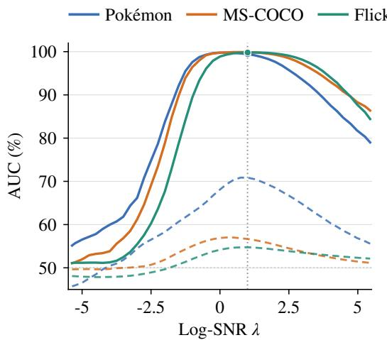

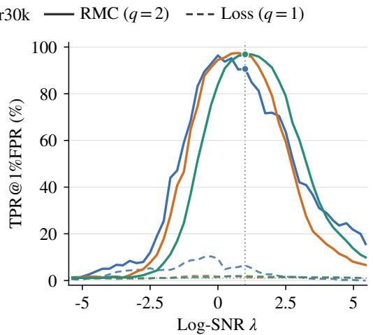  
Figure 7: Reference calibration across noise levels. AUC (left) and TPR@1%FPR (right) for the realistic Pokemon, MS-COCO, and Flickr30k fine-tunes. Solid curves show RMC´ $( q = 2 )$ . Dashed curves show the uncalibrated fine-tuned loss from the same noise draw $( q = 1 )$ . Each point uses a fixed score direction, with lower loss or calibrated residual indicating membership. The vertical guide marks $\lambda = 1$ , the operating point reported in Table 1.