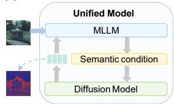
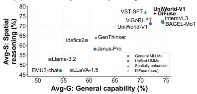
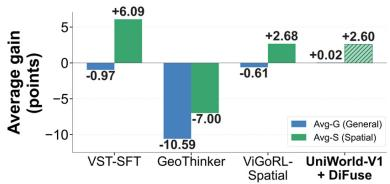
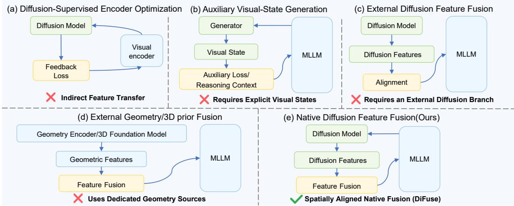
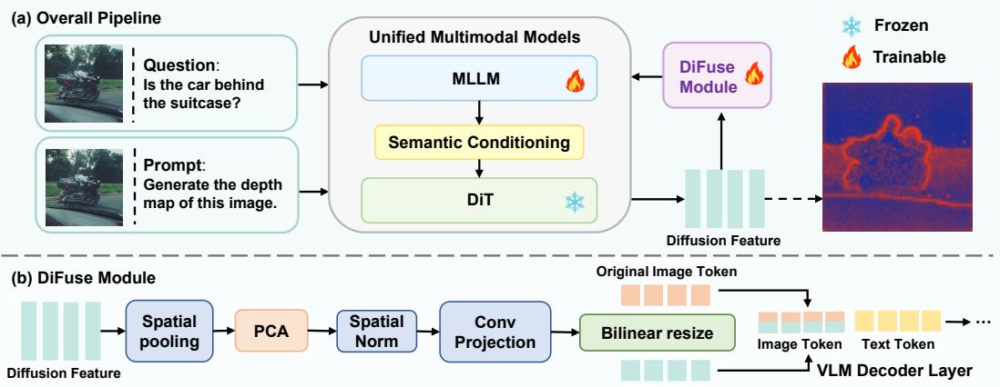
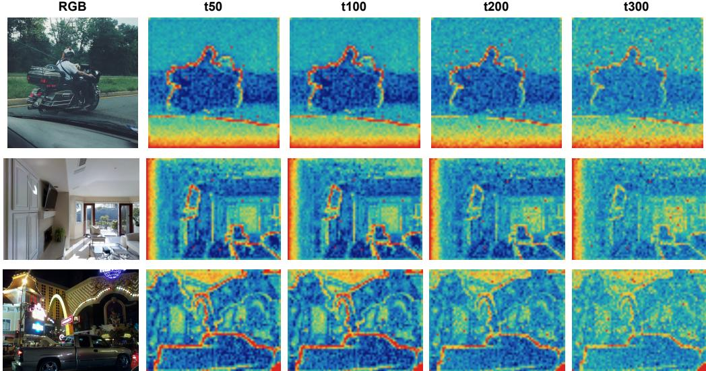
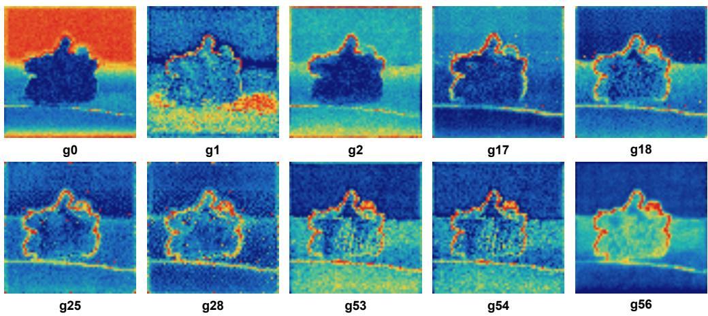
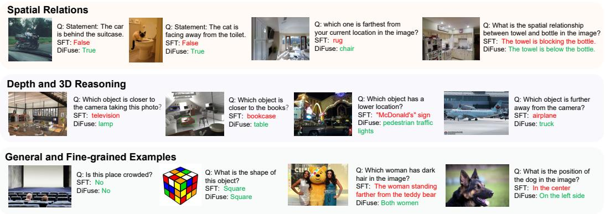

# DIFUSE: FUSING NATIVE DIFFUSION REPRESENTA-TIONS FOR SPATIAL REASONING IN UNIFIED MULTI-MODAL MODELS

Ruixin Fan1 Weining Wang1 Jiahui Sun1 Tailai Chen1 Jing Liu1

1 Institute of Automation, Chinese Academy of Sciences

## ABSTRACT

Unified multimodal models (UMMs) jointly support visual understanding and image generation, yet information flow between these two capabilities remains largely asymmetric: understanding representations routinely condition generation, whereas generative representations are rarely reused for multimodal reasoning. In this work, we investigate whether intermediate representations from a UMM’s native diffusion branch can enhance spatial reasoning without compromising general multimodal understanding. We propose DiFuse, which selectively incorporates intermediate diffusion representations into the understanding pathway of UMMs. Through systematic layer-wise analysis, we identify which diffusion representations are most informative and where they can be integrated with minimal interference to semantic processing. Guided by these findings, DiFuse spatially aligns diffusion features with visual tokens and injects them into selected multimodal decoder layers via residual fusion. Extensive experiments on UniWorld-V1 show that, DiFuse consistently improves spatial reasoning over a matched SFT baseline while maintaining broadly comparable performance on general multimodal benchmarks. Further analyses show that these gains depend critically on the choice of diffusion representations, injection positions, and the preservation of spatial correspondence between diffusion features and visual tokens. Results on OmniGen2 further demonstrate the transferability of DiFuse across unified multimodal architectures. Overall, our findings show that native diffusion representations can provide complementary spatial cues for multimodal reasoning when selectively integrated in a structure-preserving manner.

(a) DiFuse Framework Overview  

(b) General-Spatial Capability Landscape  

(c) Capability Gains over Qwen2.5-VL-7B  
  
Figure 1: Overview of DiFuse and its impact on unified multimodal models. (a) DiFuse establishes a generation-to-understanding pathway by reusing intermediate representations from the native Diffusion Transformer (DiT) branch and integrating them into the visual understanding pathway of a unified multimodal model. (b) General–spatial capability landscape. Models are positioned by their average general-understanding (Avg-G) and spatial-reasoning (Avg-S) scores. Marker shapes distinguish general-purpose MLLMs, UMMs, spatially enhanced models, and DiFuse. (c) Gains relative to Qwen2.5-VL-7B. We compare four Qwen2.5-VL-7B-based models against the same baseline. Blue and green bars show changes in Avg-G and Avg-S, respectively. UniWorld-V1 + DiFuse improves Avg-S by 2.60 points while leaving Avg-G nearly unchanged (+0.02 points).

## 1 INTRODUCTION

Multimodal understanding and image generation have traditionally developed along largely separate trajectories. Recent unified multimodal models (UMMs) bring these capabilities into a shared architecture, enabling a single model to both interpret and generate visual content (Chameleon Team, 2024; Xie et al., 2025; Wang et al., 2024; Lin et al., 2025; Deng et al., 2025; Wu et al., 2025a). Despite this architectural unification, however, the interaction between understanding and generation remains markedly asymmetric: representations from the understanding branch are routinely used to condition generation, whereas representations learned by the generative branch are rarely reused for understanding. Recent studies have begun to explore generation-to-understanding transfer through diffusion feedback, reconstruction objectives, or auxiliary generation tasks (Luo et al., 2025; Wang et al., 2025; Ma et al., 2025a; Su et al., 2026). However, these approaches primarily transfer generative knowledge through additional optimization objectives or intermediate generation processes. Whether representations already learned by the native generative branch of a UMM can be directly reused to improve its understanding capability remains largely unexplored. In this work, we study this reverse information flow and ask: Can native diffusion representations improve spatial reasoning without compromising general multimodal understanding?

Spatial reasoning provides a natural setting for studying this question because the understanding and generation branches are optimized for different representational objectives. Vision-language encoders are optimized for semantic alignment and invariance, which support robust high-level recognition but may reduce sensitivity to local spatial relationships and geometric structure (Radford et al., 2021; Zhai et al., 2023; Tong et al., 2024b). In contrast, diffusion transformers learn to reconstruct visual content under noise perturbations and therefore retain information about object layout, boundaries, and spatial organization (Rombach et al., 2022; Peebles & Xie, 2023; Fuest et al., 2026). Recent geometry-enhanced multimodal models and diffusion-based spatial reasoning methods further suggest that such structural representations can complement semantic visual features (Zheng et al., 2025; Huang et al., 2025; Fan et al., 2026; Li et al., 2026; Wu et al., 2026).

However, these approaches often introduce structural information through dedicated geometry modules or external generative models. Their effectiveness can further depend on feature selection, injection position, fusion strategy, and spatial correspondence. We therefore investigate how diffusion representations can be integrated into the native understanding pathway without disrupting the original semantic pathway. However, effectively transferring diffusion representations to understanding is non-trivial. Intermediate diffusion features vary across layers and denoising stages, and naive fusion may introduce irrelevant information or disrupt semantic representations. Moreover, preserving spatial correspondence between diffusion features and visual tokens is essential for transferring local structural cues. Therefore, the key challenge is to determine which diffusion representations are useful, where they should be integrated, and how their spatial structure should be preserved.

To address these questions, we conduct a systematic study within unified multimodal architectures. We first perform a layer-wise analysis to determine which intermediate diffusion representations are useful and where they can be integrated with minimal interference to the original semantic pathway. Guided by this analysis, we propose DiFuse, a post-training framework that directly incorporates intermediate representations from the native Diffusion Transformer (DiT) into the understanding pathway. Figure 1 illustrates the core idea: the diffusion model supplies intermediate DiT features, which DiFuse injects into the MLLM to complement the UMM’s existing semantic pathway. Experiments on UniWorld-V1 show that DiFuse consistently improves spatial reasoning over a matched SFT baseline while maintaining broadly comparable general multimodal performance. Ablation and feature-shuffling studies reveal that the improvements depend on diffusion representation selection, injection positions, and preservation of spatial correspondence. Further evaluation on Omni-Gen2 demonstrates that DiFuse transfers across unified architectures. These results show that native diffusion representations can serve as complementary spatial cues for multimodal reasoning when selectively integrated in a structure-preserving manner.

In summary, our main contributions are threefold:

• We investigate direct feature transfer from a UMM’s native diffusion branch to its understanding branch, examining the effects of diffusion state selection, decoder injection position, and spatial correspondence.

• We propose DiFuse, a post-training framework that aligns intermediate DiT features with visual tokens and incorporates them through residual adapters without an external diffusion or geometry backbone.

• We demonstrate that DiFuse improves spatially grounded reasoning while largely preserving general multimodal performance on UniWorld-V1, and further validate its transferability on OmniGen2.

  
Figure 2: Paradigms for generation-assisted and structure-enhanced multimodal understanding. Existing methods use diffusion objectives, explicit visual states, external diffusion features, or dedicated geometry branches, whereas DiFuse directly reuses spatially aligned representations from the UMM’s native DiT branch.

## 2 RELATED WORK

## 2.1 UNIFIED MULTIMODAL UNDERSTANDING AND GENERATION

UMMs jointly support visual understanding and image generation within a single architecture (Zhao et al., 2025). Existing approaches include token-based autoregressive models such as Chameleon (Chameleon Team, 2024), Emu3 (Wang et al., 2024), and Janus-Pro (Chen et al., 2025); diffusion-centric models such as MMaDA (Yang et al., 2025) and UniDisc (Swerdlow et al., 2025); and hybrid autoregressive-diffusion architectures such as Bagel (Deng et al., 2025), UniWorld-V1 (Lin et al., 2025), and OmniGen2 (Wu et al., 2025a).

Despite these architectural differences, information flow remains largely asymmetric: understanding representations commonly condition generation, whereas intermediate generative representations are rarely reused for understanding. Recent work explores stronger bidirectional interaction through alignment, reconstruction, joint post-training, and benchmark evaluation (Song et al., 2026; Xie et al., 2026; Yan et al., 2026; Shi et al., 2026b; Zou et al., 2026), but does not directly reuse intermediate representations from a UMM’s native diffusion branch as DiFuse does.

## 2.2 GENERATIVE REPRESENTATIONS FOR VISUAL UNDERSTANDING

Beyond image synthesis, diffusion models learn representations for dense prediction, correspondence, segmentation, and geometric reasoning (Zhao et al., 2023; Fuest et al., 2026; Gabeur et al., 2026; Wang et al., 2026). As shown in Fig. 2(a)–(c), existing methods transfer generative or structural information through diffusion feedback and reconstruction objectives, including DIVA (Wang et al., 2025), DEEM (Luo et al., 2025), GenHancer (Ma et al., 2025a), and RecA (Xie et al., 2026); explicit visual states, including UniMRG (Su et al., 2026), MathCanvas (Shi et al., 2026a), Visual Sketchpad (Hu et al., 2024), and Latent Sketchpad (Zhang et al., 2025); and external diffusion features (Agarwal et al., 2025; Wu et al., 2026). In contrast, DiFuse directly reuses intermediate features from the same UMM’s native DiT branch, spatially aligns them with visual tokens, and injects them through residual fusion without introducing an additional diffusion or geometry branch.

## 2.3 STRUCTURAL PRIORS FOR SPATIAL MULTIMODAL REASONING

Multimodal models often struggle with local spatial relationships and geometric structure (Tong et al., 2024b; Chen et al., 2024a; Wu et al., 2025b; zhang et al., 2025), particularly in fine-grained spatial reasoning tasks. Geometry-enhanced MLLMs therefore introduce geometry encoders, 3D foundation models, multiview reconstruction, or explicit geometric supervision (Zheng et al., 2025; Fan et al., 2026; Hu et al., 2026; Huang et al., 2025; Li et al., 2026). As illustrated in Fig. 2(d)– (e), these methods demonstrate the value of structural priors but generally depend on additional geometry sources or supervision, whereas DiFuse reuses native diffusion features within the UMM. Complementary alignment studies suggest that preserving spatial correspondence is important when integrating heterogeneous visual representations (Singh et al., 2026), motivating DiFuse to preserve token-level correspondence during residual fusion.

## 3 METHOD

  
Figure 3: DiFuse architecture. (a) Overall pipeline. Given an input image and a question, the UMM’s understanding branch processes the visual and text tokens, while its native generation branch receives the same image and a fixed generation prompt “Generate the depth map of this image.” DiFuse extracts an intermediate spatial representation from the frozen DiT at a selected layer and denoising timestep, without decoding a final image. (b) DiFuse module. The extracted feature is spatially pooled and compressed with PCA, then normalized and projected through a convolutional adapter. Bilinear resizing aligns the resulting feature map with the visual-token grid. DiFuse adds the aligned features to visual-token states at selected decoder layers through residual connections; text-token states receive no direct residual update.

In this section, we introduce DiFuse, which incorporates intermediate representations from a UMM’s native DiT branch into its understanding pathway. As illustrated in Figure 3, DiFuse extracts spatial diffusion features, projects them into the language-model hidden space, and injects them into visual-token states at selected decoder layers. The diffusion and visual encoders remain frozen, and training uses the original supervised fine-tuning objective without auxiliary losses.

## 3.1 OVERVIEW

Consider a hybrid UMM with an understanding branch U and a generation branch ${ \mathcal { G } } .$ Given an image x and a textual query q, the vision encoder and text embedding layer produce a multimodal token sequence

$$
H ^ { ( 0 ) } = [ V ( x ) ; T ( q ) ] \in \mathbb { R } ^ { L \times d } ,\tag{1}
$$

where $V ( x )$ denotes the visual tokens, $T ( q )$ denotes the text tokens, and d is the hidden dimension of the multimodal decoder. Let $\mathcal { T } \subseteq \{ 1 , \ldots , L \}$ denote the positions occupied by visual tokens.

In parallel, we obtain an intermediate representation $F _ { t } ^ { ( k ) }$ from diffusion layer k at denoising timestep t. DiFuse transforms this representation with a layer-specific adapter $\mathbf { \mathcal { A } } _ { \ell }$ and injects it

into a selected set of multimodal decoder layers S. If $H ^ { ( \ell ) }$ is the output of decoder layer $\ell ,$ the resulting update is

$$
\widehat { H } _ { j } ^ { ( \ell ) } = \left\{ \begin{array} { l l } { H _ { j } ^ { ( \ell ) } + \lambda _ { \ell } \mathcal { A } _ { \ell } \Big ( F _ { t } ^ { ( k ) } \Big ) _ { \pi ( j ) } , } & { j \in \mathbb { Z } , } \\ { H _ { j } ^ { ( \ell ) } , } & { j \not \in \mathbb { Z } , } \end{array} \right. \quad \ell \in \mathcal { S } ,\tag{2}
$$

where $\pi ( j )$ maps a visual-token position to the corresponding location in the aligned diffusion grid, and $\lambda _ { \ell }$ is a fixed fusion coefficient. Thus, DiFuse modifies only visual-token states and leaves the text-token pathway intact.

## 3.2 DIFFUSION FEATURE EXTRACTION

Target timestep. Given an input image $x ,$ the native generation branch constructs the diffusion condition $c ( x , p _ { g } )$ using the image and a fixed generation prompt $p _ { g }$ . Let $\tau = t _ { 1 } , \dots , t _ { S }$ denote the timesteps in the inference schedule and let $t ^ { \star }$ denote the target timestep. Since $t ^ { \star }$ may not occur exactly in the schedule, we select the closest scheduled timestep:

$$
\hat { t } = \arg \operatorname* { m i n } _ { t _ { s } \in \mathcal { T } } \left| t _ { s } - t ^ { \star } \right| .\tag{3}
$$

The generation branch follows its native denoising trajectory until $\hat { t } .$ We then extract the spatialtoken representation from an intermediate DiT layer k:

$$
R ^ { ( k ) } \hat { t } = \mathcal { G } ^ { ( k ) } \left( z \hat { t } ; c ( x , p _ { g } ) , \hat { t } \right) \in \mathbb { R } ^ { H _ { D } W _ { D } \times d _ { \mathrm { r a w } } } ,\tag{4}
$$

where $z _ { \hat { t } }$ is the current noisy latent, $\left( H _ { D } , W _ { D } \right)$ denotes the spatial grid of the DiT representation, and $d _ { \mathrm { r a w } }$ is its channel dimension. We retain the ordered spatial tokens to preserve the spatial correspondence required for location-wise injection. Once extracted, denoising stops without completing the remaining steps or decoding a final image.

Vital layer selection. Not all DiT layers provide equally informative representations for multimodal understanding. Following the bypass-based analysis of Avrahami et al. (2025), we use layers whose removal substantially alters the generated content as candidate vital layers, as these layers are likely to encode influential generative representations. Rather than aggregating features from all candidates, DiFuse selects a single source layer $k ^ { \star }$ for injection. The selected layer is fixed for each backbone, with the final configuration reported in Section 4.1 and the corresponding source-layer screening provided in Appendix C.

Offline caching. To avoid repeatedly running the frozen generation branch, we extract the selected diffusion representation once per image and cache it offline. We apply spatial downsampling followed by a fixed PCA projection along the channel dimension,

$$
\boldsymbol { F } _ { \widehat { t } } ^ { ( k ^ { \star } ) } = \mathcal { P } _ { \mathrm { P C A } } \left( \mathcal { P } _ { s } \left( \boldsymbol { R } _ { \widehat { t } } ^ { ( k ^ { \star } ) } \right) \right) \in \mathbb { R } ^ { N _ { D } \times d _ { D } } .\tag{5}
$$

Both operations preserve spatial-token ordering, so the cached representation remains spatially structured. Detailed compression settings are provided in Appendix A.4.

## 3.3 DIFFUSION FEATURE INTEGRATION AND TRAINING

The cached diffusion feature and the visual tokens generally differ in both channel dimension and spatial resolution. For every injection layer $\ell \in S$ , DiFuse therefore uses a separate adapter Aℓ.

Structure-preserving projection. We first normalize each diffusion channel over its spatial tokens. For $\bar { F } \in \mathbb { R } ^ { N _ { D } \times \smile d _ { D } }$ , the normalization used in our implementation is

$$
\mathrm { S N } ( F ) n , c = \frac { F n , c - \gamma \mu _ { c } } { \sqrt { \sigma _ { c } ^ { 2 } + \epsilon } } ,\tag{6}
$$

where $\mu _ { c }$ and $\sigma _ { c } ^ { 2 }$ are computed across the $N _ { D }$ spatial positions, and γ is initialized to one and learned during post-training. The normalized sequence is reshaped into its $H _ { D } \times W _ { D }$ grid and processed by a $3 \times 3$ convolution, GELU, and a $1 \times 1$ convolution:

$$
P _ { \ell } = W ^ { o } \ell , \mathrm { F l a t ! } \left( \mathrm { C o n v } ^ { 1 \times 1 } \ell \left( \mathrm { G E L U } \left( \mathrm { C o n v } ^ { 3 \times 3 } \ell \left( \mathrm { G r i d } ( \mathrm { S N } ( F ) ) \right) \right) \right) \right) ,\tag{7}
$$

where the convolutions map the diffusion channels to the decoder hidden dimension and $W ^ { o } \ell$ is an output projection. We initialize $W _ { \ell } ^ { o }$ to zero, so the newly introduced pathway begins as an identitypreserving residual and is activated gradually during training.

Spatial alignment. Let $( H _ { V } , W _ { V } )$ be the visual-token grid at the multimodal decoder input. We reshape $P _ { \ell }$ to a feature map and use bilinear interpolation to match this grid:

$$
\mathcal { A } \ell ( F ) = \mathrm { F l a t } ! \left( \mathrm { R e s i z e } H _ { V } \times W _ { V } \left( \mathrm { G r i d } ( P _ { \ell } ) \right) \right) \in \mathbb { R } ^ { N _ { V } \times d } ,\tag{8}
$$

where $N _ { V } = H _ { V } W _ { V }$ . The aligned features are associated with visual tokens in raster order and are written back only at the positions specified by V. This explicit correspondence is important: it transfers local structural cues without altering non-visual tokens.

Fixed residual injection. DiFuse uses a fixed scalar $\lambda _ { \ell }$ rather than a learned or query-conditioned gate, isolating the contribution of diffusion representations from that of an additional routing network. The injection layers and coefficients are fixed for each backbone, with their settings reported in Section 4.1 and ablations in Appendix C.

Training objective. DiFuse uses the standard autoregressive SFT objective without auxiliary diffusion, representation-matching, or geometric losses. The original UMM remains frozen, while the DiFuse adapters and decoder LoRA modules are trained with the same data and optimization recipe as the matched SFT baseline. Thus, the two differ only by the diffusion-feature pathway.

## 4 EXPERIMENTS

## 4.1 EXPERIMENTAL SETUP

Backbones and configurations. We conduct our main experiments on UniWorld-V1 (Lin et al., 2025) and further evaluate DiFuse on OmniGen2 (Wu et al., 2025a) to examine its transferability across hybrid UMM architectures. For UniWorld-V1, our default configuration extracts diffusion representations from layer g18 at target timestep $t ^ { \star } = 1 0 0$ and injects them into multimodal decoder layers 0 − 7 using a fixed coefficient λ = 1. Architecture-specific extraction, compression, and injection settings are provided in Appendix C.

Training. We train on 296,401 image–text instruction samples selected from the LLaVA-1.5 mixture (Liu et al., 2024a) after removing GQA-derived samples. For each backbone, DiFuse and its matched SFT baseline use identical training data and optimization settings. We freeze the original model parameters and optimize only the decoder LoRA parameters and DiFuse adapters for three epochs. Complete optimization and hardware configurations are reported in Appendix A.

Benchmarks. We evaluate general multimodal understanding on MMBench (Liu et al., 2024b), MMStar (Chen et al., 2024b), MME (Fu et al., 2025), GQA (Hudson & Manning, 2019), and Real-WorldQA (xAI, 2024). We evaluate spatial understanding on VSR (Liu et al., 2023), EmbSpatial (Du et al., 2024), CV-Bench-3D (Tong et al., 2024a), and 3DSRBench (Ma et al., 2025b).

Evaluation protocol. We follow the official LMMS-Eval protocols (Zhang et al., 2024) and use identical prompting and decoding settings for all variants of the same backbone. We report the normalized MME score (MMEnorm) as a percentage, placing it on the same scale as the other benchmark scores for fair averaging, and use CircularEval for 3DSRBench (3DSR-C) (Ma et al., 2025b). Our primary comparison is between DiFuse and its matched SFT baseline, while the original backbone is included as an additional reference. Further evaluation details are provided in Appendix A.

## 4.2 MAIN RESULTS

Controlled comparison with matched SFT. Table 1 presents our primary comparison on UniWorld-V1. The original UMM, the matched SFT baseline, and DiFuse are evaluated under the same protocol, while SFT and DiFuse use identical instruction-tuning data and optimization settings. Therefore, the comparison between SFT and DiFuse isolates the effect of introducing the native diffusion-representation pathway. On UniWorld-V1, DiFuse substantially improves spatial reasoning while preserving overall general multimodal understanding. The spatial average (Avg-S) increases from 71.08 for the original model to 71.88 after standard SFT, and further to 73.68 with DiFuse. This corresponds to a gain of +2.60 points over the original UMM and +1.80 points over the matched SFT baseline. Importantly, the improvement is consistent across all four primary spatial benchmarks. Compared with SFT, DiFuse improves VSR from 87.81 to 89.36 (+1.55), EmbSpatial from 70.99 to 72.39 (+1.40), CVB-3D from 81.92 to 84.58 (+2.66), and 3DSR-C from 46.79 to 48.38 (+1.59). These consistent gains indicate that the benefit is not driven by a single spatial benchmark, but transfers across relational, embodied, and 3D spatial reasoning settings.

Table 1: Controlled comparison of SFT and DiFuse on unified multimodal models. For each backbone, SFT and DiFuse use identical instruction-tuning data and optimization settings. Avg-G averages MMEnorm, MMB, MMStar, GQA, and RWQA; Avg-S averages VSR, EmbSpatial, CVB-3D, and 3DSR-C. Numbers in parentheses denote absolute changes over the corresponding base UMM. Bold numbers indicate the best result within each backbone family.
<table><tr><td></td><td></td><td colspan="2">Summary</td><td colspan="5">General Multimodal Understanding</td><td colspan="4">Spatial Reasoning</td></tr><tr><td>Backbone</td><td>Variant</td><td>Avg-G</td><td>Avg-S</td><td>MMEnorm</td><td>MMB</td><td>MMStar</td><td>GQA</td><td>RWQA</td><td>VSR</td><td>EmbSpatial</td><td>CVB-3D</td><td>3DSR-C</td></tr><tr><td>UniWorld-V1</td><td>Base</td><td>71.92</td><td>71.08</td><td>82.35</td><td>83.93</td><td>62.74</td><td>60.92</td><td>69.67</td><td>87.32</td><td>69.97</td><td>81.08</td><td>45.94</td></tr><tr><td>(Qwen2.5-VL-7B)</td><td>+ SFT</td><td>71.51 (-0.41)</td><td>71.88 (+0.80)</td><td>78.23</td><td>84.88</td><td>63.76</td><td>60.90</td><td>69.80</td><td>87.81</td><td>70.99</td><td>81.92</td><td>46.79</td></tr><tr><td></td><td>+ DiFuse</td><td>71.94 (+0.02)</td><td>73.68 (+2.60)</td><td>80.82</td><td>84.54</td><td>62.97</td><td>61.70</td><td>69.67</td><td>89.36</td><td>72.39</td><td>84.58</td><td>48.38</td></tr><tr><td>OmniGen2</td><td>Base</td><td>66.04</td><td>65.01</td><td>76.55</td><td>77.49</td><td>56.72</td><td>60.22</td><td>59.22</td><td>80.77</td><td>61.46</td><td>74.08</td><td>43.73</td></tr><tr><td>(Qwen2.5-VL-3B)</td><td>+ SFT</td><td>67.69 (+1.65)</td><td>65.37 (+0.36)</td><td>76.71</td><td>78.26</td><td>58.00</td><td>61.17</td><td>64.31</td><td>82.41</td><td>62.20</td><td>74.75</td><td>42.12</td></tr><tr><td></td><td>+ DiFuse</td><td>67.02 (+0.98)</td><td>65.84 (+0.83)</td><td>73.15</td><td>78.01</td><td>56.44</td><td>60.96</td><td>66.54</td><td>82.41</td><td>63.08</td><td>75.42</td><td>42.45</td></tr></table>

Table 2: Contextual comparison with representative general-purpose VLMs, unified multimodal models (UMMs), and spatial-reasoning-enhanced models. All models are evaluated using the same benchmark splits and scoring implementation under deterministic decoding. Avg-G and Avg-S follow the definitions in Table 1. Bold numbers in the summary columns indicate the best result within each model category. The shaded row denotes our DiFuse-enhanced UMM.
<table><tr><td></td><td></td><td colspan="2">Summary</td><td colspan="5">General Multimodal Understanding</td><td colspan="4">Spatial Reasoning</td></tr><tr><td>Method</td><td>Params.</td><td>Avg-G Avg-S</td><td></td><td>MMEnorm</td><td>MMB</td><td>MMStar</td><td>GQA</td><td>RWQA</td><td>VSR</td><td>EmbSpatial</td><td>CVB-3D</td><td>3DSR-C</td></tr><tr><td>General-purpose VLMs</td><td></td><td></td><td></td><td></td><td></td><td></td><td></td><td></td><td></td><td></td><td></td><td></td></tr><tr><td>InternVL3</td><td>8B</td><td>74.24</td><td>72.41</td><td>85.18</td><td>85.74</td><td>68.65</td><td>62.73</td><td>68.89</td><td>87.07</td><td>74.45</td><td>84.00</td><td>44.11</td></tr><tr><td>LLaVA-1.5</td><td>7B</td><td>56.51</td><td>47.16</td><td>66.89</td><td>64.00</td><td>33.76</td><td>61.93</td><td>55.95</td><td>51.47</td><td>45.77</td><td>57.00</td><td>34.38</td></tr><tr><td>Llama-3.2-Vision-Instruct</td><td>11B</td><td>52.37</td><td>52.77</td><td>62.46</td><td>72.77</td><td>48.44</td><td>21.70</td><td>56.47</td><td>72.59</td><td>51.76</td><td>64.58</td><td>22.14</td></tr><tr><td>Idefics2</td><td>8B</td><td>59.46</td><td>62.50</td><td>63.99</td><td>75.26</td><td>47.34</td><td>51.22</td><td>59.48</td><td>78.56</td><td>53.49</td><td>71.00</td><td>46.93</td></tr><tr><td>Unified Multimodal Models</td><td></td><td></td><td></td><td></td><td></td><td></td><td></td><td></td><td></td><td></td><td></td><td></td></tr><tr><td>BAGEL-MoT</td><td>7B</td><td>74.36</td><td>71.67</td><td>83.93</td><td>84.79</td><td>69.78</td><td>66.39</td><td>66.93</td><td>81.26</td><td>70.66</td><td>84.00</td><td>50.75</td></tr><tr><td>Janus-Pro</td><td>7B</td><td>61.14</td><td>58.08</td><td>67.03</td><td>69.24</td><td>48.63</td><td>62.35</td><td>58.43</td><td>72.67</td><td>56.62</td><td>59.50</td><td>43.51</td></tr><tr><td>EMU3-chat</td><td>8B</td><td>54.42</td><td>46.99</td><td>53.93</td><td>59.11</td><td>44.69</td><td>60.38</td><td>53.99</td><td>59.33</td><td>37.58</td><td>53.25</td><td>37.79</td></tr><tr><td colspan="9">Spatial Reasoning Enhanced Models based on Qwen2.5-VL-7B</td><td></td><td></td><td></td><td></td></tr><tr><td>VST-SFT</td><td>7B</td><td>70.95</td><td>77.17</td><td>74.57</td><td>83.85</td><td>63.36</td><td>64.10</td><td>68.89</td><td>86.58</td><td>73.63</td><td>95.50</td><td>52.98</td></tr><tr><td>GeoThinker</td><td>7B</td><td>61.33</td><td>64.08</td><td>68.37</td><td>81.87</td><td>55.91</td><td>48.86</td><td>51.63</td><td>47.95</td><td>72.64</td><td>85.17</td><td>50.57</td></tr><tr><td>ViGoRL-Spatial</td><td>7B</td><td>71.31</td><td>73.75</td><td>82.62</td><td>82.22</td><td>61.95</td><td>61.13</td><td>68.63</td><td>88.95</td><td>73.43</td><td>87.42</td><td>45.22</td></tr><tr><td>UniWorld-V1 + DiFuse</td><td>7B</td><td>71.94</td><td>73.68</td><td>80.82</td><td>84.54</td><td>62.97</td><td>61.70</td><td>69.67</td><td>89.36</td><td>72.39</td><td>84.58</td><td>48.38</td></tr></table>

Preserving general multimodal understanding. The effect of DiFuse is considerably more selective on general multimodal benchmarks. Its Avg-G score is 71.94, compared with 71.92 for the original UniWorld-V1 and 71.51 for the SFT baseline. Thus, the spatial improvement does not come at the cost of an overall degradation in general multimodal understanding. At the individual bench mark level, DiFuse improves GQA from 60.90 to 61.70 and MME from 78.23 to 80.82 relative to SFT, while MMB, MMStar, and RWQA remain broadly comparable. This selective behavior is consistent with our motivation, namely diffusion representations primarily provide complementary structural and spatial information rather than a universal enhancement to all multimodal capabilities.

Comparison with representative multimodal models. Table 2 contextualizes DiFuse among general-purpose VLMs, existing UMMs, and models specifically enhanced for spatial reasoning. UniWorld-V1 + DiFuse achieves an Avg-G of 71.94 and an Avg-S of 73.68. Among the Qwen2.5- VL-7B-based spatially enhanced models, DiFuse retains the strongest general-understanding average while reaching spatial performance comparable to ViGoRL-Spatial (73.68 vs. 73.75). Dedicated spatial enhancement methods such as VST-SFT achieve a higher absolute Avg-S, reflecting their explicit optimization for spatial reasoning. In contrast, DiFuse addresses a complementary setting: it reuses the native diffusion representations already available inside a hybrid UMM, without introduc ing a dedicated geometry encoder or additional geometric supervision. Together with the controlled results above, this comparison suggests that native diffusion representations provide a useful complementary spatial prior for unified multimodal understanding.

Table 3: Diffusion source-layer screening. All candidates are evaluated under the same reduced screening configuration with all other settings fixed. These values are not directly comparable to the final DiFuse results. Bold numbers indicate the best result in each column, and the shaded row denotes the selected source layer.
<table><tr><td rowspan="2">Source layer</td><td colspan="2">Summary</td><td colspan="5">General Multimodal Understanding</td><td colspan="4">Spatial Reasoning</td></tr><tr><td> $\mathbf { A v g - G }$ </td><td> $\mathbf { A v g - S }$ </td><td> $\mathbf { M M E } _ { \mathrm { n o r m } }$ </td><td>MMB</td><td>MMStar</td><td>GQA</td><td>RWQA</td><td>VSR</td><td>EmbSpatial</td><td>CVB-3D</td><td>3DSR-C</td></tr><tr><td>g17</td><td>71.44</td><td>72.14</td><td>79.00</td><td>83.76</td><td>62.61</td><td>61.11</td><td>70.72</td><td>88.30</td><td>71.18</td><td>81.58</td><td>47.51</td></tr><tr><td>g18</td><td>71.89</td><td>73.08</td><td>81.31</td><td>83.51</td><td>64.03</td><td>60.92</td><td>69.67</td><td>89.28</td><td>72.12</td><td>82.83</td><td>48.09</td></tr><tr><td>g28</td><td>71.38</td><td>73.18</td><td>79.95</td><td>83.93</td><td>62.39</td><td>61.23</td><td>69.41</td><td>88.87</td><td>72.17</td><td>83.67</td><td>48.03</td></tr><tr><td>g53</td><td>71.74</td><td>73.06</td><td>79.95</td><td>84.36</td><td>62.46</td><td>60.92</td><td>70.98</td><td>89.12</td><td>71.95</td><td>83.00</td><td>48.19</td></tr></table>

Additional qualitative comparisons in Appendix E further illustrate that DiFuse primarily corrects errors involving spatial relations, relative depth, and geometric reasoning while largely preserving predictions on general visual understanding tasks.

## 4.3 ABLATION STUDIES

We conduct ablation studies to examine how the diffusion timestep, VLM decoder injection layers, fusion coefficient, and spatial correspondence affect DiFuse. Unless otherwise specified, experiments are conducted on UniWorld-V1 using LoRA tuning for the Qwen2.5-VL backbone, while the native DiT remains frozen. We use the Avg-G and Avg-S metrics defined in Table 1.

Diffusion timestep. As shown in Table 4, timestep 100 achieves the best overall balance between general and spatial performance, while both lower and higher timesteps are less consistent across benchmarks. We therefore use t = 100 in the final configuration. Timestep-wise feature visualizations are provided in the Appendix D

VLM decoder injection layers. Prior analysis shows that multimodal LLMs depend more strongly on non-textual tokens in earlier layers, with this dependence weakening as cross-modal fusion progresses (Xin et al., 2026). Accordingly, for the 28-layer Qwen2.5-VL decoder, we use layer 7 as a quarter-depth anchor and evaluate injection over approximately the first quarter (layers 0–7), the first half (layers 0–13), and narrower early-layer ranges. Injecting into layers 0–7 achieves the best balance, with an Avg-G of 71.94 and an Avg-S of 73.68. Narrower ranges provide weaker spatial gains, while extending injection to layers 0–13 does not improve spatial performance and reduces general capability. This suggests that diffusion features are most useful during early cross modal integration within the understanding pathway.

Diffusion source-layer selection. Based by the vital-layer analysis of Stable Flow (Avrahami et al., 2025), we screen $g 1 7 , g 1 8 , g 2 8 .$ , and $g 5 3 ,$ covering the dual-to-single-stream boundary and later single-stream regions. All candidates are evaluated under the same reduced configuration to isolate the effect of the source layer. As Table 3 shows that the performance does not vary monotonically with diffusion depth: $g 2 8$ achieves the highest Avg-S of 73.18, but exceeds g18 by only 0.10 points, whereas g18 achieves the highest Avg-G of 71.89 and leads g28 by 0.51 points. We therefore select $g 1 8$ for its better general–spatial balance. These screening results are not directly comparable to the final DiFuse configuration; further details are provided in Appendix C.1.

Fusion coefficient. We vary the fusion coefficient λ over {0.25, 0.5, 0.75, 1.0, 1.25} to examine the effect of diffusion-feature injection strength. As shown in Table 4, different injection strengths lead to different trade-offs between general and spatial performance. Among the evaluated settings, $\lambda = 1 . 0$ achieves the highest Avg-S of 73.68 while maintaining an Avg-G of 71.94, close to the best general-performance result. Increasing λ further to 1.25 reduces both Avg-G and Avg-S. We therefore adopt λ as the final setting based on its overall balance between spatial reasoning and general multimodal performance.

Table 4: Ablation of core DiFuse design choices on UniWorld-V1. Each block varies one factor while fixing the others; shaded entries denote the final configuration.
<table><tr><td rowspan="2">Factor</td><td rowspan="2">Variant</td><td colspan="2">Summary</td><td colspan="5">General Multimodal Understanding</td><td colspan="4">Spatial Reasoning</td></tr><tr><td>Avg-G</td><td>Avg-S</td><td> $\mathbf { M M E } _ { \mathrm { n o r m } }$ </td><td>MMB</td><td>MMStar</td><td>GQA</td><td>RWQA</td><td>VSR</td><td>EmbSpatial</td><td>CVB-3D</td><td>3DSR-C</td></tr><tr><td colspan="10">Diffusion timestep</td><td></td><td></td><td></td></tr><tr><td>t</td><td>50</td><td>71.52</td><td>72.98</td><td>79.84</td><td>83.76</td><td>62.87</td><td>61.48</td><td>69.67</td><td>88.95</td><td>71.76</td><td>83.58</td><td>47.64</td></tr><tr><td>t</td><td>100 (ours)</td><td>71.94</td><td>73.68</td><td>80.82</td><td>84.54</td><td>62.97</td><td>61.70</td><td>69.67</td><td>89.36</td><td>72.39</td><td>84.58</td><td>48.38</td></tr><tr><td>t</td><td>200</td><td>71.59</td><td>73.05</td><td>80.33</td><td>83.93</td><td>62.53</td><td>61.32</td><td>69.80</td><td>89.77</td><td>72.39</td><td>81.50</td><td>48.54</td></tr><tr><td>t</td><td>300</td><td>71.50</td><td>73.52</td><td>80.29</td><td>84.19</td><td>62.83</td><td>61.43</td><td>68.76</td><td>89.12</td><td>72.31</td><td>83.75</td><td>48.90</td></tr><tr><td colspan="10">VLM decoder injection layers</td><td></td><td></td><td></td></tr><tr><td>Decoder layers</td><td>7</td><td>71.63</td><td>73.15</td><td>80.58</td><td>83.85</td><td>62.59</td><td>60.30</td><td>70.85</td><td>89.53</td><td>70.30</td><td>83.25</td><td>49.52</td></tr><tr><td>Decoder layers</td><td>0-3</td><td>71.89</td><td>73.08</td><td>81.31</td><td>83.51</td><td>64.03</td><td>60.92</td><td>69.67</td><td>89.28</td><td>72.12</td><td>82.83</td><td>48.09</td></tr><tr><td>Decoder layers</td><td>0–7 (ours)</td><td>71.94</td><td>73.68</td><td>80.82</td><td>84.54</td><td>62.97</td><td>61.70</td><td>69.67</td><td>89.36</td><td>72.39</td><td>84.58</td><td>48.38</td></tr><tr><td>Decoder layers</td><td>4-7</td><td>71.65</td><td>73.05</td><td>80.28</td><td>84.28</td><td>63.46</td><td>61.49</td><td>68.76</td><td>88.87</td><td>72.45</td><td>83.00</td><td>47.90</td></tr><tr><td>Decoder layers</td><td>0-13</td><td>71.11</td><td>73.08</td><td>79.35</td><td>84.36</td><td>62.13</td><td>61.07</td><td>68.63</td><td>89.12</td><td>71.62</td><td>83.67</td><td>47.92</td></tr><tr><td colspan="10">Fusion coefficient</td><td></td><td></td><td></td></tr><tr><td>λ</td><td>0.25</td><td>71.74</td><td>72.88</td><td>81.51</td><td>83.93</td><td>62.64</td><td>61.35</td><td>69.28</td><td>88.87</td><td>71.65</td><td>82.75</td><td>48.26</td></tr><tr><td>λ</td><td>0.50</td><td>72.00</td><td>72.08</td><td>81.44</td><td>84.45</td><td>63.22</td><td>60.04</td><td>70.85</td><td>88.30</td><td>69.81</td><td>81.17</td><td>49.06</td></tr><tr><td>λ</td><td>0.75</td><td>71.84</td><td>73.42</td><td>80.09</td><td>84.19</td><td>63.64</td><td>61.48</td><td>69.80</td><td>89.53</td><td>72.47</td><td>83.83</td><td>47.86</td></tr><tr><td>λ</td><td>1.00 (ours)</td><td>71.94</td><td>73.68</td><td>80.82</td><td>84.54</td><td>62.97</td><td>61.70</td><td>69.67</td><td>89.36</td><td>72.39</td><td>84.58</td><td>48.38</td></tr><tr><td>λ</td><td>1.25</td><td>71.40</td><td>73.29</td><td>81.41</td><td>83.51</td><td>62.37</td><td>61.60</td><td>68.10</td><td>89.03</td><td>72.66</td><td>83.83</td><td>47.64</td></tr></table>

Table 5: Effect of spatial correspondence in DiFuse. Image and token shuffling disrupt the corresponding image-level and token-level spatial alignment, while random features replace the diffusion representation. The shaded row denotes the final configuration.
<table><tr><td rowspan="2">Condition</td><td rowspan="2">Variant</td><td colspan="2">Summary Avg-S</td><td colspan="5">General Multimodal Understanding</td><td colspan="4">Spatial Reasoning</td></tr><tr><td>Avg-G</td><td></td><td>MMEnorm</td><td>MMB</td><td>MMStar</td><td>GQA</td><td>RWQA</td><td>VSR</td><td>EmbSpatial</td><td>CVB-3D</td><td>3DSR-C</td></tr><tr><td>Correspondence</td><td>Aligned features (ours)</td><td>71.94</td><td>73.68</td><td>80.82</td><td>84.54</td><td>62.97</td><td>61.70</td><td>69.67</td><td>89.36</td><td>72.39</td><td>84.58</td><td>48.38</td></tr><tr><td>Correspondence</td><td>Image-shuffled features</td><td>71.33</td><td>72.60</td><td>80.25</td><td>84.19</td><td>62.52</td><td>61.46</td><td>68.24</td><td>88.87</td><td>71.65</td><td>82.83</td><td>47.04</td></tr><tr><td>Correspondence</td><td>Token-shuffled features</td><td>71.80</td><td>71.84</td><td>81.59</td><td>83.93</td><td>62.41</td><td>61.14</td><td>69.93</td><td>87.81</td><td>70.80</td><td>81.42</td><td>47.33</td></tr><tr><td>Correspondence</td><td>Random features</td><td>71.91</td><td>72.80</td><td>80.36</td><td>84.45</td><td>64.73</td><td>60.74</td><td>69.28</td><td>88.95</td><td>72.01</td><td>82.00</td><td>48.23</td></tr></table>

Spatial correspondence. Table 5 examines whether DiFuse benefits from diffusion features themselves and whether their spatial correspondence with visual tokens matters. Image shuffling replaces the diffusion features with those from another image, reducing Avg-S from 73.68 to 72.60 and highlighting the importance of image-specific information. Token shuffling preserves features from the correct image but permutes their spatial positions, causing the largest drop to 71.84 and demonstrating that correct content alone is insufficient without spatial correspondence. Random features achieve an Avg-S of 72.80, suggesting that the additional residual pathway itself may contribute to part of the improvement. Nevertheless, spatially aligned diffusion features further improve Avg-S to 73.68, indicating that structured diffusion representations provide benefits beyond additional fusion capacity. Avg-G remains relatively stable across these controls, suggesting that the observed effect is primarily concentrated on spatial reasoning.

## 5 CONCLUSION

We investigate whether a UMM’s native diffusion branch can enhance understanding, particularly spatial reasoning. To this end, we introduce DiFuse, which reuses intermediate DiT representations from the generative branch, spatially aligns them with visual tokens, and injects them into selected decoder layers of the understanding branch. On UniWorld-V1, DiFuse improves Avg-S by 1.80 points over the matched SFT baseline while largely preserving general multimodal performance, and results on OmniGen2 further support its applicability across different UMM architectures. Our analyses show that these gains depend on selecting informative diffusion states and preserving their spatial correspondence. Together, these findings suggest that native diffusion representations provide UMMs with complementary spatial and structural cues, establishing a practical generation-tounderstanding pathway for spatial reasoning. Future work may include adaptive feature selection, broader UMM architectures, and joint evaluation of understanding and generation.

## AI USE STATEMENT

In this work, we used generative AI tools for the following tasks: design or provide feedback on research methodology or experiments; implement methods; propose or refine hypotheses; assist with translation; support qualitative and thematic data analysis; and interpret results. We have not used generative AI tools for the following tasks: Generate synthetic data sets; help develop theoretical models or conceptual frameworks; and clean and reformat dataset. The following tasks are not applicable to this work: formulate mathematical claims; provide critical ingredients for proving mathematical claims; and assist in the writing of proofs.

Additionally, we used generative AI tools to suggest experimental parameters; create or edit software code; draft parts of a research paper; summarize or analyse existing literature; discover research topics or identify gaps; sourcing/searching for information; edit a research paper to improve readability; format references; and suggest a structure for a research paper.

We take responsibility for the final content of this work, including text, claims, code, figures, and other artifacts produced with the aid of generative AI.

## ETHICS STATEMENT

This work studies multimodal understanding and image generation using publicly available models and benchmark datasets. It does not involve human-subject experiments, the collection of private personal data, or biological or chemical applications. Model outputs may inherit biases or errors from the underlying models and datasets. The proposed system should not be used in safety-critical or high-stakes decision-making without additional reliability, fairness, and privacy auditing.

## REPRODUCIBILITY STATEMENT

We will release code, configurations, checkpoints, feature-extraction utilities, and evaluation scripts. Section 3 describes the DiFuse architecture and training procedure, while Section 4.1 specifies the model configurations, datasets, benchmarks, metrics, and evaluation protocols. Section 4.3 reports the main design ablations, and the appendix provides implementation details, extended benchmark results, additional ablations, visualizations, and qualitative examples. All evaluations use fixed benchmark splits, consistent scoring protocols, official model templates, and deterministic decoding.

## REFERENCES

Vatsal Agarwal, Matthew Gwilliam, Gefen Kohavi, Eshan Verma, Daniel Ulbricht, and Abhinav Shrivastava. Towards multimodal understanding via stable diffusion as a task-aware feature ex tractor, 2025.

Omri Avrahami, Or Patashnik, Ohad Fried, Egor Nemchinov, Kfir Aberman, Dani Lischinski, and Daniel Cohen-Or. Stable flow: Vital layers for training-free image editing. In Proceedings of the IEEE/CVF Conference on Computer Vision and Pattern Recognition (CVPR), pp. 7877–7888, June 2025.

Chameleon Team. Chameleon: Mixed-modal early-fusion foundation models. URL https://arxiv. org/abs/2405.09818, 2024.

Boyuan Chen, Zhuo Xu, Sean Kirmani, Brain Ichter, Dorsa Sadigh, Leonidas Guibas, and Fei Xia. Spatialvlm: Endowing vision-language models with spatial reasoning capabilities. In Proceedings of the IEEE/CVF Conference on Computer Vision and Pattern Recognition (CVPR), pp. 14455– 14465, June 2024a.

Lin Chen, Jinsong Li, Xiaoyi Dong, Pan Zhang, Yuhang Zang, Zehui Chen, Haodong Duan, Jiaqi Wang, Yu Qiao, Dahua Lin, et al. Are we on the right way for evaluating large vision-language models? arXiv preprint arXiv:2403.20330, 2024b.

Xiaokang Chen, Zhiyu Wu, Xingchao Liu, Zizheng Pan, Wen Liu, Zhenda Xie, Xingkai Yu, and Chong Ruan. Janus-pro: Unified multimodal understanding and generation with data and model scaling. arXiv preprint arXiv:2501.17811, 2025.

Chaorui Deng, Deyao Zhu, Kunchang Li, Chenhui Gou, Feng Li, Zeyu Wang, Shu Zhong, Weihao Yu, Xiaonan Nie, Ziang Song, et al. Emerging properties in unified multimodal pretraining. arXiv preprint arXiv:2505.14683, 2025.

Mengfei Du, Binhao Wu, Zejun Li, Xuan-Jing Huang, and Zhongyu Wei. Embspatial-bench: Benchmarking spatial understanding for embodied tasks with large vision-language models. In Proceedings of the 62nd Annual Meeting of the Association for Computational Linguistics (Volume 2: Short Papers), pp. 346–355, 2024. doi: 10.18653/v1/2024.acl-short.33.

Zhiwen Fan, Jian Zhang, Renjie Li, Junge Zhang, Runjin Chen, Hezhen Hu, Kevin Wang, Peihao Wang, Huaizhi Qu, Shijie Zhou, Dilin Wang, Zhicheng Yan, Hongyu Xu, Justin Theiss, Tianlong Chen, Jiachen Li, Zhengzhong Tu, Zhangyang Wang, and Rakesh Ranjan. Vlm-3r: Visionlanguage models augmented with instruction-aligned 3d reconstruction. In Proceedings of the IEEE/CVF Conference on Computer Vision and Pattern Recognition (CVPR), pp. 31054–31065, June 2026.

Chaoyou Fu, Peixian Chen, Yunhang Shen, Yulei Qin, Mengdan Zhang, Xu Lin, Jinrui Yang, Xiawu Zheng, Ke Li, Xing Sun, Yunsheng Wu, Rongrong Ji, Caifeng Shan, and Ran He. Mme: A comprehensive evaluation benchmark for multimodal large language models. In D. Belgrave, C. Zhang, H. Lin, R. Pascanu, P. Koniusz, M. Ghassemi, and N. Chen (eds.), Advances in Neural Information Processing Systems, volume 38, Main Conference. Curran Associates, Inc., 2025. doi: 10.52202/085713-4899.

Michael Fuest, Pingchuan Ma, Ming Gui, Johannes Schusterbauer, Vincent Tao Hu, and Bjorn Om-¨ mer. Diffusion models and representation learning: A survey. IEEE Transactions on Pattern Analysis and Machine Intelligence, 48(7):7209–7228, 2026. doi: 10.1109/TPAMI.2026.3658965.

Valentin Gabeur, Shangbang Long, Songyou Peng, Paul Voigtlaender, Shuyang Sun, Yanan Bao, Karen Truong, Zhicheng Wang, Wenlei Zhou, Jonathan T. Barron, Kyle Genova, Nithish Kannen, Sherry Ben, Yandong Li, Mandy Guo, Suhas Yogin, Yiming Gu, Huizhong Chen, Oliver Wang, Saining Xie, Howard Zhou, Kaiming He, Thomas Funkhouser, Jean-Baptiste Alayrac, and Radu Soricut. Image generators are generalist vision learners, 2026.

Jiakui Hu, Shanshan Zhao, Qing-Guo Chen, Xuerui Qiu, Jialun Liu, Zhao Xu, Weihua Luo, Kaifu Zhang, and Yanye Lu. Omni-view: Unlocking how generation facilitates understanding in unified 3d model based on multiview images. In C. Vondrick, B. Hariharan, C. Raffel, L. Pinto, D. Yang, and A. Faust (eds.), International Conference on Learning Representations, volume 2026, pp. 133697–133724, 2026.

Yushi Hu, Weijia Shi, Xingyu Fu, Dan Roth, Mari Ostendorf, Luke Zettlemoyer, Noah Smith, and Ranjay Krishna. Visual sketchpad: Sketching as a visual chain of thought for multimodal language models. In A. Globerson, L. Mackey, D. Belgrave, A. Fan, U. Paquet, J. Tomczak, and C. Zhang (eds.), Advances in Neural Information Processing Systems, volume 37, pp. 139348– 139379. Curran Associates, Inc., 2024. doi: 10.52202/079017-4423.

Xiaohu Huang, Jingjing Wu, Qunyi Xie, and Kai Han. 3drs: Mllms need 3d-aware representation supervision for scene understanding. In D. Belgrave, C. Zhang, H. Lin, R. Pascanu, P. Koniusz, M. Ghassemi, and N. Chen (eds.), Advances in Neural Information Processing Systems, volume 38, Main Conference, pp. 67961–67988. Curran Associates, Inc., 2025. doi: 10.52202/085713-2282.

Drew A. Hudson and Christopher D. Manning. Gqa: A new dataset for real-world visual reasoning and compositional question answering. In Proceedings of the IEEE/CVF Conference on Computer Vision and Pattern Recognition (CVPR), June 2019.

Black Forest Labs. Flux. https://github.com/black-forest-labs/flux, 2024.

Haoyuan Li, Qihang Cao, Tao Tang, Kun Xiang, Zihan Guo, Jianhua Han, JiaWang Bian, Hang Xu, and Xiaodan Liang. Thinking with geometry: Active geometry integration for spatial reasoning, 2026.

Bin Lin, Zongjian Li, Xinhua Cheng, Yuwei Niu, Yang Ye, Xianyi He, Shenghai Yuan, Wangbo Yu, Shaodong Wang, Yunyang Ge, et al. Uniworld-v1: High-resolution semantic encoders for unified visual understanding and generation. arXiv preprint arXiv:2506.03147, 2025.

Fangyu Liu, Guy Emerson, and Nigel Collier. Visual spatial reasoning, 2023.

Haotian Liu, Chunyuan Li, Yuheng Li, and Yong Jae Lee. Improved baselines with visual instruction tuning. In Proceedings of the IEEE/CVF Conference on Computer Vision and Pattern Recognition (CVPR), pp. 26296–26306, June 2024a.

Yuan Liu, Haodong Duan, Yuanhan Zhang, Bo Li, Songyang Zhang, Wangbo Zhao, Yike Yuan, Jiaqi Wang, Conghui He, Ziwei Liu, et al. Mmbench: Is your multi-modal model an all-around player? In European conference on computer vision, pp. 216–233. Springer, 2024b.

Run Luo, Yunshui Li, Longze Chen, Wanwei He, Ting-En Lin, Ziqiang Liu, Lei Zhang, Zikai Song, Hamid Alinejad-Rokny, Xiaobo Xia, Tongliang Liu, Binyuan Hui, and Min Yang. Deem: Diffusion models serve as the eyes of large language models for image perception. In International Conference on Learning Representations, volume 2025, pp. 67324–67351, 2025.

Shijie Ma, Yuying Ge, Teng Wang, Yuxin Guo, Yixiao Ge, and Ying Shan. Genhancer: Imperfect generative models are secretly strong vision-centric enhancers. In Proceedings of the IEEE/CVF International Conference on Computer Vision (ICCV), pp. 24402–24412, October 2025a.

Wufei Ma, Haoyu Chen, Guofeng Zhang, Yu-Cheng Chou, Jieneng Chen, Celso de Melo, and Alan Yuille. 3dsrbench: A comprehensive 3d spatial reasoning benchmark. In Proceedings of the IEEE/CVF International Conference on Computer Vision (ICCV), pp. 6924–6934, October 2025b.

William Peebles and Saining Xie. Scalable diffusion models with transformers. In Proceedings of the IEEE/CVF International Conference on Computer Vision (ICCV), pp. 4195–4205, October 2023.

Alec Radford, Jong Wook Kim, Chris Hallacy, Aditya Ramesh, Gabriel Goh, Sandhini Agarwal, Girish Sastry, Amanda Askell, Pamela Mishkin, Jack Clark, Gretchen Krueger, and Ilya Sutskever. Learning transferable visual models from natural language supervision. In Proceedings of the 38th International Conference on Machine Learning, volume 139 of Proceedings of Machine Learning Research, pp. 8748–8763. PMLR, 18–24 Jul 2021.

Robin Rombach, Andreas Blattmann, Dominik Lorenz, Patrick Esser, and Bjorn Ommer. High-¨ resolution image synthesis with latent diffusion models. In Proceedings of the IEEE/CVF Conference on Computer Vision and Pattern Recognition (CVPR), pp. 10684–10695, June 2022.

Weikang Shi, Aldrich Yu, Rongyao Fang, Houxing Ren, Ke Wang, Aojun Zhou, Changyao Tian, Xinyu Fu, Yuxuan Hu, Zimu Lu, Linjiang Huang, Si Liu, Rui Liu, and Hongsheng” Li. Mathcanvas: Intrinsic visual chain-of-thought for multimodal mathematical reasoning. In Proceedings of the 64th Annual Meeting of the Association for Computational Linguistics (Volume 1: Long Papers), pp. 27933–27954, 2026a. doi: 10.18653/v1/2026.acl-long.1287.

Yang Shi, Yuhao Dong, Yue Ding, Yuran Wang, Xuanyu Zhu, Sheng Zhou, Wenting Liu, Haochen Tian, Rundong Wang, Huanqian Wang, Zuyan Liu, Bohan Zeng, Ruizhe Chen, Qixun Wang, Zhuoran Zhang, Xinlong Chen, Chengzhuo Tong, Bozhou Li, Qiang Liu, Haotian Wang, Wenjing Yang, Yuanxing Zhang, Pengfei Wan, Yi-Fan Zhang, and Ziwei Liu. Realunify: Do unified models truly benefit from unification? a comprehensive benchmark. In Proceedings ofthe IEEE/CVF Conference on Computer Vision and Pattern Recognition (CVPR), pp. 22488–22497, June 2026b.

Jaskirat Singh, Xingjian Leng, Zongze Wu, Liang Zheng, Richard Zhang, Eli Shechtman, and Saining Xie. What matters for representation alignment: Global information or spatial structure? In C. Vondrick, B. Hariharan, C. Raffel, L. Pinto, D. Yang, and A. Faust (eds.), International Conference on Learning Representations, volume 2026, pp. 33807–33845, 2026.

Xinyang Song, Libin Wang, Weining Wang, Shaozhen Liu, Dandan Zheng, Jingdong Chen, Qi Li, and Zhenan Sun. Unialignment: Semantic alignment for unified image generation, understanding, manipulation and perception. In Proceedings of the AAAI Conference on Artificial Intelligence, volume 40, pp. 9116–9126, 2026.

Zihan Su, Hongyang Wei, Kangrui Cen, Yong Wang, Guanhua Chen, Chun Yuan, and Xiangxiang Chu. Generation enhances understanding in unified multimodal models via multi-representation generation, 2026.

Alexander Swerdlow, Mihir Prabhudesai, Siddharth Gandhi, Deepak Pathak, and Katerina Fragkiadaki. Unified multimodal discrete diffusion, 2025.

Shengbang Tong, Ellis Brown, Penghao Wu, Sanghyun Woo, Manoj Middepogu, Sai Charitha Akula, Jihan Yang, Shusheng Yang, Adithya Iyer, Xichen Pan, Austin Wang, Rob Fergus, Yann LeCun, and Saining Xie. Cambrian-1: A fully open, vision-centric exploration of multimodal llms. In A. Globerson, L. Mackey, D. Belgrave, A. Fan, U. Paquet, J. Tomczak, and C. Zhang (eds.), Advances in Neural Information Processing Systems, volume 37, pp. 87310–87356. Curran Associates, Inc., 2024a. doi: 10.52202/079017-2771.

Shengbang Tong, Zhuang Liu, Yuexiang Zhai, Yi Ma, Yann LeCun, and Saining Xie. Eyes wide shut? exploring the visual shortcomings of multimodal llms. In Proceedings of the IEEE/CVF Conference on Computer Vision and Pattern Recognition (CVPR), pp. 9568–9578, June 2024b.

Haoxiao Wang, Antao Xiang, Haiyang Sun, Peilin Sun, Changhao Pan, Yifu Chen, Minjie Hong, Weijie Wang, Shuang Chen, Yue Chen, and Zhou Zhao. Diffusion model as a generalist segmentation learner, 2026.

Wenxuan Wang, Quan Sun, Fan Zhang, Yepeng Tang, Jing Liu, and Xinlong Wang. Diffusion feedback helps CLIP see better. In The Thirteenth International Conference on Learning Representations, 2025.

Xinlong Wang, Xiaosong Zhang, Zhengxiong Luo, Quan Sun, Yufeng Cui, Jinsheng Wang, Fan Zhang, Yueze Wang, Zhen Li, Qiying Yu, Yingli Zhao, Yulong Ao, Xuebin Min, Tao Li, Boya Wu, Bo Zhao, Bowen Zhang, Liangdong Wang, Guang Liu, Zheqi He, Xi Yang, Jingjing Liu, Yonghua Lin, Tiejun Huang, and Zhongyuan Wang. Emu3: Next-token prediction is all you need. arXiv preprint arXiv:2409.18869, 2024.

Chenyuan Wu, Pengfei Zheng, Ruiran Yan, Shitao Xiao, Xin Luo, Yueze Wang, Wanli Li, Xiyan Jiang, Yexin Liu, Junjie Zhou, Ze Liu, Ziyi Xia, Chaofan Li, Haoge Deng, Jiahao Wang, Kun Luo, Bo Zhang, Defu Lian, Xinlong Wang, Zhongyuan Wang, Tiejun Huang, and Zheng Liu. Omnigen2: Exploration to advanced multimodal generation. arXiv preprint arXiv:2506.18871, 2025a.

Diankun Wu, Fangfu Liu, Yi-Hsin Hung, and Yueqi Duan. Spatial-mllm: Boosting mllm capabilities in visual-based spatial intelligence. In D. Belgrave, C. Zhang, H. Lin, R. Pascanu, P. Koniusz, M. Ghassemi, and N. Chen (eds.), Advances in Neural Information Processing Systems, volume 38, Main Conference, pp. 13569–13597. Curran Associates, Inc., 2025b. doi: 10.52202/085713-0457.

Xianjin Wu, Dingkang Liang, Tianrui Feng, Kui Xia, Yumeng Zhang, Xiaofan Li, Xiao Tan, and Xiang Bai. Generation models know space: Unleashing implicit 3d priors for scene understanding. In Proceedings ofthe European Conference on Computer Vision (ECCV), 2026.

xAI. Grok-1.5 vision preview. xAI Technical Blog, April 2024. URL https://x.ai/news/ grok-1.5v. Introducing and releasing the RealWorldQA benchmark.

Ji Xie, Luke Zettlemoyer, Xudong Wang, et al. Reconstruction alignment improves unified multimodal models. In International Conference on Learning Representations, volume 2026, pp. 120095–120137, 2026.

Jinheng Xie, Weijia Mao, Zechen Bai, David Junhao Zhang, Weihao Wang, Kevin Qinghong Lin, Yuchao Gu, Zhijie Chen, Zhenheng Yang, and Mike Zheng Shou. Show-o: One single transformer to unify multimodal understanding and generation. In International Conference on Learning Representations, 2025.

Zijie Xin, Jie Yang, Ruixiang Zhao, Tianyi Wang, Fengyun Rao, Jing Lyu, and Xirong Li. Stageadaptive token selection for efficient omni-modal llms, 2026.

Zhiyuan Yan, Kaiqing Lin, Zongjian Li, Junyan Ye, Hui Han, Haochen Wang, Zhendong Wang, Bin Lin, Hao Li, Xinyan Xiao, Jingdong Wang, Haifeng Wang, and Li Yuan. Unified multimodal models as auto-encoders. In Proceedings of the IEEE/CVF Conference on Computer Vision and Pattern Recognition (CVPR), pp. 41903–41912, June 2026.

Ling Yang, Ye Tian, Bowen Li, Xinchen Zhang, Ke Shen, Yunhai Tong, and Mengdi Wang. Mmada: Multimodal large diffusion language models. In D. Belgrave, C. Zhang, H. Lin, R. Pascanu, P. Koniusz, M. Ghassemi, and N. Chen (eds.), Advances in Neural Information Processing Systems, volume 38, Main Conference, pp. 138867–138907. Curran Associates, Inc., 2025. doi: 10.52202/085713-4636.

Xiaohua Zhai, Basil Mustafa, Alexander Kolesnikov, and Lucas Beyer. Sigmoid loss for language image pre-training. In Proceedings of the IEEE/CVF International Conference on Computer Vision (ICCV), pp. 11975–11986, October 2023.

Huanyu Zhang, Wenshan Wu, Chengzu Li, Ning Shang, Yan Xia, Yangyu Huang, Yifan Zhang, Li Dong, Zhang Zhang, Liang Wang, Tieniu Tan, and Furu Wei. Latent sketchpad: Sketching visual thoughts to elicit multimodal reasoning in mllms, 2025.

jiarui zhang, Mahyar Khayatkhoei, Prateek Chhikara, and Filip Ilievski. Mllms know where to look: Training-free perception of small visual details with multimodal llms. In Y. Yue, A. Garg, N. Peng, F. Sha, and R. Yu (eds.), International Conference on Learning Representations, volume 2025, pp. 68194–68213, 2025.

Kaichen Zhang, Bo Li, Peiyuan Zhang, Fanyi Pu, Joshua Adrian Cahyono, Kairui Hu, Shuai Liu, Yuanhan Zhang, Jingkang Yang, Chunyuan Li, and Ziwei Liu. Lmms-eval: Reality check on the evaluation of large multimodal models, 2024. URL https://arxiv.org/abs/2407. 12772.

Shanshan Zhao, Xinjie Zhang, Jintao Guo, Jiakui Hu, Lunhao Duan, Minghao Fu, Yong Xien Chng, Guo-Hua Wang, Qing-Guo Chen, Zhao Xu, Weihua Luo, and Kaifu Zhang. Unified multimodal understanding and generation models: Advances, challenges, and opportunities. arXiv preprint arXiv:2505.02567, 2025.

Wenliang Zhao, Yongming Rao, Zuyan Liu, Benlin Liu, Jie Zhou, and Jiwen Lu. Unleashing textto-image diffusion models for visual perception. In Proceedings of the IEEE/CVF International Conference on Computer Vision (ICCV), pp. 5729–5739, October 2023.

Duo Zheng, shijia Huang, Yanyang Li, and Liwei Wang. Learning from videos for 3d world: Enhancing mllms with 3d vision geometry priors. In D. Belgrave, C. Zhang, H. Lin, R. Pascanu, P. Koniusz, M. Ghassemi, and N. Chen (eds.), Advances in Neural Information Processing Systems, volume 38, Main Conference, pp. 20560–20586. Curran Associates, Inc., 2025. doi: 10.52202/085713-0693.

Kai Zou, Ziqi Huang, Yuhao Dong, Shulin Tian, Dian Zheng, Hongbo Liu, Jingwen He, Bin Liu, Yu Qiao, and Ziwei Liu. Uni-mmmu: A massive multi-discipline multimodal unified benchmark. In Proceedings of the 64th Annual Meeting of the Association for Computational Linguistics (Volume 1: Long Papers), pp. 908–924, 2026. doi: 10.18653/v1/2026.acl-long.40.

## A ADDITIONAL IMPLEMENTATION DETAILS

This section provides backbone-specific configurations, optimization hyperparameters, and modelside computational costs that are omitted from the main paper. The common DiFuse operations, including feature extraction, spatial alignment, and residual injection, are defined in Section 3 and are not repeated here.

## A.1 MODEL AND FUSION CONFIGURATION

Table 6: Backbone-specific DiFuse configurations. DiT layer denotes the source layer in the native generation branch; injection layers denote layers in the multimodal decoder.
<table><tr><td>Configuration</td><td>UniWorld-V1</td><td>OmniGen2</td></tr><tr><td>Understanding backbone</td><td>Qwen2.5-VL-7B</td><td>Qwen2.5-VL-3B</td></tr><tr><td>Decoder hidden dimension</td><td>3,584</td><td>2,048</td></tr><tr><td>Decoder layers</td><td>28</td><td>36</td></tr><tr><td>DiT source layer</td><td>18</td><td>6</td></tr><tr><td>Target timestep</td><td>100</td><td>900</td></tr><tr><td>Cached feature dimension</td><td>1,024</td><td>1,024</td></tr><tr><td>Injection layers</td><td>0-7</td><td>0-9</td></tr><tr><td>Number of fusion adapters</td><td>8</td><td>10</td></tr><tr><td>Fixed fusion coefficient</td><td>1.0</td><td>0.5</td></tr><tr><td>LoRA-enabled decoder layers</td><td>0-27</td><td>0-35</td></tr></table>

Table 6 summarizes the architecture-specific settings used for UniWorld-V1 and OmniGen2. Both implementations follow the same fusion principle, while using backbone-specific DiT source layers, diffusion timesteps, and fusion coefficients. Since the two understanding branches have different hidden dimensions, their fusion adapters are trained independently, and no projection weights are transferred between the two backbones.

To obtain a consistent and interpretable configuration across backbones, DiFuse injects diffusion representations into a shallow prefix of the multimodal decoder. Specifically, we use approximately the first quarter of decoder layers: layers 0–7 of the 28-layer decoder in UniWorld-V1 and layers 0–9 of the 36-layer decoder in OmniGen2. This proportional selection keeps the relative injection depth comparable across architectures while preserving the early semantic processing pathway.

## A.2 TRAINING AND EVALUATION PROTOCOLS

Table 7: Training configuration for the UniWorld-V1 experiments. The effective batch size includes gradient accumulation over all GPUs.
<table><tr><td>Setting</td><td>Value</td></tr><tr><td>Training examples</td><td>296,401</td></tr><tr><td>Training epochs</td><td>3</td></tr><tr><td>Optimization steps</td><td>6,948</td></tr><tr><td>Hardware</td><td>8× NVIDIA A100-80GB</td></tr><tr><td>Per-device batch size</td><td>2</td></tr><tr><td>Gradient accumulation</td><td>8</td></tr><tr><td>Effective global batch size</td><td>128</td></tr><tr><td>Numerical precision</td><td>BF16</td></tr><tr><td>Distributed optimization</td><td>DeepSpeed ZeRO-2</td></tr><tr><td>Optimizer</td><td>AdamW</td></tr><tr><td>AdamW  $( \beta _ { 1 } , \beta _ { 2 } )$ </td><td>(0.9,0.999)</td></tr><tr><td>Weight decay</td><td>0.01</td></tr><tr><td>Maximum gradient norm</td><td>1.0</td></tr><tr><td>Learning-rate schedule</td><td>Cosine decay</td></tr><tr><td>Warm-up steps</td><td>1,000</td></tr><tr><td>LoRA learning rate</td><td> $1 \times 1 0 ^ { - 6 }$ </td></tr><tr><td>Fusion-adapter learning rate</td><td> $5 \times 1 0 ^ { - 5 }$ </td></tr><tr><td>LoRA rank / scaling</td><td>128 / 256</td></tr><tr><td>LoRA dropout</td><td>0.05</td></tr></table>

Table 7 lists the optimization settings used in our main UniWorld-V1 experiments. We train the matched SFT and DiFuse models for the same number of optimization steps using the same instruc-

tion data and LoRA configuration. The original vision encoder, DiT, VAE, and multimodal decoder weights remain frozen; only the LoRA parameters and DiFuse adapters are optimized.

LoRA is applied to the query, key, value, and output projections in self-attention and to the gate, up, and down projections in the decoder MLP. For OmniGen2, the SFT and DiFuse variants are also trained for three epochs and 6,948 optimization steps on the same approximately 296.4K-example subset. Within each backbone, SFT and DiFuse use the same effective batch size, training schedule, and LoRA configuration.

All model variants are evaluated using the same LMMS-Eval task definitions, splits, and scoring. We retain each model’s official chat template and use its recommended reasoning prompt when required. Evaluation uses non-sampling decoding with temperature zero and one beam. The maximum output length follows the task configuration: for example, MME uses at most 16 generated tokens, while tasks without an explicit override use the evaluator default of 1,024 tokens.

## A.3 TRAINABLE PARAMETERS AND STORAGE COSTS

Table 8: Trainable parameter and checkpoint storage costs for the final DiFuse configurations. The reported values correspond to the main UniWorld-V1 experiment and the OmniGen2 generalization experiment. Parameter counts may vary across ablation settings that change the number of injection layers or the feature dimension.
<table><tr><td>Backbone</td><td>LoRA Params.</td><td>Fusion Params.</td><td>LoRA Size</td><td>Fusion Size</td></tr><tr><td>UniWorld-V1</td><td>323.0M</td><td>207.7M</td><td>646.0 MB</td><td>415.3 MB</td></tr><tr><td>OmniGen2</td><td>239.5M</td><td>157.3M</td><td>957.9 MB</td><td>314.6 MB</td></tr></table>

Table 8 reports costs that can be determined directly from the trained checkpoints. Since the original UMM parameters are frozen, the trainable parameters consist only of LoRA weights and fusion adapters. For UniWorld-V1, these components contain approximately 530.6M parameters in total, corresponding to about 2.5% of the complete 20.90B-parameter system loaded during training.

Offline extraction removes repeated DiT computation from instruction tuning: each training image is processed by the frozen generation branch once, and the resulting feature is reused across epochs. The cache size depends on the number of spatial tokens associated with each image and cannot be inferred from the model checkpoint alone. We therefore report model-side storage independently of dataset-dependent cache storage.

## A.4 FEATURE COMPRESSION AND OFFLINE CACHING

To avoid repeatedly running the frozen generation branch during training and evaluation, we extract the selected diffusion representation once for each image and store it offline. For both UniWorld-V1 and OmniGen2, the extracted spatial feature grid at 1,024-pixel resolution is reduced by adaptive average pooling to the grid associated with a 512-pixel anchor. We then apply a fixed PCA projection independently to each spatial token, reducing the channel dimension from 3,072 to 1,024. The PCA basis is fitted once and kept fixed, with the retained components explaining more than 99.5% of the cumulative variance in the fitting features.

These operations substantially reduce feature-storage, data-loading, and adaptation costs while preserving the two-dimensional organization of the diffusion representation. In particular, spatial pooling reduces the number of spatial tokens without collapsing them into a global descriptor, while PCA operates only along the channel dimension. Therefore, neither operation changes the ordering of the tokens, allowing the cached features to retain the spatial correspondence required by DiFuse.

## B DETAILED BENCHMARK RESULTS

To diagnose the spatial improvements in more detail, we report category-level results on EmbSpatial and CV-Bench-3D. As Table 9 shows, EmbSpatial is divided into AI2-THOR, Matterport3D, and ScanNet, while CV-Bench-3D contains two subtasks: Depth Order and Relative Distance. VSR and

3DSR-C are reported only using their aggregate scores because their category-level results are either unavailable or not directly comparable under the adopted evaluation protocols.

Table 9: Category-wise spatial reasoning results on EmbSpatial and CV-Bench-3D (%). Emb-Spatial is divided into AI2-THOR, Matterport3D, and ScanNet. CV-Bench-3D reports Depth Order and Relative Distance subtasks. The Overall column denotes the official aggregate accuracy.
<table><tr><td rowspan="2">Backbone</td><td rowspan="2">Variant</td><td colspan="4">EmbSpatial</td><td colspan="3">CV-Bench-3D</td></tr><tr><td>AI2-THOR</td><td>MP3D</td><td>ScanNet</td><td>Overall</td><td>Depth</td><td>Distance</td><td>Overall</td></tr><tr><td rowspan="3">UniWorld-V1</td><td>Base</td><td>68.93</td><td>71.61</td><td>69.42</td><td>69.97</td><td>83.33</td><td>78.83</td><td>81.08</td></tr><tr><td>+ SFT</td><td>70.86</td><td>72.11</td><td>70.00</td><td>70.99</td><td>83.17</td><td>80.67</td><td>81.92</td></tr><tr><td>+ DiFuse</td><td>72.64</td><td>73.36</td><td>71.17</td><td>72.39</td><td>85.33</td><td>83.83</td><td>84.58</td></tr><tr><td rowspan="3">OmniGen2</td><td>Base</td><td>55.45</td><td>65.11</td><td>64.00</td><td>61.46</td><td>76.50</td><td>71.67</td><td>74.08</td></tr><tr><td>+ SFT</td><td>56.74</td><td>64.61</td><td>65.42</td><td>62.20</td><td>79.50</td><td>70.00</td><td>74.75</td></tr><tr><td> $+ \mathrm { D i F u s e }$ </td><td>58.51</td><td>65.03</td><td>65.83</td><td>63.08</td><td>81.33</td><td>69.50</td><td>75.42</td></tr></table>

For UniWorld-V1, DiFuse improves all three EmbSpatial categories over the base model, with the largest gain on AI2-THOR. It also improves both CV-Bench-3D subtasks, increasing Depth Order from 83.33% to 85.33% and Relative Distance from 78.83% to 83.83%. Compared with the SFT baseline, DiFuse still achieves consistent gains across both EmbSpatial and CV-Bench-3D.

On OmniGen2, DiFuse improves the EmbSpatial overall score and the Depth Order subtask, while Relative Distance changes only slightly. This result supports the transferability of DiFuse across architectures, although the gains are not uniform across all subcategories.

## C EXTENDED ABLATION STUDIES

We supplement the main ablations by examining the selection of the diffusion source layer and whether combining multiple diffusion representations provides a reliable advantage.

## C.1 SOURCE-LAYER SCREENING

Stable Flow (Avrahami et al., 2025) identifies ten vital layers in FLUX.1-dev (Labs, 2024), $\{ g 0 , g 1 , g 2 , g 1 7 , g 1 8 , g 2 5 , g 2 8 , g 5 3 , g 5 4 , g 5 6 \}$ , by measuring the perceptual change caused by bypassing individual transformer blocks. Under our global indexing convention, FLUX contains 19 dual-stream blocks $( g 0 – g 1 8 )$ followed by 38 single-stream blocks $( g 1 9 - g 5 6 )$ . These layers therefore cover early dual-stream states, the dual-to-single-stream boundary, intermediate single-stream states, and late single-stream states.

We exclude $g 0 { - } g 2$ because they are closest to the noisy latent, and retain $g 1 8 , g 2 8 .$ , and $g 5 3$ as representative layers from the boundary, intermediate, and late regions. We additionally include g17 to test sensitivity to the precise layer choice near the dual-to-single-stream boundary. All candi dates use the same reduced screening configuration, with the timestep, feature-processing pipeline, decoder injection range, and fusion coefficient fixed. The corresponding performance results are reported in Table 3.

## C.2 EXPLORATORY MULTI-LAYER FEATURE FUSION

Based on the source-layer screening, we use $g 1 8$ as the anchor and examine whether an additional diffusion representation provides complementary information. We exclude g17 because it is adjacent to $g 1 8$ and performs less favorably in the single-layer screening, and instead consider the nonadjacent $g 2 8$ and $g 5 3$ layers from later regions of the diffusion backbone.

For an auxiliary layer $k \in \{ 2 8 , 5 3 \}$ , we map its representation into the g18 feature space and add it as a bounded residual:

$$
\widetilde { F } ^ { ( \ell ) } = F _ { 1 8 } + \beta _ { \ell , k } A _ { k } ( F _ { k } ) , \qquad 0 < \beta _ { \ell , k } < \beta _ { \mathrm { { m a x } } } ,\tag{9}
$$

where $\mathcal { A } _ { k }$ is a learnable linear aligner and $\beta _ { \ell , k }$ is learned independently for each VLM injection layer. For all multi-layer variants, $\beta _ { \ell , k }$ is initialized to 0.10 and bounded by $\beta _ { \mathrm { m a x } } = 0 . 3 0$ . Table 10 compares $g 2 8$ and $g 5 3$ under different decoder injection ranges and main fusion coefficients $\lambda ,$ with a matched single-layer g18 reference in each group.

Table 10: Exploratory anchor-residual multi-layer fusion. All multi-layer variants use $g 1 8$ as the anchor and add either $g 2 8$ or $g 5 3$ through a learnable bounded residual. Rows are grouped by decoder injection range and main fusion coefficient λ. Shaded rows denote the matched single-layer references, with the darker row indicating the final DiFuse configuration. Bold numbers indicate the best $\mathrm { A v g \mathrm { - } G }$ and $\operatorname { A v g } { - S }$ within each group.
<table><tr><td>Source layers</td><td>Inject.</td><td>λ</td><td> $\mathbf { A v g - G }$ </td><td>Avg-S</td><td>VSR</td><td>EmbSpatial</td><td>CVB-3D</td><td>3DSR-C</td></tr><tr><td>Single-layer g18</td><td>0-3</td><td>0.5</td><td>71.89</td><td>73.08</td><td>89.28</td><td>72.12</td><td>82.83</td><td>48.09</td></tr><tr><td> $g 1 8 + g 5 3$ </td><td>0-3</td><td>0.5</td><td>71.90</td><td>73.04</td><td>88.87</td><td>71.40</td><td>83.75</td><td>48.15</td></tr><tr><td> $g 1 8 + g 2 8$ </td><td>0-3</td><td>0.5</td><td>71.63</td><td>73.23</td><td>89.12</td><td>71.59</td><td>84.08</td><td>48.13</td></tr><tr><td>Single-layer g18</td><td>0-7</td><td>0.5</td><td>72.00</td><td>72.08</td><td>88.30</td><td>69.81</td><td>81.17</td><td>49.06</td></tr><tr><td> $g 1 8 + g 2 8$ </td><td>0-7</td><td>0.5</td><td>71.51</td><td>73.40</td><td>89.12</td><td>72.34</td><td>83.75</td><td>48.38</td></tr><tr><td> $g 1 8 + g 5 3$ </td><td>0-7</td><td>0.5</td><td>72.02</td><td>73.00</td><td>88.63</td><td>72.25</td><td>83.17</td><td>47.97</td></tr><tr><td>Single-layer g18</td><td>0-7</td><td>1.0</td><td>71.94</td><td>73.68</td><td>89.36</td><td>72.39</td><td>84.58</td><td>48.38</td></tr><tr><td> $g 1 8 + g 5 3$ </td><td>0-7</td><td>1.0</td><td>71.66</td><td>73.54</td><td>89.12</td><td>72.20</td><td>84.42</td><td>48.42</td></tr><tr><td> $g 1 8 + g 2 8$ </td><td>0-7</td><td>1.0</td><td>71.57</td><td>73.15</td><td>89.12</td><td>72.23</td><td>83.33</td><td>47.92</td></tr></table>

With $\lambda = 0 . 5 ,$ the auxiliary layers provide setting-dependent spatial gains. For injection into layers 0–3, adding $g 2 8$ improves Avg-S from 73.08 to 73.23 at the cost of Avg-G, while adding $g 5 3$ leaves the summary performance nearly unchanged. With injection into layers 0–7, g28 achieves the highest Avg-S of 73.40, whereas g53 improves Avg-S from 72.08 to 73.00 while preserving $\operatorname { A v g - G }$

Keeping the same injection range and auxiliary-coefficient setting, increasing λ to 1.0 removes these gains. Relative to the matched single-layer configuration, $g 1 8 + g 5 3$ reduces Avg-G and Avg-S by 0.28 and 0.14, while $g 1 8 + g 2 8$ reduces them by 0.37 and 0.53, respectively. The benefit of an auxiliary source therefore depends on its interaction with the main fusion strength and injection range. Since none of the explored multi-layer configurations consistently improves over its matched single-layer reference, we retain the simpler single-layer $g 1 8$ design.

## D VISUALIZATION OF DIFFUSION REPRESENTATIONS

We provide qualitative visualizations of the intermediate representations used by DiFuse. Figure 4 fixes the source layer and varies the denoising timestep, whereas Figure 5 fixes the timestep and compares different diffusion layers. The corresponding quantitative analyses are reported in the main paper and Appendix C and are not repeated here.

Responses across timesteps. Figure 4 visualizes the responses extracted from the fixed g18 layer at $t \in \{ 5 0 , 1 0 0 , 2 0 0 , 3 0 0 \}$ . Across the three examples, the representations retain spatially organized responses around foreground objects, object boundaries, and nearby regions, while their sharpness and spatial extent vary across timesteps.

Responses across diffusion layers. Following the vital-layer analysis of Stable Flow (Avrahami et al., 2025), Figure 5 visualizes the candidate layers at the fixed timestep t = 100. Despite using the same image and timestep, different layers exhibit distinct spatial response patterns. These differences motivate the downstream source-layer screening in Appendix C.1, where the final source layer is selected according to multimodal reasoning performance.

These visualizations provide qualitative evidence that intermediate diffusion representations retain spatial organization, but should not be interpreted as attention maps or as direct explanations of individual predictions. The final timestep and source layer are determined by the quantitative results.

Figure 4: Diffusion responses across timesteps at fixed layer g18. Response maps are shown at t ∈ {50, 100, 200, 300} for three representative images. Spatial organization is retained across timesteps, while the response granularity varies.  
  
Figure 5: Diffusion responses across candidate layers at fixed timestep t = 100. Response maps are shown for the vital-layer candidates identified following Stable Flow (Avrahami et al., 2025). The spatial responses vary substantially across diffusion depth despite using the same image and timestep.

## E ADDITIONAL QUALITATIVE RESULTS

Figure 6 presents additional qualitative comparisons between the matched SFT baseline and DiFuse across different reasoning categories.

Qualitative comparison across reasoning categories. The qualitative examples exhibit a selective pattern consistent with the quantitative results in Table 1. Compared with the matched SFT baseline, DiFuse primarily corrects errors on questions that require relational or geometric cues, including relative position, distance, and depth. In contrast, predictions that mainly depend on coarse scene recognition, object identity, or object shape are generally preserved. These observations are consistent with our hypothesis that native diffusion representations provide complementary structural information rather than uniformly altering the model’s general multimodal behavior.

  
Figure 6: Qualitative comparison between SFT and DiFuse. Examples cover spatial relations, depth and 3D reasoning, and general and fine-grained visual understanding. Compared with the matched SFT baseline, DiFuse corrects several errors involving spatial relations and depth reasoning while largely preserving predictions on general visual understanding examples. Red and green responses denote incorrect and correct predictions, respectively.